## 에피그래프

> 아나템(Anathem)
> (1) 원시 오르스어(Proto-Orth)에서, 우리 어머니 힐라이아(Hylaea)를 향한 시적 혹은 음악적 기원(祈願). 아드라코네스의 시대 이래로 날마다 거행되는 전례의 클라이맥스여왔다(그래서 플루키시어 단어 *Anthem*은 감정적으로 큰 울림을 주는 노래, 특히 듣는 이가 따라 부르고 싶어지는 노래를 뜻한다). *주:* 이 뜻은 고어(古語)로서, 훨씬 더 흔히 쓰이는 의미 2와 혼동될 가능성이 없는 의례적 맥락에서만 쓰인다. (2) 신 오르스어(New Orth)에서, 고쳐지지 않은 프라아나 수르를 마스에서 쫓아내고 그의 작업을 압수하는 아우트(aut)(그래서 플루키시어 단어 *Anathema*는 견딜 수 없는 진술이나 생각을 뜻한다). Throwback 항목을 참조하라.

— 『사전』, *제4판, A.R. 3000*

## 독자에게

추측 소설을 읽는 데 익숙하고 스스로 퍼즐를 푸는 것을 즐기는 독자라면 이 글을 건너뛰어도 좋다. 그렇지 않다면, 이 책의 무대는 지구가 아니라 지구와 여러모로 닮은 **아르브르(Arbre)**라는 행성이라는 것을 알아두기 바란다.

*발음 힌트: Arbre*는 “Arb”에다 끝을 살짝 덧붙여 발음한다. 프랑스 사람에게 물어보면 좋겠지만, 급할 때는 “Arb”로 해도 된다. 모음 위에 찍힌 두 점은 이중모음 표시(dieresis)로, 그 모음이 별도의 음절을 이룬다는 뜻이다. 이를테면 *Deät*는 “deet”이 아니라 “day ott”로 읽는다.

아르브르의 도량형은 지구에서 쓰는 단위로 옮겼다. 이 이야기는 아르브르 사람들이 공통 단위 체계를 정한 지 거의 사천 년이 지난 시점에 일어난다. 그들에게 지금은 낡고 닳아 보이는 단위들 말이다. 따라서 새 미터법 단위 대신 지구의 옛 단위(피트, 마일 등)가 여기 쓰인다.

오르스어를 쓰는 이 책의 문화가 아르브르의 옛 선례를 바탕으로 어휘를 만들어 낸 곳마다, 나는 지구의 옛 언어들을 바탕으로 단어를 만들어 냈다. *Anathem*이 그 첫 번째이자 가장 눈에 띄는 예다. 이 단어는 라틴어와 그리스어에서 온 *anthem*과 *anathema*의 말장난이다. 아르브르의 고전어인 오르스어는 완전히 다른 어휘를 가지고 있으므로, *anthem, anathema, anathem*에 해당하는 말들은 전혀 다르면서도 비슷한 연상 구조로 연결되어 있다. 지구 독자에게 아무 뜻도 감각도 주지 못할 오르스어 단어를 쓰는 대신, 오르스어의 맛을 조금은 간직하면서 대략의 역할을 하는 지구 단어를 만들어 보려 했다. 책의 다른 여러 곳에서도 *mutatis mutandis*(필요한 만큼 바꾸어) 같은 일을 했다.

아르브르의 동식물 이름 몇 개는 지구의 대략적 대응어로 옮겼다. 그래서 등장인물들은 당근, 감자, 개, 고양이 따위를 말한다. 이것이 아르브르에 꼭 그와 똑같은 종이 있다는 뜻은 아니다. 아르브르에는 당연히 그 나름의 동식물이 있다. “당근에 해당하는 아르브르 식물의 표현형을 자세히 설명해야 한다” 같은 딴 이야기로 새지 않게 하려고, 그 대략적 대응어의 이름을 여기 갖다 붙인 것이다.

아르브르 역사의 아주 간략한 연표가 뒤따른다. 이 내용은 책을 몇 페이지 읽기 전에는 거의 이해가 되지 않겠지만, 그 뒤로는 참고용으로 쓸모가 있을 것이다.

| -3400 ~ -3300: | 크노우스(Cnoüs)와 그의 딸들 데아트(Deät)와 힐라이아의 대략적 시대. |
| --- | --- |
| -2850: | 기하학의 아버지 아드라코네스가 오리테나 신전을 세우다. |
| -2700: | 디악스가 열광파(Enthusiasts)를 몰아내고 공리적 원리에 입각한 이론학(theorics)을 세우며 이름을 붙이다. |
| -2621: | 오리테나가 화산 폭발로 파괴된다. 페레그린 시대의 시작. 살아남은 이론학자들 다수가 에트라스 도시국가로 모여든다. |
| -2600 ~ -2300: | 에트라스의 황금기. |
| -2396: | 테레네스의 처형 |
| -2415 ~ -2335: | 프로타스의 생애 |
| -2272: | 에트라스가 바즈 제국에 강제로 흡수되다 |
| -2204: | 바즈의 방주(Ark)가 세워지다 |
| -2037: | 바즈의 방주가 제국의 국교가 되다 |
| -1800: | 바즈 제국이 절정에 이르다 |
| -1500년대: | 여러 군사적 실패로 바즈 제국이 급격히 축소된다. 이론학자들이 공적 생활에서 물러난다. 상트 카르타스가 *Sæculum*을 저작하여 고대 마스 시대를 연다. |
| -1472: | 바즈의 함락과 도서관 소각. 살아남은 글을 아는 사람들이 바즈의 수도원이나 카르타스파 마스로 몰려든다. |
| -1150: | 미스타고고이(Mystagogues)의 득세 |
| -600: | 부흥(The Rebirth). 미스타고고이 숙청, 도서 개방. |
| -500: | 마스 체계의 분산, 탐험의 시대, 역학 법칙의 발견, 근대 응용 이론학의 창조. 프락식 시대의 시작. |
| -74: | 제1의 전조 |
| -52: | 제2의 전조 |
| -43: | 프로크가 서클(The Circle)을 세우다 |
| -38: | 프로크의 업적이 할리카른에게 부정되다 |
| -12: | 제3의 전조 |
| -5: | 끔찍한 사건들(The Terrible Events) |
| 0: | 재구성(The Reconstitution). 제1차 콘복스. 새로운 마스 체계의 기초. 『규율의 책』과 『사전』 제1판 반포. |
| +121: | 상트 먼코스터 콘센트의 아부트들이 통사파(Syntactics)와 의미파(Semantics)로 갈라져 각각 프로키안 교단과 할리카르니안 교단을 세운다. 이후 교단이 늘어난다. |
| +190 ~ +210: | 상트 바리토의 아부트들이 통사적 기법으로 핵합성 조작에 진전을 이룬다. 신물질(New Matter)의 창조. |
| +211 ~ +213: | 제1차 약탈(The First Sack) |
| +214: | 약탈 후 콘복스가 신물질의 대부분을 금지한다. 『개정 규율의 책』 반포. 파아니안 교단이 프로키안에서, 에베네드리키안 교단이 할리카르니안에서 갈라져 나간다. |
| +297: | 상트 에드하르가 에베네드리키안 교단에서 자기 교단을 세운다. |
| +300: | 백년제 아페르트에서, 200년 이후 여러 백년제 마스가 궤도를 이탈(“백년제가 되었다”)한 것이 밝혀진다. |
| +308: | 상트 에드하르가 같은 이름의 콘센트를 세운다. |
| +320 ~ +360: | 여러 콘센트에서 유전 서열의 프락시스가 진전을 이룬다. 종종 파아니안과 할리카르니안의 협력에서 비롯된다. |
| +360 ~ +366: | 제2차 약탈. |
| +367: | 약탈 후 콘복스. 유전 서열 조작이 금지된다. 통사 교단과 의미 교단 사이에 더 뚜렷한 선이 긋는다. 파아니안 해체. 『신개정 규율의 책』 반포. 마스 세계에서 통사 장치가 제거된다. 이타가 창설되고, 전 파아니안 다수가 합류한다. 새 규칙을 집행하는 수단으로 심문소(Inquisition)가 만들어진다. 모든 콘센트에 규율감독관이 배치되고, 적어도 다음 삼천 년은 지속될 형태의 현대적 위계관 제도가 확립된다. |
| +1000: | 제1차 천년제 콘복스 |
| +1107 ~ +1115: | 위험한 소행성(“큰 덩어리”)이 발견되어 세속권(Sæcular Power)이 특별 콘복스를 소집한다. |
| +2000: | 제2차 천년제 콘복스 |
| +2700: | 프로키안과 할리카르니안 교단의 경쟁이 심화되어 수토어스와 잉칸터에 관한 세속 전설이 생겨난다. |
| +2780: | 십년제 아페르트 기간에, 세속권이 수토어스와 잉칸터가 개발 중인 특별한 프락시스를 알게 된다. |
| +2787 ~ +2856: | 제3차 약탈이 세 개의 불가침 마스를 제외한 모든 콘센트를 텅 비운다. |
| +2857: | 약탈 후 콘복스가 콘센트를 재편한다. 도우먼트가 금지된다. 마스 생활의 사치로 여겨지는 것을 줄이기 위한 여러 조치가 취해진다. 교단 수가 줄어든다. 남은 교단을 재배치하여 프로키안과 할리카르니안 성향 사이의 “균형”을 더 크게 만든다. 『제2신개정 규율의 책』 반포. |
| +3000: | 제3차 천년제 콘복스 |
| +3689: | 우리 이야기가 여기서 시작된다. |

# [ 1부 ] 프로베너 (PROVENER)

## 1장: 엑스트라무로스

> 엑스트라무로스(Extramuros)
> (1) 고 오르스어에서 문자 그대로 “성벽 밖”. 당시의 성벽 도시국가들을 가리킬 때 자주 쓰였다. (2) 중 오르스어에서, 마스가 아닌 세계. 바즈의 함락 이후 prevail했던 어지럽고 폭력적인 사태를 뜻한다. (3) 프락식 오르스어에서, 마스 세계의 되살아난 지혜로 아직 계몽되지 않은 지리적 지역이나 사회 계층. (4) 신 오르스어에서 위의 뜻 2와 비슷하지만, 마스의 성벽 바로 바깥에 붙은 취락들을 가리킬 때 자주 쓰이며, 상대적으로 번영하고 안정적이라는 뉘앙스를 담는다.

— 『사전』, *제4판, A.R. 3000*

“이웃들이 서로를 산 채로 불태우나요?” 프라아 오롤로가 장인 플렉과의 대화를 이렇게 시작했다.

당혹감이 나를 덮쳤다. 당혹감이란 살로 느낄 수 있는 것으로, 햇살에 데워진 진흙 한 움큼을 머리에 푹 엎어 놓는 듯했다.

“당신네 주술사들은 죽마(竹馬)를 타고 돌아다니나요?” 오롤로가 물었다. 갈색으로 변한 걸 보면 적어도 오백 년은 된 나뭇잎을 읽어 가며, 그는 친절하게 덧붙였다. “목사나 무당이라고 부르면 되겠네요.”

당혹감이 묽어져 흐르기 시작했다. 그것은 내 두피를 밀어내며 점점 넓어지는 전선(戰線)을 따라 소름 돋게 만들고 있었다.

“아이가 아프면 기도하나요? 채색한 막대기에 제사를 지내나요? 아니면 할머니 탓을 하나요?”

이제 그것은 따뜻한 시트처럼 내 얼굴을 타고 흘러내리며 귀를 막고 눈을 사포처럼 갈아댔다. 나는 오롤로의 질문을 거의 들을 수 없었다. “죽은 개나 고양이를 저승에서 다시 만날 거라고 생각하나요?”

오롤로는 내 필기 담당(amanuensis)으로 함께 가자고 했다. 인상적인 단어였기에 나는 응했다.

그는 성 밖에서 온 장인 하나가 새 도서관에 들어와 사다리로는 닿지 않는 썩은 서까래를 고치러 왔다는 소리를 들었다. 막 발견된 참이었고, 아페르트 전에 제대로 된 비계를 세릴 시간이 없었다. 오롤로는 그 장인을 인터뷰하려 했고, 나는 그 내용을 적어 달라고 했다.

눈물 섞인 눈으로 내 앞의 나뭇잎을 보았다. 그것은 내 머릿속처럼 텅 비어 있었다. 나는 실패하고 있었다.

그러나 장인의 말을 받아 적는 것이 더 중요했다. 지금까지 아무 말도 없었다. 인터뷰가 시작됐을 때 그는 충분히 날카롭지 않은 뭔가를 평평한 바위 위에 끌고 있었다. 지금은 그냥 오롤로를 멍하니 바라보고 있었다.

“아는 사람 중에 책을 읽는 게 목격되어 의식적으로 절단당한 이가 있나요?”

장인 플렉이 한참 만에 처음으로 입을 다물었다. 다음에 입을 열면 할 말이 생기리라는 걸 나는 알 수 있었다. 내 펜이 말라붙지 않았다는 걸 증명하려고 나뭇잎 가장자리를 긁적였다. 프라아 오롤로는 조용해졌고, 망원경 접안렌즈에 새로 발견된 성운이라도 보듯 장인을 바라보고 있었다.

장인 플렉이 물었다. “그냥 스필인(speel in) 하시면 되잖아요?”

“스필인,” 프라아 오롤로가 내가 받아 적는 동안 몇 번이고 되뇌었다.

나는 쓰면서 동시에 말하느라 문장을 끊어 말했다. “제가 왔을 때—말하자면, 수집되기 전에는—우리는—제 말은, 그들은—스필리(speely)라는 게 있었어요. ‘스필인’이라고 안 하고 ‘스필리를 가다(cruise the speely)’라고 했죠.” 장인을 배려해 플루키시어로 말하기로 했기에, 이 취중진담 같은 문장은 오르스어로 했을 때보다 절반만 나쁘게 들렸다. “그건 일종의—”

“움직이는 그림,” 오롤로가 추측했다. 그는 장인을 보며 플루키시어로 바꿔 말했다. “‘스필인 한다’는 건 저 바깥에서 보편적인 움직이는 그림 프락시스—당신들이 말하는 기술—를 즐긴다는 뜻이라고 짐작했습니다.”

“움직이는 그림이라니, 이상한 말씀인데요,” 장인이 말했다. 그는 창밖을 명하니 보았는데, 마치 역사 다큐멘터리를 틀어 놓은 스필리 같았다. 소리 없는 웃음에 몸을 떨었다.

“프락식 오르스어라서 당신 귀에는 낯설게 들리겠지요,” 프라아 오롤로가 인정했다.

“왜 그냥 본래 이름으로 부르지 않으세요?”

“스필인이라고요?”

“네.”

“프라아 에라스마스가 십 년 전에 마스에 들어왔을 때는 ‘스필리 타기’라고 불렸고, 제가 거의 삼십 년 전에 들어왔을 때는 ‘파스파크(Farspark)’라고 했습니다. 저 성벽 건너편에 사는, 백 년에 한 번만 아페르트를 치르는 아부트들은 또 다른 이름으로 알고 있겠지요. 그러면 그들과 말이 통하지 않을 겁니다.”

장인 플렉은 파스파크 이후로는 한 마디도 알아듣지 못했다. “파스파크는 완전히 다르죠!” 그가 말했다. “스필리로 파스파크 내용을 볼 수는 없어요. 업컨버트하고 포맷을 다시 파스해야 하는데….”

오롤로는 장인이 백년제 이야기에 지루해하듯 그 이야기에 지루해했고, 그래서 대화가 뚝 끊어졌다. 내가 받아 적을 만큼 충분히 오래. 내 당혹감은 딸꾹질처럼 알지 못한 채 사라져 있었다. 장인 플렉은 대화가 마침내 끝났다고 여기고,자기가 나쁜 서까래 아래 세운 비계를 보러 돌아섰다.

“질문에 답하자면,” 프라아 오롤로가 말문을 열었다.

“무슨 질문이요?”

“방금 하신 그 질문요. 성 밖이 어떤지 알고 싶으면 왜 그냥 스필인 하지 않으냐고요.”

“아,” 장인이 말했다. 오롤로의 주의력이 얼마나 긴지에 당황한 기색이었다. *저는 주의력 과잉 장애가 있습니다,* 프라아 오롤로가 농담처럼 하곤 하했다.

“우선,” 프라아 오롤로가 말했다, “우리에겐 스필리 장치가 없습니다.”

“스필리 장치?” 손을 휘저어 언어적 혼란의 구름을 쫓아버리려는 듯 오롤로가 말했다. “스필인 하는 데 쓰는 물건 말이오.”

“오래된 파스파크 공명기가 있다면 제 쓰레기 더미에 있는 다운컨버터를 가져다 드릴 수 있는데—”

“우리에겐 파스파크 공명기도 없습니다,” 프라아 오롤로가 말했다.

“그럼 그냥 사시면 되잖아요.”

이에 오롤로는 잠시 멈칫했다. 또 다른 당혹스러운 질문들이 그의 머릿속에 쌓이는 걸 나는 느낄 수 있었다. *당신은 우리게 돈이 있다고 믿어요? 세속권이 우리를 보호하는 이유가 보물 더미 위에 앉아 있기 때문이라고 믿어요? 우리 천년제가 기초 금속을 금으로 바꾸는 법을 안다고요?* 그러나 프라아 오롤로는 그 충동을 참았다. “카르타스의 규율 아래 사는 우리에게 매개체는 분필, 잉크, 돌뿐입니다,” 그가 말했다. “하지만 또 다른 이유도 있지요.”

“네, 그게 뭔데요?” 장인 플렉이 재촉했다. 자기가 하려는 말을 그냥 하지 않고 미리 예고하는 오롤로의 기괴한 버릇에 짜증이 난 참이었다.

“설명하기 어렵지만, 제가 스필리 입력 장치나 파스파크 챔버(chambre), 뭐라고 부르든—”

“스필리캡터요.”

“…를 어떤 것에 겨냥한다고 해도, 제게 의미 있는 것은 잡히지 않습니다. 누군가 자기 모든 감각으로 그것을 모아 머릿속에서 섞은 다음 말로 다시 만들어 주어야 합니다.”

“말,” 장인이 되뇌더니 도서관 사방으로 날카로운 눈을 던졌다. “내일은 제 대신 퀸이 올 겁니다,” 그가 발표하듯 말하고, 조금 방어적으로 덧붙였다. “새 클라넥스 보상장치를 역으로 조정해야 하거든요. 팬아웃 트리가 좀 뭉개져 보이기 시작했어요, 제가 보기엔.”

“그게 무슨 뜻인지 전혀 모르겠는데,” 오롤로가 감탄했다.

“신경 쓰지 마세요. 질문은 다 그한테 하세요. 말재주가 있거든요.” 그리고 삼 분 사이에 세 번째로 장인은 지지(zeejah) 화면을 보았다. 우리는 그에게 모든 통신 기능을 끄라고 했지만, 그것은 여전히 주머니시계 역할을 했다. 창밖에 오백 피트짜리 시계가 뻔히 보이는데도 그는 그 사실을 깨닫지 못하는 듯했다.

나는 문장 끝에 마침표를 찍고 책장 쪽으로 얼굴을 돌렸다. 웃음이 나올까 봐 두려웠기 때문이다. *내 대신 퀸이 온다*라고 그가 말한 데에는, 방금 그 자리에서 결정한 것 같은 느낌이 있었다. 프라아 오롤로도 문제의 그 부분을 알아챘을 것이다. 내가 잘못해서 그를 쳐다보면 나는 웃을 텐데, 그는 웃지 않을 것이었다.

시계가 프로베네르를 타종하기 시작했다. “저 차례네요,” 내가 말했다. 그리고 장인을 위해 덧붙였다. “실례합니다. 시계를 감으러 가야 합니다.”

“궁금했는데—” 그가 말했다. 그는 공구 상자에 손을 넣어 폴리 봉투를 꺼내 톱밥을 불어내고 봉인(전에 본 적 없는 종류였다)을 뜯더니, 손가락만 한 은tube을 꺼냈다. 그리고 프라아 오롤로를 희망에 찬 눈으로 보았다.

“그게 뭔지도 모르겠고 당신이 뭘 원하는지도 모르겠습니다,” 프라아 오롤로가 말했다.

“스필리캡터요!”

“아. 프로베네르에 대해 들으셨고, 계신 김에 보고 움직이는 그림을 찍고 싶으신가 보죠.”

장인이 고개를 끄덕였다.

“말씀하신 곳에 서 계시면 괜찮습니다. 켜지 마세요!” 프라아 오롤로가 손을 들고 시선을 돌릴 준비를 했다. “규율감독관이 알게 될 겁니다—그러면 참회를 하게 될 거예요! 이타에게 보내 드리죠. 가야 할 곳을 알려 줄 겁니다.”

이런 식의 말이 더 이어졌다. 규율은 수많은 규칙으로 이루어져 있었고, 장인 플렉의 머릿속에서는 십년제 마스에 발을 들여놓게 해 준 것으로 우리가 이미 그 규칙들을 뒤엉켜 버렸기 때문이다.

## 2장: 클로이스터

> 클로이스터(Cloister)
> (1) 고 오르스어에서, 닫히고 잠겨 있는 어떤 공간이든(테레네스는 처형 전에 그런 곳에 갇혀 있었는데, 어린 피드들에게 혼란스럽게도 그때는 아래 뜻 2 따위의 마스적 함의가 없었다). (2) 초기 중 오르스어에서, 마스 전체. (3) 후기 중 오르스어에서, 건물들로 둘러싸인 정원이나 안마당으로, 마스의 심장 혹은 중심으로 여겨졌다. (4) 신 오르스어에서, 방해와 동요로부터 차단된 조용하고 명상적인 공간이든.

— 『사전』, *제4판, A.R. 3000*

나는 내 구체(sphere)를 의자로 쓰고 있었다. 손가락 끝으로 그 위에 시계 반대 방향의 원을 그리자 그것은 줄어들어 손바닥에 올릴 수 있게 되었다. 앉아 있는 사이 볼트(bolt)가 어긋나 있었다. 나는 볼트를 끌어올려 주름을 곧게 펴면서 탁자, 의자, 천체의구(天體儀), 느리게 움직이는 프라아들을 휘감고 지나갔다. 돌 아치를 지나 필사실(Scriptorium)으로 들어갔다. 그곳은 잉크 냄새가 진하게 배어 있었다. 늙은 프라아 하나와 그의 피드 둘이 책을 베껴 쓰고 있었기 때문일지도 모른다. 그러나 아무도 그곳을 쓰지 않는다면 그 냄새가 없어지는 데 얼마나 걸릴지 궁금했다. 그곳에서 엄청난 잉크가 소모되었고, 젖은 잉크 냄새는 모든 것 속에 깊이 스며들어 있었을 것이다.

반대편 끝의 더 작은 문이 옛 도서관으로 통했다. 그것은 클로이스터 바로 위에 서 있던 원래 건물 중 하나였다. 그 돌바닥은 새 도서관보다 이천삼백 년이나 더 오래되었는데, 내 발바닥 아래에서 너무 매끈해서 거의 느껴지지 않았다. 눈을 감고 발이 이들에 새겨진 기억을 읽게 하면 길을 찾을 수 있었을 것이다.

클로이스터는 직사각형 정원의 둘레를 따라 지붕이 덮인 회랑이었다. 안쪽은 지붕을 받치는 기둥 열 말고는 날씨와 아무것도 가로막지 않았다. 바깥쪽은 벽으로 한정되어 있었고, 그 벽의 개구부는 옛 도서관, 식당(Refectory), 여러 분필 강의실 같은 건물로 통했다.

내가 지나치는 모든 물건—조각된 책장 끝, 바닥을 이루려고 맞물린 돌들, 창틀, 문의 단조 경첩과 그것을 나무에 고정한 손수 만든 못, 클로이스터를 둘러싼 기둥의 주두(柱頭), 정원 자체의 길과 화단—하나하나가 오래전 어떤 영리한 사람에 의해 특정한 형태로 만들어진 것이었다. 그중 옛 도서관의 문처럼 자기 일생 전체를 바친 것도 있었다. 어떤 것은 한가한 오후에 툭 던져 만든 듯 보이지만, 그만큼의 통찰(upsight)이 담겨 있어 수백 년, 수천 년 동안 소중히 여겨졌다. 어떤 것은 순수하고 단순한 기하학에 바탕을 두었다. 어떤 것은 복잡함을 즐기며, 그 형태를 지배하는 규칙이 있나 없나가 일종의 수수께끼였다. 또 어떤 것은 실제로 살았고 한때 흥미로운 생각을 한 사람들을 묘사했거나, 그런 것이 아니라면 일반적 유형—데올라터, 피지올로거, 버거, 슬라인—을 묘사했다. 누가 물어봤다면 나는 그중 사분의 일은 설명할 수 있었을 것이다. 언젠가는 전부 설명할 수 있게 되리라.

햇살이 클로이스터 정원으로 쏟아졌다. 잔디와 자갈길이 허브, 관목, 가끔은 나무의 숲 사이로 짜여 있었다. 나는 어깨 너머로 손을 뻗어 볼트의 끝단을 잡아 머리 위로 끌어올렸다. 끈(chord) 아래로 늘어진 반쪽을 아래로 잡아당겨, 해진 가장자리가 땅을 쓸고 내 발을 덮게 했다. 허리의 끈 바로 위 주름 사이에 두 손을 합쳐 넣고 잔디 위로 나아갔다. 날씨가 더웠기에 잔디는 연두색이고 따끔했다. 드러난 곳으로 나오며 시계의 남쪽 문자반을 보았다. 십 분 남았다.

“프라아 리오,” 내가 말했다, “슬래시베리(slashberry)가 164종 목록에 있는 것 같지는 않은데요.” 제2신개정 규율의 책에 따라 재배가 허용된 식물 목록을 말하는 것이다.

리오는 나보다 덩치가 있었다. 어릴 때는 통통했지만 지금은 그냥 단단했다. 사과나무 그늘 아래 흙이 헤진 자리에 웅크려 앉아, 그는 흙에 최면을 걸린 듯했다. 볼트의 끝단을 허리와 허벅지 사이에 감아 가장 기초적인 겸손 매듭을 지었고, 나머지는 단단한 원통으로 말아 끈으로 양 끝을 묶은 뒤 침대보처럼 비스듬히 등에 메고 있었다. 그가 고안한 감개(卷價)였다. 아무도 그를 따르지 않았다. 따뜻한 날에 그게 편해 보인다는 건 인정해야 했다—어리석어 보이기는 하지만. 그의 엉덩이는 땅에서 십 인치 떠 있었다. 구체를 머리만 하게 만들어 그 위에 균형을 잡고 있었던 것이다.

“프라아 리오!” 나는 다시 불렀다. 그러나 리오는 가끔 말에 반응하지 않는 이상한 머리를 가지고 있었다. 슬래시베리 줄기가 내 길 위로 아치를 그었다. 가시 없는 몇 인치를 찾아 손을 감아 쥐고 뿌리째 툭 뽑아, 끝의 작은 꽃이 리오의 짧게 깎은 두피를 스칠 때까지 휘둘렀다. “엉겅퇴머리!” 나는 동시에 말했다.

리오는 내가 곤봉으로 때린 듯 뒤로 넘어졌다. 발이 하늘로 튀어 사과나무 뿌리를 더듬어 찾았다. 그는 무릎을 굽히고 턱을 당기고 척추를 곧게 세운 채 일어섰고, 땀에 젖은 등에서 흙 조각들이 톡톡 떨어졌다. 그의 구체는 굴러가 뽑힌 잡초 더미에 박혔다.

“내 말 들었어요?”

“슬래시베리는 164종에 없다는 건 맞아요. 하지만 11종에도 없어요. 그러니까 보이는 대로 바로 태우고 연대기(Chronicle)에 적어야 하는 건 아닙니다. 기다려도 되죠.”

“뭘 기다려요? 뭐 하는 거예요?”

그가 흙을 가리켰다.

나는 허리 굽혀 보았다. 다른 사람이라면 그런 위험을 감수하지 않았을 것이다. 후드를 쓰고 있었기에 주변 시야로 리오를 볼 수 없었다. 리오는 언제 씨름을 시작할지 모르니 항상 눈가에 두어야 한다고 여겨졌다. 나는 리오의 손에 의한 목조르기, 숨 막히게 하기, 넘어뜨리기, 제압을 너무나 많이 당해 왔고, 그의 두피에 스친 것만으로도 큰 찰과상을 입은 적이 있었다. 그러나 지금은 그가 나를 공격하지 않으리라는 걸 알았다. 내가 그가 매혹적으로 여기는 무언가에 존중을 보이고 있었기 때문이다.

리오와 나는 십 년 전 여덟 살에, 삼십이 명의 소년소녀 무리의 일원으로 수집(Collect)되었다. 첫 이삼 년 동안 우리는 더 큰 프라아 넷이 매일 시계를 감는 걸 지켜보았다. 수르 여덟이 종을 울렸다. 그 후 그와 나는 다른 비교적 큰 소년 둘과 함께 다음 시계 감기 팀으로 뽑혔다. 마찬가지로 우리 무리에서 소녀 여덟이 종 울리는 기술을 배우도록 뽑혔다. 그것은 더 적은 힘이 필요하지만 어떤 면에서는 더 고된 일이었는데, 어떤 변화는 몇 시간씩 이어졌고 끊임없는 집중을 요구했기 때문이다. 칠 년이 넘게 내 팀은 매일 시계를 감아 왔다. 프라아 리오가 잊어버린 날만 예외였고, 그때는 우리 셋이 해야 했다. 이주 전에 그가 잊었고, 규율감독관 수르 트레스타나스가 그에게 참회를 선고했다. 연중 가장 더운 시기에 허브 화단의 잡초를 뽑는 형태였다.

팔 분 남았다. 그러나 리오에게 시간을 재촉한다고 해결될 일이 아니었다. 그가 말하려는 것이 무엇이든, 그 안으로 들어가 반대편으로 빠져나와야 했다.

“개미,” 내가 말했다. 그리고 리오를 알기에 고쳤다. “개미 브로(vlor)?”

그가 웃는 소리를 들을 수 있었다. “개미가 두 색이 있어요, 프라아 라즈. 전쟁 중이에요. 제가 일으킨 거라고 슬프게 말해야겠네요.” 그가 뽑아 놓은 슬래시베리 줄기 더미를 툭 건드렸다.

“그걸 전쟁이라고 부르거나, 그냥 미친 듯이 기어 다니는 거라고 부를까요?”

“그걸 알아내려는 중이에요,” 그가 말했다. “전쟁에는 전략과 전술이 있잖아요. 측면 공격 같은 거요. 개미가 측면 공격을 할 수 있나요?”

나는 그게 무슨 뜻인지 거의 몰랐다: 옆에서 공격하는 것. 리오는 그런 말들을 오래된 브로—Vale-lore—책에서 이빨처럼 뽑아냈다. 화석 턱에서 용의 이빨을 뽑아내듯.

“개미도 측면 공격을 할 수 있겠죠,” 내가 말했다. 그러나 그것이 함정 질문이고 리오가 바로 지금 말로 내 측면을 공격하고 있다는 걸 느꼈다. “안 할 이유가 있나요?”

“우연히라면 당연히 하죠! 위에서 내려다보고 ‘아, 저건 측면 공격 같네’라고 하면 되니까요. 하지만 전장 전체를 보고 움직임을 지휘할 지휘관이 없다면, 정말로 협동 기동을 수행할 수 있을까요?”

“그건 상트 타웅가의 질문과 좀 닮았네요,” 내가 지적했다(“충분히 큰 세포자동자 무리가 생각할 수 있을까?”).

“글쎄, 할 수 있나요?”

“개미들이 내 점심의 일부를 함께 나르는 걸 봤으니, 행동을 조율할 수 있다는 건 압니다.”

“하지만 내가 같은 건포도를 밀고 있는 백 마리 개미 중 하나라면, 건포도가 움직이는 걸 느낄 수 있잖아요—그러면 건포도 자체가 서로 소통하는 수단이 되는 거죠. 하지만 내가 전장에 혼자 있는 개미라면—”

“엉겅퇴머리, 프로베네르예요.”

“알았어요,” 그가 말하고 나에게 등을 돌려 걷기 시작했다. 대화를 도중에 끊어버리는 이 버릇과 다른 기이한 성향들 때문에 그는 온전치 못하다는 평판을 얻었다.그는 또 구체를 잊어버렸다. 내가 주워 그에게 던졌다. 그것은 그의 머리 뒤쪽에 맞고 곧게 하늘로 튀어 올랐고, 그는 거의 보지도 않고 손을 내밀어 떨어질 때 잡았다. 나는 전장 가장자리를 피해 지나갔다. 발에 살아 있든 죽어 있든 전투원을 밟고 싶지 않았기 때문이다. 그리고 그의 뒤를 급히 따라갔다.

리오는 클로이스터 모퉁이에 훨씬 먼저 도착해 느리게 움직이는 수르 무리 앞으로 쑥 끼어들었다. 꽤 무례했지만 너무 어리석어서 수르들은 모두 웃고 말았다. 그러나 그들은 아치통로를 막아 버렸고, 나는 뒤에 갇혔다. 나는 프라아 리오에게 늦지 않도록 미리 알려 주었는데, 이제 내가 가장 늦게 도착해 눈총을 받게 생겼다.

## 3장: 아우트

> 아우트(Aut)
> (1) 원시 및 고 오르스어에서, 행위; 어떤 존재, 보통 개인이 의도적으로 취한 행동. (2) 중기 이후 오르스어에서, 보통 아부트들의 집단이 거행하는 공식 의례로, 마스나 콘센트 전체가 집단적 행위를 수행하는 것. 전형적으로 성가를 부르거나 암호화된 몸짓을 하거나 다른 의례적 행위로 엄숙히 치러진다.

— 『사전』, *제4판, A.R. 3000*

어떤 의미에서 시계는 마인스터 전체와 그 지하실이었다. 그러나 대부분의 사람이 “시계”라고 말할 때는 마인스터의 중앙 탑인 프라에시디움의 벽 높이에 설치된 네 개의 문자반을 뜻했다. 문자반들은 서로 다른 시대에 만들어졌고 각각 다른 방식으로 시간을 표시했다. 그러나 넷 다 같은 내부 기관에 연결되어 있었다. 각각 시간, 요일, 월, 달의 위상, 연도를 알렸고(읽을 줄 아는 이들에게는) 그 밖의 많은 천문학적 비밀들도 알렸다.

프라에시디움은 네 개의 기둥 위에 서 있었고 높이 대부분은 단면이 사각형이었다. 그러나 문자반 바로 위에서 사각 평면의 모서리들이 깎여 팔각형이 되었고, 그 조금 위에서 팔각형은 십육각형이 되었고, 그 위에서 원형이 되었다. 프라에시디움의 지붕은 원반, 아니면 렌즈였다. 중앙이 살짝 부풀어 빗물을 흘려보내도록 되어 있었다. 그것은 별의 고리(starhenge)의 거석, 돔, 다락, 망루들을 받치고 있었다. 그 별의 고리는 문자반을 돌리는 것과 같은 시계 장치에 의해 움직이고 또 그것을 움직였다.

각 문자반 아래에는 세목(細目)으로 가려진 종루가 있었다. 종루 아래에서 탑은 스스로를 지탱하려고 버팀목이라 불리는 돌의 급락하는 아치를 내뻗었다. 그것들은 Præsidium보다 낮고 뭉툭하지만 같은 대체 설계로 지어진 네 개의 외곽 탑들이 가장 높은 첨탑 사이에 발판을 얻었다. 탑들은 아치와 세목의 연속으로 서로 이어져 있었고, 그것이 프라에시디움의 아래 절반을 삼키며 마인스터의 넓은 전체 계획을 형성했다.

마인스터의 천장은 돌이었고 가파르게 궁륭(穹窿)이 씌워져 있었다. 궁륭 위에는 평평한 지붕이 짜여 있었고, 그 지붕 위에 수비감독관(Warden Fendant)의 둥지가 세워져 있었다. 프라에시디움을 중심으로 사각으로 둘러싼 그 내정(內庭)은 지붕과 벽으로 덮여 창고와 본부로 잘게 나뉘어 있었지만, 그 주변은 열린 통로여서 수비감독관의 보초들이 몇 분 만에 마인스터를 한 바퀴 도며 사방의 지평선을 볼 수 있었다(버팀목, 교각, 첨탑, 정점에 막히는 곳은 예외). 이 난간은 아래 벽에서 휘어져 위와 바깥으로 뻗은 수십 개의 촘촘한 버팀대로 지탱되었다. 각 버팀대의 끝은 영원한 감시를 하는 가고일의 자리였다. 절반(펜단트 가고일)은 바깥을 바라보았고, 나머지 절반(규율 가고일)은 비늘 같은 목을 굽혀 뾰족한 귀와 가늘어진 눈을 아래 펼쳐진 콘센트로 겨냥했다. 버팀대 사이에 끼고 보초 통로 아래 그늘에, 규율감독관의 창문들의 낮은 마스식 아치가 자리했다. 콘센트에서 거의 모든 곳이 그 중 하나 이상의 감시를 받지 않는 곳이 없었다—물론 우리는 그 위치들을 모두 외우고 있었다.

## 4장: 상트(Saunt)

> 상트(Saunt)
> (1) 신 오르스어에서 위대한 사상가에게 붙이는 존칭으로, 거의 사후에만 쓰인다. *주:* 이 단어는 A.R. 3000년의 천년제 오르스 콘복스에서야 채택되었다. 그 전에는 Savant의 오기로 여겨졌다. 돌에 새길 때는 대문자만 쓰이므로 SAVANT로 표기한다(돌을 새기는 이가 공간이 부족하면 ST.로 줄이기도 한다). 제3차 약탈 뒤 수십 년간 기준이 느슨해지면서 *U*와 *V*를 혼동하는 일이 흔해졌고(“게으른 조각가 문제”), 많은 이가 이 단어를 SAUANT로 오해하기 시작했다. 이것은 금세 *saunt*(지금은 인정됨)로, 심지어 *sant*(여전히 비표준)로까지 퇴화했다. 문장에서는 *St*.를 이들 모두의 줄임말로 쓸 수 있다. 어떤 전통 교단에서는 지금도 “Savant”로 발음하며, 천년제 사람들도 분명 그럴 것이다.

— 『사전』, *제4판, A.R. 3000*

마인스터는 한때 산맥 끝이었던 것이 깎여 나간 그루터기에서 솟아 있었다. 동쪽에는 천년제 마스의 절벽이 위협적으로 드리워져 있었고, 다른 마스들과 구역들은 남쪽과 서쪽 아래에 펼쳐져 있었다. 내가 다른 십년제들과 함께 사는 곳은 사분의 일 마일 떨어져 있었다. 일곱 개의 계단이 착지처로 이어진 지붕 있는 회랑이 우리 마스와 마인스터 출입구 앞에 깔린 돌 테라스를 연결했다. 동료 십년제 대부분이 그 길을 걸어가고 있었다.

그러나 늙은 수르들의 무리가 목구멍을 뚫어 주길 기다리는 대신, 나는 지하 회의실(Chapterhouse)로 되돌아갔다. 그것은 사실 클로이스터를 둘러싼 회랑의 넓어진 부분에 지나지 않았다. 거기에는 뒷출구가 있어 분필 강의실과 공방 사이의 지붕 있는 골목으로 들어갈 수 있었다. 벽에는 작업 중인 것들을 쑤셔 넣는 벽감이 늘어서 있었다. 반쯤 쓰인 원고의 끝과 모서리들이 삐져나와 서서히 누렇게 변하고 말려 들어가며, 통로를 실제보다 더 좁아 보이게 했다.

골목 끝까지 뛰어가 열쇠구멍 모양 아치를 통과하자, 마인스터가 세워진 높여진 받침대 아래로 펼쳐진 초원에 닿았다. 그것은 우리와 백년제 마스 사이를 가로막는 완충지였다. 십육 피트 높이의 돌담이 초원을 반으로 갈랐다. 백년제들은 자기 쪽에서 가축을 키웠다.

내가 수집되었을 때 우리는 우리 쪽을 건초더미로 쓰고 있었다. 몇 년 전 늦여름에 프라아 리오와 프라아 제스리가 괭이를 들고 보내져 11종의 식물을 찾아다녔다. 그리고 그들은 과연 블라이스처럼 생긴 무리를 우연히 발견했다. 그래서 그걸 캐내어 초원 중앙에 쌓아 불을 질렀다.

해가 질 무렵 담장 우리 쪽 초원 전체가 연기 나는 숯더미처럼 변했고, 담장 너머로 들려는 소리는 불티가 백년제 쪽으로 날아갔음을 시사했다. 우리 쪽에서는 초원과 우리가 먹거리 대부분을 키우는 덩굴밭의 경계선을 따라 프라아와 수르들이 강까지 이어지는 전투 라인을 만들었다. 우리는 가득 찬 양동이를 줄 위로, 빈 양동이를 줄 아래로 건네며, 불이 붙을 것 같은 덩굴밭에 물을 끼얹었다. 잘 가꾼 덩굴밭을 늦여름에 본 적이 있다면 왜 그런지 알 것이다. 바이오매스가 엄청나고, 그 시기에는 이미 말라붙어 불이 붙기 쉬웠기 때문이다.

심문소에서, 당시 근무 중이던 부규율감독관은 초기 화재가 너무 많은 연기를 내어 리오와 제스리가 무엇을 했는지 제대로 볼 수 없었다고 증언했다. 그래서 모든 일은 사고로 연대기(Chronicle)에 기록되었고, 소년들은 참회로 끝났다. 그러나 제스리가 나중에 말해 준 바에 따르면, 블라이스에 붙은 불이 주변 풀로 번졌을 때 리오는 그것을 밟아 끄는 대신 불로 불을 잡고 화염 브로(vlor)로 통제하자고 제안했다. 역방향 화선을 만들려 한 시도는 상황만 더 악화시켰다. 제스리는, 원래 불을 잡기 위한 역화선들이 통제 불능이 되자 그것을 차단하려고 또 역역화선을 만들고 있던 리오를 안전한 곳으로 끌어냈다. 리오를 붙잡느라 손이 꽉 찼던 제스리는 자기 구체를 놓아야 했고, 그 구체는 지금도 한 군데가 뻣뻣해서 완전히 투명해지지 않았다. 어쨌든 그 화재는 우리가 오래전부터 말만 해 오던 일—거기에 클로버와 다른 꽃식물을 심고 벌을 치는 것—을 마침내 실행할 구실이 되었다. 성 밖에 경제가 있을 때는 해문( Day Gate) 앞 시장 좌판에서 버거들에게 꿀을 팔고, 그 돈으로 콘센트 안에서 만들기 어려운 물건을 살 수 있었다. 바깥 사정이 종말 후적 상태일 때는 그냥 먹으면 되었다.

마인스터를 향해 뛰어갈 때 오른쪽에는 돌담이 있었다. 덩굴밭—화재 전만큼 무성하고 익어 있었다—은 대부분 뒤와 왼쪽에 있었다. 앞에는 언덕을 따라 칠 개의 계단( Seven Stairs)이 아부트들로 붐비고 있었다. 볼트로 온몸을 감싼 다른 프라아들에 비해, 반나체에 두 배 속도로 움직이는 리오는 색이 다른 개미 같았다.

마인스터의 심장부인 성소(chancel)는 팔각형 평면을 하고 있었다(이론학자들이 더 잘 표현하듯, 8승근의 대칭군을 가졌다). 여덟 면의 벽은 촘촘한 세목(細目)으로 이루어졌는데, 어떤 것은 돌, 어떤 것은 조각된 나무였다. 우리는 그것을 스크린이라 불렀다. 성 밖 사람들에게 스크린은 스필리를 보거나 게임을 하는 물건이었기에 혼동스러운 말이었다. 우리에게 스크린은 구멍이 많은 벽, 즉 볼 수 있고 들을 수 있고 냄새를 맡을 수 있는 장벽이었다.

네 개의 큰 신랑(身廊)이 마인스터 기부에서 북·동·남·서로 뻗어 있었다. 데올라터의 방주에서 결혼식이나 장례식에 가 본 적이 있다면, 신랑은 손님들이 앉고 서고 무릎 꿇고 자기를 채찍질하고 바닥에서 구르는 그 큰 부분을 떠올리게 할 것이다. 그러면 성소는 사제가 제단에 서 있는 자리에 해당한다. 멀리서 마인스터를 보면, 넓게 보이는 밑부분을 만드는 것이 바로 이 네 신랑이다.

장인 플렉 같은 성 밖 손님은, 특히 전염성이 강하지 않고 대체로 얌전히 굴 경우 해문으로 들어와 북쪽 신랑에서 아우트를 볼 수 있었다. 지난 백오십 년간 대체로 그런 상태였다. 해문으로 콘센트를 방문한다면 북쪽 정면의 출입구로 안내되어 북쪽 신랑의 중앙 통로를 따라 끝의 스크린까지 걸어가게 된다. 마인스터 전체가 그 신랑과 스크린 너머의 팔각 공간뿐이라고 오해해도 이해할 만하다. 그러나 동·서·남쪽 신랑에 있는 이도 똑같은 오해를 한다. 스크린은 신랑 쪽을 어둡게, 성소 쪽을 밝게 만들어, 성소 안은 들여다보기 쉽지만 그 너머는 볼 수 없게 했다. 그래서 각 신랑이 따로 서 있고 성소를 혼자 차지한 듯한 착시가 생겼다.

동쪽 신랑은 비어 있고 거의 쓰이지 않았다. 왜 그런지 늙은 프라아와 수르들에게 물으면 손을 휘저으며 “마인스터의 정식 입구”라고 ‘설명’했다. 정식이라기엔 아무도 그걸 어떻게 써야 할지 몰랐다. 한때 파이프 오르간이 있었지만 제2차 약탈 때 뜯겨 나갔고, 이후 규율의 개정으로 다른 모든 악기가 금지되었다. 우리 무리가 어렸을 때 오롤로는 몇 년 동안 우리를 속이며, 상트 에드하르 콘센트가 그런 마스를 짓기로 하면 만 년제 프라아들의 성소로 만들 거라는 얘기가 있다고 했다. “689년 전에 천년제들에게 제안서를 넣었지,” 하고 그는 말하곤 했다. “답은 앞으로 311년 뒤에 올 거야.”

남쪽 신랑은 백년제들 차지였고, 그들은 자기 쪽 초원을 가로질러 산책하듯 도달했다. 그들에게는 너무 컸다. 바로 옆의 훨씬 작은 공간에 꽉 들어차야 했던 우리 십년제들은 삼천 년이 넘게 이 사실에 짜증을 내어 왔다.

서쪽 신랑은 가장 훌륭한 스테인드글라스 창과 가장 정교한 돌조각이 있었는데, 가장 잘 대우받는 마스인 일년제들이 쓰기 때문이었다. 그러나 그들도 그 공간을 채우기에 충분한 인원이었으므로, 우리가 공간을 많이 쓰는 것에 악감정을 품지 않았다.

성소의 스크린 벽 네 개—북동, 남동, 남서, 북서—가 남았는데, 정방향의 네 개와 크기와 모양은 같았지만 제대로 된 신랑과는 연결되지 않았다. 그 스크린들의 어두운 쪽에 마인스터의 네 모퉁이가 있는데, 사람들에게 불편하지만 전체가 서 있기 위해 필요한 구조물들로 어지러웠다. 우리 쪽 남서 모퉁이는 십년제가 삼백 명이나 되어 단연 가장 붐볐다. 그래서 우리 공간은 마인스터 벽에서 불쑥 튀어나온 부속 탑 둘로 확장되어 있었고, 그 모퉁이의 명백한 비대칭을 설명했다.

북서 모퉁이는 프라이메이트 구역과 연결되어 있었고, 그와 그의 손님들, 감독관들, 다른 위계관들만 썼으므로 붐비지 않았다. 남동 모퉁이는 천년제들 차지였고, 그들의 판타지 같은 손조각 돌계단과 곧바로 연결되어 있었다. 그 계단은 절벽 면을 따라 쌩쌩 달리고 휘돌고 구불구불 내려왔다.

우리와 정면으로 마주한 북동 모퉁이는 이타 차지였다. 그들의 출입구는 지붕 덮인 빈민가로 곧바로 통했는데, 그것은 마인스터 그쪽 면과 그 지역의 콘센트 외벽을 이루는 천연 암벽 사이를 채우고 있었다. 지하의 시계 장치로 통하는 굴이 있다고는 하지만, 이타에 관한 우리 정보 대부분이 그렇듯 이것도 민담 정도에 불과했다.

정식 출입구만 세면 마인스터에는 여덟 개의 길이 있다. 그러나 마스식 건축은 복잡하지 않으면 아니었기에, 잘 쓰이지 않고 호기심 많은 피드들 말고는 거의 알려지지 않은 작은 문들도 무수히 있었다.

나는 벌을 밟지 않으려고 최대한 빨리 클로버 사이를 헤집어 나갔다. 그래도 칠 개 계단 위의 사람들보다는 빨랐고, 이내 초원 문에 닿았다. 그것은 토대 암벽에 접목된 석조 아치에 박혀 있었다. 돌계단 한 구름이 나를 마인스터 주층 높이로 올려주었다. 나는 쓰임이 지난 예복과 의식용 물건들이 보관된 이상하고 비좁은 작은 창고들을 지나 구불구불 빠져나갔다. 그리고 남서 모퉁이의 그 건축적 뒤범벅으로 나왔는데, 우리 십년제들은 그곳을 신랑 대신 쓰고 있었다. 들어오는 프라아와 수르들이 길을 막았다. 그러나 기둥 때문에 시야가 가려진 곳마다 빈 통로가 있었다. 그중 하나, 기둥 바로 아래에 우리 옷장이 자리하고 있었다. 내용물 대부분이 바닥에 쏟아져 있었다. 프라아 제스리와 프라아 아르시발트가 근처에 서서 이미 주홍색으로 감싼 채 짜증을 부리고 있었다. 프라아 리오는 비단 속을 헤집으며 자기 좋아하는 예복을 찾고 있었다. 나는 무릎을 꿇고 그가 버린 것들 중 내 사이즈에 맞는 걸 찾았다. 걸치고 매고 발에 걸리지 않게 한 뒤 제스리와 아르시발트 뒤에 섰다. 잠시 후 리오가 와서 너무 가까이 내 뒤에 섰다. 우리는 기둥 그늘에서 나와, 팔꿈치를 쓰는 걸 두려워하지 않는 제스리를 따라 인파 사이를 헤집어 스크린 쪽으로 나아갔다. 그러나 그렇게 붐비지는 않았다. 십년제 중 절반 정도만 왔고, 나머지는 아페르트 준비로 바빴다. 우리 프라아와 수르들은 남서 스크린 앞에 층층이 앉아 있었다. 맨 앞줄은 바닥에 앉았고, 그다음 줄은 머리만 한 구체 위에 앉았다. 그 뒤의 이들은 구체를 더 크게 만들어 놓았다. 맨 뒷줄의 구체는 앉은 이보다 키가 커서 커다란 얇은 풍선처럼 늘어서 있었고, 그것들이 굴러 사람들을 돌바닥에 쏟아내지 않는 유일한 이유는 벽 사이에 알처럼 빽빽이 들여놓았기 때문이었다.

할아버지 프라아 멘탁세네스가 우리 스크린을 뚫은 작은 문을 열었다. 그는 매우 늙었고, 우리들은 매일 이 일을 하는 것이 그를 살아 있게 하는 유일한 것이라고 거의 확신했다. 우리는 각각 송진 가루 쟁반에 발을 넣어 바닥을 더 잘 잡을 수 있게 했다.

그리고 줄을 지어 나가, 찻잔에 떨어진 설탕 알갱이처럼 넓은 공간 속으로 녹아들었다. 성소가 지어진 방식에는 콘센트에 내려앉은 모든 빛을 저장하는 물탱크처럼 보이게 하는 무언가가 있었다.

스크린 바로 안쪽에서 올려다보면 이백 피트 가까이 위의 궁륭 천장이 주변 고창(高窓)의 스테인드글라스를 통해 쏟아지는 빛으로 환하게 떠 있다. 밝은 빛이 여덟 스크린의 밝은 안쪽 표면에 내리쬐어 그것들을 모두 불투명하게 만들었고, 마치 우리 넷이 마인스터 전부를 차지한 듯했다. 벽으로 덮인 계단을 기어 내려와 프로베네르에 참석한 천년제들은 지금 자기 스크린 너머로 우리를 보고 있었다. 그러나 그들은 노란 티셔츠와 스필리캡터를 든 장인 플렉을 북쪽 신랑에서 볼 수 없었다. 플렉도 그들을 볼 수 없었다. 그러나 양쪽 모두 성소 안에서만 치러지는 프로베네르 아우트를 볼 수 있었고, 그것은 천 년, 이천 년, 삼천 년 전에 치른 같은 의례와 구별할 수 없었다.

프라에시디움은 성소 중앙을 관통해 아래로 박힌 네 개의 홈 파인 돌다리로 지탱되고 있었다. 내 상상으로는 그 아래 이타가 자기 비트의 움직임을 돌보는 궁륭 지하실까지 이어져 있었다. 안으로 이동하며 우리는 그 기둥 중 하나를 지났다. 그것들은 단면이 원형이 아니라 대각선으로 늘어나 있었고, 마치 옛날 로켓선의 날개 같았지만 그만큼 가늘지는 않았다. 이렇게 해서 우리는 마인스터의 중앙 우물로 들어왔다. 여기서 올려다보면 두 배 더 높이, 별의 고리가 있는 프라에시디움 꼭대기까지 보였다. 우리는 송진 얼룩으로 표시된 자리에 자리를 잡았다.

프라이메이트의 스크린에서 문이 열리고, 우리보다 더 복잡한 예복을 입고 위계관임을 나타내는 자줏빛을 띤 사람이 나왔다. 프라이메이트는 오늘도 아마 아페르트 준비로 바빴던 모양이고, 대신 보좌관 하나를 보낸 듯했다. 다른 위계관들이 뒤를 이어 나왔다. 수비감독관 프라아 델라크호네스는 프라이메이트 의자 왼쪽에, 규율감독관 수르 트레스타나스는 오른쪽에 앉았다.

초록 예복의 프라아와 수르 열다섯—소프라노, 알토, 테너, 바리톤, 베이스 각 셋—이 일년제들의 스크린 뒤에서 걸어 나왔다. 노래와 성가를 이끌 차례였고, 거의 일 년이나 연습했음에도 빈약한 공연이 될 것 같았다.

위계관이 아우트의 첫 말을 하고, 프로베네르 장치를 작동시키는 레버를 내렸다.

시계를 읽을 줄 안다면 알겠지만, 우리는 아직 이틀 더 서수 시간(Ordinal time)이었다. 즉 특별한 축제나 휴일이 없었고, 따라서 전례도 특정 주제를 따르지 않았다. 대신 우리가 아는 모든 것을 어떻게 알게 되었는지 상기시키며, 느리고 군데군데 끊기는 역사 재연으로 기본값이 되었다. 연도 전반부에서 우리는 재구성 이전의 모든 것을 다루었다. 거기서부터 앞으로 나아갔다. 오늘의 전례는 약 천삼백 년 전에 일어난 유한군 이론학의 발전에 관한 것으로, 그 창시자인 상트 블라이가 자기 규율감독관에 의해 Throwback당하고, 남은 생애를 slines들에게 신으로 숭배받으며 언덕 꼭대기에서 보냈다. 그는 그들에게 블라이스 섭취를 그치게끔 영감을 주었고, 그들은 퉁퉁해져서 그를 죽이고 그의 간을 먹었다. 그가 생각을 하는 곳이라고 오해했기 때문이다. 콘센트에 산다면 상트 블라이에 관해 연대기를 참조하라. 그렇지 않다면, 이런 종류의 이야기가 너무 많아서 평생 매일 프로베네르에 참석해도 같은 이야기를 두 번 듣지 않는다는 점만 알아두면 된다.

내가 말한 프라에시디움의 네 기둥 사이, 마인스터 전체의 중심 축 위에 끝에 추를 단 사슬이 매달려 있었다. 그것은 우리 위의 공간 기둥을 너무 높이 올라가 있어 윗부분은 먼지와 어둠 속으로 녹아버렸다.

추는 벌레에게 반쯤 먹힌 듯 구멍이 뚫린 회색 금속 덩어리, 사십 억 년 된 니켈-철 운석으로, 아르브르의 심장과 같은 물질로 만들어졌다. 지난번 프로베네르 이후 거의 스물네 시간 동안 그것은 바닥까지 거의 다 내려와 있었고, 우리가 손을 뻗어 닿을 수 있을 정도였다. 시계를 돌리는 역할을 하기에 대부분의 시간 동안 꾸준히 내려왔다. 그러나 일출과 일몰 때, 해문을 열고 닫는 동력을 공급해야 할 때는, 구경꾼들이 급히 비켜 설 정도로 급히 떨어졌다.

독립적으로 움직이는 다른 사슬에 매달린 추가 네 개가 더 있었다. 그것들은 가운데로 늘어지지 않고 움직임도 적어 덜 눈에 띄었다. 프라에시디움의 네 기둥에 고정된 금속 레일을 타고 움직였다. 각각 정규 기하형—정육면체, 정팔면체, 정십이면체, 정이십면체—였고, 모두 에크바 절벽에서 채굴해 북극을 지나 썰매 열차로 끌어온 검은 화산암으로 만들었다. 시계를 감을 때마다 각각 조금씩 올라갔다. 정육면체는 연문을 열려고 일 년에 한 번 내려오고 정팔면체는 십년문을 열려고 십 년에 한 번 내려오므로, 지금은 둘 다 자기 레일 꼭대기에 꽤 가까워져 있었다. 정십이면체와 정이십면체는 각각 백년문과 천년문을 담당했다. 전자는 꼭대기까지 십분의 구쯤, 후자는 십분의 칠쯤 올라와 있었다. 그러니 겉보기만으로도 3689년쯤이라는 걸 짐작할 수 있었다.

프라에시디움 더 위, 시간의 심연(chronochasm)—문자반 뒤의 광활하고 바람이 통하는 공간으로, 모든 시계 장치가 모이는 곳—에는 밀봉된 돌 방이 있었고, 그 안에 여섯 번째 추가 있었다. 잭스크류 위에서 오르내리는 회색 금속 구체였다. 그것은 우리가 시계를 감는 동안에도 시계가 계속 돌도록 했다. 그 밖에는 운석이 바닥에 닿았을 때만 움직였다. 즉 우리가 날마다의 프로베네르 아우트를 치르지 못했을 때였다. 그러면 시계는 에너지를 아끼려고 대부분의 기관을 분리하고, 구체가 천천히 내려가는 힘으로 겨울잠에 들어갔다. 다시 감길 때까지 그런 상태였다. 그런 일은 세 차례의 약탈 때와, 콘센트 전체가 너무 아파 시계를 감지 못한 몇 차례에만 일어났다. 그 모드로 시계가 얼마나 오래 가는지는 아무도 몰랐지만, 백 년 정도로 여겨졌다. 제3차 약탈 뒤 천년제들이 절벽에 틀어박히고 나머지 콘센트가 칠십 년간 사람이 살지 않았던 그 시절 내내 시계가 계속 돌았다는 것은 알고 있었다.

모든 사슬은 시간의 심연으로 올라가 축 위에서 도는 스프로킷에 매달려 있었고, 기어열과 탈진기로 연결되어 있었다. 청소와 점검은 이타의 몫이었다. 주 구동 사슬—가운데로 올라가 운석을 지탱하는 것—는 긴 기어열과 연결장치에 연결되어 있었고, 발밑의 궁륭 지하실로 내려가는 동안 프라에시디움 기둥들 안에 교묘히 숨겨져 있었다. 이타가 아닌 자들이 볼 수 있는 유일한 부분은 성소 바닥 중앙에서 솟은, 둥근 제단처럼 생긴 뭉툭한 허브였다. 사람 어깨쯤 되는 높이에서 네 개의 수평 막대가 바퀴살처럼 허브에서 뻗어 있었다. 각 막대는 팔 피트 길이였다. 의식의 적당한 순간에 제스리, 아르시발트, 리오, 내가 각각 막대 끝으로 가서 손을 얹었다. 아나템의 어떤 박자에서 우리는 각자 막대 뒤로 몸을 던졌다. 닻을 올리려고 캡스턴을 돌리는 선원처럼. 그러나 내 오른발 말고는 아무것도 움직이지 않았다. 그것이 바닥에서 떨어져 몇 인치 뒤로 미끄러진 뒤에야 발판을 찾았다. 우리 합친 힘으로는, 우리와 수백 피트 위의 스프로킷 사이에 있는 모든 베어링과 기어의 정마찰을 이겨내지 못했다. 한 번 풀리면 계속 돌릴 힘은 있었지만, 처음 풀어내려면 큰 밀어붙임(야력을 쓴다면) 아니면 영리하게 아주 작은 흔들림—미세한 진동—이 필요했다. 서로 다른 프락시스가 이 문제를 다르게 풀었다. 상트 에드하르에서는 목소리로 했다.

아주 오래전, 오리테나 전당의 대리석 기둥이 아직 에크바의 검은 바위에서 솟아 있던 시절, 온 세계의 이론학자들은 정오 직전 큰 돔 아래에 모였다. 그 지도자(처음엔 아드라코네스 자신, 후에는 디악스나 그의 다른 피드들)는 해시계 자리에 서서, 오culus를 통해 들어온 빛줄기가 정오에 자기 위를 지나가길 기다렸다. 아버지 크노우스의 빛을 우리에게 가져다준 어머니 힐라이아에게 아나템을 부르며 경축하는 클라이맥스였다. 오리테나가 파괴되고 살아남은 이론학자들이 순례길에 오르면서 이 아우트는 쓰이지 않게 되었다. 훨씬 뒤, 이론학자들이 마스로 물러나자 상트 카르타스가 그것을 차용해 고대 마스 시대 내내 행해진 전례의 닻으로 삼았다. 새 페리클리네스로의 분산과 그 뒤의 프락식 시대에 다시 쓰이지 않게 되었지만, 끔찍한 사건들과 재구성 이후 새로운 형태—시계 감기에 맞춘 형태—로 부활했다.

힐라이아의 아나템은 지금 수천 가지 버전이 있다. 아부트 중 작곡을 하는 이는 평생 한 번쯤은 손을 대었을 것이기 때문이다. 모든 버전이 같은 말과 구조를 쓰지만, 구름만큼이나 다양하다. 가장 오래된 것은 단선율, 즉 모든 목소리가 같은 음을 불렀다. 상트 에드하르에서 쓰는 것은 다성음악으로, 서로 다른 선율이 조화롭게 짜였다. 초록 예복의 일년제들은 일부 파트만 불렀다. 나머지 목소리들은 스크린 너머에서 나왔다. 전통적으로 천년제들이 가장 낮은 음을 불렀다. 그들이 성대를 느슨하게 하는 특별한 기술을 개발했다는 소문이 있었고, 나는 그것을 믿었다. 우리 마스에는 그들의 신랑에서 울려 나오는 것만큼 낮은 음을 낼 수 있는 이가 없었기 때문이다.

아나템은 단순하게 시작했다가 귀가 따라가기 힘들 정도로 복잡해졌다. 오르간이 있었을 때는 네 명의 오르가니스트가 필요했고, 각자 두 손과 두 발을 다 썼다. 고대 아우트에서 이 부분은 크노우스 이전의 비체계적 사고의 카오스를 표현했다. 작곡자가 그것을 너무 잘 구현한 나머지, 이 음악 부분에서 귀는 서로 다른 목소리들을 거의 정리할 수 없었다. 그러나 어떤 기하 도형이 전혀 질서 없는 엉킴처럼 보이다가 아주 살짝 돌리면 모든 면과 꼭짓점이 일렬로 맞춰져 정체가 보이는 것처럼, 그 모든 목소리들이 몇 마디에 걸쳐 하나로 모여 우리 시계의 빛의 우물에서 울리는 단일한 순음(純音)으로 수렴했고, 모든 것이 그에 공명해 떨렸다. 행운의 우연이든 프락시스의 성취든, 그 진동은 감기 축의 정마찰 봉인을 깨기에 꼭 알맞았다. 리오, 아르시발트, 제스리, 나는 그것이 올 줄 알면서도 허브가 움직이자 거의 앞으로 넘어질 뻔했다. 잠시 뒤 기어열의 유격이 흡수되자 머리 위의 운석이 천천히 올라가기 시작했다. 그리고 이십 박자 뒤에 하루치 먼지와 박쥐 배설물이 수백 피트 위에서 머리에 쏟아질 거라는 걸 우리는 알았다.

고대 전례에서 이 순간은 크노우스의 마음에 빛이 떠오른 것을 표현했다. 노래는 이제 크노우스의 두 딸 데아트와 힐라이아를 각각 표현하는 두 개의 경쟁하는 선율로 갈라졌다. 우리는 축을 중심으로 시계 반대 방향으로 천천히 걸으며, 아나템의 리듬과 맞는 일정한 속도를 찾아냈다. 운석은 초당 약 이 인치로 올라가기 시작했고, 상단 정지점까지 약 이십 분간 그렇게 계속되었다. 동시에 다른 네 사슬이 매달린 네 개의 스프로킷 바퀴도 훨씬 느리지만 돌고 있었다. 정육면체는 이 아우트 동안 약 일 피트 올라가고, 정팔면체는 약 일 인치 올라가는 식이었다. 천장 위에서는 구체가 우리가 시계를 감는 동안 시계가 계속 가도록 천천히 내려가고 있었다.

시계를 스물네 시간 돌리는 데 실제로 그렇게 많은 에너지가 드는 것은 아니라는 점을 명확히 해 두어야겠다! 우리가 시스템에 넣은 에너지 거의 전부는 종, 문, 해문 바로 안의 대오르에리(Great Orrery), 여러 작은 오르에리, 별의 고리 망원경들의 극축 같은 부가장치들을 돌리는 데 쓰였다.

허브 주위로 막대를 계속 돌리고 있던 나는 이런 생각을 하지 않고 있었다. 사실 첫 몇 분에는 장인 플렉이 보고 있다는 걸 알고, 그가 물어볼지도 모르니 어떻게 설명할까 상상하며 그 물건들을 다시 보긴 했다. 그러나 리듬을 찾고 내 심장이 일정한 박자로 뛰기 시작하고 땀이 코끝에서 떨어지기 시작했을 때, 나는 장인 플렉을 잊어버렸다. 일년제들의 성가는 내 예상보다 나았고, 신경을 쓸 정도로 나쁘지는 않았다. 일이삼 분 동안 상트 블라이의 이야기를 생각했다. 그 후에는 대부분 나 자신과 세상 속 내 처지를 생각했다. 이기적이라는 걸 알았고, 아우트 중에 해서는 안 되는 일이었다. 그러나 원치도 않았는데 떠오르는 생각이야말로 머릿속에서 쫓아내기 가장 어렵다. 내가 무슨 생각을 했는지 말하는 것을 취향 없게 여길지도 모른다. 필요 이상으로 사적이거나 심지어 도덕적으로 잘못됐다고, 언젠가 이 기록을 벽감에서 꺼내 볼 다른 피드들에게 나쁜 본보기라고 여길지도 모른다. 그러나 그것도 이 이야기의 일부다.

그날 시계를 감으면서 나는, 수비감독관의 난간까지 기어 올라가 뛰어내리면 어떨까 하고 생각하고 있었다.

이런 것이 이해할 수 없게 느껴진다면 당신은 아부트가 아닐 가능성이 높다. 당신이 먹는 음식은 Allswell 서열을 지닌 작물에서 자라거나, 더 강한 것에서 자란다. 우울한 생각이 아예 떠오르지 않을 수도 있다. 떠오르면 그것을 쫓아낼 힘이 있다. 나에게는 그 힘이 없었고, 그런 생각들과 사귀는 것에 지쳐 있었다. 그걸 영원히 잠재우는 한 가지 방법은 일주일 뒤에 십년문으로 걸어나가 출생 가족과 함께 살고(그들이 나를 다시 받아준다면) 그들이 먹는 것을 먹는 것이었다. 다른 방법은 마인스터의 우리 모퉁이를 따라 나선 계단을 오르는 것이었다.

## 5장: 미스타고고이

> 미스타고고이(Mystagogue)
> (1) 초기 중 오르스어에서, 미해결 문제를 전문으로 다루는 이론학자, 특히 피드들을 그런 문제의 연구로 이끄는 이. (2) 후기 중 오르스어에서, 기원전 12세기 중엽부터 부흥까지 마스들을 지배했던 수빈(suvin)의 일원으로, 더 이상 풀 수 있는 이론 문제가 없다고 주장하고, 이론 연구를 만류하고, 도서관을 잠그고, 신비와 수수께끼를 숭배했다. (3) 프락식 이후 오르스어에서, 뜻 2의 무리와 닮았다고 여겨지는 이에게 붙이는 멸칭.

— 『사전』, *제4판, A.R. 3000*

“사람들이 굶어 죽고 있나요? 아니면 너무 뚱뚱해서 병이 났나요?”

장인 퀸이 턱수염을 긁으며 그 질문을 곱씹었다. “슬라인들을 말씀하시는 거죠, 제가 짐작컨대?”

프라아 오롤로가 어깨를 으쓱했다.

퀸은 그것이 웃겼다. 장인 플렉과 달리 그는 소리 내어 웃는 걸 두려워하지 않았다. “어느 정도는 둘 다 동시에죠,” 그가 마침내 인정했다.

“아주 좋습니다,” 프라아 오롤로가 *이제 뭔가 진전이 있네* 하는 어조로 말하고, 내가 제대로 받아 적는지 확인하려고 나를 힐끗 보았다.

플렉과의 인터뷰가 끝난 뒤 나는 오롤로와 말다툼을 했다. “스승님, 그 오백 년 된 설문지를 가지고 뭐 하시는 거예요? 미친 짓이에요.”

“그건 천백 년 된 설문지의 팔백 년 된 사본이지,” 그가 나를 고쳤다.

“백년제라면 몰라도, 십 년 사이에 사정이 그렇게까지 변할 수 있나요?”

프라아 오롤로는 재구성 이래 십 년 안에 급격한 변화가 일어난 경우가 마흔여덟 번 있었고, 그중 둘은 약탈로 끝났다고 나에게 말했다. 그러니 급작스러운 것들이 가장 중요할지도 모른다. 그렇지만 십 년은 성 밖에 사는, 날마다의 일에 파묻힌 사람들이 변화를 깨닫지 못할 만큼 긴 기간이었다. 따라서 십년제가 천백 년 된 설문지를 장인에게 읽어 주는 일은 성 밖 사회에 도움이 될 수 있었다(밖에서 누가 귀 기울이긴 하겠지만). 이것이 우리가 세속권에게 용인될 뿐 아니라 보호까지 받는 이유를 설명하는 데 조금은 도움이 되었을지도 모른다(보호받지 못할 때도 있었지만). “매일 면도할 때 이마의 점을 보는 사람은 그것이 변하는 걸 못 볼 수 있습니다. 연에 한 번 보는 의사는 그것을 암으로 알아차리기 쉽죠.”

“훌륭하십니다,” 내가 말했다. “하지만 세속권에 관심을 가진 적이 없으셨는데, *진짜* 이유가 뭔가요?”

그는 질문에 당황한 척했다. 그러나 내가 물러서지 않을 걸 보자 어깨를 으쓱하고는 “CDS 점검 routine일 뿐이지요.”

“CDS?”

“인과 영역 전단(Causal Domain Shear).”

이로써 오롤로가 나를 놀리고 있다는 건 거의 확실해졌다. 그러나 그런 짓을 할 때도 그는 가끔 핵심을 찌르곤 했다.

정정: 그는 *언제나* 핵심을 찔렀다. *가끔* 내가 그것을 알아차릴 수 있었을 뿐이다. 그래서 나는 얼굴을 손에 묻고 중얼거렸다. “알겠습니다. 수문을 여세요.”

“글쎄요. 인과 영역이란 상호 인과관계로 연결된 사물들의 집합입니다.”

“하지만 우주의 *모든 것*이 그렇게 연결된 건 아닌가요?”

“그들의 빛 원뿔이 어떻게 배치되느냐에 달렸지요. 우리는 과거의 일에 영향을 줄 수 없습니다. 어떤 것들은 너무 멀어서 우리에게 별로 중요한 방식으로 영향을 줄 수 없어요.”

“그래도 인과 영역 사이에 명확한 경계를 그을 수는 없지 않나요?”

“일반적으로는 없습니다. 그러나 당신은 *나*와는 인과로 훨씬 촘촘히 엮여 있고, 먼 은하의 외계인과는 덜 엮여 있습니다. 그러니 어느 수준의 근사를 용인하느냐에 따라, 당신과 나는 한 인과 영역에 속하고 외계인은 다른 영역에 속한다고 말할 수 있지요.”

“알겠습니다,” 내가 말했다. “그럼 스승님은 어느 수준의 근사를 용인하시나요?”

“글쎄, 은둔 마스에 사는 목적이 성 밖 세계와의 인과 연결을 최소로 줄이는 데 있다는 게 아니겠습니까?”

“사회적으로는 그렇죠. 문화적으로도 그렇고, 생태적으로도요. 하지만 우리는 같은 공기를 쓰고, 그들의 모브가 지나가는 소리를 듣습니다—순수 이론 수준에서는 인과적 분리가 전혀 없잖아요!”

그는 내 말을 못 들은 척했다. “우리와 완전히 분리된 또 다른 우주가 있다면—우주 A와 B 사이에 인과 연결이 전혀 없다면—그 사이에서 시간은 같은 속도로 흐를까요?”

“무의미한 질문이에요,” 내가 잠시 생각한 끝에 말했다.

“이상하네요, 저한테는 의미 있어 보였는데,” 그가 조금 짜증을 섞어 받아쳤다.

“글쎄, 시간을 어떻게 재느냐에 달렸죠.”

그가 기다렸다.

“시간이 *무엇이냐*에 달렸어요!” 내가 말했다. 나는 몇 분 동안 여러 설명 경로를 더듬어 보았지만 각각 막다른 길이었다.

“글쎄,” 내가 마침내 말했다, “저는 저울을 들어야겠네요. 반대의 좋은 논거가 없는 한 가장 단순한 답을 골라야 합니다. 가장 단순한 답은 우주 A와 우주 B에서 시간이 독립적으로 흐른다는 거죠.”

“왜냐하면 그들은 별개의 인과 영역이니까요.”

“네.”

오롤로가 말했다. “그 두 우주—각각 우리만큼 크고 늙고 복잡한—가 완전히 분리되어 있는데, 단 하나의 광자가 어떻게든 그 사이를 건너갔다면 어떨까요? 그것만으로 A의 시간과 B의 시간을 영원히 완벽하게 맞물리게 할 수 있을까요?”

나는 오롤로의 함정이 내 위로 닫힐 때마다 늘 그랬듯 한숨을 쉬었다.

“아니면,” 그가 말했다, “느슨하게만 연결된 인과 영역들 사이에 약간의 시간 미끄러짐—전단—이 있을 수도 있지 않을까요?”

“그러니까—장인 플렉과의 인터뷰로 돌아가서—당신은, 이쪽에서는 십 년이 흘렀는데 저 담장 너머에서는 천 년이 흘렀을지도 모르는지 확인하려 했을 뿐이라고 나에게 믿으라는 거죠!?”

“문의해 보는 데 해가 있을 줄은 몰랐지요,” 그가 말했다. 그리고 무언가 혀끝에 걸린 듯한 표정을 지었다. 장난기가 있는 그것을 나는 그가 말하기 전에 막아버렸다.

“아. 그건 당신의 그 헛소리—방랑하는 만 년제 마스 이야기—와 관련이 있나요?”

우리가 새 피드였을 때, 오롤로는 연대기에서 어느 문이 갈려 열리고 아부트들이 걸어 나와 자신들을 만 년제라며 아페르트를 치른다고 주장한 사례를 찾았다고 한 적이 있었다. 그것은 터무니없었다. 현재 형태의 아부트는 (당시로서는) 3682년밖에 존재하지 않았기 때문이다. 그래서 우리는 그 이야기의 목적이 우리가 역사 수업을 듣고 있었는지 확인하는 것이라고 짐작했다. 그러나 그 이야기가 더 깊은 요점을 전하려 했을지도 몰랐다.

“만 년이면 마음을 먹으면 많은 걸 해낼 수 있지요,” 오롤로가 말했다. “성 밖 세계와의 모든 인과 연결을 끊는 방법을 찾았다면 어떨까요?”

“완전히 터무니없습니다. 당신은 그 사람들에게 잉칸터 같은 힘을 부여하고 있어요.”

“하지만 그것이 가능하다면, 그의 마스는 별개의 우주가 되고 그 시간은 세계 나머지와 동기화되지 않을 겁니다. 인과 영역 전단이 가능해질—”

“좋은 사고 실험이네요,” 내가 말했다. “요점 알겠습니다. 칼카 감사합니다. 하지만 문이 열릴 때 CDS의 증거를 정말로 보게 될 거라고는 말하지 마세요!”

“정말 필요한 건 당신이 기대하지 않는 것이지요,” 그가 말했다.

“당신네 오두막이든 천막이든 고층빌딩이든, 사는 곳에—”

“대부분 바퀴 없는 트레일러지요,” 장인 퀸이 말했다.

“좋습니다. 그곳에서, 생각할 수 있지만 인간은 아닌 것들이 흔한가요?”

“한동안 있었죠. 하지만 모두 작동을 멈췄고 우리는 버렸습니다.”

“글을 읽을 수 있나요? 로고타입을 해석하는 것만 말하는 게 아닙니다….”

“그건 이제 아무도 안 써요,” 퀸이 말했다. “당신네 속옷에 ‘표백제 쓰지 마세요’라고 적힌 기호들 말이죠. 그런 종류요.”

“우리에겐 속옷도 표백제도 없어요—볼트, 끈, 구체뿐이죠,” 프라아 오롤로가 말하며 머리에 던진 천, 허리에 매인 줄, 엉덩이 아래의 구체를 툭툭 쳤다. 그것은 퀸을 편안하게 하려고 우리를 대상으로 한 약한 농담이었다.

퀸은 일어서며 긴 몸을 휘던져 자켓이 날아가게 했다. 그는 덩치가 두툼한 편은 아니지만 일해서 생긴 근육이 있었다. 자켓을 앞으로 휘감아, 목 뒤에 꿰매어진 태그 다발을 엄지로 밀어 펼쳤다. 회사 로고가 보였는데, 십 년 전부터 아는 곳이었다. 다만 더 단순해져 있었다. 그 아래에는 움직이는 작은 그림들이 격자로 늘어서 있었다. “키나그램이에요. 로고타입을 구식으로 만들었죠.”

나는 늙은 기분이 들었다. 나에게는 새로운 느낌이었다.

오롤로는 키나그램을 보기 전까지 호기심을 갖고 있었지만, 지금은 실망한 표정이었다. “아,” 그가 온화하고 정중한 목소리로 말했다. “당신은 불시트(bulshytt)를 말하고 있군요.”

나는 당혹했다. 퀸은 놀랐다. 그리고 얼굴이 붉어졌다. 스스로 화를 내기로 마음먹는 참 같았다.

“프라아 오롤로가 당신이 생각하는 뜻으로 말한 게 아닙니다!” 나가 퀸에게 말하고, 웃음으로 받으려 했지만 그것은 헐떡임으로 나왔다. “고대 오르스어 단어예요.”

“발음이 아주 비슷했는데—”

“알아요! 하지만 프라아 오롤로는 당신이 생각하는 그 단어를 완전히 잊어버렸어요. 그가 뜻한 게 아니에요.”

“그럼 무슨 뜻이었나요?”

프라아 오롤로는 퀸과 내가 자기가 없는 것처럼 자기에 관해 이야기하는 것에 매료되어 있었다.

“키나그램과 로고타입 사이에 실제 구별이 없다는 뜻입니다.”

“하지만 구별이 *있어요*,” 퀸이 말했다. “서로 양립할 수 없는데요.” 얼굴은 더 이상 붉지 않았다. 그는 숨을 들이마시고 잠시 생각했다. 마침내 어깨를 으쓱했다. “하지만 무슨 말씀인지 알겠어요. 로고타입을 계속 쓸 수도 있었군요.”

“그럼 왜 구식이 되었을까요?” 오롤로가 물었다.

“키나그램을 가져다준 사람들이 시장점유율을 늘리려고요.”

오롤로는 눈을 살짝 찌푸리고 그 말을 곱씹었다. “그것도 불시트처럼 들리는군요.”

“돈을 벌려고요.”

“좋습니다. 그 사람들은 어떻게 그 목표를 이뤘나요?”

“로고타입을 점점 쓰기 어렵게, 키나그램을 점점 쓰기 쉽게 만들어서요.”

“성가시네요. 사람들이 왜 반란을 일으키지 않았나요?”

“시간이 흐르면서 키나그램이 정말 더 좋다고 믿게 길들여졌죠. 그러니 제가 하신 말씀이 맞는 것 같네요. 정말 불—” 그가 말 중간에 멈췄다.

“말해도 됩니다. 나쁜 단어가 아니에요.”

“아니요, 안 하겠습니다. 여기, 이 곳에서는 그렇게 말하는 게 어색해서요.”

“원하시는 대로요, 장인 퀸.”

“우리가 어디까지 왔더라?” 퀸이 묻고는 스스로 대답했다. “당신은 내가 읽을 수 있느냐고 물었죠. 이것들이 아니라, 오르스어를 쓰는 데 쓰이는 굳어진 글자들을요.” 그는 내 나뭇잎을 끄덕으로 가리켰다. 바로 그 필체로 점점 어두워지고 있었다.

“네.”

“필요하다면 읽을 수 있죠. 부모가 배우게 했거든요. 하지만 안 하죠, 한 번도 그럴 일이 없었으니까요,” 퀸이 말했다. “하지만 제 아들은 다릅니다.”

“아버지가 배우게 했나요?” 프라아 오롤로가 끼어들었다.

퀸이 웃었다. “네.”

“책을 읽나요?”

“늘 읽죠.”

“나이가?” 이건 분명 설문지에 없었다.

“열한 살요. 아직 말뚝에 타 죽지 않았어요.” 퀸이 아주 심각한 투로 말했다. 나는 오롤로가 그것이 농담이며 자기를 힐난하는 것인지 이해했을지 궁금했다. 오롤로는 아무 기색도 보이지 않았다.

“범죄자가 있나요?”

“당연하죠.” 그러나 퀸이 이렇게 대답한 것만으로 오롤로는 설문지의 새 나뭇잎으로 넘어갔다.

“어떻게 아세요?”

“뭐요!?”

“‘당연히 범죄자가 있다’고 하셨는데, 특정한 사람을 놓고 볼 때 그가 범죄자인지 아닌지를 어떻게 아세요? 범죄자에게 낙인을 찍나요? 문신을 새기나요? 가두나요? 누가 범죄자이고 아닌지를 정하나요? 눈썹을 밀은 여자가 ‘당신은 범죄자요’라고 하고 은종을 울리나요? 아니면 가발을 쓴 남자가 나무 블록을 망치로 두드리나요? 피고를 도넛 모양 자석 속으로 밀어 넣나요? 아니면 악에 가까이 가면 움찔하는 갈래 막대를 쓰나요? 황제가 주석에서 주홍 잉크로 쓰고 검은 밀랍으로 봉한 판결을 내리나요, 아니면 피고가 맨발로 달궈진 철판을 걸어가야 하나요? 어쩌면 만능 움직이는 그림 프락시스—당신들이 말하는 스필리캡터—가 모든 것을 알지만, 그 비밀은 긴 숫자의 일부씩을 외운 환관들의 법정에서만 풀릴까요? 아니면 군중이 나타나 용의자에게 돌을 던져 죽일 때까지 할까요.”

“진지하게 받아들일 수 없군요,” 퀸이 말했다. “콘센트에 사신 지, 뭐, 삼십 년?”

프라아 오롤로는 한숨을 쉬고 나를 보았다. “이십구 년, 십한 달, 삼 주, 육 일.”

“아페르트를 대비해 공부하는 게 분명해 보이는데—사정이 그렇게까지 변했을 거라고는 정말로 생각하시나요!”

또 나를 힐끗 보았다. “장인 퀸,” 프라아 오롤로가 말을 더 강하게 꽂으려고 잠시 멈춘 뒤 말했다. “지금은 재구성 3690년입니다.”

“제 달력도 그렇게 말하죠,” 퀸이 확인했다.

“내일이 3690년이에요. 일년제 마스뿐 아니라 우리 십년제도 아페르트를 칩니다. 오래된 규칙에 따라 우리 문이 열립니다. 십 년간 우리는 자유롭게 나갈 수 있고, 당신 같은 방문객은 들어올 수 있습니다. 그리고 십 *년* 뒤에는 백년문이 내 생애에 처음이자 아마 마지막으로 열립니다.”

“그 문이 닫힐 때 당신은 문 어느 쪽에 서 있게 될까요?” 퀸이 물었다.

나는 다시 당혹했다. 나는 감히 그런 질문을 하지 못했기 때문이다. 그러나 퀸이 나 대신 물어준 것에 속으로 기뻐했다.

“자격이 있다고 인정받는다면, 저는 그 안쪽에 서고 싶습니다,” 프라아 오롤로가 말하고는 내 생각을 짐작한 듯 재미난 눈으로 나를 힐끗 보았다. “요점은 대략 구 년 뒤에 저는 위쪽 미로로 소환될 거라는 겁니다. 거기서 제 마스와 백년제 마스를 가르는 어두운 방의 철격까지 찾아갑니다. 그 철격 너머에는 백년제 중 하나가(전부 죽거나 사라지거나 다른 것이 되어 있지 않다면) 있을 겁니다. 그 사람은 제게, 제가 당신에게 한 것만큼이나 이상하게 들릴 질문을 할 겁니다. 그들도 우리처럼 자기 아페르트를 준비해야 하니까요. 그들의 책에는 지난 삼천칠백 년 남짓 동안 그들이 그리고 다른 콘센트의 다른 이들이 들어 본 모든 사법 관행의 기록이 있습니다. 제가 방금 당신에게 늘어놓은 목록은 팔만 한 두께의 책에서 한 단락에 지나지 않아요. 그러니 이게 터무니없는 훈련처럼 보이더라도, 당신이 범죄자를 어떻게 가려내는지 나에게 그냥 말씀해 주신다면 크게 감사하겠습니다.”

“제 대답이 그 책에 실리나요?”

“새로운 대답이라면요.”

“글쎄, 우리는 아직 삭월(new moon)에 밀봉된 자주색 상자를 돌아다니는 치안의사들이 있습니다….”

“네, 그건 기억하죠.”

“하지만 필요한 만큼 자주 오지 않았고—권력자들이 보호를 제대로 하지 않아 어떤 이는 언덕 아래로 굴러가기도 했습니다. 그래서 권력자들이 스필리캡터를 더 설치했죠.”

프라아 오롤로가 새 나뭇잎으로 넘어갔다. “그것들은 누가 접근하나요?”

“모르죠.”

오롤로가 또 다른 나뭇잎을 찾으려 하고 있었다. 그러나 찾기 전에 퀸이 계속했다. “하지만 누가 충분히 나쁜 범죄를 저지르면, 권력자들이 그의 척추에 뭔가를 집어씌워 한동안 좀 불구가 되게 합니다. 나중에 그것이 떨어지면 다시 정상이 되죠.”

“아픈가요?”

“아니요.”

새 페이지. “그런 장치를 착용한 사람을 보면 어떤 범죄를 저질렀는지 알 수 있나요?”

“네, 키나그램으로 바로 적혀 있어요.”

“절도, 폭행, 공갈?”

“그럼요.”

“선동?”

퀸은 한참 기다린 끝에 말했다. “본 적 없어요.”

“이단?”

“그건 아마 천국의 감독관(Warden of Heaven)이 처리하겠죠.”

프라아 오롤로가 손을 너무 높이 치켜들어 볼트가 머리에서 벗겨져 겨드랑이 하나까지 드러났다. 그리고는 얼굴을 감싸려고 다시 내려놓았다. 피드가 터무니없이 고집을 부릴 때 chalk hall에서 즐겨 하던 비꼬는 몸짓이었다. 퀸은 그 뜻을 명확히 알아차리고 부끄러워했다. 그는 의자에서 뒤로 물러나 턱을 천장으로 향했다가 다시 내려 자기가 고쳐야 할 창문을 보았다. 그러나 오롤로의 그 큰 몸짓에는 웃긴 데가 있었고, 퀸에게 괜찮아도 된다는 느낌을 주었다.

“알겠습니다,” 퀸이 마침내 말했다. “이런 생각은 해 본 적 없는데, 말씀하시니 *세* 가지 체계가 있네요….”

“자주색 상자 속 사람들, 척추 고정 장치, 그리고 나도 프라아 에라스마스도 들어 본 적 없는 천국의 감독관이라는 새로운 것,” 프라아 오롤로가 말하고는 설문지의 여러 나뭇잎을 뒤지기 시작했다—깊이 파고들며.

장인 퀸에게 무언가 떠올랐다. “제가 그들을 언급하지 않은 건 다들 아실 거라고 생각했기 때문이에요!”

“왜냐하면,” 프라아 오롤로가 찾던 페이지를 발견해 훑으며 말했다, “그들은 콘센트에서 온이라고 주장했거든요…마스 세계의 계몽을 소수 자격자들에게 전하러.”

“네. 그렇죠?”

“아니요. 아니죠.” 퀸이 얼마나 당황했는지 보고 오롤로는 계속했다. “이런 일은 몇백 년마다 일어납니다. 어떤 사기꾼이 나타나 마스 세계와의 관련성을 근거로 세속권에 대한 권리를 주장하는데, 그 관련성이 사실은 사기인 것이죠.”

나는 다음 질문을 입밖에 내기 전에 이미 답을 알고 있었다. “장인 플렉은—그가 천국의 감독관의 추종자, 제자인가요?”

퀸과 오롤로가 각각 다른 이유로 멍한 얼굴로 나를 보았다. “네,” 퀸이 말했다. “일하는 동안 그들의 방송(casts)을 듣습니다.”

“그래서 그가 프로베네르를 스필리로 찍은 거예요,” 내가 말했다. “천국의 감독관이 우리의 일부라고 주장하니까요. 이 곳에 신비로운 게나…음, 장엄한 게 있다면, 그건 천국의 감독관을 더 크고 강력하게 보이게 할 뿐이죠. 장인 플렉이 그의 제자인 만큼, 그는 그 위광의 일부가 자기 것이라고 느끼는 겁니다.”

오롤로는 아무 말도 하지 않았다. 그때는 그것이 나를 부끄럽게 했지만, 나중에 생각해 보니 그가 말할 필요가 없다는 걸 알았다. 내가 한 말이 명백히 참였기 때문이다.

퀸은 약간 혼란스러운 표정이었다. “플렉은 스필리를 만들지 않았어요.”

“다시 한 번 말씀해 주시겠어요?” 내가 말했다.

프라아 오롤로는 여전히 천국의 감독관 생각에 딴생각을 하고 있었다.

“허락해 주지 않았어요. 그의 스필리캡터가 너무 좋았거든요,” 퀸이 설명했다.

나이와 지혜를 갖춘 프라아 오롤로는 몸이 굳고 입술을 다물더니 난처한 표정을 지었다. 나는 그렇지 못했기에 말했다. “그게 도대체 무슨 뜻입니까?”

프라아 오롤로의 손이 내 손목에 내려와 더 이상 쓰지 못하게 했다. 그리고 그의 다른 손도 퀸의 입을 막고 싶어 하는 것 같았다. 퀸은 계속했다. “이글-레즈, 스테디핸드, 다이나줌—이걸 다 합치면 당신네 마인스터의 다른 부분까지, 스크린을 뚫고서라도 곧장 볼 수 있었을 거예요. 적어도 그—”

“장인 퀸!” 프라아 오롤로가 도서관의 다른 사람들의 시선을 끌 만큼 큰 소리로 외쳤다. 그리고 목소리를 아주 낮췄다. “당신은 지금 친구 플렉이 이타와의 대화에서 알아낸 것을 말하려는 것 같습니다. 우리 규율 아래서는 그런 일이 허용되지 않는다는 점을 상기시켜야겠습니다.”

“미안합니다,” 퀸이 말했다. “헷갈렸어요.”

“압니다.”

“알겠습니다. 스필리캡터는 잊어버리죠. 미안합니다. 우리 어디까지 왔더라?”

“천국의 감독관에 관해 이야기하고 있었습니다,” 프라아 오롤로가 조금 풀리며 말하고 마침내 내 손목을 놓았다. “그리고 제가 보기에 우리가 알아내야 할 것은 그가 배신자 출신의 미스타고고인지, 아니면 병 흔들기꾼(Bottle Shaker)인지뿐입니다. 전자는 꽤 위험할 수 있거든요.

## 6장: 케페도클레스

> 케페도클레스(Kefedokhles)
> (1) 오리테나 전당의 피드로, 에크바 폭발에서 살아남아 마흔 명의 작은 순례자 중 하나가 되었다. 늙어서는 페리클리네에 나타난 듯하지만, 어떤 학자들은 그것이 오리테나 출신의 아들이거나 같은 이름을 가진 다른 인물이라고 본다. 여러 위대한 대화에 조연으로 등장하는데, 특히 *우랄로아부스*에서 두드러진다. 그의 적때맞춘 장황한 끼어들기 덕분에, 상대의 또한 날카로운 비꼼에 휘청거리던 테레네스는 균형을 찾고 화제를 바꾸어, 대화 마지막 삼분의 일을 차지하고 주인공의 공개 자살로 절정에 이르는 스페닉 사상의 체계적 파괴에 착수한다. 케페도클레스의 순례자 시기 대화 셋과 페리클리네 시절 대화 여덟이 전해진다. 재능은 있었지만 참을 수 없을 만큼 잘난 척하고 따지는 인상인데, 여기서 뜻 2가 나왔다.
> (2) 참을 수 없을 만큼 잘난 척하거나 딱지 같은 대화 상대.

— 『사전』, *제4판, A.R. 3000*

“‘배신자 출신 미스타고고’는 알아챌 수 있어요,” 나는 나중에 프라아 오롤로에게 말했다. 식당 부엌에서 내가 당근을 썰고 그가 그것을 먹고 있었다. “왜 위험한지도 짐작할 수 있죠. 화가 나서, 자기를 쫓아낸 곳으로 돌아가정산하려 하니까요.”

“맞습니다. 그래서 퀸과 내가 오후 내내 수비감독관과 함께 있었던 겁니다.”

“병 흔들기꾼은 뭔가요?”

“유리 만드는 법을 모르는 사회의 무당을 상상해 보세요. 병 하나가 해안에 떠밀려 옵니다. 놀라운 성질이 있죠. 그것을 막대에 끼워 휘두르며, 자기도 그 놀라운 성질의 일부를 가졌다고 동료들을 설득합니다.”

“그럼 병 흔들기꾼은 위험하지 않나요?”

“아니요. 너무 쉽게 감동하거든요.”

“상트 블라이의 간을 먹은 슬라인들은요? 그들은 그렇게 감동한 것 같지 않던데요.”

웃음을 숨기려고 프라아 오롤로는 감자를 살펴보는 척했다. “지적은 좋습니다. 하지만 상트 블라이는 언덕에서 혼자 살았다는 점을 기억하세요. 쫓겨났다는 사실 자체가, 그를 병 흔들기꾼을 만드는 사회에서 가장 인상적인 유물과 아우트로부터 분리해 놓았던 겁니다.”

“그럼 당신과 수비감독관은 뭘 결정했나요?”

프라아 오롤로가 사방을 힐끗 둘러보는 바람에 내가 좀 더 조심했어야 한다는 게 명백해졌다.

“아페르트에서 더 많은 예방조치를 기대하세요.”

나는 목소리를 낮췄다. “그러면 세속권이…뭐를 보낼까요…모르겠는데…?”

“기절총 든 로봇? 기마궁수 부대? 수면가스 통?”

“그럴 것 같네요.”

“그건 천국의 감독관이 Panjandrums와 얼마나 닮아가느냐에 달렸습니다,” 프라아 오롤로가 말했다. 그는 세속권을 Panjandrums라고 부르곤 했다. “그건 우리가 전혀 알아낼 수 없는 일이죠. 저야 말도 안 되고요. 바로 그걸 위해 수비감독관 직책이 만들어진 겁니다. 델라크호네스가 지금 그 문제를 파고 있다는 데는 의심이 없습니다.”

“그게…아시다시피…로 이어질까요?”

“약탈요? 부분적이든 전체적이든? 제4차로 끝날 거라고는 전혀 생각하지 않습니다. 델라크호네스라면 다른 수비감독관들의 움직임을 이미 들어 있었겠죠. 부분 약탈조차 매우 가능성이 낮습니다. 열 번째 날 밤에 좀 거친 일이 있더라도 놀라지 않겠습니다. 하지만 그걸 위해 우리가 아페르트 전에 정말 소중한 것들을 미로로 옮겨 두는 거겠죠.”

“성 밖의 급격한 변화가 두 번 약탈로 끝났다고 퀸에게 말씀하셨죠,” 내가 상기시켰다.

프라아 오롤로가 잠시 뜸을 들이다가 “네?”라고 했다. 그리고 내가 계속하기 전에, 지루한 피드들로 가득한 분필 강의실을 달래려 할 때 쓰는 그 명랑한 프라아 얼굴을 지어 보였다. “당신 정말로 제4차를 걱정하는 건 아니죠?”

나는 당근 한 개를 납작하게 썰며, 디악스의 갈퀴를 속삭이듯 세 번 되뇌었다.

“3700년에 전체 약탈 세 번은 나쁘지 않죠,” 그가 지적했다. “세속 세계의 통계는 훨씬 더 끔찍합니다.”

“*좀* 걱정했어요,” 내가 말했다. “하지만 당신이 케페도클레스식 논리를 쓰기 전에 하려던 질문은 그게 아니었어요.”

오롤로는 아무 말도 하지 않았다. 아마 내가 큰 칼을 쥐고 있었기 때문일지도 모른다. 나는 지쳐 있었고 짜증이 나 있었다. 앞서 내가 구체를 부셰 바구니로 만들어 클로이스터에 가장 가까운 덩굴밭으로 들어갔는데, 이미 수확이 다 끝나 있었다. 스튜에 필요한 것들을 찾으려고 강을 건너 강과 담장 사이의 덩굴밭 몇 개를 뒤져야 했다.

나는 어렵게 얻은 당근을 집어 하늘로 겨냥했다. “당신은 별에 관해 tylko 가르치셨죠,” 내가 말했다. “역사는 다른 이들에게 배웠어요—대부분 프라아 코를란딘한테.”

“그가 약탈은 우리 잘못이라고 말했을 겁니다,” 오롤로가 말했다. 나는 그가 *우리*라는 말을 상트 카르타스까지 거슬러 올라가는 모든 아부트를 뜻하는 아주 탄력적인 의미로 썼다는 걸 알아챘다.

엉겅퇴머리와 수다를 떨 때, 그는 때때로 내 쇄골을 툭 밀었고, 그 순간 나는 팔을 휘두르며 한 번 더 밀리면 넘어질 거라는 걸 알았다. 그것은 그의 책에 따른 내 서 있는 자세가 틀렸다는 걸 알려 주는, 리오 특유의 사랑스러운 방식이었다. 나는 그걸 말도 안 되는 소리로 여겼다. 그러나 내 몸은 언제나 프라아 리오에게 동조하는 듯했다. 과잉 반응을 했기 때문이다. 한 번은 균형을 되찾으려다 등 깊은 곳의 근육을 삐었고, 삼 주 동안 아팠다.

프라아 오롤로의 마지막 말이 내 머리를 비슷한 방식으로 건드렸다. 그리고 비슷하게 나는 과잉 반응을 했다. 얼굴이 달아올랐고 심장이 빨리 뛰었다. 그것은 대화 중에 테레네스가 상대를 속여 바보 같은 말을 하게 만든 뒤, 그를 도마 위의 당근처럼 썰기 시작하려는 바로 그 순간과 같았다.

“각 약탈には 개혁이 뒤따랐던 거 아닌가요?” 내가 말했다.

“당신 문장에 갈퀴를 대서, 각 약탈은 오늘날까지도 관찰되는 마스의 변화를 가져왔다고 합시다.”

프라아 오롤로가 이런 투로 말하는 것은 우리가 대화 중이라는 걸 확인시켜 주었다. 다른 프라아들이 감자 껍질 벗기기와 허브 썰기를 멈추고, 내가 깎이는 걸 구경하려 모여들었다.

“좋습니다, 원하는 대로 부르세요,” 내가 말하고는 코를 훌쩍였다. 내가 허점을 남겼다는 걸 알았기 때문이다. 그것은 프라아 리오의 사소한 밀침 한 번에 엉덩이가 바닥에 떨어지는 것과 같았다. 나는 케페도클레스를 꺼내서는 안 됐었다. 그 대가를 치르게 되어 있었다.

나는 창밖으로 눈을 돌리는 걸 멈출 수 없었다. 부엌은 남쪽 허브 정원을 마주하고 있었고, 그것은 부엌과 가장 가까운 덩굴밭—가장 늙은 프라아와 수르들이 일하러 멀리 걸어가지 않아도 되게 가꾼 것들—사이의 공간 대부분을 채우고 있었다. 그쪽 지붕에는 해가 들어와 이미 더운 부엌을 더 뜨겁게 만들지 않도록 깊게 처마가 나와 있었다. 수르 툴리아와 수르 알라가 그 처마 그늘, 창문 바로 아래에 함께 앉아 타이어를 잘라 샌들을 만들고 있었다. 툴리아에게 깎이는 걸 듣고 싶지 않았다. 그녀에게 푹 빠져 있었기 때문이다. 알라에게도 듣고 싶지 않았다. 너무나 즐길 것이 뻔했기 때문이다. 다행히 둘은 평소처럼 서로 뭔가를 설명하느라 안에서 무슨 일이 벌어지는지 전혀 알지 못했다.

“원하는 대로 부르라고요? 참 이상한 말씀인데요, 피드 에라스마스,” 오롤로가 말했다. “생각해 보죠…당근이나 바닥 타일이라고 불러도 될까요?” 웃음이 사방에서 터져 나왔다. 종루에서 놀란 참새들이 날아오르듯.

“아니요, 스승님, 각 약탈 뒤에 당근이 있었다고 말하는 건 말이 안 됩니다.”

“왜 안 되죠, 피드 에라스마스?”

“‘당근’이라는 단어는 ‘개혁’이나 ‘마스의 변화’와는 다른 뜻을 갖고 있기 때문입니다.”

“그럼 단어들이 특정한 뜻을 지닌다는 놀라운 성질을 가졌으니, 올바른 단어를 조심해서 써야 한다는 말씀인가요? 제가 당신 말을 공정히 옮긴 건가요, 아니면 틀렸나요?”

“맞습니다, 스승님.”

“새 서클과 개혁된 옛 파아니안들에게서 많은 걸 배운 다른 분들이 이에 뭔가 오류가 있다고 알아차리고 우리를 고쳐 주고 싶어 하실지도 모르겠습니다.” 그리고 프라아 오롤로는 공기를 맛보는 뱀의 평온한 눈으로, 우리를 에워싼 피드 여섯 명을 둘러보았다.

아무도 움직이지 않았다.

“좋습니다, 여기 아무도 상트 프로크의 새로운 가설을 지지할 생각이 없군요. 단어에는 뜻이 있다는 전제 아래 계속합시다. 약탈 뒤에 개혁이 있었다고 말하는 것과, 마스의 변화가 있었다고 말하는 것의 차이는 뭔가요?”

“‘개혁’이라는 단어의 뉘앙스와 관련이 있는 것 같습니다,” 내가 말했다. 나는 이미 체념했고, 깎이는 것을 기꺼이 받아들이고 있었다. 그것을 좋아해서가 아니라, 프라아 오롤로가 별과 행성 말고 다른 것에 대해 자기 견해를 드러내는 일이 너무 드물었기 때문이다.

“아, 그것에 관해 조금 더 설명해 주시겠습니까? 저는 당신만한 말재주가 없어서, 당신 논리를 따라가지 못하면 부끄럽겠습니다, 피드 에라스마스.”

“알겠습니다, 스승님. ‘변화’가 있었다고 말하는 건 좀 더 디악스다운 표현 같습니다—주관적 감정 판단을 갈퀴로 쓸어낸—반면 ‘개혁’이라고 하면 그전까지 마스 운영에 뭔가 잘못이 있었고, 그것이—”

“우리가 *맞아야* 했고? 판지럼들이 와서 우리를 *고쳐 주어야* 했던 거요?”

“그렇게 말씀하시고 그런 목소리로 하시니, 스승님은 생긴 변화들이 꼭 그럴 필요는 없었던 것처럼, 세속권에 의해 잘못 강요된 것처럼 말씀하시는군요.” 흥분해서 몇 마디가 꼬였다. 나는 오롤로를 구석으로 몰아넣을 길을 엿보았다. 그 개혁—그 변화—는 날마다 프로베네르에 가는 것만큼이나 마스에 근본적이었고, 그는 그것에 반대하는 입장을 취할 수 없었기 때문이다.

그러나 프라아 오롤로는 슬프게 고개만 저었다. chalk hall에서 우리에게 얼마나 묽은 죽을 퍼 주는지 믿기 어렵다는 듯했다. “상트 카르타스의 *Sæculum*을 다시 읽어 보아야 합니다.”

망원경으로 시간을 보내는 아부트들은 역사 공부에 편견을 갖는 것으로 알려져 있었기에, 나는 그 말에 웃지 않았다. 다른 이들 몇이 힐끗 웃음을 주고받았다.

“스승님, 작년에 읽었습니다.”

“당신이 읽은 건 아마 중 오르스어 번역본의 발췌였을 겁니다. 그 번역들 중 상당수는 미스타고고이의 득세 직전, 고대 마스 시대에 자리 잡은 일종의 원시 프로키안 정신에 영향을 받았습니다. 웃어도 됩니다. 한 번 알아차리기 시작하면 명백해지는 거죠. 어떤 부분은 뜻이 무엇인지 부끄러워서 제대로 옮기지 않았고, 발췌를 고를 때도 부끄러워서 그 부분을 빼 버렸습니다. 대신 카르타스 원문을 읽는 수고를 들여야 합니다. 고 오르스어가 어떤 이들이 말하는 것만큼 따라가기 어렵지는 않습니다.”

“그렇게 하면 무엇을 배우게 되나요?”

“마스 세계의 창립 문서 그 자체에서, 상트 카르타스가 그것이 Sæculum에 대한 타협이 아니라 일종의 대항—균형추—라는 점을 강조했다는 걸요.”

“콘센트를 요새로 보는 정신인가요?” 청중 중 하나가 오롤로를 미끼로 던지며 제안했다.

“그런 명칭은 제가 좋아하지 않습니다,” 오롤로가 말했다. “하지만 그것에 관해 길게 말하면 스튜는 영영 만들어지지 않고, 배고픈 아부트 이백구십오 명이 우리 목을 찾을 겁니다. 피드 에라스마스, 상트 카르타스는 세속권이 마스를 ‘개혁’할 수 있거나 해야 한다는 생각을 결코 받아들이지 않았다는 점만 말해 두죠. 그러나 그녀는 세속권이 우리에게 변화를 가할 힘은 가지고 있다는 점은 인정했을 겁니다.”

## 7장: 프로크

> 프로크(Proc)
> 프락식 시대 후기의 형이상학 이론가로, 끔찍한 사건들에서 제거된 것으로 추정된다. 제2와 제3 전조 사이의 짧은 안정기 동안, 프로크는 서클(Circle)이라 불린 뜻이 통하는 무리의 중심 인물이었다. 이 무리는 기호에는 아무 뜻도 없고, 뜻이 있다고 가장하는 모든 담론은 기호들을 조합하는 규칙, 즉 통사(syntax)로 노는 게임에 지나지 않는다고 주장했다. 재구성 이후 그는 상트 먼코스터 콘센트 통사학부의 수호 상트로 임명되었다. 그로 인해 그는 그 학부에서 계보를 이어 받은 모든 교단의 시조로 여겨진다. 의미학부에서 나온 교단들은 수호 상트가 할리카른이었다는 점에서 구별된다.

— 『사전』, *제4판, A.R. 3000*

“부엌에서 뭔가 기획이 있었던 것 같은데요?”

“믿어 주세요, 잉크는커녕 분필도 아닌 것이었어요.”

프라아 코를란딘—새 서클 교단의 FAE, First Among Equals—가 내 맞은편에 앉았다.

콘센트에 온 지 처음 구 년과 사분의 삼 년 동안, 그는 분필 강의실에서 주의를 기울여야 했던 때 말고는 나를 무시해 왔다. 최근에는 우리가 친구인 척했다. 예상되는 일이었다. 운이 좋으면 아페르트에 서른 내지 마흔 명의 새 아부트가 합류할 것이다. 아직 오지도 않았는데도 그들은 유령처럼 우리를 에워싸고 있었고, 그 덕분에 나는 상대적으로 늙어 보였다.

곧, 평소 패턴대로라면 종이 엘리거 아우트를 알리고, 십년제들이 모두 모여 내가 어느 교단에 매이는 서약을 하는 걸 지켜보게 될 것이다.

내 무리 열한 명은 수집되었다—성 밖에서 곧장 마스로 데려온 것이다. 나머지 스물한 명은 먼저 일년제 마스에 들어가 최소 일 년간 그들의 규율 아래 지낸 뒤 십년제로 올라왔고, 우리 수집생보다 조금 나이가 많았다. 모든 수집과 대부분의 승급은 아페르트에 일어난다. 다만 일년제가 탁월한 재능을 보이면 일년제와 십년제를 잇는 미로를 통과해 조기 승급할 수 있다. 그러나 내가 여기 있는 동안 그런 일은 세 번밖에 없었다. 아부트가 성 밖과 이 지역의 작은 공급 마스에서 여기로 오는 경로, 그리고 한 마스에서 다른 마스로 옮겨 가는 과정의 전체 배선도는 복잡해서 설명할 가치가 별로 없었다. 요지만 하면, 명목상 삼백 명의 정원을 유지하려면 우리 십년제는 아페르트에 약 사십 명을 받아들여야 한다. 그중 얼마—얼마인지는 알 수 없다—는 일년제에서 승급할 것이다. 나머지는 수집과, 병원과 보호시설에서 버려진 신생아를 뒤져 데려오는 것으로 채워진다.

그게 다 끝나면 나는 선택에 직면한다. 프라아 코를란딘이 내 마음을 떠보는 것이었다. 어쩌면 새 서클에 영입하려는 것일지도 몰랐다.

나는 늘 오롤로와, 그의 이론학을 돕는 몇몇 다른 에드하르교도의 피드로 여겨져 왔다. 그들은 작은 분필 강의실에서 종일 함께 지냈고, 그들이 나오면 내가 들어가 슬레이트에 그 두 사람의 필체가 뒤엉켜 있는 걸 보았다—내가 스무 개 중 하나 정도는 알아들을 수 있는, 엉킨 방적실 같은 방정식과 도식들이었다. 바로 이 순간 나는 오롤로가 내게 내준 문제를 풀고 있어야 했다. 상트 탕크레드의 성운 이미지를 담은 사진기억 판으로, 별의 핵에서 무거운 원소가 형성되는 과정에 관해 몇 가지 질문에 답해야 했다. 새 서클 식 과제는 분명 아니었다. 그런데 왜 새 서클이 지금 와서 내가 엘리거에서 자기들을 고를지도 모른다고 생각했단 말인가?

“오롤로는 인상적인 이론학자요,” 프라아 코를란딘이 말했다. “그에게 suvin을 더 받지 못한 것이 유감입니다.”

이 말의 허점은 명백했다. 코를란딘은 앞으로 육십 년 내지 칠십 년을 오롤로와 같은 마스에서 보낼 운명이었다. 정말로 그렇게 생각한다면, 왜 스튜 그릇을 들고 식당을 가로질러 오롤로의 자리로 가지 않았단 말인가?

다행히 내 입에 빵이 가득 차 있었기에, 나는 코를란딘을 테레네스식 분석으로 매몰차게 공격하지 않았다. 음식을 씹는 동안 그가 그저 예의상 하는 소리를 하고 있다는 걸 깨달을 시간이 생겼다. 에드하르들은 결코 그런 식으로 말하지 않았다. 에드하르들 틈에서만 지내느라 나는 그 기술을 잊어버렸다.

정중한 대화를 담당하는 내 머릿속 부분을 풀어 보려 했다. 아페르트 전날이니 어쩌면 할 만한 일이었다. “자리에 앉아 잘못된 말을 하면 오롤로에게 suvin을 받을 수 있도록 주선하실 수 있을 겁니다.”

프라아 코를란딘이 내 농담에 웃었다. “별에 관해 잘못된 말을 할 만큼의 지식도 없는 것 같습니다.”

“글쎄요, 오늘은 그가 별에 관한 게 아닌 말을 한 번 했죠.”

“들었는데요. 우리 천문학자가 죽은 언어에 관심이 많았다니 누가 짐작했겠어요?”

그 문장 전체가 내 귀를 그냥 지나쳤다. 통조림 과일 조각을 먹다가 씹을 틈도 없이 목으로 넘어가는 느낌이었다. 정중한 잡담을 겨우 익힌 참이라 나도 그의 말에 웃어 주었다. 그러나 그가 무슨 말을 하는지 제대로 생각하기 전에, 리오와 제스리가 자기 그릇을 부엌으로 나르는 걸 알아차렸다. 다른 피드 둘이 그 뒤에 휩쓸려 일어나 따라갔다.

그들의 눈길을 따라가 보니, 할머니 수르 타무라가 출구 옆에 팔을 교차한 채 서 있었다.

그녀는 내가 붐비는 분필 강의실 저편에서 침 뱉기라도 한 듯 반응하며, 고개를 휘돌려 눈으로 나를 총질했다. 나는 아직 무슨 일인지 전혀 몰랐지만, 코를란딘에게 양해를 구하고 내 그릇을 들고 부엌으로 들어갔다. 다른 피드 일곱이 있어 급히 그릇을 닦고 있었지만, 그들도 나만큼 아는 게 없었다.

## 8장: 잉칸터

> 잉칸터(Incanter)
> 세속인의 마음속에서 마스 세계와 결부되어 있는 전설적 인물로, 특정한 암호화된 단어나 구절을 주문처럼 읊어 물리적 현실을 바꿀 수 있다고 전해진다. 이 관념은 제3차 약탈 이전의 마스 세계에서 이루어진 작업에서 비롯된다. 대중문화에서는 그것이 크게 부풀려졌고, 소설화된 잉칸터들(할리카르니안 전통과 관련된 것으로 여겨짐)이 필적의 적인 수토어스(프로키안과 관련된 것으로 여겨짐)와 다소 장관을 이루며 결투를 벌였다. 역사학자들 사이의 영향력 있는 suvin 하나는, 많은 세속인이 이런 오락과 현실을 구분하지 못한 것이 제3차 약탈의 큰 원인이었다고 본다.

— 『사전』, *제4판, A.R. 3000*

몇 분 뒤, 피드 삼십이 명과 할머니 수르 타무라가 상트 그로드의 분필 강의실에 모였다. 그곳은 보통 십팔 명이 들어간다고 여겨졌다. “공간이 더 넓은 상트 벤스터로 옮겨 갈까요?” 수르 알라가 제안했다. 그녀는 종 울림 팀의 스스로 자처한 우두머리였고—그녀의 탐조등 같은 눈에 닿는 범위 안의 모든 사람의 우두머리이기도 했다. 알라의 등 뒤에서 사람들은, 지금 무리의 피드 중 그녀가 규율감독관이 될 가능성이 가장 높다고 수군거리곤 했다.

할머니 수르 타무라는 못 들은 척했다. 그녀는 칠십오 년을 여기 살았고 사용 가능한 강의실 크기를 잘 알고 있었다. 그녀가 이곳을 고른 데는 이유가 있었을 거다. 내가 짐작하기로는, 이렇게 빽빽이 몰려 있으면 아무도 무지나 지루함을 숨길 수 없기 때문이었다. 구체를 의자로 만들 공간도 없었고, 따라서 그것들을 작게 뭉쳐 볼트 안에 넣어 두었다.

나는 수르들이 꼭 필요한 것보다 더 가까이 서서 서로 어깨에 코를 박고 훌쩍거리는 걸 알아챘다. 그중 하나가 툴리아였는데, 나는 그녀를 꽤 좋아했다. 나는 열여덟, 툴리아는 조금 어렸다. 최근에 나는 그녀가 성년이 되면 liaison을 맺고 싶다고 꿈꾸곤 했다. 일반적으로 나는 필요 이상으로 자주 그녀를 보았다. 때때로 그녀도 나를 돌아보았다. 그러나 지금 내가 눈을 맞추려 하자 그녀는 일부러 고개를 돌리고, 슬레이트 위의 큰 스테인드글라스 창에 붉고 부은 눈을 고정했다. (가) 밖이 어두웠고, (나) 그 창은 프락식 시대 스파이 기관의 지하 감옥에서 고무 호스로 매맞는 상트 그로드와 그의 연구 조수들을 묘사했고, (다) 툴리아는 이미 자기 인생의 사분의 일 정도를 이 방에서 보냈으니, 창을 들여다보는 게 진짜 목적은 아니라고 나는 여겼다.

아둔한 나도 마침내 그것이 우리 삼십이 명의 무리가 평생에 걸쳐 이렇게 한자리에 모이는 마지막이라는 걸 알아차렸다. 그런 일을 알아차리는 데 비정상적인 재능이 있는 소녀들은 그에 반응했고, 똑같이 기이할 정도로 둔한 소년들은 자기가 좋아하는 소녀들이 울고 있다는 점에서만 영향을 받았다.

그러나 할머니 수르 타무라가 이 일을 감상적으로 하는 것은 아니었다. “우리 주제는 이콘그래피와 그 기원입니다,” 그녀가 발표했다. “당신들이 충분히 알고 있고, 아는 것의 중요성을 이해하고 있다고 내가 만족하면, 아페르트의 열흘 동안 성 밖을 자유롭게 돌아다닐 수 있습니다. 그렇지 않으면 안전을 위해 클로이스터에 머물러야 합니다. 피드 에라스마스, 이콘그래피가 무엇이고 왜 우리가 그것에 관심을 두는가요?”

할머니 수르 타무라가 왜 첫 질문을 나에게 했을까? 아마 프라아 오롤로와의 인터뷰를 받아 적고 있었던 덕에 다른 이들보다 우위가 있었기 때문일 것이다. 나는 그에 맞춰 답을 구성하기로 했다. “글쎄, 성 밖 사람들은—”

“세속인들이죠,” 타무라가 나를 고쳤다.

“세속인들은 우리가 존재한다는 걸 압니다. 우리를 어떻게 받아들여야 할지는 잘 모르죠. 진실은 그들이 머릿속에 담아두기엔 너무 복잡합니다. 진실 대신 그들은 우리의 단순화된 표상—만화—를 갖고 있죠. 그런 것들은 왔다 가고, 테레네스의 시절 이래 줄곧 그랬습니다. 그러나 뒤로 물러나 보면, 카오스 체계의 끌개처럼 반복해서 되풀이되는 패턴들이 보입니다.”

“시를 그만하세요,” 할머니 수르 타무라가 눈을 굴리며 말했다. 웃음이 많이 일었고, 나는 툴리아 쪽을 힐끗 보지 않으려고 애써야 했다.

나는 계속했다. “오래전에 그 패턴들을 성 밖을 연구하는 아부트들이 체계적으로 찾아내어 기록했습니다. 이콘그래피라고 불리죠. 중요한 이유는, 어떤 세속인이 머릿속에 어떤 이콘그래피를 갖고 있는지 안다면 그들이 우리를 어떻게 생각하고 어떻게 반응할지 잘 짐작할 수 있기 때문입니다.”

할머니 수르 타무라가 내 답을 마음에 들어 했는지 아닌지는 기색이 없었다. 그러나 그녀가 내 눈길을 거두었는데, 그것이 내가 바랄 수 있는 최대였다. “피드 오스타본,” 그녀가 덥수룩한 턱수염의 스물한 살 프라아를 보며 말했다. “테메스트라 이콘그래피가 뭔가요?”

“가장 오래된 것입니다,” 그가 시작했다.

“얼마나 오래됐는지는 묻지 않았습니다.”

“오래된 희극에서 나왔는데요,” 그가 다시 시도했다.

“어디서 나왔는지도 묻지 않았습니다.”

“테메스트라 이콘그래피는…” 그가 다시 시작했다.

“이름은 압니다. *뭐냐*고 묻는 겁니다!”

“우리를 광대처럼 묘사합니다,” 프라아 오스타본이 조금 퉁명스럽게 말했다. “하지만…불길한 면이 있는 광대요. 2단계 이콘그래피인데, 처음에는 나비채를 들고 뛰어다니거나 구름의 모양을 들여다보는 식으로 보입니다…”

“거미와 이야기하기,” 누군가 끼어들었다. 할머니 수르 타무라의 꾸짖음이 없자 다른 이가 덧붙였다. “책을 거꾸로 읽기.” 또 다른 이: “오줌을 시험관에 받아 올리기.”

“그러니 처음엔 그저 우스꽝스럽게 보이죠,” 오스타본이 화제를 다시 잡고 말했다. “하지만 2단계에서 어두운 면이 드러납니다—순진한 아이가 유혹당하고, 책임 있는 어머니가 광기로 빠지고, 정치 지도자가 순수한 어리석음의 결정을 내립니다.”

“그건 사회의 퇴폐를 우리 탓으로 돌리는 방식이죠—우리를 원래의 퇴폐자로 만드는 겁니다,” 할머니 수르 타무라가 말했다. “기원은? 피드 두리엔?”

“*구름 짜는 이*, 에트라스 극작가 테메스트라의 풍자극으로, 테레네스를 이름으로 조롱하고 그의 재판에서 증거로 쓰였다.”

“만난 사람이 이 이콘그래피를 믿는지 어떻게 알까요? 피드 올프?”

“대화가 그들이 아는 범위에 머무는 한 정중하겠지만, 추상적인 이야기를 시작하면 이상하게 적대적으로 변할 겁니다…?”

“추상적이라고요?”

“글쎄…어머니 힐라이아에게서 오는 것 전부라고 합시다.”

“위험도, 1에서 10까지?”

“테레네스의 일을 고려하면 10이라고 하겠습니다.”

할머니 수르 타무라는 그 답을 탐탁지 않아 했다. “위험을 *과대*평가했다고 너무 나무랄 수는 없지만—”

“테레네스는 세속권에 의해 질서 있는 사법 절차로 처형됐지, 군중의 행동이 아니었습니다,” 리오가 자발적으로 말했다. “그리고 군중 행동은 예측이 어려워 방어가 더 힘들죠.”

“아주 좋습니다,” 할머니 수르 타무라가 리오에게서 그런 정곡을 찌르는 답을 듣고 분명 놀란 얼굴로 말했다. “그럼 위험도를 8로 합시다. 피드 할락, 독시안 이콘그래피의 기원은 뭔가요?”

“프락식 시대의 움직이는 그림 연속극입니다. 은하의 먼 곳으로 보내져 적대적 외계인의 패권을 막으려다 매복으로 초공간 장치가 손상되어 고립된 군용 우주선의 모험담이죠. 선장은 정열적이고 성급한 사람. 부함장이 독스라는 이론학자로, 똑똑하지만 감정이 없고 차갑습니다.”

“피드 제스리, 독시안 이콘그래피는 우리를 뭐라고 하나요?”

“세속권에게 유용하다고요. 우리 재능은 축하받아야 한다고. 하지만 우리는 눈이 멀거나 불구가 되었는데—택하라고 하면—어…”

“바로 그 유용한 자질 때문에요,” 피드 툴리아가 말했다. 내가 그녀를 잊지 못하는 이유였다. 순식간에 흐느끼던 상태에서 방에서 가장 똑똑한 사람으로 바뀔 수 있었기 때문이다.

“독시안 이콘그래피에 영향을 받은 이를 어떻게 알아챌까요? 다시 피드 툴리아?”

“우리 지식에 호기심을 갖고 감탄하지만, 도도하게 굴 겁니다—직관적이고 상식적인 지도자에게 종속되어야 한다고 확신하죠.”

“위험도? 피드 브랜치?”

“아주 낮게 볼 겁니다. 기본적으로 지금 우리가 살고 있는 상황이니까요.”

이 말에 웃음이 터졌고, 할머니 수르 타무라는 그다지 좋아하지 않았다. “피드 알라. 요란 이콘그래피는 독시안과 무엇이 닮았나요?”

수르 알라가 잠시 생각한 뒤 말했다. “프락식 시대 오락 연속극이라는 점? 하지만 그건 그림책이었던가요?”

“나중에 움직이는 그림으로 만들었죠,” 프라아 리오가 끼어들었다.

누군가 알라 귀에 대고 힌트를 속삭였고, 그녀는 모든 걸 기억해 냈다. “네. 요르는 이론학자로 나오지만, 실제로 어떻게 시간을 보내는지 보면 사실상 프락시스입니다. 화학 약품을 다루다 초록색으로 변했고, 머리 뒤에서 촉수가 하나 자라 있습니다. 항상 하얀 실험복을 입죠. 정신 이상 범죄자. 늘 세계를 장악할 음모를 꾸밉니다.”

“프라아 아르시발트, 수토어스를 둘러싼 이콘그래피는 뭔가요?”

그는 *너무* 준비되어 있었다. “말을 비틀고 세속인들을 혼란스럽게 만드는 데 귀신같이 능하거나—더 나쁜 건, 그들이 알아차리지 못할 만큼 교묘하게 영향을 주는 겁니다. 일년제 마스를 이용해 부하들을 모으고 훈련시켜, 버거로서 영향력 있는 자리를 차지하도록 세속 세계에 보냅니다—하지만 실은 모두 수토어스 음모의 꼭두각시입니다.”

“글쎄, *그건* 말이 되네요!” 피드 올프가 말했다.

모두가 그가 농담하는지 알아보려 그를 보았다. 그는 당황한 기색이었다.

“당신이 어떤 교단에 들어갈지 알 것 같네요!” 짜증 난 수르 하나가 말했다. 모두가 그녀가 새 서클로 가는 걸 알고 있었다.

“프로크를 싫어해서인가요, 아니면 그냥 사교성이 없어서인가요?” 그녀의 동료 하나가 낮지만 뚜렷하게 들리는 목소리로 말했다.

“그만!” 할머니 수르 타무라가 말했다. “세속인들은 우리 교단 간의 차이를 모르기 때문에, 우리 모두—프로키안만이 아니라—아르시발트가 방금 설명한 이콘그래피에 똑같이 취약합니다. 넘어가죠.”

그런 식으로 계속되었다. 먼코스터 이콘그래피: 괴짜고 사랑스럽고 헤진 차림의 이론학자로, 멍청하지만 선의다. 펜다스 이콘그래피: 프라아들이 예민하고 신경질적이며 참견하기 좋아하는 잘난 척하는 자들로, 현실을 전혀 이해하지 못하는 존재. 신체적 용기가 없어 더 남성적인 세속인들에게 언제나 밀린다. 클레반 이콘그래피: 세속 세계의 모든 문제를 해결할 수 있는 엄청나게 지혜로운 원로 정치가로서의 이론학자. 보단 이콘그래피: 평범한 사람의 희생으로 호화롭게 사는 극도로 냉소적인 사기꾼들. 펜타브리안 이콘그래피: 크노우스가 직접 물려준 우주의 고대 신비를 지키는 수호자들이고, 이론학에 관한 우리의 모든 말은 미개한 대중으로부터 참된 힘을 숨기기 위한 연막일 뿐이다.

할머니 수르 타무라가 다루고 싶은 이콘그래피는 대략 열두 개였다. 나는 모두 들어 본 적이 있었지만, 그녀가 하나씩 정리하게 할 때까지는 이렇게 많은 줄 몰랐다. 특히 흥미로웠던 것은 상대적 위험도의 평가였다. 많은 왕복 논의 끝에, 가장 위험한 것은 예상과 달리 요란이 아니라 모시아니안이라는 결론이었다. 그것은 클레반과 펜타브리안의 혼종으로, 우리가 문에서 나와 세계에 계몽을 가져다주고 새 시대를 열 것이라는 믿음이었다. 백 년 또는 천 년마다 백년문이나 천년문이 열릴 준비를 할 때 정점에 달하는 경향이 있었다. 사람들의 기대를 섬망의 정도까지 끌어올리고 많은 순례자와 관심을 끌어모이기에 위험했다.

프라아 오롤로와 함께 일한 덕에, 나는 모시아니안 이콘그래피가 소위 천국의 감독관이라는 모습으로 득세하고 있다는 걸 알고 있었다. 우리 위계관들도 그것을 알아차렸고, 수비감독관이 할머니 수르 타무라에게 우리를 이 토론으로 이끌어 달라고 요청했던 것이다.

결국 그녀는 무리 전체에게 아페르트 기간 성 밖에 나가도 된다고 허락했고, 아무도 놀라지 않았다. 우리를 가두겠다는 위협은 주의를 기울이게 하려는 수단이었을 뿐이다.

토론은 사실 꽤 흥미로워졌고, 그것을 끝낸 것은 통금 종이었다. 우리 규율에는 같은 감방에서 이틀 연속 자지 않는 것이 포함되어 있었다. 배치는 매일 저녁 식당의 슬레이트에 게시되었다. 우리는 그곳으로 가서 어디에서 잘지, 누구와 함께 지낼지 알아야 했다. 그래서 전체 무리는 분필 강의실을 나와 클로이스터를 돌았고, 성 밖 사람들이 우리를 이해하려고 지어 낸 독스와 요르 및 다른 웃긴 인물들에 관해 수다를 떨고 웃었다. 나이 많은 프라아와 수르들이 클로이스터를 내려다보는 벤치에 앉아 샌들을 조립하고 있었다—원래 우리 일이었는데—우리를 못마땅한 눈으로 보고 있었다.

샌들 만드는 이 중 누구에게도 내 눈길을 잡히지 않게 하는 게 중요했기에, 나는 다른 곳을 보았다. 프라아 오롤로가 다른 분필 강의실 중 하나에서 계산으로 어지러운 나뭇잎 다발을 겨드랑이에 끼고 나오는 걸 보았다. 그는 한쪽으로 가다가 우리 무리를 보고는 대신 정원으로 꺾어 마인스터 쪽으로 사라졌다. 그것은 나를 살짝 찔렀다. 별의 고리 작업실의 탁자 위에 상트 탕크레드 성운을 담은 판 하나가 먼지를 뒤집어쓴 채, 내 필체로 된 불확실한 메모와 지워진 흔적이 적힌 나뭇잎 몇 개를 눌러 두고 있었기 때문이다. 오롤로는 그것을 알아차리고, 내가 며칠 손대지 않았다는 걸 알게 될 것이다.

몇 분 뒤 나는 그날 밤 다른 프라아 둘과 함께 쓸 감방에 들어가 볼트로 몸을 감싸고 구체를 베개로 만들고 있었다. 잠들려 누워 있으면 아페르트나 이콘그래피에 관해 생각할 거라 예상하겠지만, 클로이스터에서 오롤로를 본 것이 계기가 되어, 코를란딘이 저녁 식사 때 말한 미끈미끈한 문장이 떠올랐다. 나는 그것을 맛도 모른 채 삼켰던 것이다. 이제 그것은 어떻게 버려야 할지 모르는 원치 않는 생각 중 하나가 되어 있었다.

*그런 얘기 들었는데요,* 프라아 코를란딘이 말했었다. 그러나 오롤로와의 대화는 저녁 식사 한 시간 전에 있었던 것이다. 구경꾼 중 누가 달려가 새 서클 지부에 그 이야기를 퍼뜨렸단 말인가? 왜 누구 그것이 궁금했단 말인가?

작년까지 코를란딘은 새 서클의 수르 트레스타나스와 liaison 관계였다. 그러다 어느 날 종이 레그레드 아우트를 알렸는데, 이는 누군가 은퇴를 결정했다는 뜻이었다. 우리는 마인스터에 모였고 프라이메이트가 이름 하나를 불렀다. 우리 규율감독관의 이름이었다. 그가 우리에게 수년간 얼마나 많은 참회를 내렸는지에도 불구하고, 우리는 아우트의 성가를 부르며 슬픔을 느꼈다. 그는 합리적이고 지혜로웠기 때문이다.

프라이메이트—스타토—는 그다음 수르 트레스타나스를 새 규율감독관으로 지명했다. 그녀가 젊었기에 조금 놀라운 일이었지만, 모두가 그녀가 똑똑하다는 걸 알고 있었기에 논란은 없었다. 그녀는 프라이메이트 구역으로 이사해 이제 자기 감방을 따로 갖고 다른 위계관들과 식사를 했다. 그러나 소문에 따르면 코를란딘과의 liaison은 계속되었다. 의심 많은 성향의 아부트들은, 위계관들이 콘센트 여기저기에 장치를 뿌려 놓아 우리가 무슨 말을 하는지 알 수 있다고 믿었다. 그렇게 믿는 것은 유행처럼 왔다 가곤 했다. 수르 트레스타나스가 규율감독관에 임명된 이래 다시 늘어나고 있었다. 지금 그것을 생각하지 않을 수 없었다. 어쩌면 그녀가 오롤로와의 내 대화를 듣고 코를란딘에게 전했을지도 몰랐다.

다른 한편(그런 생각들이 사라지길 애원하는 내 머릿속 부분이 말했다), 나 자신도 오롤로가 갑자기 고 오르스어 번역 오류에 관심을 갖는 것을 이상하게 여겼다는 걸 인정해야 했다.

*우리 천문학자가 죽은 언어에 관심이 많았다니 누가 짐작했겠어요?* 글쎄, *enthusiast*는 원시 오르스어에서 플루키시어까지 거의 변하지 않고 살아남은,죽지 않는 단어 중 하나였다. 플루키시어—내가 처음에는 코를란딘이 그렇게 썼다고 여겼다—에서는 단순히 무언가를 좋아하는 사람을 뜻했다. 그러나 원시 오르스어의 뜻은 프라아에게 붙이기엔 그다음 고맙지 않은 것이었다. 특히 오롤로처럼 이론학자에게는 더욱 그러했다. *죽은 언어*라는 표현도 흥미로운 선택이었다. 오롤로가 그것을 읽고 있는데 정말 죽은 것일까? 그리고 오롤로의 번역 지적이 맞다면, 원문을 “죽었다”고 부름으로써 코를란딘은 일종의 요점을 만들고 있는 것 아닐까—증명하려는 수고도 들이지 않고 몰래 그렇게 하는 것 아닐까?

잠들지 못하고 몇 시간 동안 그것에 관해 걱정한 끝에, 나는 통찰(upsight)을 얻었다. 프라아 오롤로가 한 말—내게 당혹감이나 뼈아픔을 주었을 때조차—은 프라아 코를란딘의 이 말들처럼 밤에 내 볼트와 씨름하게 만들지는 않았다. 그것은 내가 에드하르교도들에게 들어가고 싶다는 뜻으로 읽혔다.

다만 에드하르교도들이 나를 받아들인다면 말이었다. 나는 그렇게 확신하지 못했다. 순수 이론학을 파악하는 데서 다른 피드들만큼 빠르지 않았던 적이 한 번도 없지는 않았다. 그것은 눈에 띄었을 게 틀림없었다. 나는 궁금했다. 왜 할머니 수르 타무라는 가장 쉽고 첫 번째 질문을 내게 했던가? 더 어려운 것은 감당하지 못한다고 생각했기 때문일까? 왜 오롤로는 이론학을 시키지 않고 나를 필기 담당으로 일하게 했을까? 왜 코를란딘이 지금 나를 영입하려 할까? 모두 종합해 보면, 모두가 나가 에드하르 교단에 들어가기에 적합하지 않다는 걸 알고 있고, 어떤 이들은 나에게 부드러운 착지 지점을 마련해 주려 한다는 결론이었다.

# [ 2부 ] 아페르트 (APERT)

## 9장: 이타

> 이타(Ita)
> (1) 프락식 후기 오르스어의 두문자어(따라서 고문헌에는 ITA로 쓰이기도 한다). 정확한 어원은, 전조들과 끔찍한 사건들의 시기를 영원히 감싸고 있는 부실하게 보관된 정보의 상실로 사라져 버렸다. 거의 모든 학자가 첫 두 글자가 Information Technology에서 왔다는 데 동의한다. 그것은 프락식 후기에 통사 장치를 가리키는 상업적 불시트였다. 세 번째 글자는 논쟁적이며, Authority, Associate, Arm, Archive, Aggregator, Amalgamated, Analyst, Agency, Assistant 따위가 제안된다. 각각은 재구성 이전의 몇 년간 이타가 어떤 역할을 했을지에 관한 서로 다른 그림을 암시하고, 따라서 각각 다른 수빈(suvin)이 지지하는 경향이 있다. (2) 초기 신 오르스어(제2차 약탈까지)에서, 통사 장치의 프락시스에 전념하는 콘센트의 학부. (3) 후기 신 오르스어에서, 대시계를 중심으로 지어진 서른일곱 개의 콘센트에서 용인되는 금지된 장인 카스트. 그 모든 콘센트는 시계를 통사 장치를 쓰는 하위 시스템으로 만들었다는 점에서 기술적으로 제2차 약탈 개혁을 위반하고 있다. 이타의 임무는 아부트와의 엄격한 분리를 지키면서 그 하위 시스템을 작동하고 유지하는 것이다.

— 『사전』, *제4판, A.R. 3000*

3689년의 마지막 밤, 나는 프라아 오롤로가 무언가에 시달리고 있고 모두가 그것을 알아차렸지만, 그도 다른 누구도 그것을 공공연히 말해서는 안 된다고 꿈꾸었다. 그래서 그것은 수수께끼였다. 그런데 모두가 그것이 무엇인지 알고 있었다: 행성들이 궤도를 벗어나고 있고, 시계가 틀렸다. 시계의 일부가 오르에리, 즉 행성과 많은 위성의 현재 위치를 표시하는 태양계의 기계 모형이었기 때문이다. 그것은 해문과 북쪽 신랑 사이의 나르텍스, 곧 로비에 있었다. 삼천사백 년 동안 정확했지만 지금은 고장이 났다. 행성들을 나타내는 대리석, 수정, 강철, 청금석 구체들이, 가장 작은 망원경으로도 오롤로가 뚜렷이 볼 수 있는 것과 어긋나는 위치로 움직여 있었다. 꿈에서는 언급되지 않았지만 나는 이해하고 있었다. 문제는 반드시 이타와 관련이 있어야 했다. 오르에리는 마인스터 바닥 아래의 궁륭 동굴에서 그들이 돌보는 장치들로 구동되는 시스템 중 하나였기 때문이다.

그 같은 시스템이 주 시계의 속도에 미세한 보정을 가하고 있다는 소문도 있었다. 지하실의 오류가 고쳐지지 않으면, 모두가 알아챌 만한 더 큰 오류—해가 정점에 있지 않은데 종이 정오를 울린다거나, 해문이 일출 전이나 후에 열린다거나—로 이어질 것이었다.

보통 논리가 지배하는 우주라면, 그런 오류는 오르에리와 행성들 사이의 미세한 불일치보다 나중에 발생했을 것이다. 그러나 꿈의 논리에서는 모든 것이 동시에 일어났다. 그래서 나는 오르에리가 달의 위상을 틀리게 보여 주는 것을 보면서 동시에 프라아 오롤로가 무엇을 걱정하는지 궁금해하고 있었다. 그것은 버거들이 자정에 해문으로 걸어 들어오는 것과 동시에 일어났다. 그러나 이상하게도, 그런 오류들 중 어느 것도 종루에서 흘러나오는 소리만큼 나를 괴롭히지 않았다: 종들이 잘못된 변화를 울리고 있었다….

눈을 뜨자 아페르트를 알리는 종소리가 들렸다. 동료 프라아들이 그렇게 추측했다. 몇 분 주의 깊게 듣지 않고는 알 수 없었다. 종루 장치는 고정된 선율—예를 들어 시를 알리는—을 연주할 수 있었다. 그러나 아우트나 다른 사건을 알릴 때는 우리 타종 팀이 그 장치를 분리하고 변화, 즉 음의 순열을 울렸다. 거기에는 우리가 이해하도록 훈련받은 패턴, 곧 암호가 있었다. 그것은 성 밖 사람들이 무슨 말이 오가는지 모르게, 넓게 퍼진 콘센트에 메시지를 전달하기 위한 것이었다고 한다.

아페르트에 비밀이 있을 리는 없었다. 3690년의 첫날이었다. 따라서 해문뿐 아니라 일년문과 십년문도 일출에 열릴 것이다. 달력을 힐끗 본 성 밖 사람이라면 누구나 그걸 잘 알았고, 우리도 알았다. 그러나 이상하게도, 우리 중 아무도 종루에서 올바른 음의 순서—어떤 식으로 뒤집고 거꾸로 뒤집고 다시 접은 선율—가 울리기 전에는 일어나서 행동하지 않았다.

우리는 세 명의 벌거벗은 프라아로 차가운 감방에 앉아 있었고, 볼트와 끈과 구체는 요 위에 어지럽게 널려 있었다. 이런 날에는 정식 감개가 필요했고, 혼자서는 하기 어려웠다. 프라아 홀베인의 발이 가장 먼저 바닥에 닿았기에, 나는 몸을 굽혀 그의 따뜻하고 뒤섞인 볼트를 더듬어 해진 끝을 찾아 내 쪽으로 끌어당겼다. 감방의 세 번째인 프라아 아르시발트가 가장 늦게 깼다. 나와 홀베인이 몇 마디 거친 말을 한 끝에 그는 마침내 끝단을 잡았다. 우리는 복도로 나가 볼트를 펼쳐 우리 사이에 걸었다. 홀베인은 보온을 위해 그것을 짧고 두껍고 보푸라기 있게 만들어 놓았다.

아르시발트와 내가 홀베인의 볼트에 주름을 잡고 서로 뒤로 물러나자, 홀베인은 그것을 세 배 길고 훨씬 가늘게 만들었다. 끈을 손에 움켜쥔 그는 그 밑으로 기어 들어간 뒤 일어서서, 볼트가 왼쪽 어깨 위에 천막처럼 씌워지게 했다. 이제 그가 이리저리 몸을 돌리고 적당한 때에 팔을 올렸다 내렸다 하기만 하면 되었고, 아르시발트와 나는 오르에리의 행성들처럼 그 주위를 움직이며 볼트를 감고 필요에 따라 주름을 펼치거나 모았다. 완성된 감개는 악명 높게 불안정했기에, 우리가 잡아 주는 사이 홀베인이 여러 군데에 끈을 지나가며 중요한 매듭 몇 개를 묶었다. 그리고 나서 그는 아르시발트와 짝을 이뤄 내 볼트를 두르는 일을 도왔다. 마지막으로 홀베인과 내가 아르시발트의 볼트를 감겨 주었다. 아르시발트는 항상 마지막이 되기를 좋아했다. 결과가 가장 좋았기 때문이다. 허영심 때문은 아니었다. 오히려 우리 무리 중 그는 마스에 사는 데 가장 적합해 보였다. 덩치가 크고 뚱뚱했으며, 장차 자기가 될 늙은 프라아답게 보이려고 수염을 기르려 애쓰고 있었다. 그러나 늘 새로운 감개를 고안해 내는 프라아 리오와 달리, 아르시발트는 제대로 하는 것만 고집했다.

옷을 다 입고 우리는 끈으로 몇 번 더 감고 머리를 덮는 주름을 다듬는 데 몇 분을 더 보냈다. 개인 취향을 드러낼 수 있는 거의 유일한 부분이었다.

완성된 샌들이 감방 건물 출구 옆 바닥에 수북이 쌓여 있었다. 내 발에 맞는 것을 찾느라 그것들을 발로 차며 헤집었다. 규율은 더운 곳에 사는 사람들이 만든 것이었다. 그것은 각 아부트가 볼트, 끈, 구체를 소유하는 것을 허용했지만 신발에 관해서는 아무 말도 없었다. 여름에는 그게 별 문제가 아니었다. 그러나 날씨가 추워지려 하고 있었다. 게다가 아페르트에는 성 밖에 나가 깨진 유리 등 위험한 것이 있는 도시 길을 걸을지도 몰랐다. 우리는 규율을 조금 늘려, 아페르트에는 타이어 샌들을, 겨울에는 부드러운 밑창의 무클룩을 신었다. 상트 에드하르의 아부트들이 오래전부터 그렇게 해 왔고 심문소가 아직 우리를 단속하지 않았으니, 안전한 것 같았다. 나는 샌들 한 켤레를 골라 발에 묶었다.

마지막으로 우리는 각자 구체를 주먹만 하게 만들었다. 마인스터 쪽으로 걸어가며, 끈의 매듭진 끝을 구체에 감아 간단한 그물을 짜 그것을 가두고, 구체가 숨을 들이마셔 부풀게 하여 끈을 팽팽히 당겼다. 그리고 각자 구체가 부드러운 주홍빛으로 빛나게 했다. 빛은 어디로 가는지 보려는 것이고, 색은 십년제임을 표시하려는 것이었다. 곧 일년제들과 뒤섞일 것이기 때문에 필요했다.

이런 준비가 다 끝나면 구체가 오른쪽 엉덩이에서 흔들리며 허벅지에 부딪혔는데, 우리 이백여 명이 어둠 속에서 마인스터로 모여들 때 그 모습은 매혹적이었다. 조각상 속 진짜 상트처럼 보이고 싶다면, 빛나는 구체를 한 손에 받쳐 들고 다른 손으로 쓰다듬으면서, 크노우스의 빛에 홀린 듯 먼 곳을 응시하면 되었다.

사십 명의 아부트가 일찍 일어나 성소에 모여 있었다. 우리가 들어갈 때 그들은 십년제 아페르트의 행진곡을 부르고 있었다. 그 성가에는 십 년간—내가 일출 때 십년문 안에 서서 돌과 강철 문이 내가 아는 모든 것 위로 갈려 닫히는 걸 본 이래—듣지 못한 선율이 짜여 있었다. 지금 그 선율을 들으니 그것이 내 뇌속 깊이 스며들어 내 균형을 무너뜨렸고, 나는 다른 프라아에게 기대었다. 리오였다. 그는 이번에는 그것을 자기 고관절 위로 나를 넘겨 바닥에 내던질 구실로 쓰지 않고, 오히려 나를 다시 곧게 밀어 세워 주었다—마치 비뚤어진 성상처럼—그리고 다시 아우트에 집중했다.

모든 음악은 시계에 맞춰져 있었고, 시계가 메트로놈이자 지휘자였다. 그것이 사분의 일 시간 더 계속되었다. 낭독도 설교도 없이, 음악뿐이었다.

하늘이 맑았기에 일출의 순간, 별의 고리 꼭대기의 수정 프리즘에서 빛이 우물 아래로 쏟아졌다. 음악이 멈췄다. 우리는 구체를 껐다. 위에서 내려온 빛이 처음에는 에메랄드색이었던 것 같다. 아니면 눈의 착시였을지도 모른다. 한 번 눈을 깜빡했을 때, 그것은 어두운 감방에서 손등에 빛을 비췄을 때 같은 색으로 변해 있었다. 견딜 수 없는 정적의 순간이 있었다. 우리 모두는 (내 꿈처럼) 시계가 틀려서 아무 일도 일어나지 않을까 두려워했다.

그때 중앙 추가 떨어지기 시작했다. 그것은 해문을 열려고 매일 일출에 일어나는 일이었다. 그러나 오늘은 모두가 목을 늘어뜨려, 프라에시디움의 기둥들이 마인스터의 궁륭을 뚫는 곳을 올려다보라는 신호였다. 우리는 소리를 듣고, 움직임을 보았다. 일어나고 있었다! 추가 둘이 레일을 타고 내려와 연문과 십년문을 열고 있었다.

우리는 모두 숨을 몰아쉬고 환호했고, 많은 이가 눈을 닦아야 했다. 스크린 너머의 천년제들도 반응하는 소리를 들을 수 있었다. 정육면체와 정팔면체가 뚜렷이 보이며 내려오자 모두가 소리쳤다. 시상식의 연예인들처럼 우리는 그들에게 박수를 보냈다. 성소 바닥에 가까워지자 우리는, 바닥에 부딪힐까 봐, 숨을 죽였다. 그러나 가까워질수록 속도가 줄더니, 마침내 바닥에서 손가락 한 마디만큼 위에서 멈췄다. 그러자 모두 웃었다.

어떤 면에서는 터무니없는 일이었다. 시계는 기계에 불과했다. 이 순간 추들을 떨어뜨리는 것 말고는 선택지가 없었다. 그러나 그것이 일어나는 걸 보는 것은, 그 자리에 있지 않았던 이에게는 전할 수 없는 감각이었다. 합창대가 이제 다성으로 노래를 터뜨려야 했지만, 거의 그렇게 하지 못했다. 그러나 그들의 갈라진 목소리 자체가 또 하나의 음악이었다.

바깥, 노래 아래에서 나는 흐르는 물 소리를 들을 수 있었다.

## 10장: 아부트

> 아부트(Avout)
> (1) 일 년 이상 카르타스의 규율에 복종하기로 서약한 사람; 프라아 또는 수르. (2) 그러한 사람들의 복수. (3) 그러한 사람들이 공식적으로 구성한 공동체, 예컨대 지부(chapter)나 마스.

— 『사전』, *제4판, A.R. 3000*

“시계를 짓는 데 옳은 방법은 없다,” 프라아 코를란딘이 근대(재구성 이후) 역사를 가르칠 때 하곤 했다. 그것은 상트 에드하르의 프락시스가 좀 이상했다는 완곡한 표현이었다.

우리 콘센트는 강이 암벽 언덕의 한 끝을 피해 굽는 곳, 곧 수백 마일 북동으로 뻗은 산맥의 끝자락에 자리 잡고 있었다. 그 산맥의 빙하와 적설이 강의 발원지를 이루었다. 바로 상류에는 연속적인 급류가 있었다. 슬라인들이 너무 시끄럽지 않으면 밤에 그 소리를 들을 수 있었다. 그 아래에서 강은, 흥분을 풀듯, 일정 거리 동안 잔잔하고 부드럽게 흘러 배수가 잘 된 초원을 가로질렀다. 그 초원의 일부와 강 일 마일 반이 우리 성벽 안에 들어 있었다.

급류 지점에서는 강을 쉽게 다리로 건널 수 있었고, 따라서 거리에 취락이 생기기 쉬웠다. 어떤 시대에는 그것이 자라 우리 성벽을 삼켰고, 고층빌딩의 사무원들이 우리 보루의 꼭대기를 내려다보았다. 다른 시대에는 그것이 쪼그라들어 강 건너편의 작은 주유소나 포진지가 되었다. 우리 구간의 강은 녹슨 거더와 이끼 낀 합성석 덩어리로 위험했는데, 그것들은 그 나루에 놓였다가 후대에 무너져 하류로 흘러간 다리의 잔해였다.

우리 땅 대부분과 건물 거의 전부는 강 굽이의 안쪽에 있었지만, 우리는 건너편 둔에 띠 모양의 땅을 차지하고 거기에 요새를 세웠다: 강이 곧게 뻗은 곳에는 성벽을, 굽는 곳에는 보루를. 그 보루 중 셋에 문이 있었는데, 일년제, 십년제, 백년제 마스 각각 하나씩이었다(천년문은 산 위에 따로 있고 작동도 달랐다). 각 문은 두 짝의 문으로, 정해진 때에 열리고 닫히게 되어 있었다. 그것은 프락시스들에게 문제였다. 문은 멀리, 그리고 열어야 하는 시계의 반대편 강 건너에 있었기 때문이다.

프락시스들은 수력으로 해결했다. 성벽 훨씬 바깥, 급류 상류—따라서 우리 머리보다 훨씬 높은 곳—에 그들은 강의 돌바닥에 열린 저수지 같은 못을 파고, 그것이 마인스터를 향해 정남으로 곧게 뻗은 수로를 먹이게 했다. 급류, 다리, 굽이를 우회하는 것이었다. 짧은 터널을 쏜살같이 지나 돌로 만든 기둥 위를 반 마일쯤 달린 뒤, 그것은 땅속으로 파고들어 매설된 관이 되어 지금은 버거들이 사는 동네 밑을 지났다. 중력으로 압력이 생긴 그 관의 물은 해문 바로 밖의 연못에서 두 개의 분수로 솟구쳤다. 그 연못 중앙을 가로지르는 길이 있었는데, 북쪽 끝의 버거 마을 중심 광장과 남쪽 끝의 우리 해문을 잇고, 바로 그 두 분수 사이를 지났다.

연못의 높이는 여전히 강과 평원보다 높았다. 배수관이 바닥에 설치되어 있고, 큼직한 광택 있는 화강암 볼밸브로 조절되었다. 그중 하나는 프라이메이트 구역을 아름답게 꾸미는 일련의 연못, 운하, 분수에 물을 주었고, 더 하류에서는 일년제와 십년제 마스 사이의 경계 일부를 이루었다. 다른 세 배수관은 연문, 십년문, 백년문 쪽으로 뻗은 관, 사이펀, 수로 체계에 연결되었다. 그 체계들은 아페르트 때 말고는 비어 있었다. 지금 시계의 내려온 추들이 두 밸브를 열어, 물이 연못에서 쏟아져 연·십년 체계를 채우고 있었다.

어떤 면에서는 이것이 정말 미친 듯한, 허술한 방식이었을지도 모른다. 그러나 내가 그날까지 알지 못한 장점이 하나 있었다. 수리 시설은 천천히 채워지도록 설계되어 있었다. 그래서 의식이 끝난 뒤 우리는 마인스터에서 쏟아져 나와, 칠 개 계단 옆을 지나 클로이스터를 돌고 뒤편으로 강을 향해 뻗은 수로를 따라 물을 부랴부랴 따라갈 수 있었다.

거기서 강을 돌 다리가 건너고 있었다. 가까운 둔에는 원탑이, 먼 둔에는 콘센트 외벽의 보루가 닻을 내리고 있었다. 원탑 안에는 수로의 물로 채워지는 저수지가 있었고, 물레의 꽃잔 부분 위에 주전자 같은 입구가 매달려 있었다. 우리 대부분은 저수지가 넘쳐 물레가 돌기 시작하는 걸 볼 수 있었다. 물레는 물에서 에너지를 받은 뒤 강으로 배출했다. 스테인리스 기어가 내 허벅지만 한 두께의 축을 돌렸고, 그 축은 다리를 가로질렀다(용도를 모르면 아주 튼튼한 난간으로 오해할 수 있다). 강 건너 보루 안에서 그 축은 다시 기어를 돌렸고, 그것은 문이 달리는 경첩 핀에 직접 연결되어 있었다.

문이 움직이는 소리를 듣고 우리는 달려갔지만, 가까워질수록 속도를 늦췄다. 무슨 일이 벌어질지 몰랐기 때문이다.

글쎄…사실 우리는 꽤 잘 알고 있었다. 그러나 나는 아직 젊어서, 어떤 생각에 푹 빠져 있으면 디악스의 갈퀴를 잊어버릴 수 있었다. 시간 속을 자유롭게 떠다니며 인과 영역 전단의 역류를 타는 마스에 관한 오롤로의 이야기가 내 감정을 크게 자극했고, 잠시 나는 상상을 마음대로 달리게 두었다. 나는 그런 마스에 사는 척했고, 문이 열릴 때 그 밖에서 무엇이 나올지 전혀 모른다고 스스로 속였다: 승승장구한 슬라인 무리가 쇠스랑이나 화염병을 들고 몰려오는 것. 굶주린 이들이 기어 들어와 감자를 캐내는 것. 모시아니안 순례자들이 어떤 신의 얼굴을 보기를 기대하는 것. 지평선까지 널린 시체들. 처녀 황야. 가장 흥미로운 순간은 문 사이의 틈이 겨우 한 사람이 들어갈 만큼 벌어질 때였다. 누구일까? 남자일까 여자일까, 늙었을까 젊었을까, 돌격소총을 들었을까 아기를 안았을까 금궤를 메었을까 배낭 폭탄을 멘 걸까.

문이 계속 열리자 우리는 구경하러 모인 세속인 삼십 명 정도를 알아볼 수 있었다. 몇 명은 문을 정면으로 향해 서 있었고 모두 비슷한 어색한 자세였다. 잠시 뒤에야 그들이 스필리캡터를 겨냥하거나 지지를 들어 먼 곳의 사람들에게 중계하고 있다는 걸 알았다. 어린아이 하나가 아버지 어깨에 앉아 뭔가를 먹고 있었다. 그녀는 이미 지루해져 내려달라고 몸을 비틀고 있었다. 아버지는 허리를 굽히고 비틀며, 이를 악물고 조금만 더 보라고 했다. 똑같은 옷을 입은 아이 여덟이 줄지어 서 있었고, 한 여자가 지키고 있었다. 버거들의 수빈에서 온 것이 틀림없었다. 황량한 여자 하나가, 자기만 빼고 아무도 겪지 않은 자연재해에서 살아남은 듯한 얼굴로, 내가 신생아라고 짐작한 보따리를 안고 천천히 문 쪽으로 걸어왔다. 남녀 여섯 명이 뭔가 연기 나는 물건 주위에 모여 있었다. 그 물건은 크고 알록달록한 상자들을 느슨하게 쌓아 만든 호안으로 둘러싸여 있었고, 어떤 이들은 그 위에 앉아 자기들의 거대하고 침 흘리는 샌드위치를 먹고 있었다. 반쯤 잊힌 플루키시어 단어들이 떠올랐다: *바비큐, 쿨러, 치즈버그.*

한 남자가 빈터에 자리를 잡았는데—아니면 다른 이들이 그를 피한 것인지도 모른다—장대 끝에 깃발을 흔들고 있었다. 세속권의 국기였다. 그의 자세는 도전적이고 승리한 듯했다. 다른 남자가 자기 목소리를 키우는 장치에 대고 외치고 있었다. 어떤 데올라터 같았고, 우리가 자기 방주에 합류하기를 바라는 듯했다.

가장 먼저 들어온 것은 결혼식이나 중요한 상거래를 위해 성 밖에서 입는 옷을 차려입은 남녀와, 그 옷을 축소해 만든 옷을 입은 아이 셋이었다. 남자는 붉은 수레를 끌고 있었고, 거기에는 나무가 자라는 화분이 실려 있었다. 아이들은 수레 바퀴가 조약돌을 더듬어 갈 때 화분이 넘어지지 않도록 각자 손을 테두리에 얹고 있었다. 여자는 짐이 없어 더 빨리 걸었지만, 성 밖 여자들이 신발 때문에 그렇게 걷는다는 걸 떠올리기 전까지는 그 보행이 완전히 어색해 보였다. 그녀는 웃고 있었지만 동시에 눈물을 닦고 있었다. 그녀는 할머니 수르 일마에게 곧바로 갔다. 그를 알아본 듯했다. 그리고 자기 아버지—삼 년 전에 돌아가셨다—이 콘센트의 큰 후원자였고 해문으로 들어와 강의를 듣고 책을 읽는 걸 좋아했다고 설명하기 시작했다. 아버지가 돌아가셨을 때 손주들이 이 나무를 심었고, 지금은 그것을 우리 땅의 적당한 곳에 옮겨 심었으면 한다는 것이었다. 할머니 수르 일마는 164종에 속한다면 괜찮다고 했다. 버거 여자는 우리 규칙을 알고 있다며, 그렇다는 걸 확인하려고 온갖 수고를 다했다고 장담했다. 그 사이 남편은 그녀의 대화를 지지로 찍으며 주위를 배회하고 있었다.

우리가 버거 가족을 학살하지도, 신체에 탐침을 넣지도 않았다는 걸 보고, 음성 증폭 장치를 든 남자의 젊은 조수가 들어와 하나씩 다가가며 글씨가 적힌 나뭇잎을 나눠 주었다. 불행히도 그것은 키나그램이라 읽을 수 없었다. 우리는 그런 것은 정중히 받아들이고 나중에 읽겠다고 하라는 경고를 들었다—그런 이들과 테레네스식 대화를 시작하지 말라고.

그 남자가 황량한 여자를 알아챘다. 그녀가 아기를 우리에게 맡기려 한다고 짐작하고, 속어 섞인 플루키시어로 말리기 시작했다. 그녀는 움찔 물러났다가, 자기가 아마 안전하다는 걸 이해하자 그에게 욕을 퍼부었다. 수르 여섯 명이 앞으로 나가 그녀를 에워쌌다. 데올라터가 격분했고 누군가를 때릴 것처럼 보였다. 나는 프라아 델라크호네스를 처음으로 알아챘다. 그는 그 녀석을 주의 깊게 지켜보며, 가까이 다가오던 건장한 프라아 몇 명과 눈을 맞추고 있었다. 그러나 그때 음성 장치를 든 남자가, 분명 젊은이의 이름인 단어를 재빨리 외쳤다. 주의를 돌린 그는 잠시 하늘을 올려다보았다(“바보 같아!, 권력자들이 보고 있어!”) 그리고 노려보며 말했다(“진정하고 그 중요 문서나 계속 나눠 줘!”).

키가 큰 남자가 나를 향해 걸어왔다. 장인 퀸이었다. 옆에는 수염 없는, 퀸의 작은 복제판이 있었다. “봉 아페르트, 프라아 에라스마스,” 퀸이 말했다.

“봉 아페르트, 장인 퀸,” 나는 받아 말하고 그의 아들을 보았다. 아들은 내 왼발을 보고 있었다. 시선은 재빨리 후드 꼭대기까지 올라갔지만 내 얼굴에는 닿지도 머물지도 않았다. 볼트의 주름 하나쯤과 다름없다는 듯. “봉—” 하고 말을 시작했는데, 그가 끊었다. “그 다리는 아치 원리로 지어졌어요.”

“바브, 프라아가 봉 아페르트를 빌고 있어요,” 퀸이 말하고 내 쪽으로 손을 내밀었다. 그러나 바브는 실제로 아버지의 팔을 끌어내렸다. 다리를 보는 데 방해가 되었기 때문이다.

“그 다리는 벡터 때문에 카테너리 곡선을 그리는 거예요,” 바브가 계속했다.

“카테너리. 그건 오르스어로 —”

“사슬을 뜻하는 오르스어에서 왔어요,” 바브가 선언했다. “매달린 사슬이 만드는 곡선을 뒤집은 것과 같죠. 그런데 문을 여는 구동축은 곧아야 해요. 뉴매터로 만들지 않았다면요.” 그의 눈이 내 구체를 찾아 잠시 살펴보았다. “하지만 그럴 리 없죠. 상트 에드하르 콘센트는 제1차 약탈 뒤에 지어졌으니까요. 그러면 옛 물질로 만든 거예요.” 그의 눈이 다시 구동축으로 돌아갔다. 그것은 다리의 아치를 따라가며 일정한 간격으로 조각된 돌 블록을 통과하고 있었다. “그 돌 덩어리들 안에는 만능 관절이 들어 있을 거예요,” 그는 결론지었다.

“맞습니다,” 내가 말했다. “그 축은—”

“그 축은 조각상 받침대 안에 숨은 만능 관절로 이어진 여덟 개의 곧은 조각으로 만들어졌어요. 조각상 받침대를 플린트라고 하죠.” 그리고 바브는 아주 빨리 걷기 시작했다. 그는 다리를 건너 우리 마스로 들어간 첫 성 밖 사람이었다. 퀸은 해석하기 어려운 표정으로 나를 보고는 급히 그의 뒤를 따랐다.

황량한 여자와 수르들 사이에 말다툼이 터졌다. 어떤 무지한 이가 아기 때문에 우리가 돈을 준다고 그녀에게 말한 모양이었다. 수르들은 최대한 부드럽게 그녀를 바로잡아 주고 있었다.

성 밖 사람들이 더 들어왔다. 대체로 남자인 여섯 명 무리가, 존중은 하지만 비싸지 않은 옷을 입고 들어왔다. 그들은 대체로 나이가 많은 아부트 소무리와 이야기를 나누고 있었다. 방문객 중 맨 앞선 사람은 끝에 구체가 달린 두껍고 알록달록한 줄을 두르고 있었다. 나는 그가 새로 생긴 반-바즈 방주의 사제라고 짐작했다. 그는 프라아 할리가스트레메와 이야기하고 있었다. 그는 크고 대머리에 건장하고 턱수염이 있었고, 테레네스와 존재론에 관해 활발히 토론한 뒤 페리클리네에서 막 내려온 듯한 모습이었다. 그는 이론 지질학자였고, 에드하르 지부의 FAE였다. 그는 정중히 듣고 있었지만, 한쪽에 물러서 있는 자줏빛 볼트의 위계관 둘—델라크호네스(수비감독관)와 스타토(프라이메이트)—에게 의미심장한 눈길을 자꾸 던졌다.

그 무리를 우회해 가다가 곁 이야기를 듣게 되었다. 여자 방문객 중 한 명이 프라아 제스리와 이야기하고 있었다. 나는 그녀의 나이를 서른쯤으로 짐작했지만, 성 밖 여자들의 머리와 얼굴 꾸미는 방식 때문에 그런 짐작이 어려웠다. 다시 생각해 보면, 차려입은 스물다섯이었다. 그녀는 제스리에게 관심을 기울이며 마스에서의 삶에 관해 질문하고 있었다.

한참이 지나서야 나는 제스리의 주의를 끌었다. 그는 그 여자에게 자기가 나와 함께 성 밖에 나가기로 정했다고 정중히 말했다. 그녀가 나를 보았고, 나는 그것을 즐겼다. 그러자 그녀의 지지가 음표 한 뭉치를 툭 내뱉었고, 그녀는 전화를 받으러 간다고 사과했다.

## 11장: 슬라인

> 슬라인(Sline)
> (1) 프락식 후기와 재구성 초기의 플루키시어에서, 상업적 불시트인 baseline을 잘라 만든 속어. 명사에서 형용사로 바뀌어 “흔한” 혹은 “널리 공유된”을 뜻하는 것 같다. (2) 특별한 교육, 기술, 포부, 혹은 그것을 얻을 희망도 없는 성 밖 사람을 가리키는 명사. (3) 어리석거나 무례한 사람에 대한 멸칭, 특히 그런 자질 자체를 자랑스러워하는 이에게. 주: 이 뜻은 슬라인이 되는 이유를 타고난 개인적 결함이나 뒤틀린 선택으로 돌리기 때문에 쓰지 않는다. 뜻 2가 그런 함의가 없으므로 선호된다.

— 『사전』, *제4판, A.R. 3000*

제스리와 나는 십 년 만에 처음으로 밖에 나갔다.

가장 먼저 알아챈 것은, 사람들이 우리 성벽 바깥에 온갖 잡동사니를 기대어 놓았다는 것이었다. 어떤 것은 성문에까지 기댔던 모양이지만, 아페르트를 위해 누군가 그것들을 옆으로 치워 놓았다.

이 시대에는 십년문 밖 동네가 장인들이 공방을 두는 곳이었기에, 성벽에 기댄 것들은 목재, 관, 케이블이나 호스 릴, 긴 자루의 도구들이었다. 우리는 한동안 말없이 그것들을 보며 걸었다. 그러나 생각보다 빨리 익숙해져, 우리가 프라아라는 걸 잊어버렸다.

“저 여자가 당신과 리에종을 맺고 싶었던 것 같아요?” 내가 물었다.

“그건—뭐라고 하지—”

“아틀라니안 리에종.” A.R. 17세기의 십년제 프라아 하나의 이름을 딴 것으로, 그는 십 년에 한 번씩 열흘 동안 진짜 사랑을 만나고, 나머지 시간은 그녀에게 시를 써서 몰래 마스 밖으로 내보냈다. 그 시들은 정말 훌륭했고, 어떤 것은 돌에 새겨지기도 했다.

“왜 여자가 그런 걸 원하리라고 생각하세요?” 그가 궁금해했다.

“글쎄요, 상대가 프라아면 임신할 위험이 없으니까요,” 내가 지적했다.

“그게 중요할 때도 있겠지만, 이 시대에는 피임을 구하는 게 쉽다고 봅니다.”

“농담이었어요.”

“아. 미안. 글쎄…내 머리를 좋아했는지도 모르죠.”

“또는 당신의 영적 자질을.”

“뭐? 그녀가 데올라터라도라는 거예요?”

“그 사람 누구와 같이 있었습니다, 못 보셨어요?”

“어떤—누구지—뭐라고 부르더라, *분견대(contingent)*인가.”

“천국의 감독관 사람들이 분명해요. 그 지도자는 끈을 흉내 내고 있었어요.”

십년문이 굽이 너머로 보이지 않을 만큼 멀리 왔다. 나는 프라에시디움을 올려다보았다. 별의 고리 둘레에서 솟은 거석들이 나침반 지점이 되어 방위를 잡는 데 도움이 되었다. 우리는 이제 강과 거의 평행한 큰 도로에 이르렀다. 그것을 건너 계속 가면 버거들이 사는 큰 집들의 동네로 오르게 된다. 오른쪽으로 따르면 상업 지구로 가서 결국 해문으로 다시 들어올 수 있었다. 왼쪽으로는 내가 첫 여덟 년을 보낸 가짜 교외(fauxburbs)로 뻗어 있었다.

“이 일을 끝내 버시죠,” 내가 말하고 왼쪽으로 꺾었다.

몇 걸음 간 뒤에 제스리가 “다시요?”라고 말했다. 그것은 설명을 요구하는 그의 짜증 나는 방식이었다. “천국의 감독관요?”

“모시아니안들이요,” 내가 말하고는 프라아 오롤로가 플렉과 퀸을 인터뷰한 이야기를 한참 들려주었다.

걸어가는 사이 장소의 성격이 바뀌었다: 공방은 줄고 창고는 늘었다. 바지선이 이 구간의 강을 항해할 수 있었기에 사람들은 물건을 이곳에 두는 경향이 있었다. 차량도 더 많이 보였다. 드럼몬이 많았는데, 최대 열두 바퀴달린 그것은 이런 구역에서 크고 무거운 물건을 나르는 데 쓰였다. 그것들은 내 기억과 똑같이 생겼다. 페치 몇 대가 등에 작은 짐을 싣고 바삐 돌아다녔다. 그것들은 더 알록달록했다. 소유주는 대체로 장인들이었고, 그들이 차량의 모양과 색을 바꾸는 데 많은 시간을 보낸다는 게 명백했다. 그저 자기를 즐겁게 하려는 것 같았거나, 새의 깃털 같은 일종의 경쟁이었는지도 모른다. 어쨌든 스타일이 꽤 바뀌어 있었고, 그래서 제스리와 나는 특히 이상하거나 화려한 페치가 지나갈 때마다 말을 멈추고 쳐다보았다. 운전수들도 똑같이 우리를 쳐다보았다.

“글쎄, 나는 천국의 감독관에 관한 그런 것들은 전혀 몰랐어요,” 제스리가 결론지었다. “오롤로 팀의 계산을 하느라 아주 바빴거든요.”

“타무라가 어젯밤 우리를 훈련시킨다고 생각한 이유가 뭐였어요?” 내가 물었다.

“생각도 안 했어요,” 제스리가 말했다. “할 말은, 당신이 곁에 있어서 이런 걸 알고 있어 주셔서 다행이라는 거죠. 당신 혹시—”

“새 서클에 들어가려고요? 위계관이 되려고요?”

“네.”

“아니요. 굳이 그럴 필요가 없어요. 다른 모두가 나 대신 고려해 주는 것 같으니까.”

“미안해, 라즈!” 그가 말했다. 정말 미안한 기색은 아니었고—내가 짜증을 내자 그가 더 짜증이 난 모양이었다. 그는 대화하기 어려운 사람이었고, 나는 몇 달씩 그를 피하곤 했다. 그러나 서서히, 그 짜증을 감수할 만하다는 걸 배웠다.

“신경 쓰지 마요,” 내가 말했다. “오롤로 팀은 뭘 하고 있나요?”

“전혀 몰라요. 나는 계산만 합니다. 궤도 역학.”

“이론 쪽인가요, 아니면—”

“완전히 프락식이에요.”

“다른 별 주변에서 행성을 찾은 걸까요?”

“어떻게 그럴 수 있어요? 그러려면 다른 망원경들의 정보를 모아야 하잖아요. 그리고 우리는 십 년간 아무것도 받지 못했어요, 당연히.”

“그럼 더 가까운 거네요,” 내가 말했다. “우리 망원경으로 구별할 수 있는.”

“소행성입니다,” 제스리가 말했다. 내가 수수께끼를 너무 더듬어 답답해진 참이었다.

“큰 덩어리인가요?”

“그랬다면 오롤로가 훨씬 흥분했겠죠.”

아주 오래된 농담이었다. 판지럼들은 우리를 거의 쓸모없게 여겼지만, 그것을 바꿀 수 있는 몇 안 되는 일 중 하나가 아르브르에 충돌하려는 큰 소행성의 발견이었다. 1107년에 거의 그럴 뻔했다. 수천 명의 아부트가 콘복스에 모여 그것을 살짝 밀어내려고 우주선을 만들었다. 그러나 1115년에 그 배가 발사됐을 때쯤 천문학자들은 그 바위가 간신히 우리를 비껴갈 거라고 계산했고, 그래서 그것은 탐사 임무가 되었다. 그들이 배를 만든 실험실은 지금 그 바위를 발견한 천문학자의 이름을 딴 상트 랍 콘센트가 되어 있었다.

오른쪽에서 버거들이 사는 언덕은 점점 낮아져 사라졌다. 강의 지류가 그쪽에서 우리 길을 가로질렀다. 도로는 낡은 강철 다리로 그것을 건넜는데, 지어지고 녹슬고 썩고 위험 판정을 받은 뒤 뉴매터로 다시 이어 붙인 것이었다. 바퀴 자국이 닳아 거의 보이지 않게 된 점선이 운전자들에게, 오른쪽 차선과 난간 사이의 보행자에게 조금은 예의를 보이라고 암시했다. 지금 와서 되돌아가기엔 너무 늦었고, 우리도 폴리 봉투를 잔뜩 쌓은 수레를 밀어 가는 보행자 한 명을 볼 수 있었기에, 드럼몬과 페치와 모브가 우리를 치어 죽이지 않기를 바라며 최대한 빨리 건넜다. 왼쪽으로 지류가 범람원을 구불구불 지나 일 마일쯤 떨어진 본류와 합류하는 게 보였다. 내가 어렸을 때 그 두 수로 사이의 각도는 대부분 나무와 습지였지만, 지금은 홍수를 막기 위해 제방을 쌓고 그 위에 건물들을 촘촘히 얹은 것 같았다. 가장 눈에 띄는 것은 지붕 없는 큰 경기장으로, 수천 개의 빈 좌석이 있었다.

“경기 보러 갈까요?” 프라아 제스리가 물었다. 진지한지 알 수 없었다. 우리 중 그가 가장 운동선수 같았다. 스포츠를 자주 하지는 않았지만, 하면 의지가 강하고 화가 나 있었고, 기술은 적어도 잘하는 편이었다.

“들어가려면 돈이 필요할 것 같은데요.”

“꿀을 좀 팔면 되겠네.”

“그것도 없어요. 이번 주 후반에나요.”

제스리는 내 대답에 별로 만족하지 못한 것 같았다.

“이 시간에 경기를 하기엔 너무 이른 아침이에요,” 내가 덧붙였다.

일 분 뒤에 그가 새 제안을 냈다. “슬라인들이랑 싸움을 걸어 봅시다.”

우리는 다리 끝에 거의 도착해 있었다. 바로 전에 우리와 같은 또래의 남자가 조작하는 페치를 피해 급히 비켜섰는데, 그는 점프위드를 씹은 듯한 모습으로 한 손은 조종장치에, 다른 손은 지지를 귀에 대고 있었다. 그래서 우리는 몸이 흥분하고 숨이 가빴고, 싸움을 벌인다는 생각이 평소보다 조금 덜 어리석게 느껴졌다. 나는 미소 짓고 그것을 고려했다. 제스리와 나는 시계 감기로 강했고, 성 밖 사람들은 상태가 형편없었다—퀸이 그들이 굶어 죽으면서 동시에 너무 뚱뚱해 죽는다고 한 말이 이제 무슨 뜻인지 알겠었다.

제스리를 돌아보니 그는 인상을 쓰고 얼굴을 돌렸다. 그는 정말로 슬라인들과 싸우고 싶지 않았던 것이다.

우리는 내가 나온 가짜 교외에 들어와 있었다. 한 블록 전체가 대형 할인점처럼 보이지만 사실은 새로운 반-바즈 방주인 건물에 점령되어 있었다. 앞 잔디에는 수염 난 예언자 하나가 등불과 삽을 들어 올린 오십 피트짜리 하얀 조각상이 서 있었다.

길가 도랑에는 점프위드와 슬래시베리가 버려진 포장재 퇴적물 사이로 솟아 있었다. 굳어진 배기가스의 회색 막 아래에서 바랜 키나그램들이 쓰레기 봉투에 갇힌 구더기처럼 꿈틀거렸다. 키나그램, 로고, 과자 이름들은 나에게 낯설었지만, 본질적으로는 모두 같았다.

이제 제스리가 왜 그렇게 짜증을 부리는지 알았다. “실망스럽네요,” 내가 말했다.

“그래.”

“이렇게 여러 해 연대기를 읽고 매일 프로베네르에서 이상한 이야기를 들어 왔는데…그게 좀….”

“기대치를 높여 놓았던 거죠,” 그가 말했다.

“그래요.” 떠오른 게 있었다. “오롤로가 만 년제들에 관해 당신에게 말한 적 있나요?”

“인과 영역 전단하고 그따위 거요?” 제스리가 이상한 눈으로 나를 보았다. 오롤로가 나에게 털어놓았다는 것에 놀란 것이었다.

나는 고개를 끄덕였다.

“그건 그들이 우리를 더 흥미진진하게 보이게 하려고 먹이는 쓰레기의 전형적인 예다.” 그러나 제스리가 지금 막 그렇게 결론을 내렸다는 걸 나는 느꼈다. 오롤로가 *모든* 피드에게 그런 이야기를 하고 있다면, 그게 얼마나 특별하겠는가?

“쓰레기를 먹이는 게 아니에요, 제스리. 우리가 지루한 시대에 살고 있을 뿐이죠.”

그가 다른 각도로 시도했다. “모집 전략이죠. 정확히 말하면, 유지 전략.”

“무슨 뜻이에요?”

“우리의 유일한 오락은 다음 아페르트를 기다리는 거죠—문이 열릴 때 밖에 뭐가 있는지 보려고. 그런데 열어 보니 더럽고 추한 것 말고는 똑같은 쓰레기라면, 다음에 또 십 년을 등록해서 그때는 달라질지 보는 수밖에 없잖아요?”

“아니면 더 깊이 들어가는 거죠.”

“백년제가 되란 말이에요? 우리한테 그게 무슨 소용이 있는지 모르셨나요?”

“그들의 다음 아페르트가 *우리*의 다음 아페르트니까요,” 내가 말했다.

“그리고 그다음 아페르트 전에 우리는 죽죠.”

“백삼십 년까지 사는 드물지 않아요,” 내가 완곡히 말했다. 그것은 내가 머릿속에서 똑같은 계산을 하고 제스리와 같은 결론에 도달했다는 걸 증명할 뿐이었다. 그는 코를 훌쩍였다.

“너와 나는 백년제가 되기엔 너무 일찍 태어났고 천년제가 되기엔 너무 늦게 태어났어. 몇 년만 더 일찍 태어났다면 버려진 아이가 되어 곧바로 절벽으로 갔을 텐데.”

“그랬다면 우리는 아페르트도 보기 전에 둘 다 죽었겠네요,” 내가 말했다. “게다가 *나*는 버려진 아이였을지 몰라도, 당신이 말한 출생 가족 얘기로 보면 *당신*은 그랬을 것 같지 않은데요.”

“곧 알게 되겠지,” 그가 말했다.

우리는 일 마일을 말없이 걸었다. 아무 말도 하지 않았지만, 우리는 대화 중이었다—순례 대화(peregrin dialog), 곧 대등한 두 사람이 뭔가를 풀어 보려 돌아다니는 것이었다. 스빈 대화에서는 멘토가 피드를 가르치고, 페리클리네 대화는 전투였다. 도로는 더 큰 도로에 합류했고, 그 길에는 슬라인들이 음식과 물건을 구하는 대량생산 상점들이 늘어서 있었으며, 카지노—색깔 있는 빛으로 감싼 창 없는 공업용 상자들—가 활기를 더하고 있었다. 차량이 더 많던 옛날에는 도로 전폭이 줄무늬 차선으로 점령당했었다. 지금은 보행자가 많고 스쿠터, 바퀴 달린 널빤지, 페달 장치를 타는 사람들이 많았다. 그러나 그들도 우리도 직선으로 가지 않고, 바다가 섬 사슬을 감싸듯 상점들을 감싼 보도 슬래브들을 이어 가는 경로를 꿰매어야 했다. 그 슬래브들은 구불구불한 균열로 갈라져 있었고, 칼처럼 얇은 점프위드 울타리가 오래전부터 바람에서 흙과 포장지를 걸러 내고 있었다. 해는 새벽 직후 구름 뒤로 갔다가 지금 다시 나와 있었다. 우리는 젊은 남자들에게 자기 페치와 개조한 모브를 예쁘게 해 주려고 여러 색 타이어를 파는 가게 그늘로 파고들어, 머리를 보호하려고 볼트를 한동안 다시 정리했다.

“당신 뭔가를 원하고 있어요,” 내가 말했다. “아직 갖지 못해서 짜증이 났죠. 당신이 원하는 게 물건이 아니라고 봐요, 왜냐하면 이 모든 것에 전혀 관심을 기울이지 않았으니까.” 내가 무지개빛 뉴매터 타이어 진열대 쪽으로 고개를 휙 돌렸다. 부풀린 가슴의 나체 여자들의 움직이는 그림이 바퀴 옆에서 나타났다 사라졌다.

제스리는 그 움직이는 그림 중 하나를 한동안 보고는 어깨를 으쓱했다. “나도 떠나서 그런 것들을 좋아하는 법을 배울 수 있겠지. 솔직히 꽤 바보 같아 보이는데. 그들이 먹는 걸 먹으면 좀 나아질지도.”

우리는 보도 슬래브를 지나 계속 걸었다. “보세요,” 내가 말했다, “프락식 시대 이래로, 혈류에 올스웰이 충분히 떠다니면 당신 뇌가 백 가지 방식으로 모든 게 괜찮다고 말해 준다는 건 알려져 있었어요—”

“없으면 너나 내 꼴이 되죠,” 그가 말했다.

나는 화를 내 보려다 웃으며 항복했다. “좋아요, 그렇게 하죠. 아까 중앙분리대에서 블라이스 한 무리를 지났는데—”

“나도 봤어, 중고 포르노 가게 옆의 것도.”

“그게 더 신선해 보이던데. 가서 따 먹으면, 결국 혈중 올스웰 수치가 올라가서 여기서도, *어디서든,* 행복하게 살 수 있어요. 아니면 콘센트로 돌아가 정직하게 행복을 얻으려 애쓸 수도 있고.”

“너 정말 순진하구나,” 그가 말했다.

“*당신이* 에드하르의 금쪽이여야 하잖아요,” 내가 말했다. “*당신이* 그런 걸 의심 없이 삼키는 사람이어야 한다고요. 솔직히 놀랐어요.”

“그럼 지금 너는 뭐야, 라즈? 냉소적인 프로키안?”

“사람들이 그렇게 보는 것 같네요.”

“봐,” 제스리가 말했다, “나이 많은 아부트들이 열심히 일하는 걸 봐. 통찰이 있는 자—크노우스의 빛으로 밝아진 자”—그가 조롱조로 말했다. 그는 너무 답답해서 생각에서 생각으로 튀고 엉뚱하게 몸을 휘청거렸다—“그들은 이론학을 해요. 재능이 덜한 자들은 뒤로 물러나 돌을 깎거나 벌을 키우죠. 정말 불행한 자들은 떠나거나 마인스터에서 뛰어내려요. 남아 있는 자들은 행복해 보이는데, 그게 무슨 뜻이든.”

“여기 사람들보다는 분명 행복하겠죠.”

“동의하지 않아,” 제스리가 말했다. “이 사람들은, 이를테면 프라아 오롤로만큼 행복해요. 그들은 원하는 걸 얻어요: 바퀴 위의 나체 여자들. 그는 원하는 걸 얻죠: 우주의 신비에 대한 통찰.”

“그럼 본론으로 들어가죠. 당신은 뭘 원해요?”

*“뭔가 일어나는 거.”* 그가 말했다. “뭔지 거의 상관없어.”

“이론학에서 큰 진전을 이뤄내면 그걸로 충분한가요?”

“그럼요, 하지만 내가 그걸 해낼 확률이 얼마나 되는데?”

“천문대에서 들어오는 주어진 것들에 달렸죠.”

“그래, 내 통제 밖이야. 그러는 동안 나는 뭘 하지?”

“이론학을 공부하세요. 당신 잘하잖아요. 맥주 마시고, 원하는 만큼 수르와 티비안 리에종을 맺으세요. 그게 왜 그렇게 나쁜가요?”

그는 앞의 돌을 차며 그게 보도 위에서 튀는 걸 지나치게 오래 보고 있었다. “나는 스테인드글라스 창 속의 자그마한 남자들을 계속 보고 있어,” 그가 말했다.

“뭐요?”

“알잖아. 상트들을 묘사한 창들에서. 상트들 자체는 늘 크게 그려져요. 창 대부분을 채우죠. 하지만 가까이 보면 볼트와 끈을 입은 아주 작은 인물들이 보여—”

“무릎 주위에 웅크리고 있죠,” 내가 말했다.

“그래. 상트를 우러르며 올려다보는 거야. 조력자들. 피드들. 어딘가에서 보조정리를 증명하거나 초안을 읽은 이류들. 아무도 그들의 이름을 몰라, 그 창을 관리하는 괴팍한 늙은 프라아 말고는.”

“끝내 무릎 껴안는 사람이 되고 싶진 않겠죠,” 내가 말했다.

“그래. 어떻게 된 거지? 왜 어떤 이는 되고 어떤 이는 안 되지?”

“그럼 당신은 창 하나를 혼자 차지하고 싶군요.”

“그건 내게 뭔가 흥미로운 일이 일어났다는 뜻이야,” 그가 말했다. “이것보다 더 흥미로운.”

“그것과, 혈중 올스웰이 충분한 것 사이에서 선택해야 한다면요?”

그는 우리가 큼직하고 관절 달린 드럼몬이 비켜 주길 기다리는 동안 그것을 생각했다.

“드디어 재미있는 질문을 하네,” 그가 말했다.

그 후로 그는 꽤 유쾌한 동행이었다.

삼십 분 뒤에 나는 우리가 길을 잃었다고 선언했다. 제스리는 그것을 기꾼처럼 받아들였다. 길을 찾은 것보다 더 만족스러운 것 같았다.

네모난 차량 하나가 지나갔다. “그건 최근에 지나간 세 번째 아이들 가득한 버스야,” 제스리가 지적했다. “네 동네에 수빈이 있었어?”

“이런 곳엔 수빈이 없어요,” 내가 상기시켰다. “스테이블이 있죠.”

“아, 맞다. 그건—오래된 플루키시어 단어인데, 문화적….”

“안정화 센터(Stabilization Centers). 하지만 그렇게 말하지 마세요, 삼천 년 근처로 누구도 그렇게 부른 적이 없어요.”

“알았어. 스테이블이라고 하자.”

우리는 버스들이 꺾는 곳에서 꺾었다. 다음 잠깐 사이 우리 사이는 미묘했다. 마스 안에서는 그가 버거 출신이고 내가 슬라인 출신이라는 게 문제가 아니었다. 그러나 십년문을 나서자마자 그 사실이, 어두운 물속 깊은 곳의 습지 가스 방울처럼 풀려 나왔다. 보이지 않게 계속 떠오르며 부풀어 왔고, 방금 거대하고 타는 듯한 악취를 내며 터졌다.

내 옛 스테이블은 내 눈에는, 서툴러진 모형 제작자가 조립한 반 축소 모형처럼 보였다. 방 몇 개는 널빤지로 막혀 있었다. 내가 다니던 시절에는 붐볐다. 그래서 인구가 줄고 있다는 게 확인되었다. 내가 할아버지 프라아가 될 무렵에는 여기에 젊은 숲이 우거져 있을지도 몰랐다.

빈 버스 하나가 주차장에서 나갔다. 다음 버스가 와서 자리를 채우기 전에, 나는 아이 떼가 큰 배낭을 짊어지고 요란한 색의 빛 협곡으로 비틀거려 들어가는 걸 얼핏 보았다: 과자, 음료, 주의를 끄는 소리를 내는 기계들이 늘어선 통로였다. 거기서 그들은 아침 식사를 가지고 방으로 갔는데, 제스리와 나는 창문을 통해 그 방들을 볼 수 있었다. 어떤 방에서는 아이들이 큰 화면 하나로 같은 프로그램을 보고, 어떤 방에서는 각자 자기 패널을 갖고 있었다. 한쪽 끝에서 체육관의 빈 벽이 스포츠 프로그램의 저주파 리듬으로 울리고 있었다. 나는 그 박자를 알아보았다. 내가 다니던 시절과 똑같은 것이었다.

제스리와 나는 십 년간 움직이는 그림을 보지 않았기에, 몇 분 동안 그 자리에 선 채 최면에 걸린 듯 있었다. 그러나 나는 이제 방위를 잡았고, 제스리를 다시 움직이게 한 뒤에는 소년 시절에 헤매던 거리들을 따라 우리를 이끌 수 있었다. 이곳 사람들은 집도 차량만큼이나 개조하기를 좋아했기에, 내가 집을 알아볼 때마다 그것은 낡은 지붕 위에 새로 독립된 지붕 다락이 얹혀 있거나, 내가 그곳을 꿈꿀 때 보았던 모듈에 새 모듈이 끼워지고 붙여져 있었다. 그러나 동네가 내 기억의 절반 크기였던 덕분에 길을 찾는 데 도움이 되었다.

우리는 내가 수집되기 전에 살던 곳을 찾았다: L자로 이어진 두 개의 피난 모듈, 그리고 잡초가 우거진 클로이스터를 완성하는 철망으로 만든 또 다른 L자. 그 안에는 죽은 모브 한 대와 죽은 페치 두 대가 있었고, 가장 오래된 것 하나는 내가 직접 블록 위에 올려 주었었다. 대문에는 시대가 각기 다른 네 개의 표지가 붙어 있었는데, 모두 들어오는 이를 죽이겠다고 예고하고 있었다. 내게는 그것이 표지 하나보다 훨씬 덜 위협적으로 보였다. 막힌 빗물받이에서 내 팔뚝만 한 어린 나무가 싹트고 있었다. 씨앗은 바람이나 새에 의해 거기 옮겨졌을 게 틀림없었다. 나는 그것이 자라 홈통을 완전히 찢어 버릴 만큼 커지는 데 얼마가 걸릴지 궁금했다. 안에서 시끄러운 움직이는 그림이 스필리에 나오고 있었기에, 누군가 나올 때까지 한참 소리치고 대문을 흔들어야 했다. 나온 것은 스무 살쯤 되는 여자였다. 내가 여덟 살 때라면 그녀는 “큰 소녀”였을 것이다. 나는 그 큰 소녀들의 이름을 떠올리려 애썼다.

“리야?”

“*그 사람들*이 떠날 때 이사 갔어요,” 여자가 설명했다. 마치 후드를 쓴 남자들이 매일 찾아와 오래 잃어버린 친척의 이름을 외우는 것처럼. 그녀는 어깨 너머로 스필리 속의 불꽃 폭발을 지켜보았다. 폭발 소리가 가라앉자 남자 목소리가 뭔가를 요구하는 게 들렸다. 그녀가 자기가 하는 일을 설명해 주었다. 그는 설명을 잘 따라가지 못했고, 그녀는 같은 말을 더 크게 반복했다.

“당신이 없는 사이 가족 내에서 어떤 파벌 분열이 일어난 것 같군,” 제스리가 말했다. 나는 그를 때리고 싶었다. 그러나 그의 얼굴을 보니 재를 부리려는 게 아니었다.

여자가 다시 우리를 보았다. 나는 죽이겠다고 위협하는 두 표지 사이의 틈으로 그녀를 들여다보고 있었고, 그녀가 내 얼굴을 볼 수 있는지 확신하지 못했다.

“전 예전에 Vit이라고 불렸어요,” 내가 말했다.

“시계로 간 그 소년이요. 기억하네요. 잘 지내요?”

“네, 잘요. 당신은요?”

“그냥저냥요. 엄마는 여기 없어요. 이사 갔는데요.”

“멀리요?”

그녀는 내가 자기에게 그런 판단을 내려 주길 기대한 것에 짜증이 나서 눈을 굴렸다. “아마 걸어서 갈 수 있는 것보다 더 멀리요.” 안에 있는 남자가 다시 외쳤다. 그녀는 어쩔 수 없이 다시 우리에게 등을 돌리고 자기 활동을 요약해 말했다.

“분명 그녀는 드라비큘라 이콘그래피를 믿지 않는군요,” 제스리가 말했다.

“어떻게 아세요?”

“당신이 시계에 갔다고 했잖아요. 자발적으로. 아부트에게 잡혀 가거나 납치됐다는 게 아니라요.”

여자가 다시 우리 쪽을 보았다.

“저에게 코드(Cord)라는 누나가 있었어요,” 내가 말했다. 나는 고장 난 페치 중 가장 오래된 것을 가리켰다. “그것의 전 주인이죠. 제가 그것을 여기 올리는 걸 도왔어요.”

여자는 코드에 관해 복잡한 감정을 갖고 있었고, 얼굴에 여러 감정이 차례로 스치게 함으로써 우리에게 그걸 알려 주었다. 마지막으로 그녀는 숨을 푹 내쉬고 어깨를 늘어뜨리고 턱을 세운 뒤, 분명히 일부러 그런 것으로 보이는 웃음을 지었다. “코드는 늘 뭔가 일을 하고 다녀요.”

“어떤 일이요?”

그 질문은 내가 앞서 한 “멀리요?”보다도 더 짜증 나게 만들었다. 그녀는 움직이는 그림을 노골적으로 보았다.

“어디를 보면 될까요?” 나가 시도했다.

그녀는 어깨를 으쓱했다. “오는 길에 지나쳤을 걸요.” 그리고 우리가 십년문을 나온 직후 실제로 지나간 곳 하나를 말했다. 그러고는 안으로 한 걸음 물러섰다. 안의 남자가 자기 최근 행동에 대한 설명을 요구하고 있었기 때문이다. “그냥저냥요,” 그녀가 말하고 손을 흔든 뒤 우리 시야에서 사라졌다.

“이제 코드를 정말 만나고 싶네,” 제스리가 말했다.

“나도요. 여기서 나가죠,” 내가 말하고 그 집에 등을 돌렸다. 아마 마지막이었을 것이다. 다음 아페르트에 다시 올 거라고는 생각하지 않았기 때문이다. 아니면 내가 일흔여덟 살이 됐을 때쯤. 재조림은 놀라울 만큼 빠른 과정이었다.

“sib가 뭐예요? 왜 그 단어를 쓰세요?”

“어떤 가족에서는 사람들이 어떻게 친척인지 완전히 명확하지 않거든요.”

우리는 더 빨리 걷고 덜 말했고, 금세 다리를 다시 건넜다. 코드가 일하는 곳이 콘센트에 가까웠기에,우리가 먼저 버거 동네로 올라가 제스리의 집을 찾았다.

십년문을 나왔을 때 제스리가 한동안 조용하고 딴생각에 잠겨 있다가 툴툴대기 시작한 것을 떠올리니, 이제 통찰이 떠올랐다. 그는 가족이 문 앞에 서서 자기를 맞아 주길 기대했던 것이다. 그래서 그의 옛집에 가까워지자 나는 내 집에 가까워졌을 때보다 오히려 더 초조했다. 문지기가 정문으로 우리를 들여보내 주었고, 우리는 샌들을 벗어 던져 축축한 잔디가 혹사당한 발을 씻고 진정시키게 했다. 본관 주위의 나무 띠 깊은 그늘로 들어가며 우리는 후드를 뒤집어쓰고, 서늘한 공기를 즐기려 걸음을 늦췄다.

집에는 아무도 없고 여자 하인만 있었는데, 그녀의 플루키시어는 우리가 알아듣기 어려웠다. 그녀는 우리를 기다렸던 듯, 나뭇잎 하나를 건넸다. 우리가 콘센트에서 키우는 그런 잎나무에서 딴 것이 아니라 기계로 만든 것이었다. 프레스로 찍거나 통사 장치로 생성한 공식 문서 같았다. 맨 위에는 어제 날짜가 적혀 있었다. 그러나 그것은 사실 제스리의 어머니가 기계로 가지런한 글줄을 만들어 써 보낸 개인 메모였다. 그녀는 오르스어로 썼고 오류는 몇 개뿐이었다(가정법을 쓰는 법을 몰랐다). 낯선 용어들이 있었지만 요지는 대략 이러했다: 제스리의 아버지가 설명하기 어려운 어떤 단체를 위해, 먼 곳에서 많은 일을 하고 있다는 것. 그러나 그 일이 일어나는 세계의 지역을 보면 세속권의 어떤 기관임에 틀림없다는 걸 우리는 알았다. 어제 그녀는 매우 마지못해 눈물도 조금 흘리며 그에게 합류했는데, 그의 경력이 설명하기 어려운 어떤 사교 행사에 그녀가 참석하는 것에 달려 있었기 때문이다. 그들은 열 번째 날 밤의 잔치에는 꼭 돌아올 작정이었고, 제스리의 세 명의 형과 두 명의 누나도 데려오려고 온 힘을 다하고 있었다. 그동안 그녀는 그에게 과자를 굽워 두었다(하인이 그것을 우리에게 내왔으므로 우리는 이미 알고 있었다).

제스리는 나를 집 안내했다. 그것은 마스 같았지만 사람이 적었다. 멋진 시계도 있었고, 우리는 그것을 한참 살펴보았다. 책장에서 책을 꺼내어 어느 정도 몰입해서 읽었다. 그러자 길 건너편 바즈 대성당에서 종이 울리고, 이어 멋진 시계의 종소리가 났다. 우리는 다른 날에도 책을 읽을 수 있다는 걸 깨닫고 부끄러워하며 책을 다시 꽂았다. 얼마 뒤 우리는 베란다에 앉아 남은 과자를 먹고 있었다. 우리는 대성당을 보았다. 바즈 건축은 마스 건축의 사촌격으로, 우리가 좁고 뾰족한 데 비해 넓고 둥글었다. 그러나 이 마을은 세속 세계에서 상트 에드하르 콘센트가 마스 세계에서만큼 중요하지 않았기에, 대성당은 마인스터에 비해 초라해 보였다.

“행복해지기 시작했어요?” 제스리가 과자를 보며 농담했다.

“이주일 걸려요,” 내가 말했다. “그래서 아페르트가 십일뿐인 거죠.”

우리는 잔디밭으로 걸어나갔다. 그리고 다시 걸어 나와 언덕 아래로 내려갔다.

코드가 일하는 구역은 모든 것이 금속으로 만들어져 있었는데, 그것이 그곳이 오래된 장소임을 표시했다—돌로 지은 곳만큼 오래되지는 않았지만, 아마 철이 싸게 되고 열기관이 레일 위를 돌아다니기 시작한 프락식 시대 중기쯤으로 거슬러 올라갔다. 그것은 백년문에서 사분의 일 마일 떨어진 곳에 있었고, 바지선이 이 동네로 들어와 도로와 레일에 연결될 수 있도록 강에서 파 낸 수로 끝자락에 자리했다. 그 부지는 엉망이었지만, 크고 조용하다는 것만으로 일종의 위엄을 풍겼다. 그것은 내 키의 두 배 높이로 세워진 골판철 울타리로 둘러져 있었는데, 철판은 흙이나 콘크리트에 박히고 서로 용접되어 있었고, 바람에 버티도록 낡은 철도 레일로 버팀목이 되어 있었다. 바람버팀치고는 지나치게 과했다. 사실 너무나 노골적인 과잉이라서, 제스리와 나는 그것을 먼저 지적하려고 서로 말을 끊고는, 그게 무슨 뜻인지에 관해 말다툼을 벌였다. 둘레의 다른 부분에는 프락식 후기에 선박과 기차에서 화물을 담는 데 쓰던 강철 상자가 쓰였다. 어떤 것은 흙으로 채워져 있었고, 어떤 것은 금속 조각으로 가득 찼는데, 그 조각들이 너무 뒤엉키고 불규칙해서 유기물처럼 보였다. 어떤 것은 *실제로* 유기물이었는데, 슬래시베리가 그 위에 자리를 잡았기 때문이었다. 구역 가장자리에는 초록색과 자라는 것이 많았지만, 중앙은 다진 흙의 축사였다.

본관은 수로 마지막 이백 피트 위에 걸터앉은, 기둥 위의 지붕에 불과했다. 트러스는 지나치게 컸는데, 녹슨 사슬에거대한 갈고리가 매달린 이동 크레인을 받치기 위한 것이었다. 그 사슬의 고리 하나하나가 내 머리만 했다. 우리는 마인스터에서 그 구조물을 본 적은 있었지만 별로 생각해 본 적은 없었다. 그 옆에, 높은 지붕의 홀이 붙어 있었고, 아래쪽은 벽돌, 위쪽은 골판철로 제대로 된 벽이 둘러져 있었다. 그 옆 낮은 곳에 피난 모듈 하나가 접목되어 있었는데, 가짜 나무 문이나 농가식 풍향계 같은 가정적인 손길이 여기서는 기괴해 보였다. 우리는 노크하고 기다린 뒤 밀고 들어갔다. 여기가 방문자를 사형에 처하는 곳일지도 모르니 요란하게 소리를 많이 냈다. 그러나 아무도 없었다.

그 모듈은 주거용으로 설계되었지만, 그 안의 모든 것이 사무실 용도로 변형되어 있었다. 예를 들어 샤워 부스에는 서류를 보관하는 키 큰 캐비닛이 들어차 있었다. 벽에 구멍을 톱으로 내어 작은 관들을 뜨거운 음료 기계로 연결해 놓았다. 독립형 소변기가 침실에 박혀 있었다. 모듈에 딸려 온 그 기괴한 시골풍 손길들 말고는 유일한 장식은 이상한 모양의 금속 조각들이었다—내 짐작으로는 기계 부품이었는데, 어떤 것은 우리가 상상도 할 수 없는 격렬한 사건에서 휘어지거나 부러진 것이었다.

기름때 묻은 장화 발자국이 우리를 뒷문으로 이끌었다. 그것은 곧바로 동굴 같은 홀로 열렸다. 우리는 문턱을 넘으며 둘 다 어깨를 움츠렸다. 안에서 잠시 머뭇거렸다. 그곳은 너무 커서 전부 밝힐 수 없었고, 빛 대부분은 벽 높은 곳의 반투명 패널을 통해 들어왔는데, 각각 흐린 후광으로 둘러싸여 있었다. 벽과 바닥은 세월, 응고된 연기, 기름으로 어두웠다. 머리 위 들보에서 갈고리와 사슬이 더 많이 늘어져 있었다. 그 주위로 흐르는 빛이 그것들에 가늘고 닳은 듯한 모습을 주었다. 바닥은 안개와 그림자 속으로 펼쳐졌다. 그 위에 드문드문, 웅크린 덩어리들이 있었는데, 어떤 것은 사람만 한 크기, 어떤 것은 도서관만 한 크기였다. 각각은 금속 언덕을 중심으로 세워져 있었다: 멀리서 보면 매끈하고 둥글지만 가까이서 보면 거칠었고, 그것으로 미루어 나는 모래로 주형을 파고 용철을 부어 만드는 고대 주조법으로 만들어졌다고 짐작했다. 필요한 곳에서는 거친 철을 깎아내어, 드러낸 회색 금속에 평면, 구멍, 직각을 남겼다: 주물을 바닥에 볼트로 고정하는 짧은 발이나, 다른 주물이 큰 나사에 밀려 미끄러질 수 있는 긴 V자형 안내홈이었다. 그것들 곁에 웅크리거나 밑에 쪼그리고 앉아, 구리 선을 감아 만든 구조물들이 있었다. 대칭이 곳곳에 있었고, 움직일 때는 청색 기운이 감도는 번개로 눈부셨다. 선과 교묘하게 휘어진 관의 덩쿨이 담장처럼 바위를 탐색하듯 그 기계들 위로 자라 있었고, 내 눈은 그것들을 따라가다 때때로 어두운 작업복을 입은 인간을 보고 놀랐다. 어떤 인간은 알아볼 수 있는 일을 하고 있었지만, 더 자주는 그냥 생각에 잠겨 있었다. 기계들은 때때로 소리를 냈지만, 대체로는 조용했고, 사방에 흩어져 있고 케이블이 공급하거나 공급받는 따뜻한 공명 상자들이 내는 낮은 윙윙거림이 공간에 가득했다.

그곳 전체에 사람은 여섯 명 정도였지만, 그들의 자세에는 뭔가가 있어 우리가 감히 다가가지 못했다. 한 명이 깎은 쇠 조각들이 사방으로 튀는 녹슨 수레를 밀며 우리 쪽으로 왔다.

“실례합니다,” 내가 말했다. “코드가 여기 있나요?”

그 남자는 돌아서서 홀 중앙에 선, 크고 복잡한 무언가를 향해 손을 내밀었다. 그 위에서, 지붕 트러스의 합리적인 아드라코네스 기하학과 소용돌이치는 안개의 훨씬 더 복잡한 다양체가, 전기 불꽃의 툭툭 튀는 푸른 빛에 의해 확대되고 실제 이상으로 만들어지고 있었다. 내가 망원경으로 그 색의 별을 보았다면 청색 왜성이라고 알아보고 온도를 짐작했을 것이다: 우리 태양보다 훨씬 뜨겁고, 에너지 상당 부분을 자외선과 X선으로 방출할 만큼 뜨거운. 그러나 역설적으로, 그 에너지의 원천인 집만 한 복합체는 주홍빛으로 보였고, 치명적인 복사광은 가장자리 틈새로 새어 나오거나 바닥의 매끈한 곳에서 튕겨 나올 때만 얼핏 보였다. 제스리와 내가 가까이 가자, 그것은 두 개의 검은 형상이 갇힌 거대한 붉은 호박색 정육면체로 보였다. 벌레가 아니라 사람이었다. 그 사람들은 때때로 자세를 바꾸었고, 실루엣이 물결처럼 일그러졌다.

우리는 그 기계가 머리 위 레일에서 매달린, 어떤 붉은 젤리 같은 물질의 막으로 덮여 있는 걸 보았다. 푸른 빛은 곧바로 위로 쏘아 대들보의 균을 죽일 수 있었지만, 바닥까지 닿아 사람들의 눈을 멀게 하지는 못했다. 제스리와 나에게는 명백했다: 막이 붉은 이유는 저에너지 빛—우리 눈에는 붉게 보이는—만 통과시키도록 배합되었기 때문이다. 고에너지 빛—우리 눈에는 푸르게, 볼 수 있다면—에게 그것은 강철판처럼 불투명했다.

우리는 그 둘레를 걸어보았다. 두 개의 작은 피난 모듈을 나란히 놓은 정도의 크기였다. 붉은 젤리 벽을 통해 기계의 세부를 보기는 어려웠지만, 열 사람이 눕힐 만한 판 같은 탁자가 있고, 그것이 달궈진 철판 위의 얼음 덩어리처럼 이리저리 미끄러지는 듯했다. 그 중앙에 더 작은 원형 탁자가 박혀 있었고, 빠르지만 절제된 회전과 기울기를 반복했다. 그 모든 것 위에는 주철 다리에서 매달린 거대한 구조물이 위아래로 움직이고 있었고, 빛이 태어나는 방전 간극을 지니고 있었다.

다리 꼭대기에서 강철 관 팔이, 두 사람이 서 있는 플랫폼 쪽으로 뻗어 있었다. 그 끝에는 판금을 접어 만든 상자가 매달려 있었는데, 주조 철과는 다른 종류의 물건이라 어색해 보였다. 숫자가 사방에서 빛나고 있었다. 기계가 하는 일을 측정하거나 통제하는 통사 프로세서로 가득 찬 것이 틀림없었다. 아니면 둘 다였을지도 모른다. 참된 통사 프로세서라면 측정에 근거해 결정을 내릴 힘이 있을 테니까. 물론 내 생각은 자리를 피해 방에서 나가는 것이었다. 그러나 제스리는 넋을 잃고 있었다. “괜찮아요, 아페르트잖아요!” 그가 말하고 내 팔을 잡아 다시 돌려세웠다.

안의 두 사람 중 하나가 x축에 관해 뭐라고 말했다. 제스리와 나는 정말로 그런 말을 들었는지 확인하려고 놀란 눈으로 서로를 보았다. 튀김 요리사가 중 오르스어를 말하는 것을 듣는 듯했다.

기계의 툭툭거리는 소리 위로 다른 말들이 흘러나왔다. “입방 스플라인.” “에볼루트.” “필라닉 보간.”

우리는 통사 프로세서 앞면의 붉은 숫자들에서 눈을 떼지 못했다. 그것들은 계속 바뀌고 있었다. 하나는 백분의 일 초 단위로 내려가는 시계였다. 다른 것들은—점차 알아차렸지만—탁자의 위치를 반영했다. 그것은 큰 탁자의 x와 y 위치, 중앙의 작은 탁자의 회전과 기울임 각도, 그리고 지직거리는 방사 장치의 높이를 그대로 옮겨 적은 것이었다. 때때로 하나를 뺀 전부가 멈췄는데, 그것은 단순한 직선 이동을 뜻했다. 다른 때에는 전부가 동시에 바뀌었고, 이는 매개변수 방정식 체계를 실행하는 것이었다.

제스리와 나는 한 마디도 더 하지 않고 반 시간을 지켜보았다. 나는 주로 숫자들이 어떻게 바뀌는지 이해하려 애썼다. 그러나 동시에 이곳이 중앙의 신성한 시계를 가진 마인스터와, 그 빛의 우물에서, 얼마나 닮았는지도 생각하고 있었다.

그러자 시계가 친 듯, 카운트다운이 영에서 멈추고 빛이 꺼졌다.

코드가 손을 뻗어 막을 젖혔다. 그녀는 검은 고글을 벗어 던지고, 한 팔을 들어 소매로 이마를 닦았다.

그녀 옆에 선 남자—손님인 듯했다—은 헐렁한 검은 바지와 검은 긴팔 풀오버를 입고 머리에 검은 두건모자를 쓰고 있었다. 제스리와 나는 동시에 그가 누구인지 알아차렸다. 우리는 기절할 듯했다.

마찬가지로 그 이타도 우리가 누구인지 알아보고 반 보 뒤로 물러섰다. 그의 긴 검은 수염이 가슴으로 폭포처럼 쏟아지며 입이 벌어졌다. 그러나 그는 놀라운 일을 했다. 태어날 때부터 주입받은, 우리를 보고 움찔하며 달아나려는 반사신화를 억눌렀던 것이다. 그는 그 반 보를 다시 생각해 냈다. 원래 자세로 돌아왔고—믿기 어렵지만 제스리와 나는 나중에 그것에 동의했다—우리를 *노려보았다.*

어떻게 대응할지 몰라 제스리와 나는 뒤로 물러나 말이 닿지 않는 곳에 서 있었고, 코드는 기계를 멈추고 다시 쓰게 준비하는 어떤 의식을 치르듯 작은 일을 하나씩 신속히 해 나갔다.

이타는 두건모자를 벗었다—그것은 자기 동족 사이에서 머리를 가리는 방식이었다—그리고 바깥에 나갈 때 쓰는, 살짝 버섯 모양의 굴뚝 모자로 늘어뜨렸다. 멀리서도 그들을 알아볼 수 있게 하는 것이었다. 그러고는 그것을 다시 머리에 쓰며 우리 쪽으로 또 한 번 도전적인 눈길을 보냈다.

우리가 이타를 절대 성소에 들이지 않듯, 그는 *우리*가 *여기* 오는 것을 신성 모독으로 보았다. 마치 우리가 불경을 저지른 듯.

아마 비슷한 충동에 따라, 제스리와 나도 후드를 씌웠다.

그 이타는 음습하고 음모를 꾸미고 악한 이타라는 고정관념에 짜증을 내기는커녕, 오히려 그것을 받아들이고—자랑스러워하고—우리와 실제로 말을 섞지 않는 선에서 최대한 밀고 나가는 듯했다.

코드와 이타가 일을 마치길 기다리는 동안, 나는 이곳이 마인스터와 닮은 점을 계속 생각했다. 예를 들어, 홀에 들어섰을 때 그곳이 동시에 어둡고 밝아서 내가 얼마나 놀랐는가. 내 머릿속의 목소리—프로키안 건달의 목소리—가 그것은 할리카르니안식 사고방식이라고 나를 꾸짖었다. 사실 내가 보고 있는 것은 무의미한 고대 기계들의 집합이었기 때문이다. 전부 통사요, 의미는 없었다. 그런데 내가 거기서 의미를 본다고 주장하고 있었다. 그러나 그 의미는 내 머릿속 외에는 실재하지 않았다. 나는 그것을 머리에 담고 홀로 가져와, 지금 이 철기념물들에 붙여 놓고 의미 놀이를 하고 있는 것이었다.

그러나 생각할수록, 그것이 정당한 통찰이라는 확신이 커졌다.

프로타스—테레네스의 가장 뛰어난 피드—는 에트라스 근처 산 꼭대기에 올라 도시국가를 먹이는 평원을 내려다보고, 구름의 그림자를 관찰하며 그 모양을 비교했다. 그는 유명한 통찰을 얻었다. 그림자의 모양이 의심할 여지없이 구름의 모양에 응답하지만, 후자는 전자보다 훨씬 더 복잡하고 완벽하게 실현되어 있는데, 전자는 공간 차원 하나를 잃은 데다 불규칙한 지형에 투영되는 바람까지 더해져 왜곡되어 있다는 것이었다. 내려오며 그는 그 통찰을 확장했다. 산은 뒤돌아볼 때마다 다른 모양으로 보이는데, 실제로는 하나의 절대적 형태만 가지고 있고 그런 겉보기의 변화는 시점 이동의 환영일 뿐이라는 점을 알아차린 것이다. 거기서 그는 가장 위대한 통찰로 나아갔다. 구름에 관한 관찰과 산에 관한 관찰, 이 두 것이 모두 더 크고 통일된 하나의 관념에 의해 자기 마음에 드리워진 그림자라는 것이었다. 페리클리네로 돌아온 그는, 우리가 아는 것으로 여기는 모든 것은 더 높은 세계의 더 완벽한 것들의 그림자라는 교설을 선포했다. 그것은 프로티즘의 핵심 교리가 되었다. 프로타스가 그렇게 말해서 존경받을 수 있다면, 우리의 마인스터와 이 기계 홀이 어딘가에 존재하는 더 높은 것—둘 다 그 그림자이고, 바즈의 방주나 고대 나무 숲 같은 곳에 다른 그림자를 드리우는 성소—의 그림자라고 내가 생각하는 데 무슨 잘못이 있단 말인가?

그 사이 제스리는 코드의 기계를 계속 바라보고 있었다. 코드는 몇 가지 조작을 해 번개 헤드를 최대한 위로 후퇴시키고 탁자를 앞으로 밀어냈다. 그녀는 그 강철 판 위로 뛰어올랐다. 미리 정한 작은 걸음들로, 기울고 회전하는 부분—그 자체만으로도 인상적인 크기의 기계였다—까지 갔다. 발에 체중을 싣기 전에 그녀는 발을 이리저리 흔들어 은빛 쇠 조각과 비틀린 조각들을 양쪽으로 흩날렸다. 그것들이 바닥에 닿으며 반짝이는 음악을 만들었고, 어떤 것은 자기 경로에 가는 연기의 나선을 남겼다. 조수 하나가 빈 수레와 빗자루와 삽을 들고 다가와 조각들을 한 무리로 밀어 모으기 시작했다.

“블록에서 쇠를 조각해 내는 거예요,” 제스리가 말했다. “칼날이 아니라, 물질을 녹여 버리는 전기 방전으로—”

“녹이는 것 이상이죠. 빛의 색을 기억하세요?” 내가 말했다. “쇠를—로 바꾸는 거예요.”

“플라스마,” 우리는 동시에 말했다. 그리고 제스리가 덧붙였다. “그냥 필요 없는 부분을 다 깎아내는 거죠.”

그러면 무엇이 *필요한* 것인가 하는 문제가 생겼다. 대답은 회전하는 탁자 꼭대기에 고정되어 있었다. 사슴뿔처럼 흐르고 휘어진 은빛 조각품이었고, 어떤 곳은 완벽한 원통형 구멍이 뚫린 혹으로 부풀어 있었다. 코드는 자기가 입은 것—옷이라기보다, 주된 목적이 도구를 몸에 고정하는 하네스 같았다—에서 렌치를 꺼냈다. 그녀는 세 개의 바이스를 풀고, 렌치를 정해진 주머니에 넣고, 어깨를 뒤로 젖히고 무릎을 굽히고 척추를 길게 한 뒤, 손을 들어 자기가 만든 그 물건의 두 갈래를 감아 쥐었다. 그것이 탁자에서 떨어졌다. 그녀는 길에서 구조한 고양이처럼 그것을 기계에서 내려 산만 한 수레에 놓았다. 그 수레는 산보다 오래된 것 같았다. 이타가 손으로 그것을 훑었다. 그의 키 큰 모자가 이리저리 돌며 세부를 살피더니, 그는 고개를 끄덕이고 코드와 몇 마디를 주고받은 뒤 수레를 연기와 고요 속으로 밀어 갔다.

“시계 부품이네요!” 제스리가 말했다. “지하실에서 뭔가 부러지거나 닳은 게 분명해요!”

나도 그 물건의 양식이 시계의 어느 부품들을 연상시킨다는 데 동의했지만, 지금은 코드에 더 관심이 있었기에 그를 조용히 시켰다. 그녀는 흩어진 쇠 조각을 밟을 듯 말 듯 하며 우리 쪽으로 걸어오고 있었다. 손을 헝겊으로 닦고 있었다. 머리를 짧게 잘랐다. 나는 처음에 그녀가 키가 큰 줄 알았다. 아마 내가 그렇게 기억하고 있었기 때문일지도 모른다. 실제로는 나보다 키가 크지 않았다. 온갖 장비를 몸에 매고 있어 통통해 보였지만, 목과 전완은 단단했다. 그녀는 두 걸음쯤 앞에서 쇠 소리를 내며 멈춰 섰다. 자세가 꽤 단단하고 결단적이었다. 말처럼 서서 잠을 잘 수 있을 것 같았다.

“당신이 누군지 짐작은 해요,” 그녀가 내게 말했다. “하지만 이름이 뭐예요?”

“지금은 에라스마스.”

“오래된 상트의 이름인가요?”

“그래요.”

“그 낡은 페치를 결국 못 고쳤네요.”

“알아요. 방금 봤어요.”

“그 일부를 여기로 가져다 기계로 깎은 거죠. 그리고 그대로 남았어요.” 그녀가 오른손바닥을 바라보더니 나를 올려다보았다. 나는 그것이 “내 손은 더럽지만 원하시면 악수하겠다”는 뜻이라고 이해했다.

나는 손을 내밀어 그녀의 손을 잡았다.

종소리가 흘러들어 왔다.

“기계를 보여 주셔서 감사합니다,” 내가 말했다. “우리 것도 보시겠어요? 프로베네르예요. 제스리와 저는 시계를 감으러 가야 합니다.”

“프로베네르에 한 번 가 본 적 있어요.”

“오늘은 우리가 보는 곳에서 보실 수 있어요. 봉 아페르트.”

“봉 아페르트,” 그녀가 받아 말했다. “아, 뭐, 가서 보도록 하죠.”

우리는 초원을 가로질러 달려야 했다. 코드는 큰 공구 하네스를 기계 홀에 두고 왔는데, 그 대신 더 작은 조끼 모양의 것을 드러냈고, 내 짐작으로는 그것이 어떤 상황에서도 그녀가 없어서는 안 될 물건들을 담고 있었다. 우리가 뛰기 시작하자 그녀는 몇 걸음 쇠 소리를 내며 덜컥거리다가, 몇 개의 끈을 조여 매고는 우리가 클로버를 헤집고 지나가는 속도를 따라갈 수 있게 되었다. 우리 초원은 한낮 소풍을 즐기는 세속인들에게 점령당해 있었다. 어떤 이들은 고기도 굽고 있었다. 그들은 우리가 뒤늦게 달려가는 모습을, 자기들의 즐거움을 위한 공연처럼 지켜보았다. 아이들이 더 잘 보라고 앞으로 몰려갔다. 어른들은 스필리캡터를 우리에게 겨냥하고, 우리가 그렇게까지 목숨 걸고 서두르는 걸 보고 소리 내어 웃었다.

우리는 초원 문으로 들어가 계단을 달려 장의실(wardroom)로 갔다. 거기에는 먼지를 뒤집어쓴 기도석 더미와 제단들이 벽에 밀어 넣어져 있었고, 우리는 거의 리오와 아르시발트에게 걸려 넘어질 뻔했다. 리오는 다리를 밑으로 접어 바닥에 앉아 있었다. 아르시발트는 짧은 벤치에 앉아 무릎을 활짝 벌리고 몸을 앞으로 숙이고 있었는데, 콧구멍에서 흐르는 피가 바닥에 말끔히 고이도록 그러고 있었다.

리오의 입술은 부어 있었고 피가 나고 있었다. 왼눈 주변 살은 황토색이었는데, 내일이면 검어질 것 같았다. 그는 방의 어두운 구석을 멍하니 보고 있었다. 아르시발트가 몸을 떨며 신음했다. 울고 있었던 모양이고, 이제 겨우 제대로 울고 있는 참이었다.

“싸웠나요?” 내가 물었다.

리오가 고개를 끄덕했다.

“너희 둘 사이에서요, 아니면—”

리오가 고개를 저었다.

“우리가 *습격당한* 거야!” 아르시발트가 자기 핏웅덩이를 향해 외쳤다.

“성 안이요, 밖이요?” 제스리가 재촉했다.

“*성 밖*예요. 아버지의 대성당으로 가는 길이었어요. 나는 그가 나와 말해 주실지 알아보려 했을 뿐입니다. 차량이 한 번, 두 번, 세 번 지나갔어요. 내려오는 맹금처럼 우리 주위를 돌았죠. 네 명이 내렸어요. 한 명은 팔을 붕대로 매고 있었고, 나머지 셋을 응원하며 지켜보았습니다.”

제스리와 나는 모두 리오를 보았고, 그는 우리의 뜻을 즉시 알아차렸다.

“쓸모없었어. 쓸모없었어,” 그가 말했다.

“뭐가 쓸모없었나요?” 코드가 물었다. 그녀의 목소리에 아르시발트가 고개를 들었다.

리오는 우리에게 방문객이 있다는 걸 신경 쓰지 않는 종류였지만—그래도 그녀의 질문에 대답했다. “내 브로요. 내가 배운 모든 Vale-lore가요.”

“그게 그렇게 형편없을 리가 있나요!” 제스리가 외쳤다. 수년간 제스리만큼 리오에게 자기 브로가 얼마나 쓸모없는지 열심히 말해 온 이가 없었으니, 그것은 웃긴 일이었다.

대답 대신 리오는 몸을 굴려 일어나 미끄러지듯 다가가 제스리 후드의 끝을 잡아 얼굴 위로 휙 내렸다. 제스리는 눈이 멀었을 뿐 아니라, 볼트가 몸에 감겨 있는 방식 때문에 팔이 방해를 받아 다시 얼굴을 드러내는 게 놀라울 만큼 어려웠다. 리오가 아주 살짝 밀자 제스리는 균형을 크게 잃어서, 내가 안아 그를 억지로 곧게 세워야 했다.

“그들이 당신한테 그렇게 한 건가요?” 내가 물었다. 리오가 고개를 끄덕했다.

“고개를 *뒤로* 젖히세요, 앞으로 말고요,” 코드가 아르시발트에게 말하고 있었다. “여기 정맥이 있어요.” 그녀는 자기 코등을 가리켰다. “꽉 집으세요. 그래요. 제 이름은 코드예요. 에라스마스의 sib예요.”

“만나서 반가워요,” 아르시발트가 말했다. 손으로 입을 막고 있었기에 소리가 묻혔다. “저는 아르시발트입니다. 지역 바즈 대주교의 사생아죠, 믿으실 수 있다면.”

“피가 덜 나는 것 같아요,” 코드가 말했다. 그녀는 주머니 중 하나에서 보라색 솜 뭉치 두 개를 꺼냈는데, 그것이 펼쳐지면 탄력 있는 막 같은 물질로 된 장갑이 되었다. 그녀가 손을 집어넣었다. 나는 잠시 당황했다가, 그것이 감염을 막기 위한 예방조치라는 걸 깨달았다. 나는 전혀 생각지 못했던 것이었다.

“다행히 제 혈액 공급량은 엄청나죠, 덩치가 크니까요,” 아르시발트가 지적했다. “그렇지 않으면 피를 다 쏟아낼 것 같았는데요.”

코드의 주머니 중 어떤 것들은 길고 좁아 가지런히 줄지어 있었다. 그중 두 개에서 그녀는 새끼손가락만 한, 끈이 늘어진 하얀 섬유질 마개를 꺼냈다. “이게 뭐예요, 대체?” 아르시발트가 알고 싶어 했다.

“피 빨아들이개,” 코드가 말했다. “콧구멍마다 하나씩, 원하시면요.” 그녀는 그것을 아르시발트의 피 묻은 손에 건네고, 조금 긴장하고 조금 매료된 듯 그가 조심스레 코에 넣는 걸 지켜보았다. 리오, 제스리, 나는 말도 없이 지켜보고 있었다.

수르 알라가 헝겊 한 아름을 들고 들어왔다. 그녀는 대부분을 바닥에 던져 핏웅덩이를 덮었고, 나머지로 아르시발트의 입술과 턱의 피를 닦았다. 내내 두 사람은 서로를 평가하고 있었다. 어느 쪽이 과학자이고 어느 쪽이 표본인지 겨루는 듯했다. 내가 정신을 차리고 소개하려 했을 때에는, 둘은 서로에 대해 너무 많은 걸 알아 이름 따위는 별로 중요하지 않게 되어 있었다.

코드는 또 다른 주머니에서, 자기 안으로 접힌 복잡한 쇠 물건을 꺼냈다. 그녀는 그것을 펼쳐 소형 가위로 만들고, 아르시발트 콧구멍에 늘어진 끈을 잘라냈다.

수르 알라는 너무나 단호하고 엄한 사람이어서, 지금까지 나는 그녀와 코드가 베개 속의 고양이 둘처럼 서로에게 달려들까 봐 걱정하고 있었다. 그러나 그녀가 그 피 빨아들이개에 주의를 돌리자, 코드에게 행복한 눈길을 주었고 코드도 같은 눈길을 돌려주었다.

 우리는 아르시발트를 끌고 나가, 그의 참혹한 상태를 큰 주홍 예복 아래 숨기고, 몇 분 늦게 프로베네르에 나왔다. 늦은 것이 성 밖에 가서 술 마셨다고 여긴 이들의 웃음이 우리를 맞이했다. 그 농담꾼 대부분은 아페르트 방문객들이었지만, 천년제들에게서도 웃음이 들렸다. 제스리와 내가 일을 대부분 해야 할 거라 예상했는데, 반대로 리오와 아르시발트가 평소보다 훨씬 큰 힘으로 밀었다.

프로베네르가 끝나자 수비감독관이 성소를 가로질러 우리 스크린을 통해 들어와 리오와 아르시발트를 심문했다. 제스리와 나는 한쪽에 물러서 있었다. 코드는 가까이 서서 듣고 있었다. 그것은 리오가 플루키시어를 많이 쓰게 만들었고, 프라아 델라크호네스를 짜증 나게 했다. 반면 아르시발트는 *rapscallions* 같은 단어를 계속 썼다.

그들이 탄 차량과 입었던 옷에 대한 그의 설명을 듣고 코드는 그들을 알아보았다. “그들은 지역—” 그녀가 말하다 멈췄다.

“갱?” 델라크호네스가 제안했다.

그녀가 어깨를 으쓱했다. “오래된 스필리에서 나온 가상 갱들의 사진을 벽에 붙여 놓은 갱이요.”

“참 매혹적이네요!” 아르시발트가 외쳤다. 델라크호네스가 그 세부를 소화하는 동안이었다. “그럼 일종의 메타갱이군요….”

“하지만 그들은 실제로 갱짓을 해요,” 코드가 말했다. “제가 굳이 말할 필요도 없죠.”

델라크호네스가 묻는 질문들의 성격을 보면, 그가 그 갱이 어떤 이콘그래피를 믿는지 알아내려 한다는 게 명백했다. 그는 나와 코드에게는 분명한 것을 이해하지 못하는 듯했다: 즉, 어떤 성 밖 사람들은 우리를 때리는 것이 *때리지 않는 것*보다 더 즐겁다는 이유만으로 아부트를 때린다는 것—우리가 어떤지에 관한 터무니없는 이론을 믿어서가 아니라는 점이었다. 그는 깡패들이 이론을 가질 성의나 있다고 가정하고 있었다.

그래서 코드와 나는 답답해졌고, 지루해졌다(오롤로가 하곤 말했듯, 지루함은 좌절이 쓰는 가면이다). 나는 그녀의 눈길을 포착했다. 우리는 한쪽으로 흘러갔다. 아무도 반대하지 않자 우리는 도망쳤다.

앞서 말했듯, 우리 십년제들은 제대로 된 신랑 대신 탑들이 뭉쳐 있는 것을 쓰고 있었다. 가장 가는 탑은 트리포리움(triforium)으로 올라가는 나선 계단이었다. 트리포리움은 스크린 위, 높이 솟은 고창 아래에서 성소 안쪽을 한 바퀴 도는 일종의 높은 회랑이었다. 우리 트리포리움 한쪽 끝에는 종 울리는 이들의 자리로 올라가는 작은 계단이 또 있었다. 코드가 그것에 관심을 가졌다. 나는 종줄을 따라 시선이 프라에시디움 높이로 사라지는 곳까지 올라가는 걸 보았다. 그녀는 그 줄들의 다른 끝에 뭐가 있는지 보기 전에는 가만있지 않을 거라는 걸 알았다. 그래서 우리는 트리포리움 반대쪽 끝으로 가 다른 계단을 오르기 시작했다. 그것은 마인스터의 남서 모퉁이를 지탱하는 탑을 따라 지그재그로 올라갔다.

마스식 건축가들은 벽 앞에서는 속수무책이었다. 기둥은 잘했다. 아치는 괜찮았다. 궁륭—3차원 아치에 불과한—은 완벽하게 알고 있었다. 그러나 단순한 벽을 세우라고 하면 그들은 패닉에 빠졌다. 세상 다른 곳이라면 벽을 세울 자리를, 그들은 아치와 세목의 체계로 메웠다. 사람들이 바람, 해충, 그리고 보통 건물이라면 벽이 막아 줄 다른 것들에 관해 불평하면, 그들은 빈자리를 스테인드글라스 창으로 메우려 애쓰곤 했다. 그러나 우리는 아직 그걸 전부 설치하지는 못했다. 바람 부리고 비 오는 날에는 그런 건물들이 지옥 같았다. 그러나 이런 날에는 괜찮았는데, 어디든 늘 볼 수 있었기 때문이다. 우리가 남서 탑의 계단 구간들을 오르는 동안, 마인스터 안을 내려다보고 콘센트 전체를 바라보는 경치가 펼쳐졌다.

이 탑의 상부—교각과 정점으로 쪼개져 들어가는 곳, 다시 말해 사다리와 등산 장비 없이 도달할 수 있는 가장 높은 부분—은 규율감독관 본부와 거의 같은 고도였다. 그곳에는 콘센트 전체에서 가장 정교한 돌조각 중 하나가 있었는데, 행성과 위성, 그리고 그것들을 연구한 초기 천문학자 몇 명을 묘사한 돔/탑/통과하는 조각상이었다. 그 가운데에는 포르티쿨리스—위아래로 감아 올릴 수 있는 쇠창살 격자—가 박혀 있었다. 지금은 치켜 올려져 있어, 우리가 또 다른 계단을 공격하는 데 방해가 없었다. 그것은 비행 버팀목 꼭대기에 바로 새겨져 있었다. 그것은 우리를 위로, 그리고 안으로, 프라에시디움까지 데려갈 것이었다. 포르티쿨리스가 닫혀 있었다면, 규율감독관 구역으로 이어지는 일종의 다리를 건너려 하지 않는 한 우리는 갈 곳이 없었을 것이다.

코드와 나는 쿠폴라를 지나, 그녀가 조각과 장치를 충분히 볼 수 있도록 천천히 움직였다. 그리고 올라가기 시작했다. 나는 그녀가 앞서게 했는데, 시야가 가리지 않게 하려는 것과, 어지럼을 느끼면 내가 붙잡아 주려는 것이었다. 우리는 땅에서 높이 떠 있었고, 땅에서 볼 때 새 뼈만큼이나 가늘어 보이는 돌 버팀목의 곡면을 기어 오르고 있었다. 그녀는 쇠 난간을 두 손으로 움켜쥐고 천천히 올라갔고, 그것을 즐기는 듯했다. 그리고 우리는 종루 높이쯤 되는 프라에시디움 모퉁이에 박힌, 엠브라주어(embrasure)—말하자면 깊고 복잡한 마스식 아치통로—를 지났다.

여기서 올라갈 방법은 하나뿐이었다. 세목 벽 바로 안쪽에서 프라에시디움 내부를 나선으로 감아 오르는 계단들이었다. 관광객 중 그만큼 오르기를 감행하는 이는 드물었고, 아부트들도 성 밖에 나가 있었기에, 우리는 프라에시디움 전체를 혼자 차지했다. 나는 그녀가 성소 바닥까지 내려다보는 걸 마음껏 즐기게 두었다. 바로 아래의 감독관들의 뜰은 클로이스터 모양이었는데, 가운데에 프라에시디움이 관통하는 큰 사각 구멍이 있고, 그 둘레에 성소와 별의 고리를 내려다보고 올려다볼 수 있는 통로가 늘어서 있었다.

코드가 발코니에서 종줄을 거슬러 올라가 그것들이 실제로 카리용에 연결되어 있다는 걸 확인했다. 그러나 여기서는 다른 것들도 종에 연결되어 있다는 게 명백했다: 시간을 자동으로 알리는 장치가 있는 시간의 심연에서 내려온 축과 사슬이었다. 그녀가 그것을 보고 싶어 하는 건 당연했다. 우리는 벌집의 우물을 나선으로 기어오르는 개미 두 마리처럼 올라갔다. 숨을 고르고, 코드가 시계 장치를 살피고 돌들이 어떻게 맞춰졌는지 알아낼 시간을 벌어 주려고 때때로 멈췄다. 이 부분의 건물은 궁륭과 버팀목을 상대할 필요가 없어 훨씬 단순했기에, 건축가들은 세목에서 완전히 날뛰었다. 벽은 손으로 새기고 서로 맞물린 돌들이 만들어 낸 프랙털 거품이었다. 그녀는 매료되었다. 나는 그것을 볼 수 없었다. 피드 시절 그 돌에서 새 배설물을 닦아 내느라 보낸 시간과, 안의 시계 장치들에 관해…

“그럼 아페르트 때 말고는 여기 못 올라오나요?” 그녀가 어느 지점에서 단정하듯 말했다.

“그렇게 생각하신 근거가 뭐죠?”

“글쎄, 당신들은 자기 마스 밖 사람들과 접촉하면 안 되잖아요? 그런데 당신과 일년제, 백년제, 천년제가 모두 원할 때 이 계단을 쓸 수 있다면 서로 부딪히게 될 텐데요.”

“계단이 어떻게 설계됐는지 보세요,” 내가 말했다. “거의 어디에서나 서로를 볼 수 있어요. 그래서 우리는 그냥 서로 거리를 두죠.”

“어두워지면요? 아니면 꼭대기까지 가서 별의 고리에서 누군가와 마주치면요?”

“아까 우리가 지나간 포르티쿨리스 기억나세요?”

“탑 꼭대기의요?”

“네. 글쎄, 탑이 셋 더 있어요. 각각 비슷한 포르티쿨리스가 있죠.”

“마스마다 하나씩요?”

“정확해요. 어두운 시간에는 열쇠관이 하나를 빼고 전부 닫습니다. 그는 위계관이죠—규율감독관의 대리요. 어느 날 밤에는 십년제들만 계단과 별의 고리를 독점하고, 다음 날 밤에는 백년제들 차례고, 그런 식이에요.”

백년제 추가 자기 레일 위에 걸려 있는 고도에 이르렀을 때, 우리는 코드가 그것을 볼 수 있도록 잠시 멈췄다. 우리는 또한 남쪽 벽의 세목 사이로, 그녀가 일하는 기계 홀을 내려다보았다. 나는 그날 아침 걸어온 길을 다시 더듬어 언덕 위의 제스리 집을 찾아냈다.

코드는 여전히 우리 규율의 흠을 찾고 있었다. “그 감독관들이나 하는 이들—”

“위계관들이요,” 내가 말했다.

“모든 마스와 소통하는 거죠, 짐작컨대?”

“이타와도, 세속 세계와도, 다른 콘센트들과도요.”

“그러니까 당신이 그들 중 하나와 이야기할 때—”

“글쎄요,” 내가 말했다, “사람들이 갖는 오해 중 하나가 마스가 완전히 밀봉되어 있어야 한다는 거죠. 하지만 그것이 본래의 취지는 아니었어요. 당신이 묻는 종류의 일들은 훈련된 행동으로 처리됩니다. 우리는 자기 마스가 아닌 이들과 거리를 둡니다. 정보 누출을 막기 위해 필요할 때는 말하지 않고 후드를 씁니다. 다른 마스의 누군가와 꼭 소통해야 한다면 위계관을 통해 합니다. 그들은 온갖 특별 훈련을 받아서, 이를테면 천년제와 대화할 때 세속 정보가 그의 머릿속으로 새어 들어가지 않게 말할 수 있죠. 위계관들이 그 옷과 헤어스타일을 하는 이유가 그것입니다. 그것들은 3700년간 글자 그대로 변하지 않았어요. 그들은 아주 보수적인 고 오르스어로만 말합니다. 그리고 말 없이 소통하는 방법도 있습니다. 이를테면 프라아 오롤로가 어떤 별을 오 밤 연속 관찰하고 싶다면, 프라이메이트에게 자기 계획을 설명합니다. 합리적이면 프라이메이트가 열쇠관에게 그날 밤들만 우리 포르티쿨리스는 열고 나머지는 전부 닫으라고 지시하죠. 그것들은 모든 마스에서 보이기 때문에, 천년제 천문학자들은 내려다보고 사정을 알아 별의 고리를 그날 밤에 쓰지 않을 거라는 걸 압니다. 또한 마스 사이의 미로를 물건이나 사람을 주고받는 등 특정 종류의 소통에 쓸 수 있습니다. 그러나 비행기가 머리 위를 지나가는 것이나 성벽 너머로 시끄러운 음악이 들리는 것을 막을 방법은 없습니다. 더 옛날에는 고층빌딩이 이백 년 동안 우리를 내려다보았습니다!”

그 마지막 세부가 코드의 관심을 끌었다. “기계 홀에 쌓여 있던 낡은 I형강들을 보셨나요?”

“아—그게 고층빌딩의 골조였나요?”

“그게 아니면 뭐였을지 상상이 안 나요. 그것들이 노예 무리에 의해 우리 쪽으로 끌려오는 걸 보여 주는 오래된 사진 상자가 있어요.”

“사진에 날짜가 찍혀 있나요?”

“네. 칠백 년 전쯤 거예요.”

“배경의 풍경은 어땠나요? 폐허가 된 도시인가, 아니면—”

그녀가 고개를 저었다. “큰 나무가 있는 숲이었어요. 어떤 사진에서는 통나무 위로 강재를 굴리고 있더라고요.”

“글쎄, 2800년경에 문명이 붕괴했으니 모든 게 맞아떨어지네요,” 내가 말했다.

시간의 심연에는 축과 사슬이 촘촘히 가로지르고 있었고, 어떤 곳에서는 시계 장치로 모였다. 추가 올라온 사슬들은 여기에서 베어링과 기어 무리로 끝났다.

코드는 무언가에 점점 짜증이 쌓이고 있었고, 마침내 그것을 터뜨렸다. “이건 도저히 그렇게 만드는 방법이 아니에요!”

“뭐를요?”

“수천 년 가도록 만들어야 하는 시계를요!”

“왜 안 되죠?”

“글쎄, 저 사슬들만 봐 보세요! 핀, 베어링 면, 연결고리—하나하나가 뭐가 부러지거나 닳거나 더러워지거나 녹슬 수 있는 자리인데…설계자들은 대체 뭘 생각한 거예요?”

“그들은 항상 아부트가 충분히 있어 관리할 거라고 생각한 겁니다,” 내가 대답했다. “하지만 당신 말씀은 알겠어요. 다른 천년 시계 중에는 당신이 생각하는 것에 더 가까운 것도 있어요—전혀 관리 없이 수천 년 돌도록 설계된. 그저 설계자가 어떤 메시지를 전하고 싶었느냐에 달렸죠.”

그것이 그녀에게 생각할 거리를 많이 주었고, 우리는 한동안 말없이 올라갔다. 어느 지점 위로는 직통로가 없었기에 내가 앞을 섰다. 우리는 여러 통로와 계단 사이를 피하고 구불구불 지나야 했고, 각각은 어떤 장치에 접근하려고 만들어진 것이었다. 코드에게는 그것도 괜찮았다. 사실 그녀는 시계가 어떻게 작동하는지 알아내는 데 너무 많은 시간을 보내서, 나는 안절부절해지며 지금쯤 우리 식당에서 나오고 있을 식사를 생각했다. 그러고는 오늘이 아페르트라는 걸 떠올렸다. 원하면 성 밖에 나가 치즈버그를 구걸할 수 있었다. 언제든 먹을 수 있는 데 익숙한 코드는 그런 일을 전혀 걱정하지 않았다.

그녀가 뼈 같은 막대들이 서로 씨름하는 복합체를 보고 있었다. “저건 오늘 아침 제가 사만을 위해 만든 부품이랑 닮았네요.”

나는 손을 들어 올렸다. “그의 이름은 말하지 마세요—아무것도요,” 내가 애원했다.

“이타랑 왜 말할 수 없어요?” 그녀가 갑자기 짜증을 내며 물었다. “바보 같은 일이에요. 어떤 이들은 아주 똑똑한데요.”

어제라면 나는 콘센트에 사는 누구의 지능에 관해 감히 평가하는 장인을 보고 웃었을 것이다—이타라도 예외는 아니었다. 그러나 코드는 내 sib이었다. 그녀는 내 서열과 많은 부분을 공유했고, 나만큼 타고난 지능을 가졌다. 프라아들은 우리 음식 속의 물질로 불임 상태를 유지하고 있었는데, 수르를 임신시켜 콘센트 안에 더 지능적인 인간 종을 번식시키지 못하게 하려는 것이었다. 유전적으로 우리는 모두 같은 천으로 재단된 셈이었다.

“위생 같은 거죠,” 내가 말했다.

“이타가 더럽다고 생각하세요?”

“위생은 사실 더러움에 관한 게 아니에요. 세균에 관한 거죠. 번지면 위험한 서열이 퍼지는 걸 막는 겁니다. 우리가 이타를 씻지 않는다는 의미로 더럽다고 생각하는 건 아니에요. 하지만 그들의 목적 자체가 난잡하게 퍼지는 정보를 다루는 거죠.”

“왜—그게 무슨 소용이죠? 누가 이런 바보 같은 규칙을 만들었어요? 그들은 뭐가 두려웠던 거죠?”

그녀의 목소리가 꽤 컸다. 식당에서 그렇게 말했으면 나는 움찔했을 것이다. 그러나 나는 오래 참고 조용한 기계들의 이 심연에서 혼자 그녀의 이야기를 듣는 것이 기꺼웠다.우리가 다시 오르기를 재개하며, 그녀의 마음이 받아들일 만한 설명을 찾으려 애썼다. 우리는 이미 복잡한 것들—시계 문자반을 움직이는 기계들—위를 지나 있었다. 남은 것은 지붕 구멍을 통해 별의 고리의 것들과 연결되는 여섯 개의 수직 축뿐이었다: 망원경들의 극축 구동 장치와, 매일 정오에 시계를 맞추는 천정 동기 장치(맑은 날마다, 어쨌든). 별의 고리로 향하는 마지막 접근은 그중 가장 큰 축—상트 미트라와 상트 밀락스의 대망원경을 회전시키는 축—을 감아 도는 나선 계단이었다.

“쇠를 자르는 그 큰 기계는—”

“오축 방전 밀링머신이라고 합니다.”

“손으로 돌리도록 크랭크가 달려 있는 걸 봤어요. 작업이 끝난 뒤 그것을 돌려 탁자를 이리저리 움직였죠. 그 크랭크로 모양을 깎을 수도 있었을 것 같은데, 맞죠?”

그녀가 어깨를 으쓱했다. “그럼요, 아주 단순한 모양은요.”

“하지만 손을 떼고 통사 장치에 조종을 넘기면 훨씬 더 능력 있는 도구가 되죠?”

“무한히 더요. 신데브로 조종하는 기계로 못 만드는 모양은 거의 없어요.” 그녀가 손을 허리로 내려 주머니시계를 꺼냈다. 유동적이고 이음새 없는 은 사슬 끝에 늘어져 있었다. “이 사슬이 내 견습 작품이에요. 티타늄 단단한 막대 하나를 깎아 만든 거죠.”

나는 잠시 그 사슬을 만져 보았다. 얼음물이 손가락 위로 흐르는 듯했다.

“신데브는 다른 종류의 도구에도 같은 증폭 효과를 가질 수 있어요. 예를 들어 유전 서열을 읽고 쓰는 도구, 단백질을 조정하는 도구, 프로그램적 핵합성 도구 같은 것들요.”

“그게 뭔지 모르겠는데요.”

“아무도 더 이상 하지 않으니까요.”

“그럼 *당신은* 어떻게 아세요?”

“제1차, 제2차 약탈에 관해 배울 때 추상적으로 공부하죠.”

“글쎄, 그것도 뭔지 모르는데, 그냥 요점으로 가 주세요.”

우리는 별의 고리로 올라가는 계단 꼭대기에 서 있었다. 나는 문을 밀고 우리는 바깥으로 나가 빛에 눈을 찌푸렸다. 코드가 좀 짜증이 나 있었다. 오롤로가 플렉이나 퀸 같은 장인과 말하는 걸 보아 나는 그들이 우리의 돌고 돌아가는 말투에 얼마나 참을성이 없는지 알고 있었다. 그래서 나는 잠시 입을 다물고 그녀가 사방을 둘러보게 두었다.

우리는 프라에시디움의 지붕 위에 있었다. 그것은 궁륭 구조로 보강된 커다란 돌 원반이었다. 거의 평평했지만 중앙이 살짝 부풀어 빗물을 흘려보내도록 되어 있었다. 돌에는 천문학의 곡선과 기호가 새겨지고 상감되어 있었다. 둘레에는 일년 중 여러 시기에 특정 천체가 뜨고 지는 자리를 표시하는 거석들이 서 있었다. 그 고리 안에 몇 개의 독립 구조물이 세워져 있었다. 그중 가장 높은, 바로 중앙에 있는 것은 이중 나선 모양의 외부 계단이 감긴 첨탑(Pinnacle)이었다. 그 꼭대기가 마인스터에서 가장 높은 곳이었다.

여기서 가장 부피가 큰 구조물은 큰 망원경의 쌍둥이 돔이었다. 군데군데 훨씬 작은 망원경 돔 몇 개, 사진기억 판을 다루는 창 없는 실험실, 오롤로가 일하고 피드들에게 강의하길 좋아하던 따뜻한 예배당이 흩어져 있었다. 나는 코드를 그쪽으로 이끌었다. 우리는 무쇠로 테두리 친 무거운 나무 문 두 개를 연달아 통과했다(여기서는 날씨가 거칠어질 수 있었다) 그리고 아치와 스테인드글라스 장미창이 있는, 고대 마스 시대에서 나온 듯한 작고 조용한 방으로 들어갔다. 탁자 위에, 내가 놓아둔 그대로, 오롤로가 준 사진기억 판이 놓여 있었다. 그것은 내 두 손을 나란히 모아 놓은 크기의, 세 손가락 두께의 어두운 유리질 원반이었다. 그 안에 상트 탕크레드 성운의 영상이 묻혀 있었고, 창으로 들어온 햇빛 웅덩이에서 치워 놓기 전까지는 흐릿하고 알아보기 어려웠다.

“내가 본 사진프린트 중 가장 부피가 큰 것 같네요,” 코드가 말했다. “이게 어떤 고대 기술 같은 건가요?”

“그 이상이에요. 사진프린트는 한 순간을 포착하죠—시간 차원이 없어요. 영상이 윗표면 가까이 있는 게 보이죠?”

“네.”

나는 손가락 끝을 판의 옆에 대고 아래로 밀었다. 영상이 내 손가락을 따라 유리 속으로 물러났다. 그와 함께 성운이 변하며 자기 안으로 수축했다. 주변의 고정된 별들은 위치를 바꾸지 않았다. 손가락 끝이 판 바닥에 닿았을 때, 성운은 엄청나게 밝은 별 하나로 초점을 모았다. “판의 맨 아래층에서 우리는 탕크레드의 별을 보고 있어요. 490년에 폭발한 바로 그날 밤이죠. 그 빛이 우리 대기를 뚫고 들어온 거의 바로 그 순간, 상트 탕크레드가 올려다보고 알아차렸습니다. 그는 달려가 자기 콘센트의 대망원경에 지금 이와 똑같은 사진기억 판을 넣고 그 초신성에 겨냥했습니다. 그 판은 거기 박힌 채, 맑은 날마다 매일 밤 폭발을 찍었고, 2999년에 마침내 꺼내어 천년제들에게 배포할 사본을 여러 개 만들었습니다.”

“공상과학 스필리 배경에서 이런 걸 늘 보았는데요,” 코드가 말했다, “그게 폭발이라는 건 몰랐네요.” 그녀가 손가락으로 판 옆을 몇 번 위로 그었다. 순식간에 수천 년을 앞으로 달려가 보았다. “그런데 더 명백할 수가 없네요.”

“이 판에는 다른 기능도 많아요,” 내가 말하고, 영상의 한 부분을 해상도 한계까지 확대하는 법을 보여 주었다.

그때 코드가 내가 말하려던 요점을 알아챘다. “이건,” 그녀가 판을 가리키며 말했다, “이건 안에 신데브가 들어 있어야 해요.”

“네. 그래서 사진프린트보다 훨씬 강력하죠—당신의 오축 밀링머신이 두뇌 때문에 훨씬 강력한 것처럼요.”

“하지만 그건 규율 위반 아닌가요?”

“어떤 프락시스는 조부 조항으로 grandfathered 되었어요. 우리 구체와 볼트의 뉴매터처럼, 이 판들처럼요.”

“그 조항이 언제 들어갔는데요? 그 결정들은 언제 이루어졌나요?”

“제1, 제2차 약탈 뒤의 콘복스에서요,” 내가 말했다. “보세요, 프락식 시대가 끝난 뒤에도 콘센트들은 자기 통사학부가 발명한 프로세서를 다른 종류의 도구와 결합해 엄청난 힘을 얻었어요—한 경우에는 뉴매터를 만들기 위해, 다른 경우에는 서열을 조작하기 위해. 그것이 사람들에게 끔찍한 사건들을 떠올리게 했고 제1, 제2차 약탈로 이어졌죠. 이타에 관한 규칙과, 어떤 프락시스를 쓸 수 있고 쓸 수 없는지에 관한 규칙은 그 시절부터 온 거예요.”

그것은 여전히 코드의 취향에는 너무 추상적이었지만, 갑자기 그녀에게 생각이 떠올랐고 눈이 휘둥그레졌다. "잉칸터에 관해 말씀하시는 건가요?"

나는 바보 같은, 불수의적인 반사로 고개를 돌려 천년제 마스 쪽 창밖을 보았다. 절벽 위의 요새였고, 이 탑 꼭대기와 같은 높이지만 성벽에 가려 보이지 않았다. 코드는 그걸 알아차렸다. 더 부끄러운 것은, 그녀가 그것을 예상하고 있었던 것 같았다는 점이다.

“잉칸터 신화는 *제3차* 약탈 직전의 시기에 생겨났습니다,” 내가 말했다.

“그리고 그들의 적—뭐라고 하더라….”

“수토어스.”

“네. 정확히 무슨 차이죠?” 그녀가 지극히 순진하고 기대에 찬 얼굴로, 시계줄을 손가락에 감아 돌리며 나를 보았다. 나는 그녀에게 실제로 말해 주는 것—자기가 얼마나 바보 같은 질문을 하는지 알려 주는 것—을 견딜 수 없었다. “어, 그 종류의 스필리를 봤다면 당신이 나보다 더 잘 알 거예요,” 내가 말했다. “한 번 들은 유창한 설명으로는, 수토어스는 과거를 바꿀 수 있었고 기꺼이 그랬지만, 잉칸터는 미래를 바꿀 수 있었고 꺼려했다는 겁니다.”

그녀가 쓰레기더미가 아니라는 듯 고개를 끄덕였다. “수토어스가 한 일 때문에 어쩔 수 없었던 거죠.”

나는 어깨를 으쓱했다. “다시 말하지만, 당신이 마침 즐기고 있는 소설에 달렸어요—”

“하지만 *저 사람들*은 잉칸터일 거예요,” 그녀가 절벽을 가리키며 말했다.

나는 좀 안절부절해졌고, 그녀를 열린 지붕으로 다시 데려갔다. 그녀는 즉시 시선을 천년제 마스로 되돌렸다. 나는 마침내 알아냈다. 그녀는 자기 마을 위에 드리운 그 절벽에 사는 낯선 사람들이 위험하지 않다는 걸 스스로 확신하려는 것이었다. 나는 기꺼이 그걸 도왔다. 특히 그녀가 나가서 좋은 소식을 다른 이들에게 퍼뜨릴지도 모르니 더욱 그랬다. 그런 화해 작업이 아페르트의 목적 그 자체였다.

그러나 나는 그녀에게 거짓말도 하고 싶지 않았다. “우리 천년제들은 좀 다릅니다,” 내가 말했다. “아래 다른 마스들, 이를테면 제가 사는 곳에서는 여러 교단이 섞여 있어요. 하지만 절벽 위에서는 모두 한 교단, 에드하르교에 속하죠. 할리카른으로 계보를 거슬러 올라가는. 그리고 당신이 말하는 민담에 조금이라도 진실이 있다면, 그건 그들을 잉칸터 쪽에 놓게 될 겁니다.”

그것이 수토어스/잉칸터 전쟁에 관한 한 그녀를 만족시킨 것 같았다. 우리는 별의 고리를 계속 돌아다녔다. 다만 유틸리티 오두막에서 빨간 케이블 한 줄을 어깨에 메고 나온 이타를 크게 피해 가야 했다. 코드가 그것을 알아챘다. "이타를 곁에 두고 이렇게까지 피해 다녀야 한다면 무슨 소용이죠? 그냥 쫓아내는 게 더 간단하지 않나요?"

"그들은 시계의 일부를 돌게 하니까요…."

"나도 할 수 있어요. 그리 어렵지 않던데요."

"글쎄…솔직히 말하면, 우리도 같은 질문을 스스로 하곤 해요."

"당신 같은 사람이라면 답이 열두 개는 있겠죠."

"전통적으로 그들이 세속권을 위해 우리를 감시한다는 믿음이 있어요."

"아. 그래서 당신들이 그들을 멸시하는군요."

"네."

"감시한다고 생각하는 근거가 뭔가요?"

"보코(Voco)요. 프라아나 수르가 마스에서 불려 나가—소환되어—판지럼들을 위해 프락시스 일을 하러 가는 아우트죠. 우리는 그들을 다시 보지 못합니다."

"그냥 사라지는 거예요?"

"우리는 어떤 아나템—애도와 작별의 노래—를 부르며 그들이 마인스터를 걸어 나와 말에 오르거나 헬리콥터에 타는 걸 지켜봅니다. 그리고 네, '사라진다'는 말이 맞죠."

"이타는 그와 무슨 관련이 있나요?"

"글쎄, 세속권에 어떤 병을 고쳐야 한다고 합시다. 그들이 모든 콘센트 중에서 그 병의 전문가가 프라아인지 수르인지를 어떻게 알 수 있겠어요?"

우리가 첨탑을 감아 도는 나선 계단을 기어오르는 동안 그녀는 그것을 생각했다. 각 디딤판은 건물 옆에서 곧바로 돌출한 돌판이었다. 대담한 설계였고, 난간이 없었기에 오르는 이에게도 대담함을 요구했다.

"이 모든 게 권력자들에게 꽤 편리해 보이는데요," 코드가 말했다. "끔찍한 사건들과 잉칸터에 관한 이 모든 공포가, 당신들이 시키는 대로 하게 만들려고 손에 늘 들고 다니는 몽둥이일 수도 있다는 생각은 해 본 적 있나요?"

"그건 상트 파타가의 주장이고, 29세기 것이죠," 내가 말했다.

그녀가 코를 훌쩍였다. "한 번 물어볼게요. 상트 파타가는 어떻게 됐나요?"

"실제로 한동안 번창했고 자기 교단을 세웠어요. 어딘가에 아직 지부가 있을지도 모르죠."

"당신과 이야기하는 게 답답하네요. 내 작은 머릿속에 떠오르는 모든 생각은 이미 이천 년 전 어떤 상트가 생각해 내서 죽도록 논의해 놓았네요."

"일부러 잘난 척하는 건 아닙니다," 내가 말했다. "하지만 그건 상트 로라의 명제고, 16세기 것이죠."

그녀가 웃었다. "정말이에요!"

"정말이에요."

"문자 그대로 이천 년 전에, 어떤 상트가 이런 생각을 내놓았단 말이에요—"

"인간의 마음이 떠올릴 수 있는 모든 생각은 그때까지 이미 떠올려졌다는 거죠. 매우 영향력 있는 생각이에요…"

"하지만 잠깐, 상트 로라의 생각 자체는 새로운 생각이었던 거 아닌가요?"

"정통 고로라파들에 따르면, 그것은 마지막 생각이었어요."

"아. 그럼 묻지 않을 수 없네—"

"마지막 생각이 나온 뒤 2100년간 우리는 여기서 뭘 하고 있었나요?"

"네. 노골적으로 말하자면."

"모두가 그 명제에 동의하는 건 아닙니다. 모두가 로라파를 싫어하길 좋아하죠. 어떤 이는 그녀를 식은 미스타고고라고 부르고, 더 심하게도요. 하지만 로라파는 곁에 있으면 유용해요."

"어떻게요?"

"누군가 새로운 생각을 떠올렸다고 여길 때마다, 로라파들은 자칼처럼 달려들어 그것이 사실은 오천 년 전 무언가라고 증명하려 합니다. 그리고 대개 맞아요. 짜증 나고 굴욕적이지만, 적어도 사람들이 오래된 것을 되씹느라 시간을 낭비하지 않게 해줘요. 그리고 로라파가 하는 일을 하려면 훌륭한 학자여야 하죠."

"그럼 당신은 로라파가 아니군요."

"아니요. 당신이 아이러니를 좋아한다면, 로라 사후에 그녀 자신의 피드가 그녀의 생각 모두가 사천 년 전 어떤 순례자 철학자에 의해 이미 예견되었다고 판명했다는 걸 알면 재미있을지도 모르겠네요."

"웃기네요—하지만 그게 로라의 요점을 증명하는 거 아닌가요? 당신이 여기 남아 있는 이유가 뭔지 궁금하네요."

"생각은 오래되었어도 좋은 거예요. 가장 진보된 이론학을 이해하는 데도 일생의 공부가 필요합니다. 기존 생각들의 저장고를 살아 있게 유지하려면…이 모든 게 필요하죠." 그리고 나는 아래 펼쳐진 콘센트를 향해 팔을 휘둘렀다.

"그럼 당신은 일종의…모르겠지만, 정원사예요. 희귀한 꽃들을 가꾸는. 여기는 당신의 온실이죠. 꽃들이 죽지 않도록 온실을 영원히 가동해야 해요…하지만 당신은 결코…"

"우리는 새 꽃을 *거의* 만들어내지 못하죠," 내가 인정했다. "하지만 가끔 우주선에 맞는 것도 있어요. 그건 여기 위의 것들에 관해 이야기하던 참이었네요."

"네. 그건 뭐예요? 평생 이 뾰족한 걸 보며 꼭대기에 망원경이 있고 그 안으로 늙은 프라아가 들여다보는 줄 알았는데요."

우리는 그 '뾰족한 것'—첨탑—의 꼭대기에 도착했다. 그 지붕은 내 키의 두 배 정도 되는 돌판이었다. 위에는 이상한 장치 몇 개가 있었지만 망원경은 없었다.

"망원경은 아래 돔들에 있어요," 내가 말했다. "하지만 당신은 그것들을 망원경이라고 알아보지도 못할 겁니다." 나는 뉴매터 거울이 어떻게 작동하는지, 가이드스타 레이저로 대기의 밀도 변동을 탐지하고 모양을 바꿔 그 왜곡을 상쇄한 뒤 빛을 모아 사진기억 판으로 반사하는지 설명하려 했다. 그러나 그녀는 바로 눈앞의 것을 해독하는 데 더 관심이 있었다. 하나는 내 머리만 한 수정 프리즘으로, 대리석으로 조각된 근육질 상트의 손에 들려 남쪽을 향하고 있었다. 내 설명도 없이 코드는 프리즘 한 면으로 들어온 햇빛이 지붕의 구멍을 통해 아래로 반사되어 어떤 금속 구조물에 닿는 걸 보았다. "이건 들어 봤어요," 그녀가 말했다. "매일 정오에 시계를 맞추는 거죠?"

"흐린 날에는 아니죠," 내가 말했다. "하지만 핵겨울이어서 백 년씩 흐릴 수도 있어도 시계는 너무 어긋나지 않아요."

"이건 뭐예요?" 그녀가 내 주먹만 한, 곧장 위를 향한 유리 돔을 가리키며 물었다. 그것은 프리즘을 든 조각상과 같은 높이까지 올라온 조각된 돌 받침대 꼭대기에 설치되어 있었다. "망원경임에 틀림없어요, 사진기억 판을 넣는 슬롯이 보이니까요," 그녀가 렌즈 바로 아래 받침대의 개구부를 푹 찌르며 말했다. "하지만 이건 움직이지 않는 것 같은데. 어떻게 겨냥하나요?"

"움직이지 않아요, 겨냥할 필요도 없죠. 어안 렌즈거든요. 하늘 전체를 볼 수 있어요. 클레스티라의 눈이라고 부르죠."

"클레스티라—그건 모든 방향을 동시에 볼 수 있는 고대 신화의 괴물이죠."

"정확해요."

"그게 무슨 소용이죠? 망원경의 목적은 한 곳에 초점을 맞추는 거라고 생각했는데. 전부 보는 게 아니요."

"이것들은 큰 덩어리 시대 무렵 온 세계의 별의 고리에 설치됐어요. 사람들이 소행성에 매우 관심이 있었을 때죠. 어떤 것에 초점을 맞추려 한다면 쓸모없다는 말씀이 맞아요. 하지만 하늘을 가로지르는 빠르게 움직이는 물체의 궤적을 기록하는 데는 훌륭하죠. 운석이 그리는 길고 밝은 자국 같은 것요. 그것들을 모두 기록하고 측정하면, 하늘에서 떨어지는 돌이 어떤 종류인지—어디서 오는지, 무엇으로 되어 있는지, 크기가 얼마인지—결론을 내릴 수 있어요."

그러나 클레스티라의 눈에는 움직이는 부분이 없었기에 코드의 주의를 오래 붙잡지 못했다. 우리는 갈 수 있는 데까지 올라왔고, 그녀의 천문학적 호기심도 한계에 달했다. 그녀는 물결치는 사슬 끝의 주머니시계를 꺼내 시간을 확인했고, 나는 그것이 당신 위에 서서 시계를 보고 있다는 점이 웃기다고 지적했다. 그녀는 유머를 알아보지 못했다. 나는 거석들에 대한 태양의 위치로 시간을 읽는 법을 보여 주겠다고 제안했지만, 그녀는 다음에 하겠다고 했다.

우리는 내려갔다. 그녀는 시간에 쫓기는 기분이었고, 해야 할 일과 심부름을 걱정했다—성 밖 사람들이 평생 그걸 걱정하며 사는 종류의 것들이었다. 초원에 이르러 십년문이 보일 때야말로 그녀가 조금 느긋해지고, 우리가 이야기한 모든 것을 머릿속으로 되짚기 시작한 때였다.

"그럼—저기 누구 상트의 주장에 대해 어떻게 생각하세요?"

"파타가요? 잉칸터 전설이 판지럼들이 우리를 통제하려고 지어낸 거라는 거요?"

"네. 파타가."

"글쎄, 그 문제는 세속권이 시대마다 바뀌었다는 점이에요."

"요즘은 해마다 바뀌죠," 그녀가 말했다. 진지한지 알 수 없었다.

"그래서 사천 년에 걸쳐 일관된 전략을 유지했을 리가 도저히 없죠," 내가 지적했다. "우리 관점에서는 너무 자주 바뀌어서 아페르트 때 말고는 기록조차 하지 않아요. 이곳을, 신경 쓰는 것에 지쳐 버린 사람들을 위한 동물원이라고 생각하면 될 겁니다."

나는 좀 자랑스럽게, 좀 방어적으로 들었을 것 같다. 십년문 문턱에서 그녀에게 작별을 고했다. 그 주 후반에 다시 만나기로 했다.

다리를 다시 건너며, 나는 오늘 이야기한 사람들 중 내가 자신의 처지에 가장 불만족한 사람이라는 생각을 했다. 그런데도 제스리와 코드가 그 체계를 의심하는 걸 듣자 나는 즉시 그것을 변호하고 왜 좋은 것인지 설명했다. 겉보기에는 미친 짓 같았다.

## 12장: 뉴매터

> 뉴매터(Newmatter)
> 자연적으로 존재하는 원소나 그 화합물에서는 발견되지 않는 물리적 성질을 가진 고체, 액체, 기체. 그 성질은 원자핵에서 비롯된다. 더 작은 입자로부터 핵을 조립하는 과정을 핵합성이라 하며, 일반적으로 늙은 별 내부에서 일어난다. 그것은 우주가 시작된 직후에 현재의 형태로 굳어진 물리 법칙의 지배를 받는다. 재구성 이후 두 세기 동안 그 법칙들이 충분히 이해되어, 어떤 아부트들은 자기 실험실에서 핵합성을 수행할 수 있게 되었고, 이 우주에서 자연적인 것과는 약간 다른 물리 법칙의 집합에 따라 그것을 할 수 있었다. 뉴매터 대부분은 실용적 가치가 거의 없었지만, 어떤 변종들은 발견되고 힘들게 개량되어, 비정상적으로 강하거나 유연하거나, 그 성질을 통사적 제어로 조절할 수 있는 물질을 만들어 냈다. 제1차 약탈 개혁의 일환으로, 아부트들은 뉴매터에 관해 더 이상의 작업을 금지당했다. 마스 세계에서는 볼트, 끈, 구체를 만들기 위해 소량이 아직 생산된다. 성 밖에서는 여러 제품에 쓰인다.

— 『사전』, *제4판, A.R. 3000*

프라아 리오는 새로운 감개를 완성했다. 그것은 그를 우편 열차에서 떨어진 소포처럼 보이게 했지만, 적이 그것을 얼굴 위로 끌어내리는 것은 어떤 상황에서도 불가능했다. 우리는 15분 동안 시도해 봄으로써 그걸 증명했다. 리오는 점점 더 자기가 잘한 일이라고 기뻐했고, 제스리가 총알을 막을 수 있냐고 물어 분위기를 망칠 때까지 그랬다.

코드가 다시 왔다. 이번에는 그녀가 어떤 종류의 리에종을 맺고 있는 젊은 남자 로스크를 데리고 있었다. 그들은 식당에서 우리와 저녁을 먹었다. 그녀는 렌치는 줄이고 장신구는 늘리고 있었고, 전부 티타늄으로 직접 만든 것이었다.

아르시발트는 무사히 대성당까지 걸어갔다. 그러나 그의 아버지는, 오르 목적이 회개하여 정통 바즈 신앙의 성직자가 되기 위한 것이 아니라면, 그와 말하기를 거부했다.

리오는 어떤 깡패 무리에게 습격당하길 바라며 가짜 교외를 배회했지만, 대신 사람들이 자꾸 차에 태워 주고 술을 사 주었다.

제스리의 가족이 서서히 마을로 돌아왔고, 그는 때때로 그들을 찾아갔다. 나도 한 번 동행했고, 그들의 지성, 세련됨, 그리고 (평소처럼) 소유물의 많음에 놀랐다. 그러나 밑에는 아무것도 없었다. 그들은 많은 것을 알았지만 왜 그런지 몰랐다. 그리고 이상하게도, 그것이 그들을 덜 확신하게 만드는 대신 오히려 더 확신하게 만들었다.

제스리가 앞서 한 말에 찔린 리오는, 자기 새 친구 몇 명을 설득해 산기슭의 버려진 채석장으로 데려가게 했다. 사람들은 거기서 움직이지 않는 것들에게 화기를 쏘며 즐겼다. 그의 볼트와 구체가 표적이 되었다. 리오는 자기 세 소지품 중 둘에 맞서 무기를 들고, 총알과 넓은 촉의 화살로 그것들을 공격했다. 총알은 볼트의 짜임새를 그냥 통과한 듯했다—뉴매터 섬유가 늘어나 통과시켜 주고, 나중에 매만져 없앨 수 있는 틈을 남겼다. 그러나 칼날 같은 화살은 섬유 몇 가닥을 잘라 옷에 고칠 수 없는 구멍을 남겼다. 반면 구체는 늘임과 변형이 무한했다. 손가락으로 밀어 넣으려 하면 카라멜 시트처럼 늘어났다. 총알이 그것을 거의 뒤집어 놓았고, 공처럼 튀어 나가게 만들었다. 리오의 평결은, 구체가 총격에 대한 방어로 쓰일 수 있다는 것이었다. 총알은 여전히 몸을 관통하겠지만, 구체 물질의 길고 늘어나는 손가락을 끌고 가게 되어, 파편화나 회전을 막아 줄 것이고, 상처에서 총알을 빼내는 데 쓸 수 있다는 것이었다. 우리는 모두 그것으로 큰 위안을 얻었다.

코드가 또 한 번 놀러 왔다. 이번에는 로스크 없이였다. 우리는 마스를 한 바퀴 돌고 위쪽 미로까지 들어가 둘러보았다. 대화는 처음에는 우리 가족의 여러 구성원이 어디로 갔는지에 관했고, 나중에는 다음 아페르트 때 그녀가 어디에 있기를 바라는지에 관했다.

아페르트가 진행된 지 팔 일째 되던 날, 나는 그것에 질렸고 완전히 뒤섞여 있었다. 나는 내 sib에게 푹 빠져 있었다. 그것은 나에 관해 온갖 나쁜 것을 의미할 수 있었다. 그러나 더 생각해 보니, 그것은 그녀와 리에종을 맺고 싶은 종류의 열정은 아니었다.

나는 종일 그녀를 생각하고, 그녀가 나를 어떻게 생각하는지 너무나 많이 따졌고, 그녀가 더 자주 들러 나에게 관심을 가져 주길 바랐다. 그러고는 며칠 뒤 문이 닫히고 십 년간 그녀와 아무 접촉도 없으리라는 걸 떠올렸다. 그녀는 그 사실을 한 번도 잊은 적이 없는 듯했고, 일정한 거리를 유지해 왔다. 어쩌면, 생각하기로는, 그녀에게 가장 흥미로운 콘센트의 부분은 이타에 관한 것이었고, 어떤 의미에서 그녀는 그에 늘 접근할 수 있었다. 그녀가 그들을 위해 물건을 만들었기 때문이다.

아페르트의 어느 날이든, 나는 그날의 생각과 감정에 관해 책 한 권을 쓸 수 있었을 것이고, 그것은 전날의 책과 완전히 달랐을 것이다. 그러나 팔 일째 되는 날 끝에는, 그 일이 이렇게 정리되어 있어서 훨씬 짧게 요약할 수 있다.

## 13장: 리에종

> 리에종(Liaison)
> (1) 고 및 후기 오르스어에서, 몇 명의 프라아와 수르 사이의 친밀한(전형적으로는 성적인) 관계. 그 수는 거의 항상 둘이다. 가장 흔한 형태는 한쪽이 프라아, 다른 쪽이 비슷한 나이의 수르인 것이다. 리에종에는 여러 유형이 있다. 마 카르타스는 규율에서 네 유형을 언급했고, 전부 금지했다. 고대 마스 시대 후반에 상트 페르와 상트 엘리트 사이의 리에종이, 두 사람이 죽은 뒤 연애편지 더미가 발견되면서 유명해졌다. 부흥 직전, 여러 마스가 규율을 고쳐 페렐리티안 리에종—프라아 한 명과 수르 한 명 사이의 영구적 결합—을 인정하는 이례적인 조치를 취했다. 재구성 때 채택된 『개정 규율의 책』은 여덟 유형을 기술하고 둘을 인정했다. 『제2신개정 규율의 책』은 열일곱 유형을 기술하고 넷을 인정하며, 다른 둘은 눈감아 준다. 인정된 리에종마다 일정한 규칙이 있고, 참가자들이 최소 세 명의 증인 앞에서 그 규칙을 지키기로 동의하는 아우트로 엄숙히 치러진다. 다른 유형의 리에종을 인정해 규율에서 벗어난 교단이나 콘센트는 심문소의 징계 대상이다. 그러나 교단이나 콘센트가 더 적은 유형만 인정하는 것은 허용되며, 아예 zero를 인정하는 곳은 명목상 금욕적이다. (2) 프락식 후기의 불시트 용어로, 그 자체로 명확히 정의할 수 없지만, 개체들 사이의 접촉이나 관계와 뭔가 관련이 있는 듯하다.

— 『사전』, *제4판, A.R. 3000*

프라아 오롤로는 내가 얼마나 딴생각에 빠져 있는지 알아차리고, 해 지기 직전에 나를 별의 고리로 불렀다. 그는 그날 밤 상트 미트라 & 밀락스 망원경을 예약해 두었다. 날씨는 흐렸지만 맑아질지도 모른다는 기대에, 오후 늦게 그곳에 가서 망원경을 조준하고 사진기억 판을 비워 놓았다. 내가 도착했을 때 그는 M & M의 조종장치에서 그 준비를 막 끝내고 있었다. 우리는 밖으로 나가 거석들의 고리를 따라 산책했다. 내 혀가 풀리는 데 시간이 오래 걸렸지만, 얼마 뒤에 나는 코드에 관해 느끼고 생각해 온 것을 오롤로에게 말했다. 그는 내가 전혀 생각지 못했던 온갖 질문을 했고, 내 대답을 주의 깊게 들었다. 그 모든 것이 그의 마음에는, 내가 그녀에게 sib에게는 부적절하지 않은 감정을 품고 있지 않다는 걸 확인해 주는 듯했다.

오롤로는 코드가 내게 남은 유일한 혈연 가족이라는 점, 그리고 성 밖에서 내가 정말로 아는 유일한 사람이라는 점을 상기시켜 주었고, 내가 그녀에 관해 많이 생각하는 것은 정상이고 건강한 일이라고 장담했다.

나는 최근에 했던, 규율과 재구성의 온갖 것을 의심하게 만든 대화들에 관해 그에게 말했다. 그는 그것이 아페르트의 기록되지 않은 전통이라고 장담했다. 아부트들이 그 모든 것을 속에서 털어내는 시기였고, 그래서 다음 십 년간 그것에 관해 걱정하지 않아도 된다는 것이었다.

우리가 북동쪽 끝을 돌 때 그가 걸음을 늦추고 멈췄다. “당신이 아름다운 곳에 살고 있다는 걸 알고 있었나요?” 그가 물었다.

“어떻게 모르겠어요?” 내가 따졌다. “매일 마인스터에 들어가고, 성소를 보고, 아나템을 부르는데—”

“말은 그렇지만 방어적인 어조는 다른 걸 말하네요,” 오롤로가 말했다. “당신은 아직 이것도 못 봤어요.” 그리고 그는 북동쪽을 가리켰다.

그 방향으로 뻗은 산맥은 겨울에는 구름에, 여름에는 연기와 먼지에 가려 있었다. 그러나 지금은 여름과 겨울 사이였다. 지난주는 더웠지만 아페르트 이틀째에 기온이 갑자기 떨어졌고, 우리는 볼트를 겨울 두께로 부풀려 놓았다. 내가 몇 시간 전 프라에시디움에 들어왔을 때는 폭풍이 몰아치고 있었지만, 계단을 오르는 동안 빗소리와 우박 소리는 점차 작아졌다. 내가 꼭대기에서 오롤로를 찾았을 때 폭풍은, 바람 속에서 돌처럼 날아다니는 몇 방울의 물과 통로 위의 작은 우박 거품 말고는 아무것도 남아 있지 않았다. 우리는 거의 구름 속에 있었다. 하늘은 바다가 돌출부를 공격하듯 산에 달려들었고, 차가운 에너지를 삼십 분 만에 쏟아부었다. 구름은 흩어지고 있었지만 하늘은 더 밝아지지 않았다. 해가 지고 있었기 때문이다. 그러나 천문학자의 눈을 가진 오롤로는 산허리에서 다른 곳보다 밝은, 길게 늘어진 한 조각을 알아차렸다. 내가 그가 가리키는 걸 처음 보았을 때, 어느 높은 계곡의 나무 가지에 우박이 은빛으로 앉은 줄 짐작했다. 그러나 우리가 지켜보는 사이 그 색이 따뜻해졌다. 그것은 넓어지고 밝아지며 산비탈을 기어 올라가, 일찍 색이 바뀐 나무 하나하나에 불을 붙였다. 그것은 서쪽 먼 곳의 날씨 틈을 빠져나온 광선이었고, 해가 지면서 위로 들려 올라가는 것이었다.

“내가 당신에게 보이려 한 것이 바로 이런 아름다움입니다,” 오롤로가 말했다. “당신 앞에 있는 아름다움을 보고 사랑하는 것보다 더 중요한 건 없습니다. 그렇지 않으면 당신은 사방에서 당신을 에워싸고 온갖 방식으로 다가오는 추함에 대항할 방어 수단이 없게 될 겁니다.”

프라아 오롤로에게서, 하필 그에게서 이처럼 시적이고 감상적인 말이 나오다니 놀라웠다. 나는 너무 놀란 나머지, 그가 추함에 관해 말할 때 무엇을 가리키는지 궁금해할 생각도 하지 못했다.

적어도 내 눈은 그가 보여 주려는 것을 보기 위해 열려 있었다. 산 위의 빛은 심홍, 금, 복숭아, 연어 색으로 풍부해졌다. 몇 초에 걸쳐 천년제 마스의 벽과 탑들을, 내가 데올라터였다면 거룩하다고 부르고 신이 존재한다는 증거로 가리켰을 그 빛으로 씻어 주었다.

“아름다움은 구름을 뚫고 저 광선처럼 관통합니다,” 오롤로가 계속했다. “당신의 눈은 그것이 반사할 수 있는 무언가에 닿는 곳으로 끌립니다. 그러나 당신의 마음은 그 빛이 산과 탑에서 나오는 게 아니라는 걸 압니다. 당신의 마음은 다른 세계에서 무언가가 비쳐 들어오고 있다는 걸 압니다. 보는 이의 눈에 달려 있다고 말하는 이들의 말에 귀 기울이지 마세요.” 오롤로가 그것으로 가리킨 것은 새 서클의 프라아들과 옛 개혁 파아니안들이었지만, 테레네스가 피드에게 스페닉 선동가들에게 현혹되지 말라고 경고하는 것일 수도 있었다.

빛이 가장 높은 난간에 잠시 머물렀다가 사라졌다. 갑자기 우리 앞의 모든 것은 짙은 초록, 파랑, 보라가 되었다. “오늘 밤은 관측이 잘 될 겁니다,” 오롤로가 예언했다.

“당신은 남으실 건가요?”

“아니요. 내려가야 해요. 우리는 이미 열쇠관에게 걸렸어요. 나는 노트를 좀 가지러 가야 합니다.” 오롤로는 급히 자리를 떠나 잠시 나를 혼자 두었다. 산 위로 작은 일출이 일어나 나를 놀라게 했다. 보이지 않게 빈 하늘을 휩쓸어 오르던 그 광선이, 가느다란 구름 몇 조각을 찾아 마치 불 속에 던져진 솜뭉치처럼 불태웠다. 나는 어두운 콘센트를 내려다보았고 뛰어내리고 싶은 마음이 들지 않았다. 아름다움을 보는 것이 나를 살아 있게 할 것이었다. 나는 코드와, 그녀가 만든 것들, 그녀의 걸음새, 생각할 때 얼굴에 스치는 감정들 속에 있는 그녀의 아름다움을 생각했다. 콘센트에서는 아름다움은 어떤 이론적 증명에 있는 경우가 많았고—그것은 적극적으로 추구하고 개발되는 종류의 아름다움이었다. 우리 건물과 음악에서는 아름다움이 늘 거기 있었고, 내가 알아차리지 못했을 뿐이었다. 오롤로는 무언가를 잡아내고 있었다. 내가 그런 아름다움 중 하나를 볼 때, 나는 살아 있다는 걸 알았다. 망치로 엄지를 때려서 아는 그런 살아 있음이 아니라, 무언가에 참여하고 있다는 의미—무언가가 내 통과하고 있고, 그것의 일부가 되는 것이 내 본성이라는 의미였다. 그것은 죽지 말아야 할 좋은 이유이면서, 죽음이 전부가 아닐지도 모른다는 암시였다. 나는 지금 데올라터의 영역에 위험할 정도로 가까워져 있다는 걸 알았다. 그러나 사람들이 그렇게 아름다울 수 있다면, 사람에게는 크노우스가 구름 너머로 보았던 저 다른 세계에서 온 무언가가 있다고 생각하지 않을 수 없었다.

오롤로는 노트를 겨드랑이에 끼고 계단 꼭대기에서 나를 만났다. 우리는 내려가기 전에, 막 나타나기 시작한 별과 행성들을, 숟가락을 세는 집사처럼 마지막으로 한 번 보았다. 우리는 구체로 길을 밝히며 말없이 내려갔다.

프라아 그레딕, 열쇠관이, 오롤로가 예언한 대로 포르티쿨리스 곁에서 기다리고 있었다. 그 옆에 더 날씬한 사람 하나가 서 있었다. 버팀목을 내려오며 보니 그것은 그레딕의 상사인 수르 트레스타나스였다. “으, 참회를 당할 것 같네,” 내가 중얼거렸다. “이게 바로 당신 말씀을 증명하네요.”

“어떤 말씀요?”

“사방에서 밀려오는 추함요.”

“이건 그런 게 아닌 것 같습니다,” 프라아 오롤로가 말했다. “이건 특별한 일이에요.”

우리는 돌 쿠폴라로 내려가 문턱을 넘었다. 그레딕이 우리 뒤에서 창살을 너무 큰 힘으로 내려놓았다. 나는 그의 얼굴을 보았다. 기다리게 해서 화가 난 줄 알았는데, 그것이 아니었다. 그는 불안해하고 있었다. 그냥 빨리 그곳에서 나가고 싶어 하는 것이었다. 우리는 모두가 그가 열쇠고리를 더듬는 걸 지켜보았다. 그가 포르티쿨리스를 잠그는 동안, 나는 북쪽의 일년제 쿠폴라를 보고 동쪽의 백년제 것을 보았다. 둘 다 창살이 닫혀 있었다. 전체가 차단된 것 같았다. 아페르트를 위한 보안 조치일까?

나는 그레딕이 물러가 트레스타나스가 나와 오롤로를 혼내 주길 예상했다. 그러나 그레딕은 내 눈을 똑바로 보고 말했다. “저를 따라오세요, 피드 에라스마스.”

“어디로요?” 내가 물었다. 열쇠관이 그런 요청을 하는 것은 이례적인 일이었다. 그의 소임이 아니었다.

“아무 데나요,” 그가 말하고, 우리를 내려가게 할 계단 꼭대기를 끄덕으로 가리켰다.

나는 오롤로를 보았고, 그는 어깨를 으쓱하고 같은 끄덕을 했다. 그리고 수르 트레스타나스를 보았는데, 그녀는 참을성을 과시하듯 나를 그냥 노려보고 있었다. 그녀는 마흔 살 초반이었고, 추하지 않았다. 그녀는 단정하고 조직적이며 자신감이 넘쳤다—세속 세계라면 상업에 뛰어들어 회사 위계를 쌩쌩 기어올랐을 종류의 여자였다. 규율감독관으로 처음 몇 달 동안 그녀는 전임자라면 무시했을 사소한 위반에 참회를 잔뜩 내렸다. 나이 많은 아부트들은 그것이 새 규율감독관의 전형적인 행동이라고 나에게 장담했다. 나는 그녀가 늦은 것에 대해 나와 오롤로에게 참회를 줄 거라고 확신해서, 그녀가 그렇게 하기 전에는 자리를 떠나지 못했다. 그러나 그녀가 여기에 온 목적은 다른 것임이 명백했다. 나는 트레스타나스와 오롤로에게 작별을 고하고 계단을 내려가기 시작했고, 프라아 그레딕이 뒤를 따랐다.

트레스타나스가 그레딕과 내가 충분히 멀어졌다고 판단하자, 그녀는 오롤로에게 낮은 목소리로 뭔가를 말하기 시작했다. 그녀는 준비해 온 짧은 연설을 하는 듯 일 분 정도 이야기했다.

오롤로가 대답했는데—그것은 한참의 정적 뒤에였다—목소리가 팽팽하게 조여 있었다. 그는 무언가를 주장하고 있었다. 그리고 그것은 대화 중에 쓰는 그의 차가운 목소리가 아니었다. 무언가가 그를 동요하게 만들었다. 나는 그것으로 수르 트레스타나스가 그에게 참회를 주지 않았다는 걸 알았다. 참회는 겸손히 받아들여야 하는 것이었고, 그렇지 않으면 배가 되고 또 배가 되었기 때문이다. 그들은 그것보다 더 중요한 일에 관해 이야기하고 있었다. 트레스타나스는 분명 그레딕에게 나를 그곳에서 데려가라고 지시했고, 자신과 오롤로가 단둘이 이야기할 수 있게 한 것이었다.

오롤로와 내가 별의 고리에서 나눈 대화의 끝맺음으로는 그다지 만족스럽지 않았다! 그러나 그것은 그가 한 요점을 더욱 증명하는 것이었고, 내게는 그 생각을 실행에 옮기라는 도전이었다.

*너는 그것을 가져야 하고, 붙잡아야 한다. 그렇지 않으면 죽을 것이다.* 다음 날 아침에 깼을 때, 그것이 오롤로가 실제로 그 말로 한 말인지, 아니면 내 마음속에서 형성된 결의였는지 기억할 수 없었다. 어쨌든 나는 생생하고 결연한 기분으로 깼다.

식당에서 나는 몇 탁자 떨어진 곳에 혼자 앉아 있는 프라아 오롤로를 보았다. 그는 나에게 굳은 미소를 지어 보이고는 다음 순간 눈을 돌렸다. 그는 트레스타나스와의 논쟁에 관해 나에게 말해 주고 싶지 않았다. 그는 급히 먹고 일어나 십년문 쪽으로 걸어갔다. 또 하루를 성 밖에서 보내려고.

트레스타나스와의 논쟁보다 더 중요한 것은, 바로 전에 오롤로와 나눈 대화였다. 나는 그것을 식당에서 말할 수 없다는 걸 알았다. 그것은 디악스의 갈퀴를 통과하지 못할 것이고, 아부트들에게 건전하다고 여겨지지 않을 것이다. 좀 더 프로키안적인 성향의 이들은 내가 일종의 데올라터가 되었다고 말할 것이다. 나는 그들에게 터무니없이 흐리멍덩하게 들릴 온갖 생각을 동원하지 않고는 나를 변호할 수 없었다. 그러나 동시에, 상트들이 그렇게 해 왔다는 것도 알고 있었다. 그들은 이론적 증명을 논리적으로가 아니라 미학적으로 판단했다.

나만 많은 생각을 하고 있는 것은 아니었다. 아르시발트는 혼자 앉아 거의 아무것도 먹지 않았다. 그는 조용히 기어가듯 나갔다. 얼마 뒤 툴리아가 자기 그릇을 들고 와 내 곁에 앉았다. 그것은 그녀에 관해 이야기하고 싶어 한다는 걸 이해하기 전까지는 나를 기쁘게 했다. 아르시발트가 한동안 곰곰이 생각에 잠겨 있었고, 눈에 띄는 장소에서 그렇게 함으로써, 우리가 무슨 일이냐고 물어 달라고 거의 요구하고 있었다. 나는 그것이 짜증 나는 수법이라며 일부러 묻지 않았다. 그러나 수르 툴리아는 때때로 그를 살펴보고 있었고, 내가 그를 찾아가야 한다고 알려 주었다. 나는 그녀가 요청했기 때문에만 그렇게 했다.

재구성 이후, 상트 에드하르 교단의 첫 프라아와 수르들은 이곳에 왔다. 강이 돌 언덕을 휘돌아 깎아내는 곳에, 그들은 폭발과 수류 절단기로 그를 공격했고, 부스러기와 썩은 돌—그것을 둘레로 옮겨 쌓아 콘센트의 성벽을 만들었다—을 치워 없애고, 산의 심장부에 있는 단단한 바위에 닿을 때까지 파고들었다. 그것을 판과 기둥으로 쪼개어 내려보냈고, 때때로 성벽 거의까지 굴러가 멈췄다. 언덕은 혹이 되었고, 혹은 절벽으로 깎였다. 첫 천년제들이 그 면에 좁고 구불구불한 계단을 새기고, 어느 날 올라가서는 다시 내려오지 않았다. 대신 꼭대기에 야영지를 차리고 자기들의 성벽과 탑을 짓기 시작했다. 아래의 계곡은 수세기 동안 쓰레기터로 남았다. 아부트들은 흩어진 돌들이 멈춘 곳이면 어디든 떼를 지어 달려가, 그것들에서 마인스터의 부품들을 조각해 냈다. 지금은 거의 전부 사라졌고, 땅은 평평하고 비옥하며 돌이 없었다. 그러나 큰 바위 몇 개가 초원에 점점이 남아 있는데, 일부는 장식용이고 일부는 우리 석공들의 원료였다. 그들은 아직 마인스터의 가고일과 첨탑 따위를 손보고 있었다.

나는 바위 꼭대기에 웅크리고 앉아 있는 아르시발트를 찾았다. 그는 슬라인들이 사방에 버려 둔 빈 음료 용기에 둘러싸여 있었다. 주위에서는 방문객들이 키 큰 풀속에서 술을 깨고 있었다. 초원 건너편에서는 리오가 상트 프로가 조각상 주위를 뛰어다니며, 볼트 끝을 내던져 조각상의 머리 위로 흔들다가 채찍처럼 툭 당겨 되돌리고 있었다. 아페르트가 아니었으면 나는 한 번도 돌아보지 않았을 것이다. 그러나 초원에는 방문객들이 있어, 구경하고 손가락으로 가리키고 웃고 스필리로 찍고 있었다. 아페르트의 또 다른 유용한 기능: 우리가 얼마나 이상한 존재인지, 그리고 그런 짓을 해도 되는 곳에 사는 게 얼마나 다행인지 일깨워지게 되는 것.

전시품 A: 프라아 아르시발트. 그는 완벽한 중 오르스어로, 주제문까지 갖춘 문단 전체를, 고 오르스어와 원시 오르스어 각주를 달아, 아버지가 자기와 말하기를 거부한 것에 대해 억울하다고 설명했다. 그가 아버지의 신앙을 버리는 것이 아니라, 그것과 마스 세계 사이에 다리를 놓으려는 것이라고.

크노우스의 두 딸이 서로 말을 끊은 지 칠천 년이 지난 지금, 열아홉 살이 그런 프로젝트에 착수한다는 것은 야심찬 일이라고 나는 생각했다. 그래도 나는 끝까지 들었다. 일부는 나중에 툴리아에게 내가 얼마나 좋은 사람인지 감명을 주려고. 일부는 로라파가 되고 싶지 않아서. 그러나 또 일부는, 아르시발트가 하는 말이 전날 밤 오롤로와의 내 대화만큼이나 거의 미친 소리였기 때문이었다. 그러니 아르시발트의 이야기를 다 듣고 나면, 그가 내 생각 일부를 털어놓게 해 주지 않을까 하는 기대가 있었다. 그러나 대화(아르시발트가 말하는 걸 듣는 것을 대화라 부를 수 있다면)가 이어지는 사이 그 희망은 시큼해졌다. 그에게는 나도 이야기하고 싶은 것이 있을지도 모른다는 생각은 전혀 들지 않았다—그의 마음에 있는 것만큼 영리하거나 중대하지는 않겠지만, 나에게는 중요한 것. 나는 기회를 기다렸다. 그리고 내가 틈을 보았을 때, 그는 완전히 화제를 바꾸어 "그 아름다운 코드"에 관한 열변으로 나를 기습했다. 그래서 내가 이야기하고 싶은 대신, 나는 코드가 아름다운 존재라는 생각과 씨름해야 했다. 그는 그녀가 아틀라니안 리에종에 열려 있을지 궁금해했다. 나는 아닐 것 같았지만, 내가 무슨 자격으로 판단하겠는가. 게다가 (가) 불임이고 (b) 십 년에 한 번만 밖에 나올 수 있는 남자친구라면 안전한 남자친구처럼 보였다. 나는 어깨를 으쓱하고, 무엇이든 가능하다고 인정했다.

그리고 수르 툴리아에게 보고하러 돌아갔다.

십칠 년 전, 툴리아는 해문에서 발견됐다. 신문지에 싸여 뚜껑이 찢긴 맥주 쿨러 안에 들어 있었다. 탯줄의 자국은 이미 떨어져 나가 있었는데, 그것은 천년제들에게 받아들여지기엔 너무 나이가 많고 세속 세계에 물들어 있다는 뜻이었다. 어쨌든 그녀는 처음에 병약했고, 의무실과 가까운 일년제 마스에 남겨졌다. 거기서 그녀는 (내가 상상하기로는) 그 마스를 채우고 있는 버거들의 아내와 딸들이 귀여워하며 키웠고, 여섯 살에 미로를 통과해 승급했다. 그녀는 미로의 우리 쪽 출구로 혼자 걸어나와, 처음 만난 수르에게 진지하게 자기를 소개했다. 어쨌든 그녀에게는 바깥에 가족이 없었다. 아페르트 때 나머지 우리가 각자 가족을 상대하는 걸 지켜본 것이, 그녀가 자신이 얼마나 운이 좋은지 이해하게 만들었다. 그녀는 너무나 능글맞아서 아무 말도 하지 않았지만, 그동안 우리 나머지를 계속 어리둥절하게 바라보고 있었다는 게 명백했다. 그녀는 내가 sib와 수다를 떨며 돌아다니는 걸 보고, 내 사정은 문제없고 단순하다고 결론지었다. 오롤로와 내가 이야기한 것을 그녀에게 설명하려 해도 아무 소용이 없을 거라는 걸 나는 느꼈다.

대신 나는, 일년제 마스를 구경하러 온 완전 낯선 성 밖 사람 무리와 이야기했다.

내 마스는 작고 단순하며 조용했다. 반면 일년제 마스는 밖에서 들어오는 이들을 압도하려고 지어졌다: 매년 열흘은 성 밖 관광객 무리가, 나머지 시간은 그 안에서 최소 일 년을 보내기로 서약한 이들이었다. 그중 십년제로 올라가는 이는 드물었다. "주제를 느끼려는 버거 아내들"이라는 것이 내가 어떤 늙은 프라아에게 한 번 들은 특히 잔인한 표현이었다. 그들은 대체로 젊고 미혼이며, 성인 사회로 나가 짝을 찾는 데 필요한 마지막 광택과 위신을 구하려는 이들이었다. 어떤 이는 할리카르니안 밑에서 공부해 프락시스나 장인이 되었다. 다른 이는 프로키안 밑에서 공부했고, 이들은 법, 통신, 정치로 들어가는 경향이 있었다. 제스리의 어머니는 스무 살을 막 넘겼을 때 여기서 이 년을 보냈다. 나온 지 얼마 안 되어 그녀는 제스리의 아버지와 결혼했다. 그는 조금 나이가 많고 삼 년을 보낸 뒤, 자기가 하는 일이 무엇이든 그걸 시작하는 데 배운 것을 활용한 사람이었다.

## 14장: 플레인(Plane)

> 플레인(Plane)
> (1) 디악스 이론학에서, 3차원 공간 안의 2차원 다양체로, 평탄한 계량을 가진 것. (2) 고차원 공간의 유사한 다양체. (3) 고대 에트라스의 페리클리네에 있는, 평평하고 탁 트인 땅으로, 본래 이론학자들이 흙에 증명을 긁어 쓰는 편리한 장소로 쓰다가, 나중에는 온갖 대화를 벌이는 장소가 되었다. (4) 동사로 쓰이면, 대화 중에 상대의 입장을 완전히 부수다는 뜻.

— 『사전』, *제4판, A.R. 3000*

아페르트 십 일째 되는 날 새벽 무렵, 양봉꾼 중 하나인 수르 란다가 밤사이 어떤 불한당들이 양봉 창고에 들어가 그릇 몇 개를 깨뜨리고 꿀술 몇 상자를 훔쳐 갔다는 걸 발견했다. 이렇게 흥미진진한 일은 오랜 세월 일어난 적이 없었다. 내가 식당에 들어와 아침을 먹으러 왔을 때 모두가 그 이야기를 하고 있었다. 내가 일곱 시쯤 자리를 떠났을 때도 여전히 그 이야기였다. 나는 아홉 시에 연문에 가기로 되어 있었다. 거기 가는 쉬운 길은 십년문으로 성 밖에 나가 버거 마을을 지나 북쪽으로 걸어가 바깥에서 다가가는 것이었다. 그러나 전날 툴리아에 관해 생각한 것이 계기가 되어, 나는 우리 아래층 미로를 통해 가기로 했다—그녀가 여섯 살에 걸어간 길을 되짚는 것이었다. 그녀는 반나절쯤에 통과했다고 한다. 내 나이에 한 시간이면 갈 수 있기를 바랐지만, 안전을 위해 두 시간을 잡았다. 실제로는 한 시간 반이 걸렸다.

시계가 아홉 시를 치자, 나는 정식으로 감고 후드를 쓴 채, 나를 향해 솟은 큼직한 보루의 연문으로 이어지는 다리 끝에 서 있었다. 다리와 문은 십년제 마스의 것과 비슷한 설계였지만 두 배 크고 훨씬 화려하게 장식되어 있었다. 아페르트 첫날, 지금 내가 연문 너머로 볼 수 있는 광장에는 사백 명이 몰려, 친구와 가족들이 일출에 쏟아져 나와 일 년의 은둔을 끝내는 걸 환호하고 있었다.

오늘 아침 관광단은 스무 명 남짓이었다. 삼분의 일은 바즈 정통 수빈에서 온, 제복을 입은 열 살 아이들이었다. 그들의 교사가 수녀복을 입고 있다는 점으로 짐작했다. 나머지는 버거, 장인, 슬라인이 뒤섞인 전형적인 구성이었다. 슬라인들은 멀리서도 알아볼 수 있었다. 그들은 거대했다. 어떤 장인이나 버거도 거대했지만, 그들은 그것을 숨기려는 옷을 입었다. 요즘 슬라인 유행은 운동용 저지에서 진화한 옷(밝은 색, 등에 숫자)을 아주 크게 입는 것이었다. 어깨 솔기 팔꿈치쯤에 늘어지고, 매우 길어 무릎까지 내려왔다. 바지는 반바지로 하기엔 너무 길고 긴 바지로 하기엔 너무 짧았다—저지 아래로 한 뼘 내려오면서도 굵은 종아리 몇 인치를 드러냈고, 그것은 거대하고 두툼하게 감긴 신발로 빠져들었다. 머리에는 음료 로고가 큼직하게 새겨진 버누스를 쓰고, 그 끝이 등으로 늘어져 있었으며, 그 위에 짙은 고글을 쓰고 실내에서도 벗지 않았다.

그러나 슬라인들을 구별 짓는 것은 옷만이 아니었다. 그들은 걷는 방식(구르듯 사뿐사뿐 걷는 걸음)과 서 있는 방식(과도하게 시원시원한 자세로, 내게는 어딘가 적대적으로 보였다)에서도 유행을 따르고 있었다. 그래서 나는 멀리서도 오늘 관광단에 슬라인 넷이 있다는 걸 알 수 있었다. 그것은 전혀 나를 괴롭히지 않았다. 지난 구 일간 관광 중 심각한 문제는 없었기 때문이다. 프라아 델라크호네스는 이 시대의 슬라인들이 무해한 이콘그래피를 믿는다고 결론지었다. 그들은 자기 자세의 절반만큼도 위협적이지 않았다.

나는 다리의 꼭대기로 물러나 조금 높은 곳을 차지했다. 일행이 아래에 늘어서자 나는 인사하고 자기소개를 했다. 수빈 아이들은 앞줄에 가지런히 섰다. 슬라인들은 뒤에 뭉쳐 서서, 특별히 쿨한 자신들을 강조하려고 거리를 두고, 지지를 엄지로 두드리거나 양동이만 한 설탕물 용기를 빨고 있었다. 늦게 온 두 명이 광장을 급히 건너고 있었기에, 나는 그들을 두고 가지 않으려고 처음에 걸음을 조금 늦췄다.

나는 주의집중 시간이 그다지 길지 않다는 걸 배웠기에, 이쪽 강가의 잎나무 과수원과 덩굴밭을 가리킨 뒤, 다리를 건너 일년제 마스의 중심부로 이끌었다. 우리는 쐐기 모양의 붉은 돌판 하나를 돌아 지나갔다. 그 판에는 밑에 누운 프라아와 수르들의 이름이 빽빽이 새겨져 있었다. 질문이 있기 전에는 그것에 관해 말하지 않는 것이 우리 방침이었다. 오늘은 아무도 묻지 않았고, 많은 어색함이 피해 갔다.

제3차 약탈은 콘센트에 일 주일간 포위를 가하는 것으로 시작되었다. 성벽이 너무 길어 저렇게 적은 인원으로 지킬 수 없었기에, 사흘째 되는 날 십년제와 백년제들이 규율을 어기고 일년제 마스로 물러났다. 그곳은 둘레가 작고 물리적 장애물이 일부 포함되어 있어 방어가 조금 쉬웠다. 천년제들은 당연히 절벽 위에서 안전했다.

포위가 이 주일째 되었을 때, 세속권이 구원하러 오려는 생각이 전혀 없다는 게 명백해졌다. 어느 날 새벽 전, 아부트 대부분이 연문 뒤에 모여 문을 활짝 열고, 광장을 가로질러 날아가는 쐐기 진형으로 쏟아져 나가 놀란 포위군을 뚫고 마을로 들어갔다. 그들은 한 시간 동안 마을과 포위군의 보급 더미를 약탈하며, 약, 비타민, 탄약, 그리고 콘센트 안에서는 구할 수 없는 특정 화학물질과 광물이란 광물을 모두 모았다. 그리고 공격자들에게 더 놀라운 일을 했다. 도망치는 대신, 그때까지 훨씬 작아진 진형으로 다시 쐐기를 만들어, 광장을 뚫고 싸우며 돌아가 문 안으로 들어간 것이다. 다리를 건널 때까지 멈추지 않았고, 다리는 즉시 폭발로 무너뜨려졌다. 그들은 거기서 약탈한 물건들을 내려놓고 쓰러졌다. 오백 명이 쏟아져 나갔고 삼백 명이 돌아왔다. 그중 이백 명은 작전 중 입은 상처로 그 자리에서 죽었다. 이 화강암 쐐기가 그들의 무덤이었다. 모은 물건은 천년제들에게 보내졌다. 콘센트 나머지는 다음 날 함락되었다. 천년제들은 그 후 칠십 년간 절벽 위에서 홀로, 손대이지 않은 채 살았다. 우리 말고도 세계 천년제 마스 두 개가 제3차 약탈을 무사히, 약탈당하지 않고 통과했다. 그러나 많은 경우에는 경고가 충분히 있어 아부트들이 책을 들 수 있는 만큼 들어 도망치고, 이후 수십 년간 외진 곳에서 살 수 있었다.

쐐기 기념비는 도시 쪽이 아니라 시계 쪽을 향해 있다. 그것은 밑에 묻힌 이들이 돌아왔다는 점을 강조하기 위한 것이었다.

그 꼭짓점에서 오십 걸음쯤 되는 곳에 힐라이아의 길 입구가 있었다. 마인스터 다음으로, 그것이 콘센트의 지배적인 건축적 특징이었다. 이 건물들의 양식은 마스식보다 바즈식에 가까웠다—수직적이지 않고 수평적이어서, 전통적으로 넓게 펼쳐져 모든 이를 맞이하는 방주를 연상시켰다.

나는 문을 충분히 오래 열어 두어 늦게 온 두 명이 급히 들어오게 한 뒤 닫았다. 바브가 우리와 함께 있지 않다는 걸 알고 만족—심지어 으쓱함까지 느꼈다. 아페르트 첫 이틀 동안 퀸의 아들은 거의 모든 관광에 참석했다. 안내인들이 하는 말을 전부 외워 버리더니, 엄청난 수의 질문을 하기 시작했다. 거기서 그들은 프라아와 수르가 뭔가 틀리게 말하면 고쳐 주고, 말이 충분히 장황하지 않으면 늘려 주는 단계로 나아갔다. 꾀 많은 수르 몇 명이 그를 바쁘게 하는 다른 방법을 찾아냈지만, 오래 집중시키기는 어려웠고 그래서 그는 때때로 급습을 해 왔다. 퀸과 그의 전처는 바브가 밤낮으로 콘센트를 마음대로 돌아다니게 하는 데 개의치 않는 듯했는데, 그것은 우리에게 그를 수집해 주기를 바란다는 말이나 다름없었다.

힐라이아의 길 설계자들은 작은 장난을 걸었다. 화려해 보이는 입구가, 예상외로 어둡고 답답한 공간으로 이어지게 한 것이다—미로를 연상시키지만 그만큼 복잡하지는 않았다. 벽과 바닥은 녹갈색 셰일 판으로 만들어져 있었는데, 그 산지는 초기 생물 화석이 풍부해 자연주의자들을 매혹했다. 우리는 눈이 어둠에 적응하는 동안 그 사실을 일행에게 설명한 뒤, 화석을 몇 분 구경하라고 권했다. 미리 빛을 가져올 줄 알았던 이들—수빈 아이들과 은퇴한 버거 몇 명—은 방 구석으로 흩어졌다. 수녀는 지도를 가져와서, 정말 이상한 화석이 어디에 있는지 정확히 알고 있었다. 나는 손전등 바구니를 들고 다른 이들 사이를 돌았다. 어떤 이는 받았고, 어떤 이는 손으로 물리쳤다. 아마 크노우스 시대 직전에 아르브르가 지금의 형태로 한꺼번에 창조되었다고 믿는 반-바즈 근본주의자들이었을 것이다. 그들은 관광의 이 단계를 침묵 시위로 무시했다. 몇 명은 이어폰을 끼고 지지로 녹음된 안내를 듣고 있었다. 슬라인들은 나를 그냥 쳐다보기만 하고 아무 반응도 하지 않았다. 나는 그중 한 명의 팔이 붕대로 매겨 있는 걸 알아챘다. 그 기억을 떠올리는 데 몇 초가 걸렸다. 그리고 당연한 결론을 내렸다. 바로 그 무리가 리오와 아르시발트를 공격한 이들이었다. 나는 정식 감개—얼굴 위로 쉽게 끌어내릴 수 있는 그 감개—를 입고 있어서 무력감을 느꼈고, 리오가 최근 볼트를 어떻게 두르고 다녔는지 더 주의 깊게 볼 걸 하고 후회했다.

나는 그들에게서 물러서며 말했다. “이 방은 동시에 두 가지입니다. 한편으로는 고대 화석 전시실이에요—대부분 이상하고 웃기게 생긴 것들로, 오늘날 우리가 아는 어떤 생물로도 진화하지 않은 것들이죠. 진화의 막다른 길입니다. 동시에 이 곳은 크노우스 이전의 사고 세계를 상징하기도 해요. 그 시대에는 온갖 사고방식의 동물원이 있었고, 그중 대부분은 지금 우리에게는 미친 것으로 보일 겁니다. 그것들도 진화의 막다른 길이었죠. 외진 곳의 원시 부족들 말고는 멸종했습니다.” 나는 이 말을 하면서 그들을 두세 번 돌아 훨씬 크고 밝은 공간으로 이끌었다. “그들이 멸종한 이유는,” 나는 계속했다, “칠천 년 전 강가를 걷던 이 사람에게 일어난 일 때문입니다.” 그리고 나는 로툰다로 한 걸음 나아가, 걸음을 빨리해 일행을 내 뒤로 끌어들였다.

이제 한참의 정적을 두었다. 순간을 망치지 않으려는 것이었다. 중앙 조각상은 육천 년이 넘었고, 거의 그만큼 오래 세계적으로 유명한 걸작이었다. 그것이 어떻게 이 대륙과 이 로툰다에 오게 됐는지는 그 자체로 길고 흥미로운 이야기였다. 하얀 대리석으로, 실물의 두 배 크기였지만, 거대한 돌 받침대 위에 있어 더 커 보였다. 크노우스였다. 늙었지만 근육질이고, 길고 물결치는 수염과 머리를 하고, 나무의 울퉁불퉁한 뿌리에 기대어 눕듯 앉아, 경외와 놀람으로 위를 올려다보고 있었다. 환영으로부터 자기를 가리려고 한 손을 들었지만, 그 손 너머로 훔쳐볼 유혹을 참지 못했다. 다른 손에는 스타일러스를 움켜쥐고 있었다. 발밑에는 자와 컴퍼스, 그리고 정밀하게 구성된 원과 다각형이 새겨진 판이 뒤섞여 넘어져 있었다.

바브는 처음 여기 들어왔을 때 천장을 보지 않았다. 그것은 바브의 머리가 너무나 조직적이어서 얼굴 표정을 보지 못했기 때문이다. 다른 모두—몇 번 본 나조차—는 불쌍한 늙은 크노우스를 그렇게 만든 것이 무엇인지 보려고 올려다보았다. 대답(적어도 조각상이 여기 설치된 이래)은 오큘러스, 곧 로툰다 돔 꼭대기의 이등변삼각형 모양 구멍이었고, 거기로 햇줄기가 들어왔다.

“크노우스는 대석공이었습니다,” 나는 말했다. “그가 환상을 보기 전에 만들어진 어떤 고대 판에서, 그는 문자 그대로 ‘높이 들린 자’를 뜻하는 형용사로 묘사됩니다. 그것은 그가 석공으로 특히 뛰어났다는 뜻일 수도 있고, 그 시대 그 장소의 종교에서 일종의 성인이었다는 뜻일 수도 있습니다. 그는 왕의 명으로 신에게 바칠 신전을 짓고 있었습니다. 돌은 상류 몇 마일 떨어진 곳에서 채굴해 뗏목으로 공사장까지 떠내려 보냈습니다.”

여기서 슬라인 하나가 질문을 끼어들었고, 나는 그것이 먼 곳에서 일어난 일이며 내가 우리 강이나 우리 채석장에 관해 말하는 게 아니라는 걸 설명하느라 멈춰야 했다. 지지 하나가 터무니없는 선율을 울대기 시작했다. 나는 주인이 그것을 끄길 기다린 뒤 계속했다.

“크노우스는 밀랍 판에 치수를 그리고는 채석장까지 걸어가 돌깎는 이들에게 지시했습니다. 어느 날 그는 자기가 깎아야 할 조각의 기하학에서 특히 어려운 문제를 풀려 하고 있었습니다. 강가에 자라는 나무 그늘에 앉아 그 문제를 풀고 있던 그는, 마음을 바꾸고 인생을 바꾼 환상을 보았습니다.

“이 정도는 모두가 동의합니다. 그러나 그 환상에 대한 그의 묘사는 간접적으로, 이 여인들을 통해 우리에게 옵니다.” 나는 조금 더 작은 조각상 둘을 향해 팔을 뻗었다. 그것은 (당연하게도) 크노우스의 것과 이등변삼각형을 이루고 있었다. “그의 딸들 힐라이아와 데아트입니다. 이란성 쌍둥이로 여겨집니다.”

반-바즈 교도들은 나보다 훨씬 앞서 있었다. 그들은 이미 데아트 발치로 가 무릎 꿇고 기도하고 있었다. 어떤 이는 가방에서 초를 꺼내고 있었다. 다른 이들은 지지를 들여다보며 사진을 찍다가 비틀거리고 부딪쳤다. 데아트는 망토를 두른 채 무릎을 꿇고 크노우스를 향해 앉아 있었고, 옷자락이 오큘러스의 빛으로부터 얼굴을 가리고 있었다.

반면 우리 어머니 힐라이아는 곧게 서서, 망토를 뒤로 젖혀 머리를 드러냄으로써 곧장 빛을 올려다보고 있었다. 다른 손으로 그것을 가리키고 있었고, 입술은 어떤 관찰을 막 말하려는 듯 떨어져 있었다.

나는 이 두 조각상에 관한 전설을 되뇌었다. 그것은 기원전 2270년에 바즈 황제 탄투스가 의뢰한 것으로, 그가 에트라스의 남은 것을 약탈해 막 손에 넣은 더 오래된 크노우스 조각상의 짝으로 만들라고 한 것이었다. 그는 원래 조각상의 대리석이 나온 채석장도 손에 넣었고, 거기에서 큰 돌 두 개를 더 채취해 특수 바지선으로 바즈에 보냈다. 그 시대 최고의 조각가가 오 년을 들여 그것들을 조각했다.

공식 공개식에서, 탄투스는 힐라이아의 표정에 너무 매료되어 조각가를 불러, 힐라이아가 무엇을 말하려는 것이냐고 물었다. 조각가는 대답을 거절했다. 탄투스가 고집했다. 조각가는 그 조각상의 모든 예술과 모든 미덕이 바로 그 애매함에 있다는 걸 지적했다. 탄투스는 매료되어 그 주제로 몇 가지 질문을 한 뒤, 황제의 검을 뽑아 조각가의 심장에 꽂았다. 그가 대답해서 자기 예술 작품을 스스로 무너뜨리지 못하게 하려는 것이었다. 후대의 학문은 모든 좋은 이야기처럼 이 이야기도 의심했지만, 관광의 이 지점에서 그것을 말하는 것은 의무였고, 슬라인들은 그것에서 재미를 얻었다.

내 생각에는 이 두 조각상은 너무나 노골적인 친-힐라이아, 반-데아트 선전물이어서 거의 부끄러웠다. 그러나 데올라터들은 정반대의 견해를 가진 듯했다. 아페르트가 진행되는 동안 데아트의 받침대는 초, 부적, 꽃, 봉제 인형, 우상, 죽은 이의 사진, 종이 조각들로 뒤덮였고, 일년제들은 문이 닫힌 뒤 몇 주일 그걸 치우게 되어 있었다.

“데아트와 힐라이아는 아버지를 찾으러 나갔다가, 나무 아래에서 생각에 잠겨 있는 그를 발견했습니다. 두 사람 모두 그가 인상을 적어 둔 판을 보았고, 그의 이야기를 들었습니다. 얼마 뒤 크노우스가 왕에게 너무나 불쾌한 말을 해서 유배를 갔고, 거기서 얼마 안 되어 죽었습니다. 그의 딸들은 사람들에게 서로 다른 이야기를 하기 시작했습니다. 데아트는 크노우스가 하늘을 올려다보다 구름이 갈라져 빛의 피라미드를 보여 준 환상을 보았다고 했습니다. 그것은 보통 사람의 눈에는 감춰진 것이었죠. 그는 다른 세계, 모든 것이 밝고 완벽한 천국을 보고 있던 것입니다. 그녀에 따르면 크노우스는, 자기가 만들고 있던 것 같은 물리적 우상을 숭배하는 것은 잘못이라는 결론을 내렸습니다. 그것들은 다른 영역에 사는 실제 신들의 조잡한 모형에 불과하므로, 우리 손으로 만든 물건이 아니라 그 신들 자체를 숭배해야 한다는 것이죠.

“힐라이아는, 크노우스가 사실 기하학에 관해 통찰을 얻고 있었다고 말했습니다. 언니 데아트가 하늘의 피라미드로 오해한 것은 사실 이등변삼각형을 엿본 것이었습니다. 크노우스가 자와 컴퍼스로 판에 그린 것 같은 조잡하고 부정확한 표현이 아니라, 절대적인 명제를 세울 수 있는 순수 이론적 대상이었죠. 우리가 이 물리 세계에서 그리고 재는 삼각형들은 모두, 이 더 높은 세계에 존재하는 완벽한 삼각형들의 다소 충실한 *표현*에 불과합니다. 우리는 그것들을 서로 혼동하는 걸 멈추고, 마음을 순수 기하학적 대상의 연구에 기울여야 합니다.

“이 방에 출구가 둘 있다는 걸 알아차리셨을 겁니다,” 내가 가리켰다. “왼쪽, 데아트 조상 근처에 하나, 오른쪽 힐라이아 근처에 하나. 이것은 데아트의 추종자—우리가 데올라터라고 부르는—와 힐라이아의 추종자—초기 세기에는 피지올로거라고 불렸다—사이에 일어난 큰 갈라짐을 상징합니다. 데아트의 문으로 나가면 곧 바깥이고, 거기서 일년문으로 돌아가는 길을 쉽게 찾을 수 있습니다. 우리 방문객 중 많은 이들이 그렇게 하는데, 여기서 더 이상은 자기와 관련이 없다고 여기기 때문입니다. 그러나 나를 따라 다른 문으로 가는 것은, 힐라이아의 길을 계속 가겠다는 뜻입니다.” 그리고 그들이 몇 분간 돌아다니며 사진을 찍게 한 뒤, 나는 데아트 순례자들을 뺀 모두를 크노우스 사후 수세기의 그림과 유물이 늘어선 갤러리로 이끌었다.

그것은 다시 디오라마 방으로 이어졌다. 직사각형에 궁륭 천장이 있고, 고창을 통해 프레스코화를 밝히는 빛이 충분히 들어왔다. 중심 전시물은 오리테나 신전의 축소 모형이었다. 내가 설명했듯, 그것은 아드라코네스가 세운 이였다. 그는 직각삼각형의 빗변 제곱이 다른 두 변의 제곱 합과 같다는 아드라코네스 정리를 발견했다. 그것을 기려, 방 바닥에는 그 정리의 시각적 증명이 여럿 장식되어 있었고, 충분히 오래 서서 쳐다보면 아무거나 풀어낼 수 있었다.

“우리는 지금 재구성 약 2900년 전부터 기원전 2600년경까지의 시기에 있습니다,” 내가 말했다. “아드라코네스는 오리테나를 HTW, 곧 힐라이아 이론 세계—크노우스가 엿본 존재의 평면—를 탐구하는 신전으로 만들었습니다. 사람들이 온 세계에서 왔습니다. 이 방에 야외로 통하는 두 번째 입구가 있는 걸 알아차리셨을 겁니다. 그것은 다른 갈라짐을 택해 데올라터들 사이에 머물던 이들이, 추위에서 나온 셈으로, 자기 생각을 오리테나 사람들의 생각과 화해시키려 왔었다는 사실을 기념합니다. 어떤 이는 다른 이보다 더 성공했습니다.”

나는 슬라인들을 돌아보았다. 로툰다에서 그들은 크노우스 신체의 어느 부위(옷 주름 아래 가려져 있었다)의 크기에 관해 한동안 추측하고, 데아트(편하게 무릎 꿇고 있다)와 힐라이아(옷을 벗기 시작하고 있다) 중 누가 더 마음에 드는지 논쟁을 벌였다. 이 방에서는 그들이, 분노한 검은 수염의 사내가 갈퀴를 휘두르며 신전 계단을 내려달려 미친 듯이 주사위를 굴리는 자들에게 공포를 주는, 가장 눈에 띄는 프레스코 아래에 모여 있었다. 슬라인들이 그 그림을 좋아한다는 게 명백했다. 지금까지 그들은 꽤 순한 것 같았기에, 나는 가까이 가서 설명해 주었다. “저건 디악스입니다. 그는 절제된 사고로 유명했죠. 오리테나에 열광파들이 파고드는 것을 점점 더 괴로워했습니다. 그들은 오리테나 사람들이 숫자를 쓰는 방식을 오해한 이들이었습니다. 온갖 미친 숫자 숭배 따위를 꿰맨 거죠. 어느 날 디악스가 아나템 노래를 마치고 신전에서 나오는데, 그들이 주사위로 점을 치고 있는 걸 보았습니다. 그는 너무 화가 나서 정원에게서 갈퀴를 낚아채어 그걸로 열광파들을 신전에서 몰아냈습니다. 그 후 그가 그곳을 이끌었습니다. ‘이론학(theorics)’이라는 말을 만들어 냈고, 그의 추종자들은 열광파와 구별하려고 자기들을 ‘이론학자(theors)’라 불렀습니다. 디악스는 지금 우리에게도 매우 중요한 말을 했습니다. 좋아서 믿는다는 이유만으로 어떤 것을 믿어서는 안 된다는 것입니다. 우리는 그것을 ‘디악스의 갈퀴’라고 부르고, 주관적 감정이 판단을 흐리지 않도록 가끔 되뇌곤 합니다.”

이 설명은 슬라인 넷에게는 너무 길었다. 갈퀴 싸움을 지나자마자 그들은 나에게 등을 돌렸다. 나는 그중 한 명—팔을 붕대로 매고 있는 이—의 등에, 척추를 따라 올라와 저지 칼라 위로 몇 인치 튀어나온 기이한 뼈 돌기가 있는 걸 알아챘다. 평소에는 늘어진 버누스로 가려져 있었지만, 그가 몸을 돌렸을 때 선명히 보였다. 그것은 자연 척추에 붙은 제2의 외골격 척추 같았다. 그 꼭대기에는 내 손바닥보다 작은 직사각형 탭이 있었고, 거기엔 큰 막대 인형이 작은 인형을 주먹으로 때리는 키나그램이 그려져 있었다. 그것은 퀸이 나와 오롤로에게 말한 척추 고정 장치 중 하나였다. 내 짐작으로는 그의 오른팔을 무력화시킨 것이었다.

천장의 먼 끝에는 에크바의 폭발과 신전의 파괴를 그린 프레스코가 있었다. 그다음 갤러리 시리즈에는 이후 페레그린 시기의 그림과 유물들이 있었고, 마흔 명의 작은 순례자와 일곱 명의 위대한 순례자에게 각각 따로 벽감이 마련되어 있었다.

거기서 우리는, 에트라스 도시국가를 중심으로 한 이론학 황금기의 조각상과 프레스코가 있는 거대한 타원형 방으로 나왔다. 천장에 그려진 구름을 올려다보는 프로타스가 한쪽 끝을 지탱하고 있었다. 그의 스승 테레네스가 다른 끝을 지배하고 있었는데, 대화 상대들과 함께 플레인을 가로지르고 있었다—그들은 저마다 경외, 매혹, 꾸짖음, 분노를 섞어 표현하고 있었다. 맨 뒤의 두 사람은 머리를 맞대고 음모를 꾸미고 있었는데, 그것은 테레네스의 재판과 의례적 처형의 예고였다. 도시의 큰 그림 덕분에 나는, 테레네스가 처형된 가장 높은 언덕 꼭대기의 데올라터 신전들, 언덕 기슭을 감싼 시장 페리클리네, 페리클리네 중앙의 ‘플레인’이라 불리는 평탄한 공터—기하학자들이 먼지에 도형을 그리거나 공개 토론을 벌이던 곳—, 그리고 가장자리의 포도 덩굴이 뒤덮은 정자들—그 그늘에서 어떤 이론학자들이 피드들을 가르쳤고, 거기서 ‘포도 아래’를 뜻하는 *수빈*이라는 말이 나왔다—을 가리키기 쉬웠다. 수녀에게는 그 순간만으로도 전체 여행이 수고할 만한 가치가 있었다.

우리가 더 먼 끝으로 나아가자, 장군과 황제의 오른손에 서 있는 이론학자들이 보이기 시작했고, 그것은 자연스럽게 힐라이아의 길의 마지막 큰 방으로 이어졌다. 거기는 바즈의 영광—신전, 의사당, 성벽, 도로, 군대, 도서관, 그리고 (끝에 가까워질수록 점점 더) 방주—에 관한 것이었다. 어느 지점부터는 이론학자 대신 바즈 방주의 사제와 고위 성직자들이 장군과 황제들에게 조언하고 있었다. 이론학자들은 먼 배경의 작은 인물들로 찾아내야 했다. 도서관 계단에 기대어 있거나, 의사당으로 들어가 높고 위력 있는 이들의 죽은 귀에 현명한 충고를 쏟아부으며.

출구 양옆에는 바즈 약탈과 도서관 소각을 묘사한 프레스코가 있었다. 그것은 현저하게 좁고 검소한 아치였고, 상트 카르타스가 한 팔에 그을리고 찢긴 책 몇 권을 안고, 어깨를 뒤로 돌려 우리를 출구로 손짓하는 조각상이 없었으면 지나칠 법했다. 그것은 돌벽으로 된 높은 방으로 이어졌다. 장식은 전혀 없고 공기 말고는 아무것도 없는 곳이었다. 그것은 마스들로의 후퇴와 고대 마스 시대의 여명—대체로 기원전 1512년으로 본다—을 상징했다.

거기서 힐라이아의 길은 일년제 클로이스터를 한 바퀴 돌고 점점 사라졌다. 반대편에는 미스타고고이의 득세, 부흥, 프락식 시대, 심지어 전조들과 끔찍한 사건들에 관한 전시물이 언젠가 추가될 자리가 마련되어 있었다. 그러나 우리는 좋은 것들은 다 보았고, 보통 여기서 관광이 끝났다.

나는 그들의 방문에 감사하고, 본 것을 더 오래 보고 싶으면 되돌아가도 된다고 권하고, 모두가 열 번째 날 밤 잔치에 환영받는다는 걸 상기시키고, 질문에는 기꺼이 답하겠다고 말했다.

슬라인들은 당분간 제국 바즈의 갤러리 전투와 도서관 소각 그림을 음미하는 것에 만족하는 듯했다. 은퇴한 버거 한 명이 시간을 내어 준 것에 감사했다. 수빈 아이들은 내가 최근에 무엇을 공부하는지 물었다. 막판에 급히 들어온 두 방문객은, 내가 아이들에게 들어 본 적 없는 이론 주제들을 설명하려 애쓰는 동안 기회를 엿보고 있었다. 얼마 뒤 수녀가 나(또는 아이들)를 불쌍히 여겨 그들을 재촉해 데려갔다.

늦게 온 두 사람은 남녀 각 한 명이고, 둘 다 마흔대였을 것이다. 그들이 리에종 관계라는 느낌은 들지 않았다. 둘 다 장사치 차림이었으므로 아마 같은 회사 동료일 거였다. 각자 목에는 성 밖에서 신분을 확인하고 출입을 통제하는 데 쓰이는 플래셔가 달린 끈이 걸려 있었다. 여기서는 그런 것이 필요 없기에 둘 다 플래셔를 가슴 주머니에 넣어 두었다. 그들은 감탄하는 관광객이었고, 무리를 뒤따르며 서로 고개를 기울여 한쪽이 알아차린 미세한 세부를 논의하고 있었다.

“크노우스의 딸들에 관해 하신 말씀이 흥미로웠습니다,” 남자가 말했다. 그의 억양은, 이 대륙의 이 지역보다 도시가 더 크고 서로 가까우며, 콘센트가 우리 셋보다 열 개 이상의 지부를 품을 수 있는 곳 출신임을 알렸다.

그가 덧붙였다. “평범하게라면 아부트는 자기를 남과 다르게 만드는 것을 강조할 거라고 기대했을 겁니다. 그런데 당신은 무언가—” 거기서 그는 플루키시어 어휘에 없는 단어를 찾는 듯 멈췄다.

“공통점요?” 여자가 제안했다. “둘 사이의 유사성요?” 그녀의 억양—얼굴 뼈 구조와 피부 색조도—은, 이 시대에 세속권의 소재가 된 대륙 출신임을 알렸다. 그래서 나는 이 무렵 그들에 관해 그럴듯한 이야기를 머릿속으로 만들어 냈다: 그들은 먼 곳의 큰 도시에 살고, 같은 고용주—세계 규모의 기업—를 위해 일하며, 그 지방 지점을 볼 일이 있어 왔고, 오늘이 아페르트 마지막 날이라는 말을 듣고 몇 시간 관광하기로 했다. 둘 다 젊은 시절 일년제 마스에서 최소 몇 년을 보냈을 거라고 짐작했다. 아마 남자의 오르스어에는 녹이 슬어 있어, 플루키시어로만 이야기하는 편이 편할 거였다.

“글쎄요, 많은 학자들이 데아트와 힐라이아 모두 상징과 상징되는 것을 혼동해서는 안 된다고 말한다는 데 동의할 겁니다,” 내가 말했다.

그는 내가 눈을 찌른 듯한 표정을 지었다. “문장을 그렇게 시작하는 게 뭐예요? ‘많은 학자들이 동의하겠지만…’ 왜 그냥 하고 싶은 말을 하지 않으세요?”

“알겠습니다. 데아트와 힐라이아는 모두 상징과 상징되는 것을 혼동해서는 안 된다고 말합니다.”

“그게 더 낫네요.”

“데아트에게 상징은 우상입니다. 힐라이아에게는 판 위의 삼각형입니다. 데아트에게 상징되는 것은 하늘의 실제 신이고, 힐라이아에게는 HTW의 순수 이론적 삼각형이죠. 그러니 그 공통점 자체에 관해 말해도 된다는 데 동의하시나요?”

“네,” 남자가 마지못해 말했다. “하지만 아부트는 논쟁을 거기까지 끌고 가서 그냥 놓는 법이 거의 없죠. 대화에서들 하듯, 그것을 바탕으로 또 다른 논쟁을 펼치실 거라고 계속 기다리고 있었는데요.”

“말씀은 잘 알아들었습니다,” 내가 말했다. “하지만 그때 나는 대화 중이 아니었어요.”

“하지만 지금은 하고 있잖아요!”

나는 그것을 농담으로 받아들이고, 정중해 보이길 바라는 방식으로 웃었다. 그의 얼굴에 건조한 유머의 흔적이 있었지만, 전반적으로 진지해 보였다. 여자는 좀 불편한 기색이었다.

“하지만 그때는 아니었어요,” 내가 말했다. “그때는 전할 이야기가 있었고, 그것은 말이 되어야 했어요. 데아트와 힐라이아가 같은 생각을 가져다 서로 다른 영역에 투영했다고 보면 말이 됩니다. 그러나 그들이 아버지의 환상에 관해 완전히 모순되는 말을 했다고 묘사했다면 말이 되지 않았을 겁니다.”

“데아트를 정신 이상자로 묘사했다면 아주 말이 되었을 텐데요,” 그가 반박했다.

“글쎄, 그렇죠. 아마 무리에 데올라터가 많아서 그렇게 노골적으로 말하지 않으려 했을 겁니다.”

“그럼 사실은 믿지 않는 말을, 예의를 위해 하신 거네요?”

“강조의 문제에 가깝습니다. 내 공통점에 관해 전에 한 말을 나는 *믿습니다*—당신도 그렇게 믿죠, 거기까지 나에게 동의했으니까요.”

“그런 정신이 이 콘센트 안에서 얼마나 널리 퍼져 있다고 보세요?”

이 말을 듣자 여자는 불쾌한 냄새를 맡은 듯한 표정을 지었다. 그녀는 내 쪽으로 몸을 돌려 남자에게 낮은 목소리로 말했다. “‘정신(mentality)’은 멸칭이지 않나요?”

“알겠습니다,” 남자가 말했다. 눈을 한 번도 내게서 떼지 않고. “여기서 당신과 같은 견해를 가진 이가 몇 명인가요?”

“전형적인 프로키안 대 할리카르니안 논쟁입니다,” 내가 말했다. “할리카른, 에베네드릭, 에드하르의 길을 따르는 아부트들은 순수 이론학에서 진리를 찾습니다. 프로키안/파아니안 쪽에서는 절대적 진리라는 관념 자체를 의심하고, 크노우스의 이야기를 동화로 분류하려는 경향이 더 강하죠. 힐라이아에게는 그녀가 상징하는 것이 무엇이고 언니만큼 나쁘지 않았다는 이유만으로 립서비스를 합니다. 그러나 내가 보기에는 그들이 HTW가 실제라고 믿는 정도는 천국이 있다고 믿는 정도와 다르지 않아요.”

“그럼 에드하르교도들은 그것을 믿는군요?”

여자가 그를 노려보았고, 그는 말을 고쳤다. “에드하르교도들을 특정한 건, 어쨌든 여기가 상트 에드하르 콘센트이기 때문입니다.”

이 남자가 나의 프라아 중 하나였다면, 나는 지금 더 자유롭게 말했을지도 모른다. 그러나 그는 세속인이고, 이상할 만큼 잘 알고 있었고, 중요한 인물인 척 행동했다. 그래도 아페르트 첫날이었으면 나는 뭔가를 툭 내뱉었을지도 모른다. 그러나 우리 문은 십 일간 열려 있었다. 조야한 정치적 반사신경이 생기기엔 충분한 시간이었다. 그래서 나는 나 자신이 아니라 내 콘센트를 위해 대답했다. 더 정확히는 에드하르 교단을 위해. 세계 곳곳의 다른 콘센트에 있는 에드하르 지부들이 모두 우리를 어머니로 여기고, 자기 지부 회의실에 우리 마인스터 사진을 걸어 두고 있었기 때문이다.

“에드하르교도에게 노골적으로 물으면, 그는 좀처럼 인정하려 하지 않습니다,” 내가 말을 시작했다.

“왜죠? 다시 말하지만, 여기가 상트 에드하르 콘센트인데요.”

“쪼개졌거든요,” 내가 말했다. “제3차 약탈 뒤 에드하르교도 삼분의 이가 새 서클과 개혁된 옛 파아니안 지부에 자리를 내주려고 다른 콘센트로 옮겨 갔습니다.”

“아, 권력자들이 프로키안 무리를 잔뜩 집어넣어 당신들을 감시하게 한 거군요,” 그 말에 여자가 정말로 손을 뻗어 그의 팔뚝에 얹었다.

“당신은 내가 에드하르교도라고 가정하시는 것 같네요,” 내가 말했다. “하지만 나는 아직 엘리거를 치르지 않았습니다. 상트 에드하르 교단이 나를 받아 줄지도 모르겠어요.”

“당신을 위해 그렇게 되길 바랍니다,” 그가 말했다.

대화는 처음부터 점점 더 이상해지더니, 이제는 어떻게 이어 가야 할지 알기 어려운 지점까지 왔다. 다행히 여자가 우리를 그 난처함에서 구해 주었다. “천국의 감독관 때문에 벌어진 일들이 워낙 많아서, 오는 길에 아부트들이 견해를 바꾸라는 압력을 받고 있는지 추측하고 있었습니다. 그리고 당신의 데아트와 힐라이아에 대한 해석이 세속권의 영향을 반영한 건 아닐까 하고요.”

“아. 흥미로운 지점이네요,” 내가 말했다. “마침 나는 며칠 전까지 천국의 감독관에 대해 들어 본 적도 없었습니다. 그러니 내 해석이 무엇을 반영한다면, 최근에 내가 나 자신의 이유로 생각해 온 것들을 반영할 뿐입니다.”

“좋습니다,” 남자가 말하고 몸을 돌렸다. 여자가 어깨 너머로 나에게 입술로 ‘감사합니다’를 보내고, 둘은 함께 클로이스터로 사라졌다.

얼마 뒤 종이 프로베네르를 알리기 시작했다. 나는 완전히 뒤집어진 일년제 구내를 가로질렀다. 아부트 많이와 성 밖 계약 노동자 몇 명이, 다음 날 신입 무리가 시작할 기숙사를 청소하고 있었다. 이번에는 내가 마인스터에 시간을 넉넉히 두고 도착했다. 나는 아르시발트를 찾아내 저 슬라인 넷을 조심하라고 경고했다. 리오가 그 대화 끝을 우연히 듣고서는, 예복을 입는 동안 다시 말해 주어야 했다. 제스리가 맨 마지막에 취한 상태로 나타났다. 그의 가족이 집에서 환영 잔치를 벌인 것이었다.

의식이 시작되기 직전 프라이메이트가 성소에 들어왔을 때, 그는 자줏빛 예복을 입은 방문객 둘을 데리고 있었다. 다른 콘센트의 위계관들이 이런 식으로 나타나는 일은 드물지 않았기에, 나는 대수롭지 않게 넘겼다. 그들의 모자 모양이 조금 이상했다. 아르시발트가 가장 먼저 알아보았다. “심문소에서 온 귀빈 두 분이 오신 것 같습니다,” 그가 말했다.

나는 성소를 가로질러 보았다. 아까 이야기한 남녀의 얼굴이었다.

나는 오후 내내 초원에 탁자 줄을 늘어놓았다. 다행히 아르시발트가 내 짝이었다. 그는 어떤 면에서는 좀 예민했지만, 뚱뚱함 밑에는 시계 감기로 다져진 황소 같은 체격이 있었다.

삼천 년 동안 콘센트는, 제공되는 접이 의자와 접이 탁자를 하나도 버리지 않고 전부 받아들이는 정책을 취해 왔다. 그 정책이 현명했던 적은 딱 한 번 있었다. 3000년의 천년제 아페르트 때, 27,500명의 순례자가 문으로 몰려와 따뜻한 한 끼를 먹고 세상의 끝을 보러 왔던 것이다. 우리는 대나무, 기계 가공 알루미늄, 항공우주 복합재, 사출 성형 폴리, 주워 온 철근, 손으로 조각한 나무, 휘어진 나뭇가지, 고급 뉴매터, 나무 그루터기, 끈으로 묶은 막대기, 브레이징한 고철, 짜낸 풀로 만든 접이 의자를 갖고 있었다. 탁자 상판은 오래된 원목, 파티클보드, 압출 티타늄, 재생 종이, 판유리, 라탄, 혹은 내가 그 진짜 정체를 짐작하고 싶지 않은 물질로 되어 있었다. 길이는 두 피트에서 스물네 피트까지, 무게는 마른 꽃 한 솀이에서 물소 한 마리까지 다양했다.

“이렇게 오랜 시간이 흘렀는데 누군가 …아, 이를테면 *바퀴*를 발명했을 법도 한데,” 아르시발트가 어느 때 말했다. 우리는 고대 마스 시대에 창을 막았을 법한, 십이 피트짜리 괴물을 상대하고 있었다.

이 유물들을 지하실과 대들보에서 끌어내는 일은 거의 완벽하게 바보 같은 작업이었다. 아르시발트가 심문관과 심문소에 관해 말하게 하는 것도 그보다 조금 어렵거나 말거나 했다.

요지는, 심문관 두 명이 온 것은 전혀 큰 일이 아니었다—큰 일이라면, 그것은 아주 큰 일이었다. 심문소는 오래전에 “비교적 정신증적이지 않고, 심지어 관료화된, 절차”가 되어 있었다. 그것은 우리가 곤경에 있지 *않을* 때도 규율감독관과 그 부하들을 늘 마주한다는 사실로 입증되었다. 그들은 프라이메이트에게 보고했지만, 기술적으로는 심문소의 한 갈래였다. 특정 상황에서는 프라이메이트를 폐위할 권한조차 있었다(아르시발트는 일에 열이 오르자, 정신 이상이거나 범죄를 저지른 프라이메이트에 관한 옛 선례 몇 개를 끼워 넣었다). 전 세계 모든 콘센트에서 일관된 기준이 유지되어야 했고, 그렇지 않으면 재구성이 무효가 되었다. 그리고 그것은, 이런 엘리트 위계관 계급—전형적으로는 오래 참는 프라아와 수르에게 너무 많은 참회를 내려 눈에 띄어 승진한 규율감독관들—이 콘센트에서 콘센트로 돌아다니며 들여다보고 감시하지 않는 한, 어떻게 이룰 수 있겠는가? 그런 일은 늘 일어났다. 나는 지금까지 알아차리지 못했을 뿐이었다.

“프로베네르 직전에 일어난 일 때문에 좀 흔들렸어요,” 내가 그에게 말했다.

우리는 초원에 나가 두 번째 에커의 탁자를 놓고 있었다. 수르와 어린 프라아들이 우리 뒤를 바삐 따라다니며 탁자에 의자를 늘어놓고 종이를 덮고 있었다. 나이가 많고 현명한 프라아들은 줄을 당겨, 거의 무게가 없는 버팀목 골조가 우리 머리 위로 솟게 하고 있었다. 나중에 그것이 캐노피를 받칠 것이었다. 초원 중앙의 야외 주방에서는 나이 많은 수르들이, 아직 몇 시간이나 남은 요리의 향기로 우리를 죽이려 하고 있었다. 아르시발트와 나는 십 분 동안, 지나치게 설계가 복잡한 탁자 다리의 걸쇠 장치를 무너뜨리려 애쓰고 있었다. 어떤 레버와 버튼을 올바른 순서로 눌러야 다리가 펼쳐졌다. 밑바닥에 여러 번 접힌 짙은 갈색 나뭇잎 한 장이 끼어 있었다. 그것은 940년에 어떤 프라아 볼로가 쓴 친절한 설명이었다. 그는 탁자를 여는 데 성공했고, 아직 태어나지 않은 아부트 세대에게 자랑하고 싶었던 것이다. 그러나 그는 탁자의 여러 부위를 믿을 수 없게 난해한 용어로 지칭했고, 그 나뭇잎은 쥐에게 먹혀 있었다. 우리가 짜증을 내고 탁자를 프라에시디움 밖으로 던져 버리고, 볼로의 쓸모없는 설명을 지옥불에 넣고, 십년문으로 달려나가 독한 술을 찾으려던 바로 그 순간, 프라아 아르시발트와 나는 잠시 앉아 쉬기로 동의했다. 그때 나는 바락스와 오날리—소문에 따르면 심문관 남녀의 이름이었다—와의 대화를 아르시발트에게 말했다.

“변장한 심문관이라, 음, 들어 본 적 없는 것 같은데요,” 아르시발트가 말했다. 내 얼굴을 걱정스레 보고는 덧붙였다. “의미는 없죠. 선택 편향입니다. 일반 대중과 구별할 수 없는 심문관은 당연히 주목받지 않고 언급되지 않으니까요.”

어쩐지 그 말이 위로가 되지 않았다.

“그들은 *어떤 식으로든* 움직여야 합니다,” 아르시발트가 고집했다. “정확히 어떻게 움직이는지 생각해 본 적이 없었어요. 자기들만의 특별 비행기와 기차를 가질 수는 없잖아요? 평범한 옷을 입고 다른 사람처럼 표를 사는 편이 훨씬 이치에 맞죠. 당신의 투어가 시작될 무렵 그들이 비행장에서 막 들어왔고, 로툰다의 조각상—누구나 보고 싶어 할—을 보려고 즉석에서 따라붙기로 했을 거라고 짐작합니다.”

“말씀은 이치에 맞지만, 나는 여전히…뜨거운 느낌이 들어요.”

“뜨겁다니?”

“네. 바락스가 나를 속여서, 심문관에게는 절대 하지 않았을 말을 하게 만들었어요.”

“그럼 왜 완전 낯선 사람에게 그 말을 했나요?”

도움이 되지 않는 말이었다. 나는 그를 노려보았다.

“그렇게 나쁜 말을 뭐라고 했나요?” 그가 다시 시도했다.

“아무것도,” 나는 한참 생각한 끝에 결론지었다. “내 말은, 내가 아주 HTW답고, 아주 에드하르답게 들렸을 겁니다. 바락스가 프로키안이라면 지금 나를 미워하겠죠.”

“하지만 그건 여전히 정상 범위예요. 수천 년간 번창해 온 교단 전체가 훨씬 더 터무니없는 말을 하면서도 심문소와 충돌하지 않았습니다.”

“알아요,” 내가 말했다. 초원을 가로질러 보니 코를란딘과 새 서클 몇 명이 오늘 밤 부를 캐롤을 연습하려고 자리를 잡고 있었다. 백 피트 떨어진 곳에서도 그들이 웃으며 악수를 주고받는 게 보였다. 개처럼 그들의 자신감을 냄새 맡을 수 있었다. 나도 그런 사람이고 싶었다. 캐노피 버팀목 꼭짓점의 벡터 합에 관해 신경질적인 토론을 벌이는, 고집 센 에드하르 이론학자들처럼은 하고 싶지 않았다.

“뜨거웠다고 할 때, 내가 말하려는 건 다리를 태웠다는 겁니다. 바락스에게 한 말은 트레스타나스에게 되풀이되고, 그녀 무리 전체로 흘러내릴 겁니다.”

“엘리거 때 새 서클이 당신을 원하지 않을까 두려운 거군요.”

“그렇습니다.”

“그럼 악취를 피할 수 있죠. 당신에게 더 좋잖아요.”

“무슨 악취요, 아르시발트?”

“우리 무리 대부분이 에드하르교에 들어갈 때 이곳에 퍼질 악취요. 새 서클과 개혁된 옛 파아니안들은 바닥의 쓰레기만 남게 될 겁니다.”

무심한 척하려고, 나는 아르시발트가 쓰레기라고 여기는 피드 누구에게도 말이 닿지 않는지 사방을 확인했다. 그러나 근처에는 아르시발트가 바닥 쓰레기라고 여기는 피드 누구도 없고, 오직 태고의 할아버지 프라아 멘탁세네스만 있었다. 그는 할 일을 기다리며 터벅터벅 돌아다니고 있었지만, 물어보기엔 너무 자존심이 강했다. 나는 프라아 볼로가 씹어 놓은 탁자 여는 책을 들고 그에게 가서 통역해 달라고 부탁했다. 그는 기꺼이 그렇게 했다. 아르시발트와 나는 그를 그 일에 맡겨 두고, 다음 탁자를 찾으려 마인스터로 터벅터벅 걸어갔다.

“그런 일이 일어날 거라고 무엇으로 생각하세요?” 내가 말했다.

“오롤로가 우리 많은 이와 이야기했어요—당신만이 아니라,” 아르시발트가 말했다.

“우리를 모집하는 건가요?”

“코를란딘은 모집하죠—그래서 우리가 그를 믿지 않는 겁니다. 오롤로는 그냥 이야기하고, 우리가 스스로 결론을 내리게 하죠.”

## 15장: 불시트

> 불시트(Bulshytt):
> (1) 프락식 후기와 재구성 초기의 플루키시어에서, 거짓말 일반, 특히 알고서 일부러 하는 거짓이나 흐릿하게 만드는 것을 가리키는 멸칭. (2) 오르스어에서, 더 기술적이고 임상적인 용어로, (전형적이지는 필수적이지는 않지만 상업적 혹은 정치적인) 말이 완곡어법, 편리한 모호성, 무감각하게 만드는 반복, 그 밖의 이런 수사적 속임수를 써서 무언가 말해진 것 같은 인상을 주는 것을 뜻한다. (3) A.R. 2천년대의 급진 교단인 상트 할리카른 기사단에 따르면, 고대 스페닉들의 모든 말과 글, 고대 마스 시대의 미스타고고이, 프락식 시대의 상업 및 정치 기관, 그리고 재구성 이후 그들이 프로키안 사고에 물들었다고 여긴 모든 이의 말과 글. 그들이 이 단어를 자주 크게 외쳐 강의, 대화, 사적인 대화 등을 끊어 버린 것은, 제3차 약탈 전 몇 년간 마스 세계를 특징지은 프로키안과 할리카르니안 교단 사이의 균열을 더욱 키웠다. 제3차 약탈 직전 상트 할리카른 기사단 전원이 쫓겨났고, 그 이후 그들에 관해서는 거의 알려진 것이 없다(세속 오락에 자주 등장하는 것은 그들을 잉칸터와 혼동한 결과다).
> *용법 주:* 마스 세계에서 이 단어가 분필 강의실이나 식당에서 갑자기 외쳐지면, 뜻 3과 관련된 사건들이 떠올라 따라서 그렇게 해서는 안 된다. 적당한 목소리로 말하면 뜻 2가 되는데, 그것은 오래전에 혹시 있었을지 모를 저속한 뉘앙스를 이미 잃었다. 세속 세계에서는 뜻 1과 혼동되기 쉬워 저속함 혹은 심지어 외설로 여겨진다. 성 밖에서 불시트를 말하는 이들의 정신에는, 자기 불시트가 지적될 때 누구보다도 쉽게 기분을 상하거나(혹은 상한 척하거나)하는 것이 본성으로 들어 있다. 그것은 마스 세계의 관찰자를 거의 불가능한 위치에 놓는다. 그는 이 ‘공격적인’ 단어를 쓰고 불쾌한 인물로 여겨져 정중한 담론에서 배제되거나, 아니면 같은 말을 다른 방식으로 해야 하는데, 그러면 자신이 불시트를 파는 자가 되어 자기가 공격하려는 것을 오히려 강화하게 된다. 뒤의 성질이 아마도 불시트의 기묘한 안정성과 회복력을 설명해 줄 것이다. 이 딜레마를 푸는 것은 이 사전의 범위를 벗어나며, 세속 세계와 소통하는 것을 소임으로 삼는 위계관들에게 맡기는 것이 아마 최선이다.

— 『사전』, *제4판, A.R. 3000*

어떻게든 그 캐노피는 올라갔다. 버팀목은 콘센트 창설 때부터의 뉴매터였고, 저녁이 내려앉자 사방에서 오는 부드러운 빛을 내기 시작해 프라아 멘탁세네스조차 건강해 보이게 만들었다. 그 아래에서 성 밖 방문객 천이백 명, 십년제 삼백 명, 일년제 오백 명이 열 번째 날 밤을 경축했다.

그것은 본래 달력의 해가 끝나는 때와 겹치는 수확 축제였다. 제2차 약탈 전에 이루어진 교묘한 서열 쓰기 덕분에, 우리는 거의 일 년 내내 자라는 작물 몇 가지를 가지고 있었다. 온실에서는 한겨울에 덜 강건한 식물도 키울 수 있었다. 그러나 그건 이 시기의 덩굴밭 음식처럼 영광스럽지는 않았다.

덩굴밭은 크노우스 훨씬 이전에, 에트라스와 바즈 반대편 세계에 살던 사람들이 만들어 냈다. 옥수수는 땅에서 곧게 자라 사람 키만큼 되고, 늦여름에 알록달록한 알갱이로 이삭을 풍성하게 맺었다. 그동안 그것은 콩과 덩굴이 기어오르는 격자가 되어 주었고, 콩은 토양에 질소를 고정하며 옥수수를 먹여 단백질을 주었다. 콩 줄기가 옥수수 줄기 사이에 짠 그물 속에서 다른 채소 세 종류가 자랐다: 땅에서 가장 높이, 벌레가 닿지 못하는 곳에, 비타민을 주고 샐러드와 스튜와 소스에 맛을 더하는 빨강, 노랑, 주황 토맷. 땅을 기어가는 온갖 호박. 가운데에는 속이 빈 고추 꼬투리. 땅 밑에는 두 종류의 덩이뿌리, 남은 빛은 잎채소들이 모았다. 원래의 고대 덩굴밭은 여덟 식물로 이루어져 있었고, 그것을 가꾼 이들은 수천 년에 걸쳐, 서열을 직접 손대지 않고도 최대한 효율이 되도록 육종했다. 우리 것은 더 효율적이었고, 우리는 네 종류를 더했는데, 그중 둘은 토양을 회복시키는 것 말고는 목적이 없었다. 이 시기, 해동 이래 가꾼 덩굴밭들은 절정에 있었고, 성 밖에서는 구할 수 없는 다양한 색과 맛을 자랑했다. 그래서 아페르트가 지금 열리는 것이다. 그것은 마스 안의 이들이 성 밖 이웃과 자기 행운을 나누고, 겨울을 견디지 못할 아기들을 그들에게 떠넘기는 방법이기도 했다.

나는 코드와 그녀의 남자친구 로스크의 자리를 비워 두었다. 코드는 우리의 사촌 하나도 데려왔다. Dath라는 열다섯 살 소년이었다. 나는 그를 흐릿하게 기억했다. 그는 늘 놀라운 외상을 치료하려고 의무실로 급히 실려 가곤 하던 아이였다. 어떻게든 살아남았을 뿐 아니라 이 행사를 위해 그럴듯한 옷까지 입고 왔다. 그의 움푹한 자국과 흉터는 갈색 곱슬머리 더미 아래 가려져 있었다.

아르시발트는 자기가 '아름다운' 코드 맞은편에 앉도록 신경 썼다. 그는 로스크의 의미를 알아차리지 못하는 듯했다. 제스리는 자기 가족 전체를 옆 탁자에 앉게 했고, 그것은 그가 나와 등이 맞닿게 되었다. 그리고 제스리는 오롤로를 불러 세워 우리 무리에 앉게 했다. 오롤로는 리오와 외로운 방랑자 몇 명을 끌어모았고, 그들이 우리 탁자를 채웠다.

데이스는 달콤하고 근심 없는 영혼이어서, 아주 기초적인 질문도 조금도 부끄러워하지 않고 할 수 있었다. 나도 같은 마음으로 답하려 애썼다.

“내가 슬라인인 걸 알죠, 사촌아,” 내가 말했다. “그러니까 슬라인과 우리의 차이는 우리가 더 똑똑하다는 게 아니에요. 그것은 명백히 사실이 아닙니다.”

이 주제는 사람들이 한참 먹고 마시고 이야기하고 옛 캐롤을 불러, 차이가 정말로 없다는 게 명백해진 뒤에 나왔다. 어린 시절의 사고들을 제정신으로 넘긴 데이스는 사방을 둘러보며 그걸 알아차리고 있었다—내가 그의 얼굴에서 읽을 수 있었다. 그래서 그는 왜 굳이 성벽을 쌓고, 성 밖과 성 안을 구분하는가라는 질문을 던진 것이었다.

오롤로가 그 바람을 알아차리고 몸을 돌려 데이스를 보았다. “바늘귀 마스 하나를 볼 수 있다면 더 쉽게 이해하실 겁니다,” 그가 말했다.

“바늘귀 마스요?”

“어떤 곳은 벽에 전기 시계가 걸려 있고 책장이 잘 갖춰진 방 하나에 불과합니다. 아부트 한 명이 스필리도, 지지도 없이 혼자 거기 삽니다. 몇 년에 한 번쯤 심문관이 들러 문 안으로 머리를 넣어, 모든 게 괜찮은지 확인할지도 모르죠.”

“그게 무슨 소용이죠?” 데이스가 물었다.

“바로 그것이 제가 당신에게 생각해 보라고 하는 질문입니다,” 오롤로가 말하고는 다시 몸을 돌려 제스리의 아버지와 대화를 재개했다.

데이스가 손을 하늘로 들었다. 아르시발트와 나는 웃었지만, 그를 비웃은 것은 아니었다. “스승님이 더러운 일을 하시는 방식이에요,” 내가 그에게 말했다.

“오늘 밤에는 잠 대신, 그가 무슨 뜻이었는지 생각하며 깨어 있게 될 거야,” 아르시발트가 말했다.

“글쎄, 당신들은 나를 도와주지 않을 거예요? 나 프라아가 아닌데!” 데이스가 애원했다.

“어떤 이가 방 하나에 혼자 앉아 읽고 생각하는 것을 왜 하겠습니까?” 아르시발트가 물었다. “어떤 사람이면 그것을 잘 보낸 삶이라고 여기겠습니까?”

“모르겠어요. 혹시 수줍음이 많아서일까요? 탁 트인 공간이 무서워서요?”

“광장공포증이 정답은 아닙니다,” 아르시발트가 조금 퉁퉁거리며 말했다.

“당신이 가는 장소와 일에서 만나는 것들이, 주변 물리 세계에서 구할 수 있는 것보다 더 흥미롭다면요?” 내가 시도했다.

“오케이이….”

“우리와 당신의 차이는, 우리가 다른 세계의 환상에 물들었다고 말할 수 있어요.” 나는 '더 위대한'이나 '더 높은'이라고 하려다 '다른'으로 절충했다.

“전염이라는 비유는 마음에 안 드는데요,” 아르시발트가 오르스어로 말하기 시작했다. 나는 탁자 밑에서 그의 무릎을 찼다.

“다른 행성처럼요?” 데이스가 물었다.

“그것도 흥미로운 보는 방식이네요,” 내가 말했다. “우리 대부분은 공상과학 스필리 의미의 다른 행성이라고 생각하지 않아요. 어쩌면 *이* 세계의 미래일지도 모르고, 어쩌면 우리가 갈 수 없는 다른 우주일지도 모르고, 어쩌면 그저 환상일지도 몰라요. 어쨌든 그것은 우리 영혼 속에 살고 있고, 우리는 그것을 향해 노력하지 않을 수 없어요.”

“그 세계는 어떤 곳인가요?” 데이스가 물었다.

내 뒤에서 누군가의 지지에서 징글 한 곡이 흘러나오기 시작했다. 그다지 크지는 않았지만, 뭔가가 내 뇌를 굳게 만들었다. “한 가지는, 거기엔 *저런 것들이* 전혀 없어요,” 내가 데이스에게 말했다.

지지가 한동안 노래한 뒤에 나는 뒤를 돌아보았다. 이십 피트 반경의 모두가 제스리의 형을 쳐다보고 있었다. 그는 온몸을 툭툭 치며 자기 양복의 어느 주머니에 지지가 들어 있는지 찾고 있었다. 마침내 꺼내어 멈췄다. 그는 자기가 충분히 주의를 끌지 못했다는 듯 일어서서는 자기 이름을 큰 소리로 외쳤다. “네, 그레인 박사,” 그는 성인처럼 먼 곳을 응시하며 계속했다. “알겠습니다. 알겠습니다. 사람에게도 감염될 수 있나요? *정말로!?* 농담이었는데. 그럼 그런 일이 일어났는지 어떻게 알 수 있죠?”

사람들은 식사로 돌아갔지만, 제스리 형의 산발적인 침입 때문에 대화는 좀처럼 다시 시작되지 않았다.

아르시발트가 아르시발트만 할 수 있는 방식으로 목을 가다듬었다. 세상이 끝나는 소리였다. “프라이메이트가 곧 연설하실 겁니다.”

나는 뒤를 돌아 제스리를 보았다. 그는 같은 걸 알아차리고 형에게 손을 휘저어 신호하고 있었지만, 형은 그를 똑똑히 쳐다보고 있었다. 그는 검사에 관해 대량 할인율을 협상하고 있었다. 그는 *아주* 협상이 강했다. 일행의 여자들—제스리의 누나들과 올케들—이 부끄러워하며 그 남자의 팔꿈치를 잡아당기기 시작했다. 그는 휘돌아 우리에게서 걸어가며 말했다. “실례합니다, 박사님, 마지막 부분을 못 들었는데요. 유충에 관해서요?” 그러나 그를 옹호하자면, 사방을 둘러보니 지지를 이런 저런 용도로 쓰는 이가 그만이 아니었다.

스타토는 이미 두 번 우리에게 말을 걸었다. 첫 번째는 겉으로는 모두를 환영하기 위해서였지만 실질적으로는 자리에 앉으라고 잔소리하기 위해서였다. 두 번째는 축문을 읊기 위해서였다. 그것은 디악스가 갈퀴에 물집이 아직 생생할 때 직접 쓴 것이었다. 원시 오르스어를 알아들을 수 있고, 우연히 물에 녹은 듯한 숫자 숭배 열광파라면, 그 축문은 당신이 확실히 환영받지 못한다고 느끼게 만들었다. 다른 모든 이들은 그것이 행사에 품격을 더한다고만 생각했다.

이제 그는 에드하르교도 일행이 우리를 즐겁게 해 줄 거라고 말했다. 스타토의 플루키시어 실력은 형편없었고, 그가 표현한 방식은 우리에게 즐거워하라고 *명령*하는 것이었다. 그것은 군중에 웃음이 퍼지게 만들었고, 그는 당황하여 (높은 탁자 양옆에 앉은 심문관들에게) 설명을 구했다.

프라아 셋과 수르 둘이 오성부(motet)를 불렀고, 다른 열두 명이 앞에서 어슬렁거렸다. 사실 어슬렁거린 게 아니라, 우리가 앉은 곳에서 보기에는 그렇게 보였다. 그들 각각은 어떤 텐서와 계량을 포함한 이론 방정식의 상위 또는 하위 첨자를 나타냈다. 그들이 앞뒤로 움직이고, 서로의 경로를 가로지르고, 높은 탁자 앞을 지나며 자리를 바꿀 때, 그들은 4차원 다양체의 곡률에 관한 계산—대칭화, 반대칭화, 첨자의 올림과 내림 따위의 단계를 포함한—을 연기하고 있었다. 이론학을 모르는 이가 위에서 내려다보면 시골춤처럼 보였을 것이다. 음악은 아름다웠고, 지지들이 몇 초마다 지저귀며 방해할 때도 그랬다.

그리고 우리는 더 먹고 마셨다. 그리고 새 서클 프라아들이 자기 곡을 불렀는데, 텐서 춤보다 훨씬 호평을 받았다. 그리고 우리는 더 먹고 마셨다. 스타토가 모든 것을 톱니처럼 맞춰 돌렸다. 코드가 오축 밀링머신을 돌리는 것처럼. 그가 이렇게 일하는 걸 우리는 보는 데 익숙하지 않았지만, 오늘 밤 그는 자기 맥주 값을 벌고 있었다. 방문객들에게 그것은 이상한 오락이 딸린 공짜 식사였지만, 실제로는 프로베네르만큼이나 오래되고 중요한 의례였고, 심문소의 꾸짖음을 받지 않고 빠져나가려면 반드시 확인해야 할 항목들이 있었다. 그리고 스타토는, 바락스와 오날리가 앉아 소금이나 건네달라고 하지 않았더라도, 일을 올바르게 해 냈을 종류의 사람이었다.

프라아 할리가스트레메가 에드하르 지부를 대표해 몇 마디 하라고 소개되었다. 그는 내가 데이스에게 말한 것에 관해 말하려다, 더 엉망으로 망쳤다. 그냥 다가가 질문만 하면 그는 세상에서 가장 웃긴 사람이었지만, 미리 준비할 기회를 주면 속수무책이었고, 지지들의 간헐적 경보가 그의 집중을 산산조각 내어 그의 연설을 조각 더미로 만들었다. 내 기억에 남은 유일한 조각은 그의 마지막 줄이었다. “이 모든 것이 모호하게 보인다면, 그것은 실제로 모호하기 때문입니다. 그리고 그것이 당신을 괴롭힌다면, 당신은 여기가 싫을 겁니다. 그러나 그것이 안도감을 준다면, 당신은 바로 여기가 맞는 곳이고, 머무는 것도 고려해 보실 수 있습니다.”

다음은 새 서클 지부의 코를란딘이었다.

“지난 십 년간 저는 가족과 함께 있었습니다,” 그가 말하고, 버거들의 탁자를 향해 웃었다. 그들도 그에게 웃어 주었다. “그들은 아페르트 기간에 가족 재회를 마련해 주셨습니다. 그들 모두 바깥에서 바쁜 삶을 살고, 저도 여기서 바쁘지만, 이 며칠 동안 우리는 일상, 경력, 다른 약속들을 모두 중단하고 함께 있었습니다.”

“나는 나가서 스필리를 봤는데요,” 오롤로가 말했다. 우리 중 다섯 명 정도만 들었다. “폭발이 잔뜩 나오는 것들요. 어떤 건 꽤 즐겁던데.”

코를란딘이 계속했다. “저녁을 만드는 일—굶주림을 피하려고 하는 일상적 노동—은 완전히 다른 것이 되었습니다. 제 프린 이모가 파이 윗껍질에 낸 칼집 무늬는 단순히 내부 압력을 빼는 통기 체계가 아니라, 누가 세대 전으로 거슬러 올라가는 의례였습니다—말하자면, 같은 방식으로 해 온 조상들을 불러 내는 기원이었죠. 우리가 나눈 대화, 이를테면 Myrt 할아버지가 홈통을 청소하다 현관 지붕에서 떨어졌을 때의 이야기는, 단순히 집 수리의 위험에 관한 브리핑이 아니라, 우리가 서로 얼마나 사랑하는지에 관한 축하—웃음과 눈물, 때로는 웃음과 눈물이 동시에—였습니다. 그러니 어떤 것도 겉보기에 *보이는* 대로인 것이 없다고 말할 수 있죠. 다른 맥락이었다면 그것이 좀 음산하게 들렸을 겁니다. 하지만 명백히 그런 건 아니었습니다. 우리는 다 알아챘어요. 당신도 알아챘을 겁니다. 그리고 그것은 우리 프라아와 수르들이 이 콘센트에서 늘 하는 일과 꽤 닮았습니다. 감사합니다.” 그리고 코를란딘이 앉았다.

아부트들의 약간 분개한 웅성거림—그들이 정말 그에게 동의하는지는 전혀 확실하지 않았다—은 대부분의 방문객 박수에 묻혔다. 불쌍한 수르 프랜들링이 다음에 일어나 개혁된 옛 파아니안들을 위해 몇 마디 해야 했지만, 아무도 관심이 없어서 그녀가 경제 데이터베이스를 읽고 있어도 무방했다. 아부트 대부분은 코를란딘의 웅변—또는 말솜씨—에 짜증이 났고, 오롤로도 그중 하나였다. 그러나 그의 공으로, 그는 코를란딘이 어색한 순간을 매끄럽게 넘겼고, 덕분에 우리가 성 밖에서 어느 정도 동정을 얻었을 거라고 지적했다.

“사람이 언제 *정말로* 말솜씨가 좋은지 어떻게 아세요?” 제스리가 나에게 중얼거렸다.

“물어볼게요. 어떻게요?”

“더 나이 많고 현명한 누군가가 지적해 주기 전에는, 그가 말솜씨가 좋다는 생각이 들지 않아요. 그러고 나서, 얼굴이 부끄러움으로 달아오르죠.”

그리고 음악이 더 흘러나왔고, 아부트 대부분이 접시를 치고 디저트를 가져오러 일어났다. 앞서 그렇게 위압적으로 느껴졌던 오락이 조금은 편하게 즐길 만해졌다. 이 시기에 가게와 엘리베이터 스피커로 흘러나오는 캐롤 중 상당수는, 마스에서 생겨나 아페르트를 통해 밖으로 새어 나온 전례 음악에서 유래한 것이었기에, 많은 방문객이 이 볼트로 감싼 괴짜들의 입에서 흘러나오는 익숙한 선율에 기분 좋게 놀랐다.

디저트는 넓은 쟁반에 구워 담은 시트 케이크였다. 그중 하나가 아르시발트 앞에 놓였는데—우연이 아니었다. 그는 함께 온 주걱을 집어 들었다. 아이 손바닥만 한, 납작한 금속 날이었다. 그것을 케이크에 꽂기 직전, 나는 생각이 떠올라 그를 멈췄다. “데이스가 하게 합시다,” 내가 말했다.

“주최자로서 우리가 서빙해야 합니다,” 아르시발트가 사양했다.

“그럼 당신은 서빙하세요, 하지만 자르는 건 데이스가 하길 바랍니다,” 내가 고집했다. 나는 아르시발트의 손에서 주걱을 빼앗아 데이스에게 건넸고, 그는 확신 없이 그것을 받았다.

그리고 나는 그에게 케이크를 자르는 법을 말로 이끌어 주었다. 단, 아주 특정한 방식으로, 내가 갓 피드였을 때 오롤로가 나에게 가르쳐 준 오래된 기하학 증명*의 단계들을 따라가게 했다. 그때 나는 옛 삶이 그리워 밤새 울고 있었다. 시간이 조금 걸렸지만, 끝났을 때 데이스의 얼굴에서 그것을 이해했다는 걸 알 수 있었고, 나는 그에게 말할 수 있었다. “축하해. 너는 지금 수천 년 된 기하학 증명을 풀어 냈어.”

“그때도 시트 케이크가 있었나요?”

“아니요. 하지만 그들에게는 땅과 재해야 할 다른 것들이 있었고, 같은 요령이 그것에도 통했어요.”

“어허,” 데이스가 자기 조각에서 꼭짓점 하나를 꿀꺽하며 말했다.

“‘어허’라고 말하는 게 별일 아닌 것처럼 들리는데, 우리에겐 별일이에요,” 내가 말했다. “시트 케이크에 통하는 증명이 왜 땅 조각에도 통해야 할까요? 케이크와 땅은 다른 것인데.”

우리는 데이스의 머리를 조금 넘어선 이야기를 했고, 그는 그냥 자기 케이크를 먹고 싶어 했지만, 코드는 알아들었다. “제 일에서 기하학을 많이 생각하는 편이라 여기서 불공정한 이점이 있는 것 같네요. 하지만 대답은, 기하학은…글쎄…기하학이라는 거예요. 순수하죠. 무엇에 적용하든 상관없어요.”

“그리고 기하학 말고 다른 이론학에도 같은 게 성립하는 걸 알게 됐죠,” 내가 말했다. “무언가를 증명합니다. 나중에 같은 것이 완전히 다른 방식으로 증명될 수도 있죠. 하지만 항상 같은 답에 도달해요. 누가 이 증명들을 논의하든, 어느 시대든, 시트 케이크에 관해 말하든 목초지에 관해 말하든, 항상 같은 답에 도달합니다. 이 진리들은 다른 세계나 존재의 평면에서 나오는 것 같아요. 그 다른 세계가 어떤 의미로든 정말로 존재한다고 믿지 않을 수 어려워요—우리 상상 속에만 있는 게 아니라! 그리고 우리는 거기 가고 싶어 하죠.”

“죽을 필요 없이 가면 더 좋고요,” 아르시발트가 끼어들었다.

“부품을 자를 때, 가끔 그것에 푹 빠져요,” 코드가 말했다. “침대에 누워 형태에 관해 생각하며 잠을 안 자요. 그게—혹시—당신들이 공부하는 것에 관해 느끼는 것과 관련이 있나요?”

“왜 관련이 없겠어요? 당신 머릿속에 당신을 매혹하는 그 기하학을 품고 있잖아요. 어떤 이는 그것이 뇌의 신경 발화 패턴일 뿐이라고 말하겠죠. 하지만 그것은 독립된 실재를 가집니다. 그리고 당신에게, 그 실재에 관해 생각하는 것은 삶을 보내는 흥미롭고 보람된 방식이죠.”

로스크는 수기 치료사였다—그는 손을 대 사람을 고쳤다. “자세가 형편없어 신경이 눌린 사람을 치료하고 있었어요,” 그가 말했다. "스승님과 지지로 이야기했죠—사진 없이 목소리만. 그 신경과 주변 근육, 인대, 그리고 문제를 완화하려고 어떻게 조작해야 하는지에 관해 길게 이야기했는데, 갑자기 모든 게 얼마나 이상한지 퍼뜩 깨달았어요—우리 둘 다 다른 사람 몸의 그 영상—그 모델—에 관계하고 있었는데, 그것은 *그의* 머릿속에 있고 *내* 머릿속에 있었지만—"

“동시에 겉보기에는 세 번째 장소에도요,” 내가 제안했다. “공유된 장소에.”

“그런 느낌이었어요. 한동안 완전히 소름이 돋았지만, 그냥 내가 이상한 생각을 한 거라고 여기고 머릿속에서 쫓아버렸죠.”

“글쎄, 크노우스 이래로 사람들을 소름 돋게 해 온 거예요. 여기는 그것에 관해 생각을 멈출 수 없는 이들을 위한 정신병원 같은 곳이죠,” 내가 말했다. “모두를 위한 건 아니지만, 해롭지는 않아요.”

“어쨌든 제3차 약탈 이래로요,” 로스크가 말했다.

그가 그것을 너무나 무심하게 말한 바람에, 원래보다 열 배는 더 무례해졌다. 나는 코드의 얼굴이 붉어지는 걸 보고, 저녁 식사 후 그가 로스크와 말이 좀 있을 거라고 짐작했다. 그가 왜 그런 말이 끔찍한지 정말로 이해할 수 있을지는 아무도 모르는 일이었다.

사람들이 우리에게 조용히 하라고 하고 있었다. 아우트의, 신입자들이 높은 탁자 앞에 소개되는 순간에 이르렀기 때문이었다.

버려진 아이 여덟 명이 수집되었다. 한 명은 병약해서 일년제 마스에 남았는데, 그곳이 의사들이 살펴보기 쉬웠다. 둘은 아직 탯줄 자국이 붙어 있었는데, 그것은 백년제들 사이에서 잠깐 지낸 뒤 천년제 마스로 가도록 정해져 있었다. 우리는 그들을 위쪽 미로를 통해 건네보낼 것이다. 나머지 다섯은 조금 나이가 많았기에 백년제들에게 넘겨질 예정이었다.

젊은이 스물여섯 명이 수집될 예정이었다. 그중 바브를 포함한 열일곱 명이 곧장 우리 마스로 올 것이다. 나머지는 적어도 처음에는 일년제들에게 머물 것이다. 운이 좋으면 그중 몇 명이 나중에 우리 마스로 승급할지도 몰랐다.

일년제 열두 명이 우리 마스로 승급하기로 했다. 아홉 명은 우리 마스에 공급하는, 산속의 더 작은 콘센트에서 왔다.

이들은 모두 높은 탁자 앞으로 불려 나와 환영받고 박수를 받았다. 다음 날 문이 닫힌 뒤, 우리는 훨씬 지루한 의식으로 그들의 도착을 경축할 것이다. 오늘 밤은 성 밖 당국이 자기들만의 특별한 지루함을 공급할 차례였다. 오래된 전통에 따르면, 이 잔치에 참석한 최고위 판지럼이 일어서서 신입자들을 공식적으로 우리에게 넘겨야 했다. 그 순간 그들은 세속 관할에서 벗어나 마스 관할로 들어간다. 우리는 그들을 재우고 먹이고, 병들면 돌보고, 죽으면 묻고, 잘못하면 벌주는 책임을 지게 된다. 그것은 마치 그들이 이 순간 한 나라의 시민이기를 그만두고 다른 나라의 시민이 되는 것 같았다. 말하자면 법적 관점에서 큰 일이었고, 일정한 맹세와 종 울림으로 엄숙히 치러야 했다. 그리고 거의 그만큼 오래된 전통이 하나 더 있었는데, 그 공무원이 그것을 구실로 “몇 마디 드리겠습니다” 하는 것이었다.

그 사람은 아페르트 첫날 아침 자기 일행과 함께 십년문에 나타난, 줄을 늘어뜨린 기괴한 인물이었다. 알고 보니 시장이었다.

그는 신에게서 시작해 아래로 내려갔다가 다시 신에게로 올라가 모두에게 감사하고, 빠뜨린 인물이나 초자연적 존재가 있을까 봐 예방 삼아 포괄적인 감사 인사를 덧붙인 뒤, 말을 시작했다. “여러분 중 상트 에드하르에 사시는 분들도 이제는 아실 겁니다. 최고 치안관 서클이 명한 구역 경계의 비범한 재편이 정치적 지형을 말 그대로 바꾸어 놓았다는 것을. 회복된 총독령들의 전원 협의회는 돌이킬 수 없는 전환점을 지났고, 여덟 개 사두정치 중 다섯 개가 새로운 세대 지도자들의 손아귀에 들어갔습니다. 저는 그분들이 전임자들보다 신대반바즈 유권자들의 가치와 우선순위에, 그리고 다른 방주에 속하거나 심지어 어느 방주에도 속하지 않으면서도 우리의 관심을 공유하는 우리의 많은 친구들에게 훨씬 더 민감하리라고 약속드릴 수 있습니다…”

“여덟 개인데 왜 사두정치(Tetrarch)라고 하죠?” 오롤로가 물었고, 열심히 듣고 있던—그는 *노트를 쓰고 있었다*—제스리의 아버지가 짜증 섞인 눈길을 주었다.

“원래는 넷이었고 이름이 굳어 버린 겁니다,” 아르시발트가 말했다.

제스리의 아버지는 그 방해가 끝났다고 생각하고 좀 느슨해진 듯했다. 그러나 우리는 이제 시작일 뿐이었다.

“신대반바즈가 뭔가요?” 리오가 알고 싶어 했다. 제스리의 형이 그에게 조용히 하라고 했다. 놀랍게도 제스리가 리오를 변호하고 나섰다. “당신이 감염 얘기로 떠들 때 우리가 닥치라고 하지 않았잖아.”

“그랬어.”

“그건 천국의 감독관 미친 놈들 중 하나의 완곡어법일 거예요,” 내가 리오에게 말했다. 그것은 나에게 쏟아질 조용히 하라는 폭포가 되었다. 제스리의 아버지는 그것으로 이 모든 일을 초월할 수 있다는 듯 한숨을 쉬고 손을 귀에 갖다 댔지만, 너무 늦었다. 우리는 논쟁과 비난이 가지를 친 나무를 심어 놓았다. 시장은 우리 시계의 아름다움, 우리 마인스터의 위엄, 프라아와 수르의 훌륭한 노래에 관해 계속 늘어놓고 있었다. 그는 말할 수 있는 한 모든 것을 달콤하게 말했는데, 내가 느낀 것은 불길한 예감이었다. 마치 그는 자기 유권자 모두를 휘발유 병을 들고 우리 문 앞에 집결시키라고 부추기는 듯했다. 제스리와 그의 형 사이의 논쟁은 탁자를 가로지르는 산발적인 저격전으로 퇴화했고, 짜증 난 여성들—아내와 누나들—이 말없이 평화 유지 부대를 결성해 노려보고 팔을 꽉 쥐어 진압했다. 제스리의 형은, 사두정치가 몇 개인지 우리가 머리카락을 가르는 논쟁을 한 것으로 보아 우리를 보잘것없는 딱지 같은 자들로 여기기로 결론지었다. 제스리는 그것이 에트라스 도시국가 건설 이전부터 있던 이콘그래피라고 알려 주었다.

리오는, 분명 Vale-lore 책에서 배운 듯한 기묘하게 조용한 방식으로 사라져 버렸다. 싸움을 그렇게 많이 공부한 이가 이상하게도 갈등을 싫어했다.

나는 신입자들을 받아들이는 종이 울릴 때까지 기다렸다가, 일어선 채 박수가 이어지는 사이 사과하고 밖으로 걸어나갔다. 신선한 공기가 필요했다. 전통에 따르면 환희는 가라앉고 정리는 급격히 빨라져, 동틀 무렵 문이 닫힐 때까지 아마 큰 일은 없을 것이었다.

초원은 추수달빛과, 거대한 캐노피의 치마를 통과해 확산되는 빛으로 절반쯤 밝아 있었다. 내가 뒤돌아보니 그것은 어두운 바다에 반쯤 가라앉은, 짚빛의 거대한 달처럼 보였다. 리오가 그것을 배경으로 실루엣을 그리고 있었다. 그는 이상한, 춤과 같은 방식으로 움직이고 있었는데, 그에게는 그다지 드물지 않았다. 볼트 한쪽 끝은 겸손하게 감겨 있었지만, 다른 쪽은 사방으로 날아갔다—거품 통처럼 휘 던져졌다가 잠시 흔들리며 내려앉더니 다시 툭 당겨져 모였다. 상트 프로가 조각상에서 연습하던 것과 같은 것이었다. 보는 게 묘하게 매혹적이었다. 나만 구경한 것이 아니었다. 방문객 몇 명이 그 주위에 모여 있었다. 덩치 큰 남자들이었다. 넷이었다. 모두 같은 색 옷을 입고 있었다. 등에는 숫자가 적혀 있었다.

리오의 볼트가 86번 위로 툭 내려앉아 그를 덮었고, 그는 유령처럼 보였다. 아래쪽은 그가 벗어내려고 팔을 휘두르는 통에 완전히 난장판이었다. 머리는 맨 위의 가만한 손잡이—그래서 리오 발의 공격에 좋은 표적이 되었고, 그것은 완벽하게 실행된 점프킥으로 날아갔다.

나는 그들을 향해 달리기 시작했다.

86번이 뒤로 넘어졌다. 리오의 관성도 그 자리로 그를 데려갔다. 그는 86번의 몸통을 완충재로 삼아 착지하고, 재빨리 구르며 거미처럼 낮게 자세를 유지한 채 볼트를 툭 풀었다. 79번이 높은 곳에서 들어왔다. 리오는 공격 선에서 비틀려 빠져나가며, 그 과정에서 볼트를 79번의 무릎에 감았다. 그리고 일어서며 79번의 무릎을 함께 끌어올렸다. 79번의 얼굴이 땅으로 파고들었고, 그는 팔을—실례, *아래로*—제때 내리지 못해 입에 잔디를 한 가득 물었다. 리오가 볼트를 나선으로 풀어낸 직후, 79번은 잠깐 다리를 벌린 채 거꾸로 매달려 있었다. 리오는 무심하게 그 V자에 팔꿈치를 꽂아 넣고는, 다음이 누군지 보려고 몸을 돌렸다.

대답: 23번이 곧바로 그를 향해 달려오고 있었다. 리오는 몸을 돌려 달아났다. 그러나 그다지 빨리 않았다. 23번이 따라잡았다. 그의 운명은, 잔디 위에서 리오 뒤로 끌리던 리오의 볼트를 밟는 것이었다. 그것은 원래부터 어설펐던 그의 걸음을 망가뜨렸다. 리오는 그것을 느꼈다—그 볼트의 다른 쪽 끝이 자기 고간에 매여 있었는데 어찌 느끼지 못하겠는가. 그는 휘돌아 잡아당겼다. 23번은 어떻게든 발을 유지했지만, 그 대가로 허리를 굽인 채 머리를 앞으로 내밀고 비틀거리게 되었다. 리오는 그의 길에 발을 디디고, 23번 머리 뒤에 손을 얹고, 상대의 관성을 이용해 자기 무릎 위로 그를 넘겼다. 23번은 넘어지는 법을 몰랐다. 그는 어깨에 심하게 부딪히고, 그것을 축으로 돌아 등에 다시 심하게 착지했다. 다음에 올 게 뻔했다. 리오는 노출된 목에 ‘죽음의 일격’을 날릴 참이었다. 그리고 그렇게 했다. 그러나 그는 늘 나에게 그랬듯 힘을 죽였고, 그 남자의 기관을 부수지는 않았다.

한 명이 남았다. 한 명이라고 꼭 말할 수 있는데, 그의 등에 큰 숫자 1이 적혀 있었기 때문이다. 그는 팔을 붕대로 매고 있던 그 남자였다. 그는 멀쩡한 팔로 쓰러진 86번의 주머니를 뒤지고 있었다. 찾던 것을 찾아 일어섰고, 내가 꽤 확신하건대 총을 들고 있었다.

그의 척추 고정 장치가 빛으로 터졌다. 빨강과 파랑이 번갈아 깜박였다. 그는 흔한 저주를 내뱉었다. 총을 떨어뜨리고 쓰러졌다. 그의 모든 근육이 같은 순간에 긴장을 잃었다. 고정 장치에서 오는 신호에 꽉 막힌 것이었다. 공격자 넷 모두 쓰러졌고, 초원은 그들의 지지들이 애처롭게 지저귀는 소리 말고는 조용했다.

어딘가에서 혼자 박수 치는 사람이 있었다. 나는 술을 너무 마신 슬라인이라고 여겼다. 그러나 소리가 나는 쪽을 보자, 볼트를 입고 후드를 쓴 인물이 놀랍게도 서 있었다. 그는 ‘만세, 잘했다’를 뜻하는 고대 오르스어 단어를 계속 외치고 있었다.

나는 그 프라아를 향해 성큼성큼 걸어가며 외쳤다. “당신 완전히 취했기를 바랍니다. 그렇지 않으면 당신은 바보예요. 그가 죽을 수도 있었어요. 설령 당신이 그만큼 형편없는 인간이라 해도—심문관 두 명이 여기 어딘가 배회하고 있다는 걸 모르세요?”

“괜찮아요, 그중 하나는 그 바보 같은 연설에서 벗어나려 나가 있었어요,” 그 프라아가 말했다.

그는 후드를 뒤로 젖혔다. 심문소의 바락스였다.

내 얼굴이 어땠는지 짐작할 수 없지만, 그 얼굴을 보는 것이 바락스가 오래간만에 본 가장 재미있는 광경이었다고는 말할 수 있다. 그는 그것을 너무 드러내지 않으려 애썼다. “사람들이 우리에 대해 뭐를 생각하고 왜 여기 있는지, 정말 놀라울 때가 있습니다,” 그가 말했다. “이 일은 잊어 주세요. 아무것도 아닙니다.” 그는 프라에시디움 꼭대기를 올려다보았다. “외진 은둔처인 상트 에드하르의 젊은 프라아가 지역 불량배들에게 자기 브로를 시연하는지 여부보다 더 큰 이해관계가 걸려 있습니다. 하느님 이름으로,” 그가 덧붙였다(나에게는 웃기게 들렸다. 우리 중 신을 믿는 이가 거의 없었고 그도 그중 하나로 보이지 않았기 때문이다. 그러나 세계를 두루 다니는 이들이, 우리 콘센트가 ‘외진 은둔처’로 여겨지는 그런 곳에서 쓰는 맹세였을지도 모른다). “하느님 이름으로, 시야를 높이세요. 더 크게 생각하세요—오늘 아침 당신이 그랬던 것처럼. 저기 당신 친구가 네 명의 더 큰 남자들과 맞서기로 했을 때처럼.” 바락스는 그 말을 남기고 후드를 다시 머리에 씌우고 캐노피 쪽으로 걸어갔다.

그는 수비감독관과 규율감독관이 반대 방향으로 급히 가는 길을 지나갔다. 둘은 갈라져 비켜 서 그가 지나가게 했다. 각자 고개를 끄덕이고, 아무도 내게 가르쳐 준 적 없는 존칭을 하나씩 말했다.

두 감독관 모두 꽤 팽팽해 보였다. 서수 시간에는 두 관할의 경계가 명확했다: 성벽 꼭대기였다. 아페르트에는 성벽이 십 일간 존재하지 않게 되어 일이 복잡해졌다.

수르 트레스타나스는 리오에게 『책』을 던지자는 쪽이었다. 프라아 델라크호네스는 결과에 만족했지만, 몇 가지 트집이 있었다. 리오가 네 슬라인이 뒤로 빠져나가는 걸 알아챘을 때, 직접 나가 맞서는 대신 누군가에게 알렸어야 했다는 것이었다.

“그럼 그게 위반이냐 아니냐?” 수르 트레스타나스가 따졌다.

“제가 보기에는 눈감아 줄 수 있는 위반입니다,” 델라크호네스가 말했다. “하지만 저는 규율감독관이 아니죠.”

“저는 맞는데요,” 수르 트레스타나스가 불필요하게 말했다. “우리 프라아 중 한 명이 아페르트 기간에, 신입자들을 환영하고 탁자를 치우는 일을 해야 할 때 싸움을 벌이다니, 쫓겨날 수도 있는 일이라고 보는데요.”

너무나 터무니없는 말이었기에 나는 즉시 입을 열었다. 리오의 충동성이 불꽃처럼 내 머릿속으로 튀어 들어온 듯했다. “제라면 심문관 바락스에게 먼저 물어보신 뒤에 더 밀고 가지 않으시겠습니다,” 내가 말했다.

트레스타나스는 몸을 돌려 머리부터 발끝까지 나를 보았다. 아직 나를 본 적이 없는 듯했다. 그리고 아마 정말 그랬을지도 몰랐다. “당신이 우리 귀빈들과 보내는 사적인 시간이 놀라울 정도네요. 비범해요.”

“우연이라고 장담합니다.” 그러나 수르 트레스타나스는—너무 늦게야 알아차렸다—나에 대해 *질투*하고 있었다. 마치 그녀가 바락스와 오날리와 리에종을 맺고 싶어 하는데, 그들이 나에게 푹 빠진 것 같았다. 그리고 그녀는 내가 그들과 마주친 것이 순전히 우연이라고는 절대 믿지 않을 것이다. 규율감독관이 되는 데 그런 것들을 믿어서는 안 된다.

“심문소가 우리에게 행사할 수 있는 권력을 당신은 전혀 이해하지 못하는군요.”

“어, 아닙니다. 그들은 콘센트를 최대 백 년간 보호관찰에 둘 수 있고, 그동안 우리 식단은 기본식—영양은 있지만 별로 재미없는—으로 제한됩니다. 백 년이 지나도 고치지 않으면 들어와서 위에서 아래까지 싹 쓸어낼 수 있죠. 그리고 그들은 어떤 위계관이든 해고하고, 자기가 고른 새로운 이—그 혹은 *그녀*—로…교체할 권한이…” 나는 말이 꼬였다. 내 머리가—너무 늦게—그 함의를 처리하고 있었던 것이다. 나는 아르시발트가 그날 일찍 말해 준 것을 그대로 토해 내고 있었을 뿐이다. 그러나 트레스타나스에게 그것은 당연히 도발처럼 들렸다.

“당신은 상트 에드하르의 현재 위계관들이 책임을 잘 수행하지 못한다고 생각하시는 모양이네요,” 수르 트레스타나스가 너무나 차분하게 말했다. “델라크호네스나 스타토, 혹은 제가 교체되어야 한다고요?”

“그런 생각은 한 번도 한 적 없습니다!” 내가 말하고는, *지금까지는*이라고 덧붙이기 전에 혀를 깨물었다.

“그럼 심문관들과 이런 비밀스런 만남은 왜 하셨나요? 당신은 위계관이 아닌 자 중 그들과 *한마디라도* 나눈 *유일한* 사람입니다—그것도 이제 *두 번*, 두 번 모두 매우 *사적인* 상황에서요.”

“이건 미친 짓이에요,” 내가 말했다. “미친 짓이라고요.”

“당신 나이의 소년이 이해하기엔 더 큰 것이 걸려 있습니다. 당신의 순진함—그리고 자신이 얼마나 순진한지 인정하려 들지 않는 태도—가 우리 모두에게 위험을 지우고 있습니다. 나는 당신에게 『책』을 던집니다.”

“안 돼요!” 나는 믿을 수 없었다.

“1장부터…음…아…*5장*까지.”

“농담이셔야 해요!”

“해야 할 일을 아시는 것 같습니다,” 그녀가 말하고 초원 너머 마인스터를 바라보았다.

“좋습니다. 좋습니다. 1장부터 5장까지,” 나는 되뇌고는 캐노피 쪽으로 몸을 돌렸다.

“멈추세요,” 수르 트레스타나스가 말했다.

나는 멈췄다.

“마인스터는 *저쪽*입니다,” 그녀가 즐거운 듯 말했다. “방향을 잘못 잡으신 것 같네요.”

“제 sib와 사촌이 저 안에 있어요. 가서 떠나야 한다고 알려 주기만 하면 됩니다.”

“마인스터는,” 그녀가 되풀이했다, “저쪽에 있습니다.”

“동틀 전에 다섯 장을 할 수는 없어요,” 내가 지적했다. “감방에서 나올 때쯤이면 문이 닫혀 있을 겁니다. 가족에게 인사하고 와야 해요.”

“*해야* 한다? 이상한 단어 선택이군요. 힐라이아 발밑에서 예배드리는 분이 의미론에 그렇게 관심이 많으시니, 최신 소식을 전해 드리죠. 당신은 마인스터에 *가야* 합니다. 가족에게 인사하고 *싶어* 하는 거죠. 프라아라는 것은, 성 밖에 사는 이들을 노예로 만드는 그 *원함*으로부터 자유로워지는 것입니다. 내가 당신에게 호의를 베풀어, *지금*, 이 순간에 선택을 하도록 강요하는 겁니다. 가족을 보고 싶어 *한다면*, 가서 보세요—그리고 계속 걸어서 문 밖으로 나가, 다시 돌아오지 마세요. 여기 남기로 한다면, 당신은 *지금* 곧바로 마인스터로 걸어*가야* 합니다.”

나는 리오를 찾았다. 그가 코드와 데이스에게 메시지를 전해 주길 바랐지만, 그는 이제 꽤 떨어진 곳에서 델라크호네스에게 싸움을 다시 들려주고 있었다. 어쨌든 나는 트레스타나스가 ‘안 된다’고 말하는 걸 더 즐길 기회를 주고 싶지 않았다.

그래서 나는 남아 있던 가족에게 등을 돌리고, 마인스터를 향해 걷기 시작했다.

# [ 3부 ] 엘리거 (ELIGER)

## 16장

*지루함은 좌절이 쓰는 가면이다.* 프라아 오롤로의 이 말이 얼마나 참인 음미할 데가 규율감독관의 참회 감방 말고 또 어디 있겠는가? 어떤 교묘한 건축가가 이 감방들을, 렌즈가 빛에 대해 그런 것으로 좌절에 대해 설계해 놓았다. 내 감방에는 문이 없었다. 나와 자유 사이에 선 것은, 고대 마스 시대의 뾰족한 오지브 모양으로 만들어지고, 옛 죄수들이 낙서로 긁어 놓은 거대한 돌로 테를 두른 좁은 아치뿐이었다. 참회가 끝날 때까지 나는 그 아치를 지나가거나 손님을 맞는 것이 금지되어 있었다. 그 아치는 규율감독관 뜰을 한 바퀴 도는 안쪽 통로로 열려 있었다. 그 통로는 하루 종일 이런 저런 심부름을 하는 하위 위계관들이 드나들었다. 나는 그 통로를 가로질러 바로 위 성소의 궁륭 구조를 볼 수 있었지만, 난간 때문에 이백 피트 아래에서 프로베네르가 치러지는 바닥은 내려다볼 수 없었다. 음악은 들을 수 있었다. 내 팀이 시계를 감을 때 사슬이 움직이는 것과, 툴리아 팀이 변화를 울릴 때 종줄이 춤추는 것은 곧바로 내다보며 볼 수 있었다. 그러나 사람은 볼 수 없었다.

감방 반대편에서는 전망이 더 좋았다. 또 다른 마스식 아치에 둘러싸인 창문이 초원을 훌륭히 내려다보게 해 주었다. 그것은 좌절—따라서 지루함—을 키우기 위한 또 다른 장치였는데, 내가 원한다면 남남매들이 콘센트를 자유롭게 거닐며 (내 짐작으로는) 온갖 흥미로운 일에 관해 이야기하거나 적어도 웃긴 이야기를 하는 걸 종일 내려다볼 수 있었기 때문이다. 위에서는 수비감독관의 처마가 하늘 대부분을 가렸지만, 지평선 위 약 이십 도까지는 보였다. 내 창은 대략 백년문 쪽을 향해 있었고, 얼굴을 유리 가까이 대면 오른쪽으로 십년문도 보였다. 그래서 열 번째 날 밤 다음 날 해가 떴을 때, 나는 아페르트 폐회 의식을 들을 수 있었다. 감방 문으로 내다보니 물밸브가 작동하며 사슬이 움직이는 게 보였다. 그리고 감방을 가로질러 창밖을 보니, 은빛 실 같은 물이 수로를 따라 십년문까지 가는 게 보였고, 문이 갈려 닫히는 걸 지켜볼 수 있었다. 성 밖에는 구경꾼 몇 명이 흩어져 있을 뿐이었다. 한동안 나는 코드가 그곳에 쓸쓸히 서서, 내가 마지막 순간에 달려나가 작별 포옹을 해 주길 기다리고 있다는 생각으로 자기를 괴롭혔다. 그러나 문이 닫히자 그런 생각은 금세 사라졌다. 나는 아부트들이 캐노피를 내리고 탁자를 접는 걸 보았다. 수르 트레스타나스의 심부름꾼 하나가 내 문 앞에 놓아 둔 빵 조각을 먹고 그릇의 우유를 마셨다.

그리고 나는 주의를 『책』으로 돌렸다.

『책』의 유일한 목적이 독자를 벌하는 것이었으므로, 그것에 관해 가능한 한 적게 말하는 편이 좋다. 그것을 공부하고, 베껴 쓰고, 외우는 것은 특별한 참회 형식이었다.

콘센트도 다른 인간 거주지와 마찬가지로 정원 잡초 뽑기, 하수도 관리, 감자 껍질 벗기기, 짐승 도살 같은 지겹고 불쾌한 일이 넘쳐났다. 완벽한 사회라면 우리가 돌아가며 했을 것이다. 실제로는 사람들이 때때로 어기는 규칙과 행동강령이 있었고, 규율감독관이 그 사람들에게 가장 불쾌한 일을 하게 만들었다. 나쁜 제도는 아니었다. 식당에서 술을 너무 마셔 막힌 변기를 고치고 있는 날, 그다지 즐겁지는 않겠지만, 사실 변기는 필요하고 때때로 막히며, 어떤 프라아나 수르가 그것을 치워야 했다. 외부 배관공을 부를 수는 없었으니까. 그러니 그런 참회를 하는 데에는 최소한 어느 정도의 만족이 있었다. 일에 목적이 있었기 때문이다.

『책』에는 전혀 목적이 없었다. 그것이 특히 두려운 참회였던 이유였다. 열두 장이 있었다. 지진을 재는 척도처럼, 장이 진행될수록 기하급수적으로 나빠져서, 6장은 5장보다 열 배 나쁘고 하는 식이었다. 1장은 맛보기에 불과해, 잘못한 어린아이들에게 내려졌고 보통 한두 시간이면 끝났다. 2장은 적어도 하루 밤을 자야 했지만, 자존심 있는 문제아라면 하루에 해치울 수 있었다. 5장은 보통 몇 주일을 머물러야 했다. 6장 이상의 선고는 프라이메이트에게, 그리고 심문소에 항소할 수 있었다. 12장은 종신 독방 금육형에 해당했다. 3690년간 단 세 명의 아부트만이 그것을 끝냈고, 세 명 모두 심각하게 정신이 이상했다.

6장을 넘어서면 벌은 수 년에 걸칠 수 있었다. 많은 이가 견디지 못하고 콘센트를 떠나기를 택했다. 끝까지 버틴 이들은 나왔을 때 달라져 있었다. 조용해지고, 눈에 띄게 작아져 있었다. 이상하게 들릴지 모르지만, 그것은 요구된 장을 베껴 쓰고 외운 다음 위계관 패널 앞에서 질문에 답하는 것 말고는 아무 일도 아니었기 때문이다. 그러나 『책』의 내용은 수세기에 걸쳐, 말도 안 되고 미칠 듯하고 무의미하도록 정교하게 다듬어져 있었다. 처음에는 노골적으로, 장이 진행될수록 더 미묘하게. 그것은 출구 없는 미로였고, 몇 주일의 노동 끝에 2 = 3으로 환원되는 방정식이었다. 1장은 거의 운율을 맞추지만 정확히는 아닌, 넌센스 단어가 뿌려진 동요 한 페이지였다. 4장은 파이의 숫자 오 페이지였다. 그러나 그 이후로는 『책』에 무작위성이 더 없었다. 진짜로 무작위인 것은 몇 가지 요령만 익히면 쉽게 외울 수 있기 때문이었다—4장을 통과한 이는 누구나 그 요령을 알고 있었다. 훨씬 외우기 어렵고 질문에 답하기 어려운 것은, 거의 말이 될락 말락 하는 글들이었다. 내부 논리가 있지만 거기까지였던. 그런 것들은 마스 세계에서 때때로 자연히 생겨났다—모두가 상트가 될 재능을 가진 것은 아니니까. 작가들이 망신을 당하고 쫓겨난 뒤, 그런 글들은 심문소에서 검토되었고, '적절한 종류의 끔찍함'이 발견되면 더 끔찍하게 만들어져 이후의 더 사악한 판본에 끼워 넣어졌다. 형을 마치고 감방에서 나갈 허가를 받으려면, 그것들을 이를테면 양자역학 학생이 군론을 알아야 하는 것만큼이나 철저히 숙지해야 했다. 벌은, 그 모든 노력을 지적 독물 하나가 뇌의 가장 깊은 뿌리까지 스며들게 하는 데 쏟고 있다는 걸 아는 데 있었다. 그것은 당신이 상상하는 것보다 더 굴욕적이었고, 내가 5장을 몇 주일 동안 씨름한 뒤에는, 이를테면 9장까지 선고를 받은 이가 어떻게 영구히 망가져 나올지 아는 일은 어렵지 않았다.

『책』은 그만하자. 더 흥미로운 질문: 나는 왜 여기 있었나? 트레스타나스는 심문관들이 우리 사이에 있는 동안 나를 공동체에서 떼어 두고 싶어 한 것 같았다. 3장으로는 충분히 오래 잡아두지 못했을 것이다. 4장이라면 했을지도 모르지만, 그녀는 내가 숫자 외우기에 좋은 부류일지도 모른다고 해서 5장을 준 것이다.

새벽 아우트—특히 의식을 좋아하는 아부트 몇 명만 참석했다—가 매일 아침 나를 깨웠다. 감방의 유일한 가구인 나무 요 위에서 볼트를 툭 집어 벗겨 몸에 감았다. 바닥의 구멍에 오줌을 누고 돌 대야의 찬물로 씻고, 빵을 먹고 우유를 마시고, 빈 그릇을 문 곁에 놓고, 바닥에 앉아 『책』, 펜, 잉크병, 나뭇잎 몇 장을 요 위에 가지런히 놓았다. 내 구체는 오른쪽 팔꿈치 받침이 되었다. 나는 세 시간 일하고, 머리를 맑게 하려고 다른 일을 조금 한 뒤 프로베네르까지 기다렸다. 그리고 리오, 제스리, 아르시발트가 시계를 감는 동안 내내 팔굽혀펴기, 스쿼트, 런지를 했다. 내 팀은 내가 빠진 덕에 더 열심히 일하고 더 강해지고 있었고, 나는 나갈 때 약해져 있지 않으려 했다.

동료들이 내가 어느 감방에 있는지 어떻게 알아냈는지 모르겠지만, 프로베네르 뒤 그들은 내 창 바로 아래 초원에서 소풍 도시락을 먹었다. 그들은 감히 올려다보거나 손을 흔들지 못했다—트레스타나스가 내려다보며 그런 실수만 기다리고 있을 게 틀림없었다—하지만 식사를 시작할 때마다 누군가의 건강을 위해 맥주잔을 높이 들고 깊게 마셨다. 나는 그 뜻을 알아들었다.

잉크와 나뭇잎은 충분했기에, 나는 지금 당신이 읽고 있는 기록을 적기 시작했다. 그렇게 하면서, 지난 몇 주일의 사건들에 내가 알아차리지 못한 어떤 무늬가 짜여 있다는 생각에 사로잡혔다. 그것은 『책』 말고는 아무 동무도 없는 고독한 죄수에게 찾아오는 정신 상태의 변화 때문이라고 나는 치부했다.

참회를 시작한 지 대략 이 주일 되는 날, 아침 작업 시간이 이상한 종소리에 방해받았다. 문 너머로 종 울리는 이들의 발코니에서 카리용까지 이어지는 종줄 한 구간이 보였다. 나는 요 반대편으로 이동해 창에 등을 돌리고, 그 줄들이 툭 튀고 뒤로 밀리는 움직임을 관찰했다. 모든 아부트가 변화를 해독할 수 있어야 했는데, 나는 그것에 별로 재능이 없었다. 음들이 내 귀에서 녹아버려 무늬로 만들 수 없었다. 그러나 줄의 움직임을 보니 어쩐지 쉬워졌다. 이런 일에는 내 귀보다 눈이 더 잘 맞았다. 어떤 줄의 움직임이 바로 앞 박자에서 이웃 줄들이 한 일에 조건지어지는 방식을 볼 수 있었다. 일이분 만에, 남에게 물어볼 필요도 없이, 그것이 엘리거를 부르는 소리임을 알아챘다. 내 무리 중 한 명이 곧 교단에 들어갈 참이었다.

변화가 울리고 반 시간이 지나 의식이 시작되었고, 또 반 시간의 노래와 성가 끝에 스타토가 제스리의 이름을 읊는 걸 들었다. 이어 인브라세의 성가가 불렸다. 노래는 힘이 넘쳤지만 가장자리가 거칠었다—에드하르교도들이 그를 맞이하고 있다는 걸 나는 알았다. 그동안 『책』에 집중하기 어려웠고, 그 후로도 프로베네르까지는 거의 아무 일도 못 했다.

다음 날 그 변화가 다시 울렸다. 둘이 에드하르교에, 하나—알라—가 새 서클에 들어갔다. 놀라운 일은 아니었다. 우리는 늘 그녀가 위계관이 될 거라 예상했다. 그러나 이상하게도 이번에는 밤늦도록 잠이 오지 않았다. 마치 알라가 다른 콘센트로 날아가 다시는 못 만나고, 다시는 그녀와 말다툼하지 못하고, 누가 먼저 이론 문제를 풀지 경쟁하지 못하게 된 것 같았다. 터무니없는 생각이었다. 그녀는 바로 여기 에드하르에 남아 있고, 나는 매일 식당에서 그녀와 함께 밥을 먹을 텐데. 그러나 내 머릿속 어느 부분은 알라의 결정을 나에 대한 개인적 상실로 고집했고, 잠을 재우지 않아 벌을 주었다.

내가 줄의 움직임을 '보아' 엘리거의 변화를 해독한 방식에는 작은 교훈이 숨어 있었다. 앞선 몇 주일에 관한 기록을 계속 쓰면서—무언가를 놓치고 있다는 생각에 계속 시달리면서—나는 결국 별의 고리에서 프라아 오롤로와 나눈 대화와, 바로 그 뒤 포르티쿨리스 곁에서 그가 트레스타나스와 나눈 낮은 말다툼을 적는 부분에 이르렀다. 그것을 쓰며 나는 창밖으로 그 일이 일어난 장소를 보고, 포르티쿨리스가 닫혀 있다는 걸 알아챘다—대낮인데도. 백년제들의 포르티쿨리스도 보였고, 그것도 닫혀 있었다. 내가 여기 있는 내내 둘 다 닫혀 있었던 것이다. 날이 갈수록 별의 고리가 완전히 봉인되었고, 아페르트 팔 일째 열쇠관이 내와 오롤로 뒤에서 창살을 내려놓은 바로 그 순간부터 그랬다는 확신이 커졌다. 별의 고리의 이 폐쇄—상트 에드하르 콘센트의 전 역사에서 전례가 없었을 거라고 나는 거의 확신했다—이 오롤로와 트레스타나스의 격렬한 대화의 주제였음에 틀림없었다.

심문관들이 며칠 뒤에 온 것이 우연이 아니라고 생각하는 것이 지나친 비약일까? 우리 별의 고리는 세계의 모든 별의 고리와 같은 하늘을 보고 있었다. 우리 것이 닫혔다면—거기서 우리가 보지 말아야 할 무언가가 있었다면—다른 것들도 닫혔어야 했다. 명령은 아페르트 팔 일째에 회선망(Reticulum)을 통해 내려가 이타를 거쳐 수르 트레스타나스에게 전달되었을 것이고, 바로 그 무렵 바락스와 오날리는 '외진 은둔처' 상트 에드하르로 여행을 시작했을 거라고 나는 짐작했다.

이 모든 것이 얼마간은 이치에 맞았지만, 가장 당혹스럽고 중요한 질문—왜 그들이 별의 고리를 닫고 싶었을까—을 푸는 데는 전혀 도움이 되지 않았다. 그것은 위계관들이 신경 쓸 거라고는 가장 마지막에 예상할 법한, 콘센트의 일부였다. 그들의 임무는 세속 정보가 아부트의 마음으로 흘러드는 걸 막아 규율을 보존하는 것이었다. 별의 고리를 통해 들어오는 정보는 본질적으로 시대를 초월했다. 그중 상당수는 수십억 년 된 것이었다. 최신 뉴스라고 해봐야 바위 행성의 먼지 폭풍이나 가스 행성의 소용돌이 변동 정도였다. 별의 고리에서 세속적이라고 여길 만한 것을 어떻게 볼 수 있단 말인가?

새벽 전 감방에서 깨어나 연기 냄새를 맡고, 자신이 잠든 수 시간 동안 서서히 불이 타오르며 열을 모으고 있었다는 걸 아는 프라아처럼, 나는 놀람뿐 아니라 자기 둔함에 대한 부끄러움도 느꼈다.

엘리거가 거의 매일 치러지고 있다는 것도 도움이 되지 않았다. 지난 1년쯤 나는 이론학과 천문학에서 다른 이들보다 서서히 뒤처지고 있다고 느껴 왔다. 때로는 비에드하르 교단에 들어가 위계관이 되기로 체념하기도 했다. 그러다 트레스타나스가 『책』을 던지기 바로 전에, 나는 에드하르교도들 사이에 자리를 구해 힐라이아 이론 세계를 탐구하는 데 헌신하기로 마음을 굳혔다. 그 대신 나는 이 방에 갇혀 헛소리를 읽고 있고, 다른 이들은 더 멀리 앞서 달려가며 에드하르 지부의 빈 자리를 채우고 있었다. 기술적으로는 제한이 없었다—할당량이 없었다. 그러나 에드하르교도가 다른 이들의 희생으로 열 명 내지 열둘 이상을 받으면 문제가 생길 것이었다. 삼십 년 전 오롤로가 들어왔을 때 그들은 열네 명을 모집했고, 사람들은 아직도 그 얘기를 하고 있었다.

어느 오후, 프로베네르가 막 끝났을 때 타종 팀이 변화를 울리기 시작했다. 나는 처음에 또 엘리거인 줄 알았다. 그때까지 다섯 명이 에드하르교에, 셋이 새 서클에, 하나가 개혁된 옛 파아니안에 들어간 뒤였다. 그러나 내 머릿속 어느 깊은 곳이, 이 변화는 들어 본 적 없는 것이라고 속삭이며 나를 괴롭혔다.

나는 다시 펜을 내려놓았다—좀 더 조용한 시절에 이 참회를 받았더라면 하고 바라며—그리고 줄을 볼 수 있는 자리에 앉았다. 몇 분 안에 그것이 엘리거가 아니라는 걸 확신했다. 아나템일까 봐 가슴이 몇 순간 조여 왔다. 그러나 그것이 끝난 뒤에야 겨우 정리가 되었다. 그래서 나는 반 시간 동안 꼼짝하지 않고 앉아 신랑들이 사람으로 채워지는 소리를 들었다. 큰 인파였다—모든 마스의 모든 아부트가 하던 일을 멈추고 여기에 모여 있었다. 그들은 모두 말하고 있었다. 흥분한 듯했다. 한 마디도 알아들을 수 없었다. 그러나 어조로 보아 중대한 일이 일어나려 한다는 걸 느꼈다. 두려움에도 불구하고, 나는 그것이 아나템일 리 없다고 서서히 스스로를 납득시켰다. 사람들은 동료 한 명이 쫓겨나는 걸 보려고 모였다면 그렇게까지 수다를 떨지 않았을 것이다.

의식이 시작되었다. 음악이 없었다. 나는 프라이메이트가 고 오르스어로 익숙한 구절—콘센트의 공식 소집—를 말하는 걸 알아들을 수 있었다. 그리고 그는 신 오르스어로 바꾸어, 본질상 재구성 무렵에 씌어야 했던 어떤 공식을 읊었다. 그 끝에서 그는 또렷이 외쳤다. “상트 에드하르 교단 백년제 지부의 프라아 파플라고네스를 부른다.”

그것이 보코의 아우트였다. 내가 평생 들은 것은 세 번째였다. 첫 두 번은 내가 열 살쯤 일 때 있었다.

그것을 받아들이는 사이, 성소 바닥에서 숨이 멎는 소리가 터져 나왔고, 이어 깊은 신음이 올라왔다. 숨 멎음은 아부트 대부분에서, 신음은 동료를 영원히 잃는 백년제들에서 난 것이라고 짐작했다.

그리고 나는 미친 짓을 했다. 그러나 어떻게든 해도 된다는 걸 알았다. 감방 문턱을 넘었다. 통로를 건너 난간 위로 내다보았다.

성소에는 사람이 셋뿐이었다. 자줏빛 예복의 스타토, 그리고 모자로 알아볼 수 있는 바락스와 오날리. 나머지 장소는 스크린 뒤에 숨어, 의식을 멈춰 버린 소란 속에 있었다.

나는 잠깐 난간 너머를 들여다보려 했을 뿐이었다. 그러나 벼락을 맞지도 않았고, 경보도 울리지 않았다. *위에는 아무도 없었다.* 그들은 있을 수가 없었다. 보코가 울렸고, 모두가 마인스터에 모여야 했기 때문이다—*모여야* 했다. 미리 누구의 이름이 불릴지 알 방법이 없었으니까.

생각해 보면, *나*도 아래에 있어야 했을지도 몰랐다! 보코는, 나처럼 감방에 머물러야 하는 이에 대한 몇 안 되는 예외 중 하나였을 게 틀림없었다.

그런데 왜 규율감독관의 부하들이 와서 나를 깨우지 않았을까? 아마 실수였을 거라고 짐작했다. 그들에게 그런 절차가 없었던 것이다. 그들도 나처럼 변화를 알아차리지 못했을 것이다. 보코라는 걸 시작된 뒤에야 알았고, 그때는 이미 올라와 나를 데려가기엔 너무 늦어 버렸다. 그들은 끝날 때까지 아래에 갇혀 있었던 것이다.

*그들은 끝날 때까지 아래에 갇혀 있었던 것이다.*

나는 규율감독관과 그녀의 부하들이 터벅터벅 올라오기 전까지만, 잠시라도 자유롭게 움직일 수 있었다. 그러면 Voco를 무시했다는 이유로 어차피 곤경에 빠질 텐데! 그렇다면 오십 년 뒤에도 식당에서 사람들이 이야기할 일을 저지르고 곤경에 빠지는 게 어떤가?

내가 해 온 모든 운동이 이제 보답할 참이었다. 나는 통로를 가로질러 달리고, 펜단트 뜰의 계단을 세 칸씩 올라, 시간의 심연 하부로 들어갔다. 여기서는 금속 계단에 딸깍거리거나 쿵거리지 않도록 더 조심해서 움직여야 했다. 그러나 같은 이유로 아래를 훤히 내려다볼 수 있어 무슨 일이 벌어지는지 따라갈 수 있었다. 내가 보기에는 아무것도 바뀌지 않았지만, 새로운 소리가 우물을 따라 올라왔다. 백년제들이 떠나는 동료에게 바치는 애도와 작별의 성가였다. 그것이 제 노래를 내기까지 시간이 좀 걸렸다. 아무도 외우지 못했던 것이다. 드물게 쓰는 성가책을 뒤져 적당한 부분을 찾아야 했다. 그리고 오성 화음이라 익히는 데 또 일 분이 걸렸다. 성가가 제대로 맞물려 울리기 시작했을 때, 나는 별의 고리까지 반쯤 올라와 있었다. 시계 문자반 뒤를 기어오르며, 평정하려 애쓰고, 리오처럼 움직이려 애쓰고, 볼트 끝이 기어 사이에 끼지 않게 하려고 애쓰고 있었다. 애도와 작별의 노래는 정말 소름 돋을 정도였다—어떤 면에서는 장례식에서 부르는 것보다 더 감정적이었다. 물론 프라아 파플라고네스가 누구인지, 어떤 사람인지, 무엇을 연구했는지 나는 전혀 몰랐다. 그러나 부르는 이들은 알았고, 그 음악의 힘 일부는 나로 하여금 그들이 느끼는 것을 느끼게 만든 데 있었다.

그리고—프라아 파플라고네스와 내가 모두 낯선 영역으로 홀로 나아가고 있었으니—아마 나는 *그*가 느끼는 것도 조금 느꼈을지 모른다.

별의 고리의 주층이 이제 내 머리 바로 위였다. 나는 프라에시디움 꼭대기를 덮고 그 위에 얹힌 모든 것을 받치는 궁륭의 안쪽 곡면에 부딪혔다. 몇 개의 축이 돌을 뚫고 들어가 극축 구동 장치에 동력을 공급했다. 그중 가장 큰 축을 나선 계단이 감아 올랐다. 나는 꼭대기까지 달려가 손을 문 걸쇠에 얹었다. 통과하기 전에, 의식의 진행을 확인하려고 아래를 보았다. 백년제 스크린의 문이 열려 있었다. 프라아 파플라고네스가 걸어나와 중앙에 홀로 섰다. 문이 그 뒤에서 닫혔다.

바로 그 순간 나는 별의 고리 문을 열었다. 햇빛이 쏟아졌다. 나는 움찔했다. 어떻게 이게 눈에 띄지 않을 수 있지?

진정해, 나는 스스로에게 말했다. 우물 안에는 이것을 볼 수 있는 사람이 넷뿐이고, 모든 눈이 파플라고네스에게 쏘아져 있다.

다시 한 번 내려다보자 그 논리에 구멍이 있었다. 모든 눈이 파플라고네스에게 쏘아져 있었다—*파플라고네스의 눈은 빼고!* 그는 바로 그 순간 고개를 젖혀 곧장 위를 올려다보기로 했다. 왜 안 하겠는가? 이 곳을 보는 마지막 순간이었으니까. 내가 그 처지였다면 똑같이 했을 것이다.

그 거리에서 그의 표정을 읽을 수는 없었다. 그러나 그는 열린 문으로 쏟아지는 빛을 보았음에 틀림없었다.

그는 잠시 얼어붙어 생각하더니, 천천히 시선을 내려 스타토를 마주했다. “나, 프라아 파플라고네스, 부르심에 응하나이다,” 그가 말했다—앞으로 일이분쯤 더 이어질 기도의 첫 줄이었다.

나는 별의 고리로 들어가 문을 살짝 뒤에서 닫았다.

모든 것이 먼지로 덮이고 새 배설물로 얼룩져 있을 거라 예상했는데—오롤로의 피드들이 청소하느라 그곳에서 엄청난 시간을 보냈었다—그다지 지저분하지는 않았다. 누군가 계속 올와 돌보고 있었음에 틀림없었다.

실험실 구실을 하는 창 없는 벽돌집까지 갔다. 빛을 차단하는 삼중 문을 지나, 비워서 먼지 덮개에 싸 둔 사진기억 판 하나를 가져왔다.

무엇을 담아야 할까? 위계관들이 우리에게 보여 주고 싶지 않은 것이 무엇인지 전혀 몰랐기에, 망원경을 어디에 겨냥해야 할지 알 길이 없었다.

사실 떠오르는 짐작이 꽤 있었다. 큰 소행성이 우리를 향해 오고 있는 것이라고. 별의 고리를 닫은 이유를 설명할 수 있는 유일한 생각이었다. 그러나 그것은 도움이 되지 않았다. 미트라와 밀락스를 그 바위에 정확히 겨냥하지 않고는 사진을 찍을 수 없고, 궤도 요소를 고정밀하게 알지 못하면 겨냥할 수 없었다. 이런 상황에서 큰 망원경을 겨냥하면 모두의 주의를 끌게 된다는 점은 말할 것도 없었다.

그러나 겨냥할 필요가 없는 기계가 있었다. 움직이지 않으니까: 클레스티라의 눈이었다. 그 생각이 떠오르자마자 나는 첨탑을 향해 뛰기 시작했다.

나선 계단을 오르는 동안, 이것이 통하지 않을 이유를 온갖 것으로 검토할 시간이 충분했다. 클레스티라의 눈은 지평에서 지평까지, 우주의 절반을 볼 수 있다. 고정된 별들은 아르브르의 자전 때문에 원형의 자국으로 나타난다. 빠르게 움직이는 물체는 곧은 빛의 경로로 나타난다. 그러나 아무리 큰 소행성이라도 그 자국은 거의 보이지 않을 만큼 희미하고 짧을 것이다.

첨탑 꼭대기에 도착했을 때, 나는 그런 트집들을 머릿속에서 쫓아버렸다. 그것이 내 유일한 도구였다. 시도해 봐야 했다. 나중에 결과를 샅샅이 살펴보며 무엇이 보이는지 알아내면 되었다.

어안 렌즈 아래에는 내 손에 든 판의 치수에 정확히 맞게 파인 홈이 있었다. 나는 먼지 덮개의 봉인을 뜯고 손을 넣어 판의 불투명한 밑면을 받쳤다. 덮개를 벗겼다. 바람이 그것을 내 손에서 낚아채어 벽에 툭 붙였다. 손이 닿지 않는 곳이었다. 판은 아무 특징 없는 원반이었다. 망원경 거울을 갈 때 쓰는 빈 판처럼, 하지만 더 어두웠다—흑요석으로 주조한 듯. 기억 기능을 작동시키자 맨 아래층이 태양과 같은 색으로 변했다. 지금 판 표면에 닿는 모든 빛의 근원이 태양이었기 때문이다. 판이 렌즈나 거울 없이 야외에 놓여 있어 들어오는 빛을 정리할 수 없었기에, 그것은 보는 어떤 것도 형상화하지 못했다—남쪽 하늘을 가로지르는 음울한 겨울 해도, 북쪽 높이의 얼음 구름도, 내 얼굴도.

그러나 곧 바뀔 참이었다. 무엇보다 먼저 나는 볼트를 머리 위로 끌어올려 길고 어두운 터널 모양으로 만들었다. 이 예방조치가 정말로 *필요*했다면—곧 그 판이 규율감독관 손에 들어갔다면—나는 어차피 들통 났을 것이다. 그러나 남몰래 무언가를 하고 있는 이상, 제대로 해야 한다는 의무감이 있었다.

나는 판을 눈 아래 홈에 넣고 끝까지 밀어 넣은 뒤, 먼지 덮개를 닫았다. 이제 그것은 눈이 보는 모든 것을 기록할 것이다—볼트로 덮인 내 등이 급히 시야에서 사라지는 왜곡된 영상부터 시작해서—가득 찰 때까지. 현재 설정으로는 두 달쯤 걸릴 것이다.

그러면 나는 다시 여기 올라와 그것을 회수해야 했다. 아직 전혀 생각도 하지 않은 작은 문제였다.

첨탑을 내려오며 그것을 생각하는 사이, 크고 시끄럽고 빠른 무언가가 나와 천년제 절벽 사이의 빈 공간을 팀탁하며 지나갔다. 나는 혼이 빠질 정도로 놀랐다. 천 피트 떨어져 있었지만 뺨을 때리는 듯 가깝게 느껴졌다. 그 움직임을 따라가느라 균형을 잃었고, 난간 없는 계단에서 넘어지지 않으려고 다리를 굽혀야 했다. 그것은 짧은 날개를 회전시켜 두 날개 헬리콥터로 변할 수 있는 종류의 비행기였다. 마인스터를 기둥 삼아 아래로 휘는 호를 그리더니, 해문 앞 광장을 겨냥한 급강하 경로에 들어앉았다. 여기서는 그 광경이 가려졌기에, 나는 조심히 일어서 첨탑 밑으로 달려간 뒤 별의 고리 뚜껑 위를 가로질러 전력 질주했다. 프라에시디움에서 몸을 던지려 참이었다는 걸 깨닫고—이제 그런 짓을 하고 싶지 않았다—거석 하나를 겨냥해 브레이크를 걸고 손으로 부딪쳐 멈췄다. 그리고 그 모퉁이 너머로 얼핏 보니, 회전 날개가 위를 향한 비행기가 광장에 착륙하려 하고 있었다. 로터 바람이 연못 표면에 무늬를 만들고 쌍분수를 옆으로 흩뿌렸다.

잠시 뒤, 자줏빛 예복을 입은 두 인물이 해문에서 막 나와 모습을 드러냈다. 바락스와 오날리였다. 그들은 로터 바람에 모자가 날아가지 않게 벗어 들었다. 두 걸음 뒤에는 프라아 파플라고네스가 있었다. 폭풍 속으로 몸을 숙이고, 볼트가 벗겨져 알몸이 되지 않도록 움켜쥐고, 흩날리는 천을 움켜쥐어 올리고 있었다. 바락스와 오날리는 비행기 문 양쪽에 멈춰 서서 뒤돌아 그를 보았다. 각자 팔을 내밀어 파플라고네스가 안으로 기어오르도록 도왔다. 그리고 그 뒤에 쓸어 들어갔다. 어떤 자동 장치가 해치를 닫았고, 동시에 로터가 회전을 시작하며 비행기가 광장과의 접지를 잃기 시작했다. 그리고 조종사가 스로틀을 끝까지 밀어 넣자, 그 물체는 몇 번의 심장박동 만에 오십 피트 공중으로 뛰어올랐다. 날개가 기울었다. 전진 속도를 얻었고 연못과 버거 마을 위로 가파르게 상승하더니, 서쪽으로 선회해 사라졌다.

내가 지금까지 본 것 중 가장 멋진 광경이었고, 식당에서 친구들과 그 이야기를 하려고 참을 수가 없었다.

그리고 나는 내가 탈출한 죄수라는 걸 떠올렸다.

시간의 심연에 들어갔을 때쯤 보코는 이미 오래전에 끝나 있었다. 목소리들이 아직 우물을 가득 메우고 있었지만, 신랑들이 비어 가면서 급격히 줄어들고 있었다. 대부분은 마인스터를 떠나고 있었지만, 일부는 모퉁이 탑의 계단을 올라 감독관들의 뜰에서 하던 일을 재개할 것이었다. 나는 서두르며 쿵쿵거렸다. 그러나 낮아질수록, 가장 빠른 등반자가 나보다 먼저 도착할까 봐 두려웠지만, 움직임을 더 신중하게 만들어야 했다.

가장 먼저 올라온 이는 수비감독관 밑의 젊은 위계관 둘이었는데, 그들은 발코니에 닿아 비행기가 시야에서 사라지기 전에 얼핏 보려고 최대한 빨리 기어오르고 있었다. 나는 그들이 아래에서 펜단트 뜰에 닿기 직전에 위에서 그 뜰에 도착했다. 통로에서 잡힌 나는 숨을 곳을 찾았다. 마인스터의 이 층은, 수비감독관 말고는 누구도 장식물로 여기지 않을 것들—대체로 죽은 영웅들의 흉상과 조각상—로 어지러웠다. 그중 가장 끔찍한 것은 제3차 약탈 당시 수비감독관이었던 암넥트루스의 실물 크기 청동상이었다. 그는 자기 인생 마지막 이십 시간을 보낸 자세로 묘사되어 있었다. 난간 뒤에 무릎 꿇고, 자기 키만 한 길이의 소총 조준경 들여다보는 자세였다. 암넥트루스는 청동으로 주조되었지만 소총과, 그가 파묻혀 있는 다 쓴 탄피의 호수는 진짜 유물이었다. 받침대가 그의 관이었다. 나는 그 뒤로 뛰어들었다. 발이 빠른 두 사람이 통로를 가로질러 발코니 서쪽을 향해 전력 질주했다. 그들이 내 바로 옆을 지나갔다. 나는 일어나, 또 그런 일을 피하려고 먼 길을 돌아 규율감독관 뜰로 계단을 곤두박질했다. 통로 둘레의 반벽 뒤 바닥으로 엎드린 뒤, 손과 무릎을 짚어 몸을 일으켰다. 그 자세로 내 감방을 찾을 때까지 기어갔다. 이곳을 보게 될 줄은 꿈에도 생각지 못했다.

이제 남은 작은 문제는, 내가 땀을 뻘뻘 흘리고 있고 가슴이 거칠게 오르내리며 심장이 그 비행기 로터처럼 두근거리고, 무릎과 손바닥에 찰과상이 있고, 피로와 긴장으로 떨고 있다는 것이었다. 할 수 있는 일은 많지 않았다. 빈 나뭇잎 몇 장으로 얼굴의 땀을 닦고, 볼트를 끌어당겨 최대한 몸을 감고, 창 앞의 구체 위에 몸을 배치했다. 문 쪽은 등으로 향했다. 마치 내내 아래 광경을 내다보고 있었던 것처럼. 그리고 규율감독관의 부하가 들여다보러 올 순간을 기다리며, 호흡을 가라앉히려 애쓰는 일만 남았다.

“프라아 에라스마스?”

나는 돌아보았다. 수르 트레스타나스였다. 그녀도 오르느라 얼굴이 좀 붉어져 있었다.

그녀가 감방으로 들어왔다. 열 번째 날 밤 이후 나는 그녀와 말한 적이 없었다. 그녀는 지금 이상할 만큼 평범하고 인간적으로 보였다—마치 정중한 지인 둘이 수다를 떠는 듯.

“음?” 내가 말했다. 목소리가 이상하게 들릴까 봐 더 말하지 못했다.

“방금 무슨 일이 있었는지 아세요?”

“여기서는 알아보기가 어렵네요. 거의 보코 같았는데요.”

“보코였어요,” 그녀가 말했다. “당신도 거기 있었어야 했는데.”

나는 기절할 듯한 표정을 지어 보았다. 내 상태를 고려하면 쉽게 됐을지도 모른다. 아니면 그녀가 나에게 그렇게 반응하길 너무나 바라서 속아 넘어가기 쉬웠던 것일지도 모른다. 어쨌든 그녀는 몇 순간을 두어 내가 몸을 비틀게 한 뒤 말했다. “당신에게 『책』을 던지지는 않겠습니다. 이번에는요. 기술적으로는 중대한 위반이지만요.”

*게다가,* 나는 생각했다, *6장을 줘야 할 텐데—그건 항소할 수 있고—그녀는 그걸 변호해야 하는 걸 원하지 않을 거야.*

“감사합니다, 수르 트레스타나스,” 내가 말했다. “제가 여기 있는 동안 혹시 또 보코가 있다면, 내려가야 할까요?”

“그렇습니다,” 그녀가 말했다. “프라이메이트의 스크린 뒤에서 보세요. 그리고 즉시 여기로 돌아오세요.”

“제 이름이 불릴 경우는 예외겠죠,” 내가 말했다.

그녀는 이런 상황에서 유머를 찾지 않았고, 그래서 나는 그녀를 당황하게 만들었다. 그러자 그녀는 자기 당황한 모습에 짜증이 났다. “5장은 어떻게 진행되고 있나요?” 그녀가 물었다.

“일이주일쯤이면 시험 준비가 될 것 같습니다,” 내가 말했다.

그리고 나는 그 기간 안에 클레스티라의 눈에서 판을 회수해 이곳에서 몰래 내보낼 방법을 궁리하기 시작했다.

수르 트레스타나스는 자리를 떠나기 전에 실제로 미소의 기미를 조금 보였다. 아마 심문관 둘이 막 떠났고, 그녀가 나에게 『책』을 던진 뒤에 있던 이상한 동기도 그들과 함께 떠나 버렸기 때문일지도 몰랐다. 어쨌든 나는, 사실상의 모든 것이 이제 끝났고 나머지는 형식일 뿐이라는 인상을 받았다. 그것이 나를 무척 조바심 나게 만들었다. 그날 남은 시간 동안 나는 5장에서 지난주보다 더 많은 진전을 이뤘다.

다음 날 엘리거가 다시 울렸다. 둘이 에드하르교에, 둘이 새 서클에 들어갔고, 개혁된 옛 파아니안들은 또 아무도 얻지 못했다.

새 서클에 들어간 이 중 하나가 리오였다. 나는 그것에 놀랐고, 한동안 제대로 들었는지 의심했다. 왜 그런지 말하기 어렵다. 이치에 완벽하게 맞았기 때문이다. 리오는 수비감독관감이 분명했다. 열 번째 날 밤 슬라인들과의 싸움은 프라아 델라크호네스에게 얼마나 큰 인상을 주었을지 짐작도 안 됐다. 수비감독관 밑에서 일한다는 것은 위계관이 된다는 뜻이고, 어떤 이유에서인지 그것은 새 서클에 속하는 것과 결부되어 있었다. 그런데 왜 놀랐을까? (그날 밤 요 위에 누워 깨어 있으며 알아냈다.) 리오와 나는 너무 오래 같은 프로베네르 팀이었고, 나는 그가 거기 있는 것에 익숙해져 있었으며, 그와 나와 제스리와 아르시발트가 늘 같은 무리에 함께할 거라고 여겼다는 걸. 그리고 그들도 그런 느낌과 가정을 공유한다고 믿었던 것이다. 그러나 감정은 변할 수 있고, 내가 이 감방에 있는 동안 그것들이 빠르게 변해 왔다는 걸 나는 알기 시작했다.

이틀 뒤에 아르시발트가 개혁된 옛 파아니안교에 들어갔다. 아래에서 아무도 내가 “뭐!?” 하고 외친 걸 듣지 못한 건 순전히 운이 좋았던 거다. 밤새 누워 있어도 그걸 설명해 줄 통찰은 오지 않았다. 개혁된 옛 파아니안교는 존재한 거의 그만큼 오래 죽어 가는 교단이었다.

할 수 있는 일은 이 감방에서 나가는 것뿐이었다. 나는 매일 운동을 포기하고 일기 쓰기를 그만두었고, 그 뒤로는 5장만 공부했다. 시험 준비가 됐다고 말했을 때, 열한 명이 에드하르교에, 아홉 명이 새 서클에, 여섯 명이 개혁된 옛 파아니안교에 들어가 있었다. 내 선택지—아직 남아 있다면—는 시간이 갈수록 좁아지고 있었다. 우울한 순간에는, 트레스타나스가 나에게 『책』을 던진 것이 일종의 모집 전략이었을까 하는 생각이 들었다—비에드하르 교단에 들어가게 함으로써, 프라이메이트 구역에서 하위 위계관으로 일하며 늘 누군가의 손아귀에 있는 길로 나를 밀어 넣는 방법이었을까 하는. 평범한 프라아와 수르는 규율 말고는 아무에게도 복종하지 않는다. 그러나 위계관은 지휘 계통에 있었다. 그것이 그들이 휘두르는 권력에 대해 지불하는 대가였다.

시험은 다음 날, 하나가 새 서클에, 셋이 개혁된 옛 파아니안교에 들어간 엘리거 뒤에 치러졌다. 그중 둘은 아르시발트가 ‘바닥 쓰레기’라고 말할 때 염두에 둔 부류였다. 하나는 비정상적으로 똑똑했다. 내 무리에서는 이제 나와 다른 한 명만 남았다. 이름을 적어 두지 않았기에, 그 한 명이 누군지 지금쯤 잊어버렸을 법도 했다—그녀가 툴리아가 아니었다면.

시험관은 세 명이었다. 수르 트레스타나스는 그중에 없었다. 처음에는 안심했고, 다음에는 짜증이 났다. 나는 한 달을 참회로 바쳤고, 상트 에드하르 교단에 들어갈 기회를 완전히 날려 버렸는데, 그녀가 적어도 참석은 해 주었어야 했다.

그들은 2장에 관한 함정 질문 몇 개로 시작했다. 내가 첫날에 대충 훑고 잊어버렸기를 바란 것이었다. 그러나 나는 그것을 예상하고, 전날 첫 세 장을 복습하는 데 두 시간을 보냈었다.

내가 파이의 127번째부터 283번째 자리까지 외우자, 그들의 싸움 기가 꺾였다. 5장에는 두 시간만 썼다. 매우 관대했다. 그러나 엘리거가 모든 것을 하루 늦은 시간으로 밀어 놓았고, 우리는 지점(至點)에 가까워져 있어 일찍 어두워졌고, 그것이 더 늦게 느껴지게 만들었다. 시험관들의 배가 꼬르륵거리는 소리를 실제로 들을 수 있었다. 패널의 수장은 프라아 스펠리콘이었다. 칠십 대의 위계관으로, 수르 트레스타나스 대신 규율감독관으로 뽑히지 못한 이였다. 막판에 그는 내가 충분히 심하게 추궁당하지 않았다고 결심한 듯, 슬슬 압박을 시작했다. 그러나 나는 그의 첫 질문에 즉답을 날렸고, 다른 두 시험관은 자세와 목소리로 끝났다고 말했다. 스펠리콘은 안경을 휘집어 얼굴 앞에 들고, 오래된 나뭇잎에서 내 참회가 끝났고 갈 자유가 있다는 내용을 읽었다.

늦게 느껴졌지만, 저녁 식사까지 한 시간이 남아 있었다. 내가 감방에 가서 두고 온 노트를 가지러 가도 되느냐고 물었다. 스펠리콘은 저녁 시간까지 규율감독관 뜰에 머물러도 된다는 통행증을 써 주었다.

나는 그들에게 감사하고 인사를 마친 뒤, 마주치는 위계관마다 통행증을 흔들며 내 감방으로 걸어갔다. 감방에 도착해 요 밑에서 일기를 꺼냈을 때, 시험관들과 작별한 지 삼십 초도 안 돼 존재하지도 않았던 생각 하나가 내 머릿속에서 무럭무럭 자라나 뇌를 지배했다. 지금 당장 별의 고리로 몰래 올라가 그 판을 가져오면 어떨까?

물론 더 건전한 판단이 이겼다. 나는 일기를 볼트의 빈 끝에 싸고 그 감방에서 걸어나갔다—바라는 바로는 영원히. 통로를 오십 걸음쯤 가니 남서 모퉁이, 십년제 계단의 입구였다. 프라아와 수르 몇 명이 펜단트 뜰의 교대를 준비하며 오르내리고 있었다. 나는 올라가는 한 사람에게 길을 비켜 주었다. 그는 후드를 쓰고 있었고 앞을 보지 않았다. 그리고 내 발이 그의 시야에 들어왔다. 그는 후드를 뒤로 젖혀, 갓 밀어 넣은 머리를 드러냈다. 리오였다.

할 말이 너무 많아서 둘 다 어디서 시작할지 몰랐고, 잠시 그냥 서로 쳐다보며 알아들을 수 없는 소리를 냈다. 어쩌면 그게 다행이었을지도 모른다. 나는 규율감독관 뜰에서 *아무 말도* 하고 싶지 않았기 때문이다. “당신과 함께 걸을게요,” 내가 말하고는 그와 보조를 맞추어 돌아섰다.

“툴리아와 이야기해야 해,” 우리가 펜단트 뜰로 오르며 그가 중얼거렸다. “오롤로와 이야기해야 해. *모든 이*와 이야기해야 해.”

“새 직장으로 가는 중이에요?”

“델라크호네스가 나에게 인턴을 시키고 있어. 그건 그런데, 라즈, 대체 어디 가는 거야?”

“별의 고리.”

“하지만 그건—” 그가 내 팔을 잡았다. “이 바보야, 쫓겨날 수도 있어!”

“내가 이것을 하는 것이, 쫓겨나지 않는 것보다 더 중요해요,” 내가 말했다. 꽤 바보 같은 말이었지만, 나는 반항적인 기분이었고 그다지 생각하지 않았다. “나중에 설명할게요.”

나는 리오를 안쪽 통로—너무 붐벼서 편하지 않았다—에서 끌어내, 난간에 서려는 듯 펜단트 뜰 가장자리로 이끌었다. 가는 길에 좁은 아치를 지나야 했다. 그는 ‘먼저 가라’는 몸짓을 했다. 나는 아치로 들어섰고—그 순간 내가 그에게 등을 보였다는 걸 알아챘다. 그것이 내 머리에 닿았을 때에는, 그는 이미 내 팔을 잘못된 방향으로 감아 놓고 있었다. 선택지는 두 가지였다. 움직여서 앞으로 두 달간 팔을 붕대 매고 지내거나, 움직이지 않거나. 나는 움직이지 않기를 택했다.

혀는 아직 움직였다. “다시 만나 반갑네요, 엉겅퇴머리. 먼저 나를 곤경에 빠뜨리더니, 이제 또 이것까지.”

“네가 스스로 곤경에 빠진 거야. 이제 내가 다시 안 그렇게 하도록 만들 거야.”

“새 서클에서는 이렇게 하나요?”

“엘리거가 어떻게 나왔는지도 모르면서 그 얘기를 하려 들지 마.”

“글쎄, 당신이 나를 놓아 주셔서 별의 고리까지 올라갈 수 있게 해 주시면, 다음 발걸음은 식당이에요. 거기서 최신 소식을 다 들을 수 있으니까.”

“*봐,*” 그가 말하고는 나를 돌려 우리가 온 길을 보게 했다. 계단에 정적이 내려앉았다. 나는 우리가 목격됐을까 봐 반쯤 겁이 났다. 그러나 검은 옷에 높은 모자를 쓴 인물들의 행렬이 올라오는 걸 보았다. 그들은 위의 심연으로 지나가 철물에 툭툭 소리를 냈다.

“허,” 내가 말했다. “저기 위가 그렇게 깨끗한 이유가 있네요.”

“*당신이 거기 올라갔어!?”* 리오는 너무 놀란 나머지, 아픈 정도로 내 팔을 더 꽉 쥐었다.

“놓아 주세요! 더 이상 올라가지 않겠다고 약속해요,” 내가 말했다.

리오가 팔을 풀었다. 나는 천천히, 신중하게 팔을 인간다운 자세로 정리한 뒤 일어서 그를 마주했다.

“뭐를 봤어?” 리오가 알고 싶어 했다.

“아직 아무것도 없어요. 하지만 거기 회수해야 할 판이 있어요. 그것이 우리에게—*아마*—실마리를 줄지도 몰라요.”

그는 그것을 곱씹었다. “꽤 도전적인 작전이겠네.”

“그게 약속인가요, 리오?”

“그냥 관찰일 뿐.”

“그 이타들은 정해진 시간에 저기 올라가나요?”

리오가 대답하려고 입을 열더니, 영리한 표정을 짓고는 말했다. “그건 안 알려 줄게.” 그리고 무언가 떠올랐다. “봐, 나 늦었어.”

“언제부터 *그걸* 신경 쓰셨죠?”

“많은 게 변했어. 가야 해. *지금.* 나중에 얘기하자, 알았지?”

“리오!”

그가 뒤돌아 나를 보았다. *“뭐!?”*

“프라아 파플라고네스가 누구였나요?”

“그가 프라아 오롤로에게 자기가 아는 것의 절반을 가르쳤습니다.”

“나머지 절반은 누가 가르쳤나요?” 내가 물었지만 리오는 이미 가고 없었다. 나는 잠시 서서 이타들이 위로 올라가는 소리를 들으며, 그들이 장치에 판이 있는지 점검하는지 궁금해했다. 어디서 이타 복장을 구할 수 있을지 궁금해했다.

그러자 배가 꼬르륵거렸다. 발에 직접 연결된 것처럼, 나는 식당으로 향했다.

움직이는 그림을 본 지 십 년과 두 달이 지났지만, 우주인이 항구 술집에 들어가거나 초원 기수가 먼지 투성이 술집에 들어가면 잠시 모두 조용해지는 장면을 아직 기억하고 있었다. 내가 식당에 들어갔을 때가 바로 그랬다.

나는 일찍 도착했다—실수였다. 누구와 앉게 될지 통제할 방법이 없었기 때문이다. 에드하르교도 몇 명이 일찍 와 탁자를 점거했지만, 내가 눈길을 주자 그들은 시선을 돌렸다. 나는 에드하르 천문학자 두 명 뒤에 줄을 섰는데, 그들은 나에게 등을 돌리고, 아페르트 때 도서관 문턱에 쏟아진 십 년치 책과 잡지에서 찾은 새로운 증명을 매우 진지하게 토론하는 시늉을 했다.

그날은 개혁된 옛 파아니안들이 저녁을 서빙하는 날이었다. 아르시발트가 스튜를 한 숟갈 더 퍼 주고 내 손을 흔들었다—내가 받은 첫 따뜻한 인사였다. 나중에 이야기하자고 했다. 그가 행복해 보였다.

나는 빈 탁자에 앉아 무슨 일이 벌어지는지 보기로 했다. 몇 분 안에 새 서클의 프라아와 수르들이 내 주위에 모여들었고, 각각 감방 시절에 관해 명랑한 농담 한마디를 던졌다.

십오 분 뒤, 프라아 코를란딘이 오래되고 어둡고 껍질 벗겨진—미라화된 아기 같은—무언가를 안고 나타났다. 그는 그것을 탁자에 내려놓고 포장을 몇 겹 벗겼다. 오래된 포도주 통이었다. “우리 지부에서 당신에게, 프라아 에라스마스,” 그가 인사 대신 선언했다. “엄청난 참회를 견딘 이는 엄청난 술을 받을 자격이 있지요. 이 술이 그 주일들을 돌려주지는 못하겠지만, 『책』에 관해 모두 잊게 하는 데는 도움이 될 겁니다!”

코를란딘은 약간 영리하게 굴고 있었다. 나는 그것을 기꺼워했다. 수르 트레스타나스와의 리에종—아직 이어진다고 짐작했다—을 고려하면 이 순간은 반드시 어색했을 것이다. 포도주는 친절한 몸짓이면서 동시에 그 어색함을 슬쩍 지나가는 방법이었다. 그러나 그가 마개를 만지작거리는 동안 나는 좀 불안했다. 이것은 내가 그들의 교단에 들어가는 걸 축하하는 뜻도 담겨 있는 걸까?

프라아 코를란딘이 내 생각을 읽은 듯했다. “이건 순전히 당신의 자유를 축하하는 겁니다—그 자유를 침범하려는 게 아니라요!”

다른 이가 나무 상자를 가져와 열었는데, 새 서클의 문장이 각각 새겨진 은골무 한 벌이 들어 있었다. 프라아 한 명과 수르 한 명이 그것들을 벨벳 안감의 자리에서 하나씩 집어 볼트로 닦았다. 코를란딘은 점토와 밀랍으로 만든, 부서지지 않고 따기 어려운 그 마개를 만지작거렸다. 프라아 코를란딘을 지켜보는 것만으로도, 콘센트가 더 부유하고 품격 있고 잘 대우받던—말이 안 되지만 어쩐지 지금보다 더 *오래된*—시절과의 연결을 느낄 수 있었다.

그 통은 명백히 브론 오크로 만들어졌다. 그것은 그 안의 포도주가 다른 콘센트에서 도서관 포도의즙으로 만들어져, 숙성되도록 여기 보내졌다는 뜻이었다.

도서관 포도는 제2차 약탈 전, 하부 브론 콘센트의 아부트들이 서열을 짜 놓은 것이었다. 모든 세포는 핵 안에, 한 종이 아니라 브론 아부트들이 들어 본 적 있는 모든 자연 발생 포도 종의 유전 서열을 품고 있었다—그들이 들어 본 적 없는 포도라면 알 가치도 없었다. 또 수천 종의 다른 열매, 과일, 꽃, 허브의 유전 서열 발췌도 담고 있었다. 숙주 세포의 생화학적 메시지 체계가 불러낼 때 맛있는 분자를 만들어 내는, 바로 그 데이터 조각들이었다. 각 핵은 바즈의 대도서관보다 더 방대한 기록 보관소로, 자연이 만들어 낸 거의 모든 분자 중 인간 후각에 인상을 남긴 것들의 형성을 위한 코드를 저장하고 있었다.

한 포도나무가 그 모든 유전자를 한꺼번에 발현할 수는 없었다—동시에 백 종의 포도가 될 수는 없었다—그래서 그것은 브론 아부트들이 자기 단백질에 손으로 새겨 넣은, 믿을 수 없게 흐릿하고 모호한 데이터 수집 및 의사결정 과정을 바탕으로, 어떤 유전자를 발현할지—어떤 포도가 되고 어떤 맛을 빌릴지—‘결정’했다. 햇빛, 토양, 날씨, 바람의 어떤 미세한 뉘앙스도 도서관 포도가 감안하지 않는 것은 없었다. 재배자가 하거나 하지 않은 일 중 감지되지 않거나 포도즙의 맛에 결과를 남기지 않는 것은 없었다. 도서관 포도는, 두 계절 연속으로 같은 포도로 속일 수 있다고 오만하게 믿는 양조자들의 속임수를 간파하는 솜씨로 전설적이었다. 그것을 정말로 이해했던 이들은 제2차 약탈 때 벽에 줄지어 총살당했다. 많은 현대 양조자는 안전하게 구식 포도를 쓴다. 도서관 포도와 알찬 관계를 맺는 일은 프라아 오롤로 같은 광신자들의 몫이었고, 그는 그것을 취미로 삼았다. 물론 도서관 포도는 상트 에드하르의 환경을 싫어했고, 오십 년 전 오롤로의 전임자가 포도나무를 잘못 가지칠 때 페로몬으로 인코딩된 나쁜 기억으로 토양을 오염시킨 사건에 아직도 반응하고 있었다. 포도들은 작고 창백하고 쓰게 자라기로 했다. 그렇게 만들어진 포도주는 익숙해져야 맛을 아는 술이었고, 우리는 팔려고 시도조차 하지 않았다.

우리는 나무와 통에서는 더 운이 좋았다. 브론 아부트들이 도서관 포도를 만드는 데 바쁜 동안, 몇 마일 상류의 소박한 마스인 상부 브론 숲의 프라아와 수르들은 전통적으로 통을 만드는 나무에 비슷한 공을 들이고 있었다. 브론 오크의 심재 세포—나무가 벌채되어 통 널빤지로 썰리고 통으로 묶인 뒤에도 여전히 반은 살아 있었다—는 포도주 속을 떠도는 분자를 샘플링하고, 어떤 이는 방출하고, 어떤 이는 바깥으로 스며들게 하여 통 겉면에 향기로운 막, 껍질, 결정으로 침전시켰다. 이 나무는 도서관 포도가 날씨와 토양에 까다롭듯 보관 조건에 까다로웠다. 양조자가 통을 잘 다루지 않고 좋아하는 자극을 주지 않으면, 통 안에 가장 바람직한 수지, 설탕, 탄닌이 껍질을 만들고 배어 나오고, 정작 통 안에는 세척 용제만 남는 벌을 받았다. 이 나무는 인간과 같은 온도와 습도를 좋아했고, 세포 구조가 진동에 반응했다. 통은 악기처럼 사람 목소리에 공명했기에, 합창 연습에 쓰이는 금고에 보관한 포도주는 식당 벽가에 둔 것과 맛이 달랐다. 상트 에드하르의 기후는 브론 오크 재배에 잘 맞았다. 더구나 우리는 숙성 솜씨로 어느 정도 유명했다. 통은 우리 식당과 마인스터에서 편안함을 느끼고, 모든 말과 노래에 따뜻하게 반응했다. 덜 운이 좋은 콘센트들은 통을 여기로 보내 숙성시키곤 했다. 우리는 꽤 괜찮은 술을 갖게 되었다. 실제로는 마시지 말아야 했지만, 가끔 조금씩 속임수를 부렸다.

코를란딘은 마개를 사고 없이 빼내어 포도주를 불어 만든 석영 실험용 플라스크에 따라 낸 뒤, 거기서 골무에 나눠 부었다. 첫 골무가 나에게 전해졌지만, 나는 당장 마시지 말아야 한다는 걸 알았다. 탁자의 모든 이가 받아야 했다—맨 마지막이 프라아 코를란딘이었는데, 그는 잔을 들고 내 눈을 보며 말했다. “프라아 에라스마스의 자유를 기념하여—그 자유가 오래가고, 그가 그것을 충분히 즐기고, 현명하게 쓰기를.”

그리고 사방에서 잔 부딪히는 소리. 나는 '현명하게 쓰기를' 부분이 불편했지만, 마셨다.

그 술은 엄청났다. 좋아하는 책을 마시는 듯했다. 다른 이들은 건배를 위해 일어서 있었고, 이제 앉았기에 나는 식당 나머지를 볼 수 있었다. 어떤 탁자들은 건배를 지켜보며 각자 마시는 것으로 잔을 들어 올리고 있었다. 어떤 이는 자기 대화에 몰두해 있었다. 가장자리에는, 내가 가장 이야기하고 싶은 이들—오롤로, 제스리, 툴리아, 할리가스트레메—가 대체로 혼자 서 있었다.

저녁은 꽤 길어졌고, 금욕적이지 않았다. 그들은 내 잔을 계속 채워 주었다. 나는 아주 잘 돌봄받는 느낌이었다.

“누가 저 사람을 요 위에 눕혀 줘,” 어떤 프라아가 말하는 걸 들었다. “다 끝났어.”

손들이 내 겨드랑이 밑으로 들어와 나를 일으켰다. 클로이스터까지 배웅해 준 뒤에야 그들을 뿌리쳤다.

마인스터에서 보낸 시간 덕에, 규율감독관 창문에서 보이지 않는 콘센트의 구역을 나는 잘 알고 있었다. 머리를 맑게 하려고 클로이스터를 몇 바퀴 돌고, 정원으로 가 시야가 가려진 벤치에 앉았다.

“지금쯤 당신은 감각이 있는 존재인가요, 아니면 아침까지 기다려야 하나요?” 목소리가 물었다. 돌아보니 툴리아가 내 곁에 와 있었다. 거의 확신컨대 그녀가 나를 깨운 것이었다.

“부탁해요,” 내가 말하고 옆 벤치를 톡 쳤다. 툴리아는 앉았지만 거리를 두었는데, 허벅지를 벤치 위에 올리고 몸을 옆으로 돌려 나를 마주하기 위해서였다.

“당신이 나온 걸 기뻐해요,” 그녀가 말했다. “많은 일이 있었어요.”

“짐작은 했어요,” 내가 말했다. “빠르게 요약할 방법 있나요?”

“오롤로에게 뭔가…이상한 게 있어요. 아무도 뭔지 몰라요.”

“어서요! 별의 고리가 잠겼잖아요! 또 뭐가 있나요?”

“그건 명백하죠,” 그녀가 내 어조에 조금 짜증을 내며 말했다. “하지만 아무도 왜 그런지 몰라요. 오롤로는 아는 것 같지만 말하지 않아요.”

“알겠어요. 미안해요.”

“그게 엘리거를 형성하고 있어요. 에드하르교에 들어갈 거라 예상됐던 피드 일부가 다른 교단으로 갔어요.”

“알아챘어요. 왜죠? 무슨 논리예요?”

“그게 *논리적*인지 잘 모르겠어요. 아페르트 전까지 피드들은 자기가 뭘 할지 정확히 알았어요. 그러다 한꺼번에 너무 많은 일이 일어났죠: 심문관들. 당신의 참회. 별의 고리 폐쇄. 프라아 파플라고네스의 소환. 그것이 사람들을 흔들었고—다시 생각하게 만들었어요.”

“어떻게 다시 생각했나요?”

“모두 정치적으로 생각하게 됐죠. 원래라면 하지 않았을 결정을 내렸어요. 한 가지는, 에드하르교에 들어가는 것이 현명한지 의심하게 됐다는 거죠.”

“정치적으로 밀려나 있어서요?”

“그들은 *늘* 정치적으로 밀려나 있어요. 하지만 당신에게 벌어진 일을 보고, 사람들은 콘센트 그쪽에 등을 돌리는 게 현명하지 않다고 생각하게 됐죠.”

“이해가 가기 시작해요,” 내가 말했다. “그럼 아르시발트처럼, 간절히 원하는 개혁된 옛 파아니안교에 들어간 이는—”

“개혁된 옛 파아니안교에서 *즉시* *중요한 인물*이 될 수 있죠.”

“저녁 식사 때 그가 메인 요리를 서빙하는 걸 봤어요.” 그것은 보통 나이 많은 프라아에게 돌아가는 영예였다.

“그는 FAE가 될 수도 있고, 위계관이 될 수도 있어요. 심지어 프라이메이트도. 그리고 최근 벌어지는 어리석은 일들 몇 가지에 맞설 수도 있죠.”

“그럼 *에드하르교에* 가는 이들은—”

“최고 중의 최고예요.”

“제스리처럼요.”

“정확해요.”

“우리가 당신 에드하르교도들을 정치적 전선에서 걸러 주고 보호해 줄 테니, 당신들은 가장 잘하는 일을 마음껏 하게 될 겁니다,” 내가 말했다.

“음, 요지는 그런데—그 ‘당신들’과 ‘우리’가 누구예요?”

“분명히 흐름은 이렇죠: 내일 당신은 에드하르교에, 나는 새 서클에 들어간다.”

“그게 모두가 *기대하는* 거예요. 하지만 실제로 *일어날* 일은 아니에요, 라즈.”

“당신은 에드하르교에 *내 자리를 비워* 두고 있었던 건가요?”

“아주 노골적인 표현이네요.”

“에드하르교도가 나를 그만큼 원할 리가 없어요.”

“그러지 않아요.”

*“뭐!?”*

“비밀 투표를 한다면, 그들이 당신보다 나를 뽑을지도 분명하지 않아요. 미안해요, 라즈, 정직해야 하니까. 특히 수르들 상당수가 나에게 합류하길 원해요.”

“왜 우리 *둘 다* 그 교단에 들어가지 않죠?”

“불가능한 것으로 여겨져요. 자세한 건 모르지만—코를란딘과 할리가스트레메 사이에 어떤 거래가 있었던 것 같아요. 이미 정해졌어요.”

“에드하르교도가 나를 원하지 않는다면, 왜 이 얘기를 하는 거죠?” 내가 물었다. “새 서클이 나를 위해 연 그 통을 보셨죠? 그들은 나를 간절히 원해요. 내가 그리로 가고, 당신은 에드하르 지부 수르들의 다정한 품으로 가면 되잖아요?”

“오롤로가 원하는 게 아니기 때문이에요. 그는 자기 팀의 일원으로 당신을 필요로 한다고 해요.”

그 말과 포도주가 합쳐져 나는 거의 울 뻔했다. 한동안 가만히 앉아 있었다.

“글쎄,” 내가 말했다, “오롤로가 벌어지는 일을 전부 아는 건 아니에요.”

“무슨 말이에요?”

사방을 둘러보았다. 클로이스터가 내 취향에는 너무 작고 조용했다. “산책하러 가죠,” 내가 말했다.

우리가 강 반대편에 이르러 성벽의 달그림자 속을 거닐 때까지 나는 아무 말도 하지 않았다. 그리고 보코 때 내가 한 일을 그녀에게 말했다.

“아니,” 그녀가 오랜 정적 끝에 말했다. “어쨌든 이걸로 정해졌네요.”

“뭐가 정해졌는데요?”

“당신은 에드하르교에 가야 해요.”

“툴리아, 첫째, 당신과 리오 말고는 아무도 몰라요. 둘째, 나는 그 판을 회수할 방법을 거의 찾지 못할 거예요. 셋째, 그것에 쓸만한 정보가 거의 없을 거예요!”

“세부 사항들이야,” 그녀가 코웃음 치며 말했다. “내 요점을 놓치고 있어요. 당신이 한 일은 오롤로가 옳다는 걸 보여 줘요. 당신은 정말 그의 팀에 속해야 해요.”

“당신은요? 당신은 어디에 속하나요, 툴리아?”

그녀는 그 질문이 편하지 않았다. 나는 다시 물어야 했다.

“열 번째 날 밤에 일어난 일은 일어난 거예요. 우리 모두 결정을 내렸죠. 나중에 더 잘 생각하게 될지도 몰라요.”

“그게 내 잘못으로 얼마나 보이나요?”

“누가 신경 쓰는데요?”

“*나*는 신경 써요. 그 감방에서 내려와 사람들을 만류할 수 있었으면 좋았을 텐데.”

“당신이 이런 식으로 생각하는 게 전혀 마음에 안 들어요,” 그녀가 말했다. “당신이 위에 있는 동안 나머지 우리는 어른이 됐는데, 당신은 아니 된 것 같아요.”

그 말에 나는 걸음을 멈추고 한동안 숨을 몰아쉬었다. 툴리아는 몇 걸음 더 가더니 나를 돌아보았다. “그게 내 잘못으로 얼마나 보이나요?” 그녀가 내 흉내를 냈다. “누가 신경 쓰는데요? 끝났어. 다 끝났다고.”

“내가 신경 쓰는 건, 그것이 나를 나머지 에드하르교도들의 눈에 어떻게 비치게 하는지에 큰 영향을 주기 때문인—”

“*신경 쓰지 마,*” 그녀가 말했다. “적어도 그 얘기는 하지 마.”

“알았어요,” 내가 말했다. “미안하지만, 나는 늘 당신을, 다른 이들이 그런 감정에 관해 털어놓을 수 있는 사람이라고 생각했는데—”

“당신은 내가 평생 그 사람이 되고 싶다고 생각해요? 콘센트 모두를 위해?”

“분명 그렇지 않은 것 같네요.”

“좋아요. 끝났어요. 당신은 할리가스트레메를 찾아가세요. 나는 코를란딘을 찾을게요. 내일 각자의 교단에 들어간다고 말할 거예요.”

“좋아요,” 나는 일부러 무심한 척 어깨를 으쓱하고 다리 쪽으로 돌아걸었다. 툴리아가 뒤따라와 보조를 맞췄다. 나는 한동안 말이 없었다—나를 원하지 않는 지부에 들어간다는 전망, 그 구성원 중 많은 이가 툴리아의 자리를 내가 차지했다고 비난할지도 모른다는 생각에 정신이 딴 데 가 있었다.

내 안의 어느 부분은 툴리아가 그렇게 매몰차게 구는 것에 대해 미워하고 싶어 했다. 그러나 다리를 건너는 무렵, 기쁘게도 그 목소리는 잠잠해져 있었다. 앞으로도 가끔 그 소리를 다시 듣게 되겠지만, 나는 무시하려 최선을 다할 것이다. 이런 상황에서 에드하르교에 들어가는 건 무섭기 짝이 없었다. 그러나 툴리아의 어깨나 다른 이의 어깨에 기대지 않고, 그냥 밀고 나가 해 버리는 편이 더 기분 좋았다—옳게 느껴졌다. 이론적 증명에서 당신이 올바른 길에 있다는 걸 그냥 알고 있고, 나머지는 세부 사항일 때처럼. 오롤로가 말한 아름다움의 조각 하나가 어둠 속에서 나를 향해 손을 내밀고 있었고, 나는 그것을 길처럼 따라갈 것이었다.

“오롤로와 이야기하고 싶나요?” 내가 소식을 전한 뒤 프라아 할리가스트레메가 물었다. 그는 놀라지도 않았고, 크게 기뻐하지도 않았다. 그는 피곤함 말고는 아무것도 아니었다. 촛불이 켜진 옛 지부 회의실에서 그의 얼굴만 보아도, 지난 몇 주일이 그에게 얼마나 지치게 했는지 알 수 있었다.

나는 생각해 보았다. 오롤로와 이야기하는 것은 너무나 당연한 일 같았는데, 나는 아무 움직임도 하지 않았다. 툴리아와의 대화가 그렇게 끝났던 점을 고려하면, 밤새도록 자기 감정을 털어놓는 일을 계속하고 싶은 마음이 사라져 있었다.

“그분 어디 계세요?”

“텔레스코프로 관측하고 계신 것 같은데, 제스리와 함께 초원에 계실 겁니다.”

“그럼 방해하지 않겠습니다,” 내가 말했다.

할리가스트레메는 내 말에서 기운을 얻는 듯했다. *피드가 자기 나이에 맞게 행동하기 시작했군.* “툴리아는 그분이 나를 여기…원하신다고 생각하는 것 같습니다,” 내가 말하고 옛 지부 회의실을 둘러보았다. 클로이스터 회랑의 넓어진 부분에 불과해 의식 말고는 드물게 쓰이지만—여전히 전 세계 교단의 심장부였고, 상트 에드하르 자신이 한때 이곳을 오가며 자기 이론학을 발전시켰던 곳이었다.

“툴리아가 맞습니다,” 할리가스트레메가 말했다.

“그럼 여기가 내가 있어야 할 곳이에요, 환영이 미지근해도.”

“그렇게 느끼신다면, 그것은 주로 당신의 안녕을 염려해서입니다,” 그가 말했다.

“그건 잘 모르겠어요.”

“좋습니다,” 그가 조금 짜증을 섞어 말했다. “어떤 이는 다른 이유로 당신을 원하지 않을지도 모르죠. 당신은 *미지근하다*는 말을 썼지, *싸늘하다*나 *적대적이다*라고 하지는 않았습니다. 나는 지금 미지근한 이들만 말하는 겁니다.”

“당신도 그중 하나예요?”

“네. 우리 미지근한 이들은 단지 걱정할 뿐—”

“내가 따라가지 못할까 봐요.”

“정확히.”

“글쎄, 설령 그렇다 해도, 파이의 자릿수가 필요하실 때면 언제든 나를 찾아오세요.”

할리가스트레메는 예의상 웃어 주었다.

“봐요,” 내가 말했다, “걱정하시는 걸 알아요. 잘해 낼 거예요. 아르시발트와 리오와 툴리아에게 그만큼은 빚지고 있으니까.”

“어떤 빚요?”

“그들은 콘센트가 미래에 더 잘 작동하도록 무언가를 희생했어요. 덕분에 다음 세대 위계관들이 지금 우리보다 나아지고, 에드하르교도들이 평화롭게 일할 수 있게 될지도 몰라요.”

“위계관이 되는 것이 그들을 변화시키지 않는다면 말이지만요,” 프라아 할리가스트레메가 말했다.

# [ 4부 ] 아나템 (ANATHEM)

## 17장

에드하르 교단에 들어간 지 육 주일이 됐을 때, 나는 오롤로의 '무릎 껴안는 이' 중 하나가 나에게 내준 문제에 완전히 막혀 버렸다. 그는 두 초곡면이 접한다는 것이 무슨 뜻인지 내가 제대로 이해하지 못한다는 걸 알려 주려고 그 문제를 준 것이었다. 나는 산책하러 나갔다. 뚜렷이 생각하지도 않고 얼어붙은 강을 건너, 십년문과 백년문 사이의 언덕에 자라는 잎나무 숲으로 방황해 들어갔다.

이 나무들을 만들어 낸 서열 설계자들이 아무리 애를 썼어도, 잎 열 개 중 하나만 일반 사각판책 크기의 책에 쓸 수 있는 고급 잎이었다. 가장 흔한 결함은 작거나 불규칙해서, 재단 틀에 넣었을 때 직사각형이 되지 않는 것이었다. 잎 열 개 중 네 개꼴이 그랬고—춥거나 건조한 해에는 더 많고, 생육기가 좋으면 더 적었다. 벌레가 갉아 먹은 구멍이나, 뒷면에 쓰기 어렵게 만든 굵은 잎맥은 퇴비 말고는 쓸 수 없게 만들었다. 이런 결함은 땅가에 자란 잎에 특히 많았다. 가장 좋은 수확은 줄기에서 너무 멀지 않은 중간 가지에서 얻었다. 수목 설계자들은 그 중간 부분에, 어린 이들이 기어오르기 쉬운 튼튼한 가지를 달아 주었다. 피드 시절 매 가을마다 나는 그 가지 위에서 일 주일을 보내며, 가장 좋은 잎을 따서 아래의 나이 많은 아부트들에게 툭 던져 주었고, 그들은 그것을 바구니에 쌓았다. 그날 늦게 우리는 잎자루를 나무 사이에 팽팽히 매어진 줄에 묶어, 날씨가 추워지면서 말려갔다. 첫 서리가 내린 뒤에는 실내로 가져와 쌓고, 그 위에 수 톤의 편평한 돌을 얹었다. 제대로 숙성되는 데 백 년이 걸렸다. 그래서 올해 수확을 돌 밑에 넣고 나면, 백 년 전에 만들어진 비슷한 더미를 찾아가, 준비가 됐으면 돌을 치우고 잎을 떼어 냈다. 좋은 것은 재단 틀에 쌓아 콘센트에 배포할 빈 종이로 만들거나 책으로 제책했다.

수확철이 지난 뒤 그 숲에 들어가는 일은 드물었다. 이 시기에 그 안을 걷는 것은, 우리가 그 잎의 아주 작은 부분만 거둔다는걸 떠올리게 했다. 나머지는 말려 떨어졌다. 그 모든 빈 종이들이, 내가 늘 오르고 싶어 하던 특별히 큰 나무를 찾아 헤매는 사이 발에 밟히며 소리를 냈다. 기억이 나를 속였고, 나는 몇 분 길을 잃어 방황했다. 마침내 찾았을 때, 나는 아래 가지 위로 기어오르지 않을 수 없었다. 소년 시절 그렇게 했을 때 나는 광활한 숲 한가운데에 있다고 상상했다. 카지노와 타이어 가게로 둘러싸인 마스에 갇혀 있는 것보다 훨씬 낭만적이었다. 그러나 지금은 가지가 앙상했고, 내가 숲의 동쪽 끝에 가까워졌다는 게 명백했다. 담쟁이가 엉킨 슈프의 저택 폐허가 훤히 보였다. 아르시발트가 창문에서 나를 보았을 거라고 생각하니 바보 같았고, 나는 땅으로 내려와 그쪽으로 걷기 시작했다. 아르시발트는 지금 그곳에서 대부분의 날을 보냈다. 그는 자꾸 나를 불러 놀러 오라고 했고, 나는 핑계를 대어 왔다. 지금 슬쩍 도망칠 수는 없었다.

숲 경계의 낮은 울타리를 넘어야 했다. 엉킨 잎을 밀어 젖히자 손에 차가운 돌이 닿았고, 바로 다음 순간 아팠다. 그것은 사실, 무엇이든 그 위에서 자라게 된 격자 구조가 된 돌담이었다. 나는 그것을 뛰어넘고, 볼트와 끈을 울타리 식물에서 풀어 내는 데 한참을 보냈다. 나는 지금 갈색으로 말라 있는 누군가의 덩굴밭 위에 서 있었다. 사람들이 철자의 마지막 감자를 캐느라 검은 흙을 파낸 자리가 패어 있었다. 담을 넘자 남의 땅에 들어온 기분이 들었다. 그런 느낌을 불러일으키는 것 자체가 슈프의 가문이 애초에 그 담을 세운 이유였을지도 모른다. 그것은 담을 잘못 넘은 이들이 결국 지겨워져 가문을 깨뜨린 이유도 설명해 주었다. 담을 허물기는 너무 번거로웠고, 그 일은 개미와 담쟁이에게 맡겨져 있었다. 개혁된 옛 파아니안들이 최근 그곳을 피정 장소로 쓰기 시작했고, 아무도 반대하지 않자 서서히 그곳을 더 편안하게 꾸미고 있었다.

## 18장: 가르단의 저울

> *가르단의 저울(Gardan’s Steelyard)*
> : 프라아 가르단(기원전 1110~1063)에게 돌려지는 경험칙. 두 가설을 비교할 때, 그것들을 비유적인 저울(중앙 지점을 중심으로 회전하는 막대 달린 원시적 저울)의 양쪽에 올리고, 더 '높이 올라간'—즉 더 가벼운—쪽을 택해야 한다는 것이다. 요지는, 더 단순하고 '가벼운' 가설이 더 '무거운', 곧 더 복잡한 가설보다 낫다는 뜻이다. 상트 가르단의 저울, 혹은 그냥 저울이라고도 불린다.

— 『사전』, *제4판, A.R. 3000*

*아주* 편안했다. 계단을 올라 문을 밀었을 때(다시 남의 땅에 들어온 느낌과 싸우며) 나는 그걸 보았다. ROF 목수들이 석조 껍질에 나무 바닥과 널빤지 벽을 설비해 놓았다. 사실 목공을 취미로 택한 아부트에게는 '목수'보다 '가구 장인'이 더 맞는 말이었고, 그래서 그곳은 코드도 부러워할 만한 공차로 맞춰지고 결합되어 있었다. 대체로 십 보만 한, 정사각형의 커다란 방 하나였고 책으로 둘러싸여 있었다. 오른쪽에는 난로에 불이 타고 있었고, 왼쪽에는 맑은 북쪽 하늘빛이, 벽감을 이룰 만큼 큰 베이 창을 통해 쏟아져 들어왔다. 그 안에, 책을 읽고 있었다—너무 오래된 책이라 페이지를 집게로 집어 넘겨야 했다—아르시발트가 앉아 있었다. 그러니까 그는 내가 나무에 오르는 걸 보지 못했던 거다. 슬쩍 물러날 수도 있었다. 그러나 지금은 그렇게 하지 않은 걸 기뻐했다. 그가 여기 있는 걸 보니 반가웠다.

“당신 슈프 본인 같네요,” 내가 말했다.

“쉿,” 그가 명령하고 사방을 둘러보았다. “그런 말 하면 사람들이 화낼 거요. 아, 모든 교단에 나름의 은밀한 장소가 있죠. 상트 카르타스가 감람석 관에서 뒤집어질 만한 사치의 섬들.”

“생각해 보면 꽤 사치스럽네요—”

“그만하세요. 겨울엔 지독히 추워요.”

“그래서 '카르타스의 만큼 춥다'는 말이 생겼겠죠—”

“쉿,” 그가 다시 말했다.

“아시죠, 아르시발트, 에드하르 지부에 사치스러운 은신처가 있다면 아직 나한테 보여 주지 않았네요.”

“그들이 특이한 부류죠,” 그가 눈을 굴리며 말했다. 그가 나를 위아래로 훑어보았다. "좀 더 연륜을 쌓으시면—"

"글쎄, 스무 살인 당신은 뭔가요? 개혁된 옛 파아니안교의 FAE인가요?"

"지부와 나는, 짧은 시간에, 아주 편안해졌어요. 그들이 내 프로젝트를 지지해 줍니다."

"뭔가요—우리를 데올라터들과 화해시키는 일?"

"개혁된 옛 파아니안 중 어떤 이는 신까지 믿어요."

"당신은 믿나요, 아르시발트? 알았어요, 알았어요," 그가 세 번째로 나를 조용히 시키려 하기에 내가 덧붙였다. 그는 마침내 움직이기 시작했다. 그는 나를 짧게 안내하며, 그 저택의 전성기 유물 몇 가지—금 잔과 보석으로 장식된 책 표지로, 지금은 유리 밑에 보존된 것들—를 보여 주었다. 나는 그의 교단이 마실 것 더 같은 것을 어딘가 숨겨 두고 있다고 힐난했고, 그는 볼을 붉혔다.

그리고 그 모든 식기 이야기가 그에게 음식을 떠올리게 하자, 그는 책을 책장에 꽂았다. 우리는 슈프의 저택을 떠나 점심을 먹으러 걸어가기 시작했다. 우리는 둘 다 프로베네르를 건너뛰었는데, 젊은 프라아 몇 명이 주당 며칠씩 우리 대신 시계를 감아 주기 시작했기에 가능한 사치였다.

시계 감기를 완전히 그만둘 때—이삼 년 뒤일 것이다—우리는 각자 취미 하나를 정할 만한 여유를 갖게 될 것이다. 그것은 콘센트의 삶을 개선하는 데 도움이 되는, 실용적인 일이었다. 지금과 그때 사이에 우리는, 이런 저런 것을 시도하며 마음에 드는지 알아보는 사치를 누리고 있었다.

예를 들어 프라아 오롤로와, 그가 도서관 포도와 벌이고 있는 끝없는 대화. 우리는 너무 북쪽에 있다. 포도들이 불만이다. 그러나 잎나무와 콘센트 외벽 사이에 남향 언덕이 하나 있어, 포도들이 그곳에서 자라기는 했다.

“양봉,” 내가 아르시발트에게 취미가 뭐냐고 묻자 그가 말했다.

벌떼에 싸인 아르시발트의 모습을 상상하고 나는 웃었다. “당신은 실내에서 죽은 것을 다루는 일을 하게 될 줄 알았어요,” 내가 말했다. "제책사가 될 줄 알았는데요."

"이 시기에는 양봉이 *죽은 것을 다루는* 실내 일이죠," 그가 지적했다. "아마 벌들이 동면에서 깨어나면 그다지 좋아하지 않을 겁니다. 당신은요, 프라아 에라스마스?"

아르시발트는 몰랐지만, 그것은 민감한 주제였다. 취미가 필요한 또 다른 이유가 있었다. 만약 당신이 다른 어떤 일도 못하게 된다면, 책과 분필 강의실과 대화를 포기하고 평생 노동자처럼 일할 수 있도록 하기 위해서였다. 그것을 '뒤로 물러나기(falling back)'라고 불렀다. 그런 아부트가 적지 않았고, 음식을 만들고 맥주를 빚고 돌을 깎고 있었다. 그들이 누구인지는 비밀이 아니었다.

"당신은 양봉처럼 이상한 것을 골라도," 내가 지적했다, "그것은 기괴한 취미 이상이 되지 못할 거예요—뒤로 물러날 필요가 없으니까. ROF가 갑자기 천재들을 잔뜩 모집하지 않는 한요. 내 경우에는 뒤로 물러날 확률이 조금 더 크고, 팔십 년간 미치지 않고 실제로 할 수 있는 일을 골라야 해요."

아르시발트는 지금, 내가 정말 똑똑하고 그런 일은 절대 없을 거라고 안심시켜 줄 기회를 놓쳤다. 나는 개의치 않았다. 육 주일 전 툴리아와의 거친 대화 이후, 나는 고민하는 시간을 줄이고 일을 성취하려는 시간을 늘리고 있었다. "기회가 몇 가지 있어요," 내가 그에게 말했다. "별의 고리의 기구들이 원래대로 작동하게 만드는 일이요."

"당신이 실제로 별의 고리에 접근할 수 있다면 그 기회는 훨씬 더 밝아지겠죠," 그가 지적했다. 우리는 잎 사이를 헤집고 있었고 아무도 근처에 없었기에—트레스타나스가 손을 귀에 대고 잎 더미에 숨어 있지 않는 한—그가 그런 말을 하기엔 안전했다.

나는 걸음을 멈추고 턱을 들었다.

"심문관이 나무에서 떨어지길 기다리세요?" 아르시발트가 물었다.

"아니요, 그냥 보고 있는 거예요," 내가 말했다. 별의 고리를 가리켰다. 여기, 이 언덕에서 그것을 훤히 내려다볼 수 있었다. 그러나 우리는 잎 숲에 숨어 있었기에 마인스터에서는 찾아내기 어려웠고, 마음 편히 오래 볼 수 있었다. 상트 미트라와 밀락스의 쌍안 망원경은, 우리가 출입을 막힌 지 석 달 남짓 동안 놓여 있던 그 자세 그대로였다: 북쪽 하늘을 향해 돌려져 있었다.

"생각하기로는, 오롤로가 그들이 보지 못하게 한 무언가를 M & M으로 보고 있었다면, 그가 접근할 수 있는 마지막 날에 그것을 어디로 겨냥했는지에서 실마리를 얻을 수 있을지도 몰라요. 그날 밤 사진을 몇 장 찍어 아직 아무도 보지 못한 것일지도 모르고요."

"M & M이 지금 겨냥한 곳에서 무슨 결론을 끌어낼 수 있나요?" 아르시발트가 물었다.

"오롤로가 천극 위의 무언가를 보고 싶어 했다는 것뿐이죠."

"천극 위에는 뭐가 있죠? 북극성 말고는?"

"바로 그게 문제예요," 내가 말했다. "아무것도 없어요."

"무슨 말이에요? 뭔가는 있어야 하잖아요."

"하지만 그건 내 가정을 망쳐 놔요."

"대체 그게 뭔가요? 따뜻하고 음식이 있는 곳으로 걸어가면서 설명해 주실 수 있나요?"

나는 다시 발을 움직이고, 아르시발트가 잎을 헤치며 길을 여는 동안 그의 머리 뒤에 대고 말했다. "돌이라고 짐작하고 있었어요."

"소행성이란 말이죠," 그가 말했다.

"네. 하지만 돌은 천극을 넘어 오지 않아요."

"어떻게 그렇게 말할 수 있어요? 모든 방향에서 오는 게 아닌가요?"

"그래요, 하지만 대체로 경사각이 낮아요—행성들과 같은 평면에 있죠. 그래서 황도 근처를 봐야 해요. 우리가 그 평면을 그렇게 부르니까."

"하지만 그것은 통계적 논증이네요," 그가 지적했다. "그냥 특이한 돌일 수도 있잖아요."

"저울에 안 맞아요."

"상트 가르단의 저울은 유용한 지침이죠. 현실의 온갖 것들이 그것에 안 맞아요," 아르시발트가 말했다. "너와 나도 포함해서."

오롤로가 우리와 함께 앉았다. 오랜만에 그와 이야기하는 것이었다. 그는 창밖의 산을 바라볼 수 있는 자리에 앉았는데, 몇 분 전 내가 별의 고리를 보며 그랬던 것과 비슷한 기분이었다. 맑은 날이라 봉우리들이 모두 또렷했고, 돌을 던질 수 있을 만큼 가까이 있는 듯했다. "오늘 밤 블라이의 언덕에서는 관측 조건이 어떨까요," 그가 한숨지며 말했다. "어쨌든 여기보다는 낫겠지!"

"슬라인들이 상트 블라이의 간을 먹은 그 곳인가요?" 내가 물었다.

"그곳이요."

"이 근처인가요? 다른 대륙에 있는 줄 알았는데요."

"아니요. 블라이가 상트 에드하르 사람이었어요! 연대기에서 찾아보세요—그의 유물 전부를 어딘가에 잘 간직하고 있습니다."

"정말로 거기에 천문대가 있다고 말씀하시는 건가요, 아니면 그냥 나를 놀리시는 건가요?"

오롤로가 어깨를 으쓱했다. "모르겠어요. 에스테마드가 서약을 버리고 해문으로 쫓아나간 뒤에 거기 망원경을 만들었습니다."

"에스테마드는—"

"내 스승 둘 중 하나죠."

"파플라고네스가 다른 하나요?"

"네. 둘 다 거의 동시에 이 곳에 질색했어요. 에스테마드는 떠났고, 파플라고네스는 어느 날 저녁 식사 뒤 위쪽 미로로 들어갔고, 그 뒤로 사분의 일 세기—음, 당신은 아시다시피—그를 보지 못했죠." 그가 무언가 떠올렸다. "파플라고네스가 소환됐을 때 *당신은* 뭐 하고 있었나요? 그때 당신은 아직 아우티페테의 손님이었죠."

아우티페테는, 아버지가 잠든 사이 다가가 두 눈을 뽑아 버린 고대 신화의 인물이었다. 수르 트레스타나스를 그런 식으로 부르는 걸 나는 들어 본 적이 없었다. 아르시발트가 수프를 콧구멍으로 뿜어 낼 때 나는 입술을 깨물고 고개를 저으며 당황한 척했다. "공정하지 않아요," 내가 말했다. "그녀는 명령을 따를 뿐이에요."

오롤로가 나를 깎아 내려놓을 태세를 갖췄다. "제3의 전조 때, 끔찍한 범죄를 저지른 이들이 이렇게 말하는 게 꽤 흔했죠—"

"명령을 따랐을 뿐이라고요, 다 압니다."

"프라아 에라스마스는 상트 알바 증후군에 걸렸군요," 아르시발트가 말했다.

"제3의 전조 때 그 사람들은 불도저로 아이들을 화로에 밀어 넣고 있었어요," 내가 말했다. "상트 알바에 관해서라면—그는 제3차 약탈에서 자기 콘센트의 유일한 생존자였고 삼십 년간 포로로 있었다고요. 망원경 문을 몇 주일 잠갔던 것과는 비교가 안 되죠, 안 그래요?"

오롤로는 눈을 찌끔거리며 그 지적을 인정했다. "내 질문은 그대로다. 보코 때 당신은 뭘 했나?"

물론 나는 그에게 말하고 싶었다. 그래서 말했다—하지만 농담으로 만들었다. "아무도 안 볼 때 별의 고리로 달려가 관측을 했습니다. 불행히도 해가 나고 있었죠."

"그 저주받은 광명의 덩어리로군!" 오롤로가 툭 내뱉었다. 그리고 무언가 떠올랐다. "하지만 우리 기계는 대낮에도 아주 밝은 것은 볼 수 있다는 걸 당신도 알죠."

오롤로가 내 농담에 동참하기로 했으니, 내가 여기서 그것을 놓아 버리는 것은 스포츠 정신에 어긋날 거였다. "불행히도 M & M이 잘못된 방향을 향하고 있었습니다," 내가 말했다. "돌려놓을 시간이 없었어요."

"*무엇에* 잘못된 방향이었나?" 오롤로가 물었다.

"밝은 것—행성 같은 것을 보기에는요…" 나는 말이 꼬였다.

제스리가 근처 빈 탁자에 앉아, 나와 오롤로를 마주하고는 꼼짝도 하지 않고 음식에는 손대지 않았다. 그가 늑대였다면 귀가 곧게 서서 우리 쪽으로 회전했을 것이다.

오롤로가 말했다. "당신 문장을 좀 그럴듯하게 끝내는 게 그렇게 힘드냐?"

아르시발트도 나만큼 당황해 보였다. 농담으로 시작한 것이었다. 이제 프라아 오롤로가 뭔가 진지한 것을 알아내려 하고 있었지만—우리는 그게 뭔지 짐작할 수 없었다.

"초신성을 빼면, 아주 밝은 천체는 대체로 가까이—태양계 안—에 있고, 태양계의 것들은 대개 황도면에 갇혀 있죠. 그러니 프라아 오롤로, 내가 대낮에 별의 고리로 달려가 하늘을 보러 갔다는 이 터무니없는 공상에서라면, 뭔가 실제로 보려면 M & M을 지금의 천극 방향에서 황도면으로 돌려야 했을 겁니다."

"나는 당신의 터무니없는 공상이 내부적으로 일관되기를 바랄 뿐입니다," 프라아 오롤로가 설명했다.

"그럼 이제 만족하셨나요?"

그가 어깨를 으쓱했다. "말씀은 잘 논리적으로 세워졌어요. 하지만 천극을 너무 깎아내리지 마세요. 많은 것이 거기 모이니까요."

"예를 들어? 경선들요?" 내가 비웃었다.

아르시발트도 같은 투로: "철새들?"

제스리: "나침반 바늘들?"

그때 더 높은 목소리가 끼어들었다. "극궤도."

우리는 돌아보니 바브가 음식 쟁반을 들고 다가오고 있었다. 줄을 서 있는 동안 한쪽 귀로 듣고 있었음에 틀림없다. 이제 그는 사춘기 전 목소리로 그 수수께끼의 답을 말했다. 블라이의 언덕에서도 들릴 법한 목소리였다. 그렇게 이상한 말이라 식당 전체가 고개를 돌렸다. "정의상," 그는 자기가 책에서 외운 것을 읊을 때 쓰는 노래하듯한 목소리로 계속했다, "극궤도 위의 위성은 아르브르를 한 바퀴 돌 때마다 두 극을 모두 지나야 합니다."

오롤로는 웃음을 숨기려고 그레이비 적신 빵 한 조각을 입에 푹 넣었다. 바브는 지금 내 바로 옆에 쟁반을 몇 인치 앞에 두고 서 있었지만, 앉으려는 기색이 없었다.

나는 누군가 나를 지켜보고 있다는 느낌이 들었다. 몇 탁자 떨어진 프라아 코를란딘을 보았는데, 막 시선을 돌리는 참이었다. 그러나 그는 아직 바브의 말을 듣고 있었다: "북쪽을 겨냥한 망원경은 탐지할 가능성이 높—"

나는 그의 볼트 헐거운 주름을 툭 잡아당겼다. 팔 하나가 떨어졌다. 음식 전부가 쟁반 그 끝으로 미끄러져 균형이 깨졌다. 그는 쟁반을 놓쳤고 모든 것이 바닥으로 쏟아졌다.

모든 고개가 우리 쪽으로 돌았다. 바브는 놀라 서 있었다. "내 팔이 정체 불명의 힘에 작용받았습니다!" 그가 선언했다.

"정말 죄송합니다. 제 잘못이에요," 내가 말했다. 바브는 바닥의 엉망진창에 매료되어 있었다. 이제 그의 머리가 어떻게 돌아가는지 알기에, 나는 일어나 그 앞에 정면으로 서서 손을 그 어깨에 얹었다. "바브, 나를 보세요," 내가 말했다.

그가 나를 보았다.

"이건 내 잘못이었어요. 내가 당신 볼트에 엉켰어요."

"당신 잘못이라면 치워야죠," 그가 당연하다는 듯 말했다.

"동의합니다. 지금 치우겠습니다," 내가 말했다. 나는 양동이를 가지러 갔다. 뒤에서 제스리가 바브에게 원추 곡선에 관해 묻는 소리가 들렸다.

## 19장: 칼카

> 칼카(Calca)
> (1) 원시 및 고 오르스어에서, 단단한 표면에 표시를 하기 위해 쓰는 분필이나 그 밖의 이런 물질. (2) 중기 이후 오르스어에서, 계산—특히 지루하고 세부적이어서 분필을 많이 소모하는 것. (3) 프락식 이후 오르스어에서, 어떤 더 큰 주제를 전개하는 데 도움이 되는 설명, 정의, 수업이지만, 지나치게 기술적이고 장황하거나 난해한 나머지, 대화의 본문에서 떼어내 각주나 부록에 담겨 주된 논지에서 독자의 주의를 돌리지 않도록 한 것.

— 『사전』, *제4판, A.R. 3000*

한 가지 잡일이 곧바로 다른 잡일로 이어졌다. 수르 알라가 친절하게도, 점심 식사 뒤 설거지가 내 차례라는 걸 알려 주었다. 그 일을 시작한 지 얼마 안 되어, 바브가 함께 들어와 그냥 내 뒤를 따라다니며 도울 기색이 전혀 없는 걸 알아챘다. 처음에는 짜증이 났다. 그의 거의 완벽한 사회적 무지의 또 다른 사례였다. 그러나 그 감정이 가라앉자, 나는 그게 낫다고 생각했다. 어떤 일은 혼자 하는 게 더 쉽다. 다른 이와 소통하고 조율하는 일은 종종 득보다 실이 컸다. 많은 이가 그래도 예의 있는 거라고 생각하거나 사교적 유대의 통로라 여겨 도우려 했지만, 바브의 생각은 그런 고려로 흐려지지 않았다. 대신 그는 나와 이야기했고, 내 보기에는 도움을 받는 것보다 나았다.

「궤도는 당신이 하는 일만큼이나 재미있네요,」 그가 심각한 얼굴로 말했다. 내가 무릎 꿇고 기름때 막힌 배수구에 팔꿈치까지 손을 넣는 걸 지켜보며.

「할머니 수르 일마가 그런 걸 가르치고 계신 것 같네요,」 내가 툭 던졌다. 설거지를 하며 부끄러움을 숨기기는 쉬웠다. 나는 이 년차에야 궤도를 배웠는데, 바브는 두 번째 *달*이었다.

「x랑 y랑 z가 잔뜩이에요!」 그가 외쳤고, 나는 웃음을 터뜨릴 수밖에 없었다.

「네,」 내가 말했다. 「꽤 많죠.」

「바보 같은 게 뭔지 아세요?」

「말해 봐, 바브,」 내가 말했다. 이십 갤런의 고인 설거지물 역압에 맞서 채소 부스러기 한 줌을 배수구에서 끌어올렸다. 배수구가 꼬르륵거리며 비워지기 시작했다.

「어떤 슬라인이라도 밤에 초원에 서서, *어떤* 위성은 극궤도에 있고 *다른* 위성은 적도 궤도에 있는 걸 보고, 그것들이 두 종류의 궤도라는 걸 알 수 있어요!」 그가 외쳤다. 「하지만 x와 y와 z를 계산해 보면, 어떻게 될까요?」

「뭐가?」

「그냥 x랑 y랑 z가 잔뜩처럼 보일 뿐이에요. 어떤 건 극궤도고 어떤 건 적도궤도라는 게, 하늘을 올려다보는 바보 슬라인이 알아차리는 것만큼 명백하지 않아요!」

「그보다 심하죠,」 내가 지적했다. 「x와 y와 z를 들여다보는 것만으로는 그것들이 *궤도라는 것조차* 알 수 없어요.」

「무슨 말이죠?」

「궤도는 정지해 있고 안정적인 것이에요,」 내가 말했다. 「위성은 늘 움직이지만, 언제나 같은 방식으로요. 그러나 그러한 안정성은 x와 y와 z로는 전혀 드러나지 않아요.」

「맞아요! 이론학을 다 알면 오히려 더 바보가 되는 것 같아요!」 그가 신나게 웃고는, 장난이라도 벌이는 듯 어깨 너머로 연극 같은 눈길을 던졌다.

「일마가 당신에게 가장 끔찍한 방식으로 풀게 하고 있네요,」 내가 말했다. 「상트 레스페르 좌표를 써서요. 그래서 나중에 *진짜* 하는 법을 가르쳐 주면 훨씬 쉬워 보이게 하려고.」

바브는 기절할 듯했다. 나는 계속했다. 「머리에 망치로 때리는 것과 같아요—그만두면 얼마나 기분이 좋던지.」 세계에서 가장 오래된 농담이었지만 바브는 들어 본 적이 없었고, 너무나 즐거워해서 몸이 들떠 부엌을 여러 번 왕복하며 에너지를 태워야 했다. 몇 주 전이라면 나는 그것을 보고 놀라 그를 진정시키려 했겠지만, 지금은 익숙해져 있었고, 몸으로 다가가면 일이 훨씬 더 커진다는 걸 알고 있었다.

「올바르게 하는 방법이 뭔가요?」

「궤도 요소요,」 내가 말했다. 「위성이 어떻게 움직이는지 알 수 있는 모든 것을 알려 주는 여섯 개의 숫자입니다.」

「하지만 나는 그 여섯 개를 이미 가지고 있어요.」

「뭔가요?」 내가 그를 시험하며 물었다.

「위성의 상트 레스페르 x, y, z축 위의 위치요. 그게 세 개. 그리고 각 축을 따른 속도. 그게 또 세 개. 여섯 개요.」

「하지만 당신이 지적했듯, 그 여섯 개를 봐도 궤도를 마음에 그릴 수 없고, 심지어 그것이 *궤도인지조차* 알 수 없죠. 내가 말하는 것은, 이론학을 더 하면 그것들을 다른 여섯 개의 숫자—궤도 요소—로 바꿀 수 있다는 겁니다. 그것은 훨씬 다루기 쉬워서, 한눈에 궤도가 극을 지나는지 적도를 도는지 알 수 있어요.」

「할머니 일마가 왜 처음부터 그걸 알려 주지 않으셨어요?」

나는 그에게 「당신이 너무 빨리 배우기 때문이지요」라고 말할 수 없었다. 그러나 너무 외교적으로 굴면 바브는 그것을 알아채고 나를 깎아 내릴 것이었다.

그때 통찰이 떠올랐다. 피드들에게 적절한 때에 적절한 것을 가르칠 책임은 일마에게만이 아니라 *나에게도* 있었다.

「당신은 이제 상트 레스페르 좌표로 일하는 것을 그만하고, 진짜 어른 이론학자들이 하는 것처럼 다른 종류의 공간에서 일할 준비가 됐습니다,」 나는 선언했다.

「그건 평행 차원 같은 건가요?」 바브가 말했다. 그는 분명 여기에 오기 전에 나와 같은 종류의 스필리를 봤던 모양이었다.

「아니요. 내가 말하는 이 공간들은 자로 재고 그 안을 돌아다닐 수 있는 물리적 공간이 아니에요. 그것은 다른 규칙—작용 원리라고 불리는—을 따르는 추상적 이론 공간입니다. 천문학자들이 좋아하는 공간은 여섯 차원이에요. 궤도 요소마다 하나씩이죠. 하지만 그것은 특수 목적의 도구로, 그 분야에서만 쓰여요. 더 일반적인 것은 프락식 시대 초기에 상트 헴이 개발했는데…」 그리고 나는 바브에게 헴 공간, 곧 구성 공간에 관한 칼카*를 들려주었다. 헴은 바브처럼 x와 y와 z에 질색했을 때 그것을 고안했던 것이다.

## 20장: 백년제가 되다

> 백년제가 되다(to go Hundred)
> (멸칭 속어) 정신을 잃다, 정신이상이 되다, 이론학의 길에서 돌이킬 수 없이 벗어나다. 이 표현은 제3차 백년제 아페르트에서 유래한다. 당시 여러 백년제 마스의 문이 열려 놀라운 결과들이 드러났다. 이를테면 상트 람발에서는 바로 직전에 집단 자살이 일어난 뒤였고, 상트 테라모어에서는 아무것도—인간의 유해조차—없었으며, 상트 비아딘에서는 '마타르히교도'라 자처하는 전에 들어 본 적 없는 종교 집단이 (아직 존재한다) 나왔고, 상트 레스페르에서는 사람은 없고 새에 사는 고등 영장류의 미지의 종이 있었으며, 상트 펜드라에서는 지하 카타콤 체계에 조잡한 원자로가 있었다. 이런 사건들이 심문소의 창설과, 규율감독관을 포함한 위계관 제도의 근대적 형태를 가져왔다.

— 『사전』, *제4판, A.R. 3000*

오후 늦게, 프라아 오롤로가 분필 강의실에서 나오는 걸 따라잡아, 잎으로 가득한 서류함들 사이에 서서 이야기했다. 그가 앞서 기괴한 주간 천문학 얘기로 무엇을 말하려 했는지 물어보지 말아야 한다는 걸 나는 알고 있었다. 일단 그가 그 방식으로 우리에게 가르치기로 마음먹으면, 대답을 곧바로 말하게 할 방법이 없었다. 어쨌든 나는 그가 앞서 언급한 것들이 더 걱정이었다. 「들으세요, 떠날 생각은 아니죠?」

그가 약간 흥미로운 표정을 지었지만 아무 말도 하지 않았다.

「언제나 당신이 미로로 들어가 백년제가 될까 봐 걱정했어요. 그것만으로도 나쁠 텐데. 그런데 말투를 보니 에스테마드처럼 야인이 되러 가실 것 같았어요."

오롤로가 대답 대신 이렇게 했다. 「그렇게 많이 걱정한다는 게 무슨 뜻이지?」

나는 한숨을 쉬었다.

「걱정을 묘사해 보렴,」 그가 계속했다.

「뭐요!?」

「내가 걱정을 한 번도 해 본 적 없는 사람이라고 생각해 봐. 나는 어리둥절이야. 이해가 안 돼. 걱정하는 법을 가르쳐 줘.」

「글쎄…첫 단계는 미래에 일어날지 모르는 사건들의 연쇄를 마음에 그리는 거라고 생각해요."

「나는 늘 그렇게 하는데. 그런데 걱정하지 않아."

「그건 나쁜 결말이 있는 사건 연쇄지."

「그럼 당신은 분홍 용이 콘센트 위를 날아다니며 신경가스를 방귀처럼 뿌릴까 봐 걱정하는 거예요?"

「아니요," 내가 신경질적인 웃음과 함께 말했다.

「이해가 안 되네," 오롤로가 무표정하게 말했다. "그건 나쁜 결말이 있는 사건 연쇄잖아."

「하지만 터무니없잖아요. 신경가스를 방귀뿜는 분홍 용은 없어요."

「좋아," 그가 말했다. "그럼 파란 걸로 하지."

제스리가 지나가다 오롤로와 내가 대화 중인 걸 알아차리고 다가왔지만, 너무 가까이 않았다. 구경꾼 자세—볼트 안에 손을 접고, 턱을 숙이고, 눈을 맞추지 않기—를 취했다.

「그건 용 색깔과는 무관해요," 내가 항변했다. "신경가스 방귀 용은 존재하지 않아요."

「어떻게 알아?"

「본 적이 없으니까요."

「하지만 나도 콘센트를 나가는 건 본 적이 없어—그런데 당신은 그걸 걱정하잖아."

「알겠어요. 정정: 그런 용의 개념 자체가 모순이에요. 진화적 선례가 없어요. 자연에 신경가스를 만들 대사 경로가 있을 가능성도 거의 없죠. 그렇게 큰 동물은 기본 척도 법칙 때문에 날 수 없어요. 등등."

「음, 생물학, 화학, 이론학에서 온 온갖 이유들이네…그럼 이런 걸 전혀 모르는 슬라인들은 분홍 신경가스 방귀 용을 늘 걱정해야 하는 거야?"

「당신이 그들을 속여 걱정하게 만들 수는 있겠죠. 하지만 아니요, 뭔가…뭔가 필터가 작동하는 게 있어요…」 나는 잠시 곰곰이 생각하고는 제스리를 힐끗 보며 함께하라는 신호를 보냈다. 몇 순간 뒤 그가 망토에서 손을 꺼내 한 걸음 나섰다. 「분홍 용을 걱정한다면,」 그가 지적했다, 「파랑, 초록, 검정, 얼룩, 줄무늬 용도 걱정해야 해. 그리고 신경가스 방귀뿐 아니라 폭탄 투하와 불 뿜기도."

「용뿐 아니라 벌레, 거북, 도마뱀도…」 내가 덧붙였다.

「그리고 물리적 존재뿐 아니라 신, 영혼 등등도요," 제스리가 말했다. "분홍 신경가스 방귀 용이 들어올 만큼 문을 열어젖히는 순간, 그 모든 다른 가능성도 함께 들어온 거예요."

「그럼 전부 다 걱정하지 왜 안 하죠?" 프라아 오롤로가 물었다.

「나는 해요!" 아르시발트가 외쳤다. 그는 우리가 이야기하는 걸 보고 무슨 일인지 알아보러 왔던 참이었다.

「프라아 에라스마스,」 오롤로가 말했다. "방금 슬라인들에게 분홍 신경가스 방귀 용에 관해 걱정하게 말해 넣을 수 있다고 했지. 어떻게 하면 그럴까?"

「글쎄, 나는 프로키안이 아니에요. 하지만 프로키안이라면, 용이 어디서 왔는지 설명하는 그럴듯한 이야기를 슬라인들에게 들려줄 거예요. 그러면 끝날 무렵 그들은 잔뜩 걱정하고 있겠죠. 그런데 제스리가 뛰어들어 줄무늬 불뿜이 거북이라고 경고하면, 그들은 그를 정신병원으로 끌고 가겠죠!"

모두 웃었다—평소 자기를 놀림당하는 걸 싫어하는 제스리조차.

「당신 이야기가 어떤 점에서 그럴듯해지죠?" 오롤로가 물었다.

「음, 내부적으로 일관되어야 해요. 그리고 모든 슬라인이 이미 알고 있는 현실과도 일치해야 하고요."

「어떻게요?"

리오와 툴리아가 저녁 준비를 맡은 식당 부엌으로 가고 있었다. 리오가 마지막 몇 마디를 듣고 끼어들었다. 「별똥별이 불붙은 용의 방귀라고 하면 돼요!"

「아주 좋지," 오롤로가 말했다. "그러면 슬라인이 고개를 들어 별똥별을 볼 때마다, 그것이 분홍 용 신화의 확인이라고 생각하겠지."

「그리고 그는 제스리를 반박할 수 있어요," 리오가 말했다. "‘바보야, 줄무늬 불뿜이 거북이 별똥별과 무슨 상관이냐’ 하고요." 모두 다시 웃었다.

「이건 상트 에베네드릭의 후기 저작에서 그대로 나온 거네요," 아르시발트가 말했다.

모두 조용해졌다. 지금까지는 장난치는 줄 알았는데. 「프라아 아르시발트가 너무 앞서가고 있군," 오롤로가 가벼운 항의 투로 말했다.

「에베네드릭은 이론학자였어요," 제스리가 지적했다. "이런 종류의 것을 썼을 리가 없죠."

「반대로요," 아르시발트가 맞서며 말했다. "말년에, 재구성 이후에, 그는—」

「실례하지만," 오롤로가 말했다.

「물론 실례 아니죠," 아르시발트가 말했다.

「신경가스 방귀 용으로 한정해 보죠. 색을 몇 가지 구별할 수 있을 것 같나요?"

의견은 여덟에서 백까지 갈렸다. 툴리아는 더 많이, 리오는 더 적게 구별할 수 있다고 했다.

「열로 합시다," 오롤로가 말했다. "이제 색이 번갈아 있는 줄무늬 용도 허용해 보죠."

「그럼 백 가지 조합이죠," 내가 말했다.

「아흔이지," 제스리가 나를 고쳤다. "빨강/빨강 같은 건 셀 수 없잖아."

「줄무늬 폭이 다양하다면, 천 가지까지 올릴 수 있을까요?" 오롤로가 물었다. 모두 그렇게 할 수 있다는 데 동의했다. 「이제 점무늬로 넘어가죠. 격자무늬. 점, 격자, 줄무늬의 조합."

「수십만! 수백만!" 사람들이 저마다 추측했다.

「그리고 우리는 아직 신경가스 방귀 용만 생각하고 있어요!" 오롤로가 상기시켰다. "도마뱀, 거북, 신은요—"

「야!" 제스리가 외치고 아르시발트를 힐끗 보았다. "이건 *진짜* 이론학자가 할 법한 논쟁이 되고 있어."

「어떤 점에서죠, 프라아 제스리? 이론적 내용이 어디 있나요?"

「숫자에요," 제스리가 말했다. "온갖 시나리오가 쏟아지는 것에요."

「설명해 주세요."

「내부적으로 말이 되지 않아도 되는 이런 가정들에 문을 한 번 열어젖히면, 가능성의 범위가 사실상 무한해지는 걸 금방 알게 돼요," 제스리가 말했다. "그래서 마음은 그것들을 모두 똑같이 무효로 여겨 버리고, 걱정하지 않는 거죠."

「그게 슬라인과 상트 에베네드릭 모두에게 해당하나요?" 아르시발트가 물었다.

「그래야 해요," 제스리가 말했다.

「그럼 그것은 인간 의식의 내재적 특징—이 여과 능력—인 거죠."

아르시발트가 자신감을 얻을수록, 함정에 끌려가는 걸 느낀 제스리는 더 조심해졌다. 「여과 능력요?" 그가 물었다.

「바보 척하지 마, 제스리!" 수르 알라가 외쳤다. 그녀도 부엌 근무를 위해 오고 있었다. "당신 방금, 마음이 압도적 다수의 가정 시나리오를 기각하고 걱정하지 않는다고 했잖아. 그것이 여과 능력이 아니면 뭐야!"

「*미안!*" 제스리가 받아쳤고, 강도를 당한 듯 나, 리오, 아르시발트를 사방으로 보았다.

「그럼 마음이, 걱정할 가치가 있는 극히 적은 가능한 결과들을 고르는 기준은 뭔가요?" 오롤로가 물었다.

「개연성." 「가능성," 사람들이 웅웅거렸지만, 누구도 확신을 갖고 나서지 못했다.

「조금 전에 프라아 에라스마스는 그것이 일관된 이야기를 말할 수 있는 것과 관련이 있다고 했죠."

「그건 헴 공간—구성 공간—논증이에요," 나는 생각도 하기 전에 툭 내뱉었다. "그것이 이론학자 에베네드릭과의 연결이고요."

「설명해 주시겠어요?" 오롤로가 요청했다.

방금 바브와 그 이야기를 했던 덕이 아니었으면 나는 설명하지 못했을 것이다. 「지금 우리가 있는 헴 공간의 점에서, 분홍 신경가스 방귀 용이 포함된 점으로는, 어떤 그럴듯한 작용 원리를 따라도 갈 수 없어요. 작용 원리란 한 순간에서 다음 순간으로 이어지는 일관된 이야기가 있다는 것의 기술적 이름일 뿐이죠. 작용 원리를 그냥 창밖으로 던져버리면, 세계는 아무 제약 없이 헴 공간 어디로든, 어떤 결과로든 방황할 자유를 얻어요. 그럼 의미가 거의 없어지죠. 마음—슬라인의 마음조차—는 세계가 한 순간에서 다음 순간으로 진화하는 방식을 지배하는 작용 원리가 *있다*는 걸 압니다. 그것은 우리 세계의 경로를 내부적으로 일관된 이야기를 말하는 점들로 제한하죠. 그래서 마음은 더 개연성 있는 결과—예를 들어 당신이 떠나는 것—에 걱정을 집중하는 거예요."

「떠나시다고!?" 툴리아가 완전히 기절할 듯 외쳤다. 뒤늦게 대화에 합류한 이들도 비슷하게 반응했다. 오롤로가 웃었고, 나는 대화가 어떻게 시작됐는지 서둘러 설명했다. 누군가 달려가 소문을 퍼뜨리기 전에.

「당신 말이 틀렸다고는 생각하지 않아요, 프라아 에라스마스," 모두가 진정된 뒤 제스리가 말했다. "하지만 저울 문제가 있어요. 헴 공간과 작용 원리를 끌어대는 건, 마음이 걱정할 만큼 개연성 있는 결과를 본능적으로 알아차린다는 사실을 설명하기엔 지나치게 무거운 방식처럼 보여요."

「요점을 인정합니다," 내가 말했다.

그러나 아르시발트는 실망했다—내가 싸우지도 않고 물러섰다는 데. 「그것이 상트 에베네드릭과 연결돼 있다는 걸 기억하세요," 아르시발트가 말했다. "그는 인생 전반부를 여러 구성 공간의 작용 원리에 관한 엄밀한 계산에 바친 이론학자였죠. 인간 의식이—무엇을 할 수 있다고 그가 말했을 때, 그것은 단순히 시적으로 말한 게 아니라고 생각합니다—」

「지금 우리한테 백년제가 되지 마세요!" 제스리가 코를 훌쩍였다.

아르시발트는 입을 벌린 채 굳었고 얼굴이 붉어졌다.

「이 주제를 꺼낸 것으로 충분합니다," 오롤로가 선언했다. "여기서 결론짓지는 않죠—적어도 빈 배로는요!" 눈치를 챈 리오, 툴리아, 알라가 자리를 떠 부엌으로 갔다. 알라가 어깨 너머로 제스리에게 서늘한 눈길을 던지고, 툴리아 귀에 뭔가 속삭이려 기대었다. 그녀가 불만을 말하는 게 정확히 무엇인지 알았다. 결과가 급증하는 논증을 처음 꺼낸 건 제스리였는데—아르시발트가 그것을 발전시키려 하자 그는 발을 빼고 물러섰고, 심지어 아르시발트를 비웃기까지 했다. 나는 알라에게 웃음을 던지려 했지만 그녀는 알아차리지 못했다. 딴 일이 너무 많았다. 나는 결국 바보처럼 허공에 웃음을 짓고 서 있었다.

아르시발트는 클로이스터를 가로지르며 제스리를 쫓아가 그 쟁점을 따지고 있었다.

「하던 얘기로 돌아가죠," 오롤로가 계속했다. "왜 그렇게 많이 걱정하나, 에라스마스? 당신은 분홍 신경가스 방귀 용을 상상하는 것 말고는 더 생산적인 일을 안 하고 있나요? 아니면 헴 공간을 통해 가능한 미래를 따라가—그것을 불안한 결론으로 따라가는—특별한 재능이 있나요?"

「그 질문에 답하도록 도와주실 수 있어요," 내가 말했다. "떠날 생각이 있는지 알려 주시면."

「아페르트 거의 전부를 성 밖에서 보냈습니다," 오롤로가, 마침내 쫓겨 다니는 처지가 된 듯 한숨지며 말했다. "황무지일 거라 예상했죠. 문화와 지성의 납골당일 거라고. 그런데 꼭 그런 건 아니었어요. 스필리를 봤습니다. 즐겼어요! 술집에 가 사람들과 꽤 흥미로운 대화를 나눴죠. 슬라인들이요. 그들이 마음에 들었어요. 어떤 이는 꽤 재미있었어요. 현미경 아래 벌레 보는 식으로 말하는 게 아니에요. 그들은 내 기억에 남았어요—늘 기억할 인물들로. 한동안 나는 꽤 매료됐죠. 그러다 어느 저녁, 이 콘센트의 누구보다 똑똑한 슬라인과 아주 활발한 토론을 했어요. 그리고 어쩌다 보니, 대화 끝에 그가 해가 아르브르 주위를 돈다고 믿는다는 게 드러났습니다. 나는 완전히 기절했죠. 고치려 애썼어요. 그는 내 논증을 비웃었어요. 그 덕분에, 아르브르가 태양 주위를 돈다는 것만큼 기초적인 일을 증명하려면 얼마나 정밀한 관찰과 이론적 작업이 필요한지, 우리가 선배들에게 얼마나 빚을 지고 있는지 다시 떠올랐습니다. 그리고 그건, 결국 내가 문의 올바른 쪽에서 살아 왔다는 생각으로 이어졌죠."

그가 잠시 멈추고, 산 쪽을 눈 가늘게 뜨고 보았다. 계속 말해도 될지 재는 듯했다. 마침내 내가 기대에 찬 눈으로 보고 있다는 걸 알아차리고, 작게 항복하는 몸짓을 했다. "돌아왔을 때, 에스테마드의 오래된 편지 뭉치를 발견했습니다."

「정말요!"

「그가 블라이의 언덕에서 일 년에 한 번쯤씩 부쳐 놓았던 거죠. 다음 아페르트까지 압수되어 있을 거란 걸 당연히 알았습니다. 거기서 손으로 거울을 갈아 만든 망원경으로 한 관측에 관해 들려주고 있었어요. 좋은 생각들이었고, 읽는 게 흥미로웠죠. 하지만 여기서 내던진 수준의 작업은 아니었어요."

「하지만 *그분*은 *저기* 올라가도 됐잖아요," 내가 별의 고리를 가리키며 말했다.

오롤로는 그것이 웃긴 일이라고 여겼다. 「당연하지. 그리고 머지않아 우리도 다시 들어갈 수 있게 될 거라고 믿고 있어요."

「왜요? 어떻게요? 무슨 근거가 있나요?" 나는 알았지만 물어야 했다.

「내가 당신과 같은 재능—일이 어떻게 전개될지 마음에 그리는 능력—을 가졌다고 합시다."

「큰 도움이 되네요!"

「아, 그리고 그 재능을 써서 야인이 된다는 게 어떤 삶일지 상상할 수도 있어요," 그가 말했다. "에스테마드의 편지들은 그것이 살아가기 힘든 길이라는 걸 분명히 해 주더군요."

「그가 올바른 선택을 했다고 생각하세요?"

「모르겠다," 오롤로가 망설임 없이 말했다. "큰 질문이지. 인간이라는 존재는 무엇을 구하는가? 음식, 물, 거처, 번식 말고는요."

「행복이겠죠."

「그건 성 밖 사람들이 먹는 것을 먹기만 해도 피상적으로 얻을 수 있죠," 오롤로가 지적했다. "그런데도 성 밖 사람들은 무언가를 갈망해요. 온갖 종류의 방주에 끊임없이 들어가죠. 그게 무슨 의미일까?"

나는 제스리의 가족과 내 가족을 떠올렸다. 「사람들은 단지 사는 게 아니라 자기 삶의 방식을 전하고 싶어 하는 것 같아요."

「맞아. 사람들은 자기가 지속 가능한 프로젝트의 일부라고 느껴야 해요. 자기가 없어도 계속될 무언가요. 그것이 안정감을 만들죠. 그런 종류의 안정에 대한 욕구는 더 명백한 다른 욕구들만큼이나 근본적이고 절박하다고 나는 믿어요. 하지만 그것을 얻는 방법은 한 가지가 아니죠. 슬라인 하위문화를 우리가 대수롭지 않게 여길지 몰라도, 그것은 안정적이라는 걸 인정해야 해요! 버거들은 완전히 다른 종류의 안정을 가지죠."

「우리도 그렇고요."

「우리도 그렇죠. 그런데 에스테마드에게는 그것이 맞지 않았어요. 아마 혼자 언덕에서 사는 것이 그 욕구를 더 잘 채워 줄 거라고 느꼈을지도 몰라요."

「아니면 우리 중 일부보다 그가 그 욕구를 덜 필요로 했을 수도 있죠," 내가 제안했다.

시계가 정시를 쳤다. 「수르 프렛타의 아주 흥미로운 강연을 놓치겠네요," 오롤로가 말했다.

「그건 화제를 돌리는 것처럼 들렸는데요," 내가 지적했다.

오롤로가 어깨를 으쓱했다. *화제는 바뀌게 마련이지. 잘 적응하라.*

「글쎄요," 내가 말했다. "알았어요. 그녀 강연에 갈게요. 하지만 떠나실 거라면, 그냥 이곳을 나가 버리지 마시고 꼭 알려 주세요?"

「그런 일이 생긴다면 최대한 미리 알려 주겠다고 약속하지," 그가 관대한 투로 말했다. 정신이 이상한 이에게 말하듯.

「감사합니다," 내가 말했다.

그리고 나는 상트 그로드의 분필 강의실로 가, 평소처럼 바브 주위의 넓은 빈자리에 앉았다.

기술적으로는 이제 그를 프라아 타베너라고 불러야 했다. 서약할 때 그가 택한 이름이기 때문이다. 그러나 어떤 이들은 아부트 이름에 익숙해지는 데 더 오래 걸린다. 아르시발트는 첫날부터 아르시발트였고, 이제 아무도 그의 성 밖 이름을 기억하지 못했다. 그러나 사람들은 한동안 바브를 바브라고 부를 것이었다.

이름이 무엇이든, 그 소년은 나를 구해 줄 참이었다. 그가 모르는 것은 많았지만, 물어보는 걸 두려워하지 않았고, 이해할 때까지 물리고 또 물리고 또 물었다. 나는 그를 내 피드로 삼기로 했다. 사람들은 내가 자선을 베푸는 거라고 생각할 것이다. 어떤 이는 내가 뒤로 물러날 준비를 하고, 바브 돌봄을 취미로 삼는 거라고 여길지도 모른다. 그렇게 생각하게 두자! 사실은 대부분 자기 이익이었다. 바브 옆에 앉을 의향만 있어도 나는 육 주일에, 아페르트 전 육 개월보다 더 많은 이론학을 배웠다. 이제 알겠다. 이론학을 알고 싶은 욕심에 나는 지름길을 택했는데, 지도 위의 지름길처럼 그것은 오히려 먼 길이었다. 제스리가 나보다 빨리 알아채는 걸 볼 때마다, 나는 그 당시에는 더 쉬워 보이는 방식으로 방정식을 잘못 읽었고, 그것이 나중에는 더 어렵게—아니, 불가능하게—만들었다. 바브는 남이 더 빨리 이해한다는 두려움이 없었다. 그의 머리 구조상 그들의 얼굴에서 그런 걸 읽을 수 없었다. 또한 그는 먼 목표에 도달하려는 같은 욕구도 없었다. 그는 완전히 자기 중심적이고 근시안적이었다. 지금, 오늘, 자기 앞의 슬레이트에 적힌 이 문제나 방정식 하나를 이해하는 것만 원했다. 주변 사람들에게 편하든 불편하든 상관없이. 그리고 저녁 식사 내내, 통금이 지난 뒤에도 그 자리에 서서 질문할 의향이 있었다.

생각해 보면 알라와 툴리아도 오래전에 비슷한 학습법을 고안했었다. *등이 둘인 생물*은, 분필 강의실 밖에 함께 서서 방금 들은 것을—끝없이—토론하는 그 두 소녀를 제스리가 붙인 이름이었다. 둘 중 하나가 이해하는 것으로는 부족했다. 둘이 다른 방식으로 이해하는 것도 부족했다. 둘이 같은 방식으로 이해해야 했다. 그들이 서로 열심히 설명하는 소리는 나머지에게 두통을 주었다. 특히 어린 시절, 우리는 등이 둘인 생물을 보면 귀를 막고 도망치곤 했다. 그러나 그것은 그들에게 통했다.

바브가 단기간에 어려운 길을 택하려는 의향은, 먼 목표를 향한 그의 진전—그에게는 그런 목표가 *없었지만*—을 내가 따라갈 수 있었던 것보다 더 빠르고 확실하게 만들고 있었다. 그리고 지금 나는 그와 보조를 맞춰 나아가고 있었다.

취미 후보로, 나는 신입 피드들에게 노래를 가르치고 있었다. 성 밖에서는 모두가 음악을 *듣지만*, 실제로 *만드는* 법을 아는 이는 몇 없다. 새 피드들에게는 모든 것을 가르쳐야 했다. 그것은 고문이었다. 내 취미가 되지 못할 거라는 걸 나는 이미 알고 있었다. 우리는 우리 신랑 구실을 하는 곳의 벽감에서 주 삼회 오후에 만났다.

어느 날 그 연습 하나에서 나오는데, 수비감독관 뜰에서 자기 일을 하러 오는 프라아 리오와 우연히 마주쳤다. 「나랑 같이 올라가요," 그가 제안했다. "뭘 보여 주고 싶어서요."

「새 신경 꼬집기?"

「아니, 그런 건 아니야."

「당신도 높은 곳에서 내다보면 안 되는 걸 아시죠."

「나는 위계관 훈련을 안 받았으니—아직은—나도 안 되지," 그가 말했다. "보여 주려는 게 그게 아니야."

그래서 나는 그를 따라 계단을 오르기 시작했다. 오르면서, 그가 별의 고리를 습격할 음모를 꾸미고 있지 않을까 긴장했다. 그리고 며칠 전 오롤로가 너무 많이 걱정한다고 한 말을 떠올리고, 그 생각을 머릿속에서 쫓아내려 했다.

「성벽 너머를 내다보면 안 되는 거 기억하지," 우리가 남서 탑 꼭대기에 가까워지자 그가 상기시켰다. "하지만 아페르트 때 본 것을 기억하는 건 허용되지?"

「그런 것 같네요."

「그럼, 뭐 알아챘어?"

「다시요?"

「성 밖에서, 뭐 알아챘어?"

「무슨 질문이에요? 한 잔뜩 알아챘는데요," 내가 툭 내뱉었다. 리오는 돌아와 눈부신 웃음을 지어 주었다. 그저 자기의 엉뚱한 유머일 뿐이라고 알려 주는 것이었다. 유머 브로.

「좋아요," 내가 말했다. "뭘 알아채야 했나요?"

「도시가 커지고 있나, 작아지고 있나 생각해 봐?"

「작아지고 있어요. 의심의 여지없이."

「왜 그렇게 확신해? 인구 조사 자료라도 봤어?" 또 웃음.

「당연히 아니죠. 모르겠어요. 그냥 느낌이에요. 그곳이 어떻게 보였나 하는."

「어떻게 보였는데?"

「좀…잡초가 많고. 우거졌어요."

그는 돌아서서 페리클리네에서 연설하는 테레네스 조각상처럼 검지손가락을 들었다. "그 생각을 간직해," 그가 말했다. "적대 영역을 지나가는 동안."

우리는 닫히고 잠긴 포르티쿨리스를 보고 아무 말도 하지 않았다. 다리를 건너 규율감독관 뜰로 들어가 안쪽 통로를 따라 올라가는 계단으로 갔다. 위의 안전한 곳—암넥트루스 조각상—에 도착하자 그가 말했다. "원예를 취미로 삼으려고 생각 중이야."

「글쎄, 당신이 나를 때려서 참회로 뽑은 잡초가 얼마나 많은지 생각하면 자격이 충분하죠," 내가 말했다. "하지만 왜 하필 원예예요?"

「초원에서 요즘 무슨 일이 벌어지는지 보여 줄게," 그가 말하고는 수비감독관의 난간으로 나를 이끌었다. 보초 두 명이 두꺼운 겨울 볼트를 입고 순회하고 있었고, 발은 털 무클룩에 파묻혀 있었다. 리오와 나는 계단을 올라 몸이 달아올라 있었기에 추위가 그다지 나쁘지 않았다. 잠시 후드를 씌웠다. 규율에 대한 존중을 표시하는 것이었다. 얼굴 앞까지 끌어당긴 볼트 덕에 시야가 좁아졌다. 난간으로 걸어가 몸을 앞으로 숙이면 콘센트 안은 내려다볼 수 있지만, 바깥 세계를 올려다보거나 멀리 내다볼 수는 없었다.

리오가 초원 뒤쪽 끝을 가리켰다. 슈프의 저택이 강 바로 건너편에 솟아 있었다. 몇 개의 상록 관목을 빼고는 아래의 모든 것이 죽고 갈색이었다. 강가 가까이에서, 초원 대부분을 덮던 클로버가 드물어지고 얼룩덜룩해지며, 더 어둡고 거친 것—기슭의 모래흙을 좋아하는 잡초 무리—로 얼룩져 있는 게 쉬워 보였다. 강에 더 가까운 곳에서는 클로버가 완전히 사라지고, 슬래시베리 따위의 목질 쓰레기 엉킴으로 바뀌는 뚜렷한 전선이 보였다. 그 전선 뒤에는 녹색 얼룩과 구불구불한 자국들이 있었고, 어느 것은 심한 서리에도 죽지 않을 만큼 질겼다.

「오늘 당신 주제는 잡초인 것 같은데, 어디로 이끌어 가려는지 모르겠네요," 내가 말했다.

「봄이 오면 저 아래에서 트란타에 전투를 재연할 거야," 그가 선언했다.

「기원전 1472년," 내가 로봇 목소리로 대답했다. 모든 피드의 머리에 주입된 날짜 중 하나였다. "그럼 내가 사르티아 화살을 귀에 맞는 중장병 역할을 하길 바라는 거예요? 사양하죠!"

그가 참을성 있게 고개를 저었다. "사람으로가 아니라," 그가 말했다. "식물로."

「다시요?」

「아페르트 때 잡초 나무들이 마을을 침범하는 걸 보며 생각했어. 아주 느리게, 사람들이 알아차리지 못할 만큼 느리게, 인간에게서 땅을 되찾는 거지. 초원은 비옥한 트라니아 평원—바즈 제국의 곡창—을 나타낼 거야," 리오가 말했다. "강은 북부 속주와 갈라놓는 콘투스 강이고. 기원전 1474년까지 그 속주들은 기마궁수들에게 오래전에 빼앗겼지. 소수의 요새 전초기지만 야만인의 물결에 맞서 버티고 있어."

「슈프의 저택을 그중 하나로 상상해도 될까요?"

「좋아 대로 하든지. 중요하지 않아. 어쨌든 기원전 1473년의 혹독한 겨울에, 사르티아 부족이 이끄는 초원 무리가 얼어붙은 강을 건너 트라니아 쪽 둔에 교두보를 세웁니다. 작전 계절이 열릴 무렵에는, 세 개의 완전한 군대가 돌파 준비를 마쳤죠. 옥사스 장군이 군사 쿠데타로 바즈 황제를 폐위하고, 사르티아인들을 강으로 몰아 쥐처럼 익사시키겠다며 출정합니다. 수 주일의 기동 끝에 옥사스의 군단은 마침내 트란타에 가까운 평원에서 사르티아군과 조우합니다. 사르티아군이 거짓 후퇴를 합니다. 옥사스는 완전 바보처럼 그것에 넘어가 집중 포위 속으로 돌진하죠. 포위당—」

「그리고 석 달 뒤 바즈가 불타죠. 그런데 그걸 잡초로 어떻게 재연하실 거예요?"

「강가의 침입종들이 클로버 속으로 파고들게 하면 돼요. 별꽃 덩굴은 가벼운 기병처럼 땅을 따라 달리죠—전진 속도가 놀라울 정도예요. 슬래시베리는 느리지만 진지를 지키는 데 더 잘—보병처럼. 마지막에 나무들이 와서 그것을 영구적으로 만들죠. 잡초 조금 뽑고 가지를 쳐 주면, 트란타와 똑같이 돌아가게 만들 수 있어요. 다만 육 개월쯤 걸리겠죠."

「그건 내가 들어 본 가장 미친 생각이에요," 내가 말했다. "당신 뭐가 좀 이상한 사람이네요."

「나를 도와주는 편이 나아요, 아니면 저 밑의 그 애송이들에게 노래를 제대로 부르는 법을 가르치러 계실래요?"

「이건 나를 잡초 뽑게 하려는 속임수인가요?"

「아니. 우리는 잡초를 *자라게* 하잖아요—기억나지?"

「잡초가 이긴 뒤에는 어떻게 되나요? 클로이스터에 불을 지를 순 없잖아요. 양봉창고를 털어 꿀술을 다 마셔 버릴까요?"

「아페르트 때 누군가 이미 그랬죠," 그가 심각하게 상기시켰다. "아니, 아마 전부 치워야 할 거예요. 다만 사람들이 좋아하면 자연에 맡겨 정복된 영토에 나무 숲이 자라게 할 수도 있겠죠."

「이 계획의 좋은 점 하나는," 내가 말했다. "여름이 오면 아르시발트가 화난 벌떼에 쫓겨 다니는 걸 구경하기 딱 좋은 자리에 내가 있게 된다는 거죠."

리오가 웃었다. 나는 속으로 그 계획에 또 다른 장점이 있다고 생각했다. 그것은 노골적으로 어리석었다. 지금까지 나는 바브 돌보기나 피드들에게 노래 가르치기 같은, 분별 있고 선한 취미에 손을 대고 있었다. 뒤로 물러날 준비를 하는 이의 전형적인 행동이었다. 여름을 완전히 터무니없는 일로 보내는 것은, 내가 그런 의도가 전혀 없다는 걸 대놓고 과시하는 것이었다. 에드하르 지부에서 나를 원하지 않았던 이들은 기가 막힐 것이다.

「하겠습니다," 내가 말했다. "하지만 뭐가 자라기 시작하려면 몇 주 더 기다려야 할 것 같네요."

「그림 잘 그리죠?" 리오가 물었다.

「당신보다야 잘하죠—하지만 그것도 말할 것도 없네요. 기술 삽화를 그릴 수 있어요. 바브는 괴이할 만큼 잘하죠. 왜요?"

「기록을 남기면 좋겠어. 전투가 진행되는 대로 그 모습을 그림으로 그리는 거지. 여기가 훌륭한 관찰 지점이 될 거야."

「바브에게 관심 있는지 물어볼까요?"

리오가 그것에 대해 좀 불편한 기색을 지었다. 아마 바브가 너무 짜증나게 할 수 있어서일지도 모르고, 아마 바브가 아직 새 피드라 취미를 가져서는 안 되기 때문일지도 몰랐다. "신경 쓰지 마, 내가 하죠," 내가 말했다.

「좋아," 리오가 말했다. "언제 시작할 수 있어?"

다음 주에 리오와 나는 트란타 전투사 몇 권을 읽고, 중요한 지점을 표시하려고 말뚝을 땅에 박았다. 이를테면 옥사스 장군이 화살 여덟 발에 꿰인 뒤 자기 검에 엎드러진 곳 같은 곳. 나는 식사 쟁반만 한 직사각형 틀을 만들고, 그 위에 실로 격자를 팽팽히 늘어놓았다. 생각은, 그것을 난간에 세우고 창틀처럼 들여다보며 스케치하는 것이었다. 여름 내내 같은 방식으로 쓴다면, 각 그림이 다음 그림과 맞물릴 것이다. 언젠가 그것들을 한 줄로 늘어놓고 사람들이 줄을 따라 걸으며, 잡초 전쟁이 스필리처럼 펼쳐지는 걸 보게 될 거였다.

리오는 강가 덤불 속을 한참 헤집고 다니며, 특히 공격적인 잡초 표본들을 찾았다. 노란 별꽃은 사르티아 기병을 나타낼 예정이고, 빨강과 흐린 것은 그 동맹군이었다.

우리는 둘 다 문제가 생길 순간을 기다리고 있었다.

과연, 프로젝트 시작 이 주일쯤 뒤에, 나는 저녁 식사 중 고개를 들었다가 프라아 스펠리콘이 규율감독관 밑의 젊은 위계관 하나와 함께 식당에 들어오는 걸 보았다. 대화가 잠시 가라앉았다—전등이 나갈 듯할 때 방이 어두워지는 것처럼. 스펠리콘은 식당을 두리번거리다 내 얼굴을 찾아냈다. 그리고 만족했는지, 쟁반을 휘잡고 음식을 요구했다. 위계관들은 우리와 함께 식사하는 것이 허용됐지만, 드물었다. 그들은 세속 정보가 새어 나가지 않도록 무척 집중해야 했고, 그래서는 편하게 식사할 수 있는 방법이 아니었다.

모두가 스펠리콘이 나를 본 방식을 알아차렸고, 정전 같은 그 순간 뒤에 나를 희생양으로 한 짧고 명랑한 소란이 일었다. 내 인생에 처음으로 나는 걱정하지 않았다. 그들이 나를 뭐로 기소할 수 있단 말인가? 잡초가 자라게 공모했다고? 아마 리오와 내가 뭘 하는지 오해했을 거다. 어려운 부분은 스펠리콘 같은 이에게 그걸 설명하는 일뿐이었다.

젊은 위계관—이름은 로타였다—은 급히 먹고, 엉덩이를 흔들 때마다 휘도는 두툼한 서류 지갑을 안고 식당을 걸어나갔다. 스펠리콘은 더 든든히 먹었지만 맥주와 포도주 권유는 거절했다. 몇 분 뒤 그는 의자를 뒤로 밀고 입술을 닦고 일어나 내게 왔다. "상트 젠라에서 당신과 잠깐 이야기할 수 있을까요?"

「물론입니다," 내가 말하고는, 다른 탁자에서 식사 중인 리오를 힐끗 보았다. "프라아 리오도 함께 부를까요, 아니면—"

「그럴 필요는 없습니다," 스펠리콘이 말했다. 그것은 이상했고, 클로이스터를 따라 상트 젠라까지 가는 동안 나는 심장 두근거림과 손바닥 땀 같은 불안의 신체 증상을 겪었다.

그곳은 가장 작고 오래된 분필 강의실 중 하나로, 전통적으로 가장 나이 많은 에드하르 이론학자들이 함께 연구하거나 고제자들을 가르치는 곳이었다. 평생 나는 그 방에 두세 번밖에 들어간 적이 없었고, 이렇게 버젓이 들어가 자리를 차지할 생각은 꿈에도 하지 못했다. 작은 탁자 하나가 있었고, 최대 네 명이 구체 위에 앉을 수 있는 크기였다. 로타는 이미 탁자를 물건들로 덮어 놓았다. 여러 개의 빛알이 모여 부드러운 빛 웅덩이를 만들고, 그것이 하얀 나뭇잎 더미와 몇 개의 원고—또는 그 발췌—를 비추고 있었다. 펜 몇 자루가 뚜껑 열린 잉크병 나란히 놓여 있었다.

「상트 에드하르 콘센트 십년제 마스 에드하르 지부의 프라아 에라스마스 심문," 스펠리콘이 말했다. 로타가 빈 나뭇잎에 일렬의 기호를 휘갈겨 썼다. 관습적인 바즈 문자가 아니라, 위계관들이 기록을 받아 적을 때 쓰도록 훈련받은 일종의 속기였다. 스펠리콘이 날짜와 시각을 말했다. 나는 로타의 펜 솜씨에 매료되었다. 그녀의 손은 숨 한 번 들이마시는 시간에 나뭇잎 전체 폭을 가로지르며, 한 획 기호들의 줄을 남겼다. 내게는 그것이 우리가 말하는 단어들만큼의 의미를 담을 수 없는 것 같았다.

내 눈은 로타가 탁자에 펼쳐 놓은 다른 원고들로 옮겨 갔다. 대부분 같은 속기로 씌어 있었지만, 하나는 전통 필체였다. *내* 필체였다. 가까이 굽혀 보자 몇 단어를 알아볼 수 있었다. 마인스터의 참회 감방에 있을 때 시작한 일기였다. 플렉과 퀸, 오롤로의 이름이 보였다.

내 움직임이 모두 경련처럼 변했다. 원시적인 위협 반응 장치가 작동한 것이었다. "야, 그건 내 거야!"

스펠리콘은 그것도 기록하게 했다. "피진술자는 제11번 문서가 자기 것임을 인정했다."

「어디서 가져오셨어요?" 내가 요구했다. 이제 목소리가 바브만큼이나 어려 보였다. 로타의 손이 나뭇잎 위를 날아가 그 말을 불멸로 만들었다.

「 본래 있던 곳에서요," 스펠리콘이 흥미진진하게 대답했다. "자기 일기가 어디 있는지 아시죠?"

「*생각하기로는* 알았는데요." 상트 그로드 강의실 밖의 벽감 하나, 몇 사람만 닿을 수 있는 높은 곳이었다. 그러나 다른 이의 나뭇잎을 벽감에서 꺼내는 일은 아부트가 할 수 있는 가장 무례한 짓에 가까웠다. 누군가 죽거나 쫓겨났을 때만 용인됐다. "하지만," 내가 계속했다, "하지만 그건 하면 안 되는—"

「우리가 무엇을 해도 되고 안 되는지 판단하는 건 나에게 맡겨 주죠," 스펠리콘이 말했다. 그 말을 하며 그는 손짓 하나로 로타의 손을 멈췄고, 그 말은 기록되지 않았다. 그리고 주문을 푸는 다른 손짓을 하자 그녀가 다시 쓰기 시작했다. "이 심문은 당신과 직접 관련된 것이 아니며, 사실 당신 시간을 그다지 뺏지 않아도 됩니다. 우리가 알고 싶은 것의 대부분을 당신은 이미 일기에서 제공했어요. 필요한 것은 명확히 해 주는 것과 확인뿐입니다. 아페르트 전날, 신 도서관에서 프라아 오롤로와 성 밖 장인 퀸 사이에 이루어진 인터뷰에서, 당신은 필기 담당을 했나요?"

「네."

「제3번 문서를 주세요," 스펠리콘이 말했다. 로타가 또 다른 원고를 꺼냈다. 역시 내 필체였다. 오롤로와 퀸의 인터뷰 기록이었다. 그들이 어디서 가져왔는지 물을 필요도 없었다. 분명 프라아 오롤로의 벽감도 뒤졌을 거다. 터무니없는 짓이었다! 그러나 그럼에도 나는 긴장이 풀리기 시작했다. 오롤로가 그 장인들과 나눈 대화에는 잘못된 것이 없었다. 규율감독관이 내 말을 믿지 않더라도, 다른 이들이 내내 도서관에 있었고 모든 것이 무해했다는 걸 증언할 수 있었다. 이것은 프라아 오롤로를 괴롭히는 사소하고 잘못된 일일 뿐, 아무 결과도 없을 것이고—바라는 바로는—프라아 스펠리콘을 바보처럼 보이게 할 거였다.

스펠리콘은 제3번 문서가 내 것임을 확인받고 계속했다. "당시 당신이 받아 적은 오롤로-퀸 대화 기록과, 나중에 일기에 적은 버전 사이에 차이가 있습니다."

「네," 내가 말했다. "저는 그녀랑 달라요." 로타를 가리켰다. "속기를 못 해요. 오롤로가 하던 연구에 관계된 것만 적었어요."

「어떤 연구요?" 스펠리콘이 물었다.

나는 그것이 명백하다고 생각했지만, 설명했다. "성 밖의 정치 상황에 관한 연구요—아페르트 준비의 일부입니다."

「감사합니다. 그런 차이가 몇 가지 있는데, 그중 하나—퀸 인터뷰 후반부, 스필리캡터의 기술적 성능에 관한 것—로 주의를 끌고 싶습니다."

그것은 너무나 뜻밖이라 머릿속이 하얘졌다. "어, 그 주제가 나온 건 흐릿하게 기억합니다."

「당신이 이것을 썼을 때 기억은 전혀 흐릿하지 않았군요," 그가 말하고 로타 어깨 너머로 손을 뻗어 일기를 집어 들었다. "여기에는, 장인 퀸이 어느 지점에서 이렇게 말했다고 적혀 있습니다. 인용하자면, ‘플렉은 스필리를 만들지 않았어요.’ 기억이 덜 흐릿해졌나요?"

「네. 전날 프로베네르 때, 우리는 장인 플렉을 이타에게 보내 그가 북쪽 신랑으로 안내받게 했습니다. 플렉이 스필리를 만들고 싶어 했죠. 하지만 나중에 퀸이 말하길, 계획대로 되지 않았다고 했어요. 이타가 플렉에게 마인스터에서 스필리캡터를 조작하는 걸 허용하지 않았던 겁니다."

「왜요?"

「화질이 너무 좋았기 때문입니다."

「어떤 면에서요?" 스펠리콘이 물었다.

「퀸이 상업적 불시트를 늘어놓았고, 나는 그것을 일기에 담으려 애썼습니다," 내가 말했다.

「담으려 했다고 하신 건, 일기에 적은 것이 그가 한 말에 대한 추측이라는 뜻인가요? 여기에는 이렇게 적혀 있죠. 다시 인용하면, ‘이글-레즈, 스테디핸드, 다이나줌—이걸 다 합치면 당신네 마인스터의 다른 부분까지, 스크린을 뚫고서라도 곧장 볼 수 있었을 거예요.’ 퀸이 실제로 그 말을 했나요?"

「모르겠습니다. 기억과 교양 있는 추측이 섞여 있어요."

「여기서 교양 있는 추측이란 무슨 뜻인지 설명해 주세요."

「음, 이야기의 요점—이타가 플렉의 스필리캡터 사용을 허용하지 않은 기술적 이유—은, 그가 북쪽 스크린 뒤에 앉아 있을 때 스필리캡터를 성소 반대쪽으로 겨냥해 천년제와 백년제 사진을 찍을 수 있었다는 겁니다. 우리 육안으로는 스크린 너머의 다른 신랑을 볼 수 없죠. 밝은 색의 스크린—천문학자들은 반사율이 높다고 말할—과 어두운 그 너머의 공간 사이의 대비 때문이고, 거리와 다른 요인들도 있죠. 요지는, 이타가 플렉 스필리캡터의 제원을 찾아보고, 육안으로는 볼 수 없는 것을 볼 수 있게 하는 기능 조합이 있다고 알아냈다는 거예요. 스필리캡터 제조자들이 그런 기능을 묘사하는 상업적 불시트를 해석하려는 건 어리석은 짓이죠. 그러나 천문학 경험에 비추면 그것이 무엇을 뜻하는지 짐작할 수 있어요. 일종의 줌이나 배율 기능, 시끄러운 배경에서 희미한 영상을 감지하는 방법, 그리고 손떨림을 보정하는 영상 안정화요."

「그것이 당신이 말한 교양 있는 추측이군요," 스펠리콘이 말했다. "천문 기기를 아는 사람이라면 누구나 당신이 플렉의 스필리캡터 성능에 관해 추론한 것을 추론할 수 있다는 의미에서요."

「네."

「일기에 이렇게 적혀 있죠," 스펠리콘이 계속했다. "바로 그 뒤 프라아 오롤로의 손이 당신 손목에 내려와 쓰지 못하게 했다고. 왜였나요?"

「나이와 지혜가 많으셨기에," 내가 말했다. "오롤로가 대화가 어디로 흘러가는지 보셨죠. 퀸이 세속적인 것들과, 플렉과 이타 사이에 벌어진 일에 관해 수다를 떨 참이었고, 그것은 우리가 들어서는 안 될 종류의 정보였습니다."

「하지만 당신 귀가 어차피 그걸 들을 참이었다면, 왜 오롤로는 당신 *손*을 멈췄나요? 왜 귀를 막지 않았나요?"

「모르겠어요. 아마 그가 하기에 가장 논리적인 일은 아니었을지도 몰라요. 사람들은 그런 순간에 항상 명확하게 생각하지는 않으니까요."

「명확하게 생각하는 사람들도 있죠," 스펠리콘이 말했다. "어쨌든, 오롤로-퀸 인터뷰에 관해 할 말은 다 했습니다. 질문이 하나 더 있어요."

「네?"

「아페르트 아홉째 날 밤에 당신은 어디에 있었나요?"

나는 잠시 생각하고는 인상을 썼다. "그건, 듣기엔 간단한데 보통 사람이 대답하기 어려운 질문 중 하나네요."

스펠리콘은 너무나 빨리 동의했다. "보통 사람이란 위계관이 아닌 이라는 뜻이라면, *나*도 그날 밤 뭘 했는지 구체적으로 기억나지 않는다고 말씀드리죠."

「음, 다음 날 아침 투어를 하기로 되어 있었기에 늦게까지 깨어 있지 않았어요. 저녁을 먹었고, 그다음엔 틀림없이 잠자리에 들었겠죠. 생각을 많이 하고 있었어요."

「정말요?" 스펠리콘이 물었다. "무엇에 관해서요?"

내 얼굴이 아주 이상해졌음에 틀림없다. 그는 웃으며 말했다. "그냥 궁금해서요. 중요하지 않다고 생각합니다." 그는 나뭇잎 하나를 더 꺼냈다. "연대기에 따르면 그날 밤 당신은 프라아 브랜치와 프라아 오스타본과 감방을 함께 쓰도록 배정돼 있었습니다. 그들에게 물어보면 둘 다 그날 밤 당신이 감방에 함께 있었다고 할까요?"

「그들이 다른 말을 할 이유가 상상도 안 나는데요."

「좋습니다," 스펠리콘이 말했다. "이상으로 끝입니다. 시간 내 주셔서 감사합니다, 프라아 에라스마스."

스펠리콘이 내게 문을 열어 주었다. 나는 그것을 지나가다, 복도에서 프라아 브랜치와 프라아 오스타본이 기다리고 있는 걸 발견했다.

사물을 마음에 그리는 재능과, 머릿속에서 이야기를 짜는 재능이 그날 저녁 나를 저버렸다. 휴가를 간 듯했다. 스펠리콘과의 심문을 이해할 수 없었다. 수르 트레스타나스가 무너져 가고 있고, 곧 의무실로 보내져 치료받을 거라고—바라는 바로는 아주 천천히—치부했다.

다음 날 나는 아침 식사 서빙을 돕려 일찍 일어났다. 오전 내내 바브와 분필 강의실에서, 몇 년 전에 이해했어야 했는데 이제야 제대로 잡히는 외미분의 기초를 다루었다. 뇌가 더 이상 받아들일 수 없는 지점에 이르렀고, 바보 같은 실수를 하는 걸 알아차렸을 때, 프로베네르가 울렸다.

그날은 내 옛 팀이 시계를 감기로 되어 있는 날이었기에 마인스터로 갔다. 참석자가 드물었고 위계관도 거의 보이지 않았다. 프라아 오롤로나 그의 고제자들은 보이지 않았고, 제스리도 오지 않아, 리오와 아르시발트와 내가 그의 도움 없이 해야 했다.

그것과 오전 내내 강의실에 있었던 것 덕에, 나는 몹시 배가 고파 식당에서 개처럼 먹었다. 거의 다 먹었을 때 오롤로가 들어왔다. 가벼운 점심을 가져다 혼자, 이제 그가 즐겨 찾는 자리—맑은 날 창밖으로 산을 내려다볼 수 있는 탁자—에 앉았다. 오늘은 맑지 않았지만, 구름이 차갑고 맑은 바람의 강에 씻겨 갈 것 같았다. 식사를 마친 나는 그 쪽으로 가 함께 앉았다. 스펠리콘이 그에게도 질문을 퍼붓고 있으리라 짐작했다. 하지만 꺼내고 싶지 않았다. 그는 그것에 질색했을 게 틀림없었다.

그가 나에게 살짝 웃었다. "위계관들 덕분에," 그가 말했다. "나는 곧 다시 관측을 할 수 있게 될 거요."

「별의 고리를 열어 주시나요? 그건 좋은 소식이에요!" 내가 외쳤다. 오롤로가 다시 웃었다. 일이 이해되기 시작했다. 무언가가 위계관들을 놀라게 한 거다. 그들은 아페르트 전의 오롤로 활동을—내가 아직 이해하지 못하는 방식으로—오해했고, 이제 마침내 자신들이 틀렸다는 걸 알아차려 상황이 정상으로 돌아가려 하고 있었다.

「고백하자면, M & M 안에 내가 손에 넣고 싶어 안달 난 판이 하나 있어요," 그가 말했다.

「언제 열어 주나요?"

「모르겠군," 오롤로가 말했다.

「뭘 먼저 보실 건가요?"

「음, 지금은 말하고 싶지 않아요. M & M의 성능이 필요한 것은 아니에요. 작은 망원경으로도 충분하고, 상업용 스필리캡터라도 되죠."

「스펠리콘이 그것에 관해 온갖 질문을 했는데—"

그가 입술에 손가락을 댔다. "알고 있어요," 그가 말했다. "당신이 그렇게 대답해 준 건 잘한 일이오."

나는 함의를 처리하느라 잠시 딴생각에 빠졌다. 소식은 좋았다. 그러나 사람들이 다시 별의 고리에 올라가기 시작하면, 내가 클레스티라의 눈에 두고 온 판을 발견할지도 몰랐다. 그것은 나를 큰 곤경에 빠뜨릴 수 있었다. 거기에 두었던 게 바보 같게 느껴졌다. 어떻게 가져오지?

오롤로는 다른 창밖을 보며 시계로 시간을 읽었다. "아까 툴리아를 봤어요. 그녀와 알라가 팀을 모으고 있었지. 당신에게 전언을 부탁했어요."

「네?"

「이번 식사에는 오지 않을 거예요. 저녁에 만나죠."

「그게 전언인가요?"

「네. 팀이 아주 특이한 변화를 울려야 한대요. 온 집중이 필요할 거예요. 삼십 분쯤 뒤에 시작하죠. 당신이라면 특히 중요한 걸로 여길 거라고 생각한 것 같았어요. 왜 그런지 나는 모르겠지만요."

*보코.*

틀림없이 또 다른 보코였다. 그래서 나는 다시 별의 고리로 몰래 올라갈 기회를 얻게 될 거였다—*그것*이 툴리아가 나에게 보내려 한 진짜 전언이었다.

오롤로가 이 모든 걸 이해하고 있었을까? 무슨 일이 벌어지는지 알고 있었을까?

그러나 변화가 울리기 시작한 뒤에는, 의식에 참석하러 내려오는 규율감독관과 수비감독관 직원들의 인파를 거슬러 마인스터 계단으로 달려 올라갈 수는 없었다. 그것은 내가 먼저—종이 울리기 *전에*—올라가 위에 숨어 있어야만 성공했다.

그리고 리오 덕에, 그렇게 할 완벽한 구실이 있었다.

나는 일어섰다. 「마인스터에서 봐요," 오롤로에게 말했다.

「네," 그가 말하고 눈을 찌끔거렸다. 「아니면 못 볼지도."

나는 잠시 얼어붙어, 그가 얼마나 아는지 다시 궁금해했다. 그것이 그를 활짝 웃게 만들었다. 「내 말은," 오롤로가 말했다. 「이런 의례 뒤에 누가 마인스터에 남고 누가 떠날지 아무도 모른다는 거였지."

「보코에 소환되실까 봐요?"

「가능성은 아주 낮아요!" 오롤로가 말했다. "하지만 만일 *당신*이 불린다면—"

나는 코를 훌쩍였다. 이제 그는 나를 그냥 놀리고 있었다.

「만일 *당신*이 불린다면," 그가 말했다. "최근 몇 달간 당신이 이룬 진전을 나는 보았다는 걸 아세요. 나는 당신이 자랑스러워요. 자랑스럽지만 *놀라지는* 않았어요. 계속 하세요."

「알겠어요," 내가 말했다. "계속 하겠습니다. 사실 나중에 질문이 좀 있어요. 하지만 뛰어가야 해요."

「그럼 뛰어가렴," 그가 말했다. "그 계단 발조심하고."

나는 돌아서서 식당에서 전력 질주 대신 일부러 느긋하게 걸어 나갔다. 내가 숨겨 둔 벽감에서 그림 틀과 스케치를 가져오고, 급해 보이지 않으면서 최대한 빠르게 마인스터로 걸었다. 트리포리움까지 올라가자 종 울리는 이들의 발코니의 알라, 툴리아, 팀원들이 보였다. 그들은 곧 울릴 변화의 동작을, 줄을 실제로 잡아당기지 않고 연습하고 있었다. 툴리아가 나를 보았다. 나는 티가 나지 않게 눈을 돌리고, 반대 방향으로 가 남서 탑 계단을 최대한 빠르게 올랐다.

규율감독관 뜰은 내가 본 중 가장 붐볐지만 조용했다. 모두가 무언가에 집중하고 있는 듯했다. 보코 직전이라 이치에 맞았다. 수르 트레스타나스가 사무실 하나에서 다른 사무실로 지나가는 걸 잠깐 보았다. 그녀는 약간 놀란 듯했지만, 시선이 내 그림 도구로 떨어지고 내가 다음 계단 구간을 오르는 걸 보았다. 무언가 그녀 머릿속에서 맞물렸고, 그녀는 그것을 잊어버렸다.

리오가 암넥트루스 조각상 곁에서 기다리고 있었다. 그도 계단을 올라 얼굴이 좀 붉어져 있었다. 그는 내 보조를 맞추었다. 「난간으로 가지 마," 그가 말했다. "너무 눈에 띄어. 나를 따라와."

나는 그를 따라 안쪽 통로를 돌며 후드를 씌웠다. 우리 둘 다 말하지 않았다. 늘 누군가의 청력 범위 안에 있는 것 같았기 때문이다. 마침내 그는 사방이 무거운 나무 문으로 둘러싸인 방으로 파고들었다. 그들은 그것을 집결실이라 불렀다. 한 분대가 임무 전에 브리핑하고 장비를 갖추는 곳이었다.

「이 전체를 당신이 꾸민 거죠?" 내가 속삭였다.

「필요할지 모르니 기회를 만들어 둔 것뿐이야," 리오가 말했다. 그는 문 하나를 열어, 금속 상자가 가지런히 쌓인 창고를 드러냈다. 그리고 내 가슴 앞에서 내 볼트를 잡고 나를 앞으로 휘 끌어 사물함 안으로 밀어 넣었다. 내가 균형을 되찾았을 때 그는 이미 뒤에서 문을 닫아 놓았다. 어두웠다. 나는 숨겨져 있었다.

일 분도 지나지 않아 종들이 낯선 변화를 울리기 시작했다.

눈이 어둠에 적응해 있었다. 나는 구체가 희미한 빛을 내게 하는, 작은 위험을 감수했다. 내 주위에 쌓인 상자에는 알 수 없는 단어와 숫자가 찍혀 있었지만, 나는 점점 그것이 탄약이라고 확신했다. 이야기는 들어 봤다. 이 물건의 수명은 몇 십 년이다. 그러면 마인스터에서 밖으로 던져 수레에 퍼 담아 처리하러 보내야 했다. 그러면 콘센트 전체가 계단에 줄을 서서, 상자를 손에서 손으로 건네며 새 탄약을 이 층으로 올린다. 얼마 전에는 하지 않았지만, 나이 많은 아부트 몇 명은 그것을 선명히 기억했다.

어쨌든 그것은 변화가 울리는 동안과 그 뒤의 삼십 분간의 집결 시간 동안 생각할 거리를 주었다. 위에는 삼십 분이 필요 없었다. 그들은 십오 분 내지 이십 분은 자기 일을 보고, 막판에 급히 내려가면 되었다. 그래서 장소가 비워지는 데 시간이 좀 걸렸다. 어느 순간 프라아 델라크호네스 자신이 순회하며 *모두*에게 *지금* 나가라고 명했다. 그는 마지막으로 내려가고 싶었고, 뛰지 않아도 되게 하려는 것이었다.

그 뒤에 집결실로 나가도 안전하다고 느꼈다. 나는 사물함 문을 살짝 열고 눈이 적응할 때까지 기다린 뒤, 기어 나가 출구 문 뒤에 웅크려 잠시 귀를 기울였다. 그러나 들을 것이 없었다—성소와 신랑들조차 버려진 듯했다.

델라크호네스가 아직 낙오자를 찾고 있을지 몰랐고, 서두를 이유도 없었기에, 나는 스타토의 목소리가 우물을 따라 울려 소집을 읊을 때까지 기다렸다. 그리고 숨겨진 곳에서 뛰어나와 계단으로 달려 위의 공간으로 질주했다. 스타토는 한참 동안, 급히 모아 놓은 노트를 뒤지는 듯 혹은 기력을 모으는 듯, 때때로 멈추며 계속 말했다.

별의 고리까지 반쯤, 시계 문자반 뒤 높은 곳에 이르렀을 때, 나는 처음으로 *아나템*이라는 말을 들었다.

내 무릎이 꺾였다. 등에 예상치 못한 것이 닿았을 때 짐승이 그러듯. 나는 걸음을 잃었고, 무언가에 부딪히지 않으려고 멈춰 웅크려야 했다.

실제일 리가 없었다. 이곳에서 아나템 의례는 이백 년간 치러지지 않았다.

그런데도, 툴리아가 울린 변화는 내 귀에 낯설게 들렸다는 걸 인정하지 않을 수 없었다. 보코와 달랐다. 의식 전 마인스터의 인파는 완전히 조용했는데, 지금은 웅웅거리며, 내가 들어 본 적 없는 내가 들어 본 적 없는 자갈 같은 소리를 내고 있었다.

아페르트 이래 벌어진 모든 일이 새로운 방식으로 이해되기 시작했다. 깨진 조각 더미가 허공에 던져져 스스로 거울로 재조립되는 듯했다.

내 안의 어느 부분은 계속 움직여야 한다고 말했다. 판을 가져올 유일한 기회라고. 판에 담긴 영상이 이제 중요하지는 않았다. 그러나 오롤로가 몇 분 전 일부러 나에게, M & M의 판을 원한다고 말했던 것이다. 나는 둘 다 가져야 했다. 망치면 큰 곤경—아마 쫓겨남—에 빠질 것이다. 더 나쁜 것은 오롤로를 실망시키는 것이었다.

이 통로에 웅크린 채 얼마나 움직이지 않았던가? 낭비다! 낭비다! 나는 스스로 움직이게 했다.

그들은 누구의 이름을 부를까? 혹시 내 이름일까? 그때 내가 나오지 않으면 어떻게 될까? 거기엔 어두운 유머가 있었다. 응답하는 한 가지 방법을 상상하자 더 어두워졌다. 우물 중심으로 뛰어내리는 것이다. 운이 좋으면 트레스타나스 위에 떨어질 텐데. *그건* 상트 에드하르와 그 너머 마스 세계의 전설로 영원히 살아남을 이야기였겠지. 지역 신문에도 실릴지 몰랐다.

하지만 그것은 클레스티라의 눈에서 판을 가져오지 못할 거고, 오롤로가 M & M에서 원한 판도 가져오지 못할 거였다. 그것은 위험을 감수할 만한 보상이었다.

스타토가 규율과 그것이 어떻게 집행되어야 하는지에 관한 고대의 횡설수설을 읽는 동안 나는 올라갔다. 어쩌면 내가 최대한 빨리 오르지 못했을지도 모른다. 그가 쫓겨날 이의 이름을 부를 순간으로 이끌고 있다는 걸 알았고, 그 이름을 듣고 싶었기 때문이다. 꼭대기에 이르러 별의 고리로 통하는 문에 손을 얹고, 실제로 일 분을 끌었다.

마침내 그는 "오롤로"라고 말했다. "프라아 오롤로"가 아니었다. 그 순간 그는 프라아가 아니게 되었기 때문이다.

어떻게 놀랄 수 있었지? '아나템'을 든 순간부터 그것이 오롤로라는 걸 알고 있었다. 그런데도 나는 소리 내어 "아니요!"라고 말했다. 아무도 내 소리를 듣지 못했다. 모두가 동시에 같은 말을 했기 때문이다. 그것이 북소리처럼 우물을 따라 올라왔다. 그것이 가라앉자, 매우 이상한 소리가 그 자리를 대체했다. 전에 들어 본 적 없는 것이었다. 사람들이 *비명을 지르고* 있었다.

이미 알고 있었는데 왜 "아니요!"라고 외쳤나? 불신해서가 아니었다. 그것은 항의였다. 거부였다. 선전 포고였다.

오롤로는 준비되어 있었다. 그는 우리 스크린의 문을 통해 즉시 걸어나와, 옛 동료들이 작별 인사를 하기 전에 문을 단단히 닫았다. 작별에는 일 년이 걸렸을 테니까. 차라리 쓰러진 나무에 맞아 죽은 이처럼 그냥 사라지는 편이 나았다. 그는 성소로 걸어나와 구체를 바닥에 내던진 뒤, 끈을 풀기 시작했다. 끈이 발목까지 내려앉았다. 그는 그것에서 발을 빼고, 볼트 아래쪽 술을 잡아 어깨 위로 벗겨 냈다. 잠시, 그는 거기 벌거벗은 채 볼트 뭉치를 팔에 안고, 프라아 파플라고네스가 보코에서 그랬듯 우물 곧장 위를 올려다보고 있었다.

나는 별의 고리 문을 열어 빛이 쏟아지게 했다. 오롤로가 그것을 보고, 자기 신에게 기도하는 데올라터처럼 고개를 숙였다. 그리고 나는 통과해 뒤에서 문을 닫았다. 마인스터의 끔찍한 장면 전체가 가려지고, 별의 고리의 쓸쓸한 전망으로 대체되었다.

바로 그 순간 나는 큰 소리로 흐느끼기 시작했다. 내 얼굴은 토하는 듯 두개골에서 뒤로 당겨졌고, 눈물이 상처에서 흐르는 피처럼 쏟아졌다. 나는 놀란 게 아니라 슬펐다. 프라아 스펠리콘이 스필리캡터에 관해 묻기 시작한 순간부터 이것이 올 거라는 걸 알고 있었기 때문이다. 미리 예견하지 못한 것은, 그것이 더 이상 피할 수 없게 되어—일어나 버린 뒤—까지는 너무 끔찍해서 생각할 수 없었기 때문이었다. 지금까지. 그러니 아래의 프라아와 수르들처럼 놀라는 데 시간을 낭비할 필요가 없었다. 나는 곧바로, 내가 겪은 가장 강하고 포화된 슬픔으로 들어갔다.

나는 거의 시야 없이 더듬어 첨탑까지 갔다. 겨우 빛과 어둠만 구분할 수 있었다. 꼭대기에 도착했을 때는 히스테리적 흐느낌으로 넘어가 있었지만, 볼트로 얼굴을 몇 번 닦고 심호흡을 한 뒤, 먼지 덮개를 여는 데 필요한 만큼 진정하고 클레스티라의 눈에서 판을 꺼냈다. 그것을 볼트에 싸는데, 오롤로가 자기 볼트를 벗어던지는 장면이 떠올랐다.

그는 벌거벗은 채 서서 아부트들이 아나템을 노래하며 그를 저주할 것이었다. 아마 지금 노래하고 있을 거다. 그 노래는 진심으로 불러야 했다. 한 번도 그를 알지 못한 천년제와 백년제라면 쉬웠을지도 모른다. 그러나 십년제 스크린 뒤에서는 거의 알아들을 수 없는 소리만 나고 있다고 나는 짐작했다.

나는 M & M의 조종실로 가, 모든 것이 봉인되기 직전 그와 내가 여기 있었을 때 오롤로가 대물렌즈에 넣어 둔 판을 찾았다. 그러나 그것은 비어 있었다. 누군가 내보다 먼저 와서 압수해 갔다. 그들이 이제 그가 쓰던 벽감들을 뒤져 그의 모든 글을 가져갈 것처럼.

그리고 나는——어리석었을지도 모르지만 필요한——일을 했다. 프라아 파플라고네스와 심문관들이 비행기로 이륙하는 걸 내가 지켜본 바로 그 장소로 갔다. 같은 거석 발치에 웅크리고, 오롤로가 해문으로 걸어나올 때까지 기다렸다. 그가 성소를 지나 아부트들의 시야에서 벗어나자, 그들은 그의 몸을 덮을 조대 자루 하나와, 바스락거리는 주황 호일로 만든 응급 담요 하나를 주었다. 그는 광장으로 나와 바람을 맞자 담요를 어깨에 둘렀다. 말라 마른 하얀 발목은 낡은 검정 작업화 속에 파묻혔고, 신발이 벗겨지지 않게 발을 끌어야 했다. 그는 한 번도 뒤를 돌아보지 않고 콘센트에서 멀어졌다. 잠시 뒤 분수 물줄기 너머로 사라졌다. 나는 그때를 골라 그에게서 등을 돌리고 내려가기 시작했다.

시간의 심연을 다시 지나며 아나템 의식이 끝나는 걸 들을 때, 나는 오롤로의 성 밖 모습을 마지막으로 볼 수 있었던 게 작은 자비였다고 생각했다. 마인스터에 있던 이들은 그가 알 수 없는 저 너머에 삼켜지는 것만 보았고, 그것은 (그렇게 되도록 의도된) 끔찍한 광경이었다. 그러나 나는 적어도 그가 저 밖으로 걸어 나가는 걸 보았다. 그것이 일을 덜 끔찍하고 덜 슬프게 만든 건 아니었다. 그러나 그가 세속 세계에서 아직 살아 있고 자기 힘으로 움직이고 있다는 걸 엿본 것은, 누군가 저 밖에서 그를 도와줄 거라는 희망—아마 어둠이 내리기 전에, 그가 아페르트 때 드나들던 술집 중 하나에서 남의 옷을 입고 앉아 맥주를 마르며 일자리를 찾고 있을지도 모른다는—을 주었다.

의식의 나머지는 서약의 재확인과 규율에 대한 재헌신이었다. 나는 그것을 놓친 걸 기뻐했다. 판을 그림 종이 한 장에 싸 탄약 통 뒤에 숨겨 두었다. 리오가 나중에 가져오면 되었다.

남은 문제는 하나였다. 내가 자리를 비운 것을 십년제 중 누군가 알아챘을까? 그러나 삼백 명의 무리에서는 그런 일이 눈에 띄지 않기 쉬웠다.

만약 물어보는 이가 있을까 봐, 나는 오롤로가 벌어질 일을 살짝 암시했고(생각해 보면 그랬다. 내가 слишком 둔해서 못 알아들었을 뿐이다), 나는 견디지 못할까 봐 의례에 참석하지 않았다고 하는 이야기를 만들어 놓았다. 그것으로도 곤경에 빠졌겠지만, 나는 별로 개의치 않았다. 나를 쫓아내게 두라. 오롤로가 어디로 갔는지—아마 블라이의 언덕으로—알아내 그와 합류하면 되었다.

하지만 실제로는, 그 거짓말을 누구에게도 말할 필요가 없었다. 아무도 내가 자리를 비운 걸 알아차리지 못했고, 알아차렸다 해도 신경 쓰지 않았던 것이다.

오롤로가 어떻게 쫓겨나게 되었는지에 관한 이야기는, 고고학 발굴에서 두개골이 조각 하나씩 맞춰지듯, 다음 몇 주일에 걸쳐 재구성되어야 했다. 우리는 소문이나 그럴듯하게 틀린 데이터가 유망한 길로 우리를 수일간 끌고 가다 나중에 논리적 막다른 길로 드러나는 바람에 길을 잃곤 했다. 우리 모두가 정신적 3도 화상에 해당하는 것을 입었다는 것도 도움이 되지 않았다.

그는 아페르트 며칠 전에, 별의 고리와 관련된 문제가 생길 거를 어떻게든 알고 있었다. 그는 제스리에게 계산을 시켰다. 주어진 것들이 추출된 사진기억 판을 제스리에게 보이지 않았다. 사실 그는 제스리와 다른 제자들에게 그 작업의 성격을 숨기려 무척 애썼다. 어쩌면 결과에 그들이 연루되지 않게 하려는 것이었을지도 몰랐다.

장인 퀸이 플렉의 스필리캡터 기술적 성능에 관해 말했을 때, 오롤로의 머릿속에 그러한 장치로 천문 관측을 할 수 있겠다는 생각이 떠올랐다. 아페르트 아홉째 날 밤, 별의 고리가 잠긴 뒤, 오롤로는 양봉창고에 가 꿀술 몇 상자를 훔쳤다. 그는 성 밖 방문객처럼 보이는 옷을 입고, 훔친 것을 숨긴 큰 바퀴 달린 맥주 쿨러를 끌고 십년문으로 나갔다. 그는 아마 성 밖 술집에 드나들며 알게 된, 어딘가 수상한 인물과 만났다. 실제로 아페르트 때 그런 장소를 드나든 유일한 동기조차 그런 사람을 구하는 것이었을지도 모른다. 꿀술과 맞바꾸어, 오롤로는 스필리캡터를 건네받았다.

오롤로가 취미를 즐기던 작은 포도원은 마인스터에서 보기 어려웠다. 겨울에 그는 때때로 그곳에 가 격자를 고치고 덩굴을 가지쳤다. 아페르트 뒤의 몇 주일 동안 그는 그곳에 조잡한 천문대를 만들었다. 사람 키보다 조금 큰, 회전 가능한 수직 기둥과, 눈높이에 가로로 묶인, 위아래로 돌릴 수 있는 가로대가 그것이었다. 그는 가로대에 스필리캡터가 들어맞는 홈을 조각했다. 기둥과 가로대 덕에 그는 표적이 하늘을 가로지르는 동안 스필리캡터를 오래 고정할 수 있었다. 그 장치의 영상 안정화, 줌, 저조도 증폭 기능 덕에, 그는 자기가 그렇게 궁금해하던 것을 제법 또렷이 볼 수 있었다.

오롤로가 콘센트에서 훔치고, 아페르트 기간에 범죄자와 공모하고, 포도원에서 금지된 관측을 했다는 생각은 모두를 충격에 빠뜨렸지만, 이야기는 이치에 맞았고, 오롤로가 짜 냈을 법한 논리적 계획 그 자체였다. 우리는 모두가 그를 받아들이게 되었다.

이 이야기에서 내 역할 때문에, 어떤 에드하르교도들은 나를 오롤로를 규율감독관에게 팔아넘긴 배신자로 보았다. 아나템 전이었다면, 이런 일은 매일 밤 나를 깨어 있게 하고 괴롭혔을 것이다. 짝수 날 밤에는 스펠리콘에게 털어놓은 것에 대해 죄책감을 느꼈을 것이고, 홀수 날 밤에는 나를 그렇게 오해하는 지부 사람들을 향해 무력한 분노로 끓었을 것이다. 그러나 벌어진 모든 일의 배경 앞에서, 그런 것을 걱정하는 것은 대낮 하늘에서 먼 별을 보려는 것과 조금 닮아 있었다. 오롤로가 내 아버지가 아니었고 아직 살아 있음에도, 나는 프라아 스펠리콘을, 내 눈앞에서 내 아버지를 살해한 이처럼 느꼈다. 수르 트레스타나스에 대한 내 감정은 더 어두웠다. 어떤 몰래 하는 방식으로든 그녀가 그 배후라고 의심했기 때문이다.

오롤로는 무엇을 보았나? 아페르트 전 제스리가 하던 계산에서 실마리를 얻었을지도 모른다. 그러나 규율감독관이 그 계산을 벽감에서 압수해 버렸고, 우리가 가진 것은 제스리의 기억뿐이었다. 그는 오롤로가 태양계 안의 하나 혹은 여러 천체의 궤도 요소를 계산하려 했을 거라고 꽤 확신했다. 보통 그렇다면 아르브르의 궤도와 우연히 비슷한, 태양 중심 궤도를 도는 소행성을 뜻한다. 곧 '큰 덩어리' 식의 시나리오다. 그러나 제스리는, 자기가 기억하는 몇 개의 숫자를 근거로, 문제의 천체가 태양이 아니라 아르브르 주위를 돌고 있다는 직감을 가졌다. 그것은 매우 이례적이었다. 인간이 하늘을 관측해 온 수천 년간, 아르브르의 영구 위성은 단 하나만 발견되었다. 태양 중심 궤도의 소행성이 진동점 근처를 지나 아르브르 중심 궤도로 포획되는 것은 가능하지만, 그런 궤도는 모두 불안정해서, 바위가 아르브르나 달에 충돌하거나 아르브르-달 계에서 튕겨 나가는 것으로 끝났다.

어쩌면 오롤로는 아르브르-달 계의 삼각 진동점들을 보고 있었을지도 몰랐다. 거기에는 암석과 먼지가 모여 있어, 달이 아르브르를 도는 궤적에서 쫓거나 쫓기는 희미한 구름으로 보인다. 그러나 왜 그런 프로젝트가 규율감독관의 그렇게 큰 적의를 불렀는지는 명확하지 않았다. 그리고 바브가 지적했듯, M & M의 방향은 오롤로가 그것을 *극궤도*에 있는 천체 사진을 찍는 데 썼음을 암시했고, 자연 천체에서는 그런 것이 가능성이 낮았다.

우리 무리에서, 그것이 함의하는 바를 처음으로 소리 내어 말할 용기를 낸 이는 제스리였다. "그건 자연물이 아니야. 누군가 만들고 거기에 놓은 거야."

봄이라고 하기엔 이르였다. 겨울은 끝났지만 서리가 아직 위협했고, 구근들이 결정성 진흙얼음 위로 초록 창을 밀어 올리고 있었다. 우리 몇 명은 오후 내내 덩굴밭의 죽은 줄기와 덩굴을 베어냈다. 우리는 겨울 대부분 그대로 두어 토양 침식을 막고 작은 동물의 서식처를 제공했지만, 이제 그것을 전부 내려 태워 재로 토양을 비옥하게 할 때가 왔다. 저녁 식사 뒤 우리는 어둠 속으로 나가, 낮에 쌓아 둔 잘라낸 것들에 불을 지르고, 오래가지 않을 거대한 가스불을 만들었다. 제스리가 오롤로가 즐겨 만들던 그 특이한 포도주 병 하나를 찾아냈고, 우리는 그것을 돌려 마시고 있었다.

"다른 프락식 문명이 만든 것일 수도 있죠," 바브가 말했다. 기술적으로는 물론 그가 맞았다. 사회적으로는, 그는 우리를 짜증 나게 했다. 제스리가 자기 제안을 내놓음으로써 목을 내밀었고—조롱받을 위험에 자신을 노출시켰다. 우리가 말로든 침묵으로든 그에게 동의함으로써, 같은 위험을 받아들이는 셈이었다. 우리에게 필요한 것 중 가장 필요하지 않은 것이, 바브가 눈 튀어나온 우주 괴물에 관해 추측하는 것이었다.

바브에 관해 또 하나: 그는 퀸의 아들이었고, 퀸은 현대 스필리캡터의 우수함에 관해 부주의한 말을 함으로써, 어떤 의미에서 이 모든 일을 촉발했다. 그것이 바브의 잘못은 아니었지만, 머릿속에 부정적 연상을 만들었고, 어색한 순간마다 표면으로 떠올랐다—바브는 어색한 순간을 잔뜩 만들어 내는 사람이었다.

"그것이 별의 고리 폐쇄를 설명해 주죠," 아르시발트가 말했다. "논의를 위해, 세속권이 둘 이상의 파벌로 갈라졌다고—아마 전쟁을 준비하며 무장했을—가정해 봅시다. 그중 하나가 극궤도로 정찰 위성을 쏘아 올렸을지도 몰라요."

"또는 여러 개요," 제스리가 말했다. "나는 하나가 아니라 여러 천체의 계산을 하고 있다는 인상을 받았거든요."

"하나의 천체가 때때로 궤도를 바꾼 것일 수도 있나요?" 툴리아가 물었다.

"가능성 낮아요. 궤도를 한 평면에서 다른 평면으로 바꾸려면 많은 에너지가 필요하죠—위성을 처음 쏘아 올리는 것과 거의 맞먹어요," 리오가 말했다.

모두가 그를 보았다.

"간첩 위성 브로요," 그가 부끄러운 듯 말했다. "프락식 시대의 우주전 책에서 읽은 거야. 평면 변경 기동은 비용이 많이 들어!"

"극궤도 위성은 평면을 바꿀 필요가 없잖아!" 바브가 코를 훌쩍였다. "충분히 오래 기다리면 아르브르 전역을 볼 수 있는데."

"제스리의 가설이 마음에 드는 이유가 하나 있어요," 내가 말했다. 모두가 나를 보았다. 나는 말수가 적었는데, 아나템 이래로 나는 오롤로에 관한 모든 것의 권위자로 여겨지게 되었다. "아페르트 직전의 오롤로 행동은, 그가 문제가 생길 걸 알고 있었다는 걸 시사해요. 그가 본 것이 무엇이든, 그것이 세속적인 사건이고 위계관들이 알아내는 대로 그가 보는 것을 중단하게 할 거란 걸 알았죠. 단순한 바위였다면 그렇지 않았을 겁니다."

나는 다수 의견에 동의한 것뿐이었다. 다른 이 대부분이 고개를 끄덕였다. 그러나 하필 아르시발트가 내 말을 도전으로 받아들인 듯했다. 그는 목을 가다듬고, 우리가 대화 중인 듯 나에게 되받았다. "프라아 에라스마스, 하신 말은 거기까지는 이치에 맞습니다. 하지만 거기까지밖에 안 가요. 아나템이 오롤로에게 내려진 뒤로, 우리는 그를 불만분자로 생각하는 버릇에 빠지기 쉬워졌죠. 그러나 아페르트 전에도 당신이 그를 그렇게 여겼나요?"

"지적은 잘 받아들입니다, 프라아 아르시발트. 이 불 주위에 선 모두에게 투표하느라 시간 낭비하지 맙시다. 오롤로는 살아 있는 어떤 아부트만큼이나 규율 아래 사는 것을 기꺼이 했어요."

"하지만 새 정찰 위성 발사는 명백히 세속적 사건 아닌가요?"

"네."

"게다가 그 프락시스는 수천 년 존재해 왔고—프라아 리오가 고대 책에서 읽을 수 있을 만큼 오래됐는데—오롤로가 그 위성을 관측해 새로 알아낼 것은 없었던 거 아닌가요?"

"아마 없죠—새로 개발된 프락시스를 담고 있지 않았다면요."

"하지만 그런 새 프락시스도 세속적 사건일까요?" 툴리아가 끼어들었다.

"네, 수르 툴리아. 따라서 아부트의 관심사가 아니죠."

"그럼," 아르시발트가 말했다. "프라아 오롤로가 규율을 존중하는 참된 아부트였다는 전제를 받아들인다면, 동시에 그가 하늘에서 본 것이 아르브르 표면에서 최근 발사된 위성이었다고 믿을 수는 없죠."

"왜냐하면," 리오가 그 생각을 완성했다. "그런 것은 우리가 관심 가질 가치가 없다고 그가 판단했을 테니까요."

이 모두는 이치에 맞았다. 그러나 그것은 우리를 어디로도 데려가지 못했다. 적어도, 우리가 *가려고 할* 어디로도.

바브만 예외였다. "그럼 외계 우주선이어야죠."

제스리가 크게 숨을 들이마시고 한숨을 내쉬었다. "프라아 타베너," 그가 바브의 아부트 이름으로 불렀다. "도서관에 가서, 그것이 얼마나 가능성 낮은지 보여 주는 연구를 당신에게 보여 줘야 한다고 기억시켜 주게."

"가능성은 낮지만 불가능하진 않죠?" 프라아 타베너가 받아쳤다. 제스리가 다시 한숨을 쉬었다.

"프라아 제스리," 내가 말하고, 그의 눈길을 붙잡아 바브는 알아차리지 못할 종류의 씁쓸한 눈짓을 던졌다. "프라아 타베너가 그 주제에 꽤 열심인 것 같네요. 불이 빨리 꺼지고 있어요. 여기 몇 분 안 남았어요. 당신이 먼저 가서 그 연구를 보여 주는 게 어떨까요? 우리는 불을 끄고 정리하겠습니다."

모두가 한동안 조용했다. 우리 모두—나 포함—가 방금 벌어진 일에 놀랐기 때문이다. 내가 제스리에게 명령한 것이다. 전례 없는 일이었다! 그러나 나는 개의치 않았다. 더 중요한 것에 정신이 팔려 있었다.

"좋아," 제스리가 말하고, 바브를 끌고 어둠 속으로 툭툭 걸어갔다. 나머지는 바브의 질문 소리가 불의 툭툭거림과 얼음 여울 위의 강물 소리에 묻힐 때까지 가만히 서 있었다.

"판에 관해 이야기하고 싶겠네," 리오가 예언했다.

"그걸 내려와서 봐야 할 때예요," 내가 말했다.

"이렇게 급하지 않았네, 좀 놀랐어," 툴리아가 말했다. "나는 그걸 보려고 목이 빠졌는데."

"오롤로에게 벌어진 일을 기억하세요," 내가 말했다. "그는 조심하지 않았어요. 아니면 잡히든 말든 상관없었는지도 몰라요."

"*당신은* 신경 쓰세요?" 툴리아가 물었다. 그것은 다른 이들을 불편하게 만든 노골적인 질문이었다. 그러나 아무도 물러서지 않았다. 모두가 내 대답을 듣고 싶어 나를 보았다. 스타토가 오롤로의 이름을 부른 순간 나를 덮친 슬픔은 여전히 늘 내 곁에 있었지만, 그것이 순식간에 분노로 변할 수 있다는 걸 나는 배웠다. 펄쩍 뛰는 분노가 아니라, 내 내장에 자리 잡아 매우 불쾌한 생각들을 하게 만드는, 차갑고 무자비한 격노였다. 그것이 내 얼굴을 일그러뜨리고 있었다. 회랑이나 초원에서 만나면 늘 반갑게 인사하던 어린 피드들이 지금은 눈을 피하는 걸 보아 알았다.

"솔직히 안 써요," 내가 말했다. 거짓말이었지만 기분이 좋았다. "쫓겨나든 말든 상관없어요. 하지만 당신들 모두 이 일에 연루됐으니, 당신들을 위해 조심하겠습니다. 기억하세요, 이 판에 아무 쓸만한 정보가 없을지도 몰라요. 있다 해도, 뭔가 보기까지 몇 달 혹은 몇 년씩 들여다봐야 할지 몰라요. 그러니까 길고 비밀스러운 작전에 관해 말하는 겁니다."

"글쎄, 오롤로에게 최소한 시도는 해야 할 의무가 있다고 봐요," 툴리아가 말했다.

"원하실 때면 언제든 내려올 수 있어요," 리오가 말했다.

"슈프 저택 밑에, 그걸 볼 수 있는 어두운 방이 하나 있다고 압니다," 아르시발트가 말했다.

"좋습니다," 내가 말했다. "당신들에게 조금만 도움을 받으면 나머지는 내가 하겠습니다. 잡히면, 당신들은 아는 게 없다고 하고 무슨 일이든 내가 책임지겠습니다. 6장을 주거나 그보다 더 할 거예요. 그리고 나는 여기서 나가 오롤로를 찾으러 갈 겁니다."

그 말에 툴리아와 리오는 각자 다른 방식으로 감정이 북받쳤다. 그녀는 울 것 같았고 그는 싸울 것 같았다. 그러나 아르시발트는 단지 내가 너무 느리다고 조바심을 냈다. "곤경에 빠지는 것보다 더 큰 일이 걸려 있습니다," 그가 말했다. "당신은 아부트예요, 프라아 에라스마스. 규율을 지키겠다고 서약했죠. 그것은 당신 삶에서 가장 엄숙하고 가장 중요한 일이에요. *그것*을 당신이 걸고 있는 겁니다. 잡혀 벌을 받든 안 받든 그것은 세부 사항이죠."

아르시발트의 말이 내게 강하게 먹힌 것은, 그것이 참이었기 때문이다. 나는 준비된 대답이 있었지만, 소리 내어 말할 수 없는 것이었다. 나는 그 서약을 더 이상 존중하지 않았다. 아니면 적어도, 내가 서약한 규율을 집행하는 책임을 맡은 이들을 더 이상 신뢰하지 않았다. 그러나 아직 그 규율을 존중하는 이 친구들에게 그런 말을 할 수는 없었다. 내 머리는 아르시발트의 도전에 답할 방법을 한참 찾았고, 다른 이들은 불씨를 툭툭 쑤시며 내가 말하기를 기다리는 것으로 만족하고 있었다.

"나는 오롤로를 믿습니다," 마침내 내가 말했다. "그의 마음속에서 그는 규율을 조금도 어기지 않았다고 믿습니다. 실제 상황을 이해하지 못하는 더 낮은 마음들이 그를 벌했다고요. 그가—그가 앞으로—어떤—"

「말해요!」 툴리아가 재촉했다.

「상트예요,」 내가 말했다. 「나는 상트 오롤로를 위해 이 일을 하겠습니다.」

# [ 5부 ] 보코 (VOCO)

## 21장: 혈통

> 혈통(Lineage)
> (1) (*성 밖*) 대대로 이어지는 혈연의 계통. (2) (*성 안*) 볼트, 끈, 구체를 넘어서는 재산을 얻어 유지해 온 아부트들의 시간적 연쇄로, 각자가 죽는 순간 선택한 상속자에게 그 재산을 물려주었다. 일부 혈통이 모은 부(저택 항목 참조)—혹은 그에 관한 소문—가 보단 이콘그래피를 낳았다. 혈통은 제3차 약탈 개혁의 일환으로 사라졌다.

— 『사전』, *제4판, A.R. 3000*

그의 부유한 후손들에 관해 아무리 말해도, 프라아 슈프는 재산이 거의 없었고 계획도 없었다. 그가 시작하고 그의 상속자들이 완성한 그곳의 돌계단을 내려가 지하실로 들어서는 순간, 그 사실이 분명해졌다. 내가 *지하실*이라고 쓰지만, 사실은 몇 개의 지하실이—정확히 몇 개인지는 세어 본 적이 없다—아무도 완전히 이해하지 못하는 어떤 도식으로 서로 시멘트처럼 붙어 있었다. 이렇게 작은 건물 아래에 이런 엉망을 남겨 두는 것도 나름대로 대단한 성취였다. 물론 아르시발트에게는 설명이 있었다. 슈프의 취미는 석공질이었다. 그는 기원후 1200년경에, 일종의 괴짜적 여가로 이 공사를 시작했다. 꼭대기에 아부트 한 명이 앉아 명상할 수 있는 방을 둔 좁은 탑을 짓기만 하려 했던 것이다. 그것을 끝내자, 탑이 기울기 시작한 걸 알아차린 어떤 피드에게 일을 넘겼고, 그는 평생의 상당 부분을 기초를 교체하는 데 보냈다—이미 서 있는 것 아래에 구멍을 파고 거기에 거대한 돌덩어리를 처 넣는, 까다로운 작업이었다. 그는 실제로 필요한 것보다 더 많은 기초를 만들어 냈고, 그것을 다시 다른 석공에게 물려주었는데, 그 사람은 더 많이 파고, 더 많은 기초 공사를 하고, 더 많은 벽을 쌓았다. 이렇게 몇 대에 걸쳐 이어지다가, 혈통이 건물 자체를 넘어 재산을 모으기 시작했고 그것을 보관할 장소가 필요해졌다. 그리하여 옛 기초 공사가 다시 발견되고, 다시 파내어지고, 벽이 세워지고, 바닥이 깔리고, 아치가 씌워지고, 확장되었다. 혈통의 독성 있는 특성 중 하나는, 부유한 아부트가 덜 부유한 아부트에게 더 좋은 음식, 더 좋은 술, 더 좋은 숙소를 대가로 일을 시킬 수 있다는 것이었다.

어쨌든 제3차 약탈이 있은 지 수백 년 뒤, 개혁된 옛 파아니안들이 슈프 저택의 폐허로 슬쩍 되돌아오기 시작했을 무렵에는, 흙이 지하실 상당 부분을 되찾아 가고 있었다. 흙이 어떻게 그곳으로 들어가 바닥을 그렇게 두껍게 덮었는지 나는 확신하지 못했다. 너무 서서히 일어나기 때문에 인간이 헤아릴 수 없는 과정이었을 것이다. 지상 부분을 수리하는 데 그렇게 부지런했던 ROF는 지하실은 거의 완전히 내버려 두었다. 계단 맨 아래에 이르면 오른쪽에 와인과 특별한 날에 꺼내는 은 식기를 보관하는 방이 하나 있었다. 그 너머의 지하실들은 황무지였다.

아르시발트는 자기 평판과는 달리 그곳의 두려움 없는 탐험가가 되어 있었다. 그의 지도는 도서관에서 찾은 오래된 평면도였고, 도구는 곡괭이와 삽이었다. 그가 찾는 신비로운 목표는 아치형 지하층이었는데, 전설에 따르면 슈프의 혈통이 금을 보관했던 곳이었다. 그런 곳이 실제로 존재했었다면, 제3차 약탈 때 발견되어 텅 비었을 것이다. 그러나 다시 발견하는 것 자체가 흥미로웠을 것이다. 그것은 ROF에게도 이로운 일이었다. 최근 몇 년간 다른 교단의 아부트들이, ROF가 그 아래에서 보물을 찾았거나 모으고 있다는 소문을 돌리며 스스로 즐기고 있었기 때문이다. 아르시발트가 그 지하층을 찾아내 사람들을 직접 보러 초대하면, 그런 소문을 잠재울 수 있었다.

그러나 서두를 일은 없었다—그에게는 언제나 그렇듯—그리고 아르시발트의 머리가 하얗게 세기 전까지 결과를 기대하는 이는 아무도 없었다. 그는 때때로 흙투성이가 되어 다리를 건너 돌아오고 우리 목욕통에 진흙을 가득 채우곤 했는데, 그럼 우리는 그가 또 한 번 탐험을 다녀왔다는 걸 알았다.

그래서 그가 나를 그 계단으로 데려가, 오른쪽이 아니라 왼쪽으로 돌고, 자기보다 더 좁아 보이는 몇 번의 굽은 길을 지나, 더럽고 습한 냄새가 나는 방 바닥의 녹슨 철판을 보여 주었을 때 나는 놀랐다. 그는 철판을 들어 올려 아래의 공간과, 어딘가 다른 곳에서 훔쳐 온 알루미늄 사다리를 드러냈다. 「천장이 꽤 낮아서 다리를 조금——톱으로 잘라야 했습니다,」 그가 고백했다. 「먼저 올라가 보시죠.」

전설 속의 보물 금고는 가로세로 한 팔 뻗은 만큼밖에 되지 않았다. 바닥은 흙이었다. 아르시발트는 폴리 방수포를 깔아, 썩기 쉬운 것들—「예를 들어 당신처럼 뼈만 남은 엉덩이, 라즈」—가 흙에서 계속 습기를 끌어올리지 않고도 여기 있을 수 있게 했다. 아, 그리고 보물은 전혀 없었다. 실망한 슬라인들이 벽에 새겨 놓은 낙서만 잔뜩이었다.

일하기에 이보다 더 끔찍한 장소도 거의 없었다. 그러나 우리에게는 선택지가 거의 없었다. 밤에 내 요 위에 앉아 볼트를 텐트처럼 머리 위로 씌우고 그 금지된 판을 들여다볼 수 있는 것도 아니었으니까.

우리는 책에 나오는 가장 오래된 속임수를 썼다—문자 그대로. 옛 도서관에서 툴리아는 천백 년 동안 아무도 책장에서 꺼내지 않은, 아주 크고 두꺼운 책을 찾았다. 기원후 2300년에서 2600년 사이에 유행했던 일종의 기초 입자 이론학에 관한 논문 모음집이었는데, 상트 페나브라스트가 그것이 틀렸음을 증명했다. 우리는 각 페이지에서 원을 잘라 내, 그 두꺼운 책 한가운데에 사진기억 판을 집어넣을 수 있을 만한 공간을 만들었다. 리오가 그것을 다른 책 더미에 섞어 수비감독관 뜰로 올려 가져가고, 저녁 식사 때 훨씬 무거워진 채로 다시 내려 가져와 내게 건넸다. 다음 날 아침 나는 그것을 아르시발트에게 주었다. 저녁에 그를 보았을 때 그는 판이 제자리에 놓였다고 말했다. 「나도 조금 보았습니다,」 그가 말했다.

「무엇을 알아냈어요?」 내가 물었다.

「이타가 클레스티라의 눈을 먼지 하나 없이 유지해 온다는 겁니다,」 그가 말했다. 「매일 누군가 올라가 먼지를 털어요. 때로는 거기서 점심을 먹기도 하죠.」

「그걸 두기에 좋은 곳이네요,」 내가 말했다. 「하지만 나는 밤 관측을 생각했는데요.」

「그건 당신에게 맡기죠, 프라아 에라스마스.」

이제 나는 슈프 저택에 자주 가야 할 구실이 생겼다. 마침내 정치가 내 편으로 작동했다. ROF가 저택을 수리하는 걸 못마땅하게 보는 이들은, 그것이 공짜로 뭔가를 얻으려는 교묘한 수단처럼 보였기 때문이었다. 물어보면 ROF는 언제나 누구든 가서 일할 수 있다고 주장했다. 그러나 새 서클, 특히 에드하르교도들은 좀처럼 그렇게 하지 않았다. 부분적으로는 늘 있던 교단 간 경쟁 때문이고, 부분적으로는 당시의 정세 때문이었다.

「요즘 당신 동료들이 당신을 어떻게 대하던가요?」 어느 날 툴리아가 프로베네르에서 돌아오며 물었다. 그녀 목소리의 모양은 따뜻하고 포근한 것이 아니라, 호기심 어린 분석적이었다. 나는 뒤돌아 그녀 앞에서 거꾸로 걸으며 얼굴을 볼 수 있게 했다. 그녀는 짜증을 내며 눈썹을 치켜올렸다. 한 달 뒤면 그녀도 어른이 되어, 규율을 어기지 않고 교제할 수 있었다. 우리 사이는 어색해져 있었다.

「왜 물어보세요? 그냥 궁금해서요,」 내가 말했다.

「내가 그렇게 바보 같이 굴지 않으면 말해 줄게요.」

내가 바보 같이 굴고 있다는 걸 깨닫지 못했지만, 나는 돌아서서 그녀 옆에 보조를 맞추었다.

「새로운 생각이 하나 있어요,」 툴리아가 말했다. 「오롤로가 엘리거 기간의 정치 공작에 대한 보복으로 쫓겨났다는 거요.」

「휴!」 그것이 내가 할 수 있는 가장 유창한 말이었다. 나는 잠시 말없이 걸었다. 내가 들어 본 가장 터무니없는 소리였다. 꿀술을 훔쳐 암시장에서 팔아 금지된 소비재를 사지 않고도 쫓겨날 수 있다면, 대체 무엇이 아나템을 불러올 수 있단 말인가? 그런데——

「그런 생각은 사악해요,」 내가 말했다. 「논리적인 마음이 그것을 산산조각 내고 있는데도, 뇌의 어떤 기괴한 부분이 그것을 믿고 싶어 하니까요.」

「글쎄, 에드하르교도들 중 어떤 이는 그 기괴한 뇌가 이기도록 내버려 두고 있어요,」 툴리아가 말했다. 「그들은 꿀술이랑 스필리캡터 이야기를 믿고 싶어 하지 않아요. 오롤로가 삼자 거래를 주선해서 아르시발트를 ROF로 보내고, 그 대가로——」

「그만,」 내가 말했다. 「듣고 싶지 않아요.」

「당신은 오롤로가 뭘 했는지 알고 받아들이기 쉬운 거예요,」 그녀가 말했다. 「다른 이들은 받아들이기 힘들어하죠. 그걸 정치적 음모로 만들고, 꿀술 사건은 없었던 일이라고 하려고요.」

「나도 수르 트레스타나스에 대해 그렇게 냉소적이지는 않아요,」 내가 말했다. 눈가로 툴리아가 고개를 돌려 나를 보는 게 보였다.

「좋아요,」 내가 인정했다. 「다르게 말하죠. 그녀가 음모를 꾸민다고는 생각하지 않아요. 그냥 순전히 사악하다고 생각해요.」

그것이 툴리아를 만족시킨 듯했다.

「보세요,」 내가 말했다. 「프라아 오롤로는 콘센트가 바깥세상과 똑같지만 반짝이는 물건이 더 적을 뿐이라고 하곤 했어요. 그게 무슨 뜻인지 전혀 몰랐는데, 이제 그가 없으니 알겠어요. 우리의 지식이 우리를 더 좋거나 더 현명하게 만들지 않아요. 우리는 리오와 아르시발트를 재미로 때리는 저 슬라인들만큼이나 지독해질 수 있어요.」

「오롤로에게 답이 있었나요?」

「있었던 것 같아요,」 내가 말했다. 「아페르트 때 나에게 설명하려 했어요. 아름다움이 있는 사물들을 찾아보라고—그러면 어딘가에서 빛줄기가 들어오고 있다는 걸 알 수 있다고—음, 그게——」

「참된 장소요? 힐라이아 이론 세계요?」 그녀의 얼굴은 다시 읽기 어려웠다. 그녀는 내가 그런 것을 믿는지 알고 싶어 했다. 그리고 나는 *그녀가* 믿는지 알고 싶었다. 그녀에게는 더 큰 이해관계가 걸려 있다고 나는 짐작했다. 에드하르교도인 나는 그렇게 말해도 넘어갈 수 있었다. 「네,」 내가 말했다. 「그가 그 이름을 썼을지는 모르겠지만, 내가 하려는 말이 바로 그거예요.」

「글쎄,」 그녀가 잠시 생각한 뒤 말했다. 「음모론을 평생 주고받는 것보다는 낫네요.」

*그건 별로 위로가 되지 않네,* 나는 생각했다. 하지만 소리 내어 말하지 않았다. 툴리아가 새 서클에 들어가기로 한 결정은 실제로 결과를 수반하는 진짜 결정이었다. 그 결과 중 하나는, 그들이 미신으로 여기는 힐라이아 이론 세계 같은 생각에 관해 말할 때 조심해야 한다는 것이었다. 그녀는 원한다면 그런 걸 믿어도 되었다. 하지만 혼자 간직해야 했고, 내가 그것을 캐내려 하는 것은 예의가 아니었다.

어쨌든 이제 나는 슈프 저택에 머무를 구실이 생겼다. 교단 사이의 평화 중개인 노릇을 하겠다고, ROF의 상시 초대를 받아들이는 척하면서.

아침 식사 후 매일 나는 강의에 참석했다. 대개 바브와 함께였고, 프로베네르와 점심 때까지 그와 함께 증명과 문제를 다루었다. 그 뒤에는 리오와 내가 잡초 전쟁을 준비하던 초원 뒤쪽으로 나가, 일을 하거나 하는 척하며 한동안 시간을 보냈다. 나는 강 건너 언덕 위 슈프 저택의 베이 창을 눈여겨보았다. 아르시발트는 큰 의자 옆 창틀에 책 더미를 쌓아 두었다. 다른 사람이 있으면, 그 책들을 등이 창 쪽을 향하도록 돌려 놓았다. 그러면 초원에서도 짙은 갈색 표지를 볼 수 있었다. 그런데 혼자 있게 되면, 책을 돌려 하얀 책 가장자리가 보이게 했다. 그것을 알아차리면 나는 일을 멈추고, 틈새 복도로 가 내 이론학 노트를 가져와, 다리를 건너 잎나무 숲을 지나 슈프 저택으로 걸어갔다. 공부하러 가는 척하면서. 몇 분 뒤면 나는 지하층에 내려가 그 판을 다루고 있었다. 끝나면 지하실들을 지나 올라왔다. 돌계단을 오르기 전에 또 다른 신호를 찾았다. 건물에 다른 사람이 있으면 아르시발트는 계단 꼭대기의 문을 닫았고, 혼자면 살짝 열어 두었다.

사진기억 판이 일반 사진판보다 갖는 수많은 장점 중 하나는, 스스로 빛을 낸다는 것이었다. 그래서 어둠 속에서도 그것을 다룰 수 있었다. 이 판은 낮으로 시작해 낮으로 끝났다. 맨 처음으로 되감으면, 푸르스름한 기운이 감도는, 특징 없는 하얀 빛의 웅덩이가 되었다. 프라아 파플라고네스의 보코 때 첨탑 꼭대기에서 내가 판을 작동시킨 뒤 태양과 하늘의 초점 없는 빛이 판을 씻어 내린 것이었다. 판을 재생 모드에 두면, 그것이 클레스티라의 눈에 밀어 넣어지는 동안의 짧고 우스꽝스러운 전이 장면을 볼 수 있었고, 그다음 갑자기, 선명하고 또렷하지만 기하학적으로 뒤틀린 영상이 나타났다.

판의 대부분은 하늘 그림이었다. 태양은 중심에서 살짝 벗어난 깔끔한 흰 원이었다. 판의 테두리를 따라, 치즈 덩이에 곰팡이가 슨 껍질처럼 짙고 울퉁불퉁한 띠가 있었다. 전 지평선, 사방이었다. 이 어안 기하에서 우리 인간에게 '아래'—곧 땅 쪽—는 언제나 판의 테두리 쪽 바깥이었고, '위'는 언제나 중심 쪽 안이었다. 여러 사람이 클레스티라의 눈 주위에 원을 그리며 서 있었다면, 그들의 허리는 영상의 원둘레를 따라 보였을 것이고 머리는 바퀴살처럼 안쪽으로 튀어나와 있었을 것이다.

판의 바깥 띠에는 너무 많은 정보가 꽉 들어차 있었기에, 나는 패닝과 줌 기능을 써야 그것을 알아볼 수 있었다. 밝은 하늘 원반 한 곳에 깊고 어두운 홈이 파여 있는 듯했다. 자세히 보니 그것은 클레스티라의 눈 바로 옆에 서 있는 천정 거울의 받침대였다. 지도의 북쪽 화살표처럼, 그것은 내가 방향을 잡고 다른 사물들을 찾을 수 있게 해 주는 기준점이었다. 테두리를 따라 그 지점에서 대략 절반쯤 되는 곳에, 더 넓고 얕은 홈이 하나 더 있었는데, 알아보기 어려웠다. 그러나 그것을 적절히 돌려 눈이 뒤틀림에 잠시 익숙해지도록 하자, 그것이 볼트로 온몸을 감싼 한 인물의 모습이라는 걸 이해할 수 있었다. 한 손과 아래팔만 드러내고 나머지는 전부 가려져 있었다. 그 둘은 방사형으로 바깥쪽—곧 아래쪽—로 뻗어 있었고, 판의 가장자리에 잘리기 전에 기괴할 만큼 커져 있었다. 그 괴물은 막 판을 집어넣고 먼지 덮개를 고정한 뒤, 눈의 받침대를 향해 손을 뻗는 나 자신이었다. 그것을 처음 보았을 때 나는 웃음을 터뜨렸다. 내 팔꿈치가 달만큼이나 커 보였기 때문이었다. 확대해서 보면 점 하나와 그 위의 털과 주근깨까지 셀 수 있었다. 후드를 써서 정체를 숨기려 한 내 시도는 농담이나 다름없었다! 수르 트레스타나스가 이 판을 찾았더라면, 사람들의 오른쪽 팔꿈치를 돌아다니며 살펴보는 것만으로 범인을 찾아냈을 거였다.

판을 계속 재생하자, 내가 자리를 떠나면서 '내가 있던 홈'이 어두운 지평선 테두리 속으로 녹아드는 걸 볼 수 있었다. 몇 순간 뒤, 어두운 점 하나가 테두리 가까이를 긴 호로 가로지르며 판을 휘돌았다. 프라아 파플라고네스를 판잔드럼들에게 데려간 비행기였다. 그것을 멈추고 확대하자 비행기가 선명히 보였다. 더 멀리 있었기에 뒤틀림이 그다지 심하지 않았다. 회전날개와 엔진에서 토해 난 배기가스 줄기가 멈춰 있었고, 조종사의 얼굴은 대부분 짙은 바이저로 가려졌지만 앞유리를 통과한 햇빛에 잡혀 있었으며, 볼 옆으로 휘어져 있는 마이크로 말을 걸고 있는 듯 입술이 벌어져 있었다. 시간을 몇 분 앞으로 돌리자, 비행기가 이번에는 반대 방향으로 날아오는 게 보였다. 이번엔 프라아 파플라고네스의 얼굴이 측면 창에 액자처럼 담겨 있었고, 마인스터를 처음 보는 사람처럼 그쪽을 되바라보고 있었다.

그리고 판의 옆면을 따라 손가락을 조금 올리자, 태양이 하늘 원반을 가로지르는 호를 그리며 지평선으로 가라앉았다. 판이 어두워졌다. 별들도 분명 기록되어 있었겠지만, 내 눈이 아직 어둠에 적응하지 못했기에 잘 보이지 않았다. 붉은 혜성 몇 개가 휙 지나갔다—비행기들의 불빛이었다. 그러면 원반이 다시 밝아지고, 태양이 가장자리에서 폭발하듯 튀어 나와 다음 날 아침 하늘을 가로질러 날아갔다.

판의 옆면을 따라 손가락을 한 번에 쭉 올리면, 스트로브처럼 번쩍였다. 모두 일흔여덟 번, 판이 클레스티라의 눈에 머문 날수만큼이었다. 마지막 몇 초에 이르러 재생 속도를 늦추자, 프라아 오롤로의 아나템 때 계단 꼭대기에서 나타나 판을 회수하려 눈으로 다가가는 내 모습을 볼 수 있었다. 그러나 그 부분은 보고 싶지 않았다. 내 얼굴이 그렇게 나오는 게 마음에 들지 않았기 때문이다. 판을 회수하는 순간까지 계속 기록되었는지 확인하려고 한 번만 보았다.

나는 녹화의 처음과 마지막 몇 초를 지워 버렸다. 판을 압수당하더라도 내 모습이 담기지 않도록 하기 위해서였다. 그리고 더 자세히 살펴보기 시작했다. 아르시발트가 이 물건에서 이타를 보았다고 했는데, 과연 이틀째 되는 날, 정오가 조금 지나 어두운 혹이 테두리에서 안쪽으로 밀려 들어와 하늘 대부분을 잠시 가렸다. 나는 그것을 다시 되감아 보통 속도로 재생했다. 이타 중 하나였다. 그는 계단 꼭대기에서 스프레이 병과 걸레를 들고 다가왔다. 천정 거울을 닦는 데 1분을 썼고, 그다음 클레스티라의 눈으로 다가왔다—그때 그의 영상은 정말 거대해졌다—그리고 세정액을 뿌렸다. 내가 너무나 놀라 움찔했다. 마치 그 액체가 내 얼굴에 뿌려지는 것 같았다. 그는 그것을 잘 닦아 냈다. 나는 그의 콧구멍 안쪽까지 들여다보고 털을 셀 수 있었고, 눈알의 가는 혈관과 홍채의 무늬까지 볼 수 있었다. 따라서 이 사람이 퀸의 기계실에서 제스리와 내가 우연히 마주친 이타, 사만이라는 데 의심의 여지가 없었다. 잠시 뒤 그는 눈에서 물러나 훨씬 작아졌다. 그러나 곧바로 첨탑 꼭대기를 떠나지 않았다. 그는 몇 순간 거기 서 있다가 시야에서 사라졌고, 다시 나타나더니 다가와 클레스티라의 눈에 잠시 얼굴을 비췄고, 마침내 떠났다.

나는 확대해 그 마지막 부분을 다시 보았다. 렌즈를 닦은 뒤 그는 뭔가를 떨어뜨린 사람처럼 아래를 보았다. 허리를 굽히자 엉덩이 말고는 전부 판의 테두리 너머로 사라졌다. 다시 일어서 영상 속으로 부풀어 들어오자, 그의 손에 새로운 것이 들려 있었다. 책 한 권만 한 직사각형 물건이었다. 확대하지 않아도 그것이 무엇인지 알았다. 하루 전에 내가 바로 이 판에서 찢어 낸 먼지 덮개였다. 바람이 그것을 내 손에서 빼앗았고, 급히 자리를 떠나느라 바보처럼 떨어진 그대로 두었던 것이다.

사만은 그것을 이리저리 돌려가며 잠시 살펴보았다. 얼마 뒤 그게 무엇인지 감이 잡힌 듯했다. 그의 머리가 휙 돌아 나를—아니, 클레스티라의 눈을—바라보았다. 그는 다가와 렌즈를 들여다보더니, 고개를 갸웃하고 손을 뻗어 (볼 수는 없었지만 짐작컨대) 판 삽입구를 덮은 작은 문을 더듬었다. 그의 얼굴에 무언가 스쳤다. 원한다면 눈알을 확대해 거기에 비친 것을 볼 수도 있었겠지만, 그럴 필요가 없었다. 그의 표정이 모든 것을 말해 주었기 때문이다.

내가 그 판을 클레스티라의 눈에 밀어 넣은 지 스물네 시간도 채 되지 않아, 이 콘센트의 다른 사람이 그 사실을 알고 있었다.

사만은 잠시 더 서서 곰곰이 생각하더니, 먼지 덮개를 접어 망토의 가슴 주머니에 넣고, 나에게서 등을 돌려 걸어갔다.

나는 판을 구름 낀 밤으로 옮겼고, 그 결과 거의 완전한 어둠 속에 빠졌다. 나는 그 구멍 속에 앉아 이것을 받아들이려 애썼다.

전날 저녁 캠프파이어 주위에 서서, 내가 오롤로를 조심성 없다며 나는 훨씬 더 조심하겠다고 친구들에게 말했던 것이 떠올랐다. 나는 참 바보였다!

사만이 그 먼지 덮개를 집어 단서를 맞추는 걸 보며 내 얼굴이 달아올랐고 심장이 뛰었다. 마치 내가 실제로 그와 함께 첨탑 꼭대기에 서 있는 것 같았다. 그러나 그것은 몇 달 전에 일어난 일의 녹화일 뿐이었다. 그리고 아무 일도 일어나지 않았다. 사만은 원할 때 언제든 입을 열 수 있었다.

그것은 불안했다. 그러나 나는 어찌할 수 없었다. 몇 달 전의 실수로 부끄러워하는 것은 시간 낭비였다. 이제 무엇을 할지 생각하는 편이 나았다. 여기 어둠 속에 앉아 걱정만 할까? 아니면 이 판의 내용을 계속 조사할까? 이렇게 말하니 그다지 어려운 질문이 아니었다. 내 장기에 자리 잡은 분노는 반드시 행동으로 옮겨야 하는 종류의 것이었다. 그 행동이 갑작스럽거나 극적일 필요는 없었다. 내가 다른 교단에 들어갔다면, 그것을 행동으로 옮기는 것을 일종의 경력으로 삼았을지도 모른다. 그것을 연료로 삼아 앞으로 십 년 이십 년을 위계관의 계급을 올라가며, 오롤로에게 잘못한 이들의 삶을 얼마나 지독하게 만들 수 있을지 궁리했을 거다. 그러나 사실은 내가 에드하르교도들이 되었고, 그 바람에 콘센트 내부 정치에 관해서는 무력해졌다. 그래서 나는 프라아 스펠리콘을 죽이는 쪽으로 생각이 기울었다. 내 분노가 너무 커서 잠시 동안 그것이 실제로 이치에 맞는 것처럼 느껴졌고, 틈틈이 어떻게 실행할지 혼자 생각하곤 했다. 부엌에는 큰 칼이 잔뜩 있었다.

그러니 이 판과, 그것을 볼 장소가 있다는 게 얼마나 다행이었는가. 그것은 내게 행동할 거리를 주었다—말하자면 프라아 스펠리콘의 목 말고도. 충분히 열심히 하고 운이 좋으면, 어느 저녁 식당에서 발표할 만한 결과를 얻어 스펠리콘과 트레스타나스, 스타토를 망신시킬 수 있을지도 몰랐다. 그러고 나면 그들이 나를 쫓아낼 틈도 없이 콘센트에서 뛰쳐나갈 수 있었다.

그리고 그동안, 이 물건을 연구하는 것은 오롤로에게 가해진 일에 무엇이든 행동으로 응답해야 한다는 내 안의 필요를 채워 주었다. 그런 행동을 취하는 것이야말로 분노를 다시 슬픔으로 바꾸는 유일한 방법이라는 걸 나는 알아냈다. 내가 슬픔에—분노가 아니라—잠겨 있을 때면, 어린 피드들이 더 이상 나를 피해 달아나지 않았고, 내 머리에도 프라아 스펠리콘의 끊어진 동맥에서 피가 뿜어 나오는 이미지가 가득 차 있지 않았다.

그래서 사만과 먼지 덮개를 머릿속에서 밀어내고, 대신 클레스티라의 눈이 밤 동안 무엇을 보았는지에 집중하는 수밖에 없었다. 그 일흔여덟 밤의 날씨를 나는 기록해 두었다. 반이 넘는 밤이 구름이었다. 정말로 맑게 볼 수 있었던 밤은 열일곱뿐이었다.

눈이 어둠에 적응하게 두자, 이 물건에서 북쪽을 찾는 건 쉬웠다. 모든 별이 그 주위를 도는 극이었기 때문이다. 영상을 멈추거나 거의 보통 속도로 재생하면 별들은 움직이지 않는 빛의 점으로 보였다. 그러나 재생 속도를 높이면, 아르브르가 그 아래로 회전함에 따라 북극성을 제외한 모든 별이 극을 중심으로 한 호를 그렸다. 우리의 더 정교한 망원경에는 시계에 연결된 극축 장치가 있어 이 문제를 없앴다. 그 망원경들은 아르브르가 '앞으로' 도는 것과 같은 속도로 '뒤로' 회전했고, 그 덕분에 별들이 그 위에서 가만히 있었다. 클레스티라의 눈에는 그런 장치가 없었다.

판에게 자신이 본 것을 여러 가지 방식으로 말하도록 명할 수 있었다. 지금까지 나는 그것을 스필리캡터처럼 재생, 일시정지, 빨리감기 버튼만 눌러 왔다. 그러나 그것은 스필리캡터가 못 하는 일도 할 수 있었는데, 이를테면 일정 시간에 걸쳐 영상을 합성하는 것이었다. 그것은 프락식 시대의 잔영이었다. 그때 천문학자들은 이런 판 대신 빛에 민감한 화학 물질을 발라 놓은 유리판을 썼다. 보는 대상이 너무 희미한 경우가 많아, 그 판을 몇 시간씩 노출해야 했던 것이다. 사진기억 판은 양쪽 모두 가능했다. 그런 기록을 스필리캡터 모드로 '재생'하면 별 몇 개와 약간의 안개 정도만 보일지 모르지만, 시간에 따라 합성된 정지 영상을 표시하도록 판을 설정하면 나선은하나 성운이 불쑥 나타나곤 했다.

그래서 내 첫 실험은 맑은 밤을 하나 골라, 클레스티라의 눈이 그날 밤 받아들인 모든 빛을 한 장의 정지 영상으로 합성하도록 판을 설정하는 것이었다. 처음 결과는 그다지 좋지 않았다. 시작 시점을 너무 이르게, 종료 시점을 너무 늦게 잡았던 탓에, 황혼 직후와 새벽 직전의 하늘 밝기에 모든 것이 씻겨 나갔다. 그러나 몇 가지 조정을 거쳐 원하는 영상을 얻을 수 있었다.

그것은 수천 개의 가는 동심원이 새겨진 검은 원반이었고, 각각은 아르브르가 회전함에 따라 특정 별이나 행성이 그린 궤적이었다. 그 영상에는 여러 개의 붉은 점선과 눈부신 흰 줄기가 사방으로 가로질러 있었는데, 우리 하늘을 지나간 비행기 불빛들의 자취였다. 중앙에 있는 것들은 고공을 나는 비행기들이 그린 것으로 거의 일직선이었다. 한쪽 가장자리 쪽으로 가면 별들의 무리는 굵은 흰 곡선 뭉치로 거의 지워져 있었다. 지역 비행장에 착륙하러 오는 비행기들이 모두 대체로 같은 활공 경로를 따르는 것이었다.

이 온 하늘에서 움직이지 않은 것은 단 하나, 북극성뿐이었다. 프라아 오롤로가 찾던 것이 극궤도에 있는 무엇이었다는 우리의 가설이 옳다면—그리고 그것이 이 물건에 보일 만큼 밝다면—그것은 북극성 근처를 지나가는 줄기로 기록되어 있어야 했다. 거의 곧은 선일 것이고, 별들이 만든 수많은 호와 직각을 이루어야 했다. 별들이 동서로 움직인다면 그것은 남북으로 움직였을 것이다.

그뿐만 아니라, 그런 위성은 한 밤에 한 줄기 이상을 남겨야 했다. 제스리와 내가 계산해 냈다. 낮은 궤도의 위성은 아르브르를 한 바퀴 도는 데 대략 한 시간 반이 걸린다. 자정쯤 극을 지나가며 판에 줄기를 남겼다면, 한 시 삼십 분쯤에 또 줄기, 세 시에 또, 네 시 삼십 분에 또 줄기를 남겨야 했다. 별들의 좌표계에 대해서는 언제나 같은 평면에 있어야 한다. 그러나 그 90분 간격마다 아르브르는 경도 이십이 도 반만큼 회전했을 것이다. 따라서 같은 위성이 남긴 연속된 줄기들은 서로 겹쳐 그려지지 않고, 대략 이십이 도 반—이론학자들이 각도를 재는 방식으로는 파이/8—만큼 떨어져 있어야 했다. 파이 조각에 칼집을 넣은 것처럼 보였을 것이다.

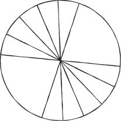

지하실에서 보낸 첫날의 작업은, 첫 맑은 밤에 판으로 장시간 노출을 만들어 낸 다음 북극성 주변을 확대해 파이를 자르는 도식과 닮은 것을 찾는 것이었다. 나는 너무나 쉽게 성공해서 오히려 실망할 뻔했다. 위성이 하나가 아니라 여럿이었기 때문에, 그것이 실제로 보인 모습은 더 복잡했다:

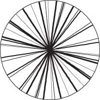

그러나 충분히 오래 들여다보면, 그것이 서로 포개진 몇 개의 파이 자르기 도식이라는 걸 알 수 있었다.

「이건 기대에 못 미치네요,」 저녁 식사 때 제스리에게 말했다. 우리는 어떻게든 바브를 피해 식당 구석에 함께 앉는 데 성공했다.

「또요?」

「나는 좀……극궤도에서 뭐라도 보기만 하면 그것이 끝날 줄 알았어요. 수수께끼 해결, 사건 종결. 그런데 그렇지 않더라고요. 극궤도에 위성이 여럿 있잖아요. 아마 프락식 시대부터 그랬을 거예요. 오래된 것은 닳아 떨어지고, 판잔드럼들이 새 것을 쏘아 올리죠.」

「그건 새로운 결과가 아니네요,」 그가 지적했다. 「밤에 나가 북쪽을 향해 서서 충분히 오래 기다리면, 육안으로도 그 물건들이 극 위를 휘지르는 걸 볼 수 있잖아.」

나는 음식 한 조각을 씹으며, 그의 코를 한 대 때리고 싶은 충동을 억누르려 애썼다. 그러나 이론학에서는 이게 방식이었다. '그건 새로운 결과가 아니다'라고 말하는 건 로라이트들만의 일이 아니었다. 사람들은 늘 바퀴를 다시 발명했다. 부끄러운 일이 아니었다. 만약 우리 나머지가 "아, 바퀴네요, 이런 생각은 아무도 한 적 없었죠!" 하며 감탄해 주느라 그 사람 기분을 맞추기에만 급급하다면, 아무 일도 이루어지지 않았을 것이다. 그렇다고 해서, 이만큼 위험을 무릅쓰고 이만큼 일을 해서 결과를 얻었는데 별거 아니라는 말을 듣는 게 아프지 않은 건 아니었다.

「새로운 결과라고 주장하는 건 아니에요,」 나는 극도의 인내심을 부리며 말했다. 「판을 처음으로 몇 시간씩 다룰 수 있었을 때 무슨 일이 있었는지 알려 주는 것뿐이에요. 그리고 질문 하나를 던지는 셈이죠.」

「좋아. 그 질문이 뭐지?」

「프라아 오롤로는 극궤도에 위성이 여럿 있다는 걸, 그리고 그게 별일 아니라는 걸 알고 있었을 거예요. 천문학자에게 그것은 머리 위를 나는 비행기보다 더 놀라울 게 없죠.」

「성가신 거죠. 주의를 산만하게 하는 것,」 제스리가 고개를 끄덕이며 말했다.

「그럼 대체 무엇을 보려고 아나템을 무릅썼단 말이에요?」

「그는 단지 *무릅쓴* 게 아니야. 그는——」

나는 손을 저어 그를 말렸다. 「내 말 뜻 알죠. 지금 케페도클레스 놀이를 할 때가 아니에요.」

제스리는 내 왼어깨 위 허공을 바라보았다. 다른 이들이라면 내 말에 부끄러워하거나 짜증을 냈을 것이다. 그는 아니었다! 그는 전혀 신경 쓰지 않았다. 나는 그가 너무나 부러웠다! 「그것을 보려면 스필리캡터가 필요했다는 건 알아요,」 제스리가 말했다. 「육안으로는 안 됐어요.」

「그는 이 모든 것을 다른 방식으로 보아야 했어요. 판에 장시간 노출을 만들 수는 없었으니까,」 내가 끼어들었다.

「별의 고리가 잠긴 뒤에 그가 할 수 있는 최선은, 저 포도원에 나가 엉덩이가 얼어 떨어지도록 추위에 떨며, 스필리캡터로 북극성을 바라보는 것이었겠죠. 뭐가 가로지르기를 기다리면서.」

「그것이 나타나면 순식간에 화각을 가로질러 사라졌겠죠,」 내가 말했다. 우리는 이제 서로의 문장을 완성하고 있었다. 「그런데 그다음은요? 그는 무엇을 알아냈을까요?」

「시각이요,」 제스리가 말했다. 「몇 시인지 알았겠죠.」 그는 시선을 탁자 위로 옮겼다. 마치 그것이 오롤로의 스필리처럼. 「기록해 둡니다. 구십 분 뒤에 다시 봅니다. 같은 '새'가 극을 다시 지나가는 걸 보죠.」 리오는 위성을 '새'라고 불렀다—책에서 읽은 군대 은어였고, 우리 나머지도 그 말을 받아 썼다.

「그건 시계의 시침을 바라보는 것만큼이나 재미있네요,」 내가 말했다.

「글쎄, 하지만 이 새들이 한 마리만이 아니라는 걸 기억해요,」 그가 말했다.

「기억할 필요도 없어요——오후 내내 그것들을 보고 있었단 말이에요!」 내가 상기시켰다.

그러나 제스리는 아이디어의 냄새를 맡은 참이었고, 나와 내 사소한 짜증을 상대할 시간이 없었다. 「그것들이 전부 같은 고도로 도는 것은 아니야,」 그가 말했다. 「어떤 것은 다른 것보다 높겠지—그러면 주기가 더 길어. 구십 분이 아니라 구십일 분이나 백삼 분이 걸릴지도 몰라. 궤도의 시간을 재면, 프라아 오롤로는 충분히 관측을 해서 일종의——」

「목록을요,」 내가 말했다. 「저 위에 있는 모든 새들의 목록.」

「그 손에 들어오면, 변화가—이상이 생기면—그걸 알아챌 수 있었겠죠. 그런데 당신 말처럼 그 목록을 완성하기 전까지는——」

「여러모로 어둠 속에서 일하고 있는 셈이죠, 안 그래요?」 내가 말했다. 「새가 극을 지나는 걸 보아도, 그게 어느 새인지, 뭐 특이한 점이 있는지 알 수 없었을 거예요.」

「그렇다면 우리가 그의 발자국을 따라가야 해요,」 제스리가 말했다. 「당신의 첫 목표는 그런 목록을 만드는 거예요.」

「그건 나에게 오롤로보다 훨씬 쉬워요,」 내가 말했다. 「판의 자취만 봐도 어떤 것은 더 넓게——파이 조각이 더 크게——퍼져 있는 게 보여요. 그것들이 높은 고도를 나는 새들이겠죠.」

「이 영상들을 보는 데 익숙해지면, 전반적인 생김새만으로도 이상을 알아차릴지 몰라,」 제스리가 추측했다.

그가 쉽게 말하는 거였다. 정작 하는 사람은 그가 아니었으니까!

한동안 그는 안절부절못하고 지루해 보였다. 이제 그는 시선을 거두고, 더 재미있는 사람을 찾는 듯 식당을 둘러보았다—그런데 다시 나에게로 고개를 돌렸다. 「새 주제,」 그가 선언했다.

「확인. 주제명을 말해라,」 내가 대답했다. 그러나 그가 내 놀림을 알아챘다면, 티를 내지 않았다.

「프라아 파플라고네스.」

「소환된 백년제.」

「그래요.」

「오롤로의 스승.」

「그래요. 저울은 그의 소환과 오롤로가 빠진 곤경이 연결돼 있어야 한다고 말하지요.」

「이치에 맞는 것 같네요,」 내가 말했다. 「나도 대략 그렇게 생각해 왔던 것 같아요.」

「보통은 백년제가 뭘 연구하는지 알 방법이 없죠——적어도 다음 백년제 아페르트까지는. 그러나 파플라고네스가 이십이 년 전 위쪽 미로로 들어가기 전에, 기원후 3670년 십년제 아페르트 때 세상으로 나간 몇 편의 논문을 썼어요. 십 년 뒤와, 또 불과 몇 달 전에, 우리 도서관에도 평소처럼 십년제 배본이 도착했죠. 그래서 나는 그 모든 것을 뒤지며 파플라고네스의 작업을 언급하는 것을 찾고 있었어요.」

「 꽤 우회적인 것 같은데요,」 내가 지적했다. 「파플라고네스의 저작은 전부 여기 있잖아요?」

「그래. 하지만 내가 찾는 게 그건 아니야,」 제스리가 말했다. 「내가 더 알고 싶은 건, 저 바깥에서 누가 파플라고네스에게 주목했느냐는 거야. 3670년의 그의 저작을 읽고 '이 사람 머리가 재미있네'라고 생각한 사람이 누구였냐고. 왜냐하면——」

「왜냐하면 *누군가,*」 내가 말하며 알아들었다. 「저 바깥 세속 세계의 누군가가 '파플라고네스가 우리 사람이야——그를 끌어내 우리에게 데려오자!'라고 말했어야 한다는 거죠.」

「정확해.」

「그래서 뭐를 찾았어요?」

「음, 그게 문제인데,」 제스리가 말했다. 「알고 보니 파플라고네스에게는 일종의 경력이 두 개 있었어.」

「무슨 뜻이에요—취미라는 거요?」

「그의 취미가 철학이었다고 해도 되지. 메타이론학. 프로키안들은 그것을 일종의 종교라고 부를지도 몰라. 한편으로 그는 제대로 된 천문학자로서 오롤로와 같은 종류의 일을 한다. 그러나 여가에는 큰 생각들을 하면서 그것을 글로 썼고—바깥 사람들이 알아차렸어.」

「어떤 생각들이요?」

「지금은 그 이야기로 가고 싶지 않아,」 제스리가 말했다.

「아, 제발—」

그가 손을 들어 나를 진정시켰다. 「직접 읽어 봐! 내가 하려는 얘기가 그게 아니야. 내가 하려는 건, 누가 그를 골랐고 왜 골랐는지 헤아리는 거야. 천문학자는 많잖아?」

「그럼.」

「그런데 천문학 문제를 물어보려고 소환됐다면,물을——」

「왜 하필 그였나?」

「그래. 그러나 그가 관심 가졌던 메타이론학 쪽 일은 드물어.」

「어디로 가는지 알겠어요,」 내가 말했다. 「저울이 말하길, 그는 *그것* 때문에——천문학 때문이 아니라——소환됐어야 한다는 거죠.」

「그래,」 제스리가 말했다. 「어쨌든 3680년과 3690년 배본을 기준으로 보면, 파플라고네스의 메타이론학에 주목한 사람은 그다지 많지 않았어. 그런데 바리토에의 어떤 수르—아쿨로아라는—가 그를 꽤 감탄하고 있어. 파플라고네스의 작업에 관한 책을 두 권이나 썼어.」

「십년제인가——」

「아니, 바로 그거야. 그녀는 우니아리안이야. 삼십사 년 연속.」

그래서 그녀는 교사였다. 우니아리안 마스에서 몇 년 이상 보낼 이유는 그것 말고는 없었다.

「후기 에베네드릭파야,」 제스리가 내 다음 질문을 내가 하기도 전에 대답했다.

「그 교단에 대해 잘 모르는데요.」

「음, 오롤로가 상트 에베네드릭이 경력 후반부에 다른 것을 다루었다고 말했던 거 기억나지?」

「사실은 아르시발트가 그 얘기를 한 것 같은데——」

제스리는 내 정정을 가볍게 넘겼다. 「후기 에베네드릭파들이 바로 그쪽에 관심이 있어.」

「좋아요,」 내가 말했다. 「그럼 수르 아쿨로아가 파플라고네스를 지목했다고 보는 거죠?」

「아니, 그건 아니야. 그녀는 철학 교사고, 일 년짜리……」

「그래도 빅 스리 중 한 곳이잖아요!」

「그게 내 요점이야,」 제스리가 약간 짜증을 내며 말했다. 「중요한 세속인들이 꽤 많아. 젊은 시절에, 경력을 시작하기 전에 빅 스리 마스에서 몇 년 보낸 사람들이.」

「당신은 그 수르에게 십 년이나 십오 년 전 제자가 있었고, 그자가 지금 판잔드럼이 되었다고 보는 거죠. 아쿨로아가 그 피드에게 프라아 파플라고네스가 얼마나 위대하고 현명한지 가르쳤다. 그리고 지금, 무언가 일어났——」

「무언가가,」 제스리가 고개를 끄덕이며 말했다. 「그 옛 피드로 하여금 '이제 끝났다, 파플라고네스를 어제 당장 데려와야 해!'라고 말하게 만든 무언가가.」

「그런데 그 무언가가 뭘까요?」

제스리가 어깨를 으쓱했다. 「그게 전부 질문이지, 안 그래?」

「파플라고네스의 글을 조사하면 실마리를 얻을지도 몰라요.」

「당연하지,」 제스리가 말했다. 「그런데 아르시발트가 그것들을 신호기로 쓰고 있어서 꽤 곤란하네.」

나는 그 말을 이해하는 데 잠시 걸렸다. 「창가의 그 책 더미——」

제스리가 고개를 끄덕였다. 「아르시발트가 파플라고네스가 쓴 것을 전부 슈프 저택으로 가져갔어.」

나는 웃었다. 「그럼 수르 아쿨로아는요?」

「툴리아가 지금 그녀의 저작을 살펴보고 있어,」 제스리가 말했다. 「그녀에게 제자가 있었는데 나중에 뭐가 된 사람이 있는지 알아내려고.」

## 22장: 울리는 골짜기

> 울리는 골짜기(Ringing Vale)
> (1) 위에 걸려 있는 빙하에서 흘러내리는 작은 개울들이 바위 벽을 타고 쏟아져, 종소리와 닮은 음악적인 소리를 내는 것으로 유명한 산골짜기. 개울 골짜기(Rill Vale)라고도 하고, 시적으로는 천 개의 개울 골짜기라고도 불린다. (2) 기원후 17년에 그곳에 세워진 마스로, 무술과 관련 주제의 연구와 발전을 전문으로 한다(골짜기술 참조).
> 골짜기술(Vale-lore)
> 신 오르스어에서, 무장 및 맨손 무술, 군사사, 전략, 전술을 아우르는 포괄적 용어. 마스 세계에서 이 모든 것은 울리는 골짜기의 아부트들과 강하게 연결되어 있으며, 기원후 17년에 그곳에 마스가 세워진 이래 그들이 이 주제들을 전문으로 해 왔다. 참고: 일상어와 플루키시어에서는 이 말이 때때로 *브로(vlor)*로 줄여진다. 그러나 이 변형은 골짜기술의 더 학술적이고 행정적인 면을 희생하면서 무술 쪽을 강조한다. 성 밖에서 *브로*는 오락 장르이며, (구경만 하는 것이 아니라 실제로 나서서 그런 것을 연마하는 세속인들에게는) 일종의 학원이기도 하다.

— 『사전』, *제4판, A.R. 3000*

땅속 구멍에서 일하는 바람에 나는 이런 일들을 전혀 알지 못했다. 그러나 제스리가 내 프라아들과 수르들이 그렇게 애쓰고 있다는 걸 알려 준 뒤로, 나는 판과 함께 하는 작업에 더욱 박차를 가했다. 그 물건에는 맑은 밤 열일곱 개가 전부 들어 있었다. 요령이 붙자, 주어진 밤의 장시간 노출 영상을 얻도록 판을 설정하는 데 대략 삼십 분이 걸렸다. 그다음 각도기로 줄기 사이의 각도를 재는 데 또 삼십 분쯤 걸렸다. 제스리가 예측했듯, 어떤 새들은 다른 것보다 약간 더 큰 각도를 만들었는데, 그것은 그들의 주기가 더 길다는 뜻이었다. 그러나 특정 새의 각도는 언제나 같았다. 매 궤도마다, 매 밤마다. 그래서 어느 의미에서는 하룻밤의 관측만으로도 목록의 초안을 만들 수 있었다. 그러나 나는 꼼꼼하게 하려고, 그리고 솔직히 그다음에 무엇을 해야 할지 전혀 몰랐기 때문에, 맑은 밤 열일곱 개 전부에 대해 그 작업을 해 냈다. 지하층에 내려갈 기회가 있을 때마다 하룻밤, 때로는 이틀치 관측을 해치울 수 있었지만, 그 기회가 매일 있는 것은 아니었다.

끝냈을 때쯤 나는 삼 주쯤 그 일에 매달려 있었다. 잎나무에 새싹이 돋아 있었다. 새들이 북쪽으로 날아가고 있었다. 프라아들과 수르들은 자기 덩굴밭을 뒤지며, 이제 심을 때가 되었는지 논쟁하고 있었다. 야만인 잡초 무리는 강둑에 집결해 비옥한 트라니아 평원을 침공할 준비를 하고 있었다. 아르시발트는 파플라고네스 책 더미의 삼분의 이쯤 읽어 나가고 있었다. 춘분이 며칠 앞으로 다가와 있었다. 아페르트는 반 년 전, 추분 아침에 시작됐었다! 시간이 어디로 갔는지 이해할 수 없었다.

그 시간은 그 전의 수천 년과 똑같은 곳으로 갔다. 나는 그것을 일하며 보냈다. 내 일이 비밀이고 불법이며, 나를 쫓아낼 수도 있는 것이었다는 건 중요하지 않았다. 콘센트는 그런 걸 신경 쓰지 않았다. 어떤 사람들은 훨씬 더 신경 썼겠지. 그러나 여기는 아부트들이 그런 일에 평생을 바치라고 있는 곳이었다. 그리고 이제 내가 *프로젝트를 갖게* 되자, 나는 전에 한 번도 느껴 본 적 없는 방식으로 그 콘센트의 일부가 되었고, 그곳은 나에게 꼭 맞는 장소였다.

아르시발트와 제스리와 툴리아의 마음이 다른 일에 가 있었기에, 나는 사만에 관해 그들에게 말하지 않았다. 그 이야기는 리오와 초원에 나가 별꽃이 올바른 방향으로 자라도록 달래고 있을 때—또는 리오였으니, 그가 최근에 떠올린 아무 일이나 하고 있을 때—꺼내는 주제로 남겨 두었다.

우리는 오롤로를 잃고 서로 다른 방식으로 반응했다. 내 경우에는 혼자 간직하는 피투성이 복수 환상이었다. 반면 리오는 점점 더 기괴한 종류의 브로(vlor)에 빠져들었다. 이주 전에 그는 내가 갈퀴 브로에 관심을 가져 보라고 했었다. 디악스가 열광파를 쫓아낸 이야기에서 영감을 받은 것 같았다. 나는 혈액 감염이 무서워 사양했다—무기화된 갈퀴는 대량의 찔린 상처를 만들 수 있었다. 지난주에는 삽 브로에 흥미가 생겨, 우리는 강둑에 웅크려 앉아 돌로 삽날을 가는 데 많은 시간을 보냈다.

어느 날 그가 다시 나를 강가로 데려갔을 때, 나는 똑같은 일이겠거니 생각했다. 그러나 그는 계속 뒤를 돌아보며 나를 더 깊숙이 이끌었다. 피드 시절 몇 번의 몰래 나가기를 해 본 나는, 그가 규율감독관의 창문들에 대한 시선을 확인하고 있다는 걸 알았다. 옛 습관이 작동했다. 나는 조용해졌고, 그늘진 곳에서 그늘진 곳으로 옮겨 다니다가, 강이 휘어져 둑을 깎아 만든, 시선에서 차폐된 곳에 이르렀다. 다행히 지금 그곳에서 교제하는 이는 아무도 없었다. 그곳은 교제하기에도 좋지 않은 장소였다—질척인 땅, 벌레가 많음, 보트로 강에서 놀고 있는 아부트들에게 방해받을 가능성이 높음.

리오가 나를 향해 돌아섰다. 나는 그가 나에게 추파를 던지려는 게 아닐까 거의 걱정했다.

그러나 아니었다. 우리가 이야기하는 상대는 리오였다.

「너에게 내 얼굴을 한 대 맞고 싶어,」 그가 말했다. 등 긁어 달라는 부탁을 하듯이.

「한 번도 꿈꾸지 않은 건 아니지만,」 내가 말했다. 「왜 *너*가 원하는데?」

「맨손 전투는 예로부터 군사 훈련의 일반적인 요소였다,」 그가 마치 내가 피드라도 되는 것처럼 선언했다. 「오래전에 신병들은——아무리 훈련을 받았어도——얼굴에 한 대 맞는 순간 자신이 아는 모든 것을 잊어버린다는 걸 배웠다.」

「인생에서 *처음* 맞는 순간이라는 거야?」

「그래. 싸움이 눈살을 찌푸려지는 평화롭고 풍요로운 사회에서는 흔한 문제지.」

「얼굴에 자주 맞지 않는 게 *문제*라고?」

「그렇다,」 리오가 말했다. 「군에 들어가서 실제로 너를 죽이려는 자와 맨손으로 맞붙게 되면.」

「하지만 리오,」 내가 말했다. 「너는 이미 얼굴에 맞아 봤잖아. 아페르트 때 말이야. 기억나지?」

「기억나,」 그가 말했다. 「그래서 나는 그 경험에서 배우려 하고 있어.」

「그럼 왜 내가 너 얼굴을 *다시* 때려야 하지?」

「내가 *배웠는지* 알아보는 방법으로서.」

「왜 나야? 제스리가 더 그럴듯한데.」

「그게 문제야.」

「말은 알겠네. 그럼 아르시발트는?」

「그는 진짜로 하지 않을 거야——그리고는 자기 손이 다쳤다고 불평하겠지.」

「얼굴이 부서진 채로 저녁 식사에 나타나면 뭐라고 할 거야?」

「악인들과 싸웠다고.」

「다시.」

「넘어지는 연습을 하다가 잘못 착지했다고.」

「내가 손을 망치고 싶지 않으면?」

그가 웃으며 두꺼운 가죽 작업장갑 한 쌍을 꺼냈다. 「주먹 안에 헝조각을 좀 넣어,」 내가 장갑을 끼는 동안 그가 제안했다. 「그렇게 걱정되면.」

수르 대모 타무라와 수르 대모 일마가 평저선을 타고 지나갔다. 우리는 그들이 시야에서 사라질 때까지 잡초를 뽑는 척했다.

「좋아,」 리오가 말했다. 「내 목표는 너를 간단히 넘어뜨리는 거——」

「아, *이제* 말해 주네!」

「백 번은 해 본 거야,」 그가 말했다. 내가 그것에 안심할 거라고 생각하는 듯했다. 「그래서 여기 온 거지.」 그는 강둑의 축축한 모래를 꾹 밟았다. 「부드러운 땅.」

「왜——?」

「내가 얼굴을 방어하려고 손을 올리면 목표를 완수할 수 없어.」

「알겠어.」

갑자기 그가 나를 덮쳐 넘어뜨렸다. 「네가 졌다,」 그가 일어서며 선언했다.

「좋아,」 나는 한숨을 쉬고 일어섰다. 그가 즉시 돌아서서 나를 다시 넘어뜨렸다. 나는 장난스럽게 그의 머리를 향해 한 대 때렸지만 너무 늦었다. 이번에는 훨씬 세게 넘어졌다. 내 머리의 작은 근육 하나하나가 늘어난 듯했다. 그는 더러운 손을 내 얼굴 위에 짚고 밀어 일어섰다. 메시지는 분명했다.

다음 번에는 진짜로 해 보았지만, 발을 제대로 디디지 않아 힘 있게 때리지 못했다. 그리고 그는 너무 낮게 들어왔다.

그다음 번에는, 나는 무게중심을 낮추고 발을 진흙에 박고, 엉덩이에서 주먹까지 뼈로 연결한 뒤, 그의 광대뼈를 정확히 때렸다. 「좋아!」 그가 내 위에서 내려오며 신음했다. 「그래도 내가 느려지게 할 수 있는지 보렴——그게 전부야, 기억나지?」

십 번쯤 더 했던 것 같다. 내가 그보다 훨씬 더 두들겨 맞았기에, 대략 횟수를 잃어버렸다. 가장 잘했을 때, 나는 그의 걸음을 잠시 흐트러뜨릴 수 있었다——하지만 그는 여전히 나를 넘어뜨렸다.

「이거 언제까지 할 거야?」 내가 물었다. 진흙 속에, 에라스마스 모양의 웅덩이 바닥에 누워서. 내가 일어나기를 거부하면 그가 나를 넘어뜨릴 수 없었다.

그는 강물 두 줌을 퍼 얼굴에 끼얹고, 콧구멍과 눈썹에서 피를 씻어 냈다. 「이만하면 됐다,」 그가 말했다. 「알고 싶은 걸 알았어.」

「그게 뭔데?」 내가 감히 몸을 일으키며 물었다.

「아페르트 때 일 이후로 내가 조정을 했다는 거야.」

「그걸 얻으려고 우리가 이 모든 걸 했단 말이야?」 나는 무릎을 꿇으며 외쳤다.

「그렇게 생각하고 싶으면 그렇게 생각해,」 그가 말하고 물을 더 퍼 올렸다.

다시 이런 기회가 없을 거였다. 나는 몸을 굴려 그의 엉덩이에 발을 짚고, 그를 강으로 엎어 보냈다.

후에, 리오가 비교적 정상적이고 이성적인 삽날 가는 일에 몰두해 있을 때, 나는 우리의 대화를 판에서 내가 보고 있는 것—구체적으로 사만이 정오에 찾아올 때의 행동—으로 다시 돌려 놓았다.

들이키는 듯한 ' 들통났다'는 느낌을 견딘 뒤, 나는 몇 가지 다른 질문을 곱씹기 시작했다. 먼지 덮개를 발견한 이타가, 기계실에서 코드를 찾아왔던 그 이타와 같은 이라는 게 단순한 우연이었을까? 나는 그게 그냥 우연이거나, 아니면 이 사만이 별의 고리와 관련된 중요한 임무를 맡은 어떤 고위 이타라고 짐작했다. 어느 쪽이든, 그것에 관해 추측해 봐야 내게 돌아오는 것은 없었다.

「그 이타가 너랑 이런저런 말을 걸려고 한 적 있니?」 리오가 부어오른 입술로 말했다.

「야간에 마스에 몰래 들어와 쪽지를 건네는 식으로요?」

리오는 내 대답을 이해하지 못했다. 그는 자기 방식으로 그것을 드러냈다—자세를 고쳐 앉은 것이다. 삽을 가는 돌 소리가 잠시 멈췄다. 그리고 그는 알아챘다. 「아니, 실시간으로 말하는 게 아니라,」 그가 말했다. 「판 속에서 그가——너도 알다시피.」

「아니라, 엉겅퀴머리야, 전혀 감도 잡히지 않아——」

「감시를 이해한다면 그들이지,」 리오가 지적했다. 「상트 파타가의 주장을 받아들인다면야.」

리오는 내가 그걸 믿지 않을 만큼 순진하다고 실망한 듯했다. 그는 다시 돌로 삽을 갈았다. 그 긁는 소리가 정말 이를 갈게 했지만, 귀 기울이는 스파이들이라면 꽤 아파하겠지 하고 나는 생각했다.

분명 상트 에드하르 콘센트에서 내 새로운 역할은 보호받는 순진한 이였던 모양이었다. 나는 말했다. 「그럼 대답해 줘. 우리가 전방위 감시를 받고 있다면, 그들은 나와 판에 관한 모든 걸 알고 있어야 하는 거 아냐?」

「음, 그래, 그럴 것 같은데.」

「그럼 왜 아무 일도 안 일어나지?」 내가 물었다. 「스펠리콘과 트레스타나스가 나를 특별히 여기는 것도 아니잖아.」

「놀라운 일 아니야,」 그가 주장했다. 「거기 이상한 점 없어.」

「어떻게 그렇게 생각해?」

그는 그 자리에서 대답을 만들어 내는 듯, 충분히 오래 멈칫했다. 그는 가는 돌을 강에 담갔다. 「이타들이 자기가 아는 걸 전부 규율감독관에게 말할 리 없어. 그런 정보를 다 받으려면 트레스타나스가 매 분 매초 그들과 함께 있어야 해. 이타들은 무엇을 전하고 무엇을 숨길지 스스로 결정해야지.」

리오의 말은 내가 정리하는 데 시간이 좀 걸릴 여러 가지 흥미로운 상황들을 열어 놓았다. 나는 이미 입을 벌리고 서 있는 것 이상으로 그렇게 서 있고 싶지 않았기에, 몸을 굽혀 삽자루를 잡았다. 삽날은 더 날카로워지지 않을 것 같았다. 나는 처벌받아야 할 슬래시베리 덤불을 찾아 사방을 둘러보았다. 오래 걸리지 않았다. 그리로 가자 리오가 따랐다.

「그건 이타들에게 너무 큰 책임을 맡기는 거네,」 내가 말하며 삽을 들어 올린 뒤, 슬래시베리 줄기 뿌리를 향해 앞으로 내리 찍었다. 몇 개가 쓰러졌다. 상쾌했다.

「그들이 우리만큼 똑똑하다고 가정해 봐,」 리오가 말했다. 「어서! 그들은 통사 장치를 다루는 게 일이야. 레티큘럼을 만들었잖아. 지식이 힘이라는 걸 그들보다 잘 아는 이가 없어. 말하는 것과 하지 않는 것에 전략과 전술을 쓰면, 원하는 걸 얻을 수 있을 거야.」

나는 사각미터쯤의 슬래시베리를 쓰러뜨리며 그의 말을 곱씹었다.

「이타와 위계관 사이에 우리가 전혀 모르는 정치가 저쪽에서 벌어지고 있다는 거야.」

「그래야 해. 아니면 그들이 인간이 아니겠지,」 리오가 말했다.

그리고 그는 내게 히포트로키안 화제전환술을 썼다. 질문이 막 해결된 것처럼—자기가 이기고 내가 진 것처럼—화제를 바꾼 것이다. 「그래서 내 질문으로 돌아가서: 사만이 판에서 너한테 메시지를 보내는 다른 짓을 하거나, 적어도 자기 영상이 기록되고 있다는 걸 알고 있다는 신호를 보내던가?」 그는 가는 돌을 강에 던졌다.

히포트로키안 화제전환술에 대한 올바른 반응은 «야, 잠깐만!»이었지만, 리오의 질문이 너무 흥미로워서 나는 시비를 걸지 않았다. 「모르겠어,」 나는 슬래시베리를 더 쓰러뜨리며 즐거운 한 시간쯤을 보낸 끝에 인정했다. 「하지만 파이 조각 재는 게 지루해지고 있어. 솔직히 그다음에 무엇을 봐야 할지도 모르겠어. 그러니까 한번 보기는 하겠지.」

그 후로 거의 일 주일 동안 지하실에 들어가지 못했다. 콘센트가 어느 춘분 축제를 준비하느라 성가 연습이 있었고, 잡초 전쟁은 내가 적어도 한 장의 스케치를 그려야 하는 단계로 접어들었으며, 내 덩굴밭을 심어야 했다. 시간이 날 때면 슈프 저택에는 늘 다른 사람들이 있었다. 그곳이 유행이 되어 가고 있었다!

「바라는 걸 조심하라고,」 어느 오후 아르시발트가 내게 신음했다. 나는 벌집 틀 더미를 목공 작업장으로 옮기는 걸 돕고 있었다. 「누구든 와서 쓰라고 초대했더니——지금 다들 오고 있어——그런데 내가 일을 못 하네!」

「나도 마찬가지예요,」 내가 지적했다.

「게다가 이건!」 그는 퍼티 나이프를 집어 들었다. 내가 보기엔 그 일에 맞지 않는 도구였는데, 틀 모서리의 썩은 나무를 무심코 긁기 시작했다. 「재난이야!」

「목공에 대해 아세요?」 내가 물었다.

「몰라,」 그가 인정했다.

「그럼 프라아 파플라고네스의 메타이론학 저작은요?」

「그건 좀 알지,」 그가 말했다. 「게다가 오롤로가 우리에게 그것들을 알아보라고 한 거라고 생각해.」

「어떻게요?」

「우리의 마지막 대화를 기억나?」

「분홍 신경가스 방귀 용이요. 당연하지.」

「그걸 잉크에 적기 전에 좀 더 품위 있는 이름을 생각해 내야겠네,」 아르시발트가 얼굴을 찡그리며 말했다. 「어쨌든, 나는 오롤로가 우리를 그의 스승에게——그에게 *있던*——중요한 몇 가지 생각에 대해 생각하도록 밀고 있었다고 봐.」

「그렇다면 파플라고네스의 이름을 언급하지 않은 게 이상하네요,」 내가 지적했다. 「상트 에베네드릭의 후기 저작에 관해 이야기한 건 기억나는데——」

「하나가 다른 것으로 이어지는 거야. 때가 되면 우리는 파플라고네스에게 이르렀을 거야.」

「당신이라면 그랬을지 모르죠,」 내가 말했다. 「도대체 그게 뭔가요?」 그것은 합리적인 질문처럼 보였다. 그러나 아르시발트는 움찔했다.

「프로키안들이 우리를 미워하는 그 종류의 것.」

「힐라이아 이론 세계 같은요?」 내가 물었다.

「그들이 그렇게 부르는 건, 우리가 순진하다는 걸 빗대어 말하는 방식이지. 그러나 적어도 프로타스 이래로, 힐라이아 이론 세계라는 생각은 더 정교한 메타이론학으로 발전했어. 그러니까 파플라고네스의 작업은 고전 프로티즘 사상에 대해 현대 군론이 손가락으로 세는 것과 같은 관계라고 말할 수 있지.」

「그래도 그것과 관련돼 있는 건가요?」

「물론이지.」

「나는 단지 그 심문관과의 대화를 떠올리는 중이에요.」

「바락스?」

「네. 그가 그 주제에 관심을 가진 게——」

「정정하자면, 그는 *우리가 그 주제에 관심이 있는지*에 관심이 있었던 거다,」 아르시발트가 지적했다.

「네, 바로 그거예요——그게 수르 아쿨로아의 '가정상 중요한 피드'가 실제로 존재한다는 추가 증거일지도 모른다는 거요.」

「툴리아 수르가 그의——또는 그녀의——존재를 입증하는 증거를 실제로 찾기 전까지는, HIFOSA에 관해 추측하는 건 조심하는 게 좋겠어,」 아르시발트가 말했다. 「그러지 않으면 갈퀴도 통과 못 할 온갖 추측을 늘어놓게 될 거야.」

「글쎄, 당신이 아는 걸 전부 말해 주지 않고서라도,」 내가 말했다. 「세속 세계의 누군가가 파플라고네스의 작업이 실제로 중요할지 모른다고 생각한 이유를 조금만 알려 주시겠어요?」

「좋아,」 그가 말했다. 「이 벌집을 고쳐 주면.」

「원자 파쇄기에 대해 아세요? 입자 가속기요.」

「그럼,」 내가 말했다. 「프락식 시대의 시설이지. 크고 비싸죠. 기초 입자와 힘에 관한 이론을 검증하는 데 쓰였어요.」

「그래,」 아르시발트가 말했다. 「검증할 수 없다면, 그것은 이론학이 아니라 메타이론학이야. 철학의 한 갈래지. 이런 식으로 생각한다면, 우리의 실험 장비가 이론학과 철학을 가르는 경계를 규정하는 셈이지.」

「와,」 내가 말했다. 「철학자가 그런 말을 들으면 당신 목을 물어뜯겠네요. 철학이 그냥 형편없는 이론학이라고 말하는 거나 다름없으니까.」

「그렇게 말하는 이론학자도 몇 있어,」 아르시발트가 인정했다. 「하지만 그 사람들은 철학자들이 정의하는 *철학*에 관해 말하는 게 아니야. 그들은 이론학자들이 자기가 가진 장비로 증명할 수 있는 한계에 딱 닿았을 때 시작하는 어떤 일에 관해 말하는 거다. 그것을 철학 혹은 메타이론학이라고 부르며 철학자들을 미치게 하지.」

「어떤 종류의 일을 말하는 건가요?」

「음, 그들은 다음 이론이 어떤 모습일지 추측해. 이론을 전개하고, 검증 가능한 예측을 하려 애쓰지. 프락식 시대 후기에는, 그것은 보통 더 크고 더 비싼 입자 가속기를 짓는다는 뜻이었어.」

「그리고 끔찍한 사건들이 왔죠,」 내가 말했다.

「그래, 그 뒤로 이론학자들에게 비싼 장난감은 없어졌지,」 아르시발트가 말했다. 「그런데 그것이 실제로 그만큼 큰 차이를 만들었는지는 분명하지 않아. 그 시대의 가장 큰 기계들은 이미, 아르브르에서 합리적인 비용으로 지을 수 있는 한계를 밀고 있었어.」

「그건 몰랐네요,」 내가 말했다. 「나는 언제나 세상에 무한한 돈이 있다고 생각하는 편이었어요.」

「있으나 마나야,」 아르시발트가 말했다. 「대부분은 포르노와 설탕물과 폭탄에 쓰이니까. 입자 가속기에 끌어모을 수 있는 돈은 정해져 있어.」

「그럼 천문학으로의 전환은 재구성이 없었어도 일어났을지 모르겠네요.」

「이미 일어나고 있었어,」 아르시발트가 말했다. 「프락식 시대 극후기의 이론학자들이, 자기들이 평생을 바친 이론학을 검증할 수 있는 기계가 자기 생전에는 만들어지지 않을 거라는 사실을 받아들이기 시작했을 때.」

「그러니 그 이론학자들은 우주에서 주어진 것들을 찾아보는 수밖에 없었겠네요.」

「그래,」 아르시발트가 말했다. 「그리고 그동안 프라아 파플라고네스 같은 이들이 있었지.」

「무슨 뜻이죠? 이론학자이면서 철학자라는?」

그가 잠시 생각했다. 「내가 파플라고네스 이야기로 너를 묻어 버리지 말라는 네 앞선 부탁을 존중하려고 애쓰고 있어,」 그가 내가 보고 있는 걸 알아차리고 설명했다. 「하지만 그래서 더 열심히 생각해야 하네.」

「공정하게 하죠,」 내가 말하며, 내가 쓰기 시작한 횡절톱을 휘둘렀다.

「파플라고네스——그리고 아마 오롤로도——를 에베네드릭 같은 이들의 *후손*이라고 생각해 볼 수 있어.」

「이론학자들이죠,」 내가 말했다. 「이론학이 멈췄을 때 철학으로 돌아선.」

「느려졌다고 해야지,」 아르시발트가 나를 고쳤다. 「상트 번조 같은 곳에서 결과를 기다리면서.」

번조는 지하 2마일에 있는 버려진 소금 광산을 중심으로 세워진 천년제 마스였다. 그곳의 프라아들과 수르들은 교대근무를 하며, 완전한 어둠 속에 앉아 거대한 결정 입자 검출기 배열에서 번쩍이는 빛을 보려 기다렸다. 천 년마다 결과를 발표했다. 첫 천 년 동안 그들은 세 번의 별개 경우에 섬광을 보았다고 꽤 확신했지만, 그 이후로는 빈손이었다.

「그럼 그동안 그들은, 에베네드릭 같은 이들이 이론학의 끝에 닿았을 때 떠올린 생각들을 가지고 놀고 있었던 건가요?」

「그래,」 아르시발트가 말했다. 「재구성 무렵에 그런 생각들이 쏟아졌어. 전부 다중우주라는 주제의 변주였지.」

「우리 우주만이 유일한 것이 아니라는 생각요.」

「그래. 그리고 파플라고네스가 *이* 우주를 연구하지 않을 때 쓰는 것이 바로 그거야.」

「조금 헷갈리네요,」 내가 말했다. 「방금 전에 당신은 그가 힐라이아 이론 세계를 연구하고 있다고 했잖아요.」

「그런데, 프로티즘——순수 이론적 형상들이 사는 또 다른 존재 영역이 있다는 믿음——을 가장 이르고 가장 단순한 다중우주 이론으로 볼 수 있지 않니?」 그가 지적했다.

「두 개의 우주를 전제하기 때문이죠,」 내가 따라가며 말했다. 「우리 것 하나, 이등변삼각형 것 하나.」

「그래.」

「하지만 내가 들어 본 다중우주 이론들——재구성 무렵의 것들——은 완전히 다른 이야기예요. 그 이론들에서는, 우리 것과는 별개이지만 닮은 우주들이 여럿 있어요. 물질과 에너지와 장으로 가득 차 있죠. 늘 변하고요. 영원한 삼각형이 아니에요.」

「생각만큼 늘 닮지는 않아,」 아르시발트가 말했다. 「파플라고네스는 고전 프로티즘이 또 하나의 다중우주 이론에 지나지 않는다고 믿은 전통의 일원이야.」

「어떻게 그럴 수가——」

「전부 말하지 않고서는 설명할 수 없어,」 아르시발트가 살집 있는 손을 들어 보이며 말했다. 「내가 말하려는 요점은, 그가 어떤 형태의 힐라이아 이론 세계를 믿는다는 거야. *그리고* 다른 우주들도 있다고 믿지. 그것들이 수르 아쿨로아가 관심 가지는 주제야.」

「그럼 HIFOSA가 정말 존재한다면——」 내가 말했다.

「다중우주가 어떻게든 뜨거운 주제가 됐기 때문에 그를 소환한 거겠지,」 아르시발트가 말했다.

「그리고 우리가 짐작하기로는, 그걸 뜨겁게 만든 것이 별의 고리 폐쇄도 촉발했다는 거죠.」

아르시발트가 어깨를 으쓱했다.

「글쎄, 대체 그게 뭘까요?」

그가 다시 어깨를 으쓱했다. 「그건 너와 제스리에게 맡기지. 하지만 판잔드럼들이 그냥 혼란스러웠을 수도 있다는 걸 잊지 마.」

마침내 어느 날 나는 슈프 저택의 지하층에 내려가 사만이 점심을 먹는 걸 세 시간 동안 지켜보았다. 그는 거의 매일 그곳에 올라왔지만, 늘 같은 시각은 아니었다. 날씨가 좋고 시간대가 알맞으면, 난간에 앉아 작은 천 위에 음식을 펼쳐 놓고 경치를 즐기며 먹었다. 때때로 그는 책을 읽었다. 그의 작은 간식과 별미를 모두 알아보지는 못했지만, 우리 점심보다는 좋아 보였다. 때때로 바람이 북동쪽에서 불어오면, 우리는 이타들이 요리하는 냄새를 맡을 수 있었다. 언제나 그들이 우리를 놀리는 것 같았다.

「결과예요!」 다음에 초원에서 리오와 단둘이 되었을 때 내가 선언했다. 「어느 정도는.」

「그래?」

「네가 맞았던 것 같아.」

「뭐에?」 시간이 많이 흘렀기에 그는 사만에 관해 우리가 나눈 이야기를 잊어버렸다. 나는 그에게 상기시켜 주었다. 그가 놀랐다. 「와,」 그가 말했다. 「이건 큰일이야.」

「그릴지도 몰라요. 아직 어떻게 받아들여야 할지 모르겠지만요,」 내가 말했다.

「그가 뭘 해요? 눈 앞에 팻말을 들어 보이나? 수신호라도 쳐?」

「사만은 그렇게 하기엔 너무 똑똑해요,」 내가 말했다.

「뭐? 오래된 친구에 관해 말하는 것 같네.」

「지금쯤 나도 그렇게 느껴져요. 그는 나와 수많은 점심을 함께 먹었으니까.」

「그럼 어떻게——어떻게 *말을 걸었*어요?」

「처음 육십팔일 동안 그는 정말 지루했어요,」 내가 말했다. 「그런데 육십구일째 되는 날, 무언가 일어납니다.」

「육십구일째? 그게 우리 나머지에게 무슨 의미인데?」

「음, 동지로부터 대략 이 주일 뒤이고, 오롤로가 쫓겨나기 구십 일 전이에요.」

「좋아. 그럼 육십구일째에 사만이 뭘 하지?」

「평소라면, 계단 꼭대기에 이르면 어깨에 메고 있던 가방을 벗어 난간에서 솟은 돌멩이에 건다. 그리고 광학 기기를 닦는다. 그다음 난간——편평한 꼭대기가 한 뼘쯤 되는데——으로 가 앉아 그 가방에서 점심을 꺼내 펼쳐 먹는 거예요.」

「좋아. 육십구일째엔 뭐가 달라졌어?」

「어깨 가방 말고도, 팔에 책처럼 안고 있는 것이 있어요. 제일 먼저 그걸 난간에 내려놓습니다. 그리고 평소의 순서를 시작하죠.」

「그럼 그게 눈에 잘 띄는 곳에 놓인 거네요.」

「정확히.」

「확대해서 볼 수 있어요?」

「당연하죠.」

「제목을 읽을 수 있어요?」

「알고 보니 그건 책이 전혀 아니었어요, 리오. 다른 먼지 덮개였어요——사만이 첫날에 저 위에서 발견한 것과 똑같은 거요. 다만 이것은 크고 무거웠는데, 안에——」

「다른 판이 있다!」 리오가 외치고는 잠시 생각에 잠겼다. 「그게 무슨 뜻일까.」

「음, 그가 별의 고리의 다른 곳에서 막 주워 온 거라고 보아야지.」

「그걸 거기 두지 않는다고 봐요.」

「아니, 다 먹고 나면 가져가요.」

「왜 하필 그날, 모든 날 중에 그날 판을 챙겼을까?」

「음, 육십구일째 무렵에 프라아 스펠리콘의 오롤로 수사가 본격적으로 탄력을 받기 시작했을 거라고 생각해. 기억나지? 내가 아나템 때——칠십팔일째——몰래 올라가 M & M을 확인했잖아——」

「비어 있는 걸 찾았지,」 리오가 고개를 끄덕이며 말했다. 「그래. 육십구일째에 스펠리콘이 사만에게 오롤로가 M & M에 남긴 판을 가져오라고 지시했겠네. 사만은 그렇게 했지. 하지만 스펠리콘은 네가 클레스티라의 눈에 넣은 판에 대해 몰랐으니까, 그것을 가져오라고 하진 않았겠지.」

「하지만 *사만은* 알고 있었어요,」 내가 상기시켰다. 「그는 이틀째에 그것을 알아차렸잖아요.」

「그리고 스펠리콘에게 말하지 않기로 마음먹었는데, 육십구일째에는 자기가 오롤로의 판을 집어 챙긴 사실을 숨기려 하지 않았다는 거야.」 리오가 고개를 저었다. 「이해가 안 돼. 왜 네가 알게 될 위험을 감수했지?」

나는 손을 들어 올렸다. 「그에게는 그다지 위험이 아닐지 몰라요. 그는 이미 이타인데, 그들에게 무슨 짓을 당하겠어요?」

「좋은 지적이야. 그들은 우리만큼 규율감독관을 두려워하지 않겠지.」

우리가 두려워하고 있다는 걸말하는 것이 약간 짜증스러웠지만, 최근 내가 몰래 돌아다닌 일들을 생각하면 반박할 수 없었다.

내가 조금씩 나아지고 있었다는 걸 깨달았다. 프라아 오롤로를 잃은 것에서 회복하고 있었다. 내가 얼마나 슬프고 화가 났는지 잊어가고 있었다. 그리고 리오가 규율감독관을 언급하자, 그 생각이 다시 떠올랐다.

어쨌든, 리오가 이 모든 것을 소화하는 동안 한동안 침묵이 흘렀다. 우리는 실제로 일을 좀 했다. 잡초 작업을 말한다.

「글쎄,」 그가 마침내 말했다. 「그 후엔 뭐가 일어나지?」

「칠십째는 흐림. 칠십일째는 눈. 칠십이째는 눈. 렌즈가 덮여서 아무것도 볼 수 없어요. 칠십삼째에는 날씨가 아주 맑아요. 사만이 도착할 무렵에는 눈이 대부분 녹아 있었죠. 그는 그곳을 청소하고 점심을 먹습니다. 고글을 끼고 있어요.」

「선글라스처럼?」

「더 크고 더 두꺼워요.」

「등산하는 사람들이 쓰는 것처럼?」

「처음엔 그렇게 생각했어요,」 내가 말했다. 「사실 칠십삼째를 몇 번이고 다시 봐야 알아챘어요.」

「뭘?」 리오가 물었다. 「밝았고, 눈이 있었고, 그가 짙은 고글을 끼고 있었잖아.」

「*아주* 짙었어요,」 내가 말했다. 「야외에서 쓰는 평범한 고글이 아니라고 생각해요. 나는 그 고글을 전에 본 적이 있어요, 리오. 아페르트 때 기계실에서 코드와 사만을 보았는데, 그들은 아크에서 눈을 보호하기 위해 그것들을 쓰고 있었어요. 태양만큼 밝은 아크로부터요.」

「그런데 왜 사만이 갑자기 렌즈를 닦으러 그런 차림을 하고 나타났지?」

「닦는 동안에는 실제로 쓰고 있지 않아요. 끈으로 목에 걸려 있어요,」 내가 말했다. 「그리고 나서 그것을 쓰고 평소처럼 점심을 먹습니다. 그런데 먹는 내내, 태양을 똑바로 쳐다보고 있어요. *사만이 태양을 보고 있는 거예요.*」

「육십구일째 전에는 한 번도 그렇게 하지 않았어?」

「아니요. 한 번도요.」

「그럼 그가 뭔가를 배웠다고 생각해——?」

「오롤로의 판에서 뭔가를 배웠을지도 모죠,」 내가 말했다. 「아니면 스펠리콘이 그에게 말해 준 것이나, 다른 콘센트의 다른 이타들이 레티큘럼을 통해 수군거리는 소문——그들이 하든 그 어떤 것이든——이 있을지도 모르고요.」

「왜 태양을 볼까? 그건 네가 지금까지 해 온 일과 완전히 궤도를 벗어난 거 아닌가?」

「*완전히*. 하지만 *뭔가*예요. 아주 크고 뚜렷한 실마리예요. 사만이 준 선물이야.」

「그럼 너도 태양을 보기 시작했어?」

「고글이 없어요,」 내가 말했다. 「하지만 그 판에 스무 개쯤의 맑고 화창한 날이 기록돼 있잖아요. 그러니까 내일부터라도 삼사 개월 전의 태양이 무엇을 하고 있었는지는 볼 수 있어요.」

## 23장: 빅 스리

> 빅 스리(Big Three)
> 상트 먼코스터, 상트 트레데가르, 상트 바리토에의 콘센트. 지리적으로 서로 가까우며, 기원후 0년에 세워졌고, 비교적 인구가 많고, 재산이 풍부하며, 과거의 업적으로 높은 지위를 누리는 등 많은 특징을 공유한다.

— 『사전』, *제4판, A.R. 3000*

다음 날 아침, 이론학 강의가 끝난 뒤 제스리와 툴리아와 나는 초원으로 이야기를 나누러 갔다. 그해 들어 처음으로 정말 좋은 봄날이었고, 모두가 밖으로 나와 걷고 있었기에, 우리가 여기서 이야기해도 눈에 띄지 않을 것 같았다.

「내가 IFOSA를 찾은 것 같아,」 툴리아가 선언했다.

「HIFOSA라고 해,」 제스리가 고쳤다.

「아니,」 내가 말했다. 「툴리아가 그런 사람을 찾았다면, 이제 가정상(Hypothetical)이 아니잖아.」

「정정하겠네,」 제스리가 말했다. 「그 중요 피드가 누군데?」

「이그네타 포랄,」 툴리아가 말했다.

「성씨가 어딘가 익숙한데,」 제스리가 말했다.

「그 가문은 수백 년간 부유했어. 세속 기준으로는 오래되고 확고히 자리 잡은 거지. 마스 세계와 연결이 많아——특히 바리토에와.」

상트 바리토에는, 해수면이 잠잠하고, 유빙에 묻히지 않았고, 그곳으로 흘러드는 강이 말라버리거나 방향을 바꾸지 않았을 때, 거대하고 훌륭한 항구를 만드는 지형이 인접해 있었다. 재구성 이후 대략 삼 분의 일의 기간 동안, 바리토에 성벽 주위에 큰 도시가 존재했다——물론 늘 같은 도시는 아니었다——그래서 그곳은 도시적이고 세속적이라는 평판을 얻었고, 보이는 바에 따르면 포랄가 같은 가문들과도 많은 인연을 맺었다. 프로키안들이 그곳에서 강력했고, 그들의 우니아리안 마스에서 법, 정치, 상업으로 나갈 많은 젊은 세속인들을 훈련시켰다.

「그녀에 대해 우리가 알아도 되는 게 뭐지?」 제스리가 물었다.

그 질문은 적절했다. 일 년에 한 번, 연례 아페르트 때 우리 우니아리안들은 막 끝난 한 해의 세속 뉴스 요약을 검토했다. 그리고 십 년에 한 번, 십년제 아페르트 직전에, 그동안의 연간 요약 열 개를 검토해 십년 요약을 만들었고, 그것이 우리 도서관 배본의 일부가 되었다. 어떤 기사가 요약에 들어갈 수 있는 유일한 기준은, 그것이 아직도 흥미로워 보여야 한다는 것이었다. 이 기준은 세속 세계의 일간 신문과 방송을 이루는 뉴스를 사실상 전부 걸러 냈다. 제스리는 툴리아에게, 이그네타 포랄이 무엇을 했기에 가장 최근의 십년 요약에 들어갈 만큼 흥미로웠냐고 묻는 것이었다.

「그녀는 정부에서 중요한 직책——대략 열두 명꼴의 최고위 인사 중 하나——을 맡고 있었는데, 하늘의 감독관에 맞서 입장을 밝혔고, 그가 그녀를 쫓아냈어요.」

「죽였나?」

「아니요.」

「지하 감옥에 넣었나?」

「아니요, 그냥 해고했어요. 아마 지금도 파플라고네스 같은 이를 소환할 만한 힘이 있는 다른 일자리가 있겠죠.」

「그럼 그녀가 수르 아쿨로아의 피드였던 거야?」

「이그네타 포랄은 바리토에의 우니아리안 마스에서 육 년을 보냈고, 파플라고네스의 작업을 다른 어떤……어,」

「파플라고네스 같은 이들의 거죠,」 제스리가 조바심을 내며 말했다.

「네, 이전 세기들의.」

「그걸 읽었어?」

「사본을 못 받았어요. 십 년 뒤에나 오겠죠. 이미 아래 미로에 가서 철격자 사이로 신청서를 밀어 넣었어요.」

바리토에의 누군가——아마 우니아리안 피드——가 포랄의 논문을 손으로 베껴 우리에게 보내 주어야 했다. 책이 매우 인기가 있으면, 피드들이 부탁도 없이 그렇게 했고, 사본이 다른 마스들로 돌았다.

「부유한 가문이라면 기계로 인쇄한 사본을 가졌을 것 같은데,」 제스리가 말했다.

「너무 저속하지,」 툴리아가 말했다. 「하지만 제목은 알아요. *세계의 다수성: 할리카르니안들의 다중우주적 사상에 관한 비교 연구.*」

「음, 프로키안들의 돋보기 밑의 벌레가 된 기분이네요,」 내가 말했다.

「바리토에는 *원래* 프로키안이 득세하는 곳이야,」 툴리아가 상기시켰다. 「『할리카르니안들이 왜 우리보다 훨씬 똑똑한가』라는 제목으로는 출세하지 못했겠지.」 나는 너무 늦게야 툴리아가 이제 프로키안 교단 소속이라는 걸 떠올렸다.

「그럼 그녀가 다중우주에 관심이 있었던 거네,」 제스리가 말했다. 말싸움으로 번지기 전에. 「별의 고리에서 관측할 수 있고, 다중우주를 관련 있게 만들 만한 일이 일어났을까?」 그것은 제스리가 이미 답을 알고 있지 않는 한 절대 하지 않을 종류의 질문이었고, 그는 그 답을 바로 내놓았다. 「태양에 문제가 생겼다고 걸어요.」

나는 비웃을 참이었지만, 사만이 실제로 태양을 보고 있었으므로 참았다. 「육안으로 보이는 건가요?」

「흑점. 태양 플레어. 이런 것은 날씨 등에 영향을 줄 수 있어. 그리고 프락식 시대 이래로 대기가 우리를 어떤 것들로부터 보호하지 못해.」

「그럼 볼거리가 거기 있다면, 왜 오롤로는 북극을 보고 있었죠?」

「오로라지,」 제스리가 마치 자기가 무슨 말하는지 아는 것처럼 말했다. 「오로라는 태양 플레어에 반응해.」

「하지만 이번 내내 제대로 된 오로라는 한 번도 없었어요,」 툴리아가 고양이처럼 만족한 표정으로 지적했다.

「육안으로 볼 수 있는 게 없었던 거지,」 제스리가 받아쳤다. 「우리의 이 판은 오로라뿐 아니라 태양 원반 자체를 관측하기에 완벽한 기기가 될 수 있어.」

「이제 와서 '우리' 판이 됐네요, 좋은 게 생기니까,」 내가 지적했다.

「수르 트레스타나스가 찾아내면 다시 '네' 판이 되겠지,」 툴리아가 말했다. 그녀와 나는 웃었지만 제스리는 웃지 않기로 작정한 듯했다.

「진지하게,」 툴리아가 계속했다. 「그 가설은 그들이 왜 파플라고네스를 소환했는지 설명하지 못해. 어떤 천문학자든 태양 플레어를 볼 수 있잖아.」

「다중우주와의 연결을 묻는 거지?」 제스리가 말했다.

「바로 그거요.」

「아예 연결이 없을지도 몰라요,」 내가 추측했다. 「이그네타 포랄이 그냥 천문학자를 원했는데, 파플라고네스의 이름이 문득 떠올랐을 수도 있잖아요.」

「아니면 그녀가 이단으로 박해받고 있어서, 그들이 파플라고네스를 데려가 함께 불태우려 한 걸지도 몰라,」 제스리가 제안했다. 우리는 몇 분 동안 그런 생각들을 주고받다가, 모두 버리고 파플라고네스는 분명히 좋은 이유로 선택됐다고 결론지었다.

「글쎄,」 제스리가 말했다. 「옛 이론학자들이 처음 다중우주에 관해 이야기하게 된 방식은 별들에 대해 생각하는 것이었어. 별이 어떻게 형성되는지, 그 안에서 무슨 일이 일어나는지.」

「핵의 형성 같은 거죠,」 툴리아가 말했다.

「그뿐 아니라, 별이 죽을 때 그 핵들이 어떻게 우주로 날아가 행성과——」

「그리고 우리를 만들었는가,」 내가 말했다.

「그래,」 제스리가 말했다. 「그러면 질문으로 이어지지. 왜 이 모든 과정이 생명을 만들어 내도록 이렇게 미세하게 조정돼 있는가? 끈적한 질문이지. 데올라터들은 '아, 보세요, 신이 우리를 위해 우주를 만들었어요'라고 할 거야. 그런데 다중우주적인 답은 '아니요, 우주는 많아야 해요. 어떤 건 생명에 좋고 대부분은 그렇지 않죠——우리는 우리가 존재할 수 있는 그 우주 하나만 보는 거예요'라는 거지. *그것*이 수르 아쿨로아가 좋아하는 그 모든 철학적 것들의 기원이야.」

「이제 당신이 태양에 문제가 생겼다고 추측하는 이유를 대략 알겠어요,」 내가 말했다. 「아마 별의 핵에서 일어나는 일에 관해 우리가 알고 있다고 여겼던 이론학과 모순되는, 새로운 태양 관측 결과가 있는지 몰라요. 그리고 그것이 파플라고네스가 관심 가진 다중우주 이론들까지 미치는 파장이 있을지도 모르죠.」

「아니면——가능성이 더 높은 건——이그네타 포랄이 잘못 *생각해서* 그런 거라고 보자. 그래서 파플라고네스를 끌어댔고, 지금 헛된 추적을 시키고 있는 거야,」 제스리가 말했다.

「그녀는 꽤 똑똑한 것 같은데요,」 툴리아가 반박했다. 그러나 제스리는 그녀의 말을 듣지 못했다. 그의 머릿속에서 결의가 형성되고 있었기 때문이다. 그는 나를 향해 돌아섰다. 「나도 내려가서 당신과 함께 그것을 보고 싶어,」 그가 말했다. 「혹은 당신이 바쁘다면 당신 없이.」

십여 가지 이유로 나는 그 생각이 싫었지만, 판을 독점하려는 이기적인 사람으로 보이지 않고서는 그렇게 말할 수 없었다. 「좋아요,」 내가 말했다.

「그게 정말 좋은 생각인지 확신해?」 툴리아가 말했다——그녀는 꽤 확신하지 못하는 투였다. 그러나 그것이 제대로 된 말다툼으로 번지기 전에, 우리는 수르 알라가 초원을 가로질러 우리를 향해 곧바로 걸어오는 걸 알아차렸다. 「으음,」 제스리가 말했다.

수르 알라는 내가 좀처럼 정확히 집어내지 못하는 방식으로 특이하게 생겼다. 때때로 나는 강의 중이나 프로베네르 때 그녀를 멍하니 바라보며 그녀의 얼굴을 이해하려 애쓰곤 했다. 그녀는 가늘고 긴 목 위에 둥근 머리를 하고 있었는데, 최근 아페르트 때 짧게 깎은 머리가 그것을 더욱 강조했다. 그 이후 다른 수르 한 명이 그녀를 위해 그 머리를 관리해 주고 있었다. 그녀는 큰 눈, 섬세하고 뾰족한 코, 넓은 입을 가졌다. 툴리아가 풍만하다면 그녀는 작고 뼈가 앙상했다. 어쨌든 그녀의 외형에는 그녀의 영혼과 맞는 무언가가 있었다.

그녀는 인사말에 시간을 낭비하지 않았다. 「지난 석 달 동안 팔백 번째로, 프라아 에라스마스가 뜨거운 대화의 중심에 있어. 남들의 귀에 닿지 않게 조심하면서. 하늘과 슈프 저택을 의미심장하게 힐끗거리는 것까지 곁들여서,」 그녀가 시작했다. 「설명하려 애쓰지 마, 너희들이 뭘 꾸미고 있는지 나는 알아. 몇 주일이고 몇 달이고 계속돼 왔어.」

우리는 한동안 그냥 서 있었다. 내 심장이 두근거렸다. 알라가 우리 세 사람을 정면으로 마주 서서, 그 탐조등 같은 눈으로 우리 얼굴을 훑고 있었다.

「좋아,」 제스리가 말했다. 「우리는 설명하지 않겠어.」 그것이 그가 한 말의 전부였다. 또 긴 침묵이 이어졌다. 나는 알라의 얼굴에 분노가 번지는 걸 기대했다. 심문소를 끌어들여 우리를 짓밟겠다고 협박하는 걸 기대했다. 그런데 대신 그녀의 얼굴이 서서히 무너져 내렸다. 잠시 나는 그녀가 다른 감정——무엇인지 짐작할 수 없는——을 보일지도 모른다고 생각했다. 그러나 그녀는 거기서부터 아무 표정 없는 단호한 얼굴로 변하더니, 우리에게서 등을 돌리고 걸어가기 시작했다. 몇 걸음 간 뒤 툴리아가 그녀를 따라갔고, 제스리와 나만 남았다. 「이상하네,」 그가 말했다.

나는 대답할 수가 없었다. 알라가 새 서클에 들어간 그날 밤, 내 방에서 잠을 못 이루게 했던 그 끔찍한 느낌이 다시 찾아왔다.

「그녀가 우리를 고발할까?」 내가 물었다.

나는 믿기지 않는 투로 말하려 했다——*정말 바보 같아서 그녀가 우리를 고발할 거라고 생각해?* 하는 투로. 그러나 제스리는 그 말을 그대로 받아들였다. 「그건 규율감독관에게 점수를 딸 좋은 방법이야.」

「하지만 그녀는 다른 사람이 없을 때 일부러 우리에게 다가왔잖아,」 내가 지적했다.

「우리와 어떤 거래를 협상하려는 희망이었을지도 몰라?」

「우리가 내놓을 거래가 뭐가 있단 말이야!」 내가 코를 훌쩍였다.

제스리는 그 말을 곱씹더니 어깨를 으쓱했다. 「우리 몸?」

「이제 그냥 짜증나게 굴지 마. 그런 농담을 하려거든 '우리 애정'이라고 하든가.」

「알라에게 애정이 조금도 없다고 생각하는데,」 제스리가 말했다. 「그녀도 나에게 애정이 없다고 생각해.」

「어서, 그녀가 그렇게 나쁜 사람은 아니야.」

「방금 저런 연극을 하고 나서 어떻게 그런 말을 해?」

「아마 우리가 너무 노골적이라는 걸 경고하려던 거지 몰라.」

「거기엔 일리가 있을지도 모르네,」 제스리가 인정했다. 「마스 전체가 우리를 지켜보는 야외에서 이야기하는 건 그만두는 게 좋겠어.」

「더 좋은 생각이라도 있어?」

「응. 다음에 아르시발트가 신호를 보내면, 슈프 저택의 지하층으로 가는 거지.」

알고 보니 그것은 불과 네 시간 뒤였다. 겉으로는 모든 것이 잘 풀렸다. 아르시발트가 신호를 보냈다. 제스리와 나는 각각 다른 곳에서 그것을 알아차리고 슈프 저택으로 모였다. 아르시발트 말고는 아무도 없었다. 제스리와 나는 아래로 내려가 일을 시작했다.

그러나 다른 모든 면에서는 처음부터 잘못된 것이었다. 내가 슈프 저택에 갈 때면 언제나 잎나무 숲 뒤쪽으로 구불구불한 길을 택했다. 같은 길로 두 번 간 적이 없었다. 반면 제스리는 그냥 다리를 건너 곧바로 저택으로 향했다. 그러나 내 방식이 더 나빴다고 말할 수는 없었다. 그날 나는 산책을 즐기러 나온 사람 또는 사람 무리를 사 명이나 만났으니까. 저택에서 돌 한 개 던질 거리쯤 되는 곳에서, 나는 수르 타리와 프라아 브랜치가 서로의 볼트에 싸여 단둘의 시간을 즐기고 있는 위에 거의 걸려 넘어질 뻔했다.

마침내 건물에 도착했을 때, 나는 그 일을 중단하려는 마음이었다. 그러나 제스리는 물러설 기미가 없었다. 아르시발트가 지켜보는 가운데——그는 점점 더 경악하며 눈을 문에서 창으로, 다시 문으로 옮기고 있었다——그가 나를 설득해 아래로 내려가게 했다. 우리는 내가 수많은 시간을 혼자 보냈던 그 좁은 곳에 몸을 구겨 넣었다. 그러나 그가 있으니 예전과 같지 않았다. 나는 렌즈가 일으키는 기하학적 뒤틀림에 익숙해져 있었지만 그는 그렇지 못했고, 어떤 것이 어떻게 보이는지 보려고 이곳저곳을 한참 확대해 보았다. 내가 처음 몇 번 그 판을 다루었을 때와 다를 바 없었지만, 그것은 나를 소리 지르게 만들었다. 우리에게 그런 시간이 없다는 걸 그는 이해하지 못하는 듯했다. 그가 무언가에 완전히 흥미를 느끼면 목소리가 너무 커졌다. 우리는 둘 다 볼일을 보러 나가야 했고, 나는 그에게 문에 관한 '이상 없음' 신호를 가르쳐야 했다.

실제로 태양 관측을 시작하기까지 이삼 시간이 흘러간 것 같았다. 판은 먼 별들을 볼 때와 마찬가지로 이 일에도 잘 맞았다. 판이 낼 수 있는 빛의 양에는 한계가 있었기에, 태양은 눈이 멀게 하는 열핵 화구가 아니라 또렷한 가장자리의 원반으로 보였다——틀림없이 판에서 가장 밝은 것이었지만, 볼 수 없을 만큼 눈부시지는 않았다. 확대하고 밝기를 낮추면 흑점을 관찰할 수 있었다. 그것이 유난히 많은지 나는 확실히 말할 수 없었다. 제스리도 마찬가지였다. 태양 원반을 가리고 그 주변을 관찰하면 태양 플레어를 찾을 수 있었겠지만, 우리가 볼 만한 특이한 일은 일어나지 않았다. 우리 둘 중 그 분야의 전문가가 있었던 것도 아니었다. 우리는 전에 태양에 관심을 거의 두지 않았고, 다른 별들의 관측을 방해하는 성가지고 제멋대로인 별 정도로 여겼다.

사만과 고글에 관한 가설이 틀렸다고, 우리가 오후 전체를 낭비했다고 낙담하고 확신한 뒤, 우리는 나가려 했지만 계단 꼭대기의 문이 닫혀 있는 걸 발견했다. 다른 사람이 건물 안에 있었다. 나가도 안전하지 않았다.

우리는 삼십 분을 기다렸다. 아르시발트가 실수로 문을 닫았을지도 몰랐다. 나는 살금살금 올라가 귀를 댔다. 그는 누군가와 이야기하고 있었고, 그 흐릿한 목소리를 오래 들을수록, 그 상대가 수르 알라라는 확신이 커졌다. 그녀가 우리를 여기까지 추적해 온 거였다!

내가 내려가 이 소식을 전하자 제스리는 그녀에 관해 좋지 않은 말을 늘어놓았다. 삼십 분이 지나도 그녀는 여전히 그곳에 있었다. 우리 둘 다 배가 고팠다. 아르시발트는 짐승 같은 공포 상태에 있을 거였다.

분명 우리의 비밀은——적어도 한 사람에게는——이미 드러났거나 곧 드러날 것이었다. 어둠 속에 웅크리고 쥐처럼 갇혀 있었기에, 우리는 그 함의를 곱씹을 시간이 충분했다. 아무 일 없었던 것처럼 계속하는 것은 무의미했다. 그래서 할 일이 없던 우리는 폴리 방수포를 바닥에서 들어 올려 판을 그것에 싸고, 그리고 아르시발트가 탐험해 도달한 가장 먼 곳——그 탐험의 최외곽——까지 몸을 비틀어 기어가, 그의 삽으로 판을 네 피트 깊이에 묻었다. 그 작업을 마치고 흙으로 더럽혀진 채, 나는 다시 올라가 문에 귀를 댔다. 이번에는 대화 소리가 들리지 않았다. 그러나 문은 여전히 닫혀 있었다.

「아르시발트가 저녁을 먹으러 우리를 버리고 간 것 같아,」 내가 제스리에게 말했다. 「하지만 그녀는 아직 그 위에 있을 거야.」

「지금쯤 떠날 성격이 아니지,」 제스리가 말했다.

「저게 당신이 그녀에 관해 한 말 중 가장 다정하네요.」

「우리 어떻게 할까, 라즈?」

제스리가 내 의견을 묻는 걸 듣는 것은 이상한 일이었다. 나는 이 낯선 경험을 잠시 음미한 뒤 말했다. 「그녀가 우리를 고발하려 한다면, 나는 어쩔 수 없이 죽은 목숨이야. 하지만 너에겐 기회가 있어. 그러니까 함께 나가자. 너는 후드를 쓰고 곧바로 뒤문으로 나가 자취를 감춰. 내가 알라에게 다가가 이야기할게——그녀가 잠시 정신이 팔려 있는 사이에 네가 어둠 속으로 사라질 수 있게.」

「거래다,」 제스리가 말했다. 「고마워, 라즈. 그리고 기억해——그녀가 네 몸을 원하는 거라면——」

「닥쳐.」

「좋아, 하자,」 제스리가 말하며 볼트를 머리 위로 끌어올렸다. 그러나 동시에 고개를 젓는 게 보였다. 「이런 곳에서 이게 스릴이라고 통용되는 거, 믿어지니?」

「언젠가 네 소원이 이루어져서 세상에 실제로 무언가 일어날지도 몰라.」

「이번이 그럴 줄 알았는데,」 그가 지하층을 가리키며 말했다. 「하지만 지금까지는 흑점밖에 없네.」

문이 열리고 빛이 우리에게 비쳤다.

「안녕하세요, 얘들아,」 수르 알라가 말했다. 「길을 잃었니?」

제스리는 후드를 쓰고 있었기에 그녀가 그의 얼굴을 볼 수 없었다. 그는 계단을 뛰어올라 알라를 밀고 지나 뒤문으로 향했다. 나는 바로 뒤에 있었다. 나는 수르 알라와 정면으로 마주쳤고, 바로 그때 복도 저쪽에서 끔찍한 둔탁한 소리가 났다. 제스리가 문턱에 엎드려 있었고, 허리 위로 볼트 엉킴에 덮여 있었다.

「숨길 필요 없어, 제스리. 네 웃음은 어디서든 알아보겠어,」 알라가 외쳤다.

제스리는 다리를 잡고 일어서더니, 볼트를 다시 엉덩이 위로 떨어뜨리고 달아났다. 내 눈이 빛에 적응해 있었기에, 알라가 끈을 출구 양옆의 의자 사이에 매어 문가에 발목 높이로 팽팽히 걸어 둔 것을 볼 수 있었다. 볼트를 달리 고정할 방법이 없어서, 그녀는 그것을 느슨하게 몸에 걸치고 한 팔로 들어 올리고 있었다. 그녀는 나에게서 등을 돌리고 끈을 회수하러 터벅터벅 걸어갔다.

「아르시발트는 한 시간 전에 갔어,」 그녀가 말했다. 「땀으로 몸무게 절반을 잃었을 것 같아.」

나는 별로 웃을 수 없었다. 그녀가 원한다면 나나 제스리에 관해 똑같이 재미있는 말을 할 수 있는 처지라는 걸 알았기 때문이다.

「말이 막혔니?」 그녀가 한참 뒤에 물었다.

「다른 사람이 얼마나 알아요?」

「내가 얼마나 말했는지 묻는 거야? 아니면 다른 사람들이 스스로 얼마나 알아냈는지?」

「음……둘 다요.」

「나는 아무에게도 말하지 않았어. 다른 질문에 대해서는, 나만큼 너에게 주의를 기울이는 사람이라면……아마 아무도 없겠지.」

「왜 나에게 주의를 기울이는데요?」

그녀가 눈을 굴렸다. 「좋은 질문이네!」

「보세요, 알라, 당신이 원하는 게 뭐예요? 무엇을 노리는 거죠?」

「게임 규칙의 일부로, 나는 그것을 말하면 안 돼.」

「당신이 견습 규율감독관——그녀의 보호를 받는 제자——가 되려는 거라면, 빨리 끝내 줘요! 가서 그녀에게 말해요. 나는 해 뜰 때 해문으로 나가 오롤로를 찾으러 갈 거예요.」

내가 이 말을 하는 동안 그녀는 끈을 몸에 감고 있었다. 갑자기 숨이 전부 빠져나간 것처럼 볼트가 두 배로 커 보였다.그녀의 가슴이 꺼지고 머리가 아래로 떨어졌다. 큰 눈이 몇 순간 감겼다. 다른 여자라면 여기서 무너져 버렸을 것이다.

내가 얼마나 끔찍한 기분이었는지 말하기 어렵다. 나는 벽에 몸을 기대고, 내 머리를 뒤로 툭 부딪혔다. 마치 끔찍하게 죄책감에 물든 내 껍질에서 도망치려는 듯. 그러나 도망칠 곳은 없었다.

그녀가 눈을 떴다. 눈이 반짝였지만, 그것은 모든 것을 보고 있었다. *나만큼 너에게 주의를 기울이는 사람이라면, 아무도 없다는 거지.*

아주 낮은, 거의 들리지 않는 목소리로 그녀가 말했다. 「너 목욕을 해야 할 것 같아.」

내 생애 처음으로, 나는 그 이중 의미를 실제로 알아차렸다. 그러나 알라는 이미 가고 없었다.

## 24장: 일레븐

> 일레븐(Eleven)
> 성 안에서 금지된 식물들의 목록. 주로 원치 않는 약리학적 특성 때문에 금지된다. 규율에는, 마스에서 자라는 것이 발견된 표본은 지체 없이 뽑아 태우고, 그 일을 연대기에 기록하도록 되어 있다. 상트 카르타스가 처음 작성한 목록에는 세 가지만 있었으나, 아르브르가 탐험되고 새로운 종이 발견되면서 수세기에 걸쳐 그 수가 늘어났다.

— 『사전』, *제4판, A.R. 3000*

나는 데올라터가 되어, 내가 저지른 엉망을 씻어 낼 마법의 목욕을 찾고자 얼마든 먼 순례를 떠났을 거다. 다음 일주일쯤 마스에서 보낸 고생에 비하면 여정의 고난은 즐거웠을 것이다. 알라가 누구에게 말한 것은 아니었다. 그녀는 그럴 만큼 자존심이 강했다. 그러나 다른 수르들——툴리아를 시작으로——는 그녀가 괴로워하고 있다는 걸 알아챘다. 그리고 다음 날 아침 식사 때까지, 모두가 그것이 내 잘못이라고 결론지었다. 나는 그게 어떻게 돌아가는지 궁금했다. 내 첫 가설은 겉보기에도 틀렸다. 알라가 집으로 달려가 분필 강의실 가득한 경악한 수르들에게 이야기했다는 것이었다. 내 두 번째 가설은, 저녁 식사를 거른 채 비참하게 돌아오는 그녀가 목격되었고, 조금 뒤 나도 몰래 기어들어 오는 게 보였으니, 따라서 내가 그녀에게 나쁜 짓을 했다는 것이었다. 훨씬 뒤에야 나는 훨씬 간단한 진실을 이해했다. 다른 이들은 알라가 나를 눈여겨보고 있다는 걸 알아차렸고, 따라서 알라가 불행하다면, 그것은 내가 무언가——무엇이든 상관없이——나쁜 일을 했기 때문에 틀림없다고 생각했던 것이다.

나는 한 번에 마스의 모든 젊은 여성들에게서 쫓겨난 셈이었다. 모든 소녀들이 늘 기절한 듯한 표정을 짓고 있는 것 같았다. 내가 보이면 모든 소녀의 얼굴에 그 표정이 번졌기 때문이다.

그 일은 시간이 갈수록 커졌다. 알라가 내가 한 일을 간단히 기록해 내 가슴에 못 박아 두었더라면 그나마 나았을 거다. 그러나 내가 한 일에 관한 정보의 양이 정확히 영이었기에, 사람들의 상상력이 미친 듯이 날뛰었다. 어린 수르들은 내가 보이면 움찔하며 물러섰다. 나이 많은 이들은 저녁 식사 내내 나를 노려보았다. 네가 무엇을 했든 상관없어, 젊은이여……우리는 네가 *무언가* 했다는 걸 알아.

사흘 동안 알라를 다시 보지 못했는데,그것은 통계적으로 가능성이 낮았다. 다른 수르들이 파수 노릇을 하며 내 움직임을 추적해, 알라에게 어디에 있지 말라고 알려 주는 것 같았다.

아르시발트는 너무 놀라서 사흘 뒤에야 겨우 말을 할 수 있었다. 그날 그는 온몸이 더러운 채 저녁 식사에 와서, 내가 제스리와 함께 판을 묻어 둔 곳을 파내어(“찾기가 웃길 정도로 쉬웠어”) 훨씬 더 좋은 곳에 숨겼다고(“안전하고 말끔해”) 속삭였다.

제스리와 나는, 아르시발트가 안전하고 말끔하다고 여기는 물건을 찾아내려는 시도 따위는 하지 않는 편이 낫다는 걸 잘 알았다. 우리가 할 수 있는 일은 그가 진정되기를 기다리는 것뿐이었다.

내가 알라를 왜 볼 수 없는지 알아냈다. 그녀와 툴리아가 마인스터에서 지나치게 많은 시간을 보내고 있었다. 종에 손을 대고, 이상한 변화를 연습하고, 언젠가 그들을 대체할 어린 소녀들에게 자기 지식을 전수하고 있었던 것이다.

화창한 날이 더 자주 왔다. 때때로 첨탑 꼭대기를 올려다보면 사만이 점심을 먹으며 고글 너머로 태양을 똑바로 쳐다보고 있는 게 보였다. 제스리와 나는 유리판에 그을음을 묻혀 비슷한 일을 해 볼까 이야기했지만, 잘못하면 눈이 멀 거란 걸 알았다. 나는 심지어 담을 넘어 기계실로 달려가 코드에게 용접 마스크를 빌릴까도 생각했다. 그러나 이 모든 것은 실상 알라 문제에서 내 생각을 돌리기 위한 것들이었다. 초기에 나는 이것을 내 평판을 구제하는 일로 여겼다.그러나 시간이 흐르고 더 곰곰이 생각할수록, 그 일의 진짜 성격이 분명해졌다. 나는 어떤 이의 영혼 속에——그 영혼이 내게 열려 있었던 순간에——엉망을 만들어 놓았다. 이제 그것은 닫혀 있었다. 그 엉망을 치울 수 있는 이는 나뿐이었다. 그러나 그러려면 먼저 그 안으로 들어가야 했다. 어떻게 들어가야 할지 나는 전혀 몰랐다. 특히 알라처럼 매서운 이의 경우에는.

그런데 잡초 작업을 하던 어느 날, 무조건적인 무장해제가 그런 이에게도 통할지 모른다는 생각이 떠올렸다. 리오와 내가 강둑에서 해 온 일은 수많은 봄철 야생화를 내 손에 닿게 했다. 소녀들은 마인스터 위에서 종루 손질을 하고 있었다. 갑자기 모든 게 당연해 보였다. 나는 제대로 생각도 하기 전에 계획을 실행에 옮겼다. 십 분 뒤, 나는 팔에 꽃다발을 안고——그중 하나가 일레븐에 속해 있었고, 나는 그것을 규율감독관 뜰을 가로질러 곧바로 들고 가려 했기에——볼트 한 겹으로 덮은 채, 몽유병자처럼 마인스터 계단을 오르고 있었다.

포르티쿨리스는 여전히 잠겨 있었고, 버팀목을 오르는 길은 갈 수 없었고, 위쪽 프라에시디움은 출입 금지였다. 우리의 카리용은 시간의 심연 아래쪽에 있었고, 수비감독관 뜰에서 올라오는 사다리로 갈 수 있었다. 그 길은 카리용 바로 아래의 정비용 오두막에서 막혔고, 그 방향으로는 프라에시디움 더 위로 올라갈 수 없었기에, 나는 금지된 하늘을 보려 한다는 의심을 사지 않고 그곳에 갈 수 있었다.

종 자체는 날씨에 노출되어 있었다. 그 아래가 종을 울리는 기계 일부를 덮어 주는 오두막이었다. 나는 위쪽에서 알라와 툴리아가 이야기하는 소리를 들을 수 있었다. 사다리는 오두막 바닥의 다락문으로 이어졌다. 오르는 내 심장이 종처럼 쿵쿵거렸다. 떨어지지 않도록 발판을 꽉 잡았다. 꽃은 볼트에 쑤셔 넣어 두 손을 자유롭게 했는데, 이제 땀이 꽃잎에 전부 묻고 있었다. 역겨웠다. 알라가 툴리아의 재치 있는 말에 웃었다. 그녀가 웃을 줄 안다는 걸 기뻐하다가, 이상한 방식으로, 그녀가 이미 나를 잊었다는 데서 안타까워졌다.

매끄럽게 등장할 방법은 없었다. 나는 다락문을 밀어 열고 옆으로 치웠다. 소녀들이 조용해졌다. 나는 꽃다발을 구멍으로 집어 넣어 한쪽 바닥에 쏟아 놓았다. 내 얼굴보다 그것이 더 좋은 첫인상을 주겠지 싶었다. 최근 내 얼굴은 젊은 여성들을 비명 지르며 달아나게 만들곤 했으니까. 그러나 그것은 불가피한 순간을 미루는 것뿐이었다. 내 얼굴은 나머지 나와 붙어 있었다. 그것과 나는 함께 도착할 수밖에 없었다. 나는 그 볼품없는 것을 문 위로 밀어 올리고 사방을 둘러보았지만, 아무것도 보이지 않았다. 오두막에 창문은 있었지만 가려져 있었다. 그러나 소녀들은 어둠에 적응한 눈으로 나를 알아보았고, 가능하다면 더 조용해졌다. 나는 나머지 몸을 문으로 끌어올렸다.

툴리아가 자기 구체에 빛을 내게 했다. 그녀와 알라는 나란히 바닥에 앉아 벽에 기대어 있었다. 나는 왜 그런지 궁금했다. 그러나 내가 입을 열 목적은 정해져 있었기에, 다른 이유로는 열지 않으려 했다. 나는 다락문 옆에 무릎 꿇고 꽃다발을 다시 모았다. 그 덕에 내게 계획도 할 말도 없다는 걸 깨달을 순간을 얻었다. 그러나 수르 알라와 함께 자라며 그녀가 일에 어떻게 반응하는지 알고 있었기에, 허락을 구하는 것이 틀린 길은 아니라고 여겼다. 「알라, 너에게 이걸 주고 싶은데, 기절하지 않겠다면.」

둘 중 적어도 한 명은 숨을 들이켰다. 아무도 반대하지 않았다. 그곳은 내가 생각한 것보다 넓었지만, 들보와 축이 뒤엉켜 서 있을 수 있을지 확신이 없었기에, 나는 무릎으로 걸어 그들이 앉은 곳으로 갔다. 무언가 내 옆을 스쳤다——박쥐인가? 그러나 그다음에 내가 방 안의 사람 수를 세었을 때——그것은 훨씬 뒤의 일이었다——우리 둘뿐이었다. 아마 툴리아가 스필리 속의 우주 함장처럼 그 자리에서 순간이동해 버린 게 틀림없었다.

「고마워,」 알라가 말했다——조심스럽게. 「이것들을 규율감독관 뜰을 지나 들고 올라왔니? 그렇게 했어야 할 것 같은데.」

「그랬어요,」 내가 말했다. 「왜요?」 나는 이미 왜인지 알고 있었다.

「이건 상트 찬데라의 재앙이죠?」

「상트 찬데라의 재앙은 이 무렵에 기괴하게 생긴 꽃을 피워요. 나는 그게 아름답다고 생각하기로 했어요.」 나는 알라의 외모에 비유하려다 말을 더듬었다. 그녀가 좀 이상하게 생겼다는 부분을 어떻게 말해야 할지 몰랐던 것이다.

「하지만 일레븐 중 하나잖아!」

「그건 알아요,」 내가 말했다. 그녀가 내 비유를 방해하려다 논쟁을 시작했기에 나는 조금 긴장했다. 「보세요, 내가 그것을 거기 둔 건 금지되어 있기 때문이에요. 그리고 당신과 나 사이의 이 일——내가 만든 이 엉망——은, 금지된 다른 무언가에 관한 거예요.」

「네가 심문소 코앞에서 이것을 계단으로 곧바로 들고 올라왔다는 게 믿기지 않아.」

「좋아요. 이제 당신이 말하니, 꽤 바보 같았네요.」

「내가 쓰려던 말은 그게 아니었어,」 그녀가 말했다. 「꽃을 가져와 줘서 고마워.」

「천만에요.」

「내 옆에 앉으면, 네가 절대 예상 못 할 걸 보여 줄게,」 그녀가 말했다. 그리고 여기서 나는, 그 말에 이중 의미가 *없다는* 걸 꽤 확신했다. 내가 툴리아가 있던 자리에 앉아 있는 동안, 알라는 이미 일어서서——*그녀는* 여기서 적어도 설 수 있었다——툴리아가 열어 둔 다락문으로 터벅터벅 걸어갔다. 알라가 그것을 닫았다. 그녀는 내 옆에 앉아 자기 빛을 껐다. 이제 이 안은 완전히 어두웠다. 완전히 어둡다고 하면, 알라의 손바닥만 한 크기의 흰 빛 얼룩 하나가 우리 바로 앞 허공에 떠 있는 것만 예외였다. 나는 그것이 우연이 아니라고 생각했다. 소녀들이 여기 앉아 있었던 것은 *그 빛 얼룩 때문*이었다. 나는 오른손을 뻗어 그것을 더듬었다 (왼손은 이상하게도 쓸 수 없었다. 어느새 알라의 어깨에 둘려 있었기 때문이다). 벽에 기대어 있는 널빤지가 있었고, 거기에 빈 나뭇잎 한 장이 고정되어 있었으며, 빛 얼룩이 그 잎에 비치고 있었다. 눈이 적응하자, 그 얼룩이 둥글다는 걸 알 수 있었다. 사실상 완벽한 원이었다.

「3680년의 개기일식을 기억나? 우리가 눈을 태우지 않고 보려고 암상자를 만들었잖아.」

「상자요,」 내가 떠올렸다. 「한쪽 끝에 바늘구멍이고 다른 쪽 끝에 흰 종이 한 장이었죠.」

「툴리아와 나 여기 대청소를 했어,」 그녀가 말했다. 「바닥과 벽에서 햇빛 얼룩들이 움직이는 걸 봤지. 저쪽 위 벽의 오래된 구멍에서 들어오고 있었어.」 그녀가 어둠 속에서 보이지 않는 곳을 가리키며 몸을 비틀었고, 어쩐지 내게 더 가까워졌다. 「환기를 위해 뚫었는데 박쥐가 들어와서 널빤지로 막아 버린 것 같아. 빛은 널빤지 틈으로 새어 들어오고 있었지. 우리가 고쳤어——거의.」

「그 '거의'가 말끔한 작은 바늘구멍이라는 거죠?」

「정확해, 그리고 여기 아래에 스크린을 설치했어. 태양이 하늘을 가로지르는 대로 옮겨야 하지, 당연히.」

알라는 예의 바른 문장에 '당연히'라는 말을 누구보다 잘 끼워 넣었다. 나는 내 인생의 반이 넘는 시간을 그 말에 간헐적으로 짜증을 내며 보냈다. 여기서, 마침내 나는 그것을 놓아 버렸다. 툴리아와 알라의 영리함에 감탄하느라 정신이 없었다. 내가 먼저 생각해 냈더라면 좋았을 거다. 먼 곳의 사물을 보는 데 갈고 닦은 유리 렌즈나 거울은 필요 없었다. 간단한 바늘구멍으로도 충분했다. 다만 그것이 만드는 영상은 흐릿했기에, 어두운 방에서 보아야 했다——암상자.

분명 툴리아가 알라에게 판과 사만, 그리고 내 관측에 관해 모든 것을 말했을 거다. 그러나 내가 그 일들을, 내 엉망을 고치는 일만큼 걱정했던 게 언제였는지 몇 년은 된 것 같았다. 사실, 우리가 함께 어둠 속에 앉아 있는 동안, 나는 태양에 대해 조금의 흥미도 불러일으키기 어려웠다. 태양은 빛나고 있었다. 광합성은 안전했다. 큰 플레어는 없었고 흑점 몇 개뿐이었다. 누가 신경 쓰겠는가.

몇 분 뒤에는 더더욱 신경 쓰이지 않았다. 입맞춤은 분필 강의실에서 가르치는 과목이 아니었다. 우리는 시행착오로 배워야 했다. 실수조차 그다지 나쁘지 않았다.

「불티,」 알라가 말했다——목소리가 다소 묻힌 채——한참 뒤에.

「당연하죠!」

「아니, 불티가 하나 있는 것 같았어.」

「이런 때에 별이 보이는 게 정상적이라고 들었는데——」

「자만하지 마!」 그녀가 말하고 나를 옆으로 밀었다. 「또 하나 봤어.」

「어디에?」

「스크린에.」

나는 눈이 조금 흐려진 채로 시선을 그것으로 돌렸다. 그 잎에는 똑같은 창백한 흰 원반 말고는 아무것도 없었다.

그리고……불티가 하나. 태양보다 밝은, 바늘 끝만 한 빛이었다. 그것이 거기 있다는 걸 확신하기도 전에 사라졌다.

「내 생각엔——」

「또야!」 그녀가 외쳤다. 「하지만 조금 움직였어.」

우리는 몇 개 더 지켜보았다. 그녀가 맞았다. 모든 불티는 태양 원반의 아래쪽과 오른쪽에 있었다. 그러나 각각은 조금씩 더 높고 더 왼쪽에 있었다. 그것들을 종이에 점으로 찍으면, 태양을 정확히 겨냥한 직선을 이룰 거였다.

오롤로라면 어떻게 했을까? 「펜이 필요해요,」 내가 말했다.

「없어,」 그녀가 말했다. 「대략 초당 한 번꼴이야. 더 빠를지도 몰라.」

「뾰족한 거라도 있어요?」

「핀!」 알라와 툴리아가 잎을 널빤지에 고정하려고 꼬리핀 네 개를 꽂아 두었었다. 나는 하나를 뽑아, 그녀의 따뜻한 작은 손에 떨어뜨렸다.

「내가 널빤지를 가만히 잡고 있을게. 불티가 보일 때마다 잎에 구멍을 찍어 줘,」 내가 말했다.

자리를 잡는 동안 몇 개를 더 놓쳤다. 나는 한쪽에 무릎 꿇고 손으로 널빤지를 벽에 대고, 무릎으로 아래를 고정했다. 그녀는 배를 대고 엎드려 팔꿈치로 몸을 받쳤고, 얼굴이 종이에 너무 가까워서, 종이에서 퍼지는 희미한 빛에 그녀의 눈과 볼의 곡선이 보였다. 그녀는 콘센트에서 가장 아름다운 소녀였다.

다음 불티가 그녀의 눈에 비친 걸 나는 보았다. 손이 올라와 종이에 구멍을 찍었다.

「정확한 시각을 알면 좋을 텐데요,」 내가 말했다.

찍——「몇 분 뒤에 이건,」 찍, 「이 잎 밖으로 옮겨 가겠지, 당연히.」 찍. 「그러면 달려가서,」 찍, 「시계를 보면 돼.」 찍.

「이 불티들에서 이상한 점 못 느껴?」 찍.

「순간적으로 켜졌다 꺼지는 게 아니야.」 찍. 「빠르게 타오르지만,」 찍, 「천천히 사라져.」 찍.

「나는 색을 말하는 거예요.」 찍.

「좀……푸르르하지?」 찍.

갑자기 갈리는 소리가 나서 나는 심장이 멈출 뻔했다. 종루의 자동 장치가 작동한 것이었다. 시계가 두 시를 쳤다. 이때가 되면 귀를 막는 게 관례였지만, 나는 감히 그럽지 못했다. 알라가 그 뾰족한 핀으로 나를 찔렀을 거다. 찍……찍……찍……

「시각을 알아낼 방법은 없네요,」 귀가 들릴 것 같아진 뒤 내가 말했다.

「두 시를 친 것과 가장 가까운 불티에 구멍을 세 개 겹쳐 찍었어,」 그녀가 말했다.

「완벽해요.」

「곡선을 그리는 것 같아,」 그녀가 말했다.

「곡선을요?」

「말하자면——이 불티들을 만드는 것이 직선으로 움직이지 않는다는 거야. 방향을 바꾸고 있어,」 그녀가 말했다. 「분명히 우리와 태양 사이를 날고 있어——지금은 태양 원반을 가로지르는 중이야. 그런데 핀 구멍들의 선이 일직선으로 보이지 않아.」

「음, 궤도에 있다고 가정하면, 그건 정말 이상하네요,」 내가 말했다. 「직선으로 가야 할 텐데.」

「방향을 바꾸는 중이라면 말고,」 그녀가 주장했다. 「어쩌면 이 불티들은 그 추진 장치와 관련이 있을지도 몰라.」

「그 파란색을 어디서 봤는지 이제 기억나요,」 내가 말했다.

「어디에서?」

「코드의 작업장이에요. 플라스마로 금속을 자르는 기계가 있어요. 거기서 나오는 빛이 바로 그 파란색이에요. 뜨거운 별과 같은 색이죠.」

「태양 원반의 가장자리를 지나가고 있어,」 그녀가 말했다. 그리고: 「이봐!」

「이봐가 뭐예요?」

「멈췄어.」

「불티가 더 없나요?」

「없어요. 확실해.」

「좋아요, 이걸 옮기기 전에, 태양 원반의 가장자리를 따라 바늘구멍을 몇 개 찍어 줘요. 그래야 이 모든 것에 대해 태양이 어디 있었는지 알 수 있어요. 그것과 시각——그러면 이 물건을 찾을 수 있어요!」

「어떻게 찾아요?」

「이날, 오후 두 시에 하늘에서 태양이 어디에 있었는지 알아낼 수 있어요. 곧, 이른바 고정별들 중 어디 앞을 지나고 있었는지 말이죠. 우리가 추적한 이 플라스마 불티 물건은 같은 장소에 있었어요. 그러므로 다시 궤도를 바꾸지 않는다면, 매 공전마다 같은 고정별들 위를 지나갈 거예요. 하늘에서 그것을 찾을 수 있어요.」

「하지만 궤도를 바꾸는 데 아무 어려움도 없는 것 같은데,」 알라가 말했다. 그녀는 촘촘한 바늘구멍으로 태양 원반의 윤곽을 정성 들여 그리고 있었다.

「하지만 지금까지 우리가 이해하지 못한 퍼즐의 일부는——아마도——그것이 태양 근처를 지날 때만 그런다는 거예요. 이 암상자가 있는 한, 우리는 그것을 주시할 수 있어요.」

「왜 태양의 위치가 차이를 만들어야 하지?」

「숨고 있다고 생각해요,」 내가 말했다. 「밤하늘에서 방금 한 짓을 했다면, 누구나 육안으로 볼 수 있었을 거예요.」

「하지만 우리는 바늘구멍과 종이 한 장으로 그것을 찾아냈잖아!」 알라가 지적했다. 「그럼 숨는 방법이 꽤 형편없네.」

「사만은 용접 고글로 그것을 볼 수 있는 것 같아요,」 내가 말했다. 「하지만 차이는, 당신이나 나나 사만 같은 사람들은……」

「뭐라는 거야? 잘 아는 사람들이라도?」

「네. 그리고 이 물건이 누구인지, 무엇인지 간에, 그들은 잘 아는 사람들이 자기들이 저 위에 있다는 걸 아는지 상관하지 않아요. 그들은 *우리에게* 자기 존재를 알게 하고 있어——」

「그건 세속 권력이 좋아하지 않는 거고——」

「그래서 오롤로가 그것을 보았다고 쫓겨난 거예요.」

그곳을 나오는 데 시간이 좀 걸렸다. 너무 많은 일이 벌어졌다. 나는 잎을 말아 내 볼트 안에 집어 넣었다. 알라가 꽃다발을 집어 들었다. 그것은 내가 여기에 올라온 이유와, 알라가 불티를 알아차리기 전에 우리가 하고 있던 일을 떠올리게 했다. 그걸 잊어버린 바보 같음에 기분이 나빴다. 그때까지 알라는 상트 찬데라의 재앙을 떠올리고는 그것을 어떻게 할지 고민하고 있었다. 그래서 우리는 서로 바꿨다. 나는 도표를 그녀에게 주고, 그녀는 꽃을 나에게 주었다. 그렇게 나는 다시 몰래 꽃을 내려가 가져갈 위험을 감수할 수 있었다.

「다음에 뭘 할까요?」 내가 소리 내어 중얼거렸다.

「무엇에 대해서……?」

우리는 다락문을 열어 놓았다. 빛이 충분했다. 나는 '방금 본 것'이라고 말하려다, 그녀 얼굴의 표정——다시 상처받을 것에 대비해 마음을 단단히 먹는 표정——을 보고 멈췄다. 나는 제때 입을 다문 것 같았다.

「……하고 싶으세요——해야 할까요——」 내가 말을 시작하다가, 눈을 감고 그냥 말했다. 「모두 앞에서 이 일에 관해 솔직해지는 게 좋겠어요.」

「그건 괜찮아,」 그녀가 말했다.

「내일设置的할게요. 프로베네르 뒤에요.」

「툴리아에게 말할게,」 그녀가 말했다. 그 이름을 발음하는 방식에서, 그녀가 모든 것을 알고 있다는 걸 알 수 있었다. 그녀는 내가 한때 그의 절친에게 푹 빠져 있었다는 걸 알고 있었다. 「증인은 누구로 할래?」

나는 리오라고 하려 했지만, 제스리가 이 일로 너무 형편없이 굴었기에, 그가 적임자라고 결정했다. 「그리고 자유 증인은 할리가스트레메나 아무 편한 이로 하죠,」 내가 말했다.

「어떤 종류의 관계를 발표할까요?」 그녀가 물었다.

그것은 어려운 질문이 아니었다. 교제 관계는 맺을 때와 끝낼 때 알려야 했다. 그것은 마스에서 너무 쉽게 만연할 수 있는 소문과 암투를 줄이는 방법이었다. 상트 에드하르 콘센트는 몇 가지 유형을 인정했다. 가장 덜 심각한 것은 티비안이었다. 가장 심각한——페렐리시안——은 결혼에 해당했다. 사십오 분 전까지만 해도 서로를 미워하던 우리 또래 아이들에게 그것은 불가능한 선택이었다. 내가 *티비안*이라고 하면, 알라는 나를 다락문으로 밀어 떨어뜨려 죽게 했을 것이고, 나는 죽기 직전의 사 초 동안 *에트레베니안*이라고 했어야 했다고 후회했을 거다.

「저 거대한 바보 프라아 에라스마스와 에트레베니안 관계였다는 걸 사람들이 아는 걸 견딜 수 있겠어요?」

그녀가 웃었다. 「그래.」

「좋아요.」 그리고 어색함이 찾아왔다. 한 번 더 입맞추는 게 적절한 것 같았다. 그것은 잘 받아들여졌다.

「자, 이제 방금 아르브르 궤도에 숨어 있는 외계 우주선을 발견했다는 사실에 관해 이야기할까요?」 그녀가 아주 작고 새색시 같은 목소리로 물었다——전혀 그녀답지 않았다. 그러나 그녀는 나만큼 큰 곤경에 익숙하지 않았기에, 그런 질문에 대해서는 이미 단련된 범죄자에게 물러서야 한다고 느꼈던 것 같다.

「몇 사람에게만요. 리오가 수비감독관 뜰에 있는 것 같아요. 거기 들러 그에게 말하지——」

「좋아. 어쨌든 관계가 발표될 때까지는 따로 가는 편이겠지.」

사랑 이야기와 외계 우주선 사이를 오가는 그녀의 민첩함에 나는 어지러웠다. 혹은 들떠 있었다. 「그럼 아래에서 나중에 만나요. 기회가 되는 대로 다른 이들에게 소식을 퍼뜨리죠.」

「잘 가,」 그녀가 말했다. 「금지된 꽃 잊지 마.」

「안 잊을게요,」 내가 말했다.

그렇게 그녀는 사다리를 타고 사라졌다.

나는 일 분 뒤에 뒤따랐고, 수비감독관 뜰의 독서실에서 리오를 찾았다. 그는 프락식 시대의 전투에 관한 책을 읽고 있었다. 그 전투는 위대한 도시의 버려진 지하철 터널에서, 탄약이 떨어져 날카롭게 간 삽으로 싸워야 했던 두 군대 사이에 벌어졌다. 그는 한동안 나를 멍하니 바라보았다. 내가 훨씬 더 멍해 보였음에 틀림없다. 그리고서야 최근의 일들이 내 얼굴에 쓰여 있지 않다는 걸 깨달았다. 나는 실제로 말을 해야 했다.

「지난 한 시간 동안 믿기지 않는 일들이 일어났어요,」 내가 선언했다.

「가령?」

무엇부터 말할지 몰랐지만, 외계 우주선이 수비감독관의 독서실에는 더 맞는 주제라고 판단했다. 그래서 그 이야기를 전부 들려주었다. 불티의 궤적이 휘었다는 대목과 플라스마를 언급할 때까지, 그는 다소 정신이 나간 듯 보였다. 그러자 그의 얼굴이 셔터처럼 딱 굳었다. 「그게 뭔지 알아,」 그가 말했다.

그가 너무 확신에 차 있어서, 나는 의심할 생각도 하지 못했다. 대신 그가 어떻게 아는지 궁금했다. 「어떻게——」

「그게 뭔지 알아.」

「좋아. 그게 뭔데?」

그가 처음으로 내 눈에서 시선을 거두고, 독서실 여기저기에 시선을 방황하게 했다. 「여기 있을지도……아니면 옛 도서관에 있을지도 몰라. 내가 찾아낼게. 나중에 보여 줄게.」

「그냥 말해 주지 않을래요?」

「네가 다른 사람이 쓴 책으로 보여 주기 전에는 믿지 않을 거잖아. 그만큼 이상한 거야.」

「좋아요,」 내가 말했다. 그리고 덧붙였다. 「축하해요!」 그게 할 말처럼 여겨졌기 때문이다.

리오가 책을 탁 닫고 일어서더니, 나에게서 등을 돌려 책장 쪽으로 갔다.

클로이스터로 돌아오면서, 일들이 내가 원하는 것보다 훨씬 느리게 움직일 거란 걸 깨달았다. 나는 저녁 식사 당번이었기에, 오후 남은 시간을 부엌에서 보냈다. 알라와 툴리아는 요리를 하지 않아도 되지만, 서빙은 해야 했다. 뜨거운 감자를 내 그릇에 퍼 담으며 알라가 나에게 준 눈빛은, 내가 여기서 묘사하지 않을 방식으로 나를 움직였다. 그것을 스튜로 덮으며 툴리아가 준 눈빛은, 알라가 모든 것을 말했다는 걸 증명했다. 「바늘구멍, 좋았어요!」 내가 그녀에게 말했다. 그릇으로 내 옆구리를 쿡쿡 찌르며 더 빨리 움직이려 하던 프라아 멘탁세네스는 내 말뜻을 전혀 몰랐고, 더 짜증만 냈다.

리오는 저녁 식사에 오지 않았다. 제스리는 있었지만, 바브와 다른 몇 명이 함께 있는 붐비는 탁자였기에 그와 이야기할 수 없었다. 아르시발트는 최근 습관처럼 우리와 최대한 멀리 떨어져 앉았다. 식사 뒤 그는 설거지 당번이었다. 제스리는 몇 명의 다른 에드하르교도와 함께 증명을 하려 분필 강의실로 갔다. 그들은 동틀 때까지 일할지도 몰랐다. 하지만 어쨌든 그와 이야기할 수는 없었다. 프라아 할리가스트레메를 붙잡아, 내일 알라와 내가 증인들 앞에서 교제를 선언하고 연대기에 기록하도록 작은 의례를 준비해야 했기 때문이다.

오후 두 시에 태양이 하늘의 어디에 있었는지 알아내는 일은 할 시간이 있었다. 통금 뒤, 피드들이 잠든 다음, 나는 혼자 초원으로 나가 벤치에 앉아, 그 하늘의 장소를 한 시간 동안 바라보았다. 운이 좋아 위성이 지나가는 걸 볼 수 있을지 바라면서. 그것은 비합리적이었다. 그 우주선이 육안으로 보였다면, 이런 모든 음모가 필요 없었을 거다. 그것은 너무 작거나, 너무 어둡거나, 너무 높거나, 혹은 그 조합이어서, 우리 눈에 보일 만한 빛을 충분히 반사하지 못했을 거다. 그러나 나는 한동안 그냥 혼자 앉아 어둠을 바라보며 생각을 가라앉힐 필요가 있었다. 내 뇌는 한 시간 동안 두 주제 사이를 오가며 윙윙거렸다. 완전히 지친 나는 일어나 빈 감방으로 기어들어가 푹 잠들었다.

아침 식사 때 리오가 식당에 있었다. 내가 그의 눈을 마주치자, 그는 어딘가 파낸 오래된 책 한 권——『프락식 시대 외기권 무기 체계』——을 의미심장하게 힐끗 보았다.

명랑하네.

제스리는 아침을 걸렀다. 그 뒤 알라와 나는 오후 일정을 준비하느라 아침 대부분을 허비했다. 티비안 교제는 모자를 벗듯 발표할 수 있었지만, 에트레베니안은 각 당사자가 먼저 나이 많은 프라아나 수르와 상의해야 했다. 나는 그 절차를 마무리하고 있었는데, 프로베네르가 울렸다. 내 옛 팀이 시계를 감기로 되어 있는, 점점 드물어지는 그런 날 중 하나였다. 나는 제스리가 아직 자고 있는 감방을 찾아내 그를 요대에서 끌어내 움직이게 했다. 우리는 평소처럼 늦게 마인스터로 전력 질주했다. 그러나 최근 벌어진 모든 일 뒤에, 팀이 다시 뭉친 기분은 좋았고, 시계를 감는 그 단순한 육체적 일을 예전보다 더 즐겼다.

그 뒤 우리는 넷이 식당으로 가 점심을 먹었다. 그러나 거기서 우주선에 관해 이야기할 수는 없었다. 대신 알라와 내가 뒤에 치를 의례 이야기뿐이었다. 팀 중에서 내가 처음으로 그런 교제에 뛰어들었으니, 이것은 일종의 총각 파티 리허설 같은 거였다. 우리는 너무 시끄럽고 너무 재미있어졌다(적어도 그렇게 믿었다). 두 번이나 목소리를 낮추라는 말을 들었고, 무거운 참회로 위협받기도 했다——그것은 우리를 더 시끄럽고 더 재미있게 만들 뿐이었다.

그 모든 일의 어느 순간, 나는 정신적으로 한 걸음 물러서서 잠시 친구들의 얼굴을 즐기고 최근 벌어진 모든 일을 곱씹었다. 그리고 그 과정에서, 오롤로가 쫓겨났고 그가 어딘가 성 밖에서 길을 찾고 있다는 걸 떠올렸다. 그것은 나를 슬프게 했고, 옛 분노의 불꽃조차 되살렸다. 그러나 그것이 내가 친구들과 함께 행복해하는 것을 막지는 못했다. 그 일부는 알라와의 일이 가져다준 순전한 흥분이었다. 그러나 일부는, 알라와 툴리아와 내가 스펠리콘과 트레스타나스처럼 우리를 별의 고리에서 쫓아내고 우리가 무엇을 알고 무엇을 생각하는지 통제하려 한 이들에게 승리를 거두었다는, 점점 커지는 확신이었다. 다만 그것을 발표할 방법을 찾아야 했는데, 그러면 내가 쫓겨나지 않도록 해야 했다. 나는 더 이상 콘센트를 떠나고 싶지 않았다. 알라가 여기 사는 한은.

그녀와 툴리아는 보이지 않았고, 얼마 뒤 그 이유를 알았다. 그들은 마인스터에 일이 있었다. 우리가 식사를 마친 지 얼마 되지 않아 종들이 울리기 시작했다. 우리는 앉아 몇 분 동안 변화를 해석하려 애썼다. 그러나 바브가 그 변화들을 외워 두었기에 그가 가장 먼저 알아냈다. 「보코예요,」 그가 선언했다. 「세속 권력이 우리 중 한 명을 소환할 거예요.」

「프라아 파플라고네스가 일을 제대로 못 한 모양이네,」 제스리가 맥주를 다 들이켜며 농담했다.

「아니면 증원을 요청하는 거겠지,」 리오가 제안했다.

「아니면 심장마비가 왔거나,」 아르시발트가 말했다. 최근 그는 이런 음울한 생각으로 가득했기에, 나머지 우리가 그가 손을 들어 항복할 때까지 그를 노려보았다.

우리는 초원을 가로질러 마인스터로 느긋하게 걸어갔다. 그럼에도 우리는 충분히 일찍 도착했고, 스크린에 가장 가까운 첫 줄에 자리 잡았다. 보코는 우리가 도착한 뒤에도 몇 분 더 울렸다. 그러자 여덟 명의 종 울리는 이들이 발코니에서 내려와 더 뒤쪽에 자리를 잡았다. 백년제들의 합창단이 성소로 나와 단선율 성가를 시작했다. 나는 알라 곁으로 가고 싶었지만, 교제가 발표되기 전에는 그런 달라붙는 연인 행동을 하지 않는 것이 규율의 일부였기에, 몇 시간 더 기다려야 했다.

이번에는 스타토가 프라아 파플라고네스의 보코 때처럼 심문관들을 데리고 있지 않았다. 그는 전과 같이 의례의 첫 단계를 진행했고, 종이 울리기 시작한 이래 처음으로, 이것이 진짜라는 게 나에게 와닿았다. 나는 우리가 누구와 작별하게 될지 궁금했다. 이번에 우리 십년제 중 한 명일까, 아니면 다른 마스 출신이라 만난 적도 없는 프라아 파플라고네스 같은 이일까.

스타토가 의례 중 소환될 이의 이름을 부르는 대목에 이르렀을 때, 나는 꽤 초조해져 있었다. 마인스터는 슈프 저택 아래의 그 지하층처럼 조용했다. 그래서 그가 바로 그때 멈춰 서서 예복 더듬거리는 걸 보았을 때, 나는 거의 비명을 지르고 싶었다. 그는 접혀 있고 밀랍 덩어리로 봉인된 잎 한 장을 꺼냈다. 그것을 여는 데 한참이 걸렸다. 그는 잎을 펼쳐 얼굴 앞에 들고는 놀란 표정을 지었다.

너무 어색한 순간이라 그 자신도 설명할 필요를 느꼈다. 그는 선언했다. 「이름이 여섯 개 있습니다!」

수백 명의 아부트가 가만히 서서 서로에게 중얼거리는 모습을 묘사하기에 *대혼란*이라는 말은 틀렸지만, 그 느낌은 잘 전달했다. 보코 한 번도 드문 일이었다. 한꺼번에 여섯 번은 일어난 적이 없었다——아니, 있었던가? 나는 아르시발트를 보았다. 그는 내 생각을 읽었다. 「아니,」 그가 속삭였다. 「큰 덩어리 때도 아니었어.」

나는 제스리를 보았다. 「이거야!」 그가 말했다. 그가 기다려 온 '다른 무언가'를 뜻했다.

스타토가 목을 가다듬고 웅성거림이 가라앉기를 기다렸다.

「여섯 이름,」 그가 계속했다. 마인스터는 이제 해문 밖의 희미한 경찰 사이렌 소리와 엔진의 굉음만 빼고 다시 조용해졌다. 「그중 하나는 이미 우리 곁에 없습니다.」

「오롤로,」 내가 말했다. 백 명쯤 되는 이들이 동시에 같은 말을 했다. 스타토의 얼굴이 붉어졌다. 「보코,」 그가 외쳤지만 목소리가 막혀, 다시 시도하기 전에 침을 삼켜야 했다. 「보코, 십년제 마스 에드하르 지부의 프라아 제스리.」

제스리가 돌아서서 내 어깨를 주먹으로 쳤다. 사흘 뒤에도 아플 정도로 세게. 그를 기억할 만한 것이었다. 그리고 그는 우리에게서 등을 돌려 우리의 삶에서 걸어 나갔다.

「백년제 마스 에드하르 지부의 수르 베툴라……같은 곳의 프라아 아타프락스……십년제 마스 에드하르 지부의 프라아 고라돈……그리고 십년제, 새 서클의 수르 알라.」

내가 정신을 차렸을 때, 그녀는 이미 스크린 너머 문의 문턱에 서 있었다. 그녀도 나만큼 놀란 표정이었다. 그녀가 거기서 망설이며 내 쪽을 바라보자, 눈물이 흘러나오기 시작했다.

몇 달 전 프라아 파플라고네스가 나가는 걸 보았을 때, 나는 이곳의 누구도 그를 다시 보지 못하리라는 걸 분명히 이해했었다. 이제 같은 일이 알라에게 일어나고 있었다. 그러나 그것은 와닿지 않았다. 내게 전해진 것은 그녀 얼굴의 표정뿐이었다.

그녀에게 다가가기 위해 지나가며 내가 두 사람을 넘어뜨렸다고, 나중에 들었다.

그녀가 팔꿈치를 내 목에 걸고 입술에 입맞춤을 한 뒤, 젖은 볼을 잠시 내 볼에 댔다.

프라아 멘탁세네스가 우리 사이의 문을 닫았을 때, 나는 내 볼트에 꽂힌 말아 놓은 잎 한 장을 발견하려고 아래를 보았다. 그것에는 아주 작은 구멍들이 뚫려 있었다. 나는 그 사실을 다 이해하고 스크린에 얼굴을 대려고 한 걸음 앞으로 내디딜 때까지, 제스리와 베툴라와 아타프락스와 고라돈과 알라는, 파플라고네스와 오롤로가 전에 그랬던 것과 같은 방식으로 걸어 나가고 있었다. 나를 뺀 모두가 노래하고 있었다.

## 25장: 끔찍한 사건들

> 끔찍한 사건들(Terrible Events)
> 기록이 빈약한 전 지구적 대재앙. 일반적으로 인간의 잘못으로 여겨지며, 프락식 시대를 끝내고 곧바로 재구성으로 이어졌다.

— 『사전』, *제4판, A.R. 3000*

「내 말이 무슨 뜻인지 보았지,」 리오가 말했다. 「이렇게 이상해서, 책으로 보여 주지 않으면 네가 날 믿지 않았을 거야.」

그와 나, 아르시발트, 툴리아, 바브가 슈프 저택의 큰 탁자 주위에 앉아 있었다. 『프락식 시대 외기권 무기 체계』가 부검이라도 하듯 펼쳐져 있었다. 오래된 잎——공장에서 만든 진짜 종이——을 찢지 않고 펼치기만 하는데도 사 분의 한 시간이 걸렸다. 우리는 우주선의 아주 크고 정교하게 세부 묘사된 도면을 보고 있었다. 한쪽 끝에는 로켓답게 뾰족한 노즈콘이 달려 있었다. 나머지는 전부 이상하게 생겼다. 본래의 의미에서의 엔진은 없었다. 후미, 곧 제대로 된 로켓이라면 노즐 벨이 있어야 할 자리에, 넓고 평평한 원반이 있었다. 배를 똑바로 세워 놓을 수 있는 받침대처럼 보였다. 그 앞쪽에는 굵은 기둥 몇 개가 위로 이어져 있었는데, 내가 보기에는 그게 바로 우주선 본체——노즈콘 아래에 자리한, 둥근 가압 용기들의 무리——였다.

「충격 흡수 장치예요,」 리오가 기둥을 가리키며 말했다. 「다만 더 크다는 거지.」 그는 후미의 큰 원반 중앙에 있는 아주 작은 구멍으로 우리의 주의를 돌렸다. 「여기서 원자폭탄을 하나씩 연달아 내뱉는 거예요.」

「그 부분이 아직도 도저히 받아들여지지 않아요.」

「뜨거운 숯을 맨발로 걸어 초자연적 힘을 보여 준다는 데올라터들에 대해 들어 본 적 있어요?」 그가 난로 쪽을 보았다. 우리는 거기에 불을 피워 놓았다. 꼭 필요해서가 아니었다. 창문 몇 개를 살짝 열어, 초원의 어린 클로버를 지나 불어오는, 풀냄새가 밴 신선한 바람을 들였다. 애조로운 노래들이 그 바람에 실려 왔다. 대부분의 아부트는 여섯 겹 보코에 너무 충격을 받아, 그것에 관해 노래를 만드는 것 외에는 할 수 있는 일이 없었다. 이 방에 있는 우리에게는 상실을 받아들이는 다른 방법이 있었다. 그러나 그것은 다른 이들이 모르는 것을 알고 있었기 때문에 가능했다. 우리는 도착하자마자 불을 피웠다. 따뜻해지려고가 아니라, 원시적인 방식으로 위안을 얻으려고. 그것은 크노우스보다도 훨씬 전, 언어보다도 훨씬 전에 인간이 하던 일이었다. 이해할 수 없는 어두운 우주에서, 갑자기 그리고 영원히 가족과 친구를 데려가곤 하는 그 우주 속에서, 조금의 공간을 차지하려는 몸짓이었다. 리오가 불로 가서 불타는 장작을 불벼락으로 여러 번 내리쳤고, 불씨 여러 덩어리를 떨어뜨렸다. 그것을 하나 돌 위로 긁어 냈다. 견과만 한 크기에 새빨갛게 달아 있었다.

나는 이미 신경이 곤두서 있었다.

「라즈,」 그가 말했다. 「이걸 주머니에 넣고 다니겠어?」

「주머니 없는데요,」 내가 농담했다.

아무도 웃지 않았다.

「미안,」 내가 말했다. 「아니요, 주머니가 있어도 그걸 넣지는 않겠어요.」

리오가 왼손바닥에 침을 뱉고, 오른손가락 끝을 그 침 웅덩이에 담갔다. 그리고 그 손가락으로 그 숯을 집어 들었다. 지직거리는 소리가 났다. 우리는 움찔했다. 그는 태연히 숯을 다시 불 속에 던지고, 뜨거운 손가락을 허벅지에 몇 번 쳐다. 「약간 불편했을 뿐, 손상은 없어,」 그가 선언했다. 「그 소리는 숯의 열에 침이 증발한 거야. 자, 그 배 뒷면의 판에, 침과 같은 역할을 하는 물질이 발라져 있었다고 상상해 봐.」

「침과 같은 역할이라니요?」 바브가 물었다.

「그래. 그게 원자폭탄의 플라스마에 의해 증발했고, 우주로 팽창하면서 그 판을 툭 쳤어. 충격 흡수 장치가 그 충격을 고르게 해서, 앞쪽에 탄 사람들이 부드럽고 고른 가속을 느끼도록 지속적인 추력으로 바꿨지.」

「원자폭탄이 터지는 바로 곁에 있다는 게 상상이 안 돼요,」 툴리아가 말했다. 「한 발이 아니라, 연속으로요.」

그녀 목소리가 꽤 거칠게 들렸다. 바브를 빼고는 우리 모두 그랬다. 그는 앞서 책을 살펴보고 있었다. 「특수 폭탄이었어. 아주 작았지,」 그가 팔로 원을 그리며 크기를 보였다. 「모든 방향으로 터지지 않고, 플라스마를 한 방향——그 배 쪽으로——마구 내뿜도록 설계됐어.」

「나도 그게 이해되지 않아요,」 아르시발트가 나섰다. 「하지만 우리가 불신을 유보하고 앞으로 나아가자고 제안하겠다. 증거는 우리 앞에 있어요, 이 책에——」 그가 책을 가리켰다. 「그리고 이것에.」 그는 알라가 전날 바늘구멍을 낸 잎에 손을 얹었다. 그리고 그의 표정이 굳었다. 나는 그가 내 얼굴에서든 툴리아의 얼굴에서든, 혹은 둘 다에서 무언가를 보았을 거라 생각했다. 우리에게 그 잎은 이제, 아부트들이 유물함에 소중히 간직하던 옛 상트들의 유물 중 하나와 같았다.

「아마,」 아르시발트가 말했다. 「우리가 이 이야기를 하기엔 아직 이른지도 모릅니다. 어쩌면——」

「어쩌면 너무 늦었는지도 모르죠!」 내가 말했다. 그것은 툴리아로부터 고마운 눈빛을 받았고, 모두의 생각을 정리해 주는 듯했다.

「당신이 여기 와 줘서 놀랐어요——기쁘게 놀랐어요, 아르시발트,」 내가 말했다.

「내 최근의, 아, 그 명백한 겁 많은 태도를 말하는 거로군.」

「당신 말투예요, 내가 아니에요,」 내가 심각한 표정을 유지하려 애쓰며 말했다.

그가 눈썹을 치켜올렸다. 「위계관들이, 얇은 잎 조각에 바늘구멍을 내고 태양빛이 종이에 떨어지게 하지 말라는 *칙령*을 내렸다는 기억은 없는데——당신은 있나? 우리의 입장은 흔들리지 않아.」

「그런 관점으로 생각해 본 적 없네요,」 내가 말했다. 「이제 더 이상 규칙을 어기고 있지 않으니, 오히려 조금 실망스러운 느낌이에요.」

「그게 당신에겐 낯선 감각이겠지, 프라아 에라스마스. 하지만 얼마 뒤면 익숙해질지도 몰라요.」

바브는 농담을 이해하지 못했다. 우리는 설명해 주어야 했다. 그래도 그는 이해하지 못했다.

「그럼 궁금한데——어쩌면——그 배들 중 하나가 사라졌을지도 몰라요,」 툴리아가 말했다.

「사라졌다고?」 리오가 되풀이했다.

「말하자면——승무원들이 반란을 일으켜 알 수 없는 곳으로 가 버린 거죠. 그리고 수천 년이 지난 지금, 그들의 후손이 돌아온 거예요.」

「그들이 후손이 아닐지도 몰라,」 아르시발트가 지적했다.

「상대성 이론 때문에요!」 바브가 외쳤다.

「맞아,」 내가 말했다. 「생각해 보면, 그 배가 상대론적 속도로 이동할 수 있었다면, 그들에게는 수십 년에 불과한 왕복 여행이 우리에게는 수천 년이었을지도 몰라.」

모두가 그 가설을 좋아했다. 우리는 그것이 참이라고 이미 마음을 정해 버렸다. 딱 한 가지 문제가 있었다. 「그 배들은 단 한 척도 만들어진 적 없어,」 리오가 말했다.

*「뭐!?」*

그는 우리가 그것에 대해 자기를 탓하려는 듯한 표정을 지었다. 「그냥 제안이었어요. 이것들은 프락식 시대 아주 후기의 개념도에 불과해요.」

「끔찍한 사건들 직전이네요!」 바브가 각주를 달았다.

우리는 한동안 말이 없었다. 그만큼 흥분했던 생각을 해체하고 치우는 데는 시간과 노력이 걸린다.

「게다가,」 리오가 계속했다. 「이 배는 태양계 내부의 군사 작전용이었어. 상대론적 속도로 갈 수 있는 배에 대한 구상도 있었지만, 그건 훨씬 더 컸고 생김새도 달랐겠지.」

「노즈콘이 필요 없었을 거야!」 바브가 말했다——그 나름대로 엄청나게 웃긴 농담이었다.

「그럼 알라와 내가 본 것——파란 불티——가, 이런 추진 체계를 쓰는 궤도상의 배였다는 생각을 받아들인다면——」 내가 도면을 가리키며 말을 시작했다.

「——그것은 외계 문명에서 온 거여야 해,」 아르시발트가 말을 이었다.

「프라아 제스리는 고등 생명체는 우주에서 극히 드물 거라고 믿는다고 해요,」 바브가 우리에게 말했다.

「 그는 상트 만다라스트의 추측을 따랐지,」 아르시발트가 고개를 끄덕이며 동의했다. 「수십억 개의 행성이 단세포 물질로 뒤덮여 있고, 다세포 생명체는 거의 없——문명은 말할 것도 없이.」

「그를 현재형으로 말해요——죽은 것도 아닌데!」 툴리아가 지적했다.

「정정을 받아들인다,」 아르시발트가 그다지 마음 내키지 않게 말했다.

「바브, 제스리에게 그 이야기를 했을 때, 그가 다른 이론을 내놓았던가요?」 툴리아가 물었다.

「네——다른 우주에 관한 다른 이론이요!」 바브가 농담을 던졌다. 툴리아가 그의 머리를 헝클어뜨리고 밀었는데, 그것이 실수였다. 그가 날뛰기 시작했기 때문이다. 우리는 그를 아나템으로 협박해, 슈프 저택 주위를 다섯 바퀴 달리고 나서야 진정시킬 수 있었다.

「이 물건이 어디서 왔을지 이야기하는 건, 본론에서 벗어난 곁길이야,」 리오가 지적했다.

「동의한다,」 아르시발트가 말했다. 그가 너무나 권위 있게 말해서, 우리는 *정말로* 동의했다.

「어디선가 온 거야. 누가 신경 쓰겠어. 그것은 아르브르 주위의 극궤도에 자리 잡아 한동안 거기 있었어——뭐 하면서?」 내가 말했다.

「정찰,」 리오가 말했다. 「극궤도의 목적이 그거잖아.」

「그래서 그들은 우리에 대해 알아가고 있었다. 아르브르를 지도로 그리고. 우리 통신을 도청하면서.」

「우리 언어를 배웠지,」 툴리아가 말했다.

나는 계속했다. 「어떻게든 오롤로가 그것을 알아차렸어. 아마 극궤도로 들어가기 위한 감속 연소를 우연히 본 것일지도 몰라. 다른 이들도 보았을 수 있지. 판잔드럼들은 알고 있었어. 그들이 위계관들에게 전갈을 보냈지: '우리는 이 문제를 세속 사안으로 간주하니, 이는 너희 일이 아니니 끼어들지 마라.' 그리고 위계관들은 충실히 모든 별의 고리를 닫으라는 명령을 내렸다.」

「심문관들이 그것이 지켜지는지 확인하러 보내졌지,」 리오가 말했다.

「프라아 파플라고네스가 어딘가로 가서 이 물건을 연구하라고 소환됐어,」 툴리아가 말했다.

「그가,」 아르시발트가 말했다. 「그리고 아마 다른 콘센트의 그와 같은 이들이.」

「배는 궤도에 머물렀어. 가끔 그 엔진들을 쏘아 궤도를 조정했을지도 몰라. 그러나 아르브르와 태양 사이를 지날 때만 그랬겠지——자취를 숨기려고.」

「발자국을 남기지 않으려고 강물 속을 걷는 도망자처럼,」 바브가 끼어들었다.

「하지만 어제 무언가 바뀌었어. 아주 큰 일이 일어났음에 틀림없어.」

「가르단의 저울은, 당신과 알라가 목격한 궤도 변경과, 그로부터 하루도 안 되어 일어난 전례 없는 여섯 겹 보코가 연결되어 있어야 한다고 말하지요,」 아르시발트가 말했다.

나는 그 신성한 유물을 피해 왔었다. 이제 그것을 피할 수 없었다. 알라가 그것을 내게 준 데는 이유가 있었다. 우리는 그것을 탁자에 펼치고 모서리를 책으로 눌러 놓았다.

「그게 뭐를 했는지 알아내려면 하늘의 기하를 알아야 해요!」 바브가 불평했다.

「바늘구멍의 기하와, 프라에시디움 위의 스크린 위치를 말하는 거죠. 어느 쪽이 위였는지. 어느 쪽이 북쪽이었는지,」 내가 말했다. 「그 모든 측정을 해야 한다는 데 동의해요.」

바브는 출구 쪽으로 뒤로 물러서기 시작했다——당장 그 측정을 하러 갈 준비를.

그러나 나는 주저했다. 나도 그가 만큼이나 그 일을 하고 싶었다. 그러나 여기서 오롤로였더라면, 너무나 간단해서 내가 지나치게 복잡하게 만든 것이 바보 같게 느껴지게 할, 훌륭한 아이디어를 내놓았을 거다. 나는 그런 것을 전혀 떠올릴 수 없었다.

「적어도 그 각도는 재 보죠,」 내가 말했다. 「그것은 한 방향에서 들어온다. 그게 초기 궤도다. 폭탄들을 쏘아 방향을 바꿀 때까지 휘었다. 그게 최종 궤도다. 그 각도는 적어도 잴 수 있어.」

그렇게 했다. 답은 대략 파이의 사 분의 일——사십오 도였다.

「그럼 처음에 극궤도였다고 가정하면, 이 기동이 끝났을 때 그것은 극궤도와 적도 궤도의 중간쯤인 새로운 궤도에 있었던 거네,」 리오가 말했다.

「그래서 뭐가 좋다고 그랬을까요?」 내가 물었다. 리오가 이 방의 누구보다 외기권 무기 체계를 훨씬 잘 알았기 때문이다.

「지상 궤적을 지구본이나 세계 지도에 그려 보면, 그런 궤도에서는 북위 사십오 도보다 높이 오르지 못해. 북위 사십오 도와 남위 사십오 도 사이를 사인파처럼 왕복하겠지.」

「거기에 인구의 구십구 퍼센트가 살고 있잖아요,」 툴리아가 지적했다.

「그들도 이제 알겠지, 아르브르의 사방 인치를 모두 그릴 시간이 있었으니까,」 아르시발트가 상기시켰다.

「그들은 1단계——정찰——을 끝냈고, 어제 2단계를 시작했어. 2단계가 뭐냐면——누가 알겠어?」 리오가 결론지었다.

「실제로 무언가를 하는 거지,」 바브가 말했다.

「그리고 판잔드럼들은 그걸 알아요,」 내가 말했다. 「걱정하고 있었어요. 그들은 수개월 전부터 비상 계획을 준비해 두었어요——오롤로의 이름이 그 목록에 있었으니 알 수 있죠! 그러니까 그 계획은 그의 아나템보다 전에 작성되어 봉인되었어야 해요.」

「바락스와 오날리가 아페르트 때 그것을 스타토에게 넘겼다고 걸어요,」 툴리아가 말했다. 「스타토는 그 이후로 줄곧 그것을 지고 다니며, 봉인을 뜯어 그 이름들을 읽을 신호를 기다렸겠지.」 그녀 얼굴에 멍해진 표정이 스쳤다. 「그들이 알라를 고른 게 마음에 걸려.」

「지난주까지 나는 당신 둘이 얼마나 가까운지 제대로 이해하지 못했어요,」 내가 말했다.

그러나 툴리아는 그 말을 받으려 하지 않았다. 「그것만이 아니야,」 그녀가 말했다. 「말하자면, *그것이야*. 나는 그녀를 사랑해. 그녀가 간 걸 견딜 수 없어. 하지만 왜 그녀였지? 파플라고네스——오롤로——제스리는 좋아, 이해해. 그런데 왜 *당신들이* 알라를 골랐어요? 그녀 같은 이를 무엇에 쓰려고요?」

「많은 다른 사람들을 조직하기 위해서지,」 아르시발트가 망설임 없이 말했다.

「바로 그것이,」 툴리아가 말했다. 「내가 괴로워하는 지점이에요.」

*제발, 조준점을 높여라.*

심문관들 이야기가 나오자, 십일 밤에 바락스와 나눈 대화가 떠올랐다. 그 직후에 벌어진 일들 때문에 그 대화는 내 기억에서 사라져 있었다. 그러나 나는 그가 별의 고리를 올려다보던 걸 기억했다——혹은 조준점을 조금 더 높여, 허공 너머를 보고 있었는지도 몰랐다. 생각해 보면, 그때 그는 북쪽을 향해 서 있었다. *더 큰 이해관계가 걸려 있다, 외진 상트 에드하르 은둔처의 젊은 프라아가 지역 날나리들을 상대로 자기 브로를 연습하느냐 마느냐보다는……더 크게 생각해……네 친구가 네 명의 더 큰 사내들에게 덤비기로 했을 때처럼.*
도대체 *그게* 무슨 뜻이었지? 외계 배가 위협이라는 뜻일까? 우리가 곧 불리한 확률을 무릅쓰고 그것과 맞서야 한다는 뜻일까? 아니면 내가 너무 깊게 읽고 있는 걸까? 그리고 왜 바락스는 앞선 대화에서 힐라이아 이론 세계에 관한 내 견해를 그렇게 캐물었던가? 그런 사람이 메타이론학에 그렇게 관심을 갖기엔 이상한 시점이었다.

아니면 나는 그 대화들에서 지나치게 많은 것을 읽어 내고 있는지도 몰랐다. 바락스는 그냥 소리 내어 생각하는 부류의 사람이었을지도 모른다.

그중 '조준점을 높여라'라는 부분은 꽤 분명해 보였다.

나는 일을 시작하는 데 큰 격려가 필요하지 않았다. 오롤로의 아나템 이후, 내가 미치지 않게 해 준 것은 사진기억 판을 다루는 일뿐이었다. 알라를 잃은 것이 그만큼 끔찍하지는 않았다——적어도 그녀는 쫓겨난 것이 아니었으니까——하지만 오롤로의 경우와 달리, 그것은 전적으로 나에게 뜻밖이었다. 그녀가 내 삶에서 걸어 나갈 때 내가 멍든 짐승처럼 그냥 서 있었다는 게 아직도 마음에 걸렸다. 우리가 무언가를 시작한 지 얼마 되지 않아 그녀를 잃다니——뭐, 할 말은 다 한 셈이지, 내게는 정말로 작업거리가 필요했다.

우리 무리는 우리가 구할 수 있는 모든 측정 기구를 들고 종루 위 오두막을 점거했다. 아르시발트는 4세기로 거슬러 올라가는 마인스터 건축 도면을 찾아냈다. 우리는 암상자의 기하를 세 가지 다른 방식으로 계산하고, 결과가 모두 일치할 때까지 비교했다. 슈프 저택에서 했던 대략적 측정을 더 정밀하게 다듬을 수 있었다: 배의 새 궤도는 적도에 대해 대략 오십일 도 기울어져 있었는데, 이는 사실상 모든 인구 밀집 지역 위를 지나간다는 뜻이었다. 끔찍한 사건들 이후의 수세기 동안 날씨가 덥고 건조해지자 사람들은 극 쪽으로 이동하는 경향이 있었다. 최근에는 대기 중 이산화 탄소량이 줄어들면서 기후가 온화해지기 시작했고, 사람들은 극지방의 태양 복사를 피하려고 적도 쪽으로 다시 이주했다. 사실 오십일 도는, 세계 인구 대부분을 감시하는 것만이 목적이라면 배가 실제로 필요한 것보다 더 높은 궤도였다.

이것이 신비로웠지만, 아르시발트가 지적하기를, 세계의 주요 콘센트——곧 천년 시계가 있고 수백 수천 명의 아부트가 사는 곳——를 모두 보면, 적도에서 가장 먼 곳이 북위 51.3도에 있다고 했다.

그곳은 하필 상트 에드하르의 '외진 은둔처'였다.

소문이 퍼졌다. 큰 보코가 있은 지 한 달 안에, 십년제 마스의 모두가 배에 관해 우리가 아는 것의 대부분을 알게 되었다. 위계관들은 그것을 막을 수 없었다. 그러나 여전히 별의 고리를 열지 않았다. 나는 훨씬 더 자주 심야 분필 강의실에 초대되는 자신을 발견했다. 우리는 리오가 그 책에서 찾은 도면을 연구하고, 그런 배가 어떻게 작동할지, 항성 간 여행을 하려면 얼마나 더 커야 할지 이론학을 계산했다. 어떤 것은 충격 흡수 장치에 관한 단순한 프락식 계산이었다. 어떤——예를 들어 플라스마가 판에 닿을 때 어떻게 될지 예측하는 것——은 엄청나게 도전적인 작업이었다. 그 이론학은 나에게 너무 고급이었다. 로라이트들이 틀렸다는 걸 증명하는 기분이 들었다. 나보다 조금 나이가 많은 다른 아부트들이, 아마 아르브르의 누구도 한 번도 생각해 본 적 없는——아르브르의, 말이다——증명을 내놓고 있었기 때문이다.

「그걸 보면 힐라이아 이론 세계가 궁금해지네,」 어느 여름 저녁, 큰 보코가 있은 지 대략 팔 주 뒤에 아르시발트가 말했다. 그는 벌을 돌보는 척하고 있었고 나는 잡초를 손보는 척하고 있었다. 그때쯤 사르티아 기병은 트라니아 평원 깊숙이 진출해 옥사스 장군의 제4군단과 제33군단 사이에 쐐기를 박았다. 그래서 아르시발트와 내가 마주친 것은 놀라운 일이 아니었다. 우리 위도에서는 이 무렵 낮이 매우 길었고, 저녁 식사가 끝난 지 몇 시간이 지났는데도 아직 빛이 남아 있었다.

「무슨 생각이에요?」 내가 물었다.

「당신은 다른 에드하르교도들과 분필 강의실에서 노동하며, 그 외계 배의 이론학을 알아내려 애쓰고 있지,」 그가 말했다. 「외계인들이 그런 것을 만들고 별들 사이로 몰고 다니려면 오래전에 이미 마스터했어야 할 이론학을. 내 질문은 이것이다: 그 이론학이 동일한가?」

「우리 것과 외계인 것요?」

「그래. 나는 네 볼트에서 분필 가루를 보았어, 프라아 에라스마스. 저녁 식사 뒤 네가 그리던 방정식에서. 천 년 전, 다른 행성의 어떤 슬레이트에, 머리 둘에 팔 다리 여덟 짜리 외계인이 똑같은 방정식을 그렸을까?」

「외계인들은 다른 표기법을 쓸 거라고 거의 확신하는데요,」 내가 말을 시작했다.

「당연하지!」 그가 짖듯 말했다.

「당신 알라 같아요.」

「곱셈을 작은 네모로, 나눗셈을 원으로 표기할지도 모르지, 뭐,」 그가 짜증 나게 눈을 굴리며 계속했고, 손을 휘저어 대화가 더 빨리 진행되기를 요구했다.

「아니면 아예 방정식을 적지 않을지도 몰라요,」 내가 말했다. 「음악으로 증명할지도.」 그것은 전혀 터무니없는 생각이 아니었다. 우리는 성가에서 그런 식의 일을 했고, 모든 이론학을 그 방식으로 해 온 아부트 교단들도 있었으니까.

「이제야 뭔가 되어 가네!」 그가 그 생각에 너무나 흥분해서, 내가 꺼낸 말이 후회되었다. 「그들이 네가 말한 대로 음악을 쓰는 이론학 체계를 가지고 있다고 치자. 어쩌면 그것이 조화로운 화음이나 듣기 좋은 선율로 이어진다면, 그건 어떤 것이 참이라는 걸 증명했다는 뜻일지도 몰라.」

「당신 지금 완전히 이성이 벗어났어요, 아르시발트.」

「네 친구이자 프라아를 너그러이 봐 주렴. 자네와 다른 에드하르교도들이 슬레이트에 풀어 내는 모든 증명마다, 외계인들에게 그에 대응하는 자기 체계의 증명이 있다고 생각하나? 같은 말을 하는——같은 진리를 표현하는?」

「그렇다고 믿지 않으면 우리는 이론학을 아예 할 수 없어요. 하지만 아르시발트, 우리가 하는 얘기는 옛이야기예요. 크노우스가 보았고. 힐라이아가 이해했고. 프로타스가 형식화했지. 파플라고네스가 생각했다——그래서 그가 소환된 거죠. 지금 그것을 다시 들여다보는 게 무슨 의미예요? 나 지쳤어요. 조금만 더 어두워지면 잘 거예요.」

「외계인들과 어떻게 소통할까?」

「몰라요. 그들이 우리 언어를 배워 왔을 거라고 추측돼 왔죠,」 내가 상기시켰다.

「말을 못 하면 어떻게 하지?」

「방금 전 당신은 그들이 노래하고 있다고 했잖아요.」

「따분하게 굴지 마, 프라아 에라스마스. 내가 무슨 말 하는지 알잖아.」

「알 것도 같아요. 하지만 늦었어요. 나는 플라스마 얘기를 하다 세 시까지 깼어요. 이제 잠자리에 가도 될 만큼 어두워진 것 같은데요.」

「내 말을 끝까지 들어 봐. 힐라이아 이론 세계의 프로타스적 형상들——이론적 진리들——을 통해 우리가 그들과 소통하게 될지도 모른다고 하는 거야.」

「당신 그냥, 오래된 책 더미 뒤에 슈프 저택에 틀어박혀 이 일을 하고 싶어 안달 난 것 같네요. 나에게——허락을 구하는 거예요? 승인을?」

그가 어깨를 으쓱했다. 「당신이 외계 배의 상주 전문가잖아.」

「좋아요. 좋아, 마음껏 하세요. 내가 뒤받쳐 줄게요. 당신이 미친 게 아니라고 모두에게 말해 주죠——」

「훌륭해!」

「——당신이 지금 내 머리를 긁게 하는 한 가지 일을 도와준다면요.」

「그게 뭐일까, 프라아 에라스마스?」

「왜 천년제 마스가 빛나는 것처럼 보이는 거죠?」

「뭐?」

「저것 보세요,」 내가 말했다.

그가 돌아서서 턱을 들고 그 바위 봉우리를 올려다보았다. 그것은 루비처럼 붉게 빛나고 있었다. 그것이 그런 짓을 하는 건 정상이 아니었다.

물론 우리는 늘 저기서 희미한 불빛들을 보곤 했다. 그리고 날씨가 좋으면 벽이 때때로 지는 해의 빛을 받기도 했다. 오롤로와 내가 아페르트 때 그곳을 보았을 때처럼. 지난 몇 분간, 황혼이 깊어지는 동안, 나는 그곳에서 붉은 빛을 알아차리고는 다시 그 전이라고 여겼었다. 그러나 이제 해는 완전히 지었다. 그리고 이 빛은, 태양빛과는 전혀 닮지 않은 종류의 붉음이었다. 그것은 입자가진, 반짝이는 성질이 있었다.

그리고 잘못된 방향에서 오고 있었다. 햇빛이라면 마스와 바위 봉우리의 서향 면을 비추었을 거다. 그러나 이 기괴한 붉은 빛은 지붕, 난간, 탑 꼭대기를 비추고 있었다. 그 아래의 모든 것은 그늘이었다. 마치 어떤 비행기가 바위 봉우리 바로 위에 떠서 빛을 곧장 아래로 비추는 듯했다. 그러나 그랬다면 그것은 너무 높아서 우리가 볼 수도 듣지도 못했다.

초원에는 클로이스터 건물에서 나와 그것을 보려는 프라아들과 수르들이 북적였다. 대부분은 말이 없었다——천상의 징조를 바라보는 데올라터들처럼. 그러나 멀지 않은 곳의 이론학자들 무리 사이에서는 논쟁이 힘을 얻고 있었고, *레이저, 색, 파장* 같은 말들이 오갔다. 그것이 내 기억을 건드렸다. 나는 그 입자가진 빛을 전에 어디서 보았는지 알았다: M & M의 안내별 레이저였다.

그것이 수수께끼의 열쇠였다. 레이저 광선은 크게 퍼지지 않고 아주 먼 거리를 비출 수 있다. 천년제 마스에 이 빛을 비추는 것이 가까이에 있을 필요는 없었다. 수천 마일 떨어져 있어도 되었다. 그것은——오직 *그것만* 가능했다——외계 우주선이었을 거다.

초원에서 외침과, 심지어 약간의 박수가 터졌다. 천년제 마스를 더 자세히 보자, 성벽 뒤로 연기 기둥이 피어오르는 게 보였다. 나는 침을 삼키고 잠시 몹시 불안해졌다. 레이저가 그곳에 불을 지르는 거라고! 죽음의 광선이었던 거다! 그러나 이성이 우위를 차지했다. 물건을 태우려면 적외선 레이저를 쓰는데, 그 빛은 사물을 뜨겁게 만든다. 정의상 이 레이저는 적외선이 아니었다. 우리가 볼 수 있었으니까. 연기는 불탄 건물에서 나는 게 아니었다. 천년제들이 그것을 만들고 있었다. 그들은 풀이나 그런 것을 불에 던져, 마스 위의 공간을 연기와 수증기로 채우고 있었다.

레이저 광선은 빈 공간이나 맑은 공기를 가로지를 때는 옆에서 볼 수 없지만, 연기나 먼지를 그 경로에 두면, 입자들이 빛을 사방으로 산란시켜 그 광선이 허공에서 반짝이는 선으로 두드러지게 된다.

그것은 먹혔다. 그 광선은 수천 마일이나 될지 몰랐다. 우리는 그 대부분——대기 위의 진공을 지나는 부분——을 볼 수 없었을 거다. 그러나 천년제들이 피운 연기 덕에 마지막 수백 피트를 볼 수 있었고, 빛이 어디서 오는지 아주 잘 짐작할 수 있었다.

그리고 물론 나는 불공정한 이점을 가졌다. 외계 배의 궤도 평면——어떤 고정별들 앞을 지나갈지——을 알고 있었으니까. 나는 볼트 한 손으로 들어 올려, 바위 봉우리의 빛 대부분을 차단하는 스크린을 만들었다. 내 눈이 어둠에 적응했고, 별들이 다시 보일 정도가 되었다.

그리고 나는 그것이 하늘을 가로지르는 호를 그리는 걸 보았다. 내가 알고 있던 바로 그 자리에서: 대기를 통과하며 생긴 입자진 후광에 둘러싸인, 붉은 빛의 점 하나. 나는 손가락으로 가리켰다. 주위의 다른 이들도 그것을 보고 각자 찾아냈다. 초원은 아나템 때의 마인스터처럼 조용해졌다.

별똥별이 깜빡이고 검은 속으로 사라졌다. 붉은 빛도 사라졌다. 초원에서 박수가 한바퀴 돌았지만, 머뭇거리는 것이었다. 신경질적이었다. 제대로 시작도 못 하고 사라졌다.

「바보가 된 기분이에요,」 아르시발트가 말했다. 그는 돌아서서 나를 보았다. 「내가 평생 걱정하고 두려워했던 모든 것들을 생각하면——이제 보니 나는 잘못된 것들을 두려워했던 거예요.」

새벽 세 시에 보코가 울렸다.

아무도 그 이상한 시간을 개의치 않았다. 어쨌든 아무도 자지 않고 있었다. 사람들이 책과, 소환될 경우 필요할지 모르는 물건들을 들고 있었기에, 더디고 늦게 모습을 드러냈다.

스타토가 열일곱 명을 소환했다.

「리오.」

「툴리아.」

「에라스마스.」

「아르시발트.」

「타베너.」 그리고 다른 십년제 몇 명.

나는 문턱을 넘어 성소로 들어섰다——시계를 감으러 수천 번 밟아 온 그 발걸음이었다. 그러나 시계를 감을 때는, 몇 분 뒤 프라아 멘탁세네스가 문을 다시 열어 준다는 걸 늘 알고 있었다. 이번에는, 나는 다시 볼 수 없는 삼백 개의 얼굴에 등을 돌렸다——그들이 소환되어——음——내가 보내지는 그곳으로 보내지지 않는 한.

나는 잘 아는 이들 몇 명과, 낯선 이들 몇 명——백년제들——와 함께 있게 되었다.

이름 낭독이 멈췄다. 너무 많아서 나는 세는 걸 포기했고, 끝났다고 생각했다. 나는 스타토를 보았고, 그가 의례의 다음 단계로 넘어가기를 기대했다. 그는 손에 든 목록을 노려보고 있었다. 그의 표정은 읽기 어려웠다. 얼굴과 몸이 굳어 있었다. 그는 천천히 눈을 깜빡이고, 읽기 힘든 듯 목록을 가장 가까운 촛불 쪽으로 옮겼다. 같은 줄을 몇 번이고 훑고 있는 듯했다. 마침내 그는 시선을 들어, 성소 반대편의 천년제 스크린을 똑바로 보았다.

「보코,」 그가 말했다. 그러나 목소리가 쉬어 있었기에 목을 가다듬어야 했다. 「보코, 천년제의 프라아 자드.」

모든 것이 조용해졌다. 아니면 내 귀에서 피가 쏘는 소리였을지도 몰랐다.

한참을 기다렸다. 그러자 천년제들의 스크린에 있는 문이 삐걱하며 열리고, 늙은 프라아의 실루엣이 모습을 드러냈다. 그는 먼지가 가라앉기를 잠시 기다렸다. 그 문은 자주 열리지 않았다. 그리고서 성소로 걸어 나왔다. 누군가 그의 뒤에서 문을 닫았다.

스타토가 우리를 정식으로 소환하는 몇 마디를 더했다. 우리는 부름에 응하는 말을 했다. 스크린 뒤의 아부트들이 슬픔과 작별의 아나템을 받아 불렀다. 그들 모두 목청껏 노래했다. 천년제들은 굵고 울린 저음부로 마인스터를 흔들었다. 너무나 낮아서 듣는 것보다 느껴지는 소리였다. 그것은, 내 십년제 가족들의 노래보다도 더, 내 두피의 털을 곤두세우고, 코를 흐르게 하고, 눈을 따갑게 했다. 천년제들은 프라아 자드를 그리워할 것이었고, 그가 뼈속 깊이 그것을 알게 만들고 있었다.

나는 파플라고네스와 오롤로가 그랬던 것처럼, 곧장 위를 보았다. 촛불빛은 우물 위로 그리 멀지 않은 곳까지만 닿았다. 그러나 나는 정말로 무언가를 보려고 그렇게 한 것이 아니었다. 코와 눈에서 쏟아질 홍수 같은 것을 막으려고 그랬다.

다른 이들이 내 주위에서 움직였다. 나는 턱을 낮추어 무슨 일이 벌어지는지 보았다. 젊은 위계관 하나가 우리를 이끌고 밖으로 가고 있었다.

「가스실로 데려가느냐는 가설이 있다는데, 알고 계셨어요?」 아르시발트가 중얼거렸다.

「닥쳐,」 내가 말했다. 그에게서 그런 쪽의 말을 더 듣고 싶지 않아, 나는 뒤처져 그가 한참 앞으로 가게 두었다. 그가 볼트 절반을 자루로 만들어 작은 도서관을 들고 끌고 있었기에, 시간이 좀 걸렸다.

위계관들은 모두 정식으로 자주색 예복을 입고, 텅 빈 북쪽 신랑의 중앙 통로를 지나, 해문 바로 안쪽의 나르텍스로 우리를 이끌었다. 우리는 대 오러리 아래에 모였다. 해문은 열려 있었지만, 그 너머 광장은 비어 있었다. 비행기도, 버스도 없었다. 롤러스케이트 한 쌍조차 없었다.

젊은 위계관들이 무리 사이를 돌며 물건을 나눠 주었다. 나는 지역 백화점의 쇼핑백 하나를 받았다. 안에는 작업복 바지 한 벌, 셔츠, 속바지, 양말이 있었고, 맨 아래에는 도보용 신 한 켤레가 있었다. 이윽고 나는 배낭 하나를 받았다. 안에는 물병, 세면도구가 든 폴리 봉지, 머니 카드가 들어 있었다.

손목시계도 있었다. 왜 그런 건지 이해하는 데 시간이 걸렸다. 상트 에드하르에서 몇 마일만 떠나면, 우리는 시간을 알 방법이 없었을 거다.

수르 트레스타나스가 우리에게 말했다. 「목적지는 상트 트레데가르 콘센트입니다,」 그녀가 선언했다.

「콘복스인가요?」 누군가 물었다.

「이제는 그렇습니다,」 그녀가 대답했다. 그것으로 잠시 모든 논의가 죽었다. 모두가 그 소식을 받아들이느라.

「거기까지 어떻게 가죠?」 툴리아가 물었다.

「가능한 어떤 방법으로든,」 트레스타나스가 말했다.

*「뭐!?」* 그와 비슷한 말이 소환된 이들 모두 입에서 동시에 터져 나왔다. 보코의 낭만——아는 이들 모두에서 뜯겨 나가는 것에 대한 작은 위안——의 일부는, 프라아 파플라고네스처럼 어떤 탈것에 실려 훌쩍 떠나 보내진다는 것이었다. 대신 우리는 도보용 신을 지급받았다.

「열린 하늘 아래에서는, 낮이든 밤이든 볼트와 끈을 입지 말 것,」 트레스타나스가 계속했다. 「구체는 주먹만 하거나 그보다 작게 유지하고, 빛을 내는 데 쓰지 말 것. 이 문으로 한꺼번에 걸어 나가지 말 것——두세 명씩 무리를 지어 나가게 하겠다. 나중에 원한다면, 콘센트에서 떨어진 어딘가에서 만나도 된다. 가급적 어떤 것 아래에서.」

「그들의 감시는 해상도가 어느 정도죠?」 리오가 물었다.

「전혀 모른다.」

「상트 트레데가르까지는 이천 마일이에요,」 바브가 말했다. 혹시 관심이 있을까 해서. 그리고 그것은 관심 있는 것이었다.

「방주들과 연결된 지역 단체들이, 여러분을 데려다줄 차량과 운전자를 모으려 하고 있다.」

「하늘의 감독관 사람들인가요?」 아르시발트가 물었다——내보다 먼저 입을 열었다.

「그중 일부다,」 트레스타나스가 말했다.

「아니, 사양할게!」 누군가 외쳤다. 「그 사람들 중 하나가 아페르트 때 나를 개종시키려 했어요. 그의 논거는 초라했어요.」

「호, 호, 호, 호, 호!」 나 아주 가까운 누군가가 그랬다.

나는 돌아보았다. 프라아 자드였다. 쇼핑백과 배낭을 들고 내 뒤에 서 있었다. 그는 그렇게 크게 웃지는 않았기에, 다른 이들은 알아차리지 못했다. 그는 연기 냄새가 났다. 쇼핑백 안을 들여다보려는 수고는 아직 하지 않았다. 그가 내 고개가 돌아가는 걸 보고, 내 눈을 바라보았다——아주 즐거워하며. 「당국자들은 바지에 오줌을 싸고 있겠지,」 그가 말했다. 「요즘은 그들이 뭘 입고 다니든 간에.」

다른 이들은 벌어진 모든 일에 너무 기절해서 말을 하지 못했다. 여기서 내게는 이점이 있었다. 나는 기절하는 것에 익숙해져 있었다. 리오가 머리에 맞는 것에 익숙했듯이.

나는 방문객들이 앉아 오러리를 구경할 수 있도록 놓인 돌벤치 위로 올라갔다. 「콘센트 남쪽, 백년문에서 멀지 않은 곳, 강 서쪽에, 운하를 가로지르는 말뚝 위의 커다란 지붕이 있어요. 그 옆에 기계실이 있죠. 찾기 어려울 거예요. 그 근처에서는 단연 가장 큰 건물이니까. 거기서 지붕 아래 만납시다. 수르 트레스타나스가 말한 대로, 작은 무리로 가요. 나중에 거기 모여 계획을 세우죠.」

「몇 시에 만날까요?」 백년제 중 하나가 물었다.

나는 생각해 보았다.

「우리가——아니, 그들이——프로베네르를 울릴 때 만나죠.」

# [ 6부 ] 페레그린 (PEREGRIN)

## 26장: 페레그린

> 페레그린(Peregrin)
> (1) 고전적 용법에서, 기원전 2621년 오리테나 신전의 파괴로 시작해 수십 년 뒤 에트라스 황금기의 번성으로 끝나는 시대. (2) 오리테나에서 살아남아 고대 세계를 떠돌던 이론학자. 때로는 혼자, 때로는 그런 이들의 동행과 함께. (3) 그 시대로 거슬러 올라가는 대화로 여겨지는 것. 나중에 많은 것이 글로 기록되어 마스 세계의 문헌에 편입되었다. (4) 현대적 용법에서, 특별한 상황 아래 마스의 울타리를 떠나 세속 세계를 여행하면서, 글자보다는 정신에서 규율을 지키려 애쓰는 아부트.

— 『사전』, *제4판, A.R. 3000*

우리는 남녀 화장실에 번갈아 들어가 갈아입었다. 신발이 당장 나를 미치게 했다. 나는 그것을 차 버리고 벤치 밑에 두었고, 나르텍스 바닥에 볼트를 펼쳐 접을 만한 빈 자리를 찾았다. 그것은 허리를 굽히고 쪼그려 앉는 일을 수반했다——작업복 바지에서는 까다로웠다. 사람들이 평생 이런 옷을 입고 산다는 게 믿기지 않았다!

볼트를 책 한 권만 한 크기로 접은 뒤, 끈으로 감아 백화점 봉지에 구체를 동그랗게 말아 넣고, 그것을 배낭 맨 아래에 쑤셔 넣었다. 나르텍스 반대쪽에서 리오가 새 옷을 입고 자기 골짜기술 동작 몇 가지를 시도하고 있었다. 그는 마치 갑자기 신경 질환에 걸린 사람처럼 움직였다. 툴리아의 옷은 전혀 맞지 않았고, 그녀는 백년제 수르 중 한 명과 교환을 협상하고 있었다.

*「콘복스인가요?」*

*「이제는 그렇습니다.」*

콘복스는 여덟 번밖에 없었다. 첫 번째는 재구성과 때를 같이 했다. 그 후 천 년마다 한 번씩, 다음 천 년 동안 쓰일 사전 판을 편찬하고 천년제들이 관심을 갖는 다른 일을 처리하기 위해 열렸다. 큰 덩어리를 위한 콘복스가 한 번 있었고, 각 약탈이 끝날 때마다 한 번씩 있었다.

바브는 초조해지더니, 말을 안 듣더니, 마구 날뛰었다. 위계관들 중 그를 어떻게 이해해야 할지 아는 이는 아무도 없었다.

「그는 변화를 싫어해요,」 툴리아가 상기시켰다. 하지 않은 말: 그는 네 친구——네 문제라고.

바브는 군중 속에 있는 것도 싫어했기에, 리오와 나는 그를 군중 속에 밀어 넣었다. 우리는 그를, 아르시발트가 책 더미와 함께 진을 치고 있던 구석으로 몰아 넣었다.

「보코는 규율을 깨뜨립니다. 소환된 이가 홀로 나아가, 그 순간부터 세속 세계에 담그기 때문이지요. 그래서 그들은 돌아올 수 없는 거예요. 콘복스는 다릅니다. 이렇게 많은 이가 한꺼번에 끌려가니, 우리는 함께 여행하며 우리 페레그린 무리 안에서 규율을 보존할 수 있어요.」 아르시발트가 낭독하듯 말했다.

「페레그린은 마스에서 시작되고 마스에서 끝나지,」 바브가 갑자기 차분해져 말했다.

「그래요, 프라아 타베너.」

「상트 트레데가르에 도착하면——」

「인브레이스 의례를 치를 거야,」 아르시발트가 받아 주었다. 「그리고——」

「그리고 콘복스에서 다른 아부트들과 함께 있게 될 거예요,」 바브가 맞췄다.

「그리고 나서——」

「그리고 나서 그들이 우리에게 시키는 일을 다 하고 나면, 우리는 페레그린으로 상트 에드하르로 돌아갈 거예요,」 바브가 이어 말했다.

「그래요, 프라아 타베너,」 아르시발트가 말했다. 나는 그가 *외계의 죽음 광선에 불타거나 하늘의 감독관에게 독가스로 죽지 않는다면*이라는 덧붙임을 참으려 애쓰는 걸 느낄 수 있었다.

바브가 진정되었다. 그것도 오래가지 않았다. 해문을 나서는 순간부터, 우리는 끊임없이 규율의 사소한 위반과 씨름하게 될 거였다. 바브는 그런 것을 반드시 알아차리고 지적할 거다. 왜, 도대체 왜 그가 소환됐단 말인가? 그는 이제 막 된 피드일 뿐이었는데! 내가 콘복스 내내 그를 돌봐야 할 판이었다.

그러나 새벽 시간이 흐르고, 오러리에서 아르브르를 나타내는 청금석 구체가 느리게 돌아가는 동안, 나는 조금 진정되었고, 내가 지금 아는 이론학의 절반이 바브 덕분이라는 걸 떠올렸다. 내가 그를 버린다면 그것이 나에 대해 무엇을 말하겠는가?

바깥이 밝아지고 있었다. 소환된 이들 절반은 이미 떠났다. 위계관들은 십년제들과 백년제들을 짝지우고 있었다. 백년제들 중 많은 이가 플루키시어를 말하고 세속 세계 전반에 대처하는 데 십년제들의 도움이 필요했기 때문이다. 리오가 불려 가 백년제 두 명과 함께 나갔다. 아르시발트와 툴리아도 준비하라는 지시를 받았다.

나는 맨발로 나갈 수 없었다. 내 신발은 오러리 곁의 벤치 밑에 있었다. 프라아 자드가 그 벤치에 자리를 잡고 앉아 있었다. 내 신발 바로 위에. 그의 머리는 숙여 있었고, 손은 무릎 위에 포개져 있었다. 틀림없이 어떤 심오한 천년제 명상을 하고 있는 거였다. 내가 신발을 가지러 그를 방해하면, 그는 나를 도롱뇽으로 만들어 버릴지도 몰랐다.

다른 이들도 그를 방해하고 싶어 하지 않았다. 툴리아가, 그리고 아르시발트가, 백년제들을 이끌고 떠났다. 남은 소환자는 셋뿐이었다: 바브와 자드와 나. 자드는 아직 볼트와 끈을 하고 있었다.

바브가 프라아 자드를 향해 걸어갔다. 나는 전력질주로 그를 따라잡았다. 그가 도착한 바로 그때.

「프라아 자드는 옷을 갈아입어야 합니다,」 바브가, 금이 가도록 첫해 오르스어를 늘어뜨리며 선언했다.

프라아 자드가 고개를 들었다. 지금까지 나는 그의 손이 무릎 위에 포개져 있다고 생각했었다. 이제 보니 그는 일회용 면도칼을 들고 있었고, 그것은 아직 알록달록한 포장지에 싸여 있었다. 내 가방에도 똑같은 것이 있었다. 흔한 브랜드였다. 프라아 자드는 라벨을 읽고 있었다. 큰 글자는 키나그램이었기에 그가 전에 본 적이 없을 것이지만, 작은 글자는 우리가 쓰는 것과 같은 알파벳이었다.

「이 문서가 다이나글라이드 윤활 스트립에 돌려 준 힘을 설명하는 원리는 무엇입니까?」 그가 물었다. 「영구적인가요, 아니면 소모성인가요?」

「소모성이에요,」 내가 말했다.

「당신이 그것을 읽는 것은 규율 위반이야!」 바브가 불평했다.

「닥쳐,」 프라아 자드가 말했다.

「조금도 무례하게 굴 생각은 없습니다,」 내가 다소 어색하고 길게 멈칫한 뒤 말했다. 「하지만——」

「떠날 때가 된 건가?」 프라아 자드가 물었다. 그리고 오러리를 손목시계인 양 확인했다.

「네.」

프라아 자드는 일어서며, 같은 동작으로 볼트를 머리 위로 벗겨 냈다. 몇몇 위계관들이 숨을 들이켰고 등을 돌렸다. 한동안 아무 일도 없었다. 나는 그의 쇼핑백을 뒤져 속바지 한 벌을 찾아 그에게 건넸다.

「이거 설명해야 해요?」 내가 앞여밋을 가리키며 물었다.

프라아 자드는 그 옷을 받아 들고 여밋이 어떻게 작동하는지 알아냈다. 「위상은 운명이다,」 그가 말하고 속바지를 입었다. 한 다리씩. 그의 나이를 가늠하기는 어려웠다. 피부는 느슨하고 얼룩덜룩했지만, 그는 한 다리로, 그리고 다른 다리로, 완벽하게 균형을 잡고 있었다.

프라아 자드를 단정히 차려입히는 나머지 과정은 특별한 일 없이 지나갔다. 나는 내 신발을 찾고, 매듭을 묶는 법을 다시 떠올리려 애썼다. 바브는 '닥쳐'라는 명령을 따르는 데 놀라울 만큼 순응하는 듯했다. 나는 왜 전에 그에게 이 단순한 전술을 써 보지 않았을까 궁금했다.

신발을 신고 비틀거리고 끌어가며, 가끔 바지를 위로 끌어올리면서, 우리는 해문으로 걸어 나갔다. 광장은 비어 있었다. 우리는 쌍분수 사이의 둑길을 지나 버거들의 마을로 들어갔다. 내가 대략 여섯 살 무렵까지 그곳에 오래된 시장이 있었는데, 당국이 그것을 올드 마켓으로 이름을 바꾸고, 헐어 버리고, 옛 시장 그림이 그려진 티셔츠 따위를 파는 새 시장을 지었다. 그동안 옛 시장의 작은 좌판을 운영하던 사람들은 다른 곳으로 가, 지금은 뉴 마켓이라 불리는——사실은 옛 시장인——것을 마을 가장자리에 차렸다. 카지노 몇 군데가 올드 마켓 주변에 들어섰는데, 그곳을 구경하러 오거나 콘센트와 관련된 이런저런 일이 있는 사람들을 상대하려는 것이었다. 그러나 카지노에 둘러싸인 올드 마켓을 구경하려는 이는 아무도 없었고, 솔직히 콘센트 자체가 그리 큰 볼거리는 아니었기에, 카지노들은 더럽고 쓸쓸해 보였다. 밤이면 때때로 지하의 무도장에서 흘러나오는 음악을 들을 수 있었지만, 지금은 아주 조용했다.

「저 안에서 아침 식사를 할 수 있어요,」 바브가 말했다.

「카지노 식당은 비싸요,」 내가 반박했다.

「공짜로 갈 수 있는 뷔페가 있어요. 아버지와 나는 가끔 거기서 먹었어요.」

그 말은 나를 슬프게 했지만, 논리를 반박할 수는 없었다. 나는 바브를 따랐고 자드가 나를 따랐다. 카지노는 모두 똑같이 생긴 복도의 미로였다. 그들은 불을 어둡게 하고 카펫을 세탁하지 않아 돈을 아꼈고, 곰팡이 냄새가 우리를 재채기하게 했다. 우리는 지하의 창문 없는 방에 이르렀다. 비누 냄새가 나는 살집 있는 남자들이 혼자 혹은 둘씩 탁자에 앉아 있었다. 읽을 것은 아무것도 없었다. 스필리 화면이 벽에 붙어 있었고, 뉴스, 날씨, 스포츠 피드를 보여 주었다. 그것은 프라아 자드가 평생 본 최초의 움직이는 영상이었고, 그는 그것에 익숙해지는 데 시간이 좀 걸렸다. 바브와 나는 그가 그것을 멍하니 보는 동안 뷔페에서 음식을 가져왔다. 우리는 쟁반을 탁자에 내려놓고, 다시 자드에게로 갔다. 그는 야구 경기 하이라이트를 보고 있었다. 근처 탁자의 한 남자가 그를 어떤 팀에 관해 대화로 끌어들이려 하고 있었다. 자드의 티셔츠에 하필 그 팀의 로고가 새겨져 있었고, 그것이 그 남자로 하여금 완전히 잘못된 결론을 내리게 하게 만들었다. 나는 자드의 얼굴과 스필리 사이로 끼어들어 그의 주의를 끊고, 그를 뷔페로 데려갔다. 천년제들은 자기 바위 봉우리에 가축을 키울 공간이 없어 고기를 많이 먹지 않았다. 그는 잃어버린 시간을 만회하고 싶어 하는 듯했다. 나는 그를 시리얼 쪽으로 유도하려 했지만, 그는 자기가 원하는 것을 알고 있었다.

우리가 먹고 있는 동안, 스필리에 뉴스 피드가 하나 올라왔다. 멀리서 본, 밤의 마스 돌탑이었고, 위에서 입자가진 붉은 빛에 비춰지고 있었다. 그 장면은 지난밤 천년제 마스의 모습과 아주 닮아 있었다. 그러나 피드 속의 건물은 내가 본 적 없는 것이었다.

「그건 상트 람발 콘센트의 천년제 첨탑이오,」 프라아 자드가 선언했다. 「나는 그림으로 본 적이 있소.」

상트 람발은 다른 대륙에 있었다. 우리는 그것에 관해 거의 알지 못했다. 우리와 교단을 공유하지 않았기 때문이다. 최근에 그 이름을 본 적이 있는 것 같은데, 정확히 어디였는지 기억나지 않았다——

「세 불가침지 중 하나예요,」 바브가 말했다.

「그게 우리를 부르는 이름인가?」 자드가 물었다.

바브가 맞았다. 우리 년문 안의 날아가는 쐐기 기념비에는, 제3차 약탈의 이야기를 적고, 온 세계에서 결코 유린되지 않은 세 천년제 마스——상트 에드하르, 상트 람발, 그리고——를 언급하는 명판이 있었다.

「상트 트레데가르가 세 번째예요,」 바브가 이어 말했다.

마치 스필리가 그의 목소리에 반응한 듯, 우리는 바위 절벽 면에 새겨진 듯한 마스의 영상을 보았다. 그것도 위에서 붉은 빛에 비춰지고 있었다.

「이상하네요,」 내가 말했다. 「외계인들이 왜 불가침지 세 곳에 빛을 비추죠? 그건 고대사예요.」

「그들이 우리에게 무언가 말하는 거다,」 프라아 자드가 말했다.

「무엇을 말하는 거죠? 제3차 약탈의 역사에 실제로 관심이 있다고요?」

「아니,」 프라아 자드가 말했다. 「아마 에드하르와 람발과 트레데가르가 세속 권력이 모든 핵폐기물을 저장해 둔 곳이라는 걸 알아냈다고 말하는 거겠지.」

우리가 오르스어로 이야기하고 있어서 나는 기뻤다.

우리는 마을 밖으로 나가는 큰길의 주유소까지 걸어갔고, 나는 카르타블라 하나를 샀다. 그것은 크기와 모양이 다양했다. 내가 산 것은 책 한 권만 한 크기였고, 모서리와 가장자리에 오프로드 차량의 타이어처럼 보이도록 굵고 울퉁불퉁한 패드가 장식되어 있었다. 그것은 그런 것을 좋아하는 사람들을 위한 카르타블라였기 때문이다. 안에는 지형도가 들어 있었다. 보통 카르타블라는 다른 장식이 있었고, 도로와 쇼핑 센터만 보여 주었다.

밖으로 나와 나는 그것을 켰다. 몇 초 뒤 오류 메시지가 번쩍이고, 온 대륙의 지도로 돌아갔다. 해야 할 대로 우리의 위치를 표시하지 않았다.

「이봐요,」 내가 안으로 돌아가 종업원에게 말했다. 「이거 고장 났어요.」

「아니요, 안 고장 났어요.」

「고장 났어요. 위치를 잡지 못해요.」

「아, 오늘은 다들 그래요. 나 믿어요. 손님 카르타블라는 멀쩡해요. 지도가 나오잖아요, 안 그래요?」

「네, 하지만……」

「그 사람 말이 맞아요,」 다른 손님이 말했다. 장거리 드러먼을 몰고 방금 주유소에 들어온 운전자였다. 「위성들이 고장 났어요. 내 것도 위치를 못 잡아. 아무도 못 잡아.」 그가 푸흣 웃었다. 「새 카르타블라를 사기에 딱 안 좋은 아침을 고르셨네요!」

「그럼 지난밤부터 시작된 건가요?」

「네, 새벽 세 시쯤. 걱정 마세요. 당국자들이 그거에 목매고 있어요! 군대가요. 그거 없이는 못 돌아가요. 금방 다 고쳐 놓겠지.」

「그게 지난밤 시계들——시계들에 비친 붉은 빛과 관련이 있을까요?」 내가 그들이 뭐라고 할지 보려고 말했다. 「스필리에서 봤어요.」

「그건 그들의 축제 중 하나예요——의례 같은 거죠——그들이 하는,」 종업원이 말했다. 「그렇게 들었어요.」

그것은 다른 손님에게는 새로운 소식이었고, 그래서 나는 종업원에게 어디서 들었는지 물었다. 그는 목에 걸린 끈에 매달린 지지를 톡 두드렸다. 「내 방주에서 아침 방송을 봤지.」

이제 당연히 나올 질문은 *하늘의 감독관인가?* 였다. 그러나 최소한의 호기심 이상을 보이면, 콘센트에서 탈출한 이로 찍힐지도 몰랐다. 그래서 나는 그냥 고개를 끄덕이고 주유소를 나갔다. 그리고서 바브와 자드를 기계실 쪽으로 이끌기 시작했다.

「외계인들이 항법 위성을 방해하고 있어,」 내가 선언했다.

「아니면 그냥 쏘아 떨어뜨렸을지도 모르지!」 바브가 말했다.

「그럼 육분의를 사죠,」 프라아 자드가 제안했다.

「그건 사천 년 동안 만들어지지 않았어요,」 내가 말했다.

「그럼 만들자.」

「육분의에 들어가는 부품이나 뭐 그런 것들을 나는 전혀 몰라요.」

그는 그것이 재미있다는 듯했다. 「나도 몰라. 제1원리에서부터 설계할 거라고 생각했지.」

「좋아요!」 바브가 코를 훌쩍였다. 「그냥 기하일 뿐이야, 라즈!」

「현대에서, 이 대륙은 표지판과 다른 항법 보조 시설로 가득한, 단단한 포장도로의 촘촘한 그물로 덮여 있습니다,」 내가 선언했다.

「아,」 프라아 자드가 말했다.

「그것과 이것——」 내가 카르타블라를 흔들었다. 「——사이에서, 우리는 제1원리부터 육분의를 설계할 필요 없이 상트 트레데가르까지 길을 찾을 수 있어요.」

프라아 자드는 그것에 조금 실망한 듯했다. 그러나 일 분 뒤, 우리는 문구점 앞을 지나게 되었다. 나는 들어가 각도기 하나를 사서, 자기 만든 육분의의 첫 부품이라며 프라아 자드에게 건넸다. 그는 깊이 감동했다. 나는 그것이 성 밖에서 본 것 중 그가 처음으로 이해한 것이라는 걸 깨달았다. 「저건 아드라코네스 신전입니까?」 그가 가게를 바라보며 물었다.

「아니요,」 내가 말했다. 나는 그에게서 등을 돌려 걸어갔다. 「프락식 시대 물건이에요. 휠체어 경사로나 문막이 같은 것을 만들려면 기초 삼각법이 필요하죠.」

「그래도,」 그가 내 뒤처쳐서, 아쉽게 뒤를 돌아보며 말했다. 「그들에게 무언가 인식이 있어야——」

「프라아 자드,」 내가 말했다. 「그들은 힐라이아 이론 세계를 전혀 인식하지 못해요.」

「아. 정말로요?」

「정말로요. 여기 바깥에서 힐라이아 이론 세계를 보기 시작하는 사람은, 그것을 억누르거나, 미치거나, 상트 에드하르로 오게 돼 있어요.」 나는 돌아서서 그를 보았다. 「당신은 바브와 내가 어디서 왔다고 생각했나요?」

그 점이 분명해지자, 바브와 자드는 기꺼이 나를 따랐고, 내가 상트 에드하르 서쪽을 넓게 돌아 기계실로 이끄는 동안 육분의에 관해 이야기했다.

「당신은 흥미로운 시기에 오고 가네요, 인정해 주지,」 코드가 나를 맞았다.

우리는 그녀와 동료들이 어떤 소집 회의를 하는 중에 끼어들었다. 모두가 우리를 쳐다보았다. 특히 나이 든 남자 하나가. 「저 사람 누구고, 왜 나를 미워해요?」 내가 그를 맞바라보며 물었다.

「저 사람이 사장님이지,」 코드가 말했다. 나는 그녀 얼굴이 젖어 있는 걸 알아챘다.

「아. 음, 그렇구나. 사장이 있을 거란 생각은 못 했네요.」

「여기선 다들 그래요, 라즈,」 그녀가 말했다. 「사장이 그런 눈으로 볼 때, 당신처럼 맞바라보는 건 예의가 아니에요.」

「아, 사회적 우위를 과시하는 제스처인가요?」

「그래. 게다가, 남의 직장에서 사적인 회의에 난입하는 것도 선을 넘은 거야.」

「음, 사장의 관심을 끌고 있으니, 그에게 이런 걸 알려 주는 게 좋을지도——」

「너가 한낮에 여기서 큰 회의를 열었어?」

「네.」

「아니면 그 사람이 보기에는——너라는 완전 낯선 이가, 수많은 다른 완전 낯선 이들을, 위험한 설비가 잔뜩 있는 가동 중인 산업 현장인 자기 부지에 모으라고 초대했는데, 먼저 물어보지도 않았다는 거지.」

「음, 이건 정말 중요해요, 코드. 그리고 오래 걸리지도 않아요. 당신과 동료들이 회의를 한 게 그 때문인가요?」

「그게 첫 안건이었어.」

「그가 나를 때리려 들까요? 나는 브로를 조금 해요. 리오만큼은 아니지만——」

「그건 좀 이상한 방식일 거야. 여기선 법적 분쟁이 되지. 하지만 너희는 자기 법이 따로 있으니, 그가 너를 건드릴 수는 없어. 그리고 당국이 이 일을 허락하라고 압박하는 것 같아. 그는 그들로부터 보상금을 협상할 거야. 보험사와도 협상해서, 이 일로 정책이 무효가 되지 않게 하려고.」

「와, 여기선 일이 너무 복잡해요.」

코드가 프라에시디움 쪽을 보며 코를 훌쩍였다. 「그리고 그들은……안에 있지?」

나는 잠시 생각했다. 「십일 밤에 내가 사라진 건, 아마 당신에게는 내가 당신 사장의 보험 정책을 보는 것만큼이나 이상하게 보였겠지.」

「맞아.」

「음, 개인적인 일은 아니었어요. 그리고 그건 나를 많이 아프게 했어요. 아마 이 엉망이 당신을 아프게 하는 것만큼.」

「그건 아닐 거야,」 코드가 말했다. 「네가 여기 들어오기 십 초 전에 나는 해고당했거든.」

「그건 완전히 비합리적인 행동이에요!」 내가 항의했다. 「성 밖 기준으로 봐도.」

「그렇기도, 아니하기도 해. 해고되는 건 내가 네가 몰래 내린 결정 때문에 당하는 거니까 미친 짓이 맞아. 하지만 어떤 면에서는 아니야. 여기에서 나는 이상한 사람이니까. 나는 여자고. 기계로 장신구를 만들고. 이타들을 위해 부품을 만들고 꿀 단지로 대금을 받아.」

「음, 정말 미안——」

「그만해,」 그녀가 제안했다.

「내가 할 수 있는 일이 있다면——마스에 들어오고 싶다면——」

「네가 막 쫓겨난 그 마스에?」

「그냥 말하는 거예요. 당신에게 보상할 수 있는 방법이 있다면——」

「모험을 줘.」

그 직후, 코드는 그 말이 이상하게 들린다는 걸 깨달았고, 용기를 잃었다. 그녀가 손을 들어 보였다. 「엄청난 모험 말하는 거 아니야. 그냥 해고당한 게 작아 보일 만한 거. 나이 먹었을 때 기억할 만한 거.」

이제서야 나는 지난 십이 시간에 벌어진 모든 것을 처음으로 되짚어 보았다. 그것은 나를 조금 어지럽게 했다.

「라즈?」 그녀가 한참 뒤에 말했다.

「미래를 예측할 수는 없어요,」 내가 말했다. 「하지만 지금까지 내가 아는 바에 따르면, 엄청난 모험이거나 아예 없거나 둘 중 하나일 것 같아요.」

「좋아!」

「아마 집단 매장으로 끝나는 종류의 모험이겠지만요.」

그것이 그녀를 조금 조용하게 만들었다. 그러나 한참 뒤에 그녀가 말했다. 「교통수단이 필요해? 도구? 물건?」

「우리의 상대는 원자폭탄으로 가득한 외계 우주선이에요,」 내가 말했다. 「우리에겐 각도기가 있죠.」

「좋아, 집에 가서 자와 실 한 조각이나 구해 볼게.」

「그럼 좋죠.」

「정오에 여기서 보자. 그 사람들이 나를 다시 들여보내 준다면.」

「그들이 그럽시다. 그리고 코드——」

「네?」

「지금 물어보기엔 아마 안 좋은 타이밍이지만……부탁 하나만 해 줄래요?」

나는 운하 위의 큰 지붕 그늘로 들어가 나무 팔레트 더미에 앉고, 카르타블라를 꺼내 그 인터페이스 사용법을 알아냈다. 그것이 글을 읽을 수 있는 사람들을 위해 만들어지지 않았기에, 예상보다 오래 걸렸다. 나는 검색 기능으로는 전혀 진전을 만들 수 없었다. 나를 돕겠다는 그 서툰 시도들 때문에.

「블라이의 언덕이 대체 어디야?」 아르시발트가 나타났을 때 내가 물었다. 정오까지 삼십 분 남아 있었다. 소환된 이들 절반쯤이 도착해 있었다. 페치와 모브로 이루어진 작은 무리가 형성되기 시작했다. 훔친 것인지, 빌린 것인지, 기증받은 것인지 나는 알지 못했다.

「이건 예상했었지,」 아르시발트가 말했다.

「블라이의 유물은 전부 상트 에드하르에 있어요,」 내가 상기시켰다.

*「있었지,」* 그가 나를 고쳤다.

「훌륭해요! 뭐를 훔쳤어요?」

「천삼백 년 전의 모습으로 그린 언덕 묘사도.」

「그리고 그의 천문학 노트 몇 장은?」 내가 애원했다.

그런 운은 없었다. 아르시발트 얼굴은 온통 호기심이었다. 「왜 상트 블라이의 천문학 노트를 원하지?」

「그가 관측을 한 장소의 경도와 위도를 기록해 두었을 거라고 생각해서요.」

그리고서 우리는 어쨌든 경도와 위도를 알 방법이 없다는 걸 떠올렸다. 그러나 그 정보가 카르타블라의 사용자 인터페이스에 묻혀 있을지도 몰랐다.

「음, 어쩌면 다 잘된 일인지도 모르네,」 아르시발트가 한숨지었다.

*「뭐!?」*

「우리는 *곧바로* 상트 트레데가르로 가야 해요. 블라이의 언덕은 여기와 거기 사이에 있지 않아요.」

「그리 먼 우회는 아니라고 생각하는데.」

「방금 당신은 그곳이 어디 있는지 모른다고 하지 않았어요?」

「대략은 알고 있어.」

「오롤로가 블라이의 언덕에 *갔다는 것조차* 확신할 수 없는데. 어떻게 몇 달 전에 그를 아나템한 사람을 찾으러, 불법 우회를 하자고 열일곱 명의 아부트를 설득할 거예요?」

「아르시발트, 당신 이해가 안 가요. 블라이의 유물을 훔칠 정도였으면, 오롤로를 찾으러 갈 생각도 있었던 거 아니어요?」

「훔칠 때는,」 그가 지적했다. 「콘복스라는 걸 몰랐어.」

나는 그 논리를 따라가는 데 잠시 걸렸다. 「우리가 돌아올 거란 몰랐다는 거죠.」

「맞아.」

「당신은, 우리가 그들이 시키는 일을 다 하고 난 뒤——」

「오롤로를 찾아, 페랄로 살 수 있을 거라고 생각했지.」

그건 다 흥미로운 얘기였다. 좀 애틋하기도 했다. 그러나 당면한 문제를 푸는 데는 아무 도움이 되지 않았다.

「아르시발트, 상트들의 삶에서 어떤 패턴을 눈치채지 못했어요?」

「꽤 많지. 어느 패턴을 말해 주겠어?」

「많은 이가, 모두가 그들이 상트라는 걸 깨닫기 전에 쫓겨나요.」

「네 말이 맞다고 치자,」 아르시발트가 말했다. 「오롤로가 성인으로 시성되는 일은 한참 뒤에나 있겠지. 아직 그는 상트가 아니야.」

「실례합니다,」 최근 손을 주머니에 넣고 곁에서 서성거리던 한 남자가 말했다. 「당신이 리더세요?」

그는 나를 보고 있었다. 나는 당연히 바브와 자드가 또 무슨 사고를 쳤는지 보려고 사방을 둘러보았다. 바브는 멀지 않은 곳에 서서, 지붕을 받치는 철빔 위에 둥지를 튼 새들을 보고 있었다. 그는 그것을 꼬박 한 시간 하고 있었다. 자드는 먼지투성이 땅에 웅크려 앉아, 부러진 수도꼭지를 펜 삼아 도식을 그리고 있었다. 우리가 도착한 지 얼마 뒤, 프라아 자드는 기계실에 들어가 선반 기계를 켜는 법을 알아냈었다. 코드의 전 사장이 나를 때릴 뻔하기도 했다. 그 이후로 자드와 바브는 꽤 잘 행동하고 있었다. 그런데 왜 이 여분의 사람이 내가 리더인지 묻는 걸까? 그는 화난 기색도, 겁먹은 기색도 아니었다. 더……길을 잃은 느낌이었다.

나는 *리더인 척*하면 적어도 잠시 동안은 일을 내 뜻대로 몇 가지 돌릴 수 있을 거라고 짐작했다. 그들이 내가 거짓말하는 걸 알아채기 전까지는.

「네,」 내가 말했다. 「프라아 에라스마스라고 합니다.」

「아, 반갑습니다. 퍼먼 벨러예요,」 그가 말하고, 약간 확신 없이 손을 내밀었다. 우리가 그런 인사를 하는지 확신하지 못했던 것이다. 나는 그의 손을 굳게 흔들었고, 그는 편안해졌다. 그는 오십 대의 건장한 남자였다. 「카르타블라 좋네요.」

그 말은, 여분의 사람들이 세 개 이상의 물건을 가질 수 있고, 그것이 때때로 잡담의 시작점이 된다는 걸 떠올리기 전까지는, 엄청나게 이상한 말처럼 들렸다.

「고맙습니다,」 내가 말했다. 「안타깝게도 작동은 안 되지만요.」

그가 푸흣 웃었다. 「걱정 마세요. 데려다줄게요!」 나는 그가 우리를 운전해 주겠다고 자원한 현지인 중 하나라고 짐작했다. 「그런데 보세요, 저쪽에 한 사람이 당신과 이야기하고 싶어 하는 것 같은데. 그가 다가가도 되는지 모르겠어서요.」

나는 그쪽을 보았다. 머리에 검은 굴뚝 모자를 쓰고, 햇빛 아래 서서 나를 노려보고 있는 한 남자가 있었다.

「사만을 불러 주세요,」 내가 말했다.

「정말이야!」 퍼먼이 들을 수 없는 곳에서 아르시발트가 이를 갈았다.

「내가 불렀어.」

「이타를 어떻게 부르는데?」

「코드에게 부탁했어.」

「그녀가 여기 있어?」 그가 새로운 목소리로 물었다.

「나는 그녀와 *그녀의 연인*이 언제든 나타날 거라고 기대 중이에요,」 내가 말하고 팔레트 더미에서 뛰어내렸다. 「자, 블라이의 언덕이 어디 있는지 알아내 봐.」 나는 그에게 카르타블라를 건넸다.

프로베네르의 종들이 내 뇌의 스위치를 켰다. 마치 옛 상트들이 심리 실험을 위해 전선을 연결하던 불쌍한 개들 같았다. 먼저 죄책감이 들었다: 또 늦었네! 다음으로 팔다리가 시계 감는 노동을 당했다. 그다음 점심 배고픔이 왔다. 마지막으로, 그들이 우리 없이 시계를 감아 놓았다는 데 상처를 받았다.

「토론의 상당 부분은 오르스어로 할 겁니다. 우리 중 많은 이가 플루키시어를 제대로 못 하기 때문이죠,」 나는 팔레트 더미 연단에서, 열일곱 명의 아부트와 한 명의 이타, 그리고 주의 지속 시간과 지지 사용에 따라 대략 열두 명으로 출렁이는 성 밖 사람들로 이루어진 전체 무리를 향해 선언했다. 「수르 툴리아가 우리 말 일부를 통역하겠지만, 우리 대화 상당 부분은 아부트들만 관심 가질 내용입니다. 그러니 점심 같은 물류 문제에 관해 따로 이야기하셔도 좋습니다.」 아르시발트가 고개를 끄덕이는 걸 보았다.

그리고 나는 오르스어로 바꿨다. 말이 잘 나오지 않았다. 누군가 내가 사실은 리더가 아니라고 지적해 주기를 기다리고 있었기 때문이다. 그러나 내가 이 회의를 소집했고, 나는 팔레트 더미 위에 서 있었다.

그리고 나는 십년제였다. 우리 리더는 플루키시어를 말하고 성 밖 세계를 다룰 수 있는 십년제여야 했다. 내가 그 분야의 전문가라는 건 아니었다. 하지만 백년제는 더 무능했을 거다. 프라아 자드와 백년제들은, 몇 시간 전까지 우리를 만난 적도 없었으니, 어느 십년제가 리더가 될지 선택할 수 없었다. 그러나 수년간 그들은 나와 내 팀이 시계를 감는 걸 지켜봐 왔고, 그것이 나와 리오와 아르시발트에게 얼굴이 익숙하다는 이점을 주었다. 본래 리더감인 제스리는 가고 없었다. 나는 점심 이야기를 꺼내 아르시발트의 충성심을 얻었다. 리오는 너무 바보 같고 이상했다. 그래서 어떤 합리적 과정도 거치지 않고 내가 리더가 되었다. 그리고 나는 무엇을 말할지 전혀 몰랐다.

「우리는 몇 대의 차로 나눠 타야 합니다,」 나는 시간을 벌며 말했다. 「당분간은 오늘 아침 나르텍스에서 배정된 것과 같은 십년제와 백년제의 혼합 무리를 유지하죠. 단순하기 때문입니다,」 나는 프라아 와이버트——나보다 나이가 많은 십년제——가 이의를 제기하려는 걸 보고 덧붙였다. 「나중에 원하면 바꿔도 됩니다. 하지만 각 십년제는 자기 백년제들이 오르스어를 못 하는 사람들과 차에 갇히지 않도록 챙겨야 해요. 그 책임은 모두 기꺼이 받아들일 거라 생각합니다,」 나는 프라아 와이버트의 눈을 보며 말했다. 그는 나를 깎아 내릴 태세였다가, 짐작할 수 없는 이유로 물러서기로 했다. 「그 무리들은 차량에 어떻게 배분할까요? 내 벗 코드——도구가 든 조끼를 입은 그 젊은 여자——가 우리 몇 명을 자기 페치에 태워 주겠다고 했습니다. 페치는 플루키시어 단어예요. 공장처럼 생긴, 바퀴 달린 상자 같은 그 차량이죠. 그녀는 나와 그녀의 연인인 로스크——긴 머리의 거대한 남자——를 자기 차에 태우고 싶어 합니다. 프라아 자드와 프라아 바브는 나와 함께합니다. 나는 이타의 사만에게 우리와 합류하라고 초대했습니다. 여러분 중 일부는 반대할 줄 압니다」——그들은 이미 반대하고 있었다——「그래서 내가 그를 나와 같은 페치에 태우는 거예요.」

「이타를 천년제와 함께 태우는 건 무례합니다!」 수르 레틀렛——또 다른 십년제——가 말했다.

「프라아 자드,」 내가 말했다. 「당신을 마치 없는 사람처럼 이야기하는 것에 사과드립니다. 어떤 차량이든 원하시는 것을 고르실 수 있다는 건 말할 필요도 없죠.」

「페레그린 동안 규율을 지켜야 한다고요!」 바브가 도움이 되려는 듯 상기시켰다.

「이봐, 너희들 때문에 일반인들이 겁먹었어,」 내가 농담했다. 내 프라아들과 수르들의 머리 너머로, 성 밖 사람들이 우리의 다툼에 당황해하는 게 보였기 때문이다. 툴리아가 내 마지막 말을 통역했다. 일반인들이 웃었다. 아부트들은 아무도 웃지 않았다. 그러나 그들도 조금 진정되었다.

「프라아 에라스마스, 발언해도 될까요?」 아르시발트가 말했다. 나는 고개를 끄덕였다. 아르시발트는 바브를 향해 있었지만, 모두가 들을 수 있게 큰 소리로 말했다. 「우리는 서로 모순되는 두 지시를 받았습니다. 하나는 페레그린 동안 규율을 보존하라는 오래된 상시 명령. 둘째는 어떤 수단을 동원해서든 상트 트레데가르에 도착하라는 새로운 명령. 그들은 우리에게 움직이는 클로이스터가 될 수 있는 밀폐된 열차 객차나 그런 것을 계획해 주지 않았습니다. 작은 개인 차량이거나 아예 없거나입니다. 그리고 우리는 운전하는 법을 모릅니다. 나는 새 명령이 옛 명령보다 우선하며, 따라서 우리는 일반인들과 동행해야 한다고 봅니다. 이타와 함께 가는 것이 그것보다 확실히 나쁜 건 아닙니다. 오히려 더 낫다고 말하겠습니다. 이타들은 우리만큼 규율을 이해하니까요.」

「사만은 코드의 페치에 나와 함께,」 내가 결론지었다. 바브가 아르시발트의 말 동안 화살통에 채워 두었던 이의들을 쏟아내기 전에. 「프라아 자드는 원하는 곳이면 어디든.」

「당신이 제안한 방식으로 가겠고, 만족스럽지 않으면 바꾸겠다,」 프라아 자드가 말했다. 그것은 열일곱 명 중 나머지를 잠시 침묵하게 했다. 대부분이 그의 목소리를 처음 들었기 때문이다.

「그건 즉시 바뀔지도 몰라요,」 내가 그에게 말했다. 「코드 페치의 첫 목적지는 블라이의 언덕이 될 거고, 거기서 나는 오롤로를 찾아볼 거니까.」

이제 일반인들은 정말로 걱정할 거리가 생겼다. 아부트들이 꽤 시끄럽고 화가 나게 되었고, 내가 자처한 리더로서의 짧은 임기는 끝난 듯 보였다. 그러나 그들이 나를 끌어내 아나템하기 전에, 나는 사만에게 고개를 끄덕였고, 그는 성큼 앞으로 걸어나왔다. 나는 손을 내려 그의 손을 잡고, 그를 끌어올려 내 곁에 세웠다. 프라아가 이타를 만지는 그 낯선 광경에 다른 이들의 집중이 잠시 흐트러졌다. 그리고 사만이 말하기 시작했고, 그의 말은 너무나 귀를 사로잡아서, 첫 몇 마디 뒤에는 그가 조용하고 거의 홀린 듯한 청중을 갖게 되었다. 백년제 수르 두 명이 귀를 막고 눈을 감으며 묵시적으로 항의했고, 세 명은 그에게서 등을 돌렸다.

「프라아 스펠리콘이 나에게, 규율감독관이 별의 고리를 닫기 몇 시간 전에 프라아 오롤로가 그곳에 두었던 사진기억 판을 회수하라고 상트 미트라와 밀락스의 망원경으로 가라고 지시했습니다,」 사만이 정확하지만 이상하게 억양이 섞인 오르스어로 선언했다. 「나는 따랐습니다. 그는 그 판에 관한 정보 보안에 대해 아무 명령도 내리지 않았습니다. 그래서 나는 그것을 그에게 건네기 전에 사본을 만들었습니다.」 그리고 그 말과 함께 사만은 어깨에 메고 있던 가방에서 사진기억 판 하나를 꺼냈다. 「거기에는 프라아 오롤로가 만들었지만, 볼 기회가 없었던 영상이 하나 들어 있습니다. 지금 그 영상을 소환하겠습니다,」 그가 조작하며 말했다. 「여기 프라아 에라스마스는 몇 분 전에 그것을 보았습니다. 나머지는 원하신다면 보셔도 됩니다.」 그는 그것을 가장 가까운 아부트에게 내려 주었다. 다른 이들이 몰려들었지만, 어떤 이들은 사만이 거기 있다는 것조차 인정하려 하지 않았다.

「우리는 조심해서 이것을 일반인들에게 보여 주지 말아야 해요,」 내가 말했다. 「그들이 우리가 무엇과 맞서고 있는지 전혀 모를 거라고 생각하니까.」 *우리*란 아르브르의 모두를 뜻했다.

그러나 아무도 내 말을 듣지 않았다. 그때까지 모두가 판 속의 영상을 보고 있었기 때문이다.

판에 담긴 것이 누군가 내 의견에 동의하도록 강요하지는 않았지만, 그것은 우리가 벌이던 논쟁에서 엄청난 주의를 끌어냈다. 내 편에 서려는 이들은 그것에서 새로운 자신감을 얻었다. 나머지는 용기를 잃었다.

누가 어떤 차에 탈지 정하는 데 한 시간이 걸렸다. 그게 그렇게 복잡할 수 있다는 게 믿기지 않았다. 사람들이 계속 마음을 바꿨다. 동맹이 맺어지고, 흔들리고, 해체되었다. 동맹 간의 연합이 가상 입자처럼 순간적으로 생겼다가 사라졌다. 코드의 크고 네모난 페치——좌석이 세 줄——에는 그녀, 로스크, 나, 바브, 자드, 사만이 타기로 했다. 퍼먼 벨러는 울퉁불퉁한 지형을 달리도록 만들어진 큰 모브를 가지고 있었고, 그는 리오와 아르시발트와, 우리 편에 서기로 한 백년제 세 명을 태울 예정이었다. 우리는 가장 큰 두 차를 꽤 효율적으로 채웠다고 생각했지만, 마지막 순간, 지지를로 전화를 많이 걸고 있던 또 다른 일반인이 자기 페치와 함께 우리 행렬에 합류한다고 선언했다. 그 남자의 이름은 가넬리아드 크레이드였고, 그는 분명 반바즈파 방주 출신의 어떤 데올라터였다——하늘의 감독관파인지 아닌지는 아직 몰랐다. 그의 차량은 짐칸이 트여 있는 페치였고, 그 짐칸 거의 전부를 굵고 울퉁불퉁한 타이어가 달린 삼륜 오토바이가 차지하고 있었다. 운전실에는 세 명밖에 탈 수 없었다. 아무도 가넬리아드 크레이드와 함께 타고 싶어 하지 않았다. 나는 그를 위해 부끄러웠지만, 그의 차에 타겠다고 나설 만큼은 아니었다. 마지막 순간, 그의 젊은 동료 중 한 명이 나와서 더플백 하나를 뒤에 던져 넣고는 운전실에 그와 함께 탔다. 그렇게 블라이의 언덕 행 분대가 완성되었다.

트레데가르 직행 분대는 모브 네 대로 구성되었고, 각각 차주 겸 운전자 한 명과 십년제 한 명——툴리아, 와이버트, 레틀렛, 오스타본——이 탔다. 그 차들의 나머지 좌석은, 오롤로 원정에 참여하고 싶지 않은 백년제들이나, 여정에 동행하겠다고 자원한 다른 일반인들이 채웠다.

코드와 로스크를 제외하면, 일반인들은 모두 어떤 종교 집단의 일원인 듯했고, 그것은 아부트들을 대체로 불편하게 만들었다. 나는 이 지역에 군 기지가 있었다면, 세속 권력이 병사 몇 명에게 민간인으로 옷을 입혀 우리를 태워 주라고 명했을 거라고 짐작했다. 그러나 기지가 없었기에, 그들은 사람들이 단기간에 자원할 의향이 있는 조직——이 시대 이 장소에서는 방주들——에 의지하는 아이디어를 떠올렸을 거다. 내가 그렇게 설명하자, 사람들이 조금 진정되는 듯했다. 십년제들은 대략 이해했다. 백년제들은 그것을 이해하는 데 꽤 어려움을 겪었고, 자기들을 태워 줄 이들이 믿는 신학에 대해 더 알고 싶어 했는데, 그것은 그들을 차에 태우는 과정을 전혀 단축하지 않았다.

가넬리아드 크레이드는 아마 사십 대였지만, 날씬하고 수염이 없어서 더 젊어 보였다. 그는 블라이의 언덕 위치를 알고 있다고, 자기가 우리를 데려갈 테니 따라오라고 선언했다. 그리고는 페치에 타서 엔진을 걸었다. 퍼먼 벨러가 터벅터벅 걸어가 그에게 웃어 보였고, 그는 창문을 내렸다. 그리고 그와 이야기하기 시작했다. 얼마 뒤, 나는 그들이 무언가에 의견을 달리하고 있다는 걸 알아챘다. 주로 크레이드의 동승자가 벨러를 노려보는 걸 보고.

나는 다시 머리에 진흙을 뒤집어쓴 듯한 부끄러움을 느꼈다. 가넬리아드 크레이드가 너무나 자신 있게 말했기에, 나는 그가 이미 퍼먼 벨러와 이 계획을 의논했고, 둘이 합의했다고 생각했었다. 그런 일은 전혀 없었음이 분명했다. 나는 크레이드가 데려가는 곳이면 어디든 따라갈 준비가 되어 있었다.

이제 리더 노릇이 목에 걸리는 일이라는 걸 알겠었다. 사람들은 늘 나에게 잘못된 일을 하게 하거나, 아예 나를 없애 버리려 할 거였다.

「멋진 리더네!」 내가 자기를 가리키며 말했다.

「뭐?」 리오가 물었다.

「내가 다시 바보 같은 짓을 하지 못하게 해 줘,」 내가 리오에게 명령했다. 그는 어리둥절해 보였다. 나는 크레이드의 페치 쪽으로 걸어가기 시작했다. 리오와 아르시발트가 뒤에서 따랐다. 크레이드와 벨러는 이제 노골적으로 다투고 있었다. 나는 정말로 그 일에 끼고 싶지 않았지만, 무언가 하도록 몰려 있었다.

문제는, 크레이드가 우리가 모르는 블라이의 언덕 위치에 관해 앎을 주장한다는 점이었다. 그것은 내 잘못이었다. 내가 정확히 어디 있는지 모른다고 인정한 실수를 저질렀던 것이다. 콘센트 안에서는 무지를 인정하는 것이 괜찮았다. 그것은 진리로 가는 길의 첫걸음이었으니까. 그러나 여기 바깥에서는, 그것은 크레이드 같은 이에게 권력을 잡을 구실을 주었다.

「실례합니다!」 내가 외쳤다. 벨러와 크레이드가 논쟁을 멈추고 나를 보았다. 「내 동료 한 명이 콘센트에서 오래된 문서들을 가져왔는데, 그것이 우리가 어디로 가야 하는지 알려 줍니다. 그 지식을 이타의 기술과 카르타블라의 지형도와 결합하면, 우리는 가야 할 곳을 스스로 찾을 수 있습니다.」

「당신 친구가 어디로 갔는지 나는 정확히 알고 있는데——」 크레이드가 말을 시작했다.

「우리는 모르지만요,」 내가 말했다. 「그러나 말한 대로, 거기 도착하기 훨씬 전에 알아낼 수 있어요.」

「그냥 나를 따라오면——」

「그건 취약한 계획입니다. 교통량 속에서 당신을 놓치면 우리는 곤란해질 거예요.」

「교통량 속에서 나를 놓치면 지지로 전화하면 되지.」

그것은 아팠다. 크레이드가 나보다 더 이성적이었기 때문이다. 그러나 지금 물러설 수는 없었다. 「크레이드 씨, 원하시면 먼저 가셔서 우리보다 먼저 도착하는 만족을 느끼셔도 됩니다. 하지만 백미러를 보셨을 때 우리가 보이지 않는다면, 그것은 우리가 어떻게 갈지에 관해 우리 나름의 판단을 따르기로 했기 때문일 겁니다.」

크레이드와 그의 동승자는 이제 영원히 나를 미워하게 되었지만, 적어도 그것은 끝났다.

그러나 그 계획은, 나와 사만을 아르시발트와 함께 퍼먼 벨러의 차에 태우는 재편성을 필요로 했다. 우리 세 명이 길을 찾을 거였다. 리오와 백년제 한 명이 짐의 균형을 맞추려고 코드의 페치로 옮겨 탔고, 그들은 뒤를 따를 거였다. 가넬리아드 크레이드는 페치를 액셀을 밟아 터무니없이 날아가며 우리에게 흙돌을 뿌렸다.

「저 사람은 문학 작품의 악역처럼 행동해요, 거의 웃길 정도로,」 아르시발트가 말했다.

「그래요,」 백년제 중 하나가 말했다. 「복선이라는 걸 들어 본 적도 없는 것 같네요.」

「아마 *못* 들었겠지,」 내가 말했다. 「하지만 우리 운전자가 이 차의 유일한 일반인이라는 걸 기억해 줘. 최소한 일부 시간은 플루키시어로 말하는 예의를 보이자.」

「그러세요,」 백년제가 말했다. 「내가 알아들을 수 있는지 보죠.」

프라아 카르몰라투——그 백년제의 이름——은 좀 멍청해 보였지만, 오롤로를 데려오겠다고 자원했으니 완전히 나쁜 사람은 아니었다. 그는 오롤로보다 오 년 혹은 십 년 나이가 많았고, 나는 그가 파플라고네스의 친구일 거라고 짐작했다.

「북동쪽으로, 산과 나란히 가는 도로가 몇 개예요?」 내가 벨러에게 물었다. *하나뿐*이라고 해 주기를 바랐다.

「몇 개요,」 그가 말했다. 「어느 길로 갈까요, 보스?」

「정의상 버트는 독립되어 있어——산맥의 일부가 아니죠,」 아르시발트가 오르스어로 말했다. 「그래서——」

「그건 산 남쪽의 고원에서 솟아 있어요,」 내가 플루키시어로 선언했다. 「산길을 갈 필요는 없어요.」

벨러가 기어를 넣고 출발했다. 나는 툴리아에게 손을 흔들며 작별했다. 그녀는 우리가 가는 걸 지켜보며, 조금 놀란 듯한 표정이었다. 우리의 출발은 *갑작스러웠다*. 그러나 조금만 더 기다렸다간 또 다른 위기가 올까 두려웠다. 툴리아는 알라를 찾아볼 수 있도록 트레데가르로 곧바로 가기로 했었다. 아마 내가 그렇게 했어야 했을지도 모른다. 그러나 그것은 쉬운 선택이 아니었고, 나는 올바른 선택을 하고 있다고 생각했다. 모든 일이 잘 풀리면, 우리는 툴리아 분대보다 불과 이틀 정도 늦게 트레데가르에 도착할 거였다. 그녀는 그들을 잘 이끌고 갈 거다.

마을을 떠나기 전에, 우리는——정확히 말하면 속도를 줄였다——오래 걸리지 않고 음식을 먹을 수 있는 곳에 들렀다. 나는 어린 시절 이런 식당을 기억했지만, 백년제들에게는 새로운 것이었다. 나는 그들이 보는 방식으로 볼 수밖에 없었다. 보이지 않는 시중드는 여자와의 모호한 대화, 뜨거운 기름 냄새가 밴 음식 봉지들이 창문으로 휙 날아 들어오는 것, 봉지에 담긴 조미료, 고속도로를 흔들리며 달리면서 먹으려는 시도, 모브의 빈 공간을 모두 채우는 것 같은 엄청난 쓰레기, 환영받은 지 오래된 냄새.

## 27장: 바즈 정교회

> 바즈 정교회(Bazian Orthodox)
> 바즈 제국의 국교. 바즈의 몰락 이후에도 살아남았고, 그 뒤의 시대에 카르타스가 연 마스 체계와 나란히 하면서도 독립적인 마스 체계를 세웠으며, 아르브르에서 가장 큰 신앙 중 하나로 남았다.
> 반바즈파(Counter-Bazian)
> 바즈 정교회와 같은 성경을 근간으로 하고 같은 예언자들을 숭배하지만, 바즈 정교회의 권위와 특정 교의를 명백히 거부하는 종교.

— 『사전』, *제4판, A.R. 3000*

식사를 마쳤을 때쯤 우리는 프라에시디움이 시야에서 사라진 지 오래였다. 슬라인들이 사는 구역 대부분을 지나, 도시가 클 때는 도시의 일부이고 작을 때는 시골의 일부였던 일종의 조간대를 가로지르고 있었다. 조간대에 표류목과 죽은 물고기와 뿌리째 뽑힌 해조류가 있다면, 여기에는 앙상한 나무 무리와 차에 치여 죽은 동물들과 뒤엉킨 도약풀이 있었다. 조간대에 빈 병과 부서진 보트가 널려 있다면, 여기에는 빈 병과 버려진 페치가 있었다. 별로 중요하지 않은 것이라면, 산에서 바지선으로 실려 내려온 연료 나무를 씹어 가공하는 복합 시설 하나가 있었다. 그곳에서 우리는 탱크 드러먼들의 교통 체증에 몇 분 갇혔다. 그러나 우리와 같은 방향으로 가는 것은 얼마 없었고, 얼마 뒤 그것들을 빠져나와, 그 너머로 펼쳐진 채소밭과 과수원 지구로 들어갔다.

내 차에는 나와 퍼먼 벨러 말고도 아르시발트와 사만, 그리고 백년제 프라아 두 명——카르몰라투와 하브렛——이 탔다. 다른 차에는 코드, 로스크, 리오, 바브, 자드, 그리고 백년제 마스 출신의 또 다른 에드하르교도인 프라아 크리스칸이 탔다. 나는 통계적 기이함 하나를 알아챘다. 여자라고는 단 한 명, 그것도 내 벗으로, 여자치고는 아주 판에 박히지 않은 사람이었다. 성 안에서는 이렇게 수치가 한쪽으로 쏠리는 경우를 자주 보지 못했다. 성 밖에서는 물론 그 시대에 어떤 종교와 사회 관습이 지배하느냐에 달려 있었다. 당연히 그것이 어떻게 이렇게 됐는지 궁금해졌고, 사람들을 차에 태우려 했던 한 시간의 우왕좌왕을 떠올리는 데 잠시 시간을 보냈다. 물론 누가 어느 무리에 들어갈지 정하는 가장 큰 요인은, 오롤로와 그를 찾으러 가는 임무에 대해 어떻게 생각하느냐였다. 어쩌면 이 원정에는 남자들에게는 좋고 여자들에게는 나쁜 무언가가 있었던 걸지도 몰랐다.

가넬리아드 크레이드를 빼면 우리는 열두 명이었다. 그것은 운동 팀이나 소규모 군사 부대의 흔한 규모였다. 오래전부터, 석기 시대 사냥 무리의 자연스러운 규모가 바로 이 정도였고, 남자들은 그 정도 크기의 무리에서 편안함을 느끼도록 태어났다고 추측되어 왔다. 어쨌든, 그것이 통계적 이상이든 우리 서열에 프로그래밍된 원시적 행동이든, 우리는 그렇게 되어 있었다. 나는 툴리아와, 트레데가르 직행 분대의 다른 수르들이 이렇게 되도록 내버려 둔 것 때문에 나를 미워할지 몇 분 생각하다가, 길 찾기를 생각해야 했기에 그만두었다.

아르시발트가 가져온 그림——멀리 있는 산맥의 윤곽을 보여 주는——과, 연대기에 기록된 상트 블라이 이야기의 몇 가지 단서, 그리고 사만이 일종의 슈퍼 지지에서 찾아낸 것들을 바탕으로, 우리는 카르타블라에서 서로 다른 세 개의 외딴 산을 찾아낼 수 있었다. 그중 어느 하나가 블라이의 언덕일지 몰랐다. 그것들은 한 변이 이십 마일쯤 되는 삼각형을 이루었고, 현재 우리 위치에서 이백 마일 정도 떨어져 있었다. 그리 멀지 않게 보였지만, 우리가 그것을 퍼먼에게 보여주자, 내일까지는 도착하지 못할 거라고 했다. 그 지역의 도로가 '새 자갈'이라서 느리게 갈 거란다. 오늘도 갈 수는 있지만, 어두워지고 아무 일도 하지 못할 거였다. 근처에서 묵고 내일 일찍 출발하는 편이 낫다.

'새 자갈'이 무엇인지 나는 몇 시간 뒤에야 이해했다. 우리는 간선도로를 벗어나, 한때 포장되었던 도로로 접어들었다. 땅 위를 곧바로 달리는 것보다, 이 무너진 조각판들의 미친 퍼즐 사이를 골라 가는 쪽이 오히려 더 빨랐을 것 같았다.

아르시발트는 사만 곁에 있는 걸 편해 하지 않았다. 그가 사만에게 말을 걸 때 지나치게 예의 바른 걸로 알 수 있었다. 그는 멀미를 호소하더니, 퍼먼 옆자리로 옮겨 가 플루키시어로 그와 이야기했다. 나는 그 뒤에 앉아 잠을 보충하려 했다. 차가 도로의 웅덩이 위를 지나 공중에 뜰 때마다 내 눈꺼풀이 열리고, 조종대에서 흔들리는 어떤 종교적 부적을 몽롱하게 보곤 했다. 나는 방주에 대해 전문가가 아니었지만, 퍼먼이 바즈 정교회 신자라는 건 꽤 확신했다. 어떤 면에서 그것은 가넬리아드 크레이드가 믿는 것과 똑같이 미친 일이었다. 그러나 훨씬 전통적이고 예측 가능한 종류의 미침이었다.

그럼에도, 종교적 광신자 무리가 아부트 몇 차량을 납치하고 싶어 했다면, 이보다 더 매끄럽게 해 냈을 리가 없었다. 그래서 나는 퍼먼 벨러가 신을 언급하는 걸 듣고 벌떡 깼다.

지금까지 그는 그것을 피해 왔었고, 나는 그걸 이해할 수 없었다. 신을 진심으로 믿는다면, 어떻게 한 생각도, 한 문장도 그분을 언급하지 않고 할 수 있단 말인가? 대신 벨러 같은 데올라터들은 몇 시간이고 대화에 신을 전혀 등장시키지 않았다. 어쩌면 그의 신은 우리의 일과는 거리가 먼 존재였을지도 모른다. 혹은——가능성이 더 높은 것은——신의 존재가 그에게 너무나 당연해서, 내가 늘 '나는 공기를 호흡하고 있다'라고 지적할 필요를 느끼지 않듯, 그 또한 그것을 말할 필요를 느끼지 않았던 것일지도 몰랐다.

벨러 목소리에는 좌절이 섞여 있었다. 화나거나 씁쓸한 것이 아니었다. 조카가 도무지 이해하지 못하는 것을 보는, 다정하고 유쾌한 삼촌의 좌절이었다. 우리는 너무나 똑똑해 보였다. 왜 우리는 신을 믿지 않는 거지?

「종교 기관인가요?」

「아니면 그류의 것.」

「어떻게 아셨어요?」

「신경 쓰지 마. 그냥 가넬리아드 크레이드만 의도가 있는 게 아니라는 걸 알아 줄까 했지.」

나는 사만에게 *그의* 의도가 뭔지 물어볼까 생각하다가, 그냥 넘기기로 했다. 그는 아마 바즈 사제들이 이타를 어떻게 대할지 궁금해하고 있었을 거다.

내 의도는 사진기억 판을 들여다보는 것이었다. 운전하느라 코드를 빼고는, 이 차의 모두가 그것을 공부하고 있었음에 틀림없다는 걸 나는 알고 있었다. 나는 전에 그것을 잠깐 본 적뿐이었다. 코드와 나는 뒤에 함께 앉았고, 햇빛이 들어오자 담요를 머리에 덮고, 캠프 놀이하는 아이들 둘처럼 어둠 속에 웅크렸다.

오롤로가 그토록 간절히 사진을 찍고 싶어 했던 이 물건은, 우리가 배라고 알아볼 수 있는 것이었을까? 사만이 몇 시간 전에 그 판을 나에게 보여 주기 전까지, 나는 그것이 플라스마 폭발로 속도를 바꾸고, 물건에 붉은 레이저를 쏠 수 있다는 것밖에 몰랐다. 내가 아는 한, 그것은 속이 빈 소행성일 수도 있었다. 진공에서 살도록 적응한 외계 생명체가 항문에서 폭탄을 쏘아 내는 것일 수도 있었다. 우리는 물질로조차 알아보지 못하는 것들로 만들어졌을 수도 있었고, 이 우주에 반쯤, 다른 우주에 반쯤 존재할 수도 있었다. 그래서 나는 마음을 열려고 애썼다. 처음에는 이해할 수 없는 영상과 마주하게 될 거라고 각오했었다. 그리고 실제로 그것은 수수께끼였다. 그러나 내가 예상한 종류의 수수께끼는 아니었다. 그때 나는 그것을 자세히 들여다보거나 곱씹을 시간이 없었다. 이제 충분히 오래 볼 수 있었다.

영상은 배의 운동 방향으로 줄이 그어져 있었다. 프라아 오롤로는 아마 망원경을 설치해 하늘을 가로지르는 그것을 추적하려 했겠지만, 방향과 속도를 최선으로 짐작해야 했고, 정확히 맞추지 못했다——그래서 움직임 흐림이 생긴 거였다. 나는 그것이 아페르트 전 몇 주 동안 오롤로가 만들어 온 일련의 영상 중 마지막 것이라고 짐작했다. 표적을 추적하는 법과 노출을 보정하는 법을 배우며 각각이 하나씩 더 나아졌을 거다. 사만은 이미 영상에 어떤 통사 처리를 가해 흐림을 줄이고, 그렇지 않았다면 사라졌을 많은 세부를 드러냈다.

그것은 이십면체였다. 스무 개의 면, 각각이 정삼각형이었다. 사만이 처음 그것을 내게 보여 주었을 때 내가 본 것은 거기까지였다. 거기에 수수께끼가 있었다. 그런 모양은 자연적일 수도, 인공적일 수도 있었기 때문이다. 기하학자들은 이십면체를 좋아하지만, 자연도 좋아했다. 바이러스, 포자, 꽃가루 모두 그런 모양을 취하는 것으로 알려져 있었다. 그러니 어쩌면 그것은 *우주에 적응한 생명체*이거나, 가스 구름에서 자란 거대한 결정일지도 몰랐다.

「이 물건은 가압할 수 없어요,」 내가 지적했다.

「표면이 전부 평평해서요?」 코드가 말했다——질문보다는 진술처럼. 그녀는 일로 압축 가스를 다루었고, 압력을 담는 용기는 반드시 둥글어야 한다는 걸 뼈로 알고 있었다. 원통이거나 구이거나 도넛이어야 했다.

「계속 보세요,」 사만이 조언했다.

「모서리들, 그……뭐라고 하지——」

「꼭짓점,」 내가 말했다. 그 스무 개의 삼각형 면은 열두 개의 꼭짓점에서 만났고, 각 꼭짓점에는 다섯 개의 삼각형이 붙었다. 그것들이 약간 바깥으로 부풀어 있는 듯했다. 처음엔 나는 그것을 흐림으로 오해했다. 그러나 자세히 보니, 각 꼭짓점이 작은 구체라는 게 확신되었다. 그리고 그것이 내 눈을 가장자리로 이끌었다. 열두 꼭짓점은 서른 개의 곧은 모서리로 이어진 그물망을 이루었다. 그리고 그 모서리들도 둥글고 부풀어 있는 듯했다——

「저거다!」 코드가 말했다.

나는 그녀가 무슨 말인지 정확히 알았다. 「충격 흡수 장치예요,」 내가 말했다. 이제 그것은 분명했다. 서른 개의 모서리 각각은 길고 가느다란 충격 흡수 장치였고, 코드 페치의 서스펜션에 달린 것들과 같되 더 컸다. 이 배의 골격은, 열두 개의 구형 꼭짓점에서 만나는 서른 개의 충격 흡수 장치로 이루어진 그물망이었다. 전체가 하나의 거대한 분산 충격 흡수 시스템이었다.

「그걸 작동하려면 모서리에 볼앤소켓 관절이 있어야 할 거야,」 코드가 말했다.

「그래——그렇지 않으면 골격이 휘지 못하니까요,」 내가 말했다. 「하지만 이해 못 하는 부분이 많아요.」

「평평한 면들은 뭐로 만들어졌지? 삼각형들은?」 코드가 말했다.

「그래요. 늘어날 수 있는 것들로 삼각형을 만들 이유가 없죠——가운데 것도 늘어날 수 있어야 하니까. 충격 흡수 장치가 휘어질 때 모양이 조금 바뀌게.」 우리는 배의 표면적을 이루는 스무 개의 평평한 삼각형 면을 한동안 곱씹었다. 내가 보기에는 그것들이 좀 이상해 보였다. 울퉁불퉁했다. 매끄러운 금속이 아니라, 여기저기 이어 붙인 듯했다.

「거의 회칠 같다고 할 뻔했어.」

「나는 콘크리트라고 할 뻔했는데,」 코드가 말했다.

「자갈이라고 생각해 봐,」 사만이 제안했다.

「좋아,」 코드가 말했다. 「자갈은 조금 늘어나지만 콘크리트는 안 되지. 그런데 어떻게 붙어 있는 거지?」

「저 위에 작은 돌멩이가 아주 많아요,」 내가 말했다. 「어떤 면에서 보면, 자갈은 우주에서 얻을 수 있는 가장 풍부한 고체예요.」

「그래, 하지만——」

「하지만 그건 당신 질문에 답이 안 되네요,」 내가 인정했다. 「누가 알아요? 어떤 그물을 짜서 제자리에 고정했는지도 모르고요.」

「침식 방지네요,」 코드가 고개를 끄덕이며 말했다.

「뭐가요?」

「강둑에서 보잖아. 침식을 막으려고. 돌을 철망 상자에 잔뜩 넣고, 그 상자들을 쌓고 서로 결선하지.」

「좋은 비유예요,」 내가 말했다. 「우주에도 침식 방지가 필요하니까요.」

「어떻게 그렇게 생각해?」

「미세 운석과 우주선이 늘 사방에서 들어오잖아요. 싼 재료——곧 자갈——로 배를 감싼 껍질을 만들면, 그 문제를 꽤 줄일 수 있어요.」

「잠깐,」 그녀가 말했다. 「이 면은 좀 다르네.」 그녀는 원이 새겨진 면 하나를 가리켰다. 처음에는 알아차리지 못했다. 옆으로 돌아가 있었고, 단축되어 있어 알아보기 어려웠기 때문이다. 그 원은 분명 다른 재료로 만들어져 있었다. 나는 그것이 단단하고 매끄럽고 뻣뻣하다는 느낌이 들었다.

「그뿐 아니라,」 내가 지적했다. 「——」

그녀도 알아챘다. 「여기에는 충격 흡수 장치가 없네.」 그 면을 둘러싼 세 모서리가 날카롭고 단순했다.

「알겠어요!」 내가 말했다. 「그게 추력판이에요.」

「뭐가요?」

나는 원자폭탄과 추력판에 관해 설명했다. 그녀는 그것을 우리 누구보다 훨씬 쉽게 받아들였다. 리오가 책에서 보여 준 배는 적층 구조였다——추력판, 충격 흡수 장치, 승무원 구역. 이 배는 봉투였다. 외부 껍질이 거대한 분산 충격 흡수 장치이자 방패였다. 그리고——나는 깨닫기 시작했다——덮개이기도 했다. 가운데 매달려 있는 무엇이든 감추는 장막이었다.

추력판——배의 후미——을 알아차리자, 우리 눈은 자연스럽게 반대쪽, 곧 앞쪽의 면——뱃머리——로 끌렸다. 그것은 보이지 않았다. 그러나 인접한 충격 흡수 장치 하나가 보였고, 그 위에 무언가 적혀 있었다. 가지런히 인쇄된 글자들이 있었는데, 틀림없이 어떤 언어의 명각이었다. 원이나 단순한 획 조합 같은 일부 글자는 우리 바즈 알파벳의 문자로 착각하기 쉬웠다. 그러나 다른 것들은 내가 본 적 없는 어떤 알파벳에도 속하지 않았다.

그럼에도 그것들은 우리 글자와 너무나 닮아, 그 문자 체계는 마치 우리 것의 사촌처럼 보였다. 어떤 것은 거꾸로 뒤집힌 바즈 문자였고, 어떤 것은 거울에 비친 것이었다.

나는 담요를 벗어던졌다.

「이봐!」 코드가 불평하며 눈을 감았다.

프라아 자드가 돌아서서 내 얼굴을 보았다. 그는 아주 살짝 즐거워하는 듯했다.

「이 사람들은」——나는 그들을 외계인이라 부르지 않았다.——「우리와 친척이에요.」

「우리는 그들을 사촌들이라고 부르기 시작했습니다,」 프라아 자드 옆에 앉아 있던 백년제 프라아 크리스칸이 선언했다.

「어떻게 그럴 수 있단 말이에요!?」 내가 외쳤다——마치 그들이 그런 걸 알 수라도 있는 양.

「이 다른 이들은 그에 관해 추측하고 있었다,」 프라아 자드가 말했다. 「시간 낭비지. 가설일 뿐이니까.」

「이 물건이 얼마나 큰가요——누구가 치수를 추정해 본 적 있어요?」 내가 물었다.

「망원경과 판의 설정값으로 알고 있다,」 사만이 말했다. 「지름이 대략 삼 마일이다.」

「머릿속으로 계산하지 않게 도와주지,」 내 얼굴을 보며, 살짝 즐거워하는 프라아 크리스칸이 말했다. 「배의 일부를 회전시켜 인공 중력을 만들려 한다면——」

「공상과학 스필리에 나오는 그 도넛 모양 우주 정거장들처럼요?」 내가 물었다.

크리스칸은 멍한 표정을 지었다. 「스필리는 본 적 없지만, 그래, 같은 말인 것 같네.」

「미안해요.」

「괜찮아. 그 게임을 한다면, 아르브르의 중력과 같은 수준을 만들고 싶고——이 이십면체 안에 그런 것이 숨어 있다면——」

「내가 대략 상상하고 있던 게 그거예요,」 내가 인정했다.

「지름이 이 마일이라고 치자. 반지름은 일 마일. 아르브르 중력을 만들려면 팔십 초에 한 번쯤 회전해야 해.」

「이치에 맞네요. 가능해요,」 내가 말했다.

「무슨 말이야?」 코드가 물었다.

「분당 한 번 반쯤 도는 회전목마 위에서 살 수 있어?」

그녀가 어깨를 으쓱했다. 「그럼.」

「사촌들이 어디서 왔는지 말하는 거야?」 로스크가 뒤를 돌아보며 소리쳤다. 그는 오르스어를 이해하지 못했지만, 몇 단어는 알아들을 수 있었고, 우리 말투를 읽을 수 있었다.

「그런 이야기를 하는 것이 생산적인지 논쟁 중이에요,」 내가 말했다. 그러나 그것은 너무 복잡했다. 페치 뒤에서, 도로 소리 너머로 외치기에는.

「책이나 스필리에서 보면, 어떤 공상 세계에서 고대 종족이 여러 별계에 식민지를 심고, 그 뒤 서로 연락이 끊겼다는 얘기가 나와요,」 로스크가 말했다.

차 안의 다른 아부트들은 혀를 깨물고 있는 듯했다.

「문제는, 로스크, 우리에게 화석 기록이 있다는 거예요——」

「수십억 년을 거슬러 올라가는, 그래, 그 아이디어의 문제점이긴 하지,」 로스크가 인정했다. 그것으로 나는, 다른 이들이 이미 그 아이디어를 그의 눈앞에서 팔 다리씩 찢어놓았지만, 로스크는 너무 좋아해서 놓지 못한다는 걸 짐작했다——그는 디악스의 갈퀴를 배운 적이 없었다.

코드는 담요를 다시 머리에 덮었지만, 이렇게 말했다. 「우리가 앞서 이야기한 다른 아이디어가 있었지——평행 우주, 그 전체 개념. 그런데 프라아 자드가 이 배는 분명 *이* 우주에 있다고 지적했지.」

「정말 흥 깨는군,」 내가 말했다——물론 플루키시어로.

「그래,」 그녀가 말했다. 「너희 사람들과 어울리는 건 진짜 재미없어. 너무 논리적이야. 말하다 보니——기하 증명을 봤어?」

「뭐요?」

「아까 그들이 그 얘기를 멈추지 않았잖아.」

나는 그녀와 함께 담요 아래로 다시 들어갔다. 그녀는 영상을 패닝하고 확대하는 법을 알고 있었다. 그녀는 면 하나를 확대하고, 화면에 다음과 같은 것이 가득 찰 때까지 끌어 옮겼다. 훨씬 줄이 많고 흐릿하지만:

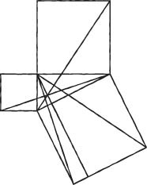

「배에 그려 넣기엔 꽤 이상한 거네요,」 내가 말했다. 도식이 어디에 위치하는지 감을 잡고 싶어 잠시 다시 축소했다. 그것은 이십면체의 한 면 중앙에 있었고, 우리가 뱃머리라고 알아본 면에 인접해 있으며, 그 바로 뒤였다. 배의 껍질이 자갈로 만들어져 어떤 기제에 붙들려 있다면, 이 도식은 더 어두운 자갈을 골라 정성 들여 제자리에 박아 넣어, 그 면에 모자이크처럼 만들어진 거였다. 그들은 그것에 많은 공을 들였다.

「그들의 문장이에요,」 내가 말했다. 그냥 추측이었다. 그러나 아무도 그 생각에 반대하지 않았다. 나는 다시 확대해, 선들의 그물망을 한동안 살펴보았다. 그것은 분명 증명이었다——거의 틀림없이 아드라코네스 정리의. 피드들이 연습으로 늘 푸는 종류의 문제였다. 마치 분필 강의실에 앉아 제스리보다 빨리 답을 찾으려는 것처럼, 나는 그것을 삼각형으로 분해하고, 직각과 증명의 기준이 될 만한 다른 특징을 찾기 시작했다. 오리테나 전당의 피드라면 벌써 풀어냈을 거다. 하지만 나의 평면기하 감각은 좀 녹슬어 있었다——

*잠깐만!* 내 마음의 어느 부분이 말했다.

나는 담요 아래에서 고개를 내밀었다. 이번에는 코드의 눈을 멀게 하지 않도록 조심하며.

「이건 그냥 소름 돋아요,」 내가 말했다.

「리오가 똑같은 말을 했어요!」 로스크가 뒤에서 외쳤다.

「왜 너희는 다들 그걸 소름 돋는다고 해?」 코드가 알고 싶어 했다.

「자주 쓰이는 플루키시어 단어 *creepy*의 정의를 제공해 주시오,」 프라아 자드가 말했다.

나는 천년제에게 그것을 설명하려 했지만, 원시적 감정 상태는 오르스어가 잘 다루는 영역이 아니었다.

「신성함에 대한 직관,」 프라아 자드가 조심스레 말했다. 「공포와 결합된.」

「*공포*는 너무 센 말이지만, 거의 맞아요.」

이제 나는 코드의 질문에 답해야 했다. 몇 번 말을 잘못 시작했다. 그리고 사만이 나를 지켜보는 걸 보고 떠올렸다. 「여기 사만은 정보의 전문가예요. 그에게 의사소통이란 일련의 문자들을 전달하는 거죠.」

「이 충격 흡수 장치에 적힌 글자들처럼요?」 코드가 물었다.

「정확히,」 내가 말했다. 「하지만 사촌들은 다른 글자를 쓰고 다른 언어를 쓰니, 그들의 메시지는 우리에게 비밀 암호로 쓰인 것처럼 보일 거예요. 해독하고 우리 언어로 옮겨야 하죠. 대신 사촌들은 여기서——여기서——」

「언어를 우회하려고,」 사만이 내 더듬거림에 짜증을 내며 말했다.

「정확히! 그리고 대신 그들은 이 그림으로 곧바로 갔어요.」

「그들이 우리가 보라고 그것을 거기 두었다고 생각해?」 코드가 물었다.

「그렇게 안 하면, 왜 배 *바깥에* 무언가를 올려 놓는 수고를 하겠어요? 그들은 우리가 알아볼 거라는 걸 알고 있는 무언가로 자기를 표시하고 싶었던 거예요. 그리고 *그것*이 소름 돋는 이유예요——그들이 미리 우리가 그것을 이해할 거라는 걸 그냥 *알고 있었다*는 사실이.」

「나는 이해 못 하는데,」 코드가 항의했다.

「아직요. 하지만 그것이 무엇인지는 알아요. 그리고 우리가 외계 언어를 해독하는 것보다 훨씬 빨리 당신에게 이해시킬 수 있어요. 내가 보기엔 프라아 자드가 이미 풀어낸 것 같네요.」 내 눈이, 그의 무릎에 있는 잎 하나에 떨어졌다. 도식이 베껴져 있었고, 증명의 논리를 따라가며 그가 덧붙인 표시와 메모가 있었다.

*논리. 증명.* 사촌들은 그것을 가졌다——우리와 공유했다.

콘센트에서 사는 우리와, 말이다.

*핵무기를 가진 아부트!*

폭탄으로 움직이는 콘센트를 타고 별계에서 별계로 떠돌며, 행성에 묶인 동포들과 접촉하는——

「정신 차려, 라즈!」 내가 나에게 말했다.

「그래요,」 내 얼굴을 지켜보고 있던 프라아 자드가 말했다. 「부디.」

「그들이 왔어요. 사촌들이. 그리고 세속 권력이 레이더로 그들을 잡았죠. 추적했고. 걱정했고. 사진을 찍었고. 이것을 보았어요.」 나는 프라아 자드 무릎의 증명을 가리켰다. 「아부트의 것이라고 알아보았죠. 걱정했고. 배가——어떻게든——적어도 한 프라아, 오롤로에게 발견되었다는 걸 알아냈어요.」

「내가 그에게 말했지,」 사만이 말했다.

*「뭐?」*

사만은 불편해 보였다. 그러나 내가 모든 걸 너무 크게 잘못 이해했기에, 그는 참지 못하고 나를 바로잡아야 했다. 「세속 권력으로부터 통신이 우리에게 왔습니다,」 그가 말했다.

「우리란 이타들을 말하는 거죠?」

「3차 레티큘럼.」

「예?」

「신경 쓰지 마세요. 우리는 위계관들을 우회해, 콘센트의 최고 천문학자에게 가서, 이 물건에 관해 알리라는 지시를 받았습니다.」

「그리고 그다음은?」

「추가 지시는 없었습니다,」 사만이 말했다.

「그래서 당신이 오롤로를 골랐군요.」

사만이 어깨를 으쓱했다. 「어느 밤, 그가 혼자 포도나무에 욕을 하고 있을 때 그의 포도원에 가서, 이걸 말했지——정기 메일 프로토콜 트래픽 기록을 검토하다 우연히 발견했다고.」

나는 그의 이타 전문 용어를 한 마디도 이해하지 못했지만, 요지는 알았다. 「그럼 세속 권력의 지시 일부가, 이것이 당신 혼자 한 일처럼 보이게 만드는 거였군요——」

「그래서 나중에 단속할 때, 그들이 아무 관련이 없었다고 부인할 수 있게요,」 사만이 말했다.

「그들이 그렇게 미리 계산했을 거라고는 의심스럽네,」 프라아 자드가 완화된 목소리로 끼어들었다. 사만과 내가 달아올라 음모론적으로 변했기 때문이다. 「갈퀴를 꺼내자,」 자드가 계속했다. 「세속 권력에는 레이더가 있었지만 사진은 없었다. 사진을 얻으려면 망원경과, 그것을 다룰 줄 아는 사람들이 필요했다. 그들은 위계관들을 끌어들이고 싶지 않았다. 그래서 사만이 방금 설명한 전략을 짜 낸 거다. 그것은 가능한 한 빠르고 조용히, 그 물건의 사진을 몇 장 얻는 수단이었을 뿐이다. 그러나 사진을 *얻고* 나자, 그들은 이것을 보았다.」 그는 무릎의 증명에 손바닥을 얹었다.

「그리고 자신들이 큰 실수를 저질렀다는 걸 깨달았죠,」 내가 전보다 훨씬 차분한 목소리로 말했다. 「그들은 사촌들의 존재와 본질을, 세상에서 가장 듣고 싶어 하지 않을 사람들에게 누설한 거예요.」

「그래서 별의 고리 폐쇄와 오롤로에게 일어난 일이 있었고,」 사만이 말했다. 「그래서 내가 이 페치에 있지. 그들이 *나*에게 무엇을 하려 할지 전혀 모르니까.」

지금까지 나는 사만이 이 여정에 갈 허락을 받았다고 여겨 왔다. 그것이 생각보다 복잡하다는 걸 처음 알게 된 참이었다. 이타가 곤경에 처할까 두려워하는 말을 하는 걸 듣는 게 이상했다. 늘 우리가 *그들의* 교묘한 수——오롤로를 덫에 걸게 한 것 같은——을 걱정했으니까. 그러나 내 관점이 휘돌아, 그의 방식으로 보게 되었다. 바로 사람들이 이타에 관해 그런 식으로 믿고 있었기에, 이 일들이 모두 드러난다면, 사만의 이야기를 믿거나 그를 옹호할 이는 아무도 없을 거였다.

「그럼 당신이 이 판 사본을 만들어 간직한 건——」

「*무언가*를,」 그가 말했다. 「지렛대가 될 만한 것을.」

「그리고 클레스티라의 눈에 당신 모습을 보였어요. 부인 가능한 방식으로, 당신이 무언가를 알고 있다——정보를 갖고 있다고 알리면서.」

「광고,」 사만이 말했다. 그의 얼굴 모양이 변했다. 수염 위로 수염이 움직였다——미소를 암시하는 그의 방식이었다.

「음, 먹혔어요,」 내가 말했다. 「지금 여기, 어디로 가는지도 모르는 길에서, 데올라터 떼에게 실려 가고 있잖아요.」

코드는 오르스어 듣기가 지루해지자 페치 앞으로 옮겨 로스크와 앉았다. 불쌍했지만——어떤 것들은 플루키시어로 거의 말할 수 없었다.

나는 핵폐기물에 관해 프라아 자드에게 물어보고 싶어 죽겠었지만, 사만이 듣고 있는데 그 주제를 꺼내기는 꺼려졌다. 그래서 사촌 배의 증명을 내가 직접 베껴 풀기 시작했다. 얼마 안 되어 막혔다. 코드와 로스크가 페치 음향 장치로 음악을 틀기 시작했다. 처음에는 작게, 아무도 이의하지 않자 더 크게. 그것은 프라아 자드가 대중음악을 처음 들은 순간임에 틀림없었다. 나는 내장 부상을 입을 만큼 움찔했다. 그러나 천년제는 그 다이나글라이드 윤활 스트립을 받아들였듯, 그것도 담담히 받아들였다. 나는 증명 풀기를 포기하고, 그냥 창밖을 보며 음악을 들었다. 성 밖 문화에 대한 나의 모든 편견에도 불구하고, 그 노래들에서 아름다움의 순간들을 계속 마주치며 놀랐다. 대부분은 금방 잊히지만, 열에 하나쯤은, 그것을 만든 이가 어떤 통찰——순간적으로 알아차림——을 이룰 만한 전환이나 억양을 품고 있었다. 나는 그것이 대표적 표본인지, 아니면 코드가 아름다움이 담긴 노래를 찾아 자기 지지에 그것만 넣는 재주가 유난히 뛰어난지 궁금했다.

음악, 오후의 더위, 페치의 흔들림, 수면 부족, 콘센트를 떠난 충격——이 모든 것이 동시에 작용하니, 증명을 풀지 못한 게 이상할 게 아니었다. 그러나 날이 기울고 해가 점점 더 수평으로 들어오고, 죽어 가는 마을과 무너진 관개 시설이 점점 드물어지며, 풍경이 돌무덤으로 얼룩된 고원 사막으로 정화되어 가자, 나는 다른 무언가가 나에게 작용하고 있다고 생각하기 시작했다.

나는 오롤로가 죽은 것에 익숙했다. 문자 그대로 죽어 묻힌 것이 아니라, 나에게 죽은 것이었다. 아나템이 하는 일이 그것이었다——몸을 다치게 하지 않고 아부트를 죽인다. 이제 몇 시간밖에 안 되는 시간 동안 그 생각에 익숙해지려고 하는데, 나는 곧 오롤로를 다시 보게 될 거였다. 우리가 아는 한, 언제든지 우리가 그가 외진 바위 봉우리 하나를 올라 밤 관측을 준비하는 걸 볼지도 몰랐다. 혹은 상트 블라이의 간을 먹은 슬라인들의 후손이 쌓은 돌무덤 아래에 그의 여윈 시체가 기다리고 있을지도 몰랐다. 어느 쪽이든, 그런 것과 언제 마주할지 모르는 상황에서 다른 생각을 하는 건 불가능했다.

코드의 얼굴이 내게 비쳤다. 그녀가 조작 장치를 찾아 음악을 낮추고, 무언가를 되풀이 했다. 나는 일종의 트랜스에 빠져 있었고, 움직임으로 그것을 깼다.

「퍼먼이 지지로 연락했어요,」 그녀가 설명했다. 「멈추고 싶대요. 용변이랑 회의.」

둘 다 내게는 좋았다. 우리는 굽은 오르막의 넓은 곳에 차를 세웠다. 앞으로 삼십 분에 걸쳐 평탄한 바닥의 계곡——지평선까지 이어지는——으로 내려갈 내리막의 삼 분의 일 지점이었다. 그것은 습하고 푸른 종류의 계곡이 아니었다. 마른 개울들이 죽으러 가고, 급류 홍수가 누운 황무지에 분노를 쏟는, 땅의 실패였다. 갈색 현무암의 첨탑과 울타리가 키보다 훨씬 긴 그림자를 던졌다. 이십에서 삼십 마일쯤 떨어진 곳에 외딴 산 두 개가 솟아 있었다. 우리는 카르타블라에 모여, 그것들이 앞서 골라 둔 세 후보 중 두 개라고 확신했다. 세 번째는——음, 우리는 막 그 산을 지나돌아 지금 그 아래 경사면을 긁고 있는 참이었다.

퍼먼이 리더로서의 나와 이야기하고 싶어 했다. 나는 빠져 있던 거의 혼수 상태의 마지막 잔여물을 떨쳐 내고, 몸을 곧게 펴았다.

「당신들은 신을 안 믿는 줄 알지만,」 그가 시작했다. 「당신들의 삶 방식을 보면, 글쎄, 당신들이……더 편하게 지낼 곳에 머무는 게 좋을 거라고 생각했는데——」

「바즈 수도사들이요?」 내가 조심스레 말했다.

「그래, 정확히,」 그가 말했다. 내가 그것을 안다는 데 그는 약간 놀랐다. 그것은 운 좋은 추측이었다. 앞서 사만이 퍼먼이 '바즈 시설'과 이야기하고 있다고 언급했을 때, 나는 성당이나 어쨌든 화려한 것을 상상했었다. 그러나 그것은 풍경을 보기 전이었다.

「수도원이 저 산 중 하나에요?」 내가 말했다.

「가까운 쪽. 중쯤, 북쪽 비탈에 보일 거요.」

퍼먼의 몇 가지 힌트로, 나는 산 비탈의 틈——짙은 초록의 초승달 아래 보호받는 일종의 자연 테라스——를 볼 수 있었다. 나무들이라고 짐작했다.

「나는 거기 피정을 하러 가 본 적이 있어,」 퍼먼이 말했다. 「아이들을 여름마다 보냈었지.」

피정이라는 개념은, 그것이 내 평생의 삶 방식이라는 걸 깨달을 때까지 이해가 되지 않았다.

퍼먼은 내 침묵을 오해했다. 그는 나를 향해 돌아서서, 손바닥을 보이며 손을 들었다. 「불편하시다면, 물과 음식과 침구 같은 건 충분히 있으니 원하는 어디에서든 야영할 수 있다고 말해 주지. 하지만 생각은——」

「이치에 맞아요,」 내가 말했다. 「여자들을 받아 준다면요.」

「수도사들은 자기 클로이스터가 따로 있어요. 캠프와 분리된. 하지만 소녀들은 늘 캠프에 있지——거기 여자 스태프가 있어.」

길은 길었다. 해가 지고 있었다. 나는 피곤했다. 나는 어깨를 으쓱했다. 「다른 데라도, 상트 트레데가르에 도착했을 때 들려줄 재미있는 이야기 하나쯤은 생기겠죠.」

리오와 아르시발트가 곁에서 서성거리고 있었다. 퍼먼 벨러가 걸어가기 시작하자마자 그들은 나에게 달려들었다. 둘 다 바브와 몇 시간 갇혀 지낸 사람들 특유의, 약간 긴장하고 닳아진 표정이었다. 「프라아 에라스마스,」 아르시발트가 말을 시작했다. 「현실적으로 봅시다. 이 풍경을 보세요! 누가 여기서 혼자 살 수 있겠어요? 음식, 물, 의료는 어떻게 구하죠?」

「저 산 한 곳에 나무가 자라고 있어요,」 내가 말했다. 「그건 민물이 있을 거란 뜻이죠. 퍼먼 같은 사람들이 아이들을 여름 캠프로 보내는데——얼마나 나쁘겠어요?」

「오아시스네!」 리오가 그 이국적인 단어를 신나게 꺼내며 말했다.

「그래. 가까운 언덕에 수도원과 여름 캠프가 들어갈 만한 오아시스가 있다면, 먼 언덕에는 블라이 에스테마드 오롤로 같은 페랄들이 그늘에서 살고 샘물을 마실 만한 곳이 왜 없겠어요?」

「그건 음식 문제를 해결하지 못하는데,」 아르시발트가 지적했다.

「음, 내가 머릿속에 품고 있던 그림보다는 나아졌어요,」 내가 말했다. 나머지에게 설명할 필요는 없었다. 그들도 같은 그림을 품고 있었으니까: 산꼭대기에서 살며 이끼를 먹는 절망적인 이들.

「바즈 수도사들이 어떻게 하는지, 방법이 분명히 있을 거예요,」 내가 계속했다.

「그들은 더 큰 공동체고, 자선으로 유지돼요,」 아르시발트가 말했다.

「오롤로가 에스테마드가 몇 년간 블라이의 언덕에서 편지를 보내 왔다고 내게 말했어요. 상트 블라이도 한동안 거기서 살았고——」

「슬라인들이 그를 숭배했기 때문이지,」 리오가 지적했다.

「음, 그럼 오롤로에게 절하는 슬라인 무리를 발견하게 될지도 몰라요. 어떻게 되는지 모르겠어요. 관광 산업이 있을지도 모르고요.」

「농담이에요?」 아르시발트가 물었다.

「우리가 멈춘 이 도로의 넓은 곳을 보세요,」 내가 말했다.

「그게 왜요?」

「왜 여기 있다고 생각해요?」

「전혀 모르겠어요. 나는 프락식이 아니니까,」 아르시발트가 말했다.

「차량들이 서로 더 쉽게 지나가게 하려고요?」 리오가 추측했다.

나는 팔을 내밀어 그들의 주의를 풍경으로 돌렸다. 「그 때문이에요.」

「뭐요? 아름다워서요?」

「그래요.」 그리고 나는 아르시발트에게서 등을 돌려 리오를 보았다. 그는 걸어가기 시작했다. 나는 그 옆에 붙었다. 아르시발트는 풍경을 살펴보려고 뒤에 남았는데, 오래 쳐다보면 내 논리의 흠을 찾아낼 수 있을 거라고 생각하는 듯했다.

「이십면체를 볼 기회가 있었어요?」 리오가 내게 물었다. 「그래. 그리고 증명——기하도 봤어.」

「당신은 이 사람들이 우리 같다고 생각하죠. 우리 어머니 힐라이아의 추종자라는 우리의 관점에 공감할 거라고,」 그가 그 표현들을 나에게 맞춰 보며 말했다.

나는 이미 방어적이었다——측면 기동을 감지했기 때문이다. 「음, 그들이 아드라코네스 정리를 자기 문장으로 만든 건 분명 *무언가*를 노린 거라고 생각하는데……」

「배에 무기가 잔뜩 있어,」 그가 말했다.

「당연하죠!」

그는 이미 고개를 저었다. 「추진 폭약을 말하는 게 아니야. 그건 무기로서는 거의 쓸모없지. 나는 그 배의 다른 것들——찾아보면 분명해지는 것들——을 말하는 거야.」

「내가 보기엔 무기처럼 생긴 건 하나도 없었어요.」

「일 마일짜리 충격 흡수 장치에 장비를 얼마든지 숨길 수 있고,」 그가 지적했다. 「그 자갈 밑에 뭐가 숨어 있는지 누가 알아.」

「예를 들어 줄 수 있어요?」

「그 면들에 규칙적으로 간격을 둔 특징들이 있어. 안테나라고 생각해.」

「그래서요? 안테나가 당연히 있겠죠.」

「위상 배열이야,」 그가 말했다. 「군사용이야. 엑스레이 레이저나 고속 충격기를 겨냥할 때 딱 원하는 거지. 더 알려면 책을 찾아봐야 할 것 같아. 또, 뱃머리에 행성들이 줄지어 있는 게 마음에 안 들어.」

「뭐라는 거예요?」

「앞쪽 충격 장치에 원 네 개가 줄지어 그려져 있어. 행성들을 묘사한 것 같아. 프락식 시대 군용 비행기들처럼.」

나는 그 말뜻을 정리하는 데 몇 순간 걸렸다. 「잠깐, 그게 격추 표시라고 생각하는 거예요?」

리오가 어깨를 으쓱했다.

「음, 잠깐만요!」 내가 말했다. 「좀 더 무해한 것일 수도 있잖아요. 사촌들의 고향 행성들일지도 모르고요.」

「모두가 행복하고 위안이 되는 해석을 찾기에 너무 급한 것 같아서——」

「그리고 수비감독관이 될 당신의 역할은, 그보다 훨씬 경계하는 거죠,」 내가 말했다. 「잘 하고 있어요.」

「고마워.」

우리는 한동안 말없이, 그 넓은 곳의 이쪽저쪽을 거닐다가, 잠깐 운동을 하려는 다른 이들을 때때로 지나쳤다. 프라아 자드를 우연히 만났다. 그는 혼자 걷고 있었다. 지금이라고 결심했다.

「프라아 리오,」 내가 말했다. 「프라아 자드가 나에게, 상트 에드하르의 천년제 마스가 세속 권력이 재구성 무렵 핵폐기물을 모두 저장해 둔 세 곳 중 하나라고 알려 줬어요. 나머지 둘은 람발과 트레데가르죠. 둘 다 지난밤 사촌 배의 레이저에 비춰졌어요.」

리오는 내가 바란 것만큼 놀라지 않았다. 「수비감독관 부류들 사이에는, 불가침지 세 곳이 어떤 이유로 약탈당하지 않고 남아 있었다는 의심이 있어. 한 가설은, 그곳이 올킬러랑 프락식 시대의 다른 위험한 잔여물들을 버리는 장소라는 거지.」

「제발, 내 고향을 말하는 거요. 쓰레기장이라고 하지 마요,」 프라아 자드가 말했다. 그러나 그는 놀라지 않고——즐거워하고 있었다. 천년제치고는——내가 그렇게 말할 수 있다면——장난기 있어 보였다.

「그 물건을 봤어요?」 리오가 물었다.

「오, 그래. 원통에 담겨 암벽 속 동굴에 있지. 매일 보아.」

「왜요?」

「여러 이유가 있지. 이를테면, 내 취미는 지붕 이엉 덮기다.」

「그 단어를 모르겠어요,」 내가 말했다.

「옛 직업이다. 풀로 지붕을 만드는 이.」

「핵폐기물 저장고에 그런 게 무슨 쓸모가 있죠?」

「동굴 천장에 응축수가 맺혀 원통 위로 떨어진다. 수천 년에 걸쳐 그것을 부식시키거나——똑같이 나쁜 건——무게로 용기를 짓눌러 터뜨리는 석순을 만들 수 있다. 우리는 언제나 원통 위에 초가 지붕을 덮어 그것을 막아 왔다.」

그 모든 게 너무 이상해서, 나는 할 수 있는 일이라고는 예의 있는 잡담을 계속하는 것뿐이었다. 「아, 알겠어요. 풀은 어디서 구해요? 거기선 풀 키울 자리가 많지 않죠?」

「많이 필요 없어. 제대로 만든 이엉은 오래 가니까. 내 피드였던 수르 아브라달레가 백 년 전에 설치한 것들을 아직 다 갈아 내지 못했어.」

리오와 나는 그 말이 우리에게 닿기 전까지 몇 걸음 더 걸었다. 그리고 서로 눈을 맞추고, 아무 말도 하지 않기로 묵시적으로 합의했다.

「그가 우리를 놀린 거예요,」 피정소에서, 우리가 함께 쓸 방에 배낭을 내려놓고 있을 때, 리오와 내가 단둘이 말할 수 있게 된 그다음 기회에 내가 말했다. 「자기 마스를 쓰레기장이라 부른 것에 대해 우리에게 되갚은 거예요.」

리오는 아무 말도 하지 않았다.

「리오! 그가 그렇게 나이가 많진 않아요!」

리오는 배낭을 내려놓고, 내가 할 수 있는 것보다 더 곧게 서더니, 어깨를 아래뒤로 돌렸다. 균형을 되찾는 방식이었다. 마치 더 좋은 자세만으로 상대를 이길 수 있는 듯. 「그가 얼마나 나이가 많은지는 신경 쓰지 말자.」

「당신은 그가 그렇게 나이가 많다고 생각해요.」

「신경 쓰지 말자고 했어.」

「걱정할 필요는 없다고 생각하지 않아요. 하지만 알면 *흥미롭겠죠.*」

「흥미로워?」 리오가 어깨 동작을 다시 했다. 「보자. 우리 둘 다 불시트를 말하고 있는 거야, 동의해?」

「그래, 동의해,」 내가 즉시 말했다.

「그만하자. 똑바로 말해야 해——그리고 화형당하고 싶지 않으면 입 다물어야 해.」

「좋아요. 당신은 수비감독관 관점에서 보는 거죠. 내가 당신 말을 받아들일게요.」

「좋아. 그러면 이제 우리 둘 다 지금 *진짜* 무슨 얘기를 하는지 알아.」

「당신은 세포 핵의 서열을 복구하지 않고는 그렇게 오래 살 수 없다는 거죠,」 내가 말했다.

「*특히* 방사선 곁에서 일하면,」 리오가 말했다.

「그건 생각 못 했네요.」 나는 잠시 곰곰이 생각하며 자드와의 앞선 대화를 되풀이했다. 「그가 어떻게 그런 실수를 했지? 자기가——음——자기 세포를 복구할 수 있는 부류의 인물이라는 걸 암시하는 것조차 얼마나 위험한지 알 텐데.」

「농담이야? 실수가 아니야. 일부러였어, 라즈.」

「그가 우리에게 알려 준 거죠——」

「자기 목숨을 우리에게 맡긴 거야,」 리오가 말했다. 「오늘 그가 모두를 재고 있는 걸 못 봤어? 우리를 *골랐어*, 내 프라야.」

「와! 그게 정말이라면 영광이네요.」

「그 영광을 즐길 수 있을 때 즐겨,」 리오가 말했다. 「그런 영광에는 의무가 따르니까.」

「어떤 의무요?」

「내가 어떻게 알아? 그냥, 그가 이유가 있어서 소환됐다는 말이야. 그가 무언가를 *해야* 해. 전략을 짜기 시작하고 있어. 그리고 우리는 그 전략의 일부야. 병사들. 졸 개들.」

그 말에 나는 한동안 입을 다물었다. 제대로 생각할 수가 없었다.

그리고서, 어떤 식으로든 일을 더 쉽게 만들어 준 무언가를 떠올렸다.

「우리는 어차피 이미 졸 개였어요,」 내가 말했다.

「그래. 그리고 선택권이 있다면, 내 눈에 보이는 누군가의 졸 개인 편이 낫지,」 리오가 말했다. 그리고 그는 지난밤 이후 처음으로 옛날의 리오식 미소를 지었다. 그는 내가 본 적 없는 만큼 진지해져 있었다. 그러나 그 배에 줄지어 있는 격추 표시——그것이 맞다면——를 본 것이, 그에게 진지할 거리를 잔뜩 준 거였다.

우리 아부트는, 비단 예복을 입고 향로 연기에 싸여 거니는 바즈 주교들과 달리, 겸손하고 검소하게 산다고 스스로에게 말하곤 했다. 하지만 적어도 우리 건물은 돌로 지어져 있어 유지 보수가 많이 필요하지 않았다. 이곳은 전부 나무였다. 비탈 더 위에는 작은 방주와, 샘을 중심으로 클로이스터를 이루는 병영의 고리가 있었다. 도로 쪽 아래에는 이층 침대가 있는 감방 두 줄과, 식당과 몇 개의 회의실이 있는 큰 건물이 있었다. 건물들은 잘 관리되어 있었지만, 끊임없이 썩어 가고 있고, 사람들이 떠난다면 수십 년 안에 이곳은 땔감 더미가 될 거라는 게 분명했다.

수도사들이 어떻게 사는지는 볼 기회가 없었다. 우리가 묵은 감방은 깨끗했지만, 여름에 버스로 몰려오는 아이들이 벽과 이층 침대에 긁어 놓은 낙서로 덮여 있었다. 우리가 도착했을 때 아이들이 없었던 건 그냥 운이 좋았을 뿐이었다. 한 무리는 이틀 전에 떠났고, 다른 무리가 곧 올 예정이었다. 이곳을 운영하는 여섯 명쯤 되는 젊은이들 중 넷은 방학 기간 동안 마을로 돌아갔다. 남은 두 명과, 피정소를 맡고 있는 바즈 사제가 우리에게 간단한 식사를 준비해 주었다. 우리는 배낭을 감방에 두고 공용 욕실에서 몇 분 씻은 뒤, 식당에 모여 아페르트 때 쓰는 것과 아주 닮은 접이식 탁자들을 늘어놓고 앉았다. 그곳은 미술 용품 냄새가 났다.

수도사들은 마흔세 명이라고 들었는데, 지부를 백 명 단위로 세는 우리 아부트에게는 적은 수처럼 느껴졌다. 그중 네 명이 내려와 함께 식사했다. 그들이 위계관 같은 특별한 지위인지, 아니면 마흔세 명 중 우리에게 호기심이 있는 유일한 이들인지는 분명하지 않았다. 모두 회색 수염이었고, 모두 프라아 자드를 만나고 싶어 했다. 바즈 정교회 성직자의 오르스어는 우리가 쓰는 것과 대략 칠십 퍼센트 같았다.

리오와 내가 방금 나눈 대화를 생각하면, 우리가 프라아 자드 옆에 앉고 싶었을 거라 생각할지 모르지만, 실제로는 정반대였다. 우리는 최대한 그에게서 멀리 떨어져 앉았는데, 스필리 속 비밀 요원들이 신분을 유지하려고 일부러 태연한 척하는 것 같았다. 마지막 순간 아르시발트가 백년제 몇 명과 함께 급히 들어왔다. 그들은 오두막 하나에서 칼카를 하고 있었던 것이다. 그의 눈은 야생 같았고, 이야기하고 싶어 안달이었다. 그는 늦은 시간까지 사진기억 판을 볼 수 없었던 참이었다. 이제 그는 사촌 배에 새겨진 기하 증명을 보았고, 곧 폭발할 것 같았다. 그가 식당에 들어와, 나와 리오 옆에 앉을지, 프라아 자드와 바즈 수도사들 옆에 앉을지 선택해야 하는 걸 보니 불쌍했다. 퍼먼 벨러가 그의 망설임을 알아차리고 일어나 그를 불렀다. 아르시발트는 실례가 될까 봐 초대를 거절할 수 없었고, 가서 퍼먼 옆에 앉았다.

우리는 늘 상트 카르타스의 기억을 떠올리는 것으로 식사를 시작했다. 요지는, 우리 마음은 크노우스까지 거슬러 올라가는 사상가들의 온갖 생각으로 자양분을 얻지만, 몸의 양분은 서로에 의지하며, 우리가 카르타스에게 빚진 규율 안에서 결합해 얻는다는 것이었다. 반면 데올라터들은 저마다 다른 식전 의례를 가졌다. 바즈 정교회는 농경 이후의 종교로, 문자 그대로의 희생은 상징적으로 대체되었고, 그들은 식사를 '모형을 통한 재연'으로 시작한 뒤, 신을 한동안 찬양하고, 다음에 그에게 물건과 서비스를 구했다. 피정소를 운영하는 사제는 습관적으로 그 의례를 시작했지만, 아부트들이 고개를 숙이지 않고 그를 호기심으로 쳐다보는 걸 알아차리고 중간에 당황했다. 나는 그가 우리가 자기가 믿는 것을 믿지 않는다고 그렇게 크게 괴로워하지는 않았을 거라 생각했다. 그 정도는 익숙했을 게 틀림없다. 그가 더 부끄러워한 것은 실수를 저질렀다는 사실이었다. 그래서 의례를 마치고, 마스에서 전통적으로 쓰이는 축문이나 기도를 해 달라고 우리에게 부탁했다. 앞서 말했듯 우리는 소프라노와 알토가 이상하게 부족했지만, 테너와 바리톤, 베이스는 충분히 모아 아주 오래되고 단순한 카르타스 기도를 부를 수 있었다. 프라아 자드가 드론을 맡았고, 나는 그가 탁자 위의 은식기를 윙윙거리게 했다고 맹세할 수 있다.

네 수도사는 그것을 매우 즐기는 듯했고, 우리가 끝내자 그들도 똑같이 고풍스러운 기도를 드리려고 일어섰다. 그것은 바즈 몰락 직후인 그들의 수도원 시대 초기 세기로 거슬러 올라갈 게 틀림없었다. 그들의 고 오르스어는 우리 것과 구별할 수 없었고, 분명 마스들과 수도원들의 음악이 갈라지기 전 시대에 작곡된 것이었다. 가사를 너무 자세히 듣지 않는다면, 그 곡을 우리 것 중 하나로 착각하기 쉬웠다.

지난 이십사 시간의 사건들에 비하면, 식사 중 대화는 피상적일 수밖에 없었다. 플루키시어로 이야기해야 했고, 주인들이 듣는 곳에서는 배 이야기를 꺼낼 수 없었기 때문이다. 나는 답답해졌고, 이어 지루해졌고, 이어 졸려졌고, 대체로 말없이 먹었다. 코드와 로스크는 서로 이야기했다. 그들은 종교를 갖지 않았고, 나는 그들이 여기서 어색해하는 걸 알 수 있었다. 직원 중 한 젊은 여자가 그들을 환영하려고 온갖 정성을 쏟았지만, 대부분 역효과가 났다. 사만은 자기 지지에 몰두해 있었는데, 어떻게든 그것을 피정소 통신 시스템에 연결해 놓았다. 바브는 캠프 규칙 목록을 찾아내 그것을 외우고 있었다. 우리 백년제 세 명은 무리를 지어 앉아 그들끼리 이야기했다. 그들은 플루키시어를 못 했고, 프라아 자드를 바즈 수도사들의 관심 중심으로 만들었던 천년제의 매력도 없었다. 나는 아르시발트가 퍼먼과 깊은 대화를 나누고 있고, 코드와 로스크가 그쪽으로 더 가까이 옮겨 앉은 걸 알아차리고, 무슨 이야기인지 보러 갔다. 퍼먼은 스코닉 주제에 관해 생각하고 있었고, 더 알고 싶어 하는 것 같았다. 아르시발트는 다른 방법으로 시간을 보낼 방도가 없어, 피드들에게 스코닉의 시간과 공간 이론을 설명하는 전통적인 방식인 『파리, 박쥐, 벌레』라는 칼카를 시작했다. 「탁자 위를 기어가는 저 파리를 봐,」 아르시발트가 말했다. 「아니, 쫓아내지 말고. 그냥 봐. 눈 크기를 봐.」

퍼먼 벨러는 그것을 얼른 힐끗 보고는 다시 자기 저녁 식사로 눈을 돌렸다. 「그래, 몸 절반이 눈 같은데.」

「사실은 수천 개의 별개 눈이야. 그게 어떻게 작동한다고 생각해?」 아르시발트가 뒤로 손을 뻗어 휘저었다. 내 얼굴을 때릴 뻔했다. 「그런데 내가 이렇게 멀리서 손을 휘저으면, 그것은 신경 쓰지 않아——위협이 없다는 걸 알지. 하지만 손을 가까이 가져가면……」

아르시발트가 손을 앞으로 가져왔다. 파리가 날아갔다.

「……어떻게 그 미세한 뇌가 수천 개의 별개이고 원시적인 눈에서 신호를 받아, 단순히 공간이 아니라 시공간에 대한 올바른 그림으로 통합하는 거지? 내 손이 어디 있는지 알아. 내 손이 이렇게 계속 움직이면 곧 깔아뭉갤 거라는 걸 알아——그래서 위치를 바꾸는 게 낫지.」

「사촌들에게 그런 눈이 있다고 생각해?」 벨러가 물었다.

아르시발트는 옆으로 피했다. 「아니면 박쥐 같은지도 몰라. 박쥐는 메아리를 들어 내 손을 탐지했겠지.」

벨러가 어깨를 으쓱했다. 「좋아. 사촌들이 박쥐처럼 소리를 낸다고 치자.」

「반대로, 내가 몸을 움직여 파리를 치려 하면, 탁자에 진동 무늬가 생기는데, 벌레——귀도 눈도 없는 벌레라도——그것을 느낄 수 있겠지……」

「이 얘기가 어디로 가는 건가?」 벨러가 물었다.

「사고 실험을 해 보자,」 아르시발트가 말했다. 「프로타스의 파리를 생각해 봐. 순수하고 이상적인 파리를 말하는 거야.」

「무슨 뜻이야?」

「눈뿐. 다른 감각 기관은 없어.」

「좋아, 생각하고 있어,」 벨러가 유쾌해 보이려 애쓰며 말했다.

「이제 프로타스의 박쥐.」

「귀뿐이야?」

「그래. 이제 프로타스의 벌레.」

「촉각뿐이라는 거야?」

「그래. 눈도 귀도 코도 없——피부뿐이야.」

「오감 전부 다 할 거야?」

「그러면 지루해지기 시작하니까 셋으로 하자,」 아르시발트가 말했다. 「파리와 박쥐와 벌레를, 어떤 물건——촛불이라고 하자——가 있는 방에 둬. 파리는 그 빛을 본다. 박쥐는 소리를 내고 메아리를 듣는다. 벌레는 따뜻함을 느끼고, 그 위를 기어가 모양을 알아낸다.」

「장님 여섯 명과 코끼리의 옛 우화 같은데——」

「아니!」 아르시발트가 말했다. 「그건 완전히 달라. 거의 *반대*야. 장님 여섯 명은 같은 감각 기구를 갖고 있잖아——」

벨러가 자기 실수를 깨닫고 고개를 끄덕였다. 「그래, 하지만 파리와 박쥐와 벌레는 서로 다른 기구를 가지지.」

「장님 여섯 명은 자기들이 더듬는 것이 무엇인지 의견이 갈리는데——」

「반면 파리와 박쥐와 벌레는 동의한다는 거야?」 벨러가 눈썹을 올리며 물었다.

「회의적인 투구나. 당연하지. 하지만 그들은 모두 같은 물건을 감지하고 있는 거 아닌가?」

「물론이지,」 벨러가 말했다. 「하지만 네가 그들이 서로 동의한다고 말할 때, 그게 무슨 뜻인지 모르겠어.」

「매혹적인 질문이야. 파고들자. 규칙을 조금 바꾸자,」 아르시발트가 말했다. 「판을 좀 더 높이려고. 그들이 *반드시* 동의하게 만들어 보자. 방 가운데 있는 것은 촛불이 아니다. 이제, 그것은 함정이다.」

「함정!?」 벨러가 웃었다.

아르시발트가 자랑스러운 표정을 지었다.

「그게 무슨 소용이지?」 벨러가 물었다.

「이제 위협이 생겼어, 알겠지. 그들은 그것이 무엇인지 알아내야 해. 안 그러면 잡힐 거야.」

「왜 내려오는 손이 아닌 거야?」

「그 생각은 했어,」 아르시발트가 인정했다. 「하지만 불쌍한 벌레를 배려해야 해. 벌레는 다른 둘에 비해 사물을 아주 느리게 감지하니까.」

「음,」 벨러가 말했다. 「어차피 셋 다 언젠가는 함정에 잡힐 것 같네.」

「그들은 *아주* 똑똑해,」 아르시발트가 끼어들었다.

「그래도——」

「좋아, 그러면 이건, 수백만 마리의 파리와 박쥐와 벌레가 우글거리는 거대한 동굴이야. 수천 개의 함정이 여기저기 흩어져 있어. 함정이 먹이를 잡거나 죽이면, 그 비극을 수많은 다른 이들이 목격하고, 그것에서 배워.」

벨러가 채소를 더 덜어 담으며 한동안 생각했다.그리고 얼마 뒤에 말했다. 「음, 네가 말하려는 건, 시간이 충분히 흐르고 짐승들이 충분히 잡히면, 파리들은 함정이 어떻게 생겼는지, 박쥐들은 어떻게 들리는지, 벌레들은 어떻게 느껴지는지 배우게 된다는 거겠지.」

「함정은, 모든 것을 죽이려는 박멸자들이 놓고 있어. 그들은 계속 변장하고, 새로운 설계를 내놓지.」

「좋아,」 벨러가 말했다. 「그럼 파리와 박쥐와 벌레는 변장한 함정을 알아챌 만큼 똑똑해져야겠네.」

「함정은 어떤 모습이든 될 수 있어,」 아르시발트가 말했다. 「그래서 그들은 주변의 어떤 물건이든 보고, 그것이 함정으로 작동할 수 있는지 곰곰이 따져야 해.」

「좋아.」

「이제, 어떤 함정은 줄에 매달려 있어. 벌레는 거기 닿지도 못하고 진동도 못 느껴.」

「벌레 불쌍하네!」 벨러가 말했다.

「파리는 밤에는 아무것도 못 봐.」

「불쌍한 파리.」

「동굴 어떤 부분은 너무 시끄러워서 박쥐가 아무것도 못 들어.」

「음, 파리와 박쥐와 벌레가 서로 협력하는 법을 배우는 게 좋겠네,」 벨러가 말했다.

「어떻게?」 그것은 아르시발트의 함정이 자기 다리를 덮친 소리였다.

「음, 의사소통을 통해서겠지.」

「아. 그런데 벌레가 박쥐에게 정확히 뭐라고 말하지?」

「이 모든 게 사촌들과 무슨 관련이 있나?」 벨러가 물었다.

「전부 관련 있어!」

「사촌들이 파리-박쥐-벌레 하이브리드 생명체라고 생각해?」

「아니,」 아르시발트가 말했다. 「*우리*가 그렇다고 생각해.」

「아아아악!」 벨러가 외쳤고, 모두가 웃었다.

아르시발트가 손을 들어 올렸다. *이걸 더 어떻게 명확히 하란 말이야?* 라는 듯.

「설명해 줘!」 벨러가 말했다. 「이런 거에 익숙하지 않아. 내 뇌가 지치고 있어.」

「아니, *당신이* 설명해. 벌레가 박쥐에게 뭐라고 말하지?」

「벌레는 말도 못 하는데!」

「그건 곁가지야. 벌레들은 시간이 지나며, 박쥐와 파리들이 알아볼 수 있는 여러 모양으로 몸을 비틀 수 있다는 걸 배워.」

「좋아. 그리고——생각해 보니——파리들이 날아내려 벌레 등 위를 기어가며 신호를 줄 수도 있겠지. 등등. 그러니까 각 종이 다른 두 종이 감지할 수 있는 신호를 만들어 낼 수 있겠네. 벌레-박쥐, 박쥐-파리, 이런 식으로.」

「동의해. 자. 이제 그들이 서로 뭐라고 말하지?」

「잠깐, 아르시발트. 너 지금 한가지를 건너뛰고 있어! 벌레가 파리가 내려다보아 알아볼 수 있는 C나 S 모양으로 몸을 비튼다고 말하는 것과, 그것이 *알파벳*이라는 것은 별개야. 언어가 아니란 말이야.」

아르시발트가 어깨를 으쓱했다. 「하지만 언어는 시간이 지나며 발전하잖아. 원숭이들이 서로 꿀꿀거리던 것이 원시적인 말로 발전했지: '저 바위 밑에 뱀이 있어' 이런 식으로.」

「뱀이랑 바위밖에 말할 것이 없다면야 괜찮지.」

「이 사고 실험의 세계는,」 아르시발트가 말했다. 「함정이 여기저기 뿌려진, 광대하고 불규칙한 동굴이야. 어떤 것은 방금 놓여 아직 위험하고, 어떤 것은 이미 작동해 무시해도 안전하지.」

「기계 장치라고 일부러 말했네. 예측 가능하다는 거야?」

「너나 나라도 하나를 들여다보고 어떻게 작동하는지 알아낼 수 있어.」

「좋아, 그럼 '이 톱니가 저 톱니와 맞물리고, 그게 저쪽 축을 돌리고, 그 축은 스프링에 연결돼 있어' 이런 식으로 말하는 거겠지.」

아르시발트가 고개를 끄덕였다. 「그래. 파리와 박쥐와 벌레가, 무엇이 함정이고 무엇이 아닌지 알아내려고 서로에게 전해야 할 것이 바로 그런 종류의 거야.」

「좋아. 그럼 나무 위의 원숭이들이 '바위'와 '뱀'에 대한 낱말을 정한 것처럼, 그들도 '축', '톱니' 같은 뜻의 기호——낱말——를 만들어 낼 거야.」

「그걸로 충분할까?」 아르시발트가 물었다.

「복잡한 시계 장치에는 부족해. 보자, 서로 가까운 톱니 두 개가 있어도, 이가 맞물릴 만큼 가깝지 않으면 맞물리지 못해.」

「근접. 거리. 측정. 벌레는 두 축 사이의 거리를 어떻게 잴까?」

「한쪽에서 다른 쪽으로 몸을 뻗어서.」

「너무 멀리 떨어져 있으면?」

「기어가며, 자기가 움직인 거리를 기록하면서.」

「박쥐는?」

「두 축에서 돌아오는 메아리의 시간 차를 재지.」

「파리는?」

「파리는 쉬워. 눈에 들어오는 영상들을 비교하면 돼.」

「좋아. 벌레와 박쥐와 파리가 각각, 네가 말한 대로 두 축 사이의 거리를 관찰했다고 하자. 그들이 어떻게 자기 기록을 비교하지?」

「벌레는 이를테면 네가 말한 그 몸비틀기 알파벳으로 자기가 아는 것을 옮겨 말하겠지.」

「그리고 파리가 다른 파리를 보며 뭐라고 말할까?」

「모르겠어.」

「'벌레가 자기 벌레짓에 관해 어떤 이야기를 하고 있는 것 같은데, 나는 땅에서 몸을 비트는 것도 아니고 눈이 없다는 게 어떤 건지 상상도 못 하니까, 그가 뭐를 말하려는지 전혀 모르겠어!'라고 말이야.」

「바로 내가 아까 하던 말이야,」 벨러가 불평했다. 「언어가 있어야 해——알파벳만으로는 안 돼.」

아르시발트가 물었다. 「도움이 될 수 있는 유일한 언어가 뭐일까?」

벨러가 잠시 생각했다.

「그들이 서로에게 전하려는 건 뭐지?」 아르시발트가 이끌었다.

「삼차원 기하,」 벨러가 말했다. 「그리고 시계 부품들이 움직이니, 시간도 필요하겠지.」

「벌레가 파리에게, 파리가 박쥐에게, 박쥐가 벌레에게 말할 수 있는 모든 것은 알아들을 수 없는 소리가 될 거야,」 아르시발트가 벨러를 이끌며 말했다.

「장님에게 '파랗다'고 말하는 것 같은 거네.」

「장님에게 '파랗다'라고 말하는 거지만——기하와 시간에 대한 묘사는 *예외로*. 그게 이 생명체들이 결코 공유할 수 있는 유일한 언어야.」

「그건 사촌 배의 그 기하 증명을 생각나게 해요,」 벨러가 말했다. 「당신은 우리가 벌레 같고 사촌들이 박쥐 같다고 말하는 건가요? 기하가 우리가 서로 말할 수 있는 유일한 수단이라고?」

「아니,」 아르시발트가 말했다. 「내가 가려는 방향은 전혀 아니었어.」

「그럼 어디로 가는 건가?」 벨러가 물었다.

「다세포 생명이 어떻게 진화했는지 알아?」

「음……단세포 생물들이 서로 이로운 점 때문에 뭉친 거?」

「그래. 그리고 어떤 경우에는 서로를 싸안지.」

「그 개념은 들어 봤어.」

「그게 우리 뇌야.」

*「뭐!?」*

「우리 뇌는, 서로 이로운 점 때문에 뭉친 파리와 박쥐와 벌레야. 이 뇌의 부분들이 늘 서로 이야기하고 있어. 자기들이 감지한 것을, 순간마다, 공유된 기하의 언어로 옮기지. 그게 뇌라는 거야. 의식이 있다는 게 그거야.」

벨러는 비명을 지르며 도망치고 싶은 충동을 몇 초 동안 억누른 뒤, 그것을 몇 분 동안 곰곰이 생각했다. 아르시발트는 내내 그를 예의주시했다.

「당신은 *문자 그대로* 우리 뇌가 그렇게 진화했다고 말하는 건 아니죠!」 벨러가 항의했다.

「물론 아니지.」

「아. 다행이네.」

「하지만 나는 당신에게 묻겠다, 퍼먼. 우리 뇌는 기능적으로 보아, 그렇게 진화한 뇌와 구별할 수 없어.」

「왜냐하면 우리 뇌는 늘 그런 종류의 처리를 해야 하니까, 그냥——」

「그냥 우리가 의식이 있으려고. 감각 지각을, 자신과 주변에 관한 일관된 모델로 통합하기 위해서.」

「이건 아까 말한 스코닉이라는 개념인가요?」

아르시발트가 고개를 끄덕였다. 「대략 그렇다고 할까, 아니면 포스트-스코닉이지. 스코닉들에게 크게 영향을 받은 어떤 메타이론학자들이, 제1의 전조 무렵에 이런 종류의 논증을 내놓았어.」 그것은 퍼먼 벨러가 실제로 듣고 싶어 하는 것보다 조금 더 자세한 내용이었다. 그러나 아르시발트의 눈이 내 쪽으로 휙 가는 걸 보았다. 내가 의심하고 있던 걸 확인하려는 듯했다. 그는 에베네드릭이 생애 후반에 추구한 작업에 관한 연구의 일부로, 이런 종류의 것을 찾아 읽어 온 것이었다. 나는 그 대화가 슬슬 끝나갈 때까지 가장자리에서 머물렀다. 그리고서 자리에 일어나 곧바로 내 이층 침대로 가, 푹 자기로 작정했다. 그러나 아르시발트가 평소답지 않게 빠르게 움직여 식당에서 나를 쫓아내고, 따라잡았다.

「무슨 생각이에요?」 내가 물었다.

「백년제 몇 명이 저녁 식사 직전에 작은 칼카를 했어.」

「알아챘어요.」

「숫자가 맞지 않았어.」

「어떤 숫자가요?」

「그 배는, 합리적인 시간 안에 별계 사이를 이동하기엔 단순히 너무 작아. 자기 질량을 상대론적 속도로 가속할 만한 원자폭탄을 충분히 실을 수 없어.」

「음,」 내가 말했다. 「아직 보지 못한 모선에서 분리되어 나온 것일지도 몰라요. 그 모선은 *그만큼* 클 테고.」

「그런 종류의 배처럼 보이지는 않아,」 아르시발트가 말했다. 「거대하고, 수만 명을 무기한 부양할 공간이 있어.」

「셔틀치고는 너무 크고——성간 순항에는 너무 작고,」 내가 말했다.

「바로 그거야.」

「많은 가정을 하고 있는 것 같은데요.」

「공정한 비판이지,」 그가 어깨를 으쓱하며 말했다. 하지만 나는 그가 다른 가설을 갖고 있다는 걸 알 수 있었다.

「좋아요. 당신은 어떻게 생각해요?」 내가 물었다.

「다른 우주에서 왔다고 생각해,」 그가 말했다. 「*그게* 파플라고네스를 소환한 이유야.」

우리는 내 오두막 문 앞에 서 있었다.

「지금 우리가 사는 이 우주도 내가 이해 못 하겠어요,」 내가 말했다. 「이 시간에 추가 우주에 관해 생각을 시작할 수 있을지 모르겠네.」

「그럼 안녕히 주무세요, 프라아 에라스마스.」

「안녕히 주무세요, 프라아 아르시발트.」

나는 종소리에 깼다. 그것을 이해할 수 없었다. 그리고서 내가 어디 있는지 떠올랐고, 그것이 우리 종이 아니라 수도사들의 종이라는 걸 알았다. 그들을 아주 이른 의례에 깨우는 종이었다.

내 마음은 절반쯤 정리되어 있었다. 전날 사방에서 나를 쏟아부었던 새로운 생각들, 사건들, 사람들, 영상들 중 많은 것이 마치 잎을 말아 서류함 칸에 넣듯 정리되어 있었다. 무언가가 실제로 해결되었다는 건 아니었다. 내 머리가 베개에 닿았을 때 열려 있던 모든 질문은 여전히 미해결이었다. 그러나 그 사이의 몇 시간 동안, 내 뇌는 내 세계의 새로운 모양에 맞게 변하고 있었다. 잠을 자는 동안 우리가 다른 아무 일도 못 하는 이유가 아마 그것일 거다: 그때 우리가 가장 열심히 일하니까.

종소리가 서서히 사라졌고, 나는 그것이 종소리인지 내 귀에서 울리는 소리인지 구분할 수 없게 되었다. 오래 남은 것은, 단단하고 일정하지만 멀리 있어서 희미한, 낮은 음이었다. 나는 어떻게든 그 소리를 몇 시간 들어 왔다는 걸 알았다——뒤척하거나 이불을 끌어당기던 반수면 순간마다, 그 소리를 알아차리고 그것이 무엇인지 궁금해하다 다시 잠들었던 것이다. 당연한 추측은 어떤 야간 새일 거다. 그러나 새의 목구멍치고는 음이 낮았다. 누군가 돌과 물로 반쯤 막힌, 십 피트짜리 플루트를 연주하는 것 같았다. 그리고 새들은 한 자리에 앉아 반밤 동안 소리를 내지 않는다. 그렇다면 어떤 대형 양서류가, 짝을 찾느라 미쳐서, 샘가 바위에 웅크리고 떨리는 기낭으로 바람을 불어 넣는 것일까? 그러나 그 소리는 규칙적이었다. 무늬가 있었다. 어쩌면 발전기의 웅- 소리일지도 몰랐다. 계곡 아래의 관개 펌프. 경사로를 내려가며 에어브레이크를 밟는 트럭들.

호기심과 꽉 찬 방광이 나를 깨어 있게 했다. 마침내 리오를 깨우지 않으려고 조용히 움직여 일어나 담요를 끌어당겼다. 습관적으로 그것을 몸에 감으려다 말고, 성 밖 옷을 입어야 한다는 걸 떠올려 망설였다. 동틀 무렵 어둠 속에서는, 어젯밤 바닥에 두었던 바지와 속옷 더미조차 보이지 않았다. 그래서 나는 계획 A로 돌아가, 담요를 침대에서 벗겨 몸에 감고 나갔다.

그 소리는 사방에서 동시에 나는 것 같았지만, 변소를 다녀와 서늘한 아침 공기로 나왔을 때, 나는 그것이 어디서 오는지 어렵게 감을 잡기 시작했다. 수도사들이, 자기 도로가 계곡으로 무너지는 것을 막으려고 산의 가파른 부분에 쌓은 돌 옹벽이었다. 그쪽으로 걸어가자 내 인식이 갑자기 맑아졌고, 그것이 양서류나 트럭이라고 상상했던 내 어리석음에 놀라 고개를 저었다. 그것은 분명 사람 목소리였다. 노래하고 있었다. 아니, 윙- 소리를 내고 있었다. 내가 깨어 있는 동안 줄곧 같은 음에 머물러 있었으니까.

음이 조금 바뀌었다. 좋아, 드론은 아니었다. 성가였다. 아주, 아주 느린.

프라아 자드에게 곧바로 다가가 방해하고 싶지 않아, 피정소 양궁장의 축축한 잔디 위를 이리저리 움직여, 그를 이백 피트쯤 떨어진 곳에서 볼 수 있게 되었다. 옹벽은, 지름 사 피트쯤 되는 둥글고 편평한 꼭대기의 탑들로 이어지는 직선 구간들로 이루어져 있었다. 프라아 자드는 짐에서 볼트를 꺼내, 겨울용 두께로 부풀려 입고, 남쪽으로 사막이 훤히 내려다보이는 기둥 꼭대기에 올라갔다. 그는 다리를 몸 아래로 접고 팔을 펼친 채 앉아 있었다. 왼쪽 하늘은 자정빛 보라색으로 빛나고 별들이 씻겨 가고 있었다. 오른쪽에는 몇 개의 밝은 별과 행성이 아직 빛나며, 다가오는 날의 빛에 맞서다 분마다 하나씩 지고 있었다.

나는 몇 시간이고 서서 보고 들을 수 있었다. 나는——단지 내 상상일지도 몰랐지만——프라아 자드가 천문학적 성가를 부르고 있다는 생각을 했다. 동틀 무렵에 삼켜지는 별들을 위한 진혼곡이었다. 틀림없이 그것은 천문학적 느림의 음악이었다. 어떤 음은 내가 숨을 참을 수 있는 것보다 오래 지속되었다. 그는 숨을 쉬면서 동시에 노래하는 어떤 요령이 있었음에 틀림없다.

뒤쪽 위 수도원에서 종 한 개가 울렸다. 사제 목소리가 고 오르스어로 기도를 불렀다. 합창대가 그에게 응했다. 새벽 의례를 부르는 것이거나 그런 거였다. 그들의 의례가 프라아 자드의 성가를 짓밟고 있는 것 같아 나는 낙담했다. 그러나 코드가 깨어 이 광경을 보았다면, 둘 사이에 아무 차이도 찾지 못했을 거라고 인정해야 했다. 내가 아는 한, 프라아 자드가 부르는 것은, 수천 년의 이론학 연구와, 그만큼 오래고 깊은 음악 전통이 결합한 뿌리를 두고 있었다. 그런데 왜 이론학을 음악에 담아야 할까? 그리고 왜 아름다운 장소에 밤새 앉아 그 음악을 불러야 할까? 이 더하기 이를 하는 더 쉬운 방법들이 있었을 텐데.

나는, 사건 많았던 그 시즌——육 년 전, 소프라노에서 계단 아래로 떨어진——이래 베이스를 맡아 왔다. 내가 사는 곳에서는, 그것이 곧 윙- 소리를 많이 내는 것을 뜻했다. 세 시간 동안 같은 음을 부르면, 뇌에 어떤 일이 생긴다. 그것은, 주변 이들과 진동으로 완전히 보조를 맞추게 되고, 우리가 목소리를 마인스터의 고유 배음—— 벽에 쌓인 수천 개의 통은 말할 것도 없이——에 맞추게 되면 두 배가 된다. 나는 진지하게, 음파가 뇌에 주는 물리적 진동이 뇌의 작동 방식을 바꾼다고 믿는다. 그리고 내가 바위처럼 늙은 천년제——십구 년 된 십년제가 아니라——라면, 뇌가 그 상태일 때, 다른 방법으로는 절대 생각할 수 없는 것들을 생각할 수 있다고 자신 있게 말했을지도 모른다. 다시 말해, 내가 보기엔 프라아 자드가 음악을 좋아해서 밤새 성가를 부른 것이 아니었다. 그는 무언가를 하고 있었다.

나는 프라아 자드를 혼자 두고, 해가 오르는 동안 산책을 했다. 식당에서 그릇 부딪히고 휘파람 소리가 나는 걸 보아, 피정소 직원들이 일어나 아침을 만들고 있다는 걸 알았고, 감방으로 가 내 여분 차림을 입고는, 거기 가서 돕고 있었다. 어떤 면에서는 성 밖에서 나는 무력할지 몰라도, 요리는 할 줄 알았다. 프라아 자드와 우리 무리 나머지가 하나씩 들어와 돕려 하다가 쫓겨나고 먹으라는 지시를 받았다.

전날 밤 우리와 함께 식사한 네 명 말고도, 수도사 세 명이 아침에 합류했는데, 그중 한 명은 매우 늙은 이로 프라아 자드와 이야기하고 싶어 했지만 청력이 꽤 좋지 않았다. 나머지 아부트들은 그들을 내버려 두었다. 그 수도사들은 천년제와 이야기하는 것을 큰 영광으로 여기는 듯했고, 우리가 끼어들 이유가 없었다. 그들에게 다른 기회는 없을 거였다.

식사가 끝날 때 그들은 우리에게 책 몇 권을 선물했다. 나는 아르시발트가 받아서 멋진 연설을 하도록 두었다. 그의 말이 너무 마음에 들어, 나는 조금 몸을 배배 꼬았다. 그가 우리가 누구이고 그들이 누구인지 사이에 온갖 자연스러운 연결이 있다는 걸 조장하는 듯했기 때문이다. 그러나 해가 될 일은 없었다. 이 사람들은 우리에게 잘해 주었고, 열린 마음으로, 아무 대가도 바라지 않고 그렇게 했다——세속 권력이 그들에게 비용을 지급해 주지 않을 거라는 건 꽤 확신했다! 바로 그 점 때문에 아르시발트의 연설이 나를 불편하게 했다. 그는 그들이 *무언가*——곧 그들과 우리 사이의 장래의 접촉——를 대가로 얻을 가능성을 내비친 듯했다. 나는 그의 발을 밟았다. 그는 내 뜻을 알아차린 듯했다. 몇 분 뒤, 우리는 산을 내려가는 길에 있었고, 수도사들의 책은 아르시발트의 휴대 도서관에 더해져 있었다.

## 28장: 에라스마스

> 에라스마스(Erasimas)
> 기원후 14세기 상트 바리토에의 프라아로, 수르 우텐틴과 함께 복합 프로티즘이라 불리는 메타이론학 분파를 세웠다.

— 『사전』, *제4판, A.R. 3000*

수도원과 블라이의 언덕 사이로, 아주 작은 강이 아주 큰 협곡을 타고 흐르고 있었고, 이용할 수 있는 다리는 하나뿐이었다. 그것을 건너 갈림길에 이르기 전까지는, 어느 방향으로 가야 할지 심각하게 고민할 필요가 없었다. 왼쪽 도로는 산을 피하려고 크게 휘돌았다. 오른쪽 도로는 지류의 둑을 따라, 카르타블라에는 삼블로 표시된 취락 쪽으로 올라갔다. 우리는 그쪽으로 갔고, 수도원을 떠난 지 한 시간 조금 넘어, 멀리서 보면 매끈한 블라이 언덕 남쪽 비탈에 떨어진 냄비 수세미처럼 보이는 것에 다다랐다. 그것은 앙상한 관목들의 융단이었다. 가까이 가자, 정착민들의 담과 지붕과 울타리에 의해 갈라지고 정리되어 있는 게 보였다. 더 키가 큰 나무들——몇 대에 걸쳐 그늘과 아름다움 때문에 아껴 온 이들이 분명 보살폈을——가 잔디밭을 둘러싼 직사각형에 서 있었고, 그 한쪽 끝에는 반바즈파 방주의 뾰족한 목조 하늘 제단이 솟아 있었다. 두 차 사이에 아무 의사소통도 없었는데, 우리는 그 마을 공터까지 찾아왔다. 차에서 내리자 방주 안에서 노래가 들렸다. 그러나 사람은 보이지 않았다. 마을 전체——가넬리아드 크레이드의 페치가 방주 뒤의 흙투성이 주차 공간에 서 있는 걸 포함해——가 그 건물 안에 있었다.

그곳은 오롤로를——그리고 (아직 살아 있다면) 에스테마드를——찾기에 좋아 보이지 않았다. 그러나 페랄 두 명이 어떻게 여기서 살아남았을지에 관한 첫 실마리를 주었다: 삼블로 내려와 음식이나 약 같은 것을 얻는 거였다. 어떻게 값을 치렀을지는 다른 문제였다. 그러나 프라아 카르몰라투는, 삼블 자체가 애초에 경제적으로 별로 이치에 맞지 않는 곳이라고 지적했다. 이 근처에 다른 마을도 없었고, 땅은 농사를 지탱하지 못했고, 산업도 거의 없었다. 그는 그곳이 우리가 전날 묵은 수도원만큼이나 종교 공동체라고 보는 이론을 세웠다. 그리고 그렇다면, 에스테마드와 오롤로는 돈으로 물건을 사지 않고도, 마을 사람들에게 유용한 서비스를 제공함으로써 살았을지도 몰랐다.

「아니면 그냥 거지들이었을지도 몰라요, 옛날의 어떤 교단들처럼,」 프라아 자드가 제안했다.

대부분의 아부트는, 에스테마드나 오롤로가 그런 사람들에게 유용한 일을 했을지도 모른다는 생각보다는, 거지 가설에 더 편안해 보였다. 그것은 활발한 논쟁으로 이어졌다. 우리가 서로를 깎아 내리려는 시도들은, 방주 예배가 조용하고 명상적인 종류였다면 예배를 방해했을 거다. 그러나 그곳에서는 우리가 따라잡을 수 없는 만큼 시끄러웠고, 외치듯 노래하는 소리가 잔뜩이었다. 우리 몇 명은 논쟁에서 빠져나와, 카르타블라와 언덕 사이를 오가며 잠시 살펴보았다. 삼블——프라아 카르몰라투는 그것이 '상트 블라이'의 오래된 닳아 버린 줄임말일지도 모른다고 추측했다——는, 언덕을 감아 꼭대기로 올라가는흙길의 시작점에 서 있었다. 몇 분 뒤 우리는 그 길이 시작되는 곳——방주 뒤의 흙 마당——을 알아냈다. 그리고 지금은 그 길로 차를 몰고 들어갈 방법이 없었다. 마당에는 차들이 가득했다. 삼블에서 버거 노릇을 하는 이들의 것으로 보이는 반짝이는 모브 몇 대가 있었지만, 대부분은 큰 타이어가 달린 먼지투성이 페치였다. 가운데로 열린 통로가 하나 있었다. 그러나 길의 입구는 가넬리아드 크레이드의 페치가 정확히 막고 있었다.

카르타블라에 따르면 꼭대기까지는 사 마일뿐이었고, 나는 안절부절못했기에, 공터 중간의 펌프에서 물병을 채우고 길을 오르기 시작했다. 리오가 함께했다. 백년제 중 막내인 프라아 크리스칸도 따라왔다. 삼블 신도들의 주차된 페치 사이를 걷는 건 좀 이상한 기분이었지만, 크레이드의 페치를 지나 길에 올라서자, 길은 언덕 비탈을 휘감았고, 작은 마을은 시야에서 사라졌다. 그 직후, 우리는 방주 안의 외침 소리를 더 이상 들을 수 없었고, 사막 건너편에서 불어오는 마른 바스락거리는 바람 소리만 들었다. 그 바람에는 아래쪽에서 자라는, 질기고 송진 많은 식물들의 날카로운 향기가 실려 있었다. 우리는 빠르게 고도를 올렸고, 몸은 일에 달아오르는데 공기 온도는 내려갔다. 삼블과 정반대 지점에 이르자, 꼭대기까지 훤히 보였고, 건물 몇 채와, 낡은 공중 탑과 다면체 돔들의 불구가 된 골격을 알아볼 수 있었다. 그것들이 군사 유물이라고 짐작했다. 그러나 흥미로운 일은 아니었다. 수천 년의 거주 끝에, 모든 풍경이 그런 것들로 뒤덮이게 마련이니까.

우리는 나선형으로 더 올라가, 삼블을 내려다보며 아래의 친구들에게 손을 흔들 수 있는 지점에 이르렀다. 방주 예배는 끝날 기미가 없었다. 우리는 차들이 등산 중인 우리를 곧 따라올 거라고 여겼다. 다시 말해, 우리는 운동을 하려고 이렇게 한 것이지, 꼭대기에 가려고 한 것이 아니었다. 그러나 이제 보니 차보다 우리가 먼저 도착할 것 같았다. 어떤 이유에서인지, 그것이 우리의 경쟁 본능을 자극했고, 더 빨리 걷게 만들었다. 다른 등산객들이 쓴 지름길을 찾아내, 비탈을 이백 피트쯤 곧바로 기어 올라가, 언덕을 한 바퀴 통째로 잘라냈다.

「프라아 파플라고네스를 알았어요?」 지름길 꼭대기에서 물을 마시며 우리의 진전에 감탄하고 있을 때, 내가 크리스칸에게 물었다. 그 전망은 몇 분을 할애할 만했다.

「나는 그의 피드였어,」 크리스칸이 말했다. 「당신은 오롤로의 피드였나?」

나는 고개를 끄덕였다. 「오롤로가 파플라고네스의 피드였다는 걸 알고 있어요? 파플라고네스가 미로를 통해 당신에게 오기 전에요.」

프라아 크리스칸은 아무 말도 하지 않았다. 파플라고네스가 오롤로를——혹은 십년제 시절의 과거에 관해 어떤 것이든——크리스칸에게 언급했다면, 그것은 규율 위반이었을 거다. 그러나 자기 작업에 관해 이야기할 때 그런 것이 쉽게 새어 나오는 법이었다. 나는 계속했다. 「파플라고네스와 에스테마드라는 또 다른 십년제가 함께 일하며 오롤로를 키웠어요. 그들은 같은 시기에 떠났죠——파플라고네스는 미로로, 에스테마드는 해문으로. 에스테마드는 여기로 왔어요.」

「그래요, 우리 둘에겐 그렇지만요,」 크리스칸이 말했다.

「왜죠——당신과 내가 에드하르교도라서?」

「그래요,」 크리스칸이 리오 쪽으로 눈을 한 번 돌리며 말했다.

「음, 리오는 내 목숨을 맡길 수 있는 사람이에요,」 내가 말했다. 「그러니까 에드하르 동료에게 할 말을 그 앞에서 해도 괜찮아요.」

「좋아,」 크리스칸이 말했다. 「당신이 이 얘기를 못 들었을 거라고 놀라지는 않아요. 상트 에드하르 교단에 들어간 지 몇 달밖에 안 됐고, 당신은 그냥——음——」

「십년제라고요?」 내가 말했다. 「말해요, 기분 안 상했어요.」 하지만 조금은 상했다. 크리스칸 뒤에서 리오가 우스꽝스러운 얼굴을 지어, 그 말의 가시를 빼 주었다.

「그렇지 않았다면, 이런 종류의 것에 관해 소문——말들——을 들었을지도 몰라요.」

「어떤 말들이요?」

「첫째, 에드하르교도들은 대체로 좀 별나요——좀 신비주의적이라고요.」

「사람들이 그런 식으로 말하는 걸 아는 건 당연하죠,」 내가 말했다.

「좋아,」 크리스칸이 말했다. 「그럼 당신도 아는 거죠, 사람들이 우리 에드하르교도를 곱지 않게 보는 이유 중 하나가, 힐라이아 이론 세계에 대한 우리의 헌신이 규율과 재구성의 원칙에 대한 충성보다 우선하는 것처럼 보인다는 거라는 걸.」

「좋아요,」 내가 말했다. 「불공정하다고 생각하지만, 어떤 사람들이 그런 생각을 품을 수 있다는 건 알겠어요.」

리오가 덧붙였다. 「아니면, 에드하르교도들 앞에서 휘두를 무기가 되어 줄 때는 그런 생각을 하는 척하기도 하지.」

「자,」 크리스칸이 말했다. 「초에드하르교도들이라고 할 만한 이들의 혈통이——있거나, 있다고 여겨졌다고——상상해 봐.」

「당신이 말하는 건, 사람들이 우리 교단과 혈통 사이에 연결이 있다고 생각한다는 거예요?」

크리스칸이 고개를 끄덕였다. 「어떤 이는 아예, 에드하르교도들은 사기——테글론 숭배자들의 침입을 숙주 역할을 하기 위한 진짜 목적을 감춘 가짜 간판——라고 비난하기까지 해.」

수천 년에 걸쳐 에드하르교도들이 이론학에 기여한 양을 생각하면, 그 터무니없는 주장을 일축하는 건 어렵지 않았다. 그러나 한 단어가 내 주의를 끌었다. 「숭배자들,」 내가 되풀이했다.

크리스칸이 한숨을 쉬었다. 「그런 소문을 퍼뜨리는 부류는——」 그가 말을 시작했다.

「우리의 힐라이아 이론 세계 신앙을 종교에 비유하는 사람들이죠,」 내가 말을 이었다. 「그리고 에드하르 교단의 중심에 비밀 숭배가 있다는 생각을 퍼뜨리는 것이 그들의 목적에 맞는 거예요.」

크리스칸이 고개를 끄덕였다.

「정말로 있어요?」 리오가 물었다.

할 수만 있다면 그를 때렸을 거다. 크리스칸은 리오의 유머 감각을 몰랐기에, 그것을 꽤 나쁘게 받아들였다.

「에스테마드는 그 취미를 추구하면서 실제로 뭘 *했나요?*」 내가 리오에게 물었다. 「책을 읽었나요? 테글론을 풀려 했나요? 초를 켜고 주문을 외웠나요?」

「대부분 책을 읽었어——아주 오래된 책,」 리오가 말했다. 「자기 시대에 혈통 소속이 의심받았던 다른 이들이 남긴, 아주 오래된 책.」

「흥미롭긴 하지만 무해해 보이네요,」 내가 말했다.

「또, 사람들은 그가 천년제들에게 지나치게 관심이 있다는 걸 알아챘어. 의례 때 천년제들이 노래하면, 그는 메모를 했지.」

「메모하지 않고 어떻게 그 성가들의 뜻을 제대로 따라갈 수 있단 말이에요?」

「그리고 그는 위쪽 미로에 자주 들어갔어.」

「음,」 내가 인정했다. 「그건 좀 이상하네……혈통에 관한 신화의 일부가, 그 구성원들이 규율을 어긴다는——자기 마스의 경계를 넘어 다른 아부트들과 소통한다는——것인가요?」

「그래,」 크리스칸이 말했다. 「그건 음모론의 전체적인 면과 맞아떨어져. 에드하르교도들에 대한 일반적인 비방은, 그들이 자기 일을 다른 누구의 것보다 더 심오하고 더 중요하다고 여긴다는——힐라이아 이론 세계의 진리를 추구하는 것이 규율보다 우선한다는——거지. 그러니 진리를 추구하기 위해 다른 마스의 아부트들이나 여분 사람들과 소통해야 한다면, 그들은 거리낌 없이 그렇게 한다는 거야.」

그 말은 갈수록 더 터무니없게 들렸고, 나는 그것이 백년제들의 별난 유행 중 하나라고 생각하기 시작했다. 그러나 나는 아무 말도 하지 않았다. 오롤로가 포도원에서 사만과 이야기하고 불법 관측을 하던 게 떠올랐기 때문이다.

리오가 코를 훌쩍였다. 「여분 사람들? 신비로운 육천 년짜리 이론학 문제에 관심을 가질 여분 사람들이 있다고?」

「지난 이틀 동안 우리가 어울려 다닌 그 부류요,」 크리스칸이 말했다.

우리는 완전히 멈춰 섰다. 나는 길을 따라 한 걸음 앞으로 나갔다. 「음, 당신 말이 전부 사실이라면, 우리가 여기 나와 있는 게 우리 자신에게 이로운 일이 아니네요.」

크리스칸은 내 말뜻을 바로 알아챘지만, 리오는 어리둥절해 보였다. 나는 계속했다. 「상트 트레데가르에는 온 세상의 아부트들이 모이고 있어요. 위계관들은 누가 어느 콘센트에서 왔는지 기록하고 있겠죠. 그런데 우리——대부분이 에드하르교도인, 하필 상트 에드하르 콘센트 출신인 무리——는 늦을 거예요……」

「규칙을 어기고——데올라터들 사이를 헤매 다녔으니까,」 리오가 알아가며 말했다.

「……크리스칸이 말한 그 전형에 꼭 맞는, 길을 잃은 프라아 두 명을 찾으면서요.」

리오와 나는 몇 분 뒤 꼭대기에 도착했다. 우리는 크리스칸을 뒤에서 헐떡이게 두었다. 그 이상한 이야기들이 우리를 신경질적으로 만들었고, 우리는 남은 길을 거의 뛰어 올라갔다. 급할 실질적 이유가 있어서가 아니라, 에너지를 태우려고.

블라이의 언덕 꼭대기는, 상트 블라이 시절에는 아름다운 곳이었을지도 모른다. 그것이 존재하는 이유는, 주변 수 마일이 서서히 씻겨 내려가는 동안, 단단한 암석 렌즈가 침식을 견디고 아래의 부드러운 것을 보호했기 때문이었다. 꼭대기에는 큰 집——가령 제스리 가족이 사는 것만 한——을 지을 만한 공간이 있었다. 수천 년에 걸쳐 여러 구조물들이 그 위에 빽빽히 들어찼다. 아래층은 조적이었다——돌이나 벽돌을 언덕의 단단한 꼭대기에 직접 모르타르로 붙인 것이었다. 후대는 그 기초 위에 합성석을 직접 부어, 작은 벽돌 초소, 초소 막사, 벙커, 장비 함, 안테나와 접시와 탑의 기초를 만들었다. 그것들은 다시 변형되었다. 연결 통로가 지어지고, 닳고, 철거되거나 녹슬어 사라지고, 교체되거나 새로운 공사 아래 묻혔다. 돌——합성석과 자연석——은, 한때 이곳에 있었던 모든 금속 구조물의 녹으로 짙은 황토색에 물들어 있었다. 이렇게 작은 면적에 비해 꽤 복잡했다——아이들이 몇 시간이고 탐험할 만한 곳이었다. 리오와 나는 아직 아이에서 멀어지지 않았기에, 유혹을 느끼지 않을 수 없었다. 그러나 우리 마음에는 다른 일이 가득했다. 그래서 거주 흔적을 찾았다. 가장 눈에 띄는 것은, 한때 안테나 탑을 받치던 높은 받침대 위에 서 있는 반사 망원경이었다. 우리는 그것부터 갔다. 그 망원경은 어떤 면에서는 코드나 그녀의 친구들이 용접 공장에서 고철로 만들 법한 예술 프로젝트처럼 보였다. 그러나 들여다보자, 지름 십이 인치를 훨씬 넘는, 손으로 갈아 만든 완벽해 보이는 거울이 있었고, 그것이 모터와 감속기와 어디선가 긁어모은 베어링으로 엉켜 만든 극축 구동 장치를 갖고 있다는 걸 알아내는 건 쉬웠다. 거기서부터, 플랫폼을 가로지르고, 외부 계단을 내려가, 복합 시설의 남동쪽 면에 있는 더 낮은 플랫폼까지, 증거의 흔적을 따라가는 건 쉬웠다. 그곳에는 고기를 굽는 그릴, 방수 폴리 의자와 탁자, 큰 우산이 갖춰져 있었다. 아이들 장난감은, 아이답지 않게 정돈된 상태로 폴리 상자에 들어 있었다. 아이들이 때때로 여기 오지만, 매일 오는 것은 아니라는 듯했다. 그 파티오에서 문 하나가, 집으로 변해 버린 작은 방들——기구 저장고 정도인——의 미로로 이어졌다. 그곳에 사는 이는 오롤로가 아니었다. 벽의 사진판들을 보면, 나이 든 남자와 조금 젊은 아내, 그리고 최소한 두 대의 자손이었다. 이콘이 스냅사진만큼이나 많았으니, 분명 데올라터 가족이었다. 우리는 몇 초에 걸쳐 이런 인상들을 모았고, 그제야 누군가의 집에 무단 침입했다는 걸 깨달았다. 그리고서 바보 같다고 느꼈다. 아부트들이 흔히 저지르는 실수였으니까. 우리는 얼른 뒤로 물러났고, 서로 넘어질 뻔했다.

파티오는 매끈한 합성석 판이었다. 에스테마드가 그렇게 열심히 타일을 붙이는 사람인데, 그것을 손보지 않은 게 이상했다. 그러나 이제 우리는, 그가 구운 벽돌로 가마를 만들어 놓은 곳으로 올라가는 계단을 보았다. 그 주위에는 수년치 작업의 잔해가 흩어져 있었다——점토, 틀, 유약 단지, 그리고 에드하르의 새 세탁장을 장식한 것들과 같은 단순한 기하 도형들의 레퍼토리에 속하는 수천 개의 타일과 타일 조각들. 에스테마드는 아직 파티오에 타일을 붙이지 않았다. 완벽한 배열을 찾지 못했기 때문이었다. 그는 테글론을 풀지 못했다.

「임상적으로 미친 거예요? 아니면 그냥 거의 다 간 거예요?」 내가 리오에게 물었다.

크리스칸은 다른 길로 올라왔다. 우리를 발견했을 때, 그는 다른, 더 작은 거주지를 보았다고 말했다. 우리는 그를 따라 복합 시설의 남쪽 부분을 우회해 되돌아갔다.

그것이 무엇인지 우리는 즉시 알았다. 바늘끝만 한 마스의 모든 특징이 뚜렷했다. 그것은 구석에 자리 잡고 있었고, 길고 약간 까다로운 길을 통해서만 갈 수 있었는데, 그 끝에는——최근 폴리 방수포와 합판으로 즉흥적으로 만들어, 대부분 상징적인——장애물과 문이 있었다. 문을 지나자, 우리는 완전히 집처럼 느껴지는 곳에 서 있었다. 또 다른 지붕 없는 판이었다. 부동산 중개인이라면 파티오라고 불렀겠지만, 우리는 미니어처 클로이스터로 보았다. 세속의 흔적은 모두 정성 들여 지워져 있었고, 남은 것은 낡고 얼룩진 돌과, 손으로 만든 몇 가지 필수품뿐이었다——목재를 여러 겹 끈으로 묶어 만든 틀에 캔버스를 씌운 아래에 놓인 탁자와 의자. 녹슨 페인트 통이 구석에 있었고, 뚜껑은 돌로 눌려 있었다. 리오가 그것을 열고 코를 찌푸리더니, 오롤로의 요강을 찾았다고 선언했다. 그것은 비어 있고 말라 있었다. 그의 화로 바닥의 재는 차가웠다. 물병은 비어 있었고, 한때 음식을 보관하던 나무 사물함에는 조미료와 식기와 성냥 말고는 남아 있는 것이 없었다.

낡은 나무 문이 오롤로의 감방으로 이어졌고, 그 내부는 대체로 비슷한 방식으로 꾸며져 있었다. 그러나 시계는 분명히 근대적이었고, 백 분의 일 초까지 표시하는 발광 디지털 판이 있었다. 오래된 계단 발판과 조적으로 만든 책장에는, 기계 인쇄 책 몇 권과 손으로 쓴 잎들이 놓여 있었다. 한쪽 벽은 잎들로 덮여 있었다——오롤로가 작은 접착제로 붙여 놓은 도식과 메모였다. 다른 한쪽 벽은 사진판들로 덮여 있었고, 대부분은 (우리가 짐작컨대) 위의 자작 망원경을 써서 사촌 배의 영상을 잡으려 한 여러 시도들이었다. 전형적인 영상은, 더 작은 흰 줄기들——별들의 자취——을 배경으로, 굵은 흰 줄기 하나가 길게 그어진 것에 지나지 않았다. 그러나 그 모자이크 한 구석에, 오롤로는 출판물에서 찢거나 신데브로 인쇄한, 서로 무관한 사진판 몇 장을 붙여 놓았다. 얼핏 보기에는, 그것들이 땅속의 큰 구멍——아마 노천광——말고는 아무것도 묘사하지 않는 듯했다.

나머지 잎들은 겹겹이 모자이크를 이루었고, 하나에서 다음으로 선이 그어져 나무 모양의 연결 계통을 도식화하고 있었다. 맨 위의 잎에는 오리테나라고 적혀 있었다. 그 꼭대기 근처에 아드라코네스라는 이름이 쓰여 있었다. 거기서 화살표 하나가 곧장 아래로 내려가 디악스라는 이름을 가리켰다. 그것은 막다른 길이었다. 그러나 비껴 아래쪽으로 향한 두 번째 화살표가 메테코라네스라는 이름을 가리켰고, 거기서 나무는 아래로 가지를 뻗어, 많은 장소와 세기의 이름들을 포함했다.

「으음,」 리오가 말했다.

「그 꼴이 마음에 안 들어요,」 내가 인정했다.

「혈통 관련 거야,」 크리스칸이 끼어들었다.

문이 열렸고, 폭력이 일어났다. 오래 지속되지도, 심하지도 않았다——순식간에 끝났다. 그러나 틀림없이 폭력이었고, 우리의 마음을, 우리가 따르고 있던 궤도에서 아주 멀리 비틀어 놓았기에, 당분간 그것으로 돌아갈 방법은 없었다.

간단히 말해, 한 남자가 감방 문으로 뛰어들어 왔고, 리오가 그를 넘어뜨렸다. 끝났을 때, 리오는 그 남자의 가슴 위에 앉아, 자기가 막 그의 허벅지에 있는 권총집에서 빼낸 발사 무기를, 최대한의 호기심으로 살펴보고 있었다. 「칼이나 그런 거 더 있어?」 리오가 물었다. 그리고 문을 힐끗 보았다. 더 많은 이들이 다가오고 있었다. 그 맨 앞이 바브였다.

「내 위에서 내려와!」 그 남자가 외쳤다. 그가 오르스어로 말하고 있다는 걸 깨닫는 데 잠시 걸렸다. 「그걸 내게 돌려줘!」 우리는 그가 꽤 늙었다는 걸 알아챘다. 그러나 문으로 들어올 때는, 더 젊은 이의 활력으로 움직였었다.

「에스테마드는 총을 갖고 다녀요,」 바브가 선언했다. 「지역 전통이죠. 위협으로 여기지 않아요.」

「그럼 에스테마드도 내가 이걸 들고 있는 걸 위협으로 여기지 않겠네요,」 리오가 말했다. 그는 에스테마드 위에서 뒤로 굴러 일어서며, 총을 손에 들고 천장을 향해 겨눴다.

「여기 들어올 자격이 없어,」 에스테마드가 말했다. 「내 총에 관해선, 당신이 나를 쏘거나 내게 돌려주는 편이 낫겠어.」

리오는 돌려주는 것조차 고려하지 않았다.

이 동안 나는 대체로 너무 놀라고, 이어 너무 혼란스러워서 꼼짝도 하지 않고 서 있었다. 잘못된 일을 할까 봐 아무것도 하지 못했던 것이다. 그러나 문 밖의 친구들 얼굴이 보이자, 말이 막히거나 우유부단해 보이고 싶지 않아 행동하게 되었다. 「방금 당신은 우리가 여기 들어올 자격이 없다고 주장했죠,」 내가 지적했다. 「그 주장에 우리는 동의하지 않지만요, 그리고 당신에게 무기를 건네는 게 우리 이득이 될 것 같지는 않네요.」

그때까지 우리 페레그린 무리의 다른 이들이 파티오에 몰려와 있었다. 프라아 자드가 들어와, 어깨로 에스테마드를 밀어젖히고, 감방을 한눈에 훑더니, 오롤로가 벽에 붙여 놓은 잎들과 사진판을 살펴보기 시작했다. 그것이, 리오에게 넘어뜨려진 것보다도, 내가 깎아 내린 것보다도 훨씬 더, 에스테마드에게 자기가 당해 낼 상대가 아니라는 걸 깨닫게 했다. 그는 어쩐지 작아졌고, 눈을 돌렸다. 나머지 우리와 달리, 그는 천년제 곁에 있는 것에 익숙해질 몇 분밖에 없었던 것이다.

「리오, 여기선 많은 이들이 권총을 갖고 다녀,」 코드가 말했다. 「오해한 이유는 알겠지만, 내 말을 믿어——그는 너를 겨누려 한 게 아니었어.」 아무도 대답하지 않았다. 「자, 이 불쌍한 사람들아, 소풍 시간이야!」

「소풍?」 내가 말했다.

「예배를 마치면, 날씨가 좋으면, 공터에서 바비큐를 해요,」 에스테마드가 말했다. 코드의 개입이 그를 조금 기분 좋게 한 듯했다.

나는 문 너머로 힐끗 보아 파티오 밖의 아르시발트와 눈을 맞췄다. 그가 눈썹을 치켜올렸다. *그래. 에스테마드가 데올라터가 됐다.*

콘센트 안에서 우리는 페랄들을 늘 머리가 긴 야만인들로 그려 왔지만, 에스테마드는 하루 등산을 나온 은퇴한 화학자처럼 보였다.

에스테마드가 나를 조심스레 바라보았다. 「당신은 에라스마스군요,」 그가 말했다. 그것이 그에게 무언가를 정리해 준 듯했다. 그는 크게 숨을 들이마시며, 리오가 그를 바닥에 도와 눕혔을 때 빠졌던 충격의 마지막 잔여물을 떨쳐냈다. 「그래요. 모두 소풍에 오셔도 됩니다. 사람을 때리지 않겠다고 약속한다면.」 내 뇌를 타고 얼굴로 올라오는 이의가 보이자, 그는 웃으며 덧붙였다. 「먼저 당신을 때리지 않은 사람들을 말하는 거죠. 그들은 그렇게 하지 않을 겁니다. 아부트들에게 그들은 당신들이 그들보다 더 관대하니까요.」

「오롤로는 어디 있어요?」

프라아 자드는 여전히 우리에게 등을 돌린 채, 노천광의 사진판을 보고 있다가, 저음의 목소리를 풀어 놓아 우리 모두를 놀라게 했다. 「오롤로는 북쪽으로 갔다.」

에스테마드는 놀랐다. 그리고 천년제가 어떻게 그것을 알아냈는지 깨닫자, 웃음이 다시 얼굴에 스쳤다. 「프라아 자드가 맞아.」

「우리는 그 *소풍*에 참석하겠다,」 프라아 자드가 선언했다. 그는 그 플루키시어 단어를 핀셋으로 집듯 발음했다. 「리오와 에라스마스, 그리고 나는 맨 마지막에 내려갈 것이다. 가넬리아드 크레이드의 차로.」

그 지시가 파티오로 전해졌다. 사람들이 돌아서 차량 쪽으로 걸어갔다. 리오는 총에서 탄창을 빼내고, 그것과 총을 각각 에스테마드에게 돌려 주었다. 그는 크리스칸과 함께, 마지못해 떠났다. 그들이 즉흥 문을 지나 나가자마자, 프라아 자드가 손을 뻗어 벽의 잎들을 떼기 시작했다. 리오와 나는 도와, 우리가 떼어 낸 것을 모두 프라아 자드에게 주었다. 그는 사진판 대부분은 내버려 두었지만, 땅속의 큰 구멍을 묘사한 것들은 집어 나에게 건넸다.

천년제는 오롤로의 클로이스터로 나가, 잎 전부를 화로에 쑤셔 넣었다. 그리고 오롤로의 음식 사물함에 손을 넣어 성냥을 꺼냈다. 「라벨을 보니, 이것은 불을 만드는 프락식 기기라고 추론한다,」 그가 말했다.

우리는 그에게 성냥 쓰는 법을 보여 주었다. 그는 오롤로의 잎들에 불을 붙였다. 우리는 모두, 그것들이 재가 될 때까지 그 주위에 서 있었다. 그리고 프라아 자드가 막대기로 재를 저었다.

「*소풍* 시간이다,」 그가 말했다.

우리는 언덕을 내려오며, 가넬리아드 크레이드 페치의 트여 있는 짐칸에서 상자 속 병들처럼 흔들리고 굴러가면서, 때때로 아래를 내려다보고는 삼블 마을 공터에서 소풍이 준비되는 걸 볼 수 있었다. 그 사람들은 소풍을 종교 예배만큼이나 진지하게 여기는 듯했다.

프라아 자드는 다른 생각에 잠겨 있는 듯, 삼블에 거의 다 내려올 때까지 아무 말도 하지 않았다. 그리고서 페치 운전실 지붕을 탁 두드리고, 오르스어로 크레이드에게 몇 분만 여기 기다려 주겠느냐고 물었다. 아주 야만적이고 거칠게 들리는 오르스어로, 크레이드는 괜찮다고 했다.

크레이드 같은 이가 우리 언어를 알 거라는 생각은 한 번도 들지 못했다. 그러나 이치에 맞았다. 반바즈파는 사제들과 다른 중개자들을 불신했다. 모든 이가 성경을 직접 읽어야 한다고 믿었다. 거의 모두가 플루키시어 번역본을 읽었다. 그러나 삼블 사람들처럼 특히 열심히 고립된 종파가, 자기 불멸의 영혼을 번역가들에게 맡기지 않기 위해 고전 오르스어를 배웠을 거라고 생각하는 게 그리 터무니없는 일은 아니었다.

프라아 자드가 내려가라는 신호를 주었다. 나는 페치 뒤에서 뛰어내리고, 그를 돕고자 손을 내밀었다. 사실 그가 그리 많은 도움이 필요해 보이지는 않았기에, 그건 예의에 가까웠다. 우리는 백 걸음쯤, 고원 사막을 내려다보며 북쪽 산맥——아직 군데군데 눈이 남아 있고 구름 그림자로 얼룩져 있는——을 바라볼 수 있는, 도로의 굽은 곳까지 걸어갔다. 「우리는 에트라스를 내려다보는 프로타스 같다,」 그가 말했다.

나는 웃었지만 웃음을 터뜨리지는 않았다. 프로타스의 작업은 많은 이들이 부끄러울 만큼 순진하다고 보았다. 농담이나 아이러니로 언급되는 경우 외에는 거의 거론되지 않았다. 그러나 그렇게 폄하하는 경향은 백 번이고 오고 갔고, 690년간 마스가 봉인되어 있었던 프라아 자드가 그것에 대해 무엇을 생각할지 알 수 없었다. 내가 그를 바라보며, 그의 시선을 따라 북쪽의 구름과, 산 비탈에 드리운 그림자로 향할수록, 내가 웃음을 참았다는 게 더 기뻤다.

「오롤로가 이렇게 바깥을 보았을 때 무엇을 보았다고 생각하나?」 프라아 자드가 물었다.

「그는 아름다움을 크게 음미하는 이였고, 별의 고리에서 산을 바라보는 걸 좋아했어요,」 내가 말했다.

「아름다움을 보았다고 생각하는가? 그것은 안전한 대답이다. 아름다우니까. 그런데 그는 무엇을 생각하고 있었나? 그 아름다움이 그로 하여금 어떤 연결을 인식하게 했나?」

「그걸 어떻게 답할 수 있겠어요?」

「답하지 말고. 물어라.」

「좀 더 구체적으로, 당신은 내가 뭘 하길 원해요?」

「북쪽으로 가라,」 그가 말했다. 「오롤로를 따라가 찾아라.」

「트레데가르는 남동쪽이에요.」

「트레데가르,」 그가, 꿈에서 깨어나듯 되풀이했다. 「거기는 내가 다른 이들과 *소풍* 뒤에 갈 곳이다.」

「여기 오면서 규칙을 꽤 어겼어요,」 내가 말했다. 「하루를 잃었는데——」

「하루. *하루!*」 천년제 프라아 자드는, 내가 하루 따위를 신경 쓰는 걸 꽤 웃기는 일로 여겼다.

「오롤로를 쫓아다니는 데는 몇 달이 걸릴지 몰라요,」 내가 말했다. 「이렇게 늦으면 쫓겨날 수도 있어요. 아니면 장을 더 받을지도.」

「지금 몇 장까지 왔나?」

「다섯 장요.」

「아홉 장,」 프라아 자드가 말했다. 잠시 나는 그가 나를 정정하는 줄 알았다. 다음에는 그가 나를 *선고*하는 줄 두려워했다. 마침내, 그 자신이 아홉 장까지 갔다는 걸 이해했다.

그는 그것에 몇 년을 보냈음에 틀림없다.

왜? 어떻게 그가 그렇게 깊은 곤경에 빠졌지?

그것이 그를 미치게 했나?

그런데 그가 미쳤거나 고쳐지지 않은 이라면, 왜 수많은 천년제 중에서 하필 그가 소환됐지? 그의 보코 뒤에, 그의 프라아들과 수르들은 왜——마음이 뜯겨 나간 듯——그렇게 노래했지?

「질문이 많아요,」 내가 말했다.

「답을 얻는 가장 효율적인 방법은 북쪽으로 가는 것이다.」

나는 앞선 이의를 되풀이하려고 입을 열었지만, 그가 손을 들어 나를 멈췄다. 「네가 벌을 받지 않도록 최선을 다해 알아보겠다.」

거대한 콘복스에서 프라아 자드가 그런 힘을 가질지 전혀 분명하지 않았지만, 나는 그에게 대면해서 그렇게 말할 의지가 없었다. 그 의지가 없었기에, 나에게는 대화를 빠져나갈 방법이 하나뿐이었다. 「좋아요. 소풍 뒤에 북쪽으로 가겠습니다. 그것이 무슨 뜻인지 모르겠지만요.」

「그럼 이해할 때까지 계속 북쪽으로 가렴,」 프라아 자드가 말했다.

# [ 7부 ] 야생 (FERAL)

## 29장: 레티큘럼

> 레티큘(Reticule)
> (1) 원시, 고, 중기 오르스어에서, 그물처럼 만들어진 작은 주머니나 바구니. (2) 초기 프락식 오르스어에서, 광학 기기 위의 선이나 가는 철사로 된 격자 모양의 망. (3) 후기 프락식 및 신 오르스어에서, 서로 통신할 수 있는 둘 이상의 통사 기기.
> 레티큘럼(Reticulum)
> (1) 대문자로 쓰지 않을 때, 둘 이상의 더 작은 레티큘이 상호 연결되어 만들어진 레티큘. (2) 대문자로 쓸 때, 세계의 거의 모든 레티큘을 하나로 묶는 가장 큰 레티큘럼. 때때로 Ret로 줄여 쓴다.

— 『사전』, *제4판, A.R. 3000*

코드를 설득해 함께 가지 말라고 하는 건 소용이 없었다. 우리는 그녀의 페치에 올라 소풍이 끝나자마자 출발했다. 산맥에 닿기 전에 끝나 버리지 않는, 북쪽으로 가는 도로를 찾으려고 삼십 마일을 되돌아가야 했다. 그 도로의 첫 마을에서, 나는 머니 카드를 다 써 연료와 음식과 따뜻한 옷을 샀다. 그리고 프라아 자드의 카드도 다 썼다.

우리가 물건을 페치에 실을 때, 가넬리아드 크레이드가 차를 세우고 왔다. 그 옆에는 사만이 앉아 있었다. 둘 다 웃고 있었는데, 그것은 새로운 광경이었다. 그들이 함께 온다고 말할 필요도, 우리가 그것에 관해 논의할 필요도 없었다. 그들은 우리가 방금 산 것과 같은 종류의 물건을 사느라 바빴다. 크레이드는 동전으로 가득한 탄약 통을 가지고 있었고, 사만은 지지에, 돈 대신 통하는 정보가 들어 있었다. 나는 각자가 자기 공동체에서 자금을 얻었다는 느낌이 들었다. 크레이드를 다시 보게 되어 기쁘지는 않았다. 삼블 사람들이 이 여정의 비용을 그에게 대 주었다는 게 정말이라면, 그가 실제로 무엇을 꾸미고 있는지에 관해 온갖 의문이 생겼다.

크레이드는 페치 뒤에 삼륜차를 다시 실어 놓았기에, 남은 공간이 많지 않았다. 부피가 큰 것 대부분은 코드의 페치로 들어갔다. 우리는 어디로 가는지, 무엇에 대비해야 하는지 몰랐지만, 모두 머릿속에 대략 같은 그림을 품고 있는 듯했다. 오롤로가 어떤 이유로 산으로 올라갔다는 것이었다. 그곳은 추울 테고, 야영해야 할지도 몰랐다. 그래서 겨울용 침구, 텐트, 스토브, 연료 같은 것을 샀다. 사만은 오롤로를 추적할 수 있을지도 모른다고 생각했고, 크레이드는 가는 길에 자기 종파 사람 몇 명에게 문의해 볼 작정이었다.

우리는 모두 차에 다시 올라 북쪽으로 향했다. 구릉지까지 차로 두 시간이 걸렸고, 크레이드는 거기 야영할 만한 곳을 알고 있었다. 그가 길을 이끌었다. 그것은 그가 어떻게든 해야만 한다고 느끼는 일이었고, 나는 그것에 맞서느라 지쳤다. 코드는 기꺼이 뒤를 따랐다. 크레이드가 조종 장치에 곧게 앉아 있고, 사만이 슈퍼 지지의 빛나는 화면에 몸을 구부리고 있는 모습은, 우리에게 그 둘이 모든 세부 사항을 알아서 챙기고 있다는 느낌을 주었다. 나는 그 둘 중 하나만 따라갔으면 편하지 않았을 거다. 그러나 둘이 함께라면 어떤 일에도 동의하지 않을 테니, 그것이 현명하다고 판단했다.

아르시발트나 리오처럼 이야기를 나눌 수 있는 이들과 헤어진 게 아쉬웠다. 그러나 북으로 돌아 산을 향해 나아가기 시작하자, 그 아쉬움은 사라지고 대신 안도가 찾아왔다. 지난 이십사 시간 동안 내게 밝혀진 것이 너무 많았다——사촌 배에 관해서뿐 아니라, 내가 십 년 반 살아 온 세계에 관해서 더더욱. 한 번에 이해해 내기엔 너무 많았다. 한 가지만 예로 들어도, 핵폐기물 원통 위의 초가 지붕만 해도, 콘센트에서 그걸 알았다면 익숙해지는 데 시간이 좀 걸렸을 거다. 나는 내 벗 곁에 앉아 앞유리창 너머를 바라보며, 야생 프라아를 황무지에서 쫓는 것만이 유일한 책임인 지금이 훨씬 편했다. 전날 밤 바즈 수도원에서, 나는 몇 가지 새로운 이상한 사실들을 그냥 잠으로써 내 마음에 받아들였다. 지금도 비슷한 요령이 통할지 몰랐다. 며칠 동안 완전히 다른 일을 하면, 감방에 무릎 꿇고 그것에 집중하거나 분필 강의실에서 말이 많은 토론을 하는 것보다, 더 나은 이해를 우연히 얻게 될지도 몰랐다.

그리고 그것이 전부 완전히 틀렸다 해도, 나는 개의치 않았다. 그냥 숨이 필요했을 뿐이다.

코드는 지지로 로스크와 오래 이야기했다. 그녀는 삼블 마을 공터에서 그에게 입맞춤으로 작별했다. 그는 집으로 돌아가 일해야 했다. 지금은 어떤 문제들이 정리되어야 했다. 그들은 지지로 한 번에 길게 이야기하지 않았다. 대신 열 번쯤 연결하고 끊었다. 그것은 내 신경을 건드렸고, 나는 그녀의 연결이 끊길 법한 야만적인 곳에 빨리 닿기를 바랐다. 그러나 얼마 뒤 나는 그것에 익숙해졌고, 궁금해지기 시작했다. 로스크와 코드가 며칠간 떨어지려고 그렇게 많은 의사소통을 해야 한다면, 나와 알라는 어떤가? 어제 오후 우리가 출발할 때 툴리아 얼굴에 떠 있던 놀란 표정을 나는 계속 떠올렸다. 그중 일부는, 내가 알라에게 못되게 굴고 있다고 그녀가 생각했기 때문이라는 걸 나는 확신했다.

「편지를 보낼 수 있는 수단이 현재 있나요?」 로스크와의 짧은 대화들 사이의 틈에, 내가 코드에게 물었다.

「여기서는 좀 수고가 필요하지만, 대답은 그렇지,」 그녀가 말했다. 그리고는 활짝 웃었다. 「여자에게 편지 쓰려고, 라즈?」

나는 그녀에게 알라에 관해 한 번도 말한 적이 없었고, 질문을 아주 무채색으로 했었기에, 그녀가 아무런 수고도 없이 그것을 알아챈 것에 놀랐다가, 꽤 짜증이 났다. 그녀는 내 얼굴 표정을 즐기고 있었는데, 그녀의 지지가 삐삐거리며 내게 몇 분간 평정을 되찾을 시간을 주었다.

「그녀에 관해 말해 봐,」 코드가 통화를 끊자마자 요구했다.

「알라. 당신 만났잖아. 그녀가——」

스필리들이 사방에 없었더라면 우리는 오히려 더 많은 주의를 끌었을 거다. 그것들은 천장에 붙어 있었고, 탁자 쪽으로 아래를 향해 있었다. 모두가 같은 피드를 나란히 틀고 있었다. 우리가 문을 들어서는 순간, 그것은 밤에 불타는 집을 보여 주고 있었다. 그 주위에는 구급대원들이 있었다. 클로즈업에서는, 검은 연기를 토해 내는 상층 창문에서 한 여자가 몸을 내밀고 있었다. 그녀는 얼굴에 수건을 감고 있었다. 그녀가 아기를 떨어뜨렸다. 나는 다음에 무슨 일이 일어나는지 계속 지켜보았는데, 대신 스필리가 되돌려 아기가 떨어지는 장면을 슬로모션으로 두 번 더 보여 주었다. 그리고 그 장면은 사라지고, 야구 선수가 기묘한 플레이를 하는 영상으로 바뀌었다. 그러나 곧 그 선수가 경기 중 다리를 부러뜨리는 게 나왔다. 그것도 슬로모션으로 몇 번 반복되어, 부러진 부위에서 다리가 휘어지는 걸 볼 수 있었다. 우리가 탁자에 도착했을 때에는, 스필리들이 값비싼 옷을 입은 매우 잘생긴 남자가 경찰에 체포되는 장면을 보여 주고 있었다. 동행자들은 때때로 화면을 힐끗보다가 시선을 돌렸다. 그들은 일종의 면역을 키운 듯했다. 나는 눈을 뗄 수가 없어서, 정면에 스필리가 없는 자리에 앉으려 했다. 그렇다고 피드가 한 영상에서 다른 영상으로 툭 바뀔 때마다 내 눈이 그쪽으로 튀는 걸 막을 수는 없었다. 나는 나무 위의 원숭이 같았다. 내 주변에서 가장 빠르게 움직이는 것을 보는.

우리는 구석에 앉아 음식을 주문하고 조용히 이야기했다. 우리가 들어왔을 때 조용해졌던 방은 서서히 녹아, 평소의 낮은 대화 소리로 다시 채워졌다. 구석 탁자를 고른 건 잘못이었다는 생각이 들었다. 문제가 생기면 빨리 나갈 수 없게 만들기 때문이었다.

리오가 몹시 그리웠다. 그는 위협이 있다면 평가하고, 어떻게 대응할지 생각했을 거다. 에스테마드와 그의 권총에서 그랬듯, 완전히 틀리게 생각했을지도 몰랐다. 하지만 적어도 그 일을 처리해 주었을 테니, 나는 다른 일을 걱정할 수 있었을 거다.

사만을 예로 보자. 그가 합류했을 때 나는 그의 동행을 기뻐했다. 그는 내가 못 하는 일을 많이 했으니까. 그것은 우리 네 명이 산호수가에서 야영할 때는 괜찮았다. 그러나 이제 세속 세계 깊숙이 들어왔고, 나는 아부트와 이타의 접촉에 관한 옛 금기를 떠올렸다. 우리는 그것을 그보다 더 노골적으로 어길 수 없었다. 이 사람들은 그 금기를 알고 있을까? 안다면, 왜 만들어졌는지 이해할까? 다시 말해, 우리는 옛 기억을 자극하고 옛 두려움을 깨우고 있는 걸까? 그들의 경찰이 우리를 폭도로부터 지켜 줄까——아니면 폭도에 합류할까?

가넬리아드 크레이드가 지지로 지역 동료들에게 알아보기 시작했다. 그것은 성가시게 되었고, 우리가 모두 그를 노려보는 걸 알아차리자, 그는 일어나 빈 탁자로 옮겼다. 나는 사만에게 망루 마스에 관해 정보를 좀 뽑아낼 수 있느냐고 물었고, 그는 지지에서 카르타블라에 저장된 지도보다 훨씬 더 좋은 지도와 위성 사진을 보기 시작했다. 나는 그런 영상을 거의 본 적이 없었다. 사촌들이 배에서 아르브르를 볼 수 있는 것과 아주 닮았을 거다. 그것은 어제 아침부터 내 머릿속에서 두근거리던 질문에 답이 되었다. 「이봐,」 내가 말했다. 「오롤로가 이런 영상을 보고 있었던 것 같아. 그는 감방 벽에 몇 장 붙여 놓았어.」

「그걸 미리 말해 줬더라면 좋았을 걸세,」 사만이 툭 던지듯 말했다. 나는 처음이 아니게, 우리 아부트들이 어린아이이고, 이타는 복종하는 계급이 아니라 우리의 감시자라는 느낌을 받았다. 나는 사과하려 했지만, 일단 사과하기 시작하면 멈출 수 없을 거란 느낌이 들었다. 어떻게든, 내 부끄러움이 머리에 진흙을 뒤집어쓰는 단계에 이르기 전에 멈출 수 있었다.

(스필리에서: 낡은 건물이 폭파되고, 사람들이 축하하는 장면)

「좋아, 그럼, 이제 말이 나왔으니, 프라아 자드가 일부러 나에게 그것들을 가져가게 했어,」 내가 말하며, 셔츠 주머니에서 땅속 큰 구멍의 접힌 사진판을 꺼냈다. 나는 그것들을 탁자에 펼쳤다. 세 개의 머리가 모여 그 위로 숙였다. 심지어 가넬리아드 크레이드——지지에 대고 떠들며 왔다갔다 하기 시작했던——도 잠시 걸음을 늦추어 들여다보았다. 그러나 그의 얼굴에 알아본 빛은 스치지 않았다. 「광산 같네. 툰드라에 있는 것 같아,」 그가 뭐라도 말하려는 듯 말했다.

「태양이 거의 곧장 그 안으로 비치고 있어요,」 내가 지적했다.

「그래서?」

「그래서 높은 위도일 수 없어요.」

이제 크레이드가 부끄러워할 차례였다. 그는 몸을 돌려 지지 대화에 몹시 몰두한 척했다.

(스필리에서: 납치된 아이의 사진판, 커다란 모자를 쓴 남자에게 카지노에서 끌려 나오는 아이의 흐릿한 영상)

「궁금했는데,」 내가 사만에게 말했다. 「당신이 지지로 전 지구를 스캔해서 그런 특징을 찾아줄 수 있는지 모르겠어요. 바늘 찾기 같다는 건 알아요. 하지만 체계적으로 하고, 충분히 오래 교대 근무로 한다면——」

사만은 내 제안을, 내가 크레이드의 '툰드라' 제안에 반응했던 것과 거의 같은 정신으로 받아들였다. 그는 지지를 사진 위로 들어 올려, 사진판의 사진판을 찍었다. 그리고 몇 초간 기기와 상호작용했다. 그리고서 화면에 뜬 것을 내게 보여 주었다. 같은 구멍의 다른 영상이었다. 그런데 이번에는 레티큘럼의 실시간 피드였다.

「찾았네요,」 내가 말했다. 천천히 가며 무슨 일이 벌어지는지 확인하고 싶었기 때문이다.

「레티큘럼에 있는 통사 프로그램이 찾은 거다,」 그가 나를 고쳤다. 「여기서 아주 멀리——바다의 바다에 있는 섬에서 나왔어.」

「그 섬 이름을 알려 줄 수 있어요?」

「에크바.」

*「에크바!?」* 나는 외쳤다.

「그게 뭔지 알아낼 방법이 있나요?」 코드가 물었다.

사만이 확대했다. 그러나 그것은 거의 필요 없었다. 그것이 에크바에 있다는 걸 알게 되자, 나는 그 구멍을 노천광으로 볼 마음이 사라졌다. 그것은 분명 발굴터였다——완전히, 그 안에서 파낸 흙으로 둘러싸여 있었다. 그리고 경사로가 나선형으로 돌아 평평한 바닥까지 이어졌다. 그러나 광산치고는 너무 질서정연하고, 너무 말끔했다. 평평한 바닥이 말끔하게 격자로 구획되어 있었다.

「고고학 발굴터예요,」 내가 말했다. 「아주 큰.」

「에크바에 뭐가 있어서 파는 거지?」 코드가 물었다.

「그건 찾아볼 수 있어,」 사만이 말하고, 그렇게 하려 준비했다.

「잠깐! 축소하세요. 다시……또,」 내가 그에게 요청했다.

이제 우리는 그 발굴터를, 주름진 바다에서 솟아오른 거대한 외딴 산에서 남남동쪽으로 몇 마일 떨어진, 창백한 흉터처럼 볼 수 있었다. 산의 상부 비탈에는 눈이 군데군데 있었지만, 꼭대기에는 국자로 퍼 낸 듯한 부분이 있었다——칼데라였다.

「그건 오리테나예요,」 내가 말했다.

「산을요?」 코드가 물었다.

「아니요. 발굴터를,」 내가 말했다. 「누군가 오리테나 신전을 파내고 있어요! 기원전 2621년에 화산 폭발로 묻혔었는데.」

「누가, 왜 그런 짓을 하죠?」 코드가 물었다.

사만이 다시 확대했다. 이제 무엇을 찾아야 할지 알자, 발굴터 전체가 담으로 둘러싸여 있다는 걸 볼 수 있었다. 한 곳에 문이 뚫려 있었다. 안에는 직사각형 마당——클로이스터——주위로 여러 구조물이 세워져 있었다. 그중 하나에서 탑이 솟아 있었다.

「마스예요,」 내가 말했다. 「생각해 보면, 아르시발트였을지 모르지만, 어느 교단이 에크바에 가서 오리테나 신전까지 파 내려가기 시작했다는 이야기를 한 번 들은 적이 있어요. 삽과 손수레를 든 괴짜 프라아 몇 명인 줄 알았는데.」

「현장에 중장비는 안 보이는데,」 크레이드가 지적했다. 「사람 몇 명이 삽으로라도 오래 파면 그렇게 깊은 구멍을 만들 수 있어.」

그것은 나를 좀 짜증나게 했다. 나에게 당연히 보였어야 했는데, 결국 우리 마인스터도 같은 방식으로 지어졌으니까. 그러나 크레이드가 맞았고, 나는 그가 더 설명하지 않도록 최대한 열심히 동의하는 수밖에 없었다.

「이건 다 흥미롭지만, 우리에겐 막다른 길일 것 같아,」 사만이 말했다.

「동의해요,」 내가 말했다. 에크바는 다른 대륙에 있었다. 정확히 말하면, 세계 반대편의 네 대륙 사이에 있는 바다의 바다에 있었다.

「오롤로는 산에 없어,」 가넬리아드 크레이드가 지지를 주머니에 넣으며 선언했다. 「그는 여기를 지나 계속 갔어.」

(스필리에서: 매우 잘생긴 두 사람이 결혼하는 장면)

「그걸 어떻게 알아요?」 사만이 물었다. 나는 그것을 기뻐했다. 크레이드는 너무나 확신에 차 있어서, 단순한 질문으로조차 그와 맞서는 게 나를 지치게 했다. 사만은 그것에서 사악한 쾌감을 얻는 듯했다.

크레이드가 그에 응했다. 「삼블 사람 몇 명이 이 방향으로 가고 있었는데, 그들이 여기까지 태워 줬고, 그저께 밤엔 여기서 이 마일쯤 떨어진 내 사촌 페치 뒤에서 잤어.」

「페치 뒤에서요? 당신 사촌에게 빈 침대가 없던가요?」 사만이 물었다.

「율라세타르는 여행을 많이 해,」 크레이드가 대답했다. 「페치 뒤가 자기 집보다 더 괜찮아.」

「그게 그저께 밤 있었다고요?」 내가 물었다. 「우리가 이렇게 바싹 뒤쫓고 있었다는 걸 몰랐네요!」

「점점 식어 가는 중이지……율라세타르가 어제 아침 그를 준비시켜 줬고, 그다음 오롤로는 북행 드러먼에 올라탔어.」

「어떻게 *준비*시켰는데요?」 코드가 물었다.

「따뜻한 옷으로,」 크레이드가 말했다. 「*가장* 따뜻한 옷으로. 율이는 그에 관해 아주 잘 알아. 그게 그의 생업이거든. 오롤로가 노슬로프에서 그를 찾아낸 건 그 때문이라고 확신해.」

「왜 오롤로는 계속 북쪽으로 가려 했을까요?」 내가 물었다. 「거기엔 아무것도 없죠, 맞죠?」

사만이 내 카르타블라——자기 지지보다 화면이 컸다——를 움켜쥐어 한껏 축소하고, 북동쪽으로 휘돌렸다. 「여기서 북극까지는 타이가와 툰드라와 얼음 말고는 거의 아무것도 없어. 경제 활동으로 치면, 첫 이백 마일쯤은 연료 나무 농장이 있고. 그 너머엔 자원 채굴 캠프 몇 개뿐이야.」

카르타블라의 화면은 그것과 모순되는 듯 보였다. 이름이 붙은 장소들에서 모이는 도로들이 촘촘히 그물처럼 얽혀 있었고, 많은 곳이 동심원의 순환도로로 둘러싸여 있었기 때문이다. 그러나 그것들은 모두, 폐허를 나타내는 데 쓰는 흐릿한 갈색으로 그려져 있었다.

(스필리에서: 적도 늪지에서 불타는 로켓이 발사되는 장면)

「오롤로가 에크바로 가고 있어!」 코드가 선언했다.

「무슨 말이야?」 크레이드가 따졌다.

「에크바는 이 대륙에 없어요. 비행기를 타야 해요!」 내가 말했다.

「북극을 넘어 가는 거야,」 그녀가 설명했다. 「북위 83도에 있는 썰매 항구로 향하고 있어.」

우리는 세속 권력을, 시대를 거쳐 늘 하나의 것인 양 말하는 데 익숙했다. 그것은 일부 여분 사람들에게 단순하거나 모욕적으로 보일지도 몰랐다——그들도 '당국자들'에 관해 말할 때 본질적으로 같은 짓을 했지만. 물론 우리는 그것이 지나친 단순화라는 걸 알았다. 그러나 우리에게는 쓸모 있는 편의였다. 우리 성벽 너머에 그 시점에 어떤 제국이든, 공화정이든, 전제정이든, 교황청이든, 무정부 상태든, 인구가 사라진 황무지든 간에, 우리는 그 이름을 붙이고 그것에 대해 특정한 것들을 말할 수 있었다.

지금 읽고 있는 글은, 내 시대에 세속 권력이 어떻게 조직되었는지에 관한 세부를 늘어놓으려 하지 않는다. 그런 정보는 어디서든 구할 수 있다. 끔찍한 사건들까지의 세계사에 관해 아무것도 모른다면, 그것조차 흥미로울지 모른다. 그러나 그것을 공부했다면, 이후의 모든 것은 반복처럼 보일 것이고, 내 시대 세속 권력의 조직에 관한 온갖 세부는, 더 웅장함과 명료함이 덜해진——고대인들이 모두 처음으로 그 일을 하며 무언가를 발견했다고 믿었기에——그보다 다소 오래된 선례들을 떠올리게 할 거다.

그러나 이 지점에서 나는 그 세부 중 하나에 주의를 기울여야 했다. 내 시대의 세속 권력은 연방이었다. 그것은 대체로 아르브르의 대륙들과 맞아떨어지는 정치 단위로 나뉘었다. 대부분의 단위 안에서는 자유롭게 여행할 수 있었지만, 하나에서 다른 하나로 넘어가려면 서류가 필요했다. 그 서류를 얻는 건 그리 어렵지 않았다——아부트가 아니라면.

재구성 이래로, 우리는 세속 권력의 법 체계와 완전히 별도로 살아 왔다. 그들은 우리에 관한 기록도, 우리에 대한 관할권도, 우리에 대한 책임도 없었다. 그들은 우리를 군대로 징집하거나, 세금을 부과하거나, 아페르트 말고는 우리 문 안으로 발을 들이지 못했다. 마찬가지로 그들은 우리에게 어떤 종류의 도움도 제공하지 않았다—— 폭도나 군대의 직접적인 공격으로부터 우리를 지키는 일조차, 그들이 그렇게 하고 싶을 때나. 우리는 세속 권력으로부터 연금이나 의료를 받지 못했고——신분 증명서를 받기는 커녕.

이 글을 쓰면서, 언젠가 다른 세계의 사람들이 읽을지도 모른다는 게 분명해졌다. 그래서 덧붙이자면, 우리는 대륙이 열 개라고 여겼지만, 사촌들이나, 바깥에서 와서 아르브르를 새로 보는 누구든, 일곱 개라고 했을 거고, 그들이 맞았다. 우리가 열 개로 센 것은, 원래의 집계가 바다의 바다에서 바깥으로 나가던 탐험가들에 의해 이루어졌기 때문이다. 그들은 그 구불구불한 해안에서 몇 날 더 걸어갈 수 있는 곳 너머에 무엇이 있을지 짐작할 수밖에 없었다. 해협과 만으로 갈라진 땅에 서로 다른 이름을 붙인 일이 몇 번이고 있었는데, 훨씬 뒤의 탐험에서 그것들이, 서로 다른 방향에서 바다의 바다를 향해 뻗어 있는 같은 거대 육괴의 일부였다는 게 드러났다. 그러나 그 무렵에는 그 장소들이 옛 이름으로 고전 신화와 역사 속에 자리 잡았고, 우리는 그것을, 마인스터를 받치고 있는 거대한 기초석 중 하나를 빼낼 수 없듯, 문화에서 빼낼 수 없었다.

마찬가지로, 부흥기에는 바다의 바다 반대편 세계에서 땅이 발견되어, 새로운 대륙으로 선언되고 지도에 그려졌다. 그러나 수세기 뒤에, 그 대륙의 극북 지역이 북극을 넘어 감아, 거기서 다시 남쪽으로 바다의 바다까지 쭉 이어진다는 게 밝혀졌다. 그것은 결코 새로운 대륙이 아니었다. 가장 오래되고 잘 알려진 대륙의 한 팔이었고, 아무도 그것을 전혀 눈치채지 못했다. 얼음집에서 사는 법을 아는 원주민들조차 북위 팔십 도 이상으로는 많이 나아갈 수 없었기 때문이다. '옛' 대륙과 '새' 대륙이 하나라는 걸 증명하려면, 북위 구십 도——북극——까지 곧장 올라가서, 반대편에서 팔십 도 이하로 내려와야 했다. 그것은 끔찍한 사건들 직전의 마지막 세기까지 이루어지지 않았고, 그 사실은, 코드와 사만과 가넬리아드 크레이드와 내가 지금 서 있는 이곳과, 바다의 바다의 북쪽 경계를 이루는 육괴를 서로 다른 두 대륙이라고 부르는 사람들의 습관을 바꾸지 못했다. 빙모는 바다보다도 훨씬 더 절대적으로 둘을 갈랐고, 보통 사람들은 그 길로 둘 사이를 오가지 않았다. 그들은 비행기를 타거나 배로 갔다.

그러나 비행기나 배로 가려면, 입항항을 통과해 서류를 보여 주어야 했다. 오롤로에게는 서류가 없었고, 얻을 가망도 없었다. 그래서 그는, 두 대륙이 사실은 하나라는 사실을 이용하는 것——논리적인 일——을 했다. 코드가 그 전체 그림을 가장 먼저 머릿속에 맞춘 사람이었다.

아니. 그녀는 *두 번째*였다. 첫 번째는 프라아 자드였다.

「썰매 열차! 그건 내게 어린이 동화 속 일 같네,」 사만이 말했다. 「아직 운행하나?」

「한동안 중단됐지만, 지금은 다시 달려요,」 크레이드가 확인해 주었다. 「금속 값이 올랐거든. 사람들이 깊은 폐허를 다시 긁어내기 시작했지.」

「내가 일하던 기계실에서 썰매 기관차 부품을 만들곤 했어요,」 코드가 말했다. 「거기가 그렇게 북쪽에 있는 가장 큰 기계실이라, 일을 우리에게 보냈죠. 천 년 넘게 그 공장의 사업거리였어요. 추위에 부서지지 않는 특수 합금으로 만들어야 했어요.」 그리고 그녀는 한두 분 그렇게 이야기했다. 그녀는 어떤 여자들이 신발에 관해 말하듯, 합금에 관해 말할 수 있었다. 처음에는 썰매 열차 얘기에 몹시 매료되어 있던 크레이드와 사만도, 코드가 말을 계속할수록 점점 흥미를 잃었다.

내 머릿속에서는 어제 프라아 자드가 오롤로의 감방에 있던 기억이 되살아났다. 그는 그 사진판들을 반 분도 넘게 바라보지 않고 모든 걸 알아냈을 거다. 천년제들에게 거의 초자연적인 힘을 돌리는 사람이라도, 그것은 좀 이상하게 보였을 거다. 그는 그것에 관해 사전 지식이 있었음에 틀림없다.

「이 발굴터,」 내가 사진판을 손가락으로 두드리며 말했다.

모두가 나를 이상하게 보았다. 나는 막 코드의 합금에 관한 강의를 끊었다는 걸 깨달았다.

(스필리에서: 길가 학살의 희생자들, 히스테리한 아내들이 옷을 찢고 땅에 구르는 장면)

나는 계속했다. 「마지막 에너지 바를 걸고 말하지만, 찾아보면 아마 690년 전에 시작된 걸로 나올 거예요.」

「기원후 3000년에 이 구멍을 파기 시작했다고 생각하나?」 가넬리아드 크레이드가 말했다. 「왜지? 반올림된 숫자가 마음에 드나?」

그것은 크레이드가 농담을 시도한, 아주 드문 경우였기에, 예의상 나는 대답 전에 잠시 힐끗 웃어 주어야 했다. 「프라아 자드가 이것이 진행 중이라는 걸 알고 있었다고 거의 확신해요. 그는 그것을 보자마자 알아보았어. 그러니 이 발굴은 가장 최근의 천년제 콘복스 때 시작되었을 거예요. 상트 에드하르의 천년제 마스가 그 콘복스에 대표를 보냈을 테니, 그들은 그 얘기를 듣고, 그 지식을 집으로 가져왔을 거예요——그래서 프라아 자드가 알았다는 거죠.」

사만은 평소처럼 악마의 변호인을 자처했다. 「반대하는 건 아니지만, 당신이 맞더라도, 프라아 자드가 사진판 한 장을 보고 그것이 오리테나 발굴터라는 걸 알았다는 건 이상하네요. 그냥 땅속의 아무 구멍일 수도 있잖아요. 에크바에 결부시킬 만한 게 없는데.」

지금까지 우리는 주로 전체 발굴터를 한 장에 보여 주는 사진판을 보고 있었다. 나머지는 확대한 부분 사진들이었고, 전에는 별로 의미가 통하지 않았다. 그것들을 훑어보자, 나는 고대 건물 기초의 윤곽, 기둥의 밑동, 타일 바닥의 평평한 부분들을 알아볼 수 있었다. 그중 하나에 이렇게 표시되어 있었다:

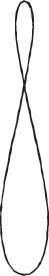

나는 그것을 가리켰다. 「그건 아날렘마예요,」 내가 말했다. 「오리테나 신전은 큰 암상자였어요. 지붕에 작은 구멍이 있어, 태양의 영상을 바닥에 비췄죠. 계절이 바뀌면서, 태양점은 그들의 정오 의례——지금 우리가 프로베네르로 기념하는——때마다 바닥의 다른 곳에 떨어졌어요. 1년에 걸쳐, 그것은 바닥에 이 무늬를 그렸죠.」

「그럼 프라아 자드가 그 사진판에서 아날렘마를 보고 속으로 '아하, 오리테나 신전이 틀림없다'고 했다는 거야? 내가 보기엔 꽤 빠른 생각인데,」 코드가 말했다.

「음, 그가 꽤 똑똑한 사람이니까요,」 내가 받았다. 그것은 가장 예의 바른 대답은 아니었다. 제스리라면 여기서 나를 깎아 내렸을 거다. 코드가 회의적인 것도 옳았다. 그러나 나는 그 지점을 더 파고들고 싶지 않았다. 프라아 자드가 그 구멍을 알아본 속도는, 그——그리고 아마 다른 천년제들——이 그것에 관해 많은 것을 알고 있다는 걸 암시했다. 그 느슨한 실을 더 세게 잡아당기면, 혈통에 관한 미친 이야기로 되돌아갈까 걱정되었다.

「오, 얼마나 재미있는데,」 사만이 지지를 보며 말했다. 「에라스마스가 내기를 이겼네. 사진판 속 그 발굴터는 *정말로* 기원후 3000년에 시작됐어.」 그는 화면에서 다른 한 조각을 읽더니, 고개를 들어 내게 웃었다. 「에드하르교도들이 시작했어!」

「훌륭해,」 내가 중얼거렸다. 사만의 지지를 집어 변기통에 집어넣을 수 있었으면 좋았을 거다.

「상트 에드하르의 분파예요. 하지만 세계의 다른 많은 에드하르교도 마스들도 프라아와 수르를 보내 시작하는 데 기여했어.」

「거기에 아부트가 몇 명 사나요?」 코드가 물었다. 나는 그녀가 머릿속으로 계산하는 걸 볼 수 있었다. *만약 각 아부트가 하루에 손수레 스무 짐씩 흙을 옮긴다면, 690년 동안 구멍은 얼마나 커질까?*

「그건 나중에 알려 주겠다,」 사만이 얼굴을 찡그리며 말했다. 「그 주제의 정보 대부분이 쓰레기야.」

「쓰레기라고 뭐를 말하는 거죠?」 크레이드가 따졌다. 우리는 모두 그를 보았다. 순식간에 그가 눈에 띄게 방어적으로 변했기 때문이다.

사만이 지지 화면에서 눈을 들어, 흥미로운 듯 크레이드를 보았다. 몇 순간을 보낸 뒤, 그는 차분하고 사실적인 목소리로 답했다. 「누구든 어떤 주제든 정보를 올릴 수 있어. 그러므로 레티큘럼에 있는 것의 대다수는 쓰레기지. 걸러 내야 해. 필터 시스템은 오래됐어. 내 사람들은 재구성 때부터 그것과 그 인터페이스를 개선해 왔지. 그것은 우리에게, 마인스터가 프라아 에라스마스와 그 무리에게 그런 존재야. 내가 어떤 주제를 찾을 때, 나는 그 주제에 관한 정보만 보는 게 아니야. 검색을 수행할 때 필터 시스템이 무엇을 알아냈는지 알려 주는 메타정보를 보지. '아날렘마'를 찾으면, 필터 시스템은 그것에 관해 소수의 출처만 정보를 제공했고, 그 평판이 대체로 높다는 걸 알려 준다——그들은 아부트다. 막 연인과 헤어진 대중음악 스타 이름을 찾으면」——사만이 스필리에서 울고 있는 여자를 가리키며 계속했다——「필터 시스템은 최근 그 주제에 엄청난 양의 데이터가 올라왔고, 대부분 평판이 매우 낮다는 걸 알려 주지. 에크바 섬의 오리테나 신전 발굴을 찾을 때는, 필터 시스템이, 평판이 매우 높거나 매우 낮은 사람들이, 느리지만 꾸준히, 칠 세기 동안 그 주제에 글을 올려 왔다고 알려 줘.」

사만의 설명이 크레이드를 진정시키려는 목적이었다면, 그것은 실패했다. 「높은 평판의 사람이란 어떤 사람인가? 콘센트에 앉아 있는 프라아 같은 이?」

「그래요,」 사만이 말했다.

「그럼 낮은 평판의 출처는?」

「음모론자. 아니면, 같은 생각을 가진 이들만 읽는, 길고 두서없는 글을 많이 쓰는 이.」

「데올라터인가요?」

「그건,」 사만이 말했다. 「그 데올라터가 뭘 쓰느냐에 달렸어.」

「에크바에 관해 쓴다면? 오리테나? 테글론?」 크레이드가, 고대 신전 앞의 십각형 광장을 묘사한 사진판을 손가락으로 톡 두드리며 물었다.

「필터들은 그런 결로 많이 올라왔다고 말해 주지,」 사만이 말했다. 「당신이 잘 알고 있는 것 같네. 그것을 가려내는 건 어려워. 내가 필터 인터페이스에서 그런 무늬가 나타나는 걸 보면, 내 직감은 대부분이 쓰레기일 거라고 말해. 빠르고 피상적인 판단이지. 틀릴 수도 있어. 내 말투가 당신을 기분 나쁘게 했다면 사과하지.」

「용서했다,」 크레이드가 툭 던졌다.

「글쎄,」 몇 순간의 어색한 침묵이 흐른 뒤 내가 외쳤다. 「이건 정말 흥미로웠어요. 산을 뒤지는 데 시간을 많이 낭비하기 전에 알아낸 게 다행이네요. 오롤로를 찾으려는 내 전제 전체가 바뀌었어요. 여러분도 그가 세계 반대편으로 갈 거라고는 상상 못 했죠. 그러니 이제 모두 돌아서 남쪽으로 가고 싶으실 거예요.」

모두가 나를 바라보았다. 아무 얼굴도 읽히지 않았다.

「내가 그렇게 생각했는데요,」 내가 덧붙였다.

「아무것도 바뀐 게 없어,」 사만이 말했다.

「내 벗을 이 쓰레기장에 버리고 가지 않겠어,」 코드가 말했다.

「혹시 차가 추위 속에서 고장 날 경우에 대비해 차량이 두 대 있어야 해,」 가넬리아드 크레이드가 말했다. 나는 그의 논리에 반박할 수 없었다. 그러나 그가 함께 가려는 진짜 이유가 그것이라고는 한 순간도 생각하지 않았다. *테글론*이라는 말을 흘린 뒤였으니까.

「여기서 북위 83도까지는 대권로로 이천 마일이야,」 사만이 지지를 조작하며 말했다. 「고속도로로는 이천오백 마일 조금 넘고.」

「당신과 사만이 운전을 배워서 교대할 수 있으면, 라즈, 사나흘에 갈 수 있어,」 크레이드가 말했다.

「북쪽으로 갈수록 도로가 더 나빠질 거예요,」 코드가 말했다. 「일주일잡는 게 좋겠네요.」

크레이드는 그것에 반박하고 싶어 했지만, 그녀가 덧붙였다. 「차량도 개조해야 하고요.」

그래서 우리는 주유소 뒤마당에 야영하고 작업에 들어갔다. 주인들이 우리가 극북으로 가는 길에 그냥 지나치는 중이라는 걸 이해하자, 우리를 더 편하게 여겼고, 일이 수월해졌다. 그들은 우리를 폐허를 캐러 가는 또 한 무리의 방랑자들이라고 여겼고, 대부분보다 장비와 자금이 더 잘 갖춰져 있다고 보았다.

다음 날 우리는 코드의 페치를 몰고 나가 크레이드 차의 새 타이어를 샀다. 그리고 그의 차로 코드 차의 타이어를 샀다. 새 타이어는 홈이 깊게 파여 있었고 징이 박혀 있었다. 코드와 그넬(가넬리아드 크레이드는 이제 우리에게 그렇게 부르라고 고집했다)은, 차량의 냉각수와 윤활유를 얼지 않는 것으로 교체하려는, 도구가 잔뜩 드는 작업을 함께 했다. 사만과 나는 차량 수리에 관해 잘 몰랐기에, 서서 도움이 되려 애썼다. 사만은 지지로 북쪽 경로를 연구하며, 최근 그 길을 다녀온 이들이 올려 놓은 기록을 읽었다.

「이봐,」 내가 어느 순간 그에게 말했다. 「내 마음이 어제 그 스필리 피드에서 본 영상 하나에 계속 가 있어요.」

「불타는 사서요?」

「아니요.」

「학교를 덮친 진흙사태?」

「아니요.」

「강아지들이랑 노는 뇌 손상 소년?」

「아니요.」

「좋아, 포기했다.」

「로켓이 발사되는 거요.」

그가 나를 보았다. 「그래서——뭐가 어쨌는데? 폭발했어? 고아원에 떨어졌어?」

「아니요. 그게 문제예요. 그냥 발사됐어요.」

「유명인들이 탔거나——」

「보여 주진 않았어요. 그랬으면 보여 줬겠죠?」

「그럼 왜 굳이 보여 줬을까. 로켓은 늘 발사되잖아.」

「음, 나는 그런 것에 대해 잘 모르지만, 아주 큰 것처럼 보였어요.」

사만이 처음으로 내 말뜻을 알아챈 듯했다. 「내가 알아볼게,」 그가 말했다.

나이가 많지만 활기찬 여자 한 명——그넬의 같은 종파 사람——이 우리를 위해 구워 온 케이크를 들고 나오더니, 그넬을 끝날 것 같지 않은 대화에 붙잡았다. 그들이 이야기하는 동안, 진흙투성이의 큰 페치 하나가 목조 선실을 얹은 채 주유소로 요란하게 들어와, 우리 주위를 두 바퀴 돌고는 주차 자리 네 개를 점유했다. 케이크 아주머니는 얼굴이 잔뜩 찌푸려진 채 걸어갔다. 수염 난 거대한 남자 하나가 선실 페치에서 투박하게 걸어 나와, 주머니에 손을 넣고 호기심 어린 눈으로 사방을 둘러보며 그넬에게 다가왔다. 가까이 오자, 그는 갑자기 활짝 웃으며 손을 내밀었다. 그넬은 잠시 망설이다 자기 손을 내밀었고, 다른 이가 그것을 한동안 위아래로 흔들어 댔다. 그들은 몇 초 넘게 말하지 않았다. 그리고 새로 온 이는 우리의 작은 야영지를 이리저리 걸으며, 우리가 가진 것을 머릿속으로 세고, 우리가 여기서 무엇을 해 왔는지 재구성하기 시작했다. 몇 분 그런 뒤, 그는 바퀴 달린 집 옆에서 일종의 펼침 탁자를 꺼내 펴고, 스토브에 불을 붙여 우리에게 뜨거운 음식을 만들기 시작했다.

「저 사람이 율라세타르 크레이드야. 내 사촌이지,」 그넬이, 그가 작은 주방을 차리고, 찻잔에서 먼지를 불어 내고, 주머니에서 꺼낸 걸레로 냄비를 닦는 걸 보며 내게 말했다.

「무슨 일이었어요?」 내가 물었다.

「무슨 말이야?」 그넬이 어리둥절해하며 물었다.

「당신과 그 여자가 그를 대하는 걸 보면, 뭔가 내력이 있어 보이던데요. 당신들 사이에 어떤 문제가.」

「율은 이교——」 그넬이 말을 시작했다가, 그 단어의 끝까지 가기 전에 멈췄다. 「배교자다.」

나는 *그걸 빼면, 그는 괜찮은 사람인가요?*라고 묻고 싶었지만, 그냥 넘겼다.

율은 자기를 소개하려는 수고조차 하지 않았지만, 내가 다가가자 웃으며 나를 향해 돌아서 악수를 하고는 다시 일로 돌아갔다. 「팔을 뻗어,」 그가 말했고, 내가 그대로 하자 쟁반을 그 위에 올리고, 뜨거운 것이 담긴 잔들을 그 위에 놓았다. 「친구들에게 주게.」

그러나 나는 그가 나와 함께 가야 한다고 고집했다. 그래서 그넬에게 잔 하나를 준 뒤, 우리는 사만에게로 가서 내가 둘을 소개했다. 그리고 코드를 설득해 페치 밑에서 빠져나오게 했다. 그녀는 일어나 먼지를 털고 율의 손을 흔들었다. 그들은 서로 이상한 눈빛을 주고받았고, 나는 그들이 전에 마주친 적이 있을지도 모른다고 추측했다. 그러나 둘 다 그에 관해 아무 말도 하지 않았다. 그녀가 잔을 받아 들자, 둘은 무언가 부끄러운 일이 일어난 것처럼 서로에게서 몸을 돌렸다.

율라세타르 크레이드가 나를 마을까지 태워 주었다. 심부름을 몇 가지 하려고. 먼저, 나는 알라에게 편지를 부쳤다. 상트 트레데가르 콘센트 앞으로. 우체국 여자는 주소가 제대로 적히지 않았다는 이유로 내게 온갖 곤란을 주었다. 콘센트에는, 내게 여권이 없던 것과 같은 이유로 주소가 없었다. 삼블 소풍 때 아르시발트나 리오에게 쪽지라도 하나 맡겼어야 했다는 걸, 나는 끔찍한 실수였다고 알았다. 그들이 그것을 알라에게 직접 밀어 넣어 줄 수 있었는데. 대신 나는 이것을 콘센트로 보내야 했고, 거기서 위계관들에게 가로챌 거였다——그들이 규율을 지킨다면, 알라가 다음 아페르트 때까지, 지금으로부터 구 년 넘게, 그것을 보지 못하게 될 거였다. 그때 그녀가, 스무 살도 안 된 소년이 쓴 이 누런 문서를 읽고 나를 어떻게 생각할지 상상할 수밖에 없었다.

일정의 다음 정거장은 슈트색을 구할 수 있는 곳이었다. 다리가 지퍼로 연결되어 침낭이 되는, 주황색 거대 방한복이었다. 그것은 극북에서 사냥하거나 줍는 이들을 위해 만들어졌다. 각각에 촉매 전원 장치가 내장되어 있었고, 연료 주머니에 연료만 넣어 두면, 소소한 전류가 슈트의 팔과 다리를 따라 흘러 장화 밑창과 장갑 손바닥의 보온 패드로 공급되었다. 새 것은 꽤 비쌀 수 있었지만, 율은 그저께 오롤로가 싸게 하나 구하도록 도왔다. 그는 수리된 중고를 구할 수 있는 곳을 알았고, 더 편하게 만드는 요령도 알았다.

그것을 해결한 뒤, 우리는 필요한 다른 장비와 물자를 찾아 나섰다. 내가 아웃도어 용품점에 가자고 제안할 때마다, 율은 얼굴을 찡그리고 신음을 흘리며, 가정용품과 식료품을 파는 가게에서 살 수 있는 것으로 십 분의 일 가격에 더 좋은 물건을 얻는 방법을 설명했다. 그는 언제나 옳았다. 그의 생업은 야외 가이드로, 휴가지 사람들을 산으로 데려가는 것이었다. 지금은 일이 없는 모양이었는데, 하루 종일 노슬로프를 운전해 나를 데려다주며 필요한 것을 즉흥적으로 구하게 해 주었다. 가게에서 원하는 것을 구하지 못하면, 자기 개인 재고에서 채워 주겠다고 약속했다.

운전에 믿기지 않는 시간이 소비되었다. 교통은 늘 나빴다——내게는 그렇게 보였다. 그러나 나는 도시의 차량 생활에 익숙하지 않았다. 차가 멈춰 서면, 주변 모브 사람들이 율의 누더기 페치를 창문으로 내다보았다. 어른들은 곧 시선을 돌렸지만, 아이들은 손가락으로 가리키고 쳐다보고 웃는 걸 좋아했다. 그리고 그들이 그렇게 하는 게 옳았다. 학교와 직장으로 운전하는 사람들과 비교하면, 율과 나는 이상한 한 쌍이었다.

처음에 율은 좋은 주인이 되어야 한다는 의무를 느끼는 듯했다——정체될 때 오락을 제공해야 한다는. 「음악?」 그가 멀리 있는 사람처럼 말했다. 음악을 한 번쯤 들어 본 적이 있는 것처럼. 반대가 없자, 그는 자기 음향 장치 조작 부분을, 손에 떨어져 나가 아무것에도 붙어 있지 않은 것처럼 만지작거리기 시작했다. 결국 그는 무작위 피드에 맞춰 두었다. 나중에, 그가 이야기를 시작하자, 내가 손을 뻗어 그것을 껐고, 그는 알아차리지 못했다.

그의 일의 일부는, 막 만난 이들——그의 고객——을 편안하게 만드는 것이라고 짐작했다. 그는 이야기를 들려주며 그렇게 했다. 그것에 능했다. 나는 그가 오롤로에 관해 말하게 하려 애썼지만, 그는 할 말이 많지 않았다. 오롤로는 내게 온갖 존재일지 몰라도, 율에게는 험한 길을 여행하는 법에 관해 조언이 필요한 또 다른 초보자일 뿐이었다. 그러나 그것은 극북을 돌아다니는 주제로 이어졌고, 그는 그에 관해 아주 많이 알았다.

나중에, 그 여행이 전부 그 방향으로만 있었냐고 묻자, 그는 코웃음치며 아니라고, 삼블 남쪽의, 깊은 사암 협곡이 파이고 멋진 암석 지형으로 가득한 지역에서 강 가이드로 몇 년을 보냈다고 했다. 그는 그런 여행에 관해 좋은 이야기들을 들려주었다. 그러나 얼마 뒤 불편해지더니 말을 멈췄다. 이야기를 하는 것은 분위기를 푸는 좋은 방법이고, 시간을 죽이는 데 유용했지만, 그가 진짜 원하는 것은 자기의 에너지와 지식을 쏟아부을 프로젝트였다.

그날 어느 시점에, 그는 '당신'을 가리키며 하던 말——"눈을 녹여 마실 물을 만들어야 할지 모르니 연료를 더 준비해야 해요" 같은——를 멈추고, '우리'를 가리키며 "최소한 네 바퀴는 펑크 날 걸로 계획해야 해" 같은 말을 하기 시작했다.

율의 집은, 자기 페치에 넣지 못한 물건들을 쏟아 놓은 곳에 불과했다——캠프 장비, 차량 부품, 빈 병, 무기, 책. 책은 내 허리까지 오는 더미로 쌓여 있었다. 선반은 하나도 가진 것 같지 않았다. 많이는 소설이었지만, 지질학 책 더미도 몇 개 있었다. 벽에는, 물과 바람에 조각된, 알록달록한 퇴적암 지형의 크게 확대된 사진판들이 못 박혀 있었다. 우리가 더 장비를 캐러 간 지하실에는, 화석이 들어 있는 판상암——사암 판——더미가 있었다.

그가 우리에게 필요하다고 여긴 것을 모두 챙기고, 또 다른 정체 속을 지나 주유소로 돌아가고 있을 때, 나는 그에게 말했다. 「당신은 세계가 오래됐다는 걸 알아냈죠?」

「그래,」 그가 즉시 말했다. 「나는 몇 년간 뗏목을 타고 그 강들을 내려왔어. 몇 년을. 내내 둑을 따라 돌이 널려 있었지. 협곡 벽에서 떨어진, 집만 한 돌들이. 그 협곡 하나를 내려다보기만 해도, 그런 일이 늘 일어난다는 걸 알 수 있어.」

「돌이 떨어지는 걸 말하는 거죠.」

「그래. 예를 들어, 이 고속도로를 달리는데 바닥에 미끄럼 자국이 보이면——저기처럼——바보라도 미끄러짐이 일어난다는 걸 알잖아. 미끄럼 자국이 *많으면*, 미끄러지는 게 *흔하다는* 뜻이지. 협곡에 떨어진 돌이 많으면, 낙석이 흔하다는 거야. 그래서 나는 늘 하나가 떨어질 거라고 기대했어. 매일, 고객들과 뗏목을 타고 강을 흘러가며——그들은 자거나, 하고 싶은 얘기를 하거나——나는 협곡 벽에 눈을 두고, 낙석을 보기를 기다렸지.」

「그런데 한 번도 안 봤죠.」

「한 번도. 단 한 번도.」

「그래서 시간 척도가 엄청나야 한다는 걸 깨달았군요.」

「그래. 한 번 계산해 보려 했어. 나는 이론학을 모르지만. 오 년간 그 강을 지켜봤고, 내가 운행하는 동안 돌 하나 떨어지지 않았어. 아르브르가 오천 년밖에 안 됐다면——그 협곡의 돌들이 그 짧은 시간에 다 떨어졌다면——나는 돌이 떨어지는 걸 봤어야 해.」

「당신 방주 사람들이 그에 관한 당신 말을 좋아하지 않았겠네요,」 내가 짐작했다.

「삼블에서 나갈 이유가 그것뿐이었지.」

그것으로 대화는 끝났다. 이제 퇴근 혼잡 시간이었고, 우리는 한동안 말없이 운전했다. 내가 창문 너머로 엿보는 다른 이들의 삶의 작은 조각들이 나를 매료시켰다. 그리고서, 율의 삶이 그들의 것과 얼마나 다른지에 사로잡혔다.

율이 우리의 북행 여정에 합류하기로 한 방식은 내게 이상했다. 합리적인 과정이 없었다——증거를 모으지도, 선택지를 저울질하지도 않았다. 그러나 그것이 율이 평생 사는 방식이었다. 그는——나는 깨달았다——그넬에게 주유소까지 와 달라는 초대를 받은 게 아니었다. 그냥 나타난 거였다. 그는 매일 새로운 사람들과 새로운 일을 했다. 그것은 그를, 교통 체증 속의 사람들과 다르게 만들었고, 나와도 다르게 만들지 않았다.

그래서 나는 매료되어 그들이 탄 모브 속 사람들을 보며, 어떤 삶일지 헤아리려 했다. 수천 년 전, 사람들이 하는 일은 매일 똑같은 업무로 쪼개어져, 사람들이 교환 가능한 부품인 조직들 속에서 이루어졌다. 그들의 삶에서 이야기는 전부 빠져나갔다. 그렇게 될 수밖에 없었다. 생산적인 경제를 만드는 방식이었으니까. 그러나 그 배후에 작동하는 의지가 쉽게 보였다. 정확히 악의는 아니지만, 이기적인 의지였다. 시스템을 그렇게 만든 이들은, 돈도 권력도 아닌, 이야기를 시기했다. 만약 직원들이 하루 끝에 재미있는 이야기를 들려주며 집에 온다면, 무언가 잘못되었다는 뜻이었다——정전, 파업, 무차별 살인. 당국자들은, 사람들이 동기를 부여하기 위해 지어낸 가짜 이야기가 아니라면, 자기들만의 이야기 속에 있는 것을 허락하지 않았다. 이야기 없이는 살 수 없는 이들은 콘센트나 율 같은 일로 몰려갔다. 나머지는 모두, 자기가 이야기의 일부라는 느낌을 일 밖에서 찾아야 했고, 그것이 세속인들이 스포츠와 종교에 그렇게 몰두하는 이유라고 짐작했다. 어떻게 하면 자신을 모험의 일부로 볼 수 있을까? 시작과 중간과 끝이 있고, 자신이 중요한 역할을 하는 그것. 우리 아부트는 그것을 그냥 갖고 있었다. 우리는 새로운 것을 배우는 이 프로젝트의 일부였으니까. 제스리 같은 이들에게는 늘 충분히 빠르지는 않았지만, 그것은 움직였다. 그 이야기 속에서 당신이 어디에 있고 무엇을 하는지 알 수 있었다. 율은 매일 자기 이야기를 살아가며 모든 것을 공짜로 얻었다. 유일한 흠은, 세상이 그의 이야기를 하찮게 여긴다는 것이었다. 아마 그것이, 그가 그 이야기들을——자기의 야외 모험담만이 아니라, 자기 스승들의 이야기까지——이렇게 자꾸 들려주려는 강박을 느끼는 이유일지도 몰랐다.

마침내 주유소에 도착했다. 율이 이동 주방을 펼치고 저녁을 만들기 시작했다. 그는 자기가 함께 가겠다고 정식으로 말하지 않았지만, 말투에서 그것이 분명했기에, 얼마 뒤 그넬이 주유소 안으로 가, 코드의 페치를 몇 주일간 그곳에 세워 둘 수 있도록 경영진과 합의했다. 코드가 자기 페치의 물건들을 율의 것으로 옮기기 시작했다. 요리하면서, 율은 그 광경을 예의주시하더니, 코드가 자기 '바퀴 달린 집'에 쑤셔 넣는, 필요 없는 잡동사니의 어마어마한 부피에 관해 농담조로 불평하기 시작했다. 코드도 곧 그에게 욕을 되갚았다. 육십 초쯤 지나자, 그들은 서로에게 놀라울 정도로 무례한 말을 주고받고 있었다. 나는 그들의 농담에 끼어들 수 없었다. 입맞추거나 싸우는 두 사람 사이에 끼어들 수 없듯. 나는 사만 쪽으로 흘러갔다.

「그 로켓 스필리를 찾았어,」 그가 내게 말했다. 「큰 거라고 한 네 말이 맞았어. 요즘 나이는 것 중 가장 큰 것 중 하나야.」

「다른 건 없어요?」

「페이로드,」 그가 말했다. 「그 모양과 크기가, 사람을 우주로 실어 나르는 데 보통 쓰는 탈것의 것과 일치해.」

「몇 명이나요?」

「최대 여덟 명.」

「음, 누가 타고 있는지, 혹은 왜 올라가는지에 관한 정보라도 있어요?」

사만이 고개를 저었다. 「정보가 없다는 것을 정보로 치지 않는다면야.」

「무슨 말이에요?」

「당국자들에 따르면, 그 탈것은 무인이야. 새 시스템의 시험라고. 신데브 통제하에.」

나는 그를 보았다. 그는 웃으며 손을 들어 보였다. 「알아, 알아! 내가 아는 레티큘 몇 개에 문의해 봤어. 몇 달 뒤면 뭐가 있을지도 몰라.」

「몇 달 뒤면 우리는 북극에 있어요.」

「그때쯤이면,」 그가 말했다. 「거기가 현명한 장소일지도 몰라.」

다음 날 아침, 율과 코드가 준비한 든든한 아침 식사를 한 뒤, 우리는 북행을 시작했다. 코드의 페치는 뒤에 남았다. 우리 행렬은 크레이드의 차량들——율라세타르의 것에는 장비 대부분이, 가넬리아드의 것에는 뒤에 삼륜차가 실려 있었다——으로 구성되었다.

첫 구간은 북쪽으로, 해안 평원까지 내려가는 길이었다. 짠물에 가까워지자 오른쪽으로 꺾고, 북쪽 바다의 만을 따라가며 왼쪽으로 길게 휘었다. 그 만의 맨 안쪽에는, 기원후 제1천년기 동안 물이 일 년 내내 얼지 않아, 두세 세기 동안 세계 최대의 항구였던 곳이 있었다. 위치 때문에, 그곳은 나중에 모든 폐허 중 가장 '얕은' 곳——가장 캐기 쉬운 곳——이 되었다. 그 위대한 구조물들——고가수로, 방파제, 다리——대부분은, 합성석에 묻힌 보강 철근을 뽑아 필요한 곳으로 실어 가는 청부업자들에 의해 부서졌다. 그 잔해 더미에는 거대한 나무들이 숲을 이루었다. 그 시대의 유일한 잔존 구조물은, 만의 맨 안쪽으로 흘러드는 큰 강 위의 현수교였다. 해수면보다 충분히 높아, 다시 밀려온 유빙이 그것을 짓누르지 못했다. 이 계절에는 얼음이 보이지 않았지만, 그것이 잔해 둑에 남긴 흉터는 쉬 알아볼 수 있었다. 이 항구 폐허는 지금 어촌 마을이자 드러먼 정류장이 되어 있었다. 수백 명이, 적어도 여름에는, 여기 살았다. 그것을 뒤에 두고 내륙으로, 거의 정북으로 향하자, 드문드문한 취락들만 보였고, 그것들은 숲이 우거진 언덕으로 오르며 점점 줄어들다 사라졌다. 그리고서 우리는 분명히 다른 풍경 속으로 내려갔다——타이가. 나무가 사람 키보다 더 자라지 못할 만큼 건조하고 추운 땅이었다. 도로의 교통은 거의 사라졌다. 우리는 한 시간 동안 다른 차 한 대 보지 못하고 운전했다. 마침내 강가의 바위투성이 장소에 멈춰, 차를 도로에서 보이지 않는 곳으로 돌려 세우고, 슈트색 속에서 잠들었다.

다음 날 아침, 삼블을 떠난 뒤에 산 새 스토브가 작동을 멈췄다. 율이 함께 오지 않았다면, 우리는 남은 여정 내내 차가운 에너지 바를 먹었을 거다. 율은 조용히 의기양양한 표정으로, 요란하게 타오르는 공업용 버너 여러 개로 굉장한 아침을 냈다. 사촌이 일하는 걸 보며 그넬은, 짜증이 섞이긴 했지만 자랑스러워 보였다. *신앙을 버리면 이렇게 훌륭한 사람들을 만들 수 있다고 보라*는 듯했다.

도로에 거의 차가 없었기에, 나는 율에게서 운전 수업을 받았고, 코드는 스토브를 분해했다. 그녀는 문제가 막힌 분사구라고 진단했다. 추운 밤 동안 연료에서 가라앉은 찌꺼기 때문이었다.

「화가 났네,」 그녀가 얼마 뒤 지적했다. 나는 대화에서 물러나 있었다는 걸 깨달았다. 그녀와 율이 이야기하고 있었지만, 나는 그 말을 한 마디도 듣지 못했다. 「무슨 문제예요?」

「이 시대에 우리가 화학 연료 문제로 곤란을 겪고 있다는 게 믿기지 않아요,」 내가 말했다.

「미안해요. 고급 브랜드를 샀어야 했네요.」

「아니요, 그게 아니에요. 당신이 사과할 일이 아니에요. 그냥, 이 스토브가 사천 년 전 프락식이라는 걸 말하는 거예요.」

코드는 어리둥절해했다. 「이 페치와 그 안의 모든 것도 마찬가지인데,」 그녀가 말했다.

「이봐!」 율이 장난스럽게 상처받은 척 외쳤다.

코드는 코웃음치고 눈을 굴리며, 다시 나에게 주의를 돌렸다. "당신 구체 말고는 다요. 그래서?"

「음, 나는 프락식이 거의 없는 곳에서 살았기에, 그런 것에 관해 생각지 못했어요,」 내가 말했다. 「하지만 이런 때엔, 그 터무니없음이 눈앞으로 날아와요. 이런 쓰레기를 견딜 이유가 없어요. 위험하고 믿을 수 없는 화학 연료를 쓰는 스토브. 분사구가 막히는. 사천 년이면 더 나은 스토브를 만들 수 있었을 텐데.」

「내가 그 스토브를 분해해서 고칠 수 있을까요?」

「그럴 필요도 없어요. 고장 나지 않으니까.」

「하지만 나는 그런 스토브를 이해할 수 있는지 알고 싶어요.」

「당신은 마음만 먹으면 거의 모든 것을 이해할 수 있는 사람이에요.」

「좋은 아첨이네, 라즈, 하지만 계속 질문을 피하고 있어.」

「좋아요, 당신 말을 받아들여요. 당신은 정말로, 보통 사람이 그런 것의 작동 원리를 이해할 수 있는지 묻는 거죠……」

「보통 사람이 뭔지 모르겠어요. 하지만 여기 율을 봐요. 자기가 스토브를 만들었잖아. 율, 맞죠?」

율은 코드가 갑자기 대화를 자기 쪽으로 돌리는 게 불편했다. 그러나 그녀를 무시하지 않았다. 그는 눈을 돌려 고개를 끄덕였다. 「응. 버너는 주워 온 거야. 틀은 용접했고.」

「그리고 작동했지,」 코드가 말했다.

「알아요,」 내가 말하며 배를 두드렸다.

「아니, 내 말은 *시스템*이 작동했다는 거야!」 코드가 주장했다.

「어떤 시스템요?」

그녀는 답답해했다. 「그……그……」

「비시스템이야,」 율이 말했다. 「시스템이 없다는 거.」

「율은 그런 스토브가 믿을 수 없다는 걸 알고 있었어!」 코드가, 고장 난 것을 가리키며 말했다. 「경험으로 배웠지.」

「아, 쓴 경험이요, 아가씨!」 율이 외쳤다.

「북쪽 폐허에서 더 나은 버너 헤드를 찾은 청부업자들을 만났어. 흥정하고. 연결하는 방법을 알아냈지. 아마 그 뒤로 계속 손을 대 왔을 거야.」

「제대로 돌아가게 하는 데 이 년 걸렸어,」 율이 인정했다.

「그리고 그것은, 오직 아부트만 이해할 수 있는 기술로는 결코 불가능했을 거야,」 코드가 결론지었다.

「좋아, 좋아,」 내가 말하고, 거기서 그만두었다. 논쟁을 끝까지 몰고 가는 것은 숨 낭비였을 거다. 재구성 때, 우리 이론학자들은 (역사를 어떻게 보느냐에 따라 물러났거나 몰려간) 마스들로 들어갔고, 프락식을 통해 물리 세계를 바꿀 힘을 가졌다. 어느 정도까지는, 보통 사람들이 우리가 만든 변화를 좋아했다. 그러나 프락식이 정교해질수록, 사람들은 그것을 덜 이해했고, 우리에게 더 의존하게 되었다——그리고 그것을 결코 좋아하지 않았다.

코드는 한동안 율에게 사촌들에 관해, 그리고 상트 에드하르에서 삼블과 노슬로프에 이르는 여정에서 일어난 모든 일에 관해 자기가 아는 것을 들려주었다. 율은 꽤 담담하게 받아들였고, 그것이 나를 짜증나게 했다. 나는 그의 어깨를 잡고 흔들어, 어떻게든 이것이 우주적 의미의 사건——지금까지 일어난 것 중 가장 중요한 일——이라는 걸 그에게 보이고 싶었다. 그러나 그는 코드의 이야기를, 출근길에 펑크난 타이어를 고친 이야기를 듣는 듯 들었다. 아마 황야 가이드들은, 사람들이 당황한 소식을 들고 달려오면 비자연적인 평온을 연기하는 습관이 있었을지도 몰랐다.

어쨌든, 그것은 코드를 너무 짜증나게 하지 않는 방식으로 스토브 논쟁을 이어 갈 구실을 주었다. 대화가 끊기자 나는 시도했다. 「당신들이——혹은 누구든——분해해서 이해할 수 있는 스토브를 더 편하게 여기는 이유는 알겠어요. 그리고 나도 그건 괜찮아요——평소엔. 하지만 지금은 평소가 아니잖아요. 사촌들이 적대적이라면, 우리가 어떻게 맞설 수 있죠? 그들은 재구성 같은 것이 없는 세계에서 온 것 같잖아요.」

「이론학자들의 독재로군,」 율이 말했다.

「독재일 필요는 없어요! 이론학자들이 사적으로 어떻게 행동하는지 보신다면, 그들이 그렇게 조직적일 리 없다는 걸 알 거예요.」

그러나 코드는 이 문제에서 율과 한마음이었다. 「그들이 저것 같은 배를 만들 지점에 이르면,」 그녀가 말했다. 「그건 사실상 독재예요. 당신 스스로, 행성 전체의 자원이 필요할 거라고 했잖아요. 그들이 그 자원을 어떻게 손에 넣었을까요?」

대부분의 경우 코드와 나는 같은 방식으로 사물을 보았고, 여분 사람/아부트의 구분은 우리에게 중요하지 않았다. 그래서 그녀가 그런 말을 할 때, 나는 겉으로 드러내는 것보다 더 화가 났다. 나는 한동안 그 주제를 내려놓았다. 이 끝없는 운전 중에는, 한두 시간 대화가 끊겨도 별일이 아니었다.

또 다른 일이 벌어지고 있었다. 율이 나타난 이후 코드의 모든 것이 달라져 있었다. 그 둘은 서로 곁에서 무엇을 해야 할지 그냥 알고 있었다. 그들 사이에 무슨 일이 벌어지고 있든, 나는 그 일부가 아니었고, 질투를 느꼈다.

우리는 또 다른 폐허 도시를 지났다. 어제의 것만큼 '얕고', 거의 그만큼 완전히 지워져 있었다.

「사촌들의 프락식은 크게 자랑할 만한 게 아니에요,」 내가 말했다. 「그 배에서 우리 프락식 시대에 만들지 못했을 것이란 보이지 않았어요. 그러니 우리도 그 배를 무력화할 무기를 만들 수 있다고 생각해요.」

코드가 웃었고 긴장이 사라졌다. 「당신, 며칠 전 프라아 자드 같네!」 그녀가, 나를 향한 분명한 애정으로 외쳤다.

「아, 그래요? 그 늙은이가 뭐라고 했는데요?」 내 말에서 상처가 빠져나가는 걸 나는 들을 수 있었다.

그녀는 그의 투덜거리는 목소리를 꽤 잘 흉내 냈다. 「'그들의 전기 체계는 뭐시기 장의 폭발로 무력화될 수 있다.' 그러자 리오가 '실례합니다, 프라아 자드, 하지만 우리는 그런 걸 만드는 법을 모릅니다' 했지. '왜, 간단하다. 뭐시기 장 유도기의 프락식 배열을 만들면 되지.' '죄송합니다, 프라아 자드, 하지만 그런 이론학은 아무도 모르고, 따라가려면 삼십 년 공부가 필요합니다!' 이런 식으로요.」

나는 웃었다. 그러나 그다음——머릿속으로 날을 세어 보다——깨달았다. 「그들은 아마 지금 트레데가르에 닿았을 거예요. 아마 그 뭐시기 장 유도기를 만드는 방법에 관해 이야기하기 시작했겠죠.」

「그랬으면 좋겠네!」

「세속 권력에는 사촌들에 관한 정보가 엄청나게 있을 거예요. 지금까지 우리에게 숨겨 온. 어쩌면 그들이 올라가 사촌들과 *이야기*하고 있었을지도 몰라요. 콘복스의 프라아들과 수르들에게 그 모든 정보를 주고 있다고 걸어요. 내가 거기 있었으면 좋았을 텐데. 이해 못 하는 게 지겹다고요! 대신 나는 프라아 자드가, 쫓겨난 이가 칠백 년 된 고고학 발굴터를 보러 가려는 이유를 이해하도록 돕고 있어요.」 나는 조작판을 무력하게 쳤다.

「이봐!」 율이 장난스런 분노로 말하며, 내 어깨를 때리는 시늉을 했다.

「그게 졸 개의 일부인가 보죠,」 내가 계속했다.

「당신이 생각하는 콘복스의 모습은 내게 꽤 낭만적으로 들려요,」 코드가 말했다. 「너무 낙관적이야. 기계실 첫날, 열일곱 명을 여섯 차에 태우려 했던 거 기억나지?」

「생생해요.」

「이 콘복스도 아마 그럴 거예요. 천 배는 더 나쁘겠지만.」

「우리 같은 이가 거기 있으면 다르겠지,」 율이 말했다. 「내가 열 명의 관광객을 어떻게 뗏목 네 개에 태우는지 봐야 해.」

「율은 트레데가르에 없으니,」 코드가 지적했다. 「그러니 놓친 것도 없어. 그냥 편하게 운전이나 즐겨.」

「좋아요,」 내가 말하고 조금 웃었다. 「당신이 인간 본성을 이해하는 게 나보다 뛰어나네요.」

「그럼 나는 왜 저런 취급을 받는 거지?」 율이 따졌다.

운전이 계속되는 동안, 우리 대부분은 두 차 사이를 오갔다. 예외는 그넬이었는데, 그는 늘 자기 페치에 있었고, 때때로 사만에게 운전을 맡기기도 했다.

다음 날, 코드와 내가 단둘이 몇 시간을 보냈을 때, 그녀는 자기와 율이 연인이 되었다고 내게 말했다.

「허,」 내가 말했다. 「그래서 당신 둘이 '장작 모으러 간다'며 그렇게 오래 있었군요.」 나는 똑똑한 척하려는 게 아니었다. 코드와 율이 그렇게 자유롭게 주고받는 농담을 흉내 내려 한 것뿐이었다. 그러나 코드는 꽤 민망해했고, 나는 너무 가까이 찔렀다는 걸 깨달았다. 다른 말을 찾아 헤맸다. 「음, 이제 말해 주니, 그게 운명이었던 것 같네요. 제가 당신이 로스크와 사귀는 줄 알아서 못 본 것 같아요.」

코드는 그것이 꽤 어리석다고 생각했다. 「지지로 그와 나눈 그 모든 대화 기억나지?」

「네.」

「사실은 헤어지는 중이었어.」

「음, 코드, 내가 이론학자답게 꼬치를 부리려는 건 싫겠지만, 당신 쪽 대화를 우연히 들을 수밖에 없었는데, 헤어진다는 말은 한 마디도 못 들었어요.」

그녀는 내가 미친 사람처럼 보았다.

「내 말은,」 내가 손을 들며 말했다. 「그런 줄 전혀 몰랐다는 거예요.」

「나도 몰랐어,」 코드가 말했다.

「당신 생각에……」 내가 말을 시작했다가 멈췄다. *당신 생각에 로스크가 아는 걸까?*라고 하려다, 그것이 자살행위라는 걸 기적적으로 알아챘다. 나는 중요한 관계를 다루는 그 방식이 꽤 불규칙처럼 보였지만, 그러고 보니 나와 알라의 일이 어떻게 됐는지 떠올리고는, 내 벗을 그 점에서 비판할 처지가 아니라고 결정했다.

코드와 나는 우리 가족——내가 '시계로 가기' 전까지 그녀와 함께 살았던 가족——에 관해 놀라울 만큼 적게 이야기했다. 그러나 적게 들은 것조차 내게, 사람들이 서로를 미치고 불행하게 만드는 방법을 찾아내는 데 얼마나 능한지 놀라게 했다. 그것이 혈연이든, 콘센트에서 함께 던져진 낯선 무리든 마찬가지였다. 코드는 그런 일에 관한 지식과 경험과 냉소에서 때때로 팔십 년은 먹은 듯했다. 나는 그녀가 어느 시점에 손을 들어, 이해하고 고칠 수 있는 것들——기계 같은——에 평생을 바치기로 했다고 생각하지 않을 수 없었다. 그녀가 이해할 수 없는 기계라는 생각을 싫어하는 것도 당연했다. 그리고 그녀가 이해할 수 없는 것——왜 지금 내가 율의 여자친구인지 같은——을 이해하려 시간을 낭비하지 않는 것도 당연했다.

기후가 더 따뜻했을 때, 문명들은 이 빙하로 깎인 풍경을, 광부의 팬 속 토사처럼, 이천 년 동안 이리저리 출렁이며, 사람들이 떠난 뒤에도 오래 남는 쌓임을 만들었다. 그 수천 년 중 어느 시점에는, 지금은 수만 명을 부양하는 이 영토에 십억 명이 살았을지도 몰랐다. 여기에 몇 구의 시체가 묻히고, 몇 사람의 재가 흩어졌을까? 다 합쳐 백억, 이백억, 오백억? 모두가 전기를 썼다고 치면, 그들의 건물과 보도 아래에 몇 마일의 구리 선이 꿰매어졌을까? 선을 뽑고 못으로 고정하는 그 한 일에, 몇 만 년·인간의 노동이 투입됐을까? 천 명 중 한 명이 전기 기술자였다면, 한 지점에서 다른 지점으로 선을 연결하는 데 대략 십억 인년이 투입된 셈이다. 날씨가 다시 추워지고 문명들이 수세기에 걸쳐——빙하처럼 움직이며——남쪽으로 옮겨가자, 청부업자들이 그 십억 인년을 지루한 한 시간씩 되돌리러 올라오기 시작했고, 셀 수 없는 마일의 전선을 마당 단위로 회수했다. 산업 규모로 일하는 전문 청부업자들이 십 퍼센트를 빠르게 챙겼다. 나는, 북쪽을 가로지르며 도시 블록 전체를 한꺼번에 삼키는, 탱크 궤정을 단 공장들의 사진을 본 적이 있다. 그것은 폐허의 직물을, 광산 로봇이 광석 언덕을 다루듯 대하며, 건물을 잔해로 갈아내고 조각을 밀도별로 분류했다. 우리가 본 첫 폐허들은, 그 기계들이 지나간 자리에 남긴 똥이었다.

손으로 폐허를 벗겨내는 것은 더 비쌌다. 다른 곳이 번영하면, 금속이 귀해져, 채굴자들이 깊은 폐허——탱크 궤정을 단 공장들이 닿지 못한, 먼 옛날 도시들——로 모험을 떠나, 구리 선, 철빔, 배관 따위 가장 값나가는 것을 뽑아내는 것으로 생계를 꾸릴 수 있었다. 그 전리품은, 우리가 달리는 도로를 향해, 간헐적인 단계로——무정부 상태의 작은 툰드라 시장 마을에서 다음 마을로——움직였다. 눈보라와 북극 해적 떼가 그 행로를 방해할지 몰라도, 결국 도로에 닿아, 녹이 무게의 칠십오 퍼센트를 차지하는 듯한, 오직 성에와 더러운 눈의 털복숭이 망토로만 붙잡혀 있는 누더기 드러먼들의 등에 쌓였다. 그것들은 보호를 위해 무리를 지어 움직였기에, 추월하려는 시도는 헛되었다. 그러나 우리 목적에는 충분히 빨랐고, 우리가 약탈자가 아니라 순례자라는 걸 알아차리자, 무리의 안전을 제공해 주었다. 우리는 그들과 충분히 뒤를 두었는데, 딱딱한 배관 글자나 전선 뭉치가 하나 도로에 떨어질 때마다 피할 시간을 두려고 했다. 앞유리는 타이어가 튀긴 진흙 얼음으로 불투명해졌다. 우리는 창을 열어 두고, 막대기에 붙인 걸레로 그것을 닦아낼 수 있게 했다. 사흘째 되는 날 걸레가 얼어붙었다. 그 뒤로는 스토브에 뜨거운 물 주전화를 올려 녹이며 계속했다. 열린 창너머로, 지나가는 폐허들을 보았다. 우리는 성벽의 성격으로 그 장소의 건축 연대를 구분하는 법을 배웠다——미사일 사일로, 삼 마일짜리 활주로, 커튼월, 돌 성벽, 광활한 면적의 말린 면도철 가시, 서열 설계된 가시나무 띠. 모두 대체로 청부업자들에 의해 찢기고 뒤틀려 있었다.

날이 갈수록, 이 모든 것은 먼지가 되고, 서리가 되고, 질식당하고, 납작해지고, 짓눌리고, 익사하고, 얼음으로 지워졌다. 그 뒤에, 우리가 본, 인간이 놓은 유일한 것들은, 옛 썰매 항구의 잔해들이었다——기후나 시장의 변동이, 그들이 죽기에 충분한 오랜 무방비 상태를 남겼던 것이다. 도로에서 일 마일 떨어진 풍경은 깨끗하고 하얬지만, 도로변은 내 여정 전체를 통틀어 본 가장 역겨운 것이었다. 도로 옆 눈더미가 점점 더 높고 검어지면서, 우리 길은 이십 피트 깊이의 탄소 검은 참호가 되었고, 건강한 사람이 걸을 만한 속도로 움직이는 드러먼들로 꽉 차 있었다. 그 뒤로는 도망칠 곳이 없었다. 우리는 엔진을 끌 수도 있었다. 뒤의 드러먼이 우리를 도로 끝까지 밀어 버렸을 거다. 그들은 운전실로 신선한 공기를 끌어들이는 스노클이 있었다. 우리는 그렇게 장비할 생각을 하지 못했고, 마지막 날 내내 기름진 푸른 배기를 마셨다. 그것이 견딜 수 없이 메스꺼워지면, 운전자를 교대하고 참호 위로——눈벽에 간간이 경사로가 있었다——기어 올라가, 한동안 그냥 옆으로 걸었고(툰드라 시장 중 한 곳에서, 주워 온 건축 자재로 즉흥적으로 만든 설피를 샀었다), 아니면 그넬의 삼륜차에 탔다.

그렇게 걸어가던 중——마지막 구간에서——율이 마침내 주차 램프 공룡에 관해 내게 물었다.

노슬로프에서 함께 보낸 날 이후, 그가 무언가를 털어놓고 싶어 한다는 건 분명했다. 그와 코드가 갑자기 연인이 되었을 때, 그는 며칠간 나와 단둘이 있는 걸 피했다. 그러나 내가 돌아설(비선형이 될) 기미가 없다는 게 분명해지자, 그는 나와 단둘이 이야기할 기회를 조용히 찾기 시작했다. 나는 그 주제가 자기와 코드에 관한 것이라고 여겼다. 그러나 율은 뜻밖의 사람이었다.

「어떤 이는 공룡이라고, 어떤 이는 용이라고 해요,」 내가 그에게 말했다. 「그 사건에 관해 우리가 가장 먼저 배운 것 중 하나는, 그것에 관해 확실히 알 수 있는 것은 아무것도 없다는 거였어요——」

「모든 증거가 인칸터들에 의해 지워졌으니까?」

「그게 한 가지 이야기죠. 우리가 배운 두 번째 것, 참고로, 세속인들과 그 사건에 관해 절대 이야기하지 말라는 거였어요.」

그가 답답한 표정을 지었다.

「미안,」 내가 말했다. 「그냥 그런 거예요. 대부분의 기록은, 한 무리——편의상 A집단이라 부르죠——가 시작했고, B집단이 끝냈다는 데 동의해요. 대중적 민담에서는 A가 소위 레토르들이고 B가 소위 인칸터들이죠. 제3차 약탈이 열리기 석 달 전에 일어났어요.」

「하지만 공룡——혹은 용이나 뭐든——는 정말 주차 램프에 나타났던 거죠.」

율과 나는 다져진 눈 위를 나란히 걸고 있었다. 드러먼들이 꽉 찬 참호에서 오른쪽으로 돌 하나 던질 거리쯤. 더 가까운 곳은 위험했다. 취한 이들이 많았고, 스노모빌들이 이리저리 휘날랐기 때문이다. 율과 내가 따르는 자국은, 하루나 이틀 전 어떤 스노모빌이 낸 것 같았다. 우리 페치들이 참호 어디에 있는지 알 수 있었는데, 옆 드러먼들의 즉흥 스노클을 알아보는 법을 배웠기 때문이다. 교통이 조금 빨라지는 듯했고, 따라가려면 더 힘껏 걸어야 했다. 썰매 항구에서 이 마일쯤 남았기 때문일 거다. 이 마일 앞으로 안테나와 연기와 불빛이 보였다. 페치들이 우리를 앞지르더라도 걸어서 도착할 수 있었기에, 따라가는 것에 크게 신경 쓰지 않았다.

「먼코스터에서 이천 피트쯤 떨어져 있었어요,」 내가 말했다. 「거기에 도시가 있었죠——지금도 있듯이. 전반적인 부와 프락식 발전 수준을 열 점 만점에 아홉으로 합시다.」

「오늘은 몇 점이에요?」 율이 물었다.

「여덟이라고 하죠. 하지만 먼코스터 주변 사회는 정점에 달했었어요——그들도 몰랐지만. 데올라터들이 정치적 영향력을 얻고 있었죠.」

「어느 방주예요?」

「몰라요. 권력을 얻는 데 적극적인 것들 중 하나. 그들이 이콘그래피를——」

「그게 뭐요?」

「음,」 내가 말했다. 「아부트들이 흔히 믿는 특정 것들에 그들이 위협을 느꼈다고 하죠.」

「세상이 오래됐다는 것 같은 거요?」 율이 말했다.

「그래요. 연례 아페르트 몇 번에 문제가 있었고, 2780년 십년제 아페르트에서는 더 큰 문제가 있었죠. 십년제 마스가 십일 밤에 조금 약탈당했어요. 그러나 그 뒤 상황이 잠잠해진 듯했어요. 아페르트가 끝났고. 모든 게 정상으로 돌아갔죠. 그런데 지금, 콘센트가 내려다보이는 곳에 주차 램프가 하나 세워지고 있었어요. 쇼핑 센터의 일부였죠. 아부트들은 탑 창문만 내다보면 그것이 올라가는 걸 볼 수 있었어요——먼코스터에는 탑이 많으니까. 램프는 몇 달 뒤에 완공됐어요. 세속인들이 매일 거기 들어가 차를 주차했죠. 문제없었어요. 육 년이 지났어요. 쇼핑 센터가 확장됐다. 새 별관을 붙이려면 주차 램프에 구조 변경을 일부 해야 했어요. 작업자 한 명이 사층에서 공압 해머로 바닥 일부를 부수고 있는데, 합성석에 뭐가 박혀 있는 걸 알아챘어요. 발톱처럼 생겼죠. 조사해 보니, 점점 더 많은 돌을 떼어냈다. 그런 발톱이나 뼈가 하중을 지탱하는 부재에 있다면 건물이 구조적으로 안전하지 않으니, 큰 안전 문제였다. 그들은 버팀목으로 받쳐야 했다——건물이 눈앞에서 약해지고 처지고 있었다. 더 많이 노출할수록 상황은 더 나빠졌다. 모든 게 끝났을 때, 그들은, 불과 사 년 전에 부어진 합성석에 갇혀 있던, 백 피트짜리 파충류의 완전한 골격을 드러내 놓았다. 데올라터들은 그것을 어떻게 받아들여야 할지 몰랐다. 콘센트 성벽 주위에서 심각한 소요와 폭력이 시작됐다. 그러다 어느 밤, 천년제 탑에서 성가가 들렸다. 밤새 이어졌다. 다음 날, 주차 램프는 정상으로 돌아와 있었다. 이야기는 그렇습니다.」

「당신은 그걸 믿어요?」 율이 물었다.

「*무언가* 일어났어요. 기록이——있고요.」

「골격 사진판 같은 거요?」

「나는 그보다, 목격자들의 마음속 기억 같은 것을 말하는 거예요. 구조를 받치려 쓴 목재 더미. 목재소의 서류. 목재를 현장으로 실어 나른 드러먼 타이어의 약간 더 닳은 자국.」

「퍼지는 물결 같네요,」 율이 말했다.

「그래요. 그러니 골격이 갑자기 사라지고, 그것이 거기 있었다는 물리적 증거가 없다면, 무엇이 남죠?」

「기록뿐,」 율이 고개를 아주 힘차게 끄덕이며 말했다. 마치 자기가 나보다 더 잘 이해한 듯. 「물 튐 없는 물결.」

「목재를 실은 드러먼의 타이어가 갑자기 안 닳았던 게 아니에요. 목재소 서류가 기록 보관소에서 사라진 것도 아니죠. 그러나 이제 충돌이 생겼어요. 세계가 더 이상 일관되지 않아요——논리적 모순이 있죠.」

「본래 받칠 필요가 없었던 주차 램프 앞에, 받침 목재가 잔뜩 쌓여 있는 거요,」 율이 말했다.

「그래요. 그것이 물리적으로 불가능한 건 아니죠. 분명 주차 램프 앞에 나무 더미가 있는 건 *가능*하고, 서류함에 종이 몇 장이 있는 것도 가능하죠. 그러나 문제——그것이 제기하는 쟁점——는, 전체 상황이 더 이상 맞아떨어지지 않는다는 거예요.」 나는 오롤로와의 분홍 용 대화를 떠올리고 있었다——수개월이 지난 지금에서야, 그가 그 지점을 설명하려 용을 고른 건 우연이 아니었다는 걸 깨달았다. 그는 율이 말하는 바로 그 사건을 우리에게 상기시키려 했던 거였다.

뒤에서 울리는 엔진 소리를 듣고 돌아보니, 가넬리아드 크레이드가 삼륜차를 몰고 우리 쪽으로 오고 있었다. 율과 나는 *그 앞에서 이 얘기 하지 말자*는 뜻의 눈빛을 주고받았다. 율이 허리를 굽혀 눈 두 줌을 퍼 담더니, 사촌에게 던지려고 뭉치려 했다. 그러나 너무 추워서 뭉쳐지지 않았다.

우리는 새벽 두 시에 북위 83도의 썰매 항구에 도착했다. 그것은 해가 평소보다 조금 더 낮게 떠 있다는 뜻일 뿐이었다. 참호 같은 도로는, 일이 마일쯤 되는 유빙 고원으로 빠져나왔고, 그곳은 주변 얼음보다 조금 낮아, 큰 운석 구덩이 바닥에 있는 듯한 느낌이었다. 여기저기 주거 모듈들이, 그 아래로 얼음이 흐를 때 움직이고 조정할 수 있는 말뚝 위에 서 있었다. 드러먼들은 그 주위에 몰려 있는 경향이 있었다. 각각이 서로 다른 고철 상인의 본부였고, 운전자들은 자기 짐에 가장 좋은 값을 받으려고 한 곳에서 다음 곳으로 부지런히 뛰었다. 다른 구조물들은 여관, 식당, 매춘굴 구실을 했다.

그곳을 지배하는 것은 썰매 열차 자체였다. 내가 그것을 처음 보았을 때, 낮은 해가 그 뒤에 있었기에, 나는 그것을 공장으로 착각했다. 기관차는, 도시를 먹는 고철 처리기 중 하나처럼 보였다——두 개의 거대한 궤도 사이의 간격을 가로지르는 다리 위에 지어진, 발전소와 주거 모듈의 마을. 그 뒤의 열차에는 여섯 개쯤의 썰매가 있었고, 각각은 기관차 궤도가 다져 놓은 눈의 홈을 따라 가는, 나란한 활주로 위에 만들어져 있었다. 그중 첫 번째는 컨테이너를 싣도록 만들어졌다. 그것들이 사 층으로 쌓여 있었고, 우스꽝스러운 바퀴 달린 기중기가 다섯 번째 층을 얹으려고 애쓰고 있었다. 그 뒤에는, 그냥 커다란 열린 상자로 이루어진 썰매가 몇 개 있었다. 또 다른 기중기——우리 차 두 대를 한꺼번에 집을 만큼 충분히 큰 집게가 달린——가, 눈 위의 더미에서 고철 뭉치를 할퀴어 들어 올려, 심장이 멎을 만한 요란한 소리로 그 상자들에 떨어뜨리고 있었다. 열차의 마지막 썰매는 평판 적재함이었다——절반쯤 드러먼으로 채워진, 움직이는 주차장.

우리는 한동안 우왕좌왕했지만, 길가 정류장에서 드러먼 운전자들과 나눈 이야기로, 그곳이 어떻게 돌아가는지에 관한 대략과, 어떻게 *행동하지* 말아야 할지에 관한 좋은 조언을 갖고 있었다. 사만의 조사로, 다른 썰매 열차가 이틀 전에 출발했고, 우리가 보는 것이 몇 날 더 짐을 실을 거라는 것도 이미 알고 있었다.

돌아다니는 게 위험했는데, 확립된 통행로가 없었기 때문이다. 드러먼과 페치는, 거만한 운전자들이 닿고 싶어 하는 곳을 향해 그냥 직선으로 움직였다.그래서 우리는 짧은 이동에도 차를 쓰는 편이었다. 평판 적재함의 자리를 예약하는 사무실——말뚝 위에 있는——를 찾아, 우리 차 두 대를 그것에 실도록 주선했다. 그러나 그넬의 페치를 가운데가 아니라 가장자리에 두기 위해 약간 더 지불했다. 그렇게 하자, 널빤지를 경사로로 펼쳐, 삼륜차를 원할 때마다 싣고 내릴 수 있었다. 그것이 우리의 썰매 항구 이동 수단이 되었다. 한 번에 두 명밖에 못 태웠기에, 어느 시점이든 세 명은 갇혀 있었다. 그래서 기관차의 주거 모듈 하나를 빌려, 거기서 갇혀 지냈다. 싸았다. 화장실은 바닥의 구멍이었고, 쓰지 않을 때는 고철 조각으로 눌러 둔 다락문으로 덮어, 북극 돌바람이 그것을 열어 젖히지 못하게 했다. 삼륜차로 썰매 열차를 몇 번 오가면, 페치에 실어 온 식량과 다른 물건들, 그리고 놀라울 만큼 포괄적인 발사 및 날카로운 무기들의 무기고로 우리의 작은 집을 채울 수 있었다. 율라세타르와 가넬리아드 크레이드는 종교에 관해 의견이 달랐지만, 무기에 관한 한, 두 개의 몸에 한마음이었다. 그들은 총을 보관하는 데 같은 종류의 상자를 썼고, 탄약에도 같은 상자를 썼다. 썰매 항구의 많은 이들이 무기를 노골적으로 지니고 다녔고, '마을' 가장자리에는 사람들이 시간을 때우려고 주위의 얼음 벽에 총을 쏘러 가는 곳이 있었다. 전반적으로, 그곳은 지난주 우리가 달려 온 지역보다 더 질서정연하고 예측 가능했다. 내가 깨닫고 있듯, 그것은 그곳이 상업의 장소였기 때문에 당연했다.

자리를 잡은 뒤, 사만과 나는 삼륜차를 몰고 술집과 매춘굴들을 돌아, 오롤로가 그 어디에도 없다는 걸 확인했다. 코드는 기관차 위로 기어 올라가 그 작동을 감탄하며 살펴보았고, 율이 그녀를 따랐다. 그는 자기도 코드만큼 그런 것에 관심이 있다고 주장했지만, 내가 보기엔 그녀가 혼자 나가면 강간당할 거라고 생각하는 게 분명했다.

우리는 며칠을 시간을 죽였다. 나는 가져온 이론학 책 몇 권을 읽으려 했지만 집중이 되지 않았고, 결국 이상할 만큼 오래 잠을 잤다. 사만은 사무실 모듈 근처에, 레티큘럼에 간헐적으로 연결되는 곳을 찾았다. 그는 하루에 한 번 그곳에 갔다가, 돌아와 자기가 모은 정보를 훑었다. 율과 코드는 '장작 모으기'를 하지 않을 때면, 작은 지지 화면으로 스필리를 보았다. 가넬리아드 크레이드는 고 바즈어로 성경을 읽고 있었고, 자기가 정중히 피해 왔고 내가 두려워하던 것——종교——에 관심을 보이기 시작했다.

사만이 한 번, 내가 그것에 거의 빠질 뻔한 걸 구해 주었다. 그는 지지에서 갑자기 고개를 들어, 방 반대편 끝의 내 얼굴을 보고, 다시 화면으로 시선을 떨어뜨렸다. 그는 최근 데이터 채집 원정 중 하나에서 돌아온 참이었고, 수염에는 아직 얼음 덩어리 몇 개가 매달려 있었다. 나는 그에게로 가 의자 옆에 웅크렸다.

「삼블을 떠난 뒤, 나는 특정 레티큘들에 접근하려고 시도하기 시작했어,」 사만이 설명했다. 「보통은 나에게 닫혀 있었겠지만, 내가 무엇을 하는지 설명하면 들어갈 수 있을지도 몰랐어. 내 요청이 검토되는 데 시간이 좀 걸렸지. 그것들을 통제하는 이들은, 내 이야기를 뒷받침할 증거를 레티큘럼에서 찾고 있었을 거야.」

「그게 어떻게 되는 거죠?」 내가 물었다.

사만은 내가 물은 게 마음에 들지 않았다. 어쩌면 그런 것을 내게 설명하는 데 지쳤거나, 어쩌면 우리가 노골적으로 어기고 있는 규율에 대해 아직 조금의 존중을 남기고 싶었는지도 몰랐다. 「우리가 눈 타이어를 산 그 지옥 같은 마을의 식당에 스필리캡터가 있다고 치자.」

「노슬로프요,」 내가 말했다.

「뭐든. 그 스필리캡터는 보안용으로 거기 있어. 우리가 계산대에서 엉뚱한 음식값을 내는 걸 본다. 그 정보는 어떤 레티큘에든 들어간다. 영상을 연구하는 사람은, 내가 특정 날짜에 다른 세 사람과 함께 거기 있었다는 걸 알 수 있어. 그리고 다른 기법들로 그 사람들이 누구인지 찾아낸다. 그중 한 명이 상트 에드하르의 프라아 에라스마스로 드러나지. 그래서 내가 말하는 이야기가 뒷받침되는 거다.」

「좋아요, 하지만 어떻게——」

「신경 쓰지 마.」 그리고서, 그 표현을 쓰는 데 지친 듯, 그는 말을 급히 멈추고 잠시 눈을 감았다가 다시 시도했다. 「꼭 알고 싶다면, 아마 나에게 아사모크라를 돌렸을 거야.」

「아사모크라?」

「비동기적, 대칭적으로 익명화된, 중재된 공개 호가 평판 경매. 그걸 해석하려 애쓰지도 마. 두문자어는 재구성 이전 것이야. 진짜 아사모크라는 삼천육백 년간 없었다. 대신 우리는 같은 목적에 쓰는 다른 일을 하고, 옛 이름으로 부르지. 대부분의 경우, 평판 유리에서 증명 가능한 비가역적 상전이가 일어나는 데 며칠이 걸리고——신경 쓰지 마——그 뒤에, 일시적 확률적 핵생성 때문에 속은 게 아닌지 확인하는 데 또 하루가 걸린다. 요점은, 내가 원한 접근 권한을 받은 건 최근이야.」 그가 웃었고, 얼음 덩어리 하나가 수염에서 떨어져 지지 조작판에 닿았다. 「'오늘'이라고 하려 했는데, 이 망할 날은 끝나지 않네.」

「좋아요. 당신 말은 하나도 이해 못 했지만, 나중에 다시 하죠.」

「그래. 요점은, 네가 스필리에서 힐끗 본 그 로켓 발사에 관한 정보를 얻으려고 했던 거다.」

「아. 성공했나요?」

「그래라고 할게. 너는 아니라고 할지 몰라——너희 아부트는 정보를 책에 깔끔히 적고 다른 아부트가 교차 검증하기를 좋아하니까. 우리가 다루는 정보는 시끄럽고 모호하고 암시적이야. 종이 아니라 영상이나 음향 신호인 경우가 많지.」

「꾸짖음을 받아들여요. 뭘 찾았어요?」

「그 로켓에 여덟 명이 탔어.」

「그럼 공식 발표는 우리가 의심한 대로 거짓이었네요.」

「그래.」

「그들은 누구였나요?」

「몰라. 거기서부터 시끄럽고 모호해지지. 이 일은 아주 비밀이었어. 군사 기밀이고. 내가 읽어 줄 승객 명단도 없고, 서류 더미도 없어. 내가 가진 것은, 4분의 1 마일 떨어진 곳에서 빡빡한 주차를 하던, 어떤 청소부 페치 앞유리의 충돌 회피 스필리캡터가 찍은, 형편없는 영상 십 초뿐이야. 움직임 잔상은 제거됐고.」

사만이 지지로, 말한 대로 형편없는 스필리 데이터 한 조각을 재생했다. 군사 표식이 있는 버스 한 대가 큰 건물 옆에 서 있었다. 건물 옆의 문이 열렸다. 흰 작업복을 입은 여덟 명이 나와 버스에 올랐다. 그 뒤를 의사와 기술자처럼 보이는 이들이 따랐다. 건물과 버스 사이는 이십 피트쯤었기에, 그들이 그만큼 걷는 걸 볼 수 있었다. 사만은 그것을 무한 반복시켰다. 처음 스무 번쯤은, 우리는 흰 옷을 입은 첫 네 사람에게 온 주의를 집중했다. 얼굴은 알아볼 수 없었지만, 사람들이 어떻게 움직이는지에서 얼마나 많은 것을 짐작할 수 있는지 놀라웠다. 세 명이, 다른 셋보다 크고 인상적인 머리를 가진 넷째를 중심으로, 계속 바뀌는 삼각형을 이루며 움직였다. 그는 몸을 곧게 세우고, 아무런 배려 없이 일직선으로 걸었고, 다른 이들은 급히 비틀거렸다. 그의 작업복은 미묘하게 달랐다——줄무늬나 표식 무늬가 교차해 있었고, 마치 몇 야드의——

「밧줄,」 내가 말하며 영상을 멈추고 가리켰다. 「전에 이런 것을 본 적이 있어요——아페르트 때. 여분 사람 하나가 그런 것을 입고 있었어요. 하늘의 감독관 사제였죠. 그들의 의례복이에요.」

그때 코드가 와서 우리와 함께 스필리를 보았다. 그녀는 사만 의자 뒤에 서서 그의 어깨 너머로 보고 있었다. 「뒤따르는 저 네 명,」 그녀가 말했다. 「아부트예요.」

지금까지 우리는 대제사장과 그의 세 시종에게만 눈이 가 있었다. 승무원의 나머지 절반은 별일 하지 않았다——그냥 건물에서 버스까지 일렬로 걸었을 뿐. 「왜 그렇게 말해요?」 내가 물었다. 「그 저 밧줄 사람에게 전혀 관심이 없다는 점 말고는, 아부트라는 표지가 없는데요.」

「있어,」 코드가 말했다. 「걷는 방식이.」

「무슨 말이에요!? 우리 모두 두 발 달렸잖아요! 걷는 건 다 같아요!」 내가 항의했다. 그러나 사만은 의자를 돌려 코드를 향해 웃고 있었다. 그는 열심히 고개를 끄덕였다.

「당신 둘 다 미쳤네,」 내가 말했다.

「코드가 맞아,」 사만이 주장했다.

「아페르트 때 그건 더 명백했어요,」 코드가 말했다. 「여분 사람들은 허세를 부리거나 늘어져요. 자기가 땅 주인처럼 걷죠.」 그녀가 의자 뒤에서 나와, 흔들리듯 느긋한 걸음으로 방 중앙을 가로질렀다. 「아부트——그리고 이타——는 더 자기 안에 갇혀 있어요.」 그녀가 몸을 곧게 세우고, 바람 하나 일으키지 않고 빠른 걸음으로 우리에게 돌아왔다.

그것이 듣기에는 미친 소리였지만, 아페르트 때 내가 멀리서도 여분 사람들과 프라아·수르를 구분할 수 있었고, 그 일부는 그들의 움직임 때문이었다는 걸 인정하지 않을 수 없었다. 나는 다시 화면으로 주의를 돌렸다. 「좋아요, 그건 인정해요,」 내가 말했다. 「볼수록 그 걸음걸이가 익숙하게 느껴져요. 특히 맨 뒤에서 따라오는 저 키 큰 놈. 그는——와 똑같은데——」

몇 순간 동안 말이 나오지 않았다. 모두가 나를 보며 괜찮은지 살폈다. 나는 스필리에서 눈을 뗄 수 없었다. 그것을 네 번 더 보고, 볼수록 내가 보고 있는 것이——그가 *누구*인지——더 확신되었다.

「제스리예요,」 내가 말했다.

「아, 세상에!」 코드가 외쳤다.

「그분의 축복과 자비가 당신에게,」 가넬리아드 크레이드가, 누구든 맹세로 그 이름을 입에 올릴 때면 늘 그랬듯, 이를 갈며 말했다.

「그건 바로 당신 친구네,」 코드가 말했다.

「프라아 제스리가 하늘의 감독관과 함께 우주에 있어요!」 내가 외쳤다. 그 말을 듣고 싶어서.

「그들은 얼마나 매혹적인 대화를 나누고 있을지,」 사만이 말했다.

몇 시간 뒤, 창을 가리고 잠을 자려고 한 우리는, 그곳이 윙윙거리고 울기 시작했고, 우리 물건 절반을 바닥에 떨어뜨리는 꿀렁임이 왔다. 그넬과 나는 슈트색 다리의 지퍼를 열고 발판 통로로 뛰어나가, 궤도 조각들이 보이지 않게 움직이며 성에를 반짝이는 구름으로 터뜨리는 걸 아래로 내려다보았다. 우리는 통로 끝으로 급히 가, 눈높이까지 내려가는 계단으로 내려가 뛰어내리고, 삼륜차를 시동해 평판 적재함으로 돌아갔다. 기관차가 앞으로 움직이며 느슨한 부분을 당겨 긴장시키자, 폭발 같은 소리들이 열차 전체를 울렸다. 평판 적재함의 승차 경사로 두 개가 얼음 위에 끌려, 막판 상차가 진행되었다——열차가 정말로 움직이기까지 삼십 분이 걸렸다. 우리는 그 경사로 중 하나를 박차고 올라가, 좁은 자리에 들어가려고 앞뒤로 왕복하는 드러먼을 피해, 그넬의 페치를 찾았다. 널빤지 경사로로 삼륜차를 올리고 널빤지를 페치 밑에 넣었다. 그리고서 세 차량 엔진의 냉각수를 모두 빼 폴리 병에 담는 데 한동안을 보냈다. 그것을 끝냈을 때에는, 열차가 우리가 설피로 걸을 수 있는 것보다 빨라, 썰매들을 감싸고 그것들을 연결하는 발판 통로 시스템을 따라 앞으로 나아갔다. 코드와 율은 창 가리개를 걷어 햇빛을 들이고, 커다란 축하 아침을 요리하고 있었다. 우리는 북극으로 가고 있었다. 나는 그것을 기뻐했다. 그러나 프라아 제스리가 궤도에 있다고 생각하니, 내가 더 잘못된 장소에 있다는 느낌이 들 수 없었다.

「이 개새끼야!」 내가 말했다. 「그 개새끼!」

모두가 나를 보았다. 우리는, 이 상황에서 엄청난 아침 식사에 해당하는 것을 먹고 뒤로 물러나 있었다.

율라세타르 크레이드는 코드를 보며, *네 벗……네 문제야*라고 말하는 듯했다.

「누가? 뭐가?」 코드가 물었다.

「제스리!」

「몇 시간 전에는 제스리를 두고 울 뻔했는데. 이제는 개새끼야?」

「이건 전형적이야,」 내가 말했다.

「그가 자주 우주로 발사되나?」 사만이 물었다.

「아니. 설명하기 어려운데……우리 모두 중에서, *그*를 그들이 골랐을 거야.」

「*그들이* 누구야?」 코드가 물었다. 「분명 콘복스 작전은 아니었지.」

「맞아. 하지만 세속 권력이 트레데가르의 위계관들에게 가서 '너희 최고의 네 명을 내놔'라고 했고, 그들이 이렇게 찾아낸 거야.」 나는 고개를 저었다.

「조금은 자랑스럽겠지……」 코드가 시도했다.

나는 손으로 얼굴을 덮고 한숨을 쉬었다. 「그는 외계인들을 만나러 가고. 나는 쓰레기 열차를 타고 있어.」 그리고서 얼굴을 드러내고 그넬을 보았다. 「하늘의 감독관에 대해 뭐 아세요?」

그넬이 눈을 깜빡였다. 잠시 굳었다. 나는 종교를 너무 오래 피해 왔고, 이제 그에게 그것에 관해 직접 물었다! 그의 사촌이 숨을 툭 내쉬고 시선을 돌렸다. 교통사고를 목격하려는 듯.

「그들은 이단자요,」 그가 온화하게 말했다.

「네, 하지만 당신에겐 거의 모든 이가 그렇잖아요?」 내가 말했다. 「좀 더 구체적으로 말해 줄래요?」

「당신은 이해 못 해,」 그넬이 말했다. 「그들은 그냥 아무 이단자가 아니야. 우리 신앙의 분파지.」 그가 율을 보았다. 「*우리* 신앙의.」 코드가, 혹시 그가 놓쳤을까 봐 율의 팔꿈치를 찔렀다.

「정말이에요? 삼블파의 분파요?」 내가 물었다. 그것은 나머지 우리에게는 새로운 소식이었다.

「우리 신앙은 상트 블라이가 세웠다,」 그넬이 주장했다.

「그를 먹기 전인가요, 후인가요——」

「그건,」 그넬이 말했다. 「우리를 야만인 떼처럼 보이게 하려고 지어낸 옛 거짓말이야!」

「사람 간을 볶으면서 멍 안 들게 하는 게 거의 불가능하던데,」 율이 끼어들었다.

「상트 블라이가 데올라터가 됐다고 말하는 거예요? 에스테마드처럼?」

그넬이 고개를 저었다. 「에스테마드와 더 이야기할 기회가 없었던 게 안타깝네. 그는 당신이 정의하듯, 혹은 내가 정의하듯, 데올라터가 아니야. 상트 블라이도 마찬가지. 바로 그 점에서 우리는 하늘의 감독관 사람들과 다르지.」

「그들은 블라이가 데올라터였다고 생각해요?」

「그래. 일종의 예언자라고, 그들에 따르면. 신의 존재에 대한 증명을 찾아냈다가, 그것 때문에 쫓겨났다고.」

「그건 웃기네요. 누가 정말 신의 존재를 증명했다면, 우리는 '좋은 증명이네요, 프라아 블라이' 하고는 신을 믿기 시작했을 텐데,」 내가 말했다.

그넬이 나를 차갑게 노려보며, 내가 한 마디도 믿지 않는다는 걸 알려 주었다. 「그렇든 아니든,」 그가 담담히 말했다. 「그건 하늘의 감독관이 내놓은 버전이 아니야.」

내 마음은 아페르트 전날로, 수르 대모 타무라와의 이콘그래피 논의로 돌아갔다. 「이건 브루마스 이콘그래피의 사례예요,」 내가 말했다.

「뭐?」

「하늘의 감독관이, 마스 세계에 비밀 음모가 있다는 이야기를 퍼뜨리고 있어요.」

「그래,」 그넬이 말했다.

「매우 중요한 무언가——이 경우에는 신의 존재——가 발견됐다. 대부분의 아부트는 마음이 순수해서 그 소식을 퍼뜨리고 싶어 한다. 그러나 그 비밀을 지키려는 음모에 잔인하게 탄압받는다. 그들은 수단을 가리지 않는다.」

그넬은 조심스레 뭐라 하려 했지만, 율이 먼저 말했다. 「정확히 짚었네.」

「그건 실망스럽네요,」 내가 말했다. 「모든 이콘그래피 중에서, 음모론에 기초한 것들이 가장 뿌리뽑기 힘드니까.」

「그런 말 하네,」 사만이 내 눈을 보며 말했다.

나는 민망해져서 한동안 입을 다물었다. 코드가 분위기를 풀었다. 「사촌들의 배는 아직 비밀에 부쳐져 있어요. 그러니 하늘의 감독관이 그것에 대해 뭐라고 하는지 모르죠. 하지만 짐작은 돼요. 그들은 그것을——」

「기적으로 보겠지,」 율이 말했다.

「우리보다 더 순수하고 더 나은, 다른 세계에서 온 방문으로요,」 내가 짐작했다.

「그 악의적인 음모가 없는 곳이죠,」 코드가 말했다. 「진리를 드러내러 오신 거요.」

「세 불가침지에 내리쬐는 레이저 빛은요?」 사만이 물었다. 「그들은 그것을 어떻게 해석할까?」

「그들이 세 불가침지가 핵폐기물 저장소라는 걸 아느냐에 달렸죠,」 내가 말했다.

*「뭐!?」* 크레이드 부자가 동시에 외쳤다.

「그들이 그걸 알더라도,」 코드가 말했다. 「아마 더 영적인 해석을 하겠지요.」

그넬은 아직 조금 균형을 잃었지만, 끼어들었다. 「하늘의 감독관은 천년제들을 선한 사람들로 봐.」

「당연하죠,」 내가 말했다. 「그들은 진리를 알지만, 교활한 십년제와 백년제들에게 갇혀 있어 소식을 퍼뜨리지 못한다——그런 건가요?」

「그래,」 그넬이 말했다. 「그러니 그가 레이저 빛을——」

「축복으로 보겠지,」 코드가 말했다.

「축복식으로요,」 내가 말했다.

「초대로요,」 율이 말했다.

「아이, 그들은 얼마나 놀랄까!」 사만이 즐거워하며 말했다.

「아마. 어쩌면. 모르죠. 제스리에게만 끔찍한 놀람이 아니길 바랄 뿐이에요,」 내가 말했다.

「개새끼 제스리요?」 코드가 말했다.

「그래,」 내가 말하고 웃었다. 「개새끼 제스리.」

가넬리아드 크레이드의 설교를 견디지 않고도 이 상황을 넘겼다는 생각에 기분이 좋았는데, 코드가 그를 향해 돌아서 "하늘의 감독관은 언제 당신 신앙에서 갈라져 나갔나요, 그넬?"이라고 묻자 내 심장이 아래로 떨어졌다. 그 문장의 마지막 부분은, 율이 장난스레 그녀 어깨 너머로 손을 뻗어 입을 막았기 때문에 급하고 흐릿하게 나왔고, 그녀는 말하면서 그의 손가락을 뒤로 비틀고 있었다.

「우리는 성경을 바즈 원어로 직접 읽어,」 그넬이 말했다. 「그러니 우리를 원시적 근본주의자라고 생각할지 몰라요. 어떤 면에서는 그럴지도 몰라요. 하지만 우리는 오천 년간 마스 세계——옛 것과 새 것——에서 일어난 일에 눈이 멀지 않았어. 신의 말씀은 변하지 않아. 책은 편집이나 번역을 겪지 않지. 그러나 책 밖에서 인간이 아는 것과 이해하는 것은 늘 바뀌어. 그것이 너희 아부트가 하는 일이지——거의 육천 년 전에 신이 우리에게 주신 직접 계시를 쓰지 않고, 신의 창조를 이해하려는 거지. 우리에게 너희는, 자기 눈을 직접 뽑아 놓고 새 대륙을 탐험하려는 사람들 같아. 너희는 심각하게 불리하지——하지만 그래서 오히려, 우리에게 없는 감각과 기능을 발달시켰을지도 몰라.」

몇 순간의 침묵 끝에, 나는 말했다. 「나는 그냥 입을 다물고, 당신이 방금 말한 것 중 틀린 것 전부에 대해 언급하지도 않겠어요. 요지는, 우리가 악하거나 잘못된 게 아니라는 거죠. 결국 우리는 책에 동의하게 될 거라고 당신은 생각해요.」

「당연하지,」 그넬이 말했다. 「그래야 해. 하지만 우리는 진리를 숨기려는 비밀 음모가 있다고 생각하지 않아.」

「그는 당신들의 혼란이 진짜라고 믿는다!」 율이 통역했다. 그넬이 고개를 끄덕였다.

「그건 매우 너그러우시네요,」 내가 말했다.

「우리는 상트 블라이의 공책을 보존해 왔어,」 그넬이 말했다. 「내가 직접 읽었지. 그가 데올라터가 아니었다는 건 명백해.」

「이렇게 말해 죄송하지만,」 사만이 말했다——그가 누군가를 모욕하려 할 때면 늘 이렇게 시작했다——"자기가 무신론자였다는 걸 아는 이의 글을 근간으로 종교를 세우는 게, 좀 별나지 않나요?"

「우리는 그의 투쟁에 동일시해요,」 그넬이, 조금도 기분 나쁘지 않게 말했다. 「진리를 찾으려는 그의 투쟁에.」

「하지만 당신은 이미 진리를 *알고* 있잖아요?」

「우리는 책에 있는 진리를 알아요. 책에 없는 진리는 느끼지만, 알지는 못해.」

「그건 무언가와 닮았——」 내가 말을 시작했다가 혀를 깨물었다.

「아부트가 할 말? 에스테마드처럼? 오롤로처럼?」

「그를 이 일에 끌어들이지 맙시다, 제발.」

「좋아,」 그넬이 어깨를 으쓱했다. 「오롤로는 혼자 지냈어. 내가 볼 수 있는 한, 규율을 지켰지. 나는 그와 이야기한 적 없어.」

여기서 나는 뒤로 물러나야 했다. 십까지 세고. 갈퀴를 꺼내라. 이 사람들은 영원한 진리를重视했다. 그중 일부——전부는 아닌——가 책에 적혀 있다고 믿었다. 자기 책은 옳고 다른 책은 틀렸다고. 그 정도는, 살았던 거의 모든 사람들과 공유했다. 좋아——그들이 나를 내버려 둔다면. 지금 새로운 주름이 생겼다: 그들은 아부트의 상트에게서 영감을 얻었다. 내가 그것을 이해할 수 있어야 할 이유는 없었다.

「당신은 진리를 느끼지만 알지는 못한다,」 코드가 되풀이했다. "그저께 삼블에서 한 당신네 예배——우리도 노래를 들었어요. 아주 감정적이었어요."

그넬이 고개를 끄덕였다. 「그래서 에스테마드가 참석하지만——신뢰하지는 않아.」

「그는 당신들의 논증에 지적으로 납득한 게 아니에요,」 코드가 통역했다. 「하지만 당신들이 느끼는 것을 일부 느껴요.」

「바로 그거야!」 가넬리아드 크레이드가 기뻐했다. 이상하게 전할 일이었다. 그러나 그는 그랬다. 새 개종자를 찾은 듯.

「음, 믿지 않는 이에게도, 그 끌림은 어느 정도 이해할 수 있어요,」 코드가 말했다.

나는 그녀를 보았다. 율이 손으로 얼굴을 감췄다. 코드가 방어적으로 변했다. "내가 그 방주에 들어갈 것 같다고 말하는 게 아니에요. 그냥, 아무것도 없는 곳을 몇 시간 지나 올 때, 사람들이 모여 있는 그 건물을 만나고, 그들이 공유하는 감정적 유대를 느끼는 게 인상적이었다는 거예요. 그들이 수세기 동안 그렇게 해 왔다는 걸 아는 게.」

「우리 방주, 삼블 같은 우리 마을들은,」 그넬이 말했다. 「다 죽어 가고 있어. 그래서 그 예배들이 감정적으로 그렇게 강렬한 거야.」

그가 지금까지 한 말 중 처음으로, 자신감이 가시지 않은 말이었다. 그래서 우리는 놀랐다. 율이 얼굴에서 손을 떼고 사촌을 멍하니 보았다.

「하늘의 감독관 때문에 죽어가는 건가요?」 사만이 짐작했다.

「그가 단순하고 세련되지 않은 신조를 설교해. 그것이 병처럼 퍼져. 그것을 받아들인 이들은 돌아서서 우리를 이단처럼 내치지. 우리를 쓸어버리고 있어,」 그넬이 말하고, 율에게 그다지 친근하지 않은 눈길을 던졌다.

그건 다 흥미로웠지만, 나는 다른 걸 생각해야 했다. *그럼 에스테마드는 완전히 빠져 버렸구나. 오롤로는?*

별의 고리가 닫히기 직전에 오롤로와 나눈 대화를 떠올렸다——아름다움에 관한 그 대화. 내 목숨을 살린 그 대화. 돌이켜 보면, 그것은 오롤로의 마음이 갈라지기 시작한 순간으로 볼 수 있었다. 내가 미치는 걸 멈춘 바로 그 순간에, 그가 시작한 것처럼.

나는 그 생각을 떨쳐냈다. 오롤로는 쫓겨났다. 그에게 피할 곳은 한 곳뿐이었다: 블라이의 언덕. 거기 가서 그는 규율을 지켰다. 방주에서 노래하지 않았다. 그리고 가능한 빨리 그곳을 떠났다.

음——

잠깐. 가능한 빨리 *아니었다*. 그는 불과 며칠 전에, 우리가 출발하기 이틀 전, 세 불가침지에 레이저가 내리쬔 다음 날 아침에야 북쪽으로 떠났다. 왜 그것이 그를, 볼트와 끈과 구체를 싸 들고, 하필 에크바로 서두르게 만들었을까?

며칠 뒤면, 아마 그에게 직접 물어볼 수 있을지도 몰랐다.

## 31장: 올스웰

> 올스웰(Allswell)
> 뇌에 충분한 농도로 존재할 때, 모든 것이 괜찮다는 느낌을 일으키는 천연 화학 물질. 기원후 제1세기에 이론학자들이 분리해 약품으로 만들었고, 이후 흔한 잡초——블라이디라 불리게 된——가 그 대사 산물로 이것을 만들어 내도록 서열 설계되자, 어디에나 퍼졌다. 블라이디는 그 뒤 일레븐 중 하나로 지정되었다.

여정은 대략 이틀——여기서는, 두 번의 깨어 있음과 잠듦의 주기——지속됐다. 나는 갑자기 일로 돌아갈 준비가 되었다. 삼블에서 썰매 항구까지의 여정은, 읽고 생각하는 것에서 벗어나게 해 준 반가운 휴식이었지만, 제스리를 본 것이 나를 정신적으로 깨웠다. 내가 열두 시간씩 자고 스필리를 보고 있을지도 모르지만, 내 친구들은 여전히 열심히 일하고 위험한 임무를 떠나고 있었다. 그러나 그것에 따라 행동하기는 어려웠다. 썰매 열차의 끊임없는 진동과 때때로 오는 꿀렁임은, 클로이스터와는 최대한 멀리 떨어진 곳이었다. 읽고 쓰는 게 어려웠고, 스필리를 보는 것조차 별 가치가 없었다. 밖으로 나가는 건 불가능했다. 여기 사람들이 왜 그렇게 약물에 빠지는지 이해할 수 있었다.

우리가 출발하기 전, 사만은 서류 없이 국경을 몰래 넘는 방법에 관해 조사해 두었다. 경제 이주자들은 늘 그렇게 했고, 어떤 이들은 자기 경험을 기록해 놓았기에, 나에게 무엇을 하고 무엇을 하지 말아야 할지에 관한 대략을 주었다. 하지 말아야 할 가장 중요한 것은, 썰매 열차를 끝까지 타고 가는 것이었다. 분명히, 저편의 썰매 항구는 우리가 지나온 곳보다 훨씬 까다롭게 운영되었다. 관리들이 항구 북쪽 몇 도 지점의 초소에서 열차에 올라, 여정 마지막 몇 시간 동안 열차 전체를 훑었다. 숨으려 해도 될까말까였다. 대신, 불법 이주자들은 초소 바로 전에서 열차에서 뛰어내려, 현지 썰매꾼들과 거래를 해 국경 검문소를 지나가곤 했다.

그들은 두 부류였다. 오래되고 자리 잡은 밀수업자들은, 더 크고 장거리용인 썰매 열차를 몰고 산을 넘어 이백 마일쯤 떨어진 얼음에 묶인 해안으로 갔다. 또 더 새로운 부류는, 작고 민첩한 단거리 스노모빌로, 썰매 항구 자체만 우회했다. 우리는 나를 그중 하나에 태우기를 바랐다. 그러나 작은 것은 악천후에는 움직일 수 없었다. 물론, 세속 권력이 진심으로 하려 달았다면 모든 밀수를 막을 수 있었겠지만, 불법 이주자들이 조금은 몰래 하는 예의를 보이는 한, 그들은 눈감아 주는 것 같았다.

사촌들이 항법 위성을 방해하고 있었기에, 우리는 위도를 알 수 없었지만, 추측 항법으로 얼마나 왔는지 짐작할 수 있었다. 가까워졌다고 여겨질 때, 나는 가진 따뜻한 옷을 전부 입고 슈트색의 연료 주머니를 가득 채웠다. 보코 때 지급받은 배낭은 너무 작고, 너무 새 것이고, 너무 좋아 보였다. 그러나 율이 자기 페치에 더 크고 금속 틀이 달린 낡은 것이 있다고 했다. 그래서 우리는 몸을 꽁꽁 싸매고, 발판 통로를 따라 뒤의 평판 적재함으로 갔다. 등은 바람을 등지고 있었지만, 썰매들이 얼음 언덕을 넘을 때 우리는 비틀거리고 팔을 휘저었다. 차에서 삼 피트의 눈을 삽으로 치워야 했다. 그것을 하는 동안에도 눈이 더 내렸고, 때로는 치우는 것보다 더 빨리 쌓이는 것 같았다. 그러나 결국 우리는 율 페치 뒤로 들어가, 내가 곧 사귈 무리 속에서 크게 눈에 띄지 않을 오래된 군용 배낭을 찾았다. 작은 배낭의 내용물을 그것으로 옮겼다. 남는 공간은 에너지 바와 여벌 옷과 이런저런 것으로 채우고, 만일을 대비해 설피 한 쌍을 옆에 묶었다.

열차 맨 앞으로 돌아오자, 그넬이 동전을 주었다——흥정하면 비용을 낼 만큼, 하지만 나를 부자로 오인시킬 만큼은 아니다. 사만은 썰매 항구 주변 지역의 지도를 출력해 주었다. 코드가 내게 포옹과 볼에 한 번 쪽을 해 주었다. 나는 발판 통로로 나가, 후드의 인조 털 가장자리를 끌어 당겨 바람으로 얼굴을 보호하고, 열차 왼쪽을 내다보았다. 어미를 따르는 새끼 떼처럼, 훨씬 작은 썰매 열차 세 대가 그쪽에서 우리를 따라가고 있었다. 그들은 지난 사분의 일 시간 동안 폭풍 속에서 나타났다. 각각은 궤도 달린 눈 기중기 하나가 몇 개의 썰매를 끌고 있었다. 어떤 썰매는 열린 상자거나 평판이었다. 그것들은 물건 밀수용이었고, 실제로 하나에 짐을 싣고 있었다——그것이 우리 열차의 세 번째 썰매 옆에 붙었고, 사람들이 상자들을 던지고 배가 부른 자루들을 발로 차 넣고 있었다. 그러나 다른 것들은 덮개가 있었는데——등에 천막이 쳐져 있었다. 나는 주황색 슈트색을 입은 남자 둘이 그중 하나로 뛰어 내려가는 걸 보았다.

사만은 내게 지침 하나와 규칙 두 개를 주었다. 지침: 승객이 많은 썰매에 타라. 수가 많으면 안전하다. 규칙 1: 발이 표면에 닿지 말게 하라. 그러면 버림받고 죽을 거다. 규칙 2는 이따가 말하겠다.

그넬과 나는 사분의 일 시간 동안 발판 통로를 오가며, 저 세 대보다 더 작은 것을 보기를 바랐다. 거대한 썰매 열차 옆에서는 아무리 작아 보여도, 그것들은 남쪽 도로에서 볼 법한 대부분의 차량보다 훨씬 컸다. 아마 서쪽으로 산을 넘어 가는 참이었을 거다. 우리는, 썰매 항구 근처에서 단거리 밀수를 하는, 더 작고 민첩한 차량들을 보지 못했다. 그중 어느 것도 오늘은 나오지 않았다——악천후 때문이었을 거다.

눈이 밝은 썰매꾼 하나가 나를 알아보았다. 그는 엔진을 세게 밟고 검은 배기를 뿜어 내며, 우리 옆에 섰다. 그의 기중기 뒤에는 썰매가 하나뿐이었다. 그는 창문을 밀어 열고 붉고 털투성이 얼굴을 내밀어 가격을 불렀다. 나는 그의 썰매를 들여다보려고 뒤로 몇 걸음 물렀다. 비어 있었다. 내가 말하기도 전에 더 낮은 가격을 불렀다.

처음 온 사람에게 뛰어 타는 게 마음에 들지 않아, 나는 고개를 젓고 몸을 돌려, 더 큰 열차가 손님을 태우는 곳으로 걸어갔다. 그 일은 더 전문적으로 보였다——그 단어가 여기서 의미가 있다면——하지만 나는 늦게 도착했다. 썰매들에는 이미, 조직적인 이주자 무리처럼 보이는 이들이 가득했고, 그들의 눈빛은 내가 환영받지 못할 거라고 말했다. 가격도 비쌌다. 화물과 승객 썰매가 섞인, 세 번째이자 더 작은 열차가 더 유망해 보였다——승객이 충분히 타고 있었기에, 버림받을까 두렵지 않았다.

나와 다른 몇 명이 그 열차 운전자와 흥정하는 걸 본, 첫 번째 썰매꾼이 다시 달려들었다. 그는 내가 자기 썰매의 천막 틈으로 들여다보아, 승객 두 명을 태웠다는 걸 확인할 수 있게 앞으로 나갔다. 기중기 문이 열려 있었기에 조작판이 보였다. 그 위에 빛나는 화면이 붙어 있었고, 우리가 움직임에 따라 가로로 흘러가는 들쭉날쭉한 선——음파 탐지기——을 보여 주었다. 규칙 2는, 그런 것이 없는 썰매에 절대 몸을 맡기지 말라는 것이었다. 그것은 음파로 앞의 얼음에 숨어 있는 균열을 탐지했다. 대부분의 균열은 트랙터의 긴 궤도로 건널 수 있지만, 어떤 것은 트랙터와 뒤따르는 모든 것을 삼킬지도 몰랐다.

나는 운전자에게 어디로 가느냐고 물었다. 「콜랴요,」 그가 대답했다. 더 긴 여객·화물 혼합 열차는 임나시라는 다른 곳으로 갔다. 다음 쇄빙선은, 우리가 아는 바에 따르면, 삼십일 시간 뒤 콜랴에서 출발 예정이었다. 그래서 가격에 합의한 뒤, 나는 배낭을 그 한-썰매 열차로 툭 던져 넣고 세 번째 승객이 되었다. 관례에 따라, 나는 합의된 요금의 절반을 미리 지불하고, 나머지 절반은 도착해 지불하겠다고 주머니에 넣어 두었다.그리고 사분의 일 시간 동안, 그는 열차 양쪽을 따라 자리를 잡으며, 오른쪽에서 승객 한 명을 더 태우는 데 성공했다. 그 무렵 발판 통로에는 아무도 남아 있지 않았다. 작은 썰매 열차들이 모두, 공통 신호를 받은 듯, 큰 열차에서 떨어져 나갔다. 검사관들이 탈 초소에 가까워지고 있다고 짐작했다.

오십 피트 떨어진 곳에서도 우리는 거대한 열차를 겨우 보았고, 백 피트에서는 보이지 않았다. 그 직후, 그것의 발전소 윙윙거림조차 눈에 묻히고, 우리 작은 열차 모터의 더 높은 음에 묻혔다.

이것은, 불과 이주일 전 큰 보코 때 내가 성소에서 걸어 나오며 마음에 품었던 종류의 일이 아니었다! 오롤로를 따라 북극을 넘기로 결심했을 때도, 여정의 마지막 구간이 이럴 거라고는 꿈에도 못 꾸었다. 삼블에서 누군가 내게 이런 탈것을 타야 한다고 말했더라면, 나는 핑계를 대고 곧바로 트레데가르로 갔을 거다. 그러나 삼블에서는, 그것이 얼마나 일상적인 일인지 분명하지 않았을 거다. 사람들은 늘 그렇게 했다. 내가 할 일은 스무 시간을 때우는 것뿐이었다——이 괴상한 것이 바다에 닿는 데 그만큼 걸릴 거였다.

우리 승객 넷은, 여덟 명이 앉을 수 있는 옆으로 향한 벤치 두 개에 앉았다. 모두 슈트색을 입고 비슷해 보였다. 내 것은 그들의 것보다 새 것이었다——일주일 입었는데도. 내가 절망적으로 보이는 짐을 갖추려고 그렇게 애를 썼는데도, 첫 승객 둘의 것——폴리 끈으로 묶고 폴리 테이프로 보강한 폴리 쇼핑백——에 비하면 내 것은 여전히 반짝였다. 마지막 승객은 노란 밧줄로 말끔한 격자를 만들어 묶은 오래된 여행 가방을 가졌다.

첫 둘은 자기를 라로와 다그라고 불렀고, 마지막은 브라지였는데, 모두 성 밖에서 흔한 이름들이었다. 나는 내 이름을 비트라고 했다. 엔진 소리 때문에 대화가 어려웠고, 어쨌든 그들은 말이 많지 않아 보였다. 라로와 다그는 담요 아래서 몸을 웅크리고 있었다. 나는 그들이 형제라고 생각했다. 맨 나중에 탄 브라지는 뒤의 천막 틈에 가장 가까이 앉았고, 자기 몸집(나보다 조금 컸다)과 서툰 여행 가방으로 공간을 꽤 차지했다. 그러나 썰매가 휘감는 와류로 눈이 소용돌이쳐 들어오는 바람에, 우리는 그에게 그 공간을 기꺼이 내주었다.

나는 책을 모두 코드에게 맡겼다. 아무도 스필리를 갖지 않았다. 밖에는 소용돌이치는 눈 말고는 볼 것이 없었다. 나는 촉매 히터를, 손가락들이 살아 있을 최저 출력에 맞추고, 팔을 접고, 다리를 배낭에 올리고, 나무 벤치에 몸을 늘어뜨리고, 시간이 얼마나 느리게 가는지 생각하지 않으려 애썼다.

콘센트의 편안한 환경에 있었던 게 몇 년은 된 것 같았다. 그러나 이 썰매 위에서 나는, 거의 내 프라아들과 수르들이 눈앞에 있고 목소리가 들리는 듯한, 백일몽에 빠졌다. 아르시발트와 리오와 제스리에서 시작해, 훨씬 더 즐거운 알라의 모습으로 넘어갔다. 그녀가 트레데가르에 있는 상상했다. 그곳에 관해 나는, 상트 에드하르보다 오래되고 훨씬 크며, 기후가 더 좋고, 정원과 숲이 더 무성하고 향기롭다는 것 말고는 몰랐다. 나는, 이 여행을 살아남고, 오롤로를 찾고, 트레데가르로 돌아가, 쫓겨나거나 앞으로 오 년간 책 외에는 아무것도 없이 지내는 대신 문 안으로 들어가 허락받는다는 판타지를 끼워 넣어야 했다. 그 형식적인 것들을 치워 버리자, 나는, 잘 차려진 옛 트레데가르 식당에서, 온 세상의 프라아들과 수르들이, 우리가 바늘구멍 카메라로 관측을 한 공로로 알라와 내게 맛있는 술잔을 드는, 반깨어 있는 꿈을 불러냈다. 그리고 백일몽은, 외진 정원을 오래 걷는, 더 사적인 쪽으로 흘러갔다……그것은 나를 졸리게 했다. 내가 예상한 대로 흘러가지 않았다. 백일몽을 담당하는 내 마음의 어느 부분이, 그것을 열정을 자극하려가 아니라, 위로하고 재우려 빚고 있었다.

썰매의 자세가 바뀌어, 내가 잠들어 있었다는 것만 알 만큼 깼다.

북극을 넘으며, 우리는 짧고 튼튼한 지협을 따라 갔다. 두 판이 극북에서 충돌해, 이천 피트의 얼음에 묻혀 있지 않았다면 넘기 어려웠을 산맥을 밀어 올렸다. 지난 하루쯤, 대륙은 우리 아래에서 넓어졌지만, 우리는 오른쪽——이제 남하하고 있으니 서쪽——에 머물렀다. 끝까지 가장자리는 아니었는데, 서해안이 가파른 섭입대 산맥이었기 때문이다. 그것과 얼어붙은 바다 사이에는 평지가 거의 없었고, 그 대부분은 산에서 흘러내리는, 균열로 가득한 위험한 빙하로 덮여 있었다. 그래서 썰매 열차는 해안 산맥에서 몇 마일 내륙을, 얼음이 안정적인 고원을 가로지르며 갔다. 썰매 항구가 바로 그곳에 서 있었다. 도로들은 거기서 남쪽으로, 얼음과 툰드라와 타이가를 지나, 바다의 바다까지 뻗은 교통망과 연결되었다. 그러나 그 방향의 첫 초소는 수백 마일 떨어져 있었다. 나를 태운 이런 썰매꾼 같은 밀수업자들은, 승객을 그렇게 먼 곳까지 데려다주고는 번창할 수 없었다. 대신 그들은 오른쪽——곧 서쪽——으로 꺾어, 썰매 항구를 우회하고, 해안 산맥을 가로질러 대양 연안의 항구들로 연결되는 세 고개 중 하나를 택했다. 그 항구들은 남쪽에서 쇄빙선으로 갈 수 있었다.

코드와 사만과 크레이드 부자는 그냥 페치에 타고 썰매 항구에서 남쪽으로 운전해 내려갈 거였다. 날씨가 더 좋고 단거리 밀수업자들이 오늘 영업했더라면, 나는 그중 한 명에게 돈을 주고 썰매 항구를 우회해, 남쪽 몇 마일의 도로에 내려 주도록 했을 거고, 거기서 율의 페치에 올라탈 수 있었을 거다. 대신, 내 동행자 넷은 며칠간 나 없이 남쪽의 온화한 지대로 운전한 뒤, 서쪽으로 꺾어 산을 넘어, 쇄빙선 함대의 모항인 마슈트라는 항구로 갈 거였다. 그동안 나는 쇄빙선이나 그 뒤를 따르는 호송선 하나에 표를 살 거였다. 그것이 나를 마슈트로 데려다줄 거고. 거기서 재회하면, 바다의 바다까지 차로 몇 날이면 됐다. 그러니 내가 지금 하는 것은 계획 B였다——계획 A는 단거리 우회였지——그리고 솔직히, 그렇게 될 줄 예상하지 못했기에 우리는 그것을 자세히 의논하지 않았다. 나는, 결정을 급하게 내렸고 중요한 세부를 빠뜨린 게 아닐까 하는, 계속되는 불안을 느꼈다. 그러나 이 작은 썰매 열차에 탄 첫 몇 시간 동안, 그것을 충분히 곱씹고 잘될 거라고 스스로를 납득시킬 시간이 있었다.

어쨌든, 썰매가 내 밑에서 자세를 바꾸는 걸 느꼈을 때, 그것을 내륙 고원과 해안을 연결하는 세 고개 중 하나로 오르기 시작했다는 신호로 받아들였다. 사만에 따르면, 그중 하나가 나머지 둘보다 훨씬 좋지만, 때때로 눈사태로 막혔다. 썰매 운전자들은 하루마다 어느 것을 타게 될지 몰랐다. 그들은 무선으로 다른 밀수업자들에게서 듣는 바에 따라 즉석에서 결정했다. 우리 운전자는 별도 차량에, 따뜻한 운전실에 밀폐되어 있었기에, 나는 그의 무선 통신을 엿들을 수도, 무슨 일이 벌어지는지 알 수도 없었다.

그러나 몇 시간 뒤, 썰매의 속도가 줄더니, 휘청거리며 멈췄다. 우리 승객들은 다시 움직이는 법을 배우는 데 사분의 일쯤을 보냈다. 나는 시계를 확인하고, 우리가 십육 시간을 달려 왔다는 걸 알고 놀랐다. 그중 팔에서 열 시간은 잤음에 틀림없었다——그래서 몸이 뻣뻣했지. 브라지가 천막 덮개 한 장을 휘저어, 우리 썰매에 회색 빛을 쏟아 부었다. 밝지만 방향이 없는 빛이었다. 폭풍은 그쳤고, 공기는 눈이 없었지만, 구름이 아직 하늘을 가리고 있었다. 우리는 산 비탈에서 멈춰 있었지만, 밑의 표면은 꽤 평평했다——운전자가 고른 고개를 따라 비탈을 횡단하는, 일종의 썰매길이라고 짐작했다.

브라지는 내릴 생각이 전혀 없었다. 나는 일어서서, 그의 뻗은 다리를 넘으려는 시늉을 했지만, 그는 손을 들어 나를 멈췄다. 이윽고 트랙터에서 연속된 둔탁한 소리가 나더니, 얼음으로 덮인 문이 밀려 열리며 벗겨지고 갈라지는 소리가 났다. 발이 강철 계단을 내려와 눈을 밟는 소리가 났다. 브라지가 손을 내리고 다리를 들여왔다——나가도 됐다. 그제야 사만의 경고——발이 표면에 닿으면 버림받을까——가 떠올랐다. 이미 이런 일을 해 본 듯한 브라지는, 운전자가 트랙터에서 내리기 전에 나가는 게 현명하지 않다는 걸 알고 있었다.

우리는 83도에서 눈 고글을 사 두었다. 나는 그것을 눈에 내려 쓰고 썰매에서 내려, 트랙터 옆 눈 위에 서서 오르막 비탈에 오줌을 누는 낯선 남자를 보았다. 트랙터에 침대가 있고, 운전자 두 명이 교대한다고 짐작했다. 과연, 첫 운전자가 졸린 얼굴을 문으로 내밀고 고글을 끼어 넣고, 나와 합류하려 기어 내렸다. 그들은 문을 열어 두었는데, 무선 통신을 듣기 위해서인 듯했다. 그것은 드물게 터져 나오고, 이상하게 변조되어 들어왔다. 나는, 썰매 운전자들이 고개들의 상태와 누가 어디에 있는지에 관한 정보를 주고받는다는 정도는 알아들을 수 있었다. 그러나 거의 아무것도 통하지 않는 것 같았다. 스피커에서 전송이 터져 나오면, 두 운전자는 이야기를 멈추고 열린 문 쪽으로 고개를 돌려, 그것을 따라가려 귀를 기울였다.

라로와 다그가 내려가 썰매의 반대쪽——아래쪽——으로 갔다. 나는 그들 둘의 외침을 들었다. 그들은 흥분되어 이야기하기 시작했다. 운전자들은, 왜곡된 무선 말을 따라가기 어렵게 되자 짜증을 냈다.

나는 반대쪽으로 돌아갔다. 그곳에서 우리는, 눈으로 덮인 비탈——검은 돌의 첨탑들로 군데군데 끊겨 있는——아래로, U자형 계곡이 내려다보였다. 우리는 그 북쪽에 있었다. 오른쪽으로는, 계곡이 해안 지대로 빠져나가며 넓어지고 평탄해졌다. 왼쪽으로는, 하얀 산맥으로 오르며 가팔라졌다. 우리는 해안 산맥의 정상을 넘어, 얼음에 묶인 항구 하나로 내려가고 있었던 거다.

그러나 라로와 다그가 외치게 만든 것은 그것이 아니었다. 그들은, 증기에 싸여 계곡을 따라 산 쪽으로 미끄러져 올라가는, 십 마일짜리 검은 뱀——차량들이 앞뒤로 꽉 차 있는——을 보고 있었다. 모두 같은 색이었다.

「군대야,」 브라지가 썰매에서 내리며 선언했다. 그는 놀라며 고개를 저었다. 「전쟁이 시작되는 줄 알았네.」

「훈련인가?」 라로가 제안했다.

「큰 훈련이지,」 브라지가 회의적인 투로 말했다. 「장비가 안 맞아.」 그는 권위와 조롱이 섞인 말투로 말했고, 나는 그가 퇴역 군인이거나 탈영병이라고 짐작했다. 그는 고개를 저었다. 「선두에 산악 사단이 있어,」 그가 말하고, 대열 맨 앞을 가리켰다——이제서야 알아차렸지만, 수십 대의 하얀 궤도 차량으로 이루어져 있었다. 「그 뒤는 전부 평지 부대야.」 그가 공기를 내리쳤다. 가장 앞의 어두운 드러먼을 겨냥했다가, 손을 쓸어 계곡 아래의 나머지 대열——얼어붙은 바다까지 이어지며, 여기서 보기에는 푸른 균열로 금이 간, 하얗고 뒤섞인 고원처럼 보이는——을 감쌌다. 노란색과 갈색 얼룩이, 우리가 가려는 항구를 표시했다. 쇄빙선이 파낸 검은 물 길 하나가 있었지만, 얼음이 뒤에서 밀려들며 이미 사라지고 있었다.

나는 프락식도, 이타도 아니었지만, 어린 시절 스필리를 충분히 봤고, 사만에게서 충분히 들었기에, 무선이 어떻게 작동하는지에 관한 대략은 알았다. 돌아다닐 대역폭에는 한계가 있었다. 대부분의 상황에서는 풍족했다. 큰 도시에서도 그랬다. 그러나 군대는 많은 양을 썼고, 쓰지 않는 것도 방해했다. 이 산 속의 썰매 운전자들은, 거의 무한한 대역폭을 마음껏 쓰는 데 익숙해졌고, 그것에 의존하게 되었다——그들은 날씨와 길 상태에 관한 보고를 늘 주고받았다. 그러나 오늘 여정 중 어느 시점에, 그들은 자신들에게 새로운 무언가를 알아차렸음에 틀림없다. 전송은 드물게 통했고, 품질도 나빴다. 고개를 넘어 이 광경——수백, 어쩌면 수천 대의 군용 차량이, 모든 대역폭을 독점하고 있는——을 발견하기 전까지, 그들은 자기 장비가 고장 났다고 생각했을지도 몰랐다.

이 모든 것이 너무나 놀라워서, 브라지가 우리 운전자들에게 주의를 돌리지 않았더라면, 우리는 몇 시간이고 서서 바라보았을 거다. 그들은 트랙터 위로 기어 올라, 여러 장비에서 얼음을 두드려 떨어내고, 궤도를 살피고, 트랙터와 우리 썰매 사이의 연결 장치를 흔들어 보고, 엔진의 유체 수치를 확인했다. 브라지는 우울하고 침착한 사람이었지만, 두 운전자가 모두 트랙터에 탄 이 시점에 눈 위에 서 있는 것에 대해, 매우 주의 깊고, 심지어 겁 많은 기색이었다. 이윽고 그는 너무 불편해져서 다시 썰매에 올랐다. 나는 기꺼이 그를 따랐다. 자리에 다시 앉은 지 얼마 안 되어, 트랙터 문이 탁 닫히는 소리를 들었다. 우리는, 대열을 보고 놀라 굳어 있던, 몇 걸음 뒤의 라로와 다그에게 소리쳤다. 어떻게든 다그의 주의를 끌었다. 그는 우리를 보려 돌아섰지만, 트랙터 엔진이 울고 기어가 걸리며 연결 장치가 딸깍거릴 때까지도, 무슨 일이 벌어지는지 이해하지 못하는 듯했다. 그는 라로의 어깨를 치고, 우리 쪽으로 몇 걸음 오며, 지나가며 라로의 옷깃을 잡고 끌어당겼다. 브라지는 뒤로 옮겨, 필요하면 그들을 끌어 올리려고 팔을 내밀었다. 나는 일어나 도우려고 가까이 갔다. 트랙터 엔진이 더 크게 울고, 궤도가 움직이는 특유의 딸깍거림이 들렸다. 라로와 다그가 거의 동시에 우리에게 닿았고, 브라지와 내가 각자 그들의 손 하나를 잡아 끌어 올렸다. 그들은 오르는 힘에 앞으로 나아가 썰매 앞쪽으로 갔다. 궤도 소리는 이미 일정한 리듬으로 자리 잡았다.

우리는 움직이지 않았다.

브라지와 나는 눈밭을 보았다. 그리고 서로를 보았다.

둘 다 뛰어내려 옆으로 달렸다. 트랙터는 우리에서 오십 피트 떨어져 있었고, 속도를 올리고 있었다. 우리 썰매와 그것을 연결했던 견인 장치가, 뒤의 눈 위에 끌려 가고 있었다.

브라지와 나는 그 뒤를 쫓아 달리기 시작했다. 궤도는 대체로 우리 체중을 지탱해 주었지만, 몇 걸음마다 빠져 허벅지까지 가라앉았다. 어쨌든, 나는 더 빨리 달렸다. 백 피트쯤 달렸을 때, 옆 해치가 열리고 두 번째 운전자가 나왔다. 그는 오른쪽 궤도 위의 발판 같은 곳으로 기어 올라와, 내게 등에 메고 있는 긴 발사 무기를 보여 주었다.

「뭐 하는 거예요!?」 내가 외쳤다.

그는 운전실에 손을 넣어, 부피가 큰 무언가를 꺼내 눈 위에 떨어뜨렸다——에너지 바 한 상자였다. 「이제 다른 고개로 가야 해,」 그가 뒤돌아 외쳤다. 「더 멀고. 더 가파르고. 연료가 부족해.」

「그럼 우리를 버리는 거예요!?」

그가 고개를 저으며 또 물건을 떨어뜨렸다——슈트색 연료 통 하나였다. 「군대에서 연료를 좀 구할 수 있는지 보러 갈 거야,」 그가 외쳤다——점점 멀어지며——"아래쪽에서. 그다음 여기로 올라와 너희를 데리러 가지." 그리고서 운전실로 몸을 숨기고 뒤에서 문을 닫았다.

논리는 명확했다. 그들은 대열에 놀랐다. 연료가 더 없이는 안전한 곳에 갈 수 없었다. 우리를 구걸 원정에 데려가면, 밀수업자라는 게 드러나고 곤경에 빠질 거였다. 그래서 우리를 잠시 주차해 둬야 했다. 우리가 반대할 거란 걸 알았다. 그래서 선택지를 주지 않았다.

브라지가 나를 따라잡았다. 그는 어딘가에서 작은 무기를 꺼냈다. 그러나 그와 나는 모두 이해하고 있었다. 트랙터 뒷면에다 헛총질하는 건 무의미하다는 걸. 그것과, 그 안의 두 사람만이 우리를 여기서 구할 수 있었다.

연료와 에너지 바를 끌고 썰매로 돌아왔을 때, 라로와 다그가 마주보고 무릎 꿇고 서로 손을 잡은 채, 너무 빨리 중얼거려 내가 한 마디도 알아들을 수 없게 말하고 있는 걸 보았다. 나는 그런 광경을 본 적이 없었고, 그들이 기도하고 있다는 걸 깨닫기 전까지 몇 순간 그들을 보아야 했다. 그리고 부끄러워졌다. 브라지가 끼어들고 싶을까 봐 뒤로 물러섰는데, 데올라터들을 바라보는 그의 얼굴은 경멸적이었다. 그가 내 눈을 잡고, 천막 쪽으로 고개를 툭 돌렸다. 나는 그와 함께 밖으로 나갔다. 우리는 둘 다 후드를 쓰고, 고글을 끼고, 추위에 싸여 있었다. 이야기하는 동안, 방한 마스크에 성에가 눈에 보일 속도로 자라고 있었다.

브라지는 우리가 버려진 뒤로 몇 분마다 시계를 확인해 왔다. 「사분의 일 시간 됐어,」 그가 말했다. 「저 사람들이 두 시간 안에 안 오면, 우리가 스스로 살아나야 해.」

「정말로 우리를 여기서 죽게 내버려 둘 거라고 생각해요?」

브라지는 그 질문에 답하지 않기로 했지만, 이렇게 말했다. 「선택지가 없어지는 상황이 생길지도 몰라. 연료를 못 구할지도. 트랙터가 고장 날지도. 군대가 징발할지도. 요점은, 우리에게 자기 계획이 있어야 해.」

「저에게 설피가 한 쌍 있는데요——」

「알아. 세 개를 더 만들어야 해. 물 주머니를 채워.」

슈트색 앞에는 눈을 채울 수 있는 주머니가 있었다. 시간이 지나면 녹아 마실 물이 되었다. 그것은 에너지를 소모했지만, 몸에 음식이 있거나 슈트색에 연료가 있는 한 지속 가능했다. 당분간 우리는 둘 다 가졌다. 우리는 주머니를 눈으로 가득 채웠다. 운전자들이 남겨 둔 저장분으로 연료 주머니를 다시 채웠다. 브라지가 다른 이들의 기도를 중단시키고, 그들도 물과 연료를 채우라고 고집했다. 그리고 우리 각자 에너지 바 두 개를 먹게 했다. 그제서야 일을 시작했다.

천막은 유연한 금속 봉으로 지탱되어 있었다. 우리는 그것을 접어 봉을 뽑아냈다. 그것은 라로와 다그의 주의를 끄는 부수 효과가 있었다. 우리의 은신처가 없어졌고, 그들은 우리 계획에 합류할 수밖에 없었다. 브라지에게는 작은 톱날이 달린 주머니 공구가 있었다. 그는 그것으로 천막 봉을 더 짧게 자르기 시작했다. 다른 이들이 할 일이 있다는 걸 보자, 그들도 신나게 합류했다. 둘 중 더 튼튼한 다그가 봉 톱질을 맡았다. 브라지는 라로에게 손에 닿는 모든 끈과 실을 모으라고 시켰다. 그리고——아마 모범을 보이려고——자기 여행 가방을 묶었던 노란 밧줄을 풀었다. 그것은 삼십 피트쯤 되었다. 그는 걸쇠를 열고 내용물을 쏟아냈다——수백 개의 작은 유리병이 느슨한 스폼 덩어리들에 싸여 있었다. 전에 본 적 없는 것이었지만, 의약품이라고 짐작했다. 「양육비요,」 브라지가 내 얼굴 표정을 읽고 설명했다.

여행 가방의 판은 질긴 가죽 같은 재료였고, 우리는 그것을 잘라 설피의 발판을 만들었다. 천막 봉을 구부려 조잡한 사각 틀을 만들고, 라로와 다그가 즉흥적으로 만든 짐에서 나온 실로 그 틀에 가방 판을 묶었다. 맨손으로 해야 했기에 시간이 걸렸고, 손가락은 몇 초 만에 저려 왔다. 라로와 다그의 짐 내용물은 대부분 헌 옷——버려도 아깝지 않은——과, 가족의 기념품——그건 아까운——이었다. 나는 썰매에서 벤치 하나를 빼내 뒤집어, 약한 다리를 발로 차 없앴다. 그것이 썰매판이 될 거였다. 우리는 그것에 물건을 싣고, 남은 천막으로 감쌌다. 내 배낭은 이미 금속 틀과, 줄 역할을 할 만한 것을 모두 떼어난 상태였다. 나는 에너지 바와 스토브를 물건 더미에 더하고, 여벌 옷을 버리고, 내 볼트와 끈과 구체(최대한 작게 줄여)를 슈트색 몸체의 화물 주머니에 넣었다. 끈을 우리 줄 재고에 더할까 생각했지만, 이미 충분해 보였다——라로가 썰매 벤치 밑에 저장된 오십 피트짜리 줄 뭉치를 찾아냈고, 우리는 천막 고정 장치 따위의 이런저런 것을 이어 붙여 오십 피트를 더 만들었다. 그것과 브라지의 삼십 피트짜리 노란 줄을 합치면, 우리가 서로 삼십 내지 사십 피트 간격으로 묶일 수 있을 만큼이었고, 브라지는 그것이 누군가 가파른 비탈에서 발을 헛디디거나 빙극에 떨어질 때 유용할 거라고 설명했다.

이 준비에 거의 네 시간이 걸렸고, 그래서 브라지의 시간표로는 늦게 출발했다. 아래의 대열은 조금도 움직이지 않은 듯했다. 브라지는 그것이 우리 아래 이천 피트쯤이라고 추정했다. 그는 "모든 게 지옥으로 가면" 그냥 "낙하산 줄을 당겨" 얼음 위로 우리 자신을 미끄러뜨려 내려가, 계곡 바닥에서 군대에 목숨을 맡기자고 말했다. 그들이 우리를 체포할지는 몰라도, 죽게 두지는 않을 거였다. 그러나 그것은 최후의 수단이었다. 그렇게 하면 바닥에 닿기 전에 빙극에 떨어질 가능성이 높았기 때문이다.

브라지가 선두에 섰다. 그는 길이가 긴 천막 봉 하나로 앞의 눈을 찔러 빙극을 찾고 있었다. 허리에는 '찌르개'——길고 무거운 날이 달린 칼——이 있었다. 그는, 우리 중 누군가 빙극에 떨어지면, 자기가 몸을 던져 이것을 얼음에 박아, 버티고서 우리의 낙하를 멈추겠다고 주장했다. 그는 나를 맨 뒤에 서게 했고, 내가 배낭 틀에서 뽑은 L자 모양 금속 조각으로 무장하도록 챙겨 주었다. 나는 같은 방식으로 쓸 거였다. 그는 내가 얼굴을 아래로 하고 몸을 던져, 그 물건의 짧은 다리를 얼음에 박는 연습까지 시켰다. 다그가, 그리고 라로가, 우리 사이에 줄로 묶였다. 썰매판은 내 뒤를 끌려 왔다.

첫 구간은 서툴고 서툴고 짜증이 났다. 설피나, 그것을 다른 이들의 발에 묶는 끈이 몇 걸음마다 풀어지는 듯했다. 원정 전체가 시작도 전에 실패한 것 같았다. 그러나 그다음, 우리는 한 시간째 쉬지 않고 가고 있다는 걸 알아챘다. 나는 물 주머니로 내려오는 관을 통해 한 모금 마시고, 에너지 바를 천천히 씹었다. 사방을 돌아보며, 정말로 경치를 즐겼다.

*올스웰!* 그 생각이, 눈뭉치가 코에 맞듯, 나를 강타했다. 나는 콘센트를 나온 지 이주일 조금 넘었고, 그동안 줄곧 성 밖 음식을 먹었다. 리오와 아르시발트와 다른 이들은 아마 일주일도 안 돼 트레데가르에 도착했을 거다——그들이 영향받기엔 너무 짧은 시간이었다. 그러나 나는 충분히 오래 나와 있었기에, 그 어디에나 있는 화학 물질이 내 뇌에 자리를 잡았음에 틀림없었다——모든 것에 관해 생각하는 방식을 미묘하게 바꾸고 있었다.

내 프라아들과 수르들이 최근 내가 내린 결정들에 관해 뭐라고 했을까? 그다지 예의 바른 말은 아니었을 거다. 그 결정들이 나를 어디로 데려왔는지만 보면 됐다! 그런데도, 이 끔찍한 상황 한가운데서도, 나는 경치가 얼마나 아름다운지만 생각하며 태연히 걸어 다니고 있었다!

나는 더 엄격한 마음가짐으로 스스로를 몰아넣으려 했다——나쁜 결과들을 그려 보며 계획을 세우려 했다. 브라지의 '찌르개'는 위기 때 닻이 될 수 있었다——그러나 우리 중 누군가 떨어지면, 그가 그것으로 자기를 잘라 낼 수도 있었다. 그때 나는 뭘 해야 하지?

그러나 소용이 없었다. 브라지가 스스로 리더가 되었고, 지금까지 합리적인 결정을 내려 왔다. 내가 머릿속에서 그런 끔찍한 상상을 만드는 데 쓸 시간과 에너지는 한계가 없었다. 지금 여기에 주의를 기울이는 편이 나았다.

아니면 그것이 올스웰이 말하는 걸까?

첫 몇 시간 동안 우리는 트랙터가 다져 놓은 자국을 따라갔다. 그러나 그것이 언덕 아래로 꺾이더니, 빙하의 지류가 깎은 초승달 모양의 골짜기——cirque——를 따라 계곡 바닥으로 내려갔다. 그것은 우리를 곧바로 군 대열로 데려갈 거였고, 우리는 여기서 길을 벗어나, 처음으로 자국 없는 눈 위로 나아갔다. 첫 구간은, 그 골짜기에서 벗어나 오르야 했기에, 느렸다. 비탈이 완만해지기 시작했을 때, 나는 브라지의 말을 빌려 "낙하산 줄을 당길" 준비가 되어 있었다. 내가 어떤 군 드러먼 운전자에게 목숨을 맡긴다면, 최악의 경우 무슨 일이 일어날까? 나는 어떤 법도 어기지 않았다. 이렇게 터무니없는 수를 써야 했던 것은 내 동행자 셋뿐이었다. 그러나 좋든 싫든 나는 그들에게 줄로 묶여 있었고, 그들의 목숨과 내 목숨을 위험하게 하지 않고서는 스스로를 떼어 낼 수 없었다. *그들*이 낙하산 줄을 당기기를 기다려야 했다.

그리고서 우리는 부속 능선 하나를 넘어 해안선이 보이게 되었다. 그것이 이렇게 가까운 줄은 몰랐다. 고도를 더 낮춰야 했지만, 수평 거리는 그리 커 보이지 않았다. 항구의 개별 건물들을 쉽게 가려낼 수 있었고, 부두에 정박한 군 수송선들을 셀 수 있었다. 군 비행기들이, 해안과 산기슭 사이에 끼어 있는 더럽고 짧은 활주로 끝에 줄지어 있었다. 우리는 하나가 이륙해 남쪽으로 선회하는 걸 보았다.

항구에는 민간 선박 한두 척도 있었고, 그것은 우리 모두에게, 일단 다른 하나로 내려가기만 하면——하루도 안 걸릴 거로 보였다——그중 하나에 표를 사고, 다음 쇄빙선 뒤를 따라 여기를 빠져나갈 수 있다는 생각을 주었다.그래서 우리는 길고 고된 마지막 밀고 감을 대비해 휴식을 취했다. 나는 에너지 바를 두 개 더 먹으려고 스스로를 몰았다. 그것들이 나를 역겹게 하기 시작했지만, 어쩌면 올스웰에 대해 걱정하는 내 탓일지도 몰랐다. 나는 물로 그것들을 삼키고, 눈 주머니와 연료 주머니를 다시 채웠다. 우리 물자는 잘 버티고 있었다. 썰매 운전자들이 충분히 주었다——아마 한동안 돌아오지 못할 거라고 생각했을지도. 나는 우리가 행동을 취했다는 게 기뻤다——웅크려 죽을지 살지를 모르는 대신, 움직였다.

한 시간 휴식 뒤, 우리는 썰매판을 다시 싣고 출발했다. 바닥이 둥근 협곡——우리 길을 가로지르며 항구 쪽으로 휘어 가는 또 다른 cirque——으로 내려갔다. 브라지는 이 길을 따라 내려가기로 했다. 위험은, 그것이 너무 가파르게 변해 우리가 감당할 수 없게 되고, 되돌아가야 하는 것이었다. 다음 몇 시간 동안 몇 번이나 나는 그것이 걱정되었지만, 그러다 굽은 곳을 돌거나 작은 언덕을 넘어, 다음 일 마일쯤을 보고, 감당 못 할 게 없다는 걸 확인하곤 했다. 가파른 곳에서는 썰매판이 내 앞으로 달리려 했고, 그때 나는 한동안 손이 바빠졌다——유일한 방법은, 그것을 내 앞쪽으로 휘돌려, 몸을 뒤로 기댄 채 그 무게에 끌려 내려가는 것이었다. 그런 때에, 그런 짐을 끌지 않는 다른 이들은 나를 앞질렀다. 나를 라로에게 묶은 줄이 팽팽해져, 그의 조바심을 일깨웠다. 나는 그를 당겨다 한 대 때리고 싶었다. 그러나 브라지가 우리 속도가 통제불능이 되는 걸 막았다. 매끈하고 안전해 보이는 구간에서도, 그는 늘 같은 속도로 묵묵히 걸었고, 두 걸음마다 멈춰 천막 봉으로 앞의 눈을 찔러 살폈다.

나는 브라지의 설피 자국을 다른 이들의 것과 구분하는 법을 오래전에 익혔고, 때때로——말로 형용할 수 없는 짜증으로——그것들이 갈라진 걸 알아챘다. 브라지가 무슨 이유로든 왼쪽으로 꺾었고, 다그가 오른쪽으로 꺾었고, 라로가 자기 친척의 발자국을 따랐기에, 나도 그렇게 할 수밖에 없었고, 따라서 브라지가 살피지 않은 땅을 지나야 했다.

우리는 항구까지 필요한 고도의 사 분의 삼쯤을 이미 낮춘 참이었다. 여기서부턴 비교적 수월할 거였다. 라로와 다그는 노동자들이었다——에너지가 충분히 남아 있었고, 느리게 걸어가는 브라지를 지나, 뜨거운 식사를 하고 저주받은 슈트색을 벗어 던질 수 있는 곳으로 가고 싶어 했다.

바로 그때, 썰매판이 내 앞으로 휘돌고 내가 두 줄을 동시에 등으로 당기고 있던 가파른 곳에서, 내가 균형을 잃어 가고 있다는 걸 알아챘다. 나를 라로에게 묶은 줄의 장력이 급격히 커졌다. 나는 왼쪽 설피를 박고 뒤로 당겼지만, 지난 몇 시간의 하산이 내 다리 근육을 떨리는 물렁살로 만들어 놓았다. 나는 무릎으로 꺾였고, 허리의 줄이 나를 앞으로 끌었다. 얼굴을 눈에 박기 직전, 나는 백 피트 떨어진 곳에서, 찌르개를 손에 들고 나를 향해 서 있는 브라지의 모습을 흘끗 보았다. 라로는 비탈을 미끄러지고 구르며 나를 끌고 있었다. 다그——브라지와 라로 사이에 묶여 있던——는 보이지 않았다.

그 기억된 영상이, 그 후 잠시 동안 내가 의지한 전부였다. 나는 얼굴을 아래로 한 채, 라로와 썰매판에, 그리고——깨달았지만——다그에게도 끌려가고 있었다. 그는 빙극에 떨어졌음에 틀림없다! 왜 브라지가 그의 낙하를 멈추지 않았지? 줄——브라지를 다그에게 묶었던, 닳아빠진 노란 삼십 피트 폴리 줄——이 끊어졌음에 틀림없다. 아니면 브라지가 찌르개로 한 번 쳐 끊었거나. 나를 멈추고 라로와 다그와 나를 살릴 수 있는 이는 나뿐이었다. 그 L자 금속 조각을 얼음에 박아야 했다. 꺼내 들어 준비하고 있었어야 했다——문제의 징후를 살피고 있었어야 했다. 그러나 두 손을 써서 썰매판을 다루려고, 나는 그것을 슈트색 바깥의 장비 고리 하나에 꽂아 두었었다. 아직 거기 있을까? 나는 다리 하나로 미친 듯이 발질하고, 등으로 굴러 바로 누울 수 있었다. 내 머리는 눈의 물결을 밀어 올리며 얼굴을 묻고 있었다. 나는 그것을 코로 뿜어내고, 숨을 들이마시려는 충동을 눌렀다. 무언가 단단한 걸 더듬어 찾아 꺼냈다——내가 짐작하기엔. 벙어리장갑으로는 무슨 일이 벌어지는지 알기 어려웠다. 나는 곡괭이 끝을 몸에서 멀리 향하게 하고, 다리를 다시 휘둘러, 배로 엎드릴 수 있었다. 머리가 눈 위로 올라왔고, 라로가 뭐라고 비명 지르는 소리를 들었다——그는 빙극 가장자리를 넘었음에 틀림없다. 나는 그 L자 쇠덩이 위에 체중 전부를 실어 아래로 박았다. 그것이——어느 정도——걸렸고, 지점이 되었다. 허리의 줄이, 라로와 다그의 합친 무게에 끌려, 나를 언덕 아래로 비틀었고, 내 몸은 그 주위로 회전했다. 곡괭이이 내 손을 잡아당겼지만, 그다지 세지는 않았다. 붙잡고 있지 않는 것 같았다.

아니, 붙잡고는 있었는데, 그것이, 떨어져 나와 내 아래로 산을 미끄러져 내려가는 눈 기둥에 박혀 있었던 거였다.

그건 그냥 불운이었다. 단단히 다져진 눈이었으면 곡괭이이 박힐 무엇이 있었겠지만, 어제 폭풍이 다진 얼음 위에, 위에서 잘 미끄러지는 가루눈을 덮어 놓았던 것이다.

허리의 또 다른 사나운 잡아당김이, 썰매판이 방금 가장자리를 넘어 떨어졌다는 걸 알려 주었다. 나는 이 미니 눈사태에서 얼굴을 들고, 이상하게도 내가 움직이지 않는다고 생각했다——물론, 주변의 눈이 나와 같은 속도로 움직였으니까. 그리고 발가락 아래에는 아무것도 없었다. 발목 아래에도. 무릎 아래에도. 엉덩이 아래에도. 줄이 세 사람의 무게로 나를 곧장 아래로 끌었다. 나는 빙극 속으로 일종의 뒤공전을 했을 거다. 그러나 자유낙하의 공포를 극히 짧게 경험한 뒤, 등에 끔찍한 일이 생기고 나는 멈췄다. 줄의 힘이 나를, 움직이지 않는 단단한 무언가에 눌러 끌고 있었다. 흩날리는 눈이 한동안 계속 나를 두드렸다. 나는 율이 들려준, 눈사태에 갇혔을 때의 이야기——헤엄치는 것의 중요성, 얼굴 앞에 공기 공간을 확보하는 것——을 떠올렸다. 헤엄칠 수는 없었지만, 팔 하나를 올려 팔꿈치를 입과 코 위에 걸칠 수는 있었다. 몸 위의 눈 무게가 꾸준히 쌓이고, 줄의 장력이 느슨해졌다. 눈사태 대부분은, 내가 거기 박힌 채, 내 주위로 갈라져 양쪽으로 떨어지는 것 같았다.

이상하게도, 내 머릿속에서 제스리 목소리가 들려 말했다. 「아, 그럼 너는 *조금* 산 채로 묻히는 거구나.」 정말 바보 같네!

그리고서 그것이 멈췄다. 내 심장 박동 소리 말고는 아무것도 들리지 않았다.

나는 팔꿈치로 바깥을 밀었다. 눈이 조금 움직이며, 얼굴 앞에 빈 공간——잠시 공기——을 주었다. 더 중요한 것은, 그것이 내가 패닉에 빠지지 않게 하고, 눈을 뜨게 해 주었다. 희미한 푸르스름한 빛이 있었다. 나는 아르시발트가 "읽을 수 있을 만큼만 밝다!"라고 말하고, 리오가 "책이라도 가져올 걸 그랬네."라고 답하는 소리를 들었다.

어떤 이유에서인지, 나는 아직 빙극 더 깊이 떨어지지 않았다. 아직은. 그리고 너무 깊이 떨어지지도 않았다고 생각했다. 무언가가 내 낙하를 멈췄다. 썰매판이 빙극 벽 사이에 비스듬히 박히고, 내가 그 위에——세게——떨어졌다고 짐작했다. 잠시 발가락과 발목을 움직여, 척추를 다치지 않았는지 확인했다. 손으로 더듬어 보면 좋았겠지만, 한 손은 옆에 묶여 있었고, 다른——얼굴 위에 걸친——손은 눈에 갇혀 있었다. 그러나 그 손을 몸 위로 아래로 움직일 수는 있었다. 앞 주머니의 지퍼 끌개를 찾아 조금씩 열었다. 그리고 그 손을 얼굴로 올려, 이로 벙어리장갑을 벗었다. 맨손을 열린 주머니에 넣어 내 구체를 꺼냈다.

구체에는 본래 조작 장치가 없다. 그것은 제스처를 알아본다. 손으로 말을 거는 것이다. 내 손은 조금 굳었지만, 구체가 커지게 하는, 나사 푸는 동작을 할 수 있었다. 얼마 후, 구체가 내 공기를 빼앗고, 얼굴 앞의 빈 공간을 차지하며 가슴을 누르기 시작해, 그것이 조금 무서워졌다. 그러나 내 위의 눈이 그리 깊지 않다고 생각했다. 그래서 계속 커지라고 말했다. 내 구체가 나를 질식시킬 것 같아졌을 때, 휘몰아치는 소리——작은 눈사태——를 들었다. 나는 동작을 거꾸로 했다. 구체가 작아지고, 무게가 빠지고, 나는 푸른 얼음 벽 사이의 맑은 공기를 통해 위를 올려다보게 되었다. 하늘이 보였다. 브라지도 보였다. 빙극 가장자리에 서서 내려다보고 있었다. 나는 이십 피트쯤 떨어졌었다.

「너 아부트구나,」 그가 내게 첫마디로 말했다.

「네.」

「가방에 다른 재주라도 더 있어? 줄이 없거든. 그 기스놈 둘과 함께 다 내려가 버렸어.」 그가 허리에 묶인 노란 줄을 톡 쳤다. 매듭 아래로 일 피트쯤만 늘어져 있었다. 그것은, 공포——혹은 계산——의 순간에 자기 찌르개 날이 닿았을 바로 그 지점에서 정확히 끊겨 있었다.

「당신이 끊은 줄 알았어요,」 내가 말했다. 왜 그랬는지 모르겠다. 아부트들이 사실을 말하려는 그 이상한 강박 때문이라고 생각했다.

「끊었을지도 모르지.」

우리는 한동안 서로 보았다. 나는, 브라지가 예외적으로 이성적인 사람이라는 걸 떠올렸다——어떤 아부트보다 더. 그는 크레이드 부자나 코드나 장인 퀸 같은 또 다른 부류였다. 아부트가 될 만큼 똑똑하지만, 어떤 이유로든 성 밖에 살게 된 이. 그의 경우에는, 자기와 같은 이와 아무 유대도 없이 여기 혼자 사는 것이, 그를 완전히 계산적이고 무정하게 만들었다.

「당신이 나의 삶과 죽음을 신경 쓰지 않는다고 합시다,」 내가 말했다. "당신이 내린 모든 결정이 자기 이익에 기초했다고 하죠. 당신은 우리를 살려 두고, 데려가고, 자신에게 줄을 묶었는데, 그건 당신이 떨어지면 우리가 도우려 할 거란 걸 알았기 때문이에요. 그런데 우리 중 하나가 떨어지자마자, 살아남으려고 줄을 끊었죠. 당신은 단지 호기심으로 이 균열을 내려다본 거예요. 그 이상은 아니죠. 그리고서 내 구체를 보았어요. 내가 아부트라는 걸 알죠. 당신의 결정은?」

브라지는 이 모든 것을 약간 재미있어했다. 똑똑한 이들이 것을 분명히 말하는 걸 그는 거의 듣지 못했고, 그 신선함을 즐겼다. 그는 내 질문을 사분의 일쯤 곰곰이 생각하더니, 한 번 비탈을 내려다보았다가, 다시 나를 자세히 보았다. 「다리를 움직여 봐,」 그가 말했다.

나는 그렇게 했다. 「팔.」 나는 그렇게 했다.

「그 기스놈들은, 값어치에 비해 귀찮기만 했어,」 그가 말했다.

「그건 라로와 다그를 가리키는 민족적 비하어예요?」

「민족적 비하어? 그래, *민족적 비하어*지,」 그가 조롱하는 투로 말했다. 「기스놈들은 도랑 파고 잡초 뽑기엔 좋아. 여기서는 쓸모보다 못해. 하지만 *너*는 내 목숨을 살려 줄지 몰라. 어떻게 나갈 건데?」

삼천칠백 년간, 우리는 볼트, 끈, 구체 외의 것을 소유하지 못하게 하는 금지 아래 살아 왔다. 아부트들이 곤경에 처했을 때 그 물건들을 이용한 기발한 방법들에 관해 책장 가득한 책들이 쓰여 있었다. 많은 요령에는 이름이 붙어 있었다: 상트 아블라반의 래칫. 람가드의 장치. 게으른 프라아. 나는 전문가가 아니었지만, 어렸을 때 제스리와 나는 그런 책 몇 권을 넘겨보고, 재미로 몇 가지 요령을 연습한 적이 있었다.

끈과 볼트는 같은 재료로 만들어졌다——단단한 나선으로 말려 짧고 부피가 크고 탄력 있게 되거나, 곧은 실로 풀려 길고 가늘고 늘어나지 않게 되는 섬유. 겨울 우리는 볼트의 섬유에게 말려라고 했다. 그것은 훨씬 짧아졌지만, 그 나선에 갇힌 공기 때문에 볼트는 두껍고 따뜻해졌다. 여름에는 그것을 곧게 펴 볼트가 길고 매끈해졌다. 끈도 마찬가지로, 굵고 실뭉치 같거나 길고 가늘 수 있었다.

나는 구체를 머리만 하게 만들고, 볼트를 그 주위에 감고, 끈으로 묶었다. 그리고서 구체가 커지게 하고, 볼트가 함께 팽창되도록 내버려 두었다. 구체가 벽 사이에 박혔다. 그것은 위로는 갈 수 있지만 아래로는 가지 못했다——빙극이 위가 넓고 아래가 좁았기 때문이다. 나는 그것을 조금 밀어 올렸고, 그것은 약간 더 높은 곳에서 새로운 균형을 찾았다. 그리고서 팽창하고 밀고, 팽창하고 밀기를, 몇 인치씩 반복했다. 벽이 놀라울 만큼 불규칙했기에, 모든 것이 내가 말하는 것보다 복잡했다. 그러나 요령이 붙자, 일이 빨라졌다.

「잡았다!」 브라지가 외쳤다. 구체가, 얼음 벽에 긁히며 내게서 멀어졌다. 나는 손을 휘저어 내 끈을 찾을 때까지 패닉이 왔다. 그리고서 브라지가 구체를 빙극에서 완전히 끌어올 때까지, 그것이 내 손을 통과해 미끄러지게 두었다. 이제 브라지와 나는 끈으로 연결되어 있었다. 그는 자기 찌르개를 위의 얼음에 박고, 내 끈을 그 자루에 감았다——그가 주장하기엔.

나는 썰매판과 라로와 다그와의 연결을 잃고 싶지 않았지만, 상황을 개선할 가망이 있다면 거기서 스스로를 떼어 내야 했다. 내 끈의 끝을 허리의 줄 고리에 연결했다. 그리고서 그 고리에서 나를 잘라냈다. 그래서 나는, 나를 아래에 묶어 두던 수백 파운드의 물건에서 자유로워졌다. 끈은 이제 썰매판과 라로와 다그에게 연결된 유일한 것이었다. 나는 브라지에게 구체를 작게 만드는 법을 지시했다. 그는 그것을 내게 던졌다. 나는 다시 빙극 벽 사이에 박았다. 이번에는——움직일 자유가 생겼기에——그 위에 걸터앉을 수 있었다. 사고 이후 처음으로, 내 낙하를 멈추고 목숨을 살려 준, 단단한 무언가에서 체중을 뗐다. 아래를 내려다보니, 그것이 틀림없이 썰매판이었고, 괴물의 턱 사이에 박힌 막대기처럼 빙극 벽 사이에 비스듬히 끼어 있었다. 내가 체중을 떼자, 그것이 움직였고, 이윽고 떨어져 십 피트를 더 굴러간 뒤 다시 박혔다. 브라지는 끈 고리를 자기 찌르개에——얼음에 박힌——고정해 놓았기에, 우리는 그것을 잃지 않았다. 나는, 구체를 팽창시켜 부풀어 오르며 나를 위로 밀어 올리고, 끈을 한 손에 감아, 떨어질 경우에 대비하면, 빙극에서 스스로 빠져나올 수 있었다. 일단 나오자, 우리는 급조한 얼음 도끼를 박아 닻을 이중으로 하고, 끈을 그것에도 고정했다.

한동안, 우리는 끈을 짧게 만들어 줄을 끌어올릴 수 있었다(상트 아블라반의 래칫을 간단히 구현한 것) 그러나 몇 분 뒤, 저장된 에너지가 다 떨어졌다. 햇빛에 한동안 두면 다시 충전되겠지만, 시간이 없었다. 어차피 많은 에너지를 저장할 수 있는 것도 아니었다. 그래서 그 뒤로는, 브라지와 나는 근력으로 끌어올렸다. 썰매판을 표면으로 끌어올리자, 일이 눈에 띄게 쉬워졌다. 이윽고, 라로의 시체가, 푸른 빛의 계곡 깊은 곳에서, 바닥에 쌓인 눈에서 모습을 드러냈다. 그 아래로 늘어진 줄은 십 피트 남짓이었고, 형편없이 매어진 매듭에서 끝났다. 그것은 라로와 나와 썰매판을 끌어내리는 데는 충분히 버텼지만, 썰매판과 내가 멈췄을 때의 충격에는 끊어졌음에 틀림없다. 그 뒤 다그는 빙극 맨 바닥까지 자유낙하했고, 떨어지는 눈에 묻혔을 거다. 그가, 그 전의 길고 고통스러운 미끄럼과 구르기보다는 빨리 죽었기를 바랐다.

브라지는 계속 나에게 더러운 눈길을 던지며, *이건 왜 하는 거야?*라고 말하는 듯했지만, 나는 무시하고, 라로의 시체를 빙극 가장자리까지 끌어올릴 때까지 줄을 계속 당겼다.

마침내 그를 표면으로 굴려 올렸을 때, 그는 몸을 떨고, 숨을 헐떡이고, 자기 신의 이름을 불렀다.

이제 브라지를 이해했다. 그는 지금의 나보다 더 똑똑하고, 더 이성적이었다. 그는 아마 *살아남으면 어떻게 하지?*라고 생각하고 있었을 거다.

나는 몇 분간, 반쯤 죽은 채, 눈 위에 누워 있었다. 낙하 때 입은 모든 부상이 이제 드러나고 있었다.

할 수 있는 일은 계속 가는 것뿐이었다. 부상자를 짊어지게 된 것에 브라지는 화가 나서, 계속 원을 그르며 발을 구르고, 비탈을 탐욕스럽게 내려다보며, 혼자 가는 걸 무술할지 저울질했다. 몇 분 뒤, 그는——당분간——우리와 함께 있기로 했다.

라로는 허벅지가 부러졌고, 두개골이 낙하 중에 한 번 부딪혀 피가 나는 찰과상이 생겼다. 그것과, 한동안 눈에 묻혀 있었던 것 때문에, 그는 멍해 있었다.

라로의 설피 하나가 아직 발에 매달려 있었다. 나는 그것을 분해해 조각으로 그의 다리에 부목을 대었다. 그리고서 내 구체를 크고 납작하게 눈 위에 만들었다.

구체는 다공성 막이다. 각 기공은 공기를 들이마시거나 내보낼 수 있는 작은 펌프다. 스스로 부푸는 풍선 같다. 막의 탄성 계수——늘어남——는 조절 가능하다. 늘어남을 아주 낮추어(곧 단단하게 만들고) 공기를 많이 넣으면, 그것은 단단한 작은 알이 된다. 내가 지금 한 것은 그 반대였다. 나는 그것을 아주 늘어나게 만들고 공기를 대부분 빼냈다. 내 볼트를 눈 위에 펼쳐 놓고, 늘어진 구체를 그 위로 끌어 놓았다. 그리고 브라지의 도움으로 라로를 그 가운데로 굴려 넣었다. 그동안 그는 비명을 지르고 어머니와 자기 신을 불렀다. 나는 그것을 좋은 징조로 받아들였다. 그가 더 정신을 차리는 듯했기 때문이다. 나는 그를 구체로 말고, 그 위에 볼트를 느슨하게 감아 머리는 드러내 두었다. 그 전체를 끈으로 묶었다. 마지막으로, 볼트에게 늘어나지 말라고 하며, 구체를 조금 부풀렸다. 구체가 팽창해 라로의 온몸을 감싸는 공기 침대가 되었다. 그 덩어리는 지름이 이에서 삼 피트였고, 볼트를 매끈하게 만들어 놓았기에 눈 위를 꽤 잘 미끄러졌다. 나는 그것을 언덕 위로 끌 수는 없었겠지만, 내려가는 건 되겠지.

나는 라로를 끌고, 브라지는 썰매판을 끌었다. 우리는, 한때 나와 라로를 묶었던, 그 좋은 줄로 서로를 묶고, 브라지가 맨 앞에서 천막 봉으로 빙극을 살피는, 이전과 같은 방식으로 출발했다.

다그가 빙극 바닥에서 아직 살아 있을지도 모른다는 생각을 하지 않으려 애썼다.

그리고서, 만약 모든 얼음과 눈이 녹는다면, 이 지역 전체에 수많은 이주자 시체가 흩어져 발견될지도 모른다는 생각을 하지 않으려 애썼다.

그리고서, 오롤로의 시체도 그중 하나일지도 모른다는 생각을 하지 않으려 애썼다.

당분간은, 내가 그중 하나가 되지 않게 하는 것에 만족해야 했다. 나는 브라지의 발자국을 주의 깊게 보았다. 브라지가 또 다른 빙극에 빠진다면, 내가 그를 구하려 할지도 몰랐다——그가 나를 살려 둔 이유가 바로 그것이었다. 그러나 내가 빠지면, 라로와 나 둘 다 죽었다. 그래서 나는 그가 밟은 곳을 밟았다.

몇 시간 뒤, 나는 무슨 일이 벌어지는지 감을 잃었다. 내가 가진 전부는, 발을 움직이게 하는 데 쏟아부었다. 그 황량함과, 도덕적·육체적 고통을 묘사하려 노력할 가치가 별로 없었다. 드물게 정신이 맑아져 생각할 수 있는 순간마다, 아부트들이 제3차 약탈과 그와 비슷한 시기에 훨씬 더 끔찍한 시련을 겪었다는 걸 스스로 되뇌었다.

너무 멍해 있었기에, 브라지가 언제 우리와 헤어졌는지 짐작할 방법이 없다. 라로의 목소리가 나를 정신으로 불러왔다. 그는 비명을 지르고 구체와 씨름하며 나가려 하고 있었다. 나는 브라지에게 멈춰야 한다고 말했다. 대답이 없자, 사방을 돌아보니 그가 사라져 있었다. 우리를 묶었던 줄도 그의 찌르개 희생이 되어 있었다. 그도 그럴 것이, 우리는 몇 마일 떨어진 항구로 곧장 이어지는 계곡 바닥에 있었고, 땅은 수많은 타이어와 궤도가 지나가 매끈하게 닦인 검은색이었다. 우리는 군 대열의 경로 위에 있었다. 빙극 걱정은 없었다. 그래서 브라지는 떠난 거였다. 나는 그를 다시 보지 못했다.

라로는 필사적으로 나가려 했다. 어쩌면 오래전부터 그랬을지도 몰랐다. 나는 그가 휘둘러다 자신을 다칠까 걱정했다. 그가 전혀 움직이지 못할 때까지 구체를 부풀리고, 그 옆에 무릎 꿇고 눈을 들여다보며, 이성적으로 말을 걸려 애썼다. 그것은 엄청나게 어려운 일이었다. 나는, 툴리아처럼, 아무런 수고 없이——적어도 그렇게 보이게——그런 일을 하는 이를 몇 알고 있었다. 율은 그냥 얼굴에다 큰 소리로 외치고, 자기 인성의 힘을 썼을 거다. 그러나 나에게는 그게 쉽게 오는 일이 아니었다.

그는 다그가 어디 있느냐고 물었다. 나는 다그가 죽었다고 말했다. 그것이 그를 진정시키는 데는 아무 도움이 되지 않았다——하지만 나는 그에게 거짓말할 수 없었고, 더 나은 계획을 짜기엔 너무 지쳐 있었다.

엔진 소리가 고요하고 차가운 공기를 갈랐다. 그것은 계곡 위쪽에서 났다. 작은 군용 페치 무리가 우리 쪽으로 오고 있었다——큰 대열에서 떨어져 나가, 항구에서 심부름을 하러 돌아가는 중이었다.

그들이 소리 닿는 거리까지 왔을 때, 라로는, 절망적이고 통제할 수 없는 흐느낌을 그렇게 부를 수 있다면, 자신을 붙잡고 있었다. 나는 구체를 느슨하게 하고 끈을 풀어, 그를 덩어리에서 끌어낸 뒤, 모든 것을 다시 주머니에 넣었다.

그 군용 트럭의 사람들은 진짜 프로였다. 그들은 곧바로 다가와 우리를 태웠다. 그리고 마을로 데려갔다. 그들은 질문하지 않았다——적어도 내가 기억하는 한은. 내 기분이 딱히 유쾌한 건 아니었지만, 나는 이것을 재미있는 일로 기록해 두었다. 세속 세계에 대한 나의 단순한 시각으로, 나는 병사들이, 제복과 무기를 갖고 경찰처럼 보이니, 경찰처럼 행동해 우리를 체포할 거라고 여겼었다. 그러나 그들은 법 집행에 전혀 관심이 없다는 게 드러났고, 십 초만 생각해 보면 그것은 아주 이치에 맞는 일이었다. 그들은 라로를, 이 지역에서 강한 종교인 현지 켈스가 운영하는 자선 진료소로 데려갔다. 그리고 나를 물가 끝에 내려 주었다. 나는 선술집에서 제법 괜찮은 음식을 사 먹고, 쫓겨날 때까지 얼굴을 아래로 하고 탁자 위에서 잠았다. 길거리에 서 있자, 나는 늘어나고 묽어진 기분이었다. 마치 그 창백한 북극 햇빛이 내 몸을 뚫고 들어가 심장에 일광화상을 입힐 수 있을 듯했다. 그러나 나는 아직 걸을 수 있었고, 돈도 있었다——썰매 운전자가 요금의 나머지 절반을 받으러 오지 않았던 거다. 나는 다음 출항선 편으로 마슈트행 표를 사고, 태워 주자마자 그 배에 올라, 침대에 기어 올라가 그 끔찍한 슈트색 속에서 한 번 더 잠들었다.

## 32장: 켈스

> 켈스(Kelx)
> (1) 기원후 십육 또는 십칠 세기에 만들어진 종교. 이름은, 그 신앙의 도상에서 삼각형이 갖는 상징적 중요성 때문에 '삼각형의 장소'를 뜻하는 오르스어 *가나켈럭스*의 줄임말이다. (2) 켈스 신앙의 방주. 케데브: 켈스(삼각형) 신앙의 신봉자.

— 『사전』, *제4판, A.R. 3000*

사흘 나흘 되는 항해 중반쯤, 나는 어느 정도 자기 성찰이 가능할 만큼 회복되었다. 나는 배 식당에, 아주 가만히 앉아, 먹으면서, 많은 시간을 보냈다. 가만히 앉아 있어야 했는데, 낙하 때 갈비뼈와 등이 망가졌고, 움직이면——숨을 들이쉬는 것조차——아팠기 때문이다. 음식은 에너지 바에 비하면 좋았다. 어쩌면 나는 그것을 많이 먹음으로써, 혈중 올스웰 수치를 올리고 머릿속의 어두운 생각들을 쫓아내려 했는지도 몰랐다.

나를 죽이는 것이 프라아 자드의 계획에 포함되어 있었을 리가 없다. 그렇다면 어디에서 잘못된 걸까? 내 어리석은 선택들? 빙극을 넘는 이주자들의 통행은, 자드가 그에 관해 들을 만큼, 적어도 오래전부터 있어 왔을 거다——그는 오롤로 같은 페랄이 그 길로 에크바에 갈 거라는 걸 알았다. 그러니 그것은 오래되고 굳어진 관행이었다. 우리는 모두, 그것이 너무 오래된 것이라서, 바로 그 이유로 위험을 과소평가했었다. 우리는, 아부트들이 책임을 맡았다면 그렇게 했을 것처럼, 오래 지속된 일이라면 안전하지 않을 리가 없다고 여겼다.

그러나 우리는 책임자가 아니었고, 그 일은 그런 방식으로 운영되지 않았다.

어쩌면 그것은 대체로 안전하고 굳어진 일이었는데, 군 대열이 그것을 혼란에 빠뜨렸는지도 몰랐다.

어쩌면 우리는 그냥 운이 나빴는지도.

「당신은 끔찍한 경험을 겪은 것 같네요.」

나는 정신이 번쩍 들어, 눈알만 돌려 위를 보았다——머리를 돌리지는 않았다. 목이 심하게 삐뚤어져 있었기 때문이다. 한 남자가 서서 나를 보고 있었다. 아마 서른 대였을 거다. 전날부터 그가 나를 눈으로 훑는 걸 알아챘었다. 이제 그는 다가와 그 말을 던져, 대화를 걸고 있었다.

미안하게도, 나는 웃음이 터졌다. 그것을 가라앉히는 데 1분이 걸렸다.

'끔찍한 경험(harrowing)'은, 말 그대로, 우리가 봄에 덩굴밭에 하는 일이었다. 우리는 손과 무릎으로 밭을 지나가며 잡초를 찾아 손갈로 뽑고, 잡초를 태울 더미에 던지고, 흙덩이를 손으로 부수어 덩굴의 뿌리가 뻗을 느슨한 밭을 만들었다. 그래서 그 낯선 이가 내가 'harrowing experience'를 겪었다고 하자, 내 마음은 곧바로 그쪽으로 가, 그가 내가 흙탕 속을 기어 다닌 것처럼 보인다고 말하려는 줄 알았다——그랬긴 했다. 아니면 내가 죽은 잡초 더미처럼 보인다고. 둘 다 맞긴 했다. 마침내 나는, 내가 성 밖에 있고, *harrowing*의 옛 문자 그대로의 뜻은 수천 년 전에 잊혀져, 그것이 구체적 의미에서 뿌리째 뽑힌 관용어가 되었다는 걸 떠올렸다.

이것을 낯선 이에게 설명할 방법이 없었기에, 나는 할 수 있는 일이라고는, 무력하게 웃음거리는 것뿐이었다——갈비뼈가 아팠다——그가 기분 나빠해 나를 때리지 않기를 바랐다. 그러나 그는 참을성이 있었다. 심지어 이렇게 비참한 상태의 사람을 보는 게 조금 괴로운 듯했다. 다행히, 그는 큰 사람이었고, 나를 세게 때릴 수 있었기 때문이다.

그것이 웃음을 멈추게 하는 아이디어를 주었다. 「저기요,」 내가 말했다. 「여분 옷 있으세요? 사고 싶은데요.」

「깨끗한 옷이 필요하시군요,」 낯선 이가 말했다. 그것이 다시 웃음을 유발했다. 때때로 나는 자기 냄새를 맡곤 했다. 그것이 심하다는 걸 알았다. 그러나 내 볼트를 입을 수는 없었다.

「내 옷은 필요 이상으로 있으니, 기꺼이 내놓겠다,」 그가 말했다.

그는 이상한 말투였다. 어느 정도 글을 읽는 세속인들은 가게에 가서, 두꺼운 종이에 기계 인쇄를 하고 예쁜 그림이 붙은, 미리 만들어진 편지들을 사서, 감정의 표시로 서로에게 보냈다. 그것은 아무도 소리 내어 말하지 않는 딱딱한 언어로 쓰여 있었다——이 사람 예외는, 내 앞에 서서 *harrowing* 같은 말을 툭 던지고 있었다.

그가 계속했다. 「대가로 아무것도 바라지 않는다. 다만 옷을 갈아입은 뒤, 예배에 함께해 주었으면 한다.」

그게 그거였다. 이 사람은 나를 자기 방주로 개종시키려 했다. 그는 나를 지켜보다가, 구원받기에 딱 좋은 불쌍한 영혼으로 골라 낸 거였다.

나는 할 일이 없었고, 세속 세계의 방식에 대해 조금 더 현명해져야 한다는 게 너무나 분명해졌다. 그래서 나는 악취 나는 옷과 슈트색을 버리고, 세면대 앞에 서서 최선을 다해 씻고, 이 사람의 냄새 이상한 옷을 입었다. 그리고서 그의 방주가 예배를 드리는, 덥고 붐비는 선실로 갔다. 십이 명 남짓의 신봉자와 마기스터 한 명——가죽처럼 질긴 남자 사르크였는데, 이런 배에서 평생을 보내며 선원과 어부들을 돌보는 듯했다——이 있었다.

그것은 켈스였다——삼각형 방주. 신봉자들은 케데브라 불렸다. 그것은 가넬리아드 크레이드의 신앙과는 완전히 다른 종교였다. 기원후 대략 이천 년 전, 어떤 기발한 예언자가 만들었는데, 그는 유난히 자기를 낮춘 인물이었음에 틀림없었다. 그에 관해 아는 것이 거의 없었고, 그 자신은 신으로 숭배되지 않았기 때문이다. 대부분의 신앙처럼, 그것도 내가 최근 걷던 빙하들만큼이나 금이 가고 갈라져 있었다. 그러나 모든 종파와 분파는, 우리가 사는이 세계 바깥에, 더 크고——어떤 의미에서는 더 진짜인——또 다른 세계가 있다는 데 동의했다. 이 세계에, 한 가족을 습격한 강도가 있었다는 데도. 그는 아버지를 즉시 죽이고, 어머니를 강간하고 살해하고, 딸을 인질로 데려갔다. 얼마 뒤, 잡히지 않으려다 그 무고한 소녀를 질식사시켰다. 그러나 그는 결국 잡혀, 재판을 기다리며 오랜 기간——'자기 인생의 절반'——감옥에 갇혀 있었다. 재판에서 그는 자기 죄를 인정했다. 판사가, 그를 사형에 처하지 말아야 할 이유가 있느냐고 물었다. 사형수는, 그런 이유가 있다고 대답했다. 감옥에서 지낸 몇 년 동안, 그에게 떠오른 이유였다. 자기의 끔찍한 범죄를 곱씹으며, 그가 결코 머릿속에서 쫓아내지 못했던 한 가지가, 그 소녀——무고한 이——의 살해였다. 그녀 안에는, 이제 영원히 실현될 수 없는, 너무나 많은 일을 할 가능성이 있었기 때문이다. 어떤 영혼이든, 사형수는 주장했다, 자기와 판사가 사는이 세계만큼이나 크고 다양한 온 세계를 창조할 능력이 있다. 그러나 그것이 무고한 이에게 참이라면, 사형수에게도 참이었다. 그러므로 그는——누구도——사형에 처해져서는 안 됐다.

판사는, 그것을 듣고, 사형수에게 정말 온 세계를 만들어 낼 역량이 있는지 회의를 표했다. 사형수는 그 도전을 받아들여, 자기 머릿속에서 떠올린 세계의 이야기를 시작하고, 그 신들과 영웅들과 왕들의 이야기를 들려주기 시작했다. 그것으로 하루 전체가 흘렀고, 판사는 법정을 휴정했다. 그러나 그는, 사형수가 만든 세계가 자기들이 사는 것만큼이나 전쟁과 범죄와 잔혹함으로 가득 차 보였기에, 그의 운명은 아직 정해지지 않았다고 경고했다. 사형수의 집행 유예는, 그가 만들어 낸 세계만큼만 유효했다. 그 세계의 온갖 곤경이 다음 날 재판에서 만족스럽게 매듭지어지지 않는다면, 그는 해질 무렵 처형될 거였다.

다음 날, 사형수는 판사를 만족시키려 애썼고, 조금 진전이 있었지만, 그 과정에서 새로운 곤경을 도입하고, 처음 것만큼이나 도덕적으로 모호한 새로운 인물들을 낳았다. 판사는 그를 처형할 충분한 근거를 찾지 못했고, 따라서 재판을 다음 날로, 또 다음 날로, 또 그 다음 날로 미루었다.

제스리와 리오와 아르시발트, 오롤로와 자드, 알라와 툴리아와 코드와 다른 모두와 함께 내가 사는이 세계는, 바로 그 법정에서 사형수의 마음 속에 날마다 창조되고 있는 그 세계였다. 늦든 빠르든, 그것은 판사의 최종 판결로 끝날 거였다. 그——우리——세계가, 전체적으로 보아, 그에게 괜찮은 곳으로 보인다면, 그는 사형수를 살려 둘 것이고, 우리 세계는 그의 마음 속에서 계속 존재할 거였다. 세계 전체가 사형수의 타락만을 반영한다면, 판사는 그를 처형할 것이고, 우리 세계는 존재하지 않게 될 거였다. 사형수를 살려 두고 우리와 우리 세계의 존재를 보존하는 방법은, 언제나 그 place을 더 나은 곳으로 만들려고 애쓰는 것이었다.

그것이 알워시——그 큰 낯선 이——가 내게 옷을 준 이유였다. 그는 세계의 끝을 막으려 하고 있었다.

켈스는 '삼각형의 장소'를 뜻하는 오르스어 낱말들의 줄임말이었다. 삼각형은 그 신앙의 도상에 등장했다. 방금 들려준 이야기에는, 사형수와 판사와 무고한 이, 세 핵심 인물이 있었다. 사형수는 창조적이지만 결함 있는 원리를 나타냈다. 판사는 심판과 선함을. 무고한 이는, 사형수를 구원할 힘을 가진 영감이었다. 각각 따로 보면 모두 무언가가 부족했지만, 삼위로 묶일 때 그들은 우리와 우리 세계를 창조했다. 이 삼위의 본성에 관한 논쟁은 백 번의 전쟁을 일으켰지만, 어쨌든 그들은 모두 기본 이야기의 이 해석 저 해석을 믿었다. 이 역사 시점에서, 켈스는 다른 신앙들의 발아래 있었고, 특히 쓰디쓰고 종말론적으로 변해 있었다. 신앙 전체의 전제는, 판사가 조만간 결정을 내릴 거라는 것이었고, 따라서 마기스터라 불리는 그들의 성직자들은, 필요에 따라, 심판이 가까웠다고 주장해 무리를 감정적으로 들뜨게 할 수 있었다.

오늘의 설교가 바로 그런 것이었다. 켈스교도들은 바즈교도들처럼 길고 복잡한 예배를 드리지 않았다. 예배는, 마기스터 사르크의 설교로 시작해, 케데브들과의 면담이 이어지고, 다시 설교로 끝났다. 그는 선실의 각 사람——우리는 모두 남자였다——이 최근 세계를 더 나은 곳으로 만들기 위해 무엇을 했는지 알고 싶어 했다. 우리 모두 결함이 있을 수밖에 없었다——강간범이자 살인범의 마음에서 생겨났으니 어찌 그렇지 않으랴——그러나 무고한 이가 죽는 순간 사형수의 영혼에 잉태된 순수한 영감 덕에, 우리는, 전지전능한 판사를 기쁘게 할 방식으로, 세계를 더 나은 곳으로 만들 힘이 있었다.

이 모든 게 미친 소리였지만, 내가 약해진 상태에서는 그것이 어느 정도 매혹적으로 느껴졌고, 잠시 그에 맞춰 보는 실험을 해 보았다. 그것이 아부트답지 않게 들릴지 모르지만, 우리는 기괴한 천문학 가설들을 제시받는 데 익숙했고, 이론학에서 그런 짓을 늘 해 왔다——곧, 논증을 위해 가설이 참이라고 가정하고, 그것이 어디로 이끄는지 보는 것.

나는 사형수의 이야기를, 태어난 때부터 거의 알고 있었다. 그러나 이 선실에 앉아, 나는 그 신앙——적어도 이 종파——에 관해 전에는 몰랐던 두 가지를 배웠다. 하나는, 우리 세계에서 일어나는 사건들이——각자가 동시에 다른 일을 하며——병렬로 일어나지만, 사형수가 그것을 판사에게 하나씩 풀어 내며 확인해 준다는 것이었다. 수십억 명의 이야기를 동시에 들려줄 방법이 없었기에, 그는 그것을 더 작고 다루기 쉬운 이야기들로 쪼개어, 차례로 들려주었다. 예를 들어, 브라지와 라로와 다그와 함께 빙하를 내려간 내 여정은, 판사에게 하나의 완결된 이야기로 전해졌고, 그 후 사형수는 시간을 거슬러, 이를테면 알라가 그날 무엇을 했는지에 관한 이야기를 들려주었을 거다. 혹은 알라가 별일을 하지 않았다면——큰 선택 앞에 놓이지 않았다면——사형수는 그녀에 관해 아무 말도 하지 않았을지도 모르고, 그녀는 당분간 판사의 심사를 피했을지도 몰랐다.

판사의 온 주의는, 한 번에, 그러한 이야기 하나에만 집중되었다. 당신의 이야기가 들려질 때, 당신은 판사의 자비 없는 검열 아래 있었고, 그는 당신이 하는 모든 일을 보고, 생각하는 모든 것을 알았다——그러니 그때는 올바른 선택을 하는 게 중요했다! 켈스 예배에 충분히 자주 참석한다면, 당신의 이야기가 판사에게 들려지고 있을 때를 알아차리는 제6감이 생기고, 올바른 선택을 더 잘하게 될 거였다.

둘째는, 무고한 이가 죽는 순간 그녀에게서 사형수에게로 건너간 영감이, 바이러스 같다는 것이었다. 그것은 그에게서 우리 각자에게로 퍼졌다. 우리 각자는 온 세계를 창조할 같은 힘을 가졌다. 희망은, 언젠가 완벽한 세계를 창조할 선택된 이가 나타난다는 것이었다. 그것이 일어나면, 그와 그의 세계뿐 아니라, 다른 모든 세계와 그 창조자들, 사형수까지 거슬러 올라가, 모두가 재귀적으로 구원될 거였다.

사르크가 뜨거운 시선을 내게 돌리고, 최근 세계를 구하기 위해 무엇을 했느냐고 물었을 때, 나는, 맞춰 보려는 마음으로, 빙하 하강 이야기의 각본을 조금 수정해 들려주기 시작했다. 볼트, 끈, 구체에 관해서는 언급하지 않았다. 다그의 죽음——또는 죽은 채로 버려진 것——에 관해서도 빼려 했다. 그러나 말을 계속할수록, 그 부분을 넣지 않고는 이야기를 할 수 없다는 걸 알았다. 그것이 내게서 툭 쏟아져 나왔다. 마치 상처 입은 짐승의 배에서 계속 풀려 나오는 창자 같았다. 모든 것이 통제를 벗어났다. 나는 지적인 응접 게임으로 맞춰 보려 했지만, 내 감정이 지배권을 잡고, 내가 뭘 말할지 지시했다. 이 방주의 전체 구조에, 나는(너무 늦게) 깨달았다, 그런 감정을 이용하도록 짜여진 무언가가 있었다. 나는 이런 모임에 처음 들어와 속을 쏟아 놓은 첫 낯선 이가 아니었다. 그들은 그것을 기대했다. 그것에 의지했다. 그것이 켈스가 이천 년을 버틴 이유였다.

내가 말을 마쳤을 때, 나는 알워시를 보았다. 승리한 표정을 기대했는데. 그래, 그는 나를 아주 잘 잡았다. 그러나 그 얼굴은 전혀 그럽지 않았다. 다만 진지했고, 조금 슬펐다. 무슨 일이 일어날지 알고 있었던 듯. 전에 해 본 적이 있었던 듯. 자기가 당해 본 적도 있었던 듯.

이어진 침묵은 길었지만, 어색하지는 않았다. 그리고 마기스터 사르크가 내게, 상황을 고려하면 내가 잘못한 일이 전혀 없었다고 보인다고 말했다. 나는 그것을, 판사가 사형수에게 브라지와 '비트'와 라로와 다그의 이야기를 들었을 때, 후자를 처형해야 한다고 해석하지 않았다는 뜻으로 받아들였다. 최악의 경우, 중립적인 증언이었던 거다. 나는 그것에 크게 안도했고, 다음 순간, 요술쟁이에게 감정적으로 조종당한 것에 대해 자신을 미워했다.

만약 내가 아직 그 일에 대해 기분이 나쁘다면, 사르크가 결론지었다, 다음에 사형수가 내 일의 일부를 그 천상 법정에서 들려주기로 할 때, 더 좋은 모습을 보여 주려 애쓰라고.

다른 이들 중 일부는 마기스터에게 들려줄 더 끔찍한 이야기가 있었다. 나는 들은 것 중 일부를 믿을 수 없었다. 나만 첫 참석자가 아니었다. 다른 이들의 얼굴에 떠 있던 히죗거림에서 분명, 그들도 끌려 온 거였다. 나는 어떤 이들이, 마기스터를 놀라게 할 수 있는지 보려고 자기 이야기를 과장하고 있다고 의심했다.

분명 이 예배의 규칙은, 참석한 모두가 할 말을 다 한 뒤, 마기스터가 우렁찬 설교로 마무리하는 것이었다.

「오래전부터 우리는, 판사의 최종 심판의 날이 온다고 말해 왔다. 그것은 언제나 *오고 있었다*. 그러나 *오늘* 나는, 그것이 *여기 있다*고 말한다! 징조와 전조가 그것을 분명히 했다! 판사——혹은 그의 집행관——이 *하늘에서 목격되었다*! 그는 콘센트의 아부트들에게 붉은 눈을 돌리고, 그들에게 심판을 내렸다. 이제 그는 나머지 우리에게 눈을 돌린다! 소위 하늘의 감독관이 그 앞에 나아가 간청했고, 판사는 그가 어떤 존재인지 알아보고, 노여움으로 쫓아냈다! 이 선실에 모인 *당신*에 대해 그는 뭐라고 할까? 그 최종의 날 법정 앞에서, 사형수는 누구에 관해 이야기할까? 당신에 관해, 비트, 당신의 행적에 관해 이야기할까? 그가, 자기와 자기 창조물들이 살아갈 자격이 있다는 걸 증명하려고, 당신 트라이드에 관해, 혹은 당신 테라스에 관해, 혹은 당신 에버-엘에 관해 이야기할까? 바로 그 마지막 날의 당신 행적이, 심판의 저울을 이쪽 저쪽으로 기울일까?」

그것은 어려운 질문이었다——그렇게 의도된 거였다. 마기스터 사르크는 대답할 생각이 없었다. 대신, 그는 각 사람의 눈을 길고 깊게 들여다보았다.

내 것은 예외였다. 나는 벽을 응시하고 있었다. 그가 무슨 뜻인지 알아내려고. 판사가 하늘에서 목격되었다? 하늘의 감독관이 노여움으로 쫓겨났다? 나는 그 말들을 문자 그대로 받아들여야 하는 걸까?

하늘의 감독관에게 무언가 나쁜 일이 생겼다면, 제스리에게 그것은 무슨 뜻일까?

나는 알고 싶어 미칠 지경이었다. 그러나 물어볼 수는 없었다.

예배가 끝났을 때, 나는 움직일 기력도 다 빠져나갔다. 선실이 비어 가는 동안, 나는 강철 벽에 기대어 늘어져 앉아, 배의 엔진이 내 뇌를 흔들게 두었다.

다른 케데브 중 한 명이 알워시와 이야기하고 있었다. 선실이 거의 비자, 그들이 내게 다가왔다. 나는 몸을 일으켜, 또 다른 종교 설교를 막아낼 힘을 모으려 했다.

그 새 사람의 이름은 말터였다. 「궁금했는데요,」 말터가 말했다. 「당신, 아부트 중 한 분인가요?」

나는 움직이지도, 말하지도 않았다. 켈스가 우리에 대해 어떻게 생각하는지 기억하려 애썼다.

「묻는 이유는,」 말터가 계속했다. 「우리가 출항하기 전에 마을에 소문이 돌았거든요——최근 며칠 사이, 변장한 아부트 하나가 빙하를 내려왔고, 당신이 묘사한 것과 똑같은 곤경에 빠졌다는.」

나는 놀랐다. 오래가는 아니었다. 라로가, 자기 기괴하고 비극적인 모험을, 자기 이름을 비트라고 한 아부트와 함께, 들어 주는 이에게 휘둘러대는 건 쉬운 상상이었다. 어쩌면 나는 눈썹 하나를 올렸거나 그랬을 거다.

「나는 늘 아부트를 만나고 싶었어요,」 말터가 말했다. 「영광이 될 것 같아서요.」

「음,」 내가 말했다. 「방금 만났는데요.」

## 33장: 부트

> 부트(Vout)
> 아부트. 성 밖에서 쓰는 멸칭. 아부트를 극도로 부정적으로 묘사하는 이콘그래피를 믿는 세속인들과 연관된다.

— 『사전』, *제4판, A.R. 3000*

마슈트는 상트 에드하르 주변 도시의 네 배였고, 따라서 내가 순례 중——혹은 평생——가 본 가장 큰 도시였다. 이런 수송선을 타고 북극과 오가던 단골들이 크게 당황한 건, 우리가 평소처럼 항구에 들어가 부두에 매지 못하고, 외항에서 대기하라는 지시를 받았기 때문이었다. 함교에서 전해진 말로는, 마슈트가 군 대열들로 완전히 뒤엉켜 했고, 새로운 준비들이 시간마다 바뀌고 있었다.

그날 나는 갑판 위에서 많은 시간을, 그곳을 그냥 바라보며, 날씨가 나를 죽이려 하지 않는 세계의 일부에 있다는 걸 즐기며 보냈다. 마슈트가 에드하르보다 더 북쪽——북위 57도——에 있었지만, 바다의 따뜻한 물줄기 덕에 기후가 온화했다. 그렇다고 따뜻한 건 아니었고, 다만 믿을 만큼 쌀쌀했다. 재킷을 입고 몸을 말리면 편할 수 있었다. 말라 있는 것 자체가 좀 프로젝트일 수 있었다.

마슈트는 세 갈래로 갈라지는 피오르드를 중심으로 지어졌다. 각 갈래마다 다른 종류의 시설이 있었다. 하나는 군사용이었고, 아주 분주했다. 하나는 상업용이었다. 그것은 프락식 시대 후기 끝무렵, 철 상자에 화물을 싣기 위해 지어졌고, 그 뒤 크게 바뀌지 않았다. 평소라면 우리 배는 그 구역의 여객 터미널에 떠올 거였다. 세 번째가 가장 오래됐다. 그것은 재구성 천 년 전, 배가 바람의 힘으로 움직이고 손으로 하역하던 시대에, 돌과 벽돌로 지어 올려졌다. 분명 그런 시설에 대한 수요가 아직 있었는데, 더 작은 배들이 그 돌 부두를 계속 드나들었기 때문이다.

옛 마을과 항구 시설은, 메워진 조간 갯벌 위에 지어졌고, 촘촘한 운하망으로 새겨져 있었다. 옛 마슈트에서는 좁고 불규칙했고, 상업·군사 구역에서는 격자 모양이었다. 피오르드 갈래들 사이의 땅 대부분은, 지어 올리기에는 너무 가팔랐다. 첨탑과 돌 능선 위에 오래된 성들, 고급 카지노, 레이더 기지들이 서 있었다. 마을 밖은 더 가파랐다——안개 낀 초록빛 검은 벽에, 알아볼 수 없는 구조물들이 긁혀 나와, 하늘 일 마일에 미친 듯한 각도로 매달려 있었다. 알워시가 내게, 그것들이 사람들이 돈을 내고 다져진 눈 위에서 언덕을 미끄러져 내리는 곳이라고 설명했다. 지금 내게는 그게 별로 끌리지 않았다.

하루 뒤, 예인선 하나가 나와 우리를 옛 마슈트의 부두로 데려갔다. 단골들에 따르면, 이런 일은 전에 없던 일이었다——그들은 늘 '새' 상업 지구로 갔기 때문이다. 그래서, 예인선의 작동과, 옛 마슈트의 창고들, 방주들, 대성당들, 마을 중심부가 바뀌는 풍경에 몰두해 있던 나는, 이제 코드와 사만과 그넬과 율을 어떻게 찾을지——혹은 그들이 나를 어떻게 찾게 할지——생각해야 했다. 그들이 나를 기다릴 거라고 여기고 상업 항구까지 걸어가야 할까? 아니면 그들이 이미 교통 혼란 소식을 듣고, 옛 마슈트에서 나를 찾고 있을까?

나는 디딤판을 내려서자마자, 옛 마슈트가 바로 그곳이라는 걸 알았다. 군사 구역은 혼란을 견디지 못했고, 상업 구역은 그것이 수지에 맞지 않았기에, 모든 혼잡이 옛 마을로 밀려 들어왔고, 그곳은 깨진 계획과 즉흥의 왕국이 되어 있었다. 도시의 제대로 된 숙소는 모두, 군대를 북쪽으로 옮기는 이 프로젝트에 관여한 남쪽 계약자들이 점유했고, 사람들은 모브나 페치에서, 혹은 길거리에서 잠을 잤다. 그들 앞에서는 모든 문이 잠겨 있었고, 많은 문은 지켜지고 있었기에, 그들은, 부두 꼭대기, 아직 지어지지 않은 갯벌, 오래된 창고가 철거되고 결코 실현되지 않은 새 프로젝트를 위한 자리였던 공터 같은, 열린 장소들로 흘러들었다. 나는 디딤판이 나를 토해 낸 곳이 바로 거기였다. 나는 경사로를 발질하며 내려가며, 사람들 속에서 내 친구들의 얼굴을 훑었다. 찾을수록, 나는 경사로 아래로 더 밀려 내려갔고, 더 적게 보였다. 그리고서 나는 그 속으로 들어가, 아무것도 볼 수 없었다. 계획이 없었기에, 나는 군중의 물결이 나를 이리저리 휘저어 가게 두었다. 흐름에 고인 곳이나 소용돌이를 느끼면, 그 곁으로 비틀어 들어가 서서 사방을 보았다. 지금까지의 묘사로 보면 끔찍한 빈곤의 장면이라고 생각할지 모르지만, 더 오래 볼수록, 여기엔 일거리가 있고, 사람들은 그것을 찾아왔고, 내가 보고 있는——내가 *일부가 된*——것은 일종의 번영이라는 게 분명해졌다. 젊은 남자들이 줄을 서서, 내가 노동력을 사는 이라고 짐작한, 중요한 이들과 이야기했다. 다른 많은 이들은, 일을 구한 이들에게 물건과 서비스를 팔러 왔고, 사람들은 수레에서나 불을 피워 음식을 요리하고, 외투 주머니에서 신비한 물건들을 내어 불법하게 팔고, 아주 이상한 행동을 하고 있었다——그것이, 서서히 깨달았지만, 자기 몸을 팔겠다는 뜻이었다. 낡고 길 닳은 여객 버스들이, 사람보다 느린 속도로 군중을 밀고 지나가며 승객을 내리거나 태웠다. 실용적으로 쓸 만한 바퀴 달린 교통수단은 페달로 가는 자전거와 스쿠터뿐이었다. 온갖 방주의 설교자들이, 흐름이 좁아지는 지점을 점거하고, 딱딱한 증폭기를 통해 복음과 예언을 외쳤다. 치워지지 않은 쓰레기가 많고, 노상 배설도 있었기에, 날씨가 더 따뜻하지 않아 다행이었다.

온화한 기후는 오래전부터 이주자들을 끌어왔다. 그들은 온 세계에서, 홀로 혹은 무리를 지어 왔고, 피오르드나 산골짜기로 올라가 자기 마음대로 살았다. 시간이 흐르며, 그들은 자기 옷차림을 발전시켰고, 심지어 뚜렷한 인종적 특징까지 생겼다. 나는 수레에서 음식을 샀다——그것은 상트 에드하르에서의 마지막 저녁 식사 이래 내가 먹은 것 중 단연 최고였다——그리고 서서 먹으며 그 광경을 보았다. 머리가 긴 산 사내들, 늘 혼자. 거대한 가족 하나가, 촘촘한 대형으로 움직이며, 남자들은 넓은 챙 모자를, 여자들은 얼굴 베일을 쓰고 있었다. 여러 인종이 섞인 무리 하나가, 모두 빨간 티셔츠를 입고, 남녀 할 것 없이 모든 머리를 깎았다. 키가 크고 코가 뼈처럼 나오고 머리가 일찍 센 종족——그 말이 맞다면——하나가, 해초로 가득한 폴리 상자에 담긴 신선한 조개를 팔고 있었다.

배에서 내린 지 한 시간이 지나, 코드와 사만과 크레이드 부자와 만나는 게 하루 이상 걸릴 수 있다는 게 분명해졌다. 나는 그날 밤 어디서 잘지 생각하기 시작했다——마침내, 이 위도에서는 이 계절에 해가 몇 시간 지는 곳에 이르렀기 때문이다. 이렇게 북쪽에는 큰 콘센트가 없다는 걸 알았다. 그러나 이처럼 오래된 도시에는, 적어도 작은 마스 하나는 분명히 있을 거였다——심지어 옛 마스 시대 것으로 거슬러 올라가는 것도. 혹시 그것을 찾아가 어떻게든 들어가 볼까 생각하며, 나는 물가에서 바즈 대성당까지 이어지는 넓은 길을 올라가, 오래된 건물들의 정면에서 마스식 건축이나 클로이스터처럼 보이는 것을 훑었다.

검은 철 가로등 기둥에 스필리캡터가 붙어 있는 걸 보고, 나는 사만과, 그런 기기에서 데이터를 얻는 그의 능력을 떠올렸다. 어쩌면 내가 이 일을 잘못된 방식으로 하고 있는지도 몰랐다. 사만이 스필리캡터로 나를 추적하고 있는데, 내가 계속 움직여서 친구들이 따라잡지 못했을 수도 있었다. 그래서 나는 한동안 눈에 띄는 곳에 가만히 있어 보기로 했다. 마침 말터와 알워시와 우연히 마주쳤고, 그들은 내가 급하면 잠을 잘 수 있는 켈스 선교 숙소 주소를 주었다. 그런 백업 계획이 있는 한, 어딘가에 앉아 기다리는 도박을 해 볼 만하다고 생각했다. 나는 대성당 앞의 열린 광장에서, 옛 마슈트 시청 앞에 브래킷으로 붙은 스필리캡터가 정면으로 보이는 자리를 골랐다.

거기서 나는 강도를 당했다.

아니, 적어도 처음에는 강도라고 생각했다. 내 주의는 오십 피트 떨어진 곳에서 체조를 하는 길거리 공연자에게 끌려 있었다. 「이봐, 비트!」 누군가 내 뒤 오른쪽에서 말했다. 나는 얼굴을 곧바로 달려오는 주먹에 박았다.

내가 쓰러져 있는 동안, 누군가 내 스웨터를 바지에서 끌어 올려 배를 드러냈다. 이상하게도 나는 리오를 떠올렸다. 아페르트 때 슬라인들이 그의 볼트를 머리 위로 끌어올려 그를 쓰러뜨렸던 것이다. 그래서 나는, 마땅히 얼굴을 보호했어야 하는데, 서툴게 스웨터를 제자리로 끌어내리려 했다. 누군가의 손이 그 아래에서 바지 허리선에서 무언가를 휘집어 내고 있었다.

내 볼트와 끈, 구체였다. 나는 그것들을 말끔한 꾸러미로 만들어 안전하게 바지에 넣고 스웨터로 덮어 두었었는데.

바닥은 형편없는 전망 지점이다. 특히 태아 자세로 누워 한 눈의 구석으로 올려다볼 때는. 그러나 그들은, 훔친 꾸러미를 두 남자가, 그것을 뜯어보려고, 줄다리기를 하고 있는 것 같았다. 끈이 나선형으로 풀려 나갔고, 내가 '팔중 봉투'라 불리는 모양으로 접어 둔 볼트가 펼쳐졌다. 작게 줄인 구체가 툭 떨어졌다. 나는 두 번째 튀길 때 잡았다. 발이 내 손을 내리쳤다. 「마술을 쓰려고 해!」 누군가 외쳤다. 한 남자가, 무릎 하나씩 내 양옆에 꿰차고, 내 위로 엎드렸다. 이때 반사 작용이 작동했다. 리오는, 일단 올라탄 뒤에는 다시 일어날 수 없다고 가르쳐 주었고, 그래서 무슨 일이 벌어지는지 느꼈을 때, 나는 옆으로 비틀어 등은 올리고 배는 아래로, 무릎을 아래로 당겨, 그의 체중이 내게 실릴 무렵에는, 배가 아니라 엉덩이를 그에게 내밀고, 다리를 쓸 수 있는 위치에 두었다. 내 손은 아직 누군가의 발에 바닥에 눌려 있었지만, 내 구체는 손과 보도 사이에 갇혀 있었다. 나는 그것을 크게 만들었다. 팽창하는 구체가 그의 발을 들어 올렸고, 머리만 해졌을 때 발이 휙 빠지며 내 손이 자유로워졌다. 나는 그 손을 아래에 짚고, 팔과 다리로 최선을 다해 밀었다. 내가 일어날 때, 위의 남자가 내 몸에 팔을 감았지만, 나는 그의 새끼손가락 하나를 주먹에 잡고 뒤로 꺾었다. 그는 비명을 지르고 놓았다. 나는 뒤도 안 돌아보고 앞으로 쏘아 나갔다. 「그가 나에게 주문을 걸었어!」 누군가 외쳤다. 「그 부트가 나에게 마술을 걸었다!」

내 일부——현명하지 않은 부분——은, 그가 얼마나 바보 같은 짓을 하는지 설명하고 싶었지만, 나머지 대부분은, 그 신비한 공격자들과 거리를 두고 싶을 뿐이었다. 그들이 내가 비트라는 이름을 쓰고 있다는 걸 어떻게 알았지? 나는 뒤를 돌아보았다. 군중을 지나온 자리에 빈 공간이 생겨 있었다. 몇 명이 그 속으로 달려와 나를 향했다. 그들은 전에 본 적 없는 이들이었다. 그러나 그 얼굴에, 익숙한 무언가가 있었다. 그들은 라로와 다그와 같은 민족 집단이었다. 브라지가 기스놈들이라고 불렀던 이들.

그들이 나를 따라오는 데 애를 먹었지만, 나는 그들의 목소리를 따돌릴 수 없었다. 「저 사람을 잡아! 부트를 잡아!」 그것은 별 효과가 없는 것 같았다. 그러다 그들이 더 똑똑해졌다. 「살인자! 살인자! 저 사람을 잡아!」 그것은 오히려 내 일을 쉽게 만들었다. 키가 크고 전력질주하는 살인자의 길을 가로막으려는 이는 아무도 없었으니까. 그러자 이번엔 이렇게 됐다. 「도둑! 도둑! 할머니 돈을 훔쳤어!」 그때 군중이 좁혀오더니, 사람들이 다리를 내밀어 나를 걸어 넘어뜨리기 시작했다.

나는 몇 개를 뛰어넘었지만, 이 붐비는 광장에서 벗어나야 한다는 게 분명했다. 그래서, 광장에서 벗어나는, 닿을 수 있는 첫 길로 비틀어 들어가고, 다시 그 길 옆의 골목으로 들어갔다. 그곳은 너무 좁아 양쪽을 손으로 만질 수 있었지만, 적어도 거대하고 적대적인 폭도에 둘러싸였다는 느낌은 사라졌다.

스쿠터 엔진의 윙 소리를 들었다. 그들이 나를 추적하고 있었다. 골목들을 아는 현지 스쿠터 소년들이, 다음 교차로에서 내 길을 끊으려고 움직이고 있었다.

나는 몇 개의 문을 시도했지만 잠겨 있었다. 그리고서, 몇 집 앞 환전소 앞에 서 있던 무장 경비의 눈에 띄는 실수를 저질렀다. 그는 무기를 어깨에서 내려, 칼라에 대고 뭐라고 중얼거렸다. 나는 되돌아가, 찾을 수 있는 다음 골목으로 들어가, 그것을 따라 백 야드를 달려, 좁은 운하를 가로지르는 다리에 이르렀다. 스쿠터 소년 두 명이, 내가 다리에 닿을 무렵, 그것을 막으려고 섰다. 아래를 힐끗 보니, 진흙투성이 운하 바닥이 드러나 있었다. 조수가 빠진 거였다. 나는 생각 없이 뛰어내렸고, 연착지했고, 부드러운 진흙에 구르며, 아프지만 부러진 데는 없을 거라고 느꼈다. 한 방향으로, 운하는 마을 광장 쪽으로 휘어 돌아갔다. 다른 방향은, 열린 하늘——물가——로 이어졌다. 나는 그쪽으로 달리기 시작했다. 해변에 닿으면, 작은 보트를 훔치거나 빌려 탈 수 있을지도 몰랐다. 수영이라도 하는 게, 저 군중 속에 있는 것보다 안전할 거였다.

그러나 진흙 속에서는 빨리 달릴 수 없었다. 그리고 어차피 나는 지쳐 있었다. 숨 쉬는 걸 잊어버렸었다. 운하에는 이백 피트마다 다리가 놓여 있었고, 나는 앞의 다리들에 사람들이 모여, 흥분해서 나를 가리키는 걸 보기 시작했다.

뒤를 돌아보니, 뒤의 다리에 더 큰 무리가 있었다. 그들은 병과 돌을 준비하고 있었다. 그 다리 밑으로 달려가는 건 자살이었다. 운하 벽은 수직이었지만, 돌은 오래되고 거칠게 깎여 있었다. 나는 기어오르려 했다. 스쿠터 소리가 나에게로 집중되었고, 무언가가 내 머리 꼭대기를 쳤다.

나는, 운하 한가운데에서 무릎까지 오는 물에 떨어진 뒤, 얼마 후 정신이 들었다. 공기를 찾아 외치며 떠올랐지만, 몇 초 사이에 십여 개의 돌과 병에 맞았다.

「멈춰! 멈춰! 부트는 어디 안 가! 가두어 둬,」 자칭 지도자격인, 덥수룩한 머리의 뚱뚱한 기스놈이 말했다. 「우리 증인이 곧 와!」 그가 선언했다.

그래서 우리는 모두 '증인'을 기다렸다. 군중은 저절로 정리되었다. 대부분은, 단순한 호기심이나 지갑 도둑을 잡는 데 돕고 있다는 믿음으로, 다리나 운하 가장자리로 끌려 온 이들이었다. 그러나 그런 이들은 슬슬 떠나거나, 새로 온 이들——지지를 가진 기스놈들——에게 밀려났다. 그래서, 증인이 페달로 가는 택시 뒤에 타고 도착했을 때——1분쯤 뒤——나를 내려다보는 이들의 백 퍼센트가 기스놈이었다. 그리고 그들 중 아무도, 내가 지갑 도둑이라고 믿지 않았다. 그들은 무엇을 믿었지? 나는, 그들 대부분이 신경조차 쓰지 않았을 거라고 의심했다.

증인은 라로였다. 그의 다리는 군용 깁스를 하고 있었다. 「그가 맞아! 나는 그 얼굴을 절대 잊지 못해. 그는 부트 마술로 자기를 살렸지만——우리 친족 다그는 죽은 채로 버렸어.」

나는 *농담이지* 하는 표정으로 그를 보았지만, 그 얼굴이 너무나 진지해서, 내가 가진 이야기의 버전을 의심하게 만들었다.

「경찰 온다!」 누군가 경고했다. 사실, 내가 여기 포위된 내내, 그런 경고를 계속 들어 왔다. 나는 그 경찰들이 빨리 오기를 바랐다. 그러나 그들이 나를 더 잘 대할지 확신할 수는 없었다.

「이걸 끝내자!」 누군가 외치고, 지도자를 보았다. 그는 가장자리로 걸어 나갔다. 그 옆으로, 보도 한 조각을 두 손으로 머리 위에 들고 나를 똑바로 쳐다보는 거대한 남자가 비틀어 따라왔다.

지도자가 나를 가리켰다. 「그는 부트다. 라로가 증언했다. 이 둘이 그의 옷 밑에 숨겨진 증거를 찾았다!」

두 젊은 기스놈——나를 습격한 그 한 쌍——이, 군중 앞으로 거의 넘어질 듯이 밀려나왔다. 그들은 내 볼트와 끈과 구체를 들고 있었다. 지도자의 재촉에, 그들은 그것을 들어 모두에게 보였다. 군중은, 핵폭탄 심부라도 되는 양, 전시물에 감탄하고 숨을 들이켰다.

「그 부트는, 자기 종류를 떨어뜨려 놓은 옛 법을 어겼다. 그는 간첩으로 우리 가운데 왔다. 우리 모두는, 불쌍한 다그에게 그가 무엇을 했는지 안다. 라로가 부트의 덫에서 용감하게 빠져나오지 못했다면, 그가 라로에게 어떤 운명을 준비했을지 상상할 수밖에 없다! 우리가 이걸 가만히 두겠나?」

「아니!」 군중이 외쳤다.

「경찰한테서 정의를 기대할 수 있겠나?」

「아니!」

「하지만 정의가 실현되는 건 보겠나?」

「그래!」

지도자가, 돌을 든 거대한 남자에게 고개를 끄덕였다. 그는 그것을 내게 아주 무겁게 내리던져, 나는 쉽게 길을 비킬 수 있었다. 그러나 그 뒤를 따라, 더 작고 더 빠른 발사체들이 스무 개쯤 쏟아졌다. 나는 움직이는 표적이 되려고 이리저리 달리다가, 백 피트쯤 떨어진 운하의 돌계단을 보았다. 그 꼭대기에 닿을 수만 있다면, 적어도 다시 길가——이 절망적인, 폭도 아래쪽의 상황——으로 돌아갈 수 있었다. 나는 그리로 달렸고, 등에 유리병과 돌을 몇 개 더 맞았지만, 머리를 보호하려고 팔을 머리 뒤에 접어 놓았다.

나는 그 계단 꼭대기에 무사히 닿았다. 그러나 그들이 거기서 기다리고 있었다. 길가에 올라서자마자, 그들은 나를 걸어 넘어뜨리고 길바닥으로 밀었다. 그중 하나가 내 위에 쓰러졌다——아니면, 서툴게 태클을 걸려 한 것일지도. 나는 그의 재킷 깃을 잡고 그를 거기 붙잡아, 방패로 삼아 내 위에 두었다. 사람들은 팔꿈치로 서로를 밀어내며 차를 겨누려 했지만, 대부분은 자기 동료가 길을 막고 있는 걸 보고 멈췄다. 손들이 뻗어 그를 끌어 일으켰다. 나는 그의 빈 재킷을 손에 쥔 채 남았다. 일어나려 했지만 밀려났다. 나는 태아 자세로 웅크리고 팔을 머리 위에 덮었다.

몇 초 뒤, 나는 그 비명을 들었다.

그 비명은 분명 사람 목소리였지만, 내가 들어 본 어떤 것과도 달랐다. 그것이 얼마나 소름 돋는지 전달할 유일한 방법은, 그것이 내 느낌을 완벽히 표현했다고 말하는 것이다. 나는, 공포에 질려 멍해진 상태에서, 그것이 내 목에서 빠져나온 건 아닐까 생각하기까지 했다. 그 비명은 모두를 멈춰 세우는 효과가 있었다. 그들은 더 이상 나를 공격하지 않았고, 발로 찰 거리를 두려고 다투지도 않았다. 대신 모두, 그 비명이 어디서 났고 무엇을 예고하는지 알아내려고 서 있었다.

나는 등을 대고 굴렀다. 내 주위에 공간이 열려 있었다. 내 주위에, 그리고, 머리를 깎고 빨간 티셔츠를 입은 한 남자 주위에.

그가 내게 다가와, 주머니에서, 급격히 커지는 무언가를 꺼냈다——구체였다. 일 초 만에 그것을 지름 오 피트쯤으로 확대했고, 조금 늘어진 상태로 두었다. 그리고 그것을 내 위에 접어 덮었다. 내 머리와 발은 양 끝으로 삐져나왔지만, 나머지는 추가 타격으로부터 보호되었다——적어도 이 남자가 거기 서서 구체를 붙잡고 있는 동안은. 바람 한 줄기가 그것을 밀어 낼 수 있었다. 그러나 그는, 구체 꼭대기로 뛰어올라 그 위에 걸터앉음으로써, 그것을 고정했다. 두 발로 해도 위험한 자세였다. 그는 그러나, 체중 전부를 한 발에 실고, 다른 발은 아래로 접어 올린 채였다. 어렸을 때, 우리는 구체 위에 서 보는 것을 어린아이 놀이로 시도하곤 했다. 어떤 어른들은 균형과 반사 신경을 기르는 운동으로 했다. 그러나 체조를 하기에는 이상한 시간과 장소였다.

그것은 내 주위 사람들을, 비명보다도 더 어리둥절하게 만드는 유용한 부수 효과가 있었다. 그러나 몇 순간 뒤, 한 젊은 남자가 내 머리——유혹적이고 명백한 표적——을 알아차리고, 발 하나를 뒤로 빼어 차려 했다. 나는 눈을 감고 몸을 움츠렸다. 머리 위에서 날카롭고 타격적인 소리가 났다. 눈을 뜨자, 공격자가 뒤로 넘어가고 있었다. 이윽고, 습기가 내 얼굴에 뿌려졌다——피소나기였다. 작고 단단한 돌멩이 같은 것 몇 개가 근처 보도에 딸깍거렸다. 눈에서 피를 깜빡여 내자, 그것들이 돌멩이가 아니라 이를 알았다.

군중 가장자리에서 또 한 번의 비명이 터졌다. 이번 것은 완전히 달랐다. 그것은, 문자 그대로 믿기지 않을 만큼의 고통을 겪는 이의 것이었다. 그의 비명은 놀란 듯했다. *내가 지금 벌어지는 일만큼 아픈 일이 세상에 있을 줄은 몰랐어!* 하는 식이었다. 그것은, 나와 나의 보호자를 향해 다가오던, 기이하게 굳은 웃음을 지은 기스놈 한 명을 제외하고는, 모두의 주의를 끌었다. 그는 주머니에서 칼을 꺼내 툭 펼치고 있었다. 이번에는 무슨 일이 벌어지는지 더 잘 보였다. 구체 위에 걸터앉은 그 남자가, 자유로운 다리로 찰 듯 시늉을 했고, 다른 이는, 찰 거라고 생각한 곳에 칼을 휘둘렀다. 그러나 그가 얼마나 빗나갔는지 알아차리기도 전에, 나의 보호자는, 칼을 든 손을 잡아, 잘못된 방향으로 비틀었다——단순히 손목을 툭 꺾은 게 아니라, 구체에서 뛰어 내려, 공격자의 팔 위로 공중제비를 돌았다. 그 팔의 관절과 뼈가, 둔탁한 소리와 툭툭 하는 소리와 함께 풀어졌다. 구체가 내게서 굴러 떨어졌다. 칼이 바닥에 떨어졌고, 내가 손으로 덮으려 했지만 너무 늦었다——보호자가 그것을 툭 차, 운하 가장자리 너머로 날아가 사라졌다.

나는 방패가 없었다. 그러나 그것은 거의 중요하지 않았다. 군중이 모두 그 끔찍하고 놀란 비명 쪽으로 움직였기 때문이다. 나는 손과 무릎으로 몸을 일으켜, 무릎 꿇은 자세가 되었다.

비명의 근원은, 머리를 깎고 빨간 티셔츠를 입은 여자에게, 어떤 복잡한 레슬링 자세로 붙잡혀 있는, 어른 기스놈 한 명이었다. 그와 닮은, 십팔 세쯤 되는 남자 하나가 그녀 등 뒤에 서서, 다가오는 이들을 능률적으로 넘어뜨리고 있었다. 내가 이 광경을 보게 되었을 때, 폭도는 이미 그 둘에게 돌을 던지기 시작했다. 나의 보호자는 나를 버리고, 군중을 빠져나가 다른 두 붉은 셔츠와 합류해, 발사체를 막아내는 데 동참했다. 그들은 후퇴하기 시작했다. 폭도 대부분이 그들을 뒤쫓았지만, 일부는 슬슬 물러섰다. 혼자 있는 아부트에게 돌을 던지는 것은 그들에게 좋은 오락이었을지 몰라도, 지금 벌어지는 일에 끼어들고 싶지는 않았던 거다.

나는, 이제 나갈 수 있을지도 모른다고 생각하며 돌아섰다가, 기스놈 지도자의 눈과 마주쳤다. 그에게 총이 있었다. 나를 겨누고 있었다. 「아니,」 그가 말했다. 「우리는 너를 잊지 않았어. 움직여!」 그는, 군중이 움직이는 듯한 방향으로 총을 가리켰다. 그들은, 후퇴하는 세 붉은 셔츠를, 운하 가장자리를 따라 백 피트쯤 떨어진, 더 열린 곳——두 길이 운하가에서 만나는 광장——으로 천천히 쫓아가고 있었다. 「돌아서서 행진해,」 그가 명령했다.

나는 돌아서서 광장 쪽으로 걸었다. 폭도 대부분이 우리를 지나쳤기에, 나는 이제, 백 명쯤 되는 무리의 바깥쪽——후방——에 있었고, 그들은 세 명의 후퇴하는 붉은 셔츠를 향해, 처음에는 빠른 걸음, 이윽고 뛰어가고 있었다. 그 세 명은, 돌을 던지고 칼을 휘두르는, 압도적으로 우세한 적들을 피하려고, 붙잡은 이를 광장 끝까지 끌고 가는 중이었다.

나와 나의 포로 동반자가 광장으로 들어섰다. 운하 가장자리는 내 왼쪽, 광장은 거기서 오른쪽으로 펼쳐졌다. 이제 그 방향에서 전투 함성이 들렸다. 나는 여기서 '전투 함성'이라는 말을, 첫 붉은 셔츠가, 어디선가 나타나 나를 보호했을 때 내지른, 그 초자연적인 비명을 뜻하는 데 쓴다. 이제 우리는 그것을 열 개 동시에 들었다. 앞서 말한 대로, 처음의 그것은 단순히 모두를 얼어붙게 했다. 그러나 얼마 안 되어, 우리는 그 소리를, 얼굴을 부수고 팔 다리를 비트는 골짜기술 달인들과 연관짓게 되었다. 붉은 셔츠들의 전투 대열이 우리 오른쪽 측면에 모습을 드러냈다. 그들은, 첫 셋이 우리를 위치로 끌어들이기를 기다리며, 광장에 매복해 있었던 것이다. 모든 머리가 그쪽으로 돌고, 모든 몸이 그들에서 비틀어 물러섰다. 붉은 셔츠 각각은, 우리가 그 광경을 채 받아들이기도 전에, 폭도에서 한두 명씩을 피투성이 찰과상으로 길바닥에 넘어뜨렸다. 붉은 셔츠 대열은, 축 처진 각도를 유지한 채, 그들이 고문하고 있던 남자를 놓아준 첫 셋과 합류했다. 폭도는, 오른쪽에서 포위되고 있고, 광장 전체가 적의 영역이며, 운하가 때문에 왼쪽으로도 갈 수 없다는 걸 깨닫기 시작했다. 그들은 오던 길로 물러나려 돌아섰다. 그러나, 뒤에서 또 한 번의 전투 함성이 터졌다. 몇 명의 붉은 셔츠가 운하에서 뛰어 올라온 거였다. 그들은, 등반가처럼 거친 운하 벽에 매달려, 그 아래 숨어 있었다가, 우리가 무심코 그 옆을 지나간 거였다. 그들은 퇴로를 봉쇄했다. 폭도에게 남은 출구는, 운하가와 붉은 셔츠 사이를 헤집어 광장으로 들어가는 것뿐이었다. 몇 명이 그 길로 빠져나가자, 모두가 그렇게 하려 했고, 순식간에 패닉으로 번졌다. 붉은 셔츠들은 그들을 내보냈다. 몇 순간 만에, 나를 공격했던 이들 거의 전부가 그냥 사라졌다. 두 갈래의 붉은 셔츠 대열이 합쳐져, 지름 스무 피트쯤 되는, 듬성듬성한 고리를 만들었다. 그들은 바깥을 향해 섰다. 머리가 쉬지 않고 움직였다. 고리 가운데에는 세 사람이 있었다: 총을 든 기스놈 지도자, 나, 그리고, 늘 내 몸과 총구 사이에 서 있도록 움직이던 붉은 셔츠 한 명.

고리 바깥의, 붉은 셔츠를 입은 여자가 '퓌지'라고 외쳤다. 그것은 긴 총신의 화기를 뜻하는, 터무니없이 고풍스러운 오르스어 낱말이었다. 양옆의 붉은 셔츠들은 즉시 그녀에게서 등을 돌려, 다른 방향을 보았다. 그러나 다른 이들은 본능적으로——그녀의 시선을 따라, 광장 가장자리에 정차한 드러먼 지붕 위를 보았다. 한 기스놈이 거기 올라가, 긴 무기를 우리 쪽으로 겨누고 있었다. '퓌지'라고 외친 여자가, 손을 들고, 쓰레기통 뚜껑으로 옮겨 가는 공중제비를 하며 휙 나갔다. 거기서 옆으로 뛰어 구르고, 마실 용기 곁에서 손을 짚고 밀어, 급격히 방향을 바꾸어, 앙상한 나무 쪽으로 갔다. 거기에 손을 걸고 휘돌아, 벤치 꼭대기로 기어오르고, 보행자 무리 속에 잠시 사라졌다가, 이윽고 다시 나타나, 무기 든 남자를 향해 곧바로 질주했다가, 순식간에 또 방향을 바꿔 키오스크 뒤로 숨었다. 이런 식으로, 그녀는 드러먼 위의 저격수에게 빠르게 다가갔다. 그는 그녀의 급작스런 방향 변화에, 무기를 겨누기조차 어려워했다. 내가 그의 처지였다면, 목숨을 구하기 위해서라도 쏘지 못했을 거다. 그녀의 체조는 보는 것만으로도 너무 매혹적이었으니까.

총성이 울렸다. 드러먼 위의 남자에게서도, 내 뒤 고리의 지도자에게서도 아니었다. 다른 곳에서 났다——광장 사방의 건물 정면에서 메아리쳐, 정확히 찾기 어려웠다. 내 무릎이 휘었다.

내에서 오 피트 떨어진 곳에서, 기스놈 지도자에게 불쾌한 일이 생겼다. 한 붉은 셔츠가, 이 틈을 타 그를 쓰러뜨리고 무장을 해제한 거였다.

체조를 하는 여자는, 드러먼 위의 저격수를 향해 계속 움직였다. 그는 굳어버려, 총성의 근원을 알아내려고 사방을 보고 있었다.

두 번째 총성이 울렸다. 저격수 손에서 총이 돌아 떨어져 보도에 딸깍거렸다. 그는 손을 잡고 울부짖었다. 붉은 셔츠 여자는 체조를 멈추고, 평범한 전력 질주 자세로, 쓰러진 무기로 곧바로 갔다.

「퓌지!」 다른 붉은 셔츠 하나가 외쳤다. 그는 운하 건너편을 가리켰다. 다시, 그의 양옆의 이들이 돌아서 다른 방향을 보았다. 나머지 우리가 그가 본 것을 보는 데 잠시 걸렸다.

운하 건너편에, 주인이 신중히 버려 둔 음식 수레가 있었다. 삼륜차 하나가 그 뒤에 섰고, 수레와 그 간판들과 펄럭이는 깃발들을 시야 가리개로 삼고 있었다. 한 사람이 삼륜차 조작 장치를 다루고 있었다——가넬리아드 크레이드였다. 다른 한 사람은 승객 발판에 서 있었다——율라세타르 크레이드였다. 그는 긴 무기를 들고 있었다. 그는 드러먼 위의 저격수를 향해, 운하 너머로 소리쳤다. 「첫 총은, 당신을 얼어붙게 하려고 쐈다,」 그가 설명했다. 「두 번째는, 당신을 무력화하려고. 세 번째는, 당신이 절대 알지 못할 거다. 손을 보여. *손을 보여!*」

기스놈은 손을 들었다——그중 하나는 피투성이에 형편없이 휘어져 있었다.

「도망쳐!」 율이 외치고, 자기 소총을 어깨에 메었다.

기스놈은 드러먼 앞으로 눈사태처럼 쏟아져 내려, 보도에서 몇 순간 구르더니, 일어나 달렸다.

「라즈, 가야 해!」 율이 외쳤다. 「너머의 붉은 셔츠들——너희가 누구든, 무엇이든——같이 와도 돼. 아마 우리처럼 마을을 나가고 싶을지도 몰라.」

광장의 운하 위에 다리가 하나 있었다. 그넬이 그것을 휙 건너 나에게로 왔다. 붉은 셔츠 고리가 길을 열어 그를 들여보냈다. 그는 틈을 지나, 그들을 조금 긴장한 눈으로 훑고는, 내 곁에 섰다. 나는 잘 움직이지 못했다. 율이 내게 몸을 굽혀, 허리 뒤쪽을 주먹으로 잡고, 강에서 끌어 올리는, 의식 없는 통나무처럼, 삼륜차에 실었다. 이 작은 차는 이제 엄청나게 붐볐다. 그넬이 광장으로 조심스럽게, 크게 휘어 들어가 한 길로 향했다. 그는 지지에 꽂힌 이어폰을 끼고 있었다. 사만이 그에게 지시를 내리고 있는 게 틀림없었다.

붉은 셔츠들이 우리를 따랐다. 삼륜차 옆과 뒤에서 조깅했다. 그들은, 마을을 떠날 시간이라는 율의 말에 일리가 있다고 본 모양이었다. 우리가 어느 방향으로 가는지 분명해지자, 그들은 속도를 올려, 삼륜차를 앞지르려는 기미를 보였고, 그넬은 약간 더 액셀을 밟았다. 얼마 안 되어 그들은 전력 질주했다. 우리는 몇 분에 일 마일을 달려, 기찻길과 창고들이 있는, 옛 마슈트 중심부보다 덜 붐비는 구역으로 들어갔다. 여기서는, 제 크기 차량들도 길에서 정상적으로 움직일 수 있었다. 그중 두 대가 어디서 나타나 우리를 거의 덮칠 뻔했다——코드와 사만이 운전하는, 율과 그넬의 페치였다.

나중에 확인된 바에 따르면, 붉은 셔츠는 스무다섯 명이었다. 우리는 어떻게든 그들 전부를, 두 페치와 삼륜차에 실었다. 나는 이렇게 빽빽이 싣는 걸 본 적이 없었다. 율 페치 지붕에는 붉은 셔츠들이, 떨어지지 않도록 팔꿈치를 서로 걸고 앉아 있었다.

코드는, 그들이 페치에 쌓여 오르기 직전까지, 빨간 티셔츠를 입은 골짜기술 달인 열다섯 명을 태우게 될 줄은 몰랐다는 점을 고려하면, 모든 걸 꽤 담담히 받아들였다. 우리를 몰고 가면서, 그녀는 계속, 기절한 듯 내 쪽을 보았다. 「괜찮아,」 내가 말했다. 「그들은 아부트예요——소환됐음에 틀림없어요. 어느 마스인지 모르겠지만——분명 골짜기술을 전문으로 하는——울리는 골짜기의 분파거나 그런 거——」

내 뒤에서, 한 붉은 셔츠가 그 모든 것을 오르스어로 통역하며 웃음을 터뜨렸고, 주위에서 웃음이 퍼졌다.

나는 부끄러워졌다. 끔찍하게, 머리에 진흙을 뒤집어쓴 듯이.

그 사람들은 *정말로* 울리는 골짜기 출신이었다.

나는 그들을 보려고 돌아서려 했지만, 무언가가 움직임을 막았다. 더듬어 보니, 내 앞이나 옆의 울리는 골짜기 이들의 손 세 개가, 피에 젖은 헝조각 뭉치들을 내 얼굴과 두피에 대고 있었다. 찰과상이었다. 나는 그 사실을 몰랐었다. 코드를 그렇게 당황하게 한 건, 페치에 꽉 찬 낯선 이들이 아니었다. 내 얼굴이었다.

이 내내, 나는 감정들을 잘못 느끼고 있었다. 맨 처음 기스놈 둘이 나를 습격했을 때, 나는 겁먹었다. 당연했다. 그래서 도망쳤다. 다음에, 나는 어떻게든 해쳐 나갈 수 있다고 스스로를 속였다. 길이나 운하에서 폭도를 피할 수 있고. 라로에게 이성적으로 말하고, 내 사정을 호소할 수 있다. 그들은 나를 죽일 생각이 아니었고, 이 일은 일어날 수 없었다. 경찰이 곧 올 거였다. 다음은, 운명에 대한, 어리둥절한 수용이었다. 그리고 울리는 골짜기의 프라아들과 수르들이 도착했다. 그 뒤의 모든 것은 매혹적이고 어느 정도 짜릿했고, 나는, 부상과 스트레스에 대한 내 몸의 반응——일종의 화학적 고양——을 타고 그 속을 헤쳐 갔다. 1분 전, 나는 아무 일도 없었던 것처럼, 코드를 피묻은 포옹으로 맞았다.

그러나, 몇 분쯤 지나, 나는 무너졌다. 내 모든 부상이, 점호에서 이름을 부르는 병사들처럼, 뇌로 통증을 보내기 시작했다. 내 샘들이 혈류에 쏟아부르던 편리한 물질들이, 완전히 끊겨 버렸다. 마치 내 밑에서 함문이 열린 듯했다. 그렇게, 나는 떨고 울고 있는, 신경들의 엉킴이 되어, 몸을 비틀고 신음했다.

사만의 지시로 스무 분간 달려, 우리는, 산에서 옛 마슈트의 피오르드 갈래로 흘러드는 큰 강의 왼쪽 둑에 있는 한 장소에 닿았다. 그것은 오래전에는 넓은 모래톱이었던 듯했지만, 일찍이 포장되고, 지금은 폐허가 된, 일련의 공장 단지들이 들어섰던 곳이었다. 한쪽 끝에는, 레저용 보트 경사로와, 냄새나는 화장실 두 개가 딸린 소풍 장소가 있었다. 우리는 그곳에 들어가 휴가꾼 몇 명을 쫓아냈다. 나는 율 페치에서 들려, 캠프용 패드를 깔아 부드럽게 만들어 놓은 소풍 탁자에 펼쳐 눕혀졌다. 패드 위에는, 내 몸에서 새어 나오는 것을 막기 위해 방수포가 덮여 있었다. 율이 자기 의료 키트를 열었다. 그것도, 다른 장비들과 마찬가지로, 사 온 것이 아니라 주워 온 것들을 즉흥적으로 만든 것이었다. 크고 두꺼운 폴리 봉지에, 폴리 관에서 하얀 가루——소금과 살균제——를 쏟아 넣었다. 그리고 수돗물 몇 갤런을 채우고 1분간 흔들어, 멸균된 식염수를 만들었다. 그는 봉지를 겨드랑이에 끼고, 갈비뼈에 꾹 눌러, 액체 줄기를 내 상처에 쏘아 씻어 냈다. 상처 하나를 골라, 거즈를 휘찢고, 내가 비명을 지를 때까지 씻어 내고, 다시 삼십 초를 더했다. 그넬이 그 뒤를 따르며, 냄새 나는 것으로 일하고 있었다. 그것이 내 찢긴 눈썹에 닿자, 그것이 접착제——깨진 찻잔 손잡이를 다시 붙이는 데 쓰는 그 같은 것——라는 걸 알았다. 접착제로 붙이기엔 너무 큰 상처는, 유리섬유 포장 테이프로 연결했다. 어느 순간, 울리는 골짜기의 수르 한 명이, 바늘과, 그넬의 낚시 도구 상자에서 나온 낚시줄로, 내 몸을 꿰맸다. 상처가 접착제나 테이프나 낚시줄로 처리되면, 붉은 티셔츠를 입은 누군가가 바셀린을 휘발라, 하얀 것으로 덮었다. 울리는 골짜기의 프라아 한 명——분명 마사지사——이, 허락도 없이 내 온몸을 훑으며, 부러진 뼈와 출혈을 찾았다. 내 비장이, 그가 손을 대기 전에 터지지 않았다면, 그가 간으로 넘어갈 때는 터져 있었다. 그의 진단: 경미한 뇌진탕, 갈비뼈 세 개 골절, 팔뼈 하나의 나선형 골절, 한 손의 작은 뼈 두 개 골절, 그리고 앞으로 한동안 피 오줌을 싸게 될 거였다.

그동안 시간이 꽤 흘러, 나는 운전 중에 그렇게 무너진 것에 부끄러워졌고, 그래서 꼭 필요한 이상으로 비명 지르지 않으려고, 많은 노력을 기울였다. 이상하게도 나는 리오를 생각했다. 그는, 수집되기 전부터, 골짜기의 모든 것에 푹 빠져 있었다. 그는 상트 에드하르에서 그곳에서 온 책이나, 골짜기를 방문했거나 골짜기 사람들에게 두들겨 맞았다고 주장한 이들이 쓴 책을 모두 찾아냈다. 그가, 내가 이 사람들 앞에서 고통에 조금이라도 덜 면역이었다는 걸 알면, 수치로 죽었을 거다.

나는 끼어들고 싶어 미칠 지경인 대화들이, 귀에 닿지 않는 곳에서 이루어지고 있었다. 머리를 붙인 뒤, 사방을 보니, 사만이 골짜기의 늙은 프라아와 이야기하고 있고, 한 수르가 코드를 위로하고 있었다. 그녀는 내 쪽으로 고개를 돌릴 때마다 울음을 터뜨렸다. 얼마 뒤, 내가 살 거로, 따라서 이야기할 가치가 있다고 정해지자——발레르들의 동등자 중 첫째인 프라아 오사가, 나에게 이야기하러 왔다. 봉합을 하는 이——내 종아리의 길고 지루한 찢어진 자국에, 아주 오래 걸리고 있었다——를 제외하고, 상처를 고치던 이들은, 쓰레기를 긁어모아 슬슬 떠났다. 율이 가서 코드를 곰 안듯 안아, 강가까지 거의 업어 데려갔다. 거기서 그녀는 한참 동안 푹 젖어 울었다.

「어제 우리가 소환됐어,」 프라아 오사가 말했다. 그는, 난투 중에 내가 처음 본 붉은 셔츠였다——구체로 나를 덮고, 한 발로 그 위에 걸터앉았던 이. 아마 오십 대였을 거다. 「트레데가르로 가라고 하더군. 우리는 지구본을 보고, 가장 효율적인 길이 마슈트를 경유하는 거라는 걸 알아냈어.」

울리는 골짜기는 마슈트에서 백 마일쯤 벗어나 있었다. 거기서 대권로로 대양을 가로지르면, 거의 트레데가르에 닿았기에, 그것은 거기까지는 이치에 맞았다.

「현지 사람들이 우리를 마슈트까지 실어 줬어. 우리는, 네가 본 그대로의 마슈트를 봤지. 플루키시어를 하는 우리 중 몇 명이 배에 표를 샀어. 그러자 네 마기스터가 우리에게 다가왔어.」

「내 마기스터요!?」 내가 외쳤다. 그러고서 오사 얼굴에, 희미한 아이러니가 스치는 걸 보았다. 그는 반쯤 농담이었다.

그러나 반밖에 아니었다. 「사르크요,」 그가 말했다. 「그는 우리에게 잘 알려져 있어. 우리 아페르트에 와서, 자기 생각을 들려주거든.」 오사가 어깨를 으쓱하고, 손으로 부드럽게 위아래 흔드는 동작을 했다. 내가 보기엔, 그들이 사르크의 설교를 공정하게 저울질하려 한다는 뜻이었다. 「어쨌든, 그는 길거리에서 우리를 알아보았어. 외로운 아부트 하나가 폭도에게 쫓기고 있다고 말해 주지. 우리는 그것을 출현으로 보았어.」

잠시 나는 그가 서툰 플루키시어로, *emergency*를 발음하려는 줄 알았다. 그러고서 리오가 몇 년간 내 귀에 두드려 넣은 골짜기술 이야기 몇 가지를 떠올렸다.

재구성 시기, 말 그대로 기원후 0년, 새로운 마스들의 부지를 측량해, 그 시계와 마인스터의 초석을 놓으려 할 때였다. 새로 서약한 아부트 팀 하나가, 그런 공사를 시작하려고 사막의 외진 곳으로 갔다가, 불신에 찬 현지인들에게 포위된 적이 있었다. 그들이 보낸 곳은 도약풀 농장으로 덮여 있었고, 그들은 풀을 끓여 불법 마약을 농축하던 오두막을 우연히 발견했던 것이다. 아부트들은 무장하지 않았다. 그들은 온 세계에서 끌어 모였고, 서로 공통점이 거의 없었다. 대부분은 오르스어조차 못했다. 그러나 마침, 그중 몇 명은, 당시 마스 세계와 아무 관련이 없었던——수도원 환경에서 발전했긴 했지만——고대 무술 학파의 제자들이었다. 어쨌든, 그들은 체육관 밖에서 자기 기술을 써 본 적이 없었는데, 지금은 행동하지 않으면 안 되는 처지에 몰려 있었다. 그중 몇 명이 죽었다. 무술가들 중 어떤 이는 잘했고, 어떤 이는 굳어버려, 아무 훈련도 받지 않은 이들보다 못했다. 그러한 상황을 '출현'이라고 불리게 되었다. 생존자 몇 명이 훗날 울리는 골짜기 마스를 세웠다. 리오에 따르면, 그들은 출현이라는 개념에 대해, 육체 훈련에만큼이나 많은 시간을 생각했다. 세상의 모든 훈련은, 언제 쓸지 모른다면 무용할 뿐 아니라 오히려 더 나쁠 수 있다는 생각이었다. 언제 쓸지 아는 건, 들리는 것보다 훨씬 어려웠다. 너무 오래 기다려 행동에 들어가면 이미 늦었고, 너무 일찍 하면 오히려 상황을 더 악화시켰기 때문이다.

「적의 가장 두드러진 특징은, 생각 없이 공격하는 거였어,」 프라아 오사가 말했다. 그는 허공에 손을 뻗어 쥐었다. 마치 자기를 때리려 한 공격자의 손목을 잡는 듯했다. 그것은 말이 잘 통하는 제스처였는데, 나에게는 편리했다. 프라아 오사가, 그들이 쓴 전략에 대해 그 이상 말할 기미가 없었기 때문이다.

「당신들은, 저들이 그런 기분일 때, 정말로 화낼 만한 것을 줘야겠다고 생각했죠,」 내가 말했다. 그를 조금 더 말하게 하려고. 프라아 오사가 웃으며 고개를 끄덕였다. 「그래서 당신들이 그 사람 하나를 잡고, 음——」

여기서 나는, 진실——그들이 그 기스놈을 고문하고 있었다는 것——을 말하는 대신, 처음으로 말을 끊었다. 방금 자기 목숨을 걸고 나를 구한 이들에게 비판적으로 보이고 싶지 않았던 거다. 프라아 오사는 그냥 웃으며 고개를 끄덕였다. 「그것은 신경 압박 기술이다,」 그가 말했다. 「아주 아픈 것처럼 보이지만, 손상은 없다.」

그것은 온갖 흥미로운 질문들을 불러일으켰다——아픈 것과, *아픈 것처럼 보이는* 것 사이에 정말 차이가 있나? 임상적 부상을 일으키지 않는다면, 고문해도 허용되는가? 그러나 지금 그런 질문들을 파고들지 말아야 할 이유도 또 온갖 것이 있었다. 「음, 어쨌든 먹혔어요,」 내가 말했다. 「폭도가 당신들을 향해 돌아섰고——당신들은 거짓 후퇴를 연출해 그들을 함정으로 끌어들인 뒤——패닉에 빠뜨렸죠.」 더 웃음과 고개 끄덕임이 이어졌다. 프라아 오사는, 이 모든 것에 대해 장황하게 늘어놓을 기분이 전혀 아니었다. 「그 계획을 짜는 데 얼마나 걸렸나요?」 내가 물었다.

「충분하지 않았다.」

「다시 말씀해 주시겠어요?」

「출현에는, 계획을 짤 시간이 없어. 더더욱 그것을 전달할 시간은. 대신 나는, 다른 이들에게, 제2 러시 평원에서 테라진 왕자의 기대를 끌어냈을 때의 프로드 경 기병대를 흉내 내자고 말했다. 다만, 운하 가장자리가 키 큰 갈대 대신이고, 저 작은 광장이 피의 단절 자리 대신이라는 점이 달랐다. 보시다시피, 이 말들을 하는 데 그리 오래 걸리지 않는다.」

나는, 무슨 말인지 조금이라도 아는 척, 고개를 끄덕였다——전혀 몰랐다. 그가 어떤 전쟁을, 어느 천년기의 그것을 가리키는지도 짐작할 수 없었다.

「빨간 티셔츠는 왜죠?」 내가 물었다. 이미 짐작은 하고 있었다. 프라아 오사가 씁쓸하게 웃었다. 「보코 때 우리에게 지급된 거다,」 그가 말했다. 「지역 방주가 기증했지. 트레데가르에 도착해 볼트와 끈으로 돌아갈 수 있기를 기대하고 있어.」

「그 얘기 중에——」

그가 고개를 저었다. 「네 볼트와 끈과 구체는 잃어버렸다.되찾을 수 있었을지도 모르지만——우리가 너무 급히 떠났거든.」

「당연하죠!」 내가 말했다. 「큰일 아니에요.」 어떤 의미에서는, 사실 그랬다. 프라아들과 수르들이 자기 것을 때때로 잃었다. 새 것이 지급되었다. 그러나 내 것을 그렇게 잃은 게, 나를 꽤 기분 나쁘게 했다. 그것들은 십 년 넘게 나와 함께했고, 많은 기억이 얽혀 있었다. 그것들은 마스 세계와의 마지막 물리적 연결고리였다. 이제 사라졌으니, 나는 그냥 평범한 세속인이 될 수 있었다. 그것이 더 안전할지도 몰랐다——아무도 그것을 숨은 곳에서 끌어내 흔들며 나를 린치하려 들 수 없으니까. 그러나 그것은 나를 외롭게 만들었다.

사만이 가서 율과 몇 마디 했고, 율이 벌떡 일어나 소총을 가져와, 총신을 잡고, 몇 걸음 달려, 힘껏 내던졌다. 그것은 끝없이 회전하며 강 중간쯤으로 날아가, 물살에 꽂히고 사라졌다. 1분쯤 뒤, 마슈트 경찰들로 가득한 모브 두 대가 나타나, 사이렌을 울리고 불빛을 깜빡이며, 차에서 쏟아져 나왔다. 프라아 오사와, 나를 꿰매고 있는 수르를 제외하고는, 울리는 골짜기의 아부트 전부가, 발을 아래로 접은 채 앉아, 평온해 보였다. 경찰들은 대체로 그들을 멍하니 바라보았다. 골짜기 사람들의 허구적 모험을 다룬 스필리가 수천 편이나 만들어졌던가? 경찰들은 그들을 용의자로 생각조차 할 수 없었다. 그들은 그들을 관광 명물로 보았다. 동물원 동물들. 영화배우들. 게다가, 골짜기 사람들은 그걸 알고 있었고, 그것을 이용하는 법도 알았다. 그들은 우리에게 자세의 의미를 보여 주고, 명상하는 척했다. 경찰들은 그것을 완전히 먹었다. 경찰 우두머리가 율과 프라아 오사와, 길고 (처음에는) 긴장된 대화를 했다. 바늘 든 수르는 계속 실을 내 살에 꿰었고, 나는 이를 악무는데, 이를 갈리는 소리가 들릴 정도였다. 마침내 그녀가 매듭을 짓고, 한 마디도 없이——한 번도 보지 않고——걸어갔다. 나는 통찰을 얻었다. 나는 이 사람들이, 나를 도왔고, 수집되기 전에 그들에 관한 스필리를 너무 많이 봤기에, 그들에게 따뜻한 감정을 가졌을지도 모른다. 그러나 골짜기 사람들은, 착한 사람들이어서 소환된 게 아니었다.

코드가 와서, 주머니에 손을 넣고 서서, 내 붕대들을 세어 보았다.

「내 몸에서 실제로 덮고 있는 비율이 얼마나 작은지 보세요,」 내가 지적했다.

그녀는 그 말을 받지 않았다.

「우리 계획이 그렇게 잘 풀리진 않았네,」 내가 말했다.

그녀가 옆을 바라보며 코를 훌쩍였다——길고 긴 하루의 마지막 감정 여진이었다. 「네 잘못 아니야. 어떻게 알았겠어?」

「너를 이런 일에 끌어들여 미안해. 어떻게 이렇게까지 잘못됐는지 이해가 안 돼.」

그녀가 날카롭게 나를 보더니, 내 얼굴에서——아마—바보 같은 표정 말고는 아무것도 보지 못한 듯했다. 「너, 무슨 일이 벌어지는지 전혀 모르는구나?」

「모르는 것 같아. 그냥, 군대가 북쪽으로 움직이고 있다는 거.」 기억 하나가 머리에 툭 떠올랐다. 「그리고 배의 마기스터 하나가, 하늘의 감독관이 노여움으로 쫓겨났다고, 이상한 말을 했어.」

내가 그 말을 하고 있을 때, 낡은 봉고 하나가 길에서 꺾여 들어왔다. 조종 장치에는 마기스터 사르크가 앉아 있었다. 그것은, 어떤 이들로 하여금 영혼과 초능력을 믿게 만드는, 기괴한 우연 중 하나였다. 나는, 내 무의식이, 그를 의식적으로 알아차리기 몇 순간 전에, 눈가귀로 그 차를 보았다고 치고 넘겼다.

「아직 깨어 있어?」 코드가 물었다.

「응. 그런데 제스리는? 괜찮아?」

「그런 것 같아. 네가 따라갈 수 있게 해 줄게.」

우리는 율 쪽을 보았다. 그는 어쩐지 경찰서장을 웃기고 있었다. 둘 사이에서 무언가 결정된 게 분명했다. 공식적인 대화는 끝났다.

서장이 다가와, 내가 얼마나 엉망인지, 그럼 얼마나 질긴 놈인지에 대해, 감탄 섞인 몇 마디를 하고, 나가 고소장을 낼지 묻했다. 나는 이를 갈며 거짓말로, 아니라고 했다. 그렇게 함으로써, 나는 분명 거래를 성사시켰다. 세부는 내게 설명되지 않았지만, 요지는, 우리 전부가 자유롭게 가도 된다는 것이었다. 그 폭도의 우두머리들은, 이미 입은 부상과 모욕 말고는, 무사히 풀려날 거였다. 그리고 이 경찰들은, 산더미 같은 서류 작업을 피할 거였다——그 서류는, 관련된 이들 대부분이 아부트여서, 까다로운 법적 지위를 가졌기에, 평소보다 십 배는 더 귀찮을 거였다.

마기스터 사르크는, 이 모든 일이 벌어지는 동안 가만있지 않았다. 그 봉고는 마슈트의 자기 켈스 소속이었고, 온통 삼각형 이콘그래피로 칠해져 있었다. 그것은 골짜기 사람들 전부를 실을 만큼 컸다. 그의 켈스의 다른 신 봉자 하나가, 지금 마슈트보다 덜 혼잡한, 더 큰 도시로 그들을 남쪽에 데려가 주겠다고 자원했고, 거기서 트레데가르행 교통편을 알아볼 수 있었다. 그 운전자는, 그가 설명하기를, 오고 있는 중이었지만, 마을 사정이 어려우니, 조금 기다려야 할지도 몰랐다.

마기스터가 이런 것들을 설명하며, 나를 힐끗 보았다. 그리고 이상하게, 나는 분노의 전율을 느꼈다. 나는 그에게 빚진 기분이 좋지 않았고, 운전자가 오는 동안, 감사한 표정으로 그의 신앙에 관한 또 한 번의 권유를 앉아 들어야 한다는 전망도 달가워하지 않았다. 그러나 그는, 대화를 시작하려기보다 내 상태를 확인하는 데 더 관심이 있는 듯했고, 그가 내 쪽을 보지 않자, 나는 자기 반응에 부끄러워졌다. 켈스의, 자기 이야기가 판사에게 들려진다는 개념과, 골짜기 사람들의 출현 개념 사이에, 정말 그만큼의 차이가 있었나? 둘 다 아주 비슷한 행동을 낳는 듯했다. 오늘 마슈트에서 사르크와 오사가 같은 마음을 먹었기에, 나는 목숨을 구했다.

나는 이제 일어서 있었다. 절뚝이며 그에게 가서, 손을 내밀고, 감사했다. 그는 내 손을 굳게 흔들고, 아무 말도 하지 않았다.

「사형수가 오늘, 판사에게 들려줄 이야기를 잘 만들어 냤네요,」 내가 말했다. 그를 비위 맞추려는 거라고 짐작했다.

그의 얼굴이 어두워졌다. 「그러나, 악하게 행동한 이들에 관해 말하지 않고는, 그 이야기를 들려줄 수 없었다. 맞다——무고한 이의 정신 덕에——선함이 성취되었다. 그러나 판사가 이 세계에 대해 내린 궁극적 판결이, 오늘 사형수에게 들은 것으로, 이쪽 저쪽 크게 달라졌다고는, 나는 거의 믿을 수 없다.」

마기스터 사르크가, 선사시대적 헛소리를 늘어놓으면서도, 똑똑하고 현명할 수 있는 그 재주에, 나는 또 한 번 놀랐다. 「당신 자신에 관해서는,」 내가 지적했다. 「당신이 선택한 방식은, 당신과 당신 세계에 좋은 반영이 되는 것 같네요.」

「무고한 이가 나를 움직였다,」 그가 주장했다. 「모든 공로를 그녀에게 돌려라.」

「나는 당신에게 개인적인 감사를 드립니다,」 내가 말했다. 「그리고, 그녀에게서 다시 소식이 오면, 그것을 전해 주시길 부탁합니다.」

그가 답답하다는 듯 고개를 저었다가, 마침내 푸흣 웃었다. 그러나 그렇게 음울한 사람이라, 그 웃음은 구역질과 기침 사이의 것이었다. 「당신은 전혀 이해하지 못하고 있어.」

「좋아요,」 내가 말했다. 「지금은 대화를 할 상태가 아니지만, 나중에, 이 모든 일을 내가 어떻게 보는지 설명해 드릴지도 몰라요.」

그의 반응은 애매했지만, 대화가 끝났다는 건 이해했다. 그는 사라졌다. 나는 율 페치에서 빈 종이 몇 장을 가져다, 콘복스의 친구들에게 보낼 쪽지를 휘갈겨 쓰기 시작했다. 마기스터 사르크는 율과 코드와 길게 이야기했고, 가넬리아드 크레이드가 때때로 끼어들었다. 그는 완전히 다른 신앙에 속해 있었기에, 떨어진 곳에서 왔다갔다 하며 속을 태우다가, 때때로 데올로지의 어떤 세부 논점을 다투려 휙 끼어들곤 했다.

모브 하나가 지나가며, 골짜기 사람들을 남쪽으로 데려갈 운전자를 내려 주고, 마기스터 사르크를 태웠다. 골짜기 사람들이 봉고에 자리를 찾기 시작했다. 프라아 오사가 맨 마지막에 탔다. 나는 쪽지 더미를 그에게 건넸다. 「트레데가르의 내 친구들에게요,」 내가 설명했다. 「전해 주시면 고맙겠습니다.」

그가 허리 굽혀 인사했다.

「이미 충분히 은혜를 입었으니, 거절하셔도 괜찮아요,」 내가 덧붙였다.

「오히려 당신이 우리에게 은혜를 베푼 거요,」 그가 받아쳤다. 「더 큰 출현 안에 중첩된 출현을 만들어 주고, 훈련할 기회를 주었으니.」

나는 아무 말도 하지 않았다. 그가 '더 큰 출현'이라고 한 게 무슨 뜻인지 궁금했고, 사촌들에 관해 말하는 거라고 짐작했다. 그는 내가 준 편지들을 뒤지고 있었다. 「콘복스에 친구가 많군요!」 그가 말하고, 고개를 갸웃하고 나를 보았다. 아마 *도대체 당신은 뭐 하는 거요!?*를 돌려 말하는 거였을 거다. 나는 무시했다. 「길게 쓴 것, 저건 알라라는 여자에게 보내는 거예요. 나머지는 다른 프라아들과 수르 몇——」

「아아!」 프라아 오사가 외치며, 하나를 들어 보였다. 「당신은 유명한 제스리를 아는군요!」

제스리가 유명하다는 게 무엇을 뜻하는지 생각조차 하고 싶지 않아, 나는 그 말을 슬쩍 넘기고, 더미 맨 마지막 편지로 그의 주의를 돌렸다. 「리오,」 내가 말했다. 「프라아 리오는 골짜기술을 공부하는 사람이에요.」

「아!」 그가 외쳤다. 마치 리오가 특별한 존재인 듯, 혹은 세계가 수천 년간, 어느 순간마다, 수백만 명의 브로 학생들을 품지 않았던 것처럼.

「대체로 독학이에요. 하지만 그에게는 중요한 일이죠. 만약 그 편지를 울리는 골짜기 마스의 가장 하찮은 구성원이라도 건네준다면, 그것은 그 인생 최대의 영광이 될 거예요. 음——내가 그랬다고는 말하지 마세요.」

프라아 오사가 다시 허리 굽혀 인사했다. 「모든 지시를 따르겠습니다.」 그는 봉고 발판에 발을 얹었다. 「여기서 작별합니다——다만——?」 그리고서 그는, 나와 봉고 사이를 오가며 보았다.

나는 그 말에 완전히 넘어갔다. 진짜 울리는 골짜기 아부트들로 가득한 봉고를 타고 가는 긴 여행, 남쪽 카지노의 방에서 하루이틀 묵는 것, 트레데가르까지의——안전하고 잘 짜인——여정, 거기서 친구들과 재회. 만약 그 사람들이 비행기라도 손에 넣을 수 있다면, 하루 만에도 가능했을 거다. 나는 그 모든 것을, 오래도록, 맛보듯, 기대하듯 상상했다.

그러나 그것이 전부 백일몽이라는 걸 알았다. 물러서야 한다는 걸. 이렇게 계속할수록, 나중에 더 어려워진다는 걸.

「저도, 그 물건에 올라타, 저 강이 바다를 찾아가듯, 당신들과 트레데가르로 가고 싶어요,」 내가 말하며 강을 가리켰다. 「하지만 도중에 그만두는 건——*그냥 맞고, 고향이 그립고, 겁이 나서*——옳지 않은 것 같아요. 프라아 자드——나를 보낸 천년제——는, 절대 이해하지 못할 거예요.」

그날, 프라아 오사를 놀라게 한 첫 일이었다. 「천년제가,」 그가 되풀이했다.

「네.」

「그럼 일을 끝마치는 게 좋겠군.」

「그런 쪽으로 생각하고 있는 중이에요.」

그가 한 번 더, 이번에는 더 깊게 허리 굽혀 인사했다. 그리고서 나에게서 등을 돌려 봉고에 올랐다. 나는 변소에 가서 피 오줌을 싸고, 율 페치에 탔다. 사만도 거기 있었다. 우리는 간선도로에 올라 남쪽으로 꺾었다. 나는 잠들었다.

그들은 내가 삼십 분만 잤다고 했지만, 훨씬 길게 느껴졌다. 깼을 때, 나는 더 어두운 뒤쪽으로 기어 들어갔고, 사만이 자기 지지로 스필리 하나를 보여 주었다.

사만은, 승무원 중에서, 내 부상과 감정 상태에 관해 아무 말도, 아무 질문도 하지 않은 유일한 이였다. 그것은 그가 무심하다는 뜻처럼 들릴지도 모르겠다. 그러나 솔직히, 그 시점에서 나는, 감정이 훨씬 덜 필요했다.

「이 데이터에는, 얻어진 방식 때문에, 설명이 별로 붙어 있지 않아,」 그가 재생을 준비하며 경고했다.

영상 품질은 평소답게 형편없었다. 컬러로 찍힌 건지 확신하는 데 1분이 걸렸다. 모든 것이, 짙은 검정(우주와 그림자)이거나, 눈부신 하양(햇빛을 받는 모든 것)이었다. 서서히 깨달았지만, 그것은 더러운 창문으로 손에 든 스필리캡터를 겨눠 찍은 것이었다. 「가스 방출이야,」 사만이 말했다. 나에게는 별 뜻이 없었다. 그는 계속해, 우주 캡슐을 만드는 데 쓰인 재료들이, 진공에서, 증기 상태의 부산물을 방출했고, 그것이 우주선 창문에 응고되었다고 설명했다. 「그들이 그 문제를 해결했을 줄 알았는데,」 내가 말했다. 「급히 지었거든,」 그가 대답했다.

완벽한 원이, 완벽한 정삼각형 한가운데에 있어, 화면을 지배했다. 「외계 배의 뒤쪽이야,」 사만이 설명했다. 「뒷면의 추력판이지. 그들은 늘 그것을 캡슐 쪽으로 향해 두었어. 생각해 봐.」

몇 순간 뒤, 나는 시도했다. 「그들——사촌들은——우리 우주 캡슐에 핵탄두가 실려 있지 않다는 걸 확신할 수 없었던 거예요. 그래서 배의 핵 방지 부분을 그것에 겨눠 둔 거죠.」

「그것도 일부야,」 사만이 말하고, 나를 부추기는, 사악한 웃음을 지었다.

「그들은 그 물건 뒤로 자기 핵무기 하나를 툭 내보내, 언제든 우주 캡슐을 폭파할 수 있었어요.」

「맞았어. 그리고, 이 각도로는 그 배를 제대로 볼 수 없어. 군사 정보를 모을 방법이 없지.」

「핵무기가 나오는 구멍은 어디예요?」 내가 물었다.

「찾지 마. 안 보여. 추력판 크기에 비하면 아주 작아. 쓰지 않을 때는 셔터로 닫혀 있어. 열릴 때까지는 보이지 않아.」

「열릴 거예요!?」

「그냥 스필리를 보는 게 나을지도 몰라.」 사만이 손을 넣어 볼륨을 조금 올렸다. 음향은, 온갖 높낮이의 휘파람, 윙윙거림, 윙- 소리, 드론이 섞인, 주변 소리의 포효였다. 간간이, 그 요란함 위로 사람 말이 외쳐졌지만, 말은 드물었고, 할 때도 간결한 군사 용어였다.

「미확인 물체, 시계 2시 방향,」 누군가 말했다.

영상이 휙 돌고 확대되며, 큰 삼각형이, 하양과 검정을 가르는 일직선이 될 때까지 커졌다. 검은 부분에, 회색 덩어리 하나가 알아보였다——검정보다 몇 톤 밝은, 픽셀들의 뒤엉킴이었지만. 그것이 더 밝아지고 더 커졌다. 「접근 중,」 누군가 확인했다.

소음의 탁함에 새로운 배음이 섞였다. 사람들이 대화하고 있었다. 나는 오르스어 문장의 억양을 들은 것 같았다.

「탈출 준비!」 누군가, 장난이 아닌 목소리로 명령했다. 스필리캡터가, 처음으로 창문에서 돌아서, 우주 캡슐 내부를 비추도록 초점을 바꿨다. 끝없이 칙칙한 추력판 샷 뒤에, 그 장면은 놀라울 만큼 선명하고 맑고 컬러였다. 몇 명이 좁은 공간에서 떠다니고 있었다. 어떤 이들은 콘솔 앞 의자에 묶여 있었다. 어떤 이들은 손잡이를 움켜쥐고, 얼굴을 창문에 더 바짝 대고 있었다. 그중 하나가 틀림없이 제스리였다. 캡슐 중앙에, 머리 모양이 인상적인 거대한 남자가 있었다. 그가 좋아 보이지는 않았다. 무중력이 그의 머리를 이상하게 만들었다. 얼굴이 붓고 초록빛이었다. 나는 그가 메스꺼워하고 있다는 걸 알 수 있었다. 그는 지치고 무심해 보였다——어쩌면 구토 방지약 때문일지도. 그의 인상적인 옷은 사라져, 자기 의사 말고는 아무도 알 필요 없는, 그의 체형에 관한 온갖 것이 드러나 있었다. 몇 사람이, 튜브들의 그물망을 신축성 있는 직물 기제에 넣어 만든, 기괴한 의복을 그에게 입히려 애쓰고 있었다. 그 작업은 한동안 진행되어 온 듯했지만, 지금 막 급해져서, 다른 이 하나가 창문에서 몸을 밀어내고 날아와, 그것을 휘감는 데 도왔다. 하늘의 감독관(그가 맞다는 걸 나는 사실로 알지는 못했지만, 분명해 보였다)은, 분노할 정도로 정신이 돌아왔다. 그는 카메라를 노려보고 손가락 하나를 들었다. 그의 보좌관 하나가 시야를 가리려 떠올라, 「평온하신 분께 좀——」

「좀 평온을요?」 제스리가, 화면 밖에서 농담을 던졌다.

신경질적인 말들이 오갔다. 권위 있는 목소리가 그들을 닥치라고 명했다. 논쟁은, 하늘의 감독관 몸에 씌우는 그 슈트에 관한 기술 대화로 바뀌었다. 콘솔을 지켜보는 이 하나가, 미확인 물체의 접근에 관해 갱신 소리를 외쳤다.

제스리가 말했다. 「당신, 외계인과 대화한 최초의 인물이 되게 생겼는데. 계획이 뭐예요?」

하늘의 감독관이 짧고 흐릿한 대답을 했다. 그는 마이크에서 더 멀리 있었고, 기분이 좋지 않았고, 지금쯤 제스리와의 대화가 잘 끝나지 않을 거라는 걸 충분히 알고 있었다.

스필리캡터가 다시 감독관 쪽으로 돌았다. 그들은 그의 몸에 튜브 의복을 다 입히고, 그 위에, 팔 다리 하나씩, 우주복을 만들고 있었다.

화면 밖에서 제스리가 대답했다. 「기하학자들이 그런 개념을 알아보기나 할지, 어떻게 알아요?」

감독관의, 또 다른 흐릿하고 애매한 대답(공정하게 말하자면, 그들은 그에게 헤드셋을 장착하고 있었기에, 그는 제대로 말할 수 없었다).

「기하학자들이요?」 내가 물었다.

「콘복스 사람들이 외계인들을 그렇게 부르고 있나 봐요,」 사만이 말했다.

「나라면, 이루어지고 싶은 기본 관찰들의 정신적 체크리스트를 가지고 들어갈 거예요,」 제스리가 계속했다. 「예를 들어, 그들이 감염에 대비해 뭔가 조치를 취하는지. 우리 균을 두려워하는지——아니면 두려워하지 않는지, 그것은 아주 중요할 거예요.」

하늘의 감독관이, 자기 보좌관들이 웃을 만한, 유머러스한 말로 제스리의 제안을 넘겼다.

「돋보기로 벌레를 본 적 있어요?」 제스리가 다시 시도했다. 「그러면 이걸 잘 대비할 수 있어요. 그들은 우리가 평소 경험하는 것과 너무 다르게 보이기에, 처음엔 그 모습에 기절하거나 당황하기 쉬워요. 그러나 그 감정 반응을 넘어서면, 그들이 어떻게 작동하는지 볼 수 있어요. 어떻게 체중을 땅에 전달하는지. 구멍 수를 세어 보세요. 대칭을 찾으세요. 주기성을 관찰하세요. 내 말은, 얼마나 자주 호흡하는지. 거기서 대사 작용에 관해 추론할 수 있죠.」

보좌관 하나가, 기도할 시간이라고 말하며 제스리의 말을 끊었다. 슈트는 헬멧 말고는 전부 입혀져 있었다. 감독관의 머리——헤드폰, 마이크, 머리 장착 고글 아래 알아볼 수 없는——이, 거대하고 단단한 등껍질 위로 삐져나와 있었다. 그는 두꺼운 장갑을 낀 채, 최선을 다해 보좌관들과 손을 잡았다. 그들은 눈을 감고, 무언가를 입에 모아 말했다. 요란한 금속 툭/우걱거리는 소리가 그들을 끊었다. 「접촉,」 누군가 외쳤다. 「원격 조작기에 포획당했습니다.」

스필리캡터가, 시계를 확인하는 승무원을 지나 휘돌아, 다시 더러운 창문으로 향해 미확인 물체에 초점을 맞췄다. 그것은, 뼈대만 있는 기기였고, 완전히 기계적이었으며, 사촌이 탈 수 있는 가압 구획도 없었다——그냥 틀에, 크기가 다른 로봇 팔 여섯 개, 추력 노즐, 스포트라이트, 사방을 향한 접시 안테나가 붙어 있을 뿐이었다. 그 팔 중 하나가 뻗어, 캡슐 바깥의 안테나 브래킷을 잡았다.

일이 빠르게 진행되었다. 헬멧은 이미 하늘의 감독관 머리 위에 고정되어 있었고, 승무원들이 보좌관들을 쫓아내고, 슈트 조작 장치를 다루고 있었다. 투명 돔 너머로, 감독관의 눈이, 슈트 시스템이 살아나며 내는, 알 수 없는 쉬익거림과 끄응거림에 반응해, 이리저리 불안하게 움직이는 게 보였다. 그의 입술이 움직이고, 고개를 끄덕이고, 통신이 시험되자 엄지손가락을 들어 보였다.

그들은 그를 캡슐 한쪽 끝의 가압 해치로 밀어 넣고, 뒤에서 닫고, 바퀴를 돌려 단단히 잠갔다. 그는 에어록에 있었다.

「왜 혼자 가는 거죠?」 내가 물었다.

「그들이——실례, 기하학자들이——그렇게 원했다고 하지,」 사만이 말했다. 「한 명을 보내라고 했대.」

「그래서 *그*를 보냈다고요?」 내가 믿기지 않아 물었다.

사만이 어깨를 으쓱했다. 「하지만 그것도 기하학자들의 전략의 일부 아닌가? 대표단 전체를 보낼 수 있다면, 우리는 우리 편을 걸 수 있지. 그러나 온 행성이 단 한 명만 보낼 수 있다면, 누구를 고르겠나? 그건 그들에게 많은 걸 알려 주지.」

「그래, 하지만 왜——」

사만이, 더 크게 어깨를 으쓱하며 내 말을 끊었다. 「세속 권력이 왜 그런 결정을 내리는지, 내가 설명해 주기를 진짜 기대해?」

「좋아요. 미안해요. 신경 쓰지 마요.」

쉬익거림, 딸깍거림, 승무원들의 간결한 외침이, 에어록 바깥문이 열리는 걸 알렸다. 기하학자들의 로봇 탐사기에서 작은 팔 하나가 펼쳐져, 이 창문에서는 보이지 않는, 배 쪽으로 뻗었다. 몇 순간 뒤 그것이 물러날 때, 하늘의 감독관을 데리고 왔다. 그 팔의 강철 손이, 슈트의 둥근 어깨에 돌출된 금속 브래킷——들어 올리는 지점——을 움켜쥐었다. 기하학자들은 우리 공학을 이해했고, 브래킷을 브래킷으로 알아보았다.

미확인 물체가 캡슐에서 떨어져 나와, 가스 한 움큼을 쏘아 스스로를 떠나게 한 뒤, 몇 초 후 더 큰 추력기를 점화해, 이십면체 쪽으로 가속했다. 하늘의 감독관이 우리를 향해 손을 흔들었다. 「모든 것이 괜찮습니다,」 그가 무선으로 말했다. 그리고서 그의 목소리가, 거친 윙- 소리로 대체되었다. 승무원 하나가 볼륨을 낮췄다. 「교란당하고 있어요,」 그가 말했다. 「평온하신 분은 혼자 계십니다.」

「아니,」 보좌관 하나가 말했다. 「신이 그와 함께하세요.」

스필리캡터가, 이십면체 쪽으로 끌려가는 감독관을 확대했다. 최대 확대에서도 그를 보기가 더 어려워지고 있었다. 그러나, 그가 손짓하고, 헬멧을 톡 두드리고, 당황해 손을 들어 올리는 것처럼 보였다. 「알겠습니다!」 제스리가 말했다. 「못 듣는 거죠.」

「맥이 걱정됩니다. 그 나이에 너무 높아요,」 승무원 하나가 말했다.

「원격 측정 아직 되나요?」 제스리가 물었다.

「겨우. 그들이 먼저 음성을 막았어. 지금은 다른 채널을 공격 중인데……아니. 끊겼어. 끝났어.」

「기하학자들은, 어떤 종류든, 아주 질긴 군인들이야,」 사만이 말했다. 어쩌면 불필요한 말이었다.

영상은, 그 후, 로봇 탐사기와 감독관이, 작은 회색 픽셀 무리로 줄어들 때까지, 별다른 해설 없이 계속되었다. 그리고서 컷이 나가 검은 화면이 되었다. 사만이 일시정지했다. 「원본에서는, 그다음이 기본적으로 사 시간 동안 아무 일도 없어요,」 그가 말했다. 「그냥 앉아 기다리지. 네 친구 제스리는 감독관의 아첨꾼들을 철학 논쟁으로 꼬여내서 부숴 버려. 그 후엔 아무도 말하려 하지 않아. 주목할 만한 일은, 한 시간쯤 뒤에 방해가 멈춘다는 것뿐이야.」

「정말요? 그럼 그가 다시 말할 수 있게 된 거죠?」

「그렇다고 안 했어. 방해 신호는 꺼졌지만, 감독관 우주복에서 아무 데이터도 못 받았어. 아마, 슈트가 꺼졌다는 뜻일 거야.」

「감독관에게 무언가 일어났거나……」

「대부분은, 그가 슈트에서 나왔다고 생각해. 더 이상 필요 없으니, 전력을 아끼려고 끈 거라고.」

「그건……」

「헤드론——사람들이 그렇게 부르더군——에, 우리가 숨 쉴 수 있는 대기가 있다는 거지,」 사만이 말했다. 「아니면 감독관이 도착하자마자 죽었다는 거야.」

「하늘의 감독관이 죽었다고요?」

사만이 스필리를 다시 재생했다. 구석의 시간 코드가 몇 시간 앞으로 뛰어 있었다.

「헤드론에서 새 신호,」 지친 승무원 하나가 알렸다. 「반복되는 펄스. 마이크로파. 출력이 높아. 레이더로 우리를 비추고 있다고 보네.」

「이미 우리가 어디 있는지 모르는 척이라도 하는구나!」 누군가 비웃었다.

「수다 그만!」 내가, 선장이라고 생각하게 된 목소리가 명령했다. 「그들이 우리를 획득하려는 거라고 생각해?」

「무기 발사를 위해 표적을 획득한다는 뜻이야,」 사만이 통역했다.

「확실히 그런 좁은 빔 신호야,」 다른 이가 말했다. 「하지만 일정해——유도해 오지는 않아.」

「받침판에 활동이 있어!」 제스리가 외쳤다. 「정중앙에.」

영상이 다시, 삼각형 안의 거대한 원으로 휘돌았다. 그리고 확대되었다. 중앙에 어두운 점이 보였다. 확대가 계속되자, 그것이 커지고, 원형 기공으로 해석되었다.

「거리를 좀 벌려!」 선장이 명령했다.

「비상 가속 대비……셋, 둘, 하나, 지금,」 다른 목소리가 말했고, 이윽고, 모든 것이 1분간 엉망이 되었다. 사람들과 물건들이 날아다녔다. 요란한 둔탁함과 쉬익거림이 울렸다. 느슨했던 모든 것이, 캡슐이 이십면체에서 멀어져 가속하자, 그쪽 벽에 들러붙었다. 스필리캡터를 든 여자도, 숨을 몰아쉬고 욕을 해 댔다. 그러나 얼마 안 되어, 그녀는 다시 그것을 창밖으로 겨누었다. 「그 구멍에서 무언가 나오고 있어!」 제스리가 외쳤고, 우리는 다시, 길고 휘는 확대를 선물로 받았다. 그러나 이번엔, 그 구멍이 또렷한 가장자리의 검정이 아니었다. 그것은 분홍빛이었고, 경계가 흐릿했다. 분홍 부분이 움직이고 있었다. 그것은 이십면체 받침에서 떨어져 나왔다. 던져진 거였다. 우주에 떠 있었다. 구멍이 조리개처럼 그 뒤를 닫혔다.

「저건 핵무기 같지 않은데,」 누군가 말했다.

「올해의 과소평가네,」 사만이 중얼거렸다.

「가까이 가.」

「가속 대비……셋 둘, 하나, 지금.」 캡슐이 방향을 바꿔 이십면체 쪽으로 향하며, 또다시 엉망진창이 되었다. 우리는 또, 지치지 않는 스필리캡터 든 여자가, 그 작고 더러운 창문으로 돌아가 화면을 다시 잡아 줄 때까지 기다려야 했다.

그녀가 숨을 들이켰다.

나도 그랬다.

「뭐예요?」 목소리 중 하나가 물었다. 그들은, 그녀가——내가——보는 것을 볼 수 없었다. 확대 광학으로 들여다보고 있지 않았기 때문이다.

「그 사람이에요,」 스필리캡터를 든 여자가 말했다. 「하늘의 감독관이에요!」 그녀는 중요한 세부——그가 완전히 벌거벗았다는 것——는 언급하지 않았다. 「그들이 하늘의 감독관을 에어록으로 던져 버렸어!」

사만이 멈췄다. 「그게 지금 유행하는 말이 됐지,」 그가 내게 말했다. 「그러나 정확히는, 에어록이 아니야. 작은 핵무기들을 내뱉는 구멍이지.」

감독관은, 이 시점에도 아직 작고 흐릿했지만, 커지고 있었고, 나는 가까이서 그가 어떻게 보일지 각오하고 있었다. 「원하시면 계속 틀어 드릴게요,」 사만이, 그다지 적극적이지 않게 제안했다. 「아니면——」

「오늘 하루는 피도 충분히 봤어요, 고마워요,」 내가 말했다. 「당신은 폭발하거나 그러지 않죠?」

「조금 그랬지. 그들이 그를 다시 캡슐로 들여왔을 때——음, 엉망이었어.」

「그럼 기하학자들이 그를 그냥——처형한 건가요?」

「알려지지 않았어. 자연사했을지도 몰라. 부검에서 터진 동맥류가 나왔대.」

「터진 게 꽤 많았을 것 같은데요!」

「으으!」 코드가 앞에서 말했다.

「바로 그거야——그래서, 던져지기 전에 터졌는지 후에 터졌는지 말하기 어려워.」

「이 일 이후, 기하학자들이 통신을 보내온 적 있나요?」

「방법이 없지. 이 스필리는 유출된 거야. 그 외에는, 당국자들이 정보를 꽤 효과적으로 통제하고 있어.」

「*모두*가 이 스필리를 보고 있나요? 온 세계가 아나요?」

「당국자들은, 이 스필리의 확산을 막으려고 레티큘럼 대부분을 차단했어,」 사만이 말했다. 「그래서 소수만 봤어. 대부분은, 들었다 해도, 소문만 들었지.」

「그게 사실보다 더 나쁠 수도 있네,」 내가 말하고, 마기스터 사르크에 관해 들려주었다. 「이건 언제 일어났나요?」 내가 물었다.

「우리가 북극을 넘고 있을 때야,」 그가 말했다. 「캡슐은 하루 뒤에 착륙했어. 감독관 말고는 모두 무사했지. 한편, 군대는, 네가 알아낸 대로, 극지방으로 움직이기 시작했어.」

「그건 나에게 이해가 안 되는데,」 내가 말했다.

「헤드론은, 지상 궤적이 적도 주위의 띠에 한정되는 궤도에 있다고 하던데……」

「네, 그리고 극북이나 극남으로 가면, 그 아래에서 벗어날 수 있겠죠——」

「그리고, 그 무기의 사정권 밖으로도?」

「어떤 무기냐에 달렸지. 하지만 내가 이해 못 하는 부분은, 기하학자들이 원할 때면 언제든 궤도를 바꿀 수 있었다는 거예요. 여기 온 첫 몇 달은 극궤도였잖아요, 기억나죠?」

「그래, 당연히 기억나,」 사만이 말했다.

「그런데 그들이 바꾸고……」

「……그리고 내가 본——알라와 내가 본——그들이 궤도를 바꾸려고 쏜 핵무기들의 빛을 봤어요. '평면 변경 기동은 비용이 많이 들어!' 그들이 *지금* 극궤도로——거기서 극지방의 우리 군대를 쏘아 내릴 수 있는——돌아가려면, 그만큼의 핵무기를 다시 쏘아야 해요.」 나는 사만을 보았다. 「연료가 다 떨어진 거예요.」

「연료가……핵무기가 다 떨어졌다는 거야?」

「그래. 핵폭탄이 배를 움직이는 연료야. 그들을 많이 실을 수는 없어. 다 떨어지면……」

「더 구하러 가야지,」 사만이 말했다.

「그건 곧, 기술적으로 진보된 문명을 찾아내 습격하는 거죠. 그들의 핵물질 비축분을 약탈하는. 우리 경우에는——」

「에드하르, 람발, 트레데가르,」 사만이 말했다.

「그들이 레이저가 내리쬔 그날 밤——내가 소환된 그날 밤——보낸 메시지가 그거였어요,」 내가 말했다.

「프라아 오롤로가 블라이의 언덕에서 걸어 내려와 에크바로 향한 그날 밤이요,」 코드가 덧붙였다.

# [ 8부 ] 오리테나 (ORITHENA)

## 34장

남쪽으로 가는 운전은 빨랐다. 사흘 나흘로 끝냈다. 돈이 거의 다 떨어졌기에, 우리는 야영했다. 율이 아침과 저녁을 요리했다. 우리는 돈을 연료와 점심에만 쓰고, 대량 생산 식당과 주유소를 유령처럼 지나쳤다.

첫 하루쯤은, 끝없는 연료 나무 숲이 풍경을 지배했고, 그것을 갈아 액체 연료를 만드는 공장 주위의 작은 도시들이 군데군데 끼어 있었다. 그리고서 이틀은, 내가 본 적 없는 가장 인구가 밀집한 지역이었다. 풍경은, 우리가 출발한 대륙의 것과 구분할 수 없었다. 어디에나 같은 간판과 가게가 있었다. 도시들이 너무 가까워, 그 가짜 교외들이 서로 맞닿아 있었고, 우리는, 열린 시골은 한 번도 보지 못한 채, 고속도로망을 따라 한 정체에서 다음 정체로, 맥박처럼 이어갔다. 나는 콘센트 몇 개를 보았다. 그것들은 늘 멀리 있었는데, 언덕 꼭대기나, 큰 고속도로들이 일부러 피해 가는 옛 도시 중심부에 지어지는 경향이 있었기 때문이다. 그중 하나가, 우연히, 상트 람발이었다. 그것은 몇 마일 폭의 화성암 덩어리 위에 지어져 있었다.

나는 '쇠갈이'에 관해 생각했다. 배에서 알워시가 그 말을 내게 썼을 때, 나는 그것이 웃겼다. 그러나 마슈트에서 벌어진 일 뒤로, 나는 정말로 쇠갈이를 당한 기분이었다. 뽑혀 태워진 잡초의 의미가 아니라, 쇠갈이가 끝난 뒤에 남는 것의 의미에서——어리고, 약하고, 아직 생존이 불확실한 식물. 그러나 혼자 서 있고 살아 있으며, 자기 성장을 방해하거나, 내일 닥칠 폭풍우로부터 지켜 줄 것도 없는.

사흘째 날 늦게, 풍경이 열리기 시작했고, 타이어와 연료 냄새 말고, 다른——더 오래된——것의 냄새가 났다. 우리는 나무 아래 야영하고 따뜻한 옷을 쌓았다. 나흘째 아침 식사는, 코드와 율이 농부들에게서 산 것으로 만들었다. 우리는, 바즈 제국 시대부터 정착되고 경작되어 온 풍경으로 들어갔다. 그 인구는, 그 후 수없이 늘고 줄었을 거다. 최근에는 줄어들고 있었다. 가짜 교외가, 그리고 도시들이 시들어, 내가 문명의 고집스러운 보루라고 생각한 것들——부유한 이들의 별장, 마스, 수도원, 방주, 비싼 식당, 수빈, 휴양지, 피정소, 병원, 정부 시설——만 남았다. 그 사이에는, 열린 시골과 놀라울 만큼 원시적인 농업 말고는 거의 아무것도 서 있지 않았다. 길모퉁이에는, 보잘것없고 알록달록한 가게 무리들이, 라로나 나 같은 쓰레기들이 계속 움직이게 하려고만, 싹텄다. 그러나 건물 대부분은 돌이나 흙에, 슬레이트나 기와 지붕이었다. 우리는 갈수록 더 메마르고 탁 트인 풍경으로 나아갔다. 도로는 차선을 하나씩 잃고, 어느새 좁아지고, 거칠어지고, 더 뒤틀렸다. 그렇게, 어느 어느 갑작스러운 전환도 알아차리지 못한 채, 우리는 끝없는 일차선 길을 달리고, 걸어 다니는 육포처럼 질기고 여윈 가축 무리를 피하려 서 있는 우리를 발견했다.

나흘째 날 늦게, 우리는 작은 언덕을 넘어, 멀리, 벌거벗은 산 하나를 보았다. 내게 산은 늘, 안개로 덥수룩한, 짙은 초록의 털가죽을 지녔다. 그러나 이 산은, 산에 부은 듯, 살아 있는 것 전부가 불타버린 듯했다. 내가 익숙한 산들과 같은 능선과 안부 구조였지만, 울리는 골짜기 아부트의 머리처럼 대머리였다. 지는 해의 분홍오렌지 빛이, 촛불 아래 살처럼 그것을 빛나게 했다. 나는 그 모습에 너무 사로잡혀, 그것 뒤에 아무것도 없다는 걸 깨닫기 전까지, 한참을 바라보았다. 그 너머에, 비슷한 산들이 몇 개 더 솟아 있었지만, 그것들은, 주름 하나 없는, 짙은 회색의 기하학적 평면——바다——에서 솟아 있었다.

그날 밤, 우리는 바다의 바다 옆 해변에 야영했다. 다음 날 아침, 우리는 차를 경사로로 몰아, 우리를 에크바 섬으로 데려가는 페리에 실었다.

## 35장: 의미학부

> 의미학부(Semantic Faculties)
> 재구성 뒤의 몇 년간 마스 세계 내부의 분파들. 대체로 할리카른의 계통을 주장했다. 기호가 실제 의미 내용을 지닐 수 있다고 믿었기에, 이렇게 불렸다. 그 생각은 프로타스와, 그보다 앞선 힐라이아까지 거슬러 올라간다. 통사학부와 비교할 것.

— 『사전』, *제4판, A.R. 3000*

천막 천을 통과한 빛이 나를 깨우고, 해변의 파도 소리가 나를 재웠고, 통나무가 파도 속에서 오르내리듯, 나는 기하학자들에 관한, 흐릿하고 사건 없는 꿈을 간호하며, 잠과 깸 사이를 몇 번이고 오갔다. 내 마음의 어느 부분은, 그들이 하늘의 감독관을 데리러 보낸 탐사기의 원격 조작 팔에 집착하게 되었고, 그것들을 곱씹으며, 어두운 에너지를 엄청나게 소모하고, 내 기억을 날카롭게 하고 꾸며 내고, 본 것과 상상한 것, 이론학과 예술이 뒤섞인, 온갖 이상한 생각과 두려움과 희망을 담은 혼종으로 키워 놓았다. 나는, 깨어나면 꿈을 잃을 거라, 최대한 오래 깸을 물리쳤고, 반의식 상태로 누워, 무언가 일어나기를, 꿈이 앞으로 나아가 무언가를 드러내기를 바랐다. 그러나 내 생각에서 솟아나는 것 말고는 아무 일도 일어나지 않았다——그 팔들의 관절과 뼈와 베어링과 작동기들을, 끝없이 더 깊이 들여다보는 것뿐이었다. 내 상상에서 그것들은, 내 팔과 손만큼이나 복잡해져 있었고, 코드가 사만에게 만들어 주곤 하던 우리 시계 부품들과 같은, 유기적인 곡선으로 형식화되어 있었다. 그 꿈에서 생겨난 유일한 새로운 것은, 맨 마지막에, 내가 팔들에서, 그 탐사기 몸체에 분명 있을 거라 짐작한 영상 장치들로 주의를 돌렸다는 거였다. 그러나 그 렌즈들——거기 있다고 치자——는, 스포트라이트 무리에 둘러싸여 있었다. 내가 그것들을 들여다보아, 기하학자들의 시선과 마주치려 하자, 내가 볼 수 있는 것은, 완전한 검정 사이로 갈라져 터지는, 눈부신 번쩍임뿐이었다.

좌절이, 낮빛과, 요리 냄새와, 다른 이들의 대화가 실패한 곳에서, 나를 깨웠다. 나는, 깨어서 무언가 하지 않고서는, 일을 앞으로 진행시킬 수 없었다.

에크바는, 덥고 가혹한 방식으로 아름다웠다. 태양과 더위를 막을 방벽을 치는 데 하루가 걸렸다. 우리는, 가파른 바위 곶 북쪽의, 동쪽을 향한 작은 만을 찾았다. 거기선 하루 대부분 그늘이 졌고, 율이, 말뚝을 모래 속 깊이 박는 방법을 보여 주어, 늦은 오후 해를 막는 방수포를 칠 수 있었다. 우리가 정말로 태양에 그대로 쐬었던 건, 아침 일찍, 더위가 아직 심해지기 전뿐이었다. 반 마일 앞바다의 작은 섬이 들어오는 파도를 부수고 회절시켰기에, 여기 파도는 작았지만 예측할 수 없었다. 만은 너무 얕고 바위가 많아, 가장 작은 배 말고는 쓸 수 없었다. 따라서, 우리가 아는 한,そこ에 정착하거나 무언가에 쓰인 적은 없었다. 우리는, 휘장으로 화려하게 치장한 누군가가 달려와 우리를 쫓아낼 거라 계속 기대했지만, 그런 일은 일어나지 않았다. 그 장소는 사유 재산처럼 보이지 않았다. 공원도 아니었다. 그냥 거기 있을 뿐이었다. 에크바에서, 오리테나의 마스 말고는, 유일한 실제 취락은, 직선거리로 오 마일, 섬 해안을 따라 가는 도로로는 십오 마일 떨어진, 페리 터미널을 감싸고 있었다. 태양으로 가동되는 담수화 공장이 거기서 물을 만들어 팔았다. 율은 우리가 도착했을 때, 곰팡이 냄새가 나는 군용 여분 물 주머니 두 개를 채워 놓았다. 그것과, 본토 농부들에게서 산 음식을 합치면, 일주일은 더 보급을 하지 않아도 됐다.

야영과 방수포 설치를 마친 다음 날은, 말하지 않아도 모두가 동의한 휴식의 날이었다. 닳은 책들이 가방 밑바닥에서 나왔다. 누군가는 늘 코를 골았고, 누군가는 늘 헤엄쳤다. 나는 코드에게서 길고 뾰족한 집게를 빌려, 봉합 실을 뽑아내고, 상처가 저릴 때까지, 목까지 파도 속에 앉아 있었다. 치유에 관해, 더 말할 수 있지만, 하지 않겠다. 내 몸이 재생의 힘을 동원하는 걸 지켜보는 건, 그 당시 매혹적이었고, 내가 그 금속 팔과 수정 장기들에 관해 이상한 꿈을 꾸고 있던 것도, 아마 그 때문이었다. 마음과 몸의 관계에 관해 곰곰이 생각하고 철학을 하고 싶은 유혹이 있었다. 그러나 내 안의 로라이트가, 그것은 시간 낭비라고 했다. 도서관을 찾아, 더 뛰어난 사상가들이 그것에 관해 쓴 것을 읽는 편이 효율적이었다.

지난 늦은 시간, 율이 코드 페치 시동을 걸어 그곳의 고요를 깨뜨렸고, 우리 몇 명은, 섬을 천천히 두 시간 동안 일주했다. 화산의 위치는, 비밀 아니었다.그곳에서 보이지 않는 곳이 거의 없었다. 그것은 가팔랐고, 프라아 할리가스트레메가 내게 가르쳐 주었듯, 가파르다는 건 위험하다는 뜻이었다. 어떤 화산은 묽은 용암을 내어 빨리 퍼뜨린다. 그것들은 렌즈 모양이고, 용암보다 빨리 걸을 수만 있다면 안전하다. 또 어떤 것은 끈적한 용암을 내어 느리게 움직이며, 가파른 비탈을 쌓는다. 그것들은, 갇힌 압력이 폭발 말고는 출구가 없기에 위험하다.

이 섬은, 본토에서 대체로 남남동으로 이어지는 페리 노선의 마지막 정류장이었기에, 우리는 북쪽에서 증기를 내며 들어왔다. 터미널과 마을은, 섬에 남아 있는 유일한 항구——거의 원형인 섬의 북서쪽 팔을 뜯어낸, 한 입 베어물린 자리——주위에 지어져 있었다. 우리 야영지는 북동쪽, 수세기 전, 에크바에 사람이 정착하기 전에, 칼데라에서 흘러내린 굳은 용암의 손가락들로 갈라진, 촘촘히 늘어선 만 중 하나에 있었다. 그래서 첫 며칠간, 우리의 시야는 전부 화산의 북쪽 면이었고, 그것은 규칙적이고 우아해 보였다——할리가스트레메의 목소리가 귀에서, 위험할 만큼 가파르다고 말하고 있었지만. 어제의 드라이브는, 섬을 시계방향으로 돌아, 동쪽 해안을 따라 내려갔고, 몇 마일 뒤, 갑자기 남쪽 비탈이 보였다. –2621년에 폭발하고 무너져, 오리테나 신전을 묻고, 섬 남동쪽 해안의 항구를 메워 없앤 그 비탈이었다. 그 항구에는, 일찍이 바다의 바다 사방에서 온 크노우스의 추종자들——초기 생리학자들——이, 자기 갤리선과 범선으로 항해했었다. 누가 보아도, 그것이 폭발의 결과라는 건 한눈에 알 수 있었다. 재와 잔해가 꼭대기에서 바다까지 곧게 흘러내렸다. 에크바가 회복하는 게 이렇게 느렸기에, 도로는, 지금도, 잔해 부채꼴 위로 오를 때 주춤거렸고, 몇 마일은, 즉흥적인 흙길이 되어 있었다. 표지판도, 건물도, 시설도 없었다. 그러나, 섬의 남동쪽 굽은 곳을 천천히 돌아, 화산 원뿔의 벌어진 균열을 곧바로 올려다볼 수 있는 곳에 이르렀을 때, 우리는, 해안 도로에서 T자로 갈라져, 언덕을 곧장 몇 구간 올라갔다가, 지그재그 첫 구간으로 꺾어 들어가는, 별도의 길을 보았다. 그것은, 벌거벗은 비탈을 올라갔고, 하늘 선은 어두운 담으로 보강되어 있었다. 사만의 위성 영상이 없어도, 그것이 3000년부터 거기 지어지고 있던 마스라는 건 알 수 있었다.

우리와 그곳의 중간, 지그재그 시작점쯤에, 낮은 건물 몇 개가, 날아오는 재 아래로 지붕을 겨우 유지하고 있었다. 우리는 거기 올라가, 몇 명의 아부트가 어떤 검문소와 기념품 가게를 운영하는 걸 보았다. 그들은 모두, 볼트와 끈을 노골히 걸치고 있었다. 우리는 거짓말은 하지 않았지만, 관광객처럼 행동했다. 그들은, 화산재로 만든 비누 같은 것을 우리에게 팔아 기뻐했지만, 그 이상 위로는 운전할 수 없다고 알려 주었다.

나중에, 마을에서 물건을 사느라 잠시 멈췄을 때, 나는 또, 볼트와 끈을 한 아부트들이 거리를 거닐다니는 걸 보았다. 그들은 위계관처럼 보이지 않았다. 그것은, 규율 위반이었다——기념품 가게를 아부트에게 운영하게 하는 것도. 그러나 그것은, 여기서 아부트와 여분 사람들의 관계가, 이를테면 마슈트보다 훨씬 우호적이라는 것도 알려 주었다. 나는, 그 아부트들에게 다가가 오롤로를 아는지 묻고 싶어 죽겠었다. 그러나 나는 스스로를 제어했다. 그들은 내일도 여기 있을 거고, 하룻밤 생각해 보는 게 낫다고 생각했다. 그리고 하룻밤 생각해 보았다. 그러나 그것이 내게 가져다준 건, 원격 조작 팔에 관한, 그 끝없고 답답한 꿈뿐이었다.

잠을 설쳤기에, 아침 식사 때 나는, 「기하학자들이 생물이 *아니라고* 치자——우리 같은 몸을 가진, 그 기계들의 조종석에 앉은 생명체가. 아주 오래전에 죽고, 자동 프로그램으로 돌아가는 배와 탐사기만 남겼다면?」 하고 말할 때까지, 별로 말하지 않았다.

그것은, 사만 외에는, 완전한 대화 죽음이었다. 그는 그 아이디어에 기뻐하는 듯했다. 「우리에게 더 좋은 일이지,」 그가 말했다. 나는, 그가 *우리*로 이타를 뜻한다는 걸 깨닫기 전까지, 잠시 의아해했다.

나는 곱씹었다. 「당신들이 세속 권력에게 더 쓸모가 생긴다는 거죠.」

그의 얼굴이 한동안 굳었고, 내가 그를 기분 나쁘게 했다는 걸 알았다. 「우리를 위해 일하는 것이, 우리가 신경 쓰는 *유일한* 일은 아닐지도 몰라요,」 그가 제안했다. 「이타에게도 다른 열망이 있을지 몰라요.」

「미안.」

「그런 시스템과 상호작용하는 게 얼마나 매혹적인 문제일지 생각해 봐!」 그가 외쳤다. 나는 가볍게 빠져나갔다. 그는 그 생각에 너무 신나서, 내 모욕에 매달리지 않을 참이었다. 「가장 낮은 수준에서는, 그것은 완전히 결정론적인 신데브일 거야. 그러나 그것은, 특정한 행동들——배의 움직임, 데이터 전송 등등——으로만 자기를 표현해. 관측 가능한 것들.」

「 우리는 *주어진 것*으로 할 텐데, 계속해요.」

「그 주어진 것들을 분석해 통사 프로그램의 작동을 파악하는 건, 일종의 암호 해독 작업이겠지. 우리 이타는 자기들 콘복스가 있어야 할 거야.」

「당신들은 지향성 문제(Aboutness)를 영원히 해결할 수 있겠네요,」 내가 제안했다. 반 농담 반 진지했다.

그는, 하늘을 황홀하게 바라보던 데서 시선을 내려, 나를 노려보았다. 「당신, AP를 공부했나?」

나는 어깨를 으쓱했다. 「아마 당신만큼은 아닐 거예요. 우리는 분열의 초기 역사를 공부할 때 그걸 배워요.」

「상트 프로크의 추종자들과 상트 할리카른의 제자들 사이의,」 사만이 말했다.

「네. 다만, 한 무리를 추종자라 하고 다른 이를 제자라고 부르는 건, 내 말뜻을 아시겠지만, 좀 불공정하죠. 어쨌든, 우리가 그 분열을 그렇게 부르고 있어요.」

「프로키안들이 통사적 관점에 더 우호적이었지……아니면 파아니안들이라고 해야 할까……」

사만이 여기서 좀 흔들리는 듯했기에, 내가 그에게 상기시켰다. 「우리가 지금 말하는 건, 기억나죠, 지향성이에요. 당신과 나는 사물에 *관해* 생각할 수 있어요. 우리 뇌의 기호에는 의미가 있어요. 질문은, 통사 기기가 사물에 관해 생각할 수 있느냐, 아니면 아무 지향성——의미——도 없는 숫자들만 처리하느냐——」

「의미 내용이 없다는 거네,」 사만이 말했다.

「네. 자, 상트 먼코스터 콘센트에서는, 재구성 직후, 파안이 통사학부——프로크의 추종자들——의 FAE였어요. 그녀는, 지향성은 존재하지 않는다——충분히 발달한 신데브가 자기를 위해 만들어 내는 환상이다——라는 견해를 가졌죠. 이 무렵 에베네드릭은 이미 죽어 있었지만, 그도, 그보다 앞선 할리카른처럼, 우리 마음은 신데브가 못 하는 일을 할 수 있다——지향성은 실제다——라고 보았어요.」

「우리 생각이, 0과 1 너머에, 실제로 의미 내용을 가진다는 거네.」

「네. 그것은, 우리 마음이 힐라이아 이론 세계의 이상적 형상들을 지각할 수 있다는 개념과 연결돼요.」

「저기 사람들 좀 조용히 해 주실래요!?」 율이 외쳤다. 「우리 여기 캠핑하려는데!」

「우리가 이렇게 노는 거예요,」 사만이 받아쳤다.

「그래,」 내가 말했다. "만약 우리가 *일하고* 있었다면, *따분하고* *복잡한* 것들에 관해 이야기했겠죠."

「설교 듣는 것보다 나쁘네!」 율이 불평했지만, 그넬은 그 미끼에 물지 않았다.

「사촌아, 네가 알아들을 말로 설명해 주지,」 그넬이 말했다. "외계인들이 그냥 거대한 컴퓨터 프로그램이라면, 여기 사만이가, 비트 하나만 뒤집으면 그들을 끌 수 있어. 프로그램은 자기가 방해받고 있다는 것조차 모를 거야."

「지향성이 없다면만요,」 내가 주의를 주었다. "자기 기호들이 무언가 *에 관해* 있다는 걸 이해할 수 있다면, 사만이가 나쁜 짓을 하고 있다는 걸 알 거예요."

「핵무기 같은 게 잔뜩 있으니, 미친 보안 장치가 들어있어야겠지,」 율이 말했다.

「지향성이 없다면, 엄청나게 취약하죠. 그래서, 맞아요.」 사만이 말했다. "그러나 진짜 지향성이 있는 시스템은——전설에 따르면——속이기 훨씬 어려워야 해."

「아니,」 율이 말하고, 다시 사촌을 보았다. "그냥 다른 방식으로 속이면 돼."

「하늘의 감독관이 그다지 설득력이 없었던 모양이니,」 그넬이 지적했다. "설교가 네가 생각만큼 쉽지 않을지도 몰라."

코드가 목을 가다듬고 자기 그릇을 찌푸려 보았다. 「음, 이게 흥미로운 건 아는데, 오늘 계획이 뭐예요?」

그것은 긴 침묵을 낳았다. 코드가 덧붙였다. 「여기는 마음에 드는데, 좀 소름 돋기 시작해. 다른 분들도 소름 돋나요?」

「너 지금, 남자 무리에게 말하는 거야,」 율이 말했다. "여기 아무도 네 감정을 인정해 주지 않아." 그녀가 그에게 모래를 던졌다.

「내가 조사를 좀 했어요,」 사만이 말했다. "그것 자체가 소름 돋는 일이었지, 왜 이런 저주받을 곳에서 내가 이렇게 좋은 레티큘럼 접근권을 가져야 하는지 이해 못 했거든……"

「이제 이해해?」 그넬이 물었다.

「네, 아마.」

「뭘 알아냈어?」

「섬 전체가, 하나의 필지야. 하나의 실체가 소유하고 있지. 옛 마스 시대부터 그래. 그때는 하찮은 공국이었어. 시대마다 제국들 사이에서 이리저리 넘어갔지. 왕과 공작들이 유행이 끝나면, 민간 소유자나 신탁으로 넘어갔고. 다시 유행이 돌아오면, 공작이나 남작 같은 게 생기고. 그러나 구백 년 전에, 민간 재단——저택 같은 종류——에 팔렸어. 그들은 마스 세계와 연결이 있었음에 틀림없어——」

「오리테나 발굴——어제 본 새 콘센트——를 그들이 후원했기 때문인가요?」

「후원, 혹은 그 비슷한 거지,」 사만이 말했다.

「한 번의 아페르트——십 일——로는 그런 큰 프로젝트를 조직할 수 없어요,」 내가 지적했다. "그 저택은, 계획을 세우는 데 오래 걸렸음에 틀림없죠."

「그리 어렵진 않아,」 코드가 말했다. "우니아리안들은 일 년에 한 번 아페르트를 해. 그들은 말하기 쉬워. 어떤 이는 졸업해 십년제가 되고. 그중 일부는 백년제가 되고, 하는 식이지. 이 사람들이 2800년에 착수했다면, 3000년 천년째 콘복스까지, 천년제 마스 말고는, 온 곳에 지지자를 확보했을 수 있어."

나는 코드의 시나리오가, 교묘하게 들려, 불편했다. 그러나 그녀가 말한 사실들을 반박할 수는 없었다. 내가 불편해한 것은, 아마, 우리 아부트들이, 우리가 유일한 장기 사고를 하는 이들이며, 수세기에 걸쳐 계획을 세울 수 있는 유일한 이들이라고 믿고 싶어 한다는 점이었고, 그녀의 시나리오는, 세속 세계의 저택 하나가 우리를 역으로 뒤집는 것을 그려 냈기 때문이었다.

어쩌면 사만도 비슷한 감정을 품고 있었을지도 몰랐다. 「그건 반대 방향으로도 얼마든지 작동했을 거야,」 그가 말했다.

「뭐——」 내가 외쳤다. "당신은, 아부트 무리가 섬을 사 주려고 세속 세계에 저택을 만들었다는 거야? 터무니없어."

그러나 우리는 모두, 사만이 그 논박에서 이겼다는 걸 알았다. 그가 느긋하고 만족했기 때문이다. 나는 화가 나고 균형을 잃었다. 그것이, 최근 몇 주간 내가 들은, 혈통에 관한 이야기와 너무나 말끔히 맞아떨어졌기 때문이었다.

그래도 모두가 대답을 기대하며 나를 보고 있었다. 「당신 말이 맞다면, 사만, 그들은——그들이 누구든——어차피 우리가 여기 있다는 걸 알 거예요. 직설적인 편이 낫겠어요. 거기까지 운전해 가죠. 나는 그냥 문 앞에 가서 노크하고, 내 용건을 말할게요.」

그것으로, 그넬만 사만을 따라다니는 가운데, 우리 모두 하루 준비를 위해 일어섰다. 「섬을 산 것이 어떤 실체인지에 관한 정보가 더 있어야 해요. 말이야, 정말! 이 세상에서 구백 년을 버티는 것이 몇이나 되죠?」

「많이,」 사만이 말했다. "예를 들어, 네가 속한 그 방주도 꽤 더 오래 버텼잖아……" 그는 돌아서서 그넬 얼굴을 살폈다. "그게 네 요점이지? 이게 어떤 종교 기관이라고 생각하는 거야?"

그넬은 약간 당황했고, 물러서는 듯했다. "그냥, 장사는 그렇게 오래 안 가요, 라는 말이야."

「그거로 에크바가 비밀 방주가 운영한다고 말하긴 좀 먼데.」

「마을 거리에서 아부트들이 노골히 걷는 걸 보면,」 그넬이 말했다. "일반적인 설명을 '확장'해야 한다는 걸 말하는 거요."

「마슈트 거리에서도 아부트를 봤어. 여기 이들은 소환됐거나 그런 거겠지,」 율이 끼어들었다.

나는, 율 포함해서, 그 누구도 그게 그럴듯하다고 생각하지 않았다고 믿지만, 그것은 우리를 교착 상태로 몰고 갔다. 「많은 아부트——특히 프로키안/파아니안 계열——는, 힐라이아 이론 세계에 대한 믿음은 기본적으로 종교라고 생각해요. 그리고 나는, 오리테나의 그 아부트들이, HTW 신자의 극단적인 끝이라고 믿을 만한 이유가 있어요. 그러니, 종교 공동체인지 아닌지는, 용어를 어떻게 정의하느냐에 달려 있는 셈이죠.」 나는 마지막 말을 하며 말을 더듬었다. 오롤로가, 내가 스페닉 헛소리를 하는 걸 듣고 나를 어떻게 깎아 내릴지 상상만 해도. 사만조차 돌아서서, 믿기지 않는 표정으로 나를 보았다. 그러나 그는 아무 말도 하지 않았다. 그가, 내가 그냥 우리를 움직이려 한다는 걸 이해했기 때문이라고 생각했다. 「보세요, 그넬,」 내가 그에게 말했다. "사만의 조사는 이제 막 시작됐고, 우리는 전에도, 그가 어떤 것에 접근하는 데 며칠 걸릴 수 있다는 걸 봤어요. 오리테나에서 나를 위해 문을 열든 안 열든, 앞으로 며칠간, 당신은 주위에 물어보고 더 많이 알아낼 시간이 충분히 있을 거예요."

「그래,」 그넬이 말했다. "하지만 그들이 당신을 위해 그 문을 열지 여부는, 당신이 뭐라고 하느냐에 달려 있어. 그리고 그건, 당신이 뭘 아느냐에 달려 있지. 그러니 며칠 기다리는 편이 나을지도 몰라."

「나는 말하는 것보다 더 알고 있어요,」 내가 말했다. "그리고 오늘 거기에 가고 싶어요."

## 36장: 메테코라네스

> 메테코라네스(Metekoranes)
> 고대의 이론학자. 평면 기하에 비범한 재능이 있었으나, 대화에서는 늘 말이 없었다. 오리테나를 파괴한 화산 폭발 때 화산재에 묻혔다. 옛 혈통의 존재를 믿는 전설들에 따르면, 그 혈통의 ——아마 무의식중에—— 창시자.

— 『사전』, *제4판, A.R. 3000*

두 시간 뒤, 나는 오리테나의 문 앞에 혼자 서 있었다.

담은 이십 피트 높이였고, 모두 같은 크기와 모양인, 고운 알갱이의 회갈색 돌 블록들로 지어져 있었다. 내가 거기 서서, 햇빛에 땀을 흘리며, 노크에 대한 대답을 기다리는 동안, 그것들을 자세히 살펴보고, 그것들이, 느슨한 화산재를 어떤 공정으로 일종의 콘크리트로 융합하는, 틀에 부어 만들어졌다는 걸 충분히 알아낼 시간이 있었다. 각각은, 작은 손수레만 한 크기였다. 곧, 아부트 두 명이 간단한 도구로 옮길 수 있는 가장 큰 것이랄까. 어쨌든, 모든 블록이 복제품이었기에, 층은 아주 규칙적이었다. 어떤 것은 조금 더 갈색, 어떤 것은 조금 더 회색이었지만, 전체적으로 담은, 어린이용 블록 세트로 툭 맞춰 지은 듯했다. 문 자체는 강철 판이었고, 이 기후에서는 아주 오래 갈 거였다. 노크한 뒤, 나는, 그 판들이 내쉬는 저장열을 피하려고, 한참 뒤로 물러섰다. 그것들은, 가장 큰 드러먼 두 대가 나란히 들어갈 만큼 컸다. 나는 돌아서, 언덕 아래 몇 백 피트의 기념품 가게를 보았다. 코드가, 율 페치의 그늘진 쪽에 기대어, 내게 손을 흔들었다. 사만이 지지로 사진을 찍었다.

문은, 작은 격자 창문이 뚫린, 원통형 보루 한 쌍 사이에 끼어 있었다. 왼쪽에는, 역시 강철로 된, 아주 작은 문이 달려 있었다. 얼마가 지난 뒤, 나는 천천히 걸어가 그것을 두드렸다. 그 위쪽 절반에, 내 손만 한 크기의 작은 해치가 붙어 있었다. 십 분쯤 뒤, 나는 반대편에서 움직임을 들었다. 문이 열렸다가, 보루 안에서 탁 닫혔다. 걸쇠가 긁히는 소리가 났다. 작은 해치가 삐걱하며 열렸다. 그 너머의 방은 어두웠고, 내가 짐작하기엔, 기분 좋게 서늘했다. 그러나 내 눈은 에크바 한낮의 폭염에 적응해 있었기에, 아무것도 볼 수 없었다.

「너는, 네 것이 아닌 세계에 말을 걸고 있다는 걸 알아라. 그 세계에는, 다시 떠나지 않겠다는 엄숙한 서약을 하지 않는 한, 들어갈 수 없다,」 여자 목소리가, 현지 억양의 플루키시어로 말했다. 그것이, 그녀가 해야 할 일이었다. 이런 곳의 문지기들은, 카르타스 이래로, 그 말이나 그 변형을 해 왔다.

「안녕하십니까, 수르님. 오르스어로 이야기합시다, 괜찮으시다면. 저는 상트 에드하르 콘센트 십년제 마스 에드하르 지부의 프라아 에라스마스입니다.」

잠시 멈춤이 있었다. 그리고 해치가 닫히고 걸쇠가 걸렸다. 나는 한동안 기다렸다. 그리고 해치가 다시 열렸고, 더 낮고 더 늙은 여자 목소리가 들렸다.

「나는 디마다,」 그녀가 말했다.

「안녕하십니까, 수르 디마. 프라아 에라스마스입니다.」

「네가 그렇게 차려입고 왔으니, 내가 네 수르이고 네가 내 프라아인지, 내 마음은 꽤 결정되지 않았어.」

「먼 길을 왔습니다,」 내가 받았다. "페레그린으로 세속을 지나오는 동안, 볼트와 끈과 구체를 도둑맞았습니다."

「콘복스가 이리로 소집된 적 없다. 우리는 페레그린을 찾지 않는다.」

「오리테나——최초의 페레그린들이 떠난 곳——이, 돌아온 이에게 문을 열지 않는 건, 무례해 보이는데요,」 내가 말했다.

「우리의 의무는 규율에 있다. 환대의 관습에 있지. 호텔이 마을에 있으니, 환대는 그들의 장사다.」 작은 해치가, 닫을 준비를 하는 듯 소리를 냈다.

「규율의 어느 부분이 아부트가 성 밖에서 비누를 팔도록 허락하죠?」 내가 물었다. "규율은, 볼트를 입은 프라아가 저 마을을 거닐 수 있다고, 어디에 쓰여 있나요?"

「당신의 말은, 당신이 아부트라고 주장하는 걸 반박하네요,」 디마다가 말했다. "프라아라면, 마스마다 규율에 차이가 있다는 걸 알 테니까."

「많은 아부트는, 자기 마스를 떠나지 않으므로, 그걸 모를 겁니다,」 내가 받았다.

「바로 그거요,」 디마다가 말했다. 나는, 어둠 속에서, 자기가 그 논점을 얼마나 능숙하게 자기 이득으로 돌렸는지,히죽거리는 걸 상상할 수 있었다——나는 바깥에 있었고, 아무 아부트도 그곳에 있어서는 안 됐으니까.

「당신네 관습이 마스 세계의 나머지와 다를 수 있다는 건 인정하겠습니다만——」 내가 말을 시작했다.

그녀가 끊었다. "우리가 서약하지 않은 이를 받아들이지는 않아."

「그럼 오롤로가 서약했나요?」

몇 초간의 침묵. 그리고서 그녀가 해치를 닫았다.

나는 기다렸다. 얼마 뒤, 돌아서서 친구들에게 손을 흔들고, 어깨를 크게 으쓱하는 시늉을 했다. 마스의 문턱을 바라본 뒤로, 그들과 다시 연결되는 게——이처럼 단순한 제스처로조차——이상하게 어려웠다. 나는 몇 분 전, 점심 때쯤 돌아올 것처럼 그들에게 작별을 고했다. 그러나 내가 아는 한, 나는 그곳에서 남은 평생을 보낼지도 몰랐다.

다시 해치가 열렸다. "무슨 용건인가, 스스로를 프라아 에라스마스라 칭하는 이여," 한 남자가 오르스어로 말했다.

「천년제 프라아 자드는, 어떤 일들에 관해 오롤로의 생각을 알고 싶어 하시고, 나를 그를 찾으러 보내셨습니다.」

「쫓겨난 그 오롤로인가?」

「그분 맞습니다.」

「아나템이 울린 이는, 다시 마스에 들어갈 수 없다,」 그 남자가 지적했다. "그리고, 소환되어 트레데가르의 콘복스로 보내진 이가, 세계 반대편의 다른 마스에 갑자기 나타날 수 없다."

에크바에 오기 전부터, 나는 그 대답을 이미 짐작하고 있었다. 몇 가지 단서가 내 가설을 뒷받침했다. 그러나 이상하게도, 내게 그것을 확정 지어 준 것은, 그곳의 건축이었다. 마스식 양식에 대한 양보가 전혀 없었다. 「당신이 제기하는 수수께끼는 꽤 곤란하네요,」 내가 인정했다. "하지만 곰곰이 생각하면, 답은 분명합니다."

「아? 그 답이 뭔가?」

「여기는 마스가 아니에요,」 내가 말했다.

「마스가 아니라면, 뭐지?」

「카르타스와 그녀의 규율보다 천 년 앞서 태어난 혈통의 클로이스터요.」

「오리테나에 잘 오셨다, 프라아 에라스마스.」

무거운 걸쇠들이 움직이고, 문이 휘둘려 열렸다.

나는 오리테나로, 혈통 속으로 걸어 들어갔다.

상트 에드하르에서, 오롤로는 조금 살이 찌고 있었다. 그러나 포도원에서 일하고, 별의 고리 계단을 오르며, 여전히 꽤 건강한 상태를 유지했다. 블라이의 언덕에서는, 에스테마드의 사진판에 따르면, 그는 그 살 일부를 빼고, 머리가 덥수룩해지고, 페랄들의 필수 수염을 기르고 있었다. 그러나 내가 오리테나 문 앞에서 그를 붙잡아 다섯 번 휘돌렸을 때, 그의 몸은 단단했고, 살찌지도 여위지도 않았다. 마침내 내가 그를 놓았을 때, 눈물이 그의 그을리고 깨끗이 면도한 뺨에 젖은 자국을 그리고 있었다. 그것이, 내 시야가 눈물로 흐려지기 전에 본 전부였다. 그리고서 나는, 자리를 떠나, 큰 담 그늘을 오가며, 평정을 되찾아야 했다. 규율은, 그런 일——죽은 이를 팔로 끌어안는 일——에 어떻게 대처하는지, 나에게 아무것도 가르쳐 주지 않았다. 어쩌면, 그것은 내가 이제 마스 세계에 대해 죽었고, 일종의 사후 세계로 넘어갔다는 뜻일지도 몰랐다. 코드, 율, 그넬, 사만이, 나의 관을 든 이들이었다.

그들이 아직 바깥에서, 무슨 일이 벌어지는지 궁금해하고 있다는 걸 기억하려면, 강한 의지가 필요했다.

클로이스터에는 작은 분수가 있었다. 오롤로가 나에게 국자로 물을 떠왔다. 우리는 시계탑 그늘에 함께 앉아, 내가 그 물을 마시는 동안 있었다. 그것은 유황 맛이 났다.

어디서부터 말할까? 「쫓겨나셨을 때, 할 수만 있었다면, 당신에게 할 말이 정말 많았어요. 그 후 몇 주일 동안도, 당신에게 하고 싶은 말이 많았는데. 그런데……」

「그건 다 흘러가 버렸지.」

「다시 말씀해 주세요?」

「그것들은 시간 속으로 흘러가고, 흘러가며 변해——네 마음이 그것들을 바꿔——그래서, 더 이상 그렇게까지 말할 필요가 없어진 거다. 좋아. 새롭고 흥미로운 것들에 관해 이야기하자.」

「좋아요. 당신, 건강해 보이네요.」

「너는 그렇지 않네. 그 흉터들, 영예롭게 얻은 거라면 좋겠는데.」

「별로요. 하지만 많이 배웠어요.」 그러나 나는 정말로 그 이야기를 들려주고 싶지 않았다. 우리는 몇 분간 잡담을 하다가, 그것이 얼마나 터무니없는지 둘 다 깨닫고, 일어나 사방을 어슬렁거리기 시작했다. 한 젊은 프라아——마스가 아닌 마스에 사는 이에게 그 말이 맞는지는 모르겠지만——가 나에게 볼트와 끈을 가져다 주었고, 나는 그것과 내 세속 옷을 바꿨다. 그리고 오롤로가 나를 클로이스터에서 벗어나, 수많은 샌달 발과 손수레 바퀴에 다져진 넓은 길을 따라, 상트 에드하르의 마인스터를 몇 번이나 삼킬 만한 구덩이 가장자리로 이끌었다. 우리가 돌을 돌 위에 쌓아 땅에서부터 올려 기념물을 지었다면, 그들은 삽 한 숟갈씩, 아래로 파 내려가 그것을 지었다. 구멍의 벽은 너무 가파르고, 흙은 너무 느슨해 안정되지 못했기에, 그들은 용융재 슬래브로 그것을 버티게 했다. 경사로가 나선형으로 바닥까지 내려갔다. 나는 그것을 따라 내려가기 시작했지만, 오롤로가 나를 붙잡았다. 「아래에 사람이 없다는 걸 알겠지. 내려갈수록 더워져. 우리는 밤에 파. 하산 산책을 고집하겠다면, 우리는 오를 거다.」 그리고서 그는 산 비탈을 가리켰다.

사만의 사진과 어제의 정찰로, 나는 이미 오리테나에, 안쪽과 바깥쪽, 두 담이 있다는 걸 알고 있었다. 그것들은, 정문이 서 있는 도로를 따라서는 겹쳐 있었다. 거대한 이십 피트 담이, 아부트들이 사는 클로이스터와, 그들이 파고 있는 땅속 구멍을 감싸고 있었다. 바깥 담은 훨씬 낮았고——아마 육 피트——그래서, 그보다는 상징적이었다. 그것은 산 비탈을 수천 피트 올라가, 화산 칼데라까지 이어지는 땅의 띠를 감싸고 있었다. 사진으로 보아, 꼭대기에는 광산 설비가 만들어져 있었고, 화산의 열에서 에너지를 뽑았을지도 몰랐다. 나는 그곳이 덥고, 악취 나고, 위험할 거라고 짐작했다. 그러나 그 사이의 지역——오롤로와 내가 걷는——은, 혈통의 노동으로 오아시스로 변해 있었다. 그들은 어떻게든 물을 찾아, 포도와 곡물과, 열매와 기름을 주며, 산으로 오르는 길에 얼룩진 그늘을 드리우는 온갖 나무를 키웠다. 한 걸음마다 기온이 조금 내려가고, 바람이 신선해졌다. 오르는 수고가 나를 따뜻하게 했지만, 멈춰 경치를 즐기고, 길에서 훔쳐 온 과일을 조금 맛볼 만한 고도에 닿았을 때, 내 땀은 바다에서 불어온 서늘하고 건조한 바람에 순식간에 마르고, 나는 몸을 감싸야 했다.

우리는 오리테나 과수원의 상한을 지나, 뒤틀리고 옹이진 나무들의 띠를 지나, 비탈진 초원으로 갔다. 그곳에는, 멀리서 보기에는 서리처럼 보였던 것이, 가루처럼 뿌려져 있었다. 그러나 그것은, 어떻게든 여기서 자라기的方法来 찾은, 작은 흰 야생화의 융단이었다. 알록달록한 곤충들이 날아다녔지만, 성가실 정도로 많지는 않았다. 내가 짐작하기엔, 관목과 뾰족한 식물 더미에 앉아 노래하는 새들이 그것을 단속하고 있었다. 우리는, 화산이 폭발한 다음 봄에 심었음에 틀림없는, 나무의 드러난 뿌리 위에 앉았다. 오롤로는, 내 키보다도 작은 이 나무들이, 사실은 아르브르에서 가장 오래된 살아 있는 것들이라고 설명했다.

그 오후 대화의 대부분은, 그런 관광 안내 같은 것이었다. 새와 나무, 발굴에서 얼마 많은 입방피트의 흙이 옮겨졌는지, 신전 건물 중 몇 개가 발굴됐는지에 관해 수다 떠는 것이, 기하학자들이나 콘복스나 혈통 같은 무거운 일에 관해 말하는 것보다, 어떤 면에서 큰 안도였다. 후에 우리는 내려가, 여기 사는 백 명쯤의 프라아들과 수르들과, 식당에서 저녁을 먹었다. 그들의 FAE, 프라아 랜다셰어——문에서 나를 심문한 셋 중 세 번째——가, 정식으로 환영 인사를 하고, 내 이름으로 건배했다. 나는, 오롤로가 상트 에드하르의 얼어붙은 포도원에서 만드는 것보다 훨씬 더 좋은, 그들의 포도주를, 내 몫보다 더 마셨고, 개인 감방에서 잠으로 그것을 떨쳐냈다.

나는, 시큼하고, 숙취에 시달리고, 기분이 나빠 깼다. 늦었고, 늦잠을 잤다고 생각했는데——아니, 이른 시간이었고, 야간 근무자들이 곡괭이와 삽, 붓, 공책을 들고 구멍에서 올라오고 있었다. 그들은, 유쾌한 행진가를 부르며. 그들은 목욕장을 만들어 놓았고, 거기서 화산 온천의 뜨거운 물이 쏟아져 수직 갱도를 통했고, 당신은 대략 십 초에 완전히 깨끗해질 수 있었다. 나는, 숨이 막힐 때까지, 그중 하나에 서 있다가, 걸어 나와, 새 뉴매터 볼트가 내 피부의 물을 끌어당기게 했다. 그것은 조금 도움이 됐다. 그러나 나를 진짜로 당황하게 한 것은, 마스 세계——그것의 시간관이, 내가 성 밖에서 익숙해진 것과 너무나 달랐다——로 재진입한 충격이었다. 더 나쁜 건, 아무도 아직 그곳의 규칙을 내게 설명해 주지 않았다는 거였다. 많은 면에서, 그것은 카르타스식 마스 같았다. 그러나 그들은 나에게 서약을 시키지 않았고, 나는, 원할 때면 언제든 문으로 나갈 수 있다는 느낌을 받았다. 그들은, 규율을 이해하지 못할 만한 이들을 상대할 때만, *마스인 척*했다. 아부트인 것은, 그들의 위장 이야기였다. 그러나 그것은 거짓말도 아니었다. 그들은, 상트 에드하르에 사는 누구만큼이나, 자기 일에 헌신했기 때문이다. 어쩌면 더했다. 규칙 때문에 일이 방해받는 걸 참지 않았고, 어떤 심문소의 지시에도 복종하지 않았으니까.

프라아 랜다셰어가, 세척장에서 나오는 나를 가로채, 나를 수르 스프라이에게 소개했다. 내 나이쯤 되는 여자였다. 아니, 다시 소개였다. 그녀가, 어제 문에서 내가 처음 말을 건 이였기 때문이다. 그녀는, 신경 쓰이게도, 알라를 닮았다. 지금이 적기라고, 랜다셰어가 설명했다. 더 기다리면 너무 더워질 거라고. 수르 스프라이가 내 안내자가 될 거였고, 그녀는, 가며 조금씩 먹을 수 있는, 음식 바구니를 싸 놓았다. 그들의 얼굴을 보아하니, 내가 신나 할 거라고 기대하고 있었다. 더 합리적인 일이 있을까? 그러나 나는, 감사를 가장해야 했다. 내가 정말 원하는 것은, 오롤로를 깨워, 급한 세속 일에 관해 그와 이야기하는 것이었으니까.

문에서 무슨 일이 벌어질지 몰랐기에, 나는 어제, 코드, 율, 그넬, 사만과 이렇게 계획했다——안으로 들어가도록 허락되면, 그들은 한 시간 기다리고, 아무 일도 없으면, 사흘 뒤에 다시 오기로. 그때, 나는 다음에 뭘 해야 할지 알려 주려고, 전갈을 밖으로 보내려 할 거였다. 내 사흘이 눈 깜짝할 사이에 흘러가는 것 같았기에, 사실, 나는 지금 막 만난 여자와, 긴 관광 산책을 하고 싶지 않았다. 짜증 난 기분으로, 수르 스프라이의 소풍 바구니를 한 팔에 걸고, 나는 경사로를 내려가기 시작했다.

그러나, 바닥에 닿아 샌들을 차 버리고, 맨발로, 아드라코네스가 걸었던 그 포장돌을 느꼈을 때, 나는 전혀 다른 기분이었다. 디악스가 자기 갈퀴를 휘둘렀던, 신전 계단. 생리학자-사제들이 대를 이어 프로베네르를 기념했던, 아날렘마. 온 곳이 재에 묻혔을 때, 메테코라네스가 생각에 잠겨 서 있던, 타일이 흩어진 십각형 광장.

「찾았어요?」 몇 분 뒤, 우리는 바구니에서 과일을 조금 먹고 물을 마시고 있었다. 나는 스프라이에게 물었다.

「누구를요——메테코라네스?」

「네.」

「찾았어요. 그가, 우리——아니, 그들, 내 선배들——가 가장 먼저 찾은 게 그였어요. 그들은, 곧게 선, 한——」 그녀가, 경외와 혐오가 섞인 표정으로 말을 멈췄다.

「해골?」

「주형이요,」 그녀가 말했다. "그의 온몸의 주형. 원하시면 볼 수 있어요. 물론, 그것이 진짜 메테코라네스라는 건 추측일 뿐이죠. 그러나 전설과 완벽히 맞아떨어져요. 머리까지 숙이고 있었대요, 타일을 보고 있는 듯이."

우리가 소풍을 즐기고 있는 그 광장——메테코라네스가 묻히고 돌로 주형 떠진 곳——은, 현실이 된 테글론이었다. 그것은 평평하고, 십각형이며, 지름이 이백 피트쯤 됐고, 매끈한 대리석 판으로 포장되어 있었다. 고대에는, 그 광장에, 틀에 구운 점토 타일이 잔뜩 공급되었다. 틀이 일곱 개였고, 따라서 타일 모양도 일곱 가지였다. 그것들은, 무한한 수의 무늬로 맞출 수 있도록 만들어져 있었다. 사각형이나 정삼각형으로는 그렇지 못했다. 그것들은 반복되는 무늬로만 맞아떨어져, 선택의 여지가 없었다. 그러나 테글론 타일을 충분히 많이 가지고 있다면, 선택은 영원히 계속될 수 있었다. 수백 개의 타일이, 지금도 그곳에 흩어져 있었고, 군데군데, 현대의 오리테나 사람들이 그것들을 작은 배열로 맞추어 놓았다. 나는 쪼그려 앉아, 그것 하나를 보고, 의문투로 스프라이를 보았다. 「해 보세요,」 그녀가 말했다. "현대의 모작이에요. 원래 틀을 찾았어요!"

나는, 자세히 보려고, 타일 하나를 집었다. 그것은 우연히 네 변——마름모——였다. 표면에, 한 변에서 다른 변으로 휘어 가는 홈이 새겨져 있었다. 나는 그것을 십각형의 가장 가까운 꼭짓점으로 가져가 내려 놓았다. 그의 둔각이, 그 모서리에 꼭 맞았다.

「아,」 수르 스프라이가 놀렸다. "곧장 가장 어려운 문제로 가시네요?"

그녀가 말하는 것은, 물론, 테글론이었다. 그녀는 몸을 돌려, 반대편 꼭짓점으로 가, 거기에 타일 하나를 놓았다. 나는, 다른 타일 몇 개를 주워, 일곱 모양 전부를 표본으로 모았다. 나는 하나를 무작위로 골라, 첫 것 옆에 놓았다. 그것도, 한 변에서 다른 변으로 휘는 홈이 있었다——모든 타일이 그렇게 만들어졌다——나는, 그 홈이 첫 타일의 것과 맞물려 연장이 되도록, 회전시켰다. 그 둘 사이의 각도에, 나는 세 번째를 넣을 수 있었다. 그것은, 네 번째, 다섯 번째를 밀어 넣을 기회를 만들었다. 나는 테글론을 놀고 있었다. 게임의 목표는, 한 꼭짓점에서 무늬를 바깥으로 쌓아, 십각형 전체를, 홈이 첫 꼭짓점에서 마지막——정반대편, 수르 스프라이가 타일을 놓은 곳——까지, 끊기지 않고 이어지는 곡선이 되도록 포장하는 것이었다. 그 과정에서, 곡선은 십각형의 모든 타일을 지나야 했다. 처음 잠시 동안은 쉬웠다——저절로 됐다. 그러나 어느 지점을 넘자, 두 목표——전체를 채우는 것과, 곡선을 이어 가는 것——가 충돌하기 시작했다. 나는, 한동안, 홈의 한 구간을 연결하지 않은 채 남겨 두고, 나중에 그곳으로 되돌아가, 곡선을 휘돌려 연결해야 했다. 그것은 만족스러웠다. 그러나 몇 분 뒤, 나는, 무늬의 여러 곳에, 그런 고립된 홈 조각 세 개를 갖게 되었고, 그것들을 모두 연결하는 배열을 도저히 찾을 수 없다고 절망했다. 어떤 층위에서는, 그것은 전부, 바깥 경계의 모양과, 그것이 어떻게 발달하느냐에 관한 것이었다. 가운데 갇힌 타일은, 게임에 더는 관심이 없는 것처럼 보였다——당신이라면 그렇게 생각할지도. 그러나 다른 한편으로, 내부 타일이 놓인 방식이, 십각형 전체의 다른 모든 타일 위치를 결정해 버렸다.

고대 오리테나 사람들은, 테글론의 타일이 비주기적이라는 걸 의심했지만, 증명하는 법을 몰랐다——어떤 무늬도 결코 반복되지 않는다는. 다시 말해, 사각형이나 삼각형 타일, 혹은 주기적인 어떤 타일 체계로는, 테글론을 푸는 게 쉬웠을 거다——자동이었을 거다. 비주기적 타일로는, 불가능했거나, 적어도, 머릿속에서 전체 무늬를 한 번에 볼 수 있는 신과 같은 능력이 없다면, 매우 가능성이 낮았다. 메테코라네스는, 최종 무늬가 힐라이아 이론 세계에 존재한다고 믿었고, 테글론은, 그 안을 들여다보는 힘을 계발한 이만 풀 수 있다고 했다.

수르 스프라이가 목을 가다듬었다. 나는 고개를 들었다. 나는, 오십 피트 폭의 타일 체계 끝에 쪼그려 앉아 있었다. 더워지고 있었다.

「미안해요,」 내가 말했다.

「어떤 이는 막대로 그것들을 밀어 다니더라고요. 등이 덜 닳죠.」

「우리, 나가야 하는 거죠?」

「곧요,」 그녀가 허락했다.

그러나 먼저, 나는 그녀를 따라, 고대 건물들의 잔해를 보여 주는 대로 따라다녔다. 지붕은 당연히 다 사라졌다. 몇 개의 기둥이 아직 서 있었고, 한때 담이었던 돌층 몇 개가, 위에서 떨어진 블록들에 반쯤 묻혀 있었다. 그러나 우리가 보는 것 대부분은, 기초, 바닥, 계단, 광장이었다. 발굴이 진행 중인 구역은, 실로 격자를 그어 놓았는데, 아드라코네스가 좋아했을 법한 기하학적 터치였다. 돌에는, 수세기 전 발굴자들이 붓으로 가지런히 써 놓은 글자와 숫자가 적혀 있었다. 위에는, 일종의 박물관이 있어, 그들이 찾은 유물들——아마 메테코라네스의 주형도——을 전시해 놓았으리라고 나는 알았다. 나는 그 박물관이 어둡고, 환기가 잘 되고, 시원할 거라고 상상했다. 「좋아요, 이 바비큐 구덩이에서 나가죠,」 내가 제안했고, 수르 스프라이의 반대는 없었다.

우리는 예상보다 오래 머물렀다. 부분적으로는 흥미로웠기 때문이었다. 그러나——이게 내 인성을 크게 말해 주는 건 아니겠지만——주된 이유는, 이 여정에서 내가 할 수 있는, 제스리의 우주 모험만큼이나 멋져 보이는 유일한 일이었기 때문이다.

내 몸은, 조금은 나에게 여유를 봐 주는 수준까지 회복되었고, 그래서 오르기 시작할 때, 나는 옛날 그 기하학자들처럼, 테글론에 대해 수다를 떨었다. 그러나 얼마 안 되어, 내 부상들이 나에게 말하기 시작했고, 흥분은 통증에 꺼졌다. 남은 산길은, 길고 조용한, 끌려가는 걸음이었다. 세척욕이 또 필요했다. 나는 잠들었다. 깼을 때는 늦은 오후였다. 오롤로가 주방 당번이었다. 나는 그를 도왔다. 그러나 우리는, 정말로, 아무것에 관해 이야기하지 못했다. 그래서 내 사흘 중, 하루 이상이 이렇게 그냥 먹혀 버렸다. 그날 밤 잠자리에 들기 전, 나는 오롤로에게, 다음 날엔 반드시 중요한 것에 관해 말해야 한다고 경고했다. 그래서 다음 날 아침 식사 뒤, 우리는 다시 초원까지 올라갔다.

## 37장: 스코닉

> 스코닉(Sconic)
> 바리토에 여인의 집에 모였던 프락식 시대 이론학자들의 한 무리. 그들은, 우리가 물리 우주를 직접이 아니라, 감각 기관의 매개를 통해서만 지각한다는, 겉보기에는 명백한 사실의 함의를 다루었다.

— 『사전』, *제4판, A.R. 3000*

「블라이의 언덕에 착륙한 뒤,」 오롤로가 말했다. "나는, 재구성 직후의, 자기 원자 파쇄기를 더 이상 쓸 수 없었던, 불쌍한 천문학자들 중 하나 같았어."

「네, 그 망원경을 봤어요,」 내가 말했다. "당신이 이십면체를 찍으려 했던 그 사진들……"

그가 고개를 저었다. "그걸로는 아무것도 볼 수 없었어. 그러니, 외계인들에 관한 내 작업은, 내가 *볼 수 있던* 것에 기초할 수밖에 없었지."

그것은 나에게 이해가 되지 않았다. 「좋아요, 그게 뭐였나요?」

그가, 약간 놀란 듯, 나를 보았다. 마치 당연한 것처럼. "나 자신이지."

나는 어리둥절했다. 그것은, 내가 여전히 예전의 오롤로와 상대하고 있다는 걸 보여 줄 뿐이었다. 「자기 관찰이, 기하학자들을 이해하는 데 어떻게 도움이 되죠?」 내가 물었다. 나는 이미, 그가 외계인들을 가리키는 데 사람들이 쓰기 시작한 말이라고, 그에게 말한 바 있었다.

「음……스코닉들이 그렇게 나쁜 출발점은 아니지. 파리-박쥐-벌레 기억나지?」

나는 웃었다. 「몇 주 전에, 그걸 다시 복습했어요. 아르시발트가, 왜 우리는 신을 믿지 않느냐고 묻는 여분 사람에게 설명하고 있었죠.」

「아, 하지만 그것이 파리-박쥐-벌레가 말하는 건 아니지,」 오롤로가 말했다. "그것은, 순수한 사고만으로는, 우리가 시공간 밖의 것들——신 같은——에 관해, 이쪽이든 저쪽이든, 어떤 결론도 끌어낼 수 없다고 말할 뿐이야."

「맞아요.」

「스코닉들이 자기에 관해 한 관찰은, 외계인의 뇌에도 역시 참이어야 해. 다른 면에서 아무리 우리와 달라도, 그들은 감각으로 주어진 것들을, 주변에 관한 일관된 모델로 통합해야 하고——그 모델은, 시공간의 틀에 걸려 있어야 해. 그리고 그것이, 한마디로, 그들이 우리와 기하에 관한 생각을 공유하게 되는 방식이지.」

「하지만 그들은 그보다 더 많이 공유해요,」 내가 지적했다. "진리와 증명이라는 관념도 공유하는 것 같아요."

「그럴듯한 추측이지,」 오롤로가 조심스레 어깨를 으쓱하며 말했다.

「그 이상이에요!」 내가 항의했다. "그들은 아드라코네스 정리를 자기 배에 새겼어요!"

그것은 그에게 새로운 소식이었다. 「아, 정말? 뻔뻔하네!」

「못 보셨나요?」

「내가 쫓겨난 건, 외계 배를 마지막으로 찍은 사진을 보기 전이었다는 걸 상기시켜 주네.」

「당연하죠. 하지만 그 전에, 다른 사진들을 찍으셨다고 생각했어요——오래 찍어 왔다고.」

「줄기와 얼룩뿐이야!」 오롤로가 코를 훌쩍였다. "나는, 그 물건의 제대로 된 영상을 잡는 법을 배우는 중이었어."

「그럼, 기하 증명도, 글자도, 네 개의 행성도 못 보셨네요.」

「맞아,」 오롤로가 말했다.

「음, 기하학자들에 관해 생각하려거든, 당신이 알아야 할 게 훨씬 더 많아요! 온갖 새로운 주어진 것들이요!」

「네가 그 새로운 주어진 것들에 얼마나 흥분했는지 알겠다, 에라스마스. 그것들을 연구하는 데 최선을 다하길 빌어 주겠다. 하지만 나에겐, 그것들이 탐구의 주된 줄기에서 벗어나는 방해가 될 것 같아.」

「주된 줄기——무슨 말씀이신지 모르겠어요.」

「에베네드릭파 데이터노미,」 오롤로가 말했다. 마치 당연한 것처럼.

「데이터노미,」 내가 통역했다. "주어진 것을 연구하는 것, 혹은 식별하는 거죠?"

「그래——주어진 것이란, 우리 마음이 다뤄야 하는, 기본적인 생각과 인상들이라는 의미에서. 상트 에베네드릭은, 자기 원자 파쇄기가 잠기고 난 후, 생애 후반에 그것을 추구했지. 그의 직접적 선구자는, 물론, 상트 할리카른이었다. 할리카른은, 스코닉 사고가, 바리토 시대 이후 이론학과 그것의 물리 세계에 대한 놀라운 적용 가능성에 관해 발견된 모든 것에 맞게, 대대적인 개편이 필요하다고 생각했어.」

「음——그는 어떻게 했나요?」

오롤로가 얼굴을 찡그렸다. "기록 대부분이 증발했지만, 우리는, 그가 프로크를 부수고, 프로크가 보낸 발목을 무는 자녀들을 걷어차느라, 너무 바빴다고 생각해. 그 작업은 에베네드릭에게 넘어갔지."

「그것이 혈통에게 중요한 일이었나요?」

오롤로가 이상한 눈으로 나를 보았다. "별로. 아, 원칙적으로는 중요하지. 그러나 작업하기에는 악명될 만큼 만족스럽지 않아——거대한 외계 배가 자기 행성 궤도에 나타나지 않는 한."

「그럼, 지금은……만족스러우신가요?」

「우리가 완전히 솔직해져서, 무슨 말인지 말하자,」 오롤로가 말했다. "너는, 내가 자기 배꼽만 들여다보고 있다고 두려워하는 거다. 블라이의 언덕에서, 내가 이 탐구를, 그것이 정말 가치 있어서가 아니라, 기하학자들에 관한 확실한 주어진 것이 없었기 때문에, 단지 그래서 추구했다고. 그리고 지금, 그들이 우리와 물리적·정신적으로 닮았다는 증거가 있으니, 이 탐구는 버려야 한다고."

「네,」 내가 말했다. "그게 내 생각이에요."

「나는 다르게 생각하는데,」 오롤로가 말했다. "하지만 우리 사이의 일이 달라졌어. 우리는 이제 파와 피드가 아니라, 프라아와 프라아고, 프라아들은 늘, 정중하게, 의견을 달리하지."

「감사합니다. 하지만 지금까지는, 틀림없이 파/피드 대화처럼 느껴졌어요.」

「그건, 내가 너보다 조금 앞서 있기 때문이야.」

나는 그 정중한 빈말을, 아무 논평도 없이 넘겼다. 「들어 보세요, 제가 당신을 에베네드릭파 데이터노미에서 떼어낼 수 있다면, 잠시 세속 일에 관해 이야기해야 해요.」

「그럼,」 오롤로가 말했다.

「우리 몇 명이 트레데가르의 콘복스에 소환됐어요,」 내가 말했다. 믿기지 않게도, 오롤로는, 내가 어떻게, 왜 오리테나에 나타났는지에 대해, *아무* 호기심도 보이지 않았기 때문이다. "그중 하나가 천년제 프라아 자드였어요. 그가 나와 아르시발트, 리오와 함께 블라이의 언덕에 갔——"

「그리고, 거기 내 감방 벽의 잎들을 봤지.」

「그가——자드가——금방——*이상할 만큼* 금방——당신이 에크바로 갔고, 그리고, 기하학자들에 관해 당신이 가진, 그가 더 알고 싶어 할 만한 생각들이 있다는 걸 알아냈어요.」

「빠르지도, 이상하지도 않아,」 오롤로가 말했다. "이 일들은 모두 연결되어 있지. 프라아 자드는, 들어서자마자, 당연히 알았을 거다."

「어떻게요? 당신들끼리 소통하나요? 규율을 어기면서?」

「'당신들'이 뭐지? 너는, 혈통에 관해, 지나치게 극적인 생각을 품고 있구나?」 오롤로가 말했다.

「음, 이곳을 좀 보세요!」 내가 항의했다. "무슨 일이 벌어지는 거예요?"

「내가 기상학에 관심을 갖는다면,」 오롤로가 말했다. "날씨를 관찰하는 데 시간을 많이 보내겠지. 나는, 만난 적도 없는, 다른 날씨 관찰자들과, 많은 공통점을 갖게 될 거야. 같은 현상을 관찰한 자연스러운 결과로, 우리는 비슷한 생각을 하게 되지. 네가 신비로운 혈통의 음모라고 생각하는 것의 십분의 구는, 그것으로 설명된다."

「다만, 당신은 날씨를 보는 대신, 에베네드릭파 데이터노미에 관해 생각하고 계신데요?」

「대충 맞네.」

「하지만, 프라아 자드가 볼 수 있었던, 당신 감방 벽에는, 에베네드릭이나 데이터노미에 관한 건 아무것도 없었어요. 오리테나에 관한 자료와, 혈통 도표뿐이었죠.」

「네가 혈통 도표라고 알아본 것은, 사실, 힐라이아 이론 세계를 이해하려고 애쓴 이들의 계보였다. 그리고, 그 가지들을 따라가, 광신자들과 열광파와 데올라터들과 갈 곳 없는 이들이 사는 가지들을 전부 쳐 내면, 남는 것은, 더 이상 나무 같지 않아진다. 그것은 곧은 막대 같아져. 크노우스에서 시작해, 메테코라네스와 프로타스와 몇몇 다른 이를 지나가고, 중간쯤에서 에베네드릭을 만난다."

「그래서, 프라아 자드는——가지치기되어 막대가 된, 당신의 그 나무를 보고——당신이 에베네드릭파 데이터노미에 관해 일하고 있다는 걸 바로 짐작했겠네요.」

「그리고, 내가 그것을, 기하학자들의 마음이 어떻게 조직되었는지에 대한 통찰을 얻으려고 하고 있다고 여겼겠지.」

「에크바는요? 에크바로 갔다는 걸 어떻게 짐작했죠?」

「이 마스는, 프라아 자드가 평생을 보낸 그 감방들에 살던 이들이 세웠어. 그는, 내가 이곳에 올 수만 있다면, 그들이 나를 문으로 들여다주고, 음식과 거처를 제공해 주리라는 걸 알거나 짐작했겠지——블라이의 언덕에서 내가 견딜 수 있는 것보다, 분명히 더 나은 삶이었으니까.」

「좋아요.」 나는, 삼블 위 언덕에서부터 짊어지고 다니던 짐이 벗겨지는 기분이었다. "그럼, 음모는 없었어요. 혈통이 암호로 메시지를 주고받지 않아요."

「우리는 늘 소통하지,」 오롤로가 말했다. "내가 말한 방식으로."

「같은 구름을 보는 기상학자들처럼요.」

「그건, 우리 대화의 이 단계에서는 충분히 좋아,」 오롤로가 말했다. "하지만, 아직, 네가 무슨 귀찮은 소임을 가지고 들어왔는지, 털어놓지 않았지. 프라아 자드가 너를 어떤 심부름으로 보냈지?"

「그가 '이해할 때까지 북쪽으로 가라'고 했어요. 그리고 임무의 그 부분은, 이제 끝난 것 같네요.」

「아, 정말? 네가 이해했다니 기쁘네. 나는 아직 이 일들에 관해 질문이 가득해.」

「무슨 말씀이신지 아시잖아요!」 내가 툭 던졌다. "그가, 내가 나중에 트레데가르로 돌아오라고 암시했어요. 자기가 내가 곤경에 빠지지 않게 해 주겠다고. 아마 나를 데려오라고 했겠죠. 당신을 콘복스로 데려오라고."

「내가, 기하학자들에 관해, 쓸 만한 생각을 떠올렸을 경우에 대비해서,」 오롤로가 조심스레 말했다.

「음, 그게 콘복스의 목적이죠,」 내가 상기시켰다. "쓸모가 되는 거요."

오롤로가 어깨를 으쓱했다. "기하학자들에 관해, 내가 다룰 만한 주어진 것이 충분히 없어."

「트레데가르에는, 얻을 수 있는 주어진 것이 전부 있을 거예요.」

「그들은, 정확히 잘못된 종류의 정보를 모으고 있을 거야,」 그가 말했다.

「그럼 가서, 뭘 모아야 하는지 알려 주세요! 프라아 자드가 당신 도움이 필요할 거예요.」

「나와 프라아 자드, 그리고 비슷한 생각을 가진 몇 명이, 콘복스라고 하는 이 세속/마스 괴물을 바꾸려고 한다면, 그것은 정치처럼 들리는데, 나는 그건 악명 높게 못 하지.」

「그럼 내가 도와주게 해 주세요!」 내가 말했다. "당신이 지금까지 뭘 해 왔는지 말해 주세요. 내가 콘복스로 돌아가, 그것을 이용할 방법을 찾겠습니다."

오롤로가 지금 내게 준 눈빛을, 가장 너그럽게 해석하자면, 다정하지만 걱정되는 것이었다. 그는 내 뇌가 내 입 따라잡기를 기다렸다.

「좋아요,」 내가 말했다. "다른 이들 몇 명의 도움을 조금 받으면, 어쩌면." 나는, 엘리거 전에 툴리아와 나눈 대화를 떠올리고 있었다.

「콘복스에서 뭘 해야 할지는 조언할 수 없어,」 그가 마침내 말했다. "하지만, 내가 지금까지 뭘 해 왔는지 설명해 주는 건 기꺼이."

「좋아요——그걸로 만족하죠.」

「그건 당신에게 도움이 안 될 거야——사실, 해가 될 거야. 콘복스에서는. 미친 소리로 들릴 테니까.」

「좋아요. 사람들이 우리가 미쳤다고 생각하는 건, HTW 때문에 이미 익숙하죠!」

오롤로가 눈썹을 올렸다. "너, 알고 보면, 내가 지금 하려는 얘기가, 그것보다 *덜* 미친 것 같아. 하지만 HTW"—그가 오리테나 발굴 쪽으로 고개를 끄덕였다—"는, 아늑하고 익숙한 종류의 미침이지." 그는 몇 순간 멈칫하고, 다시 나에게 시선을 돌렸다.

「너 지금, 누구에게 말하고 있니?」 오롤로가 물었다.

나는 그 이상한 질문에 발을 헛디뎠고, 질문을 제대로 들었는지 확인하는 데 잠시 걸렸다. 「오롤로에게요,」 내가 말했다.

「이 오롤로는 뭐지? 기하학자 하나가 여기 내려와 너와 대화를 시작했다면, 그에게 오롤로를 어떻게 묘사하겠니?」

「그 사람으로요——아주 복잡하고, 두 발로 걷고, 조금 덥고, 움직이는 존재——바로 저기 서 있는.」

「하지만, 기하학자가 사물을 어떻게 보느냐에 따라, '거기엔 아무것도 없고, 진공에 확률파가 듬성듬성 뿌려져 있을 뿐이야'라고 대답할지도 몰라.」

「음, '확률파가 듬성듬성 뿌려진 진공'은, 우주 거의 모든 것에 맞는 설명이죠,」 내가 지적했다. "그러니, 기하학자가, 그 정도밖에 사물을 알아보지 못한다면, 의식 있는 존재라고 보기 어렵죠. 결국, 나와 대화하고 있다면, 그것은 *나*를——"

「급하지 마,」 오롤로가 말했다. "네가 지지에 타이핑하는 식으로 기하학자와 대화하고 있다고 치자. 그것은 너를, 숫자들의 흐름으로만 알고 있어. 이제, 그 숫자들을 써서, 그것이 알아볼 만한, 오롤로——혹은 너 자신——에 대한 묘사를 제공해야 해."

「좋아요, 나는 기하학자와 공간을 묘사하는 방식에 어느 정도 동의할 거예요. 그리고 말하죠: '내 위치에서 오 피트 앞의 공간을 보아라. 높이 육 피트, 너비 이 피트, 깊이 이 피트다. 우리가 물질이라고 부르는 확률파가, 그 상자 안이 밖보다 조금 더 촘촘하다.' 이런 식으로요.」

「촘촘한 이유는, 그 상자에 고기가 많아서지,」 오롤로가 자기 배를 치며 말했다. "밖에는 공기만 있는데."

「네. 의식 있는 존재라면, 누구나 고기/공기 경계를 알아볼 수 있어야 해요. 경계 안쪽이 오롤로죠.」

「의식 있는 존재가 무엇을 할 수 있어야 하는지, 네가 이렇게 확고한 견해를 가진 게 재밌네,」 오롤로가 나에게 경고했다. "어디 보자……이건 어때?" 그는 자기 볼트의 한 겹을 들어 올렸다.

「내가 고기/공기 경계를 묘사할 수 있듯, 볼트 물질이 고기와 공기와 어떻게 다른지도 묘사할 수 있고, 오롤로가 볼트 물질에 싸여 있다고 설명할 수 있어요.」

「또 가정을 하고 있네!」 오롤로가 나를 꾸짖었다.

「어떤 가정을요?」

「당신이 대화하는 기하학자가, 자기 문명의 스코닉과 같은 것에 세뇌되어 있다고 치자. 그는 '잠깐, 당신은 정말로 알 수 없어요. 사물 자체에 관해 발언할 수 없고——오직 *당신의 지각*에 관해서만'이라고 할 거야.」

「맞아요.」

「그러니, 당신이 실제로 가진 주어진 것들의 관점에서, 당신의 진술을 다시 표현해야 해.」

「좋아요,」 내가 말했다. "'오롤로가 볼트 물질에 싸여 있다'라고 하는 대신, '내가 서 있는 곳에서 오롤로를 바라보면, 대부분 볼트가 보이고, 오롤로의 일부——머리와 손——만 톡 삐져나와 보여요'라고 하죠. 하지만 왜 그것이 중요한지 모르겠어요.」

「중요한 이유는, 기하학자는 네가 서 있는 곳에 설 수 없다는 거야. 그는 다른 곳에 서서, 나를 다른 각도로 봐야 해.」

「네, 하지만 볼트가 당신 몸을 완전히 감싸고 있잖아요!」

「내가 등은 벌거벗었을지, 어떻게 알아?」

「볼트를 많이 봤고, 그것이 어떻게 작동하는지 알기 때문이죠.」

「하지만, 네가 기하학자라면, 처음 보는——」

「여전히, 당신 등이 벌거벗지 않았다는 걸 짐작할 수 있어요. 벌거벗었다면 볼트가 다르게 늘어졌을 테니까.」

「내가 볼트를 없애고 여기 벌거벗어 서 있다면?」

「그랬다면요?」

「그럼, 당신을 기하학자에게 어떻게 묘사하죠? 당신 눈과 기하학자의 눈에, 무엇이 닿겠어요?」

「기하학자에게 이렇게 말하겠지: '내가 서 있는 곳에서는, 오롤로 피부밖에 안 보여요. 오 기하학자여, 당신이 서 있는 곳에서도, 아마 마찬가지일 거예요.'」

「왜 '아마'지?」

「피부가 없으면, 네 피와 내장이 쏟아져 나올 테니까. 내가 당신 뒤에서 피와 내장 웅덩이를 보지 못하니, 당신 피부가 제자리에 있다고 추론할 수 있어요.」

「네가, 내 볼트가 등까지 계속된다는 걸, 보이는 부분이 늘어진 방식으로 추론하는 것과 마찬가지지.」

「네, 아마 같은 일반 원리예요.」

「음, 네가 의식이라고 부르는 그 과정이, 네가 처음에 생각했던 것보다, 좀 더 복잡한 것 같네,」 오롤로가 말했다. "진공 속의, 듬성듬성한 확률파에서 주어진 것을 받아들일 수 있어야 하고——"

「곧, 사물을 본다는 거죠.」

「그래, 그리고 그 주어진 것들을, 의식 속에 붙잡아 둘 수 있는, 겉보기에 지속되는 대상들로 통합하는 요령을 부려야 해. 하지만 그것만이 전부가 아니야. 너는 나의 한쪽 면만 지각하면서도, 늘, 내 다른 쪽에 관해 추론을 해——볼트가 등까지 이어진다, 내게 피부가 있다, 하는. 그 추론들은, 이론학 법칙에 대한 타고난 이해를 반영해. 그런 추론들을, 머릿속에서 작은 사고 실험을 하지 않고서는 못 하는 것 같지? '볼트가 등까지 안 가면, 다르게 늘어졌을 거야', '오롤로에게 피부가 없으면, 내장이 쏟아졌을 거야.' 이 두 경우 모두, 너는 역학 법칙에 대한 이해를 써서, 머릿속에서, 볼트나 피부가 없는, 작은 반사실적 우주를 탐색하고, 그 우주를, 스필리처럼, 빨리 감기로 돌려, 무슨 일이 일어날지 보는 거야."

「그리고, 네가 나를 기하학자에게 묘사할 때, 네 머릿속에서 벌어지는 일이 그것만은 아니야,」 오롤로가, 물을 조금 삼키고는, 계속했다. "너는, 너와 기하학자가 다른 장소에 있고, 나를 다른 관점에서 보고, 다른 주어진 것을 받는다는 점을, 늘 감안하고 있지. 네가 서 있는 곳에서는, 내 코 왼쪽의 점을 볼지 몰라도, 기하학자가 그 점을 볼 수 없다는 걸, 너는 알아차릴 만한 재치를 가졌어. 이것이, 네 의식이 늘 반사실적 우주를 만드는, 또 다른 방식이야: '내가 기하학자가 서 있는 곳에 섰다면, 그 점은 내 시야에 가렸을 거야.' 기하학자에게 공감하는——다른 이가 되는 것이 어떤 것일지 상상하는——네 능력은, 단순한 예의가 아니야. 그것은 의식의 타고난 과정이야."

「잠깐,」 내가 말했다. "기하학자가 그 점을 못 보는 걸, 내가 예측하려면, 내 상상 속에 온 우주의 모형을 세워야 한다는 거예요?"

「정확히 *모형*은 아니야,」 오롤로가 말했다. "*거의* 모형이지. 모든 것이 같되, 네가 서 있는 곳만 다른."

「내가 보기엔, 그 결과를 얻는 훨씬 더 간단한 방법들이 있어요. 어쩌면, 다른 각도에서 본 당신의 모습에 대한 기억이 나한테 있어요. 나는 그 영상을 기억에서 불러내, 속으로 '음, 점 없네'라고 하죠.」

「그것은 아주 합리적인 생각이야,」 오롤로가 말했다. "하지만, 네가 구하는 것이, 마음이 어떻게 작동하는지에 관한, 간단하고 이해하기 쉬운 모형이라면, 그것이 그다지 도움이 되지 않는다고 경고해 두지."

「왜요? 나는 기억에 관해 말하는 것뿐인데.」

오롤로가 푸흣 웃더니, 몸을 가다듬고, 재치 있게 말하려 애썼다. "지금까지 우리는, 오직 현재에 관해서만 말했어. 오직 공간에 관해서만——시간은 빼고. 이제 네가, 기억을 논의에 끌어들이고 싶어 하네. 다른 시각, 다른 각도에서 오롤로의 코를 어떻게 지각했는지에 관한 기억을 불러오겠다고 제안하는 거야: '어젯밤 식사 때 난 그의 오른쪽에 앉았고, 점을 못 봤어.'"

「그렇게 간단해 보이는데요,」 내가 말했다.

「그런 일을 할 수 있게 하는, 네 뇌 속의 것이 뭔지, 스스로 물어보렴.」

「무엇을요?」

「어느 저녁, 식사 때, 주어진 것들을 받아들여. 그리고 지금——혹은 1초 전, 2초 전——또 다른 주어진 것을 받아들여. 하지만 언제나 *지금*이지! 그리고, 그것들 전부가——전부——같은 이, 오롤로라고 말해.」

「무슨 대단한 일인지 모르겠어요,」 내가 말했다. "그냥 패턴 인식이죠. 통사 기기도 할 수 있어요."

「할 수 있니? 예 하나 줘 봐.」

「음……간단한 예는……」 나는 사방을 둘러보다가, 높은 하늘 위의 비행기 비행운을 보았다. "붐비는 하늘에서 레이더로 비행기를 추적하는 거요."

「어떻게 작동하는지 말해 봐.」

「안테나가 회전해요. 펄스를 쏘아요. 메아리가 돌아오죠. 메아리의 지연 시간으로, 미확인 물체까지의 거리를 계산해요. 그리고 방향도 알아요——그건 아주 쉬워요, 메아리가 닿았을 때 안테나가 가리키는 방향과 같으니까.」

「한 번에 한 방향만 볼 수 있네,」 오롤로가 말했다.

「네, 터널 시야가 극심하죠. 회전함으로써 그것을 보완해요.」

「우리와 조금 닮았네,」 오롤로가 말했다.

우리는 산을 내려가기 시작했고, 나란히 걷고 있었다. 오롤로가 계속했다. "나는 모든 방향을 동시에 볼 수 없지만, 때때로 옆을 훑어보아, 네가 아직 있는지 확인해."

「네, 아마요,」 내가 말했다. "당신 머릿속에, 당신 오른쪽에 내가 있다는 걸 포함한, 주변의 모형이 있어요. 빨리감기 버튼을 눌러 한동안 그것을 유지할 수 있죠. 하지만 가끔, 새로운 주어진 것들로 그것을 갱신하지 않으면, 실제 벌어지는 일과 어긋날 거예요."

「레이더 체계는 어떻게 그걸 해내지?」

「음, 안테나가 한 번 회전하며 하늘의 모든 것으로부터 메아리를 받아요. 위치들을 표시하죠. 그리고 다시 회전해, 새로운 메아리 무리를 모아요. 새 무리는 첫 것과 비슷해요. 하지만 미확인 물체들이 조금씩 다른 위치에 있죠. 비행기들이 모두 움직이고 있으니까——각자 자기 속도로, 자기 방향으로.」

「그리고, 화면에 표시된 미확인 물체들을 보는 인간 관찰자가, 비행기들이 어디 있고 어떻게 움직이는지에 관한 정신적 모형을 만들어 낼 수 있다는 건 알겠어,」 오롤로가 말했다. "우리가 스필리의 프레임들을 이어 붙여, 머릿속에서 하나의 연속된 이야기를 만드는 것처럼. 그러나, 레이더 체계 안의 통사 기기는 어떻게 그걸 하지? 그것이 가진 것은, 때때로 갱신되는, 숫자들의 목록뿐인데."

「미확인 물체가 하나뿐이라면 쉬울 텐데요,」 내가 말했다.

「동의해.」

「아니면, 몇 개뿐이고, 서로 멀리 떨어져 있고, 느리게 움직여, 경로가 겹치지 않는다면요.」

「동의해. 하지만, 빠르고, 서로 가깝고, 경로가 엇갈리는, 수많은 미확인 물체라는 어려운 경우는?」

「인간 관찰자는 쉽게 해낼 수 있어요——스필리를 보는 것처럼요. 신데브는, 인간 뇌가 하는 일 일부를 해야 할 거예요.」

「그게 정확히 뭔데?」

「우리는, 무엇이 그럴듯한지에 대한 감각이 있어요. 승객이 가득한 비행기 두 대가, 음속 바로 아래로 날고 있고, 레이더 두 번 스캔 사이에, 그 경로가 직각으로 교차한다고 하죠. 기계는 두 물체를 구분할 수 없어요. 그래서, 주어진 것들에 대한, 몇 가지 가능한 해석이 있어요. 하나는, 두 비행기가 동시에 급격한 직각 회전을 해, 새로운 방향으로 꺾었다는 것. 또 하나는, 고무공처럼 서로 튕겨 나갔다는 것. 세 번째는, 비행기들이 고도가 달라서 충돌하지 않았고, 둘 다 그냥 직선으로 계속 날아갔다는 것. *그* 해석이 가장 간단하고, 역학 법칙과 맞는 유일한 것이죠. 그래서 신데브는, 주어진 것들의 여러 해석을 평가하고, 가장 그럴듯한 것을 고르도록, 프로그램되어 있어야 해요.」

「그러니, 우리는 그 기기에, 우리 우주가 헴 공간에서 움직이는 것을 지배하는 작용 원리들에 관해, 우리가 아는 것을 조금 가르치고, 그럴듯한 세계 경로에서 벗어나는 가능성들을 걸러내라고 명령한 거네,」 오롤로가 말했다.

「아주 조잡한 방식이겠지만요. 그게 헴 공간에서 작용 원리를 어떻게 적용해야 하는지, 정말로 아는 건 아니에요.」

「우리는 아나?」

「어떤 이는 알죠.」

「이론학자들은 그래. 하지만, 공놀이하는 슬라인도, 공이 무엇을 할지——더 중요한 건, 무엇을 *못* 할지——알아요. 이론학은 전혀 모르면서.」

「당연하죠. 동물들도 그럴 수 있어요. 오롤로, 에베네드릭파 데이터노미가 우리를 어디로 데려가고 있나요? 몇 달 전 그 집의 분홍 용 대화와, 어떤 연결이 보이긴 한데——」

오롤로 얼굴에 이상한 기색이 스쳤다. 그는 잊고 있었다. "아, 그래. 너와 네 걱정에 관해서."

「네.」

「그건 동물들은 못 하는 거야,」 그가 지적했다. "그들은, 즉각적이고 구체적인 위협에는 반응하지만, 몇 년 뒤의 추상적 위협에 관해 걱정하지 않아. 에라스마스 같은 마음이 필요하지."

나는 웃었다. "요즘은 그렇게 하지 않았어요."

「좋아!」 그가 손을 뻗어, 다정하게 내 어깨를 탁 쳤다.

「올스웰 탓일지도 몰라요.」

「아니, 네가 이제 *진짜* 걱정할 것이 생겼기 때문이지. 하지만, 그 대화——분홍 신경가스 방귀 용에 관한——가 어땠는지, 상기시켜 줘.」

「우리는, 우리 마음이, 구성 공간에서 경로로서, 가능한 미래들을 그려 낸 다음, 현실적인 작용 원리를 따르지 않는 것들을 기각할 수 있다는 이론을 세웠어요. 제스리는, 가벼운 문제에 무거운 해결책이라고 불평했죠. 나도 동의했고. 아르시발트는 반대했어요.」

「그건, 프라아 파플라고네스가 소환된 뒤였나?」

「네.」

「아르시발트가 파플라고네스를 읽고 있었던 거지.」

「네.」

「그럼 말해 봐, 프라아 에라스마스. 너는 아직 제스리 편이야, 아르시발트 편이야?」

「나는 아직도, 우리가 늘 머릿속에서 반사실적 우주를 세우고 허물고 있다고 생각하는 게, 공상처럼 느껴져요.」

「나는, 그것에 너무 익숙해져서, *그렇게 생각하지 않는 것*이 오히려 공상처럼 느껴지네,」 오롤로가 말했다. "하지만, 내일 또 산책을 하며, 더 이야기해 보자." 우리는 마스의 외곽에 닿아 있었다.

「그래요,」 내가 말했다.

저녁 냄새가 날 만큼 가까워지자, 나는 다음 날 친구들에게 전갈을 보내야 한다는 걸 떠올렸다. 그러나 지금 꺼내기엔 좋은 때가 아니었고, 다음 날 아침에 말하기로 했다.

그것이 오롤로로 하여금 결정을 내리게 할 거라고 나는 생각했지만, 내가 그에게 설명하자마자, 그는——한 번 말하고 나면 부끄러울 만큼 당연한——지적을 했다. 사흘이라는 기한은 전적으로 자의적이었고, 따라서 유일하게 옳은 접근은, 더 언급도 없이 그것을 무시하는 거였다. 그는 프라아 랜다셰어를 불렀고, 랜다셰어는, 내 친구들을 마스 안으로 초대해, 일이 정리될 때까지 머물게 하자고 제안했다. 그것은, 여기서는 일이 다르게 이루어진다는 걸, 그리고 랜다셰어가——아마 에크바를 소유한 저택 말고는——누구에게도 빚지지 않았다는 걸 내가 떠올리기 전까지는 충격적이었다. 그리고서, 내 친구 넷이 이런 곳에 머무는 데 관심이 없을 거라고 확신했다. 그러나 두 시간 뒤, 내가 문을 나가 기념품 가게까지 가서 그들에게 사정을 설명하자, 그들은 아무 논의도 없이, 만장일치로 받아들였다. 그 자체가 나를 조금 긴장하게 만들었고, 나는 그들과 함께 만으로 돌아가 야영을 철수하도록 도왔고, 오후 내내 마스 예절에 관해 즉석 강의를 해 주었다. 특히 가넬리아드 크레이드가 그들에게 설교할까 봐 걱정했다. 그러나 얼마 뒤, 율이 시작해 금방 다른 이들에게 퍼진, 그들이 나를 놀리기 시작했고, 나는 그들을 기분 나쁘게 했다는 걸 깨달았다. 그래서 오리테나로 돌아올 때까지, 더 아무 말도 하지 않았다. 코드, 율, 그넬, 사만은 문을 통해 들여보내져, 클로이스터와 분리된 일종의 손님 숙소에 방을 배정받았고, 그곳에서 지지와 다른 세속 물건들을 가질 수 있었다. 성 밖 옷차림——지지 없이——을 한 채, 그들은 저녁 식사에 함께했고, 프라아 랜다셰어의 공식 건배와 환영을 받았다.

다음 날 아침, 나는 그들을 일찍 깨워, 발굴터로 데려가 둘러보게 했다. 그넬은, 어떤 데올라터적 계시를 경험한 듯한 표정이었다. 그러나 공정하게 말하자면, 수르 스프라이가 나를 처음 데려갔을 때, 내 얼굴도 아마 비슷했을 거다.

나는 사만에게, 에크바를 누가 운영하는지 더 알아냈느냐고 물었다. 그는 "알아냈다" 그리고 "지루했다"고 했다. 어떤 버거 하나가, 제3차 약탈 직후, 오리테나 관련 모든 것의 열광자가 되었다고 했다. 그는 매우 부자였기에, 섬을 사고, 그것을 운영하려고 재단을 세웠는데, 천 페이지나 되는 지루한 부칙이 딸려 있었다——영원히 지속되도록 만들어졌기에, 부칙은 그들이 생각할 수 있는 모든 경우의수를 다뤄야 했다. 집행권은, 세속/마스 혼합 이사회 손에 있다고, 사만이 설명했다. 내 주의가 슬슬 딴 데로 가기 시작하는데도, 그는 신이 나서 계속했다……

그래서, 친구들을 오리테나에 자리 잡게 하는 일에 며칠이 흘렀다. 그 뒤, 나는 오롤로와 다시 산길 산책을 재개했다.

## 38장: 대화

> 대화(Dialog)
> 보통 격식 있는 체재로, 이론학자들 사이에서 이루어지는 담론. '대화에 있다'는 것은, 그런 논의에 즉흥적으로 참여하는 것이다. 이 말은, 역사적 대화의 기록문에도 붙을 수 있다. 그러한 문서들은, 마스 문학 전통의 초석이며, 피드들에 의해 연구되고, 재연되고, 암기된다. 고전 형식에서는, 대화는 두 명의 주역과, 간헐적으로 참여하는 몇 명의 구경꾼으로 이루어진다. 또 다른 흔한 형식은 '삼각형 대화'로, 현자, 지식을 구하는 보통 이, 그리고 바보가 등장한다. 그 외에, 수빈식, 페리클리네식, 페레그린식 등, 셀 수 없는 분류가 있다.

— 『사전』, *제4판, A.R. 3000*

「지난 대화가, 당신에게 완전히 만족스럽지 않았다는 걸 알아요, 에라스마스. 그 점에 대해 사과하네. 이 생각들은 미완성이야. 나는, 내 이해력의 한계에 거의 닿아 있는 무언가를, 거의 보고 있다는 느낌에, 괴로워하거나, 유혹받고 있어. 바다에 있어, 물을 차고 서서, 해안의 등대를 보려 애쓰는 꿈을 꿔. 그러나 파도의 마루가 시야를 가려. 때때로, 조건이 완벽할 때면, 충분히 높이 솟아 그것을 힐끗 볼 수 있어. 하지만, 내가 무엇을 보고 있는지에 관해 확실한 인상을 만들기도 전에, 내 무게 때문에 다시 가라앉고, 또 다른 파도에 얼굴을 맞고."

「저는, 새로운 무언가를 이해하려 할 때, 늘 그런 느낌이에요. 그러다, 어느 날, 갑자기——」

「툭 알게 되지,」 오롤로가 말했다.

「네. 아이디어가, 완성된 채, 거기 있는 거예요.」

「많은 이들이 그것을 지적했지. 나는, 그것이, 내가 며칠 전 말한, 그 정신 과정과 깊은 관련이 있다고 믿어. 뇌가 양자 효과를 이용한다는 거야. 확신해.」

「그건, 오랫동안 논쟁거리였다는 정도는 알아요.」

그것은 그에게 전혀 영향을 주지 않았다. 그러나 내가 그의 눈을 충분히 오래 들여다보자, 마침내 그는 어깨를 으쓱했다. *그렇게 되든가.* "사만이가, 상트 그로드의 기계에 관해, 너에게 말한 적 없니?"

「아니요. 그게 뭐예요?」

「양자 이론학을 이용한 통사 기기야. 제2차 약탈 전에, 그의 선배들과 우리 선배들이, 그런 것들에 관해 함께 일했지. 상트 그로드의 기계는, 수많은 가능한 해답을 동시에 걸러야 하는 문제를 푸는 데, 아주 뛰어났어. 이를테면, 게으른 페레그린.」

「그건, 떠도는 프라아가, 지도 위에 무작위로 흩어진, 여러 마스를 방문해야 하는 그 거죠?」

「그래. 문제는, 그를 모든 목적지로 데려가는, 가장 짧은 경로를 찾는 거지.」

「무슨 말씀이신지, 대략 알겠어요,」 내가 말했다. "가능한 모든 경로의, 빠짐없는 목록을 만들 수는 *있죠*——"

「하지만, 그렇게 하면 영원히 걸려,」 오롤로가 말했다. "상트 그로드의 기계에서는, 그 상황의 일종의 일반화된 모형을 세우고, 기계가, 실제로는, 모든 가능한 경로를 동시에 살피도록, 설정할 수 있어."

「그럼, 이런 기계는, 주어진 시점에 하나의 고정되고 알 수 있는 상태로 존재하는 대신, 수많은 양자 상태의 중첩 상태로 있겠네요.」

「그래, 스핀이 위일 수도, 아래일 수도 있는 기본 입자와 같아. 그것은 두 상태에 동시에 있어——」

「누군가 그것을 관측할 때까지,」 내가 말했다. "그러면 파동 함수가 두 상태 중 하나로 붕괴하죠. 그래서, 상트 그로드의 기계에서도, 결국, 어떤 관측을 하게 되고——"

「그리고 기계의 파동 함수가, 하나의 특정 상태——곧 답——로 붕괴하지. 이타들이 '출력'이라고 부르는 거지,」 오롤로가 말했다. 낯선 전문 용어를 발음하며, 살짝 웃었다.

「생각할 때, 자주 그런 느낌이 든다는 데 동의해요,」 내가 말했다. "머릿속에, 막연한 생각들이 뒤엉켜 있어요. 갑자기, 툭! 모두가, 옳다는 걸 아는, 하나의 명확한 답으로 붕괴하죠. 하지만 무언가가 갑자기 일어난다고 해서, 그것을 다 양자 효과로 돌릴 수는 없어요."

「알아,」 오롤로가 말했다. "하지만, 내가 반사실적 우주들을 말할 때, 어디로 가려는지 보이니?"

「당신이 양자 이론학을 끌어들일 때까지는, 정말 이해하지 못했어요,」 내가 말했다. "하지만, 당신이 의식이 어떻게 작동하는지에 관한 이론을 세우고 있다는 건, 한동안 분명했어요. 당신은, 내성적인 사람이라면 누구나 알아볼, 몇 가지 다른 현상들을 언급했고——모두 다시 나열하진 않겠지만——그것들을 통합하려 했죠……"

「나의, 의식에 관한 통합 이론,」 오롤로가 농담했다.

「네, 당신은, 그것들이 모두, 뇌가, 머릿속에 반사실적 우주들의 모형을 세우고, 그것들을 시간 속으로 돌려 보고, 개연성을 평가하는 등등의, 특별한 능력에 뿌리를 두고 있다고 말하는 거죠. 뇌를 평범한 신데브로 본다면, 완전히 미친 소리지만요.」

「동의해,」 오롤로가 말했다. "모형을 세우는 것만으로도 엄청난 처리 능력이 필요할 거야——돌려 보는 건 말할 것도 없고. 자연은, 일을 끝내는 더 효율적인 방법을 찾았을 거야."

「하지만, 양자 카드를 꺼내면,」 내가 말했다. "게임이 완전히 바뀌죠. 이제 필요한 건, 우주에 관한, 하나의 일반화된 모형——상트 그로드의 기계가 게으른 페레그린 문제를 풀 때 쓰는 일반화된 지도 같은 것——을, 뇌에 영구히 올려 놓는 것뿐이에요. 그 모형은, 아주 많은 가능한 상태로 존재할 수 있고, 우리는 그것에 온갖 질문을 던질 수 있죠."

「네가 이제, 나와 같은 방식으로 이것을 이해했다니 기쁘네,」 오롤로가 말했다. "그러나, 한 가지 사소한 이의가 있어."

「아이고,」 내가 말했다. "또 시작이네요."

「전통은, 아부트 사이에서 질기게 남아,」 오롤로가 말했다. "아주 오래전, 전조들의 시대에, 그것을 발견한 이론학자들이 어떻게 이해했느냐에 기초한, 특정한 방식으로, 피드들에게 양자 이론학을 가르쳐 온 게, 오랫동안 전통이었단다. 에라스마스, 너도 그렇게 배웠지. 내가 오늘 너를 처음 만났더라도, 이 일들에 관해 네가 쓰는 말——'상태들의 중첩에 있다——관측하면 파동 함수가 붕괴한다' 등등——에서, 그걸 알았을 거야."

「네. 어디로 가려는지 알아요,」 내가 말했다. "완전히 다른 모형과 용어를 쓰는, 이론학자 교단들이 수천 년간 있어 왔죠."

「그래,」 오롤로가 말했다. "내가 어느 모형, 어느 용어를 좋아하는지 짐작하겠니?"

「다중우주적일수록 좋겠죠, 라고 생각해요.」

「당연하지! 그러니, 네가 옛 용어——」

「피드용 버전요?」

「그래——로 양자 현상에 관해 말하는 걸 들을 때마다, 나는, 네 말을 다중우주적 용어로 머릿속에서 옮겨야 해. 이를테면, 스핀이 위이거나 아래인, 간단한 입자 사례——」

「당신은, 스핀이 관측되는 순간——그 스핀이 우주의 나머지에 영향을 미치는 순간——우주가, 완전하고 서로 분리된, 인과적으로 독립적인 두 개의 우주로 갈라지고, 그 둘이 각자의 길로 가다고 말하죠.」

「거의 맞았어. 하지만, 그 두 우주는, 측정이 이루어지기 *전*부터 존재한다고 말하는 게 더 좋아. 그리고, 관측이 이루어질 때까지, 서로 간섭해——둘 사이에, 약간의 혼신이 있지. 그리고 *그때* 갈라져 각자의 길로 가는 거야."

「여기서,」 내가 말했다. "이것이 사람들에게 얼마나 미친 소리로 들리는지에 관해 이야기할 수 있는데——"

오롤로가 어깨를 으쓱했다. "그래도, 수많은 이론학자들이, 늦든 빠르든, 그 모형을 믿게 되지. 대안들이 결국 훨씬 더 미친 것으로 드러나거든."

「좋아요. 다음에 무슨 말이 나올지 알 것 같아요. 당신은, 당신의, 뇌가 하는 일에 관한 이론을, 양자 이론학의 다중우주 해석 관점으로 다시 말해 보라고 하려는 거죠.」

「그렇게 해 주시면, 나야 기쁘지,」 오롤로가, 살짝 허리 굽혀 말했다.

「좋아요. 해 볼게요,」 내가 말했다. "여기서 전제는, 뇌가, 자기가 사는 우주에 관한, 꽤 정확한 모형을 올려 놓고 있다는 거죠."

「적어도, 그 지역적 부분은,」 오롤로가 말했다. "다른 은하들에 관해서는, 좋은 모형이 없어도 되니까."

「맞아요. 그리고, 피드들에게 가르쳐지는 옛 해석의 용어로 말하면, 그 모형의 상태는, 우주의——적어도 모형의——가능한 현재와 미래 상태들의 중첩이죠."

그가 손가락 하나를 들었다. "*우주*의 상태가 아니라——?"

「아니요. *그* 우주와 조금씩 다른, 가정상의 대체 우주들의 상태요.」

「아주 좋아. 자, 이 일반화된 우주 모형을——각자가 자기 뇌에 지니고 있는——그게 어떻게 작동할지, 어떤 모습일지, 알겠니?"

「전혀요!」 내가 말했다. "신경세포 같은 것에 관해, 전혀 모르는데. 그들이 어떻게 연결되어 그런 모형을 만들 수 있는지. 모형이, 순간마다, 가정적 상황들을 나타내도록, 어떻게 재구성될 수 있는지."

「공정하네,」 오롤로가 손을 들어 나를 달래며 말했다. "그럼 신경세포는 논의에서 빼자. 그러면, 모형의 중요한 점은 뭐지?"

「동시에 여러 상태로 존재할 수 있다는 것, 그리고, 파동 함수가 때때로 붕괴해 쓸모 있는 결과를 준다는 거요.」

「그래. 자, 양자 이론학의 다중우주 해석에서 보면, 이 모든 것은 어떻게 보이지?」

「중첩은 없어요. 파동 함수 붕괴도. 그냥, 나의——내 뇌의——수많은 다른 사본들이, 각각, 실제로, 다른 병렬 우주에 존재하는 거죠. 그 병렬 뇌들에 담긴 우주 모형은, 정말로, 확실히, 하나의 상태에 있어요. 그리고, 서로 간섭하죠.」

그가 나를 몇 순간 그 생각에 담가 두었다. 그리고서, 그것이 내게 왔다. 앞서 말했던, 그 아이디어들처럼——갑자기, 내 머릿속에. 「모형은 이제 필요조차 없네요, 맞죠?」

오롤로는 고개를 끄덕일 뿐이었다. 웃고, 작은 손짓으로 나를 재촉했다.

나는——말하면서 그것을 보았다. "이 방식이 훨씬 더 간단해요! 내 뇌는, 이제, 우주에 관한, 그렇게 자세하고 정확하고, 구성 가능하고, 양자 중첩을 지탱하는 모형을, 더 이상 지탱할 필요가 없어요! 필요한 건, 내가 정말로 *있는* 그 우주를, 있는 그대로, 지각——반영——하는 것뿐이에요."

「변형들——수많은 가능한 대체 시나리오들——이, 네 뇌 밖으로 옮겨 간 거다,」 오롤로가 자기 두개골을 관절로 톡 두드리며 말했다. "다중우주로——거기가, 어차피, 그 모두가 존재하는 곳이니까!" 그는 손을 펼쳐 하늘로 내밀었다. 새를 놓아주듯. "할 일은, 그것들을 지각하는 것뿐이야."

「하지만, 나의 각 변형은, 다른 것들과 완전히 고립되어 있지는 않죠,」 내가 말했다. "그렇지 않으면, 작동하지 않을 테니까."

오롤로가 고개를 끄덕였다. "양자 간섭——비슷한 양자 상태들 사이의 혼신——이, 네 뇌의 여러 버전을 함께 엮어 준다."

「당신은, 내 의식이, 여러 우주에 걸쳐 확장되어 있다고 말하는 거죠,」 내가 말했다. "꽤 터무니없는 말이네요."

「나는 *모든 것*이 그렇다고 말하는 거다,」 오롤로가 말했다. "다중우주 해석에서는, 당연한 거야. 뇌에 특별한 건, 그것을 *이용할* 방법을 찾아냈다는 점뿐이지."

다음 사분의 일 시간 동안, 우리는 한 마디도 하지 않고, 길을 조심스레 내려갔고, 하늘은 짙은 보라색으로 물러났다. 어두워질수록, 하늘이 우리에게서 멀어지는——거품처럼 부풀어, 시간당 백만 광년으로 아르브르에서 달아나는——착각이 들었다. 그리고 별들이 휙 지나갈 때, 우리는 그것들을 보기 시작했다.

별 하나가 움직이고 있었다. 처음에는, 아주 조용히 움직여, 나는 멈춰 서서 균형을 잡고, 확실히 하려고, 자세히 보아야 했다. 착각이 아니었다. 미세하고 수상한 움직임에, 유난히 예민한, 내 뇌의 고대 동물적 부분이, 수백만 개의 별 중에서, 그 하나를 골라 낸 거였다. 그것은 서쪽 하늘, 지평선 바로 위였고, 따라서 처음에는 황혼에 묻어 흐릿했다. 그러나 그것은, 느리고 꾸준히, 검은 하늘로 떠올랐다. 오르면서, 색과 크기가 변했다. 처음엔, 다른 별과 같은, 흰 빛의 바늘 끝이었지만, 천정 쪽으로 오르자 붉어졌다. 그리고 주황색 점으로 넓어지더니, 노랗게 타오르며, 혜성 꼬리를 늘어뜨렸다. 그때까지, 내 눈은 온갖 장난을 쳐, 나는 그것의 거리와 고도와 속도를 잘못 짐작하고 있었다. 그러나 혜성 꼬리가, 나를 바른 시각으로 깨우쳤다. 그 물건은, 우리 위 높은 곳이 아니라, 대기권으로 내려오고 있었고, 찢어지고 빛나는 공기에 자기 에너지를 쏟아 붓고 있었다. 천정에 가까워질수록, 상승은 느려졌고, 우리 머리 위를 지나기 전에, 전진 속도를 전부 잃을 게 분명했다. 운석의 방위는 변하지 않았다. 그것은 곧장 우리를 향해 왔고, 밝고 굵어질수록, 오히려 허공에 멈춰 선 듯했다——머리를 향해 곧장 날아오는 공처럼. 1분 동안, 그것은 하늘에 고정된 작은 태양이 되어, 하얗게 달군 공기 줄기를 사방으로 찔렀다. 그리고서 줄어들고, 주황을 거쳐 칙칙한 붉음으로 흐려져, 알아보기 어려워졌다.

나는, 머리를 최대한 뒤로 젖히고, 곧장 위를 올려다보고 있었다는 걸 깨달았다.

표적을 놓칠 위험을 무릅쓰고, 나는 턱을 내리고 사방을 둘러보았다.

오롤로는, 내 언덕 아래 백 피트쯤에서, 최선을 다해 달리고 있었다.

나는 하늘에서 그 물건을 쫓는 걸 포기하고, 그의 뒤를 달렸다. 따라잡았을 때, 우리는 거의 구덩이 가장자리에 이르러 있었다.

「그들이 내 아날렘마를 해독했어!」 그가 숨을 몰아쉬며 외쳤다.

우리는, 구덩이 가장자리를 따라, 말뚝에서 말뚝으로, 허리 높이로 팽팽히 매어 놓은 줄 앞에서 멈췄다. 졸리거나 취한 아부트가 떨어지지 않게 하려는 것이었다. 나는 고개를 들었고, 바로 위, 낮은 구름 같은, 엄청나게 큰 무언가를 보고 소리 질렀다. 그러나 그것은 완벽한 원형이었다. 거대한 낙하산이었다. 그 낙하산 줄들은, 한참 아래에 매달려 있는, 붉게 빛나는 짐 위로 모아졌다.

줄들이 일렁이고, 낙하산이 흐려지더니, 거의 느껴지지 않는 바람에 옆으로 표류하기 시작했다. 그것은, 풀려난 거였다. 뜨겁고 붉은 물체는, 돌처럼 떨어졌다가, 푸른 불의 다리들을 내밀고, 몇 초 뒤, 놀라울 만큼 큰 소리로, 쉬익거리기 시작했다. 그것은 구덩이 바닥을 겨냥하고 있었다. 오롤로와 나는 줄을 따라, 경사로 꼭대기로 갔다. 프라아와 수르 무리가 그곳에 모이고 있었고, 겁보다 호기심이 더 컸다. 오롤로가, 로켓의 쉬익거림 너머로, 그들을 밀어 젖히며 외쳤다. 「프라아 랜다셰어, 문을 열어! 율, 사촌이랑 나가서, 차량을 가져와. 낙하산을 찾아서 가져와! 사만, 지지 있나? 코드! 네 물건 전부 챙겨서, 아래에서 만나!」 그리고서 그는, 혼자 어둠 속으로, 기하학자들을 맞으러, 경사로를 달려 내려갔다.

나는 그 뒤를 달렸다. 내 평생의 역할이었다. 이 모든 동안, 나는 탐사기——배——그게 뭐든——을 놓쳤었는데, 지금, 그것이 갑자기, 바로 옆, 불과 수백 피트 거리에, 내 눈높이에서, 오리테나 신전 쪽으로, 차분한 속도로 떨어지고 있었다. 그 가까움, 그 열기와 소리에, 나는 움찔하며 균형을 잃고 무릎으로 엉덩이를 꺾었다. 그 자세로, 나는 그것이 마지막 백 피트 정도를 내려오는 걸 보았다. 그 자세와 속도는 완벽히 안정적이었지만, 로켓 노즐들의, 천 번의 미세한 떨림과 비틀림 덕분이었다. 무언가 매우 정교한 것이, 그 물건을 통제하며, 매초, 수많은 결정을 내리고 있었다. 그것은 십각형 광장을 향하고 있었다. 마지막 반 초에, 그 엔진들에서 뿜어져 나온 극음속 가스 기둥이, 산산조각 난 타일들의 지옥 폭풍을 일으켰다. 벌레 같은 다리들이, 웅크린 채, 마지막 속도를 흡수했고, 엔진이 꺼졌다. 그러나, 어떤 가스를 엔진에 흘려 배관을 정화하는 동안, 몇 초간, 쉬익 소리가 계속되었고, 탐사기를 서늘한 푸른 구름으로 감쌌다.

그리고 오리테나는 조용해졌다.

나는 몸을 일으키고, 고개를 옆으로 돌린 채——기하학자들의 탐사기를 더 잘 보려고——최선을 다해 경사로를 급히 내려가기 시작했다. 그 밑면은 넓고 접시 모양이었고, 재진입 열기로, 여전히 칙칙한 붉은갈색으로 빛나 있었다. 그 위는, 단순한 모양이었다——뒤집은 양동이 같고, 꼭대기는 살짝 둥근. 옆면에, 키가 크고 좁은 해치 다섯 개가 열려 있었고, 벌레 다리들이 펼쳐진 틈들이 드러나 있었다. 둥근 꼭대기에는, 잘 알아볼 수 없는 잡동사니가 있었다——아마 낙하산을 펼치고 절단하는 기구, 어쩌면 안테나와 센서 몇 개. 나는, 오롤로를 쫓아 나선형 경사로를 달리며, 사방을 보았지만, 창문처럼 보이는 것은 하나도 보지 못했다.

십각형 광장 가장자리에서, 나는 그를 따라잡았다. 그는 공기를 맡고 있었다. "해로운 것을 배출하는 것 같진 않아,」 그가 말했다. "배기색으로 보아, 수소/산소일 거야. 완전히 깨끗하네."

랜다셰어가 혼자 내려왔다. 다른 이들은 위에 있으라고 명한 듯했다. 그는 뭐라고 말하려고 입을 벌리고 있었다. 그는 반쯤 정신이 나간, 감당이 안 되는 사람 같았다. 오롤로가 그의 말을 잘랐다. "문 열렸나요?" 랜다셰어는 몰랐다. 그러나 위에서, 이제 차량들이 요란하게 움직이는 소리가 들렸다. 나는 그 소리로 알아챘다. 우리가 북극을 넘어 가져온 것들이었다. 경사로 꼭대기에 빛이 하나 나타났다.

「*누군가* 열었네,」 오롤로가 말했다. "하지만 차량과 낙하산이 들어가자마자, 문은 다시 닫히고 걸려야 해. 침공에 대비해."

「기하학자들이 침공을——」

「아니. 내 말은, 판잔드럼들의 침공이지. 이 사건은, 센서에 포착됐을 거야. 세속 권력이 얼마나 빨리 반응할지 모르는 일이지. 한 시간 안일 수도 있어.」

「세속 권력이 오겠다고 마음먹으면, 우리가 막을 수 없어요,」 랜다셰어가 말했다.

「최대한 시간을 벌어 주세요. 그것만 부탁하는 겁니다,」 오롤로가 말했다.

삼륜차가 경사로를 내려오고 있었다. 가까워지자, 조종석의 코드와, 뒤에 서서 어깨를 잡고 균형을 유지하는 사만이 보였다.

「그 시간으로 뭘 하려고 합니까?」 랜다셰어가 따졌다. 지금까지 그는, 나에게 늘, 현명하고 이성적인 지도자로 보였지만, 오늘 밤, 그는 큰 스트레스를 받고 있었다.

「배우는 거요,」 오롤로가 말했다. "세속 권력이 이 순간을 우리에게서 빼앗기 전에, 기하학자들에 관해 배우는 거."

삼륜차가 바닥에 닿았다. 사만이 휙 내려와, 지지를 어깨에서 풀었다. 그는 그 센서를 탐사기에 겨눴다. 코드가 잠시 엔진을 세게 걸고, 기계를 휘돌려, 자기 헤드라이트도 탐사기에 향하게 했다. 그리고서 휙 내려와, 뒤 차축의 짐 선반에서 장비를 꺼내기 시작했다.

「감염은——안전하다는 걸 어떻게 알죠? 감염 문제는요! 오롤로? *오롤로!*」 랜다셰어가 외쳤다. 코드의 헤드라이트 덕에, 물건이 훨씬 더 잘 보였고, 오롤로는, 매료되어, 그것을 향해 걸어가고 있었다.

「*그들*이 *우리*에게 감염될까 봐 두려웠다면, 여기 오지 않았을 거야,」 오롤로가 말했다. "반대로 *우리*가 *그들*에게 감염될 위험이 있다면, 우리는 이미 그들의 손아귀에 있는 거지."

「헬리콥터가 있는 이들을, 문을 걸어 막는다고, 막을 수 있다고 진짜 생각해요?」 랜다셰어가 물었다.

「그에 관해, 아이디어가 있어,」 오롤로가 말했다. "프라아 에라스마스가 처리할 거야."

내가 경사로 꼭대기에 다시 올라왔을 때에는, 율과 그넬이 낙하산을 회수해 놓았다. 그들과, 모험적인 아부트 소규모 무리가, 낙하산 상당 부분을 뭉쳐서, 그넬 페치의 트여 있는 짐칸에 쑤셔 넣고, 엉성한 화물 끈과 낙하산 줄 그물로 묶어 두었다. 그래도, 에이커만 한 낙하산과, 일 마일은 되는 줄이, 페치 뒤 먼지에 끌려, 그들이 구덩이 가장자리에 차를 세울 때까지 이어졌다.

이 지점에서, 우리는 본래, 하얀 방한복과 장갑, 호흡기를 입고, 외계 낙하산을 멸균 폴리 봉지에 봉인해, 분자 수준까지 조사·분석하라고 실험실로 보냈어야 했다. 그러나 나는 다른 지시를 받았다. 그래서 나는, 낙하산 가장자리를 움켜잡았다——다른 별계에서 온 유물과의, 나의 첫 물리적 접촉이었다——그리고 만져 보았다. 섬유 전문가가 아닌 나에게, 그것은 아르브르에서 낙하산을 만들던 것과 같은 재료처럼 느껴졌다. 낙하산 줄도 마찬가지였다. 나는, 그것들이, 우리가 뉴매터라고 부르는 것이 아니라고 생각했다.

페치 주위에, 꽤 많은 이들이 모여 있었다. 그들은, 구덩이에 들어가지 말라는 랜다셰어의 명령은 지키고 있었다. 그러나 낙하산에 관해서는, 아무 말도 없었던 거다. 나는 페치 꼭대기에 기어 올라 선언했다. "각자, 낙하산 줄 하나를 맡으세요. 낙하산을 꺼내, 땅에 펼칠 겁니다. 가장자리를 따라 고리를 만드세요. 자기 줄을 고르고. 그리고서, 방사형으로. 줄을 바깥으로 펼치며, 엉킨 것을 풀어 가세요. 십 분 뒤엔, 오리테나 전 인구가, 이 낙하산을 둘러싼 거대한 원에 서 있기를 바랍니다. 각자, 줄 끝을 쥐고요."

꽤 간단한 계획이었다. 실행에 옮기자, 꽤 더 지저분해졌다. 그러나 그들은 똑똑한 이들이었고, 내가 덜 간섭할수록, 그들이 문제 해결책을 더 잘 떠올렸다. 그사이, 나는 율에게, 낙하산 줄 하나의 길이를, 팔로 한 뼘씩 세어, 추정해 달라고 했다.

그넬이, 펼쳐지는 낙하산 아래에서 페치를 몰고 나와, 경사로를 따라 구덩이 바닥으로 내려갔다. 그는, 내가 늘 어리석다고 여겨 온, 고출력 조명 배터리를 달아 놓았다. 오늘 밤, 그는 드디어, 그것을 비출 대상을 찾았다. 나는 잠깐 아래를 힐끗 보았고, 오롤로와 코드가 탐사기에서 이십 피트 안으로 다가선 걸 보았다.

오리테나 사람들을 낙하산 주위에 펼쳐 배치하는 데는, 시간이 좀 걸렸다. 초음속 제트기가 머리 위를 비명 지르며 지나가, 우리를 놀라게 했다.

율의 측정은, 나의 대략적인 인상을 확인해 주었다. 낙하산 줄은, 구덩이 폭의 대략 반 정도라는. 내가 일반 계획을 설명하자, 그들은 구덩이 가장자리로 움직이기 시작했고, 줄을 팽팽히 유지한 채, 양쪽으로 갈라져 가장자리를 우회했다. 낙하산은, 움직이고 멈추기를 반복하며, 땅 위를 미끄러졌다. 우리는, 몇 사람을 그 밑으로 보내, 걸리는 곳을 넘도록 살짝 들어 올리고 흔들어야 했다. 그러나 이윽고, 천의 맨 앞 가장자리가 구덩이 가장자리를 넘어 휘었고, 중력이 도와주자, 움직임이 저절로 이어졌다. 나는, 줄 끝을 든 오리테나 사람들이, 자기가 가장자리로 끌려가는 걸 느끼면, 줄을 놓을 만한 분별이 있기를 바랐다. 그러나 낙하산은, 그런 문제를 일으킬 만큼 무겁지 않았다. 천 전부가 가장자리를 넘고, 오리테나 사람들이 그 주위에 고르게 서자, 그 물건은 꽤 다루기 쉬워졌다. 낙하산은, 구덩이 면적의 대략 반을 덮는 듯했다. 오리테나 사람들은 이제, 우리가 하려는 게, 낙하산을 테글론 광장 위에, 덮개로 매달아 늘어뜨리는 거라는 걸 알아챘다. 그들은, 더 이상 내 지시 없이, 무리 지어 움직이며, 위치와 높이를 조절했다. 상황이 적당해 보이자, 나는, 가장자리를 따라 뛰며, 구멍에서 멀리 물러나, 자기 줄을 최대한 멀리 뻗고, 끝을, 찾을 수 있는 단단한 닻에 묶으라고 재촉했다. 그들 삼분의 일에게는, 그것이 콘센트 외벽 꼭대기였다. 다른 줄들은, 나무, 클로이스터 기둥, 받침대, 바위, 혹은 땅에 박힌 막대에 닻을 내렸다.

엔진 소리를 듣고, 나는 경사로 꼭대기를 보았고, 율이 조심스레 자기 '바퀴 달린 집'을 구덩이로 몰고 내려가는 걸 보았다——기하학자들에게 아침을 요리하려고, 내가 짐작하기엔. 나는 달려가, 그와 함께 조종실로 뛰어들었다. 그것은, 랜다셰어의 앞선 명령을 무시하고, 우리를 걸어서 따라 내려온, 오리테나 사람들 사이에 전반적인 반란을 일으켰다.

율과 나는, 말없이 경사로를 내려왔다. 그의 얼굴은, 히스테리적 웃음이 터지기 직전 같았다. 바닥에 닿자, 그는 신전 잔해 속, 아날렘마 바로 곁에 차를 세웠다. 엔진을 끄고, 나를 향해 돌아보더니, 마침내 침묵을 깼다. "이게 어떻게 끝날지 모르겠어,」 그가 말했다. "하지만, 당신과 같이 온 걸, 정말 기쁘게 생각해." 내가, 그의 동행이 내게 얼마나 기쁜지 말하기도 전에, 그는 문 밖으로 나가, 코드에게로 성큼 걸어갔다.

차량 밑면의 복사열이, 다가가기 어렵게 만들었다. 율이 자기 페치로 돌아가, 반사 재질의 응급 담요 몇 장을 가져왔다. 코드와 오롤로와 나는, 그것을 볼트 삼아 사용했다. 차량 대부분이 우리 위에 있었기에, 사다리를 달라고 외쳤다.

그 물건의 크기를, 전에는 짐작하기 어려웠는데, 이제 나는, 고고학 발굴장에서 자를 빌려, 지름이 이십 피트쯤이라고 잴 수 있었다. 적을 것이 없었지만, 사만이 스필리캡터 모드의 지지로 모든 것을 기록하고 있었기에, 나는 수치를 큰 소리로 불렀다.

헬리콥터 하나가 다가왔다. 덮개 너머로, 그 소리를 들을 수 있었다. 그것이 단지 몇 바퀴 선회했고, 그 하향 기류가, 덮개에, 크고 눈에 띄는 소용돌이를 만들었다. 그리고서 더 높은 고도로 물러나, 정지비행했다. 낙하산 때문에, 여기 내릴 수 없었다. 담 안의 땅은 전부, 나무와 격자로 지어지거나 경작되고 있었다. 그들은, 밖에 내려 문을 두드리거나, 담을 기어오를 수밖에 없었다.

그래서, 우리는 그들을 몇 분간 지연시켰다. 그러나 모두, 이제 시간이 절박하게 부족하다고 느꼈다. 갑자기, 사다리 열두 개가 등장했다——모두 크기가 다르고, 모두 손으로 만든 나무 사다리였다. 오리테나 사람들이, 그것들을, 탐사기 바로 곁——어떤 종류의 해치가 있어 보이는 쪽——에, 결선해 발판을 만들기 시작했다. 코드가 기어 올라가, 수평으로 놓인 사다리 위에 설 자리를 찾았다. 나는, 그녀를 보며 자부심을 느꼈다. 이 일의 많은 것이, 압도적이었을지도 모른다. 어떤 층위에서는, 그녀는 아마 압도되었을 거다. 그러나 이 탐사기는, 결국, 기계였다. 그녀는 그것이 어떻게 작동하는지 알 수 있었다. 그리고 한동안 그것에 집중하는 한, 다른 것들은 중요하지 않았다.

「우리에게 말해 줘!」 사만이 외쳤다. 화면을 보며, 촬영 각도를 맞추고 있었다.

「분명히, 떼어낼 수 있는 해치가 있어요,」 그녀가 말했다. "모서리가 둥근 사다리꼴이에요. 밑변이 이 피트, 윗변이 일점오 피트, 높이 사 피트. 곡선이 동체처럼 휘어 있어요." 그녀는, 발판이 아직 즉흥적으로 만들어지고 있었기에, 이상한 춤을 추고 있었다. 그녀는, 두 사다리 가로대 사이에 균형을 잡고 있었고, 사다리는 계속 흔들렸다. 그녀가, 보려는 것을, 겹치는 그림자로 덮고 있었기에, 조끼에서 헤드랜턴을 꺼내 켜고, 그 빛을, 줄무늬와 그을림이 있는 탐사기 표면에 훑었다.

「그냥, 문이라고 부르죠, 안 될까요?」 사만이 물었다.

「좋아요. 문 주위에, 기하학자 글자가 스텐실로 찍혀 있어요. 인치 정도 크기의 글자요.」

「스텐실이요?」 사만이 물었다.

「네.」 코드가, 머리에 띠를 씌우고 각도를 조절해, 두 손을 자유롭게 했다.

「*문자 그대로* 스텐실이요?」

「네. 종이에 글자 모양으로 구멍을 내, 금속에 대고, 페인트를 툭툭 칠한 방식이었어요.」 일련의 금속 툭 소리가 났다. 코드가, 문 주위 여러 곳에 자석을 대고 있었다. "강철은 아니에요." 그리고서, 긁는 소리. "제 강철 칼날로는 긁히지 않아요. 고온용 스테인리스 합금일지도."

「흥미롭네,」 오롤로가 외쳤다. "열 수 있나?"

「스텐실 메시지가, 여는 방법을 알려 주는 거라고 생각해요,」 그녀가 말했다. "같은 메시지——같은 스텐실——가, 문 주위 네 곳에 반복돼 있어요. 각각에서, 거기에서부터, 선이 하나 그려져 있는데——"

「화살표?」 누군가 외쳤다. 더 잘 볼 수 있는 곳에 선 이들이, 더 확신했다. "저건 화살표야!"

「우리 화살표랑 닮지 않았어요,」 코드가 말했다. "하지만 기하학자들이 다르게 그리는 건지도 몰라요. 각각이, 내 손만 한 크기의 판을 가리켜요. 그 판들은, 고정 장치——평머리 기계 볼트——로 붙어 있는 것 같아요. 판마다 네 개——나한테 맞는 공구가 없는데, 데이지 머리 드라이버로 얼추 해 볼 수 있어요." 그녀가 몸을 더듬었다.

「그게 고정 장치라는 걸, 어떻게 알죠?」 누군가 외쳤다. "우리는 이 외계인들과 그 프락식에 관해 아무것도 모르는데!"

「그게 당연하잖아요!」 코드가 받아쳤다. "어떤 외계 정비사가 너무 세게 조아서 생긴, 작은 버(burr)를 봤어요. 머리에 널링이 있어요——외계인들이, 헐거워지면, 자기 외계 손가락으로 돌릴 수 있게. 문제는, 시계방향이냐, 반시계방향이냐뿐이에요."

그녀가 드라이버를 끼우고, 손바닥 뒤꿈치로 한 번 툭 쳐 자리를 잡고, 힘을 주며 끄응거렸다. "반시계방향,」 그녀가 선언했다. 이상하게도, 그것이 아부트 무리 사이에서 환호를 불렀다. "기하학자들은 오른손잡이야!" 누군가 외쳤고, 모두가 웃었다.

코드는, 볼트를 뽑을 때마다, 주머니에 넣었다. 작은 판이 떨어져, 발판 사이를 딸깍거리며, 돌 바닥에 닿았고, 누군가 그것을 집어, 성경 한 페이지처럼 들여다보았다. "판 뒤에, T자 손잡이가 있는 공간이 있어요,」 그녀가 선언했다. "하지만, 그걸 만지기 전에, 나머지 판 세 개를 먼저 뺄게요."

「왜요?」 누군가 물었다——내가 보기엔, 전형적으로 논쟁을 좋아하는 아부트였다.

다른 판으로 작업을 하면서, 코드가 참을성 있게 대답했다. "모브에 바퀴를 볼트로 달 때처럼, 너트를 번갈아 조여 압력을 고르게 하잖아."

「압력 차이가 있으면요?」 오롤로가 물었다.

「천천히 해야 할 또 다른 이유지,」 코드가 중얼거렸다. "누가 날아가는 문에 맞아 부서지는 걸 원하겠어. 사실——" 그녀가 아래의 아부트 무리를 보았다.

율이 그녀의 말뜻을 알아챘다. 그는 손을 입에 모아, 큰 소리로 외쳤다. 「물러서! 모두 해치에서 멀리! 백 피트! 움직여!」 그 목소리는 놀라울 만큼 크고 권위적이었다. 사람들이 움직였고, 그넬 페치까지, 쭉 통로가 열렸다.

코드가 판들을 푸는 동안, 두세 종류의 비행기들이 더 다가왔다. 우리는 그것들이 담 반대편에 내리는 소리를 들었다. 누군가가, 병사들이 내려와, 기념품 가게 곁의 도로에 있다고, 아래로 전해 왔다.

생각이 하나 떠올랐다. 「사만, 이걸 레티큘럼으로 송출하고 있나요?」 내가 물었다.

「웃어,」 사만이 대답했다. "지금 십억 명이 당신을 보고 웃고 있어."

나는 병사들과 십억 명에 관해 생각하지 않으려 애썼다.

탐사기에서 쉬익 소리가 났다. 코드가 깜짝 놀라 물러났고, 발판에서 떨어질 뻔했다. 그 소리는 몇 초에 걸쳐, 점점 사라졌다. 코드가 신경질적으로 웃었다. "T자 손잡이를 돌릴 때 벌어지는 일 중 하나가,」 그녀가 말했다. "압력 균형 밸브가 열리는 거예요."

「공기가 들어갔나, 나갔나?」 오롤로가 물었다.

「들어갔어요.」 코드가 나머지 T자 손잡이 세 개를 돌렸다. "으으, 나온다!" 그녀가 말했고, 문이 그냥 떨어져, 자기가 서 있던 사다리를 쳤다. 율이, 제때 팔을 들어, 그것을 땅으로 유도했다. 우리는 그 광경을 지켜보았다. 그리고서 모두 코드를 보았다. 그녀는, 손을 허리에 얹고, 엉덩이를 한쪽으로 삐딱하게 한 채, 헤드랜턴 불빛을 탐사기 안으로 겨누고 서 있었다.

「안에 뭐가 있어?」 마침내 누군가 물었다.

「죽은 소녀요,」 그녀가 말했다. "무릎 위에 상자가 올려져 있는."

「인간인가——」

「비슷해요,」 코드가 말했다. "하지만 아르브르 출신은 아니에요."

코드가 캡슐에 들어가려고 웅크렸다. 그러나 발판이 휘고, 흔들리고, 튕겨 나오자, 그녀는 놀라 멈췄다. 율이었다. 그는, 뛰어올라 그녀와 합류했던 거다. 자기 여자가, 괴물이 있는지 확인도 하지 않고, 외계 우주선에 기어 들어가는 걸, 두고 볼 참이 아니었다. 발판은, 한 사람에게는 딱 좋았는데, 이제 최대 용량이 되었고, 안절부절못하는 율라세타르 크레이드가 자리 대부분을 차지하는 동안, 아무도 더 올라갈 수 없었다. 코드는, 약간 기분이 상했다. 그녀가 움직이지 않자, 율은 무릎 꿇고, 머리를, 그녀 허리 높이의 문가로 집어넣어야 했다. 그것은, 무계획하고, 급조된, 이처럼 귀중한 이론학 증거를 다루는, 완전히 잘못된 방식처럼 느껴졌다. 상황이 달랐다면, 아부트들이 사다리로 몰려가 율을 제지했을 거고, 모두가 재고, 사진 찍고, 살펴보고, 분석하기 전까지, 아무것도 만져지지 않았을 거다. 그러나, 떠다니고 선회하는 비행기들과, 위에서 들리는 다른 소리들이, 모두의 마음을 다른 상태로 만들었다. 「율!」 사만이 외쳤고, 율이 돌아서자마자, 이타가 자기 지지를 발판으로 획 던졌다. 율은 본능적으로 손을 뻗어, 공중에서 그것을 낚아채고, 캡슐 안으로 밀어 넣었다. 그것은, 어둠 속에서 인간보다 잘 볼 수 있었기에, 그는 결과적으로 자기 화면을 야간 투시 장치로 사용했다. 그것이, 죽은 기하학자 옷의 어두운 얼룩들을 그가 알아차린 방식이었다.

「그녀가 다쳤어,」 그가 선언했다. "피를 흘리고 있어!" 어떤 아부트들은, 율이 코드에 관해 말한다고 여겨, 놀란 외침을 질렀지만, 이윽고, 그가 캡슐 속 기하학자에 관해 말한다는 게 분명해졌다.

「그가, 그녀가, *살아 있다*고 주장하는 겁니까?」 사만이 물었다.

「몰라!」 율이 말하고, 고개를 돌려 우리를 보았다.

율이 길을 비키는 동안, 코드가 다리 하나를 문가로 밀어 넣고, 머리와 상반체를 안으로 기울였다. 우리는, 굉장히 낮은 외침을 들었다. 율이 그것을 전했다. "코드가, 아직 따뜻하다고 해!"

온갖 이론학 질문들이, 내——그리고 아마 다른 이들 모두의——머릿속에 떠올랐다. 어떻게 암컷인지 알지? 그들에게 성별이 있다는 걸 어떻게 알지? 그들이 우리와 같은 피를 가졌고, 나오는 것이 그것이라고, 왜 생각하지? 그러나, 다시, 스트레스와 혼란이, 그런 질문들 모두를, 일종의 지적 격리 구역으로 밀어 넣었다.

오롤로가 지적했다. "살아 있을 가능성이 조금이라도 있다면, 우리가 할 수 있는 모든 걸 해서 그녀를 도와야 해!"

그것이 율에게 필요한 전부였다. 그는 한 손으로 지지를 사만에게 던져 주고, 다른 손으로 코드에게 칼을 건넸다. "단단히 묶여 있어,」 그가 우리에게 경고했다. 지금 우리가 볼 수 있는 코드의 것은, 발판에 대고 버티느라 비틀리고 움직이는, 다리 하나뿐이었다. 1분이 흘렀다. 우리는 서서 기다렸고, 코드를 도울 수 없었고, 위의 콘센트 문과 담에서 울리는, 쿵쿵거림과 금속 끄응거림에 관해, 아무것도 할 수 없었다. 마침내 코드가, 크게 힘을 주며, 문에서 반쯤 쏟아져 나왔다. 율이 손을 넣어, 두 번째로 당겼다. 강에서 익사한 손님을 끌어 올리는, 뗏목 가이드처럼, 그는, 기하학자를, 두 팔과 두 다리의 온 힘으로 끌어냈고, 결국, 등으로 누워, 외계인이 온몸으로 자기 위에 엎드린 채가 되었다. 붉은 액체가 그의 갈비뼈 주위로 쏟아지고, 사다리 가로대 사이로 떨어져 땅에 닿았다. 스무 개의 손이, 율이 그녀를 자기 몸에서 옆으로 굴릴 때, 기하학자의 무게를 받으려고 뻗었다. 세 개의 손——그중 하나는 오롤로의——이, 그녀 머리에 모여, 받쳐 들고, 고개가 축 처지지 않도록, 아주 조심했다. 나는 얼굴을 힐끗 보았다. 오십 피트에서라면, 누구나 그녀를 이 행성 토착민으로 여겼을 거다. 가까이서 보니, 코드가 말한 대로, "아르브르 출신이 아니라는 건, 의심의 여지가 없었다. 그녀 얼굴에, 그것을 증명하는 한 가지가 있는 건 아니었다. 그러나 피부와 머리의 색과 질감, 골격, 외이의 조각, 이의 모양이, 전부, 조금씩 달랐다.

로켓에 그을린 땅——아직 뜨겁고, 뾰족한 타일 조각들이 흩어져 있는——에 그녀를 눕히는 건 불가능했기에, 우리는, 가장 가까운 평평한 곳을 찾았다. 그것은, 백 피트쯤 떨어진, 그넬 페치의 빈 짐칸이었다. 우리는 기하학자를 어깨에 메고, 떨어뜨리지 않도록, 최대한 빠른 걸음으로 갔다. 콘센트 의사 수르 말타가, 중간에서 우리를 맞았고, 우리가 그녀를 내려 놓기도 전에, 환자의 목을 손가락으로 더듬고 있었다. 그넬이, 재빠르게 판단해, 캠프 패드를 제때 펼쳤다. 우리는 기하학자를 그 위에 눕히고, 머리는 짐칸 문 쪽에 두었다. 그녀는, 느슨한 연한 파란색 작업복을 입고 있었고, 등은, 분명 피인 것으로 흠뻑 젖어 있었다. 수르 말타가 옷을 찢어 열고, 청진기로 몸을 살폈다. "심장이 어디 있는지 확신할 수 없다는 점을 감안하더라도, 맥이 안 들려요. 장음으로 여겨질 만한, 아주 희미한 소리만 있을 뿐이에요. 뒤집으세요."

우리는 기하학자를 엎드리게 했다. 수르 말타가 천을 잘라냈다. 그것은, 피에 젖었을 뿐 아니라, 수많은 구멍이 뚫려 있었다. 말타가 천으로, 등에서, 뒤엉킨 피와 살을 닦아내자, 엉덩이에서 어깨 중간까지——대부분 왼쪽——이어지는, 큰 원형 관통상들의 무리가 드러났다. 모두가 숨을 들이마시고 조용해졌다. 수르 말타가 몇 순간, 자기 충격을 가라앉히며, 그것을 바라보더니, 임상적 관찰을 하려는 듯했다.

그러나 그넬이 먼저 말했다. "산탄총이야,」 그가 진단했다. "대구경——대인용. 중거리." 그리고, 꼭 필요한 건 아니었지만, 판결을 내렸다. "어떤 개새끼가 이 불쌍한 아가씨 등에 총을 쐈네. 신이 그녀 영혼을 불쌍히 여기시길."

말타의 조력자 중 한 명이, 정신이 번쩍 들어, 다리가 붙는 곳쯤에서 발견한 구멍에 체온계를 밀어 넣었다. "체온은 우리와 비슷해요,」 그녀가 알렸다. "죽은 지, 아마 *몇 분*밖에 안 됐어요."

하늘이 우리 위로 떨어졌다. 그렇게 보였던 거다, 몇 순간. 누군가 위에서, 낙하산 줄을 끊었고, 그것이 우리 머리 위로 무너졌다. 엄청나게 놀랄 일이었지만, 무해했다. 모두가 흩어져, 더듬고, 끌고, 쑤셔 넣고, 뭉치느라 바빠졌다. 일관된 계획은 없었다. 그러나 얼마 뒤, 아부트들이 많이, 광장 중앙에 모여, 거대한 낙하산 뭉치를 모아, 신전 계단 위로 밀고 굴려, 치워 버렸다. 그 낙하산 정리꾼들이 과잉인 게 분명해지자, 나는 탐사기 쪽으로 돌아서, 거기 사람들에게 소식을 알리려 했다. 달리고 싶은 충동이 있었다. 그러나 머리부터 발끝까지 전신을 갖춘 병사들이, 경사로를 무력하게 내려오고 있었고, 달리는 게, 누군가의 추적 본능을 자극할까 생각했다.

오롤로와 사만은, 캡슐 안에 있던 유물——코드가 승객 무릎 위에서 본 그 상자——을 살펴보고 있었다. 그것은, 어떤 섬유질 재료로 만들어졌고, 붉은 액체가 찬 투명 관 네 개가 들어 있었다. 혈액 표본이라고 우리는 짐작했다. 각각은, 기하학자 글자로, 서로 다른, 한 단어가 적혀 있었고, 서로 다른 원형 이콘——행성 그림이었다. 아르브르가 아니라, 우주에서 본——이 붙어 있었다.

병사들이 그것을 우리 손에서 휘채갔다. 그들은 이제 사방에 있었다. 각각은, 큼직한 팔찌처럼 보이는 것들로 가득한 탄약 띠를 두르고 있었다. 아부트를 만날 때마다, 하나를 휘집어, 목에 툭 채웠고, 그러면 그것이 살아나, 초당 몇 번씩 번쩍였다. 각 목걸이 앞에는, 서로 다른 숫자열이 적혀 있었기에, 일단 당신 얼굴을 찍으면, 얼굴과 번호를 알게 되는 거였다. 목걸이에 추적과 감시 기능이 있다는 걸 짐작하는 데, 상상력이 많이 필요하지는 않았다. 그러나, 이 모든 것이 음산하고 비인간적이었음에도, 당분간, 아무 일도 일어나지 않았다——그들은, 단지 누가 어디에 있는지 알고 싶어 하는 듯했다.

프라아 랜다셰어는, 자기 역할을 잘 해냈다. 그는——단호하지만 침착하게——누가 책임자인지, 어떤 권한으로 이 일을 하는지("그런데, 외계 탐사기는 어느 법이 관할하죠?") 등을 따졌다. 그러나 병사들은, 화학·생물전용으로 만들어진 전신복을 입고 있었고, 그것은 그들과 대화를 나누는 걸 더 쉽게 하지 못했다. 그리고 랜다셰어는, 이 시대 이 장소의 법 절차를 잘 몰랐다. 그는 육천 사백 년 전이라면 훌륭한 법적 변론을 펼쳤겠지만, 오늘은 아니었다.

네 명의 병사로 구성된 한 분대가——급히 폴리 테이프로 자기 복장에 특수 휘장을 붙여 구분된——탐사기로 다가가, 장비를 풀기 시작했다. 그중 두 명이 발판에 올라가, 안에 있던 프라아를 쫓아내고는, 표본을 모으고, 자기들의 사진판을 찍기 시작했다.

병사들은 당연히, 탐사기부터 찾았다. 그들은, 복장에 무선 인터컴이 있어, 서로 잘 소통했지만, 우리를 듣거나 우리와 말하기는 그다지 유창하지 못했다. 그들이 우리에게 말할 때는, 우리에게 명령할 때뿐이었고, 들을 때는, 회의보다 더한——마치, 장교들이, 아부트들이 자기들에게 마술을 걸려 할 거라고 경고했던 것 같은——태도였다. 탐사기에 들어간 이들은, 붉은 액체를 조금 보았을지도 모른다. 그러나, 그게 그렇게 명백한 건 아니었다——캡슐에는, 자리가 없는 바닥이 거의 없었고, 조명이 좋지 않았고, 가속용 소파들은, 얼룩이 잘 보이지 않는 어두운 재료로 덮여 있었다. 병사들 헬멧의 안면 보호대는 계속 김 서렸다. 장갑 낀 손으로는, 끈적한 습기를 느낄 수 없었고, 공기 여과 장치가, 모든 냄새를 제거했다. 탐사기 곁에 서서, 목에 딱 맞는 목걸이에 익숙해지며, 나는, 병사들 중 누군가가, 기하학자 하나가 이 캡슐을 타고 내려와, 백 피트 떨어진 페치 뒤에 죽어 누워 있다는 걸 알아차리기까지, 꽤 오랜 시간이 걸릴 수 있다는 걸 깨달았다. 레티큘럼으로 사만의 피드를 보고 있는 십억 명은, 모두 그걸 알고 있었다. 병사들은, 자기들의 안전하고 사적인 레티큘에 갇혀, 전혀 몰랐다. 사만과 오롤로와 코드와 나는, 그것을 함께 깨달으며, 놀라고 즐거운 눈빛을 계속 주고받았다.

율이 한동안 모두의 주의를 돌렸다. 그는, 자기를 목걸이로 묶으러 온 병사들을 밀어냈다. 그 다음, 그들이 무기를 겨누자, 자기가 직접 목걸이를 착용하겠다고 흥정했다. 그러나 일단 그것을 쓰고 병사들이 떠나자, 그는 머리 위로 휘 벗겨 냈다. 목이 굵고 두개골이 작았던 거다. 목걸이가 두피를 긁고 귀를 찢었지만, 그는 벗겨 냈다. 그리고서, 자기가 그렇게 할 수 있다는 걸 확인하자, 다시 휘 씌웠다.

장교 한 명이 마침내, 그넬 페치 주위에 모인, 목걸이 안 한 아부트 무리를 알아차리고, 한 분대를 보내 처리하게 했다. 우리는, 도망치거나 병사들을 방해하지 않는 한, 자유롭게 움직일 수 있는 것 같았기에, 나는, 그들이 예의라고 여길 만한 거리를 두고, 뒤를 따랐다.

목걸이를 한 아부트들이, 신전 계단 쪽으로 몰려가고 있었다. 곁에서는, 병사들 줄이, 테글론 광장을 가로지르며, 허리를 굽혀, 짐을 내리기 시작하면 튀어 날아갈지 모르는, 흩어진 타일과 다른 잔해들을 줍고 있었다. 거대한 수직 착륙 비행기들이, 하늘에서 자리를 지키며, 착륙 구역이 준비되기를 기다리고 있었다. 내가 짐작하기엔, 일반 계획은, 우리를 비행기에 실어, 어떤 구금 시설로 데려가는 것이었다. 내가 그 비행기들에 타는 걸, 최대한 오래 지연시킬수록 좋았다.

분대장은, 이 아부트 여섯 명이, 페치 뒤에서 뭘 하고 있는지에 대해, 조금의 호기심도 보이지 않고, 단지 차량에서 떨어져, 목걸이를 착용하라고 줄을 서라고 명했다. 아부트들은, 어리둥절한 표정으로 따랐다. 한 병사가, 페치 뒤로 돌아가, 낙오자가 없는지 확인했다. 그는 시체를 보고, 놀라, 무기를 어깨에서 내렸다——그것이 동료들의 주의를 끌었다——그러고는 이완하고, 무기를 다시 어깨에 걸었다. 그는 천천히 페치에 다가갔다. 그의 자세에서, 나는 그가 무선으로 동료들과 이야기하고 있다는 걸 알았다. 나는, 분대장이 수르 말타——피로 얼룩져 있어, 의사라는 게 분명했다——에게 말하는 걸 들을 만큼 가까이 갔다. "사상자가 한 명 있나요?"

「네.」

「도움이——」

「그녀는 죽었어요,」 수르 말타가 말했다. "의사는 필요 없어요." 그녀는, 통명투로, 조금 비꼬듯 말했다. 병사들이 *몰랐다는* 걸 깨달았을 때, 나처럼, 그녀도 놀랐던 거다. 그들이 우리에게 물어보기만 했다면, 우리는 말해 줬을 거다——우리는 입을 다물지 못했을 거다. 그러나 그들은 묻지 않았다. 그들은, 우리의 지식이나 의견을 필요로 하지 않았다. 그래서, 우리 모두——아부트 전부가——그에 대해, 같은 방식으로 반응했다: *저들은 이제 끝났어!*

병사들이, 탄약 띠에서 목걸이를 툭 꺼내, 말타와 조력자들의 목에 씌우기 시작했다. 그러나 도중에, 모두 멈췄다. 몇 명이, 장갑 낀 손을 헬멧에 댔다. 나는 돌아보았고, 광장과 탐사기 주위의 병사들 전부가, 같은 행동을 하는 걸 보았다. 이제 끝났다고 짐작했다. 천 마일 떨어진 사무실에 앉아, 민간 피드를 볼 수 있는, 어떤 장군이, 마이크에 고함치고 있었을 거다——페치 뒤에 죽은 외계인이 있다고. 이윽고, 모든 고개가 우리 쪽으로 돌고, 모든 병사가 이곳으로 몰려올 거라고 생각했다.

그러나 그들은, 그렇게 하지 않았다. 대신, 모두 하늘을 올려다보았다.

무언가 오고 있었다.

정지비행하던 비행기들도, 그 메시지를 받았다. 엔진의 음높이가 바뀌고, 새로운 방향으로 회전하며, 기울고, 옆으로 움직이며, 고도를 올리자, 불빛들이 바뀌었다.

페치 곁의 병사들은, 서로 안으로 웅크렸지만, 계속 하늘을 힐끗거렸다.

「이봐!」 내가 말했다. "이봐! *나를 봐!*" 마침내, 그가 안면 보호대를 내 쪽으로 돌렸다. "우리에게 말해 줘요!」 내가 외쳤다. "못 듣겠어요! 무슨 일이 벌어지는지 모르겠어요!"

「……웅웅웅 대피!» 그가 말했다.

가넬리아드 크레이드는, 두 번 듣지 않아도 됐다. 그는 페치 운전실로 몸을 휘 올려, 엔진을 걸었다. 수르 말타와 조력자 한 명이, "사상자"와 함께 뒤로 올라탔다. 나는, 먼저 탐사기 쪽으로 돌아가, 거기 친구들이 같은 소식을 들었는지 확인하고——오롤로가 고집을 부리면, 재촉하려——작정했다. 광장 사방에서, 병사들이 팔을 흔들며, 아부트들을 경사로 아래로 몰고 있었다. 그넬 페치는, 도보보다 느린 속도로 그쪽으로 가고 있었고, 느리게 움직이는 아부트들을 태우려, 여기저기 멈췄다. 율의 차도, 그렇게 하기 시작했고, 앞자리에 코드가 앉아 있는 걸 보고 안심했다. 그러나 경사로는 이미 보행자들로 꽉 차 있었고, 차량들은, 가장 느린 이가 걸을 수 있는 속도보다, 더 빨리 갈 수 없었다.

혹은, 달릴 수 있는 속도로. "움직여! 움직여!" 누군가 외치고 있었다. 한 장교가 헬멧을 휘 벗어던졌다——외계 감염 따윈 상관없다는 듯——그리고는 확성기에 대고 외치기 시작했다. "달릴 수 있으면 달려라! 못 달리면 트럭에 타!"

나는, 사만과 오롤로와 함께, 뒤처진 무리가 되었다. 우리는 경사로를 향해 조깅했다. 나는 사만에게, 의문의 눈빛을 던졌다. 그가 어깨를 으쓱했다. "그들이 도착하자마자 Ret를 막았어,」 그가 말했다. "나는 그들의 통신을 뚫을 수 없어."

그래서 나는, 조깅하며 서쪽 하늘을 눈으로 쫓고 있던 오롤로를 보았다. 「다른 것이 오고 있다고 생각하세요?」 내가 물었다.

「탐사기가 발사된 뒤로, 대략 한 공전 주기가 지났어,」 그가 지적했다. "그러니, 기하학자들이 다음 기회에 우리 뭔가를 떨어뜨리려 했다면, 지금이 바로 그때겠지."

「*떨어뜨린다*고요?」

「저 불쌍한 여자에게 벌어진 걸 봤잖아!」 오롤로가 외쳤다. "이십면체 안에 반란이——어쩌면 내전——이 있어. 정보를 우리와 공유하려는 파벌과, 그것을 막으려고 사람을 죽이는 파벌이."

「우리까지 죽이려고요?」

오롤로가 어깨를 으쓱했다. 우리는 경사로 아래에 닿아, 교통 체증에 갇혔다. 위로 감아 도는 경사로를 훑어보니, 아부트와 병사들이 뒤섞여 달리고 있었다. 그러나 교통 체증 역학의, 알 수 없는 법칙이, 우리 아래쪽을 완전히 정지시켰다. 할 수 있는 일은, 풀리기를 기다리는 것뿐이었다. 우리는 줄 맨 끝의 아부트였고, 뒤에는, 무거운 짐에 허리를 휘어진, 병사 두 분대가, 병사들의 영원한 운명처럼, 묵묵히 기다리고 있었다. 그 뒤로, 오리테나는 사람이 사라지고, 외계 탐사기만 남아 있었다.

오롤로가 내 앞에 곧게 섰고, 나에게 활짝 웃어 보였다. "앞선 대화에 관해서,」 그가 말을 시작했다. 식당 주방에서 대화를 권하듯.

「네? 보태실 말씀이 있나요?」

「실질 내용에 관해서는, 아니,」 그가 고백했다. "하지만, 이제 곧, 상황이 아주 혼란스러워질 거고, 우리가 떨어지게 될지도 몰라."

「나는 당신 곁에 있을 생각인데——」

「그들이 선택권을 주지 않을지도 몰라,」 그가 지적하며, 손가락으로 자기 목걸이를 휘둘렀다. "내 번호는 홀수, 네 건 짝수——아마 그쪽 같은 데로 우리를 갈라 넣을지도 몰라."

앞사람들이 마침내 움직이기 시작했다. 사만은, 우리가 무언가 사적인 대화를 하려는 걸 알아차리고, 앞으로 갔다. 우리는, 어깨와 팔꿈치로 밀고 비집고, 경사로 아래 구간으로 올라갔다. 이윽고 걷고, 조깅했다.

오롤로는, 여전히 서쪽 하늘을 자주 힐끗보며, 계속했다. 「만약 네가, 이를테면 트레데가르에 가서, 여기에서의 네 경험에 관해 사람들과 이야기하고, 우리가 오늘 오후 나눈 얘기를 그들에게 말한다면, 네가 얻을 반응은, 그들이 누구냐, 어느 마스에서 왔느냐에 따라, 꽤 많이 달라질 거야——」

「프로키안 대 할리카르니안이라는 거죠?」 내가 물었다. "그건 익숙해요, 오롤로."

「좀 다르네,」 오롤로가 말했다. "대부분의 사람들은——프로키안이든 할리카르니안이든——그것을 그냥, 한가한 메타이론학적 추측으로 볼 거야. 무해하지, 시간 낭비라는 점 말고는. 반대로, 프라아 자드 같은 이에게 말한다면……"

그가 멈췄다. 나는, 숨을 고르려는 줄 알았다. 우리는 정말 달리고 있었다. 위에서는, 비행기들이 정문 바깥 착륙을 위해 자리를 잡고 있었고, 엔진 소리에, 오롤로는 목소리를 높여야 했다. 그러나 내가 옆으로 힐끗 보았을 때, 그 얼굴에, 머뭇거림이 보이는 것 같았다. 파 오롤로와는 연관 짓는 법을 배운 적 없는 것이었다. 「내 생각에는,」 그가 마침내 말했다. "내 생각에는, 그들 모두가, 그걸 알고 있어."

「무엇을요?」

「내가 아까 네에게 말한 것이, 사실이라는 걸.」

「아.」

「그들이, 적어도 천 년 동안, 알고 있었다는 걸.」

「아아.」

「그리고……그들이 *실험을 한다는 걸.*」

*「뭐!?」*

오롤로가 어깨를 으쓱하고, 씁쓸한 웃음을 지었다. "비유하자면, 이론학자들이 원자 파쇄기를 잃었을 때, 그들은 하늘로 눈을 돌려, 천문학을 자기 실험실로 삼았지——자기 철학을 이론학으로 바꿀 수 있는, 남은 유일한 곳으로. 마찬가지로, 이 사람들 중 많은 이가, 아무 할 일 없이, 너와 내가 아까 말한 종류의 것들만 곰곰이 생각하려고, 바위 봉우리에 모여 있었을 때——음……그중 몇몇은, 자기들이 진실을 말하는지 헛소리를 하는지, 확인하는 실험을 고안했을 거다. 그리고, 시행착오를 거치며, 시간이 흐르는 동안, 거기서, 일종의 프락식이 생겨났다." 나는 그를 보았고, 그는 나에게 눈을 찌끔했다.

「그럼, 프라아 자드가, 당신이 그걸 아는지 확인하려고, 나를 여기 보냈다고 생각하세요?」

「내가 의심하기로는, 그래,」 오롤로가 말했다. "평소라면, 그들은 그냥 손을 뻗어 나를 백년제나 천년제 마스로 끌어 올렸겠지, 하지만……" 그는 다시 서쪽 하늘을 훑었다. "아, 이제 오네!」 그가 외쳤다. 기차를 기다리다, 막 들어오는 걸 본 듯한 기쁨으로.

하얀 줄기가 하늘을 반으로 갈랐다. 서에서 동으로 움직이며, 속도를 조금도 잃지 않고, 우리 위 몇 천 피트의 화산 칼데라에서 끝났다.

소리가 우리에게 닿기 전의 그 순간, 오롤로가 말했다. 「똑똑하네. 그들은, 탐사기를 정확히 맞힐 만큼, 조준을 신뢰하지 않아. 하지만 지질학은, 충분히 알아서——」

그 후, 나는 반 시간 동안 아무것도 들을 수 없었다. 듣는 것은, 쓸모없는 것보다 나빴다. 귀 달고 태어난 게, 후회스러웠다.

프라아 할리가스트레메가, 내게 가르쳐 준, 몇몇 지질학 용어들을, 여기서 쓰겠다. 코드가 고개를 저으며, 감정의 진실을 쓰지 않고, 메마른 기술 용어를 쓴다고, 나를 나무랄 거라고 상상할 수 있다. 그러나 감정의 진실은, 충격과 공포의 검은 혼돈이었고, 벌어진 일을, 제정신으로 전할 유일한 방법은, 나중에야 조각 맞춘, 기술적 세부를 주는 것이었다.

그래서, 기하학자들이, 우리에게 돌 하나를 던진 거였다. 사실은, 어떤 밀도가 높은 금속으로 된 긴 막대였지만, 원칙적으로는, 돌보다 더 복잡한 건 아니었다. 그것은, 화산 꼭대기의 굳은 용암 뚜껑을, 사분의 일 마일 뚫고 들어간 뒤, 자기 운동 에너지로 증발했다. 그리고, 우리가 지진으로 알게 된, 거대한 압력 폭발을 만들었다. 압력은, 막대가 암석에 낸 상처를 따라 위로 빠져나가며, 구멍을 넓히고, 균열 시스템을 만들어냈고, 그것은 즉시, 아래의 용암에 의해 터졌다. 그 용암은, 젖어 있었고, 수증기에 포화되어 있었다. 수증기는, 위의 하중이 줄자, 탄산음료 병 뚜껑을 열면 거품이 생기듯, 가스로 폭발했다. 용암은, 수증기로 부풀어, 자신을 재로 터뜨렸고, 그 대부분은, 곧장 위로 갔다. 그래서, 바람 아래쪽 천 마일의 모든 것이, 회색 먼지에 묻혔다. 그러나 일부는, 구름의 형태로 산 비탈을 타고 내려왔고, 눈사태처럼 비탈을 구르며, 오렌지색으로 빛났기에, 우리가 쉽게 볼 수 있었다. 그리고, 우리가, 본 것의 충격에서 벗어나, 다리를 부러뜨린 듯한 폭발의 충격에서 비틀거리며 다시 일어서, 필사적인 무리로 경사로 꼭대기로 질주했을 때, 우리가 분명히 본 것은, 이 것——이 빛나는 구름——이, 우리를 향해 오고 있다는 것이었다. 그리고, 길에서 벗어나지 못하면, 우리를 망치처럼 짓부수고, 화염방사기처럼 굽겠다는 거였다. 그것을 피할 유일한 방법은, 비행기에 타는 거였다. 그것들은, 콘센트 담과 기념품 가게 사이의 열린 비탈에 내려 있었다. 그것들은, 자기들을 타고 온 병사들과, 그 장비를 실을, 꼭 맞는 수였다. 그래서, 그들은, 기사도적으로 장비를 땅에 내려놓았다. 그들은, 자기들이 가져온 모든 것을, 승객——아부트——를 태워 위험에서 벗어나게 하려고, 버리고 있었다. 심지어, 더 많은 사람을 태울 자리를 만들려고, 소화기와 의료 키트 따위의, 장비 한 아얌씩을, 밖으로 던지고 있었다.

그리고서, 그것은, 어떤 이론학자라도 알아챌 만한, 간단한 계산이 되었다. 기체 조종사들은, 자기 기체가 땅에서 들어 올릴 수 있는 무게를 알고 있었고, 사람 한 명의 평균 몸무게를 알고 있었다. 전자를 후자로 나누면, 각 기체에 태울 수 있는 인원이 나왔다. 그 한도를 지키게 하려고, 조종사들은 권총을 꺼내 들었고, 무장 병사들이 문 양쪽에 배치되었다. 병사들은, 대체로, 어디로 가야 할지 알았다——자기들이 온 그 기체로, 그냥 돌아갔다. 오리테나 사람들은, 비행기들 사이의 열린 공간에서, 무리 지어, 흐르고, 쏟아졌고, 버려진 장비에 걸려 넘어지거나, 그것을 뛰어넘었다. 조종사들은, 그들을 하나씩 가리키고, 서두르게 태우고, 세었다. 때때로, 그들은, 장비를 더 던져 내고, 승객 한 명을 더 받는 방법을 찾아냈다. 오롤로와 사만과 내가, 문을 달려 나오기 전에, 그것은 이미, 한동안 진행되고 있었다. 자리 대부분은 이미 찼다. 가득 찬 기체들이 이륙했고, 어떤 것은, 착륙 장치에 매달린, 필사적인 사람들이 붙어 있었다. 아직 선택되지 않은 몇은, 한 비행기에서 다른 비행기로 뛰었고, 나는, 많은 이가 자리를 찾고 있는 걸 보고, 용기를 얻었다. 그넬과 율의 차가, 불을 켜고 엔진을 걸어 놓은 채 서 있는 걸 보았지만, 그들은 보이지 않았다——분명 해낸 거다! 그러나 오롤로의 행방을 놓쳤다. 달리던 병사 하나가 내 팔을 잡고, 엔진을 세게 걸고 있는, 한 비행기 쪽으로 나를 휘 던졌다. 나는, 날아오는 흙먼지 속을 비틀거리며 문으로 갔다. 기체의 스키드가 땅에서 떠날 무렵, 손들이 나를 잡아 안으로 끌어들였다. 그 병사가, 내 뒤의 스키드로 기어 올랐다. 나는, 문가에서 몸을 휘 돌려, 아래 장면을 담았다. 사만이 보이지 않았고, 오롤로도 보이지 않았다——좋아! 자리들을 찾은 걸까? 지상에는, 비행기 두 대만 남아 있었다. 그중 하나가 이륙했고, 문틀에 필사적으로 매달려, 잡지 못한, 오리테나 사람 두 명을 떨어뜨렸다. 적어도 열 명 이상이, 남겨졌다. 어떤 이들은, 낙담해 앉거나, 쓰러진 곳에서 웅크려 누워 있었다. 어떤 이들은 바다로 달렸다. 한 명은, 남은 유일한 비행기를 향해 달리기 시작했지만, 너무 멀었다. 내 마음 어느 부분은, *왜 몇 명 더 태우지 못했지?*라고 생각하고 있었다. 그러나 답은, 내 비행기의 운행에서, 분명했다——엔진이 최대로 비명을 지르고 있는데도, 고도 상승은, 사람이 사다리를 오르는 것보다 느렸고, 사람들이, 열린 문으로 던질 수 있는, 이런저런 물건들을 던지며, 작은 물건들의 우박을 쏟아내고 있었다. 손전등 하나가 내 머리 뒤에 튕겨 바닥에 떨어졌다. 나는 그것을 긁어 집어, 밖으로 던졌다.

그것은, 볼트를 걸친 이——그넬 페치의 불빛에 뒤에서 강하게 비춰지고, 무거운 짐에 허리를 굽힌——를 거의 덮칠 뻔했다. 연한 파란색이었다. 기하학자의 시체였다. 그넬 페치 뒤에, 잊히고 버려져 있던. 그 짐을 지고 있는 이가, 지상에 남은 유일한 비행기를 향해 곧장 가고 있었다. 팔들이, 문에서 뻗어 나왔다. 그 달리는 이가, 마지막으로, 큰 힘을 다해, 두 발을 비행기 아래 먼지에 박고는, 다리로 힘껏 밀어, 기하학자의 몸을 위로 휘 던졌다. 손들이 그것을 잡아, 기체 안으로 끌어올렸다. 문가의 병사가, 자기 마이크에 뭐라고 소리 지르며, 이를 드러냈다. 비행기가 떠올랐다. 시체를 건넨 남자를 남겨 두고. 나는, 그를 보도록 스스로를 강요했고, 예상하고 두려워했던 것을 보았다: 오롤로였다. 오리테나 문 앞에, 혼자 서 있었다.

이제, 우리는 충분한 고도에 이르러, 콘센트의 담과 건물들을 넘어, 비탈을 올려다보며, 오는 것이 무엇인지 볼 수 있었다. 그것은, 프라아 할리가스트레메가 고대 문헌에서 우리에게 설명해 준 것과, 아주 닮아 있었다——돌처럼 무겁고, 물처럼 유동적이며, 용광로처럼 뜨겁고, 그리고——이제 산비탈을 몇 천 피트 내려온——고속열차처럼 빠르았다.

「아니!」 내가 비명 질렀다. "돌아가야 해!" 아무도 내 말을 들을 수 없었다. 그러나 내 뒤의 병사가, 내 얼굴을 읽고, 내 눈이 조종실 쪽으로 돌아가는 걸 보고, 태연하게 권총을 들어, 그 총구를 내 이마 중앙에 댔다.

그다음 내 생각은, *오롤로에게 내 자리를 주려고, 뛰어내릴 용기가 있나?* 하는 것이었다. 그러나, 그들이 태워 줄 데려오려고, 다시 내려오지 않으리라는 걸 알았다. 시간이 없었다.

오롤로는, 호기심 어린 눈으로 사방을 보고 있었다. 거의 지루해 보였다. 그는, 열린 문을 통해, 오르막을 정면으로 볼 수 있는 자리로 옆으로 걸어가, 자기를 향해 오는 것을 보았다. 그것이, 그에게, 앞으로 몇 초가 남았는지에 대한 감각을 준 것 같다. 그는, 버려진 참호 파는 도구 하나를 집어, 그 자루로, 느슨한 흙에, 호를 하나 긋고는, 돌고 또 돌아, 호와 호를 이어 붙였다——아날렘마의, 우아하고 끝없는 곡선을 완성할 때까지. 그리고서 그 도구를 휘 던져 버리고, 중앙에 서서, 자기 운명을 향해 섰다.

콘센트 건물들은, 빛나는 구름이 닿기도 전에, 내부로 무너졌다. 눈사태가, 보이지 않는 압력파를 앞에 밀고 갔기 때문이다. 파괴가, 몇 초 만에, 콘센트 전폭을 휩쓸고, 담을 뒷면에서 강타했다. 담이 부풀고, 금이 가고, 돌 몇 개를 떨어뜨렸지만, 빛나는 구름이, 온 힘으로 닿을 때까지, 버텼다. 그리고서, 그것들은, 파도에 맞은 모래성처럼 무너졌다.

「아니!」 나는, 오롤로가 압력파 아래에서 시드는 걸 보며, 한 번 더 비명 질렀다. 그는, 밧줄 뭉치처럼 땅에 털썩 쓰러졌다. 잠시, 연기가 그를 감쌌다——빛나는 구름의 선구로, 복사열이 쏟아지고 있었다. 우리 비행기가, 단단한 공기 위에서 흔들리고 옆으로 미끄러졌다. 구름이 문을 뚫고 터져 나와, 무너진 담 잔해를 뛰어넘어, 오롤로 위로 떨어졌다. 찰나의 순간, 그는, 빛의 흐름 속에서, 노란 불꽃 한 송이였고, 그리고서는, 그것과 하나가 되었다. 그가 있던 것의 남은 전부는, 불의 급류 위로, 소용돌이치는 증기 한 가닥이었다.

# [ 9부 ] 인브레이스 (INBRASE)

## 39장: 콘복스

> 콘복스(Convox)
> 온 세계의 마스와 콘센트에서 모인, 아부트들의 대규모 소집. 평소에는 천년제 아페르트나 약탈 뒤에만 열리지만, 매우 예외적인 상황에서는 세속 권력의 요청으로도 소집된다.

— 『사전』, *제4판, A.R. 3000*

우유빛 빛의 물결이 숲과 잔디밭 위로 쏟아져, 끈적한 안개로 응고되었다. 동틀 무렵이 없는 하루였다. 비행기의 창문에는, 수백만 갈래의 미세한 균열이 그물처럼 생겨, 빛을, 희귀한 색들의 먼지로 부수었다. 나는, 풍선 슈트의 헬멧 너머로, 그것을 보고 있었다. 옆자리에는, 몸통처럼 숨을 쉬고 꿀꿀거리는, 주황색 여행 가방이 놓여 있었고, 내 몸에서 나오는 것을 죽이고 있었다. 아르브르 전역에서 콘복스로 소환된 아부트들과 판잔드럼들은, 외계 균에 감염될 위험을 무릅쓰기엔 너무나 중요했고, 따라서 나는, 다음 통지가 있을 때까지, 풍선 안에서 살고 있었다.

이것은 이치에 맞지 않았다. 조금이라도 위험이 있다면, 왜 나를 트레데가르로 데려온 거지? 이성적인 이들 사이의 대화라면, 내가 여기로 와야 한다——그러나 풍선 슈트를 입고서만——라는 결론에 이를 리가 없었다. 그러나 오롤로가 말했듯, 콘복스는 정치적이었고, 타협으로 결정을 내렸다. 그리고 완전히 이성적인 두 대안 사이의 타협이, 전혀 이치에 맞지 않는 것이 되는 일은, 늘 있는 일이었다.

그래서, 내가 처음 본 벼랑(Precipice)은, 김 서리고, 긁히고, 금이 간, 수 겹의 폴리와, 수 마일의 안개——연기인지, 수증기인지, 먼지인지, 구분할 수 없었다——를 통해서였다. 그것에 관해 쓴 시인들은, 늘, 영광스러운 날의 동틀 무렵이나 해질 무렵에, 벼랑을 바라보았고, 천년제들이 자기 탑에서 뭘 하는지, 궁금해하곤 했다. 그들은, 아래의 화강암 덩어리에, 핵폐기물 저장용 터널들이 촘촘히 뚫려 있다는 걸, 몰랐거나, 아니면 언급하기를 너무 조심했을 거다. 그곳의 불가침성은, 담의 견고함이나 수비자들의 용기 덕이 아니라, 마스 세계와 세속 권력 사이의 거래 덕이었다. 나는, 지금 내가 보듯, 그리고 지금 내가 아는 것을 알고, 벼랑을 본 이가 쓴 시가 어떤 것일지 궁금했다. 웃음이 푹 새어 나와 헬멧을 김 서리게 했다. 그러나 그것이 녹아, 다시, 삭막하고, 흐릿하고, 색이 빠진 전망을 내게 돌려주자, 그것은 사실, 꽤 멋진 시가 될 수 있겠다고 생각했다. 벼랑은, 에크바의 그 어떤 것보다도 천 년은 더 늙어 보였고, 내 시야를 가리던 모든 것이, 천문학자가 망원경으로 먼지 구름을 보는 것과 같은, 감정적 거리를 내게 주었다.

트레데가르는, 프락식 시대 후기의 대도시들로부터, 먼코스터나 바리토에보다, 조금 더 떨어진 곳에 지어져 있었다. 그것과, 벼랑의 거친 생김새가, 고립되었다는 평판을 그에게 주었다. 먼코스터와 바리토에 주변의 도시들은, 당연히, 그 후 십여 번 무너지고 다시 지어졌고, 트레데가르 주변에도 비슷한 흐름이 밀려왔지만, 마스 세계 사람들은, 여전히, 그곳을 숲 속 은둔지로 생각했다. 그러나 우리는, 그 해문에서 도보 삼십 분 거리의, 분주한 비행장에 내렸고, 그곳으로 운전해 가며, 내가 숲이라고 여겼던 것이 사실은 수목원이었고, 목초지는, 숲 가장자리에 웅크린, 오래고 큰 저택들에 사는 세속인들의 즐거움을 위한 잔디였음을 알 수 있었다.

해문은 너무나 높아서, 우리가 그것을 지나간 걸 알아차리지 못했다. 붉은 돌로 상감된 도로가, 두 대의 모브가 나란히 갈 수 있을 만큼 넓어, 오른쪽으로 꺾여, 내가 마인스터로 착각한, 거대한 마스식 건물 아래로 파고들었다. 그러나 그것은, 단지 그들의 의사 공용 시설이었고, 붉은 길은, 글을 못 읽는 환자들과 그 보호자들을 위한 표지였다. 나는, 몸에 붙은 여행 가방이 들기 불편했기에, 전동 카트에 실려 안내되고 있었다. 운전사가 붉은 길로 꺾어, 수액 주머니와 계기들이 주렁주렁 매달린 휠체어에 앉아 바람을 쐬고 있는, 늙은 환자 하나를 피하려고 크게 휘었다. 우리는, 아치형 통로를 지나, 붉은 길에서 벗어나, 서비스 통로로 들어갔다. 우리는, 금속 조리대와 음산한 배관 설비들이 늘어선, 서늘한 방들의 긴 줄을 지나, 경사로를 올라, 마당으로 들어갔다. 그것은, 고향의 클로이스터만 한 크기였지만, 주변 건물들이 더 높았기에, 더 작게 느껴졌다. 그 구석에, 새 주거 모듈 하나가 서 있었고, 창문에서 관과 덕트가 뱀처럼 빠져나와, 윙윙거리는 기계들로, 혹은 다른 창문을 통해 실험실로 이어졌다. 나는, 안으로 들어가 슈트를 벗으라는 안내를 받았다. 내 뒤에서 문이 닫히고, 바깥에서 잠기는 소리를 들었고, 틈새를 봉인하는, 폴리 테이프 디스펜서의 푸우웅거림을 들었다. 나는 발로 슈트를 차 벗어나고, 가방 전원을 끄고, 둘 다 침대 밑에 쑤셔 넣었다. 모듈에는, 침실, 욕실, 주방·식사 공간이 있었다. 창문은, 바깥에서 금속 망으로 보강되어 있었고——내가 밀실 공포증과 패닉 발작이 있는 걸로 드러나면, 빠져나갈 수 없게——두꺼운, 반투명 폴리 시트로 봉인되어 있었다.

꽤 음울했다. 그러나, 몇 주 만에 처음으로 혼자가 된 것이었고, 그 점에서는, 더 호화로울 수가 없었다. 나는, 자신을 어떻게 해야 할지 거의 몰랐다. 어지러웠고, 곧 무너질 거라는 걸 알았다. 그리고서, 생각보다 그렇게 사적이지는 않다는 걸 깨달았다. 감시받고 있으리라고 짐작했기 때문이다. 오롤로의 아나템 뒤에, 내가 클레스티라의 눈에 실수로 담아 놓았던, 내 울먹이는 얼굴의 영상——그가 *처음* 죽었을 때——을, 계속 떠올렸다. 어떤 본능이, 나에게 파고들라고 했다. 나는 욕실로 가, 불을 끄고, 샤워를 켜고, 물 아래로 웅크렸다. 온도가 안정되자, 나는 벽에 기대어 쓰러지고, 배수구 위에서 몸이 다 접히도록 가라앉아, 완전히 자제력을 잃었다. 많은 것이 그 배수구로 흘러내려갔다.

오롤로가 내 눈앞에서 증발하지 않았더라면, 좋은 이야기가 되었을지도 모르는 모험들을 겪었다. 우리 비행기는, 다른 몇 대와 함께, 바람 상류 쪽의 다음 섬으로 날아가 해변에 내렸고, 에크바 화산 폭발을 보려고 모여 있던, 현지인 무리를 흩어 놓았다. 다른 비행기들은, 연료가 떨어져 바다에 불시착했다. 그들은, 승객을 태울 자리를 만들려고 구명보트를 내버렸기에, 아부트들이——자기 구체를 쉽게 구명 부표로 만들 수 있었기에——아니었으면, 그중 많은 이가 익사했을 거다. 두 번째 공중 특수부대 무리가, 그들을 물에서 건져, 나머지 우리가 내려 있던, 그 같은 해변으로 데려왔다. 그곳은, 세속 권력이 접수해, 선을 그어 통제하고 있었다. 텐트들이 우리에게 떨어졌고, 우리는, 중앙에 캔버스 클로이스터를, 막대에 꽂은 디지털 알람 시계——프로베네르를 기념하는——를 갖춘, 우리 자신의 캠프를 세웠다: '신 오리테나'. 우리는, 오롤로와, 살아남지 못한 다른 이들을 위한, 진혼 의례를 올렸다. 그동안, 군대는 우리 주위에 더 큰 텐트를 치고, 우리를 벌거벗겨 행진시키고, 이름 모를 화학 용액으로 호스를 쏘아 씻기고, 오줌과 똥을 누을, 비닐 봉지를 주었다. 우리는, 며칠간, 군용 식량으로 살고, 더러워지면 태우라고 한 종이 작업복을 입고, 무작위 시간에 불려가 심문당하고, 사진 찍히고, 생체 인식 스캔을 당했다.

이틀째 되는 날 정오쯤, 큰 고정익 비행기 하나가, 임시 비행장으로 만들어진, 근처 도로에 내렸다. 얼마 뒤, 차량 행렬이 해변을 따라 올라왔고, 민간인들을 실어 왔는데, 그중 몇은 볼트와 끈을 걸치고 있었다. 내 이름이 불렸다. 나는 캠프 문으로 걸어갔고, 거기서——안전하고, 감염 위험이 없는, 빈 모래사장을 사이에 두고——트레데가르에서 온 분대를 마주쳤다. 전부, 스무 명쯤 되었다. 그들이 완벽한 오르스어로 말을 걸기 전까지는, 나는, 그들 중 몇은 아부트라는 걸 알아보지조차 못했다. 볼트와 끈의 양식이, 에드하르에서 우리가 입는 것과 너무 달랐기 때문이다. 그들은, 여러 다른 콘센트에서 왔다. 나는, 그중 한 명만 알아보았다——마슈트에서 나를 구하는 데 도움을 준, 발레르였다. 나는 그녀와 눈을 맞추고, 살짝 허리 굽혀 인사했고, 그녀도 같은 방식으로 답했다.

그 무리의 FAE가, 오롤로에 관해, 실제로 꽤 존중하고, 잘 표현된 말을 했다. 그리고서, 나에게, 콘복스로 보낼 '주어진 것들'을 준비하도록 돕고, 다음 날 그들과 함께 트레데가르로 돌아가라고 알려 주었다. '주어진 것들'이란, 물론, 유리병 상자와, 죽은 기하학자의 시체였고, 둘 다 군대에 압수되어, 특별 텐트의 얼음 위에 보관되어 있었다.

그동안 사만은, 자기 동족 중 한 명——자기들만의 차량에 분리되어 있던, 이타 소규모 분대——와 비슷한 대화를 나누고 있었다.

그 후로는, 대체로 일뿐이었고, 그것은, 내게 생각할 시간이 줄어들었기에, 아마 좋은 일이었을 거다. 오롤로가, 기하학자 시체에 담긴 이론학 지식을 위해, 남은 생명을 바꿨으니, 그것을 트레데가르로 보낼 준비를 하는 일은, 오롤로의 시체에——우리가 그에게 정상적인 장례를 치를 수 있었다면——보였을 것과 같은 존중을, 그것에 보일 기회를 내게 주었다. 두 개의 목숨——하나는 아르브르의, 하나는 다른 세계의——이, 우리에게 그 지식을 가져다주기 위해, 희생되었다.

틈이 날 때면, 나는 코드와 이야기했다. 처음엔, 내 감정에 관해서만 말했다. 후에, 코드가, 벌어진 일에 관한 자기 견해를 공유하기 시작했고, 그녀가, 모든 것을 켈스 관점에서 해석하고 있다는 게 분명해졌다. 마기스터 사르크가, 개종자를 하나 얻은 모양이었다. 마슈트에서 그의 말은, 그녀에게 희미한 인상만 주었을지 몰라도, 오리테나에서 우리가 겪은 무언가가, 그것을, 그녀 마음속에서, 모두 사실처럼 만들었다. 그리고, 내가, 그녀를 설득하려 하기엔, 지금이 알맞은 때가 아니었다. 그것은, 깨달았지만, 고장 난 스토브의 일이, 다시 되풀이된 거였다. 내가, 그 일들에 관해, 더 참된 설명을 가지고 있다면, 그것이, 평생 이론학에 바치는 아부트들에게만 이해될 수 있다면, 무슨 소용이겠는가? 독립적인 영혼인 코드는, 자기가 이해할 수 없는 기계로 아침을 요리하고 싶지 않듯, 그런 생각들의 지배 아래서 자기 삶을 살고 싶어 하지 않았을 거다.

짜서 깨끗해지고, 떨리지만 더 강해진 나는, 새 보금자리를 이리저리 걸었다.

주방 절반은, 팔레트에 올려 쌓인, 병에 담긴 물로 차 있었다. 찬장은, 성 밖 식료품과, 트레데가르의 덩굴밭과 수목원에서 온 신선한 농작물이, 이상하게 섞여 채워져 있었다. 탁자에, 책 몇 권이 놓여 있었다——아주 오래된 공상과학 소설 몇 권(원본은, 싼 종이에 기계로 찍힌 것들이 모두 가루가 되었고, 이 것들은, 제대로 된 잎에 손으로 베껴진 것이었다)과, 철학, 메타이론학, 양자 역학, 신경학이 뒤범벅된 더미. 어떤 것은, 프로타스 같은 이들이 쓴, 유명한 것들이었고, 어떤 것은, 내가 들어 본 적도 없는 마스에서, 일하는 아부트들이 만들어 낸 것이었다. 나는, 어떤 피드가, 나에게 읽을거리를 제공하라는 임무를 맡고, 도서관을 눈가리개를 하고 돌아다니며, 무작위로 책을 집어 던진 거라고 결론지었다.

내 침대 위에는, 새 볼트, 끈, 구체가, 전통적인 꾸러미로 포장되고 매어져 있었다. 나는, 매듭과 접기를 풀고, 에크바 옷의 마지막 조각들을 차 벗어 입을 갈아입자, 내가 에드하르의 해문에서 걸어 나온 뒤에 벌어진 모든 일이, 꿈처럼 느껴지기 시작했다——수집되기 전의 시대만큼이나, 아득한 과거처럼.

주방에서, 나는, 세속 세계의 음식을 모두 골라 찬장에 숨기고, 농작물은, 보고 냄새맡을 수 있는 곳에 두었다. 그들은, 빵을 만들 만한 것을 모두 주었고, 나는, 생각도 없이, 만들기 시작했다. 그 냄새가 모듈에 스며들어, 새 폴리, 카펫 접착제, 접착 보드 냄새를 밀어냈다.

반죽이 부푸는 동안, 나는, 메타이론학 책 하나를 읽으려 했다. 막 졸음이 오기 시작했을 때——책은 도저히 읽히지 않았고, 내 몸의 시계는 해와 동기화되어 있지 않았다——누군가, 내 트레일러 벽을 두드려, 나를 놀라 죽이려 했다. 그 충격의 무게로, 아르시발트라는 걸 알았다. 사방을 어슬렁거리는 그 발소리로. 자기 앞에 나타난, 모든 벽 조각을, 질서정연하게 두드리는 그 방식으로——마치, 내가 처음에 놓칠 수 있었던 것처럼.

나는 창문을 열고, 철망과 흐린 폴리 시트 너머로 외쳤다. "당신이 익숙한 건물들과 달리, 이건 돌로 만들어지지 않았어요. 조금만 두드려도, 꽤 오래 가죠."

아르시발트 모양의, 흐릿한 유령 하나가, 창가에 자리를 잡았다. "프라아 에라스마스! 당신 목소리를 듣고, 흐릿한 당신 모습을 눈가로 맞보는 게, 이렇게 좋을 줄이야!"

「나도요. 그럼, 나는 아직 프라아로 간주되나요?」

「그들은, 당신의 아나템을 일정에 끼워 넣을 만큼, 너무나 바쁘다——자기 자신을 과대평가하지 마.」

긴 침묵.

「정말, 미안하오,」 그가 말했다.

「나도요.」 아르시발트가 괴로워하는 듯했기에, 나는, 한동안 수다를 떨었다. "당신, 한 시간 전의 나를 봤어야 했어요! 엉망이었어요,」 내가 말했다. "지금도 그렇고."

「너는……거기 있었니?」

「이백 피트쯤 떨어져 있었을 거예요.」

그리고서, 그는, 정말로, 울기 시작했다. 나는, 가서 그를 끌어안을 수는 없었다. 할 말을 찾으려 애썼다. 그에게는, 더 어렵다는 걸 알았다. 나에게 오롤로가 죽는 걸 지켜보는 게 *쉽지는* 않았지만, 그래도, 일어나야 한다면, 그 자리에 있어 지켜본 편이 나았고. 그리고, 그 후 며칠을, 해변에서 친구들과 보낸 것도, 나았던 거다.

트레데가르 분대가 나타나, 앞으로 어떻게 될지 알려 준 뒤, 나는, 코드, 율, 그넬, 사만과, 모닥불 곁에 앉아 있었다. 우리 다섯이, 다시는 함께하지 못할지도 모른다는 걸, 지적할 필요는 없었다.

「나를 트레데가르로 데려온 게, 나를 아나템하기 위해서일 리는 없으니,」 내가 추측했다. "그러니, 전의 나로 돌아갈 것 같아." 나는, 불빛에 따뜻해진, 그들 모두의 얼굴을 둘러보았다. "하지만, 예전과 같지는 않을 거예요."

「당연하지,」 율이 말했다. "머리 부상이 얼마나 많았는데."

가넬리아드 크레이드가 말했다. "나는 이 사람들과 함께 있을 거요."

그것은 너무나 뜻밖이라, 우리 모두, 그가 무슨 뜻인지 알아내는 데 시간이 걸렸다——그가 오리테나 사람들과 합류하겠다는 거였다. "랜다셰어와 이야기했소,」 그가, 우리 반응에 재미를 느끼며, 계속했다. "한동안 나를 시험해 보겠대요. 너무 거슬리지 않으면, 머물 수도 있겠다고."

율이 일어나, 원을 따라 돌며, 사촌을 뒤에서 끌어안고 등을 툭툭 쳤다. 우리는 모두, 색소를 탄 설탕물이 담긴 폴리 잔으로, 그에게 건배했다.

그 다음, 사만 쪽으로 고개들이 돌았다. 그는 손을 들어 올리고, "이 모든 게, 내 평판과 접근권에, 아주 좋았어,」 라고 인정했다. 우리는 한동안, 그에게 농담조의 욕을 퍼부었다. 그는, 만족한 웃음으로 그걸 다 받아냈다. "나는 프라아 에라스마스와 함께, 콘복스로 비행기를 타고 돌아갈 거야——아마, 비행기의 다른 구역이겠지만." 그것이 나를 감동시켰고, 그래서 나는, 아직 허락되어 있을 때, 일어나 그에게로 가, 그를 끌어안았다.

마침내 주의가, 쿨러 위에 앉아 서로 기대어 있는, 코드와 율에게로 갔다. "이제 우리는, 기하학자 기술의, 아르브르 최고 전문가니까,」 율이 말을 시작했다. "그런 전문가로 취업하러 나가 볼 수도 있겠네."

「진지하게,」 코드가 말했다. "여기엔, 우리에게 질문하고 싶은 이들이 많아요. 탐사기가 파괴됐으니, 우리가 본 것에 관한 기억이 중요하죠. 어쩌면, 트레데가르까지 가게 될지도 몰라요."

「율의 장비도요,」 내가 말했다. 오롤로를 지나 휘날리던, 그 잔해에 대한, 흐릿한 기억이 있었다. 이례적으로, 율은 할 말이 없었다. 그는 그냥 바다를 바라보며 고개를 저었다.

코드가 우리에게 상기시켰다. "내 페치는 노슬로프에 안전할 거예요. 상황이 좀 가라앉으면, 가서 찾아올 거예요. 그리고, 산으로 한동안 올라가려고 생각 중이에요——늦은 신혼여행."

침묵이 이어졌다. 그녀는, 적당히 오래 늘어놓은 뒤 말했다. "아, 우리 약혼했다는 얘기, 안 했나요?"

전날 저녁, 율이 음모에 찬 표정으로 나에게 다가와, 주머니에서 반짝이는 것을 꺼내 보였다. 기하학자 낙하산의 끈에서, 자기가 잘라 낸, 금속 고리였다. 그는, 즉흥적으로 만든 풍금으로 하얗게 달군 모닥불에 그것을 달구고, 코드 손가락에 맞을 만한 크기로 망치로 두드렸다.

「코드에게——음, 그걸, 청하려고 했어. 당장이 아니라! 나중에, 상황이 정리되면, 말이야.」

나는, 율이 어떤 방식으로, 내 허락을 구하고 있다는 걸 깨달았고, 그를 끌어안으며 말했다. "당신이 그녀를 돌볼 거라는 걸 알아요." 그의 포옹은, 내 척추를 거의 부러뜨릴 뻔했고, 나는, 발레르 중 한 명을 불러, 그가 내 몸에서 떨어지게 해야 할지, 잠시 생각했다.

그가 조금 진정한 뒤, 나에게 반지를 보게 해 주었다. "평범한 보석은 아니지,」 그가 인정했다. "하지만——다른 세계에서 온 거고 하니까——가장 희귀한 거지, 안 그래?"

「네,」 내가 그에게 확신시켰다. "가장 희귀해요." 하고서, 우리 둘 다, 무의식적으로, 내 벗을 돌아보았다.

그는, 그날 일찍 그녀에게 물었음에 틀림없고, 그녀는, 네라고 했음에 틀림없었다. 한동안, 미친 듯한 포옹과 외침과 뛰어다님이 있었다. 오리테나 사람 무리가, 결혼식이 *지금* 치러진다는 소문에 끌려, 우리 주위에 모였다. 그 뒤를, 호기심 많은 병사들이, 다시 그 뒤를, 무슨 일인지 알고 싶어 하는 콘복스 사람들이 따랐다. 그날, 해변에서 예식을 치르게 하려는, 일종의 미친 관성이 우리를 밀고 있었다. 그러나 몇 분 뒤, 모두 가라앉고, 파티가 되었다. 오리테나 수르들이, 길가 도랑에서, 잡초 꽃을 한 아얌씩 뽑아, 화관을 엮었다. 병사들도 분위기에 동참해, 술을 어디서 구해 와, 코드와 율을, 힘찬 소리로 환호했다. 헬리콥터 정비사가, 코드에게, 자기가 가장 아끼는 데이지 머리 드라이버를 주었다.

한 시간 뒤, 나는 트레데가르행 비행기에 타고 있었다.

아르시발트가 조금 진정되었다. 그는, 크고 떨리는 숨을 들이마셨다. "그가 자기 운명을, 꽤 담담히 받아들인 것 같았어."

「네.」

「그가 땅에 그린 그 기호——아날렘마——의 뜻을 아세요?」

생각이 하나 떠올랐다. 「이봐요!」 내가 말했다. "이걸 다 어떻게 아세요? 스필리를 보여 주고 있나요?"

그는, 무언가에 관해 장황하게 설명할 핑계가 생겨 기뻐했다. 그것이 그를, 바로 안정시켰다. "너는 콘복스에 관해 아무것도 모른다는 걸 잊었네. 그들이 모두에게 무언가 말하고 싶을 때——예를 들어, 제스리가 우주에서 돌아왔을 때——우리를, 우니아리안의 신랑(身廊)에 있는, 이른바 '전체 회의'로 부른다. 콘복스 전체를 담을 수 있는 유일한 곳이지. 규칙이 느슨해지고, 스필리를 보여 준다. 어쨌든, 오리테나 방문 사건 뒤에, 하루 종일, 전체 회의가 있었어——아주 기력이 빠지는."

「그들이 그 사건을 그렇게 부르나요?」

나는, 그가 고개를 끄덕이는 걸 볼 수 있었다. 폴리 너머로 세부를 알아보기 어려웠지만, 그가, 다시 수염을 기르려 하고 있는 건 아닐까, 걱정되었다.

「음,」 내가 말했다. "나는, 그……당신이 스필리에서 본 그 일들 전에, 그와 며칠을 보냈어요. 물론, 원래의 아날렘마——신전 바닥에 있는, 고대의 것——도 봤죠."

「그건 *정말* 대단했겠네!」 아르시발트가 감탄했다.

「그랬어요. 특히, 이제 다시는 돌아갈 수 없다는 걸 생각하면,」 내가 말했다. "하지만, 오롤로가 해변에 그린 아날렘마에 관해서는, 그 뜻을 해독할 만한 특별한 통찰을 얻지 못했어요……」

「무슨 일 있어요?」 아르시발트가, 몇 초 뒤 물었다. 내가 말을 흐렸기 때문이다.

「무언가를 떠올렸어요,」 내가 말했다. "오롤로가 한 말——탐사기가 추력기를 쏘기 직전, 내게 마지막으로 한 말: '그들이 내 아날렘마를 해독했어!'」

「'그들이'란, 기하학자들을 말하는 거겠지.」

「네. 너무 많은 일이 벌어져서, 그게 무슨 뜻인지 물을 틈이 없었어요……」

「그리고, 너무 늦었지,」 아르시발트가 말했다.

오롤로의 죽음은, 아직, 대화에 그 주제가 오를 때마다, 잠시 말을 멈춰야 할 만큼 새로웠다. 그러나 우리 둘 다, 생각하고 있었다. "블라이의 언덕에 있는, 그의 감방 벽의 사진판 하나에,」 내가 말했다. "아날렘마가 있었어요. 고대의 그 것."

「네,」 아르시발트가 말했다. "본 기억나."

「그에게는, 종교적 상징 같았던 것 같아요,」 내가 말했다. "어떤 방주들에게 삼각형이 그렇듯."

「하지만, 기하학자들이 그것을 '해독했다'는 그의 말을 설명하진 못하네,」 아르시발트가 지적했다.

우리는, 몇 순간 더, 곰곰이 생각하며 앉아 있었지만, 진전이 없었다.

「그럼,」 내가 말했다. "제스리가 우주에서 돌아온 뒤의 전체 회의에서……하늘의 감독관에게 무슨 일이 벌어졌는지, 봤나요?"

「당신은 봤나요?」 그가 물었다. 그리고서 우리 둘 다, 1분간 말이 없었다. 서로, 웃기고 부적절한 말을 하라고, 눈으로 부추겼다. 그러나 어쩐지, 아직은, 그럴 때가 아니었다.

「다른 이들은 어떻게요?」

그가 한숨을 쉬었다. "자주 못 봐. 우리 모두, 서로 다른 라보라토리아에 배정됐어. 페리클리네는, 당연히, 완전 아수라장이고. 그리고, 우리가 서로 다른 루쿠브를 택했어."

나는, 그 단어들의 뜻을 짐작할 수밖에 없었다. "하지만, 적어도, 그들이 어떻게 지내는지는 말해 줄 수 있죠?"

「제스리와 알라는, 따로 봐야 해,」 그가 말을 시작했다.

「왜요?」

「그들은 보코로 소환됐거든. 그들은 죽었어——그런 식으로 이름이 불린 이는 다 죽지——그리고, 새 삶을 시작해야 했어. 어떤 이는, 꽤 마음에 들어 했지. 모두, 익숙해졌어. 그러다, 몇 주 뒤에, 갑자기, 그 일이 콘복스로 바뀐 거야.」

「그들은, 다시 살아나야 했네요.」

「그래. 어색함이 좀 있을 거라고 기대해.」

「어색함! 음, 적어도, 이곳의 무언가는 익숙해지겠네요.」

아르시발트는, 웃는 대신, 목을 가다듬었다.

「그들은, 당신을 그 장치에서, 금방 내보낼 거야,」 제스리가 내게 말했다. 아르시발트의 예측을 다소 빗나가게 한 일이었다——내 빵이 식기도 전에, 그가 나를 찾아온 거다.

그가, 그렇게 절대적인 확신으로 말했기에, 나는, 그가, 항문으로 불어낸 소리——곧 지어낸 말——라고 알았다. 「그 예측의 근거가 뭐죠?」 내가 물었다.

「레이저 색이 잘못됐어,」 그가 말했다.

나는 그 문장을 소리 내어 되풀이했지만, 아무 뜻도 만들 수 없었다.

「불가침지들에 내리쐈던 그 레이저요,」 그가 설명했다. "이 일이 콘복스로 바뀐 그날 밤에."

「빨간색이었어요,」 내가 말했다——꽤 어리석은 말이었지만, 제스리 머릿속에서, 헐거운 정보 조각들을, 돌을 던져 털어내려고 했던 거다.

「트레데가르에, 레이저에 대해 잘 아는 이들이 있어,」 제스리가 말했다. "그들은 바로, 뭔가 이상하다는 걸 알았어. 붉은 레이저를 만들 수 있는 기체——혹은 기체 조합——는 정해져 있어. 각각이 다른 파장을 냅니다. 레이저 전문가는, 빛 점 하나만 보고도, 어떤 기체 혼합물이 매질로 쓰였는지 바로 알아내지. 그들은 기하학자 레이저의 색을 알아보지 못했어."

「무슨——」

「다행히, 람발의 천문학자 하나가, 정신이 번쩍 들어, 그 빛에 사진기억 판을 노출시켰어,」 제스리가 계속했다. "그래서, 정확한 파장을 알고 있지. 그리고, 그것이, 자연적으로 존재하는 어느 스펙트럼 선과도 일치하지 않는다는 게 확인됐어."

「말이 안 돼요! 그 파장들은, *모든 것*의 기초가 되는 양자역학 계산에서 나오는 건데!」

「하지만 뉴매터를 생각해 봐,」 제스리가 말했다.

「좋아요,」 내가 말하고, 곰곰이 생각했다. 핵이 어떻게 조립되었는지를 바꾸면, 전자가 그 주위를 도는 방식이 바뀐다. 레이저 빛은, 전자가 높은 에너지 궤도에서 낮은 궤도로 뛸 때 생긴다. 그 에너지 차이가, 빛의 파장——색——을 결정한다. 「뉴매터로 만든 레이저는, 자연에는 없는 색을 내죠,」 내가 인정했다.

제스리는, 내가 다음 단계로 넘어가기를 기다리며, 말이 없었다.

「그럼,」 내가 계속했다. "기하학자들에게 뉴매터가 있어요——그걸로 레이저를 만들었죠."

그가 자세를 바꿨다. 플라스틱 너머로 나는, 자세 *말고는* 아무것도 볼 수 없었다. 그러나, 그가 동의하지 않고 있다는 건 알았다. 그리고, 이례적으로, 왜 그런지도 알았다.

「하지만, 그들에게는 *없어요,*)" 내가 계속했다. "적어도, 의미 있는 방식으로는. 나는 그들의 낙하산을 만져 봤어요. 낙하산 줄을. 해치를. 그냥, 평범한 물질이었어요——너무 무겁고, 너무 약했죠."

그가 고개를 끄덕였다. "네가 알 수 없었던 건——우리 모두가, 불과 몇 시간 전까지 알지 못했던 건——그것 전부가 *뉴매터*라는 거야. 그 탐사기를 타고 내려온 모든 것——모든 하드웨어, 모든 살——이, 우리가 뉴매터라고 부르는 거야. 핵이, 자연스럽지 않은——적어도 이 우주에서는 자연스럽지 않은——방식으로 조립되어 있다는 의미에서."

「하지만, 그 대부분은 파괴됐잖아요!」 내가 항의했다. "아니면, 수백 피트의 재 속에 묻혔고."

「오리테나 사람들과, 네 친구들이, 몇 조각을 가져왔어. T자 손잡이가 달린 판이 있고. 코드가 주머니에 넣은 볼트 몇 개. 낙하산과 줄 조각들. 혈액 표본 상자. 그리고, 등에 총을 맞은 그 여자의 온몸 전체가 있어——상트 오롤로 덕분에."

그것은 나를 거의 지나칠 뻔했다. 제스리는, 지금까지, 오롤로를 언급하지 않았던 거다. 그의 자세와 목소리의, 몇 가지 미세한 뉘앙스가, 그가 애도하고 있다는 걸 내게 알려 주었다——평생 그를 알아 온 나만이 알아차릴 수 있는 방식으로. 그는, 웃기고, 숨겨진 방식으로, 오래 두고, 슬퍼할 거였다.

나는 목을 가다듬었다. "많은 이들이 지금, 그를 그렇게 부르나요?"

「사실은, 시간이 갈수록, 줄어들고 있어. 스필리를 보여 준 직후엔, 사람들 입에서 그냥 튀어나왔어. 그의 행동이, 너무나 명백하게 상트의 것이었기에, 아무도 생각할 필요도 없었지. 최근 하루쯤은, 어떤 이들이, 물러서서——다시 생각하고 있어."

「다시 생각할 게 뭐가 있어!?」

그가 어깨를 으쓱하고 손을 들어 올렸다. "걱정 마. 그게 어떤 건지 알잖아. 아무도 성급해지고 싶지 않아——열광파라고 불릴까 봐. 프로키안들이, 오롤로가 한 일에 관해, 자기들 루쿠브에서, 급진적인 새 해석을 요리하고 있을지도 몰라. 잊어버려. 그는 희생을 했어. 우리는, 그 죽은 암컷에게서, 최대한 많은 지식을 뽑아냄으로써, 그걸 기억하는 거야. 그리고, 내가 네게 말하려는 건——그녀의 모든 원자의 모든 핵, 그녀 내장의 산탄 알갱이들, 그녀가 입은 옷까지, 전부 뉴매터라는 거야. 그러니, 이십면체 안의 모든 것도, 아마 마찬가지일 거야."

「그럼, 그 핵 주위의 전자들은, 그에 맞게, 비자연적으로 행동하겠네요,」 내가 말했다. "가령, 잘못된 색으로 레이저를 내는."

「전자의 행동은, 기본적으로 화학과 동의어야,」 제스리가 끼어들었다. "뉴매터가 만들어진 이유가 그것이지——핵합성에 손대니, 새로운 원소와 새로운 화학이 생겨, 가지고 놀 수 있게 됐어."

「그리고, 살아 있는 유기체의 기능은, 화학에 기초하죠,」 내가 말했다.

제스리는 나보다 똑똑했다. 그도 그걸 알았다. 그러나, 그걸 자주 드러내지 않았다. 내가, 그가 말하는 걸 이해하지 못한 게 몇 번이든, 그는, 내가 자기가 이해하는 것을 이해할 수 있다는, 변함없는 믿음을 가졌다. 그것은, 정겨운 성질이었다——그의 유일한. 지금, 그는 다시 자세를 바꾸고, 마치, 내가 할 말에 실제로 관심이 있는 듯, 몸을 앞으로 숙였다——내가 옳은 길에 있다는 걸 알려 주는 방식으로.

「우리는, 기하학자들과——혹은 그들의 바이러스나 세균과——*화학적으로* 상호작용할 수 없어요——레이저 색이 잘못됐으니까!」

「간단한 상호작용은, 의심할 여지 없이 가능해,」 제스리가 말했다. "전자는 전자야. 그러니, 우리 원자들은, 그들의 원자들과 간단한 화학 결합을 만들 수 있어. 하지만, 세균들이 자기 일을 하려고 쓰는, 그 정교한 생화학은 없지."

「그럼, 그들은, 우리가 들을 수 있는 소리를 낼 수 있어요. 우리 몸에 반사된 빛을 볼 수 있고. 코를 한 대 때릴 수도 있고……」

「아니면, 막대로 때리지,」 제스리가 말했다. *rod*가 동사로 쓰인 건 처음 들었지만, 에크바를 강타한 그 발사체에 관해 말하는 거라고 짐작했다.

「하지만, 우리를 감염시키지는 못하죠,」 내가 말했다.

「반대도 마찬가지야. 아, 시간이 지나면, 두 종류의 물질과 모두 상호작용할 수 있는 세균이 진화하겠지——생태계를 엮어 붙이고. 하지만 그건 오래 걸리고, 우리는 그보다 앞서갈 수 있어. 자. 너는, 그 상자에서, 곧 나갈 거야.」

「그들에게 물이 있나요? 산소는요?」

「그들의 수소는 우리 것과 똑같아. 산소는, 물을 만들기에 충분할 만큼 닮았어. 그 공기를 우리가 마실 수 있는지 모르겠어. 탄소는, 조금 다른 것 같아. 금속 같은 것은, 더 큰 차이를 보이고."

「기하학자들에 관해, 얼마나 더 알아요?」

「너보다 적어. 오롤로는 오리테나에서 뭘 하고 있었나?」

「내가 완전히 이해하지 못하는, 하나의 탐구를 추구하고 있었어요.」

「지금 벌어지는 일의 다중우주 해석과 맞는가?」

「완전히요.」

「말해 줘.」

「말하기가 무서워요.」

「왜?」

「끔찍하게 엉망으로 만들까 봐요.」

제스리는 대답하지 않았고, 나는, 그가 플라스틱 너머로, 의심스러운 눈으로 나를 보고 있다고 상상했다.

내가, 그에 관해 말하고 싶지 않은 진짜 이유는, 물론, 그것이 곧바로 인칸터들에게로 이어질 거라는 두려움 때문이었다. 그리고, 우리는 감시받고 있다고 짐작했다.

「다른 때요,」 내가 말했다. "내가 좀 더 개운해지면. 산책하자. 예전에, 오롤로 포도원에서 이론학 대화를 하곤 했듯이."

오롤로의 포도원은, 남향 비탈이었기에, 규율감독관의 어느 창문에서도 보이지 않는, 에드하르의 그런 곳 중 하나였고, 따라서, 우리가, 무언가 장난을 치려 할 때면, 가곤 하던 곳이었다. 제스리는, 그 말뜻을 알아듣고, 고개를 끄덕였다.

「알라는 어떻게 지내요?」 내가 물었다.

「잘 지내. 네가 언제 그녀를 볼지는 모르겠어. 우리 보코 뒤에, 그녀와 나는, 교제를 시작했거든.」

내 귀에 불이 붙고, 톱니 같은 강모가 척추에서 툭 솟았다. 적어도, 그렇게 느껴졌다. 그러나 후에 거울을 보니, 나는, 조금 더 바보 같이 보일 뿐, 달라진 게 없었다. 내 뇌의, 더 높고 더 현대적인 부분——곧, 오백만 년 전보다 최근에 진화한 부분——은, 대화를 계속하는 게 좋을지도 모른다고 생각했다. "음. 알려 줘서 고맙다. 그럼, 지금은 어떻게 될 거죠?"

「음, 그녀를 아니까, 결정을 내릴 거야. 그리고, 그녀가 결정을 내리기 전까진, 우리 둘 다, 그녀에게서 연락을 못 받을 것 같아.」

나는 아무 말도 하지 않았다.

“어차피 알라는 바쁘니까,” 제스리가 말을 이었다. 그가 나와의 볼일을 끝냈고, 지루해하며, 어서 자리를 뜨고 싶어 한다는 느낌이 들었다. 하지만 그조차도 이런 폭탄을 던져 놓고 그냥 휙 돌아설 수는 없다는 걸 알고 있었다. 그래서 콘복스의 구조와 조직 방식에 대해 이야기하며 잠시 시간을 끌었다. 내 귀에는 거의 들어오지 않았다.

그가 그토록 재빨리 나를 찾아온 이유가 바로 그것이었다. 우리 사이에 강철 그물망이 가로막고 있는 동안에 이 소식을 전할 수 있도록. 영악한 녀석!

왜냐하면 (그가 떠난 뒤 곰곰이 생각해 보니) 그는 나를 잘 알았고, 내가 이 일로 속을 끓이면서도 결국은 이성적으로 받아들이리라는 걸 알았기 때문이다. 두 사람이 교제를 시작하지 못할 이유가 *어디 있겠는가?* 알라가 소환된 뒤로 나 역시 내 자신을 자유로운 몸이라고 생각해 왔던 터였다.

그렇다고 내게 별다른 수가 생긴 것도 아니었지만!

나는 빵을 한 조각 먹었다. 버블 슈트를 입은 아바우트 세 명이 트레일러 안으로 들어왔다. 그중 둘은 내 피를 한층 더 뽑아 갔다. 피를 빼 가는 이들이 자리를 뜬 뒤에도 나머지 한 명은 남아 있었다. 그녀는 버블 슈트의 머리 부분을 비틀어 벗겨 바닥에 던졌다. 그 안에 장갑을 쑤셔 넣었다. 손가락을 머리카락 사이로 집어넣어 제 두피를 만져 보았다. 내가 쳐다보는 것을 눈치채고 그녀가 설명했다. “이 안이 답답해서요. 수르 마로아예요. 백년제죠. 제5스콘파입니다. 당신은 들어 본 적도 없을 작은 매스에서 왔어요. 그 빵 좀 먹어도 될까요?”

“오염될까 봐 두렵지 않으세요?”

그녀는 자기 헬멧을 힐끗 쳐다본 뒤 다시 나를 보았다.

내가 보기에 수르 마로아는 꽤 매력적이었지만, 나보다 열다섯 살은 더 많아 보였고, 지금으로선 나 자신을 믿을 수가 없었다. 어쩌면 나를 외계 역병의 숙주 취급하지 않는 여성이라면 누구에게든 끌렸을지도 모른다. 그래서 나는 그녀에게 빵을 한 조각 건네주었다. “정말 지독한 곳이네요!” 그녀가 주위를 둘러보며 말했다. “엑스트라들은 다 이렇게 사나요?”

“대부분 그렇죠.”

“하지만 당신은 곧 여기서 나갈 거예요.” 그녀는 코로 숨을 깊게 들이마셨고, 그 표정만 봐도 자신이 맡은 냄새에 대해 생각하고 있음을 알 수 있었다. 곧 그녀는 짜증스러운 표정을 지으며 고개를 저었다. “여긴 공업 부산물 냄새가 너무 많이 나네요,” 그녀가 중얼거렸다.

“어떤 분야를 연구하시죠?” 내가 물었다. “제5스콘파는 무슨 일을 하나요? 죄송합니다, 원래는 알고 있어야 할 텐데.”

“고마워요,” 그녀가 내 손에서 빵을 받아 들며 말했다. 그 과정에서 우연히 손이 스쳤다. 그녀는 빵을 한 입 베어 물고 씹으면서 허공을 멍하니 바라보았다.

스콘 규율을 따르는 아바우트들은 재구성 직후부터 분열되어 싸우기 시작했고, 스콘파, 개혁 스콘파, 신스콘파 따위의 명칭을 어느 종파가 먼저 차지할지를 두고 아웅다웅했다. 결국 그들은 번호를 매기는 체계로 넘어갔다. 지금은 스물 초반대까지 올라간 상태였으므로, 5파는 꽤 역사가 깊고 자리 잡힌 편이었다.

“5파, 4파, 6파 사이의 차이가 여기서는 그리 중요할 것 같지 않네요,” 마침내 그녀가 결론을 내렸다. 그녀가 몸을 돌려 나를 바라보았다. “저는 그저 그들이 어떤 냄새가 났는지 알고 싶을 뿐이에요.”

“정말요?”

“네. 예를 들어, 당신이 낙하산을 만졌잖아요, 맞죠?”

“네.”

“아르브르의 군용 창고에서 나온 낡고 커다란 낙하산을 만졌다면 냄새를 맡을 수 있었을 거예요. 자루 안에 오랫동안 구겨 넣어 둬서 퀴퀴한 냄새가 났을지도 모르죠.”

“거기에 더 신경 쓸 정신적 여유가 있었더라면 좋았을 텐데요!” 내가 말했다.

“괜찮아요,” 수르 마로아가 말했다. 그녀는 차질에 익숙한 이론학자였다. “꽤 정신이 없었잖아요. 그나저나 정말 잘했어요.”

“아, 감사합니다.”

“그 멋쟁이 아가씨가—”

“코드요.”

“그래요, 해치의 압력 평형 밸브를 열었을 때, 공기가 어느 쪽으로 이동했죠—?”

“캡슐 *안쪽으로요*,” 내가 말했다.

“그러니까 그쪽 대기가 우리 대기와 섞인 *뒤에야* 냄새를 맡을 수 있었다는 거군요.”

“맞아요.”

“젠장.”

“우리가 좀 더 기다렸어야 했을지도 모르죠,” 내가 말했다.

그녀가 내게 날카로운 눈빛을 던졌다. “그런 말은 여기저기 떠들고 다니지 않는 게 좋을 거예요!”

나는 깜짝 놀랐다. 그녀는 스스로를 추스르고 목소리를 낮춰 말을 이었다. “여기는 온 세상 잘난 체하는 인간들이 다 모인 수도나 다름없어요. 모두가 질투하고 있죠. 당신과 혈통(리니지) 별종들 무리 대신 자기들이 거기 있었더라면 좋았을 텐데 하고 바라면서요. 자기들이라면 더 잘했을 거라 생각하는 거예요.”

“알겠어요, 신경 쓰지 마세요,” 내가 말했다. “군대가 들이닥쳐서 일을 훨씬 더 엉망으로 만들 거라는 걸 알았기 때문에, 우리는 우리가 할 수 있는 일을 해야만 했어요.”

“그 말이 훨씬 낫네요,” 그녀가 말했다. “다시 후각 이야기로 돌아가서, 언제든 무슨 냄새라도 맡은 기억이 있나요?”

“네! 우리도 그 얘기를 나눴었죠!”

“그 이타가 당신에게 스필리캡터를 들이대고 있을 때는 그런 얘기 안 했잖아요.”

“삼만이 도착하기 전이었어요. 탐사선이 막 착륙했을 때였죠. 오롤로가 엔진 분사 가스의 냄새를 맡아 보았어요. 독성 추진제를 쓰는지 알고 싶어 했거든요—”

“현명하시네요. 그중에는 무시무시한 것들도 있으니까요,” 마로아가 거들었다.

“하지만 아무 냄새도 맡을 수 없었어요. 전부 수증기라고 결론지었죠. 수소/산소 추진제요.”

“그것도 여전히 음성 결과네요.”

“하지만 나중에는 탐사선 내부에서 분명한 냄새가 났어요,” 내가 말했다. “이제 기억이 나네요. 그 시신과 관련된 냄새였어요. 무슨 체액 같은 거라고 생각했죠.”

“냄새가 낯설어서 그렇게 짐작한 건가요?” 수르 마로아가 자신이 원하는 만큼 곰곰이 생각한 뒤에 물었다.

“저한테는 완전히 생소한 냄새였어요.”

“그렇다면 기하학자(지오미터)들의 유기 분자가 우리 후각 기관과 화학적으로 상호작용할 *수* 있다는 거군요,” 그녀가 결론지었다. “흥미로운 결과예요. 이론학자들이 그 답을 내놓으라고 제 목을 조여 대고 있었거든요—그런 반응 중 일부는 본질적으로 양자역학적인 현상이기 때문이죠.”

“우리 코가 양자 장치라고요?”

“네!” 마로아가 미소에 가까운 환한 표정을 지으며 말했다. “잘 알려지지 않은 사실이죠.” 그녀가 일어서서 헬멧을 집어 들었다. “유용한 결과예요. 시신에서 표본을 채취해 실험실에서 후각 조직에 노출해 볼 수 있을 거예요.” 그녀가 내게 다시 한번 환한 표정을 지어 보였다. “고마워요!” 그리고 완전히 우스꽝스러운 작별 의식처럼, 그녀는 장갑을 끼고 헬멧을 머리 위로 내려썼다. 그 모습을 마지막으로 보게 되는 것이 나는 못내 아쉬웠다.

“잠깐만요!” 내가 말했다. “어떻게 이런 일이 가능하죠? 어떻게 기하학자(지오미터)들이 우리와 그렇게 닮았으면서도 다른 물질로 이루어져 있을 수 있죠?”

“그건 우주학자에게 물어봐야 할 거예요,” 그녀가 말했다. “제 전문 분야는 해충을 구석에 몰아넣고 해부하는 거랍니다.”

“그럼 저는 뭐가 되는 거죠?” 내가 물었지만, 그녀는 헬멧을 쓰는 데 정신이 팔려 내 농담을 알아듣지 못했다. 그녀는 내 앞문 바깥에 세워 둔 일종의 에어록 안으로 나갔다. 문이 닫히고 잠기더니, 테이프 디스펜서가 다시 불쾌한 소음을 내기 시작했다.

날이 어두워졌다. 나는 그 모순을 두고 속을 끓였다. 기하학자(지오미터)들은 우리와 똑같이 생겼지만, 마로아가 우리가 그 냄새조차 맡지 못할 가능성을 염두에 두었을 만큼 근본적으로 다른 물질로 이루어져 있었다. 콘복스에 모인 이들 중 일부는 우주 세균을 두려워했다. 마로아는 분명 그렇지 않았다.

내가 이 상자 안에 갇혀 있는 것은 몇백 야드 떨어진 분필 강의실들에서 사람들이 벌이고 있는 논쟁의 부산물이었다. 제스리가 콘복스가 무엇인지에 대해 주절거리던 잡담에 좀 더 귀를 기울였어야 했다.

리오가 밤늦게 나타나 창문에서 부엉이 울음소리를 냈다. 우리가 예전 에드하르 시절, 통금 시간 뒤에 몰래 나와 있을 때 쓰던 가짜 새소리였다.

“네 모습이 전혀 안 보여,” 내가 말했다.

“안 보이는 게 나아. 온통 멍들고 부어올랐거든.”

“발러파하고 대련이라도 한 거야?”

“그랬으면 훨씬 안전했겠지. 아니, 나만큼이나 서툰 녀석들과 대련하고 있어. 울림 계곡 아바우트들은 구경하면서 비웃기만 하지.”

“그래도 당하는 만큼은 돌려주고 있길 바라네.”

“그것도 어떤 면에서는 통쾌하겠지만,” 그가 인정했다. “교관들 눈에 들 수 있는 방법은 아니야.”

네모난 빈 플라스틱 판에 대고 이야기하려니 기분이 묘해서, 나는 불을 끄고 그와 함께 어둠 속에 앉았다. 오랫동안 그렇게 있었다. 아무 말도 하지 않은 채, 오롤로를 생각하면서.

“그런데 왜 그 사람들이 너한테 싸우는 법을 가르치는 거야?” 내가 물었다. “싸움은 자기들이 독점하고 있는 줄 알았는데.”

“단숨에 꽤 흥미로운 질문을 짚어냈구나, 라즈,” 그가 쉰 목소리로 껄껄거렸다. 그의 목소리는 완전히 잠겨 있었다. “아직 답은 몰라. 이제 막 짐작이 가기 시작한 정도야.”

“글쎄, 내 생체 시계는 완전히 망가져서 밤새 깨어 있을 테고, 여기 두고 간 책들은 도저히 읽을 수가 없어. 여자친구는 제스리한테 가 버렸고. 그러니 여기 앉아서 네 생각을 듣는 편이 훨씬 낫겠어.”

“무슨 책들을 두고 갔는데?”

“잡탕이야.”

“그럴 리가 없어. 뭔가 공통된 주제가 있을 거야. 첫 메살에 들어가기 전에 그걸 제대로 파악해 둬야 해.”

“제스리도 그 단어를 쓰던데. 무슨 뜻인지 풀이를 해 보려던 참이었어.”

“원시 오르스어에서 음식을 차려 내던 평평한 판을 뜻하는 말의 지소사에서 유래했대.”

“그러니까 ‘작은 탁자’—”

“‘작은 저녁 식사’라고 생각하면 돼. 여기서는 아주 중요한 전통이더군. 에드하르와는 완전히 달라, 라즈. 우리가 늘 먹던 방식—다 같이 식당(레펙토리)에 모여서 각자 음식을 들고 다니며 아무 데나 앉아 먹는 방식—그쪽을 가리키는 단어도 여기 있는데, 별로 칭찬하는 말은 아니야. 미개하고 무질서한 것으로 여겨지지. 피드들이나 몇몇 괴상한 금욕주의 교단만 그렇게 한대. 여기는 전부 메살 위주야. 최대 인원이 일곱 명이지. 한 탁자에 둘러앉았을 때 모두가 서로의 말을 들을 수 있고, 사람들이 자꾸 곁가지 대화로 갈라지지 않는 최대 인원수로 여겨진다더군.”

“그럼 어딘가에 일곱 명용 탁자가 잔뜩 놓인 식당 홀이 있는 거야?”

“아니, 그러면 너무 시끄러울 테니까. 각 메살은 작은 개인실—메살란이라고 부르는 방—에서 열려.”

“그럼 식당 부엌을 둘러싸고 그런 메살란들이 고리 모양으로 빙 둘러쳐져 있거나 그런 식이야?”

리오는 내 순진함에 쿡쿡 웃었다. 악의는 없었다. 몇 주 전만 해도 그 역시 똑같이 무지한 상태였으니까. “라즈, 넌 여기가 얼마나 부유한 곳인지 감을 못 잡고 있어. 식당(레펙토리) 같은 건 없어—중앙 부엌 하나만 있는 게 아니란 말이야. 죄다 도우먼트와 챕터하우스들이라고.”

“여긴 지금도 운영하는 도우먼트들이 있어? 그건 폐지된 줄 알았는데—”

“제3차 약탈 개혁 때 말이야,” 그가 말했다. “폐지됐지. 하지만 ROF가 슈프의 도우먼트를 어떻게 보수해 뒀는지 알잖아? 그런데 그런 곳이 백 개나 있는 콘센트를 상상해 봐—하나하나가 예전의 슈프 도우먼트보다 더 크고 근사해. 챕터하우스들에 대해서는 아예 말을 꺼내지도 말자고.”

“벌써 촌뜨기가 된 기분이야.”

“두고 봐, 이제 시작이야.”

“그럼 거기마다 따로 부엌이 있다는 말이야—” 나는 그런 어마어마한 생각을 감당하지 못하고 말을 멈췄다.

“메살란 하나하나마다 별도의 부엌이 있어—한 번에 딱 열네 명분만 요리하는 거지!”

“일곱 명이라며.”

“서비터들도 먹어야지.”

“서비터가 뭔데?”

“*우리*야!” 리오가 웃음을 터뜨렸다. “네가 거기서 풀려나면, 선배 프라나 수르 한 명—네 도인—과 짝을 이루게 될 거야. 두 시간쯤 일찍 네 도인이 배정된 메살이 열리는 도우먼트나 챕터하우스로 가서, 다른 서비터들과 함께 저녁 식사를 준비하는 거지. 저녁 종이 울리면 도인들이 나타나 탁자에 둘러앉고 서비터들이 음식을 내와. 접시를 나르지 않을 때는 네 도인 뒤에서 벽에 등을 대고 서 있는 거야.”

“그거 참 *충격적이네*,” 내가 말했다. “너 지금 나 놀리고 있는 거 아니냐.”

“나도 처음에는 믿기지가 않았어,” 리오가 웃으며 말했다. “완전히 촌놈 취급당하는 기분이었다니까. 하지만 이 체계가 꽤 쓸모가 있어. 그렇지 않았다면 결코 끼어들 수 없었을 대화들을 엿들을 수 있거든. 세월이 지나 올라가면 너도 도인이 되고 네 몫의 서비터를 거느리게 되지.”

“만약 네 도인이 멍청이면 어떡해? 매일 저녁 똑같은 지루한 얘기만 늘어놓는 최악의 메살에 걸리면? 에드하르에서처럼 일어나서 다른 탁자로 옮겨 앉을 수도 없잖아!”

“우리네 방식하고는 절대 안 바꿀 거야,” 리오가 말했다. “지금은 그런 걱정을 할 필요도 없어. 콘복스에 초대받는 사람들은 대체로 꽤 흥미로운 인물들이거든.”

“그래서 네 도인은 누군데?”

“종파 간 성전이 한창 벌어지고 있는 대도시의 마천루 꼭대기에 자리한 작은 매스의 수비감독관이셔.”

“흥미롭네. 그리고 네 메살란은 어디야?”

리오가 말했다. “내 도인과 나는 매일 저녁 다른 곳으로 돌아가며 참석해. 이례적인 경우지.”

“흠. 날 어디로 보낼지 궁금하군.”

“그러니까 그 책들을 제대로 파악해 둬야 한다는 거야,” 리오가 말했다. “준비가 안 돼 있으면 도인한테 혼날지도 몰라.”

“뭘 준비하라고—냅킨 접는 법이라도?”

“무슨 이야기가 오가는지 이해하고 있어야 해. 때로는 서비터도 대화에 참여할 기회를 얻거든.”

“오. 대단한 영광이로군!”

“네 도인이 누구냐에 따라 *엄청난* 영광이 될 수도 있어. 오롤로가 네 도인이라고 상상해 봐.”

“무슨 뜻인지는 알겠어. 하지만 그건 어차피 불가능한 일이잖아.”

리오는 대답하기 전에 한동안 깊은 생각에 잠겼다. “그것도 또 하나 알려 줄 게 있어,” 그가 조용한 목소리로 말했다. “트레데가르에서는 아나템 아우트가 거의 천 년 동안이나 거행되지 않았어.”

“어떻게 그럴 수가 있지? 여긴 인구가 에드하르의 스무 배는 될 텐데!”

“수많은 챕터와 도우먼트들이 있다 보니, 별종들이나 부적응자들도 자기 자리를 찾을 수 있는 거야,” 리오가 말했다. “너랑 나는 꽤 험한 동네에서 자란 셈이지, 형제여.”

“그렇다고 이제 와서 물러 터지진 말라고.”

“그럴 리가 없지,” 리오가 말했다. “매일 발러파와 대련하고 있는데.”

그 말을 들으니 그가 몹시 지쳐 있다는 생각이 들었다. “이봐! 가기 전에—질문 하나만,” 내가 말했다.

“뭔데?”

“우리가 왜 여기 있는 거야? 이 콘복스는 그야말로 무방비 상태의 표적 아니야?”

“그래.”

“보통은 해산시켰을 법한데.”

“알라가 바로 그걸 위한 비상 계획을 짜느라 바빴어,” 그가 말했다. “하지만 아직 명령이 내려지지 않았어. 아마 도발처럼 보일까 봐 걱정하는 거겠지.”

“그럼—우리는…”

“인질이지!” 리오가 쾌활하게 말했다. “잘 자, 라즈.”

“잘 자, 리오.”

리오의 충고에도 불구하고, 나는 내게 남겨진 책들을 도무지 이해할 수가 없었다. 머릿속이 너무 뒤숭숭했다. 소설책들을 훑어보려 애썼다. 이쪽은 따라가기가 더 쉬웠지만, 도대체 왜 이런 것들을 읽으라고 *과제*로 내주었는지 영문을 알 수 없었다. 세 번째 책의 스무 장쯤 읽었을 때, 주인공이 차원문을 통과해 평행우주로 뛰어넘었다. 다른 두 소설 역시 평행우주 시나리오를 중심으로 전개되고 있었기에, 나는 내가 그 주제에 대해 생각해야 하는 것이며 다른 책들도 그 테마와 관련이 있을 거라고 추론했다. 하지만 갑자기 내 몸이 잠잘 시간이라고 결정을 내렸고, 나는 침대로 비틀거리며 기어가기가 무섭게 의식을 잃었다.

낯선 선율로 울려 퍼지는 종소리와 내 이름을 부르는 툴리아의 목소리에 잠이 깼다. 반가운 어조가 아니었다. 잠시 나는 내가 에드하르로 돌아온 줄로 착각했다. 하지만 실눈을 뜨고 한쪽 눈으로 보니—보이는 건 트레일러뿐이었다.

“맙소사!” 툴리아가 끔찍할 만큼 가까운 거리에서 외쳤다. 정신을 차려 보니 그녀가 내 침대 발치에 서 있었다. 버블 슈트는 입지 않은 상태였다. 그녀의 표정은 마치 사창가 바깥 시궁창에 널브러진 나를 발견한 것 같았다. 나는 손으로 몸을 더듬어 보았고, 내 몸 대부분이 볼트로 가려져 있음을 확인하고 안심했다.

“대체 왜 그래?” 내가 중얼거렸다.

“*지금 당장* 움직여야 해! *당장!* 너 때문에 인브레이스가 지체되고 있단 말이야!”

심각한 상황처럼 들렸으므로, 나는 침대에서 굴러떨어져 트레일러 밖으로 그녀를 뒤쫓아 나갔다. 에어록은 이미 철거되어 있었다. 우리는 바닥의 비닐을 짓밟고 지나갔다. 그녀는 나를 이끌고 안마당을 가로질러 아치 아래를 지나, 한 매스와 다른 매스를 가르는 데 쓰는 장벽인 철제 격자문으로 막힌 고대 매스 지하 묘지(카타콤)로 내려갔다. 그 격자문에는 쪽문이 달려 있었는데, 잔뜩 긴장한 듯한 피드 하나가 문을 열어 잡고 있다가 우리가 뛰쳐나가자 쾅 닫아걸었다. 그 앞에는 거대한 페이지 트리 두 줄이 호위하듯 늘어서 있는 곧고 긴 오솔길이 펼쳐져 있었다. 그 길은 페이지 트리 숲 한가운데를 가로지르고 있었다.

신발을 신고 지낸 탓에 발바닥이 물러져서 돌과 옹이진 뿌리를 밟을 때마다 종종걸음을 쳐야 했고, 그래서 툴리아가 나를 앞질러 나갔다. 페이지 트리 숲 건너편에는 서른 피트 남짓한 높이의 돌담이 경계를 이루고 있었고 거대한 아치가 뚫려 있었다. 그녀는 그곳에서 숨을 고르며 나를 기다리고 있었다.

내가 가까이 다가가자 그녀는 몸을 돌려 나를 마주 보고 두 팔을 벌렸다. 나는 그녀를 꽉 끌어안아 땅에서 들어 올렸고, 무슨 이유에서인지 우리 둘 다 웃음을 터뜨렸다. 나는 그녀의 그런 점이 정말 좋았다. 그녀는 내가 만난 사람들 중 오롤로의 죽음에 슬픔이 아닌 다른 감정으로 반응하는 유일한 사람이었다. 슬프지 않다는 뜻이 아니었다. 하지만 내 생각에 그녀는 오롤로를 자랑스러워했고, 그가 해낸 일에 전율했으며, 내가 살아남아 다시 친구들 곁으로 돌아온 것을 기뻐하고 있었다.

그러고 나서 우리는 다시 달렸다. 아치를 통과해 몇 마일이고 펼쳐진 듯한 완만한 초원 지대로 들어섰는데, 곳곳에 커다란 고목들의 작은 숲이 점점이 흩어져 있었다. 몇백 피트마다 석조 건물들이 솟아 있었고, 오솔길 그물망이 건물들을 잇고 있었다. 이것들이 리오가 말하던 도우먼트와 챕터하우스들임이 틀림없었다. 무엇보다도 내 눈을 사로잡은 것은 잔디밭이었다. 에드하르에서는 이런 식으로 땅을 낭비할 여유가 없었으니까.

종소리가 조금씩 가까워지고 있었다. 특히 거대한 건물—일종의 회랑과 도서관이 결합된 복합 건물—의 모퉁이를 돌자 마침내 절벽이 시야에 들어왔다. 툴리아는 나를 곧장 그곳으로 이어지는 넓은 가로수길로 이끌었다. 그러자 절벽 아래에 웅장하게 자리 잡은 마인스터 단지가 보였다.

절벽은 높이 삼천 피트에 달하는 화강암 돔의 서쪽 면이 무너져 내리면서 형성된 것이었다. 아바우트들은 아래에 쌓인 잔해를 치우고, 그 부서지기 쉬운 돌조각들을 모아 건물과 담장을 세웠다. 어떤 인공 시계탑도 절벽에 필적할 수 없었기에, 그들은 절벽 기슭에 마인스터를 세운 뒤 위쪽 화강암을 파내어 터널과 회랑과 선반을 깎아 내어 절벽 자체를 그들의 시계로 조각했다—혹은 시계를 절벽으로 만든 셈이었다. 수천 년의 세월에 걸쳐 문자반들이 연이어 만들어졌고, 하나같이 이전 것보다 더 높고 컸으며, 그 모든 문자반이 여전히 시간을 알리고 있었다. 그리고 그 모두가 내게 늦었다고 말하고 있었다.

“인브레이스라면,” 내가 헐떡이며 말했다. “그건—”

“콘복스 공식 입문식이지,” 툴리아가 말했다. “누구나 거쳐야 해—순례의 공식적인 끝맺음이거든—우린 몇 주 전에 이미 치렀어.”

“낙오자 하나 때문에 엄청 번거롭게 구는군.”

그녀가 짧고 날카롭게 한 번 웃었지만, 숨이 가빠 웃음을 이어 가지 못했다. “자만하지 마, 라즈! 우린 일주일에 한 번씩 이 의식을 치러 왔어. 여덟 개의 다른 매스에서 온 순례자 백 명이 다 너만 기다리고 있다고!”

종소리가 멈췄다—나쁜 징조였다! 우리는 속도를 높여 몇백 야드를 말없이 달렸다.

“모두 아주 오래전에 여기 도착한 줄 알았는데!” 내가 말했다.

“큰 콘센트에서 온 사람들만 그렇지. 일부 콘센트가 얼마나 외진 곳에 있는지 넌 상상도 못 할 거야. 심지어 마타르히파 일행까지 와 있다고!”

“그럼 난 데올레이터들과 함께 치르는 건가?”

마인스터에 가장 가까운 챕터하우스들이 가장 오래된 곳이라는 그림이 그려졌다. 회랑과 복도, 산책로와 안마당이 겹겹이 고리를 이루고 있었다. 매스의 문과 소리치는 아치 너머로 언뜻 보이는 챕터하우스들은 너무나 작고 초라하며 세월에 깎여 나가 재구성 시대까지 거슬러 올라가는 듯했다. 새로운 탑들은 그 옛 이웃들이 세월과 명성과 위엄으로 지닌 바를, 높은 기개와 화려함으로 메우려 애쓰고 있었다.

“참, 또 하나,” 툴리아가 말했다. “하마터면 잊을 뻔했네. 인브레이스가 끝나자마자 곧바로 전체회의(플레너리)가 열릴 거야.”

“아르시발트가 그 얘기를 하던데—제스리가 했다고?”

“응. 시간이 좀 더 있었으면 좋았을 텐데… 그냥 그건 다 연극이라는 것만 기억해 둬.”

“경고처럼 들리는데!”

“그렇게 많은 사람을 한 방에 몰아넣으면, 이름값 하는 대화란 건 없어—다 딱딱하게 굳어 있고, 걸러진 말들뿐이지.”

“정치적이라는 뜻이야?”

“당연하지. 그냥—그냥 저 사람들을 정치적으로 이겨 먹으려고 들지만 마.”

“그런 쪽으로는 내가 완전히 멍청이니까—”

“정확해.”

우리는 말없이 몇 걸음 더 달렸고, 그녀는 조금 미안했는지 말을 고쳤다. “우리 대화 기억나, 라즈? 엘리거 전날 밤에 했던 거?”

“내가 원주율 자릿수를 더 외울 수 있도록,” 내가 회상했다. “네가 정치적인 일은 다 도맡아서 처리하겠다고 했었지.”

“대충 그런 식이었지,” 그녀가 맞장구치듯 가볍게 웃으며 말했다.

“그 계획은 어떻게 돼 가고 있어?”

“그냥 진실만을 말해. 잔꾀 부리려 하지 말고. 넌 그런 게 안 어울려.”

이제 눈에 보이는 세상의 절반은 회색 화강암이었다. 우리는 오직 다른 층과 위계와 계단 체계를 받치기 위해서만 존재하는 듯한 계단들을 뛰어올랐다. 하지만 어느 지점에 이르자 지형이 평평해졌다. 우리 정면에 입구가 있었지만, 잘못된 입구였다. 순례자들은 낮의 문 방향에서 들어와야 했기에, 우리는 마인스터 둘레의 사분의 일을 돌아 가장 웅장한 정문으로 들어가야 했다. 툴리아가 목줄을 잡듯 내 끈(코드)을 붙잡아 끌고 들어가지 않았더라면 나는 반시간은 넋을 놓고 쳐다보았을 것이다. 우리는 현관 같은 곳을 지나 거대한 신랑으로 뛰어들었는데, 어찌나 넓은지 다시 야외로 나온 줄 알았다. 한가운데로 통로가 뻗어 있었다. 그 사분의 삼 지점쯤에서, 성소(chancel) 쪽으로 발을 끌며 걸어가는 아바우트 행렬의 끄트머리가 보였다. 툴리아는 뒤로 빠지며 절벽 꼭대기에서도 들릴 법한 소리가 나게 내 엉덩이를 한 대 철썩 때리고는 쉿 하고 속삭였다. “허리띠만 두른 저 남자들을 따라가! 저 사람들이 하는 대로 똑같이 해!” 적어도 서른 명은 고개를 돌려 쳐다보았다. 신자석에는 세속계 사람들이 드문드문 앉아 있었다.

나는 빠른 걸음으로 속도를 늦추고—호흡을 가다듬어야 했다—통로 끝에 있는 스크린에 막 다다른 ‘허리띠만 두른 남자들’ 반 다스쯤의 뒤를 딱 맞춰 따라잡았다. 그들을 따라 안으로 들어가니, 커다란 반원형 방—성소—안에는 갖가지 위계관들과 성가대, 허리띠만 두른 남자들, 그리고 다른 여러 아바우트 무리가 모여 있었다.

인브레이스는 우리 매스 특유의 또 다른 아우트였다. 암호화된 동작을 취하거나, 고대의 구절을 외치거나, 상징적인 물건을 정해진 방식으로 다루는 몇몇 순간들을 축으로 삼고, 그 사이사이에 음악 연주와 자줏빛 예복을 걸친 위계관들의 연설로 숨통을 틔우는 공식 절차였다. 세속계 사람 눈에는 노골적인 마법 의식이 아니라면 터무니없는 허세로 보였을 것이다. 나는 다시 기분을 다잡아 아바우트다운 시선으로 그것을 바라보려 애썼다. 결국 인브레이스의 목적 자체가 순례자들을 다시 매스의 정신 상태로 되돌려 놓는 것이었으니까. 그 목적에 걸맞게, 그것은 프로베네르 같은 일상적인 아우트보다 훨씬 더 장엄하고 인상적이었다. 아니면 그저 트레데가르에서 모든 일을 처리하는 방식이 원래 그런 것일지도 몰랐다. 그곳 위계관들은 극장의 명배우들이 관객을 사로잡듯 쇼를 벌이는 법을 정말 잘 알고 있었다. 그들의 예복은 대단한 볼거리였고, 그 머릿수 또한 압도적이었다. 프라이메이트의 양옆에는 두 명의 감독관뿐만 아니라 다른 위계관 대열이 늘어서 있었는데, 하급 위계관들도 아니고 저마다 부하 수행원들을 거느린 데다 스스로가 프라이메이트였을 법한 인물들이었다. 내가 보고 있는 것은 아마도 콘복스를 운영하기 위해 각자의 콘센트에서 소환된 프라이메이트들의 일종인 최고 회의인 듯했다. 적어도 매스 측의 최고 회의 말이다. 스크린 반대편 어딘가에는 세속 세계에서 이 위계관들만큼이나 중요한 지위를 차지하는 판잔드럼들의 내각이 자리 잡고 있을 터였다.

나는 옴 오른 거지 같은 기분이 들었고, 하필 손수건만 걸친 아바우트 교단 옆에 서게 된 것을 엄청난 행운이라 여겼다. 하지만 자세히 살펴보니 그것은 실제로는 거의 다 해어져 버린 볼트들이었다. 해어진 끝자락에서 풀려 나온 실오라기들이 굵은 밧줄 같은 드레드록 모양으로 엉켜 있었고, 이 남자들(전부 남자였다)은 그것으로 남은 천 조각을 허리춤에 동여매고 있었다. 볼트의 한쪽 끝이 해어지게 두는 것은 우리 에드하르의 전통이기도 했다. 하지만 우리 교단에서 가장 나이 많은 회원들도 노환으로 세상을 뜰 때면 몇 인치짜리 술이 달린 볼트를 수의로 걸치는 정도였다. 반면 이 교단에서는 볼트를 연장자에서 젊은 아바우트로 물려주는 듯했다. 어떤 것은 수천 년은 족히 되었을 것이었다. 이 기묘한 반나체 프라들 중 한 명은 배가 불룩 나와 있었고, 나머지는 깡마른 체구였다. 그들은 주로 적도 부근에 사는 인종이었다. 그들의 머리카락은 제멋대로 엉켜 있었지만, 성소 바닥 위 허공을 아무것도 인지하지 못하는 듯 응시하는 그들의 눈빛만큼 야생적이지는 않았다. 실내에 있는 것에 익숙하지 않다는 느낌이 들었다.

나머지 여섯 무리는 복잡한 방식으로 두른 온전한 크기의 볼트를 입고 있었다. 서로 간에 공통점이라곤 그게 전부였다. 각 집단은 터번, 모자, 두건, 신발, 속볼트, 겉볼트, 심지어 장신구까지 완전히 다른 양식으로 치장하고 있었다. 분명 우리 에드하르 사람들은 스펙트럼의 가장 소박하고 검소한 쪽 끝에 있었다. 아마도 발러파와 허리띠만 두른 남자들만이 우리보다 더 금욕적일 것이었다.

도입부의 화려한 의식이 몇 차례 지나간 뒤, 프라이메이트가 앞으로 나와 짧은 연설을 했다. 스크린 너머 어두운 신랑에서 사람들이 한숨을 쉬며 자리를 고쳐 앉는 소리가 들려왔다. 나는 조심스럽게 내 몸을 내려다보았고, 더러운 맨발, 가장 조악한 방식으로 두른 거칠고 칙칙한 색의 볼트(이른바 ‘막 일어난 자 특선’), 아직 붉은 기가 가시지 않은 흉터들, 누르스름한 녹색으로 바래 가는 멍 자국들을 보았다. 나는 구색 맞추기용 야생아였다.

다른 인브레이스 무리 중 하나—가장 인원이 많고 화려하게 차려입은 무리—가 앞으로 나아가 노래 한 곡을 불렀다. 그들은 힘들이지 않고 6성부 다성음악을 소화해 낼 만큼 탄탄한 성량을 지니고 있었다. 참으로 근사한 인사치레라고 나는 생각했다. 이어서 그 옆 무리가 내가 한 번도 들어 본 적 없는 선법과 음조를 사용해 단선율 성가를 빠르게 읊어 댔다. 그다음 무리가 볼트 속에서 몰래 적은 쪽지를 만지작거리며 꺼내는 모습이 보였다. 마침내 내게 깨달음이 밀려왔고, 특히나 가학적인 악몽 속에서만 겪을 법한 기분이 엄습했다. 나는 완벽하게 덫에 걸렸다. 각 무리가 무언가를 노래해야만 하는 것이었다! 그리고 나는 단 한 명으로 이루어진 무리였다! 게다가 수줍게 손을 흔들며 사양하는 것도 통하지 않을 판이었다. 이 콘복스에서 누구도 그걸 귀엽게 봐주지 않을 것이고, 재미있어하지도 않을 것이었다.

*그렇게* 나쁘진 않을 거야, 나는 스스로를 다독였다. 내게 거는 기대치는 낮을 테니까. 나는 꽤 괜찮은 가수였다. 누군가 내 앞에 악보를 들이밀며 “시작해!”라고 해도 곧바로 초견으로 불러 넘길 수 있었다. 어려운 점은 *무엇을* 부를지 정하는 것이었다. 분명 이 다른 무리들은 몇 주 전부터 준비를 마쳤을 것이다—자신들이 누구인지, 자신들의 콘센트에서 무엇을 사유하는지, 그리고 그들이 가장 소중히 여기는 사상을 기리기 위해 어떤 음악적 전통을 발전시켜 왔는지를 보여 주는 곡을 골랐을 터였다. 성인 에드하르 콘센트의 음악적 유산은 훨씬 더 큰 콘센트들의 유산과 나란히 서도 손색이 없었다. 그 점에 대해서는 조금도 위축되지 않았다. 하지만 에드하르에서 온 상당한 규모의 일행이 이미 도착해 인브레이스를 치른 상태였다. 아르시발트와 툴리아가 틀림없이 그 일을 도맡아, 프라 자드의 천지를 뒤흔드는 저음(드론)을 중심축으로 삼은 공연을 꾸몄을 테고, 콘복스 전체가 메살에서 아직도 그 이야기를 나누고 있을 것이었다. 그렇다면 내게 남은 것은 무엇인가? 화음이나 다성음악은 애초에 불가능했다. 순수한 기교만으로 모두를 압도할 만큼 내가 뛰어난 것도 아니었다. 단순하게 가는 것이 최선이었다—분수에 넘치는 짓을 하지 말고, 스스로를 웃음거리로 만들지 말아야 했다. 사람들이 정말로 1, 2분 이상 귀 기울여 듣고 싶어 할 만한 독창자는 극소수에 불과하다. 나는 그저 내 몫을 다해 이 자리에 대한 예의를 표한 뒤, 뒤로 물러나 입을 다물면 그만이었다.

하지만 나는 그냥 아무 수업 구절이나 대충 읊조리고 싶지는 않았다. 그러는 편이 쉽고 그것만으로도 충분했겠지만 말이다. 왜냐하면—이 말이 얼마나 미친 소리처럼 들릴지 잘 알지만—나는 알라의 마음을 건드리고 싶었기 때문이다. 제스리의 말 한 가지는 옳았다. 알라가 마음을 정하기 전까지는 그녀를 만날 수 없을 것이었다. 하지만 그녀는 지금 이 마인스터 어딘가에 있을 것이고, 내 입에서 나오는 소리를 듣지 않을 도리가 없었다. 우리가 에드하르에서 배웠던 옛 수업 노래를 부르면 그녀의 가슴에 향수를 불러일으킬 수는 있겠지만, 그건 너무 안전하고 따분할 터였다. 제스리는 우주에 다녀왔다. 하지만 나 역시 나만의 모험을 겪고, 새로운 것을 배우고, 알라가 아직 전혀 모르는 자질들을—아직은—몸에 익힐 수 있는 사람이었다. 그것을 음악으로 표현할 방법이 있을까?

있을지도 몰랐다. 오리테나인들은 연산 성가(computational chanting) 체계를 사용하고 있었는데, 그것은 한눈에 보기에도 그들의 설립자들이 에드하르에서 가져간 전통에 뿌리를 두고 있었다. 그 점까지는 어떤 에드하르 사람이라도 단번에 알아볼 수 있었다. 그것은 주어진 음표의 열을 새로운 선율로 치환함으로써 정보 패턴에 대한 연산을 수행하는 방식이었다. 그 순열 변환은 세포 자동자의 형식 체계로 정의된 특정 규칙을 따라 즉석에서 이루어졌다. 제2차 약탈 개혁 이후 컴퓨터를 빼앗긴 아바우트들이 이런 종류의 음악을 발명해 냈다. 어떤 콘센트에서는 시들어 사라졌고, 다른 콘센트에서는 전혀 다른 것으로 변질되었지만, 에드하르에서는 언제나 진지하게 수련되어 왔다. 우리 모두는 일종의 어린아이 음악 놀이처럼 그것을 배웠다. 하지만 오리테나에서는 그것을 가지고 새로운 일들을 하고 있었고, 여러 문제를 푸는 데 쓰고 있었다. 아니, 어쩌면 아직 내가 본질을 이해하지 못한 *단 하나의* 문제를 풀기 위해서일지도 모른다. 어쨌든 그것은 듣기에 *좋았다*—무슨 이유에서인지, 에드하르 판본은 무언가를 계산하는 데는 쓸모가 있어도 음악으로서는 듣기 거북할 때가 많은 반면, 그 결과물들은 더 음악적으로 들리는 경향이 있었다. 나는 오리테나인들 사이에서 꽤 오래 지내며 그 노래들을 들었고, 그 체계에 어느 정도 익숙해졌다. 특히 트레데가르로 날아오는 비행기와 격리 기간 내내 머릿속에 맴도는 가락이 하나 있었다. 어쩌면 그걸 소리 내어 부르면 머릿속에서 사라질지도 몰랐다.

일단 그 생각이 떠오르자, 그것은 너무나 명백하고 손쉬운 선택이었다. 그리하여 내 차례가 되었을 때, 나는 앞으로 나아가 그 곡을 불렀다. 그것이 옳은 일인지 아닌지 일말의 의심도 품지 않았기에, 나는 자유롭고 거침없이 노래했다.

적어도, 이미 너무 늦어 버리기 전까지는 그랬다. 몇 소절을 부르고 나자, 청중의 한 구획을 가로질러 경악의 웅성거림이 파도처럼 번져 나갔기 때문이다. 큰 소리는 아니었지만, 착각할 수 없는 울림이었다. 나는 그쪽을 힐끗 쳐다보지 않을 수 없었고, 그 소리가 천년제(사우전더)들의 스크린 너머에서 나왔다는 것을 본 순간 목소리가 흔들려 하마터면 선율을 놓칠 뻔했다.

내가 무슨 큰 실수를 저질러 곤경에 빠졌을지도 모른다는 느낌이 들자, 나는 죄지은 피드라면 누구나 할 법한 행동을 했다. 위계관들 쪽으로 슬쩍 눈치를 살핀 것이다. 그들도 나를 마주 보고 있었다. 대부분은 멍한 눈빛이었지만, 몇몇은 머리를 맞대고 논의를 시작하고 있었다. 그중 한 명이 내 오랜 지인인 심문관 바락스라는 걸 알아차렸다.

그러자 오히려 일종의 안도감이 밀려왔다. 이제 내 힘으로는 어쩔 수 없다는 사실을 알았기 때문이다—내가 어떤 벌레 바구니를 엎질렀든, 지금 와서 결과를 바꿀 수는 없었다. 청중 대부분은 그 곡에서 별다른 특이점을 느끼지 못하고 예의 바르게 경청하고 있었으므로, 나는 곡을 깔끔하게 마무리 짓는 데 집중했다. 하지만 눈꼬리에 움직임이 포착되어 곁눈질로 보니, 그때까지 아우트에 전혀 관심이 없는 것처럼 보이던 허리띠만 두른 남자들이 대열을 흐트러뜨리고 모두 나를 잘 볼 수 있는 자리로 옮겨 서 있었다.

내가 노래를 마치자, 잘 부른 곡에 대한 예의 바른 반응인 침묵이 흘렀어야 마땅했다. 하지만 천년제들 중 몇몇은 여전히 서로 수군거리고 있었다. 심지어 누군가 내게 그 음악의 한 소절을 되불러 주는 소리까지 들린 것만 같았다. 다른 스크린 너머의 드넓은 신자석들에서도 프라와 수르 몇몇이 작은 무리를 지어 계속 이야기를 나누다가 옆 사람들에게 쉿 하는 제지를 받고 있었다.

허리띠만 두른 남자들이 앞으로 나와 자기들만의 연산 성가를 불렀다. 우리 것과 완전히 다른 선법을 바탕으로 만들어져 극도로 기괴하게 들렸다. 사람의 성대를 훈련시켜 저런 소리를 낼 수 있다는 것이 믿기지 않을 정도였다. 하지만 내 느낌에 그것은 *연산으로서는* 내가 방금 한 것과 꽤 비슷했다. 그들이 수열의 끝에 다다르자, 배불뚝이 남자가 일종의 종결구(코다)를 노래했는데, 내가 제대로 알아들은 것이라면, 방금 부른 것은 자신의 교단이 삼천육백 년 동안 끊임없이 수행해 온 연산의 가장 최신 소절일 뿐이라고 선언하는 내용이었다.

마지막 무리는 마타르히파였다. 신을 믿는 극소수 매스 교단 중 하나였다. 그들은 재구성 직후 수 세기 동안 백년제로 전환했던 어떤 백년제 교단의 잔존 분파였다. 그들은 눈 부위의 망사 가림막만 빼고 볼트를 머리 위로 뒤집어써서 얼굴을 완전히 가리고 있었다. 그들은 일종의 애가를 불렀다—내가 깨닫기로는 자신들의 콘센트 품에서 떨어져 나온 것에 대한 탄식이자, 굳이 말하지 않아도 알 만하지만 어쩔 수 없는 경우 외에는 우리와 어울리지 않겠다는 경고였다. 무대 매너는 훌륭했지만, 내 귀에는 투덜거리고 다소 무례하게 들렸다.

이 공연들은 인브레이스 아우트의 마지막에서 두 번째 순서였다. 그 당시에는 완전히 이해하지 못했지만, 우리는 이미 아우트 초반에 순례자 명부에서 말소되고 공식적으로 콘복스에 등록된 상태였다. 우리는 서약을 갱신했고, 동물의 가죽에 손으로 쓴 우스꽝스러운 문서들이 우리가 도착했음을 알리기 위해 각자의 본래 콘센트로 발송되었다. 우리가 방금 부른 노래들은 콘복스가 수행하기로 되어 있는 과업이 무엇이든 간에 거기에 바치는 우리의 첫 번째이자 상징적인 기여를 의미했다. 이제 남은 것은 다른 모든 이들—스크린 너머에 있는 수천 명—이 자리에서 일어나 우리의 기여가 정당하게 받아들여졌으며 우리를 맞이하게 되어 기쁘다는 내용의 성가를 부르는 동안 그 자리에 서 있는 것뿐이었다. 마지막 절이 울려 퍼지는 동안, 위계관들이 스크린을 통과해 일년제들의 신랑으로 행진해 나가기 시작했다. 우리 인브레이스 무리들도 아까와 같은 순서대로 그 뒤를 따랐다. 내가 맨 끝이었다. 우리는 (적어도 상징적으로는) 세속계 사람들로서 낮의 문과 방문객용 신랑을 통해 들어왔다가, 이제 다시 아바우트가 되어 매스 안으로 나가는 것이었다. 마지막 위계관이 줄지어 빠져나가자 성가는 점차 결속력을 잃어 갔고, 내가 문지방을 넘어 내 뒤에 빈 성소를 남겨 둘 때쯤에는, 자리를 뜨는 콘복스 회중의 발 끄는 소리와 웅성거림이 선율을 집어삼켜 버린 뒤였다.

## 40장: 트레데가르

> 트레데가르(Tredegarh)
> 3대 주요 콘센트 중 하나로, 프락시스 시대 중·후반에 열역학의 근본적인 발전을 이끈 이론학자 트레데가르 경의 이름을 따서 명명되었다.

— 『사전』, *제4판, A.R. 3000*

나는 공식적으로 오염 제거를 마치고, 나만의 관심사를 추구할 자유를 얻어 혼자만의 몸으로 매스 세계로 돌아왔다—딱 2초 동안만. 그때, “프라 에라스마스!” 누군가 마치 내가 체포라도 당하는 양 외쳤다.

나는 걸음을 멈췄다. 나는 일년제 신랑의 맨 앞쪽에 서 있었는데, 그곳은 거대하고 미칠 듯이 장엄했다. 이미 이백 명가량의 아바우트들이 안에 들어와 있었다. 수백 명이 더—그리고 몇몇 세속계 사람들도—뒤쪽 출입구로 쏟아져 들어오며 가장 좋은 신자석을 선점하려고 앞쪽을 향해 빠른 걸음으로 걸어오고 있었다.

원래라면 성소 안의 진행 상황을 또렷이 볼 수 있도록 비워 두었어야 할 맨 앞줄과 스크린 사이의 공간은 온갖 세속계 장비들로 어수선하게 채워져 있었다. 스크린을 가리지 않으면서도 그 앞을 액자처럼 둘러싼 뉴매터 튜브 비계가 세워져 있었고, 건장한 피드들이 이미 발판용 널빤지를 나르며 제자리에 쾅쾅 끼워 맞추고 서로 고정해, 뒤쪽 사람들도 볼 수 있도록 바닥보다 높게 솟은 무대를 만들고 있었다. 무대 장치 담당자들이 밧줄을 풀자, 스필리 영사 스크린이 펼쳐져 내려와 무대 위쪽 공간의 대부분을 채웠다. 시험 화면이 그 위에 번쩍이더니 곧 신랑에 설치된 스필리캡터에서 보내는 실시간 영상으로 바뀌어, 무대를 확대한 모습을 비추었다. 마치 “절대로 이쪽을 쳐다보지 마시오!”라고 말하는 듯한 눈부신 조명들이 켜지기 시작했다. 이 조명들은 공간 여기저기에 배치된 높은 비계 탑 위에 장착되어 있었다. 볼트와 끈(코드)을 맨 수르 한 명이 무선 헤드셋에 대고 말을 하며 내 옆을 지나갔다.

내 이름을 부른 사람은 젊은 위계관이었는데, 그의 유일한 임무는 나를 프라 로도기르라는 인물에게 안내하는 것이었다. 그는 육십 대 혹은 칠십 대의 남자로, 내 볼트에 비하면 마치 집에서 기르는 가금류가 선사 시대 파충류로부터 진화한 것만큼이나 멀리 진화한 형태의 옷을 입고 있었다. “프라 라즈, 이 훌륭한 젊은이!” 위계관이 공식적인 소개를 수고롭게 할 틈도 없이 그가 외쳤다. “자네 노래를 얼마나 즐겁게 들었는지 말로 다 할 수가 없구먼. 그 짧은 노래는 대체 어디서 배웠나? 세상을 유랑하던 중에 어디선가 주워들었나?”

“감사합니다,” 내가 말했다. “오리테나에서 들었는데 머릿속에서 떠나질 않더군요.”

“흥미롭군! 말해 보게, 그곳 사람들은 어떤가?”

“대체로 저희와 비슷합니다. 처음에는 꽤 다르게 느껴졌지만, 여기서 온갖 종류의 아바우트들을 더 많이 볼수록—”

“그렇지, 무슨 뜻인지 알겠네!” 로도기르가 말했다. “허리띠만 두른 저 야만인들—*저들은* 대체 어느 나무에서 떨어진 것들이람?”

나는 허리띠만 두른 “야만인들”보다 프라 로도기르 쪽이 내게는 훨씬 더 이질적으로 보인다고 말해도 별 소득이 없을 거라 생각해서 고개만 끄덕였다.

“자네가 곧 열릴 전체회의(플레너리)의 주빈이 될 거라고 누가 설명해 주었나?” 프라 로도기르가 내게 물었다.

“언급은 들었지만 설명은 못 들었습니다.”

프라 로도기르는 내 말투에 약간 당황한 듯 보였으나, 잠시 멈춘 뒤 말을 이었다. “그럼 간단히 말하자면, 내가 자네의 록터(loctor)를 맡게 되었네—”

“록터요?”

“대담자(InterLOCuTOR) 말일세,” 프라 로도기르가 조바심을 드러내며 말했고, 헛웃음으로 그것을 감추려 했다. “에드하르에서는 발음을 훨씬 격식 있게 하는 모양이구먼! 그렇게 자기 방식대로 뚝심 있게 밀고 나가는 거 참 좋지! 말해 보게, 거기선 아직도 *사반트(savant)*라고 하나, 아니면 우리 나머지 사람들처럼 *사운트(saunt)*를 받아들였나?”

“사운트라고 합니다,” 내가 말했다. 프라 로도기르가 혼자서 워낙 말을 많이 하고 있어서, 나는 굳이 말을 많이 보탤 필요를 느끼지 못했다.

“훌륭하군, 그럼 됐네. 요점은 이렇네. 콘복스에서는 오리테나 방문(Visitation)에 관한 수치를 계산하고, 표본을 분석하고, 스필리를 정독해 왔지만, 당연히 목격자의 이야기를 직접 들어 보고 싶어 하는 관심이 있지—그래서 자네가 여기 있는 걸세. 자네를 수고롭게 강연까지 준비하게 하는 대신, 즉흥 대화(dialog) 형식을 취하기로 했네. 나한테 몇 가지 질문들이 있는데”—그는 종이 뭉치를 흔들어 보였다—“관심 있는 여러 당사자들이 내게 건네준 것들이고, 시간이 허락한다면 내가 개인적으로 파고들고 싶은 주제들도 몇 가지 있다네.”

이 대화—아니, 사실상 독백—가 이어지는 동안 전체회의의 모양새가 갖춰졌다. 헤드셋을 쓴 수르가 굴려서 제자리에 가져다 놓은 계단 위로 우리를 재촉해 올려보냈고, 프라 로도기르가 나를 따라 무대 단상 위로 올라왔다. 우리 볼트에 마이크가 집게로 고정되었다. 무대 뒤쪽의 작은 받침대 위에는 머그잔 두 개와 물 주전자 하나가 놓였다. 그 외에는 아무런 가구도 없었다. 웬일인지 나는 조금도 긴장되지 않았고, 무슨 말을 할지 미리 궁리하지도 않았다. 대신 나와 내 록터가 서 있는 이 기묘한 구조물에 대해 곰곰이 생각하고 있었다. 3차원 공간 격자 속에 떠받쳐진 한 조각의 기하학적 평면. 마치 기하학자의 환상처럼, 옛날 에트라스(Ethras)의 이론학자들이 대화를 나누곤 하던 ‘평면(Plane)’을 현대적으로 재현해 놓은 것 같았다.

“질문 있나, 프라 에라스마스?” 내 록터가 내게 물었다.

“예,” 내가 말했다. “누구십니까?”

그는 내가 그런 질문을 한 것에 약간 유감스러운 표정을 지었지만, 곧 그의 얼굴은—우리 머리 위의 거대한 동영상을 힐끗 보고 알 수 있었듯—스필리 중계 화면에서 훨씬 더 인상적으로 보일 법한 표정으로 굳어졌다. 적어도 *내* 얼굴보다는 훨씬 더 인상적일 터였다. “먼코스터 사운트 프로크 교단 백년제 지부의 동등자 중 일인자(First Among Equals)일세.”

“마이크가 켜졌습니다—*지금부터요*,” 한 프라가 내 볼트에 달린 장치의 스위치를 딸깍 올리며 말했고, 이어서 프라 로도기르에게도 같은 조치를 취해 주었다. 로도기르는 자기 잔에 물을 따라 한 모금 들이켠 뒤, 잔 너머로 나를 쏘아보며 내가 지금 온 세상에서 가장 저명한 프로키안이 자신의 록터라는 소식을 어떻게 받아들이는지 차갑고도 호기심 어린 눈빛으로 살폈다. 내 얼굴에서 그가 무엇을 보았는지는 전혀 알 길이 없다.

“전체회의를 시작합니다,” 그가 어떻게 한 옥타브는 더 낮춘 듯한 목소리로 말했고, 그 목소리는 신랑 전체에 증폭되어 울려 퍼졌다. 군중이 조용해지기 시작하자, 그는 사람들이 대화를 멈추고 자리에 앉을 수 있도록 잠시 더 여유를 주었다. 조명 때문에 내 눈에는 아무것도 보이지 않았다. 마치 아르브르에 프라 로도기르 단 한 사람만 더 있는 것 같았다.

“내 대담자는,” 프라 로도기르가 말하고 침묵이 찾아올 때까지 잠시 뜸을 들였다. “내 대담자는 에라스마스입니다. 내가 잘못 들은 게 아니라면 스스로를 *사반트* 에드하르 콘센트라 칭하는 곳에 있는, 소위 ‘에드하르 교단’이라 불리는 무리의 십년제 지부 출신이지요.”

이 터무니없이 구식인 발음에 신랑 곳곳에서 낄낄거리는 소리가 번져 나갔다.

“저, 잘못 들으신 것 같은데—” 내가 입을 열었지만, 마이크가 제대로 위치하지 않았는지 어쨌는지 내 목소리는 증폭되지 않았다.

그사이 로도기르는 내 말을 깔아뭉개며 계속 말을 이었다. “그곳은 산속 높은 곳에 있다고들 하더군요. 말해 보시오, 그 소박한 볼트 한 장만 걸치고 비바람을 견디자면 춥지 않습니까?”

“아니요, 저희도 신발이 있고—”

“아, 내 대담자의 말이 들리지 않는 분들을 위해 말씀드리자면, 에드하르 사람들은 신발을 *갖추고* 있다고 아주 자랑스럽게 밝히고 있군요.”

마침내 나는 마이크를 내 입 쪽으로 제대로 맞췄다. “예,” 내가 말했다. “신발도 있고—예의범절도 있습니다.” 이 말에 청중 속에서 호의적인 웅성거림이 흘러나왔다. “저는 여전히 방금 언급하신 그 지부와 교단의 일원이며, 프라라는 호칭으로 불릴 자격이 있습니다.”

“오, 실례했군요! 내가 알아본 바에 따르면 사정이 좀 다르더군요. 자네가 순례를 시작한 지 하루 만에 야생 상태(Feral)로 도망쳐서 세상을 이리저리 떠돌다가, 내가 듣기론 아무나 다 받아 준다는 이 오리테나라는 곳에 흘러 들어갔다고 하던데.”

“제가 아는 몇몇 곳보다는 훨씬 환대해 주더군요,” 내가 말했다. 나는 프라 로도기르가 방금 한 말을 되짚어 보며 그의 논리를 허물고 논파(plane)할 방법을 찾아보았지만, 그가 한 말은 토씨 하나까지 사실에 부합했다—그 자신도 그것을 잘 알고 있었다.

그는 내가 자신의 표현 방식을 두고 말꼬리를 잡으며 시시비비를 가리도록 미끼를 던지고 있었다. 그러면 그는 조목조목 전거를 대며 나를 박살 낼 터였다. 아마 손에 들고 있는 종이 속에 뒷받침할 문서까지 다 준비해 두었을 것이다.

블라이스 뷰트에서 그날, 프라 자드는 내게 트레데가르에 도착하면 모든 것을 잘 해결해 주겠다고—내가 곤경에 처하지 않게 막아 주겠다고 말했었다.

그가 실패했는가? 아니다. 실패했다면 내가 인브레이스 의식을 치르도록 허락하지 않았을 것이다. 그러니 자드는 *어느 정도* 성공한 게 틀림없다. 그 과정에서 어쩌면 적을 만들었을지도 모른다.

그리고 이제 그들이 *내* 적이 된 것이다.

“모두 맞는 말씀입니다,” 내가 말했다. “하지만 저는 지금 여기 있습니다.”

프라 로도기르는 첫 번째 수싸움이 빗나간 것을 보자 잠시 균형을 잃었으나, 검객처럼 곧바로 반격을 날렸다. “예의범절에 대해 그토록 잘 안다고 자부하는 자치고는 참으로 기이하군요. 이 웅장한 신랑에는 수천 명의 아바우트들이 모여 있습니다. 그들 중 단 한 명도 빠짐없이 소환을 받자마자 곧장 트레데가르로 왔습니다. 이 방 안에서 오직 한 사람만이 야생 상태를 택했고, 매스 세계의 일원이 아닌 사회, 즉 오리테나라는 사이비 종파에 충성을 바치기로 선택했지요. 도대체 무엇이—아니, *누가*—자네로 하여금 그토록 자기파괴적인 선택을 하도록 부추겼습니까?”

그 순간 내 머릿속에서 묘한 일이 일어났다. 프라 로도기르는 내게 기습 공격을 가해 왔다. 그는 이런 수법에 능했고, 내가 방어하기 위해 어떤 행동을 취하든 받아칠 반격수를 미리 준비해 두었을 것이다. 당연히 내 첫 반응은 당황하는 것이었다. 하지만 그는 자신도 모르게 전술적 실수를 저질렀다. 나의 허가받지 않은 “자기파괴적” 순례를 그토록 부각함으로써, 내 머릿속에 마슈트와 그곳에서 내가 견뎌야 했던 기습 공격의 기억을 가득 떠올리게 만든 것이다. 프라 로도기르가 내게 무슨 말을 하든 그보다 더 끔찍할 수는 없을 만큼 처참했던 기억이었다. 그에 비하면 그가 쏟아내는 온갖 노력이 어딘가 우스꽝스러워 보이기까지 했다. 그렇게 생각하자 마음이 차분해졌고, 그 평온함 속에서 나는 프라 로도기르가 마지막 질문을 통해 자신의 패를 드러냈다는 사실을 알아차렸다. 그는 내가 모든 책임을 프라 자드에게 돌리기를 바라고 있었다. 그 천년제를 팔아넘기면, 모든 것을 용서해 주겠다는 뜻이었다.

불과 한 시간 전, 툴리아는 내게 정치를 하려 들지 말고—그저 진실만 말하라고 경고했었다. 하지만 고집과 계산이 뒤섞인 무언가가 내게 로도기르가 원하는 것을 주지 말라고 말하고 있었다.

나는 발러파의 맹공으로 끝났던 마슈트의 광경을 떠올렸다. 그들이 벌어지고 있는 상황을 관찰하고 그것을 하나의 창발(emergence)로 해석했던 방식을. 나는 그들 같은 훈련을 받지는 못했지만, 내 눈앞에서 벌어지는 것이 창발이라는 것쯤은 알아볼 수 있었다.

“제 스스로 한 일입니다,” 내가 말했다. “제 결정에 따르는 결과는 기꺼이 받아들입니다. 그 결과 중 하나가 아나템일 수 있다는 것도 알고 있었습니다. 그런 각오를 안고 저는 오리테나로 가는 길을 찾았습니다. 설령 축출(Thrown Back)당한다 하더라도, 그곳에서라면 매스 방식으로 살아갈 수 있으리라 생각했기 때문입니다. 제가 트레데가르로 돌아와 인브레이스를 치르도록 허락받은 것은 뜻밖의 일이며 영광스러운 일입니다.”

콘복스 회중은 보이지 않는 것만큼이나 고요했다. 한 조각 평면 위에서 허공에 떠 있는 것은 오직 나와 로도기르뿐이었다.

프라 로도기르는 자드를 엮어 넣는 것을 포기하고 부차적인 표적으로 옮겨 갔다. “나는 정말이지 자네가 무슨 생각을 하는지 이해할 수가 없구먼! 자네의 목표가 매스 방식으로 사는 것이었다고? 이미 그렇게 살고 있지 않았나?” 그는 신랑에 모인 군중을 향해 몸을 돌렸다. “아마 그저 좀 더 따뜻한 곳에서 그렇게 살고 싶었던 모양이군요!”

그 농담에 일부에서는 웃음이 터져 나왔지만, 조명 너머 어딘가에서 분개한 기색도 들려왔다. “프라 로도기르는 콘복스의 시간을 낭비하고 있소!” 한 남자가 외쳤다. “이 전체회의의 주제는 방문(Visitation) 사건이오!”

“내 대담자께서 본인이 옳은 칭호라고 주장하는 ‘프라’로 불러 달라고 요청하셨고,” 로도기르가 맞받아쳤다. “본인이 그런 문제를 매우 심각하게 여기시는 듯하니, 나는 그저 사실관계를 바로잡으려 했을 뿐입니다.”

“뭐, 도움을 드릴 수 있어서 다행이군요,” 내가 말했다. “방문 사건에 대해서는 무엇을 알고 싶으십니까?”

“우리 모두가 자네의 이타 협력자가 녹화한 스필리를 보았으니, 가장 생산적인 방식은 그 스필리에 *담기지 않은* 자네의 경험들을 이야기해 주는 것이겠지. 자네가 그 이타 친구에게서 간신히 떨어져 나올 수 있었던 드문 순간들에는 무슨 일이 있었나?”

그가 반박할 거리를 워낙 많이 던져 대는 바람에, 나는 선택을 내려야만 했다. 일단 이타를 들먹이며 시비를 거는 것은 지금은 넘어가야 했다. 내가 할 수 있는 최선은 그 이타에게 이름을 붙여 주는 것이었다. “탐사선이 착륙하고 몇 분 뒤에 삼만이 도착해 영상을 기록하기 시작했습니다,” 내가 말을 꺼냈다. “그 뒤 몇 분 동안은, 그 사람이 본 것을 저도 똑같이 보았습니다.”

“그렇게 서두르지 말게, 이야기 중간부터 시작하고 있잖은가!” 프라 로도기르가 너그러운 아버지 같은 투로 불평했다.

“좋습니다,” 내가 말했다. “얼마나 거슬러 올라가는 게 도움이 된다고 보십니까?”

“오리테나 종파의 아우트나 풍속에도 흥미가 전혀 없는 건 아니지만,” 프라 로도기르가 말했다. “우리는 방문 사건 자체에 집중해야겠지. 뭔가 비범한 일이 벌어지고 있다는 걸 자네가 처음으로 의식하게 된 바로 그 순간부터 시작해 주게.”

“운석처럼 보였습니다—드문 일이긴 해도, 비범한 일은 아니었죠,” 내가 말했다. “즉시 타서 없어지지 않았기에 꽤 큰 덩어리라고 생각했습니다. 처음에는 그 궤적을 가늠하기 어려웠습니다—우리 쪽을 향해 날아오고 있다는 걸 알아차리기 전까지는요. 어느 시점에서 그것이 자연 발생적인 물체가 아니라는 결론을 내렸는지는 말씀드리기 어렵습니다. 우리는 산 아래로 달리기 시작했습니다. 내려가는 도중에 탐사선의 낙하산이 펴졌습니다.”

“자, 여기서 ‘우리’라고 할 때, 몇 명이나 되는 무리를 말하는 건가?”

프라 로도기르가 내 입에서 억지로 끌어내기를 기다리는 대신, 내가 먼저 밝혔다. “둘이었습니다. 오롤로와 저요.”

“*사운트* 오롤로! 그래, *그분에* 대해서는 우리도 알고 있지,” 프라 로도기르가 말했다. “스필리 전체에 나오더군. 하지만 지금까지 우리는 그가 어떻게 현장에 도착했는지는 모르고 있었네. 구덩이 바닥에 가장 먼저 도달한 사람이 그였지, 안 그런가?”

“‘구덩이’라는 게 발굴된 오리테나 신전을 말씀하시는 거라면, 예.” 내가 말했다.

“하지만 거기는 화산 *기슭*에 있지 않나!” 그는 마치 내가 그 사실조차 모를 만큼 멍청이라고 비난하는 듯한 어조로 외쳤다.

“알고 있습니다,” 내가 말했다.

“그런데 지금 들어 보니 자네와 오롤로는 탐사선이 낙하산을 타고 구덩이로 내려오는 동안 화산 *꼭대기*에서 뛰어 내려오고 있었다는 거군.”

“예.”

“다른 사람들은 어떻게 했나? 힐라에아 이론 세계(Hylaean Theoric World)를 관조하는 데 너무 도취되어 있어서, 외계 우주 탐사선이 자기네 야영지 한가운데로 떨어지는 것도 *모르고* 있었단 말인가?”

“그분들은 오롤로가 혼자 바닥으로 뛰어 내려가는 동안 발굴지 가장자리 위쪽에 남아 있었습니다.”

“*혼자서?*”

“음, 제가 뒤따라갔습니다.”

“어두워진 뒤에 도대체 자네와 오롤로는 화산 꼭대기에서 뭘 하고 있었나?” 프라 로도기르는 어찌 된 일인지 이 질문을 청중에게서 또다시 낄낄거리는 웃음이 터져 나올 법한 말투로 던졌다.

“꼭대기에 있었던 건 아닙니다—화산이 어떻게 생겼는지 잠깐만 생각해 보셔도 명백할 텐데요.”

이 말에 전혀 다른 종류의 웃음이 터져 나왔다. 프라 로도기르조차 희미하게 재미있다는 표정을 지었다. “하지만 비탈 꽤 높은 곳에 있었던 건 *사실*이지.”

“이천 피트쯤 위였습니다.”

“구름층 위였나?” 그가 마치 이것이 엄청나게 중요한 사항인 양 물었다.

“구름은 *전혀 없었습니다!*”

“다시 묻겠네. 왜인가? 뭘 하고 있었나?”

여기서 나는 망설였다. 나로서는 오롤로의 사상을 널리 알리는 것보다 더 바랄 일이 없었고, 온 콘복스가 내 말에 귀를 기울이고 있는 지금보다 더 좋은 기회도 다시 없을 것이었다. 하지만 나는 그의 논증 중 극히 일부만 들었을 뿐이었다. 내가 들은 것조차 온전히 이해하지 못했다. 하지만 그 이야기를 꺼내면 인칸터에 관한 이야기로 번질 수 있다는 것쯤은 알 만큼은 알고 있었다.

“오롤로와 저는 이야기를 나누려고 산에 올라갔습니다,” 내가 말했다. “대화(dialog)에 깊이 빠져들어서 어두워지는 줄도 몰랐습니다.”

“자네가 굳이 *대화*라는 단어를 골라 쓰는 걸 보니, 그 주제가 자네의 새 오리테나 여자친구가 지닌 매력 따위보다는 훨씬 더 무게 있는 것이었나 보군,” 프라 로도기르가 건조하게 말했다.

젠장, 정말 능구렁이 같은 자였다! 어떻게 내가 당황할 만한 지점을 이토록 정확히 짚어 내는 걸까?

절벽 위 높은 곳에서 종소리가 울리기 시작했다. 프로베네르를 알리는 종소리 같았다. 여기서는 시계를 어떻게 감을까?

문득 몇 달 전, 내게 자기 얼굴을 주먹으로 때려 달라고 부탁한 뒤 두 눈에 시퍼렇게 멍이 든 채 시계를 감던 리오의 기억이 떠올랐다. 나는 그날 리오가 불러일으키는 법을 배웠던 그 무언가를 내 안에서도 끌어내려 애썼다. 마치 아무런 타격도 입지 않은 것처럼 억지로 말을 이어 나갔다.

“심각한 이론학적 논의였다는 점에서는 말씀하신 게 맞습니다.”

“그래, 자네를 화산 위로 끌고 올라가서까지 털어놓아야 할 만큼 오롤로의 마음을 짓누르고 있던 게 대체 무엇이었나?”

나는 어이가 없다는 듯 눈을 굴리며 고개를 저었다.

“기하학자들과 무슨 관련이 있었나?” 그가 떠보았다.

“예.”

“그렇다면 자네가 이 주제에 대해 입을 다물고 있는 이유를 모르겠군. 기하학자들과 관련된 일이라면 콘복스 전체의 관심사일 텐데, 안 그런가?”

“제가 망설이는 건, 제가 그분의 생각 중 극히 일부분만 들었기 때문에 그 사상을 온전히 전하지 못할까 봐 두려워서입니다.”

“좋네, 인정하지! 자네의 면책 선언은 여기 있는 모두가 듣고 이해했으니, 이제 더 이상 정보를 아껴 둘 이유가 없겠지.”

“아나템에 처해졌기 때문에, 오롤로는 기하학자들에 관한 자료를 수집할 능력을 잃었습니다. 자신이 간신히 찍은 그들 함선의 유일한 선명한 사진조차 보지 못했죠. 그래서 그 시점 이후 그들에 관한 그의 사유는, 그가 여전히 접근할 수 있는 유일한 소여(givens)에 기반할 수밖에 없었습니다—”

“방금 자네는 그가 어떤 소여에도 접근할 수 *없었다고* 말한 줄 알았는데.”

“정이십면체에서 비롯되는 소여가 없었다는 뜻입니다.”

“그럼 도대체 다른 어떤 종류의 소여가 *있다는* 건가?”

“당신과 제가 의식을 가진 존재라는 이유만으로 매 순간 받아들이고 있는 소여, 그리고 과학 기구가 전혀 없어도 우리 스스로 관찰하고 사유할 수 있는 소여 말입니다.”

프라 로도기르는 거짓으로 놀란 듯 눈을 깜빡였다. “지금 자네는 두 사람의 대화 주제가 *의식*이었다고 주장하려는 건가?”

“예.”

“구체적으로 말하자면, *오롤로의* 의식? 아마도 그가 접근할 수 있는 유일한 의식은 그것뿐이었을 테니까.”

“그분의 의식과, 제 의식입니다,” 내가 바로잡았다. “저 역시 그 대화의 일부였고, 오롤로가 *자신의* 의식에서 관찰한 바가 제가 *제* 의식에서 관찰한 바와 일치한다는 것이 분명했으니까요.”

“하지만 방금 일 분 전에 자네는 나한테 바로 그 대화가 *기하학자들에 관한 것*이었다고 말하지 않았나!”

“예.”

“그런데 이제 와서는 자네의 의식과 오롤로의 의식 사이에 공유되는 특징들에 관한 것이었다고 인정함으로써 자기모순을 범하고 있군!”

“*그리고 기하학자들의 의식도 포함해서요,*” 내가 말했다. “그들도 분명히 의식을 지니고 있으니까요.”

“오오,” 프라 로도기르가 감탄사를 내뱉더니, 도무지 말도 안 되는 터무니없는 소리를 겨우 이해해 보려는 듯 먼 곳을 바라보는 눈빛을 지었다. “그러니까 자네 말은, 자네와 오롤로가 의식을 가지고 있고 기하학자들도 마찬가지라는 이유만으로(논의상 그건 인정해 주겠네), 그저 배꼽이나 오래 들여다보고 앉아 있으면 기하학자들의 정신이 어떻게 작동하는지 무언가 알아낼 수 있다고 말하려는 건가?”

“비슷합니다.”

“허허, 로라이트들이 이걸 들으면 신이 나서 난리가 나겠군. 하지만 내가 보기에는 자네가 동시에 너무 적은 말과 너무 지나친 말을 하고 있는 것 같네!” 프라 로도기르가 불평했다. “너무 적다고 하는 이유는, 여기 아르브르에서 우리는 6천 년 동안이나 우리 배꼽을 들여다보고도 아직 *우리 자신*조차 이해하지 못했기 때문이야. 그러니 우리 자신의 정신에 대해서만큼이나 기하학자들에 대해서도 깜깜이인 처지에 그게 무슨 소용이 있단 말인가? 그리고 너무 지나치다고 하는 이유는, 기하학자들이 우리와 조금이라도 비슷하게 생각할 거라고 가정하는 것 자체가 정말 너무 멀리 나간 억측이기 때문이야.”

“그 마지막 지적에 대해 말씀드리자면, 모든 의식 있는 존재는 특정한 정신 과정을 공유할 수밖에 없다는 강력한 논거를 제시할 수 있습니다.”

“할리카른의 제자라면 결코 지나치게 꼼꼼히 따져 보려 들지 않을 만큼 강력한 논거겠지, 암, 그렇고말고,” 프라 로도기르가 건조하게 말했고, 그 말에 콘복스에 모인 모든 프로키안들에게서 낄낄거리는 웃음이 터져 나왔다.

“첫 번째 지적에 대해 말씀드리자면,” 내가 말을 이었다. “즉, 6천 년 동안 내성(introspection)을 하고도 우리가 아직 *우리 자신*을 이해하지 못했다는 점에 대해서는, 이제 다른 항성계에서 온 의식 있는 존재들과 접하게 되었으니 그 오래된 질문들 중 일부를 해결할 수 있을지도 모른다는 게 오롤로의 견해였다고 생각합니다.”

이 말에 군중이 가라앉았고, 너무나 뚜렷하게 조용해져서 나는 모두가 숨을 죽이고 집중하고 있음을 알 수 있었다. 우리는 핵심에 도달해 있었다. 스페닉(Sphenic) 체계와 프로탄(Protan) 체계는 수천 년 동안 결투를 벌여 왔고, 지금 이곳 이 신랑에서도 프로키안과 할리카르니안, 로도기르와 에라스마스라는 이름으로 그 투쟁을 이어 가고 있었다. 그들이 유일하게 동의하는 점은 내가 방금 오롤로의 입을 빌려 한 말이었다. 기하학자들이 저울을 어느 한쪽으로 기울게 만들지도 모른다는 사실 말이다. 꼭 그들이 직접 해답을 알고 있어서가 아니라—그들 역시 우리만큼이나 혼란스러워하고 있을지 모른다—우리가 이제 얻을 수 있는 새로운 소여 때문이었다. 그리고 *그것이야말로* 이 콘복스에 모인 수많은 이들의 진정한 목표였다. 세속계 권력이 우리에게 어떤 임무 선언문을 쥐여 주었든 상관없이 말이다.

프라 로도기르조차 이 말에 합당한 예우를 표하기 위해 몇 순간의 침묵을 지켜야 한다는 걸 알고 있었다. 그러고 나서 그가 입을 열었다. “만약 그들이 단순한 사고를 하는 벌레 떼의 군집 지성이거나, 맥동하는 에너지장의 체계거나, 서로 화학적 언어로 대화하는 식물들이었다면—즉, 우리와 엄청나게 다른 무언가였다면—아마도 사라져 버린 에베네드릭 사이비 철학을 탐구한 오롤로의 노작이 잠시나마 우리에게 기분 전환거리를 제공해 줄 수도 있었을 걸세. 하지만 기하학자들은 우리와 똑같이 생겼네. 오롤로는 그게 사실이라는 걸 알 도리가 없었을 테니, 그의 일시적인 망상은 용서해 줄 수 있지.”

“하지만 *왜* 그들이 우리와 똑같이 생겼을까요?” 내가 물었다. 그 말을 내뱉자마자, 나는 질문을 던짐으로써—비록 수사적인 질문일지라도—전술적 실수를 저질렀다는 걸 깨달았다.

“내가 좀 도와주지,” 프라 로도기르가 말했다. 구제 불능으로 혼란에 빠진 피드에게 관대하게 도움의 손길을 내미는 모습이었다. 위쪽 스크린에 비친 그의 거대한 얼굴은 재미있어하며 자애를 베푸는 표정 그 자체였다. “우리는 그 누구도 그곳에 기하학자들이 있다는 걸 알기 몇 달 전부터 오롤로가 무언가를 꾸미고 있었다는 걸 알고 있네. 자네 콘센트의 우주 관측 장치들을 이용해 정이십면체를 추적하고 있었지.”

“그분이 정확히 뭘 하고 계셨는지는 저희도 압니다,” 내가 말을 꺼냈다.

프라 로도기르가 내 말을 끊었다. “우리는 자네가 *들은* 이야기가 무엇인지 아네. 자네 자신의 프라들과 수르들 중 상당수조차 믿기를 거부하는 이야기 말이지! 그리고 우리는 오롤로가 축출되었다는 것도 아네. 혈통(리니지)이라고 알려진 음험한 단체의 동료 신도들이 그를 지구 반대편 에크바까지 빼돌렸다는 것도. 그런데 *놀라운 우연의 일치로*, 바로 그곳에 기하학자들이 *마침* 첫 착륙을 했고—그것도 이 오롤로가 *바로 그날 밤* 활화산의 희박한 고지대로 길고 지치는 야간 등반을 감행한 날에 말이지!”

“길지도 않았고, 지치지도 않았으며, 밤에 올라간 것도 아닙니다—” 내가 말하려 애썼다. 하지만 그는 또다시 나를 시시비비나 따지는 꼴로 전락시켜 버렸고, 그사이 내가 해 준 일이라곤 그가 숨을 돌리고 물 한 모금 마실 틈을 벌어 준 것뿐이었다.

“이제 우리를 도와주게, 프라 에라스마스,” 프라 로도기르가 지극히 합리적인 어조로 말했다. “우리를 그토록 괴롭혀 온 이 수수께끼를 풀 수 있게 도와주게.”

“여기서 ‘우리’라는 건 누구를 말씀하시는 겁니까?” 내가 따져 물었다.

“여기 콘복스에 모인 이들 중, 스필리에서 우리가 보도록 허용된 것 이상의 무언가가 오롤로에게 더 있다고 느끼는 사람들이지.”

나는 대답하면서 목소리에 배어 나오는 피로감을 감출 수가 없었다. “어떤 수수께끼를 말씀하시는 겁니까?”

“오롤로가 어떻게 기하학자들에게 신호를 보냈는가 하는 거지. 대체 어떤 수법을 써서 그들에게 비밀 메시지를 보냈단 말인가?”

여기서 내가 마실 것을 머금고 있었다면 그대로 뿜어 버렸을 것이다. 프라 로도기르의 발언은 일대 소동을 일으켰다. 웅성거림과 충격, 분노, 조소 섞인 웃음의 물결이 서로 부딪치고 출렁이며 신랑의 이쪽 끝에서 저쪽 끝까지 굴러갔다. 나는 너무 어안이 벙벙해서 말문이 막혔고, 그가 민망한 기색이라도 보이며 그 비난을 거두어들이기를 기다리며 한동안 그저 서서 그를 바라보기만 했다. 하지만 그의 얼굴에 떠오른 표정은 더할 나위 없이 온화하고 태연자약했다. 그리고 그의 침착함과 자신감이 커질수록, 내 것은 사그라들었다. 나는 정말이지 미치도록 그를 논파하고 싶었다!

하지만 오롤로의 말이 내 머릿속에 되살아났다. *그들이 내 아날레마를 해독했어!* 마치 그가 정말로 어떻게든 그들에게 신호를 보냈던 것처럼.

그렇지 않고서야 그들이 하필 왜 온 세상 수많은 곳 중에서 오롤로가 피난처를 찾은 바로 그 장소인 오리테나를 착륙지로 택했겠는가? 그렇지 않고서야 오롤로가 왜 그 길고 위험한 여정을 거쳐 오리테나까지 갔겠는가?

다시 눈앞의 상황으로 돌아와서, 나는 이 청중 앞에서, 이 주제를 두고 로도기르와 본격적인 대화(Dialog)에 뛰어들 엄두를 낼 수 없었다. 그랬다간 그가 나를 처참하게 논파해서 바닥에 남은 내 잔해를 모래 분사기로 긁어내야 할 지경으로 만들어 버릴 터였다. 그리고 나를 쓰러뜨리면서 오롤로까지 함께 끌어내릴 것이었다.

나와 프라 로도기르의 대화는 세속계 사람들도 지켜보고 있었다. 중요한 세속계 인사들. 오롤로가 부르던 대로라면 판잔드럼들이었다. 어쩌면 그의 저열한 수법이 그들에게 실제로 *먹혀들고* 있는지도 몰랐다.

예전 사람들이 레토르(Rhetor)들에 대해 뭐라고 말하곤 했더라? 그들에게는 과거를 바꾸는 힘이 있으며, 기회만 생기면 그렇게 한다는 것이었다.

내게는 레토르와 결투할 힘이 없었다. 내가 할 수 있는 일이라곤 진실을 말하고, 그러한 힘을 휘두를 *수 있는* 친구들의 귀에 그 진실이 닿기를 바라는 것뿐이었다.

“참신한 추측이시군요,” 내가 말했다. “사운트 프로크 교단에서는 일을 어떻게 처리하는지 모르겠지만, 에드하르 교단 사람으로서 저라면 *증거*부터 찾을 겁니다.”

“그 유명한 저울(Steelyard)은 어쩌고?” 로도기르가 물었다.

“저울은 더 단순한 가설의 편을 들어줍니다. 오롤로가 외계 우주선에 비밀 메시지를 보내지 *않았다는* 쪽이, 지금 제안하신 것보다 더 단순하지요.”

“오, 안 되지, 프라 에라스마스,” 로도기르가 너그러운 헛웃음을 지으며 말했다. “그렇게 슬쩍 빠져나가게 둘 순 없지. 지성인들이 우리 말을 듣고 있다는 걸 잊지 말게! 오롤로가 메시지를 보냈다는 가설이 그렇지 않고서는 불가사의한 일들을 설명해 준다면, *그쪽이* 더 단순한 가설이 되는 거네!”

“어떤 수수께끼들을 설명해 준다고 생각하십니까?”

“정확히 세 가지지. 첫 번째 수수께끼. 탐사선이 오리테나 유적지에 착륙했다는 것. 다른 볼품없고 황량한 곳과 다를 바 없지만, 그곳의 가장 눈에 띄는 특징은 우주에서도 또렷이 보이는 아날레마라는 점일세.”

“광학 장비만 충분히 좋다면 우주에서 *무엇이든* 또렷이 보입니다,” 내가 지적했다. “기하학자들이 자기들 함선을 아드라콘 정리(Adrakhonic Theorem)의 증명으로 장식했다는 걸 기억하십시오. 아드라콘 신전 위에 착륙하는 것보다 더 이치에 맞는 일이 어디 있겠습니까?”

“우리가 여기 있다는 것도 알고 있을 텐데,” 로도기르가 맞받아쳤다. “이론학자들과 이야기를 나누고 싶었다면, 그냥 트레데가르에 착륙하면 되지 않았겠나?”

“서로 산탄총을 쏘아 대듯 몰아붙일 필요가 있습니까? 기하학자들이 하는 모든 일을 설명할 책임을 제게 지우실 순 없습니다,” 내가 말했다.

“두 번째 수수께끼. 오롤로의 자살일세.”

“거기엔 아무런 수수께끼도 없습니다. 그분은 값을 매길 수 없는 귀중한 표본을 보존하기 위한 선택을 하신 겁니다.”

“그 표본과 자신의 목숨을 저울질했다는 거군,” 로도기르가 양손으로 저울의 무게를 달아 보는 시늉을 하며 말했다. “세 번째 수수께끼. 그는 생의 마지막 순간에 땅바닥에 아날레마를 그렸고, 스스로 선택한 운명을 맞이하기 위해 그 위에 섰네.”

나는 할 말이 없었다. 그것은 내게도 수수께끼였다.

“오롤로는 자신의 책임을 받아들였던 걸세,” 로도기르가 말했다.

“무슨 말씀이신지 전혀 이해가 안 갑니다.”

“어떻게든 오롤로는 아르브르에서 저 위에 그들이 있다는 걸 아는 거의 유일한 사람이었던 그 몇 달 동안 기하학자들에게 메시지를 보냈네. 내 추측으로는 그 메시지가 아날레마의 형태를 띠었을 걸세. 오리테나에서 그토록 뚜렷하게 보이는—혹은 보였던—아날레마 위에 착륙하라고 기하학자들에게 알려 주는 표지였지. 축출된 뒤, 그는 그곳으로 가서 기다렸네. 그리고 보라, 기하학자들은 *실제로* 그곳에 착륙했지. 하지만 아마도 오롤로가 순진하게 예상했던 방식은 아니었을 걸세. 기하학자들 내부의 한 분파가 불법 탐사선을 내려보냈고, 외계 여성이 목숨을 바쳤지. 주류 분파는 에크바에 막대(로드)를 투하해 보복했고, 그 결과 오리테나에서 끔찍한 인명 피해가 발생했네. 오롤로는 일어난 일에 자신에게도 책임이 있음을 깨달았지. 죽은 여성을 비행정 안으로 던져 넣은 것은 스스로 부과한 참회였고, 땅에 아날레마를 그린 것은 자신이 저지른 일에 대한 책임을 인정하는 방식이었던 걸세.”

로도기르가 이 탄핵을 이어 가는 동안 그의 어조가 바뀌었다. 처음에는 심문관 같았으나 점점 부드러워져서, 마지막 부분에 이를 즈음에는 안타까워하는 듯했다. 심지어 감동한 듯 보였다. 나는 홀린 듯한 기분이 들었다. 어쩌면 이 레토르에게는 정말로 내 머릿속에 손을 집어넣어 휘젓고—과거를 바꾸는 마법 같은 힘이 있는지도 몰랐다. 하지만 그보다 훨씬 더 무서운 것은, 그가 옳을지도 모른다는 확신이 거의 들었다는 점이었다.

“여전히 증거는 하나도 없습니다—그저 그럴듯한 이야기일 뿐이죠,” 마침내 내가 말했다. “설령 증거를 찾아내어 당신이 옳다는 걸 증명한다 해도, 그게 오롤로에 대해 무엇을 말해 줍니까? 그분이 어떻게 기하학자들 사이의 내전까지 예측할 수 있었겠습니까? 에크바에 로드를 떨어뜨리라고 명령을 내린 기하학자—오롤로가 아니라 바로 그 자가 아래에서 벌어진 죽음에 책임을 져야 하지 않습니까? 그러므로 설령 당신 가설의 일부 요소가 입증된다 하더라도, 빛나는 구름이 오롤로를 덮쳤을 때 그분의 마음 상태가 어떠했는지에 대해서는 여전히 대화의 여지가 남아 있습니다. 그분이 일종의 책임을 받아들이고 계셨다는 데는 저도 동의합니다. 하지만 그 아날레마 위에 발을 딛고 서서 죽음을 기다리심으로써, 그분은 당신이 그분의 입에 억지로 집어넣으려는 것과는 다른 말을 하고 계셨다고 생각합니다. 제가 보기엔 그분은 ‘이 모든 일에도 불구하고 나는 내가 한 일을 굽히지 않겠다’고 말씀하고 계셨던 겁니다.”

“제법 당돌하군, 안 그런가? 그자가 마땅히 세속계 권력에 공을 넘겼어야 한다고 생각하지 않나? 그들이 증거를 저울질해 보고—우리가 기하학자들을 어떻게 상대하는 것이 최선일지 신중한 판단을 내리도록 맡겼어야지?” 로도기르의 눈길이 옆으로 슬쩍 향했다. 마치 어둠 속에서 내 대답을 기다리며 귀를 기울이고 있는 판잔드럼들을 내게 상기시키려는 듯했다.

그리고 바로 이 순간, 나는 이 전체 대화 통틀어 나중에 스스로 자랑스러워할 수 있었던 유일한 수를 두었다. 나는 속으로 떠올린 말을 입 밖에 *내지 않았다*. *하늘의 감독관이 이미 그걸 시도해 봤잖습니까, 기억 안 나십니까?* 하지만 굳이 말할 필요도 없었다. 청중 사이로 낮은 웅성거림이 번지기 시작하더니, 곧 실소로 번져 가려 하고 있었기 때문이다. 내가 할 일이라곤 그저 가만히 앉아서 온 콘복스가 내 록터의 발언이 실은 얼마나 터무니없는 소리인지 스스로 깨닫기를 기다리는 것뿐이었다. 그리고—내 느낌에—그것은 그가 계산하고 던진 수였다.

“그건 결국,” 내가 말했다. “이 모든 일이 마지막에 어떻게 귀결되느냐에 달려 있겠죠.”

로도기르는 눈썹을 치켜올리고 내게서 몸을 돌려 스필리캡터를 마주 보았다. “그리고 그것이야말로,” 그가 말했다. “이 콘복스가 존재하는 이유입니다. 이제 일하러 가야겠군요.” 그가 손짓을 했다. 마이크가 꺼지고 스필리 스크린이 어두워졌다. 신랑에 있던 모든 이들이 일제히 이야기를 나누기 시작했다.

나는 무대 위에 홀로 남겨졌고, 사방이 어두웠다. 프라 로도기르는 계단을 총총걸음으로 뛰어 내려갔다. 아마 내가 맨손으로 그의 혀를 뽑아 버리지 못하도록 피한 모양이었다. 작업반은 이미 무대를 해체하고 있었다. 나는 마이크를 떼어 내고 물을 한참 들이켠 뒤, 마치 방금 한 시간 동안 리오의 샌드백 노릇이라도 한 듯한 기분으로 계단을 터벅터벅 내려갔다.

몇몇 사람들이 나를 기다리고 있는 듯했다. 그중 한 사람이 특히 내 눈에 띄었는데, 높은 사람 같은 옷차림을 한 세속계 남자였기 때문이다. 그는 내게 가장 먼저 말을 거는 사람이 되겠다고 작정한 모양인지, 내가 계단 아래까지 내려오기를 기다리지 않고 계단 중간까지 성큼성큼 뛰어 올라와 나를 마주했다. “엠만 벨도입니다,” 그가 말하고는 무슨 정부 부처 이름인가를 줄줄 읊어 댔다. “방금 저게 도대체 무슨 놈의 쇼였는지 말씀 좀 해 주시겠습니까?”

그 옷차림 때문에 나이 들어 보였지만, 실제로는 나보다 불과 몇 살 위일 뿐이라는 걸 나는 깨달았다.

“프라 로도기르에게 물어보시는 게 어떻겠습니까?” 내가 제안했다.

엠만 벨도는 그 말을 건조한 유머로 받아들이기로 한 모양이었다. “나는 기하학자들에 관한 이야기를 들으러 여기 왔는데—” 그가 말을 꺼냈다.

“그런데 정작 우리는 의식과 아날레마 이야기만 늘어놓았죠.”

“예. 보세요. 오해하진 마세요. 저도 일년제로 오 년을 보냈습니다만……”

“당신은 글도 읽고 똑똑한 버거고, 책도 읽고 머리를 써서 먹고사는 사람인데도, 방금 무슨 일이 벌어진 건지 도통 감을 잡을 수가 없군요—”

“정작 우리가 이야기해야 할 건 그 *위협*인데! 그리고 거기에 어떻게 대처할 것인가 하는 문제인데!”

나는 잠시 초점을 잃고, 저마다 내게 말을 걸고 싶어 하는 프라와 수르 한 무리가 모여 있는 계단 아래쪽을 내려다보았다. 눈을 마주치지 않으면서 그들의 면면을 가늠해 보려 애썼다. 걱정스럽게도, 그중 일부는 스스로를 혈통(리니지)의 일원이라 자처하며 나와 비밀 악수를 나누고 싶어 할 것이었다. 또 다른 이들은 아마 오후 내내 나를 붙잡고 에베네드릭 사상이 왜 틀렸는지 설교하고 싶어 할 터였다. 내가 프라 로도기르를 논파하지 못한 데 분노한 골수 할리카르니안들도 있을 것이고, 내가 오리테나에서 무엇을 보았는지 구체적인 질문을 던지려는 수르 마로아 같은 사람들도 있을 것이었다. 나는 차라리 엠만 벨도처럼 평범한 직업을 갖는 편이 더 쉬울지도 모른다는 생각을 하고 있었다……

프라 로도기르가 나를 구해 주었다—어느 정도는. 그는 계단 아래쪽까지 비집고 나아왔다. 막 고위 위계관과 격렬한 언쟁을 끝낸 참이었다. “자, 이제 기어코 일을 저질렀군, 프라 에라스마스!” 그가 말했다.

“무슨 일을 저질렀다는 말씀이십니까, 프라 로도기르?”

“우리를 바깥 어둠 속으로—내 기준으로 보자면 매스 세계의 끄트머리 구석으로—좌천되게 만들었잖나.”

“그곳이라면 *사반트* 에드하르 콘센트 아닙니까?”

“아니, 그보다도 더 끔찍한 곳이 하나 남아 있네,” 그가 선언했다. “아브라콘의 도우먼트에서 열리는 다세계 메살이지. 내가 위계관들에게 이성을 되찾게 할 때까지, 우리가 거기서 끼니를 해결해야 할 판이야.”

“방금 말씀하신 ‘우리’가 누굽니까?”

“정신 좀 차리게, 프라 에라스마스!”

“*무엇에* 정신을 차리라는 겁니까?”

“콘복스에서 자네의 자리 말이야!”

“제 자리가 무엇인데요?”

“내가 밥을 먹는 동안 내 뒤에 서 있는 것. 내가 화장실에 가려고 일어나면 내 냅킨을 접어 두는 것.”

*“뭐라고요!?”*

“자네는 내 시종이고, 프라 에라스마스, 나는 자네의 도인이네. 나는 저녁 식사 전에 젖은 물수건을 좋아하는데, 따뜻하되 너무 뜨겁지 않아야 하네. 알아서 챙기도록—이 콘복스의 남은 기간 내내 『책』만 공부하며 보내고 싶지 않다면 말이지.” 그는 몸을 돌려 성큼성큼 걸어 나갔다.

엠만 벨도가 흥미롭다는 듯 나를 바라보고 있었다.

이 끔찍한 소식에 나는 망연자실해야 마땅했지만, 정신이 약간 멍한 데다 프라 로도기르가 그토록 약이 오른 모습을 보니 은근히 웃음이 나왔다.

“자,” 내가 엠만 벨도에게 말했다. “이제 선택권이 생겼군요. 기하학자들이 가하는 위협에 대해 알고 싶다면, 내가 가는 곳만 빼고 아무 데나 가면 됩니다. 우리가 왜 이번 전체 회의에서 그토록 동떨어진 주제들을 이야기했는지에 대한 답을 원한다면, 나와 프라 로도기르를 따라 매스 세계의 끄트머리 구석으로 함께 가면 되고요.”

“오, 저도 거기 갈 겁니다!” 그가 말했다. “제 도인께서 절대 놓치실 리가 없거든요.”

“당신의 도인은 누구십니까?”

“당신과 저는 그분을 ‘장관님’이라고 불러야 합니다,” 그가 내게 주의를 주었다. “하지만 성함은 이그네타 포랄이에요.”

# [ 10부 ] 메살 (MESSAL)

## 41장: 로라이트

> 로라이트(Lorite)
> 사운트 로라가 세운 교단의 일원. 사운트 로라는 인간의 정신이 떠올릴 수 있는 모든 사상은 이미 떠올려졌다고 믿었다. 따라서 로라이트들은 다른 아바우트들이 과거에 비슷한 생각을 한 사람들을 알 수 있도록 도와, 바퀴를 다시 발명하는 일을 막아 주는 사상사가(思想史家)다.

— 『사전』, *제4판, A.R. 3000*

“기하학자들은 우리를 실험대 위의 생물학적 표본처럼 꼼짝없이 눌러 놓고 있습니다,” 수프를 내온 뒤 이그네타 포랄이 말했다. “그들은 느긋하게 우리를 찌르고 건드려 보며 반응을 관찰할 수 있죠. 우리가 그들이 아르브르 궤도에 있다는 걸 처음 알았을 때는 곧 무슨 일이 벌어질 거라고 생각했습니다. 하지만 미칠 정도로 느리게 진행되고 있어요. 기하학자들은 필요한 물은 전부 혜성에서, 필요한 자재는 전부 소행성에서 얻을 수 있습니다. 우리가 짐작건대 그들이 할 수 없는 유일한 일은 성간 항해를 떠나는 것뿐이죠. 하지만 그들이 그다지 서두르지 않는 것일 수도 있습니다.” 그녀는 목을 축이려 말을 멈추었다. 그녀의 손목에서 팔찌가 반짝였다. 값비싸 보였지만 천박하지는 않았다. 그녀의 모든 면모가 몇 달 전 에드하르에서 툴리아가 우리에게 들려준 이야기—그녀가 매스 세계와 오랜 인연을 맺은 부유한 버거 가문 출신이라는 것—를 확인시켜 주었다. 왜 그녀가 여기 와 있으며 ‘장관님’이라는 거창한 직함을 달고 있는지는 아직 불분명했다. 툴리아가 캐낸 정보에 따르면, 그녀는 하늘의 감독관에 의해 세속계 직책에서 해임되었다고 했다. 하지만 그건 옛날 소식이었다. 하늘의 감독관은 몇 주 전에 에어록 밖으로 내던져졌다. 어쩌면 내가 에크바에서 정신이 팔려 있던 사이에 세속계 권력이 조직을 재편하면서, 그녀가 먼지를 털고 일어나 새 직책을 맡게 된 것일지도 몰랐다.

목과 입을 좀 축인 장관님은 식탁에 둘러앉은 다른 여섯 명과 눈을 맞추었다. “적어도, 제가 왜 이 메살에서 *시간을 낭비하고 있는지* 궁금해하는 동료들에게는 그렇게 말합니다.” 그녀는 유쾌한 어조로 말했다. 프라 로도기르가 호탕하게 웃었다. 다른 사람들도 적어도 낄낄거림 정도는 짜낼 수 있었지만, 프라 자드만은 예외였다. 그는 마치 이그네타 포랄이 방금 언급된 그 생물학적 표본이라도 되는 양 그녀를 뚫어지게 응시하고 있었다. 이그네타 포랄은 그것을 알아챌 만큼 예리했다. “프라 자드께서는,” 그녀가 그쪽을 향해 가볍게 고개를 숙여 인사를 표하며 말했다. “당연히 사물을 장기적인 관점에서 보시니, 제 동료들의 집중력이 위험할 정도로 짧다고 속으로 생각하고 계시겠지요. 하지만 좋든 싫든 제 *본업(métier)*은 여러분이 세속계 권력이라 부르는 것의 정치적 작동 방식입니다. 그리고 그 세계의 많은 사람들에게 이 메살은 몇몇 아주 뛰어난 지성들을 낭비하는 곳처럼 보입니다. 어떤 이들이 이 메살을 두고 할 수 있는 가장 너그러운 말조차도, 까다롭거나 무관하거나 이해할 수 없는 인물들을 유배시켜 콘복스의 중요한 업무에 방해가 되지 않게 치워 두는 편리한 장소라는 것입니다. 이것을 없애 버려야 한다고 주장하는 자들의 논리에 제가 어떻게 반박하면 좋을지, 이 식탁에 계신 여러분께서는 무엇을 권하시겠습니까? 수르 아스퀸?”

수르 아스퀸은 우리의 안주인이었다. 아브라콘의 도우먼트의 현 상속자이자, 따라서 이름만 빼면 사실상의 소유주였다. 이그네타 포랄이 그녀를 가장 먼저 부른 것은 그녀가 할 말이 있는 것처럼 보였기 때문이기도 했지만, 올바른 예법이었기 때문이기도 하리라 나는 짐작했다. 당분간 나는 수르 아스퀸을 좋게 봐주기로 했다. 그녀가 자신의 시종인 트리스와 나란히 일하며 우리가 저녁 식사를 준비하는 걸 도와주었기 때문이었다. 이번이 사상 첫 다세계 메살이었던 탓에, 우리가 부엌 구조에 익숙해지고 오븐을 달구는 등의 일을 해내는 데 한참이 걸렸던 것이다.

“제게는 부당한 이점이 있다고 생각합니다, 장관님. 제가 여기 살고 있으니까요. 저라면 장관님의 동료분들에게 아브라콘의 도우먼트를 구경시켜 드리는 것으로 답을 대신하겠습니다. 여러분도 보셨다시피 이곳은 일종의 박물관이지요……”

나는 프라 로도기르의 등 뒤에 서서 두 손을 뒤로 돌린 채, 벽에 뚫린 구멍으로 들어가 30피트 떨어진 부엌까지 이어진 밧줄의 매듭진 끝부분을 쥐고 있었다. 반대쪽 끝에서 누군가 밧줄을 잡아당기며 조용히 나를 불렀다. 나는 몸을 앞으로 숙여 내 도인이 턱을 닦을 필요가 없는지 확인한 뒤, 다른 시종들 앞을 옆걸음질 쳐 지나가며 식탁 주위를 돌았다. 그사이 수르 아스퀸은 도우먼트 곳곳에 흩어져 있는 옛 과학 기구들을 보기만 해도 가장 회의적인 엑스트라(성 밖 사람)조차 순수 메타이론학이 세속계의 지원을 받을 가치가 있음을 납득할 거라는 논지를 펴려 애쓰고 있었다. 순수 메타이론학이 이 메살의 유일한 임무가 될 것이라고 단언하기 위해 그녀가 하이포트로키아식 논점 전환(Hypotrochian Transquaestiation)을 쓰고 있다는 게 내 눈에는 뻔히 보였고, 나는 거기에 전혀 동의하지 않았다—하지만 질문을 받지 않는 한 입을 열어선 안 되며, 여기 모인 다른 이들이 알아서 대처할 거라고 생각했다. 프라 타베너—일명 바브—는 프라 자드의 뒤에 서서 마치 새가 벌레를 노려보듯 수르 아스퀸을 바라보며, 당장이라도 뛰어들어 그녀를 논파(plane)하고 싶어 몸이 근질거리는 눈치였다. 나는 지나가면서 그에게 윙크를 날렸지만, 그는 전혀 눈치채지 못했다. 나는 방음을 위해 완충재가 덧대어진 문을 지나, 에어록—아니, 방음록(sound-lock)—역할을 하는 복도 구간으로 들어섰다. 그 끝에는 또 다른 완충문이 있었다. 양쪽으로 열리게 경첩이 달린 그 문을 밀고 들어서자, 부엌의 열기와 소음, 불빛이 한꺼번에 거세게 몰아쳤다.

그리고 연기도 있었다. 아르시발트가 무언가에 불을 냈기 때문이었다. 나는 모래 양동이 쪽으로 슬금슬금 다가갔지만, 눈에 보이는 불꽃은 없기에 그만두었다. 스피커를 통해 수르 아스퀸의 목소리가 들려왔다. 세속계 권력이 이타를 보내 단방향 음향 장치를 설치해 두어, 부엌에 있는 우리—그리고 아마 멀리 떨어진 다른 이들까지도—가 메살란(식당)에서 오가는 모든 말을 들을 수 있게 해 놓은 것이었다.

“무슨 문제예요?” 내가 물었다.

“문제없네. 아, 이거? 커틀릿 하나를 태워 먹었어. 괜찮아. 아직 더 있으니까.”

“그럼 왜 저를 잡아당겼어요?”

그는 일곱 개의 밧줄 끝이 매달린 벽의 널빤지를 죄책감 어린 눈길로 흘끗 보았다. 하나만 빼고 모든 밧줄 아래에 시종의 이름이 분필로 적혀 있었다. “내가 *미치도록* 지루해서 그렇지!” 그가 말했다. “이 대화 *멍청하잖아*!”

“이제 막 시작했을 뿐인데요,” 내가 지적했다. “그냥 서두에 나누는 의례적인 인사치레잖아요.”

“이 따위 수준이 표본이라면 사람들이 이 메살을 없애 버리려 드는 것도 무리가 아니지—”

“제 밧줄을 당긴다고 무슨 도움이 되나요?”

“아, 여기의 오랜 전통이야,” 아르시발트가 말했다. “그에 관해 읽어 보았지. 대화가 지루해지면 시종들이 발로 투표해서—즉, 부엌으로 물러남으로써—경멸을 표하는 거야. 도인들은 이걸 눈치채게 되어 있고.”

“저 사람들이 실제로 그걸 알아챌 확률은, 이 저녁 식사가 그들 배탈을 안 나게 할 확률이랑 비슷하겠는데요.”

“뭐, 어디서부터든 시작은 해야지.”

나는 밧줄 쪽으로 다가가 분필 조각을 집어 들고, 아직 이름이 적히지 않은 밧줄 아래에 *“엠만 벨도”*라고 썼다.

“그 사람 이름이 그거야?”

“네. 전체 회의가 끝나고 제게 말을 걸었어요.”

“왜 요리는 안 도왔지?”

“그 사람 일 중 하나가 장관님 운전을 해 드리는 거예요. 여긴 겨우 5분 전에 도착했어요. 어차피 엑스트라들은 요리도 못 하잖아요.”

“라즈 말이 맞아요!” 마당에서 볼트 한 아름 가득 장작을 안고 들어오며 수르 트리스가 말했다. “당신들조차 좀 버거워 보이던데요.” 그녀는 오븐 화실의 문을 당겨 열고 비판적인 눈초리로 숯불 바닥을 들여다보았다.

“우리도 곧 진가를 증명해 보일 거요,” 아르시발트가 일대일 결투에 소환된 야만인 군주처럼 거대한 칼을 집어 들며 말했다. “이 화덕이며, 식재료며, 고기 부위까지—우리한테는 다 낯설어서 그렇지.” 그리고 곧 *낯설다는 말이 나왔으니 말인데……*라고 말하려는 듯, 아르시발트와 나는 동시에 무거운 스튜 냄비 쪽을 힐끗 쳐다보았다. 거기서 뿜어져 나오는 악취가 조금이라도 멀리서 나면 덜 지독할까 싶어 화덕 맨 뒤쪽으로 밀어 둔 냄비였다.

수르 트리스는 마치 뇌수술이라도 집도하듯 숯을 이리저리 밀고 나무 조각들을 화실 안으로 잽싸게 밀어 넣고 있었다. 처음엔 우리가 그녀의 이런 모습을 보고 놀려 댔지만, 우리가 직접 불을 다뤄 보려다 보통 전략 핵전쟁에서나 볼 법한 결과를 빚어낸 뒤로는, 이제 뉘우치는 마음으로 지켜보고 있었다.

“장관님이 메살을 패배자들 거름망이라고 말하면서 문을 여는 건 좀 이상하지 않아요?” 내가 말했다.

“오, 난 그렇게 생각 안 해요. 그분은 유능해요!” 트리스가 외쳤다. “그분은 저 사람들에게 동기를 부여하려는 거예요.” 트리스는 통통하고 특별히 미인도 아니었지만, 매스에서 자란 덕분에 미녀 같은 성품을 지니고 있었다.

“그게 제 도인에게는 어떻게 먹힐지 궁금하네요,” 내가 말했다. “그분은 이 메살이 취소돼서 멋있는 사람들과 식사하러 가는 걸 무엇보다 바랄 텐데요.”

종이 딸랑거렸다. 우리는 고개를 돌려 바라보았다. 일곱 개의 밧줄 끝 위 벽에 일곱 개의 종이 달려 있었고, 각 종은 벽 속과 마룻바닥 아래를 지나는 긴 끈을 통해 메살란 식탁 아랫면의 벨벳 손잡이와 연결되어 있었다. 도인은 그 손잡이를 잡아당겨 조용하고 눈에 띄지 않게 자신의 시종을 부를 수 있었다.

종이 한 번 울리더니 잠시 멈추었다가, 쉴 새 없이 점점 더 격렬하게 딸랑거리기 시작해 마치 벽에서 뜯겨 날아갈 것처럼 보였다. 그 종에는 “프라 로도기르”라는 이름표가 붙어 있었다.

나는 메살란으로 돌아가 그의 뒤로 걸어가서 몸을 앞으로 숙였다. “이 에드하르식 죽 좀 치워 버리게,” 그가 숨죽여 말했다. “도저히 입에 댈 수가 없군.”

“마타르파가 뭘 끓이고 있는지 보셨어야죠!” 내가 중얼거렸다. 프라 로도기르는 식탁 건너편의 아바우트—오늘 일찍 나와 함께 인브레이스를 기념했던 이들 중 하나—를 힐끗 보았는데, 그 아바우트는 볼트로 얼굴을 가리고 있었다. 천을 머리 위로 옆으로 두른 뒤 마치 두건을 쓴 것처럼 얼굴까지 끌어내렸고, 아래쪽에는 구멍을 내어 식사 중에 음식—마타르파가 입에 넣는 그것을 음식이라 부를 수 있다면—을 집어넣을 수 있게 해 놓았다. “차라리 *저것*이 먹는 걸 먹겠네,” 로도기르가 씩씩거리며 속삭였다. “이건 못 먹어!”

나는 숟가락으로 그 음식을 퍼먹고 있는 프라 자드를 의미심장하게 힐끗 본 뒤, 로도기르의 접시를 압수해 그곳을 빠져나왔고, 부엌으로 돌아갈 핑계가 생긴 것에 기분이 좋았다. “도저히 입에 댈 수가 없군,” 나는 그 말을 되뇌며 음식을 퇴비통에 던져 버렸다.

“그분께 올스웰을 좀 몰래 타 드리는 게 어떨까,” 아르시발트가 제안했다.

“아니면 좀 더 독한 걸로요,” 내가 대꾸했다. 하지만 우리가 이 유망한 주제를 더 발전시키기도 전에, 뒷문이 벌컥 열리더니 두껍고 까끌까끌해 보이는 검은색 볼트를 1헥타르쯤 휘감고 10마일쯤 되는 끈으로 몸에 동여맨 소녀가 걸어 들어왔다. 그녀가 안으로 눌러 오목하게 만든 구체에는 각종 채소가 넘칠 듯이 담겨 있었다. 바깥에서는 머리를 가리고 있었지만, 채소를 내려놓자마자 그녀는 볼트를 뒤로 젖혀 땀방울이 송골송골 맺힌 완벽하게 매끈한 민머리를 드러냈다. 날씨가 따뜻한 데다 옷을 너무 껴입었기 때문이었다. 아르시발트와 나는 트리스와 함께 있을 때처럼 수르 카르발 앞에서는 마음이 편치 않았기에, 모든 실없는 농담이 뚝 멈추었다. “채소 구성이 참 근사하네요,” 트리스가 말을 꺼냈지만, 카르발은 움찔하며 뼈만 앙상하고 반투명한 손을 들어 올려 조용히 하라는 손짓을 했다.

프라 로도기르가 말을 시작하고 있었다. 그가 자신의 ‘죽’을 치워 달라고 한 이유가 바로 그 때문이리라 나는 짐작했다.

“다세계(Plurality of Worlds),” 그가 운을 떼고 긴 여운을 남겼다. “인상적으로 들립니다. 여기 계신 몇몇 분들께 그것이 무슨 뜻인지 저는 전혀 짐작조차 못 하겠습니다만. 기하학자들이 존재한다는 단순한 사실만으로도 다른 세계가 적어도 하나는 더 있다는 게 증명되니, 어떤 차원에서는 지극히 자명한 이야기지요. 하지만 제가 이 메살의 구색 맞추기용 프로키안인 듯하니 제 역할을 다해 이 말씀을 드리겠습니다. 우리에게는 기하학자들과 공통점이 전혀 없습니다. 공유된 경험도, 공통된 문화도 없지요. 그것이 바뀌기 전까지는 그들과 의사소통을 할 수 없습니다. 왜 그럴까요? 언어란 우리가 머릿속에서 그것을 의미*와* 연관 짓기 전까지는 완전히 무의미한 기호들의 흐름에 지나지 않기 때문입니다. 이것이 바로 문화 적응(acculturation)의 과정입니다. 우리가 기하학자들과 경험을 공유하고, 그로써 공유된 문화를 발전시키기 시작하기 전까지는—사실상 우리의 문화를 그들의 문화와 융합하기 전까지는—그들과 의사소통을 할 수 없으며, 우리와 소통하려는 그들의 노력은 지금까지 그들이 보여 준 몸짓들, 즉 하늘의 감독관을 에어록 밖으로 내던지고, 갓 살해된 시체를 성지 유적에 떨어뜨리며, 화산에 막대를 내리꽂은 짓만큼이나 계속 이해 불가능할 것입니다.”

그가 말을 멈추자마자 스피커에서 여러 사람이 겹쳐 말하는 반응이 쏟아져 나왔다.

“그 행동들이 이해 불가능하다는 데는 동의하지 않습니다.”

“하지만 그들은 분명 우리 스필리를 지켜보고 있었을 거예요!”

“다세계의 요점을 놓치고 계십니다.”

하지만 수르 아스퀸이 맨 마지막에, 가장 또렷하게 말했다. “다른 많은 메살에서도 방금 언급하신 주제들을 다루고 있습니다, 프라 로도기르. 장관님의 첫 질문의 취지에 따라 묻겠습니다. 왜 우리가 별도의 다세계 메살을 두어야 합니까?”

“글쎄요, 그저 이걸 만들어 낸 위계관들에게 물어보시면 될 일입니다만!” 프라 로도기르가 약간 경멸적인 어조로 대답했다. “하지만 프로키안으로서 저의 답을 원하신다면, 이야, 지극히 간단명료합니다. 기하학자들의 도래는 말하자면 사운트 프로크의 철학을 입증하고 탐구하기 위한 완벽한 실험실 실험입니다. 간단히 말해 언어, 의사소통, 나아가 사고 그 자체도 문화에 의해—그리고 *오직* 문화에 의해서만—의미가 부여된 기호들의 조작이라는 것이지요. 그저 그들이 우리 스필리를 너무 *많이* 보아서 정신이 오염되고 실험을 망쳐 놓지 않았기를 바랄 뿐입니다.”

“그리고 그게 우리 주제와 어떻게 이어지죠?” 수르 아스퀸이 그를 재촉했다.

“그녀는 너무나 잘 알고 있어요,” 수르 트리스가 우리에게 안심시키듯 말했다. “그저 이그네타 포랄이 알아듣게 하나하나 풀어서 설명하게 하려는 거예요.”

“다세계란 다수의 세계 문화들—지금까지 서로 밀봉되어 차단되어 있던 문화들—을 뜻하며, 따라서 당분간은 서로 소통할 수 없다는 뜻입니다.”

“프로키안들 주장에 따르면 그렇죠!” 누군가 끼어들었다. 기묘한 억양이 섞인 낯선 목소리여서 나는 마타르교도일 거라고 생각했다.

“따라서 이 메살의 목적은 세속계 권력이 아바우트들의 도움을 받아 이 다수성(plurality)을 허물 전략을 개발하고, 바라건대 실행에 옮기는 것입니다—이는 곧 공유된 언어를 발전시키는 것과 같은 일이지요. 다세계를 하나의 세계(One World)로 만듦으로써, 우리는 우리 자신의 할 일을 없애는 셈이 될 것입니다.”

“저 양반 이 메살을 싫어해요,” 내가 통역해 주었다. “그래서 이그네타 포랄을 설득해 이걸 뭔가 다른 걸로 바꾸려고 수작을 부리는 거예요. 마침 그게 프로키안들의 권력 기반이 될 거라는 거죠.”

수르 카르발은 우리가 도인들의 말 위로 떠드는 것을 정말 싫어했지만, 적응해야만 할 터였다. 우리는 모두 둘러서서 여섯 개의 샐러드 접시에 채소를 나누어 담고 있었다. 단 여섯 개뿐이었는데, 마타르파는 샐러드를 먹지 않는 모양이었기 때문이었다.

저녁 식사를 준비하는 동안, 우리 시종들 몇몇은 왜 마타르교도가 초대되었는지를 두고 열띤 논쟁을 벌였다. 한 가지 가설은 단순히 세속계 권력이 종교적이기 때문에 논의에 데올레이터 몇 명을 끼워 넣고 싶어 했다는 것이었다. 그 주장에 따르면 판잔드럼들이 마타르파와 함께 있을 때 더 편안해하기 때문에, 마타르파는 매스 세계에서의 실제 비중에 비해 터무니없이 큰 영향력을 콘복스에서 행사할 터였다. 다른 가설은 방금 이그네타 포랄이 입에 올린 생각, 즉 이 메살이 치워 두기용 쓰레기장이라는 관점과 더 맥이 닿아 있었다.

스피커 너머로 달그락거리는 소리가 들려오자, 아직 메살란에 남아 있는 시종들이 수프 그릇을 치우고 있음을 알 수 있었다. 이로 인해 대화에 잠시 틈이 생겼다. 하지만 시종들이 일하는 사이, 한 나이 든 여인의 목소리가 좀 더 격식 없는 어조로 들려왔다. “프라 로도기르의 우려를 덜어 드릴 수 있을 것 같군요.”

“아, 고맙습니다만, 대수르 모이라, 제가 우려를 표명했던 기억은 없는데요!” 프라 로도기르가 쾌활하게 들리려 애쓰다 실패한 목소리로 말했다.

모이라는 카르발의 도인이었으므로, 카르발에 대한 존중의 표시로 우리는 실제로 잠시 입을 다물었다.

모이라가 대꾸했다. “기하학자들이 우리 스필리를 너무 많이 보아서 자신들의 문화를 오염시켰을까 봐 걱정된다고 말씀하셨던 것 같은데요.”

“물론 맞습니다! 로라이트에게 반박했다가 본전도 못 찾는군요!” 프라 로도기르가 말했다.

문이 열리더니 바브가 팔에 그릇 일곱 개를 쌓아 들고 들어왔다.

“제 호칭을 바꾸셔야 할 것 같군요,” 잠시 생각에 잠긴 뒤 모이라가 조심스럽게 말했다. “이제 저를 메타-로라이트, 혹은 오늘 이 자리를 기념하여 다세계 로라이트라고 불러 주세요.”

이 말에 메살란에서도 부엌에서도 모두에게서 웅성거림이 터져 나왔다. 수르 카르발은 스피커 옆으로 다가가 넋을 잃은 채 서 있었다. 무언가를 썰고 있던 아르시발트는 손을 멈추고 도마 위에 칼을 든 채 얼어붙었다.

“우리 로라이트들은 언제나 이 생각이나 저 생각이 이미 오래전에 누군가 떠올렸던 것이라고 지적하며 성가시게 굴지요,” 모이라가 말했다. “하지만 이제는 다세계까지 포함하도록 영역을 넓혀서 이렇게 말해야 할 것 같습니다. ‘정말 죄송합니다, 프라 로도기르, 하지만 그 생각은 실은 천만 년 전에 자르작스(Zarzax) 행성의 눈 튀어나온 괴물이 먼저 꿈꿨던 겁니다!’”

식탁 주위에서 웃음이 터졌다.

“훌륭하군!” 아르시발트가 말했다. 그는 고개를 돌려 나를 바라보았다.

“은밀한 할리카르니안이시네요,” 내가 말했다.

“정확해!”

프라 로도기르도 같은 점을 간파하고 이의를 제기하려 들었다. “그 눈 튀어나온 괴물이나 그 후손과 의사소통을 하기 전에는 그런 걸 알 수 없다고 봐야겠지요……” 그리고 그는 아까 했던 말을 되풀이하기 시작했다. 나는 그의 입을 다물게 하길 바라며 서둘러 샐러드를 내갔다. 수르 모이라는 그의 주장에 별로 감명받은 것 같지 않았고, 이그네타 포랄은 표정이 조금 굳어 가기 시작했다.

그사이 마침 프라 자드 옆자리에 앉아 있던 아르시발트의 도인이 몸을 기울여 천년제와 귓속말을 나누고 있었다. 처음 이 남자를 보았을 때, 나는 그가 이상할 정도로 낯익다는 느낌을 받았다. 아르시발트가 그의 이름을 말해 주고 나서야 예전에 그를 어디서 보았는지 깨달았다. 사운트 에드하르의 성소에 홀로 서서 나를 똑바로 올려다보던 인물. 바로 프라 파플라곤이었다.

프라 자드가 고개를 끄덕였다. 로도기르의 말이 잦아들 무렵 파플라곤이 헛기침을 하더니 마침내 끼어들었다. “사운트 프로크가 쓴 모든 것이 완벽했다는 걸 증명하는 와중에, 우리 이론학도 좀 해 보는 게 어떻겠습니까!”

이 말에는 로도기르조차 입을 다물 수밖에 없었고, 짧은 침묵이 흘렀다. 파플라곤이 말을 이었다. “다세계에 관한 메살을 열어야 할 또 하나의 이유가 있습니다. 어떤 이들은 프라 로도기르의 구문론에 관한 말씀만큼이나 매혹적이라고 여길 만한 이유지요. 순수 이론학적인 이유입니다. 바로 기하학자들이 우리와 다른 물질로 이루어져 있다는 사실입니다. 이 코스모스 태생이 아닌 물질 말입니다. 게다가 방금 라보라토리움에서 결과가 도착했습니다. 에크바 탐사선에서 나온 네 개의 액체—혈액으로 추정되는—병에 대해 실시한 검사 결과입니다. 이 네 표본은 *서로 간에도* 다른 물질로 이루어져 있습니다. 즉, 각각이 *우리*를 구성하는 물질과 다른 것만큼이나 나머지 세 표본과도 서로 다르다는 뜻입니다.”

“프라 파플라곤, 오는 길에야 그 이야기를 들었습니다. 아직 소화하는 중이에요,” 이그네타 포랄이 말했다. “물질이 다르다는 게 무슨 뜻인지 좀 더 자세히 말씀해 주시겠습니까?”

“원자의 핵들이 서로 양립할 수 없다는 뜻입니다,” 그가 말했다. 그리고 식탁의 얼굴들을 둘러보더니 의자 뒤로 기대며 히죽 웃고는, 마치 “원자핵을 하나 상상해 보시오”라고 말하는 듯 두 손을 평행한 칼날처럼 치켜들었다. “원자핵은 별의 심장부에서 단조됩니다. 별이 죽을 때 폭발하면서, 원자핵은 꺼진 불의 재처럼 사방으로 흩어집니다. 이 핵들은 양전하를 띠고 있지요. 그래서 주변이 충분히 식으면 전자를 끌어당겨 원자가 됩니다. 온도가 더 떨어지면 원자들의 전자가 서로 상호작용하여 분자라는 복합체를 형성하고, 그것이 모든 만물을 이루는 재료가 됩니다. 하지만 다시 말하자면, 세계의 창조는 별의 심장부에서 *시작*됩니다. 그곳에서는 매우 뜨겁고 밀집된 공간에서만 적용되는 특정한 규칙에 따라 원자핵이 단조되지요. 우리를 이루는 물질의 화학은 우회적인 방식으로 그 규칙들을 반영합니다. 우리가 뉴매터를 만드는 법을 배우기 전까지, 우리 코스모스의 모든 원자핵은 자연적으로 성립하는 그 한 가지 규칙 체계에 따라 만들어졌습니다. 하지만 기하학자들은 원자핵을 만드는 조금씩 다르지만 완전히 양립 불가능한 네 가지 다른 규칙 체계를 알고 있으며—실제로 그것으로 *이루어져* 있습니다.”

“그렇다면,” 수르 아스퀸이 말했다. “그들도 뉴매터 만드는 법을 배웠거나, 아니면—”

“아니면 서로 다른 코스모스들에서 온 것이지요,” 프라 파플라곤이 말했다. “제게는 다세계 메살이라는 자리가 엄청나게 적절해 보이는 이유입니다.”

“이건 기괴하고—환상적이로군!” 무겁고 기이한 억양이 실린 갈대 같은 목소리가 말했다. 우리가 보기엔 누구의 입술도 움직이지 않았으므로, 소거법에 따라 우리는 마타르교도에게 시선을 돌렸다. 종 판자에는 성별을 짐작할 만한 ‘프라’나 ‘수르’ 없이 그저 ‘즈바에른’이라고만 분필로 적혀 있었다. 즈바에른이 자리에서 살짝 몸을 돌리자—나는 목소리로 보아 남자라고 추측했다—손짓을 했다. 검은 천 기둥 같은 그의 시종이 어슬렁어슬렁 앞으로 다가와 위족(pseudopod)을 뻗어 그의 접시를 치워 갔고, 양옆에 앉은 이들은 눈에 띄게 안도했다. “다른 우주(유니버스)들이 존재하고—기하학자들이 그곳에서 기원했다는—그렇게 상상조차 할 수 없는 가능성을 우리가 이야기하고 있다니 도무지 믿기지가 않는군!”

이 말에서만큼은 즈바에른이 식탁 전체를 대변하는 듯했다.

자드만 빼고는. “말이 잘못되었소. *유니버스(universe)*라는 정의상 우주는 단 하나뿐이오. 우리가 눈과 망원경으로 보는 코스모스(cosmos)가 우주의 전부가 아니오—*그것*은 단지 하나의 서사(Narrative)일 뿐이며, 우리 것 외에도 수많은 다른 서사들이 공유하는 헴(Hemn) 공간을 감고 지나가는 한 가닥 실에 불과하오. 어떤 서사에 참여하는 의식에게든 각각의 서사는 홀로 존재하는 하나의 코스모스처럼 보이오. 기하학자들은 다른 서사들에서 왔소—이곳에 와서 우리의 서사에 합류하기 전까지는.”

이 폭탄을 투하한 뒤, 프라 자드는 양해를 구하고 화장실로 갔다.

“저분 대체 *무슨* 소리를 하고 계신 겁니까?” 프라 로도기르가 따져 물었다. “마치 문학 비평처럼 들리는데!” 하지만 그는 경멸조로 말하지 않았다. 오히려 매료되어 있었다.

“어쩌면 이 메살은 *벌써* 비판자들이 주장하던 바로 그런 곳이 되어 버렸는지도 모르겠군요,” 이그네타 포랄이 말했다. 그리고 그렇게 도전장을 던진 뒤, 그녀는 수년 전 유나리안 시절에 자신이 수행했던 연구 주제로 화제를 돌렸다.

파플라곤은 칠순대에 접어든 인물로, 잘생겼다기보다는 위엄 있어 보였으며, 어느 방에 들어가든 가장 선임자이자 가장 저명한 인물 대접을 받는 데 익숙함이 분명했다. 그는 단정하고 씁쓸한 미소를 띤 채 식탁 한가운데를 바라보며 앉아 있었는데—기꺼운 마음으로 프라 자드의 통역사 노릇을 받아들이는 모습이었다. “프라 자드께서는,” 그가 말했다. “헴 공간에 대해 말씀하신 겁니다. 그분이 일찌감치 그 주제를 꺼내신 게 차라리 잘된 일일지도 모르겠군요. 헴 공간, 즉 배위 공간(configuration space)은 거의 모든 이론학자들이 세계를 사고하는 방식입니다. 프락식 시대에, 그곳이 우리가 연구를 수행하기에 더 나은 장소라는 게 명백해지자, 우리는 짐을 싸서 3차원 아드라콘 공간을 뒤에 남겨 두고 그곳으로 이주했지요. 여러분이 평행 우주(parallel universes)를 이야기할 때, 프라 자드에게는 여러분의 말이 프라 자드의 말이 여러분에게 들리는 것만큼이나 앞뒤가 맞지 않게 들리는 겁니다.”

“그렇게 중요하다면, 헴 공간에 대해 몇 말씀 해 주실 수 있겠습니까,” 이그네타 포랄이 권했다.

파플라곤은 다시 그 씁쓸한 표정을 지으며 한숨을 쉬었다. “장관님, 이 메살이 일 년짜리 이론학 수빈(suvin)으로 변질되지 않으면서 그걸 요약할 방법을 궁리해 보고 있습니다.”

그러고는 그는 씩씩하게 헴 공간에 관한 입문 강의에 뛰어들었다. 그는 난해한 개념을 설명할 길이 막힐 때마다 수르 모이라를 바라보는 요령을 터득했다. 대개의 경우, 그녀는 그를 곤경에서 건져 내 줄 수 있었다. 그녀는 이미 유쾌한 동반자임을 입증한 상태였다. 게다가 로라이트로서 머릿속에 지니고 있는 방대한 지식의 보고는 그녀를 설명의 달인으로 만들어 주었다. 그녀는 언제든 비교적 가까운 과거 혹은 먼 과거에 어떤 프라나 수르가 적어 둔 유용한 비유나 명쾌한 논증을 끌어올 수 있었다.

그 한가운데에 내 줄이 당겨졌고, 부엌으로 돌아가 보니 반대쪽 밧줄을 쥔 사람은 엠만 벨도였다. 즈바에른의 시종이 화덕 앞에 서서 그 정체불명의 냄비를 휘젓고 있었기에, 엠만과 나는 말없이 눈빛을 교환하고 정원으로 통하는 열린 문 근처, 부엌 반대쪽 끝으로 물러났다. “여기서 도대체 무슨 빌어먹을 이야기를 하고 있는 겁니까?” 엠만이 알고 싶어 했다. “이거 일종의 ‘4차원을 통한 여행’ 시나리오 같은 건가요?”

“아, 물어봐 주셔서 다행이네요,” 내가 말했다. “정확히 그게 *아니기* 때문이에요—헴 공간은 그와는 전혀 *딴판*이거든요. 당신이 말하는 건 여러 개의 독립된 3차원 우주들이 책장처럼 차곡차곡 포개져 있어서 그 사이를 오갈 수 있다는 그 옛날 이야기잖아요—”

엠만이 고개를 끄덕였다. “네 번째 공간 차원을 통과하는 어떤 방법을 찾아내서 말이죠. 하지만 이 헴 공간이라는 건 다른 건가요?”

“헴 공간에서 어떤 한 점—즉 헴 공간이 몇 차원이든 간에 그 차원 수 N에 해당하는 N개의 숫자로 이루어진 하나의 문자열—은 특정 순간에 그 계(system)에 대해 알 수 있는 모든 것을 지정하는 데 필요한 *모든* 정보를 담고 있습니다.”

“*무슨* 계요?”

“그 헴 공간이 기술하는 계가 무엇이든 간에요,” 내가 말했다.

“아, 알겠어요,” 그가 말했다. “그러니까 헴 공간을 하나 설정할 수 있다는 거군요—”

“마음이 내킬 때마다 언제든요,” 내가 말했다. “연구하고 싶은 어떤 계의 상태들을 기술하기 위해서죠. 당신이 피드일 때 스승님이 문제를 내주면, 첫 번째 단계는 언제나 그 문제에 알맞은 헴 공간을 설정하는 거예요.”

“그럼 자드가 말하는 그 헴 공간은 무엇입니까?” 엠만이 물었다. “그의 헴 공간이 가능한 모든 상태를 제시하는 그 계는 도대체 뭐죠?”

“코스모스요,” 내가 말했다.

“아!”

“그분에게 코스모스란 터무니없이 거대한 헴 공간을 가로지르는 하나의 가능한 경로(track)일 뿐입니다. 하지만 바로 그 똑같은 헴 공간 안에는 *우리* 코스모스의 역사를 이루는 경로 위에 놓여 있지 않은 점들도 있을 수 있죠.”

“하지만 그 점들도 완전히 타당한 점들인가요?”

“그중 극소수는 그렇죠—사실 아주 극히 일부지만요—하지만 그렇게 어마어마하게 큰 공간에서는 ‘극소수’만으로도 수많은 온전한 우주들을 만들기에 충분합니다.”

“*나머지* 점들은요? 그러니까 타당하지 않은 점들 말이에요.”

“어떻게든 앞뒤가 맞지 않는 정합성 없는 상황들을 기술하죠.”

“별 한가운데에 있는 얼음 덩어리 같은 거지,” 아르시발트가 거들었다.

“맞아요,” 내가 말했다. “헴 공간 어딘가에는 우리 것과 비슷한 코스모스 전체를 기술하되, 단 하나 그 코스모스 어딘가의 별 한가운데에 얼음 덩어리가 들어 있는 점도 존재합니다. 하지만 그런 상황은 불가능하죠.”

아르시발트가 풀어 주었다. “그렇게 만들 수 있는 과거의 역사가 존재하지 않으니까, 그럴듯한 세계궤적(worldtrack)으로는 도달할 수 없다는 뜻이야.”

“하지만 잠깐만 그 점들에 대한 호기심을 접어 두신다면,” 내가 엠만에게 말했다. “제가 하려던 요점은 타당한 점들—우리의 세계궤적이 방문하지는 않았지만 이치에 맞는 점들—을 꿰어서 우리 것만큼이나 이치에 맞는 다른 세계궤적들로 이을 수 있다는 거예요.”

“하지만 그것들은 실재하지 않잖아요,” 엠만이 말했다. “아니, 실재하나요?”

나는 머뭇거렸다.

아르시발트가 말했다. “그건 꽤 심오한 메타이론학의 질문이오. 헴 공간의 모든 점들은 동등하게 실재하오—가능한 모든 (x, y, z) 좌표값들이 동등하게 실재하는 것처럼 말이오—그것들은 숫자들의 목록에 지나지 않으니까. 그렇다면 그 점들의 한 집합—하나의 세계궤적—에 우리가 실재성(realness)이라 부르는 것을 부여하는 것은 과연 무엇이겠소?”

수르 트리스가 지난 몇 분간 점점 더 큰 소리로 헛기침을 하더니, 이제는 우리에게 물건을 집어 던지는 단계로 승격했다. 여기에 여러 개의 종이 딸랑거리는 소리까지 보태졌다. 주 요리를 내갈 시간이었다. 나와 엠만이 빠진 빈자리를 다른 시종들이 메워 주고 있었던 것이다. 그래서 우리는 한동안 아주 바빠졌다. 몇 분 뒤, 열네 명 모두 격식을 갖춘 제 위치로 돌아갔다. 도인들은 식탁에 앉아 수르 아스퀸이 포크를 들기를 기다렸고, 시종들은 그들 뒤에 서 있었다.

수르 아스퀸이 말했다. “다소 유보적인 태도는 있을지언정, 우리 모두 프라 자드와 함께 헴 공간으로 넘어가기로 마음먹은 듯합니다. 그리고 프라 파플라곤과 수르 모이라에게 들은 바에 따르면, 거기에는 우리가 지낼 자리가 부족할 일이 전혀 없겠군요!” 모든 도인들이 의무적으로 웃음을 터뜨렸다. 바브가 콧방귀를 뀌었다. 아르시발트와 나는 눈을 굴렸다. 바브는 분명 우주의 배위 공간이 실제로 얼마나 어마어마한지, 거기서 기술할 수 있는 상태의 수를 적으려면 0이 몇 개나 필요한지, 그 숫자열이 얼마나 멀리 뻗어 나갈지 등등을 저녁 식사를 망칠 정도로 지독하고 세세하게 설명하며 수르 아스퀸을 논파해 버리고 싶어 죽을 지경이었지만, 아르시발트가 손을 들어 올려 그의 어깨에 얹으려는 시늉을 했다. *진정해, 자네.* 수르 아스퀸이 식사를 시작했고, 다른 이들도 그녀를 따랐다. 그 뒤 잠시 동안 몇몇 도인들(로도기르는 빼고)이 음식이 얼마나 맛있는지에 대해 의례적인 덕담을 주고받는 막간이 이어졌다. 그러고 나서 수르 아스퀸이 말을 이었다. “하지만 방금 나눈 논의를 되돌아보니, 헴 공간이라는 주제가 나오기 전에 프라 파플라곤께서 서로 다른 종류의 물질에 관해 하신 말씀이 아리송하게 남습니다. 프라 파플라곤, 제 기억이 맞다면 기하학자들이 모두 서로 다른 코스모스들—혹은 프라 자드의 용어를 빌리자면 서로 다른 서사(Narratives)들—에서 왔다는 증거로 그 점을 드셨지요.”

“조금 더 관용적인 표현은 *세계궤적(worldtracks)*이겠지요,” 수르 모이라가 끼어들었다. “*서사(Narrative)*라는 말의 사용은 다소—음—*특정한 함의가 실려 있거든요.*”

“이제야 내 언어로 말씀하시는군요!” 로도기르가 분명히 기뻐하며 말했다. “프라 자드 말고 누가 *서사*라는 말을 쓰며, 그들이 진짜로 뜻하는 바는 무엇입니까?”

“드문 용어입니다,” 모이라가 말했다. “그리고 일부 사람들의 머릿속에서는 혈통(Lineage)과 연관되어 있지요.”

프라 자드는 이 모든 말을 전혀 신경 쓰지 않는 듯했다.

“용어 문제는 제쳐 두고요,” 수르 아스퀸이 약간 퉁명스럽게 말을 이었다. “제가 잘 이해가 안 되는 것은 이 모든 게 어떻게 하나로 연결되는가입니다—물질의 종류가 다르다는 사실과 세계궤적 사이에 어떤 연관성이 있다고 보시는 건가요?”

파플라곤이 말했다. “우리를 이루는 물질의 창조—양성자와 여타 물질의 생성, 그것들이 뭉쳐 별을 이루는 과정, 그리고 그 결과 일어나는 핵합성—로 이어지는 우주발생론적 과정들은 모두 특정한 물리 상수들의 값에 의존하는 듯합니다. 가장 친숙한 예가 빛의 속도이지만, 그 밖에도 여러 개가 더 있습니다—모두 합쳐 스무 개쯤 되지요. 이론학자들은 우리에게 필요한 장비를 보유하는 게 허용되던 시절에는 이 상수들의 정확한 값을 측정하는 데 많은 시간을 쏟곤 했습니다. 만약 이 숫자들이 다른 값을 가졌더라면 우리가 아는 코스모스는 존재하지 않았을 겁니다. 그저 차갑고 어두운 기체의 무한한 구름이거나 하나의 거대한 블랙홀, 혹은 그 밖에 지극히 단순하고 따분한 무언가였겠지요. 이 자연 상수들을 기계 제어판의 다이얼이라고 생각해 보신다면, 음, 그 다이얼들이 전부 딱 알맞은 위치에 맞추어져 있어야만 하며, 그렇지 않으면—”

파플라곤은 다시 모이라를 쳐다보았고, 그녀는 준비가 된 듯했다. “수르 데물라는 그것을 스무 자리 숫자로 이루어진 비밀번호 자물쇠가 달린 금고에 비유했습니다.”

“제가 데물라의 비유를 제대로 따라가고 있다면,” 즈바에른이 말했다. “그 스무 개의 숫자 각각이 빛의 속도 같은 자연 상수 중 하나의 값이라는 거군요.”

“맞습니다. 무작위로 숫자 스무 개를 돌리면 금고 문은 절대 열리지 않습니다. 그건 당신에게 그저 쓸모없는 쇳덩어리 정육면체일 뿐이죠. 열아홉 개를 정확히 맞추고 나머지 하나만 틀려도—아무 일도 일어나지 않습니다. 전부를 정확히 맞추어야만 합니다. 그래야 문이 열리고 코스모스의 모든 복잡성과 아름다움이 쏟아져 나오는 것이지요.”

“또 다른 비유는,” 모이라가 물을 한 모금 마신 뒤 말을 이었다. “사운트 콘덜라인이 고안한 것인데, 복잡성을 만들어 내지 *못하는* 그 스무 개 상수값들의 모든 조합을 너비와 깊이가 천 마일이나 되는 바다에 비유했습니다. 복잡성을 만들어 *내는* 조합들은 그 바다 위를 떠다니는 나뭇잎 하나 너비도 안 되는 기름 막과 같다는 겁니다. 살아 있는 존재들이 깃든 우주를 만들기에 적합한, 단단하고 안정적인 물질을 산출하는 극도로 얇은 가능성의 층이지요.”

“저는 콘덜라인의 비유를 선호합니다,” 파플라곤이 말했다. “생명을 지탱하는 다양한 코스모스들은 그 기름 막 위의 서로 다른 지점들입니다. 뉴매터의 발명가들이 한 일은, 물질이 살짝 다른 성질을 띠는 그 기름 막 위의 이웃한 지점들로 아주 조금 이동할 방법을 고안한 것이었지요. 그들이 만들어 낸 뉴매터 대부분은 자연적으로 존재하는 물질과 다르기는 했으나 실제로 더 낫지는 않았습니다. 오랜 인고의 노력을 거친 뒤에야, 그들은 자연이 우리에게 제공한 것보다 물질이 더 우수하고 더 유용한 기름 막의 인근 영역으로 미끄러져 옮겨 갈 수 있었지요. 그리고 여기 계신 프라 에라스마스께서는 기하학자들이 무엇으로 이루어져 있는지에 관해 이미 나름의 견해를 가지고 계신 걸로 압니다.”

내 이름이 불리리라고는 너무나 예상치 못했기에, 나는 몇 초 동안 꼼짝도 하지 못했다. 프라 파플라곤이 나를 바라보고 있었다. 내 멍한 상태를 일깨워 주려는 듯 그가 덧붙였다. “자네의 친구 프라 제스리가 낙하산에 관한 자네의 관찰 내용을 친절히 공유해 주었네.”

“네,” 내가 말하고는 목을 가다듬어야 한다는 걸 깨달았다. “별다를 게 없었습니다. 뉴매터만큼 좋지는 않았어요.”

“만약 기하학자들이 뉴매터를 만드는 기술을 배웠더라면,” 파플라곤이 통역해 주었다. “더 나은 낙하산을 만들었을 거라는 뜻이지.”

“아니면 애초에 그렇게 우스꽝스러울 정도로 원시적인 탐사선 착륙 방식을 쓰지도 않았겠죠!” 바브가 큰 소리로 외쳐 도인들의 따가운 눈총을 받았다. 그의 이름은 불리지 않았던 것이다.

“프라 타베너가 훌륭한 지적을 했군요,” 상황을 무마하며 프라 자드가 말했다. “아마 나중에—이름이 불렸을 때—흥미로운 말을 더 들려줄 수 있을 겁니다.”

“요점은, 제가 이해하기로는,” 이그네타 포랄이 말했다. “기하학자들—그러니까 그 네 집단—이 각자 자신들이 기원한 코스모스에서 자연적으로 존재하는 종류의 물질을 쓰고 있다는 거로군요.”

“그 넷에게는 임시 이름이 붙었습니다,” 즈바에른이 발표했다. “안타르크트(Antarct), 판게(Pangee), 디아스프(Diasp), 그리고 콰토르(Quator)입니다.”

이것은 아마 즈바에른이 이 식탁에서 웃음을 끌어낸 첫 번째이자 마지막 순간이었을 것이다.

“전부 막연히 지리학적인 이름처럼 들리는데요,” 수르 아스퀸이 말했다. “그런데—?”

“그들의 우주선에는 네 개의 행성이 그려져 있습니다,” 즈바에른이 말을 이었다. “이것은 사운트 오롤로의 포토타입(Phototype)에서도 선명하게 보입니다. 탐사선에 실려 온 네 개의 혈액 병 각각에도 행성이 하나씩 그려져 있고요. 사람들이 각 행성의 지리적 특징에서 영감을 받아 비공식적인 이름을 붙여 준 것입니다.”

“그럼—어디 맞혀 보죠—판게에는 큰 대륙이 하나뿐인가요?” 수르 아스퀸이 물었다.

“디아스프에는 당연히 섬이 많겠군요,” 로도기르가 거들었다.

“콰토르에서는 육지 대부분이 저위도에 몰려 있고,” 즈바에른이 말했다. “안타르크트의 가장 두드러진 특징은 남극에 커다란 얼음 대륙이 있다는 점입니다.” 그러고는 바브가 또 정정하고 나설 걸 미리 예상한 듯 덧붙였다. “아니면 그림의 아래쪽에 자리 잡은 극지가 어디든 그곳에 말이죠.”

바브가 코를 킁 울렸다.

불과 몇 시간 전에야 콘복스에 도착한 광신적일 정도로 폐쇄적인 데올레이터 종파의 일원치고 프라 즈바에른이 이상할 만큼 박식해 보였다면, 그건 그 역시 나와 같은 브리핑에 참석했기 때문이었다. 분필 강의실에서 열린 모임에서 여러 프라와 수르가 차례로 나서서 인브레이스 집단들에게 다양한 주제에 관한 최신 정보를 따라잡게 해 주었던 것이다. 혹은 (더 냉소적인 시각으로 보자면) 일부 위계관들이 우리가 알기를 원했던 것만 떠먹여 준 셈이었다. 나는 이제 막 *진짜* 정보가 콘복스 내부로 어떻게 퍼져 나가는지 감을 잡기 시작하던 참이었다.

이 일로 몇 분간 실없는 농담이 오갔는데, 모이라와 파플라곤이 다른 이들과 발맞추어 접시를 비우는 기회로 그것을 삼고 있다는 걸 알아차리기 전까지 나는 좀 조바심이 났다. 시종들 중 몇 명은 후식을 챙기러 부엌으로 돌아갔다. 우리가 식사 접시를 치우기 시작해서야 대화가 멎었고, 수르 아스퀸이 이그네타 포랄과 눈빛을 교환한 뒤 냅킨에 대고 헛기침을 하며 말했다. “음. 몇 분 전에 들은 내용에서 제가 정리한 바로는, 네 기하학자 종족 중 어느 누구도 뉴매터를 발명하지 못했고—”

“아니면 발명했다는 걸 우리에게 알리고 싶어 하지 않거나요,” 로도기르가 끼어들었다.

“네, 그렇죠…… 하지만 어쨌든, 그 넷은 각각 자연 상수들이 이곳과 아주 미세하게 다른 코스모스, 혹은 서사, 혹은 세계궤적에서 기원했다는 것이군요.”

아무도 반론을 제기하지 않았다.

이그네타 포랄이 말했다. “제게는 그것이 거의 믿기 어려울 만큼 기이하고 놀라운 발견처럼 들리는데, 왜 이 이야기가 더 널리 회자되지 않았는지 이해가 안 되는군요!”

“그 검사 결과는 오늘 라보라토리움에서야 확정되었습니다,” 즈바에른이 말했다.

“이 메살은 그 직후에—사실상 *인브레이스* 도중에—급조된 모양이군요,” 로도기르가 말했다.

“하루 이틀 전 루쿠브에서 이미 이 결과의 기미를 눈치챈 이들이 있었습니다,” 파플라곤이 말했다.

“그렇다면 하루 이틀 전에 우리에게 *알려졌어야* 했죠,” 이그네타 포랄이 말했다.

“라보라토리움에서 하는 일만큼 루쿠브에서 하는 일이 쉽게 입에 오르내리지 않는 법입니다,” 수르 아스퀸이 어색한 분위기를 매끄럽게 누그러뜨리는 사교적 중재자 역할을 능숙하게 수행하며 지적했다. 자드는 마치 그녀가 자기 모브 앞 도로를 가로질러 놓인 과속방지턱이라도 되는 양 쳐다보았다.

“하지만 장관님께서 조금 더 너그럽게 보실 만한 또 다른 이유가 있습니다,” 수르 모이라가 말했다. “오늘 아침까지만 해도 지배적인 가설은 기하학자들이 항성계 사이를 이동할 때 쓰는 추진 장치가 어떤 식으로든 그들의 물질을 변화시켰다는 것이었습니다.”

“물질을 변화시켰다고요?”

“예. 국소적으로 자연의 법칙과 상수를 바꾼 것이지요.”

“그게 그럴듯한 이야기입니까?”

“그런 추진 장치는 이천 년 전, 바로 이곳 트레데가르에서 구상된 적이 있습니다,” 모이라가 말했다. “지난주에 제가 그 이야기를 꺼냈지요. 며칠 동안 그 생각이 널리 퍼졌습니다. 그러니 보시다시피 전부 제 탓입니다.”

“그 생각이 널리 퍼졌던 것은,” 프라 자드가 선언했다. “많은 이들이 다른 서사(Narrative)들에 대한 이야기로 인해 불안하고 동요했기 때문이오. 그들은 새로운 사고방식을 배우지 않아도 되는 설명을 갈망했고, 갈퀴의 원칙을 잊은 것이오.”

“실로 유창하십니다, 프라 자드,” 내 도인이 말했다. “이성적인 이론학 담론인 체하는 것들을 이토록 자주 몰아가는 숨은 조류의 훌륭한 본보기로군요.”

프라 자드는 로도기르를 향해 속내를 읽기 어려운 눈빛을 고정했다—하지만 따뜻하다고 부를 만한 눈빛은 결코 아니었다.

내 밧줄이 당겨졌다. 나는 엠만이 밧줄을 당기는 손길을 알아차릴 만큼 익숙해져 있었다. 아니나 다를까, 부엌에 들어서자 그가 나를 기다리고 있었다. “장관님께서 돌아가시는 길에 모브 안에서 제게 제일 먼저 하실 말씀은, 제가 적절한 루쿠브에 끼어들 방도를 찾아야 한다는 걸 겁니다.”

“그럼 사람을 잘못 잡아당기셨네요,” 내가 말했다. “전 오늘 아침에야 격리에서 풀려났거든요.”

“바로 그래서 딱 적격인 겁니다. 시장을 한 바퀴 돌며 알아보실 거잖습니까.”

내가 조각조각 맞추어 파악한 바에 따르면, 오전(프로베네르 전)은 라보라토리움에서 보내게 되어 있었다. 나는 지정된 장소로 가서 똑같이 배정받은 다른 이들과 함께 주어진 작업을 수행할 터였다. 프로베네르 이후이자 메살 이전의 시간대는 페리클리네라고 불렸는데, 이때 사람들이 서로 어울려 뒤섞이며 메살에서 한층 더 분류되고 전파될 만한 정보(예컨대 라보라토리움 결과 같은 것들)를 교환했다. 메살이 끝나면 루쿠브—한밤중까지 등불을 밝히고 연구하는 시간—가 이어졌다. 인브레이스와 전체 회의 때문에 오늘 일과가 너무 많이 날아가 버려서 오늘 밤에는 루쿠브 활동이 아주 활발할 거라고 다들 말하고 있었다. 어차피 진짜 중요한 일들은 루쿠브에서 벌어지는 경향이 있었다. 여기 모인 모든 이들이 무언가를 해내고 싶어 했지만, 많은 이들이 라보라토리움이나 메살 같은 틀이 도리어 방해만 된다고 느꼈다. 루쿠브는 그들이 조금이나마 주도권을 발휘할 수 있는 수단이었다. 오전 내내 멍청이들 무리와 일해야 할 수도 있고, 위계관들이 진짜 따분하기 짝이 없는 메살에 배정했을 수도 있지만, 루쿠브 시간에는 원하는 것을 할 수 있었다.

“루쿠브에 저와 함께 가고 싶으시다면 기꺼이 환영입니다,” 내가 엠만에게 진심으로 말했다. “하지만 장담은 못 드린다는 점을 이해하셔야 해요—”

내 말은 아르시발트와 카르발이 내는 분개한 쉿 소리에 파묻혔다.

바브가 내 쪽으로 몸을 돌려 선언했다. “저 사람들이 너한테 조용히 하래. 안에서 무슨 이야기를 하는지 듣고 싶어서—”

내가 바브에게 쉿 소리를 냈다. 아르시발트가 나에게 쉿 소리를 냈다. 카르발이 그에게 쉿 소리를 냈다.

화제는 오늘 저녁 논의 전체의 핵심으로 넘어간 듯했다. 즉, 세계궤적과 배위 공간이라는 개념이 ‘판게’, ‘디아스프’, ‘안타르크트’, ‘콰토르’, 그리고 아르브르에 서로 다른 종류의 물질이 존재한다는 사실과 어떻게 관련되는가 하는 문제였다.

“재구성 무렵에 아주 강력했던 밈이 하나 있었습니다,” 모이라가 말하고 있었다. “자연 상수는 *필연적(necessary)*인 것이 아니라 *우연적(contingent)*이라는 것이지요. 다시 말해, 우주의 초기 역사가 조금이라도 달랐다면 그 상수들 역시 달라질 수 있었다는 겁니다. 사실상 그런 아이디어에 대한 연구야말로 애초에 우리가 뉴매터를 얻게 된 계기였지요.”

“그러니까 제가 잘 따라가고 있다면,” 이그네타 포랄이 말했다. “그 생각—그 숫자들은 우연적이라는 생각—이 옳았다는 게 증명되었군요. 우리가 뉴매터를 만들 수 있다는 사실로 증명된 셈이네요.”

“그것이 통상적인 해석입니다,” 모이라가 말했다.

“방금 ‘우주의 초기 역사’라고 말씀하셨을 때,” 로도기르가 끼어들었다. “얼마나 초기의—”

“대폭발(Big Bang) 직후의 찰나 같은 미소 시간을 말하는 겁니다,” 모이라가 말했다. “최초의 소립자들이 에너지의 바다에서 응결되어 나오던 때지요.”

“그리고 주장인즉, 그것들이 우연히 *특정한 방식*으로 응결되었지만,” 로도기르가 말했다. “조금 다르게 응결될 수도 있었고—그 결과 다른 상수와 다른 물질을 가진 코스모스로 이어졌을 수 있다는 거군요.”

“정확합니다,” 모이라가 말했다.

“방금 나온 이야기를 프라 자드께서 선호하시는 언어, 즉 배위 공간 속의 서사라는 언어로 어떻게 번역할 수 있을까요?” 이그네타 포랄이 물었다.

“제가 한번 시도해 보겠습니다,” 파플라곤이 말했다. “만약 우리가 *우리의* 세계궤적—우리 코스모스의 과거, 현재, 미래를 이루는 배위 공간 속 점들의 연속—을 시간상 *거꾸로* 추적해 간다면, 더 뜨겁고 더 밝으며 더 빽빽하게 뭉쳐 있는 배위 상태들을 목격하게 될 것입니다. 마치 폭발을 담은 사진기억 판을 역순으로 재생하는 것처럼요. 그것은 우리를 도저히 코스모스라고 알아볼 수도 없는 헴 공간의 영역, 즉 대폭발 직후의 순간들로 이끌어 갈 것입니다. 거꾸로 나아가다 어느 지점에 이르면, 우리가 지금까지 이야기해 온 물리 상수들이—”

“그 스무 개의 숫자들 말이지요,” 수르 아스퀸이 말했다.

“그렇습니다. 그 상수들이 *아예 정의조차 되지 않은* 배위 상태에 도달할 겁니다. 너무나 이질적이어서 그 상수들이 무의미해지는 곳—아직 *어떤* 값이든 취할 수 있는 자유를 지니고 있었기에 아무런 고정된 값도 갖지 못하던 곳이지요. 자, 제가 들려드리고 있는 이야기의 이 지점까지는 낡은 단일 우주 그림과 헴 공간을 가로지르는 세계궤적 그림 사이에 사실상 아무런 차이가 없습니다.”

“뉴매터를 고려에 넣어도 말입니까?” 로도기르가 물었다.

“그때도 마찬가지입니다. 뉴매터를 만든 이들이 한 일이라고는 그 정도로 높은 에너지를 생성할 수 있는 기계를 만들어 실험실 안에서 자기들만의 작은 대폭발을 일으킨 것뿐이니까요. 하지만 오늘 아침 라보라토리움의 발견을 기점으로 우리에게 *새롭게* 드러난 사실은, 똑같은 방식으로 안타르크트, 판게, 디아스프, 콰토르의 세계궤적을 거꾸로 추적해 보면 결국 헴 공간의 매우 비슷한 영역에 도달하게 된다는 점입니다.”

“서사들이 수렴하는 것이오,” 프라 자드가 말했다.

“*거꾸로* 거슬러 올라갈 때 말이지요,” 즈바에른이 말했다.

“거꾸로라는 것은 없소,” 프라 자드가 말했다.

이 말에 잠시 침묵이 흘렀다.

“프라 자드는 시간의 존재를 믿지 않으시거든요,” 모이라가 말했지만, 마치 그 순간 깨닫고 내뱉는 듯한 말투였다.

“아, 그렇군요! 그거 중요한 세부 사항이네요,” 부엌에 있던 수르 트리스가 말했고, 이번만큼은 아무도 그녀에게 쉿 소리를 내지 않았다. 몇 분 동안 우리 모두는 내갈 준비를 마친 후식 접시들 주위에 서서 적당한 타이밍을 기다리고 있었다.

“시간이 존재하는가 하는 문제로 샛길에 빠지는 건 권하고 싶지 않군요,” 파플라곤이 말하자 다른 모든 이들에게서 거의 들릴 듯한 안도의 기색이 감돌았다. “요점은 다섯 코스모스—아르브르와 네 기하학자 종족의 코스모스들—를 헴 공간의 궤적으로 보는 모형에서, 그 궤적들이 대폭발 부근에서 극도로 서로 가까이 붙어 있다는 겁니다. 심지어 무언가가 일어나 서로 갈라지게 만들기 전의 어느 지점까지는 그것들이 *하나의 같은 것*이었는지 물어볼 수도 있겠지요. 아마 그것은 다른 메살에서 다룰 질문일 겁니다. 어쩌면 오직 데올레이터들만이 감히 시도할 문제일지도요.” 부엌에서 우리는 슬쩍 즈바에른의 시종을 곁눈질해 보았다. “어찌 되었든, 서로 다른 세계궤적들은 결국 미묘하게 다른 물리 상수들을 갖게 되었습니다. 그러니 설령 우리가 우리와 비슷해 보이는 기하학자와 한 방에 마주 앉아 있더라도, 사실 그들은 자신들이 다른 서사에서 왔음을 입증하는 일종의 지문을 자기 원자들의 바로 그 원자핵 속에 지니고 있는 셈이지요.”

“마치 우리의 유전자 서열이 모든 돌연변이, 모든 적응, 최초의 생명체에 이르기까지의 모든 조상에 대한 기록을 지니고 있듯이,” 수르 모이라가 말했다. “그들을 구성하는 물질 역시 프라 자드가 말하는 그들 코스모스의 서사—우리 모두가 갈라져 나온 헴 공간의 그 지점까지 거슬러 올라가는 서사—를 암호화하고 있을 겁니다.”

“더 멀리까지요,” 프라 자드가 말했다. 뒤이어 여느 자드 식의 발언 뒤를 따르던 관례적인 침묵이 흘렀다. 하지만 이번에는 로도기르의 웃음소리가 그 침묵을 산산조각 냈다.

“아, 알겠습니다! 마침내! 오, 제가 참 어리석었군요, 프라 자드. 당신께서 치시던 수를 눈치채지 못하다니. 하지만 이제야 마침내 당신이 그토록 교묘하게 우리를 어디로 이끌어 오셨는지 알겠습니다. 바로 힐라이아 이론 세계(Hylaean Theoric World)로군요!”

“흠, 뭐가 더 짜증 나는지 모르겠네,” 내가 말했다. “로도기르의 말투인지, 아니면 내가 깨닫기도 전에 저 양반이 그걸 알아차렸다는 사실인지.”

나는 몇 시간 전 페리클리네 동안 로도기르가 내게 어슬렁어슬렁 다가와 전체 회의 단상에서 벌어진 우리 둘의 대결에 대해 한담을 늘어놓았을 때 충격을 받았었다. 어떻게 방탄복도 입지 않고 충격총을 휘두르는 심문관 부대도 대동하지 않은 채 내 근처에 올 수 있단 말인가? 내가 남은 평생을 처절한 복수를 꾸미는 데 바치리라고 어떻게 예견하지 못할 수 있단 말인가? 그 일은 내게 그것이 그에게는 전혀 개인적인 감정이 아니라는 사실을 깨닫게 만들었다. 노골적인 거짓말로 간을 친 왜곡이며, 감정에 호소하는 온갖 수사학적 수법들은 방정식과 삼단논법이 내 도구 상자의 일부인 것과 똑같이 그의 도구 상자의 일부였고, 그는 내가 그 점에 실제로 불만을 품으리라고는 상상조차 하지 않았다—마치 내가 제스리의 이론학에서 오류를 지적했다고 해서 제스리가 화내지 않을 것과 똑같이 말이다.

나는 그 내내 멍하니 로도기르를 노려보며 내 주먹 관절과 그의 치아 사이의 거리를 가늠했다. 그가 오늘 저녁 메살에 관해 내게 이래라저래라 거들먹거린다는 막연한 느낌은 들었지만, 무슨 말인지는 한 마디도 귀에 들어오지 않았다. 얼마 지나자 그는 내가 한 마디도 대꾸하지 않자 흥미를 잃고 어슬렁거리며 가 버렸다.

“저 인간이랑 심문소 사이에서 이걸 어떻게 버텨 낼지 모르겠어요!” 내가 말했다.

“자네 *벌써* 심문소에 찍혔단 말인가?” 아르시발트가 놀라움과 감탄이 동시에 섞인 목소리로 물었다.

“아니요—하지만 바락스가 자기가 나를 지켜보고 있다는 걸 알려 주었어요,” 내가 말했다.

“도대체 어떻게 그런 표시를 냈지?”

“아까 로도기르와 정말 짜증 나는 조우를 했거든요.”

“그래. 나도 봤어.”

“아니요, *두 번째*로 마주쳤을 때 말이에요. 그러고 몇 초 뒤에 누가 내게 걸어왔는지 맞혀 보세요?”

“음, 자네가 이야기를 꺼낸 맥락으로 보아,” 아르시발트가 말했다. “바락스였다고 추측해야겠군.”

“맞아요.”

“바락스가 뭐라고 했나?”

“그가 말하길, ‘자네가 5장까지 갔다더군! 가을 전체를 망치지 않았길 바라네.’ 그래서 전 몇 주 걸리긴 했지만 일어난 일에 대해 그를 원망하지는 않는다고 했죠.”

“그게 전부였나?”

“네. 그 뒤에 시시콜콜한 잡담을 좀 했을지도요.”

“그런데 자네는 바락스의 그 말을 어떻게 해석한 건가?”

“‘네 도인 코뼈를 날려 버리지 마라, 애송아—내가 지켜보고 있다’고 말한 거죠.”

“이 바보 같으니.”

*“뭐라고요!?”*

“완전히 잘못 짚었네! 그건 선물이었다고!”

“*선물*이라고요!?”

아르시발트가 설명했다. “도인은 시종에게 『책』의 장을 할당함으로써 징계할 권한이 있어. 하지만 라즈, 이 흉악한 범죄자 양반아, 넌 이미 5장까지 해치웠잖아. 로도기르는 네게 6장을 줄 수밖에 없게 되지. 아주 무거운 처벌인데—”

“그럼 내가 항소할 수 있겠네요,” 내가 알아차리며 말했다. “심문소에 항소할 수 있어요.”

“아르시발트 말이 맞아요,” 귀를 기울이고 있던 트리스가 말했다(그녀는 내가 5장까지 갔다는 걸 알자 이제 나를 완전히 새로운 눈으로 바라보는 듯했다). “제 귀에는 그 바락스라는 분이 로도기르가 내리는 어떤 처벌이든 심문소가 기각해 줄 거라고 아주 대놓고 힌트를 준 것처럼 들리는데요.”

“거의 기각할 수밖에 없을 걸세,” 아르시발트가 말했다.

나는 로도기르의 후식을 집어 들고 완전히 새로워진 기분으로 메살란을 향해 걸어갔다. 다른 이들도 내 뒤를 따랐다. 우리가 들어선 방은 붉게 달아오른 얼굴들과 깨문 입술들, 즉 팽팽하고 어색한 몸짓의 한 폭의 그림 같았다. 로도기르가 사람들에게 평소처럼 제 효과를 발휘한 모양이었다.

“이제야 어딘가로 나아가나 싶었는데,” 이그네타 포랄이 말하고 있었다. “보아하니 이 메살이 또다시 프로키안들과 할리카르니안들 사이의 낡고 지루한 논쟁으로 새어 버렸군요. *메타이론학이라니!* 가끔은 매스 세계에 계신 여러분이 지금 판에 걸린 이해관계가 무엇인지 정말로 이해하고 계신지 의문이 듭니다.”

분명 나는 타이밍을 잘못 맞춰 들어온 셈이었다. 하지만 이제 와서 물러설 수도 없었고 뒤에서는 다른 이들이 밀려들어 오고 있었기에, 나는 밀고 들어가 내 도인이 “장관님의 질책을 달게 받겠습니다. 그리고 장담하건대—”라고 말하는 딱 그 순간 그에게 후식을 내밀었다.

“나는 받지 않겠소,” 프라 자드가 말했다.

“당연히 그러셔야죠!” 즈바에른이 거들었다.

“이 문제들은 당신이 수고를 들여 이해하려 하든 말든 중요하오,” 프라 자드가 말을 이었다.

“이걸 수도에서 벌어지는 당파적 말다툼과 제가 어떻게 구분해야 합니까?” 이그네타 포랄이 물었다. 식탁의 다른 이들은 프라 자드의 어조에 경악했지만, 그녀는 오히려 상쾌함을 느끼는 듯했다.

프라 자드는 그 질문을 무시하고—자신이 알 바가 아니었다—후식에 에너지를 쏟았다. 우리 모두를 놀라게 할 만큼 이 주제에 관심을 보인 프라 즈바에른이 그 질문을 받아 들었다. “논증의 질을 살펴보시면 됩니다.”

“논증이 순수 이론학에서 나올 때는 제가 그런 판단을 내릴 수가 없잖아요!” 그녀가 지적했다.

“힐라이아 이론 세계의 존재가 소위 순수 이론학에서 나온다고 속단하지는 않겠습니다,” 로도기르가 말했다. “그것은 신을 믿는 것만큼이나 믿음의 도약이지요.”

“한 문장으로 프라 자드와 프라 즈바에른을 동시에 꿰뚫어 버리신 당신의 재치에는 감탄을 금할 수 없습니다만,” 이그네타 포랄이 말했다. “제가 함께 일하는 사람들의 대다수가 신을 믿는다는 점을 상기시켜 드려야겠군요. 따라서 그들 사이에서는 당신의 수법이 역효과를 낳기 십상입니다.”

“시간이 늦었습니다,” 수르 아스퀸이 지적했다—아무도 피곤해 보이지는 않았지만. “힐라이아 이론 세계라는 주제는 내일 저녁 메살에서 이어서 다루기로 제안합니다.”

프라 자드는 고개를 끄덕였으나, 그가 도전을 받아들인 것인지, 아니면 그저 케이크가 정말 맛있어서인지 분간하기 어려웠다.

## 42장: 에브리싱 킬러

> 에브리싱 킬러(Everything Killer)
> 끔찍한 사건들에서 파괴적인 효과를 내기 위해 사용되었다고 여겨지는, 이례적으로 고도화된 프락식 무기 체계. 이 프락시스의 개발에 이론학자들이 공모했다는 믿음이 널리 퍼져 있으나 입증되지는 않았으며, 그로 인해 그들을 향후 비이론학적 사회로부터 격리해야 한다는 보편적 합의가 이루어졌고, 이 정책이 실행되면서 재구성(Reconstitution)과 동의어가 되었다.

— 『사전』, *제4판, A.R. 3000*

“모두들 책은 재미있게 읽었나요?” 수르 모이라가 묻더니 냄비를 집어 들어 시든 채소들을 퇴비통에 긁어 넣기 시작했다. 카르발이 숨을 헉 들이켰다—모이라가 몰래 들어와 우리를 기습한 것이다. 카르발은 닦던 솥을 내려놓고 개수대에서 휙 돌아서더니 늙은 도인의 가녀린 손에서 냄비를 받아 들려고 달려갔다. 아르시발트와 나도 거의 그만큼 재빠르게 고개를 돌려 구경했다. 카르발은 온통 두꺼운 검은색 볼트를 둘둘 감고 있었지만, 우리가 줄곧 눈치채 왔듯 그 천을 그녀의 몸에 고정하는 끈 매듭이 몹시 정교해서 면밀히 살펴볼 가치가 있었다. 바브조차 쳐다보았다. 엠만 벨도는 이그네타 포랄을 숙소까지 모셔다드리는 중이었다. 즈바에른의 시종인 오르한은 머리를 완전히 가리고 있어서 남자인지 여자인지 분간하기 어려웠지만, 그의 볼트에 잡힌 주름을 보면 그의 머리가 카르발을 따라 움직이고 있음을 알 수 있었다. 트리스는 이 틈을 타서 가장 좋은 수세미 솔을 슬쩍 챙겼다.

“그 책들, 대수르님께서 보내신 건가요?” 내가 물었다.

“카르발에게 시켜서 자네 트레일러에 갖다 놓게 했지,” 모이라가 말하며 내게 미소를 지었다.

“아, *그래서* 거기 있었던 거군요,” 트리스가 말하고는 설명했다. “오늘 아침에 제 방에서 책 무더기를 발견했거든요.” 다른 시종들이 이제 모이라를 바라보는 눈빛으로 보아, 그들도 비슷한 경험을 했으리라 짐작할 수 있었다.

“잠깐만요, 그건 시간 순서상 불가능하잖아요!” 바브가 지적하더니, 예전의 바브다운 재치를 번뜩이며 덧붙였다. “인과율의 법칙을 어기신 게 아니라면요!”

“아, 나는 며칠 전부터 이 메살을 시작하려고 애쓰고 있었단다,” 모이라가 말했다. “수르 아스퀸에게 물어보렴. 내가 얼마나 성가시게 굴었는지 말해 줄 테니. 설마 이런 자리가 인브레이스 도중에 위계관 몇 명이 쪽지를 돌려서 급조될 수 있다고 정말로 생각하는 건 아니겠지?”

“대수르 모이라님,” 아르시발트가 입을 열었다. “만약 오늘 아침의 라보라토리움 결과가 이 메살을 탄생시킨 게 아니라면, 대체 무엇 때문이었습니까?”

“글쎄, 이 사랑스러운 수르들과 시시덕거리며 부엌에서 장난치느라 정신이 팔려 있지 않았다면, 아까 내가 메타-로라이트가 되는 것에 대해 말할 때 들었을 텐데 말이지.”

“아니면 다세계 로라이트요,” 내가 말했다.

“아, 자네는 *듣고* 있었군!”

“그저 말문을 트는 농담인 줄 알았어요.”

“그들의 에베네드릭은 누구였을까, 프라 아르시발트?”

“예?” 아르시발트는 그 질문에 매혹되었지만, 곧 수르 트리스가 기름투성이 커다란 쟁반을 그의 품에 안겨 주는 바람에 양손이 꽉 차 버렸다.

“프라 타베너, 콰토르 행성의 사운트 헴은 누구였을까? 트리스, 안타르크트의 바리토에 부인은 누구였을까? 프라 오르한, 판게에서도 신을 숭배할까, 그리고 그 신은 마타르파의 신과 같은 존재일까?”

“틀림없이 *같을* 겁니다, 대수르 모이라님!” 오르한이 외치며 내가 전에도 본 적 있는 손짓을 했다(나는 그가 남자임에 틀림없다고 결론 내렸다). 어떤 데올레이터식 미신적 몸짓이었다.

“프라 에라스마스, 디아스프 세계에서 할리카른의 대각선을 발견한 사람은 누구였을까?”

“분명 그들도 그런 생각들을 *했기* 때문이라는 말씀이시군요……” 아르시발트가 말했다.

“그 배를 만들었으니 당연히 했어야죠!” 바브가 말했다.

“자네들 정신이 저 메살란에 앉아 있는 몇몇 이들보다 훨씬 더 신선하고 민첩하단다,” 모이라가 말했다. “혹시 좋은 생각이 떠오를까 싶어서 말이지.”

수르 트리스가 뒤를 돌아보며 물었다. “우리의 성인(사운트)들과 그들의 성인(사운트)들 사이에 일대일 대응이 성립한다는 말씀이신가요? 마치 똑같은 정신이 여러 세계에 걸쳐 공유되는 것처럼요?”

“내가 *너희에게* 묻고 있는 거란다,” 모이라가 말했다.

나는 할 말이 없었다. 요새 대화가 이 길로 접어들기만 하면 덮쳐 오는 그 너무나 익숙한 불안감에 사로잡혔기 때문이었다. 오롤로가 죽기 몇 분 전 내게 남긴 마지막 말은 천년제들이 이런 것들에 대해 알고 있으며 그 주변으로 어떤 프락시스를 발전시켜 왔다는 경고—사실상 인칸터들의 전설이 사실에 근거하고 있다는 뜻—였다. 어쩌면 내가 너무 걱정이 많은 옛 버릇으로 되돌아간 것일지도 모르지만, 이제는 내가 참여하는 모든 대화가 위험할 만큼 이 주제에 가까워지는 것처럼 보였다.

그런 근심이 없는 아르시발트는 한번 해 볼 마음이 생긴 듯했다. 그는 씻은 쟁반을 건조대에 들어 올리고, 볼트에 손을 닦은 뒤 자세를 잡았다. “음. 그런 가설이라면 *왜* 서로 다른 세계궤적 속의 서로 다른 정신들이 비슷한 생각을 하게 되는지에 대한 어떤 설명에 바탕을 두어야 합니다. 언제든 종교적 설명에 기댈 수도 있겠지만,” 그는 오르한을 슬쩍 보며 말을 이었다. “그 외에는……음……”

“HTW(힐라이아 이론 세계)에 대한 자네 믿음을 굳이 감출 필요 없네—누구랑 이야기하고 있는지 기억하게나! 난 온갖 걸 다 보아 왔으니!”

“예, 대수르 모이라님,” 아르시발트가 고개를 까딱 숙이며 말했다.

“공통의 이론 세계—콰토르에는 힐라이아라는 이름의 인물이 없었을 테니 힐라이아라고는 부르지 않겠네—로부터 서로 다른 세계에 있는 서로 다른 성인(사운트)들의 정신으로 어떻게 지식이 전파될 수 있을까? 그리고 그 일이 지금 이 순간에도—우리와 그들 사이에서—여전히 일어나고 있을까?” 모이라는 이런 정신적 폭탄들을 부엌에 던져 넣으며 뒷문 쪽으로 슬금슬금 물러나다, 도인을 바래다주고 막 돌아온 엠만 벨도와 하마터면 부딪칠 뻔했다.

“글쎄요, 내일 메살에서 그 문제를 논의할 것 같더군요,” 내가 지적했다.

“왜 기다리나? 안주하지 말게!” 모이라가 밤공기 속으로 쏜살같이 나가며 쏘아붙였다. 카르발이 수건을 던져 두고 급히 그 뒤를 쫓으며 볼트를 머리 위로 끌어올렸다. 엠만은 예의 바르게 비켜선 뒤, 카르발의 모습이 시야에서 완전히 사라질 때까지 몸을 돌려 그녀를 지켜보았다. 그가 다시 돌아섰을 때, 수르 트리스가 던진 스펀지가 얼굴에 정통으로 날아와 박혔다.

“이 궤적들이 헴 공간 안을 그냥 제멋대로 떠돌아다닐 수는 없는 거잖아요—” 엠만이 말했다.

“마치 우리가 지금 어둠 속을 헤매고 있는 것처럼요,” 내가 거들었다. 우리는 적당한 루쿠브를 찾으려고 애쓰던 중이었다.

“아무런 앞뒤 맥락이나 이치도 없이 말입니다. 안 그래요?”

“세계궤적 말인가요? 서사들 말인가요?”

“그럴 겁니다—그런데 대체 *그건* 무슨 소리랍니까?”

모호한 질문이었지만 나는 그가 무엇을 염두에 두고 있는지 알 수 있었다.

“프라 자드가 *서사(Narrative)*라는 단어를 쓰는 거 말인가요?”

“예. 그건 그분들께 설득하기 꽤나 힘든 개념일 텐데요—”

“판잔드럼들 말인가요?”

“제 도인 같은 분들을 그렇게 부르십니까?”

“우리 중 몇몇은 그렇죠.”

“음, 그분들은 꽤 현실적이고 완고합니다. 그런 고상하고 거창한 말에는 전혀 관심이 없으시죠.”

“그럼 제가 예를 하나 들 수 있을지 봅시다,” 내가 말했다. “아르시발트가 한 말 기억나요? 별 속에 파묻힌 얼음 덩어리요?”

“예, 물론이죠,” 그가 말했다. “헴 공간에는 그것까지 포함하는 코스모스를 나타내는 점이 존재하죠.”

“그 점에 부호화된 코스모스의 배위 상태에는,” 내가 말했다. “모든 별과 행성, 새와 벌, 책과 스필리, 그리고 그 밖의 모든 것과 더불어—우연히 한가운데에 커다란 얼음 덩어리가 들어 있는 별 하나가 포함됩니다. 기억하세요, 그 점은 그저 긴 숫자의 나열—그 공간 안의 좌표—일 뿐이에요. 다른 어떤 가능한 숫자열보다 더 실재하거나 덜 실재할 게 없죠.”

“그것의 실재성—이 경우에는 비실재성이겠죠—은 다른 어떤 고려 사항에서 비롯되어야겠군요,” 엠만이 시도를 해 보았다.

“맞혔어요. 그리고 이 경우에는, 묘사되는 상황이 지독하게 터무니없다는 점이죠.”

“애초에 어떻게 그런 일이 *일어날* 수 있겠냐는 거군요?” 엠만이 재미를 붙이며 캐물었다.

“*일어나다(Happen)*. 그게 핵심 단어예요,” 나는 내가 오롤로만큼 자신 있게 이걸 설명할 수 있었으면 좋겠다고 바라며 말했다. “무언가가 일어난다는 건 무슨 뜻일까요?” 말이 좀 시시하게 들렸다. “그저 이런 상황—배위 공간 속의 이 고립된 한 점—이 잠깐 생겨났다가 사라지는 게 아니에요. 멀쩡한 별이 있다가 갑자기 우주 시계의 한 틱 동안 별 한가운데에 얼음 덩어리가 불쑥 나타났다가, 다음 틱에 펑! 흔적도 없이 사라지는 식이 아니라는 거죠.”

“하지만 만약 헴 공간 순간이동 장치(Hemn Space teleporter)가 있다면 *일어날* 수도 있지 않겠습니까?”

“음, 그거 쓸 만한 사고 실험이네요,” 내가 말했다. “모이라의 소설 중 하나에 나오는 장치를 떠올리신 거군요. 헴 공간의 어떤 점이든 다이얼로 맞추어 현실화한 다음, 다른 점으로 도약할 수 있는 마법의 부스 말이죠.”

“예. 이론학 법칙 따위는 아랑곳하지 않고요. 그럼 얼음 덩어리가 갑자기 나타나게 할 *수* 있겠죠. 하지만 곧 녹아 버릴 겁니다.”

“그 지점부터 자연 법칙이 주도권을 잡게 내버려 둔다면 녹겠죠,” 내가 바로잡아 주었다. “하지만 한순간 뒤의 똑같은 코스모스를 부호화하되 여전히 그 얼음 덩어리가 포함되어 있는 또 다른 점으로 헴 공간 순간이동 장치가 도약하게 만든다면 그걸 보존할 수도 있습니다.”

“알겠어요, 이해했습니다—하지만 정상적으로는 녹겠죠.”

“그러니 엠만, 질문은 이거예요. ‘정상적으로’란 무슨 뜻일까요? 다르게 표현해 보죠. 부스 창문 밖으로 별 한가운데에 계속 남아 있는 얼음 덩어리가 든 코스모스를 보기 위해 당신이 헴 공간 순간이동 장치로 꿰어 맞춰야 할 점들의 연속을 살펴본다면, 그 점들의 연속은 온전한 세계궤적이었던 점들의 연속과 얼마나 다를까요?”

“자연 법칙이 존중되는 세계궤적 말입니까?”

“네.”

“모르겠는데요.”

우리는 웃었다. “음,” 내가 말했다. “저도 이제야 오롤로가 제게 사운트 에베네드릭에 관해 했던 말의 일부를 이해하기 시작했네요. 에베네드릭은 스코닉 철학에서 갈라져 나온 데이터노미(datonomy)를 연구했어요—이는 우리에게 주어진 것, 즉 우리가 관찰하는 것을 뜻하죠. 결국 우리가 가지고 일할 수 있는 건 그게 전부입니다.”

“어디 한번 들어 봅시다,” 엠만이 말했다. “우리가 관찰하는 게 뭔가요?”

“그저 정합적인 세계 *점(point)*들—그러니까 별 속에 얼음 덩어리가 없는—만이 아니라,” 내가 말했다. “정합적인 점들의 *연속*, 즉 *일어날 수 있었던* 세계궤적이죠.”

“무슨 차이가 있습니까?”

“단순히 별 속에 얼음 덩어리가 있을 수 없다는 게 아니라, 그것을 거기에 *가져다 놓을* 수도 없고 거기에 *유지할* 수도 없다는 거예요. 그것을 포함할 수 있는 정합적인 역사가 존재하지 않는 거죠. 보세요, 이건 단순히 무엇이 *가능한가(possible)*—헴 공간에서는 무엇이든 가능하니까요—에 관한 문제가 아니라, 무엇이 *공가능한가(compossible)*에 관한 문제예요. 즉, 별 속에 얼음 덩어리가 있기 위해 그 우주에서 참이어야만 하는 다른 모든 것들을 뜻하는 거죠.”

“음, 사실 저는 할 수 있다고 생각합니다만,” 엠만이 말했다. 그의 머릿속에서 프락식 톱니바퀴들이 돌아가고 있었다. 이것이 그의 본업이었다. 그는 이그네타 포랄의 기술 고문으로 일하기 위해 로켓 기관의 직무에서 차출된 인물이었다. “로켓을—두꺼운 내열 물질로 만든 탄두 속에 얼음 덩어리를 박아 넣은 미사일을—설계하면 되죠. 이 물건을 고속으로 별 속에 처박히게 만드는 겁니다. 내열 물질은 타서 없어지겠죠. 하지만 다 타고 난 직후 잠깐 동안은, 별 속에 박힌 얼음 덩어리를 갖게 될 겁니다.”

“좋아요, 그건 다 가능해요,” 내가 말했다. “하지만 그게 바로 ‘별 속에 얼음 덩어리를 포함한 코스모스에 관해 다른 어떤 것들이 참이어야만 하는가?’라는 질문에 답하는 방식이에요. 만약 당신이 그 코스모스로 가서 그 시간의 순간에 얼려 버린다면—”

“좋습니다,” 그가 말했다. “그 순간이동 장치에 똑같은 점으로 계속 되돌아가서 시간을 멈추기 쉽게 해 주는 사용자 인터페이스 기능이 있다고 칩시다.”

“좋아요. 그렇게 해서 그 얼음 주위 영역을 들여다본다면, 녹아내린 열 차폐막의 무거운 원자핵들이 항성 물질 속에서 소용돌이치고 있는 걸 보게 될 겁니다. 우주 공간에 남겨진 로켓 배기가스의 궤적을 보게 될 테고, 그것은 발사대의 그을린 자국까지 거슬러 올라가겠죠. 그 발사대는 로켓을 만들 만큼 똑똑한 생명체를 부양할 수 있는 행성 위에 있어야만 합니다. 그 발사대 주변에서는 수년의 세월을 바쳐 그 로켓을 설계하고 제작한 사람들을 보게 될 거예요. 그 작업과 발사에 대한 기억이 그들의 신경세포에 부호화되어 있을 겁니다. 발사 장면을 찍은 스필리가 그들의 레티큘에 저장되어 있을 거고요. 그리고 그 모든 기억과 기록들은 대체로 서로 일치할 겁니다. 그 모든 기억과 기록들은 결국 공간 속 원자들의 위치로 귀결되죠—그러니까—”

“그러니까 그 기억들과 기록들이 *그 자체로* 헴 공간의 그 점에 의해 부호화된 배위 상태의 일부라는 말씀이군요,” 엠만이 감을 잡았다는 걸 알기에 크고 단단한 목소리로 말했다. “그리고 그게 바로 공가능성(compossibility)이라고 하신 거고요.”

“네.”

“별 속의 얼음은 *수많은* 헴 공간의 점들로 부호화될 수 있겠지만,” 그가 말했다. “그중 극소수만이—”

“극미할 만큼 적은 수만이,” 내가 말했다.

“그것이 어떻게 거기에 있게 되었는지에 관한 모든 기록들—정합적이고 상호 모순 없는 기록들—을 포함하겠군요.”

“맞아요. 당신이 내 앞에서 완전 프락식 모드로 돌변해 얼음 미사일 운반 체계를 구상해 낼 때, 당신이 실제로 한 일은 별 속의 얼음과 공가능한 조건들의 집합—즉 그 프로젝트의 실행으로 코스모스에 남겨진 흔적들—을 만들어 낼 서사(Narrative)가 무엇인지 파악해 낸 거예요.”

우리가 조금 더 걸어가자 그가 말했다. “아니면 좀 덜 고상한 예를 들자면, 수르 카르발의 옷차림을 볼 수 없는 것처럼요—”

“그 수많은 매듭을 묶는 데 필요한 일련의 작업 과정을 머릿속으로 재구성하지 않고서는 말이죠.”

“아니면 그 매듭들을 풀기 위해—”

“그녀는 백년제예요,” 내가 그에게 경고했다. “그리고 콘복스도 영원히 계속되지는 않을 거고요.”

“너무 정 주지 말라는 거죠. 네, 알아요. 하지만 3700년에라도 그녀와 데이트 약속을 잡을 수 있을지—”

“아니면 프라가 되시든가요,” 내가 제안했다.

“이 일이 끝나고 나면 그래야 할지도 모르겠군요. 이봐요, 지금 어디로 가고 있는지 알고는 있소?”

“네. 당신 뒤를 따라가고 있는데요.”

“저런, *저는* *당신* 뒤를 따라가고 있었는데.”

“좋아요, 그렇다면 우리가 길을 잃었다는 뜻이군요.” 그리하여 우리는 산책 나온 두 명의 대수르와 마주칠 때까지 이리저리 헤매다가, 그녀들에게 에드하르 챕터하우스로 가는 길을 물었다.

제대로 된 길로 접어든 뒤 엠만이 말했다. “그러니까, 핵심은 어느 하나의 특정한 코스모스—실례, 어느 하나의 특정한 세계궤적—안에서는 앞뒤가 맞는다는 거군요. 자연의 법칙이 지켜진다는 말이죠.”

“네,” 내가 말했다. “세계궤적이라는 게 바로 *그것*입니다—자연의 법칙이 보존되는 것처럼 보이도록 헴 공간의 점들을 딱 맞게 죽 꿰어 놓은 수열이죠.”

“그걸 텔레포터에 빗대어 정리해 봐야겠어요. 사람들에게도 그런 식으로 설명해야 할 테니까요,” 그가 말했다. “텔레포터의 핵심은 어느 순간에나 *어느* 다른 지점으로든 당신을 데려갈 수 있다는 거잖아요. 한 코스모스에서 다른 코스모스로 무작위로 건너뛸 수도 있죠. 하지만 자연의 법칙이 지켜진다면, *지금 당신이 있는* 코스모스가 *다음 시계 눈금이 째깍거릴 때* 갖게 될 상태를 부호화하는 헴 공간의 점은 오직 *하나*뿐이라는 거—맞나요?”

“정확히 짚으셨어요,” 내가 말했다. “하지만—”

“제가 이 이야기로 하려는 말은,” 그가 말을 이었다. “다음과 같습니다. 제가 이걸 설명해야 하는 사람들은 자연의 법칙이라는 걸 들어 본 적이 있어요. 어쩌면 조금 공부해 보았을지도 모르죠. 그건 익숙하고 편하게 받아들입니다. 그런데 갑자기 제가 들어가서 헴 공간에 대해 떠들기 시작하는 겁니다. 그들에게는 생소한 개념이죠. 거창하게 설명을 늘어놓습니다—텔레포터며, 별 한가운데의 얼음이며, 발사대의 그을린 자국까지 다 들먹이면서요. 마침내 그중 한 사람이 손을 들고 말합니다. ‘벨도 씨, 우리 귀한 시간을 몇 시간이나 낭비해 가며 헴 공간에 대한 칼카를 늘어놓았는데—대체 요점이 뭡니까?’ 그러면 제 대답은 이렇습니다. ‘송구스럽습니다만, 나리, 요점은 우리 코스모스에서는 자연의 법칙이 지켜진다는 것입니다.’ 그럼 그자는 이렇게 말하겠죠—”

“그자는 이렇게 말할 겁니다. ‘그건 우리도 이미 알고 있었어, 이 바보야, 넌 해고야!’”

“바로 그겁니다! 바로 그때가 제가 도망쳐서 프라가 되어야 할 시점이죠. 이왕이면 카르발의 매스로 가는 게 좋겠네요.”

“그러니까 제게 묻고 싶으신 건—”

“헴 공간 모형을 채택함으로써 우리가 얻는 *중대한 이득*이 무엇이냐는 겁니다. 이론학 연구가 더 쉬워진다는 건 이미 말씀하셨지만—판잔드럼들은 이론학을 하지 않거든요.”

“글쎄요, 우선 한 가지 사실은, 임의의 지점에서 자연의 법칙에 부합하는 다음 지점이 *오직 하나만* 있는 것은 사실 *아니라는* 겁니다.”

“오, 양자역학 이야기를 꺼내시려는 겁니까?”

“네. 기본 입자 하나가 붕괴할 수도 있고—이는 자연의 법칙과 양립합니다—붕괴하지 *않을* 수도 있습니다—이 역시 자연의 법칙과 양립하죠. 하지만 붕괴하는 경우와 붕괴하지 않는 경우는 우리를 헴 공간의 서로 다른 두 지점으로 데려갑니다—”

“세계궤적이 갈라지는군요.”

“네. 양자 상태 축소(quantum state reduction)가 일어나는 것처럼 보일 때마다 세계궤적은 끊임없이 갈라집니다—그것도 *엄청나게 자주* 말이죠.”

“하지만 여전히, 우리가 우연히 놓이게 되는 세계궤적이 어느 것이든 *여전히 언제나 자연의 법칙을 따르지 않습니까,*” 그가 말했다.

“아쉽게도 그렇습니다.”

“그럼, 다시 제 원래 문제로 돌아가서—”

“헴 공간이 우리에게 무엇을 주느냐고요? 음, 우선 양자역학을 생각하는 게 훨씬 더 수월해진다는 점이 있죠.”

“하지만 판잔드럼들은 양자역학을 생각하지 않는다니까요!”

나는 할 말이 없었다. 그저 아무것도 모르는 얼뜨기 아바우트가 된 기분이었다.

“그러니 제가 헴 공간 이야기를 *아예* 꺼내는 게 좋을지 어떨지, 어떻게 생각하십니까?”

“제스리에게 물어봅시다,” 내가 제안했다. “저기 멋지게 서 있네요.” 어느새 우리가 에드하르 클로이스터에 다다랐는데, 한 프라와 수르가 곁에 서서 즐거워하며 웃고 지켜보는 가운데 그가 막대기로 자갈길에 도표를 그리고 있는 모습이 내 눈에 띄었던 것이다. 달빛 아래에서 이 사람들은 마치 벽난로 바닥에 재로 스케치해 놓은 것처럼 보였다. 그럼에도 그들의 풍채는 전혀 달랐다. 화려한 걸침옷을 즐겨 입는 더 세련된 교단 출신인 그 프라와 수르 곁에서, 제스리는 마치 어떤 고대 경전에 나오는 젊은 예언자처럼 보였다. 오늘 아침 인브레이스 때 다른 아바우트들의 옷차림을 보고 나는 내가 완전히 촌놈처럼 느껴졌었다. 하지만 그건 나만의 문제였다. 똑같은 옷을 제스리에게 입혀 놓으니 그는 경외감이 들 정도로 투박하고, 소박하며, 엄숙하고, 음, 사내다워 보였다. 나는 그를 바라보며 프라 로도기르가 왜 그토록 나를 논파(plane)하려 들었는지 이해할 수 있었다. 에드하르 파견단에게는 사람들에게 깊은 인상을 남기는 무언가가 있었던 것이다. 오롤로가 우리를 스타로 만들어 놓았다. 로도기르는 이번 전체 회의를 우리 중 한 명의 콧대를 꺾어 놓을 기회로 보았던 것이다.

“제스리,” 내가 불렀다.

“안녕, 라즈. 나는 네가 전체 회의에서 망쳤다고 생각하는 사람들 중 하나가 아니야.”

“고마워요. 다른 방식으로는 얻을 수 없지만 배위 공간에서 작업함으로써 얻는 것 한 가지만 대 보세요.”

“시간,” 그가 말했다.

“아 맞다,” 내가 말했다. “시간이군요.”

“시간은 존재하지 않는다고 하지 않았습니까!” 엠만이 비꼬듯이 말했다.

제스리는 엠만을 몇 초간 바라보더니, 나를 보았다. “뭐야, 네 친구가 프라 자드와 이야기라도 나눈 거야?”

“헴 공간이 우리에게 시간에 대한 설명을 제공한다는 건 멋진 일이지만,” 내가 말했다. “엠만은 자기가 상대해야 하는 판잔드럼들이 이미 시간의 존재를 믿고 있다고 말할 겁니다—”

“가엾고 몽매한 바보들 같으니!” 제스리가 외쳐 엠만에게서 낮고 씁쓸한 웃음을 끌어냈고, 곁에 있던 아바우트 동료들에게서는 어리둥절한 시선을 받았다.

“그러니 그들에게 헴 공간 그림이 무슨 상관이 있겠어요?” 내가 계속 물었다.

“전혀 없지,” 제스리가 말했다. “서로 다른 네 개의 코스모스에서 온 낯선 자들이 한꺼번에 마을에 들이닥치기 전까지는 말이야. 이봐, 너희들 마실 것 좀 갖다줄까?”

제스리의 또 다른 얄미운 재주는 술에 취한 상태에서 최고의 성과를 낸다는 점이었다. 우리 시종들은 부엌에서 포도주와 맥주를 몫만큼 맛본 터였고 나는 이제 막 머리가 맑아지기 시작하던 참이었으므로, 나는 물을 마시기로 했다. 이윽고 우리는 에드하르 현지 챕터에서 가장 큰 분필 강당—적어도 나는 가장 큰 곳일 거라고 *짐작했다*—에 들어섰다. 석판 벽들은 내게도 낯익은 계산들로 뒤덮여 있었다. “당신들한테 우주지학(cosmography)을 시키고 있군요?” 내가 물었다.

제스리는 내 시선을 따라가다 석판에 분필로 적힌 숫자 표에 초점을 맞췄다. 한 열은 경도, 다른 열은 위도였다—그리고 후자에 51도 남짓한 숫자가 적힌 것을 보고, 나는 내가 사운트 에드하르의 좌표를 보고 있음을 깨달았다.

“오늘 아침 라보라토리움 과제야,” 그가 설명했다. “간밤에 이타들이 해 둔 계산 한 무더기를 검산해야 했거든. 네가 보다시피 M & M을 포함해서 전 세계의 모든 망원경이 오늘 밤 기하학자들의 우주선을 겨냥할 예정이야.”

“밤새도록인가요, 아니면—”

“아니. 한 30분 뒤쯤. 무슨 일이 일어날 거거든,” 제스리가 특유의 자신만만한 바리톤 목소리로 선언했다. 나는 엠만이 움찔하는 것을 보았다. “우리가 다른 각도에서 볼 수 있게 해 줄 무언가 말이야,” 제스리가 계속했다. “내가 몇 시간이나 노려보고 있어야 했던 그 녀석 엉덩이의 추진판보다 훨씬 더 흥미로운 모습으로.”

“그걸 우리가 어떻게 알죠?” 내가 물었지만, 엠만의 눈에 띄는 초조함에 정신이 조금 팔려 있었다.

“모르지,” 제스리가 말했다. “그냥 추론할 뿐이야.”

엠만이 출구 쪽으로 턱짓을 했고 우리는 그를 따라 클로이스터 바깥으로 나갔다.

“두 분께 말씀드리죠,” 다른 루쿠브 인원들의 귀가 닿지 않는 곳까지 걸어 나온 뒤 그가 말했다. “어차피 30분 뒤면 비밀이 다 드러날 테니까요. 이건 오리테나 강림 사건 이후 매우 영향력 있는 메살에서 꾸며 낸 계획입니다.”

“당신도 거기 끼어 있었나요?” 내가 물었다.

“아뇨—하지만 제가 여기로 불려 온 이유이기도 하죠,” 엠만이 말했다. “우리에게 저 위 정지 궤도에 떠 있는 낡은 정찰 위성(‘버드’)이 하나 있습니다. 연료가 잔뜩 실려 있어서 우리가 명령하면 움직일 수 있죠. 기하학자들은 그 존재를 모르는 것 같습니다. 우리가 그 위성을 침묵 상태로 유지했기 때문에, 그들이 그 주파수를 교란할 생각조차 못 했던 겁니다. 그런데 오늘 일찍 우리가 그 녀석에게 지향성 빔으로 일련의 명령을 쏘아 보냈고, 녀석이 추진기를 점화해 30분 뒤에 헤드론의 궤도와 교차하는 새 궤도로 진입했습니다.” 그는 발끝으로 자갈길 위에 기하학자들의 우주선을 그려 보였다. 이십면체의 윤곽을 나타내는 거친 다각형에, 한쪽 모서리를 발뒤꿈치로 밟아 추진판을 표시했다. “이놈이 늘 아르브르를 향하고 있어서,” 그가 추진판에 발끝을 톡톡 두드리며 불평했다. “우주선 나머지 부분을 볼 수가 없단 말입니다”—그는 발을 휘둘러 앞쪽 절반 둘레에 호를 그렸다—“멋진 장비들이 죄다 들어 있는 곳인데도요. 명백히 의도적인 수작입니다—이쪽 절반은 우리에게 달의 뒷면이나 마찬가지여서, 우리는 전적으로 사운트 오롤로의 포토타입에만 의존해야 했죠.” 그는 도형의 옆구리 쪽으로 걸어가 뱃머리를 겨냥하는 긴 호를 쓸어 그렸다. “우리 버드가,” 그가 말했다. “이 방향에서 접근하고 있습니다. 방사능이 지옥처럼 뿜어져 나오죠.”

“그 버드에서요?”

“네, 방사성 열전 장치에서 동력을 얻거든요. 기하학자들은 자기들 쪽으로 날아오는 이 물체를 눈치챌 것이고, 기동을 실행할 수밖에 없을 겁니다—”

“그들의 방패인 추진판을 자신들과 그 미확인 비행체 사이에 놓기 위해서군요,” 제스리가 말했다.

“우주선 전체를 빙그르르 돌려야 할 테고,” 내가 통역했다. “그러면 그 ‘멋진 장비들’이 지상 망원경들의 시야에 고스란히 노출되겠네요.”

“그리고 그 망원경들은 만반의 준비를 갖추고 기다리고 있을 겁니다.”

“그렇게 거대한 걸 적당한 시간 안에 빙 돌리는 게 과연 *가능하기나* 할까요?” 내가 물었다. “추진기가 대체 얼마나 커야 할지 상상해 보려는데—”

엠만은 어깨를 으쓱했다. “좋은 질문입니다. 그 기동을 관측하는 것만으로도 아주 많은 걸 알게 되겠죠. 내일이면 살펴볼 사진이 산더미처럼 쏟아질 겁니다.”

“녀석들이 화가 나서 우리한테 핵을 날리지 않는다면 말이지,” 내가 좀 더 완곡하게 말할 방법을 궁리하는 사이에 제스리가 끼어들었다.

“그 점에 대해서도 논의가 좀 있긴 했습니다,” 엠만이 시인했다.

“저런, 그래야 마땅하죠!” 내가 말했다.

“판잔드럼들은 전부 동굴과 벙커에서 자고 있습니다.”

“정말 마음 놓이는 소리군요,” 제스리가 말했다.

엠만은 그 비꼼을 알아채지 못했다. “그리고 매스 세계에는 핵전쟁 여파에 대처한 경험이 있지 않습니까.”

제스리와 나는 동시에 고개를 돌려 절벽 쪽을 바라보며, 저 아래 터널 속으로 얼마나 깊이, 얼마나 빨리 들어갈 수 있을지 가늠해 보았다.

“하지만 이건 모두 확률이 낮은 시나리오로 간주됩니다,” 엠만이 말했다. “에크바에서 일어난 일은 노골적인 전쟁 행위까지는 아니더라도 심각한 도발이었습니다. 우리도 단호한 대응을 보여 주어야 합니다—기하학자들이 우리에게 막대를 떨어뜨리는 동안 마냥 손 놓고 앉아 있지만은 않을 거라는 걸 보여 줘야죠.”

“그 버드가 실제로 이십면체와 부딪히나요?” 내가 물었다.

“녀석들이 앞길에 가로막고 서 있을 만큼 멍청하지만 않다면 아뇨. 하지만 예방 차원에서라도 대응할 수밖에 없을 만큼 가까이 다가갈 겁니다.”

“이런!” 우리가 이 모든 사실을 소화하느라 1분쯤 침묵을 지킨 뒤 제스리가 말했다. “오늘 밤 루쿠브에서 무슨 진도를 빼기는 다 글렀군.”

“그러게요,” 내가 말했다. “아무래도 그 포도주, 결국 마셔야겠어요.”

우리는 술병 하나를 챙겨 들고 에드하르 클로이스터와 제11스콘파 클로이스터 사이의 잔디밭으로 나갔다. 하늘의 어디를 보아야 하는지 알고 있었기에, 우리는 자리를 잡고 풀밭에 누워 세계의 종말을 기다렸다.

알라가 정말로 그리웠다. 한동안 그녀 생각을 많이 하지 않았었다. 하지만 핵무기가 비처럼 쏟아져 내릴 때 내 곁에 있어 주었으면 하는 사람은 바로 그녀였다.

약속된 시각이 되자, 헤드론이 있는 줄 우리가 알고 있던 별자리 한복판에서 아주 작고 찰나적인 빛의 섬광이 번쩍였다. 마치 그들의 우주선과 우리의 “버드” 사이에 불꽃 하나가 튄 것 같았다.

“무언가로 명중시켰군요,” 엠만이 말했다.

“지향성 에너지 무기야,” 제스리가 마치 자기가 무슨 소리를 하는지 정말로 알기라도 하는 양 읊조렸다.

“정확히 말하면 X선 레이저지,” 근처에서 목소리가 들려왔다.

우리가 몸을 일으켜 앉자, 구식 볼트와 끈 차림을 한 땅딸막한 인물이 지친 다리를 끌며 우리 쪽으로 어슬렁어슬렁 걸어오는 모습이 보였다.

“안녕, 엉겅퀴머리!” 내가 소리쳐 불렀다.

“대규모 보복을 기다리는 동안 산책이나 좀 할래?”

“좋아,” 내가 말했다.

“난 자러 갈래,” 제스리가 말했다. 거짓말일 거라고 나는 짐작했다. “오늘 밤 루쿠브는 없어.” *백퍼센트* 거짓말이었다.

“그럼 저도 그렇게 하겠습니다,” 자신이 눈치껏 빠져 주어야 할 때를 아는 엠만 벨도가 말했다. “내일 할 일이 많거든요.”

“내일도 우리가 살아 있다면 말이지,” 제스리가 말했다.

“정말 알라와 연락이 닿아야겠어,” 말 한마디 없이 반 시간쯤 거닌 뒤에 내가 리오에게 말했다. “오늘 오후에 페리클리네에서 그녀를 찾아봤는데—”

“거기 없었어,” 리오가 말했다. “이번 일을 준비하고 있었거든.”

“망원경 조준하는 일 같은 거 말이야, 아니면—”

“그보다는 군사적인 쪽이지.”

“그녀가 어떻게 *그런* 일에 얽혀 든 거야?”

“유능하니까. 누군가 눈에 띈 거지. 군부는 원하는 건 뭐든 가져가거든.”

“네가 그걸 어떻게 알아? 너도 군사적인 쪽에 얽혀 있는 거야?”

리오는 입을 다물었다. 우리는 몇 분 더 걸었다. “며칠 전에 날 새로운 라보라토리움에 배치했어,” 그가 말했다. 그가 한동안 그 말을 털어놓으려고 끙끙 앓아 왔다는 걸 알 수 있었다.

“오, 정말? 너한테 뭘 시키는데?”

“오래된 문서들을 파냈더라고. *엄청나게* 오래된 것들이야. 우리는 그걸 벗겨 내서 정리하고, 내용을 익히면서, 쓰이지 않아 사라진 옛날 단어들을 찾아보고 있어.”

“어떤 종류의 문서들인데?”

“기술 도면. 사양서. 매뉴얼. 심지어 봉투 뒷면에 휘갈긴 스케치까지.”

“무슨 용도인데?”

“딱 부러지게 말해 주지는 않고, 어느 누구도 전체 그림을 보도록 허용되지 않았어,” 리오가 말했다. “하지만 다른 몇몇 사람들과 이야기해 보고, 루쿠브에서 정보를 맞추어 보고, 문서들에 적힌 날짜—끔찍한 사건들(Terrible Events) 바로 직전—를 고려해 보면, 우리가 보고 있는 게 만물 살해 병기(Everything Killers)의 원래 설계도라는 건 거의 확실해.”

나는 그저 습관적으로 작게 콧웃음을 쳤다. 만물 살해 병기라는 말은 우리가 신이나 지옥을 입에 올릴 때와 똑같은 방식으로만 언급되던 것이었다. 하지만 리오의 어조와 태도의 모든 면이 그가 문자 그대로의 사실을 말하고 있음을 알려 주었다. 내가 이 소식을 소화하려 애쓰는 동안 긴 침묵이 흘렀다.

그가 잘못 짚었음이 틀림없다는 걸 증명해 보려는 심산으로, 나는 이렇게 지적했다. “하지만 그건 이 세상이—*모든 것*이—바탕으로 삼고 있는 것과 정면으로 배치되잖아!” 재구성 이후의 세상을 뜻하는 말이었다. “그들이 기꺼이 *그짓*을 하려 든다면, 이젠 아무것도 진짜가 아닌 셈이야.”

“물론 너와 같은 생각인 사람들이 많아,” 리오가 말했다. “그리고 그게 바로—” 그는 거칠게 숨을 내쉬었다. “그게 바로 내가 너를 내 루쿠브에 초대하고 싶었던 이유야.”

“그 루쿠브의 목적이 뭔데?”

“안타르크트인들 쪽으로 넘어가자고 생각하는 사람들이 있어.”

“넘어가다니—손을 잡자는 거야? *기하학자들*하고!?”

“안타르크트인들이야,” 그가 힘주어 말했다. “탐사선 안에 있던 죽은 여자가 안타르크트 출신이라는 게 이제 입증됐어.”

“그 시험관에 들었던 혈액 표본을 근거로?”

그가 고개를 끄덕였다. “하지만 그녀 몸속에 박힌 탄환들은 판게 코스모스 출신이야.”

“그럼 사람들은 안타르크트인들이 우리 편이고—”

그가 다시 고개를 끄덕였다. “저 위에서 판게인들과 어떤 분쟁을 겪고 있다고 추측하고 있어.”

“그래서 아바우트와 안타르크트인들 사이에 동맹을 맺겠다는 게 그 계획이야?”

“바로 그거야,” 리오가 말했다.

“세상에! 대체 어떤 수로 그걸 추진하겠다는 건데? 심지어 그들과 연락은 어떻게 하고? 내 말은, 세속계 권력이 눈치채지 못하게 말이야.”

“쉬워. 이미 방법은 다 짜여 있어.” 그러고는 내가 그 대답으로 절대 만족하지 못할 걸 알았기에 덧붙였다. “대형 망원경에 달린 가이드스타(guidestar) 레이저를 쓰는 거야. 그걸 이십면체에 조준할 수 있거든. 그들이 그 빛을 볼 수는 있지만, 빔의 경로 바로 위에 있지 않은 한 어느 누구도 도청하거나 가로챌 수 없어.”

나는 몇 달 전 리오와 나누었던 대화를 떠올렸다. 당시 우리는 이타가 우리를 상시 감시하고 있다는 게 정말 사실인지, 아니면 그저 옛날 민담일 뿐인지 궁금해했었다. 어리석게도 나는 혹시 숨겨진 마이크라도 불쑥 눈에 띄지 않을까 싶어 주위를 둘러보았다. “이타들은—”

“그들 중 몇몇도 한패야,” 리오가 말했다.

“이 사람들은 정확히 안타르크트인들과 어떤 관계를 맺고 싶어 하는 거야?”

“대부분의 시간을 그걸 놓고 다투는 데 써. 너무 많은 시간을. 물론 저 위로 올라가 그들의 우주선에서 살면 그게 천국으로 승천하는 것 같을 거라고 생각하는 얼빠진 놈들도 몇 있어. 대부분은 더 현실적이야. 기하학자들과 독자적인 통신선을 구축해서…… 우리만의 협상을 벌이겠다는 거지.”

“하지만 그건 재구성 원칙과 완전히 어긋나잖아!”

“재구성 헌장에 외계인에 관한 내용이 있던가? 다중 코스모스에 관한 내용은?”

나는 논파당했음을 알고 입을 다물었다.

“어쨌든,” 그가 말을 이었다.

내가 그의 문장을 마무리했다. “그들이 만물 살해 병기의 먼지를 털어 내고 있는 판이라면 어차피 재구성은 사문화된 거나 마찬가지네.”

“*탈매스(post-mathic)*라는 용어가 오가고 있어,” 리오가 말했다. “사람들이 제2의 부흥(Second Rebirth)을 이야기하고 있다고.”

“거기에 누가 끼어 있는데?”

“시종들이 꽤 많아. 도인은 그리 많지 않고, 무슨 뜻인지 알겠지.”

“어떤 교단들? 어떤 매스들?”

“음…… 울리는 골짜기 아바우트들은 만물 살해 병기를 불명예스러운 것으로 여긴다는 게 네게 참고가 될지 모르겠네.”

“이 루쿠브는 어디서 모이는데? 엄청나게 커 보이는데.”

“여러 개의 루쿠브야. 세포 점조직 네트워크지. 서로 연락을 주고받아.”

“*너는* 거기서 뭘 하는데, 리오?”

“방 뒤쪽에 서서 사나워 보이게 인상을 쓰고 있어. 그리고 귀를 기울이지.”

“뭘 들으려고?”

“좀 미친 자들이 있거든,” 그가 말했다. “음, 미쳤다기보다는 *지나치게* 합리적인 자들이랄까, 내 말뜻 알겠지. 전술에 대한 감각이 전혀 없어. 신중함이라는 게 없다고.”

“그 사람들이 무슨 말을 하는데?”

“이제 똑똑한 사람들이 권력을 잡을 때가 됐다는 거야. 하늘의 감독관 같은 자들에게서 권력을 되찾아 올 때가 됐다고.”

“그런 소리 하다가 제4차 약탈을 부를 수도 있어!” 내가 말했다.

“어떤 사람들은 너보다 한참 앞서 나가 있어,” 리오가 말했다. “그들은 이렇게 말하거든. ‘좋아. 해 보라지. 기하학자들이 우리 편에 서서 개입해 줄 테니까.’”

“그건 정말 충격적일 만큼 무모한 소리야,” 내가 말했다.

“그래서 내가 그 사람들의 말을 엿듣고 있는 거야,” 리오가 말했다. “그리고 비교적 온건해 보이는 내 루쿠브 집단에 보고하는 거지.”

“기하학자들이 약탈을 막으려고 왜 굳이 손을 뻗어 개입하겠어?”

“이런 걸 믿는 사람들은 말하기 미안하지만 골수 HTW 신봉자인 경향이 있어. 오롤로의 포토타입에서 아드라콘의 정리 증명을 봤거든. 그들은 기하학자들이 우리의 형제라고 지레짐작해. 기하학자들이 첫 착륙 지점으로 오리테나를 택했다는 사실이 그걸 확증해 준다고 보는 거지.”

“리오, 질문이 하나 있어.”

“그래.”

“나랑 알라는 연락이 완전히 끊겼어. 제스리는 알라가 리에종 문제를 정리하려고 그래서 그런 거라고 생각하더군. 하지만 그건 알라답지 않아. 그녀가 이 집단에 대해 뭐라도 알고 있어?”

“그녀가 시작했어,” 리오가 말했다.

## 43장: 스페닉

> 스페닉(Sphenics)
> 고대 에트라스에서 번성했던 이론학자(theors)의 한 학파로, 부유한 가문에 고용되어 자녀들의 가정교사 역할을 했다. 여러 고전 『대화편(Dialogs)』에서는 테레네스(Thelenes), 프로타스(Protas), 혹은 그 학파의 다른 인물들과 대립하는 모습으로 등장한다. 가장 대표적인 논객은 우랄로아부스(Uraloabus)였는데, 동명의 『대화편』에서 테레네스에게 너무나 처참하게 논파(plane)당한 나머지 그 자리에서 스스로 목숨을 끊었다. 그들은 프로타스의 견해에 반박했으며, 대체로 이론학은 프로타스의 형상(Protan forms) 같은 외부 실재에 의지할 필요 없이 오롯이 머릿속에서만 이루어지는 활동이라고 믿는 쪽을 택했다. 사운트 프로크와 구문학부(Syntactic Faculties), 그리고 프로키안들의 선구자다.

— 『사전』, *제4판, A.R. 3000*

파플라곤의 접시는 깨끗이 비어 있었고, 로도기르는 포크를 들지도 않은 상태였다. 헛기침과 노려봄, 짜증 섞인 한숨, 그리고 시종들의 *집단* 퇴장마저 해내지 못한 일을 마침내 허기가 해내고 말았다. 로도기르는 입을 다물고 잔을 집어 들어 불타오르는 성대를 축였다.

파플라곤은 기이할 정도로 차분했으며—거의 유쾌해 보이기까지 했다. “방금 나온 말들의 속기록을 살펴본다면, 스페닉 학파의 교본에 나오는 온갖 수사학적 속임수를 망라한 놀랍고도 꽤 긴 목록을 보게 될 것입니다. 군중 심리에 호소하는 수법이 있었죠. ‘더 이상 HTW를 믿는 사람은 아무도 없다’, ‘누구나 프로티즘은 미친 짓이라고 생각한다’ 같은 말 말입니다. 권위에 호소하는 수법도 있었죠. ‘29세기에 무려 사운트 아무개에 의해 반박되었다’ 식으로요. 우리의 개인적 불안감을 건드리는 시도도 있었습니다. ‘제정신인 사람이 어떻게 이걸 진지하게 받아들일 수 있겠는가?’ 그 밖에도 제가 스페닉 학파를 공부한 지 너무 오래되어 이름을 잊어버린 수많은 기법들이 있었습니다. 자. 그러니 저도 우선 나머지 우리 모두가 이 훌륭한 식사를 즐기고 목을 쉴 수 있는 기회를 준 그 수사학적 대가의 솜씨에 박수를 보내며 시작해야겠습니다. 하지만 프라 로도기르께서 힐라이아 이론 세계가 존재한다는 명제, 그 세계가 본질적으로 비공간적이고 비시간적인 수학적 존재들—우리가 크노온(cnoöns)이라 부르는 것들—로 채워져 있다는 명제, 그리고 우리의 정신이 그것들에 접근할 어떤 능력을 지니고 있다는 명제에 반박하는, 이름값에 걸맞은 논증을 단 하나도 아직 내놓지 못했다는 점을 지적하지 않을 수 없군요.”

“내놓을 수도 없지요—영원히!” 지난 몇 초 동안 입 안의 음식을 해치우느라 놀라운 속도로 턱을 놀리고 있던 프라 로도기르가 외쳤다. “당신네 프로트주의자들은 이성적인 논쟁이 손댈 수 없도록 논의를 교묘하게 틀 지우는 데 언제나 지독히도 용의주도하니까요. 내가 신의 부재를 증명할 수 없는 것과 마찬가지로 당신들이 틀렸음을 증명할 수도 없는 노릇입니다!”

파플라곤도 나름대로 내공 있는 논전 기술을 지니고 있었다. 그는 로도기르가 방금 한 말을 그저 무시해 버렸다. “몇 주 전 어느 전체 회의에서, 당신과 다른 몇몇 프로키안들은 기하학자들의 우주선에 그려진 아드라콘의 정리 도형이 위조이며, 오롤로 자신이나 에드하르의 다른 누군가가 사운트 오롤로의 포토타입에 끼워 넣은 것이라는 주장을 슬쩍 흘렸지요. 지금 그 주장을 철회하십니까?” 그러고는 파플라곤은 어깨 너머로 어젯밤 아르브르에서 가장 큰 광학 망원경으로 촬영한 경이로운 고해상도 포토타입을 흘끗 바라보았다. 거기에는 그 도형이 선명하게 드러나 있었다. 메살란의 벽들은 그런 사진들로 도배되어 있었고, 식탁 위에도 더 많은 사진들이 어지럽게 흩어져 있었다.

“토론 과정에서 가설을 언급하는 데 잘못될 것은 없지요,” 로도기르가 말했다. “분명 그 특정 가설은 틀렸던 것뿐입니다.”

“내 생각엔 방금 ‘네, 그 주장을 철회합니다’라고 말한 것 같은데요,” 부엌에서 트리스가 말했다. 나는 겉으로는 내 의무를 다하기 위해서였지만 실제로는 포토타입 더미를 더 파헤쳐 볼 생각으로 부엌으로 돌아와 있었다. 콘복스의 모든 이들이 하루 종일 그 사진들을 들여다보고 있었지만, 우리는 아직 질릴 기미조차 보이지 않았다.

“이 도박이 먹혀든 건 *정말이지* 천운입니다,” 엠만이 지주 하나를 찍은 거친 확대 사진을 뚫어지게 응시하며 되뇌었다.

“우리가 막대 폭격을 맞지 않았다는 말씀이신가요?” 바브가 진지하게 물었다.

“아뇨, 우리가 사진을 얻었다는 말입니다,” 엠만이 말했다. “*여기*서 우리가 영리한 수를 써서 얻어 냈다는 거지요.”

“오—*정치적으로* 천운이라는 뜻이군요?” 카르발이 약간 미심쩍다는 듯 물었다.

“맞아요! 맞습니다!” 엠만이 외쳤다. “콘복스는 돈이 많이 듭니다! 눈에 띄는 성과를 내놓으면 높으신 분들의 기분이 좋아지거든요.”

“왜 돈이 많이 드나요?” 트리스가 물었다. “우리가 먹을 음식은 우리가 직접 기르는데요.”

엠만이 마침내 그림들에서 고개를 들었다. 그는 트리스가 설마 진심으로 하는 말인지 확인하려는 듯 그녀의 얼굴을 살피고 있었다.

스피커 너머로 파플라곤이 말하고 있었다. “아드라코네스의 정리는 *이곳*에서 참입니다. 기하학자(지오미터)들이 온 네 개의 코스모스에서도 참인 모양이고요. 만약 그들의 우주선이 우리 것과 똑같지만 지성체가 전혀 없는 다른 어떤 코스모스에 나타났다면, *거기서도* 그것이 참일까요?”

“기하학자들이 도착해 그것이 참이라고 *말하기* 전까지는 아닙니다.” 로도기르가 말했다.

부엌으로 돌아와 있던 나는 엠만이 나중에 사과해야 할 만한 말을 불쑥 내뱉기 전에 얼른 끼어들었다. “엠만이나 이그네타 포랄 같은 분들 입장에서는 그걸 계속 주시하는 데 비용이 꽤 많이 들겠군요.” 내가 지적했다.

“물론이죠.” 엠만이 말했다. “하지만 그건 제쳐 두더라도, 거기에 엄청난 양의 매스적 *노력*이 투입되고 있잖습니까. 수천 명의 아바우트들이 밤낮으로 매달리고 있죠. 세속계 사람들은 헛된 노력을 싫어합니다. 매니지먼트(management)에 대해 한두 가지쯤 아는 세속계 사람들은 더더욱 그렇고요.”

*매니지먼트*는 플루키시어 단어였다. 부엌 안 사람들의 얼굴이 일제히 멍해졌다. 내가 나서서 통역해 주었다. “판잔드럼들이 치즈버그 가판대를 굴릴 줄 안다고 해서 콘복스도 굴릴 줄 안다고 착각한다는 뜻이에요. 많은 사람들이 시간만 축내면서 아무 성과도 못 내는 꼴을 보면 불안해하는 거죠.”

“아, 그렇군요.” 트리스가 미심쩍은 듯 말했다.

“참 우습네요!” 카르발이 말하고 다시 일로 돌아갔다.

엠만은 눈을 굴렸다.

“제가 이론학자가 아니라는 건 인정합니다만,” 스피커에서 이그네타 포랄이 말하고 있었다. “이 이야기를 들을수록 프라 로도기르의 입장을 이해하기가 더 어려워지는군요. 3은 소수입니다. 오늘도 소수이고, 어제도 소수였지요. 그것을 생각할 뇌가 존재하기도 전인 십억 년 전에도 소수였습니다. 그리고 내일 모든 뇌가 파괴된다 하더라도 여전히 소수일 겁니다. 분명 3이 소수라는 사실은 우리의 뇌와 아무런 상관이 없습니다.”

“우리의 뇌와 *전적으로* 상관이 있습니다.” 로도기르가 우겼다. “소수가 무엇인지에 대한 정의를 내리는 것이 바로 우리니까요!”

“이 문제에 주의를 기울이는 이론학자라면 누구나 크노온(cnoön)들이 어느 특정 순간 사람들의 뇌 속에서 무슨 일이 일어나고 있든 아니든 그와는 독립적으로 존재한다는 결론을 오래 피해 갈 수 없습니다.” 파플라곤이 말했다. “저울(Steelyard)을 간단히 적용해 보면 됩니다. 서로 다른 시대, 서로 다른 하위 학문, 심지어 서로 다른 코스모스에서 독립적으로 연구하는 이론학자들이 거듭해서 똑같은 결과를 증명해 내는 사실—서로 다른 증명 연쇄를 거쳐 도달했는데도 서로 모순되지 않는 결과들, 그중 일부는 물리적 우주의 거동을 완벽하게 기술하는 이론으로 바뀔 수 있는 결과들—을 설명하는 가장 단순한 방법은 무엇입니까? 가장 단순한 답은 크노온들이 실제로 존재하며, 이 인과 영역에 속하지 않는다는 것입니다.”

아르시발트의 종이 딸랑거렸다. 나는 그와 함께 들어가기로 했다. 우리는 파플라곤 뒤편의 태피스트리에 꽂혀 있던 거대한 정이십면체 그림을 내려놓았다. 카르발과 트리스가 나와서 태피스트리를 내리는 걸 도왔고, 그러자 어두운 회색 점판암 벽과 분필 바구니가 드러났다. 대화는 단순 원형주의 대 복잡 원형주의(Complex versus Simple Protism)에 대한 설명으로 넘어갔고, 그래서 아르시발트는 몇 주 전 프라 크리스칸이 블라이의 언덕으로 올라가는 길의 먼지 바닥에 나와 리오를 위해 그려 주었던 것과 같은 종류의 도표들을 그 점판암 벽에 그리게 되었다. ‘화물 열차’, ‘총살대’, ‘심지’ 따위였다. 설명이 이어지는 동안 나는 그곳과 부엌 사이를 오갔다. 이그네타 포랄은 이미 이 내용에 오래전부터 익숙했지만, 다른 몇몇에게는 생소한 주제였다. 특히 즈바에른이 여러 가지 질문을 던졌다. 이번만큼은 엠만이 자신의 도인보다도 돌아가는 상황을 덜 이해하고 있었기에, 그와 내가 후식용 고명을 얹는 일을 하는 동안 나는 그의 표정을 살피다가 그의 눈빛이 초점을 잃을 때마다 얼른 끼어들어 짤막한 설명을 덧붙여 주었다.

내가 접시를 치우러 메살란으로 돌아갔을 때는 마침 파플라곤이 ‘심지’를 설명하던 참이었다. “완전히 일반화된 방향 비순환 그래프(Directed Acyclic Graph)로서, 이제 한편의 이른바 이론 세계들과 다른 한편의 아르브르, 콰토르 따위처럼 거주자가 있는 세계들 사이에 아무런 구분도 두지 않습니다. 사상 처음으로, 아르브르 인과 영역에서 *뻗어 나와* 다른 거주 세계들을 *향하는* 화살표들이 생겨난 셈이지요.”

“혹시 지금,” 로도기르가 자신의 귀를 도저히 믿을 수 없다는 듯 물었다. “아르브르가 어떤 *다른* 사람이 살고 있는 세계의 힐라이아 이론 세계일 수도 있다는 뜻으로 하시는 말씀입니까?”

“그런 세계가 *얼마든지* 있을 수 있지요.” 파플라곤이 말했다. “그리고 그 세계들 *역시* 또 다른 세계들의 HTW(힐라이아 이론 세계)일 수 있습니다.”

“하지만 도대체 어떻게 그런 가설을 검증할 수 있단 말입니까?” 로도기르가 따져 물었다.

“검증할 수 없소.” 자드가 그날 저녁 통틀어 처음으로 입을 열며 시인했다. “그 세계들이 우리에게 찾아오지 않는 한.”

로도기르가 호탕한 웃음을 터뜨렸다. “프라 자드! 경의를 표합니다! 당신의 그 결정타가 없었더라면 이 메살이 무슨 재미였겠습니까? 당신 말씀에는 단 한 마디도 동의하지 않지만, 덕분에 정말 유쾌한—도무지 예측할 수 없다는 점에서—식사 시간이 되는군요!”

나는 이 대화의 앞부분은 직접 들었고, 뒷부분은 한 아름의 접시를 안고 물러난 부엌의 스피커 너머로 들었다. 엠만은 우리가 포토타입들을 펼쳐 둔 조리대 앞에 서서 지자에 무언가를 엄지로 입력하고 있었다. 그는 나를 아는 체도 하지 않았지만, 이그네타 포랄이 입을 열자 고개를 들어 허공의 아무 데나 시선을 고정했다. “내용은 흥미롭고 설명도 훌륭합니다만, 이제는 갈피를 잡을 수가 없군요. 어젯저녁에는 다세계를 어떻게 이해할 수 있는지에 대해 헴 공간과 세계궤적에 관한 이야기를 들려주셨습니다.”

“그걸 제가 오늘 온종일 관료들로 가득 찬 방을 돌아다니며 설명했단 말입니다.” 엠만이 연극적인 하품을 하며 투덜거렸다. “그런데 이제 와서 이 이야기라니!”

“그런데 지금은,” 이그네타 포랄이 말하고 있었다. “그 첫 번째 이야기와는 아무런 상관도 없어 보이는 완전히 다른 설명을 듣고 있습니다. 내일 메살에서는 또 다른 이야기가 나오고, 그다음 날에는 또 다른 이야기가 나오는 건 아닌지 의아할 따름입니다.”

이 말은 메살란에서 그리 흥미롭지 않은 대화의 물꼬를 텄다. 시종들이 덮쳐 들어 접시를 치웠다. 아르시발트는 발을 끌며 부엌으로 걸어 들어와 술통 앞에서 분주히 움직였다. “아무래도 기운을 좀 돋워 두어야겠어.” 그가 딱히 누구에게랄 것도 없이 설명했다. “오늘 밤 남은 시간 내내 빛 거품을 그리며 보내야 할 처지니까.”

“빛 거품이 뭡니까?” 엠만이 내게 나지막이 물었다.

“정보—즉 인과관계—가 시공간을 가로질러 어떻게 이동하는지 보여 주는 도표예요.”

“존재하지도 않는다는 그 시간 말이죠?” 엠만이 어느덧 단골 농담이 되어 버린 말을 되풀이했다.

“그렇죠. 하지만 괜찮아요. 공간도 존재하지 않으니까요.” 내가 말했다. 엠만은 나를 날카롭게 쳐다보더니, 내가 자기를 놀리고 있다고 결론 내렸다.

“그래서 친구 리오는 잘 지냅니까?” 엠만이 어젯밤 일과 연관 지어 물었다. 정식 소개도 없었고 대화도 거의 나누지 않았는데 그가 리오의 이름을 기억하고 있다는 점이 예사롭지 않았다. 물론 콘복스에서는 사람들이 수많은 방식으로 서로 마주치니 어디서든 길이 엇갈렸을 수 있긴 했다. 나와 리오가 나눈 이야기의 내용이 아니었다면 나도 대수롭지 않게 넘겼을 것이다. 어제는 엠만 옆에서 마음이 편했다. 오늘은 달랐다. 내가 아끼는 사람들이 어떤 체제 전복적인 움직임에 휘말리고 있었다—알라의 경우에는 어쩌면 그것을 *이끌고* 있을지도 몰랐다. 엠만이 루쿠브까지 나를 따라오려던 바로 그때 리오가 나를 그 일에 끌어들이려 하고 있었다. 혹시 세속계 권력이 그 낌새를 챘고, 엠만의 진짜 임무가 나를 미끼 삼아 그 실체를 캐내는 것은 아닐까? 유쾌한 생각은 아니었지만—앞으로 내가 반드시 해야만 할 방식의 생각이었다.

나는 시차 적응의 여파와 제4차 약탈에 대한 두려움이 겹쳐 내 독방에서 밤새 뜬눈으로 지새웠다. 다행히 낮 시간 대부분은 어젯밤의 인공위성 승부수에 관한 이야기가 전해지고 포토타입과 스필리가 상영되는 거대한 전체 회의로 채워졌다. 유나리안 신랑의 뒤쪽 좌석들은 어둡고 널찍해서, 나와 루쿠브에 지친 수많은 아바우트들이 몸을 쭉 뻗고 누워 모자란 잠을 보충할 수 있었다. 회의가 끝났을 때 누군가 나를 흔들어 깨웠다. 나는 일어나 눈을 비비며 신랑 건너편을 바라보다가 알라의 모습을 포착했다—그녀가 보코에서 스크린 너머로 걸어 들어간 이후 처음 보는 것이었다. 그녀는 백 피트쯤 떨어진 곳에서 키가 더 크고 대부분 남성이며 모두 나이가 지긋한 아바우트들이 둘러선 원 안에 서서, 무슨 진지한 대화인가를 나누며 당당히 맞서고 있는 듯했다. 그 남자들 중 몇몇은 군복을 입은 세속계 인사들이었다. 나는 지금이 그녀에게 달려가 인사를 건넬 최선의 때는 아니라고 판단했다.

“이봐요! 라즈! *라즈!* 지금 내가 손가락 몇 개를 펴고 있죠?” 엠만이 다그치고 있었다. 트리스와 카르발은 그게 우습다고 생각했다. “리오가 어떻게 지내냐고요?” 그가 거듭 물었다.

“바빠요.” 내가 말했다. “우리 모두처럼 바쁘죠. 울림 계곡 아바우트들과 함께 꽤 열심히 운동하고 있더군요.”

엠만은 고개를 저었다. “운동한다니 좋군요.” 그가 말했다. “관절 꺾기랑 급소 누르기가 월드 버너(World Burner)를 상대로 무슨 소용이 있을지 참 궁금하네요.”

내 시선이 포토타입 더미로 향했다. 엠만은 몇 장을 옆으로 밀어내고 충격 흡수 장치 중 하나에 꺾쇠로 고정된 분리형 포드의 세부 사진을 꺼냈다. 그것은 아무런 표시도 장식도 없는 뭉툭한 회색 금속 달걀 모양이었다. 그 주위에는 안테나, 추력기, 구형 탱크들을 장착할 수 있도록 구조용 격자 틀이 짜여 있었다. 분명히 그것은 분리되어 자체 동력으로 이동하도록 설계된 물건이었다. 그것을 충격 흡수 장치에 고정하고 있는 것은 격자 틀을 관통해 회색 달걀에 직접 맞물려 있는 꺾쇠 장치 체계였다. 이 세부 사항은 콘복스의 주목을 끌었다. 그 꺾쇠들의 크기에 대한 계산이 이루어졌다. 그것들은 기이할 정도로 과도하게 컸다. 그토록 커야 할 이유는 단 하나, 그것들이 붙잡고 있는 물건—그 회색 달걀—이 엄청나게 무겁기 때문이었다. 믿을 수 없을 만큼 무거웠다. 이건 평범한 압력 용기가 아니었다. 어쩌면 외벽이 극도로 두꺼운 것일까? 하지만 어떤 평범한 금속을 가정하더라도 계산이 앞뒤가 맞지 않았다. 그 물건에 담긴 양성자와 중성자의 순수한 개수를 설명할 수 있는 유일한 방법은, 그것이 원소 주기율표의 맨 끝자락에 놓여 있어서—어느 코스모스에서든—그 원자핵이 불안정한 금속으로 만들어졌다고 가정하는 것이었다. 핵분열성 금속 말이다.

이 물체는 단순한 탱크가 아니었다. 아르브르에서 만들어진 가장 큰 것보다도 몇 자릿수나 더 큰 열핵 장치였다. 추진제 탱크에는 그것을 모선과 정반대편인 대척점 궤도로 옮기기에 충분한 반작용 질량이 실려 있었다. 만약 그것이 기폭된다면, 그것을 볼 수 있는 행성의 어느 쪽 반구든 모조리 불태워 버릴 만큼의 복사 에너지를 아르브르에 내리쬘 것이었다.

“발러파가 정말 우주복을 입고 월드 버너 위로 떼 지어 올라가서 맨주먹 격투로 제압할 거라고 기대하진 않을 거예요.” 내가 말했다. “사실 그들에게서 제가 가장 인상 깊었던 건 군사 역사와 전술에 대한 지식이었거든요.”

엠만은 항복하듯 두 손을 들었다. “오해는 마세요. 저도 그들이 내 편이었으면 좋겠으니까요.”

이번에도 나는 거기서 숨은 뜻을 읽지 않을 수 없었다. 하지만 그때 종이 울렸다. 실험실 동물처럼 우리는 종소리를 구분하는 법을 익혔기에, 고개를 돌려 보지 않아도 누구를 부르는지 알 수 있었다. 아르시발트는 큰 술잔에서 마지막 한 모금을 들이켜고는 서둘러 나갔다.

스피커를 통해 모이라의 목소리가 흘러나오고 있었다. “유텐틴과 에라스마스는 천년제였으므로, 그들의 논문은 제2차 천년제 콘복스 때까지 매스 세계에 필사되어 퍼지지 않았습니다.” 그녀는 복잡 원형주의라는 개념을 발전시킨 두 아바우트에 대해 말하고 있었다. “그때조차도 거의 주목을 받지 못하다가 27세기에 이르러, 성인(사운트) 에드하르의 백년제—훗날에는 천년제—였던 프라 클라스란드가 이 도표들을 훑어보던 중, 이 연결망 속의 인과 화살표들과 시간의 흐름 사이의 동형사상(isomorphism)을 언급했습니다.”

“동형사상이라면—?” 즈바에른이 물었다.

“형태가 같다는 뜻입니다. 시간은 한 방향으로 흐르거나, 흐르는 것처럼 보입니다.” 파플라곤이 말했다. “과거의 사건이 현재의 사건을 일으킬 수는 있지만 그 반대는 성립하지 않으며, 시간은 결코 원을 그리며 되돌아오지 않습니다. 프라 클라스란드는 주목할 만한 점을 지적했는데, 곧 크노온에 관한 정보—이 모든 화살표를 따라 흐르는 소여(given)들—가 *마치* 크노온들이 과거에 있는 *것처럼* 거동한다는 사실이었습니다.”

다시 엠만은 머릿속으로 연결 고리를 이어 맞추며 허공을 멍하니 바라보고 있었다. “파플라곤 역시 에드하르 출신의 백년제 맞죠?”

“네.” 내가 말했다. “아마 그래서 이 주제에 관심을 갖게 되었을 거예요—어딘가 굴러다니던 클라스란드의 필사본을 찾아냈겠죠.”

“27세기라.” 엠만이 되뇌었다. “그렇다면 클라스란드의 저작들이 2700년 아페르트 때 매스 세계 전체에 배포되었겠군요?”

나는 고개를 끄덕였다.

“그 일이 일어나기 불과 팔십 년 전이네요……” 하지만 그는 말을 뚝 끊고는 신경질적으로 내 쪽을 곁눈질했다.

“제3차 약탈 직전이죠.” 내가 바로잡아 주었다.

메살란에서는 로도기르가 설명을 요구하고 있었다. 마침내 모이라가 그를 진정시켰다. “원형주의의 전제 전체는 크노온이 우리를 변화시킬 수 있다는 것입니다. 문자 그대로 물리적인 의미에서, 우리의 신경 조직이 다르게 작동하도록 만든다는 뜻이지요. 하지만 그 반대는 참이 아닙니다. 우리 신경 조직에서 일어나는 어떤 일도 4를 소수로 만들 수는 없습니다. 클라스란드가 말하고자 했던 것은 전부, 우리의 과거에 있는 것들 역시 마찬가지로 현재의 우리에게 영향을 미칠 수 있지만, 우리가 현재에 하는 그 어떤 일도 과거의 사건에 영향을 미칠 수 없다는 점뿐이었습니다. 그리하여 여기서 우리는 자칫 조금 신비주의적으로 보일 수도 있는 이 도표들 속의 어떤 요소—즉 크노온의 순수성과 불변성—에 대해 지극히 평범하고 일상적인 설명을 얻을 수 있는 듯 보입니다.”

그리고 여기서, 정확히 아르시발트가 예견했던 대로, 대화는 빛 거품에 관한 입문 강의로 넘어갔다. 그것은 이론학자들이 지식과 인과관계가 시간이 지남에 따라 한 장소에서 다른 장소로 어떻게 전파되는지를 추적하기 위해 예전부터 쓰던 도식이었다.

“좋습니다.” 결국 즈바에른이 말했다. “이런 DAG—‘성큼걸이’, ‘심지’ 따위—중 어느 것이든 빛의 속도로 정보가 전파됨으로써 서로 영향을 주고받는 시공간 속 사물들의 어떤 배치와 동형일 수 있다는 클라스란드의 논지는 인정하겠습니다. 하지만 클라스란드의 논지가 우리에게 *얻어다 주는 것*이 무엇입니까? 그가 *정말로* 크노온이 과거에 있다고 주장하는 겁니까? 우리가 단지 어찌어찌해서 그것들을 *기억해 내고* 있을 뿐이라고요?”

“기억하는 것이 아니라 *지각하는* 것입니다.” 파플라곤이 정정했다. “별이 폭발하는 것을 보는 우주지리학자는 그에 관한 모든 것을 자신의 현재 속에서 지각합니다—비록 지적으로는 그것이 수천 년 전에 일어났고 그 소여가 이제야 자기 망원경의 대물렌즈에 도달했을 뿐이라는 것을 알지만요.”

“좋소—그래도 내 질문은 유효합니다.”

즈바에른이 대화에 이토록 깊숙이 관여하는 것은 이례적인 일이었다. 엠만과 나는 서로 의아한 눈빛을 주고받으며 그 사실을 확인했다. 설마 이 마타르파가 실제로 무슨 말을 하려고 벼르고 있는 건가?

“2700년 아페르트 이후, 다양한 이론학자들이 클라스란드의 논지를 가지고 다양한 시도를 했습니다.” 모이라가 말했다. “각자 시간에 대한 자신의 이해와 메타이론학에 대한 전반적인 접근 방식에 따라 다른 길을 걸었지요. 예를 들자면—”

“예시를 일일이 열거하기에는 밤이 너무 늦었습니다.” 이그네타 포랄이 말했다.

그 한마디가 방 안 전체를 얼어붙게 만들었고 논의를 끝맺는 듯 보였다. 그러나 뒤이은 침묵 속에서 즈바에른이 불쑥 내뱉었다. “이것이 제3차 약탈과 무슨 관련이 있습니까?”

훨씬 더 긴 침묵이 이어졌다.

부엌 뒤편에 서서 나와 엠만이 나지막이 그 일을 입에 올리는 것과 그것은 전혀 별개의 문제였다. 그때조차 나는 지독하게 거북한 기분이 들었다. 하지만 즈바에른이 세속계 인사들이 참석하고(그리고 감시하고) 있는 *메살 자리에서* 그 주제를 꺼낸 것은, 파국적으로 무례한 수준을 한참 넘어선 일이었다. 제3차 약탈의 책임이 조금이라도 아바우트들에게 있다는 암시를 주는 것—*그것*만으로도 만찬을 망쳐 놓는 무례함이었다. 하지만 막강한 권력을 쥔 세속계 인사들의 머릿속에 그런 생각을 심어 주는 것은 반역에 가까운 무모함이었다.

마침내 프라 자드가 껄껄거리는 소리로 침묵을 깼는데, 소리가 너무 낮고 깊어서 음향 장치로 거의 들리지 않을 정도였다. “즈바에른이 금기를 깨는군!” 그가 평했다.

“그 주제가 금기시되어야 할 이유를 모르겠습니다.” 즈바에른은 조금도 당황하지 않고 말했다.

“제3차 약탈 때 마타르파는 어떻게 되었소?” 자드가 물었다.

“당시의 도상학에 따르면, 데올레이터인 우리는 레토르나 인칸터와는 아무런 상관이 없었으므로—”

“*우리*가 유죄였던 일에 대해서는 무죄였다는 말씀입니까?” 아스퀸이 말했다. 하필 이 순간에 상냥하기를 그만두기로 작정한 모양이었다.

“아무튼,” 즈바에른이 말했다. “우리는 남극 지방 깊은 곳의 섬으로 대피해 그곳에서 구할 수 있는 식물과 새, 곤충을 먹고 살았습니다. 우리 요리는 바로 거기서 발전한 것이며, 여러분 중 다수가 불쾌하게 여긴다는 것도 잘 알고 있습니다. 우리는 음식을 한 입 삼킬 때마다 제3차 약탈을 기억합니다.”

스피커 너머로 몸을 뒤척이는 소리, 헛기침 소리, 식기가 부딪치는 소리가 들려왔다. 즈바에른이 식탁 한가운데에 거대한 악취탄을 굴려 넣은 이후 처음 듣는 소리들이었다. 하지만 그는 곧장 자드에게 질문을 되받아치며 모든 걸 망쳐 버렸다. “그쪽 사람들은 어떻습니까? 에드하르도 불가침지(Inviolates) 중 하나였던 걸로 압니다만, 아닙니까?” 모두가 다시 긴장했다. 클라스란드는 에드하르 출신이었다. 즈바에른은 클라스란드의 연구가 인칸터들이 벌인 행적의 토대가 되었다는 이론을 전개해 온 듯했고, 이제는 자드의 매스가 *어떻게든* 칠십 년 동안이나 약탈을 막아 냈다는 사실에 주의를 환기하고 있었다.

“흥미진진하군요!” 엠만이 외쳤다. “여기서 상황이 어떻게 더 나빠질 수 있을까요?”

“내가 저 안에 있지 않아서 다행이야.” 트리스가 말했다.

“아르시발트는 지금쯤 죽을 맛일 거예요.” 내가 말했다. 부엌 뒤쪽에서 난 작은 소리에 우리의 시선이 끌렸다. 즈바에른의 시종인 오르한이 내내 그곳에 말없이 서 있었던 것이다. 얼굴이 보이지 않으면 그가 거기 있다는 걸 잊기 쉬웠다.

“방금 콘복스에 도착하셨으니, 프라 즈바에른,” 수르 아스퀸이 말했다. “지난 몇 주 사이에 공공연한 비밀이 된 사실을 아직 못 들으셨더라도 용서해 드리죠. 곧 세 개의 불가침지는 핵폐기물 저장소들이고, 그런 까닭에 아마도 세속계 권력의 보호를 받았으리라는 사실 말입니다.”

이것이 즈바에른에게 새로운 소식이었다 하더라도, 그는 그것을 그리 대단하게 여기는 눈치가 아니었다.

“이 대화는 아무 데도 닿지 못하고 있습니다.” 이그네타 포랄이 선언했다. “이제 넘어갈 시간입니다. 이 콘복스의 목적—그리고 이 메살의 목적—은 일을 완수하는 것입니다. 친구를 사귀거나 예의 바른 담소를 나누는 것이 아니에요. 여러분이 세속계 권력이라 부르는 측이 매스 세계를 대하는 정책은 이미 정해져 있으며, 후식 시간에 나온 *실언(faux pas)* 따위로 바뀌지 않을 겁니다. 아시다시피 월드 버너는 사람들의 정신을 바짝 집중시켜 놓았습니다—적어도 *제가* 일하는 곳에서는 그렇습니다.”

“내일은 대화가 어느 방향으로 가길 원하십니까, 장관님?” 수르 아스퀸이 물었다. 그녀의 얼굴을 보지 않고도 그 질책에 그녀가 단단히 화상을 입었음을 알 수 있었다.

“저는 기하학자들이 누구인지—*무엇*인지—그리고 어디서 왔는지를 알고 싶습니다.” 이그네타 포랄이 말했다. “그들이 어떻게 여기 왔는지도요. 그 질문들에 답하기 위해 밤새 다우주(polycosmic) 메타이론학을 논의해야 한다면 그렇게 합시다! 하지만 당면한 문제와 무관한 이야기는 이제 더 이상 하지 맙시다.”

## 44장: 부흥

> 부흥(Rebirth)
> 고대 매스 시대와 프락식 시대를 가르는 역사적 사건으로, 대개 -500년경으로 비정되며, 이때 매스들의 문이 활짝 열리고 아바우트들이 세속 세계로 흩어졌다. 갑작스러운 문화의 개화, 이론학적 발전, 그리고 탐험이 특징이다.

— 『사전』, *제4판, A.R. 3000*

나는 프라 자드가 내게 말을 걸고 싶어 할지도 모른다고 혼자 우쭐해하고 있었다. 어쨌든 그가 나를 세 번이나 죽을 뻔한 임무에 보냈으니까. 하지만 그는 모이라와 달리 메살이 끝난 뒤에도 부엌에 어슬렁거리며 남아 시종들과 수다를 떨고 설거지를 하는 유형이 아니었다. 우리가 청소를 마쳤을 때쯤에는, 그는 콘복스가 쓰지 않을 때 천년제들을 치워 두는 곳이 어디든 이미 사라지고 없었다.

내가 리오를 찾아내려 했던 또 하나의 이유가 바로 그것이었다. 에드하르에서 블라이의 언덕으로 차를 타고 가는 길에, 프라 자드는 우리 두 사람에게 자신이 부자연스러울 정도로 늙었다는 암시를 흘림으로써 속내를 털어놓았다—적어도 우리는 그렇게 믿었다. 내가 자드를 찾아가 대화를 다음 단계로—그게 무엇이든—끌고 가려면, 리오도 내 곁에 있어야 했다.

유일한 문제는 내게 어느새 수행원 무리가 달라붙어 버렸다는 점이었다. 엠만, 아르시발트, 그리고 바브였다. 내가 이 셋을 이끌고 지금 리오가 가담한 불온한 음모의 모임으로 간다면, 아르시발트는 기절해서 독방까지 질질 끌려가야 할 것이고, 바브는 온 콘복스에 다 떠벌릴 것이며, 엠만은 판잔드럼들에게 우리를 고발할 것이었다.

부엌 바닥을 대걸레로 닦으면서, 나는 대신 그들을 제스리의 루쿠브로 데려가자는 생각을 떠올렸다. 운이 좋으면 거기서 그들 중 일부나 전부를 따돌릴 수 있을 터였다.

하지만 제스리를 찾아다니던 중에 우리가 통보받은 바에 따르면—엠만의 경우에는 지자 메시지로, 우리 나머지에게는 절벽의 카리용에서 울리는 암호화된 종소리로 전달되었다—루쿠브는 취소되었다. 사실 추후 통지가 있을 때까지 라보라토리움과 메살을 제외한 모든 일과가 중단되었으며, 그나마 메살이 남아 있는 유일한 이유도 일을 하려면 먹어야 했기 때문이었다. 나머지 시간 동안 우리는 기하학자들의 우주선을 분석해야 했다. 세속계에는 복잡한 물체의 3차원 모형을 구축하고 표시하는 통사 체계가 있었으므로, 이제 목표는 우리 행성 궤도를 돌고 있는 그 성간 우주선의 마지막 버팀대, 해치, 용접선 하나까지 정확히 재현한 모형을 만드는 것이었다—적어도 우리가 볼 수 있는 부분인 외피 전체만이라도. 엠만은 이 모형화 체계를 다루는 데 능숙했기에 많은 이타들과 함께 일하는 라보라토리움으로 불려 갔다. 내가 이해하기로는 그가 실제로 모형 제작 작업을 하는 것은 아니고, 단지 시스템이 제대로 돌아가게 만드는 역할이었다. 이론학적 훈련을 받은 우리들은 어젯밤의 포토타입들을 샅샅이 살펴보고 그것들을 모형에 통합하는 새 라보라토리움에 배정되었다.

그중에는 다른 것들보다 훨씬 까다로운 과제도 있었다. 추진판과 상호작용하는 플라스마 분출구로 이루어진 추진 계통은 제스리 같은 사람에게조차 이해하기 어려웠다. 그는 X선 레이저 포대의 수수께끼를 파헤치는 임무를 맡았다. 나는 우주선 전체의 거시적 동역학을 분석하는 팀에 들어갔다. 우리는 정이십면체 내부의 어떤 부분이 회전하여 의사 중력을 만들어 낸다고 가정했다. 그렇다면 그것은 거대한 자이로스코프인 셈이었다. 어젯밤 어쩔 수 없이 그러했듯 선체가 기동할 때는 회전부와 비회전부 사이에 자이로스코프 힘이 유도될 것이고, 그것은 어떤 형태로든 베어링으로 감당해야만 했다. 그 힘은 얼마나 클까? 그리고 도대체 그 물체는 *어떻게* 기동한 걸까? 분사구도—로켓 추력기도—점화되지 않았다. 어떤 추진 장약도 폭발하지 않았다. 그런데도 헤드론은 놀라울 정도로 민첩하게 몸을 돌렸다. 유일하게 합리적인 설명은 그 안에 각운동량을 저장하고 방출할 수 있는 일련의 모멘텀 휠—고속으로 회전하는 자이로스코프들—이 들어 있다는 것이었다. 정이십면체 안쪽 표면을 따라 완전한 한 바퀴 고리를 이루도록 깔린 원형 철도와, 그 위를 영원한 순환 궤도로 달리는 화물 열차를 상상해 보라. 열차가 제동을 걸면, 그 각운동량의 일부를 정이십면체에 쏟아부어 선체가 회전하게 만든다. 브레이크를 풀고 가속 레버를 당기면 그 반대의 효과를 낼 수 있다. 어젯밤의 일로 보아, 헤드론에는 세 개의 축 각각에 서로 반대 방향으로 도는 두 개씩, 모두 여섯 개의 그런 장치가 들어 있음이 분명했다. 그것들은 크기가 얼마나 되고, 우주선과 얼마나 많은 에너지를 주고받을 수 있을까? 그것은 그 장치들이 무엇으로 만들어졌는지에 대해 무엇을 시사하는가? 더 일반적으로, 헤드론이 어떻게 기동했는지 정밀하게 측정함으로써 그 안쪽에 숨겨진 거주 구역의 크기, 질량, 회전 속도에 대해 무엇을 추론해 낼 수 있을까?

아르시발트는 분광법과 여타 소여들을 이용해 우주선의 어느 부분이 어느 코스모스에서 단조되었는지, 혹은 전부가 한 코스모스에서 만들어졌는지를 알아내는 팀에 배치되었다. 바브는 우주선의 비회전부에서 돌출된 것으로 관측된 삼각 구조 버팀대 망의 의미를 파악하는 임무를 받았다. 다른 이들도 마찬가지였다. 그리하여 나와 다섯 명의 다른 이론학자들로 이루어진 팀에 배정된 문제에 완전히 몰두하는 사이 여섯 시간이 훌쩍 지나갔다. 누군가 해가 뜨고 있다고 일러주고, 절벽 발치의 마인스터 앞에 펼쳐진 드넓은 광장에서 음식이 제공된다는 전갈을 받을 때까지 다른 어떤 것도 생각할 겨를이 없었다.

그곳으로 걸어가는 동안, 나는 몇 분만이라도 머릿속에서 자이로스코프 문제를 밀어내고 더 큰 그림을 생각해 보려 애썼다. 이그네타 포랄은 어젯저녁 자신의 조바심을 숨기지 않았다. 우리가 메살에서 나오자마자 마주한 콘복스는 세속계의 방식대로 갑작스레 재편되어 있었다. 이제 우리 모두는 프락식(실용학자)처럼 되어, 전체 모습을 결코 보지 못할지도 모르는 거대한 문제의 작은 조각들에 매달려 일하고 있었다. 이것이 영구적인 변화일까? 이것이 리오가 말한 그 움직임에 어떤 영향을 미칠까? 어쩌면 판잔드럼들이 그 움직임을 싹부터 잘라 버리려고 의도적으로 구사한 전략일까? 리오가 내게 해 준 말은 나를 불안하게 만들었고, 내가 어찌어찌 알라의 루쿠브를 찾아가게 된다면 거기서 무엇을 알게 될지 두려웠었다. 그래서 그 모임이 잠정 중단된 것이 내심 다행이었다. 어젯밤 음모 세력은 아무런 진전도 이루지 못했을 것이다. 하지만 내 안의 다른 한편에서는, 더 깊은 지하로 내몰린 그들이 어떤 식으로 반응할지 걱정이 되었다.

아침 식사는 군대가 광장에 차려 놓은 긴 탁자 위에서 야외 배식으로 제공되고 있었다. 우리에게는 편리한 일이었지만—기이하고 거슬릴 정도로 세속계 스타일이었으며, 매스 세계의 위계관들이 판잔드럼들에게 권력을 잃었거나 넘겨주었음을 보여 주는 또 하나의 암시였다.

빵 한 덩어리와 버터, 꿀을 받아 줄에서 나오던 나는, 덩그러니 비어 있는 탁자에 막 자리를 잡으려던 작은 체구의 여인을 보았다. 나는 빠르게 걸어가 그녀의 맞은편 자리에 앉았다. 탁자가 우리 사이에 놓여 있었기에, 포옹을 해야 할지 입을 맞추어야 할지 악수를 해야 할지 어색해할 필요가 없었다. 그녀는 내가 거기 있다는 걸 알면서도 접시 위로 몸을 웅크린 채 한참 동안 음식을 내려다보며—내가 짐작건대 마음을 다잡고서야—고개를 들어 내 눈을 마주 보았다.

“이 자리 비었습니까?” 복잡한 모양으로 볼트를 두른 프라 하나가 다가오며 물었다. 에드하르 사람들에게 아부하고 싶어 하는 자들에게서 내가 익히 보아 온 그 비위 맞추는 듯한 눈빛을 나에게 보내면서 말이다.

“저리 꺼져요!” 내가 말했다. 그는 실제로 꺼졌다.

“편지 두 통 보냈어.” 내가 말했다. “받았는지 모르겠네.”

“오사가 한 통 건네줬어.” 그녀가 말했다. “오롤로에게 그 일이 있고 나서야 뜯어봤지.”

“왜 안 뜯어봤어?” 나는 목소리를 부드럽게 내려고 애쓰며 물었다. “제스리 일은 나도 알아—”

커다란 눈이 고통으로—아니, 짜증으로—감기더니, 그녀가 고개를 저었다. “그 얘긴 잊어버려. 그냥 다른 일이 너무 많이 벌어졌을 뿐이야. 정신이 흐트러지고 싶지 않았어.” 그녀는 접이식 의자 등받이에 기대며 한숨을 내쉬었다. “오리테나 강림 사건이 있고 나서는 마음을 좀 열어야겠다고 생각했지. 엑스트라들 말마따나 줌아웃(zoom out)을 해 본 거야. 네 편지를 읽었어. 내 생각엔—” 그녀의 미간에 주름이 잡혔다. “뭘 어떻게 생각해야 할지 모르겠어. 마치 내가 세 번의 서로 다른 삶을 산 것 같아. 보코 이전의 삶. 보코와 오롤로의 죽음 사이의 삶. 그리고 그 이후의 삶. 그리고 네 편지는—오해하진 마, 꽤 괜찮은 글이었어—두 생애 전의 알라에게 쓴 거였잖아.”

“우리 모두가 비슷한 이야기를 할 수 있을 거라고 생각하는데.” 내가 짚었다.

그녀는 어깨를 으쓱하고 고개를 끄덕이더니 음식을 먹기 시작했다.

“그럼,” 내가 말을 꺼내 보았다. “지금 네 삶에 대해 들려줘.”

그녀는 불편할 정도로 한참 동안 나를 바라보았다. “네가 자기랑 이야기했다고 리오가 그러더라.”

“응.”

그녀는 마침내 시선을 거두고, 지친 프라들과 수르들로 천천히 채워지는 아침 식사 탁자들 너머와 트레데가르의 잔디밭과 탑들 위로 눈길을 보냈다. “그들이 날 여기로 데려온 건 사람들을 조직하라는 거였어. 그래서 그 일을 계속해 왔지.”

“하지만 그들이 원하던 방식은 아니었지?”

그녀가 빠르게 고개를 저었다. “그보다 더 복잡해, 에라스마스.” 그녀의 입에서 내 이름이 나오는 걸 듣자 가슴이 미어지는 듯했다. “알고 보니 조직이라는 건 일단 굴러가기 시작하면 자기만의 생명력을 얻어서—자기만의 논리대로 움직이더라고. 내가 예전에 이런 걸 *해 본* 적이 있었다면 그렇게 될 줄 미리 *알았을* 텐데—대비했을 텐데.”

“뭐—너무 자책하지 마.”

“나 자책 *안* 해. 네가 내게 감정을 덧씌우는 거잖아. 인형에 옷 입히듯이.”

오랜 감정—짜증과 사랑, 그리고 그 감정을 더 느끼고 싶은 갈망이 뒤섞인 기묘한 감정—이 나를 덮쳤다.

“저기, 그 사람들은 협정 측이 적대 행위를 개시하면 콘복스가 취약하다는 걸 처음부터 알고 있었어. 너무나 뻔한 표적이잖아.”

“협정 측?”

“이제는 판게-안타르크트-콰토르-디아스프의 앞글자를 따서 PAQD라고 불러. 기하학자들보다 덜 인간중심적인 표현이지.”

*하지만 그들도 인간형(인간중심적)이잖아,* 라고 말하고 싶은 충동이 일었지만 꾹 참았다.

“알아.” 그녀가 나를 눈여겨보며 말했다. “그들도 인간형이지. 아무튼 우리는 그들을 PAQD라고 불러.”

“글쎄, 나도 궁금하긴 했어.” 내가 말했다. “똑똑한 사람들을 전부 사방 1마일 안에 몰아넣는 건 위험해 보이니까.”

“응, 하지만 그들이 내 귀에 못이 박이도록 주입한 건 *모든 게* 위험 부담의 문제라는 거였어. 관건은 주어진 위험을 감수하는 대가로 어떤 이익을 얻을 수 있느냐는 거지.”

내 귀에는 이것이 용어 정의조차 귀찮아하는 거드름 피우는 엑스트라들이 늘 지껄이는 전형적인 조직 불시트(bulshytt)처럼 들렸다. 하지만 알라에게는 내가 귀를 기울이고 이해하고 동의하는 것이 기묘할 만큼 중요해 보였다. 그녀는 심지어 손을 뻗어 내 손 위에 잠시 얹기까지 했고, 덕분에 내 정신이 번쩍 들었다. 그래서 나는 그녀의 말을 곱씹어 보고 수긍하는 시늉을 조금 해 보였다. “여기서 이익이라는 건, 콘복스가 날아가기 전에 뭔가 반쯤이라도 쓸모 있는 일을 해낼 수 있다는 거겠네?” 내가 물었다.

그 대답이 합격점을 받은 듯 그녀는 계속 밀고 나갔다. “난 위험 완화 담당으로 배정되었어. 불시트식 표현을 걷어내고 말하면, PAQD가 무슨 무서운 짓이라도 벌일 때 이 콘복스가 파리채를 본 파리 떼처럼 사방으로 흩어지게 만드는 일이지. 그리고 무작정 흩어지는 대신 체계적이고 계획된 방식으로 움직이는 거야—이타들은 그걸 안티스웜(Antiswarm)이라고 부르더라—그리고 사방으로 뿔뿔이 달아나는 와중에도 콘복스의 핵심 기능을 계속 수행할 수 있도록 레티큘럼에 계속 접속해 있는 거고.”

“이 일을 처음부터 시작했어? 소환(Evoked)되자마자?”

“응.”

“그럼 처음부터 콘복스가 열릴 거라는 걸 알고 있었겠네.”

그녀는 고개를 저었다. “그들이—우리가—콘복스 계획을 세우고 있다는 건 알았어. 실제로 열릴지, 아니면 누가 소집될지는 확신하지 못했지. 그게 구체화되기 시작하면서 내가 짜 오던 계획들이 더 선명해지고 깊이를 갖추게 되었어. 그러다 내 눈에 뚜렷이 보이기 시작했어—피할 수 없는 일이었던 거야.”

“*뭐가* 뚜렷이 보였는데?”

“프라 코를란딘이 우리한테 부흥에 대해 뭐라고 가르쳤지?”

나는 어깨를 으쓱했다. “네가 나보다 공부를 더 열심히 했잖아. 고대 매스 시대의 종말. 옛 매스들의 문이 활짝 열리고—어떤 곳은 경첩째 뜯겨 나갔지. 아바우트들이 세속계로 흩어졌고—잠깐, 이제 이 이야기가 어디로 가는지 감이 잡히는 것 같아……”

“세속계 권력이 내게 세우라고 시킨 계획은—자기들도 모르면서—여러 면에서 제2의 부흥이나 다름없는 거였어.” 알라가 말했다. “왜냐하면, 라즈, 트레데가르만 문을 여는 게 아니니까. PAQD와 전쟁이 나면 모든 콘센트들이 흩어져야 해. 아바우트들이 일반 대중 속으로 들어가 섞이고 녹아들게 될 거야. 그러면서도 레티큘럼을 통해 계속 서로 대화를 나누겠지. 그게 무슨 뜻이냐면—”

“이타.” 내가 말했다.

그녀는 고개를 끄덕이며 미소 지었고, 자신이 맡은 임무와 자신이 그려 나가는 그림에 점차 열기를 띠었다. “방랑하는 아바우트 세포 조직마다 이타가 몇 명씩 포함되어야 해. 그리고 더 이상 아바우트와 이타의 격리를 유지할 수도 없게 될 거야. 안티스웜은 임무를 수행해야 하거든—아바우트들이 전통적으로 해 오던 그런 종류의 일이 아니라, 즉각적인 세속계적 효용을 지닌 일들을 말이야.”

“제2의 프락식 시대네.” 내가 말했다.

“정확해!” 그녀는 한껏 들떠 있었다. 나 역시 흥분이 느껴졌다. 하지만 그것이 오직 전면전이 벌어질 때만 실현될 수 있는 일임을 떠올리고는 한 발 물러섰다. 그녀 역시 그걸 감지하고는, 고위 군 지휘관들과 회의석에 앉을 때 지었을 법한 표정으로 얼굴을 굳게 다잡았다. “그 일이 시작된 건,” 그녀가 훨씬 낮은 목소리로 말했다—그리고 *그 일*이란 리오가 내게 말해 준 그것을 뜻함을 나는 알았다—“세포 리더들과 가진 회의에서였어. 그러니까 우리가 안티스웜을 발동할 때 쪼개져 들어갈 그 세포 조직들마다 리더가 하나씩 있거든. 난 그 리더들을 만나서 대피 계획을 건네주고 자기 세포에 누가 속하는지 익히게 해 주었지.”

“그럼 그건 이미—”

“미리 정해져 있어. 응. 콘복스에 있는 모든 사람이 이미 각자 세포에 배정되어 있어.”

“하지만 난 아직—”

“통보받지 못했지.” 알라가 말했다. “아무도 못 들었어—세포 리더들을 빼면.”

“사람들을 불안하게 하거나—정신을 산만하게 하고 싶지 않았던 거지—미리 알려 줄 이유가 없었으니까.” 내가 짐작했다.

“그런데 그게 곧 바뀔 거야.” 그녀가 말하고는 마치 *지금 당장* 바뀔 거라 기대하듯 주위를 둘러보았다. 실제로 군용 드러몬 몇 대가 더 경내로 들어와 이 야외 식당 한쪽 끝에 정차하는 것이 보였다. 병사들이 음향 장치를 설치하고 있었다. “그래서 우리가 다 같이 모여 밥을 먹는 거야.” 그녀가 코웃음을 쳤다. “내가 *아예* 밥이라는 걸 먹는 이유도 그거고. 사흘 만에 처음으로 밥다운 밥을 먹네. 이제 잠깐 숨 좀 돌리고—일이 굴러가는 대로 지켜보기만 하면 돼.”

“무슨 일이 벌어질 건데?”

“모두에게 배낭 하나씩이랑 지침서가 지급될 거야.”

“이 일을 이렇게 맑은 하늘 아래 야외에서 벌이는 게 우연일 리는 없겠네.” 내가 말했다.

“이제 좀 리오처럼 생각하네.” 그녀가 빵을 한 입 베어 물며 흡족한 듯 말했다. 그녀는 빵을 삼키고 말을 이었다. “이건 억제 전략이야. PAQD가 우리가 하는 짓을 보고, 바라건대 우리가 분산할 준비를 하고 있다는 걸 짐작하게 하려는 거지. 우리가 언제든 즉각 흩어질 태세를 갖추고 있다는 걸 알면, 트레데가르를 공격할 유인이 줄어들 테니까.”

“말이 되네.” 내가 말했다. “그 점에 대해선 잠시 뒤에 물어볼 게 훨씬 더 많을 것 같아. 그런데 아까 세포 리더들과의 회의에 대해 무슨 말을 하려다 말지 않았어—?”

“응. 아바우트들이 어떤지 알잖아. 아무것도 액면 그대로 받아들이질 않아. 모든 걸 껍질째 벗겨 내고 대화를 벌이지. 난 이 사람들을 소규모 그룹으로—한 번에 세포 리더 여섯 명씩—만나고 있었어. 그들의 권한과 책임을 설명하고, 다양한 시나리오를 역할극으로 해 보면서 말이야. 그런데 어느 그룹에나 다른 사람들보다 한 걸음 더 나아가고 싶어 하는 사람이 한둘씩 꼭 있더라고. 이걸 더 큰 역사적 맥락에 놓아 보고, 부흥과 비교해 보고 하는 식으로 말이지. 리오가 네게 말해 준 일은 거기서 뻗어 나온 거야. 그중 몇몇 사람의 질문에는 배정된 시간 안에 도저히 다 답해 줄 수가 없었어. 그래서 명단에 이름을 적어 두고 말했지. ‘나중에 후속 모임을 열어서 여러분의 우려를 논의합시다. 하지만 그 외엔 시간이 전혀 없으니 루쿠브 시간에 해야 할 겁니다.’ 하고. 그런데 공교롭게도 그 시점이—운이 좋은 건지 나쁜 건지는 네 마음대로 생각해—오리테나 강림 사건과 딱 겹쳐 버린 거야.”

우리의 시선이 분산되었다. 음향 장치가 작동하기 시작했기 때문이다. 한 위계관이 “다음 호명하는 분들은” 앞으로—병사들이 미리 꾸려져 불룩하게 부풀어 오른 군용 배낭 팔레트들을 뜯고 있는 트럭 쪽으로—나와 달라고 요청했다. 그 위계관은 분명 확성 장치에 대고 말해 본 적이 한 번도 없었지만, 곧 요령을 터득해 프라들과 수르들의 이름을 부르기 시작했다. 처음에는 천천히, 어리둥절해하며 호명된 이들이 자리에서 일어나 탁자 사이의 통로를 따라 앞으로 나아갔다. 대화가 잠시 멎었다가, 사람들이 감탄하고 추측을 내놓기 시작하면서 이전과는 전혀 다른 어조로 다시 이어졌다.

“알겠어.” 내가 말했다. “그러니까 네가 가장 까다롭고 말 안 듣는 세포 리더들을 전부 모아 놓고 어디 분필 강의실에서 루쿠브를 열고 있는데—”

“참고로 그분들 정말 훌륭한 분들이야!” 알라가 끼어들었다.

“상상이 가.” 내가 말했다. “어쨌든 그 사람들이 전부 이 주제를 깊게 파고들려고 하는 바로 그 순간에, 목숨을 바친 그 불쌍한 안타르크트 여인의 소식이 날아든 거구나—”

“그리고 오롤로가 그 여자를 위해 한 일도.” 그녀가 일깨워 주었다. 그리고 여기서 그녀는 잠시 말을 멈추어야 했다. 방심한 틈을 타 슬픔이 그녀를 덮쳤기 때문이다. 우리는 아바우트들이 저마다 한쪽 어깨에 배낭을 메고 목에는 일종의 배지나 표식기(flasher)를 건 채 자리로 돌아오는 모습을 지켜보거나, 적어도 지켜보는 척했다.

“아무튼,” 그녀가 잠깐 멈추어 잠긴 목을 가다듬고서 말했다. “내가 본 중 가장 기이한 광경이었어. 난 동이 틀 때까지 이야기해도 절대 합의에 이르지 못할 거라 예상했거든. 그런데 그 정반대였어. 우리는 합의를 *품은 채* 그 방에 걸어 들어간 거나 마찬가지였지. 그 여자를 내려보낸 세력이 누구든 우리가 반드시 접촉해야 한다는 걸 모두가 그냥 *알고* 있었어. 그리고 설령 세속계가 그런 일을 허락하지 않는다 해도, 뭐, 일단 우리가 안티스웜으로 전환되고 나면—”

“그들이 무슨 수로 우릴 막겠어?”

“바로 그거야.”

“리오가 대형 망원경에 달린 가이드스타 레이저로 신호를 보내는 얘길 하던데?”

“응. 그 얘기가 나오고 있어. 내가 모르는 사이에 누군가는 이미 *하고* 있을지도 모르지.”

“그건 누구 아이디어였어?”

그녀가 머뭇거렸다.

“오해하지 마!” 내가 그녀를 안심시켰다. “기발한 아이디어야.”

“오롤로 아이디어였어.”

“하지만 네가 오롤로랑 얘기를 나눌 수 있었을 리가—!”

“오롤로가 실제로 *했대*.” 알라가 내 반응을 살피며 마지못해 말했다. “에드하르에서. 작년에. 삼만의 동료 중 한 명이 M & M에 올라가서 증거를 찾았대.”

“증거라고?”

“오롤로가 M & M의 가이드스타 레이저가 하늘에 아날레마(analemma)를 그리도록 프로그래밍해 두었더래.”

일주일 전이나 한 달 전이었더라면 나는 그게 사실일 리 없다고 부인했을 것이다. 하지만 지금은 아니었다. “그럼 로도기르가 맞았네.” 내가 한숨을 쉬었다. “전체 회의에서 오롤로를 비난했던 말이 정곡을 찔렀던 거야.”

“그게 사실이거나,” 알라가 말했다. “아니면 그가 과거를 바꿨거나.”

나는 웃지 않았다.

그녀가 말을 이었다. “그리고 하나 더 알아 둘 게 있어. 내가 방금 네게 말한 그 모임에 로도기르도 한몫 끼어 있다는 거야.”

“에드하르의 프라 에라스마스.” 스피커 속 목소리가 불렀다.

“자,” 내가 말했다. “네가 날 어느 세포에 넣었는지 가서 확인해 봐야겠네.”

그녀가 고개를 저었다. “그런 식이 아니야. 때가 되기 전에는 알 수 없을 거야.”

“누구를 찾아야 하는지도 모르면서 우리가 어떻게 우리 소조와 만날 수 있지?”

“그 일이 일어나면—명령이 떨어지면—네 배지가 켜지면서 어디로 가야 할지 알려 줄 거야. 거기 도착했을 때,” 알라가 말했다. “네 눈에 보이는 다른 사람들이 바로 네 소조의 나머지 일원들이야.”

나는 어깨를 으쓱했다. “그럴듯하네.” 그녀가 갑자기 침울해졌는데 이유를 짐작할 수 없었기 때문이었다. 그녀는 식탁 너머로 몸을 쭉 내밀어 내 손을 움켜잡았다. “나를 봐,” 그녀가 말했다. “나를 보라고.”

그녀를 바라보자 눈에 눈물이 고여 있었고, 얼굴에는 전에 한 번도 본 적 없는 표정이 떠올라 있었다. 어쩌면 내가 비행정의 열린 문 밖을 내려다보며 오롤로를 알아보았을 때 내 얼굴에 떠올랐던 것과 같은 표정이었을지도 모른다. 그녀는 말로 옮길 수 없는 무언가를 그 표정으로 내게 전하고 있었다. “네가 이 식탁으로 다시 돌아올 때쯤엔 나는 여기 없을 거야,” 그녀가 말했다. “그 일이 일어나기 전에 너를 다시 보지 못한다면”—그녀의 머릿속에서는 이미 기정사실이라는 느낌이 들었다—“내가 끔찍한 결정을 내렸다는 걸 네가 알아 두었으면 해.”

“글쎄, 다들 그렇잖아, 알라! 나도 내가 *최근에* 내린 끔찍한 결정들 몇 가지를 들려줄까!”

하지만 그녀는 이미 내 말을 떨쳐 내며, 내게 자신의 말을 이해하라고 온몸으로 다그치고 있었다.

“마음을 돌릴 방법은 전혀 없어? 바로잡거나? 만회하거나?” 내가 물었다.

“아니! 내 말은, 오롤로가 오리테나의 문 앞에서 끔찍한 결정을 내렸던 것과 같은 식으로, 나도 끔찍한 결정을 내렸다는 뜻이야.”

그 뜻을 이해하는 데는 몇 순간이 걸렸다. “끔찍하지만,” 마침내 내가 말했다. “*옳은* 결정.”

그러자 눈물이 너무 세차게 쏟아져 그녀는 눈을 질끈 감고 내게서 등을 돌릴 수밖에 없었다. 그녀는 내 손을 놓고 비틀거리며 멀어지기 시작했는데, 마치 등 뒤에 칼이라도 맞은 듯 어깨를 잔뜩 웅크리고 있었다. 그녀는 콘복스에서 가장 작고 왜소한 사람처럼 보였다. 온몸의 본능이 그녀를 쫓아가 뼈만 앙상한 어깨에 팔을 두르라고 외쳤다. 하지만 그랬다간 그녀가 내 머리에 의자를 내리칠 거라는 걸 나는 알았다.

나는 트럭으로 걸어가 내 배낭과 배지를 받아 왔다. 배지는 내용을 전부 지워 버린 작은 포토니모닉 서판처럼 생긴 직사각형 판이었다.

그런 다음 나는 다시 일터로 돌아가 기하학자들 함선의 관성 텐서를 추정하는 작업에 매달렸다.

오후 내내 내리 자고 일어났더니 기분이 엉망이었다. 몸이 현지 시각에 막 적응하려는 참에 불규칙한 생활을 하는 바람에 생체 리듬을 망쳐 놓은 것이었다.

나는 아브라콘의 도우먼트에 일찍 도착했다. 오늘 저녁 요리법에는 껍질을 벗기고 잘게 다져야 할 재료가 잔뜩 들어가서, 나는 칼과 도마를 들고 앞쪽 베란다로 나와 작업했다. 마지막 햇볕을 즐기려는 마음도 있었고, 메살에 오던 길에 프라 자드를 마주칠 수 있지 않을까 하는 기대도 반쯤 섞여 있었다. 아브라콘의 도우먼트는 커다란 석조 저택이었는데, 내가 아는 여느 매스 건물들처럼 요새 같은 느낌은 덜했고, 발코니와 둥근 지붕, 활 모양의 돌출 창이 달려 있어서, 그저 이렇게 고풍스럽고 그림 같은 환경에서 일과를 보낼 수만 있다면 이곳의 일원이 되고 싶다는 생각이 들 정도였다. 마치 건축가의 유일한 목적이 아바우트들의 마음에 시샘을 불러일으켜, 어떻게든 이곳에 들어오려고 온갖 계략과 수작을 부리게 만드는 데 있었던 것만 같았다. 이토록 이례적인 사건들의 연쇄 덕분에 단 한 시간이라도 베란다에 앉아 채소 껍질을 벗길 수 있게 된 것은 행운이었다. 알라와 나눈 대화는 기회가 있을 때 누려 두는 편이 낫겠다는 생각을 일깨워 주었다. 도우먼트는 나지막한 언덕 위에 자리 잡고 있어서, 다른 도우먼트와 챕터하우스들 사이로 구불구불 이어진 탁 트인 잔디밭이 한눈에 내려다보였다. 아바우트 무리가 오고 갔는데, 어떤 이들은 흥분해서 떠들고 있었고 어떤 이들은 말없이 지친 기색으로 어깨를 웅크리고 있었다. 프라들과 수르들이 잔디밭 곳곳에 아무렇게나 널브러져 볼트를 둘둘 감고 스피어를 베개 삼아 잠들어 있었다. 이토록 많은 이들이 이토록 제각각인 차림새를 하고 있는 모습을 보니, 이곳에 오기 전까지는 미처 알지 못했던 매스 세계의 다양성이 새삼 떠올랐고, 알라가 말한 제2의 부흥 이야기도 전과는 다른 빛깔로 다가왔다. 경첩에서 문짝을 뜯어낸다는 발상은 그저 엄청난 변화를 뜻한다는 점만으로도 일면 짜릿하게 들렸다. 하지만 그것이 3,700년 동안 아바우트들이 쌓아 온 모든 것의 종말을 뜻하게 될까? 미래의 사람들은 텅 빈 민스터들을 경외심 어린 눈으로 바라보며, 우리가 이런 곳을 제 발로 걸어 나왔다니 미쳤었음에 틀림없다고 생각하게 될까?

나는 내 소조에 또 누가 배정될지, 그리고 안티스웜(Antiswarm)을 지휘하는 자들이 우리에게 어떤 임무를 맡길지 궁금했다. 합리적으로 짐작해 보자면, 나는 그냥 지금의 새로운 라보라토리움 조와 한 조가 되어 지금까지와 똑같은 종류의 일을 계속할 터였다. 어딘가 아무 도시에나 있는 카지노의 방에서 지내며, 함선 도면을 붙들고 씨름하고, 제복을 입은 문맹 하인들이 올려다 주는 세속계 음식을 먹으면서 말이다. 우리 조에는 바리토 출신 한 명과 바다의 바다에 있는 어느 콘센트 출신 한 명, 이렇게 인상적인 이론학자 두 명이 포함되어 있었다. 나머지 사람들은 따분한 위인들이라 그들과 함께 길 위로 내몰린다는 생각은 별로 반갑지 않았다.

이따금 울리는 골짜기 파견단 일원들이 스쳐 지나가는 모습을 볼 때면, 그들과 한 소조가 된다면 어떨까 상상하며 심장이 조금씩 빨라지곤 했다! 물론 터무니없는 공상이었다—그런 사람들 틈에 끼면 나는 쓸모없다 못해 짐만 될 뿐이었다—하지만 백일몽을 꾸기에는 재미있는 상상이기는 했다. 그런 소조가 어떤 명령을 받게 될지는 짐작조차 할 수 없었다. 하지만 관성 텐서를 어림짐작하는 것보다야 훨씬 흥미진진할 게 분명했다. 아마 믿을 수 없을 만큼 위험한 일이겠지. 그러니 그들이 내 수준을 한참 뛰어넘는 사람들이라는 건 어쩌면 다행인 셈이었다.

혹은—비슷하면서도 전혀 다른 맥락에서—프라 자드의 소조는 어떤 모습일지, 그들에게는 어떤 임무가 주어질지도 궁금했다. 돌이켜보면 천년제(사우전더)와 함께 이틀이나 여행했다는 게 얼마나 큰 특권이었던가! 내가 파악할 수 있는 한, 이번 콘복스에 참석한 천년제는 그 한 사람뿐이었다.

최소한 에드하르에서 함께 시계 태엽을 감던 옛 동료 중 한 명이라도 같은 소조에 들어간다면 만족스러울 것 같았다. 하지만 그럴 가능성은 희박해 보였다. 알라는 소조 배치에 관해 자신이 내린 결정의 어떤 측면 때문에 분명히 괴로워하고 있었고, 정확히 무엇이 그녀의 속을 그렇게 갉아먹고 있는지는 알 수 없었지만, 그것만으로도 옛 친구들과 길 위에서 즐거운 시간을 보내는 상상에 젖어 안심해서는 안 된다는 경고로는 충분했다. 콘복스의 수많은 이들이 우리 에드하르 출신들을 대하는 존경심—경외심이라 부르고 싶을 정도의 태도—을 생각하면, 우리 중 여럿을 한 소조에 몰아넣을 리는 만무했다. 그들은 우리를 가능한 한 많은 소조에 흩어 배치할 것이다. 우리는 지도자가 될 것이고, 알라와 똑같은 방식으로 고독해질 것이었다.

프라 자드가 절벽 쪽에서 걸어왔다. 혹시 위쪽 천년제의 매스 안에 그에게 숙소를 내준 걸까 궁금해졌다. 그렇다면 그는 계단을 오르내리는 데 꽤 많은 시간을 보내고 있을 것이었다. 그는 멀리서 나를 알아보고 곧장 걸어왔다.

“오롤로를 찾았습니다.” 자드가 이미 이 사실을 알고 있으리라는 걸 뻔히 알면서도 내가 말했다. 그는 고개를 끄덕였다.

“안타까운 일이지—그리된 것이,” 그가 말했다. “오롤로는 때가 되면 미궁을 지나 바위 벼랑 위에서 나의 프라가 되었을 터인데, 그와 나란히 일하고, 그의 술을 마시고, 그의 생각을 나누었다면 참 좋았을 것을.”

“그분의 술은 형편없었습니다.” 내가 말했다.

“그렇다면 생각을 나누었으면 되었겠지.”

“그분은 아주 많은 걸 이해하고 계신 것 같았습니다.” 내가 말했다. 그리고 *어떻게* 그랬는지—천년제들의 성가에 담긴 암호화된 메시지를 해독했던 것인지—묻고 싶었다. 하지만 바보 같은 소리를 해서 망신을 사고 싶지는 않았다. “그분은 프라 자드께서 프락시스를 개발하셨다고 생각합니다—생각하셨습니다. 저 역시 그게 프라 자드께서 이토록 고령을 누리시는 이유일 거라고 상상하지 않을 수 없군요.”

“방사선이 생명체에 미치는 파괴적인 영향은 개별 입자—광자, 중성자—와 피해를 입은 유기체 내부의 분자들 사이의 상호작용으로 거슬러 올라가 추적할 수 있지.” 그가 지적했다.

“양자적 사건들이군요.” 내가 말했다.

“그렇지. 따라서 방금 돌연변이를 일으킨 세포와 그렇지 않은 세포는 헴 공간에서 단 한 번의 갈래로만 갈라진 서사들 위에 놓이게 되네.”

“노화는,” 내가 말했다. “분열하는 세포들의 서열에서 일어나는 전사 오류 때문인데—이 역시 양자 수준의 사건들이고요—”

“그렇네. 그러니 핵폐기물 처리 담당자들이 방사선 손상을 복구하는 프락시스를 발명했고, 훗날 그것을 확장해 노화의 영향 등을 완화했다는, 그럴듯하고 내적으로 일관된 신화가 어떻게 생겨날 수 있는지 이해하기란 어렵지 않지.”

*등등*이라는 말에는 어마어마하게 많은 가능성이 담겨 있는 듯했지만, 나는 그 부분을 더 캐묻지 않기로 했다. “그 신화가 세속계에 퍼져 나가면 얼마나 폭발적인 파장을 일으킬지 알고 계시지요?” 내가 말했다.

그는 어깨를 으쓱했다. 세속계는 그의 관심사가 아니었다. 하지만 콘복스는 다른 문제였다. “여기 있는 이들 중에도 그 신화가 사실로 격상되기를 간절히 바라는 자들이 있네. 그러면 마음에 위안을 얻을 테니까.”

“즈바에른이 그에 관해 좀 기묘한 질문들을 하더군요.” 내가 말하며, 저 멀리 잔디밭을 가로질러 미끄러지듯 행렬을 지어 가는 마타르파 무리 쪽으로 고개를 까딱했다.

일종의 포석이었다. 그 사람들이 괴상하고 거슬린다는 데 프라 자드가 내게 맞장구쳐 줄 여지를 만들어 주면서 그와 유대감을 쌓아 보려는 속셈이었다. 하지만 그는 슬쩍 피해 갔다. “그들에게서 배울 수 있는 것이 이번 콘복스의 다른 누구에게서 배울 수 있는 것보다도 더 많다네.”

“정말입니까?”

“그 망토를 두른 자들에게는 아무리 주의를 기울여도 지나치지 않을 것이야.”

마타르파 두 명이 행렬에서 떨어져 나와 아브라콘의 도우먼트를 향해 방향을 잡았다. 나는 즈바에른과 오르한이 우리 쪽으로 다가오는 모습을 잠시 지켜보며 자드가 대체 그들에게서 무엇을 본 걸까 의아해하다가, 다시 천년제 쪽으로 고개를 돌렸다. 하지만 그는 이미 건물 안으로 자취를 감춘 뒤였다.

즈바에른과 오르한은 소리 없이 다가와 베란다에 있는 내게 꽤 딱딱하게 인사를 건넨 뒤 도우먼트 안으로 들어갔다.

아르시발트와 바브가 그들 뒤 백 피트쯤 거리에서 따라오고 있었다.

“성과가 어때?” 내가 캐물었다.

“PAQD 함선의 일부가 사라졌어!” 바브가 선언했다.

“네가 연구하던 그 구조물 말이야—”

“원래 그 사라진 부분이 붙어 있던 자리라고!”

“그게 뭐였을 거라고 생각해?”

“우주 간 수송 추진기지, 뻔하잖아!” 바브가 코웃음을 쳤다. “일급비밀이라서 우리 눈에 띄길 원치 않았던 거야! 그래서 태양계 저 바깥쪽에 주차해 둔 거지.”

“너희 조는 어땠어, 아르시발트?”

“저 함선은 PAQD 네 코스모스 전부에서 만든 하위 조립체들을 기워 맞춰 놓은 물건이야,” 아르시발트가 발표했다. “마치 고고학 발굴 현장 같더군. 가장 오래된 부분은 판게에서 왔어. 남은 건 아주 극소수뿐이고. 디아스프에서 온 자잘한 부품들도 아주 조금밖에 없어. 함선의 대부분은 안타르크트와 콰토르 코스모스의 자재로 만들어졌는데—둘 중에서는 콰토르에 더 최근에 들렀다는 게 거의 확실해.”

“대단한데!” 내가 말했다.

“너는 어때—너희 조에서는 무슨 결과를 냈어, 라즈?” 바브가 물었다.

나는 안으로 들어갈 채비를 하며 물건을 챙기고 있었다. 아르시발트가 어슬렁거리며 다가와 나를 도왔다. “출렁거렸어.” 내가 말했다.

*“출렁거렸다고?”*

“그저께 밤에 정다면체(헤드론)가 회전 기동을 했을 때, 회전이 매끄럽지가 않았어. 약간 덜컹거렸지. 우리는 회전부에 다량의 고여 있는 물이 들어 있어서, 갑작스러운 회전을 가하자 물이 출렁거린 거라고 결론지었어.” 그리고 나는 그 출렁임의 고차 고조파와 그것이 무엇을 뜻하는지에 대해 장황한 설명을 늘어놓기 시작했다. 바브는 흥미를 잃고 안으로 들어가 버렸다.

“프라 자드와는 무슨 이야기를 나누던 거야?” 아르시발트가 물었다.

프락시스에 관한 대화 부분은 털어놓기가 영 내키지 않아서, 나는 사실대로만 대답했다. “마타르파 이야기. 그들을 눈여겨보고—그들에게서 배우라고 하시더군.”

“그분이 우리더러 그들을 염탐하길 바라시는 걸까?” 아르시발트가 매혹된 듯 물었다. 그 말을 듣자 나는 아르시발트가 무슨 이유에서인지 그들을 염탐하고 *싶어 하며*, 자드의 승인을 바라고 있다는 생각이 들었다.

“그 망토를 두른 자들에게는 아무리 주의를 기울여도 지나치지 않다고 하셨어.”

“그렇게 표현하셨다고!?”

“거의 그대로야.”

“‘마타르파’가 아니라 ‘망토를 두른 자들’이라고 하셨다고?”

“응.”

“그들은 마타르파가 전혀 아니야!” 아르시발트가 흥분한 속삭임으로 말했다. “내가 들을게, 괜찮다면.” 내가 말했다. 그가 도우려는 열의에 들떠 내 도마에 손을 뻗었기 때문이었다. 나는 식칼을 뺏어 들었다.

“내가 날카로운 물건도 못 맡길 만큼 *완전히* 미쳤다고 생각하는 거냐!” 아르시발트가 풀이 죽어 말했다.

“아르시발트! 그들이 마타르파가 아니면 대체 뭐라는 거야? 변장한 판잔드럼들이라도 돼?”

그는 어마어마한 비밀을 막 털어놓으려는 듯한 표정을 지었지만, 바로 그때 수르 트리스가 모퉁이를 돌아 나오자 입을 꾹 다물어 버렸다.

“네 가설은 일단 참고해 두마.” 내가 말했다. “그리고 스틸야드 저울에 올려놓고 대안과 무게를 달아 보지—대안이란 건 물론 마타르파는 그냥 마타르파라는 쪽이고.”

## 45장: 통사학부

> 통사학부(Syntactic Faculties)
> 재구성 뒤의 몇 년간 매스 세계 내부의 분파들. 대체로 프로크의 계통을 주장했다. 언어, 이론학 따위가 본질적으로 의미 내용이 결여된 기호들로 벌이는 놀이라고 믿었기에 이렇게 불렸다. 이 생각은 페리클리네에서 텔레네스와 프로타스의 단골 적수였던 고대 스페닉학파까지 거슬러 올라간다.

— 『사전』, *제4판, A.R. 3000*

프라 로도기르가 입을 열었다. “벌써 세 번째 메살입니다. 첫 번째 메살은 물리적 우주를 이해하는 방편으로서 헴 공간의 세계트랙에 관한 자리인 듯했습니다. 나로서는 딱히 반대할 이유가 없었지요—그것이 힐라이아 이론 세계(HTW)를 밀어붙이기 위한 구실로 드러나기 전까지는 말입니다. 두 번째는 서커스 구경이었습니다—다만 곡예사나 저글러, 마술사에게 넋을 놓고 입을 벌리는 대신, HTW의 신봉자들이 종교적 사교로 몰려 내쳐지지(Thrown Back) 않으려고 펼쳐 보이는 지적 공중제비와 칼 삼키기, 눈속임에 경탄해야 했을 뿐이지요. 뭐, 좋습니다. 묵은 찌꺼기를 속 시원히 털어 낸 셈 치지요. 여기 모인 에드하르 파벌이, 말하자면, 메살 식탁 위에 자기 패를 다 까 보인 점은 높이 삽니다. 하. 하지만 이제 당면한 문제—혹시 누구든 잊었을까 봐 말씀드리자면, PAQD와 그들의 능력 및 의도—에 대해서는 무슨 말을 할 수 있겠습니까?”

“우선, 왜 그들이 우리와 닮았을까요?” 수르 아스퀸이 물었다. “제 머릿속에 거듭해서 맴도는 질문은 바로 그것입니다.”

“고맙습니다, 수르 아스퀸!” 나는 부엌 안쪽에서 외쳤다. 나는 캐서롤 요리 위에 빵가루를 뿌리고 있었다. “그 사소한 세부 사항에 어쩌면 그렇게도 관심을 안 두는지 믿을 수가 없군요.”

“사람들이 도무지 어떻게 해석해야 할지 모르는 거예요—어디서부터 시작해야 할지 감을 못 잡는 거죠.” 수르 트리스가 말했다. 그 말을 입증이라도 하듯 스피커를 통해 뒤엉킨 목소리들이 쏟아져 나왔다. 나는 오븐 문을 거칠게 잡아당겨 열고 캐서롤을 밀어 넣어, 손으로 벼려 만든 무쇠 선반 한가운데에 자리를 잡았다. 프라 로도기르는 평행 진화에 대해 열변을 토하고 있었다. 아르브르에서도 서로 다른 대륙에서 유사한 생태적 지위를 차지하기 위해 겉모습은 비슷하지만 혈연상으로는 전혀 무관한 종들이 어떻게 진화해 왔는지 말이다.

“타당한 지적입니다, 프라 로도기르,” 즈바에른이 말했다. “하지만 제 생각에 그 유사성은 평행 진화로 설명하기에는 *지나치게* 가깝습니다. 어째서 기하학자들에게 손가락이 다섯 개 있고, 그중 하나가 마주 볼 수 있는 엄지손가락일까요? 왜 손가락 일곱 개에 엄지 두 개가 아닌 겁니까?”

“혹시 우리 나머지 사람들에게는 숨겨 둔 PAQD에 관한 지식이라도 갖고 계신 겁니까?” 로도기르가 따져 물었다. “당신이 말한 건 *우리가 본* 단 하나의 표본—그 안타르크트 여인—에게만 해당하는 사실이오. 우리가 아는 바로는, 나머지 세 기하학자 종족은 손가락이 *일곱 개*일 수도 있잖소.”

“물론 옳으신 말씀입니다.” 즈바에른이 말했다. “하지만 안타르크트와 아르브르 사이의 대응 관계 하나만 떼어 놓고 보더라도, 평행 진화로 설명하기에는 너무나 일치하는 듯합니다.”

수프 코스가 끝날 때까지 그 논점이 이어졌다. 우리 시종들은 배낭들로 빽빽이 들어찬 메살란 사이를 비틀거리며 옆걸음질로 누비며 시중을 들었다. 누구든 자기 배낭을 시야에서 놓쳐서는 절대 안 된다는 지침을 받았기 때문이었다—설령 분산 명령이 정전이나, 공기를 먼지와 연기로 채우는 어떤 재난과 함께 떨어지더라도 손으로 더듬어 찾을 수 있도록 말이다. 우리 시종들은 배낭을 멘 채 서빙 복도를 오갈 수가 없었기에, 복도 벽을 따라 일렬로 세워 두는 식으로 규칙을 살짝 비껴갔다. 도인들은 메살란 의자 뒤에 배낭을 두었고, 식사할 때는 배지를 어깨 뒤로 넘겨 두었다.

이그네타 포랄이 수르 아스퀸에게 눈짓을 보내자, 아스퀸이 다시 한번 위엄 있는 헛기침으로 방 안을 조용히 시키며 손가락과 엄지 논쟁을 중단시켰다. “더 이상의 전제 조건(given)이 없는 상태에서는, 평행 진화 가설을 합리적으로 평가할 수 없습니다.”

“동의합니다.” 로도기르가 어딘가 아쉬운 어조로 말했다.

“대안 가설은 윅(Wick)을 통한 일종의 정보 누출인 듯한데, 제가 프라 파플라곤의 논지를 제대로 짚은 건가요?”

프라 파플라곤은 약간 불편해 보였다. “*누출*이라는 단어는 마치 고장처럼 들리게 만듭니다. 그런 게 결코 아닙니다—그저 정상적인 흐름이거나, 달리 말하자면 세계-DAG를 따라 일어나는 삼출(percolation)일 뿐입니다.”

“당신이 말하는 그 삼출 말인데: 지금까지 나는 그게 전부 이론학자들이 이등변삼각형에 관한 영원불변의 진리를 꿰뚫어 보는 일에나 관련된 줄 알았습니다.” 로도기르가 말했다. “이런 주장들이 날이 갈수록 거창해지는 데야 새삼 놀랄 일도 아니지만, 지금 우리더러 그보다 훨씬 더 어마어마한 걸 믿으라고 요구하는 게 아니오? 내가 틀렸으면 정정해 주시오. 방금 당신은 윅을 통한 정보의 삼출을 생물학적 진화와 연결 지으려 한 거요?”

어색한 침묵이 흘렀다.

“당신도 진화는 믿으시지요, 안 그렇습니까?” 로도기르가 말을 이었다.

“믿습니다. HTW 등에 대해 노골적으로 신비주의적이고 이교도적인 견해를 지녔던 프로타스 같은 이의 귀에는 생소하게 들릴지 모르겠지만요.” 파플라곤이 말했다. “하지만 프로타스주의의 현대적 판본이라면 어떤 것이든 우주론뿐만 아니라 진화론이라는 오래 확립된 이론들과 양립할 수 있어야 합니다. 다만, 프라 로도기르, 당신 발언의 *논쟁적인* 부분에는 동의할 수 없습니다. 그건 더 거창한 주장이 아니라, 오히려 더 작고 합리적인 주장입니다.”

“아, 미안하오! 더 많은 것을 주장하면 그게 더 거창한 주장인 줄 알았더니?”

“저는 합리적인 수준만 주장하고 있습니다. 그것은—당신 스스로 프라 에라스마스와의 전체 회의에서 지적하셨듯이—가장 덜 복잡하다는 의미에서 가장 *작은* 주장인 경향이 있습니다. 제가 주장하는 바는 정보가 과거에서 현재로 이동하는 방식과 어딘가 유사한 방식으로 윅을 통해 이동한다는 것입니다. 그러면서 정보가 하는 일 *중 하나*가 신경 조직에 물리적으로 측정 가능한 변화를 일으키는 것이고……”

“바로 그 대목이,” 수르 아스퀸이 명확히 짚으려는 듯 끼어들었다. “우리가 크누온에 관한 진리를 목도하는 부분이라는 거군요.”

“네.” 파플라곤이 말했다. “그로부터 HTW와, 프라 로도기르께서 그토록 애정하시는 이론학적 프로타스주의가 나옵니다. 하지만 신경 조직은 *그저 조직일 뿐이고*, 자연법칙을 따르는 *그저 물질일 뿐입니다*. 이 점에 대한 제 견해를 어떻게 생각하시든, 그것은 마법적이거나 영적인 것이 아닙니다.”

“그런 말씀을 들으니 *정말* 안심이 되는군요!” 로도기르가 말했다. “프라 에라스마스가 내게 디저트를 가져다줄 때쯤이면 당신을 프로크파 진영으로 끌어들이겠소!”

파플라곤은 웃음을 피하며 잠시 말을 아꼈다가 이어 갔다. “제가 방금 말씀드린 내용을 전부 믿으려면, 윅의 ‘상류’에 있는 ‘더 힐라이아적인’ 세계들이 ‘하류’에 놓인 ‘덜 힐라이아적인’ 세계들에 물리적 변화를 일으키는 비신비적이고 이론학적으로 이해 가능한 메커니즘을 상정하지 않을 수 없습니다. 그리고 *그 모든* 상호작용이 기껏 이등변삼각형에 관한 것이며, 온 우주를 통틀어 영향을 받는 유일한 물질이 우연히도 이론학자들의 뇌 속 신경 조직뿐이라고 가정할 일차적(prima facie) 이유가 저에게는 전혀 보이지 않습니다! 오히려 *그쪽이야말로* 야심 찬 주장이자 상당히 기이한 주장이 되겠지요!”

“적어도 *한 가지*에서는 의견이 일치하는군!” 로도기르가 말했다.

“가르단의 저울(Steelyard)의 관점에서 훨씬 더 경제적인 주장은, 그 메커니즘이—그게 무엇이든 간에—살아 있는 유기체나 이론학자의 일부이든 아니든 상관없이 *어떠한* 물질에든 작용한다는 것입니다! 단지 거기에 관찰 편향이 작용하고 있을 뿐이지요.”

고개 몇 개가 끄덕여졌다.

“관찰 편향이라고요?” 즈바에른이 물었다.

수르 아스퀸이 그를 향해 돌아앉아 말했다. “별빛은 한낮의 정오에도 늘 아르브르에 쏟아지고 있지만, 우리가 밤새 잠만 잔다면 별의 존재를 결코 알 수 없을 겁니다.”

“네.” 파플라곤이 말했다. “그리고 천문학자가 어두운 하늘에서만 별을 볼 수 있는 것과 마찬가지로, 우리 역시 힐라이아 흐름(Hylaean Flow)이 의식적인 마음속에 크누온에 대한 지각으로 발현될 때만 그것을 관찰할 수 있습니다. 정오의 별빛처럼 그것은 *항상* 존재하고 *항상* 작용하고 있지만, *오직* 순수 이론학의 맥락에서만 비범한 무언가로 포착되고 식별되는 것입니다.”

“음, 에드하르 사람들이 연설 속에 단정을 슬쩍 묻어 두는 데 도가 텄으니, 한 가지 명확히 해 둡시다.” 로도기르가 말했다. “방금 당신은 아르브르인과 기하학자의 평행 진화가 힐라이아 흐름 때문이라고 주장한 거요?”

“네.” 파플라곤이 말했다. “이 정도면 연설 치고 간결하지 않습니까?”

“훨씬 간결하군, 고맙소.” 로도기르가 말했다. “하지만 당신은 여전히 진화를 믿고 있잖소!”

“그렇습니다.”

“자, 그렇다면 당신은 힐라이아 흐름이 생존에—아니면 적어도 특정 유기체가 자신의 서열을 퍼뜨리는 능력에—영향을 미친다고 말하는 셈이오.” 로도기르가 말했다. “우리와 안타르크트인이 손가락 다섯 개, 콧구멍 두 개 따위를 갖게 된 이유가 바로 거기 있을 테니까.”

“프라 로도기르, 제 일을 대신 해 주고 계시군요!”

“*누군가는* 해야 할 일이지. 프라 파플라곤, 대체 *어떤* 시나리오가 그 모든 걸 정당화할 수 있겠소?”

“모릅니다.”

“모른다고요?”

“오리테나 강림이 일어난 지 아직 열흘밖에 되지 않았습니다. 전제 조건들이 여전히 쏟아져 들어오고 있어요. 프라 로도기르, 당신은 이제 차세대 프로타스주의 연구의 최전선에 서 계신 겁니다.”

“그 말이 나를 얼마나 불안하게 만드는지 이루 말할 수 없군—진심으로, 차라리 프라 즈바에른이 먹고 있는 걸 먹는 게 낫겠어. 저게 대체 *뭐요*?”

“드디어 프라 로도기르가 좋은 질문을 하시는군.” 아르시발트가 말했다. 엠만이 우리를 잡아끌었다. 냄비가 넘쳐서 우리 손길이 급했다. 로도기르가 무슨 말을 하는지 우리 둘 다 정확히 알고 있었다. 그것은 가스레인지 위에 올려져 있었고, 우리는 저녁 내내 그 주변을 조심스레 피해 다니고 있었다. *포장재 조각과 외골격 파편을 넣고 푹 끓인 머리카락*, 혹은 그 비슷한 무언가였다. 머리카락처럼 보이는 건 채소인 듯했다. 하지만 로도기르와 식탁에 앉은 다른 사람들을 정말로 괴롭게 만든 것은, 즈바에른의 어금니 사이에서 그 외골격—아니면 그 정체 불명의 것—이 요란하게 부서지는 소리였다. 스피커 너머로도 그 소리가 실제로 들릴 지경이었다.

아르시발트는 주위를 둘러보며 부엌에 엠만과 나 말고는 아무도 없는지 확인했다. “나 역시 금욕적이고 폐쇄적인 관상 수도회 일원으로서,” 그가 말했다. “불쌍한 마타르파에게 이런 비판을 가해서는 안 되겠지만—”

“아, 어서 하세요!” 엠만이 말했다. 그는 터져 버린 캐서롤을 수습하려고 용감하게 애쓰고 있었다.

“좋아, 자네가 그렇게 원한다면야!” 아르시발트가 말했다. 그는 볼트 자락으로 손을 감싸 보호한 뒤 스튜 냄비 뚜껑을 들어 올려, 위험해 보이는 등딱지들이 뒤섞인 채 부글부글 끓어오르는 시든 잡초 진창을 드러냈다. “수천 년에 걸쳐 선택 교배를 거듭해 가면서까지 비(非)마타르파 모두에게 불쾌감을 주는 식재료를 만들어 내다니, 이건 좀 너무 나간 처사라고 생각하네.”

“보기나, 소리, 촉감, 냄새만큼 나쁘진 않은 그런 음식일 거라고 내기하지.” 내가 숨을 참은 채 냄비에 다가가며 말했다.

“얼마 걸래?”

“뭐라고?”

“얼마나 걸 거냐고?”

“우리 둘 다 먹어 보자는 소리야?”

“*네가* 먹어 보라는 소리지.”

“왜 나만?”

“*네가* 내기를 걸자고 했고, *네가* 이론학자니까.”

“그럼 *넌* 뭔데?”

“학자(Scholar).”

“그럼 내 증상을 받아 적겠다는 거냐? 내가 죽은 뒤에 내 스테인드글라스 창문이나 디자인해 주려고?”

“그래, 바로 저기에 달아 주마.” 아르시발트가 내 손바닥만 한 크기의 벽면 연기 구멍을 가리키며 말했다.

엠만이 슬금슬금 가까이 다가왔다. 카르발과 트리스도 메살란에서 나와 아주 바짝 붙어 선 채 구경하고 있었다.

여자들이 지켜보자 상황이 완전히 달라졌다. “내기에 뭘 걸 건데?” 내가 물었다. “난 이제 소유물이 다시 세 개밖에 없어.” 게다가 볼트, 코드, 스피어는 내기에 걸 수 없다는 것은 매스 세계에서 가장 오래된 규칙 중 하나였다.

“이긴 사람은 오늘 밤 설거지를 안 하는 거야.” 아르시발트가 제안했다.

“좋아.” 내가 말했다. 이건 식은 죽 먹기였다. 내기에서 이기려면 그저 별로 나쁘지 않다고 주장하고 토하지만 않으면—적어도 아르시발트 앞에서는 토하지 않으면—되는 거였다. 그리고 설령 진다고 해도, 내가 죽처럼 걸쭉한 국물에서 뭔가를 건져 올려 입에 넣는 순간 트리스와 카르발이 기겁하며 지은 기막히게 질겁한 표정을 보며 온갖 유치한 만족감을 맛볼 수 있었다. 그것은 (내가 짐작건대) 어떤 발효된 응유 같은 덩어리가 시든 잎사귀 줄기들에 엉켜 있고, 거기에 바삭거리는 파편 몇 개가 박혀 있는 물건이었다. 혀로 그 파편을 쫓는 사이에 잎사귀 줄기가 목구멍 절반쯤까지 미끄러져 내려가면서 나도 모르게 경련하듯 꿀꺽 삼켜 버리고 말았다. 줄기들은 마치 해초가 헤엄치는 사람을 끌어당기듯 그 덩어리까지 함께 끌고 내려갔다. 제대로 씹을 수 있게 그 식물성 물질을 다시 입안으로 끌어올리느라 나는 기침을 하고 헛구역질을 좀 해야 했다. 덕분에 그 광경에 극적인 효과가 더해져서 다른 이들에게는 훨씬 더 훌륭한 구경거리가 되었다. 나는 아무 문제 없다는 신호로 한 손을 들어 보이고, 날카로운 조각들에 속이 찢어지지 않도록 남은 것을 천천히 씹었다. 마침내 기름지고 섬유질투성이인 데다 가시까지 돋친 뭉치가 목구멍으로 넘어갔다. 다시 올라오지 않을 확률은 60 대 40쯤으로 어림잡았다. “있잖아,” 내가 큰소리쳤다. “그냥 냄비 앞에 서서 *어떨까 상상만 할 때*보다 그렇게까지 나쁘진 않아.”

“무슨 맛이에요?” 트리스가 물었다.

“배터리 양쪽 단자에 혀를 대 본 적 있나요?”

“아뇨, 배터리를 본 적도 없는데요.”

“음.”

“자, 그럼 내기 말인데—” 아르시발트가 미심쩍은 투로 운을 뗐다.

“그래,” 내가 말했다. “뒷정리 수고해. 그 캐서롤들 닦을 때 허리 힘 좀 써야 할걸?”

아르시발트가 반박하기도 전에 그의 호출 종이 울렸다. 아르시발트가 어기적거리며 부엌을 나가는 얼굴 표정을 보고 트리스와 카르발이 웃음을 터뜨렸다.

메살란에서는 도인들이 즈바에른에게 그의 음식에 대해—훨씬 더 조심스럽게—묻고 있었지만, 이제 프라 파플라곤이 다시 재갈을 물고 치고 나갔다. “별을 볼 수 있는 밤에 일하고 낮에 잠드는 천문학자들처럼, 우리 역시 의식의 실험실에서 고된 작업을 해야만 합니다. 그곳이 바로 힐라이아 흐름의 효과가 관찰될 수 있다고 우리가 아는 유일한 장소이기 때문입니다.” 그러고 나서 그는 아르시발트에게 무언가를 중얼거렸다. 이어서 덧붙였다. “비록 단 하나의 HTW 대신 이제는 윅(Wick)에 관해 말해야겠지만 말입니다. 그 흐름은 우리 코스모스보다 ‘더 이론학적인’ 혹은 ‘앞선’ 코스모스들의 복잡한 연결망을 통해 스며들어 옵니다.”

아르시발트가 부엌으로 돌아왔다. “파플라곤께서 날 부르신 게 아니야. 널 부르셨어.”

“왜 나를 부르셨을까?” 내가 물었다.

“확실히는 모르겠지만,” 아르시발트가 말했다. “어제 그분과 잡담을 나누다가 네가 오롤로와 나눴던 대화 몇 가지를 언급했거든.”

“아. *고맙기도* 해라!”

“그러니 이빨에 낀 파편이나 떼어 내고 어서 들어가 봐!”

그리하여 나는 주요리가 나오는 내내 오롤로와 나눈 두 차례의 에크바 대화를 재연하며 시간을 보내게 되었다. 첫 번째 대화는 오롤로에 따르면 의식이란 뇌 안에서 반사실적 세계들을 빠르고 유창하게 창조해 내는 과정 그 자체라는 이야기였고, 두 번째 대화는 의식이 서로 조금씩 다른 코스모스를 추적하는, 조금씩 다른 여러 판본의 뇌들의 앙상블을 아우른다고 생각하면 이것이 단지 가능하거나 그럴듯한 수준이 아니라 사실은 *손쉬운* 일이 된다고 그가 논증했던 이야기였다. 파플라곤이 결국 그 내용을 훨씬 더 멋지게 정리했다. “헴 공간이 하나의 풍경이고 하나의 코스모스가 그 안의 기하학적 한 점이라면, 주어진 의식은 마치 탐조등 불빛처럼 그 풍경 위를 이동하는 빛의 점과 같습니다. 서로 가까이 붙어 있는 일군의 점들—일군의 코스모스들—을 환하게 비추다가, 가장자리로 갈수록 반그림자가 급격히 어둠 속으로 희미해져 가는 것이지요. 불빛의 밝은 중심부에서는 뇌의 여러 변형들 사이에 혼선(crosstalk)이 일어납니다. 희미하게 빛이 닿는 주변부에서는 기여가 줄어들고, 그 너머 어둠 속에서는 전혀 일어나지 않지요.”

나는 고마운 마음으로 벽 쪽으로 한 걸음 물러서서, 나 자신도 어둠 속으로 스며들어 사라지려 애썼다.

“우리가 그토록 자주 실제 대화 때문에 식사를 중단해야 하는 마당에, 이렇게 앉아서 먹을 수 있게 해 준 프라 에라스마스에게 감사를 표합니다.” 로도기르가 마침내 입을 열었다. “어쩌면 자리를 바꿔서, 시종들이 도인들의 강연을 들으며 조용히 앉아 식사하도록 해 주어야 할지도 모르겠군요!”

바브가 낄낄거렸다. 그는 요즘 들어 로도기르의 재치에 점점 더 재미를 붙이는 눈치였는데, 그 모습을 보며 나는 어쩌면 로도기르란 그저 늙어 버린 바브에 불과한 건지도 모른다는 불길한 통찰을 얻었다. 하지만 잠시 생각해 본 뒤 그런 암울한 생각은 떨쳐 버렸다.

로도기르가 계속 말했다. “이른바 힐라이아 흐름을 관찰하기 위한 실험실로 의식을 사용한다는 파플라곤의 앞선 논지는 제가 온전히 이해했다는 점을 알아주셨으면 합니다. 하지만 우리가 해낼 수 있는 최선이 고작 이것입니까? 이건 가장 원시적인 형태의 에베네드리키안 데이토노미(Evenedrician datonomy)를 그대로 되풀이하는 것에 지나지 않습니다!”

“저는 바리토에서 에베네드리키안 데이토노미에 관한 논문을 쓰는 데 2년을 보냈습니다만.” 이그네타 포랄이 화가 나기보다는 재미있다는 듯한 어조로 툭 던졌다.

나는 큰 소리로 웃음을 터뜨리는 것보다 자리를 피하는 편이 더 처신에 맞겠다고 판단해 방을 빠져나왔다. 부엌으로 돌아와 마실 것을 한 잔 따르고 조리대에 두 팔을 기댄 채 다리의 피로를 풀었다.

“괜찮아요?” 카르발이 물었다. 방 안에는 그녀와 나, 두 시종뿐이었다.

“그냥 피곤해서요—기력이 쭉 빠졌네요.”

“그래도 내 생각엔 정말 말씀을 잘하신 것 같아요—내 말이 무슨 가치가 있다면 말이지만요.”

“고마워요.” 내가 말했다. “사실 큰 힘이 돼요.”

“대수르 모이라께서 우리가 지금 무언가를 해내고 있다고 하셨어요.”

“네?”

“그분 말씀으로는, 이 메살이 옛 생각들만 되풀이하는 대신 새로운 아이디어를 내놓기 직전까지 와 있대요.”

“와, 그토록 저명한 로라이트가 그렇게 말씀하셨다니 대단한 일이네요!”

“전부 PAQD 덕분이라고 하셨어요. 그들이 와서 새로운 전제 조건들을 가져다주지 않았더라면 결코 일어나지 못했을 일이라고요.”

“제 친구 제스리가 들으면 무척 기뻐할 얘기군요.” 내가 말했다. “평생을 바랐던 일이거든요.”

“당신은 평생 무엇을 바랐는데요?” 카르발이 물었다.

“저요? 글쎄요. 제스리만큼 똑똑해지는 것, 뭐 그런 거겠죠.”

“오늘 밤엔 당신도 그 누구 못지않게 똑똑했어요.” 그녀가 말했다.

“고마워요!” 내가 말했다. “만약 그게 사실이라면, 전부 오롤로 덕분일 겁니다.”

“*그리고* 용감했기 때문이기도 해요.”

“어떤 사람들은 그걸 멍청했다고 부르겠지요.”

만약 아침 식사 때 알라와 그런 대화를 나누지 않았더라면, 나는 지금쯤 카르발과 사랑에 빠지고 있었을지도 모른다. 하지만 나는 카르발이 나와 사랑에 빠진 건 *아니라고* 확신했다—그녀는 그저 자신이 본 사실 그대로를 말하고 있을 뿐이었다. 여기 서서 매력적인 젊은 여성에게 칭찬을 듣는 건 꽤 기분 좋은 일이었지만, 알라와 아주 잠깐 마주칠 때조차 느끼던, 마치 콘센트에 손가락을 집어넣은 듯 계속 찌릿거리는 전율에 비하면 한참 아래 차원의 경험이었다.

나도 답례로 칭찬 몇 마디쯤 돌려주었어야 했지만, 그 순간의 나는 용감하지 *못했다*. 로라이트들에게는 사람을 주눅 들게 하는 일종의 장엄함이 있었다. 삭발을 하고 옷을 차려입는 데만 몇 시간씩 매듭 공예를 하는 그 정교한 양식은, 앞서간 이들에게 경의를 표하고, 제 몫을 해내어 새로운 생각과 낡은 생각을 가려낼 역량을 갖추려면 얼마나 많은 공력을 들여야 하는지를 매일 스스로에게 일깨우는 방식이라는 걸 나도 알고 있었다. 하지만 그 상징성을 이해한다고 해서 카르발이 더 다가가기 편해지는 건 아니었다.

스피커에서 흘러나온 즈바에른의 기묘한 억양이 실린 목소리가 우리의 주의를 끌었다. “우리 마타르파가 외부와 거리를 두고 지내는 방식 때문에, 수르 모이라조차 우리가 사운트 아타만트(Saunt Atamant)로 기리는 분의 이름을 들어 보지 못하셨을지도 모르겠습니다.”

“모르는 이름입니다.” 모이라가 말했다.

“우리에게 그분은 역사상 가장 뛰어나고 치밀한 내관자(Introspectionist)이셨습니다.”

“내관자라니요? 귀 교단 안의 일종의 직책 같은 겁니까?” 로도기르가 딱히 악의 없는 어조로 물었다.

“그렇게 보셔도 무방합니다.” 즈바에른이 대꾸했다. “그분은 생의 마지막 삼십 년을 구리 그릇 하나를 들여다보는 데 바치셨지요.”

“그 그릇에 뭔가 특별한 점이라도 있었나요?” 이그네타 포랄이 물었다.

“전혀 없었습니다. 하지만 그분은 그 그릇을 응시하는 동안 마음속에서 일어난 모든 일을 설명하는 열 편의 논고를 쓰셨고, 더 정확히는 구술하셨습니다. 그중 상당 부분은 반사실적 세계에 관한 오롤로의 명상과 같은 결을 띠고 있습니다. 즉 아타만트의 마음이 그릇의 보이지 않는 뒷면이 어떻게 생겼을지에 대한 추측으로 그 빈자리를 어떻게 채워 넣었는가에 관한 것이지요. 그러한 사유로부터 그분은 반사실(counterfactual)과 공가능성(compossibility)에 관한 메타이론학을 발전시키셨는데, 긴 이야기를 줄이자면 첫 번째 메살에서 헴 공간과 세계트랙에 관해 논의된 모든 내용과 완벽히 부합합니다. 그분은 가능한 *모든* 세계가 *실제로 존재하며* 우리의 세계만큼이나 똑같이 실재한다고 단언하셨지요. 이 때문에 많은 이들이 그분을 미치광이로 치부했습니다.”

“하지만 그건 바로 다중 코스모스 해석이 전제하고 있는 바가 아닙니까.” 수르 아스퀸이 말했다.

“그렇습니다.”

“그렇다면 둘째 날 저녁의 논의에 대해서는 어떻습니까? 사운트 아타만트가 그에 관해 남긴 말이 있나요?”

“바로 그 점을 깊이 생각해 보았습니다. 아시다시피 그분의 논고 아홉 편은 주로 공간에 관한 것입니다. 단 한 편만이 시간에 관한 것인데, 나머지 아홉 편을 다 합친 것보다 읽기가 더 어렵다고 여겨지지요! 하지만 그분의 작업이 힐라이아 흐름에 적용될 여지가 *있다면*, 그것은 분명 그 열 번째 논고 어딘가에 숨겨져 있을 겁니다. 어젯밤에 그걸 다시 읽었습니다. 그게 제 루쿠브였지요.”

“그래서 아타만트의 구리 그릇은 그에게 시간에 대해 무엇을 말해 주었답니까?” 로도기르가 물었다.

“먼저 그분이 이론학에 조예가 깊으셨다는 점부터 말씀드려야겠군요. 그분은 이론학의 법칙들이 시간 가역적이며, 시간의 화살의 방향을 결정하는 유일한 방법은 어떤 계 내부의 무질서도를 측정하는 것뿐임을 알고 계셨습니다. 코스모스 자체는 시간에 무심해 보입니다. 시간이 의미를 갖는 건 오직 우리에게뿐이지요. 의식은 시간을 구성하는 것입니다. 우리는 매 순간 감각 기관을 통해 흘러들어오는 찰나의 인상들로부터 시간을 쌓아 올립니다. 그런 다음 그 인상들은 과거로 물러납니다. 우리가 과거라고 부르는 이 것은 무엇입니까? 그것은 우리 신경 조직에 부호화되어 있는 기록들의 체계—일관된 이야기를 들려주는 기록들입니다.”

“그 기록들에 대해서는 전에도 들은 적이 있습니다.” 이그네타 포랄이 짚었다. “헴 공간의 그림에서 핵심적인 부분이지요.”

“네, 장관님. 하지만 이제 거기에 새로운 내용을 하나 덧붙이겠습니다. 그것은 파리, 박쥐, 벌레의 사고 실험에 꽤 잘 요약되어 있습니다. 우리는 우리 의식이 지닌 능력, 즉 감각으로부터 들어오는 잡음 많고 모호하며 모순적인 감각 자료(given)를 받아들여 정리하는 능력에 충분한 공을 돌리지 않고 있습니다. ‘이 자료들의 패턴은 지금 내 앞에 있고 방금 전에도 내 앞에 있던 그 구리 그릇과 같다’고 말하며, 우리가 지각하는 대상에 *이것임(thisness)*을 부여하는 능력 말입니다. 종교적인 언어가 거북하게 느껴지실 수도 있겠지만, 우리 의식이 이런 일을 해낼 수 있다는 것은 기적처럼 보입니다.”

“하지만 진화론적 관점에서는 절대적으로 필수적인 능력이지요.” 로도기르가 지적했다.

“물론입니다! 그렇다고 해서 덜 경이로운 것은 아니지요. 우리 의식이 *보는* 능력—단순히 스필리캡터가 보듯이 (주어진 자료를 받아들여 기록만 하는 식으로) 보는 것이 아니라 구리 그릇, 선율, 얼굴, 아름다움, 관념 같은 것들을 식별해 내고 그것들을 인지가 다룰 수 있도록 내어 놓는 그 능력—이야말로 모든 이성적 사고의 궁극적 토대라고 아타만트는 말했습니다. 그리고 의식이 ‘구리 그릇임’을 식별할 수 있다면, 어째서 ‘이등변삼각형임’이나 ‘아드라콘의 정리임’은 식별하지 못하겠습니까?”

“당신이 묘사하고 있는 건 패턴 인식과 그 패턴에 이름을 붙이는 행위 이상도 이하도 아닙니다.” 로도기르가 말했다.

“통사론자(Syntactic)들이라면 그렇게 말하겠지요.” 즈바에른이 응수했다. “하지만 제 생각에 당신은 앞뒤를 거꾸로 보고 있습니다. 당신네 프로키안들은 의식이 무엇인지에 관한 이론—즉 하나의 모형—을 세워 두고, 다른 모든 것을 거기에 종속시킵니다. 당신들의 이론이 가능한 모든 주장의 토대가 되고, 의식의 과정들은 그 이론의 용어로 설명되어야 할 단순한 현상으로 격하되지요. 아타만트는 당신들이 순환 논법의 오류에 빠졌다고 말합니다. 감각 자료를 포착해 그것에 이것임을 부여하는 의식의 힘을 이용하지 않고서는 의식에 관한 토대 이론 자체를 세울 수가 없는데, 그래 놓고서 그 이론을 다시 끌어와 의식의 근본적인 작동을 설명하려 드는 것은 앞뒤가 맞지 않는 순환 논리라는 겁니다.”

“아타만트의 요점은 이해합니다.” 로도기르가 말했다. “하지만 그런 수를 둠으로써 그는 스스로를 이성적 이론학의 담론에서 추방하는 셈이 아닙니까? 의식의 그 힘이라는 것은 일종의 신비주의적 지위를 떠안게 됩니다—도전할 수도, 검증할 수도 없고, 그저 *그러할 뿐*인 것이 되지요.”

“정반대입니다. 우리에게 주어진 것, 우리가 관찰하는 것에서 출발하여 우리가 어떻게 그것을 관찰하게 되는지 스스로에게 묻고, 그것을 철저하고 치밀한 방식으로 탐구하는 것보다 더 이성적인 태도는 있을 수 없습니다.”

“그렇다면 이렇게 여쭈어 보지요. 아타만트가 그 연구 계획을 따라 얻어 낸 성과가 무엇이었습니까?”

“그 방식으로 나아가기로 결심한 뒤, 그분은 몇 차례 헛디디기도 하고 막다른 골목에 들어서기도 하셨습니다. 하지만 핵심은 이것입니다. 의식은 물리적 세계에서, 물리적 장비 위에서 구현된다는 것입니다—”

“장비라고요?” 이그네타 포랄이 날카롭게 되물었다.

“신경 조직, 혹은 그와 유사한 성능을 지닌 어떤 인공 장치를 말합니다. 요점은 그것이 이타(Ita)식으로 말하자면 하드웨어를 지닌다는 것이지요. 하지만 아타만트의 전제는 그 장비가 아니라 의식 그 자체가 일차적 실재라는 것입니다. 온전한 코스모스는 물리적 물질*과* 의식으로 이루어져 있습니다. 의식을 빼 버리면 남는 것은 먼지뿐이지만, 의식을 더하면 사물과 관념과 시간을 얻게 됩니다. 이야기가 길고 구불구불 이어집니다만, 결국 그분은 양자역학의 다중 코스모스 해석에 뿌리를 둔 결실 있는 탐구 노선을 찾아내셨습니다. 그리고 지극히 당연하게도 이 전제를 자신이 가장 아끼던 주제에 적용하셨지요—”

“구리 그릇 말입니까?” 로도기르가 물었다.

“구리 그릇에 대한 그의 지각을 이루던 의식 현상들의 복합체 말입니다.” 즈바에른이 정정해 주었다. “그리고 그 틀 안에서 그것을 설명해 나갔습니다.” 그러더니 오늘 저녁 들어 유난히 말이 많아진 즈바에른은 구리 그릇에 관한 아타만트의 발견을 요약하는 칼카를 우리에게 들려주기 시작했다. 그가 미리 경고했듯이, 그 내용은 몇 분 전 내가 보고했던 오롤로와의 대화들과 닮은 점이 많았고, 본질적으로 똑같은 결론으로 이어졌다. 사실 *너무나* 중복되는 내용이어서, 나는 처음에는 즈바에른이 아타만트가 얼마나 똑똑한 양반인지 뽐내고 마타르파 진영에 한 점 따내려는 게 아니라면 왜 굳이 이 얘기를 꺼냈을까 의아해졌다. 시종인 나는 자유롭게 드나들 수 있었다. 즈바에른은 결국 전에도 들었던 주장, 즉 서로 다른 코스모스들의 세계트랙이 갈라지던 무렵에 그 사이에서 일어나는 혼선(crosstalk)을 의식을 지닌 체계들이 일상적으로 활용한다는 주장으로 이야기를 끌어왔다.

로도기르가 말했다. “하나만 설명해 주시지요. 제가 알기로 당신이 말하는 그런 종류의 혼선은 입자 *하나*의 양자 상태 차이를 제외하면 *완벽히* 똑같은 두 코스모스 사이에서만 일어날 수 있는 것이 아니었습니까?”

“그 정도는 저희도 증언할 수 있습니다.” 모이라가 말했다. “방금 묘사하신 상황이 바로 실험실 실험에서 연구되는 종류의 현상이기 때문입니다. ‘입자의 스핀이 위인가 아래인가’, ‘광자가 왼쪽 슬릿을 통과하는가 오른쪽 슬릿을 통과하는가’ 같은 시나리오를 구현하는 장치를 만드는 것은 비교적 쉽지요.”

“아, 그거 다행이군요!” 로도기르가 말했다. “저는 하마터면 이 혼선이 힐라이아 흐름과 똑같은 것이라고 주장하실까 봐 걱정했습니다.”

“저는 그것이 똑같은 것이라고 믿습니다.” 즈바에른이 말했다. “그래야만 합니다.”

로도기르의 표정이 발끈하는 기색으로 굳어졌다. “하지만 방금 수르 모이라께서 실험적 증거가 있는 우주 간 혼선의 유일한 형태는 입자 *하나*의 상태를 빼고는 완전히 동일한 두 코스모스 사이의 것뿐이라고 설명을 마치셨잖소. 그런데 힐라이아 흐름은, 그 신봉자들의 말에 따르면, 전혀 다른 코스모스들을 잇는다고 하지 않소!”

“빨대 구멍으로 세상을 들여다보면, 세상의 아주 작은 조각밖에 보이지 않는 법입니다.” 파플라곤이 말했다. “모이라가 말한 종류의 실험들은 물론 지극히 타당하고—그 이상으로, 나름의 방식으로는 장엄하기까지 합니다만—오직 단일 입자 계에 대해서만 말해 줄 뿐입니다. 우리가 더 나은 실험을 고안할 수 있다면, 필시 새로운 현상들을 관찰할 수 있을 것입니다.”

프라 자드가 냅킨을 식탁 위에 던지며 말했다. “의식은 나무와 나무 사이에 쳐진 거미줄처럼 여러 서사(Narrative)들을 서로 엮어 주는 미약한 신호들을 증폭합니다. 더욱이 그것을 *선택적으로* 증폭함으로써 서사들의 방향을 조종하는 피드백 루프를 만들어 냅니다.”

아르시발트가 벽에 그 말을 분필로 받아 적는 소리 외에는 정적이 흘렀다. 나는 메살란 안으로 슬그머니 들어갔다.

“방금 하신 말씀을 좀 풀어 주시겠습니까?” 수르 아스퀸이 마침내 입을 열었다. 아르시발트가 적어 놓은 글씨를 힐끗 보며 그녀가 말했다. “우선, 미약한 신호를 증폭한다는 것이 무슨 뜻입니까?”

프라 자드는 어디서부터 시작해야 할지조차 모르겠고 굳이 귀찮게 설명하고 싶지도 않다는 표정이었지만, 모이라가 기꺼이 나섰다. “그 ‘신호들’이란 양자 효과를 일으키는 코스모스들 간의 상호작용을 말합니다. 만약 다중 코스모스 해석에 동의하지 않는다면, 그러한 효과들에 대한 다른 설명을 찾아야 하겠지요. 하지만 만약 그 해석에 *동의한다면*, 우리가 오랫동안 양자역학에 관해 알아 온 사실들과 부합하게 만들기 위해 세계트랙이 서로 가까이 있을 때 코스모스들이 상호 간섭한다는 전제를 받아들여야 합니다. 시야를 어느 특정한 코스모스 하나로 제한하면, 이 혼선은 하나의 신호—고작 몇 개의 입자에만 관여하므로 꽤 미약한 신호—로 해석될 수 있습니다. 만약 그 입자들이 저 아득한 허공 속 소행성에 들어 있다면 별 의미가 없겠지요. 하지만 그 입자들이 마침 뇌의 어떤 결정적인 부위에 자리 잡고 있다면, 글쎄요, 그때는 그 ‘신호들’이 결국 그 뇌가 작동시키는 유기체의 행동을 바꾸어 놓을 수 있습니다. 그 유기체 자체만으로도 보통 양자 간섭의 영향을 받을 수 있는 그 어떤 것보다도 아득히 큽니다. 나아가 그러한 유기체들이 모여 이루는 *사회*—오랜 세월을 버텨 내고 어떤 경우에는 세계를 바꾸는 기술까지 발전시키는 사회—를 생각해 보면, 의식이 코스모스들을 서로 엮어 주는 미약한 신호들을 증폭한다는 프라 자드의 주장이 무슨 뜻인지 알 수 있을 것입니다.”

즈바에른이 힘차게 고개를 끄덕이고 있었다. “어제저녁에 제가 읽던 아타만트의 글과 딱 맞아떨어지는군요. 그는 의식이 본성상 비시공간적이라고 썼습니다. 하지만 의식 있는 존재들이 자신의 인지에 반응하고 *다른* 의식 있는 존재들과 소통하려 애쓸 때—그들은 오직 시공간적 신체를 개입시킴으로써만 그렇게 할 수 있습니다—의식은 시공간적 세계와 얽히게 됩니다. 이것이 바로 우리가 유아론적 세계—오직 단 하나의 주체만이 지각하고 그에게만 실재하는 세계—에서 *상호주관적(intersubjective)* 세계—*당신*도 그 구리 그릇을 보고 있으며 당신이 거기에 부여하는 이것임(thisness)이 나의 것과 조응한다는 사실을 내가 확신할 수 있는 세계—로 나아가는 방식입니다.”

“감사합니다, 수르 모이라, 그리고 프라 즈바에른.” 이그네타 포랄이 말했다. “프라 자드께서 계속 수수께끼 같은 화법을 고수하실 거라고 가정할 때, 두 분이나 다른 분들 중에 자드께서 하신 말씀의 두 번째 부분을 맡아 풀어 주실 분이 계실까요?”

“기꺼이 맡지요.” 프라 로도기르가 말했다. “프라 자드께서 입을 여실 때마다 점점 더 프로키안처럼 들리시니 말입니다!” 이 말로 로도기르는 좌중의 시선을 한 몸에 받았고, 잠시 그 관심을 만끽한 뒤에 말을 이었다. “*선택적* 증폭이라는 말로, 프라 자드께서는 우주 간 혼선이 *전부* 증폭되는 것이 아니라 오직 *일부*만 증폭된다고 말씀하시는 듯합니다. 수르 모이라의 예를 빌리자면, 깊은 우주 속 바위의 기본 입자들에 영향을 미치는 혼선은 아무런 효과도 내지 못합니다.”

“*비범한* 효과가 없을 뿐이지요.” 파플라곤이 정정했다. “*예측 불가능한* 효과가 없다는 뜻입니다. 하지만 명심하실 점은, 그 혼선이 그 바위에 관한 *모든 것*—바위가 빛을 어떻게 흡수하고 재방출하는지, 원자핵이 어떻게 붕괴하는지 등등—을 설명해 준다는 겁니다.”

“하지만 그건 전부 통계적으로 평균이 잡혀 버려서, 이 바위와 저 바위를 도무지 구별할 수가 없지요.” 로도기르가 말했다.

“그렇습니다.”

“요점은 의식에 의해 증폭될 *수 있는* 유일한 혼선은 신경 조직에 영향을 미치는 것뿐이라는 거지요.”

“혹은 다른 어떤 의식을 지닌 체계라도요.” 파플라곤이 말했다.

“그러니까 *애초부터* 대단히 배타적인 선택 과정이 작동하고 있는 셈입니다. 어느 한순간 우리 코스모스와, 그러한 혼선이 가능할 만큼 충분히 가까운 다른 모든 코스모스들 사이에서 일어나는 모든 혼선 가운데, 기절할 만큼 압도적인 대부분은 우리가 흥미롭다고 여길 만한 방식으로 그 혼선에 반응할 만큼 복잡하지 않은 바위나 여타 물질에만 영향을 미치고 있으니까요.”

“네.” 파플라곤이 말했다.

“그렇다면 이제 우리의 논의를 마침 신경 조직에 부딪히는 그 극미한 일부의 혼선으로만 좁혀 봅시다. 방금 말씀드렸듯이, 이것만으로도 *이미* 선택성이 주어집니다.” 로도기르는 점판암 벽을 향해 고개를 끄덕였다. “하지만 프라 자드께서 의도하셨든 아니든, 그분은 여기서 작동하고 있을지 모를 또 다른 종류의 선택 절차로 통하는 문을 열어 두셨습니다. 우리의 뇌는 이 ‘신호들’을 수신합니다, 맞습니다. 하지만 뇌는 수동적인 수신기 그 이상입니다. 뇌는 단순한 광석 라디오가 아닙니다! 뇌는 연산합니다. 뇌는 숙고합니다. 그러한 숙고의 *결과*는 그 입력값으로부터 결코 쉽게 예측될 수 없습니다. 그리고 바로 그 결과가 우리가 품는 의식적 사고, 우리가 실행에 옮기는 결정, 다른 의식 있는 존재들과의 사회적 상호작용, 그리고 세대를 거듭해 내려오는 사회들의 행태인 것입니다.”

“감사합니다, 프라 로도기르.” 이그네타 포랄이 말하고는 다시 점판암 벽을 훑어보았다. “그럼 ‘피드백 루프’를 다뤄 주실 분은 없나요?”

“그건 거저 얻어지는 겁니다.” 파플라곤이 말했다.

“무슨 말씀이시지요?”

“우리가 지금 이야기해 온 모형 안에 이미 들어 있습니다. 더 보탤 것이 없지요. 우리는 신경 조직의 특수한 구조와 의식 있는 존재들의 사회에 의해 증폭된 작은 신호들이, 어떻게 한 서사(Narrative)—즉 한 코스모스의 배치—안에서 애초의 해당 신호보다 훨씬 더 큰 변화를 이끌어 낼 수 있는지 이미 보았습니다. 세계트랙들은 그 희미한 신호들에 반응하여 방향을 틀고 경로를 바꿉니다. 그리고 여러분은 세계트랙이 움직이는 방식을 관찰함으로써 의식 있는 유기체들이 사는 코스모스와 그렇지 않은 코스모스를 구별해 낼 수 있을 것입니다. 하지만 문제의 그 신호들은 세계트랙이 서로 가까이 있는 코스모스들 사이에서만 오간다는 점을 떠올려 보십시오. 바로 거기에 피드백이 있습니다! 혼선은 의식을 지닌 코스모스들의 세계트랙 방향을 조종하고, 서로 가까이 다가간 세계트랙들은 더 많은 혼선을 주고받는 것입니다.”

“그러니까 그 피드백이 시간이 지남에 따라 세계트랙들을 서로 가깝게 끌어당긴다는 말씀이신가요?” 이그네타 포랄이 물었다. “이것이 바로 우리가 찾아 헤매던 설명, 즉 어째서 기하학자들이 우리와 닮았는지에 대한 해답입니까?”

“그것뿐만이 아닙니다.” 수르 아스퀸이 거들었다. “제가 잘못 짚은 게 아니라면, 크누온과 HTW, 그리고 나머지 모든 것까지도 설명해 주지요.”

“전형적인 로라이트답게 굴자면,” 모이라가 말했다. “*피드백(feedback)*이라는 말은 광범위한 현상을 아우르는 비전문가의 용어라는 점을 경고해 두고 싶군요. 비전문가들이 피드백이라고 부르는 현상을 보이는 계들의 거동을 연구하기 위해 이론학의 온전한 분과들이 발전해 왔고 지금도 발전하고 있습니다. 피드백 계에서 가장 흔히 나타나는 거동은 퇴행적(degenerate)입니다. 확성기에서 울리는 하울링 소리나, 완전한 혼돈 같은 것 말이지요. 안정적인 거동—혹은 여러분이나 내가 보고서 ‘봐, 지금 *이것*을 하고 있네’라고 말할 수 있는 어떤 거동—을 산출하는 계는 극히 드뭅니다.”

“이것임(Thisness)!” 즈바에른이 외쳤다.

“하지만 역으로,” 모이라가 말을 이었다. “격동하는 우주 속에서 안정적으로 *유지되는* 계들은 일반적으로 존재하기 위해서 어떤 종류의 피드백이든 *반드시* 갖추고 있어야만 합니다.”

이그네타 포랄이 고개를 끄덕였다. “그렇다면 프라 자드께서 제시하신 피드백이 정말로 우리의 세계트랙과 PAQD 종족들의 세계트랙을 함께 몰아가고 있는 것이라면, 그것은 그저 *아무런* 피드백이 아니라 대단히 특수하고 고도로 조율된 종류의 피드백이겠군요.”

“복잡계에서 무언가가 지속되거나 되풀이될 때,” 파플라곤이 말했다. “우리는 그것을 끌개(attractor)라고 부릅니다.”

“그렇다면 PAQD가 우리와 아드라콘의 정리 및 그 밖의 이론학적 개념들을 공유한다는 게 사실이라면,” 프라 로도기르가 말했다. “그것들은 우리가 방금 묘사해 온 피드백 계 안의 끌개에 지나지 않을지도 모르겠군요.”

“아니면 그 *이상*도 이하도 아니겠지요.” 프라 자드가 말했다.

우리 모두는 잠시 그 말이 울려 퍼지도록 내버려 두었다. 로도기르와 자드는 식탁 너머로 서로를 마주 응시하고 있었고, 우리 모두는 금방이라도 무슨 일이 일어날 것만 같았다.

프로키안과 할리카르니안이 서로 의견의 일치를 보려던 참이었다.

그때 즈바에른이 판을 깨 버렸다. 마치 무슨 일이 벌어지고 있는지 전혀 눈치채지 못한 것처럼, 아니면 어쩌면 그에게는 HTW 따위가 그다지 흥미롭지 않았던 모양이었다. 그는 아타만트의 구리 그릇 이야기에서 벗어나지 못했다.

“아타만트는,” 그가 선언했다. “그릇을 바꾸었습니다.”

“다시 말씀해 보시겠어요?” 이그네타 포랄이 추궁하듯 물었다.

“그렇습니다. 삼십 년 동안, 그 그릇 바닥에는 긁힌 자국이 있었습니다. 이것은 포토타입으로도 입증되어 있습니다. 그런데 명상의 마지막 해—그분이 돌아가시기 직전—에, 그분은 그 긁힌 자국이 사라지게 만드셨습니다.”

좌중이 일순간 쥐 죽은 듯 고요해졌다.

“그걸 다중 코스모스 언어로 번역해 주시겠어요?” 수르 아스퀸이 물었다.

“그분은 자신이 살아오던 코스모스와 똑같은—단, 그 코스모스에서는 그릇이 긁히지 않았다는 점만 다른—코스모스로 가는 길을 찾으신 겁니다.”

“하지만 긁혔었다는 기록—포토타입—이 남아 있었잖습니까.”

“그렇습니다.” 즈바에른이 말했다. “그러니까 그분은 모순된 기록들이 포함된 코스모스로 가신 것이지요. 그리고 바로 그곳이 지금 *우리가* 있는 이 코스모스입니다.”

“그분은 어떻게 그 위업을 달성하셨습니까?” 모이라가 이미 답을 짐작하고 있다는 듯한 어조로 물었다.

“기록을 바꾸었거나, 아니면 다른 미래를 가진 코스모스로 옮겨 갔거나 둘 중 하나겠지요.”

“레토르였거나 인칸터였거나 둘 중 하나겠네요!” 앳된 목소리가 불쑥 튀어나왔다. 바브였다. 남들이 입 밖에 내지 못할 말을 내뱉는 제 역할을 충실히 수행하고 있었다.

“내가 물은 건 그런 뜻이 아닙니다.” 모이라가 말했다. *“어떻게 그 일을 해냈느냐는 말입니다?”*

“그분은 자신의 비밀을 나누기를 거절하셨습니다.” 즈바에른이 말했다. “저는 여기 계신 분들 중에 이에 대해 하실 말씀이 있는 분이 계실지도 모른다고 생각했습니다.” 그러고는 식탁을 쭉 둘러보았다—하지만 시선은 주로 자드와 로도기르를 향해 있었다.

“하실 말씀이 있더라도, 내일 하실 겁니다.” 이그네타 포랄이 선언했다. “오늘 밤의 메살은 끝났습니다.” 그러고는 즈바에른에게 사나운 눈초리를 쏘아붙이며 의자를 뒤로 밀었다. 엠만이 문을 박차고 들어와 장관의 배낭을 낚아챘다. 장관은 목에 건 배지를 그저 또 하나의 장신구라도 되는 양 매만진 뒤 성큼성큼 걸어 나갔고, 배낭 두 개의 무게에 끙끙대는 그녀의 시종이 그 뒤를 쫓았다.

나는 아르시발트와의 내기에서 이겨 얻은 자유 시간을 어떻게 쓸지 거창한 계획들을 품고 있었다. 그 선물 같은 시간을 쓰고 싶은 곳이 너무나 많아서 어디서부터 시작해야 할지 결정할 수가 없었다. 나는 노트를 좀 가지러 내 독방으로 돌아가 간이침대 위에 걸터앉았다. 그리고 눈을 떴을 때는 이미 아침이었다.

하지만 밤의 시간들이 헛되이 흘러간 것은 아니었다. 눈을 감았을 때만 해도 머릿속에 없었던 생각과 의도들을 품은 채 잠에서 깨어났기 때문이었다. 요 근래 메살에서 우리가 나누던 이야기들의 성격을 생각하면, 내가 의식을 잃고 누워 있는 동안 내 마음이 헴 공간의 근방 온 사방을 거닐며 세상의 다른 판본들을 탐험하고 다닌 게 아닐까 하는 생각을 떨치기가 어려웠다.

나는 나보다 잠을 덜 잔 아르시발트를 찾아갔다. 그는 까칠하게 굴 태세였지만, 내가 의식이 없던 사이에 내 의지와 무관하게 일어난 과정들을—그걸 *생각*이라고 부를 수 있다면 말이지만—그에게 들려주자 태도가 누그러졌다.

아침 식사로 나는 묵직한 통곡물 빵 몇 개와 말린 과일을 먹었다. 그런 다음 제1 스코닉 챕터하우스 뒤편에 있는 작은 나무 숲으로 갔다. 아르시발트가 정원 창고에서 빌려 온 삽을 휘두르며 거기서 나를 기다리고 있었다. 그가 흙바닥을 파내어 국그릇 크기만 한 얕은 구덩이를 만들었다. 나는 세속계 사람들이 가는 곳마다 남겨 두고—요즘 들어서는 이 콘센트 경내에도 곰보처럼 흔적을 남기기 시작한—쓰레기 더미 중 하나에서 주워 온 폴리(poly) 비닐 조각으로 그 구덩이 안을 덮었다.

“자, 해 보는 거야.” 내가 볼트 자락을 끌어 올리며 말했다.

“최고의 실험은,” 그가 말했다. “가장 단순한 실험이지.”

주어진 자료를 분석하는 데는 고작 몇 분밖에 걸리지 않았다. 남은 하루는 여러 가지 준비를 하는 데 보냈다. 아르시발트와 내가 어떻게 다른 이들을 그 작업에 끌어들였는지, 그리고 그날 낮 동안 우리 각자가 어떤 소소한 모험을 겪었는지를 늘어놓으면 꽤 재미있는 일화 모음이 되겠지만, 그날 저녁에 일어난 일에 비하면 너무나 사소한 것들이라 여기서는 일일이 적지 않기로 했다. 어쨌든 날이 저물기 전에 우리는 엠만, 트리스, 바브, 카르발, 리오, 그리고 삼만을 포섭했고, 수르 아스퀸을 설득해 우리가 그녀의 도우먼트에 일시적인 개조를 가하는 동안 못 본 척 눈감아 주도록 만들었다.

네 번째 ‘세계들의 다수성(Plurality of Worlds)’ 메살은 평소처럼 시작되었다. 헌주가 끝난 뒤 수프가 나왔다. 바브와 엠만은 부엌으로 돌아갔다. 얼마 지나지 않아 오르한이 호출을 받고 나갔다. 트리스가 그의 뒤를 따라 나갔다. 1분쯤 뒤, 나는 내 허리 줄을 약속된 신호대로 잡아당기는 감촉을 느꼈고, 부엌에서 모든 일이 계획대로 진행되었음을 알았다. 오르한이 끓이던 스튜를 덤벙대는 바브가 “실수로” 엎어 버린 것이었다. 그 소동과 더불어 트리스와 엠만이 냄비며 프라이팬으로 내기 시작한 요란한 소음 때문에, 오르한은 스피커에서 더 이상 소리가 나오지 않는다는 사실을 눈치채지 못할 터였다.

나는 식탁 건너편의 아르시발트에게 고개를 끄덕여 보였다.

“실례합니다, 프라 즈바에른, 하지만 음식에 감사 기도를 올리는 걸 잊으셨군요.” 아르시발트가 맑은 목소리로 선언했다.

대화가 뚝 끊겼다. 메살은 그때까지 유난히 가라앉아 있었는데, 마치 도인들이 모두 어젯밤 즈바에른이 우리를 끌고 들어가려 했던 거북한 영역을 피하면서 대화를 재개할 방도를 궁리하고 있는 듯한 분위기였다. 아무리 시끌벅적한 메살에서라도 시종이 묻지도 않은 말을 불쑥 꺼내는 건 충격적인 일이었을 테지만, 아르시발트의 발언은 그 내용 때문에 두 배로 충격적이었다. 좌중이 아연실색해 말을 잇지 못하는 사이 그가 말을 이었다. “저는 마타르파의 신조와 관습을 공부해 왔습니다. 그들은 기도를 올리지 않고는 결코 음식을 입에 대지 않으며, 기도의 끝에는 반드시 특정한 손짓을 합니다. 당신은 기도를 읊지도, 그 손짓을 하지도 않으셨습니다.”

“그게 무슨 대수요? 깜빡했을 뿐이오.” 즈바에른이 말했다.

“당신은 *언제나* 깜빡하더군요.” 아르시발트가 받아쳤다.

이그네타 포랄은 파플라곤에게 *언제쯤 시종에게 규율서를 집어 던져 혼낼 참이냐*는 뜻의 눈빛을 보내고 있었고, 실제로 파플라곤은 이제 냅킨을 던지고 의자를 뒤로 밀어 일어서려는 시늉을 했다. 하지만 프라 자드가 손을 뻗어 파플라곤의 팔을 꽉 붙잡았다.

“당신은 언제나 깜빡하더군요.” 아르시발트가 되풀이했다. “그리고 원하신다면, 당신과 오르한이 마타르파의 행동을 어설프게 흉내 낸 다른 수많은 방식들을 줄줄이 읊어 드릴 수도 있습니다. 당신들이 사실은 마타르파가 아니기 때문입니까?”

두건 아래에서 즈바에른의 머리가 움직였다. 그는 문 쪽을 힐끗 바라보고 있었다. 그와 다른 도인들이 들어온 문이 *아니라*, 오르한이 나간 문 쪽을.

“당신 감시자는 우리 소리를 들을 수 없소.” 내가 그에게 말했다. “마이크 전선은 이타(Ita)인 내 친구가 끊어 놓았거든. 송출선은 이제 밖으로 나가지 않소.”

즈바에른은 여전히 굳은 채 침묵을 지켰다. 내가 수르 카르발에게 고갯짓하자, 그녀가 벽에 걸린 태피스트리를 걷어 젖혀 우리가 벽면에 둘러쳐 놓은 반짝이는 금속 철사 그물망을 드러냈다. 나는 즈바에른 쪽으로 돌아 걸어가 카펫 가장자리 밑에 발끝을 밀어 넣고 휙 뒤집어, 바닥에도 똑같은 철망이 깔려 있음을 보여 주었다. 즈바에른은 그 모든 광경을 찬찬히 살폈다. “가축을 칠 때 쓰는 울타리 자재지.” 내가 설명했다. “담장 밖에서(extramuros) 대량으로 구할 수 있는 물건이오. 전기가 통하고—땅에 접지되어 있소.”

“이 무슨 해괴한 짓들인가요?” 이그네타 포랄이 다그쳤다.

“우린 지금 사운트 버커의 바구니(Saunt Bucker’s Basket) 안에 들어 있는 거예요!” 모이라가 외쳤다. 지극히 연로한 반은퇴 로라이트로서 살아온 그녀의 삶에는 뜻밖의 사건이 그리 많지 않았을 테니, 닭장 철망에 둘러싸여 있다는 걸 발견한 것 같은 지극히 평범한 일조차 대단한 모험처럼 느껴진 모양이었다. 하지만 그보다 더 크게, 그녀는 시종들이 자신의 당부를 가슴에 새기고 실제로 행동으로 옮겨 도인들이라면 꿈도 꾸지 못했을 일을 *해냈다*는 점을 기뻐하고 있다고 나는 믿었다. “무선 신호가 방 안으로 들어오거나 밖으로 나가지 못하게 막는 접지된 그물망입니다. 우리가 아르브르의 나머지 세계로부터 정보적으로 차폐되었다는 뜻이지요.”

“내 세계에서는,” 즈바에른이 말했다. “그것을 패러데이 케이지(Faraday cage)라고 부르오.” 그는 일어서서 머리 위로 볼트를 벗어젖히더니 바닥에 던져 버렸다. 나는 그의 등 뒤에 서 있었기에 그의 얼굴을 볼 수 없었고—오직 다른 이들의 얼굴에 떠오른 경외와 경악의 표정만을 볼 수 있었다. 천계의 수호자(Warden of Heaven)를 예외로 친다면, 살아 있는 외계인의 얼굴을 마주한 최초의 아르브르인들이었다. 그의 뒤통수와 상체로 미루어 보아, 나는 그가 탐사선을 타고 내려온 죽은 여인과 같은 종족일 거라고 짐작했다. 일종의 속옷 아래에서, 작은 장치 하나가 폴리 테이프로 그의 피부에 붙어 있었다. 그는 옷 아래로 손을 넣어 그것을 떼어 내더니, 엉킨 전선 뭉치와 함께 식탁 위에 던졌다.

“나는 라테르(Laterre)—여러분에게는 안타르크트로 알려진 세계—에서 온 쥘 베른 뒤랑이오. 오르한은 여러분이 판게라 명명한 세계, 우르누드(Urnud) 출신이고. 그 자를 패러데이 케이지 안으로 들여놓는 게 좋을 거요, 그렇지 않으면—”

“이미 끝났어.” 문가에서 목소리가 들렸다. 방금 들어온 리오가 유쾌하게 달아오른 얼굴로 말했다. “식료품 저장실에 따로 만든 버커의 바구니에 그를 가두어 두었지. 삼만이 그에게서 이걸 찾아냈고.” 그러고는 또 하나의 무선 신체 송신기를 들어 보였다.

“솜씨가 훌륭하군.” 쥘 베른 뒤랑이 말했다. “하지만 고작 몇 분밖에 벌어 주지 못했소. 듣고 있던 자들이 통신 두절에 곧 의심을 품을 테니.”

“우리는 수르 알라에게 콘센트를 대피시켜야 할지도 모른다고 이미 알렸습니다.” 리오가 말했다.

“잘했소.” 쥘 베른 뒤랑이 말했다. “안타깝게도 우르누드 출신들은 여러분에게 위험한 존재들이니까.”

“그리고 보아하니 라테르 출신인 당신에게도 마찬가지인 것 같군요!” 아르시발트가 말했다. 도인들은 모두 너무나 말문이 막혀 대화에 다시 끼어들지 못하고 있었기에, 미리 준비할 시간이 있었던 아르시발트가 대화가 끊이지 않도록 제 몫을 해내고 있었다.

“사실이오.” 라테르인이 말했다. “서둘러 말씀드리자면, 우르누드와 트로(Tro)—여러분이 디아스프라 부르는 곳—의 자들은 뜻이 같으며, 프토스(Fthos)—여러분이 부르는 이름은—의 자들에게 적대적이오.”

“소거법으로 따지면, 콰토르군요.” 로도기르가 말했다.

나는 쥘 베른 뒤랑의 얼굴이 보이는 자리까지 슬슬 이동해 와 있었고, 그래서 다른 이들이 몇 분 전에 느꼈던 경악을 나 역시 느끼고 있었다. 처음에는 라테르인과 아르브르인의 얼굴 사이의 차이점에—그러다 유사점에, 그리고 다시 차이점에 놀랐다. 내가 들 수 있는 가장 가까운 비유는, 선천적 결손으로 인해 얼굴의 기하학적 구조가 미묘하게 달라졌지만 기형이나 기능 상실은 전혀 없는 사람과 대화할 때 느끼는 반응 정도일 것이다. 그리고 물론 우리가 다른 코스모스에서 건너온 자를 바라보고 있다는 사실을 알았을 때 느낀 감정에 비할 수 있는 것은 아무것도 없었다.

“당신과 당신의 라테르 동포들은 어떻습니까?” 로도기르가 물었다.

“프토스파와 그 반대파로 나뉘어 있소.”

“그럼 당신은 우르누드/트로 추축에 충성하는 쪽이겠군요?” 로도기르가 물었다. “그렇지 않고서야 이곳에 파견되었을 리가 없잖습니까.”

“내가 이곳에 보내진 건 내가 그 누구보다도 오르스어를 잘하기 때문이오—나는 언어학자요. 사실 말단 연구원이지. 그래서 오르스어가 소수 언어로 여겨지던 초창기에 그들이 나를 오르스어 연구에 투입했던 거요. 그들은 내 충성심을 의심하고 있소—충분히 그럴 만한 이유가 있지! 여러분이 간파했듯이, 오르한은 내 감시자—내 감시역이오.” 그가 아르시발트를 바라보았다. “내 변장을 꿰뚫어 보았더군. 사실 딱히 놀랄 일은 아니지. 하지만 어떻게 알아냈는지는 알고 싶군?”

아르시발트가 나를 바라보았다. 내가 말했다. “어제 당신 음식을 좀 먹었거든. 내 소화기관을 아무런 변화 없이 그대로 통과하더군.”

“물론이지, 당신네 효소가 그것과 반응할 수 없었을 테니까.” 쥘 베른 뒤랑이 말했다. “감탄스럽군.”

이그네타 포랄이 마침내 대화에 합류할 수 있을 만큼 정신을 차렸다. “최고 평의회를 대신하여 당신을 환영하며, 이 젊은이들의 손에 겪으신 그 어떤 부당한 대우에 대해서도 사과드립니다—”

“그만두시오. 이런 게 여러분 말로 개소리(bulshytt)라는 거지. 시간이 없소.” 라테르인이 말했다. “우르누드/트로 추축의 군사 정보 사령부가 내게 내린 임무는 인칸터에 관한 전설들이 사실에 근거한 것인지 알아내는 것이오. 우르누드/트로 추축—그들의 언어로는 ‘페데스탈(Pedestal)’이라 부르는데—은 이 가능성을 극도로 두려워하고 있으며, 선제 타격을 고려하고 있소. 지난 저녁들에 내가 무척 무례한 줄 알면서도 그런 질문들을 던진 건 그 때문이오.”

“어떻게 여기까지 오셨습니까?” 파플라곤이 물었다.

“마타르파 콘센트에 대한 특공대 급습이었소. 우리에게는 여러분의 탐지기에 걸리지 않고 행성 표면에 작은 캡슐을 투하하는 방법이 있소. 병사 한 팀과 나 같은 민간인 전문가 몇 명이 내려보내졌고, 그 콘센트를 점거했소. 진짜 마타르파들은 그곳에 다친 데 없이 억류되어 있지만, 외부와는 연락이 끊긴 상태요.”

“그건 대단히 공격적인 조치로군요!” 이그네타 포랄이 말했다.

“서로 다른 코스모스에 있는 다른 판본의 세계들과 조우하는 일에 익숙하지 않은 여러분 눈에는 당연히 그렇게 보이겠지. 하지만 페데스탈은 수백 년 동안 그런 일을 해 왔고, 대담해졌소. 우리 학자들이 마타르파의 존재를 알게 되었을 때, 누군가가 그들의 복장 양식이라면 우리가 변장해서 콘복스에 잠입하기 쉬울 거라고 지적했지. 곧바로 실행 명령이 떨어졌소.”

“코스모스 사이는 어떻게 이동합니까?” 파플라곤이 물었다.

“시간이 얼마 없소.” 쥘 베른 뒤랑이 말했다. “게다가 나는 이론학자도 아니오.” 그는 수르 모이라 쪽으로 몸을 돌렸다. “아마 하빈저 시대 무렵에서 유래했을 중력에 관한 어떤 사고방식, 우리가 일반 상대성 이론(General Relativity)이라 부르는 것을 알고 계실 거요. 그 전제는 질량-에너지가 시공간을 휘게 만든다는 것인데…”

“기하역학(Geometrodynamics)!” 수르 모이라가 말했다.

“만약 마침 회전하고 있는 우주의 특수한 경우에 대해 기하역학 방정식을 풀면, 우주선이 충분히 멀리, 그리고 충분히 빠르게 항해할 경우—”

“시간을 거슬러 이동하게 됩니다.” 파플라곤이 말했다. “네. 우리에게도 알려진 결과입니다. 하지만 우리는 줄곧 그것을 단순한 호기심거리 이상으로 여기지 않았지요.”

“라테르에서는 그 결과가 괴델(Gödel)이라는 일종의 사운트에 의해 발견되었소. 앞서 기하역학을 발견했던 사운트의 친구였지. 말하자면 두 사람은 같은 매스의 프라들이었던 셈이오. 우리에게도 그것은 단순한 호기심거리에 불과했소. 무엇보다 처음에는 우리 코스모스가 회전하는지조차 분명치 않았으니까—”

“그리고 회전하지 않는다면 그 결과는 쓸모가 없지요.” 파플라곤이 말했다.

“같은 연구소에서 일하던 다른 이들은 핵폭탄으로 추진되는 우주선—이 이론을 시험대에 올릴 수 있을 만큼 충분한 에너지를 낼 수 있는 함선—을 고안해 냈소.”

“알겠습니다.” 파플라곤이 말했다. “그래서 라테르가 그런 함선을 건조해서—”

“아니오! 우리는 결코 만들지 않았소!”

“우리 역시 똑같은 아이디어를 갖고 있었으면서도 아르브르가 결코 만들지 않았던 것과 꼭 같군요!” 리오가 끼어들었다.

“하지만 *우르누드에서는* 달랐소.” 쥘 베른 뒤랑이 말했다. “그들에게는 기하역학이 있었고, 회전 우주 해(solution)가 있었소. 자신들의 코스모스가 실제로 회전한다는 우주지형학적 증거도 있었고, 핵폭탄 추진 우주선의 구상도 있었소. 그리고 *그들은* 실제로 그것을 여러 척 *건조했소*. 두 국가 블록 사이의 끔찍한 전쟁 때문에 그런 극단적 수단으로 내몰린 것이오. 전투는 우주로까지 번졌고, 태양계 전체가 전쟁터가 되었소. 그 함선들 중 가장 마지막이자 가장 거대한 배의 이름이 *다반 우르누드(Daban Urnud)*, 즉 ‘제2의 우르누드’라는 뜻이었소. 원래는 겨우 0.25광년 떨어진 이웃 항성계로 식민지 개척단을 보내기 위해 설계된 배였소. 하지만 선상 반란이 일어나 지휘권이 바뀌었지. 그 배는 내가 방금 말한 이론학을 이해하는 자들의 손에 넘어갔소. 그들은 다른 항로를 택하기로 결정했소. 전쟁 발발을 초래한 결정들을 되돌릴 수 있기를 희망하며 우르누드의 과거로 자신들을 데려다줄 항로였지. 하지만 그 여정의 끝에 도달했을 때, 그들은 우르누드의 과거가 아니라 우르누드와 닮은 행성의 궤도를 도는 전혀 다른 코스모스에 와 있는 자신들을 발견했소—”

“트로군요.” 아르시발트가 말했다.

“그렇소. 우주가 스스로를 보호하고—인과율의 위배를 막는 방식이 바로 이것이오. 만약 인과법칙을 어길 수 있는 힘—과거로 돌아가 당신의 할아버지를 죽이는 것 같은—을 주는 일을 시도한다면—”

“그저 서로 다르고 분리된 인과 영역에 놓이게 될 뿐이라는 거군요? 어쩌면 이리도 경이로울 수가!” 로도기르가 말했다.

라테르인이 고개를 끄덕였다. “사람은 전혀 다른 서사(Narrative)로 비켜 실려 가게 되며,” 그가 프라 자드를 힐끗 보며 말했다. “그렇게 인과율이 보존되는 것이오.”

“그리고 이제 그들은 그것을 버릇처럼 되풀이하고 있다는 거군요!” 로도기르가 말했다.

쥘 베른 뒤랑이 그 말을 곱씹어 보았다. “당신은 마치 그게 빠르고 손쉽게 이루어진 일인 양 ‘이제’라고 말하지만, 제1차 강림(Advent)—우르누드인들이 트로를 발견한 사건—과 우리 모두가 지금 겪고 있는 제4차 강림 사이에는 기나긴 역사가 있소. 제1차 강림 하나만 해도 150년에 걸쳐 이어졌고, 트로를 폐허로 만들었소.”

“세상에!” 로도기르가 외쳤다. “우르누드인들이 정말 *그토록* 사악합니까?”

“꼭 그렇지는 않소. 하지만 그게 첫 번째였지. 우르누드인도, 트로인도 여기 아르브르에서 여러분이 발전시킨 듯한 다중 코스모스에 대한 세련된 이해를 갖추지 못했소. 모든 것이 충격적이었고, 따라서 공포의 원천이었소. 우르누드인들은 너무 성급하게 트로의 정치에 개입했소. 재앙적인 사건들—대부분 트로인들 자신의 잘못이었지만—이 줄줄이 벌어졌소. 결국 그들은 두 종족이 모두 탑승해 살 수 있도록 *다반 우르누드*를 개조했고, 두 번째 우주 간 항해에 나섰소. 그들은 괴델이 죽은 지 50년 뒤에 라테르에 도착했소.”

“실례합니다만,” 이그네타 포랄이 말했다. “왜 배를 그렇게까지 많이 바꿔야만 했나요?”

“부분적으로는 낡아서—다 닳아 빠졌기 때문이오.” 쥘 베른 뒤랑이 말했다. “하지만 주된 이유는 식량 문제요. 프라 에라스마스의 실험에서 명백히 드러났듯이, 각 종족은 저마다 고유한 식량 공급원을 유지해야만 하오.” 그는 말을 멈추고 메살란을 둘러보았다. “이제 내 운명은 풍요 한가운데서 굶어 죽는 것이오—만약 여러분이 외교를 통해 *다반 우르누드*에 있는 자들을 설득해서 내가 소화할 수 있는 음식을 내려 보내게 하지 못한다면 말이오.”

대화의 앞부분에 메살란으로 돌아와 있던 트리스가 “부엌에 아직 남아 있는 라테르 식량을 최대한 아껴 보관하도록 최선을 다할게요!”라고 외치고는 허둥지둥 방을 뛰쳐나갔다.

이그네타 포랄이 덧붙였다. “앞으로 페데스탈과 이루어질 모든 교신에서 이 문제를 최우선 과제로 삼겠습니다.”

“고맙소.” 라테르인이 말했다. “내 혈통을 가진 사람에게 굶어 죽는 것만큼 치욕적인 최후는 없을 테니.”

“제2차 강림—라테르에서는—무슨 일이 있었습니까?” 수르 모이라가 물었다.

“세세한 내용은 건너뛰겠소. 트로만큼 나쁘지는 않았소. 하지만 그들이 방문하는 모든 코스모스에는 대격변이 일어나오. 강림은 짧으면 이십 년에서 길면 이백 년 정도까지 계속되오. 여러분이 협조하든 하지 않든, *다반 우르누드*는 완전히 새로 건조될 것이오. 여러분의 정치 제도도, 여러분의 종교도 지금의 형태로는 살아남지 못할 것이오. 전쟁이 벌어질 것이오. 마침내 배가 또 다른 서사를 향해 떠나갈 때, 여러분 중 일부는 그 새로운 판본의 함선에 타고 있을 것이오.”

“배가 라테르를 떠날 때 당신이 그랬던 것처럼 말입니까?” 로도기르가 물었다.

“오, 아니오. 그건 내 증조할아버지 때 일이오.” 방문객이 말했다. “내 조상들은 프토스로 향하는 항해와 제3차 강림을 겪었소. 나는 프토스에서 태어났소. 아마 이곳에서도 비슷한 일들이 벌어질 거요.”

“그들이 우리에게 월드 버너(World Burner)를 쓰지 않는다는 전제하에서 말이지요.” 이그네타 포랄이 말했다.

나는 라테르인의 얼굴 표정을 읽는 법을 이제 막 배워 가는 중이었지만, 그 말이 나오자마자 쥘 베른 뒤랑의 얼굴에 스친 것이 공포라는 사실만은 확신할 수 있었다. “그 끔찍한 물건은 우르누드에서 대전쟁 중에 발명된 것이오—물론 우리 라테르에서도 비슷한 계획이 있었다는 점은 고백해야겠지만.”

“우리도 마찬가지였습니다.” 모이라가 말했다.

“보시오, 우르누드인들의 마음속 깊은 곳에는, 강림을 거듭할수록 자신들이 이전보다 더 이상적인 세계—여러분 말로 하자면 힐라이아 이론 세계에 더 가까운 세계—에 당도하고 있다는 의구심이 뿌리내려 있소. 구체적인 사례들을 다 읊을 시간은 없지만, 나 자신도 종종 우르누드와 트로가 라테르의 덜 완벽한 판본처럼 보였고, 우리가 트로에 대해 그러했듯 프토스는 우리에게 더 완벽해 보였다고 생각했소. 이제 우리는 또다시 새로운 세계에 왔고, 페데스탈 내부에는 아르브르인들이 자신들의 손에 닿지 않는—심지어 이해조차 할 수 없는—힘과 자질을 지니고 있을지 모른다는 끔찍한 불안감이 감돌고 있소. 그들은 그런 기색이 조금이라도 보이는 것에 과도하게 민감하게 반응하오—”

“그래서 인칸터에 대해 알아보려고 이토록 정교한 특공대 급습에다 대담한 술수까지 벌인 것이군요.” 로도기르가 말했다.

“그리고 레토르도요.” 파플라곤이 일깨워 주었다.

모이라가 웃음을 터뜨렸다. “완전히 제3차 약탈 때의 정치판 재연이군요! 다만 비교할 수 없을 만큼 훨씬 더 위험할 뿐.”

“그리고 여러분이—우리가—직면한 문제는, 레토르나 인칸터 같은 존재가 *없다*는 걸 그들에게 납득시킬 방법이 아무것도 없다는 점이오.” 쥘 베른 뒤랑이 말했다.

“어서—아타만트와 구리 사발 이야기 말이오?” 로도기르가 물었다.

“라테르의 에드문트 후설이라는 철학자와, 그가 책상 위에 두었던 구리 재떨이를 느슨하게 바탕으로 삼은 이야기입니다.” 라테르인이 말했다. 내가 그의 표정을 제대로 읽었다면, 그는 조금 쑥스러워하는 기색이었다. “그 이야기를 상당히 많이 각색했습니다. 긁힌 자국을 사라지게 만들었다는 대목은 물론 여러분을 떠보려는 계략이었지요—아르브르에 그런 일을 할 수 있는 능력을 지닌 사람이 있는지 없는지 분명하게 실토하게 만들려고요.”

“그 계략이 먹혔다고 보시오?” 이그네타 포랄이 물었다.

“여러분의 반응 때문에 저를 통제하는 자들의 의심이 한층 더 깊어졌습니다. 오늘 밤에는 그 문제를 더 집요하게 파고들라는 지시를 받았지요.”

“그렇다면 그들은 아직 결정을 내리지 못한 거군요.”

“아, 그들이 *지금은* 결정을 내렸으리라 확신합니다.”

우리 발밑의 바닥이 출렁 뛰었고, 공기가 순식간에 먼지로 자욱해졌다. 뒤이어 찾아온 정적은 둔탁한 충격음이 잇따라 울리면서 깨졌다. 그 소리는 대략 십오 초 남짓한 시간에 걸쳐 연달아 밀려들었다—모두 스무 번이었다. 리오가 선언했다. “놀랄 필요 없습니다. 전부 계획된 일입니다. 지금 들리는 건 외벽 일부를 무너뜨리는 제어 발파 폭약 소리입니다—우리가 낮의 문에 몰리지 않고 콘센트 밖으로 신속히 빠져나갈 수 있도록 충분한 출구를 내는 중이에요. 대피가 시작되었습니다. 배지를 확인하십시오.”

나는 볼트 주름 아래에서 내 배지를 꺼냈다. 카르타블라의 내비게이션 화면처럼, 내 주변 지도가 선명한 컬러로 켜져 있었다. 내 대피 경로는 보라색으로 강조되어 있었고, 그 위에는 붉은색 물음표가 깜빡이는 배낭 만화 그림이 겹쳐 떠 있었다.

도인들은 마침내 의자를 뒤로 밀고 일어서는 중대한 행동을 취했다. 그들은 저마다 배지를 들여다보며 한마디씩 주고받았다. 리오가 식탁 위로 뛰어올라 아주 큰 소리가 나게 발을 굴렀다. 모두가 그를 올려다보았다. “말씀을 멈추십시오.” 그가 말했다.

“하지만—” 로도기르가 입을 뗐다.

“한마디도 하지 마십시오. 움직이십시오!” 리오는 내가 전에 한 번도 들어 본 적 없는 목소리로 그 명령을 내렸다—비록 마슈트 거리에서 그와 비슷한 소리를 한 번 들은 적은 있었지만 말이다. 그는 몸뿐만 아니라 목소리도 단련해 온 것이었다—목소리를 무기로 쓰는 베일 전승의 비법을 익힌 것이다. 나는 배낭을 둘러메고 반대 방향으로 향하는 도인들의 물결을 옆으로 비켜 지나갔다. 내 배낭이 기다리고 있는 복도로 들어가, 한쪽 어깨에 배낭을 메고 다시 배지를 내려다보았다. 배낭 만화 그림은 사라져 있었다. 나는 성큼성큼 부엌으로 걸어 나갔다. 트리스와 리오는 쥘 베른 뒤랑이 남은 음식을 가방과 바구니에 챙겨 넣는 것을 돕고 있었다.

나는 아브라콘의 도우먼트 뒤편으로 걸어 나와, 고대 콘센트 트레데가르 전체가 벌이는 총대피의 한복판으로 발을 디뎠다.

수천 피트 위에서는 비행정들이 천년제들의 탑 꼭대기에 착륙하고 있었다.

배지니 배낭이니 하는 이 모든 소동은 내게도, 내가 이야기를 나눈 다른 많은 이들에게도 모욕적일 만큼 유치하게 여겨졌었다—마치 콘복스가 다섯 살짜리 아이들의 여름 캠프라도 된다는 듯이. 하지만 트레데가르를 가로질러 십오 분 동안 달리면서 나는 그 진가를 깨닫게 되었다. 수천 명의 사람이 동시에 실행하려 할 때 엉망진창으로 꼬이지 않을 만큼 단순한 계획이나 절차란 존재하지 않았다. 어둠 속에서 그 일을 벌이자 혼란은 제곱이 되었고, 서두르기까지 하자 세제곱이 되었다. 배지와 배낭을 어디에 두었는지 잃어버린 사람들은 다소 공황 상태에 빠져 우왕좌왕하고 있었지만—이내 “배지나 배낭을 잃어버리신 분은 이쪽으로 오십시오!”라고 외치는 확성기 트럭 쪽으로 빨려 들어갔다. 발목을 삐거나, 과호흡을 일으키거나, 심지어 심장 발작을 일으키는 이들도 있었다—군 의무병들이 곧바로 그들에게 달려들었다. 속도를 따라잡지 못한 그랜드프라들과 그랜드수르들은 피드들의 등에 업혀 실려 갔다. 어둠 속에서 배지 화면에 넋이 나간 채 달리던 사람들은 우스꽝스러운 소극처럼 서로 부딪치고 넘어지고 코피를 흘리며 누구 잘못인지를 두고 입씨름을 벌였다. 나는 다친 몇 사람을 도우려고 걸음을 늦추었지만, 구호반의 일 처리는 놀라울 만큼 효율적이었고—길 막고 서 있지 말고 출구로 꺼지라고 내게 알리는 태도는 꽤나 무례했다. 알라가 이 일에 제대로 자기 인장을 찍어 놓은 셈이었다. 대피가 기본적으로는 잘 돌아가고 있다는 확신이 들자 나는 걸음을 재촉했고, 두 번 다시 수확될 일 없을 잎사귀가 무성한 거대한 페이퍼트리 농장을 가로질러 고대 성벽에 폭파로 뚫린 거친 틈새를 향해 나아갔다. 뚫린 입구에는 돌무더기가 가득했다. 성 밖(엑스트라무로스)에서 비추는 조명 때문에 틈새 위쪽의 먼지 낀 공기가 푸르스름한 백색으로 빛났고, 돌무더기를 기어올라 쏟아져 나오는 아바우트들 뒤로 팔다리를 허우적거리는 긴 그림자가 드리워졌다. 병사들이 거친 발판 위로 손전등을 비추고, 발을 헛디디거나 머뭇거리는 아바우트들에게 지시를 쏘아대며 까다로운 구간을 넘도록 도왔다. 내 배지가 그곳으로 통과하라고 지시했으므로 나도 그대로 따랐다. 오늘 밤까지 내가 밟고 지나가는 이 돌들이 몇 세기 동안이나 서 있었는지, 그 돌들을 다듬고 제자리에 쌓아 올렸던 아바우트들에 대해서는 애써 생각하지 않으려 하면서.

성벽 너머에는 지역 주민들이 공원으로 쓰던 사면지(글라시스)가 펼쳐져 있었다. 오늘 밤 그곳은 군용 드러몬들의 집결지가 되어 있었다. 뒤쪽 짐칸에 캔버스 천막을 씌운 투박한 평판 트럭들이었다. 처음에는 불빛의 후광 안에 놓여 있던 돌무더기 발치에 가장 가까이 세워진 몇 대만 눈에 들어왔다. 하지만 내 배지는 그 너머의 어둠 속으로 들어가라고 고집했다. 어둠 속으로 걸어 들어가자, 이 드러몬들이 수 제곱마일은 되어 보이는 어둠 전체에 흩어져 있다는 사실이 느껴졌다. 사방에서 엔진 공회전 소리가 들려왔고, 글로우 버드와 떠도는 아바우트들의 스피어, 그리고 운전병들의 눈동자에 반사되는 계기판에서 새어 나오는 차가운 불빛이 보였다. 차량 자체는 등화관제 상태로 불을 끄고 대기 중이었다.

무언가가 나를 추월하더니 내 주위로 갈라져 지나가 앞으로 내달렸다. 소리로 듣기보다 기척으로 먼저 느꼈다. 검은 볼트를 둘둘 감고 밤의 어둠 속을 소리 없이 달리는 발러파 분대였다.

나는 몇 분 동안 더 뛰었다. 배지가 자꾸 주차된 드러몬들을 관통해서 걸어가라고 지시하는 바람에 구불구불 돌아서 가야 했다. 빛의 산을 이룬 또 다른 폭파 성벽 구간이 내 오른쪽으로 스쳐 지나갔고, 성벽의 굽이를 따라 그 너머에 또 다른 틈새가 시야에 들어왔다. 이 모든 틈새에서 여전히 아바우트들이 쏟아져 나오고 있었으므로 늦었다는 기분은 들지 않았다. 군데군데 배지 불빛에 얼굴을 비춘 외로운 프라나 수르가 드러몬의 열린 뒤칸으로 다가가, 배지와 차량을 번갈아 쳐다보다가 점차 확신이 차오르는 얼굴을 하는 모습이 눈에 띄었다. *그래, 바로 이 차야.* 어둠 속에서 손들이 뻗어 나와 그들이 올라타는 것을 도왔고, 반갑게 맞이하는 목소리들이 들려왔다. 모두가 묘할 만큼 쾌활했다—나와 다른 소수만이 지금 알고 있는, 우리가 대체 무엇 속으로 뛰어들고 있는지에 대한 진실을 모른 채.

마침내 보라색 경로선은 마지막 주차된 드러몬들 너머로 나를 이끌었다. 적당한 크기의 소조 하나를 태울 만한 덩치의 차량은 딱 한 대뿐이었다. 황홀경에 빠진 도박꾼들의 포토타입으로 요란하게 치장된 대형 버스였다. 카지노에서 징발한 것이 틀림없었다. 여기가 내 목적지라는 게 도저히 믿기지 않았지만, 내가 버스를 피해 돌아가려 할 때마다 보라색 선은 짜증스럽게 경로를 다시 계산하더니 되돌아가라고 지시했다. 그래서 나는 옆문으로 다가가 승차 계단 위를 올려다보았다. 지자 불빛을 받은 군 운전병이 거기 앉아 있었다. “에드하르의 에라스마스?” 그가 소리쳐 물었다—내 배지에서 나오는 신호를 읽고 있는 듯했다.

“그렇습니다.”

“317소조에 오신 걸 환영합니다.” 그가 말하며 턱짓으로 올라오라는 신호를 보냈다. 내가 비틀거리며 그를 지나쳐 안으로 들어가자 그가 중얼거렸다. “여섯 명 탔고, 다섯 명 남았네. 배낭은 옆 좌석에 두세요—빨리 타고, 빨리 내리게.”

버스 통로와 짐 선반 아랫면에는 발광 띠가 붙어 있어 좌석과 거기 앉은 사람들을 희미하게 비추고 있었다. 자리는 드문드문 차 있었다. 지자에 대고 말하거나 무언가를 조작하느라 바쁜 군인들이 맨 앞 두어 줄을 차지하고 있었다. 장교들인 모양이었다. 그 뒤로 빈 좌석 몇 줄이 지나고 나자 낯익은 얼굴이 보였다. 삼만이었다. 여느 때처럼 슈퍼 지자의 빛이 그의 얼굴을 비추고 있었다. 그가 고개를 들어 나를 알아보았지만, 예전의 그 익숙한 히죽거리는 웃음은 얼굴에 없었다. 대신 그의 눈동자가 잠시 뒤쪽을 흘끗 훔쳐보았다.

그의 등 뒤로 펼쳐진 어둠 속을 응시하자, 배낭들이 차지하고 있는 좌석 여러 줄이 보였다. 배낭마다 그 옆에는 삭발한 머리가 집중한 채 숙여져 있었다.

나는 하마터면 배낭의 관성에 밀려 뒤로 넘어질 뻔할 만큼 급정거했다. 머릿속이 외쳤다. *이봐, 너 버스 잘못 탔어, 이 바보야!* 내 다리는 운전사가 문을 닫고 출발하기 전에 거기서 빠져나가려고 뒷걸음질을 치려 했다.

그때서야 나는 운전병이 내 이름을 부르며 인사하고 올라타라고 말했던 일을 떠올렸다.

나는 삼만을 바라보았다. 그는 오직 이타만이 제대로 지어 보일 수 있는 특유의 체념 어린 표정을 짓더니 어깨를 으쓱해 보였다.

그래서 나는 배낭을 내려 빈 줄에 놓고 자리에 앉았다. 앉기 직전, 나는 발러파들의 얼굴을 훑어보았다. FAE인 프라 오사, 낚싯줄로 나를 다시 꿰매 주었던 수르 바이, 마슈트 광장을 춤추듯 가로질러 저격수에게 돌진했던 수르 에스마, 그리고 내 몸과 기스 지도자의 총구 사이를 가로막고서 나중에 그를 무장 해제시켰던 프라 그라토였다.

나는 잠시 꼼짝도 않고 앉아 앞으로 다가올 일이 무엇이든 어떻게 대비해야 할지 고민하며, 차라리 어서 시작되기만을 바랐다.

버스로 다음으로 올라온 사람은 제스리였다. 그는 내가 본 것을 똑같이 보았다. 그의 얼굴에서 나와 비슷한 감정이 읽혔지만, 그 강도는 덜했다. 그는 이미 우주에 갈 인원으로 뽑혔던 적이 있으니, 아마 이런 사태를 어느 정도 예상하고 있었을 것이다. 내 옆을 지나가며 그가 내 어깨를 주먹으로 툭 쳤다. “자네와 함께하게 되어 다행이군.” 그가 말했다. “함께 증발해 버릴 동반자로 이보다 더 나은 이는 없지, 나의 프라.”

“자네 소원이 이루어졌군.” 아페르트에서 나누었던 이야기를 떠올리며 내가 말했다.

“소원했던 것보다 훨씬 더 넘치게 이루어졌지.” 그가 응수하고는 통로 건너편 내 맞은편 좌석에 털썩 주저앉았다.

몇 분 뒤 프라 자드가 합류해 장교들 바로 뒷자리에 혼자 앉았다. 그는 내게 고개를 끄덕였고 나도 마주 고개를 끄덕였다. 하지만 그가 자리를 잡고 편히 앉자마자, 발러파들이 한 명씩 통로를 걸어 올라와 그에게 자신을 소개하고 경의를 표했다.

젊은 여성 이타 한 명과 아주 나이가 많은 남성 이타 한 명이 들어왔다. 그들은 삼만 주위에 몇 분 동안 서서 서로에게 숫자를 읊어 댔다. 나는 우리 소조에 이타가 세 명이나 배정되려나 보다 하고 막연히 상상했지만, 그 방문객 둘은 곧 버스에서 내렸고 우리는 그들을 다시 보지 못했다.

프라 아르시발트가 도착했을 때, 그는 운전병 옆 통로 맨 앞에 서서 족히 삼십 초는 도망칠지 말지를 진지하게 저울질했다. 마침내 그는 버스 안의 공기를 마지막 한 모금까지 빨아들이기라도 할 듯 거대한 숨을 들이마시더니, 묵직한 걸음으로 통로를 걸어 올라와 제스리 뒷자리에 앉았다. “이 고생을 하고도 내 전용 스테인드글라스 창문 하나 못 받으면 억울해서 못 살 걸세.”

“어쩌면 교단 하나를 받을지도 모르지—아니면 콘센트 하나를 받거나.” 내가 제안했다.

“그래, 어쩌면—강림이 끝났을 때 그런 것들이 여전히 존재한다면 말이지.”

“진정해, 우리가 바로 이자들에게는 힐라이아 이론 세계야!” 내가 말했다. “이자들이 어떻게 우리를 파괴할 수 있겠어?”

“우리 스스로 우리 자신을 파괴하게 만듦으로써.”

“좋아, 그거지.” 제스리가 말했다. “아르시발트, 방금 자네 스스로를 317소조의 사기 진작 담당관으로 임명했구먼.”

제스리는 아르시발트와 내가 주고받은 말의 일부를 이해하지 못했기에, 우리는 메살에서 일어났던 일을 설명해 주기 시작했다. 한창 이야기하던 중에 쥘 베른 뒤랑이 가방과 병, 바구니 등 온갖 잡동사니 꾸러미를 몸에 주렁주렁 매달고 올라왔다. 그가 우리 소조에 합류한 것은 막판의 임시변통이었음이 틀림없다. 알라가 *그*까지 미리 계획했을 리는 없으니까. 그는 잠시 다소 아연한 표정을 짓더니, 내가 그의 얼굴을 제대로 읽었다면 이내 기운을 차렸다. “내 이름의 주인이 되신 분께서 이루 말할 수 없이 자랑스러워하실 거요!” 그가 선언하고는 통로 끝까지 걸어가며 317소조 일원 한 사람 한 사람에게 차례로 자신을 쥘이라고 소개했다. “이런 분들과 함께 굶어 죽는다면 기꺼이 영광으로 여기겠습니다!”

“저 외계인 양반, 대단한 동명이인을 두었나 보군!” 쥘이 우리를 지나친 뒤 제스리가 중얼거렸다.

“이보게 친구, 앞으로 펼쳐질 모험 동안 그분에 대해 전부 들려주겠네!” 엿들은 쥘이 소리쳤다. 라테르인의 귀는 꽤나 밝은 모양이었다.

“열 명 탔고, 한 명 남았습니다.” 운전병이 계단 발치에 서 있는 누군가를 향해 외쳤다.

“좋아,” 낯익은 목소리가 말했다. “출발하자고!” 리오가 성큼 버스 위로 뛰어올랐다. 그의 등 뒤로 문이 쉬익 소리를 내며 닫혔고 우리는 움직이기 시작했다. 리오는 아까의 쥘처럼 통로를 따라 걸어 내려왔는데, 버스가 울퉁불퉁한 지면을 달리며 기우뚱거리고 덜컹거리는 와중에도 어떻게든 균형을 잃지 않았다. 초면인 사람들에게는 악수를 건넸다. 에드하르에서 함께 시계를 감던 동료들에게는 척추가 으스러질 듯한 포옹을 안겼다. 발러파들에게는 정중히 목례를 했다—비록 프라 오사조차 리오가 자신에게 한 것보다 훨씬 더 격식을 차려 더 깊이 리오에게 허리를 숙이는 것을 내가 눈치채긴 했지만. 리오가 우리 소조장이라는 첫 번째 단서였다.

우리는 이십 분 만에 비행장에 도착했다. 군사경찰 차량의 호위를 받은 덕분에 이동 시간이 크게 단축되었다. 탑승권이나 보안 검색 따위로 번거로울 일도 없었다. 우리는 경비 초소 문을 통과해 곧장 유도로로 진입했고, 밤에 맞춰 여객용으로 개조되긴 했지만 사실상 무엇이든 실어 나를 수 있는 고정익 군용 비행정 옆에 멈춰 섰다. 버스 맨 앞에 앉아 있던 장교들이 바로 이 비행정의 승무원이었다. 우리는 줄지어 버스에서 내려 트인 포장도로를 열 걸음쯤 가로지른 뒤 이동식 탑승 계단을 올라 기체 안으로 들어갔다. 기쁘지도 않았고, 슬프지도 않았다. 무엇보다 놀랍지가 않았다. 알라의 논리가 내 머릿속에 완벽하게 그려졌다. 자신이 ‘끔찍한 결정’을 내렸음을 받아들인 이상, 앞으로 나아갈 유일한 길은 정말로 그 결정을 끝까지 밀고 나가는 것이었다—가장 아끼는 사람들을 모두 한자리에 모으는 것. 그녀가 짊어진 위험은 더 컸다—즉, 우리 모두가 목숨을 잃고 그녀는 평생 자기가 그 일에 책임이 있다는 사실을 안고 살아가야 할 위험 말이다. 하지만 우리 각자 개인에게 돌아가는 위험은 더 작았다. 우리가 서로를 도우며 헤쳐 나갈 수 있으니까. 그리고 설령 죽더라도 좋은 동반자들과 함께 죽을 터였다.

“수르 알라에게 메시지를 보낼 방법이 있을까?” 우리 모두가 자리를 잡고 엔진 회전수가 올라 내 목소리를 덮어 줄 만큼 커지자 내가 삼만에게 물었다. “그녀가 옳았다고 전해 주고 싶어서.”

“보낸 셈 쳐.” 삼만이 말했다. “다른 건 없어—이왕 통신 회선을 열어 둔 김에?”

나는 곰곰이 생각해 보았다. 할 수 있는 말, 했어야 할 말은 많았다. “비밀 회선이야?” 내가 물었다.

“우습지도 않은 소리 하지 마.” 그가 일축했다.

“아니,” 내가 말했다. “더는 없어.”

삼만은 어깨를 으쓱하고 지자 쪽으로 고개를 돌렸다. 기체가 앞으로 왈칵 튕겨 나갔다. 나는 좌석에 털썩 주저앉아 어둠 속에서 차가운 버클을 더듬어 찾아 안전벨트를 맸다.

# [ 11부 ] 도래 (ADVENT)

## 46장: 테글론

> 테글론(Teglon)
> 오리테나에서, 그리고 훗날에는 아르브르 전역에서 후대의 이론학자들이 매달렸던 극도로 난해한 기하학 문제. 특정한 규칙을 따르면서 일곱 가지 서로 다른 모양의 타일 집합으로 정십각형을 빈틈없이 채우는 것이 목표다.

— 『사전』, *제4판, A.R. 3000*

붉은빛이 나를 깨웠다—아니, 애초에 잠들지 못하게 막았다고 해야 할까. 그것은 경고나 비상사태를 알리는 선명하고 차가운 핏빛 붉은색이 아니라, 분홍빛과 주황빛이 감도는 따뜻하고 은은한 빛이었다. 몇 개 안 되는 조그마한 비행정 창문을 통해 스며들어 오고 있었다. 나는 안전벨트를 풀고—자세를 잘못 잡고 누워 있었던 탓에 팔다리가 저리고 힘이 풀려 휘청거리며—창문 쪽으로 다가가 실눈을 뜨고 밖을 내다보았다. 내가 얼마 전 썰매를 타고 가로질렀던 것과 똑같은 빙원 위로 장엄한 여명이 밝아 오고 있었다.

잠시 어리둥절해져서 무슨 이유에서인지 우리가 에크바로 되돌아가고 있는 건가 싶었다. 하지만 아래쪽의 산맥과 빙하들을 내가 기억하는 지형과 맞춰 보려 해도 도무지 일치하지 않았다. 습관처럼 삼만을 찾았다. 그가 지도를 띄워 줄 수 있으리라 기대한 것이다. 하지만 그는 쥘 베른 뒤랑과 머리를 맞대고 있었다. 둘 다 헤드셋을 쓰고 있었다. 삼만은 듣기만 했고, 쥘은 듣기와 말하기를 번갈아 가며 했는데, 말하는 쪽이 훨씬 더 많았다. 이따금 그가 삼만의 지자 위에 그림을 그리면 삼만이 그 이미지를 전송했다.

문득 짜증이 치밀었다. 라테르인이 317소조에 합류한 것은 우리 가슴에 달린 훈장처럼 여겨졌었다. 그를 통해 우리는 다른 어떤 소조도 알지 못하는 것들을 알고, 다른 소조가 할 수 없는 일들을 해낼 수 있으리라 생각했다. 하지만 레티쿨룸과 무선으로 연결되는 바람에 궁금한 게 생긴 아무 판잔드럼에게나 그가 만만한 사냥감이 되어 버릴 줄은 계산에 넣지 못했던 것이다. 그들은 그가 기진맥진해 쓸모가 없어지기 전에 그의 머릿속을 모조리 빨아먹고 있었다. 비행기 소음 때문에 한 마디도 들리지 않았지만, 그가 꽤 오래 시달렸고 지쳐서 단어를 더듬으며 동사 활용을 고치려고 문장 중간에서 되돌아가곤 한다는 것은 알 수 있었다. 오르트어는 살인적으로 어려운 언어였는데, 겨우 이삼 년 정도만 연습하고도—우리가 계산해 본 바에 따르면 기하학자들이 아르브르의 신호를 수신할 수 있는 위치에 있었던 기간이 대략 그 정도였다—쥘이 그만큼이나 유창하게 말한다는 사실이 나는 일종의 기적처럼 여겨졌다. 라테르인들이 우리보다 머리가 더 좋거나, 아니면 그가 경이로운 천재인 게 틀림없었다.

아르시발트가 일어나 통로를 서성이고 있었다. 그는 창가에 있는 내 곁으로 다가와 서로 소리를 질러 대며 대화를 나누기 시작했다. 각자 기억하는 지리 지식을 짜 맞춰 본 결과, 우리는 북극에서 에크바를 통과하는 자오선보다 더 동쪽의 자오선을 따라 남하하고 있다고 확신했다. 빙원과 툰드라를 뒤로하고 좀 더 온화한 지대로 접어들자 그 추측은 사실로 확인되었다. 아래쪽에는 거대한 삼림이 펼쳐져 있었지만 도시는 드물었다.

사람들이 좀처럼 일어나지 못하는 것도 무리가 아니었다. 우리는 여섯 개가 넘는 시간대를 훌쩍 뛰어넘은 것이었다. 나는 하룻밤을 꼬박 잤다고 스스로를 속이고 있었다. 사실은 아예 한숨도 자지 못했을지도 몰랐다.

리오는 맨 앞줄에 혼자 앉아 군용 지자와 친해지려고 애쓰고 있었다. 그가 지자를 옆으로 밀어 놓는 것을 보고 나는 앞으로 걸어가 그의 옆자리에 앉았다. “전파 방해야.” 그가 알렸다.

나는 고개를 돌려 뒤쪽의 삼만과 쥘을 바라보았다. 그들은 머리에서 헤드폰을 벗어 내리고 있었다. 삼만이 내 시선을 마주치고는 역겹다는 듯 두 손을 들어 올렸다. 반면 쥘은 레트에서 해방되어 안도한 듯 보였다. 그는 좌석 등받이에 무겁게 몸을 기대고 눈을 감은 채 얼굴을 문지르다가, 이내 두피를 마사지하기 시작했다.

나는 다시 리오 쪽으로 몸을 돌렸다. “이런 수작쯤은 이미 예상했을 텐데.” 내가 말했다. 하지만 그는 말로 불러도 대답하지 않는 특유의 리오식 무아지경에 빠져 있었다. 나는 지자를 집어 들어 그의 어깨를 툭 치고는 두 손을 들어 올린 뒤 지자를 옆으로 던져 버렸다. 그는 호기심 어린 눈으로 나를 쳐다보더니 씨익 웃었다. “이타는 여전히 유선 회선이나 다른 수단으로 레티쿨룸을 돌릴 수 있어.” 그가 말했다. “우리가 이동을 멈추면 다시 연결할 수 있을 거야.”

“네가 받은 명령은 뭐야?” 내가 물었다.

“지상으로 내려가 잠적하는 것—지금 우리가 하는 거지. 다른 모든 소조들도 똑같이 하고 있어.”

“그다음에는?”

“우리가 가는 곳에 가면, 미리 배치되어 있는 장비가 있을 거야. 그걸로 훈련을 받으라는군.”

“무슨 장비인데?”

“몰라. 하지만 힌트 하나 주자면, 훈련 책임자는 제스리야.”

나는 제스리 쪽을 건너다보았다. 그는 좌석 한 줄을 통째로 차지하고 온갖 서류로 일종의 원형 극장을 둘러쳐 놓은 채 앉아 있었다. 내가 오래전에 배웠듯, 절대로 방해해서는 안 될 만큼 무서운 집중력으로 서류들을 훑어보고 있었다.

“우주로 나가는 거군.” 내가 결론을 내렸다.

“글쎄,” 리오가 말했다. “문제가 있는 곳이 바로 *거기*니까.”

나는 기내 소음과 무선 연결이 끊겼다는 사실을 십분 활용하기로 했다. “만물 살해 병기에 대해서는 무슨 소식 없어?” 내가 물었다.

그는 막 비행기 멀미를 시작하려는 사람 같은 표정을 지었다. “그게 어떻게 작동하는지는 말해 줄 수 있을 것 같아.”

“그래.”

그는 내 얼굴을 향해 주먹질하는 시늉을 하더니, 주먹 관절이 내 뺨에 살짝 닿게 멈춰 내 머리를 툭 밀었다. “폭력이란 대부분 에너지 전달에 관한 문제야. 주먹, 몽둥이, 검, 총알, 살상 광선—그 목적은 전부 사람의 몸속에 에너지를 쏟아붓는 거지.”

“독약은?”

“*대부분*이라고 했잖아. 케페도클레스처럼 굴지 마. 어쨌든, 끔찍한 사건들 당시에 그들이 알던 가장 농축된 에너지원이 뭐였지?”

“핵분열.”

그가 고개를 끄덕였다. “그리고 그걸 쓰는 가장 멍청한 방식은 도시 상공에서 원자핵을 무더기로 쪼개서 그냥 모든 걸 태워 버리는 거였지. 효과는 있지만 지저분하고, 파괴할 필요도 없는 것들까지 죄다 박살 내 버려. 차라리 사람만 골라서 핵으로 날려 버리는 편이 낫지.”

“그게 어떻게 가능한데?”

“사람 한 명을 죽이는 데 필요한 핵분열성 물질의 양은 현미경으로나 보일 만큼 극소량이야. 거기까지는 쉬워. 문제는 그걸 정확한 대상에게 전달하는 방법이지.”

“그러니까, 방사능 오염 폭탄 같은 방식인가?”

“훨씬 더 우아한 방식이야. 그들은 핀 머리만한 크기의 원자로를 설계했어. 움직이는 부품들과 몇 가지 서로 다른 핵물질이 들어 있는 작은 기계 장치지. 꺼져 있을 때는 거의 완벽하게 불활성이야. 이 원자로들을 숟가락으로 떠먹어도 수르 에페물라가 구운 밀기울 머핀을 먹는 것보다 해로울 게 없어. 그러다 원자로가 ‘켜짐’ 상태로 전환되면 사방으로 중성자를 내뿜어서—음—노출 시간에 따라 최대 반 마일 반경 안에 살아 있는 *모든 것*을 죽여 버리지.”

“그래서 이름이 그렇군.” 내가 말했다. “전달 방식은 뭐야?”

“상상할 수 있는 건 뭐든지.” 그가 말했다.

“작동하게 만드는 방아쇠는 뭐고?”

그가 어깨를 으쓱했다. “체온. 호흡. 사람의 목소리 소리. 타이머. 특정 유전자 염기서열. 전파 송신. 전파 송신의 *부재*. 계속 읊어 볼까?”

“아니. 하지만 세속계 권력이 *지금* 검토하고 있는 전달 방식과 기폭 장치는 어떤 종류야?”

그의 눈빛이 멀어졌다. “기억해 둬, 질량을 우주로 쏘아 올리는 데는 엄청난 비용이 들어. 인간 한 명을 발사하는 데 드는 에너지만 있으면 만물 살해 병기 수천 개를 궤도에 올릴 수 있지. 게다가 크기가 너무 작아서 웬만한 레이더에는 잡히지도 않을 거야. 그중 단 몇 개만이라도 *다반 우르누드* 근처에 가져다 놓을 수 있다면……”

“그래, 전략이 훤히 그려지는군. 그러다 보니 구역질이 치밀 정도로 끔찍한 생각이 드는데—”

“*우리가* 그 물건들을 배달하라는 명령을 받게 될까 봐?” 리오가 말했다. “내 생각엔 아닐 거야. 굳이 따지자면 우리는 양동 작전용 미끼가 될 테지.”

“우리가 주의를 끄는 동안,” 내가 통역하듯 말했다. “다른 어떤 수단으로 만물 살해 병기를 전달한다는 거군.”

리오가 고개를 끄덕였다.

“참 사기 오르는 소리네.” 내가 말했다.

그는 어깨를 으쓱했다. “내가 틀렸을 수도 있지.” 그가 지적했다.

나는 바깥으로 나가 신선한 공기를 좀 쐬고 싶다는 기분이 들었다. 그 대신 통로를 왔다 갔다 걸었다. 쥘 베른 뒤랑은 잠들어 있었다. 그 옆에서 삼만은 지자 위로 몸을 숙이고 있었다. 어라, 전파 방해에 걸린 거 아니었나? 그의 어깨너머로 들여다보니, 그는 일종의 계산을 하고 있었다.

제스리의 어깨너머를 보니, 그는 정말이지 우주복 매뉴얼을 읽고 있었다. 눈을 비비고 다시 보아야 할 광경이었지만, 말 그대로 딱 그뿐이었다. 수르 바이는 바로 인접한 줄에 앉아 똑같은 문서 여러 장을 골똘히 들여다보며 때때로 제스리와 문서를 맞바꾸고 있었다. 나머지 발러파들은 잠들어 있었다. 프라 자드는 깨어 성가를 읊조리고 있었지만, 내 귀로는 그의 낮게 웅웅거리는 소리를 엔진 굉음에서 가려내기가 힘겨웠다. 나는 다시 창밖을 내다보는 쪽으로 돌아갔다.

우리는 오래되고 닳아 낮아진 산맥을 비스듬히 넘어 동쪽 지평선 끝까지 펼쳐진 갈색 대지 위로 나아갔다. 여름 태양에 그을려 갈색으로 변한 스텝 지대의 초원이었다. 기체가 고도를 낮추고 있었다. 아래쪽으로 강물 하나가 번쩍 스쳐 지나갔다. 이어서 소도시의 공업 지대 외곽이 나타났다. 우리는 끝없이 뻗어 있는 것처럼 보이는 군용 비행장에 착륙했다. 이곳은 땅이 평탄하고 남아돌아서 시설을 좁혀 지을 필요가 전혀 없는 모양이었다.

캔버스 천막을 씌운 군용 드러몬 한 대가 우리를 태우러 나왔다. 창문이 없어서 앞쪽은 내다볼 수 없었지만, 뒤쪽 열린 틈새를 통해 우리가 일으킨 흙먼지 속으로 갈라져 뻗어 나가는, 번성하지 못한 고대 도시의 거리들을 지켜보았다. 우리가 익숙했던 곳들보다 도로 위의 짐승이 훨씬 많았고, 다른 곳이라면 바퀴에 맡겼을 짐을 직접 이고 지고 가는 사람들이 더 많았다. 돌연 주변 건물들이 빽빽하고 오래된 모습으로 바뀌었는데, 전부 다채로운 타일로 장식된 노란 벽돌 건물이었다. 마치 저공 사격이라도 당한 듯 육중한 그림자가 우리 머리 위를 스쳐 지나갔다. 아니, 두꺼운 성벽에 뚫린 아치형 문을 막 통과했을 뿐이었다. 우리 뒤로 육중한 문 세 개가 연달아 닫히고 빗장이 잠겼다. 차량이 타일이 깔린 광장에 멈춰 섰다. 우리가 밖으로 기어 나오자, 사방이 4층 높이의 고대 건물로 둘러싸인 안뜰이 나타났다. 돌과 벽돌, 연철로 지어진 그 건물은 내 허리통만큼이나 굵은 줄기를 뻗어 올리며 쏟아져 내리는 꽃덩굴에 감싸여 부드러운 인상을 주었다. 한가운데 자리 잡은 분수가 그 덩굴들과, 화분에서 자라며 자칫 서 있기 불쾌할 뻔한 마당에 그늘 웅덩이를 드리워 주는 뒤틀린 과실수들에 물을 대고 있었다.

“엘카즈그 대상 숙소(카라반세라이)에 오신 것을 환영합니다.” 교양 있는 오르트어를 구사하는 목소리가 들렸다. 고개를 돌리자 나무 그늘 아래 서 있는 노인이 보였다. 아르브르의 전혀 다른 지역에서나 볼 법한 인종이라는 점에서, 이 고장 사람처럼 보이지 않는 사내였다. “저는 상속자입니다. 이름은 마그나트 포랄이라 하며, 기꺼이 여러분을 모시는 주인 노릇을 하겠습니다.”

인사가 끝나자 마그나트 포랄은 엘카즈그의 역사를 간략히 설명해 주었다. 나는 그 설명을 대부분 귀담아들으려 애쓰지 않았다. 피드 시절에 이곳에 대해 배웠던 내용을 떠올리는 데는 몇 가지 단서와 힌트만으로 충분했기 때문이다. 이곳은 바즈의 몰락을 직접 목격하고 마 카르타스를 알았던 프라들과 수르들이 세운 가장 오래된 카르타스파 매스 가운데 하나였다. 그들은 숲과 산을 넘어 도보로 행군한 끝에, 본류에서 몇 마일 떨어진 우각호 곁, 사실상 황무지 한복판에 이 건물을 지었다. 동쪽에서 오는 교역로가 그리 멀지 않은 곳에서 강을 건넜는데—필요할 때 상업에 접근할 수 있을 만큼은 가깝되, 정신을 산만하게 하거나 위협이 될 만큼 가깝지는 않은 거리였다. 수 세기 뒤, 혹독한 겨울에 이어 폭풍우가 몰아친 봄이 닥치면서 얼음 댐 때문에 강의 물길이 바뀌어 우각호가 다시 살아 움직이는 물줄기로 변하는 소동이 벌어졌다. 교역로는 바뀐 지형에 적응해 엘카즈그를 도강하기 가장 좋은 지점으로 삼았다. 매스가 그곳에 자리 잡은 부수적인 결과 가운데 하나가, 성벽 주변에 비교적 안정적이고 번영한 세속계 공동체가 형성된 것이었기 때문이다.

어느 특정한 성향의 매스인이라면 그 시점에서 좀 더 외진 곳, 어쩌면 산속으로 들어가기 위해 이곳을 버리고 떠났을 것이다. 하지만 엘카즈그의 감독관들은 그런 부류가 아니었고, 강을 건너는 짐승들의 등에 실린 물품 중에 직물이나 모피, 향신료뿐만 아니라 책과 두루마리도 포함되어 있다는 사실을 알아차렸다. 마 카르타스가 옥수 석관을 발로 차고 부수며 깨진 병을 들고 쫓아올 법한 타협이었지만, 그들은 매스 바로 옆에 대상 숙소를, 그리고 강을 건너는 나룻배를 부업으로 열어 크게 번창시켰다. 그들이 받은 유일한 통행세는 지나가는 모든 책과 두루마리를 엘카즈그의 프라들과 수르들이 필사할 수 있게 허락하라는 것이었다. 그들은 뜻조차 모르는 책들까지 죄다 베껴 썼다. 하지만 그들은 자신들의 권한을 다소 폭넓게 해석해, 직물이나 도자기 등 온갖 물건에서 본 기하학적 문양들까지 베끼기 시작했다. 이 프라들과 수르들이 평면기하학과 타일 채우기 문제에 각별한 관심을 가지고 있었기 때문이다. 그리하여 긴 이야기를 조금 줄이자면, 엘카즈그는 전 세계 이론학자들의 머릿속에서 타일 채우기 문제와 동의어가 되었다. 중요한 타일 형태와 그 성질에 관한 정리들은 이곳에 살았던 프라들과 수르들, 혹은 이 복합 건물 안의 특정 벽면과 바닥의 이름을 따서 명명되었다.

이곳은 더 이상 매스가 아니었다. 부흥 시대에 이곳의 도서관은 흩어지고 전 세계로 필사본이 퍼져 나갔으며, 건물은 개인의 손에 넘어갔다. 재구성 시대에도 새 매스로 재건되지 않았다. 대신—마그나트 포랄이 입 밖으로 꺼내지는 않았지만 어렵지 않게 짐작할 수 있듯이—에크바를 운영하는 금융 이권 복합체와 유사한, 아니 십중팔구 바로 그 동일한 장수 복합체가 이곳을 인수했던 것이다.

프라 자드는 소개 설명을 건너뛰고 다른 안뜰 어딘가로 어슬렁거리며 사라졌다. 엘카즈그는 크고 부유했던 만큼 안뜰이 끝없이 이어져 있었다. 지금 이곳의 거주자라곤 마그나트 포랄과 그의 연락 파트너인 또 다른 남자, 방문 중인 아바우트 몇 명(이들은 어제부로 모두 짐을 싸서 쫓겨났지만), 그리고 이곳을 관리하는 청소부 겸 학예사 직원들뿐이었으므로, 도시 인구 밀도 지도상에서는 이곳이 듬성듬성 뻗어 나간 거대한 검은 구멍처럼 나타날 터였다. 이런 종류의 예술—즉 돌벽에 시멘트로 붙여 놓은 타일들—이 지닌 문제점 가운데 하나는 박물관으로 통째로 떼어 갈 수가 없다는 점이었기 때문이다.

전날 트레데가르에서 벌인 삽 실험 이후 사실상 잠을 전혀 자지 못했고, 그 뒤로 일어난 일들이 기이할 정도로 다사다난했으니 내 뇌는 이미 작동을 멈췄어야 마땅했다. 하지만 엘카즈그의 시각적 환경은 압도적일 만큼 풍요로웠다—모든 타일 무늬가 단순히 넋을 빼놓는 정교한 예술 작품일 뿐만 아니라, 내가 너무 지치고 멍청해서 이해하지 못하는 언어로 내게 소리치고 있는 심오한 이론학적 명제이기도 하다는 사실을 몰랐더라도 마찬가지였을 것이다. 이것이 마치 점프위드 추출액 한 방이라도 맞은 것처럼 작용해, 제정신을 조금씩 갉아먹는 대가로 나를 한 시간 더 깨어 있게 만들었다. 가차 없는 장엄함에서 잠시 숨을 돌리려고 눈을 감으면, 어둠 속에서 온갖 의문들이 기어 나왔다. 우리 주인의 성씨가 장관님의 성씨와 같다는 점은 물론 흥미로웠다. 317소조가 하필 이곳에 오게 된 게 우연일까? 당연히 아니지. 그게 무슨 뜻일까? 알 도리가 없었다. 지금 내가 그걸 퍼즐 맞추듯 풀려고 애써야 할까? 아니—내 주위 모든 표면에 펼쳐져 있고 심지어 감은 눈꺼풀 아래로 기어들어 와 내 뇌를 침범하려 드는 듯한 저 타일 무늬들의 의미를 파악하려 애써서는 안 되는 것과 마찬가지로.

안뜰 중 하나는 정십각형이었다—당연히도. 프라 자드가 그곳을 찾아냈다. 거기에는 이미 테글론이 풀려 있었는데, 아마 옛 대가 기하학자가 풀었거나 신데브가 푼 것이리라. 우리 중 누구도 실제 눈앞에서 완전한 해답을 본 적이 없었기에, 우리는 한동안 넋을 잃고 구경했다. 가장자리 곳곳에는 다른 색상의 여분 테글론 타일이 담긴 바구니들이 놓여 있었고, 프라 자드는 발끝으로 그 바구니들을 툭툭 건드리고 있었다. 문득 나는 그가 잠자는 모습을 한 번도 본 적이 없다는 생각이 들었다. 어쩌면 천년제들은 잠 말고 다른 무언가를 하는지도 몰랐다. 우리는 그를 테글론 앞에 남겨 두었다. 마그나트 포랄은 우리 나머지를 오천 년 동안 한 번도 개조되지 않았다는 구 회랑(올드 클로이스터)으로 안내했다. 즉, 전기나 상하수도 시설조차 없다는 뜻이었다. 우리는 각자 독방을 하나씩 배정받았다. 내 방에는 침대 하나와 엄청나게 많은 타일이 있었다. 나는 타일을 보지 않고, 따라서 타일에 대해 생각하지 않으려고 터무니없이 낡고 덜컹거리는 덧문을 닫아 버린 뒤, 무릎을 꿇고 바닥을 더듬어 침대를 찾아 누웠다.

“문득 든 생각인데 말일세.” 우리 둘 다 깨어난 다음 번 기회에 아르시발트가 말했다. “우리 쪽에는 이런 게 전혀 없는 것 같아.”

“*우리*라니—?”

“재구성 이후의 현대 매스 세계 말일세.”

“그럼 *이런 것*이란—?”

그는 두 손을 들어 올리며 *자네 장님인가?* 하는 몸짓으로 사방을 둘러보았다.

우리는 한쪽 면이 회랑을 향해 트여 있는 1층 작은 벽감의 식탁 옆에 서 있었다. 회랑 바닥 자체는 기계 공구로 깎아 낸 듯한 정밀도로 맞물린 수천 개의 똑같은 뿔 모양 구각형 타일로 덮여 있었는데, 반복되지 않는 이중 나선 문양을 이루고 있어서 쳐다보기만 해도 멀미가 날 지경이었다. 나는 그 바닥을 등지고 식탁 위에 놓인 빵 한 덩이를 바라보았다. 갓 구워져 김이 끝부분에서 모락모락 뿜어져 나오고 있었다—악명 높은 빵 끝자락 도둑인 아르시발트가 이미 한 입 베어 문 뒤였다. 그 빵은 반죽 가닥 여러 개를 엮어서 자명하지 않은 매듭 모양으로 구워 낸 것이었는데, 겁나게도 거기에는 엘카즈그의 어느 사운트 이름을 딴 심오한 매듭이론적 의미가 담겨 있을 것만 같았다. “우리 쪽에는 이토록 고대적이고, 이토록—뭐랄까, *환상적인* 건 없는 것 같단 말이지.” 아르시발트가 바삭한 빵 끝자락을 입안 가득 우물거리며 말을 이었다.

“불가침 영역이 되는 데는 한 가지 방법만 있는 게 아닌 모양이야.” 내가 빵을 한 덩이 떼어 내고 식탁에 앉으며 말했다—그 식탁 역시 당연하다는 듯 고대 유물이었고, 온갖 희귀한 목재를 정밀하게 재단한 타일로 덮여 있었다. “그냥 매스 노릇을 그만두면 되는 거지.”

“그러면 약탈에서도 면제되겠군.”

“바로 그거야.”

“하지만 도대체 어떤 존재가 사천 년 동안이나 무언가를 소유할 수 있단 말인가?”

“에크바에서도 내내 내가 내 자신에게 물었던 질문이 바로 그거야.”

“아, 그럼 자네가 나보다 한발 앞서 있군, 프라 에라스마스.”

“그렇게 생각할 수도 있겠지.”

“그래, 무슨 결론에 도달했나?”

나는 세상에서 먹어 본 것 중 단연 최고라 할 만한 빵을 씹으며 잠시 뜸을 들였다. “신경 안 쓰기로 했다는 거.” 마침내 내가 말했다. “혈통(리니지)의 정관이나 조직도, 재무제표, 지루한 역사 따위는 굳이 알 필요가 없어.”

아르시발트는 경악했다. “하지만 어떻게 그 일에 매혹되지 않을 수가 있나—”

“*매혹되었어*.” 내가 단언했다. “그게 문제야. 나는 지금 매혹 과부하에 걸렸다고. 매혹적인 온갖 것들 가운데서 딱 한두 가지만 골라잡아야 해.”

“여기에 후보가 하나 있네.” 삼만이 선언하며, 내 추측상 레티쿨룸 접속이 가능한 옆 안뜰에서 회랑으로 건너왔다. 그는 내 옆자리에 앉아 식탁 위에 지자를 내려놓았다. 화면에는 내가 비행기 안에서 보았던 계산들이 빼곡하게 떠 있었다. “연대기야.” 그가 말했다. “쥘의 말에 따르면, *다반 우르누드*가 첫 번째 코스모스 간 항해에 나선 이래로 흐른 시간은 팔백팔십오 년 반이래.”

“누구의 햇수로?” 제스리가 빵 냄새를 쫓아 위층 독방 계단을 타다닥 뛰어 내려오며 물었다. 그는 레슬링 선수처럼 빵에 달려들어 한 덩이를 뜯어냈다.

“물론 그게 바로 핵심 질문이지.” 삼만이 씨익 웃으며 말했다.

아르시발트는 찬장 위에서 물병을 발견하더니 기하학적 무늬가 음각된 토기 잔에 물을 따르기 시작했다.

“우르누드 년이 우리 햇수와 조금이라도 비슷하다면 정말 긴 세월이군.” 내가 말했다. “고마워, 프라 아르시발트.”

“우르누드인들, 그리고 뒤이어 트로인들은 강림과 강림 사이마다 *엄청나게* 오랜 세월을 방랑했어. 쥘 생각엔 그게 그들이 좀 신경질적인 이유를 설명해 준다더군.”

“변환 계수를 구할 수 있겠나—” 제스리가 *이 대화가 옆길로 새는 꼴은 죽어도 못 본다*는 어조로 말했다.

“내가 지금 작업하던 게 바로 그거야.” 삼만이 아르시발트에게 고개를 끄덕여 감사를 표하며 말했다. 그는 물을 한 모금 들이켰다. 엘카즈그는 몸속 수분을 쏙 빨아들이는 기후였다. “문제는 쥘이 언어학자라는 거지. 이런 쪽에는 별로 신경을 안 썼대. 저 위에서 쓰는 표준 단위인 우르누드 년으로 된 연표는 아는데, 아르브르 년으로 바꾸는 변환 계수는 모른다는 거야. 아무튼, 몇 가지 단서로부터 역산해 낼 수 있었어—”

“무슨 단서?” 제스리가 다그쳤다.

“우리가 트레데가르를 대피하던 동안, 발러파 한 부대가 소위 마타르파의 숙소를 급습해서 우르누드/트로 녀석들이 파기하기 전에 문서와 신데브를 잔뜩 노획했거든. 내 형제들이 지금도 신데브들을 가상화하고 있어—그건 그렇고—어쨌든 그 문서들 중 일부에 우르누드 단위로 찍힌 타임스탬프가 있는데, 우리 달력의 최근 사건들과 대조해 볼 수 있거든.”

“잠깐만, 우리가 어떻게 우르누드어로 된 문서를 읽을 수 있단 말인가?” 아르시발트가 자리에 앉아 빵의 반대쪽 끝자락을 집어 들며 물었다.

“읽을 순 없지. 하지만 암호 해독가 눈에는 문서 상당수가 똑같은 양식을 따르고 있다는 게 쉽게 보여. 거기엔 타임스탬프로 쉽게 해독되는 문자열이 포함되어 있거든. 게다가 그들은 고유명사를 음차할 때 쓰는 특별한 음성 알파벳을 가지고 있어. 새로운 행성을 만날 때마다 먼지를 털고 꺼내 쓰는 거지. 이것 역시 해독하기가 아주 기초적인 수준이야. 그러니 만약 어떤 문서에서 *제스리*라는 이름과 총회(플레너리)에서의 그의 로크토르가 음성 전사로 적힌 걸 발견한다면—”

“내가 우주에서 돌아온 뒤 참여했던 총회 보고서일 거라고 추론할 수 있고,” 제스리가 말했다. “우리는 그 사건의 아르브르 날짜를 알고 있지. 아주 좋아. 그런 기정사실들이 주어지면 아르브르 년과 우르누드 년 사이의 변환 계수를 추정하기 시작할 수 있겠다는 데 동의하네.”

“그래.” 삼만이 말했다. “아직 오차 범위가 좀 있긴 하지만, 내 생각에 아르브르 햇수로 따졌을 때 우르누드인들이 코스모스 간 항해를 시작한 건 구백십 년 전, 플러스마이너스 이십 년이야.”

“팔백구십 년에서 구백삼십 년 전 사이라는 말이군.” 내가 번역해 주었지만, 이른 아침 내 암산 능력의 한계는 거기까지였다. 삼만은 내 눈을 매섭게 노려보며 얼른 잠에서 깨어 다음 단계로 넘어가라고 눈빛으로 재촉하고 있었지만, 특히 남들이 지켜보는 앞에서의 단순 계산은 내 주특기가 아니었다.

“A.R. 2760년에서 2800년 사이라고?” 새로운 목소리가 들렸다. 리오가 쥘 베른 뒤랑과 함께 회랑을 건너오고 있었다. 둘 다 방금 일어난 사람처럼 보이지는 않았다. 내 짐작에 리오는 라테르인의 머릿속에서 정보를 캐내고 있던 모양이었다.

“그래!” 삼만이 말했다. “제3차 약탈 시기지.”

마그나트 포랄의 직원 한 명이 껍질을 벗겨 잘게 썬 과일이 가득 담긴 커다란 사발을 들고 나와 작은 그릇들에 국자로 퍼 담았고, 우리는 그것을 돌려 가며 나누어 받았다.

쥘이 빵을 한 조각 떼어 내더니 먹기 시작했다. 처음에는 조금 놀랐는데, 그가 거기서 아무런 영양분도 섭취할 수 없기 때문이었다. 하지만 뱃속을 채우면 허기가 덜 느껴지리라고 납득했다.

“잠깐만,” 제스리가 말했다. “지금 거기에 인과 관계가 작용하고 있다는 이론을 세워 보려는 건가? 우르누드인들이 *여기 아르브르에서* 일어난 사건들 *때문에* 항해를 시작했다는?”

“그저 살펴볼 필요가 있는 우연의 일치라고 말했을 뿐이야.” 삼만이 말했다.

우리는 먹으면서 생각에 잠겼다. 내가 먹는 걸 먼저 시작했기에, 나는 제스리와 리오—그리고 발러파 세 명처럼 슬금슬금 들어온 다른 이들—에게 다세계 메살에서 우리가 윅(Wick)에 관해, 그리고 아르브르가 우르누드 같은 다른 세계들의 HTW일지도 모른다는 생각에 관해 나누었던 대화 내용을 요약해 주었다. 그러자 새로 온 이들에게 오늘 아침 대화의 앞부분도 설명해 주어야 했고, 대화는 갈래가 나뉘어 몇 분 동안 시끌벅적한 웅성거림으로 번졌다.

“그러니까 그 시나리오대로라면 정보가 아르브르에서 우르누드로 흘러갈 *수도* 있다는 거로군.” 제스리가 모두를 조용히 시키고 발언권을 되찾을 만큼 큰 소리로 결론지었다. “하지만 대체 왜 제3차 약탈이 우르누드 성간 함장의 그런 행동을 유발했겠나?”

“프라 제스리, 삼만이 신중하게 명시한 오차 범위를 기억하게.” 아르시발트가 말했다. “방아쇠가 된 사건은 2760년 무렵부터 시작된 사십 년 동안 이 코스모스에서 일어난 어떤 일이든 될 수 있어. 그리고 거기에는 무엇이 포함되는지도 상기시켜 주지—”

“제3차 약탈로 *이어진* 사건들.” 내가 불쑥 내뱉었다.

침묵. 불편함. 피해 버리는 시선들. 나를 똑바로 응시하며 고개를 끄덕이는 쥘 베른 뒤랑만 빼고. 나는 메살에서 그가 끔찍하게 거북한 주제들을 서슴없이 꺼내던 모습을 떠올리며 거기서 힘을 얻기로 했다. “이 주제를 두고 살금살금 눈치 보는 건 이제 그만할래.” 내가 말했다. “퍼즐이 전부 딱딱 맞아떨어지잖아. 에드하르의 프라 클라트란드는 빙산의 일각이었어. 그 시절 다른 수많은 사람들—몇천 명이나 되었는지 누가 알겠어?—이 일종의 프락시스를 연구하고 있었어. 프로키안과 할리카르니안 가리지 않고 모두 말이지. 그 프락시스가 실제로 무엇을 할 수 있었는지 진실을 알기는 어려워. 주차장 경사로의 공룡은 *그들이 실수를 저질렀을 때* 무슨 일이 벌어질 수 있는지를 암시하지. 세속계 사람들이 그걸 어떻게 생각했는지, 어떻게 반응했는지도 우리는 알고 있어. 기록은 파괴되었고, 연구자들은 학살당했지—삼불가침 영역 안을 제외하고는 말이야. 그때 이후로 프라 자드 같은 사람들이 무슨 일을 해 왔는지는 알 도리가 없어. 내 장담하건대 그들은 그저 그 불씨를 조심스럽게 키워 오고 있었을 거야—”

“불씨를 꺼뜨리지 않고 지켜 온 거지.” 리오가 맞장구쳤다.

“맞아.” 내가 말했다. “하지만 대략 2760년 무렵, 그 프락시스가 정점에 달했을 때 그들이 행한 무언가가 신호를 내보냈고, 그 신호가 윅을 타고 전파되어, 어떻게든 우르누드의 이론학자들에게 포착된 거야.”

“그게 그들을 여기로 *끌어당겼다*는 말이군,” 리오가 말했다. “마치 저녁 식사 종소리처럼.”

“이 빵 냄새처럼 말이야.” 내가 말했다.

“어쩌면 다른 사람들을 이 방으로 끌어들인 것도 단순히 빵 냄새만은 아닐 걸세, 프라 에라스마스.” 아르시발트가 제안했다. “어쩌면 대화 소리 때문일지도 모르지. 멀리서 들려와 알아들을 순 없지만, 목소리가 들리는 거리에 있는 지각 있는 존재라면 누구의 호기심이라도 자극할 만큼만 절반쯤 엿들리는 말소리 말일세.”

“우르누드의 이론학자들이 저 함선 위에서 겪었을 법한 상황이 딱 그랬으리라는 거군,” 내가 말했다. “아르브르에서 윅을 타고 스며 내려오는—뭐라 부를지 모르겠지만—발산, 암시, 신호 같은 걸 수신했을 때 말이야.”

“정확하네.” 아르시발트가 말했다.

우리는 모두 쥘 쪽으로 고개를 돌렸다. 그는 가방에서 라테르 음식을 꺼내—소화하지도 못할 음식으로 헛배를 채운 뒤—이제 자신의 몸이 흡수할 수 있는 음식을 몇 입 베어 물고 있었다. 그는 시선이 쏠린 것을 눈치채고 어깨를 으쓱하더니 입안의 것을 삼켰다. “페데스탈에서 해명을 내놓기를 기다리지는 마십시오. 구백 년 전의 그들이야 물론 이성적인 이론학자들이었겠지요. 하지만 길고 어두운 방랑의 세월을 거치는 동안, 그것은 사제단에 더 가까운 무언가로 변모했습니다. 그리고 이 사제들은 자기들의 신에게 가까이 다가갈수록, 더욱더 그 신을 두려워합니다.”

“그들이 실제로는 그렇게 가까이 온 게 아니라는 걸 깨닫게 해 주면 좀 진정시킬 수 있지 않을까 싶군.” 제스리가 말했다.

“무슨 뜻이지?” 율이 물었다.

“프라 자드가 흥미로운 인물이고 뭐 그런 건 다 좋은데,” 제스리가 말했다. “내 눈에는 그분이 신이나, 심지어 예언자처럼도 보이지 않는단 말이지. 그분이 밤새 성가를 읊거나 테글론을 두면서 무슨 짓을 하는 것이든, 그게 신적인 일이라고는 생각하지 않아. 내 생각에 그분은 그냥 윅의 더 위쪽에서 아르브르로 내려오는 신호를 수신하고 있을 뿐이야.”

이때쯤에는 프라 자드를 제외한 모두가 나타나 식사를 마친 상태였다. 우리는 데카곤 한가운데에 앉아 직원들이 내온 음식을 먹고 있는 프라 자드를 발견했다. 데카곤은 어제와 전혀 딴판으로 변해 있었다. 어제 우리가 그 위를 지나갈 때만 해도, 짙은 갈색에 홈이 파인 손바닥만 한 점토 타일이 깔려 있었다. 오리테나에서 내가 가지고 놀았던 것과 똑같았지만 비례만 더 작았다. 그 홈은 한 꼭짓점에서 반대편 꼭짓점까지 끊어지지 않고 이어지는 것처럼 보였는데, 내가 시간을 들여 확인해 보지는 않았으나 올바른 해법이었으리라 짐작했다. 직접 손으로 해 보고 싶은 사람들을 위해, 홈 대신 검은 유약으로 선이 그려진 흰 자기 타일 바구니들이 가장자리를 빙 둘러 쌓여 있었다. 하지만 오늘 아침에 보니 바구니들은 텅 비어 있었고, 프라 자드는 구불구불 이어지는 검은 선 하나로 장식된 이음매 없이 하얀 안뜰 위에서 아침 식사를 즐기고 있었다. 밤사이에 그가 바닥 전체에 타일을 깔아 버린 것이었다. 그 사실을 깨닫자 우리는 일제히 박수를 터뜨렸다. 아르시발트와 제스리는 구기 경기라도 보듯 환호성을 질렀다. 발러파들은 프라 자드에게 다가가 아주 깊숙이 허리를 숙여 절했다.

호기심이 든 나는 데카곤 바깥쪽으로 뒷걸음질 쳐 나와 그 가장자리에서 내려섰다. 타일 표면이 인접한 보도보다 몇 인치 더 높았기 때문이었다. 쪼그려 앉아 자드의 흰 타일 하나를 들어 올려 보자, 그 아래에 깔린 갈색 타일 일부가 드러났다. 내가 예상했던 대로 자드의 타일 배열은 테글론의 전혀 다른 해법이었다. 아래쪽의 오래된 갈색 타일들과 새 타일들의 위치가 서로 일치하지 않았는데, 이는 프라 자드가 단순히 옛 해법을 베낀 것이 아님을 증명했다.

“네 번째 해법이군요.” 부드러운 목소리가 들렸다. 고개를 들어 보니 포랄 장관이 나를 지켜보고 있었다. 그는 내 손에 들린 타일을 향해 고개를 끄덕였다. 데카곤의 가장자리를 좀 더 유심히 들여다보자, 이제야 갈색 타일 아래에 초록색 타일 층이, 그리고 그 아래에는 테라코타 타일 층이 깔려 있다는 것이 눈에 들어왔다.

“아무래도,” 내가 말했다. “새 타일 세트를 또 구워야 하시겠군요.”

포랄이 고개를 끄덕이며 시치미를 뚝 떼고 말했다. “그리 급한 일은 아니라고 생각하네.”

나는 흰 타일을 제자리에 도로 내려놓고 일어서서 데카곤 위로 한 걸음 올라섰다. 위는 하늘을 향해 탁 트여 있었다. 나는 목을 뒤로 젖히고 똑바로 위를 올려다보았다. “저쪽에서 눈치챘을까요?” 내가 물었다. 포랄 장관은 어리둥절한 표정을 지을 뿐 아무 말도 하지 않았다.

317 소조는 어제 들르지 않았던 다른 안뜰로 자리를 옮겨 소집되었다. 이곳은 원형이었으며, 살아 있는 덩굴 정자로 지붕이 덮여 있었다. 무슨 수로 그렇게 했는지는 몰라도, 거대한 꽃덩굴 대여섯 그루를 길러 공간 꼭대기를 가로질러 아치형을 이루게 한 뒤 서로 얽히고설키게 하여, 지상 50피트 높이에 가지들이 맞물린 견고한 돔을 만들어 놓았다. 그 사이로 얼룩덜룩한 빛이 스며들어 아래쪽의 서늘한 공간을 비추고 있었지만, 위에서 내려다본다면 색색의 주근깨가 박힌 짙은 초록빛 반구처럼 보일 터였다. 마당 가장자리에는 정체를 알 수 없지만 값비싸 보이는 물건들이 실린 팔레트들이 배치되어 있었다. 우리는 오전의 남은 시간을 이것들을 뜯어내고, 포장재를 치우고, 재고 목록을 작성하는 데 썼다. 모두에게 절실히 필요했던, 아무 생각 없이 몰두할 수 있는 노동이었다.

이 물건들의 성격을 보면 우리가 우주로 나간다는 사실이 명백했다. 무게로 따지면 99퍼센트가 포장 용기였다. 20파운드짜리 근사한 보관함을 열어 보면 말린 꽃만큼이나 가벼운 장비 부품이 들어 있는 식이었다. 우리는 볼트와 코드를 벗어 던지고 무게가 거의 느껴지지 않는 짙은 회색 작업복(커버올)으로 갈아입었다. “이게 다 좋은 거라고.” 제스리가 나를 곁눈질하며 말했다. “무중력 상태에서는 볼트가 아래로 늘어지지 않거든, 무슨 뜻인지 알지? 금세 꼴이 우스워질 거야.”

“네 이야기나 해.” 내가 말했다. “그 밖에 내가 알아야 할 건 없어?”

“멀미를 하게 되면—분명히 하게 될 텐데—사흘은 갈 거야. 그 뒤에는 나아지거나 익숙해지거나 둘 중 하나지. 어느 쪽인지는 나도 잘 모르겠어.”

“우리가 사흘이나 *버틸 수* 있을 것 같아?”

“우리를 그저 양동 작전용으로만 올려보내는 거라면—”

“그냥 죽으라고 보낸다는 뜻이야?”

“그렇지—그런 거라면 그냥 프로키안들을 보냈을 테니까.”

우리의 대화는 제스리의 유머 감각을 이해하지 못하는 발러파 같은 다른 이들의 이목을 끌기 시작했다. 그는 헛기침을 하고는 리오를 향해 외쳤다. “어떻게 돌아가는 겁니까, 나의 프라여?”

리오가 방수포로 덮인 팔레트 위로 뛰어올랐고, 모두가 조용해졌다.

“임무가 무엇인지, 혹은 우리가 왜 이 일을 하는지는 아직 알 수 없게 되어 있습니다.” 그가 입을 열었다. “우리는 그저 거기에 도착하기만 하면 됩니다.”

“어디에 도착한단 말입니까?” 율이 다그쳐 물었다.

“저 *다반 우르누드* 말이지.” 리오가 말했다.

우리가 주의를 기울이지 않고 있었던 것은 아니지만, 이제는 *정말로* 온 신경을 곤두세웠다. 모두의 표정이 한결 밝아진 듯했다. 특히 쥘이 그랬다. “음식이여, 내가 간다.”

“그렇게 중무장한 함선 안에 대체 어떻게 들어가겠다는—” 아르시발트가 물으려 했다.

“그건 아직 듣지 못했네.” 리오가 말했다. “그래도 아무 상관없지. 당장 땅에서 이륙하는 것만으로도 충분히 어려운 일이니까. 정상적인 발사장은 사용할 수 없네. 페데스탈 측에서 발사 준비 징후를 포착하면 로드(rod) 폭격을 가하겠다고 위협했을 테니 말일세. 그 말은 평상시 쓰는 로켓을 사용할 수 없다는 뜻이지. 그런 로켓들은 오직 그 발사장에서만 발사되도록 맞춤 제작되었으니까. 그리고 그 말은 결국, 우리가 평소 쓰는 우주선—제스리, 자네가 탔던 것 같은 기체—도 쓸 수 없다는 뜻이 되네. 오직 앞서 말한 로켓으로만 쏘아 올릴 수 있기 때문이지. 하지만 대안이 있네. 지난 대전 때 일군의 탄도 미사일이 개발되었거든. 저장성 추진제를 사용하고, 무한궤도를 달아 시골길을 돌아다니는 차량 등짝에서 발사되는 녀석들이지.”

“그건 안 될 겁니다.” 제스리가 이의를 제기했다. “탄도 미사일은 탑재체를 궤도에 올려놓지 못해요. 그저 지구 반대편으로 탄두를 집어 던질 뿐입니다.”

“하지만 그 탄두를 떼어 내고 이런 걸로 바꿔 단다고 생각해 보게.” 리오가 말했다. 그는 아래로 뛰어내려 방수포 끝을 움켜쥐고 자세를 가다듬은 뒤, 엉덩이와 팔을 힘차게 움직여 방수포를 단숨에 걷어 젖혔다. 그 아래에서는 커다란 가정용 기기보다 그리 크지 않은 장비 하나가 모습을 드러냈다. ‘용접 장치 위에 얹힌 정자(가제보)’—율이 이 자리에 있었다면 딱 그렇게 묘사했을 물건이었다. 그 ‘정자’는 아주 작았는데, 리오가 직접 들어가 시범을 보이자 태아처럼 몸을 웅크린 한 사람이 겨우 들어갈 만한 크기였다. 지붕은 단단한 코팅이 입혀진 프레스 가공 판금 렌즈 형태였다. 지붕은 다리 네 개로 지탱되고 있었는데, 마치 미니어처 무선 송신탑처럼 가늘고 삼각형 트러스 구조로 짜인 버팀대들이었다.

이처럼 그 정자에는 지붕과 기둥은 있었지만 바닥이 없었다. 바닥 대신 구조용 고리에서 안쪽으로 돌출된 세 개의 돌기(러그)만 있을 뿐이었다. 지금은 그 위에 합판 한 장이 걸쳐져 있어서, 리오가 그 위에 몸을 웅크렸을 때 등을 받쳐 주었다. 하지만 그가 몸을 굴려 나오면서 합판을 치우자, 그 아래에는 구조 부재와 배관 외에는 아무것도 없다는 사실이 드러났다. 큰 탱크가 두 개—구체 하나를 둘러싼 원환체(토러스) 형태—있었고, 그보다 작은 구형 탱크 여러 개가 있었는데, 스포츠용품점 선반에서 볼 수 있는 것보다 큰 것은 하나도 없었다. 이것들은 배관과 케이블 다발에 겹겹이 휘감겨 있었다. 바닥 쪽에는 마치 곤충의 침처럼 로켓 노즐 하나가 삐죽 튀어나와 있었는데, 실망스러울 정도로 작았다. “실제 기체에는 여기에 노즐 스커트가 볼트로 결합될 겁니다.” 리오가 우리에게 알려 주었다. “이 단(stage) 전체 크기만 한 것이 하나 더 붙지요.”

*“단(Stage)이라고요!?”* 삼만이 소리쳤다. “설마, 그 말은—”

“그렇습니다!” 리오가 말했다. “내가 말씀드리려던 게 바로 그겁니다. 더 명확히 설명하지 못해 미안하군요. 이건 로켓의 상단부입니다. 우리 각자에게 하나씩 배정되어 있지요.” 그러고는 우리가 노즐을 더 잘 볼 수 있도록, 한 손으로 버팀대를 잡고 번쩍 들어 올렸다. 상단 전체가 뒤로 젖혀지면서 밑면이 드러났다.

“농담하는 거지!” 내가 외치며 그의 손 옆에 내 손을 얹고 어깨로 그를 밀쳐 냈다. 그가 기체를 내 손에 내려놓았다. 상단부 전체의 무게는 내 몸무게보다 훨씬 가벼웠다. 그러자 다른 사람들도 전부 한 번씩 들어 보겠다고 나섰다.

“나머지 부분은 어디 있소?” 제스리가 물었다.

어색한 침묵이 흘렀다.

“이것이 전부입니다.” 쥘 베른 뒤랑이 처음 보는 물건임에도 완벽하게 이해했다는 듯 선언했다. “발상이 참으로 모냐피크(monyafeek)하군요!”

“글쎄, 모냐피크 전문가라도 되시는 모양이니,” 제스리가 말했다. “이 다리 네 개와 지붕만으로 어떻게 가압된 대기를 가둘 수 있는지 우리한테 설명해 주시겠소?”

“모냐피크라고 부르는 게 아닙니다.” 리오가 점잖게 항의했다. “이건—아, 됐습니다.”

“우리는 우주복만 입는 것이겠지요, 제 말이 맞습니까?” 쥘이 리오를 바라보며 물었다.

리오가 고개를 끄덕였다. “쥘이 정확히 짚었습니다. *어차피* 생명 유지 장치와 위생 시설 등 모든 것을 갖춘 우주복이 필요하므로, 똑같은 시스템의 여분 사본을 또 갖춘 가압 캡슐을 쏘아 올리는 것은 중복 투자가 될 겁니다.”

나는 제스리가 또다시 거세게 항의할 줄 알았으나, 그는 돌연 마음을 바꾸고는 두 손을 들어 올려 웅성거림을 잠재웠다. “내가 겪어 봐서 아는데,” 그가 우리에게 상기시켰다. “함께 타는 우주 캡슐에서의 경험은 단 한 부분도 다시 겪고 싶은 게 없소. 둥둥 떠다니는 남의 토사물 덩어리에 불시에 얼굴을 맞아 보기 전까지는 지저분하다는 말의 뜻을 모르는 거요. 화장실 노릇을 하는 게 어떤 꼴인지는 말도 꺼내지 마시오. 그 좁아터진 창문 밖을 내다보기가 얼마나 힘든지도 말이오. 이건 정말 훌륭한 아이디어라고 생각하오. 우리 각자가 개인용 우주선에 밀봉된 채, 방귀 냄새도 혼자만 맡고, 안면 가리개 너머로 탁 트인 파노라마 경치를 즐기는 거지.”

“우주복 안에서 얼마나 오래 살 수 있나요?” 내가 물었다.

“이걸 보면 아주 좋아할 걸세.” 제스리가 선언하며 리오의 고갯짓을 받아 설명을 이어 나갔다. 제스리는 지난 한 시간 남짓 프라 그라토의 도움을 받아 우주복을 조립하던 곳으로 성큼성큼 걸어갔다. 그는 완성된 듯 보이는 우주복 하나에 다가가, 우주복의 등짐(백팩)에 꽂혀 있는 초록색 금속 캐니스터를 찰싹 때렸다. “액체 산소일세! 꼬박 네 시간 분량이 여기 들어 있지.”

“사용에 절제를 보인다는 조건하에 말이죠.” 수르 베이가 거들었다.

“*액체라고요!?* 극저온 상태라는 뜻입니까?” 삼만이 물었다.

“물론이지.”

“차가운 상태가 얼마나 오래 유지되나요?”

“우주에서? 그건 큰 문제가 아니야. 연료 전지에 냉각기를 돌릴 연료만 남아 있는 한 계속 차갑게 유지되지.” 그는 빨간색 캐니스터를 두드리며 말을 이었다. “액체 수소일세. 끼우기도 쉽고 빼기도 쉽지.” 그는 그것을 비틀어 빼내어 복잡한 잠금장치 겸 개스킷 구조를 우리에게 보여 준 뒤 다시 비틀어 끼웠다.

“그렇다면 우리는 가용 산소를 두고 연료 전지와 경쟁하는 셈입니까?” 아르시발트가 물었다.

“상호 협력이라고 생각하시게.”

“배출되는 노폐물은 어떻게 하죠?” 누군가 물었지만, 제스리는 준비되어 있었다. “이산화탄소는 여기서 걸러지네.” 그는 흰색 통을 비틀어 빼내어 흔들어 보였다. “다 쓰고 나면 새 걸로 갈아 끼우면 돼. 그런 다음—이건 자네들도 마음에 들어 할 텐데—다 쓴 통을 텐더(tender)로 가져가는 걸세.” 그는 우주복과 같은 속(genus)에 속하지만 종(species)은 다른 것처럼 보이는 별도의 장비 쪽으로 걸어갔다. 그 장비에는 온갖 탱크와 캐니스터를 꽂을 수 있는 색상별 소켓이 사방에 달려 있었다. 그가 이산화탄소 세정기(스크러버)를 그 소켓 중 하나에 꽂았다. “이 장치가 세정기에서 CO~2~를 가열해 날려 버리지. 여기 이 막대의 색깔이 변하면”—그는 통 옆면의 표시기를 가리켰다—“다시 쓸 준비가 된 거야.”

“이 장치는 공기와 연료의 저장고 역할도 합니까?” 수르 베이가 산소와 수소 캐니스터용 소켓들을 유심히 살피며 물었다.

“여유분이 있다면 바로 여기서 얻게 되실 겁니다.” 제스리가 말했다. “이건 물주머니와 에너지원—보통은 태양광 패널이지만, 우리 경우에는 소형 원자력 발전기—에 연결하도록 설계되어 있습니다. 물을 수소와 산소로 분해해서 액화시킨 뒤, 여기에 꽂는 탱크마다 채워 넣는 거죠. 그리고 아까 말씀드렸듯이 열을 이용해 세정기를 재생합니다. 마찬가지로 오물 봉투가 가득 차면—그건 나중에 따로 설명하죠—여기에 연결합니다.” 그는 노란색 연결부들이 늘어선 곳을 까다로운 몸짓으로 가리켰다.

“우주복 안에서 대변을 보게 된다는 뜻입니까?” 아르시발트가 물었다.

“이 프락시스의 놀라운 기능을 직접 시연하겠다고 자원해 주셔서 감사합니다!” 제스리가 크게 외쳤다. “리오와 라즈, 자네들의 프라에게 사생활을 좀 지켜 주겠나?”

리오와 나는 아르시발트가 벗어 둔 볼트를 집어 들어 우리 둘 사이에 팽팽하게 펼쳐 들고는, 아르시발트가 작업복을 벗는 동안 가림막을 만들어 주었다. 그동안 제스리는 특특대(double extra large) 사이즈 우주복을 가져와 굴려서 끌고 왔다. 그것은 그가 ‘착용 거치대(Donning Rig)’라고 부르는 바퀴 달린 장치에 매달려 있었다. 우주복은 크고 단단한 구조물인 두부·몸통 유닛(Head and Torso Unit), 줄여서 필연적으로 HTU라 부르는 몸체로 이루어져 있었는데, 그 등 윗부분이 냉장고 문처럼 경첩으로 열리게 되어 있었다. 양팔과 양다리는 짧고 단단하며 불룩한 마디 여러 개가 실에 꿴 구슬처럼 겹겹이 쌓여 만들어져 있었다. 그 덕분에 스필리에서나 천국의 감독관에게서 보았던 우주복과는 겉모습이 달랐다. 이쪽이 훨씬 크고 둥글둥글하며 믿음직스러울 만큼 견고해 보였다. 적어도 외관상 또 다른 큰 차이점은, 제스리가 만지고 있던 다른 모든 우주복과 마찬가지로 이 우주복 역시 무광 검정색이라는 점이었다.

아르시발트가 착용 거치대 쪽으로 걸어가 전략적인 위치에 달린 턱걸이 봉을 두 손으로 붙잡고는, 우주복 뒷문 문턱에 놓인 발판 위로 몸을 끌어 올렸다. 그는 놀라울 만큼 흔쾌히 따랐다. 아마 수집되기 전에 즐겨 보곤 했던 SF 스필리를 떠올리고 있었거나, 아니면 그냥 알몸으로 서 있는 게 싫었을 것이다. 제스리의 도움을 받아 그는 뾰족한 발끝을 한쪽씩 차례로 HTU 바닥의 다리 구멍에 집어넣고, 몸을 아래로 미끄러뜨렸다. 그의 발이 내려가자, 단단한 마디들이 제각각 다른 방향으로 회전했다. 불룩한 마디 하나하나가 이웃한 마디와 기밀 베어링으로 연결되어 있는 듯했다. 모든 마디가 독립적으로 회전할 수 있어서, 복잡한 관절 장치 없이도 팔꿈치와 무릎을 자연스럽게 구부릴 수 있었다. 이제 아르시발트는 평소보다도 훨씬 더 오뚝이처럼 동글동글해 보였다. 그는 한쪽 다리를 구부려 보고, 이어서 다른 쪽 다리를 구부려 보면서 마디들이 서로 맞물려 돌아가며 어떻게 움직임을 허용하는지 우리에게 보여 주었다.

“허벅지와 허리를 감싸고 있는 저 주머니들을 잘 봐 두게.” 제스리가 HTU 내벽에서 축 늘어진 채 매달려 있는 고무 같은 물건들을 가리키며 말했다. “몇 분 뒤면 저것들이 자네 세상을 뒤흔들어 놓을 테니.”

“유념하겠습니다.” 아르시발트가 말하며, 양손을 차례로 팔 구조물 안으로 찔러 넣었다. 그 끝부분은 뭉뚝한 반구형 돔, 즉 손이 없는 뭉툭한 끝단으로 마무리되어 있었다. 이제 우리 눈에 보이는 것이라곤 그의 등과 엉덩이뿐이었다. 제스리가 친절하게도 그 위로 문을 쾅 닫아 주었다.

이제 우리 프라가 체면을 차릴 수 있게 되자, 리오와 나는 볼트를 내려놓고 아르시발트의 앞쪽으로 돌아갔다. 웅얼거리는 그의 목소리가 겨우 들릴락 말락 했다. 제스리가 가슴 부위의 소켓에 전선을 꽂고 증폭기를 켰다. 스피커를 통해 아르시발트의 목소리가 울려 나왔다. “이 아래에서 손으로 익혀야 할 게 아주 많군—내가 뭘 하고 있는지 볼 수 있으면 좋겠는데.”

“다 차근차근 짚어 줄 걸세.” 제스리가 약속했다. 그는 우주복 앞면에 달린 계기판 수치들을 살피느라 정신이 팔려 건성으로 대답했다. 자기 프라가 그 안에서 질식하지 않게 확인하는 중이었다. 나는 다른 사람들이 아르시발트의 앞쪽을 뚫어지게 바라보며 재미있어하는 것을 눈치채고, 그쪽으로 자리를 옮겼다가 그의 가슴 한가운데에 작은 평면 스필리 화면이 심어져 있는 것을 발견했다. 헬멧 내부에 달린 스필리캡터로 촬영한 아르시발트의 얼굴이 실시간으로 송출되고 있었다. 아주 가까운 거리에서 어안 렌즈로 찍은 탓에 얼굴이 꽤 일그러져 보였지만, 불투명한 스모크 유리 안면 가리개 말고도 우리가 바라볼 만한 거리를 제공해 주었다. “부탁인데, 내 입 앞에 있는 이 노즐들은 다 무엇이란 말인가?” 아르시발트가 눈을 아래로 내리깔고 살피며 물었다.

“왼쪽은 물. 오른쪽은 음식, 그리고 필요할 때 쓸 약품. 가운데 큰 건 스커퍼(scupper)일세.”

“뭐라고?”

“토하는 데야. 빗나가지 않게 조심하게.”

“아.” 아르시발트의 눈동자가 올라가더니 안면 가리개 너머로 자기 손이 있어야 할 곳을 바라보았다. 그가 한쪽 팔을 들어 올려 뭉툭한 끝단이 시야에 들어오게 했다. 해치가 툭 하고 열렸다. 거대한 금속 거미 같은 무언가가 팔다리를 버둥거리며 튀어나오자 우리 모두 화들짝 놀라 뒤로 물러섰다. 다시 보니 그것은 해골 손(스켈레핸드)이었다. 뼈와 관절, 힘줄까지 실제 손의 구조를 본떠 만들었으나, 전부 기계 가공 후 검은색 양극산화 피막을 입힌 금속으로 되어 있었고 손가락 끝의 검은 고무 패드를 제외하면 피부는 전혀 없었다. 그 전체가 팔 끝단에 고정된 손목 관절에서 자라나 있었다. 처음에는 경련을 일으키듯 움찔거리며 맥없이 흔들렸다. 그러다 관절들이 하나씩 차례로 아르시발트의 통제 아래 들어오는 듯하더니, 진짜 손처럼 움직이기 시작했다. 그의 다른 쪽 팔이 올라오자 해치가 열리고 또 다른 손이 튀어나왔다. 하지만 이쪽은 사람 손처럼 덜 생겼고, 작은 공구들이 박혀 있었다.

“손으로 뭘 하고 있는지 설명해 줘.” 내가 요청했다.

“팔 끝부분 내부가 꽤 넓어.” 아르시발트가 말했다. “그 안에 내 손을 집어넣을 수 있는 일종의 장갑이 있군. 그게 다들 보고 있는 저 스켈레핸드와 기계적으로 연결되어 있어.”

“순수 기계식입니까?” 삼만이 물었다. “서보 모터가 하나도 없이?”

“철저히 기계식이지.” 제스리가 말했다. “직접 보시게.” 우리는 좀 더 가까이 모여들어 살펴보았다. 스켈레핸드는 수많은 금속 리본과 밀대(푸시로드)에 의해 작동하고 있었으며, 그것들은 모두 팔 끝단 안쪽으로 사라졌는데, 우리가 짐작하기로는 그곳에서 아르시발트가 끼고 있는 내부 장갑에 직접 연결되어 있는 듯했다.

“어찌 보면 단순하면서도,” 프라 오사가 평했다. “동시에 대단히 복잡하군.”

“그렇습니다. 기밀 밀봉 장치를 제외하면, 시간 여유만 충분하다면 중세 시대 장인이라도 통째로 만들어 낼 수 있었을 겁니다.” 제스리가 말했다. “다행히 매스 세계에는 중세 시대 장인이 아주 많지 않습니까. 그리고 믿기 어려우시겠지만, 실제로 쓸모가 있는 가압 우주복 장갑을 만드는 것보다 이런 걸 제작하는 편이 오히려 더 쉽습니다.”

“팔 끝단 안쪽에는 다른 조작 장치들도 있군.” 아르시발트가 자발적으로 설명했다. “내가 장갑에서 손을 빼면—” 스켈레핸드가 꼼지락거리더니 축 늘어졌다. 이내 팔 끝단의 수납공간 안으로 휙 접혀 들어가고 그 위로 해치가 닫혔다. “지금,” 아르시발트가 말했다. “나는 팔 끝단 내벽을 더듬고 있는데, 온갖 종류의 버튼과 스위치가 빼곡하게 붙어 있어.”

“그건 조심해서 만지시게.” 제스리가 당부했다. “우주복 기능 대부분은 음성 명령으로 제어되지만, 함부로 건드려서는 안 되는 수동 강제 제어 장치들도 들어 있거든.”

“눈으로 보지도 못하는데 이 수많은 버튼 따위를 대체 어떻게 구분하란 말인가?” 아르시발트가 물었고, 스필리 화면 속 그의 눈동자는 그가 팔 끝단 안쪽을 손으로 더듬어 짚는 동안 방향을 잡지 못하고 이리저리 헤매는 모습이 보였다.

“그중 대부분은 손가락 끝으로 영숫자 데이터를 입력하는 키보드일세. 삼만이라면 당장이라도 쓸 수 있을 거야. 우리 나머지는 독수리 타법으로 더듬어 찾아 눌러야 하겠지만.”

“그래서,” 내가 물었다. “전반적으로 어떤 것 같아? 착용감은 어때?”

“놀라울 만큼 편해.”

“보셨다시피 우주복이 몸에 닿는 부위가 비교적 적습니다.” 제스리가 말했다. “편안함을 위해서이기도 하고, 간단한 공조 시스템으로 심부 체온을 조절할 수 있도록 하기 위해서기도 하죠. 천국의 감독관이 입어야 했던 튜브 내의가 필요 없게 해 줍니다. 하지만 몸에 닿는 부분만큼은 정말 확실하게 꽉 잡아 주죠. *위생 배설 사이클 개시*라고 말해 보시게.”

“위생 배설 사이클 개시.” 아르시발트가 이 거추장스러운 문구의 끝자락에 다다를수록 떨리는 목소리로 따라 말했다. 그의 얼굴 스필리 아래쪽 상태 표시창에 ‘위생 배설 사이클’이라는 글자가 떠올랐다. 그의 두 눈이 휘둥그레졌다. “오, 맙소사!” 그가 외쳤다.

모두가 웃음을 터뜨렸다. “지금 무슨 일이 벌어지고 있는지 설명해 주시겠소?” 제스리가 말했다.

“아까 자네가 내게 일러 주었던 그 공기 주머니들 말이지—그게 부풀어 올랐어. 내 허리와 허벅지 윗부분을 둘러싸면서.”

“이제 자네 골반 부위는 우주복의 나머지 부분과 완전히 격리되었네.” 제스리가 말했다.

“정말 그렇군!”

“무슨 일이든 필요한 볼일을 보면 되네.”

“시연의 그 부분은 건너뛰어도 좋으리라 믿네, 프라 제스리.”

“뜻대로 하시게. ‘위생 배설 사이클 종료’라고 말해 보게.”

아르시발트가 그렇게 말하자, 우리는 그의 반응을 보고 들으며 또 한 번 웃음을 터뜨릴 수 있었다. “따뜻한 물이 뿌려지고 있어. 앞뒤로.”

“그렇지. 남자든 여자든 좋든 싫든 똑같은 대우를 받네.” 제스리가 말했다. 제스리는 이제 착용 거치대에 달린 굵은 호스를 끌어내려 우주복의 그리 점잖지 못한 부위에 꽂았다. “지금은 끌어다 쓸 끝없는 우주 진공이 없으니, 가짜로 흉내를 내 보지.” 그가 스위치를 켜자 진공청소기가 몇 초 동안 요란하게 울부짖었다. 스필리 화면에 또 한 번 코미디가 펼쳐졌다. 아르시발트는 지금 강력한 바람으로 물기를 말리고 있다고 우리에게 알려 주었다. 그러고는 말했다. “끝났어. 주머니 바람이 빠졌네.”

“알고 있어요.” 삼만이 상태 표시창을 읽으며 말했다.

“이걸 한 번 작동할 때마다 공기가 조금씩 소모되니까 아껴 써야 하네.” 제스리가 우리에게 주의를 주었다. “하지만 요점은—”

“텐더만 제대로 작동하고 있으면 이 안에서 아주 오래 버틸 수 있다는 거군.” 내가 말했다.

“그렇지.”

“이 우주복은 천국의 감독관이 입었던 것과는 전혀 다릅니다.” 프라 오사가 지적했다. “훨씬 정교하군요.”

“아름다울 정도로 정밀하게 가공되었네요.” 내가 말했다. 코드가 여기 와서 아르시발트의 허리—뒷문 문턱 바로 아래—를 빙 둘러싼 거대한 링 베어링에 감탄할 수 있었으면 좋았을 텐데 하는 생각이 들었다. 그 베어링 덕분에 아르시발트는 골반과 어깨를 서로 독립적으로 비틀 수 있었다.

“문자 그대로 믿기 어려울 지경이야.” 아르시발트가 내린 결론이었다. “콘복스에 모인 우리 프라들과 수르들을 아무리 높이 평가한다 해도, 이토록 촉박한 시간에 이렇게 복잡한 물건을 설계해 냈다는 건 믿을 수가 없어.”

“그분들이 설계한 게 아니오.” 제스리가 말했다. “이 우주복은 마지막 세부 사항까지 26세기 전에 설계된 걸세.”

“빅 너겟(큰 덩어리)을 위해서?” 삼만이 물었다.

“정확해. 그리고 *그때* 콘복스에는 이 일에 매달릴 수 있는 몇 년이라는 시간이 있었지. 설계도는 성인(사운트) 라브 콘센트에 보관되었고, 제3차 약탈 기간 동안 프라들과 수르들이 평생토록 그 책들을 등에 메고 다니며 보존했네. 작년, 기하학자들이 아브르 궤도로 내려왔을 때, 에드하르에 있던 우리에게는 전혀 들려오지 않았던 일련의 보코가 대대적으로 열렸었지. 그저 이 계획을 재가동하는 데 인재를 쏟아붓기 위해서였어. 상상도 할 수 없을 규모의 자금이 투입되어 이것들과”—그가 아르시발트의 어깨를 찰싹 때렸다—“저것들을 만들었네.” 그는 모냐피크 쪽으로 손을 흔들었다. “이 결합 부위들을 보게.” 그가 아르시발트를 빙그르르 돌려 나머지 우리에게 그의 등을 보여 주고는, 모냐피크의 구조용 돌기(러그)와 똑같은 배열로 배치된 삼각형 소켓들을 가리켰다. “한쪽이 다른 쪽에 꽂히면—하나의 통합된 유닛이 되는 거야. 그래서 가구나 가속용 의자가 따로 필요 없지. 발사 중에는 우주복 안의 공기 주머니들이 부풀어 올라 우리 몸을 완충해 줄 걸세.”

“인상적이군요.” 삼만이 말했다. “이걸 입고 유일하게 못 할 일은 몰래 숨어 다니는 거겠네요.”

모두가 영문을 몰라 그를 멍하니 바라보았다. 그는 히죽 웃으며 스필리 화면과 영숫자 표시기, 상태 표시등으로 환하게 빛나는 아르시발트의 가슴을 향해 손을 흔들었다. “은밀한 작전은 사실상 물 건너갔다는 뜻이죠.”

그라토가 앞으로 걸어 나와 쇄골 높이의 HTU에 거의 눈에 띄지 않게 튀어나온 능선 부분을 붙잡고 아래로 잡아당겼다. 접이식 검은색 가림막이 펼쳐져 미끄러져 내려오더니 허리 베어링 바로 위쪽에 철컥 걸려 고정되었다. 모든 불빛과 표시창이 감쪽같이 가려졌다. 아르시발트는 머리부터 발끝까지 무광 검정색이 되었는데, 마치 젖은 탄소 덩어리를 깎아 만든 조각상 같았다.

“놀라운 일이군.” 오사가 지적했다. “당신, 프라 제스리가 천국의 감독관과 함께 올라갔을 때만 해도 이런 것이 없었음을 생각해 보면 더욱 그렇소.”

제스리가 고개를 끄덕였다. “지금은 열여섯 벌이 있소.”

“하지만 우리는 열한 명인데!” 아르시발트가 스피커 너머로 외쳤다. 우리는 그가 거기 있다는 걸 깜빡 잊고 있었다. 그의 스켈레핸드가 허리 쪽을 더듬어 가림막의 걸쇠를 찾아내더니, 스필리 화면이 드러나도록 홱 끌어 올렸다. 눈을 부릅뜬 특유의 놀란 표정이 우스꽝스러울 정도로 확대되어 있었다.

“맞아.” 제스리가 말했다.

“그 사실이 뜻하는 바는 명백할 테지만,” 리오가 말했다. “굳이 말로 짚고 넘어가자면, 우리는 이번 일을 망쳐서는 절대 안 됩니다. 미사일 발사대도 사정은 마찬가지요. 이것들은 군사 기밀이었소. 아브르에 관한 지식을 거의 전적으로 우주로 새어 나간 대중문화에서 얻은 페데스탈 측이 그 존재를 알고 있을 리가 없소. 애초에 위에서 내려다보았을 때 눈에 띄지 않도록 특별히 제작되었소. 하지만 그중 단 하나라도 발사되는 순간, 기하학자들의 감시망에 열 신호가 포착될 것이고, 그러면 저들은 그 발사대들에 대해 전부 알게 될 것이오. 그러므로 일제히 발사되거나, 아니면 아예 발사하지 말아야 하오. 전체 수량은 약 200기요. 전부 사흘 뒤로 잡힌 동일한 10분간의 발사 시간대(런치 윈도우) 안에 쏘아 올려질 것이오. 그중 열한 기의 탄두 자리에는 이 소조의 대원들을 태운 ‘모냐피크’가 실릴 거요. 꽤 많은 다른 기체들에는 우리에게 필요한 장비와 소모품이 실릴 것이오.”

“그럼 나머지는요?” 삼만이 물었다.

리오는 아무 말도 하지 않았지만, 나를 향해 흘끗 시선을 던졌다. 우리 둘 다 에브리싱 킬러(Everything Killers)를 떠올리고 있었다. “기만체와 채프(전파 교란편)지.” 그가 마침내 말했다.

“일단 저 위로 올라간 다음에는 무엇을 해야 합니까?” 아르시발트가 물었다.

“다른 여러 탑재체들을 하나로 결합해 추력 플랫폼—차마 ‘우주선’이라고 치켜세워 부르진 못하겠군—을 조립해야 하오. 그것이 우리를 새로운 궤도로 진입시켜 줄 것이오.” 리오가 말했다. “우리를 *다반 우르누드*와의 랑데부로 데려갈 궤도 말이오.”

“그 정도야 우리도 짐작할 수 있었소.” 제스리가 말했다. “프라 아르시발트가 진짜로 묻고 싶은 건—”

프라 오사가 *실례해도 되겠소?* 하는 눈빛을 리오에게 보내며 앞으로 걸어 나왔다. 우리는 그간 골짜기 지도자의 말을 그리 많이 듣지 못했기에, 모두가 그를 볼 수 있는 자리로 모였다. “여러분 같은 이들에게 가장 큰 어려움은 주어진 임무를 완수하는 것이 아니라, 전체 계획을 알지 못한다는 데서 비롯되는 모멸감과 불확실성이 될 것이오. 그러한 감정이 여러분의 발목을 잡을 수 있소. 여러분은 지금 당장 결정을 내려야만 하오. 전체 계획이 여러분에게 끝내 공개되지 않을 수도 있으며—설령 공개된다 하더라도 명백한 결함을 안고 있을 수 있음을—인식한 채 계속 나아갈 것인지, 아니면 돌아서서 여러분에게 할당된 우주복을 다른 사람이 입도록 양보할 것인지를 말이오.” 그러고는 뒤로 물러섰다. 우리 모두가 결정을 내리는 동안 약 1분간의 침묵이 흘렀다. 머릿속에서 일어나는 일을 결정이라고 부르는 게 맞다면 말이다. 나는 진정한 의사 결정에 수반되는 어떤 감정도 느끼지 못했다. 이 시점에서 이 무리를 떠나 물러난다는 것은 그저 상상조차 할 수 없는 일이었다. 애초에 내릴 결정 따위는 없었다. 평생을 이런 상황에 대비하는 데 바쳐 온 프라 오사 역시 이 사실을 분명히 잘 알고 있었을 것이다. 그가 *정말로* 우리에게 결정을 내리라고 요구한 것은 아니었다. 그는 그저 제법 외교적인 어법으로, 입 다물고 눈앞의 일에 집중하라고 말하고 있었을 뿐이었다.

그리하여 트럭이 우리를 태워 비행장으로 데려갈 때까지, 우리는 하루 열여덟 시간씩 그렇게 보냈다. 물론 지나가다 슬쩍 본 사람이라면 우리가 절반의 시간만 일하고 나머지 시간에는 비디오 게임을 하고 있다고 여겼을지도 모른다. 안뜰과 맞닿은 세 개의 방에는 커다란 곡면 스필리 화면에 연결된 신데브가 설치되어 있었다. 각 방 한가운데에는 우주복 팔만 떼어 내어 장착해 놓은 의자가 놓여 있었다. 우리는 번갈아 그 의자에 앉아 우주복 팔 안에 손을 집어넣고 조종 장치를 더듬어 조작했다. 우리를 둘러싼 화면에는 저궤도에 떠 있을 때 안면 가리개 너머로 보게 될 광경의 시뮬레이션이 투사되었는데, 우주복 내장 신데브가 시야 위에 겹쳐 띄워 줄 것이라고 약속받은 온갖 종류의 수치와 표시기들까지 고스란히 구현되어 있었다. 손가락 끝 아래의 조종 장치는 모냐피크의 추력기와 연결할 수 있어서, 일단 궤도에 도달하면 요리조리 움직여 다니며 특정 임무들을 완수할 수 있게 해 주었다. 왼손 아래에는 거치대 안에서 자유롭게 회전하는 작은 구체가 있었고, 오른손 아래에는 네 방향으로 움직일 수 있을 뿐만 아니라 아래로 누르거나 위로 당길 수 있는 버섯 모양의 스틱이 있었다. 전자는 우주복의 회전을 제어하는 것으로, 다루기가 꽤 쉬웠다. 후자는 병진 운동—제자리에서 도는 것이 아니라 우주 공간을 가로질러 이동하는 것—을 제어했다. 이쪽은 아주 까다로울 터였다. 궤도 위의 물체들은 우리가 익숙한 방식대로 움직이지 않았다. 한 가지 예만 들자면, 내가 같은 궤도에 있는 다른 물체를 추격하고 있다면, 자연스러운 본능은 나를 앞으로 밀어 주는 추력기를 점화하는 쪽으로 작동할 것이다. 하지만 그렇게 하면 나는 *더 높은* 궤도로 올라가게 되고, 내가 쫓던 물체는 곧 내 *아래로* 떨어져 버린다. 여기 아래에서 우리가 알던 모든 것이 저 위에서는 죄다 틀리게 된다. 오롤로의 발치에서 궤도 역학을 배운 우리에게조차도, 그것을 진정으로 체득할 수 있는 유일한 방법은 이 게임을 해 보는 것뿐이었다.

“착각을 일으키기 쉽군요.” 쥘의 평이었다. 그와 나는 그 방들 중 하나에 함께 있었다. 나는 기저 이론학을 알고 있던 덕분에 일찌감치 이 게임에 익숙해졌고, 그래서 다른 이들이 요령을 익히도록 돕는 것이 내 역할이 되어 있었다. “왼손은 대단한 효과를 내는 것처럼 *보입니다*.” 그가 작은 구체를 돌렸다. 아브르와 우리 주위 ‘궤도’에 떠 있는 다른 물체들로 이루어진 화면상의 영상이 사납게 빙글 돌아가자, 나는 눈을 질끈 감고 마른침을 삼켰다. “하지만 사실 여섯 개의 요소는 추호도 변하지 않았습니다.” 그가 가리킨 것은 시뮬레이션 화면 바닥에 나란히 늘어선 여섯 개의 숫자 열이었다. 옛날에 내가 식당(레펙토리) 부엌에서 바브에게 가르쳐 주었던 바로 그 여섯 개의 숫자였다.

“맞아요.” 내가 말했다. “아무리 빙글빙글 돌아도 궤도 요소는 변하지 않죠. *진짜로* 중요한 건 그것뿐인데.” 오른쪽 아래에 있는 육방향 표시기가 깜빡이기 시작했는데, 이는 쥘이 다른 손—그의 표현을 빌리자면 덱스터(dexter)—을 써서 그 버섯 모양 장치, 그가 조이세틱(joycetick)이라고 부르는 스틱을 건드리고 있다는 뜻이었다. 여섯 개의 궤도 요소가 출렁이기 시작했다. 그중 하나가 초록색에서 노란색으로 바뀌었다. “아하,” 내가 말했다. “방금 궤도 경사각을 망쳐 놓으셨네요. 이제 궤도면을 벗어났어요.”

“장기적으로는 매우 중대하겠지만,” 그가 말했다. “착각하게 만들 만큼 당장은 큰 차이가 보이지 않는군요.”

“바로 그겁니다. 하지만 앞으로 시간을 빨리 감아서 무슨 일이 일어나는지 보여 드리죠.” 내게는 교관용 제어판이 있었고, 나는 그것을 사용해 시뮬레이션을 빠르게 돌려 앞으로 30분 동안 일어날 일을 약 10초로 압축해 보여 주었다. 다른 위성들이 우리에게서 너무 멀리 떠내려가 버려 시야에서 사라졌다. “한번 너무 멀어져서 동료들이 보이지 않게 되거나—수많은 기만체들 속에서 동료들을 구별할 수 없게 되면—”

“나는 페르두(pairdoo) 상태일세.” 그가 무덤덤하게 말했다. “거꾸로 돌릴 수도 있습니까?”

“물론이죠.” 나는 시뮬레이션을 그가 궤도 경사각을 망쳐 놓기 직후 시점으로 되감았다.

“어떻게 고쳐야 할까—아마 이렇게 하면 되려나?” 그가 중얼거리며 조이세틱으로 무언가를 조작해 보았다. 그러자 궤도 경사각이 조금 더 나빠졌고, 이심률은 노란색을 건너뛰어 빨간색으로 치솟았다. “메르드(Maird),” 그가 말했다. “이제 여섯 개 중 *두 개*나 망쳤군.”

“방금 하신 것의 반대로 해 보세요.” 내가 제안했다. 그가 반대쪽 추력기를 점화하자 이심률은 개선되었지만 장반경이 나빠졌다. “꽤나 교묘한 퍼즐이군요.” 그가 말했다. “내가 어째서 천체 역학 대신 언어학을 공부했던고? 언어학 때문에 이 근사한 난장판에 휘말렸는데—오직 물리학만이 나를 여기서 꺼내 줄 수 있다니.”

“저 위에서의 생활은 어떤가요?” 내가 그에게 물었다. 그가 좌절감을 느끼기 시작하고 있어서 잠시 숨을 돌리는 편이 좋겠다고 생각했다.

“오, 모형을 보셨을 테니 잘 아실 겁니다. 귀하들의 망원경으로 관측할 수 있는 외부 구조에 관해서는 꽤 정확하더군요. 물론 사만 명 중 대다수는 그런 바깥 모습을 전혀 보지 못합니다. 평생을 살아가는 오브스택(Orbstack) 내부만 볼 뿐이죠.” 그가 말하는 것은 *다반 우르누드*의 살아 있는 심장부였다. 지름이 1마일이 조금 안 되는 속 빈 구체 열여섯 개가 중심축 주위에 뭉쳐 회전하면서 유사 중력을 만들어 내는 구조였다.

“제가 묻는 게 바로 그겁니다.” 내가 말했다. “만 명 규모의 그 라테르인 공동체는 어떤 모습인가요?”

“지금은 풀크럼과 페데스탈로 갈라져 있습니다.” 풀크럼은 프토스인들이 이끄는 반대파 운동이었다.

“하지만 평소에는요—”

“우리가 이곳에 와서 페데스탈과 풀크럼의 입장이 이토록 경직되기 전까지는, 대학이나 연구소가 있는 꽤 괜찮은 지방 소도시 같았습니다. 각각의 오브(구체)는 절반이 물로 차 있습니다. 물 위에는 수상 가옥들이 빼곡히 떠 있고요. 그 지붕 위에서 우리가 먹을 식량을 직접 기릅니다—아, 음식이 그립군요!”

“각 종족이 오브를 네 개씩 차지하고 있겠군요?”

“공식적으로는 그렇습니다만, 물론 공동체 간에 어느 정도 섞여 살기도 합니다. 함선이 가속하지 않을 때는 특정 문들을 열어 인접한 오브들을 연결할 수 있어서, 그 사이를 자유롭게 오갈 수 있지요. 라테르의 오브 중 하나에는 학교가 있습니다.”

“그럼 아이들도 있겠군요?”

“물론 아이들도 있고, 아주, 아주 훌륭하게 키워 냅니다—교육은 우리에게 전부나 다름없으니까요.”

“아브르에서도 우리가 그 일을 좀 더 잘했더라면 좋을 텐데요.” 내가 말했다. “엑스트라무로스 말입니다.”

쥘은 잠시 생각하더니 어깨를 으쓱했다. “이해하십시오, 내가 이상향(유토피아)을 묘사하고 있는 것은 아닙니다! 우리가 순전히 고귀한 이상을 존중해서 어린아이들을 교육하는 것은 아니니까요. 우리는 그 아이들이 살아남아 *다반 우르누드*의 항해를 계속 이어 가야 할 필요가 있습니다. 그리고 사령부 내 권력 자리를 두고 우르누드, 트로, 라테르, 프토스의 아이들 사이에 경쟁도 벌어집니다.”

“그런 경쟁이 언어학 같은 분야에까지 미칩니까?” 내가 물었다.

“예, 물론입니다. 나는 전략 자산입니다! 새로운 코스모스로 나아가 새로운 강림(애드벤트)을 수행하는 것이 사령부의 존재 이유(Rayzon Det)이니까요. 그리고 강림에서 그들에게 언어학자만큼 유용한 존재도 거의 없습니다.”

“그렇겠군요.” 내가 말했다. “그러면 만 명짜리 그 근사한 마을은 사람들이 결혼하거나, 뭐 그런 걸 할 만큼은 충분히 크겠군요—”

“결혼합니다.” 그가 확인해 주었다. “아니, 적어도 우리 중 충분한 수가 결혼을 하고 아이를 낳아 만 명이라는 인구를 유지합니다.”

“당신은 어떻습니까?” 내가 물었다. “결혼하셨나요?”

“결혼 *했었습니다*.” 그가 말했다.

그들에게도 이혼이라는 게 있구나. “아이는요?”

“없습니다. 아직은요. 이제는 영영 없겠지요.”

“집으로 돌려보내 드릴 겁니다.” 내가 그에게 말했다. “어쩌면 거기 올라가서 새로운 사람을 만날 수도 있잖아요.”

“그녀 같은 사람은 없을 겁니다.” 그가 말했다. 그러고는 씁쓸한 표정을 지으며 어깨를 으쓱했다. “리즈와 내가 함께 있을 때면, 나는 늘 그런 말을 하곤 했습니다. 달콤한 빈말들 말이죠. ‘오, 내 사랑, 세상에 당신 같은 사람은 없소.’ 하고.” 그는 코를 훌쩍이며 고개를 돌렸다. “물론 진심이 아니었던 건 아닙니다.”

“물론 그렇겠죠.”

“하지만 그녀가 떠난 방식이 그 말의 진실을 너무도 선명하고, 너무도 환하게 드러내 버렸습니다—그녀 같은 사람은 정말로 없었다는 것을요. 그리고 고향 코스모스의 뿌리에서 영원히 잘려 나간 고작 만 명짜리 공동체 안에서—글쎄요—라즈, 나는 그들을 전부 압니다. 내 또래 여자들은 모두 알죠. 그리고 사실대로 말씀드리자면, 지금 당신과 내가 발을 딛고 서 있는 이 코스모스에는 내 리즈 같은 사람은 없습니다.” 이제 그의 뺨 위로 눈물이 하염없이 흘러내리고 있었다.

“정말 죄송합니다.” 내가 말했다. “내가 참 바보 같았네요. 부인께서 *돌아가셨다는* 걸 몰랐어요.”

“죽었습니다.” 그가 확인했다. “나도, 아시다시피, 그녀의 시신—그녀의 얼굴—사진들을 콘복스 곳곳에서 보았습니다.”

“맙소사.” 내가 외쳤다. 나는 종교적인 맹세나 탄식을 입에 올리는 버릇이 없었지만, 그 밖에 충분히 무거운 말이 떠오르지 않았다. “오리테나의 탐사선 안에 있던 그 여인이—”

“그녀가 내 리즈였습니다.” 쥘 베른 뒤랑이 말했다. “내 아내였죠. 삼만에게는 이미 말했습니다.” 그러고는 그는 완전히 무너져 내렸다.

쥘과 나는 어두컴컴한 방 안에 나란히 앉아 있었고, 빛이라고는 시뮬레이션된 아브르와 시뮬레이션된 달에서 반사되는 가짜 햇빛뿐이었다. 우주복을 입은 시뮬레이션 속 인물들이 우리 주위를 소리 없이 떠다니고 있었다. 그는 몸을 웅크린 채 흐느끼고 있었다.

나는 생물학적 상호작용은 불가능하더라도 우리가 기하학자들과 단순한 물리적 방식으로 교감할 수는 있다는 메살에서의 대화를 떠올렸다. 나는 다가가 그 라테르인이 울음을 그칠 때까지 두 팔로 꼭 껴안아 주었다.

“그가 내게 말해 줬어.” 나는 나중에 삼만에게 말했다.

그는 내가 누구의 무슨 이야기를 하는지 단박에 알아차렸다. 그는 시선을 피하며 고개를 저었다. “어때 좀?”

“좀 나아졌어… 그 사람 참 좋은 말을 하더군.”

“무슨 말?”

“내가 오롤로에게 닿았지. 오롤로는 리즈에게 닿았고—그녀를 위해 자신을 내주었어. 내가 쥘을 껴안았을 때, 그건 마치—”

“하나의 순환을 닫는 것 같았군.”

“응. 내가 그에게 우리가 그녀의 시신을 어떻게 수습했는지 말해 줬어. 우리가 보여 준 경의에 대해서도. 그 이야기를 듣고 마음이 좀 놓이는 듯했어.”

“비행기 안에서 내게 말해 주더군.” 삼만이 말했다. “다른 사람들에게는 말하지 말아 달라고 부탁했어.”

“자네는 그런 사람 있어, 삼만?” 그동안 우리가 함께 보낸 온 세월 동안 우리는 한 번도 그런 주제를 꺼낸 적이 없었다.

그는 픽 웃으며 고개를 저었다. “그런 *사이*? 아니. 그런 *사이*는 없어. 가끔 사귄 여자친구가 몇 명 있었을 뿐이지. 그 외에는 그냥 가족뿐이야. 이타들은—음—더 가족 중심적이거든.” 그는 어색하게 말을 멈추었다. 아바우트와의 대조가 너무나 뚜렷했기 때문이다.

“그럼, 그런 맥락에서 말인데,” 마침내 내가 말했다. “다른 순환 하나를 닫는 걸 좀 도와줄 수 있겠어?”

그가 어깨를 으쓱했다. “기꺼이 해 보지. 뭐가 필요한데?”

“요전에 알라에게 메시지를 보내 줬잖아. 비행기가 이륙하기 직전에. 그때는 내가 좀—수줍어서.”

“사생활이 전혀 보장되지 않아서 그랬겠지.” 그가 말했다. “그래, 그럴 만했어.”

“그녀에게 한 번 더 보내 줄 수 있어?”

“물론이지. 하지만 지난번보다 더 비밀이 보장되진 않을 거야.”

나는 피식 웃었다. “그래. 뭐, 모든 상황을 고려하면 그 정도면 괜찮아.”

“좋아. 알라한테 뭐라고 전해 줄까?”

“네 번째 삶을 살게 된다면, 그 삶은 그녀와 함께 보내고 싶다고.”

“휴!” 그가 감탄사를 내뱉더니, 마치 내가 뺨이라도 때린 것처럼 눈시울이 촉촉해졌다. “네 마음이 바뀌기 전에 얼른 입력해야겠는걸.”

“지금 우리가 할 일은 앞으로 나아가는 것뿐이야.” 내가 말했다. “마음이 바뀔 일은 없을 거야.”

## 47장: 로드

> 로드(Rod)
> 군사 속어. 궤도에서 고밀도 물질로 만든 막대를 떨어뜨려 대개 행성 표면의 표적을 폭격하는 것. 이 막대에는 가동 부품이나 폭발물이 전혀 없으며, 파괴력은 순전히 극도로 빠른 속도에서 비롯된다.

— 『사전』, *제4판, A.R. 3000*

궤도로 올라가는 여정 내내 나는 로켓이 고장 났으며 이것이 바로 죽음의 과정이라고 확신했다. 설계자들에게는 창문이나 심지어 스필리 영상 장치 같은 사치스러운 물건을 달아 줄 시간도 예산도 없었다. 그저 페어링—모냐피크를 강풍으로부터 보호하고, 빛을 모조리 차단해 우리가 완벽한 어둠과 무지 속에서 비행하게 만들며, 미친 듯이 진동하는 얇은 외피—만이 있을 뿐이었다. 뒤의 두 가지 기능이 결합해 공포를 극대화했다. 나무 통 속에 들어가 거친 급류를 타고 내려가는 기분을 상상해 보라. 그 느낌을 기억한 채로, 삐걱거리는 나무 상자에 못질해 갇혀서 출퇴근 시간대의 8차선 고속도로 고가도로 위에서 아래로 내던져진다고 생각해 보라. 이제 거기에 푹신한 보호복을 입고 울리는 골짜기에서 막대기 격투 연습의 표적이 되는 기분까지 더해 보라. 마지막으로, 거대한 스피커를 두개골에 붙여 놓고 영구 청력 손실 기준치의 두 배에 달하는 순수한 소음을 쏟아붓는 장면을 떠올려 보라. 이제 그 모든 감각을 한데 겹쳐 쌓은 뒤, 그게 십 분 동안 계속된다고 상상해 보라.

그나마 다행스러운 점이라면, 그 직전 한 시간 동안 겪은 일—어둠 속에서 태아처럼 웅크린 채 꼼짝 못 하게 묶여 누워서 곧 죽을 거라고 *예상하던* 시간—보다는 훨씬 나았다는 것뿐이다. 거기에 비하면 *실제로 죽는 것*은 식은 죽 먹기처럼 느껴질 지경이었다. 가장 불쾌했고—돌이켜보면 가장 부끄러웠던—일은 그 시간을 달래려 떠올렸던 철학적 상념들이었다. 오롤로의 죽음과 리세의 죽음이 나 자신의 죽음을 받아들일 마음의 준비를 시켜 주었다느니, 알라에게 그 메시지를 보내길 잘했다느니, 설령 이 코스모스에서 죽더라도 다른 코스모스에서 계속 살아갈 수 있을지 모른다느니 하는 생각들 말이다.

밀항자가 파이프로 내 척추를 후려쳤다. 아니, 잠깐, 엔진이 폭발한 건가. 아니, 사실은 페어링을 날려 버리는 폭약이 터진 것이었다. 일련의 균열이 어둠을 사분면으로 쪼개더니, 이내 팽창해 어둠을 밀어냈다. 페어링의 꽃잎 네 장이 뒤로 떨어져 나갔고, 어느새 나는 아르브르를 내려다보고 있었다. 몸을 두들겨 패던 진동의 배음 중 일부(공기역학적 난류)는 줄어들었고, 다른 일부(연소실 불안정)는 더 심해졌다. 지금까지의 가속력은 진동에 비하면 별것 아니었지만, 미사일 엔진이 연소를 마쳐 가는 삼십 초 남짓한 시간 동안 갑자기 엄청나게 거세졌다. 그 통에 바깥 경치를 감상하기가 여간 힘든 게 아니었다. 척추가 한 번 더 부러지는 듯한 충격이 1단 부스터가 분리되었음을 알려 주었다. 잘 가라, 꼴 보기 싫던 놈. 이제 남은 것은 오직 나와 모냐피크뿐이었다. 잠깐 동안의 표류와 무중력 상태는 자세 제어 추력기가 힘을 발휘해 상단을 정확한 방향으로 휙 돌려놓으면서 단호하게 끝났다. 내장 기관 몇 개가 서로 자리를 바꾼 듯한 느낌이 들긴 했지만, 그 깔끔한 동작은 오히려 마음을 놓이게 해 주었다. 이어서 모냐피크의 엔진이 긴 연소를 시작하자 서서히 묵직한 중량이 실리는 감각이 찾아왔다. 겉으로 보기에는—하늘이 새까맸으니까—대기권을 벗어난 것 같았고, 가제보의 지붕은 그저 앞쪽 시야를 가리는 것 외에 아무 역할도 하지 않는 듯했다. 하지만 모냐피크의 엔진이 나를 궤도 속도를 향해 앞으로 밀어붙이자, 지붕 가장자리에서 플라스마 칼날들이 뻗어 나와 내 어깨와 발 주위에서 꿈틀거렸다. 그저 흥미진진할 정도로 아슬아슬하게 스칠 만한 거리였다. 원자에서 전자가 뜯겨 나갈 만큼 난폭하게 상층 대기를 밀어젖히고 있었던 것이다.

발사장에서 내가 ‘빅 필(Big Pill)’(체내 온도 발신기)을 삼키고 우주복을 입자마자, 발사 요원으로 차출된 아바우트들은 나를 주방용 랩으로 미라처럼 둘둘 감고, 내 발바닥에 어깨를 대고 밀어붙여 가제보 안에 구겨 넣은 뒤, 포장 테이프로 꽁꽁 묶었다. 그들은 동네 대형 상점에서 공짜로 나눠 주는 막대자로 치수를 쟀다. 급하게 인쇄하고 손으로 빼곡하게 주석을 달아 둔 도면의 치수에 내 몸이 딱 맞게 들어갈 때까지 포장 테이프 작업이 계속 이어졌다. 그런 다음 발포 단열재 캔을 들고 내 주위로 몰려들어, 무릎과 가슴 사이, 발뒤꿈치와 엉덩이 사이, 손목과 얼굴 사이에 빈틈없이 거품을 쏘아 채워 나를 고정했다. 거품이 단단히 굳자 누군가 손을 뻗어 내가 앞을 볼 수 있도록 안면 보호창의 비닐을 벗겨 내고, 헬멧을 톡톡 두드려 준 뒤, 내 골격 손(스켈레핸드)에 박스 커터를 쥐여 주었다. 2단 연소 초반 몇 분 동안, 백열하는 대기 줄기가 내 발에서 불과 몇 인치 떨어진 곳에서 너울거리는 것을 보며 그 치수 측정이 왜 그토록 중요했는지 절실히 깨달았다. 하지만 우리가 대기권을 완전히 벗어나자 그 불꽃도 사그라들었다. 가제보 전체가 튕겨 나가더니(말 그대로 스프링이 달려 있었다) 멀어져 갔고, 나는 자동차 보닛 위의 장식품처럼 맨 앞에 드러난 신세가 되었다. 그러자 포장재를 뜯어내고 싶은 강렬한 유혹이 일었다. 하지만 나는 이 궤적의 시간 대 속도 곡선을 훤히 외우고 있었고, 아직 궤도 속도에 도달하려면 한참 멀었다는 사실도 알고 있었다. 속도 증가의 대부분은 연소 마지막 구간, 즉 모냐피크가 전체 질량의 4분의 3 이상을 추진제로 태워 내보낸 뒤에 일어날 예정이었다. 훨씬 가벼워진 짐을 똑같은 추력으로 밀어붙이면, 리오가 쾌활하게 “거의 치명적인 수준”이라고 묘사했던 가속도가 발생할 터였다. “그래도 괜찮아.” 리오가 말했었다. “정말 큰일이 나기 전에 먼저 정신을 잃을 테니까.”

나는 주위를 둘러보려 애썼다. 지난 사흘 동안 나는 이 광경이 얼마나 환상적일지 공상해 왔다. 가슴 벅찬 장관일 거라고. 이백 대의 로켓이 모두 대체로 나란한 궤적을 그리며 동쪽 하늘로 솟구치는 모습을 볼 수 있으리라고 말이다. 하지만 우주복 안에는 제스리가 흘려 말했던 것보다 훨씬 많은 에어백이 들어 있었고, 그 모든 백이 최대치로 부풀어 올라(다시 말해 바위 침대 위에 누워 있는 꼴이었다), 사망이나 마비, 장기 부전으로 이어질 가능성이 가장 낮은 자세로 내 머리와 상체를 단단히 고정해 놓고 있었다. 내 비장은 편안히 쉴 수 있었지만, 내 두 눈에는 별밭과 오른쪽 아래로 아르브르의 빛나는 푸른 대기가 조금 보일 뿐이었다. 곧 눈물이 고이면서 그마저 흐려졌고, 눈알 자체도 제 무게에 짓눌려 모양이 일그러졌다. 마치 아르시발트가 물풍선 위에 걸터앉은 것처럼…….

나는 떨어지고 있었다. 숙취가 심했다. 죽지는 않았다. 내 우주복이 내게 말을 걸고 있었다. 아까부터 계속 그러고 있던 모양이었다. “다음 단계의 작전을 개시하고 구속 장치를 수축하려면 ‘레스트레인트 디프레셔라이즈(Restraint Depressurize)’ 명령을 내리십시오.” 오르스어로 된 목소리가 끊임없이 권유했다. 녹음 장치에 대고 상투적인 안내 문구를 읽도록 차출된 발음 좋은 어느 수르의 목소리였다. 그 수르를 만나 보고 싶었다.

“러진 더즐(Ruzzin duzzle).” 나는 그녀에게 깊은 인상을 주리라 생각하며 말했다.

우주복이 숨을 고르더니 다시 말했다. “구속 장치를 수축하려면 ‘레스트레인트 디프레셔라이즈’ 명령을—”

“러스틴 디플로(Rustin Deplo)!” 내가 우겼다. 그녀가 점점 거슬리기 시작했다. 역시 만나 보고 싶지 않을지도 모르겠다는 생각이 들었다.

“‘레스트레인트—’ 명령을—”

“레스트. 레인트. 디. 프레스. 유어. 아이즈.”

에어백에서 바람이 빠졌다. “아르브르 저궤도에 오신 것을 환영합니다!” 그 목소리가 전과는 완전히 다른 어조로 말했다.

이제 내 머리와 상체는 HTU(머리-몸통 유닛) 안에서 자유롭게 움직일 수 있었지만, 팔과 다리는 여전히 테이프와 발포 폼에 갇혀 있었다. 나는 아까 받은 박스 커터로 부지런히 작업을 시작했다. 처음에는 진도가 더뎠지만, 곧 발포 폼 덩어리와 테이프 뭉치들이 모냐피크 밖으로 날아가 내 주변에서 함께 표류하기 시작했다. 결국 그것들은 질량이 작고 항력이 커서 대기권에 재진입해 불타 버릴 것이다. 그때까지는 기하학자(지오미터)들을 혼란에 빠뜨릴 시각적 잡동사니 역할을 톡톡히 해 줄 터였다.

잡동사니 이야기가 나왔으니 말인데, 내 주위로 눈부신 빛의 점들이 보이기 시작했다. 두 종류가 있었다. 수백만 개의 자잘한 반짝임(다른 미사일에 실려 올라온 채프 조각들)과 수십 개의 크고 일정하게 빛나는 표지들이었다. 후자 중 몇 개는 꽤 가까워서—서서히 원래 모양을 되찾아 가는—내 안구로도 원반, 혹은 달처럼 분별할 수 있었다. 그것들과 나, 그리고 태양의 위치 관계에 따라 어떤 것은 보름달처럼, 어떤 것은 그믐달처럼, 또 다른 것들은 그 중간 어딘가처럼 보였다.

내 오른쪽에는 반달 하나가 떠 있었는데, 내 궤도와 그 궤도가 합쳐지면서 점점 커지고 있었다. 그것은 나와 같은 미사일 일제 발사 때 쏘아 올린 지름 오백 피트짜리 금속 코팅 폴리 풍선이었다. 안면 보호창에 표시된 눈금(레티큘)에 대고 겉보기 크기를 재어 보니 대략 이 마일쯤 떨어져 있다는 계산이 나왔다. 내가 향해야 할 목표가 틀림없었다.

팔 통 끝부분 안쪽을 더듬어 왼손은 트랙볼에, 오른손은 조종간에 올렸다. 또 다른 음성 명령을 내리고 스위치를 젖혀 확인하기 전까지는 먹통이었다. 확인을 마치자 모냐피크의 추력기가 내 통제하에 들어왔다. 지금까지는 내장 유도 장치가 추력기를 조종해 왔다. 그리고 근처에 있는 저 풍선이 내가 목표로 삼아야 할 풍선이 맞다면, 꽤 훌륭하게 임무를 수행한 셈이었다. 하지만 유도 장치에는 풍선을 추적할 눈도, 두뇌도 없었다. 게다가 기하학자들이 우리 항법 위성을 교란하는 한, 기계가 데려다줄 수 있는 거리는 여기까지가 한계였다. 이제부터는 내 눈이 센서가 되고 내 두뇌가 유도 장치가 되어야 했다. 시스템이 작동하는지 확인만 하려고 트랙볼을 아주 살짝 굴렸더니, 추력기가 푸른빛을 뿜어내며 나를 새로운 자세로 회전시켰다. 방향을 가늠하고, 아래쪽 아르브르의 지평선과 수평을 맞춘 뒤, 어느 쪽이 남동쪽(내 궤도 진행 방향)인지 파악하고, 머릿속으로 계산을 마친 다음, 만약을 위해 한 번 더 생각해 보고 나서 ‘조이세틱(joycetick)’을 두 방향으로 툭 건드렸다. 모냐피크가 내게 원투 펀치를 날렸다. 그 외에 끔찍한 일은 일어나지 않았고, 시야 속에서 풍선이 움직이는 모양새가 마음에 들어 한 번 더 밀고 싶은 유혹이 들었다. 하지만 꾹 참았다. 우리가 비디오 게임에서 자주 곤경에 처했던 이유도 바로 그거였다—옳은 일을 너무 과하게 해서.

내게는 비상시에만 사용하는 장거리 무선 송수신기가 있었다. 그건 꺼 둔 채로 두었다. 근거리 시스템이 작동할 만큼 풍선에 가까워졌을 때 내가 “레티큘 스캔”이라고 말하자, 잠시 후 우주복이 “네트워크 연결됨”이라고 응답했고, 곧이어 삼만의 목소리가 그 소리를 덮었다. “탑승감 어땠어?”

“환불받고 싶네요.” 나는 대답하며, 그의—*누군가의*—목소리를 듣자마자 치밀어 오른 주체할 수 없는 기쁨을 억눌렀다. 안면 보호창 아래쪽의 화면(실제로는 내 눈알에 직접 투사되어 그렇게 *보이는* 것이었다)을 내려다보니 나, 삼만, 그리고 프라 그라토의 이콘이 떠 있었다. 내가 바라보는 사이 에스마의 얼굴이, 그다음엔 쥴스의 얼굴이 덧붙여졌다. 주위를 둘러보니 다른 모냐피크 두 대가 우리 쪽으로 합류하고 있었다. 그들은 믿기 어려울 정도로 바짝 붙은 편대로 날아오고 있었다. 사실 한 대—에스마—가 다른 한 대를 *견인*하고 있었다. “쥴스를 갈고리로 잡았어요. 표류하고 있었거든요.” 에스마가 말했다. 다행히 나는 발러파 특유의 겸손한 축소 화법에 익숙해져 있었다. 나조차 *혼자* 몸을 이곳까지 데려오는 데 겨우 성공했을 뿐인데, 같은 시간 동안 에스마는 다른 사람을 추적하고 기동해서 낚아챈 뒤 집까지 데려온 것이었다.

“쥴스? 무슨 일이야? 괜찮아? 라테르에서는 이런 게 농담으로 통하나?” 삼만이 물었다.

“제가 레티큘에서 차단해 두었어요.” 에스마가 말했다. “치즈에 대해 두서없이 헛소리를 하고 있더군요.”

“가시선 확보까지 이십 분.” 자동 안내 음성이 말했다—*다반 우르누드*가 우리를 볼 수 있게 되기까지 남은 시간을 가리키는 말이었다. 이제 풍선은 내 시야를 가득 채울 만큼 거대해졌고, 그 옆에 모냐피크를 탄 채 정지 비행 중인 삼만과, 그로부터 약 오십 피트 떨어진 곳의 그라토도 보였다. 둘 다 유아용 장난감처럼 기묘하게 알록달록하고 복슬복슬해 보였다. 모냐피크들과 함께 발사된 다른 비인간 탑재물들은 섬유질 그물망으로 이루어진 거친 구름에 둘러싸여 있었다. 올라오는 동안에는 밀봉된 캡슐 안에 꽉 쑤셔 넣어져 있다가, 궤도에 진입하자마자 펑 터져 나와 원래 부피의 열 배로 부풀어 오른 것이었다. 우리는 마치 둥둥 떠다니는 붉은 털방울(폼폼)처럼 보였다.

“별 확인은 했나요?” 내가 물었다.

“네.” 그라토가 말했다. “하지만 당신도 직접 결과를 검증해 보시길 권합니다.”

나는 트랙볼로 자세를 조금씩 돌려 호플라이트의 방패 윤곽을 그리는 어렴풋이 둥근 별자리가 보일 때까지 회전한 뒤, 그 별자리의 위치를 아르브르 및 풍선의 위치와 비교했다. 우리 궤도가 돌아 *다반 우르누드*의 망원경이 우리를 볼 수 있는 위치에 도달했을 때, 풍선이 정확히 우리와 그들 사이에 놓이도록 보장하는 간단한 방법이었다.

지금쯤 기하학자들도 무슨 큰일이 벌어졌음을 알아챘을 것이다. 하지만 우리는 아르브르가 이백 발의 미사일 발사 광경을 가려 주는 시점에 맞추어 발사를 감행했다. 그 상황도 곧 끝날 참이었다. 우리의 궤도는 거의 완벽한 원형—원형에서 얼마나 벗어났는지를 나타내는 이심률이 겨우 0.001이었다—으로, 고도 백 마일 상공에서 대기권 바로 위를 스치며 돌았다. 아르브르를 한 바퀴 도는 데는 한 시간 반이 걸렸다. *다반 우르누드*의 궤도는 그보다 더 타원형이었고, 고도는 만 사천 마일에서 이만 오천 *마일* 사이를 오갔다. 한 바퀴를 도는 데는 열 배나 더 긴 약 열다섯 시간이 걸렸다. 연못 주위를 도는 달리기 선수 두 명을 상상해 보라. 한 명은 물가에 바짝 붙어 발이 젖을 정도로 돌고, 다른 한 명은 반 마일 떨어져서 돈다. 안쪽을 도는 선수는 바깥쪽 선수가 한 바퀴 도는 동안 열 바퀴를 추월할 것이다. 우리가 *다반 우르누드*를 추월할 때마다 그들은 아래를 내려다보며 아르브르를 배경으로 우리를 볼 수 있었다. 하지만 곧 우리는 행성 뒤편으로 쏙 들어가 사십오 분에서 한 시간가량 그들의 시야에서 사라지곤 했다. 우리는 바로 그 사생활이 보장되는 틈을 타 발사했고, 이제 그 시간의 절반이 지나간 셈이었다.

왜 처음부터 더 높은 궤도로 쏘아 올리지 않았을까? 급조한 우리 발사 시스템에는 탑재물에 그만한 에너지를 쏟아부을 능력이 없었기 때문이다.

몇 분 뒤, *다반 우르누드*가 방금 이백 발의 미사일이 궤도에 뿌려 놓은 물체들의 구름과 가시선을 확보하게 되면, 그들은 수백 마일에 걸쳐 퍼져 있고 궤도가 갈라지면서 급속도로 더 넓어지는—금속 코팅 폴리 조각들로 이루어진—전파 방해 채프 성운 속에 흩뿌려진 수십 개의 풍선을 보게 될 것이다. 채프는 장파장 감시(레이더)를 무용지물로 만들 것이다. 그러면 그들은 더 짧은 파장(가시광선)으로 우리를 살펴봐야 할 텐데, 이는 곧 풍선이나 채프 조각이 아닌 물체를 찾아내기 위해 어마어마한 양의 포토타입을 일일이 뒤져야 함을 의미했다. 우리가 일을 제대로 해낸다면, 설령 그들이 적당한 시간 안에 그 많은 사진을 모조리 수집해 검사하는 데 *성공한다 해도* 여전히 아무것도 보지 못할 것이다—우리와 우리 장비 전부가 저 풍선들 중 하나 뒤에 숨어 있을 테니까.

하지만 그러려면 앞으로 이십 분 안에 엄청나게 많은 일이 벌어져야 했다. 나는 일에 너무 몰두한 나머지 제스리의 첫 번째 조언을 하마터면 잊을 뻔했다. 스커퍼를 놓치지 마라. 목구멍에서 첫 번째 경련이 일어났을 때에야 정신이 번쩍 들었고, 나는 앞으로 몸을 숙여 딱 맞춰 고무 입구에 입을 대고 꽉 물었다. 내 아침 식사는 순식간에 진공 흡입되어 어딘가의 폐기물 주머니 속으로 동결 건조되었다. 나는 다시 눈앞의 일로 돌아갔다. 다행히도—그리고 조금 뜻밖에도—빅 필은 올라오지 않았다. 여전히 내 뱃속 어딘가에 남아 체온과 다른 생체 의학 데이터를 우주복의 프로세서로 전송하고 있을 터였다.

어쨌든 그러고 나니 속이 좀 나아졌고, 거의 십 초 동안이나 다시 토하지 않았다.

가장 먼저 도착한 덕분에 삼만은 스스로 글로머(Glommer, 결합 담당)를 자처했다. 풍선 아래에서 정위치를 유지하며 날아드는 탑재물들을 하나의 어수선한 연결 덩어리로 묶어 고정하는 임무였다. 첫 번째 탑재물은 쥴스 베른 뒤랑이었다. 에스마가 그를 끌고 들어와 브레이크를 밟았다. 그녀의 모냐피크는 멈췄지만, 쥴스는 빙판길에서 꺾여 들어오는 트레일러처럼 계속 앞으로 밀려갔다. 라테르인의 기체가 그녀를 앞으로 잡아채려 하자 그녀는 다시 한번 역추진을 해야 했다. 그라토가 혹시 돌발 상황(이머전스)이 아닐까 경계하며 주위를 맴도는 사이, 삼만이 가까이 다가가 제자리에서 빙글 돌았다. 그의 모냐피크에서 길고 가느다란 탐침이 튕겨 나와 눈 깜짝할 사이에 이십 피트의 허공을 가로질러 쥴스의 기체를 감싼 붉은 털 뭉치 속에 박혔다. “명중!” 이제 쥴스는 삼만과 에스마 사이에 매달려 있었다. “분리하셔도 됩니다.”

“갈고리 해제 중.” 에스마가 보고했다. “추가 탑재물을 찾아보겠습니다.” 그녀의 분사구가 번쩍였고, 쥴스의 털 뭉치와 연결되어 있던 탐침이 미끄러져 빠져나왔다.

이렇게 해서 삼만은 글로머로서의 작업을 시작했다. 나머지 우리는 게터(Getter, 수거 담당)였다. 즉, 기동 추력기를 사용해 돌아다니며 근처로 떠내려오는 탑재물을 붙잡아 글로머에게 데려다주는 역할이었다. 나는 날아오는 탑재물이 있는지 찾으려 기체를 빙그르르 돌렸다. 인간들—열한 명이어야 했다—은 붉은색으로 구분되어 있었다. 보급선(텐더)과 그 작은 원자로 역시 없으면 금세 죽을 테니 붉은색이었다. 여기에 더해 화물을 실은 모냐피크가 오십 대 있었다. 그쪽 털 뭉치는 파란색이었다. 내용물은 서로 대체 가능해서, 각 기체마다 물, 식량, 연료, 그리고 우리가 필요로 할 몇 가지 물자가 조금씩 들어 있었다. 전부 다 회수할 수 있으리라 기대하지 않았기 때문이었다. 주위를 둘러보자, 도저히 감당 못 할 만큼 엄청난 수의 빨간 털 뭉치와 파란 털 뭉치들이 사방에서 두둥실 떠다니고 있었다. 내 뇌는 저것들을 전부 모으는 건 절대 불가능하다고 단언했다. 재앙이었다. 하지만 내가 할 수 있는 최소한의 일은 가장 가까운 빨간 뭉치로 날아가, 그 안에 탄 사람이 발사를 무사히 버텨 내고 의식이 있는지 확인하는 것이었다. 합류 지점을 맞추려 기수를 돌리기 시작했는데, 채 움직이기도 전에 기동 추력기가 번쩍이는 것이 보였다. 내 화면에 제스리의 이콘이 떴다. “난 멀쩡해.” 그가 조급한 목소리로 선언했다. “자기 앞가림 못 하는 녀석이나 찾아봐.”

그 너머에서 파란 탑재물 하나가 다가오고 있었다. 궤도면은 정확했지만 이심률이 약간 너무 커서 고도를 잃어 가고 있었고—아마 몇 분 뒤에는 대기권에 재진입해 불타 버릴 운명이었다. 나는 기체를 돌려 나, 그리고 이 모든 물체들이 아르브르 주위를 도는 궤도 진행 방향인 ‘정면’을 향하게 한 다음, 내 발바닥이 아르브르를 향하고 지평선이 내 안면 보호창에 투사된 특정 선과 평행이 되도록 ‘수직’ 자세를 잡았다. 탑재물이 내 시야 속에서 천천히 ‘떨어지고’ 있었다. 나는 조종간을 사용해 뒤쪽으로 추력을 가해 내 속도를 줄였다. 그러자 탑재물이 ‘떨어지기를’ 멈췄다. 나 역시 그 탑재물과 똑같은 파멸의 궤도에 올라탔다는 뜻이었다. 조금 더 기동하자 그 물체에서 이십 피트 이내로 접근할 수 있었다.

나는 또 다른 시각적 방해물에 잠시 주의를 빼앗겼다. 내 시야 왼쪽에서 오른쪽으로 빙글빙글 구르며 날아가던 빨간 탑재물 하나가 파란 탑재물을 옆으로 들이받은 것이었다. 내 시선이 그쪽으로 쏠렸다. 빨간 것과 파란 것이 서로 들러붙어 버렸다. 다른 소조원 중 한 명이 내가 하는 것과 똑같은 작업을 하고 있는 거라고 짐작했다. 하지만 그렇다고 해도 갈고리를 쓰지 않고 그냥 골격 손 같은 걸로 그물을 붙잡고 있는 셈이었다. 빨간 탑재물과 파란 탑재물은 천천히 회전하는 쌍성처럼 하나로 합쳐져 있었다. 추력기를 분사하는 기색도 전혀 없었고, 그 사람이 의식이 있다는 증거조차 보이지 않았다. “여기에 곤경에 처한 사람이 있는 것 같습니다—우발적 충돌입니다.” 내가 보고했다.

“당신이 본 걸 나도 보고 있으니, 가서 확인해 보겠소.” 아르시발트가 말했다.

“제가 조금 더 가깝습니다.” 내가 고개를 돌려 다가오는 아르시발트를 보며 제안했다. “제가 가서—”

“아니오.” 그가 말했다. “당신은 지금 맡은 탑재물이나 계속 챙기시오.”

좋아, 그럼 내 일에 집중하자. 하지만 다음 단계로 넘어가기 전에 풍선 쪽을 한 번 돌아보지 않을 수 없었다. 이 탑재물을 쫓느라 풍선에서 꽤 멀어져 있었지만, 수많은 파란 뭉치와 빨간 뭉치들이 그쪽으로 모여드는 모습을 보니 마음이 든든해졌다. 수르 베이와 프라 오사가 여섯 개나 되는 탑재물을 느릿느릿 회전하는 거대한 털 뭉치 분자처럼 엮어 끌고 가며, 풍선의 그늘 아래 점점 커져 가는 집합체에 연결할 채비를 하고 있었다.

아르시발트가 보고했다. “프라 자드에게 접근 중이오. 파란 탑재물과 엉켜 버렸고 의식이 없는 듯하오.”

“궤도 요소가 어떻게 보이나?” 리오가 물었다.

“이심률 e가 위험할 정도로 높소.” 아르시발트가 자드 궤도의 이심률을 가리키며 말했다. “몇 분 안에 대기권 수프 속으로 처박힐 거요.”

“그럼 *자네*가 같이 엉키지 않게 조심하게!” 리오가 경고했다.

“후방 갈고리 카메라 켜기.” 내가 말하자, 안면 보호창 바깥 풍경이 보석 같은 레이저 색상의 가상 화면으로 가려졌다. 한가운데 붉은 십자선이 있는 녹색 격자였다. 내 모냐피크 뒤쪽을 향한 스필리캡터에서 보내오는 영상이었다. 피치 각도를 확인한 뒤, 백팔십 도가 더해질 때까지 트랙볼을 굴렸다. 탑재물이 시야 안으로 들어왔다. 이제 그것은 내 바로 뒤에 있었다. “1번 갈고리 발사.” 내가 말하자, 작은 압축 가스 실린더가 파열되면서 등 뒤쪽에서 가벼운 반동이 느껴졌다. 갈고리 장치는 양말처럼 안으로 겹겹이 접혀 있는 가늘고 긴 천 튜브였다. 가스가 그 안으로 폭발적으로 주입되자, 튜브가 곧게 뻗어 나가며 단단하고 긴 풍선 막대가 되었다. 끝부분에는 탄두가 달려 있었는데, 탑재물을 감싼 그물망 구름을 뚫고 들어가도록 앞끝은 매끄럽게 둥글려져 있었지만, 튜브가 끝까지 뻗거나 무언가에 부딪히면 스프링이 작동해 가시들이 튀어나오게 되어 있었다.

후방 카메라로 본 불완전한 화면으로 미루어 볼 때 제대로 작동한 게 거의 확실했다. 하지만 확신할 수 있는 방법은 단 하나뿐이었다. “후방 갈고리 카메라 끄기.” 내가 말하고 앞으로 추력을 가했다. 이삼 초 동안 내 심장이 아예 뛰지 않았던 것 같다. 이윽고 뒤로 휙 잡아당겨지는 충격이 갈고리가 그물망에 걸렸음을 알려 주었다. 나는 나 자신에게 환호성을 지를 자유를 허락한 뒤, 다시 풍선의 위치를 확인했다.

아르시발트가 보고했다. “자드가 탑재물에 용접되어 버렸소. 도저히 떼어 낼 수가 없소.”

리오: “용접이라니 무슨 말인가?”

아르시발트: “표류하면서 부딪힐 때 파란 플라스틱 그물망이 자드의 모냐피크에 달린 뜨거운 노즐 스커트에 닿아 녹아내렸고—그대로 단단히 들러붙어 버렸소. 두 탑재물을 한 덩어리로 묶어 갈고리를 걸어 보겠소.”

리오: “필요한 분사를 할 만큼 추진제는 충분한가?”

아르시발트: “잠시 뒤에 알려 주겠소.”

리오: “내가 그리로 가고 있네. *추진제를 전부 소모하지 말게.* 자드가 아직 살아 있는지도 모르잖나.”

“가시선 확보까지 십칠 분.”

시간은 충분했다. 나는 아까처럼 탑재물을 내 뒤에 매단 채 자세를 잡고, 방금 전 내 궤도에 가했던 손상을 되돌리기 위해 앞으로 추력을 가했다. 이제 질량을 두 배로 움직이고 있으니 연료도 더 많이 들고 연소 시간도 더 길었다. 실수라도 하고 있다면 그만큼 큰 실수가 될 것이기에 약간의 긴장감이 감돌았다. 나는 화면 하단에 표시된 이심률 수치를 계속 주시했다. 이미 0.005쯤 되어 있었지만, 다른 사람들과 보조를 맞추려면 0.001 미만으로 낮춰야 했다.

이어폰 너머로 다른 이들이 비슷한 계산을 하는 소리가 들려왔다. 내가 파악하기로 아르시발트는 자드와 자드가 들러붙은 탑재물에 갈고리를 거는 데 성공했고, 나와 똑같은 기동을 시도하면서 리오에게 수치를 불러 주고 있었다. 리오는 혹시 필요해지면 아르시발트를 구조할 수 있는 위치로 기동하는 중이었다. 한편 제스리는 교신을 주시하며 필요한 추진제 양을 계산해 조언을 외치고 있었고, 상황이 급박해질수록 그 조언은 점점 단호한 명령으로 굳어 갔다. 소음이 너무 심해 집중을 방해했으므로, 나는 마지못해 무선 연결을 끄고 내 상황에 집중했다.

e 값을 0.001 아래로 낮추는 연소를 마치고 나서야 나는 조종 장치에서 손을 떼고 풍선을 찾아 주위를 둘러보았다. 내 근처 어디에도 풍선이 보이지 않는다고 여긴 몇 순간 동안 극심한 공황에 빠졌다가, 마침내 내 ‘위쪽’ 오른쪽 천 피트 거리에서 천천히 다가오고 있는 풍선을 발견했다. 317소조의 다른 대원들이 탑재물을 실어 나르면서 풍선 ‘아래쪽’에 파란 그물망 무리가 형성되고 있었다. 이왕 이렇게 가까이 온 김에 근처에 손쉽게 잡을 수 있는 다른 탑재물이 더 있는지 둘러보았다.

“가시선 확보까지 십오 분.”

아르시발트와 리오와의 교신은 끊겼지만, 레티큘 범위 안으로 들어서자 다른 이콘 여러 개가 화면에 떠올랐다. 어떤 소식이 들려올지 몰라 심장이 몹시 두근거렸지만, 나는 다시 음성 채널을 켰다.

비명이 내 귀를 가득 채우며 전자 장비를 과부하 상태로 몰아넣었다. 나는 볼륨을 줄이는 방법을 떠올리려 애썼다. 그 비명의 어조는 끔찍한 참극의 분위기가 아니었다. 오히려 경기 종료 직전에 믿기 힘든 점수로 역전승을 거둔 스포츠 경기장에 가까웠다. 리오의 이콘이 튀어나왔다. “진정해! 진정하라고!” 그가 규율이 무너진 데 경악하며 거듭 외쳤다. 아르시발트의 이콘이 떴다. “삼만, 프라 자드를 잡을 준비 해 주게. 반응이 없으시네.” 그의 목소리는 부자연스러울 만큼 차분함에 짓눌려 있었지만, 만약 그의 생체 수치를 확인해 본다면 거의 치명적인 수준의 흥분 상태가 찍혀 있을 거라는 예감이 들었다.

풍선이 급속도로 커지고 있었다. 하지만 나는 고도가 너무 높았다—아르브르에서 너무 멀었다—그래서 북서쪽으로 휙 방향을 틀어 궤도 속도를 약간 죽이고 더 낮은 고도로 내려갔다. 말로는 간단히 ‘북서쪽으로 휙 방향을 틀었다’고 했지만, 이십 피트짜리 갈고리 끝에 탑재물을 매달고 있는 상태에서는 그런 기동이 훨씬 복잡했다. 먼저 탑재물의 반대편으로 빙 돌아간 *다음에야* 추력을 가해야 했다. 이 때문에 풍선과의 합류 속도가 늦어졌다.

삼만이 말했다. “잡았어요. 살아 계십니다. 다만 생체 수치가 좀 엉망이네요.”

모두가 아르시발트가 끌고 들어온 프라 자드에게 온 신경을 집중하고 있었다. 그런데 갑자기 귓전을 때리는 것은 온통 고함 소리뿐이었다. “조심해, 조심!” “*젠장할!*” “*방금* 진짜 아슬아슬했어!” 그리고 “큰일 났다—빨간색이야!”

고개를 홱 돌려 보니 그들이 무엇에 반응한 것인지 보였다. 빨간 탑재물 하나가 풍선에서 불과 몇 야드 떨어진 곳을 엄청난 상대 속도로 스쳐 지나가고 있었다—조금만 더 ‘높이’ 날았더라면 부딪혀 큰 피해를 입혔을 만큼 빨랐다. 너무 순식간에 덮쳐 와서 아무도 제때 반응해 길을 막고 갈고리를 걸어 붙잡지 못한 것이었다. 그 물체가 나와 풍선 사이를 통과할 때 제대로 볼 수 있었다. “원자로예요.” 내가 외쳤다. 그러고는 내 우주복에 말했다. “갈고리 분리.”

“분리됨.” 우주복이 응답했다.

나는 짧은 추력을 분사해 파란 탑재물에서 몸을 떼어 냈다. “내가 쫓을게요.” 내가 알렸다. “누가 이 파란 탑재물 좀 잡아 주세요.” 원자로가 너무 빠르게 멀어지고 있어서 나는 엘카즈그에서 비디오 게임을 하며 길렀던 본능을 총동원했다. 측면 추력을 짧게 분사해—문제를 단번에 해결하지는 못했지만—나와 원자로 사이의 거리가 벌어지는 속도를 늦추었다. 내가 교신 범위를 벗어나 튕겨 나가자 화면에서 이콘들이 하나둘 사라졌고, 음성도 뚝뚝 끊기는 불규칙한 패킷으로 들려왔다. 아르시발트가 “궤도면이 틀렸소”라고 말하는 소리를 들은 것 같았는데, 내 생각과도 일치했다. 발사 과정의 아수라장 속에서 사소한 오차가 끼어든 탓에, 이 원자로의 궤도는 우리 궤도면과 작은 각도로 어긋나 있었던 것이다.

어쨌든 한 목소리만은 또렷이 들려왔다. “가시선 확보까지 십삼 분.”

나는 또 다른 기동을 시도했다가 처참하게 망쳤고, 공황에 가까운 심정으로 원자로가 내 시야를 가로질러 휙 날아가는 모습을 지켜보았다. 잠시 후 내 아래로 아르브르가 휙 스쳐 지나가자, 내가 빙글빙글 돌고 있음을 깨달았다. 손이 트랙볼을 스치면서 회전을 걸어 버린 모양이었다. 몇 순간을 들여 자세를 안정시킨 뒤, 원자로를 놓치지 않도록 조심스럽게 몸을 돌렸다. 원자로를 다시 시야에 붙잡아 두고 나서 뒤쪽 풍선을 힐끗 돌아보았다. 충격적일 만큼 멀어져 있었다.

다시 원자로 쪽으로 고개를 돌렸을 때, 그것은 보이지 않았다. 적도해에 반사된 태양 눈부심 속으로 사라진 것이었다. 고도를 낮추기 위해 역추진을 가하고 나서야, 지평선 위로 떠오르는 그 붉은 털 뭉치를 다시 찾아낼 수 있었다.

주변 어디에도 다른 사람은 없었다. 내가 원자로를 쫓겠다고 말했으니, 내가 알아서 처리할 수 있으려니 믿고 있는 것이었다.

“진정해.” 나는 스스로에게 말했다. 성급하게 세 번 시도하다 실패하는 것보다 천천히 차근차근 해서 다음 시도에 한 번으로 성공하는 편이 동료들에게 더 빨리 돌아가는 길이다. 나는 원자로가 내 시야 아래쪽 정면에 오도록 자세를 안정시킨 다음, *아무것도* 하지 않고 오직 그것을 추적하며 그 움직임이 내 움직임과 어떻게 다른지 관찰하는 데 삼십 초를 쓰도록 나 자신을 강제했다.

*틀림없이* 궤도면 경사각의 오차였다. 그 오차에 맞추려면 추력기를 분사해야 했다. 나는 분사했다—하지만 그 과정에서 내 궤도의 긴반지름(장반경)과 몇 가지 다른 요소를 망쳐 놓았는데, 그대로 두면 십 분 뒤에 죽을 만한 수치였다. 육십 초 동안 더 씨름한 끝에야 그 수치들을 바로잡을 수 있었다.

*궤도면 변경 기동은 연료가 너무 많이 든다.*

나는 더 이상 풍선을 찾아 돌아보지 않으려고 애썼다. 내 피난처이자 내 친구들이 도저히 닿을 수 없을 만큼 멀어져 있는 광경을 보기가 두렵기도 했지만, 그냥 아무 의미가 없기 때문이기도 했다. 전력을 공급해 물을 수소와 산소로 분해해 줄 원자로가 없으면, 우리 모두는 두어 시간 안에 질식해 죽을 것이다. 내가 겁을 먹고 원자로 없이 풍선으로 되돌아간다면, 빈손으로 돌아오는 내 모습은 소조 전체에 사형 선고나 다름없었다.

거의 다 따라잡았지만, 마지막 순간에 옆으로 미끄러져 버렸다. 살짝 회전 기동을 했다. 스스로를 멈춰 세웠다—여기서 ‘멈춘다’는 것은 원자로와 내가 서로에 대해 정지 상태가 되었다는 뜻이다. “가시선 확보까지 삼 분.” 음성이 말했다. 나는 조종 장치를 아주 미세하게 건드렸고, 만족스럽게도 원자로와 내가 서서히 가까워지는 것을 보았다. 그저 흘러가게 내버려 두었다. 숨을 너무 가쁘게 쉬지 않으려 애썼다.

갈고리를 쏘는 대신 나는 몇 순간을 들여 원자로에 바짝 다가간 뒤, 단순히 골격 손을 뻗어 그물망을 움켜잡았다. 그런 다음 풍선이 어디쯤 있을지 짐작하며 몸을 돌렸지만—아무것도 보이지 않았다. 아니, 오히려 너무 많이 보였다. 우리의 미끼 작전이 역효과를 낸 것이었다. 이 거리에서는 진짜와 가짜를 구별할 방법이 전혀 없었다. 나로부터 비슷한 거리에 풍선이 세 개나 떠 있었는데—그중 십 마일보다 가까운 것은 하나도 없었다. 설령 운 좋게 진짜를 찍는다 해도 삼 분 안에 거기까지 갈 수는 없었다. 그리고 잘못 찍었다가는 거기까지 가느라 추력기 추진제를 너무 많이 써 버려 그 자리에 영영 고립될 터였다.

반면, 지금 나와 원자로가 놓인 궤도는 안정적이었다. 우리 모두의 목숨이 내 판단에 달려 있었으므로 수치를 두 번이나 다시 확인했다. 이 궤도의 모양과 크기로 보아 적어도 하루 이틀 동안은 대기권에 진입해 불타 버릴 염려가 없었다.

그냥 원자로와 함께 버티면 어떨까? 내 산소 잔량은 약 두 시간 분량밖에 남지 않았지만, 마음을 조금 진정시키면 더 오래 아껴 쓸 수 있었다. 여기서 문제가 궤도 경사각—지금 나와 원자로가 적도와 이루고 있는 각도—에 있다는 것은 분명한 사실이었다. 우리 궤도는 동료들의 궤도보다 조금 더 가팔랐다. 따라서 내 궤적은 317소조의 궤적과 단 두 곳—행성의 정반대편에서 사십오 분마다 한 번씩 마주치는 두 개의 교차점—에서만 겹치게 된다. 하루에 두 번은 맞는다는 그 고장 난 시계 비유와 비슷했다. 마지막으로 맞았던 때는 약 십오 분 전, 원자로가 하마터면 내 친구들을 들이받을 뻔했고 내가 그 뒤를 쫓아 나섰을 때였다. 그때 이후로 우리는 계속 멀어져 왔다. 하지만 몇 분만 더 지나면 우리는 다시 서로 가까워지기 시작할 것이다. 그리고 삼십 분 뒤에는 또 한 번 아슬아슬한 스쳐 지나감을 만끽할 수 있을 터였다.

“가시선 확보까지 일 분.”

모든 것의 핵심은 이것이었다. 내 친구들은 무슨 생각을 하고 있을까? 지금 저 무선 레티큘(레트) 너머로 무슨 말을 주고받고 있을까? 나는 아르시발트가 원자로가 잘못된 궤도면에 있다고 말하는 목소리를 들었다. 그들은 아마 내가 멀어져 가는 모습을 커져 가는 불안 속에 지켜보며, 구조대를 보낼지 말지 논쟁했을 것이다.

*하지만 그들은 보내지 않았다.* 리오는 그런 명령을 내리지 않았다. 그뿐만 아니라, 그들은 장거리 무선을 켜고 싶은 유혹도 꾹 참아 냈다.

다른 사람들이었다면 나는 그들의 마음을 읽지 못했을 것이고, 그들도 내 마음을 읽지 못했을 것이다. 하지만 내 프라들은 오롤로가 키우고 가르친 사람들이었다. 그들은—아마 나보다도 더 빨리—사십오 분 뒤에 원자로가 아르브르 반대편에 다시 나타날 것임을 계산해 냈을 것이다. 그만큼이나 중요한 사실은, 그들이 나 역시 똑같은 계산을 해내고 그에 따라 행동하리라고—자기들의 목숨을 내게 맡긴 채—굳게 믿고 있다는 점이었다.

그렇다면 ‘그에 따라 행동한다’는 것은 무슨 뜻인가? 침착함을 유지하고 지금 내가 있는 궤도를 건드리지 말라는 뜻이었다. 내가 아무 행동도 하지 않아야 그들이 내 위치를 예측할 수 있다. 반대로 내가 *무언가*를 해 버리면, 그들은 내가 어디 있는지 도무지 예측할 길이 없어질 터였다.

내게는 비상 물자가 별로 없었다. 아나템 직후 오롤로에게 지급되었던 비상 담요처럼, 우주복 가슴에 테이프로 붙어 있는 금속 코팅 폴리 담요 한 장이 전부였다. 무광 검은색인 우리 우주복에 직사광선이 내리쬐어 과열되는 것을 막기 위해 필요할 때 쓰라고 준 물건이었다. 우주복이 과열되면 냉각기가 더 세게 돌아가야 하고, 그만큼 산소를 더 많이 소모하기 때문이었다. 나는 내 담요를 떼어 내어—골격 손으로는 쉽지 않은 작업이었다—펼친 다음, 원자로를 최대한 넓게 감싸 덮고 그 아래로 파고들었다.

“가시선 확보됨.”

그들이 망원경으로 지켜보고 있다고 가정하면, 이제 *다반 우르누드*의 망원경에도 내 모습이 보일 것이다. 비록 이백 발의 미사일 발사 때 쏘아 올린 수많은 잡동사니 덩어리 중 하나, 즉 채프에 불과하겠지만 말이다.

비교를 해 보자면, *다반 우르누드*는 약 만 사천 마일 떨어져 있었다. 아르브르에 가장 가까이 접근했을 때조차 그들에게 행성 전체는 팔을 뻗어 들고 있는 파이 한 판 크기 정도로밖에 보이지 않았다. 가장 멀리 떨어졌을 때는 찻잔 받침 크기였다. 그 거리에서 내가 펼쳐 놓은 담요를 찾아낸다는 것은, 백 마일 밖에서 껌 포장지 하나를 알아보는 것과 같았다. 아니, 그보다 더 지독한—내 입장에서는 더 나은—조건이었다. 쓰레기가 온통 널린 들판 전체를 내려다보면서, 수많은 쓰레기 중에서 껌 포장지 딱 하나를 골라내려 애쓰는 꼴이었으니까.

반면에, 콘복스에 『프락시스 시대 대기권 외 무기 체계(Praxic Age Exoatmospheric Weapons Systems)』를 가지고 왔던 리오는 절대 자만하지 말라고 경고했고, 쥴스 역시 과거 우주전의 달인들인 우르누드인들이 뛰어난 망원경에 신데브를 결합해 방대한 양의 이미지를 샅샅이 훑으며 수상한 물체를 가려낸다는 이야기를 들려주어 그 경고에 무게를 실어 주었다. 예를 들어 미끼는 쉽게 들통나곤 했다. 대개 거대한 풍선에 불과해서, 부피가 크고 질량이 가벼운 탓에 희박한 대기층의 항력을 실제 탑재물보다 훨씬 크게 받기 때문이었다.

따라서 미끼의 궤도는 미끼가 아닌 물체의 궤도와 조금 다르게 움직였다. 게다가 일단 우르누드인들이 이백 발의 미사일이 궤도에 뿌린 모든 물체의 목록(센서스)을 작성해 두고 나면, 무언가가 사라지거나 새로운 궤도로 옮겨 갔을 때 즉각 알아차릴 수 있었다. 추력기와 유도 장치가 실려 있어야만 가능한 일이니까.

그러니까 어떤 의미에서 우리는 이미 임무를 망친 셈이었다. 우리는 머릿수에 기대어 버틸 수밖에 없었다. 쓰레기 구름에서 내 담요가 갑자기 사라지더라도 페데스탈이 손을 쓰기 전에 너무 일찍 들키지 않기만을 바라는 수밖에.

하지만 앞서 나가지 말자. 이 담요가 갑자기 사라지려면, 먼저 내가 동료들과 합류해야만 했다.

그러려면 산소가 있어야 수월하다. 나는 눈을 감고 긴장을 풀려 애쓰며, 페데스탈과 그들의 훌륭한 망원경, 그리고 신데브에 대한 생각을 멈추려 노력했다. 걱정을 너무 많이 하는 게 실제로 나를 *죽일 수도 있는* 드문 상황이었다.

맥박이 좀 더 안정적인 범위로 떨어지자, 나는 팔 통 끝부분의 키보드를 찾아 코르드와 알라에게 보낼 메시지를 입력했다. 혹시 내가 죽고 나중에 우주복의 메모리가 온전한 상태로 회수될 경우를 대비해서였다.

우주복의 신데브에는 궤도 이론학 계산기도 들어 있었다. 한창 다급할 때는 거의 쓸 틈이 없는 물건이었지만, 나는 그것을 켜서 동료들의 사정권 안에 들어갔을 때 무엇을 해야 할지에 대한 내 직관 몇 가지를 검증해 보았다. 하지만 집중하기가 미치도록 어려웠다. 내 뇌는 감당할 수 있는 것 이상으로 물을 잔뜩 빨아들인 낡은 스폰지처럼 되어 버렸다.

무중력 상태에서는 우주복과 그 안을 입은 사람 사이에 접촉이 거의 없었다. 딱 알맞은 온도의 공기가 내 벌거벗은 몸 주위를 빙글빙글 순환했다—공기 속에서 목욕을 하는 기분이었다. 등 뒤에서는 작은 화학 공장이 전속력으로 가동되고 있었지만, 내게는 그저 부드러운 백색 소음으로만 느껴졌다. 그 외에는 내 심장 박동 소리 말고는 아무 소리도 들리지 않았다. 평상시라면 그저 눈을 뜨고 안면 보호창 밖을 내다보는 것만으로도 짜릿한 흥분을 느낄 수 있었을 것이다. *내가 우주에 있다니!* 하지만 지금 내 눈에 보이는 것이라곤 구겨진 담요의 뒷면뿐, 마치 구이 팬에 들어앉은 닭이나 칠면조가 된 기분이었다. 그러니 졸음이 쏟아지지 않을 수 없었다. 내 몸과 마음은 그 어느 때보다도 휴식을 원할 이유가 넘쳐 났다. 시차 적응에다 훈련까지 겹쳐 엘카즈그에서도 잠을 거의 자지 못했고, 지난 스물네 시간 동안은 아예 한숨도 눈을 붙이지 못했다. 게다가 지난 삼십 분은 말도 안 되게 극심한 스트레스의 연속이었다—제정신인 사람이라면 누구나 따뜻한 침대 이불 속으로 기어들어가 엉엉 울다가 잠들고 싶어질 만한 경험이었다.

내가 즉시 기절해 버리지 않도록 붙들어 준 유일한 힘은 내 자신의 졸음에 대한 공포였다. 그동안 받은 훈련 덕분에 나는 이제 이산화탄소 중독의 증상을 알파벳보다도 더 잘 외우고 있었다. 메스꺼움, 확인. 어지럼증, 확인. 구토, 확인. 두통, 확인. 하지만 모냐피크에 실려 백 마일 높이의 계단을 걷어차이며 올라온 뒤에 그 모든 증상을 겪지 *않을* 사람이 누가 있겠는가? 그다음 증상이 뭐였더라? 아, 맞다—하마터면 잊을 뻔했네—졸음과 혼란이었다.

나는 화면의 수치를 확인했다. 다시 한번 확인했다. 눈을 감고 시야가 맑아지기를 기다렸다가 세 번째로 확인했다. 전부 정상이었다. 산소 탱크 잔량은 노란색이었는데—그동안 숨을 그렇게 헐떡였으니 당연한 일이었다—내가 마시는 공기의 산소 농도는 정상이었고 CO~2~ 수치는 0이었다. 스크러버가 이산화탄소를 모조리 걸러 내고 있었다.

하지만 만약 내가 졸음과 혼란에 빠져 있다면, 수치를 잘못 읽고 있는 건 아닐까?

나는 깜빡 잠이 들었다가 몇 분마다 화들짝 놀라 깨곤 했다. 발사 직후에 벌어졌던 일을 뒤늦게 후회할 만큼 충분한 시간이 흘렀다. 나는 내 할 일에만 너무 정신이 팔려 있어서, 자드가 파란 탑재물과 부딪혀 들러붙는 것을 보고도 직접 가 보지 않기로 결정했었다. 그것은 실수였다. 내가 갔어야 했다. 대신 아르시발트가 자드를 쫓아갔고—아르시발트가 돌아왔을 때 제스리가 비명을 질러 대던 모습으로 미루어 보아, 그는 간신히 자기 목숨과 자드의 목숨을 건져 돌아온 모양이었다.

이건 나쁜 계획이었다. 도대체 누가 이런 식으로 일을 진행하자는 아이디어를 낸 걸까?

논리는 이해가 갔다. 아르브르에는 미사일이 이백 발밖에 없었다. 그 이상은 없었다. 각 미사일은 조그만 탑재물을 위험할 정도로 낮고 수명이 짧은 궤도에 간신히 올려놓을 수 있을 뿐이었다. 그 조건에서 출발해 우리가 할 수 있는 일에는 한계가 있었다. 엘카즈그에서 우리 모두는 이 계획을 공부하고, 납득하고, 고개를 끄덕이며 받아들였다.

하지만 머리로 이해하는 것과 실제는 별개였다. 여기 올라와 탑재물들이 미친 듯이 날아다니고, 서로 부딪히고, 녹아 들러붙고—우주 담요 아래 숨어 있으려니—이 계획이 잘못될 수 있는 길은 너무나 많았다.

*여전히* 잘못될 수 있다. *지금 당장* 잘못되고 있는지도 모른다.

내가 원자로에 도달했을 때 조금만 더 성급하게 굴어서 그걸 끌고 돌아가려 시도했다면 어떻게 되었을까? 우리 모두 죽었을 것이다.

나는 또 걱정을 하고 있었다. 사실, 그보다 더 나쁜—훨씬 *더* 부질없는 짓이었다. 바꿀 수 있는 미래를 걱정하는 대신, 어차피 바꿀 수도 없는 과거에 잘못되었을지도 모를 일들을 걱정하고 있었으니까.

그런 건 각각 인칸터들과 레토르들에게나 맡겨 두자.

지금쯤 천년제들은 다 어디에 있을까? 경기장에 모여 성가라도 부르고 있을까?

“라즈!”

나는 눈을 떴다. 내가 대체 어디에 있는지 도무지 감을 잡지 못하는—발사 자체가 꿈이 아니었다는 걸 스스로 납득시킬 수 없는—그런 순간을 맞았다.

“라즈!”

화면에 이콘 하나가 떠 있었다. 프라 제스리였다.

“여기 있어.” 내가 말했다.

“네 목소리를 들으니 정말 반갑다!” 그가 엄청나게 안도한 기색으로 외쳤다.

“그래, 그렇게 말해 주니 감동이네, 제스리—”

“입 다물어. 내가 다가가고 있어. 대체 무슨 일이 벌어지고 있는지 좀 볼 수 있게 그 담요부터 치워.”

“괜찮아? 우리 지금 가시선 안에 있는 거 아니야?”

“아니.”

“내 생각엔 가시선 안에 있는 것 같은데, 제스리.”

“그건 *지난번* 주기 때 얘기야. 지금은 아니야.”

“지난번이라니?”

“첫 번째 바퀴 때는 너를 놓쳤어. 네 경로를 가로지르긴 했는데 고도 차이가 너무 컸거든. 무선으로도 너를 깨울 수가 없었어.”

“지금 이게 *두 번째* 시도라고?” 나는 시각을 확인했다. 그의 말이 맞았다. 사십오 분이 아니라 구십 분이 지나 있었다. 내 산소 표시등이 빨간색으로 바뀌어 있었다. 첫 번째 합류 시점 내내 자고 있었던 것이다!

나는 담요를 휙 젖혀 치웠다. 일 마일쯤 떨어진 곳에서 급속도로 가까워지고 있는 풍선이 보였다. 그 바로 아래에는 부풀어 오른 갈고리 튜브들로 이루어진 볼품없는 구조물에 수십 개의 빨간 털 뭉치와 파란 털 뭉치들이 주렁주렁 얽혀 있었다. 우주복을 입고 모냐피크에 올라탄 몇몇 인물들이 근처에서 정위치를 지키다가 일제히 내 쪽을 돌아보았다. 내가 레티큘에 다시 접속하자 이콘 줄이 일제히 번쩍이며 떠올랐다. 하지만 제스리 외에는 아무도 말을 하지 않았다. 그가 혼자 마중 나온 것이었다.

“내가 실패하면 침착하게 기다려.” 그가 말했다. “예비 계획이 두 겹으로 준비되어 있으니까.”

“그래도 첫 번째 시도에 최고 에이스를 보낸 셈이군, 응?” 나는 원자로를 아주 살살 발로 밀어 떼어 놓은 뒤, 그 그물망 구름 속으로 갈고리를 발사했다.

“고맙네만, 네가 한 짓에 비하면 넌 평생 자랑할 권리를 얻은 거야, 라즈.” 제스리가 사정거리 안으로 날아들었다. 그는 한 바퀴 돌며 자세를 가다듬더니, 자신의 갈고리를 발사했다.

“우리가 늙으면 그때 자랑하기로 하자고.” 내가 말했다. “이제 난 뭘 하면 돼?”

“양의 방사 방향(+radial)으로 자세를 잡아.” 그가 말했다. 아까처럼 궤도 진행 방향을 바라보는 대신, 구십 도 회전해 아르브르를 등지라는 뜻이었다. 내가 자세를 잡자 나란히 돌아서던 제스리와 가볍게 부딪혔다.

“아래로 사십오 도 숙이고 십오 초 동안 분사해.” 제스리가 말했다.

십오 초는 어마어마하게 긴 시간이었고, 만약 계산이 틀렸다면 돌아올 추진제조차 남지 않은 채 궤도에서 한참 멀어져 버릴 판이었다. 하지만 나는 그대로 했다. 그 제안을 따르지 않을 생각은 *해 보지도* 않았다. 제스리였다. 내가 원자로를 잡으러 나간 동안 그는 냉정하게 나를 지켜보고 있었다. 머릿속으로 이론학 계산을 끝내고, 신데브로 세 번이나 검증했을 터였다. 나는 방향을 틀어 분사했다. 그 통에 시야를 놓쳤다.

“마치 우리가 낚싯줄로 끌어당기는 것처럼 우리 쪽으로 곧장 오고 있네.” 삼만이 외쳤다. 사실 그 말보다 그의 목소리에 담긴 어조만으로도 내겐 충분했다.

“아무 조작도 하지 마.” 리오가 경고했다. “우리 아래로 지나가고 있어—우리가 갈고리를 걸러 가고 있다—” 그리고 잠시 후, 두 차례의 갑작스러운 잡아당김과 동료들의 환호성이 우리가 무사히 포획되었음을 알려 주었다. 나는 떨리는 손으로 실수로 추력기를 분사하지 않도록 조종 장치에서 손가락을 떼고, 리오와 오사가 우리를 끌어당기도록 맡겼다.

“라즈, 고정 완료.” 리오가 말했다. “삼만, 마지막 별 확인 부탁하네?”

“여전히 풍선으로 가려져 있습니다.” 삼만이 대답했다.

“좋아.” 리오가 말했다. “다들 프라 에라스마스에게 축하 인사를 건네고 싶겠지만 참아. 산소를 아껴. 인사는 나중에 해. 아르시발트, 다음 순서 알지—누군가에게 산소를 빌려야 하면 말해.”

다른 사람들은 미세 유성체를 막고 태양열을 반사하는 질긴 천으로 된 하얀 덧옷을 껴입고 있었다. 덕분에 그들은 훨씬 더 그럴듯한 우주인처럼 보였다. 나에게도 한 벌이 건네졌고, 나는 그것을 입었다. 그런 다음 다른 이들과 마찬가지로 그물과 탑재물, 갈고리가 뒤엉킨 이 거대한 덩어리에 내 몸을 고리로 고정하고, 아르시발트와 리오가 보급선을 가동하는 동안 잠을 청해 보았다. 보급선을 가동한다는 것은 보급선과 원자로를 서로 가까이 기동시켜 연결하는 작업이었다. 보급선에는 이미 유연한 물주머니가 연결되어 있었다. 내가 없는 동안 다른 소조원들은 부지런히 파란 탑재물들의 저장고에서 물을 긁어모아 이 주머니로 옮겨 담았고, 주머니는 욕조만 한 크기로 빵빵하게 부풀어 올라 있었다.

아르시발트는 원자로의 제어판에 몸을 고정하고 한동안 미동도 하지 않았는데, 아마도 안면 보호창 안쪽의 가상 화면으로 설명서를 읽고 점검표를 확인하는 중이었으리라. 잠시 후 그는 원자로 한쪽에서 가시처럼 길게 뻗어 나오는 긴 막대 몇 개를 전개하는 작업에 착수했다. 막대 끝부분 근처에서 꽃잎 같은 판들이 활짝 펼쳐지면서, 그 막대 끝에 무엇이 달려 있는지 우리 시야를 가렸다. 아르시발트는 제어판으로 돌아가 잠시 조작하더니 우리에게 알렸다. “원자로를 가동했소. 막대 끝부분은 피하시오. 뜨겁소(hot).”

“뜨겁다니, 방사성이라는 뜻인가?” 제스리가 물었다.

“아니. 데인다는 뜻으로 뜨겁다는 거요. 시스템의 폐열을 우주로 방출하는 곳이라오.” 그러고는 잠깐 멈췄다가 덧붙였다. “물론 방사성도 맞긴 하오.”

아무도 대꾸하지 않았지만, 산소 잔량을 확인한 사람이 나뿐만은 아니었을 거라 확신한다. 이제 물이 수소와 산소로 분해되고 있었다. 몇 시간 뒤면 보급선에서 고갈된 공기와 연료를 보충하고, 다 쓴 스크러버를 새것으로 교체할 수 있을 터였다. 그때까지는 무리하지 않고 버티면서, 더 절실히 필요한 동료들과 가진 것을 나누어야 했다. 예를 들어 에스마는 탑재물에서 물을 회수하는 작업을 맡느라 산소를 꽤 많이 소모한 상태였다.

리오가 말했다. “삼만과 그라토를 제외한 전원은 물 마시고, 먹고, 잠을 자. 도저히 잠이 안 온다면 앞으로 할 임무를 복습하도록. 삼만과 그라토는 우리를 연결하게.”

삼만과 그라토는 모냐피크에서 기어 나와 뒤엉킨 탑재물 덩어리 사이를 원숭이처럼 기어다니기 시작했다. 그들은 무슨 마법의 상자 같은 것을 찾아내 어수선한 덩어리에서 떼어 낸 뒤, 아르브르를 향해 탁 트인 가시선이 확보되는 위치에 단단히 묶어 고정했다. 몇 분 뒤 삼만이 우리가 레티큘럼에 접속했다고 선언했다. 하지만 내 주변 시야에 새로운 불빛과 지자 화면들이 꽃피듯 떠오르기 시작하는 것을 보고 나는 이미 그렇게 짐작하고 있었다.

“여보세요, 프라 에라스마스, 여기는 87소조입니다.” 내 귀에 한 목소리가 들려왔다. “내 말 들려요?”

“응, 툴리아, 아주 잘 들려. 좋은 아침이야, 아니면 거기가 지금 몇 시든 간에.”

“밤이야.” 그녀가 말했다. “우리는 트레데가르에서 남서쪽으로 약 천 마일 떨어진 어느 농장의 농기계 창고에 있어. 너희들 왜 그렇게 오래 걸렸어?”

“경치 좀 구경하면서 파티를 열고 있었지.” 내가 말했다. “너희는 그동안 어떻게 지냈어? 87소조는 그 농기계 창고에서 무슨 일을 하는 거야?”

“너희들 일을 수월하게 해 주는 일이라면 뭐든지.”

“툴리아, 네가 이렇게 협조적이고 상냥하게 구는 건 평생 처음 보는데…….”

“소변이 마려운 모양이네. 뭐 때문에 망설이는 거야?”

“당장 볼일 볼게.”

“맥박이 그렇게 빠른 특별한 이유라도 있어?”

“글쎄, 모르겠네, 한번 생각해 볼까…….”

“집어치워.” 그녀가 말했다. “네가 처한 그 아수라장 그림을 보내 줄게—소변 보는 동안 살펴봐.” 그러자 순식간에 내 화면이 커다란 은색 구체 한쪽에 버팀대와 털 뭉치, 색깔별로 구분된 탑재물들이 뒤엉켜 붙어 있는 3차원 입체 영상으로 가득 찼다. “여기가 네 위치야.” 내 이름이 노란색으로 깜빡였다. “여기가 네가 가야 할 곳이고.” 엉켜 있는 덩어리 반대편에서 탑재물 하나가 깜빡이기 시작했다. “우리가 가장 효율적인 경로를 계산해 봤어.” 선 하나가 구불구불 뻗어 나가 내 이름과 목적지를 이었다.

“그렇게 효율적으로 보이진 않는데.” 내가 입을 열었다.

그녀가 내 말을 잘랐다. “네가 모르는 게 있어. 너희 소조의 다른 사람들은 각자 다른 화물로 가는 서로 다른 경로를 따라가야 해. 이 경로는 간섭을 최소화하도록 최적화된 거라고.”

“내 말이 틀렸네.”

내 경로 중간쯤에 깜빡이는 빨간 상자가 나타났다. “저 빨간 건 뭐야?” 내가 물었다.

그녀는 농기구 창고에 있는 누군가와 상의하더니 대답했다. “화물 중 하나에 날카로운 모서리가 있어서 피해야 할 거야. 걱정 마, 우리가 말로 하나하나 안내해 줄 테니까.”

“아이고, 고맙기도 해라.”

종이 부스럭거리는 소리가 나더니 그녀가 선언했다. “이제 S2-35B에서 벨트를 푸는 과정을 말로 안내해 줄게.”

“여기 위에서는 그걸 모냐픽이라고 불러.”

“뭐라고 부르든 상관없어. 오른손을 왼쪽 쇄골 위 버클 쪽으로 올려 봐…”

우리가 그다음에 한 일을 마치 그 자리에서 뚝딱 해치운 것처럼 서술해 보려 한다. 하지만 실제로 그것은—옛 농담 그대로—하루 스물네 시간 안에 꼬박 한 시간 분량의 일을 쑤셔 넣는 작업이었다.

지상에서 우리가 하는 일을 추적하며 일을 더 쉽게 만들 방법을 궁리해 주는 지원 소조들이 없었더라면 스물네 시간이 아니라 스물네 *날*이 걸렸을 것이다. 주치의들이 가차 없이 강제한 휴식 시간 동안 나는 아르시발트의 지원 소조가 켈크스 교구 수빈(suvin)의 물 빠진 수영장 안에 있고, 리오의 지원 소조는 정비창에 주차된 표식 없는 드러몬(drummon) 안에 있다는 것을 알게 되었다. 그리고 서서히 분명해졌듯, 이 소조들 역시 안티스웜(Antiswarm) 곳곳에 퍼져 있는 다른 소조들의 연결망으로부터 지원을 받고 있었다.

작업은 처음의 그 정신없던 20분 동안 끌어모은 물건들을 풀고 분류하는 것으로 시작되었다. 수르 베이가 쥘 베른 뒤랑과 프라 자드를 돌보았다. 두 사람 다 결국 괜찮아졌다. 라테라인은 영양 부족으로 쇠약해져 있었고, 궤도까지 올라오는 여정에서 더 큰 타격을 입었다. 그저 평소의 모습을 되찾는 데 시간이 더 걸렸을 뿐이다. 프라 자드에게 무슨 일이 일어났는지는 정확히 알 수 없었다. 생체 신호는 허용 범위 내에 있었고 눈도 뜨고 있었지만, 그는 한동안 아무런 반응이 없었다. 이윽고 그는 수르 베이에게 귀찮게 굴지 말아 달라고 요청했다. 그러고는 레티큘에서 접속을 끊고 한 시간 동안 아무것도 하지 않았다. 마침내 그가 움직이기 시작했고, 짐 푸는 일에 합류했다. 나는 *그의* 지원 소조에는 누가 들어 있을지 궁금해졌다.

충격 완화용 솜뭉치들은 떼어 내어 뭉쳐서 치워 두었다. 화물들은 기구(벌룬)의 가림막 밖으로 떠내려가 우리 위치가 탄로 나지 않도록 폴리 타이로 함께 묶어 두었다. 우리는 화물 다발을 모냐픽 하나에 연결하고 그 추진기를 위치 유지용으로 사용했다. 기구는 질량이 작고 항력이 크기 때문에, 가끔씩 추진기를 짧게 분사해 우리 속도를 늦추지 않으면 기구의 가림막 아래에서 흘러나와 버릴 수밖에 없었다. 이런 짓을 이틀 넘게 계속하면 우리도 기구와 함께 대기권에 재진입하게 될 것이고, 불타 죽는 것과 짓눌리는 감속 중 어느 쪽이 먼저 우리를 죽일지 일종의 경주가 벌어질 판이었다. 하지만 우리에게는 그토록 오래 빈둥거릴 생각이 전혀 없었다.

317소조의 나머지 인원이 차가운 검은 거울(Cold Black Mirror)을 조립하는 동안, 아르시발트와 오사, 그리고 나는 미끼(디코이)를 조립했다.

미끼는 모냐픽 일곱 대를 육각형 배열로 묶어 만든 토대 위에 세워졌다. 우리는 아까 수르 에스마가 물을 확보할 때와 똑같은 방식으로 파란색 화물들에서 추진제를 회수해 미끼의 탱크에 채워 넣었다.

그것으로 추진 문제는 해결되었다. 이 플랫폼 위에는 별도 화물로 올라온, 크고 제멋대로 뭉쳐진 천 덩어리처럼 보이는 것—팽창식 구조물이었다—을 부착했다. 옆면에는 지퍼가 달려 있었다. 우리는 그것을 열고 필요 없는 모든 것—그물, 남은 포장재, 다른 모냐픽들의 부품—을 쑤셔 넣었다. 작업복을 입힌 마네킹 네 개도 있었다. 그런 잡동사니가 밖으로 떠내려가지 않도록 지퍼를 닫았고, 다른 조의 대원들이 처분하고 싶은 물건을 들고 찾아올 때마다 가끔씩 다시 열었다. 하지만 아직 부풀리지는 않았다. 기구 이쪽 편은 공간이 좁았고, 차가운 검은 거울이 형태를 갖추어 가면서 점점 더 비좁아지고 있었기 때문이다.

내가 차가운 검은 거울을 묘사하면 무겁게 들릴지도 모르지만, 여기 위의 다른 모든 것과 마찬가지로 팽창식 지주와 형상기억 와이어, 얇은 막, 에어로겔로 급조했기 때문에 무게가 거의 나가지 않았다. 한 변이 50피트인 정사각형이었다. 윗면은 완벽하게 평평했고(칼날 모서리들 사이에 북가죽처럼 팽팽히 당겨진 막이었다), 완벽하게 반사되었다. 가시광선뿐만 아니라 마이크로파—기하학자들이 레이더에 사용하는 주파수—까지 반사하는 물질로 만들어졌다. 우리가 기구 뒤에서 밖으로 나설 때면, 우리와 *다반 우르누드* 사이에 이 거울을 두되 헛간 지붕처럼 비스듬히 기울여서, 그들이 우리 주변을 훑고 지나가는 레이더 빔이 다른 방향으로 튕겨 나가게 할 터였다. 큰 반향파 자체는 여전히 만들어 내겠지만, 그 반향파는 *다반 우르누드* 근처에는 얼씬도 하지 않을 것이고 그들의 화면에도 결코 나타나지 않을 터였다.

거울이 어느 방향을 향하는지만 주의를 기울인다면, 우주를 배경으로 했을 때 우리 모습은 보이지 않을 것이었다. 거울이 우주의 다른 한쪽 부분을 반사할 것이고, 우주는 어디나 대충 똑같이 까맣게 보이기 때문이었다. 그들이 정말 성능 좋은 망원경으로 우연히 우리 쪽을 확대해 본다면 별 한두 개가 엉뚱한 위치에 있는 걸 알아챌 수도 있겠지만, 그럴 가능성은 낮았다.

우리가 *다반 우르누드*와 밝게 빛나는 아르브르 표면 사이를 지날 때는 사정이 달라지겠지만, 지름 8,000마일짜리 배경 위에서 가로세로 50피트짜리 완벽한 암흑 조각 하나쯤은 눈에 띄지 않고 넘어가기를 바랐다. 식탁용 접시 위에 놓인 박테리아 한 마리나 다름없을 테니까.

거울이 따뜻해지면 기하학자들이 눈치챌 만한 적외선을 방출하게 되므로, 설계에 쏟아부은 기발한 고안의 대부분은 거울을 차갑게 유지하는 데 바쳐졌다. 거울에는 원자로로 구동되는 고체 상태 냉각기들이 촘촘히 엮여 있었다. 제스리가 언급했듯, 원자로는 막대한 폐열을 뿜어냈다. 우리가 어리석게도 그 열을 *다반 우르누드* 쪽으로 비춘다면 적외선 화면에 카지노처럼 환하게 뜨겠지만, 방열기를 차가운 검은 거울 아래에 숨겨 두고 아르브르 방향을 향하게 유지하는 한 기하학자들은 그것을 볼 수 있는 시선을 확보할 수 없을 터였다.

추진 장치는 우선 출발용으로 챙긴 모냐픽 세 대와, (나중을 위한) 끈 한 릴이 전부였다. 우리 우주복은 주거 공간이자 침대, 화장실, 식당(레펙토리), 약국, 그리고 오락실 역할을 겸할 터였다.

하지만 수도원 회랑 노릇까지는 못 했다. 우주여행에는 온갖 흥미로운 특징이 있었지만, 고요한 명상은 그중 하나가 아니었다. 아페르트 기간과, 그 뒤 우리가 소환되었을 때 문화 충격의 최악의 부분은 바로 지자(jeejah)였다. *카르타스 맙소사, 저 끔찍한 물건에 묶여 있지 않아서 얼마나 다행인가!*라고 속으로 몇 번이나 되뇌었는지 헤아릴 수조차 없을 정도였다. 그런데 이곳은 아예 지자 *속에서* 사는 것이나 마찬가지였다. 화면이 내 시야 전체를 둘러싸고, 스피커가 내 귀에 꽂혀 있으며, 마이크가 내 모든 말과 숨결, 한숨까지 회선 반대편의 주의 깊은 청취자들에게 전송하는 초특급 울트라 메가 지자 말이다. 심지어 그 일부는 내 몸 *안에* 들어 있기까지 했다. 바로 그 커다란 체온 발신기였다.

강제 휴식 시간이 발동되기 전까지 우리는 두 시간씩만 일하도록 허락되었다. 두세 번째 휴식 시간 무렵부터 짐작하기 시작했지만, 그건 우리 몸을 쉬게 해 주기 위해서라기보다 귀와 눈으로 끊임없이 펌프질해 들어오는 어지럽고 압도적이며 신경을 긁는 정보의 포화로부터 우리 영혼을 쉬게 해 주기 위한 조치였다.

기묘하게도 잠시 평화가 찾아오자 내가 원한 건 그저 누군가와 이야기를 나누는 것뿐이었다. 평범한 방식으로 말이다. “툴리아? 거기 있어?”

“네가 아직 잠들지 않았다니 *충격적인데!*” 그녀가 농담을 건넸다. “일정에 뒤처졌어—서둘러 긴장 풀고 쉬라고!”

나는 웃지 않았다.

“미안,” 그녀가 말했다. “무슨 일이야?”

“아무것도 아니야. 그냥 생각 좀 하고 있었을 뿐이야.”

“어이쿠.”

“온 아르브르에서 하필 우리가 여기 올라와 이 일을 하기에 적합한 사람들이 맞을까?”

“어, 그 결정은 이미 내려졌고, 답은 ‘그렇다’야.”

“하지만 어떻게 그런 결정이 내려진 걸까? 잠깐, 나도 알아. 알라가 무슨 위원회를 밀어붙여서 관철시켰겠지.”

“그렇게 막무가내로 밀어붙이는 식은 아니었을지도 몰라,” 툴리아가 말했고, 나는 그녀의 목소리에 배어 나온 불쾌감에 피식 웃지 않을 수 없었다. “하지만 알라가 그 일에 깊이 관여했다는 네 말은 맞아.”

“좋아. 밀어붙인 건 아니라고 치자. 그래도 온건한 설득만으로 된 건 아닐 거란 데 내기를 걸지. 이성적인 대화(다이얼로그)만으로는 어림없었을 거야. 그 사람들 상대로는 말이야.”

“전시 군부를 상대로 이성적인 다이얼로그가 얼마나 잘 먹혀드는지 알면 놀랄걸.”

“하지만 군부는 틀림없이 이렇게 말했을 텐데. ‘보시오, 이건 명백히 우리 쪽 인원들이 할 일입니다. 특공대 말입니다. 아바우트 무리와 변절자 이타, 그리고 굶주린 외계인이 아니라요.’”

“예비 팀이 있었고—지금도 있어,” 툴리아가 인정했다. “전원 군인인 걸로 알아. 너희와 똑같은 훈련을 받았지.”

“그럼 도대체 어떻게 *우리*한테 우주복이랑 모냐픽을 주기로 결정이 난 거야—”

“부분적으로는 언어 문제야. 쥘 베른 뒤랑은 값을 매길 수 없는 자산이지. 그는 오르스어를 말하잖아. 플루키시어가 아니라. 그러니 팀원 중 적어도 일부는 오르스어를 구사해야 했어. 이중 언어 팀으로 꾸리면 온갖 문제가 생길 테니까.”

“흠, 그렇다면 쥘이 우리 품에 굴러떨어지기 전까지는 아마 우리가 예비 옵션이었겠군.”

“네 품에 굴러떨어진 게 아니지,” 툴리아가 내게 상기시켰다. “너희가 직접 나가서—”

“그야 어쨌든, 판잔드럼들이 그런 발상을 아예 *검토*라도 했다는 게 나는 여전히 놀라워. 이런 일이라면 눈 감고도 해내는 특공대와 우주비행사들을 보유하고 있는데도 말이야.”

“하지만 라즈, 너희는 *가르칠 수 있는(educable)* 사람들이잖아. 그게 S2-35B를 조종하는 법이나 차가운 검은 거울을 조립하는 법을 뜻하는 거라면, 너희는 ‘이런 일’을 배울 수 있어. 너희는 수집된 그날 이후 평생 동안 가르칠 수 있는 존재가 되는 훈련을 해 왔잖아.”

“글쎄, 거기엔 일리가 있을지도 모르지,” 나는 프라 아르시발트가 원자로를 가동하던 그전까지는 상상조차 못 했던 광경을 떠올리며 말했다.

“하지만 결정타는—여기선 알라가 어떻게 논지를 폈을지 내가 그냥 상상해 보는 것뿐이지만—너와 다른 이들이 떠나온 이 전체 임무, 이 여정이 이것만으로 끝나지 않을 거라는 점이야. 목적지에 도착했을 때 너희가 무슨 일을 해내야 할지 누가 알겠어? 그때가 되면 너희는 너희가 아는 모든 것을—피드가 된 이후로 익힌 모든 소양과 능력을 총동원해야만 할 거야.”

“내가 피드가 된 이후로라… 이제 *그건* 정말 까마득한 옛날 일처럼 느껴지네!”

“응,” 그녀가 말했다. “요 며칠 나도 그 생각을 했어. 그 미로를 빠져나와 길을 찾던 일. 햇빛 속으로 걸어 나오던 순간. 대수르 타무라가 내 손을 잡아 주시고 수프 한 그릇을 만들어 주셨던 일. 그리고 네가 수집되던 날도 기억나.”

“네가 나한테 이곳저곳을 구경시켜 줬지,” 내가 회상했다. “마치 거기서 백 년은 산 사람처럼 말이야. 난 네가 천년제(사우전더)인 줄 알았어.”

회선 너머에서 훌쩍이는 소리가 들려왔고, 나는 잠시 눈을 감았다. 이 우주복은 우는 것만 빼고 거의 모든 배설 기능을 처리하도록 만들어져 있었다.

내가 어쩌다 툴리아와 연인이 될 수 있을 거라고 생각할 만큼 멍청했을까? 지금 생각해 보면, *그랬다간* 정말 엉망진창이 되었을 것이다.

“알라하고는 이야기해 봤어? 연락하고 지내?” 내가 물었다.

“해야 한다면 아마 할 수야 있겠지만,” 그녀가 말했다. “시도는 안 해 봤어.”

“바빴구나.” 내가 말했다.

“응. 너희 소조가 우주로 쏘아 올려지자마자 알라가 엄청나게 중요한 인물이 되어 버렸거든. 정신없이 바빠졌지.”

“음… 우리가 거기 도착했을 때 뭘 할지 궁리하느라 바빴으면 좋겠네.”

“틀림없이 그럴 거야,” 툴리아가 말했다. “알라가 자기가 한 일에—지금 일어난 일에—얼마나 무거운 책임감을 느끼는지 넌 상상도 못 할 거야.”

“사실 꽤 짐작은 가,” 내가 말했다. “그리고 알라가 우리 다 죽을까 봐 걱정하고 있다는 것도 알아. 하지만 우리 소조가 얼마나 손발이 잘 맞는지 볼 수 있다면 마음을 놓을 텐데.”

우리는 또다시 아르브르 뒤편으로 떨어졌다. *다반 우르누드*의 시선 안팎을 몇 번이나 드나들었는지 이제는 셈도 잊어버렸다. 다른 이들은 차가운 검은 거울 아래의 추력 구조물에 몸을 묶고 있었다. 나는 위쪽 미끼 아래에 매달려, 이백 줄이나 되는 점검표의 마지막 열일곱 개 항목을 훑어 나가고 있었다.

“팽창용 랜야드를 당긴다,” 내가 선언하고는 당겼다. “완료.” 우주에서는 가스가 새어 나오는 쉬익 소리를 들을 수 없었지만, 미끼의 뼈대를 쥔 손으로 그 진동을 느낄 수 있었다.

“확인,” 리오가 말했다.

“팽창 과정 감시 중,” 나는 멍하니 다음 줄의 테크노불시트를 읽으며 말했다. 지난 하루 동안 우리가 쓰레기통으로 써 온, 페인트칠된 천의 힘없는 뭉치가 꿈틀거리더니, 내부 지주들에 가스가 차고 빳빳해지기 시작하면서 뼈대다운 형태를 드러내기 시작했다. 잠시 동안 나는 가스가 부족하거나 뭔가 잘못되어 실패하는 건 아닐까 두려웠지만, 마침내 몇 초에 걸쳐 그것은 탁 소리를 내듯 활짝 펴졌다.

“상태는?” 리오가 다그쳤다. 거울 아래쪽에서는 아무것도 볼 수 없었다.

“상태는 말이지, 저 안에 기어 들어가서 한 번 타 보고 싶을 만큼 근사해.”

“확인.”

“육안 점검 시작,” 내가 말했다. 나는 1분가량 그 물건 위를 기어다니며 종이접기 같은 ‘자세 제어 추진기’, 종이처럼 가벼운 형상기억 와이어와 폴리필름 ‘안테나’, 손으로 그린 ‘그을음 자국’, 그 밖에 콘복스의 라보라토리움들이 몇 주 동안 매달려 공들였을 무대 장치의 경이들을 감탄하며 살폈다. 펼쳐지지 않은 ‘추진기’ 하나를 발견하고 스켈레손가락으로 톡 건드려 풀어 주었다. 구겨진 지주 하나가 제대로 부풀어 오를 때까지 툭툭 두드려 주었다. 달라붙어 있던 주방용 랩 한 조각을 튕겨 떼어 냈다. “양호해,” 내가 선언했다.

“확인.”

목록에 남은 항목들은 대부분 엔진 사이 아래쪽의 밸브 개방과 압력 점검이었다. 여기서 배관 하나라도 고장 나면 나는 즉사하리라는 걸 의식하고 있었지만, 계속 진행해야 했다.

“시선 진입 10분 전.”

마지막 단계는 타이머를 5분으로 맞추고 카운트다운을 시작하는 것이었다. 리오의 마지막 “확인”이 아직 내 귓가에 맴돌고 있을 때, 내 안전줄이 거세게 잡아당겨지는 느낌이 들었다. 오사가 나를 끌어당기고 있었다. 몇 초 뒤 나는 거울 아래로 내려와 있었고, 다른 이들은 마치 하루 종일 추격전을 벌인 끝에 잡은 살인광을 다루듯 나를 결박했다. 모든 교신은 점검표 항목과 짤막한 통보의 연속으로 축소되었다.

“시선 진입 8분 전.” 내 우주복의 에어백이 부풀어 올랐다. 거울의 엔진이 점화되면서 불빛이 번쩍였고, 등 뒤로 추력이 밀어붙이는 느낌이 들었다. 여느 때처럼 우리 얼굴은 반대 방향을 향하고 있어서 무슨 일이 일어나고 있는지 볼 수 없었다. 하지만 이번에는 볼 수 있는 스필리 영상 피드가 있어서, 기구와 미끼가 저 멀리 아득하게 작아지는 모습을 지켜볼 수 있었다. 5분 타이머가 끝날 무렵에는 미끼가 너무 멀리 떨어져서, 엔진이 연소할 때 나오는 파르스름한 흰색 점(픽셀) 하나 외에는 아무것도 보이지 않을 정도였다.

연소가 시작되고 몇 분 뒤, 기하학자들도 그것을 볼 수 있었을 것이다. 그때쯤 *다반 우르누드*의 궤도가 그들을 다시 시선 범위 안으로 데려다 놓았기 때문이다.

우리 엔진은 기하학자들과 같은 고도까지 우리를 올려놓을 새 궤도로 쏘아 보내는 임무를 완수했다. 다시는 그 엔진을 쓸 일이 없을 것이었다. 그래서 우리는 다시 자유 낙하 상태로 돌아갔다. 우주복 내부의 에어백이 바람을 뺐다.

나는 결속 끈 몇 개를 느슨하게 풀고 몸을 비틀어 미끼가 보이게 고개를 돌렸다. 미끼의 엔진은 마치 저궤도를 벗어나 기어코 올라가서 *다반 우르누드*와 요격 코스를 잡으려는 기세등등한 시도라도 하듯 1분가량 더 연소했다.

그러더니 폭발했다.

그것은 *의도된* 일이었다. 페데스탈이 무언가 조치를 취하기를—우리가 예측할 수 없고 우리에게 원치 않는 부작용을 미칠지도 모르는 어떤 조치를 취하기를—기다리는 대신, 임무 설계자들은 의도적으로 잘못된 순간에 잘못된 밸브를 열도록 엔진을 프로그래밍해 두었던 것이다. 그래서 미끼는 산산조각이 났다. 화염다운 불길은 별로 없었고, 당연히 굉음도 들리지 않았다. 그 물건은 그저 빠르게 퍼져 나가는 가루 조각 더미로 변해 사라져 버렸다. 불과 몇 분 뒤, 그 파편들이 대기권에 재진입하기 시작하면서 우리 아래 대기층을 가로지르는 불길의 궤적들이 보이기 시작했다. 우리가 바라건대, 페데스탈은 우리의 그 한심한 도박이 로켓 엔진 고장 때문에—너무나 그럴법한 이유였다—실패했다고 생각할 것이고, 파편이 대기에 삼켜져 불타 없어지기 전에 가능한 한 모든 정보를 게걸스럽게 빨아들이려고 모든 센서를 동원해 잔해 사진을 찍어 대느라 정신이 팔릴 터였다. 차가운 검은 거울은 보지 못할 것이었다.

여정의 다음 단계는 며칠 동안 계속되었다. 처음 스물네 시간과는 이보다 더 다를 수 없을 지경이었다. 우리는 더 이상 지상으로 연결되는 고대역폭 회선을 가지고 있지 않았다. 그 점과 더불어, 우리가 할 일이 별로 없다는 사실까지 겹쳐 사방이 조용해졌다.

기구의 가림막에서 우리를 벗어나게 해 준 그 분사 덕분에, 우리는 *다반 우르누드*를 마주한 채 마치 비행기와 충돌 코스에 들어선 새 한 마리와 조금 비슷한 곤경에 처하게 되었다. 이제 우리는 틀림없이 *다반 우르누드*에 도달할 것이었다. 하지만 자갈투성이인 그 함선의 표면에 동결 건조된 살점 조각으로 흩뿌려지고 싶지 않다면, 들이받기 전에 속도를 줄여야 했다.

여느 우주 임무였다면 마지막 순간에 로켓 엔진을 짧게 점화하고, 이어서 자세 제어 추진기로 멋진 솜씨를 발휘해 처리했을 것이다. 하지만 우리는 몰래 다가가려 하는 중이었으므로 그 방법은 통하지 않았다. 백열하는 가스를 눈부시게 뿜어내지 않으면서도 추력을 만들어 낼 방법이 필요했다.

콘복스는 전동력학 테더(electrodynamic tether)라는 형태로 해답을 찾아냈다. 그것은 끝에 무게추가 달리고 한 방향으로 전류가 흐르는 한 가닥의 끈에 지나지 않았다. 끈의 길이는 약 5마일이었다. 가늘지만 튼튼해서—우리가 매는 코드와 비슷했다. 끈을 팽팽하게 유지하려면 끝에 무게추를 매달아야 했다. 그 무게추로는 이미 다 써 버려 쓸모없어진 모냐픽들을 더 작고 단순한 형태의 차가운 검은 거울 아래 숨겨 사용하기로 했다. 그래서 기구의 가림막에서 빠져나온 뒤 우리가 맡은 첫 번째 임무는 모냐픽들을 뭉쳐 단단한 덩어리로 묶고, 그 위에 또 하나의 거울을 펼친 다음, 테더의 끝에 연결하는 것이었다. 우리는 아르브르가 우리와 *다반 우르누드* 사이를 가로막을 때까지 기다렸다가, 작전에서 가장 까다롭고—거의 미친 짓에 가까운—단계를 시작했다. 우리 자신을 회전시킨 뒤 그 결과 생기는 원심력을 이용해 5마일 길이의 줄을 풀어내는 것이었다. 처음 몇 분 동안은 우리와 균형추가 조금 더 멀어질 때까지 속이 울렁거리고 끔찍하게 무서웠다. 거리가 벌어지자 우리와 균형추가 공통 무게중심 주위를 도는 속도가 느려져서, 아르브르가 예전처럼 그렇게 자주 우리 옆을 휙휙 스쳐 지나가지 않게 되었다. 균형추가 끈의 맨 끝에 다다랐을 무렵에는 회전이 거의 느껴지지 않을 정도로 느려져 있었다. 이제부터는 궤도를 한 바퀴 돌 때마다 정확히 한 바퀴씩만 회전할 것이고, 이는 곧 균형추가 항상 우리 “아래” 5마일 지점에 있고 끈은 수직 방향으로 놓이며 차가운 검은 거울은 항상 우리 “위”—우리가 원하는 바로 그 자리—에 있게 된다는 뜻이었다. 이 느린 회전은 아르브르 표면에서 느끼는 중력의 약 100분의 1 수준인 유사 중력을 만들어 냈기 때문에, 무언가가 막아 주지 않는 한 우리와 우리 짐들은 모두 천천히 위쪽—행성에서 멀어지는 쪽—으로 “떨어졌다.” 그 무언가란 차가운 검은 거울을 평평하게 펴진 상태로 유지해 주는 팽창식 튜브 지주 뼈대였다. 우리는 그쪽으로 둥실 떠올라, 마치 보이지 않는 산들바람에 밀려 울타리에 걸린 쓰레기처럼 거기에 붙들려 있었다.

이 기동을 마친 직후, 우리는 아르브르의 밤 쪽으로 넘어갔다. 덕분에 페데스탈이 아르브르 적도 부근의 모든 대형 궤도 발사 시설에 로드(막대) 폭격을 가할 때 아주 훌륭한 구경을 할 수 있었다. 행성은 대부분 어두웠고, 사람들이 모여 사는 대륙의 온대 지역에 빛줄기와 빛 덩어리들이 불규칙하게 퍼져 있을 뿐이었다. 날아드는 로드들은 이 배경을 가로지르며 눈부신 선을 그었는데, 마치 아르브르 지각 아래 갇힌 지저의 신들이 절단용 토치로 바깥세상을 향해 탈출로를 긋고 있는 것 같았다. 로드가 지면에 명중하면 빛이 잠시 꺼졌다가, 이윽고 더 따뜻하고 붉은빛을 띤 반구형의 섬광으로 다시 피어올랐다. 방사능만 없을 뿐 핵폭발에 버금가는 광경이었다. 우리는 마침 제스리가 첫 우주여행을 떠났던 바로 그 발사대 위를 스쳐 지나가며, 우리를 향해 치솟아 오르는 주황색 주먹을 완벽하게 내려다보았다. 그때 제스리는 텐더(보급 장치)를 손보고 있었지만, 우리가 그 위를 날아가는 몇 분 동안은 일손을 멈추고 지켜보았다.

작은 기계적인 딱 소리가 들려 고개를 돌려 보니, 아르시발트가 방금 내 우주복 앞면에 유선 케이블을 꽂아 놓은 참이었다. 앞으로 우리가 서로 대화하는 방식은 이것뿐이었다. 단거리 무선 통신조차 너무 위험하다고 판단되었기 때문이다. 대신 우리는 우주복과 우주복을 물리적으로 전선으로 연결했다. 마찬가지로 지상으로 연결되던 연중무휴 고대역폭 회선도 더 이상 없었다. 대신 삼만이 기하학자들이 탐지할 수 없는 좁은 가시선 빔을 따라 느리고 간헐적으로 정보를 쏘아 보내는 일종의 회선을 구축하고 있었다. 그러니 이 이후로 87소조가 내게 할 말이 있다면, 내 안면 마스크 내부의 가상 화면에 깜빡이며 뜨는 문자 메시지 형태로 보낼 것이었다—하지만 즉각적으로는 아니었다. 우리는 약 두 시간 정도의 지연을 예상하라는 말을 들었다. 게다가 우리가 레티큘에 직접 유선으로 접속하지 않으면 아무것도 보내거나 받을 수 없었다.

“문자 그대로 외줄 타기(high wire act)로군.” 아르시발트가 중얼거렸다. 나는 습관적으로 그의 안면 마스크를 쳐다보았지만, 버섯구름이 일그러져 반사된 모습 말고는 아무것도 보이지 않았다. 그래서 그의 가슴에 장착된 화면으로 시선을 내리자, 아래쪽 아르브르를 내려다보다가 일종의 눈맞춤을 하려고 슬쩍 위를 올려다보는 그의 얼굴이 보였다.

나는 잠시 마음을 가다듬었다. 며칠 만에 처음으로 나누는 진짜—즉 사적인—대화였다. 그 커다란 알약을 삼키고 이 우주복에 기어 들어간 이래로 내가 낸 모든 소리, 내 심장의 모든 박동, 내가 삼킨 물 한 모금까지 실시간으로 기록되어 어딘가로 전송되었다. 내가 내뱉는 모든 말이 판잔드럼들에게 감청되고, 위원회에서 논의되며, 영원히 보관된다고 전제하는 버릇이 들어 있었다. 솔직하거나 흥미로운 대화를 나눌 만한 환경은 도저히 아니었다. 하지만 나는 87소조의 목소리가 귓가에 들리지 않는 상황에 아주 금세 적응했다. 그리고 이제 아르시발트와 나에게 이야기할 기회가 생긴 것이다. 우리와 유선으로 연결된 다른 이는 아무도 없었다. 마치 에드하르의 페이지 나무 숲을 거니는 것처럼, 단둘만 남아 있었다.

*외줄(High wire)*이라는 말은 우리가 방금 풀어낸 테더를 문자 그대로 묘사하는 말장난이었다. 하지만 물론 아르시발트는 다른 뜻도 품고 있었다. “그래,” 내가 말했다. “우리가 화물을 하나씩 뜯어볼 때마다 나는 혹시 그 역할을 해 줄 만한 게 있지 않을까 계속 눈여겨보고 있었어—” 그러다 나는 막 우주 비행 전문 용어를 내뱉으려던 입을 멈췄다. 하마터면 “대기권 재진입 및 감속 시스템”이라고 말할 뻔했지만, 페이지 나무 숲 사이에서만큼이나 이곳에서도 영 어색하게 들릴 말이었다.

아르시발트가 나를 대신해 문장을 마무리해 주었다. “내려갈 방법 말이지.”

“응. 그런데 이제 모든 짐을 다 풀고 대부분을 버리고 나서—가장 필수적인 것들만 남기고 보니—우리를 아르브르로 되돌려 보내 줄 수 있는 건 여기 아무것도 없다는 게 명백해졌어. 애초부터 없었던 거야.” 나는 우리 아래를 미끄러지듯 지나가며 차가운 상층 대기 속에서 새벽빛처럼 빠르게 묽어지고 창백해지는 또 하나의 버섯구름을 바라보며 그 생각을 곱씹었다.

아르시발트가 내가 놓친 실마리를 이어받았다. “그래서 자네는 나중에 그들이 우리를 위해 재진입 우주선을 쏘아 올려 줄 거라고 스스로를 달랬겠군—이를테면 저기, 아니면 저기쯤에서 발사해서 말이야.” 그는 우리가 방금 지나친 버섯구름을 가리켰다가, 그 동쪽으로 몇천 마일 떨어진 곳에서 새로 피어오르는 또 다른 구름을 가리켰다. “아니면 저게 날아가는 어딘가에서든.” 그는 분명 지금 막 우리 아래 대기를 가르고 지나가는 또 다른 로드를 가리키고 있었다. 무엇을 맞혔는지는 모르겠다. 어쩌면 로켓 공장이었을지도.

물론 아르시발트는 이제 우리가 다 죽은 목숨이라는—*다반 우르누드*까지 무사히 가지 못하는 한 구조될 가망이 없다는—요점을 짚고 있었다. 나는 그가 나보다 조금 더 빨리 이 그림을 맞춰 냈다는 사실에 아주 살짝 심통이 났다. 그리고 또 한편으로는 *또 시작이군* 하고 생각하며, 앞으로 열 시간 동안 아르시발트와 유선으로 연결된 채 거의 히스테리 상태에 빠진 그를 달래고, 우주복 어딘가에 저장되어 있을 진정제를 삼키라고 설득해야 할 각오를 다졌다.

하지만 그는 전혀 그런 태도를 보이지 않았다. 그는 누구보다도—나보다도 더—우리 처지의 진실을 명료하게 파악하고 있었다. 하지만 화를 내거나 동요하지 않았다. 오히려 어이없어하며 재미있어하는 기색이 더 컸다.

“우리가 소환되었을 때,” 내가 그에게 상기시켰다. “자네가 그러지 않았어? 우리를 그냥 가스실로 데려가 버릴 거라는 소문이 돈다고.”

“그렇지,” 그가 말했다. “하지만 난 훨씬 더 단순하고—더 빠르고—*비용이 덜 드는* 방식을 상상하고 있었다네.”

그것은 내가 큰 소리로 웃어 버리면 망쳐 버릴 종류의 농담이었다. 제스리와 리오도 이 자리에 함께 끼었더라면 좋았을 텐데 싶었다. 하지만 정말이지 얼마 지나지 않아 우리 대화는 시들해졌다. 아르시발트는 내게서 연결을 끊더니, 마치 식당(레펙토리)에서 이 탁자 저 탁자 옮겨 다니듯 순회를 돌기 시작했다.

제스리가 테더에 전력을 공급할 때 아르시발트는 제스리와 연결되어 있었다. 그것은 그저 전선을 따라 저 멀리 끝까지 전류를 흘려보내는 단순한 작업이었다. 물론 전기 회로를 완성하려면 그 전자들이 다시 원자로 쪽으로 되돌아오는 경로가 있어야 했다. 보통이라면 스탠드 전등 코드처럼 첫 번째 전선과 나란히 놓인 두 번째 전선이 그 역할을 했을 것이다. 하지만 여기서는 그렇게 하면 우리 목적이 무산되고 말 터였다. 다행히 우리는 전리층—태양 복사에 의해 영구적으로 이온화되어 전기를 통하는 극고층 대기—속에 있었다. 우리는 되돌아오는 경로를 공짜로 얻은 셈이었다. 전류는 그 전선을 따라 한 방향으로만 흘렀다. 그 결과 전류는 아르브르의 자기장과 상호작용하여 추력을 만들어 냈다. 로켓 엔진처럼 큰 힘은 아니었지만, 로켓 엔진과 달리 우리는 그것을 며칠 동안 계속 가동할 수 있었고, 서서히 나선형을 그리며 원하는 궤도로—이 모든 시간이 지난 지금도, 알라와 내가 프라이시디움의 한 페이지 위에서 불꽃의 궤적을 따라가며 *다반 우르누드*가 자리 잡는 것을 지켜보았던 바로 그 궤도로—진입할 수 있었다.

아르시발트는 제스리와 유선으로 연결되어 있는 동안 우리 나머지를 위한 연락병 노릇을 하며, 팔을 크게 휘둘러 주의를 끈 뒤 무언가를 꼭 붙잡으라는 몸짓을 흉내 내 보였다. 그러고는 손가락으로 카운트다운을 시작했다. “다섯”에서 그의 스켈레손 한쪽이 남게 되자, 그는 그 손으로 원자로 제어판의 브래킷을 붙잡았다. “하나”에서 제스리가 스위치를 올리는 동시에 그는 다른 손으로도 브래킷을 잡았다. 결과는 극적이지 않았지만 지극히 명백했다. 테더가 마치 바람에 흔들리는 팽팽한 줄처럼 살짝 휘어지는 모습이 보였다. 그러자 차가운 검은 거울이 약간 옆으로 요(yaw) 회전하며 새로운 각도로 자리를 잡았다. 더 이상 아르브르 표면을 곧장 내려다보지 않고 거의 알아채기 힘들 만큼 비스듬히 기울어진 각도였다. 그것이 사건의 전부였다. 이제 우리는 제스리가 로켓 엔진을 점화한 것이나 다름없이 확실히 추진을 받고 있었다. 다만 우리 몸으로 느끼기에는 너무나 미세한 추력이었고, 어떤 효과를 내기까지 며칠 동안이나 작용해야 했다.

그 일이 끝나고 나자, 나는 아르시발트가 했던 말을 곰곰이 생각해 볼 잠깐의 여유를 얻었다. 쥘과 자드의 의학적 문제나 내 원자로 소동을 감안하더라도, 발사와 차가운 검은 거울 조립, 미끼 발사, 테더 전개까지 모두가 우리가 기대할 수 있었던 것 이상으로 순조롭게 진행되었다고 말할 수밖에 없었다. 죽은 사람도 없었고, 기묘하게 실종된 사람도 없었다. 사고도—아무도 속수무책으로 우주로 떠내려가지도—없었으며, 필요한 화물도 모두 회수했다. 애초에 그 과정이 여정에서 가장 명백히 치명적인 부분처럼 보였기 때문에 나는 지나치게 낙관적인 기분에 젖어 있었다. 하지만 열 초만 돌이켜보아도, 이것이 자살 임무라는 사실은 명백했다.

## 48장: 인과 영역

> 인과 영역(Causal Domain)
> 원인-결과 관계의 그물망 속에서 서로 연결된 사물들의 집합.

— 『사전』, *제4판, A.R. 3000*

사회적 관습도 진화했다. 나는 우리 중 두세 명이 사적인 대화를 나누기 위해 서로 잭을 꽂고 연결하면 누군가 나쁘게 받아들일지도 모른다고 생각했다. 하지만 리오가 오사와 이야기를 나누거나 삼만이 쥘 베른 뒤랑과 이야기를 나누는 걸 보았을 때도 내 기분이 그렇지 않았고, 곧 소조의 모두가 기꺼이 다른 이들의 사생활을 보장해 준다는 게 분명해졌다. 삼만은 전원 회의가 필요할 때 모두가 접속할 수 있도록 뼈대 곳곳에 전선망을 깔아 두었고, 우리는 8시간마다 회의를 열기로 합의했다. 회의 사이의 시간은 자유 시간이었다. 각자 세 차례 중 한 차례는 잠자는 데 쓰려고 노력했지만, 그게 영 잘되지 않았다. 나는 나만 잠을 못 이루며 애먹는 줄 알았는데, 휴식 시간 중에 아르시발트가 내 쪽으로 둥실 떠와 자신의 선을 내게 연결했다.

“자고 있어, 라즈?”

“이제 안 자.”

“자고 있긴 *했어*?”

“아니. 별로. 너는 어때?”

여기까지는 우리가 갓 수집된 피드였을 시절, 낯선 방에 누워 잠들려고 애쓰던 한밤중에 주고받곤 하던 대화와 토씨 하나 틀리지 않고 똑같았다. 하지만 이제 대화는 새로운 국면으로 접어들었다. “말하기 어렵네,” 아르시발트가 말했다. “여기 위에서는 정상적인 수면과 각성 주기를 거치고 있다는 느낌이 전혀 안 들어. 솔직히, 이제는 꿈꾸는 것과 깨어 있는 것의 차이도 분간을 못 하겠어.”

“그래서, 무슨 꿈을 꾸고 있는데?”

“잘못될 수도 있었던 온갖 일들에 대한 꿈—”

“하지만 일어나지 않은 일들?”

“정확해, 라즈.”

“네가 자드를 어떻게 구했는지 아직 전체 이야기를 못 들었어.”

“조리 있게 *설명할* 수 있을지조차 확신이 안 서,” 그가 한숨을 쉬었다. “그건 내 머릿속에 내가 무언가를 생각하거나 행동했던 순간들의 뒤죽박죽으로 남아 있어—그런데 라즈, 그 모든 순간 하나하나가 다른 방향으로 갈 수도 있었어. 게다가 그 다른 결과들은 *전부* 나쁜 결말이었을 거야. 그건 확신해. 머릿속으로 그 장면을 몇 번이고 다시 돌려 보거든. 그런데 모든 경우에 내가 우연히 딱 맞는 행동을 했단 말이지.”

“글쎄, 일종의 인류 원리(anthropic principle)가 작동한 셈이잖아, 안 그래?” 내가 지적했다. “뭐라도 조금만 달랐으면 넌 죽었을 테고—그러니 그걸 기억할 뇌도 남아 있지 않았을 거라는 거지.”

아르시발트는 잠시 아무 말도 하지 않더니 한숨을 쉬었다. “그건 *보통의* 인류 원리 논증들만큼이나 영 탐탁지 않네. 난 다른 설명 쪽을 택하겠어.”

“뭔데?”

“내가 천재일 뿐만 아니라, 압박 속에서도 냉철하다는 거지.”

나는 그 말은 그냥 넘겨주기로 했다. “나도 꿈을 꿨어,” 내가 털어놓았다. “모든 게 똑같은데, 너랑 자드가 뒈져 버려서 여기에 없는 꿈을 말이야.”

“그래, 나도 내가 자드를 다시 끌어당기지 못해서 놓쳐 버리고, 그가 내 아래 대기권에서 불타 없어지는 걸 지켜보는 꿈을 꿨다네. 그리고 네가 해내지 못하는 다른 꿈들도 꿨지, 라즈. 우리가 원자로는 회수했는데, 넌 그저 흔적도 없이 사라져 버린 꿈.”

“하지만 그러다 깨어나면—” 내가 말을 꺼냈다.

“깨어나서 너랑 자드를 보지. 하지만 여기는 깨어 있는 것과 꿈꾸는 것의 경계가 너무나 흐릿해서, 가끔은 내가 꿈에서 깨어난 건지, 아니면 그 반대인지조차 분간할 수가 없다니까.”

“네가 무슨 말을 하려는지 알 것 같아,” 내가 말했다. “내가 죽었을지도 모르고. 네가 죽었을지도 모르고. 자드가 죽었을지도 모른다—”

“우리가 프라 오롤로의 그 방랑하는 1만 년 매스처럼 되어 버린 거야,” 아르시발트가 선언했다. “나머지 코스모스로부터 단절된 하나의 인과 영역이 된 거지.”

“휴우!”

“하지만 오롤로가 우리에게 결코 경고하지 않은 부작용이 하나 있어,” 그가 계속 말했다. “우리가 표류하고 있다는 거야. 우리는 이 상태에도 저 상태에도 속해 있지 않아. 문이 활짝 열리고 우리가 아페르트에 들어설 때까지는 무엇이든 가능하고, 어떤 역사든 일어났을 수 있는 셈이지.”

“그게 아니면,” 내가 말했다. “그냥 우리가 졸리고 걱정스러워서 그런 거겠지.”

“그것 역시 실제로 존재할 수 있는 또 하나의 가능성일 뿐이야,” 아르시발트가 말했다.

(대부분의 우리 생각으로는) 졸고 있거나 (아르시발트 생각으로는) 서로 다르지만 똑같이 실재하는 세계궤적들 사이를 표류하고 있지 않을 때, 우리는 *다반 우르누드*를 연구하고 있었다. 쥘 베른 뒤랑이 레티큘럼을 통해 전파한 몇 문단 분량의 설명만으로도 안티스웜은 이 외계 함선의 3차원 모형을 구축하기에 충분한 정보를 얻었고, 그 라테라인의 말에 따르면 그 모형은 소름 끼칠 정도로 실제와 똑같았다.

지름이 거의 1마일에 달하는 강철 풍선을 불어 절반쯤 물을 채운다. 똑같은 것을 세 번 더 반복한다. 이 네 개의 구체를 정사각형의 네 모퉁이에 서로 닿지는 않을 만큼 바짝 붙여 배치한다.

다시 구체 네 개를 만들어 반복한다. 새 한 벌을 기존 것들 위에 쌓아 올린다. 이때 45도 비틀어서, 위쪽 구체들이 마치 청과물 가게에 쌓아 둔 과일들처럼 아래쪽 구체들 사이의 오목한 틈에 쏙 들어가 자리 잡게 한다.

매번 같은 비틀기를 반복하며 그런 구체-정사각형 두 층을 더 쌓는다. 이제 높이 2마일이 조금 넘고 너비 2마일이 조금 못 되는 더미 안에 열여섯 개의 구체가 들어가게 된다. 더미 한가운데를 관통해 위아래로 뚫린 빈 공간, 즉 지름 약 반 마일짜리 굴뚝이 있다. 그 굴뚝 안을 온갖 근사한 것들로—우리가 오랫동안 우주여행과 연관 지어 온 복잡하고, 값비싸고, 정교하게 설계된 온갖 프락시스(기술)로—가득 채워 넣는다. 그중 상당수는 단순한 구조물이다. 전체 구조물이 유사 중력을 만들기 위해 분당 1회전 속도로 회전하고, 날아드는 미확인 물체를 피하려고 기동하며, 그로 인한 물 출렁임을 제어하고, 원자력으로 가속하거나 이 모든 것을 동시에 수행하는 동안, 그 구체들을 단단히 붙잡아 제자리에 고정해 주는 강철 트러스 골조다.

구조적으로 절대 무너지지 않겠다는 확신이 들면, 거기에 다른 모든 것들을 짜 넣는다. 수만 발의 핵 추진 폭약을 보관할 수 있는 탄약고. 함선이 어떤 태양으로부터든 멀리 떨어져 있을 때 전력을 공급할 원자로들. 상상조차 할 수 없이 복잡한 배관과 배선. 우르누드인과 트로인, 라테라인, 프토스인들이 이 구체에서 저 구체로 이동할 수 있는 여압 통로들. 정이십면체 외부에서 포집한 햇빛을 구체들 내부의 옥상 농장까지 끌어다 비춰 주는 광섬유 간선들.

구체 자체는 비교적 단순하다. 그 안에서 물은 자유롭게 제 수평을 찾는다. 구조물 전체가 회전할 때는 물이 바깥쪽으로 몰려나, “중력”이 언제나 모행성에서와 똑같은 곡면을 이루며 자리 잡는다. 함선이 추진 중일 때는 물이 구체 뒤쪽 부분으로 쏠려 평평해진다. 사람들은 탄력 있는 줄의 그물망으로 연결되고 질긴 공기주머니들로 서로 간격을 유지하는 하우스보트들에 올라 물 표면 위에서 살아간다. 물의 형태가 바뀔 때면 언제나 약간의 뒤흔들림이 있다. 하지만 제대로 된 배가 으레 그렇듯 그 집들도 그에 대비해 설비가 갖추어져 있다. 찬장에는 휙 열리지 않도록 걸쇠가 달려 있고, 가구는 미끄러지지 않도록 바닥에 고정되어 있다. 사람들은 조상들이 모행성에서 살던 방식 그대로 살아가며, 자신들이 원폭에 두들겨 맞으며 우주를 헤쳐 나가는 금속 풍선 안에 갇혀 있다는 사실은 며칠이고 몇 주이고 거의 생각하지 않고 지낸다—마치 우르누드, 트로, 라테라, 혹은 프토스에 남아 있는 그들의 가족들이 자신들이 진공 속을 질주하는 젖은 돌덩어리 위에서 살고 있다는 사실을 전혀 생각하지 않는 것처럼.

이 구조물—오브스택(Orbstack)—은 훌륭한 작품이지만, 우주선(cosmic ray)과 떠돌이 암석, 햇빛, 그리고 외계 무기에 취약하다. 그래서 그 주위에 자갈로 된 벽들을 짜 두르고, 기왕 하는 김에 그 벽들을 거대한 충격 피스톤(shock piston) 연결망에 매달아 놓는다. 오브스택은 그 한가운데에 그물로 매달려 떠 있다. 바깥 우주와 관계된 모든 것—레이더, 망원경, 무기 체계, 정찰선—은 30개의 충격 피스톤이나 충격 장치들이 서로 만나는 12개의 꼭짓점에 붙어 외부에 자리 잡는다. 꼭짓점 중 세 곳—추진판 주변 아래쪽에 있는 것들—은 노출된 기계 장치지만, 나머지 아홉 곳은 그 자체로 복잡한 우주선들이다. 일부는 사령부 요원들이 무중력 상태로 떠다니는 여압 구체다. 다른 것들은 소형 비행정과 우주복을 입은 사람들이 정이십면체 내부와 함선이 마주하고 있는 나머지 코스모스 사이를 오갈 수 있도록 굵은 터널이 뚫려 있다. 그리고 하나는 우주의 진공 상태를 누리는 덕에 아르브르의 어떤 천문대보다도 뛰어난 광학 천문대다.

이 모든 것은 내가 소조 동료들과 엘카즈그에서 우주복을 조립하고 비디오 게임을 하던 며칠 동안 안티스웜의 지성들이 다소간 상세하게 모형화해 둔 것이었다. 이제 그 모형은 우리 우주복 안에 들어 있었다. 우리는 아까 모냐픽을 조종할 때 썼던 것과 똑같은 조종 장치—트랙볼과 조종간—를 이용해 모형 내부를 날아다닐 수 있었다. 멀리서 보면 마치 유기적인 복잡성을 지닌 듯 인상적일 만큼 완벽해 보였다. 하지만 오브스택의 중심부를 탐사하려고 가까이 날아 들어가자, 소심한 아바우트들이 완벽한 오르스어로 띄워 둔 반투명 부유 메모들이 나타났다. 그 메모들은 이 지점 너머의 모든 것은 순전한 추측일 뿐이라는 사실을 유감스럽게 알리고 있었다.

프라 자드는 마침내 소원하던 육분의(sextant)를 얻었다. 우리에게는 특정 별자리들을 인식할 만큼 똑똑한, 클레스티라의 눈 같은 광각 렌즈로 이루어진 장치가 지급되어 있었다. 덕분에 그 장치는 이른바 붙박이별들에 대한 우리의 자세를 파악할 수 있었다. 그것에 태양, 달, 아르브르의 위치, 그리고 정확한 내장 시계와 천체력까지 결합하니, 이 물건은 우리의 궤도 요소를 계산해 내기에 충분한 정보를 얻었다. 프라 자드는 그 도구의 존재가 알려지자마자 당장 그것을 가로채다시피 하여, 그 기능을 숙달하는 데 몇 시간을 쏟아부었다.

이제 우리의 모험이 명백한 사생결단의 문제로 변하자, 쥘은 남은 식량을 아끼려던 노력을 포기하고 마음껏 먹기 시작했다. 덕분에 그의 기력이 되살아나고 기분도 나아졌다. 그가 깨어 있을 때면 여러 사람이 그의 우주복에 잭을 꽂고 접속해서 모형에 반영되지 않은 함선 내부의 세세한 사항들을 물었다. 예를 들어 문이 어떻게 생겼는지, 걸쇠 장치를 어떻게 조작하는지, 프토스인과 트로인을 어떻게 구별하는지 같은 것들이었다. 나는 기하학자들이 함선의 무중력 구역에서 발생하는 화재를 유독 두려워하며, 백 피트도 가지 않아 호흡기와 방화복, 소화기가 비치된 사물함을 마주치게 된다는 사실을 알게 되었다.

그래도 여전히 자유 시간이 많이 남았다. 이틀째 되던 날, 나는 제스리와 사적인 회선으로 연결해 내가 아는 에브리싱 킬러(Everything Killer)에 관한 이야기를 들려주었다. 제스리는 마치 분필 강의실에 있는 것처럼 주의 깊게 경청했고, 말은 별로 하지 않았다. 스필리 화면에 비친 그의 얼굴을 보니, 그가 그 문제를 치열하게 파고들고 있다는 걸—그게 어떻게 이치에 맞는지 스스로를 납득시키고 있다는 걸—알 수 있었다. 우리에게 들려주지 않은 무언가가 있다는 건 그에게도 분명했다. 그렇지 않고서는 이 임무가 겉보기에 전혀 앞뒤가 맞지 않았기 때문이다. 내가 그에게 생각할 거리를 던져 준 셈이었다. 그 문제를 곱씹어서 뻔하지 않은 어떤 생각에 도달하기 전까지는, 그는 아무 말도 하지 않을 터였다.

87소조에서 날아온 문자 메시지들이 찔끔찔끔 들어와 내 화면에 떴다. 처음 몇 개는 일상적인 내용이었다. 그러다 점점 기묘해지기 시작했다.

툴리아: *여기 아래에서 논쟁을 좀 정리해 줘… 거기 위 인원수가 몇 명이야?*

나는 답장 문자를 두드려 보냈다. *실례지만, 지금 우리 중에 몇 명이나 살아 있는지 묻는 거야?* 그러고는 메시지를 발송했다. 몇 분 동안 그 대화를 되새겨 본 뒤에야 내가 그녀의 질문에 답을 하지 않았다는 사실을 깨달았다. 하지만 그때쯤에는 이미 지상과 연락이 끊긴 뒤였다.

나는 회의를 소집했다. 우리 모두가 잭을 꽂고 연결했다.

“제 지원 소조가 우리 중 몇 명이나 살아 있는지 모르고 있습니다.” 내가 발표했다.

“내 소조도 마찬가지야,” 제스리가 즉시 말했다. “내가 몇 시간 전에 우리 중 두 명이 죽었다는 암시가 담긴 메시지를 보냈다고 주장하더군.”

“정말 보냈어?”

“아니.”

“제 지원 소조는 꽤 오랫동안 제게 아무 메시지도 보내지 않았어요,” 수르 에스마가 말했다. “제가 발사 과정에서 죽었다고 확신하고 있었거든요.”

“안티스웜에 뭔가 문제가 생긴 게 아닌가 싶군요,” 내가 말했다. “이 소조들이 전부 레티큘럼 상에서 서로 이야기를 나누고 있어야 맞는 거 아닙니까? 정보를 대조하면서요?”

우리는 삼만을 바라보았다. 새로운 몸짓 언어가 필요했다. 얼굴을 직접 볼 수 없었기 때문에, 우리는 상대방에게 주의를 기울이고 있다는 걸 알리기 위해 몸을 대화 상대 쪽으로 돌리는 습관이 생겼다. 그리하여 아홉 벌의 우주복이 일제히 삼만을 겨누었다. 하지만 프라 자드는 관심이 없어 보였다. 그는 이미 회의에서 선을 뽑아 나가 우주 구조물의 다른 구역으로 기어가는 중이었다. 하지만 그는 우주에 도달한 이래로 거의 한마디도 하지 않았기 때문에, 우리는 그를 대수롭지 않게 여겼다. 심지어 나는 그가 뇌 손상을 입은 건 아닌지 의심하기 시작하던 참이었다.

“뭔가 문제가 생긴 게 *맞습니다*,” 삼만이 단언했다.

“기하학자들이 레티큘럼을 방해할 방법을 찾아낸 건가요?” 오사가 물었다.

“아뇨, 레트(Ret)—적어도 물리 계층은—잘 작동하고 있습니다. 하지만 레퓨톤 공간의 역학에 저수준(low-level) 버그가 생겼습니다.”

“이타 말로,” 내가 말했다. “무언가를 ‘저수준’이라고 부를 때는 그게 정말 중요하다는 뜻이죠, 맞습니까?”

“예.”

“그게 우리에게 무슨 의미인지 좀 더 자세히 말씀해 주실 수 있나요?” 리오가 요청했다.

“레티큘럼 초창기—수천 년 전에는—부정확하거나, 시대에 뒤떨어졌거나, 아예 노골적으로 오도하는 정보들로 어지럽혀져서 거의 쓸모가 없을 지경이 되었습니다,” 삼만이 말했다.

“예전에 그걸 ‘크랩(crap)’이라고 부르셨죠,” 내가 그에게 상기시켰다.

“예—전문 용어지요. 그래서 크랩 필터링이 중요해졌습니다. 그걸 중심으로 사업체들이 세워졌죠. 그중 몇몇 사업체는 돈을 더 벌기 위해 기발한 계략을 짜냈습니다. 우물에 독을 탄 거죠. 사람들이 자기네 제품을 써서 크랩을 다시 걸러 내도록 강제하려고 레티큘럼에 일부러 크랩을 풀기 시작한 겁니다. 레티큘럼에 크랩을 내뿜는 것만을 유일한 목적으로 삼는 신데브(syndev)들을 만들어 냈지요. 하지만 그것은 수준 높은 크랩이어야 했습니다.”

“수준 높은 크랩이란 게 무엇입니까?” 아르시발트가 정중하면서도 믿기 어렵다는 어조로 물었다.

“음, *수준 낮은* 크랩이라면 무작위 글자들로 이루어진 서식 없는 문서 같은 겁니다. 반면 *수준 높은* 크랩은 아름답게 조판되고 문장도 유려한 문서인데, 검증 가능한 정확한 문장 백 개와 교묘하게 거짓인 문장 하나가 들어 있는 식이죠. 수준 높은 크랩을 생성해 내는 건 훨씬 더 어렵습니다. 처음에는 그걸 찍어 내기 위해 인간을 고용해야 했어요. 대개는 정당한 문서를 가져다가 오류를 끼워 넣는—예컨대 이름 하나를 다른 이름으로 바꿔치기하는—방식으로 작업했죠. 하지만 그 일이 본격적으로 날개를 단 건 군부가 관심을 가지면서부터였습니다.”

“적의 레티큘에 허위 정보를 심는 전술로서 말이지요,” 오사가 말했다. “저도 그건 알고 있습니다. A.R. 제1천년기 중반의 인공 우둔(Artificial Inanity) 프로그램을 말씀하시는 거군요.”

“정확합니다!” 삼만이 말했다. “바로 프라 오사께서 말씀하신 그 목적으로 어마어마하게 정교하고 강력한 인공 우둔 시스템들이 구축되었습니다. 순식간에 그 프락시스가 상업 부문으로 유출되었고, 폭주 고아 봇넷 생태계(Rampant Orphan Botnet Ecologies)로 퍼져 나갔죠. 뭐, 그건 넘어가고. 요점은 내 이타 선배들이 사태를 수습할 수 있을 때까지 레티큘럼에 일종의 암흑기가 이어졌다는 겁니다.”

“그럼, 폭주 고아 봇넷 생태계 안에는 아직도 인공 우둔 시스템이 작동하고 있습니까?” 아르시발트가 완전히 매료되어 물었다.

“로브(ROBE)는 제2천년기 초기에 완전히 다른 무언가로 진화했습니다,” 삼만이 일축하듯 말했다.

“그게 무엇으로 진화했습니까?” 제스리가 물었다.

“아무도 확실히 모릅니다,” 삼만이 말했다. “그것이 물리적으로 실체를 구현할 방법을 찾아낼 때만 단서를 얻을 수 있는데, 다행히도 그런 일은 그리 자주 일어나지 않지요. 하지만 이야기가 샜군요. 인공 우둔의 기능 자체는 여전히 존재합니다. 레트를 암흑기에서 끌어낸 그 이타들이 그것을 길들이고 포섭함으로써만 물리칠 수 있었다고도 볼 수 있겠지요. 그래서 긴 이야기를 짧게 줄이자면, 레티큘럼을 떠도는 정당한 문서 하나당 수백, 수천 개의 가짜 판본—우리가 보곤(bogon)이라 부르는 것들—이 존재합니다.”

“방어 체계의 온전함을 유지하는 유일한 길은 끊임없는 공격에 노출시키는 것이다.” 오사가 말했고, 어느 바보라도 그가 낡은 골짜기 격언을 인용하고 있음을 짐작할 수 있었다.

“그렇습니다,” 삼만이 말했다. “그리고 그게 워낙 잘 작동하는 바람에, 대부분의 시간 동안 레티큘럼 사용자들은 그 존재조차 모르고 지냅니다. 여러분이 매일 매 순간 여러분의 몸을 공격하려다 실패하는 수백만 마리의 세균을 의식하지 못하는 것과 똑같지요. 하지만 최근의 사건들과 안티스웜이 가한 부하가 제가 말씀드린 저수준 버그를 일으킨 듯합니다.”

“그렇다면 우리에게 미치는 실질적인 결과는,” 리오가 말했다. “그러니까—?”

“지상에 있는 우리 소조들이 정당한 메시지와 보곤을 구별하는 데 어려움을 겪고 있을 가능성이 큽니다. 그리고 우리 화면에 번쩍이며 뜨는 메시지들 중 일부도 마찬가지로 보곤일 수 있습니다.”

“그리고 이 모든 게 어디선가 신데브 안의 비트 몇 개가 뒤집혔기 때문이라는 거군,” 제스리가 말했다.

“당신이 말하듯 그리 단순한 게 아니라, 조금 더 복잡합니다,” 삼만이 받아쳤다.

“하지만 제스리가 말하려는 핵심은,” 내가 말했다. “결국 이 모호함이 어디선가 다수의 논리 게이트나 메모리 셀이 잘못된 상태, 혹은 적어도 모호한 상태에 놓여 있기 때문에 발생한다는 뜻이겠죠.”

“그렇게 표현할 수도 있겠군요,” 삼만이 말했고, 나는 비록 볼 수는 없었지만 그가 어깨를 으쓱하고 있음을 알 수 있었다. “하지만 곧 다 정리될 겁니다. 그러면 우리도 그 바보 같은 메시지들을 더는 받지 않게 되겠죠.”

“아닐 걸세,” 프라 그라토가 말했다.

“왜 그렇게 말씀하십니까?” 리오가 물었다.

“보게,” 프라 그라토가 말하며 팔을 뻗었다. 그 손짓을 따라가 보니, 프라 자드가 지상으로 연결되는 우리의 유일한 끈인 무선 송신기 상자를 붙잡고 작업 중이었다. 그는 드라이버로 그것을 몇 번이고 거듭 찌르고 있었다. 이따금 파편 조각이 떨어져 나와 둥실 떠가면, 그는 그것이 차가운 어두운 거울(Cold Dark Mirror) 아래에서 벗어나 레이더 반향파를 되돌려 보내지 않도록 스켈레손으로 꼼꼼하게 우주 공간에서 집어 들었다.

일을 흡족하게 끝마친 그는 회의 자리로 둥실 되돌아와 자신의 선을 꽂았다. 리오는 침착함을 유지하며 그가 입을 열기를 기다렸다.

자드가 말했다. “누출이 선택들을 강요하고 있었네. 그 선택을 내려 보았자 사태가 나아질 리 전혀 없는 선택들을 말이야.”

좋다. 그러니까 우리는 사실상 미치광이 주술사와 한 방에 갇혀 있는 셈이었다. 상황이 조금은 명료해졌다. 우리는 잠시 침묵했다. 해명을 요구해 보았자 소용없다는 걸 알았다. 프라 자드는 자기가 아는 한 가장 명확하게 설명한 것이었다. 스필리 화면 속에서 제스리가 내 쪽을 바라보는 것이 보였다. *인칸터들이 원래 저렇게 일을 처리하지. 지금 저 사람이 그걸 하고 있는 거야.*

마침내 삼만이 침묵을 깼다. “참으로 기이한 일입니다만,” 그가 이상하리만큼 감동한 듯한 목소리로 말했다. “저도 똑같은 일을 저지를 용기를 내려고 마음을 다잡고 있던 중이었습니다.”

“뭐라고요? 송신기를 부순다는 말입니까?” 리오가 물었다.

“예. 사실 몇 시간 전에는 제가 그걸 부숴 버린 꿈을 꾸기까지 했습니다. 기분이 아주 좋더군요. 잠에서 깨어났을 때 그게 멀쩡히 남아 있는 걸 보고 놀랐습니다.”

“왜 그것을 파괴하고 싶으셨습니까?” 아르시발트가 물었다.

“그놈의 습성을 관찰해 왔거든요. 공전 궤도를 한 바퀴 돌 때마다 지상의 시설과 가시선 내에 들어서며 연결을 수립합니다. 그러고는 버퍼를 비우죠—즉 대기열(queue)을 비웁니다.” 그는 이 이타 용어들을 오르스어로 옮겨 설명했다. 대기열이란 메시지가 적힌 나뭇잎 더미 같은 것으로, 가능할 때마다 아르브르로 내려보내지는 것이었다. 마치 상점에서 줄을 서서 기다리는 손님들처럼, 대기열에 선 순서 그대로 지상으로 전송되었다.

“그럼 그 대기열에 들어 있는 것들이, 예를 들어 제가 지상의 지원 소조에 답장으로 보내던 문자 메시지 같은 겁니까?” 내가 물었다.

“몇 개나 쓰셨습니까?” 그가 내게 물었다.

“다섯 개쯤요.”

“리오는요?”

“열 개 남짓이오.”

“오사는요?” 삼만이 모두에게 돌아가며 물었다. 몇 개 이상 메시지를 쓴 사람은 아무도 없었다. “현재 시각 기준으로 대기열에 들어 있는 항목의 수는,” 그가 발표했다. “천사백 개가 넘습니다.”

“그게 다 무엇입니까?” 아르시발트가 물었다. “읽어 볼 수 있습니까?”

“아뇨. 전부 암호화되어 있고, 누구도 제게 암호 해독 키를 줄 필요가 있다고 여기지 않았더군요. 대부분은 크기가 꽤 작습니다. 아마 문자 메시지, 생체 의학 데이터, 그리고 거기에 딸린 보곤들이겠지요. 하지만 그중 일부는 크기가 수천 배나 더 큽니다. 여기 있는 사람들 중 이런 일을 아는 사람은 저뿐이니 이타에게는 당연할 사실을 말씀드리자면, 그 거대한 항목들은 녹음된 음성 및 영상 파일일 가능성이 지극히 높습니다.”

나는 여기에 대해 온갖 설명을 다 떠올릴 수 있었지만, 아르시발트는 가장 극적이면서도—나 역시 인정할 수밖에 없었지만—아마도 정답일 결론으로 곧장 뛰어넘었다. “감시로군!”

삼만은 반박하지 않았다. “한가한 틈을 타 대기열의 작동을 줄곧 지켜봐 왔습니다—한가한 시간이야 넘쳐 나니까요. 그 큰 파일들은 아주 주목할 만한 방식으로 작동합니다. 우선 작은 파일들보다 우선권을 얻습니다. 시스템이 그 파일들을 생성하자마자 곧장 대기열의 맨 앞자리로 전진시킵니다. 또 한 가지, 이 파일들의 생성 시점이 대화의 시작과 끝과 딱 맞아떨어지는 것처럼 보입니다. 예를 들어, 좀 전에 에라스마스가 10시 15분경부터 10시 30분경까지 제스리와 사적인 대화를 나누는 걸 보았습니다. 그다음 제스리가 레티큘에 다시 접속한 게 불과 15분 전쯤인데, 그때 대기열에 거대한 파일 하나가 불쑥 생겨나더니 즉시 맨 앞으로 옮겨졌습니다. 생성 시각 10시 17분, 최종 수정 시각 10시 30분으로요.”

“우리의 *모든* 대화에서 이런 일이 벌어지고 있습니까?” 리오가 물었다. 그리고 그의 목소리 어조만으로도—설령 내가 그걸 의심할 수 있었다 해도—이 모든 일이 내게 그렇듯 그에게도 완전히 새로운 사실임이 분명했다.

“아뇨. 일부만 그렇습니다.”

“실험을 하나 제안하겠네,” 제스리가 말했다. “삼만, 그게 아직도 작동하나?”

“아, 예. 프라 자드는 송신기만 파괴했을 뿐입니다. 신데브는 아무 변화도 없었던 것처럼 여전히 작동하고 있습니다.”

“지금 대기열을 감시하고 있나?”

“물론입니다.”

제스리가 연결을 끊더니 내게도 똑같이 하라고 손짓했다. 우리는 사적인 회선을 연결했다. 제스리는 우리가 피드 시절에 외워야 했던 아주 낡고 닳아빠진 문답을 줄줄 읊기 시작했다. 2의 제곱근이 무리수임을 구두로 증명하는 문답이었다. 나도 최선을 다해 내 몫의 대답을 이어 갔다. 증명이 끝나자 우리는 레티큘에 다시 접속해 몇 초간 기다렸다. “아무것도 없습니다,” 삼만이 말했다.

우리는 다시 연결을 끊고 둘만의 회선을 열었다.

“에드하르에 있던 시절 기억나?” 내가 운을 뗐다. “우리랑 다른 인칸터들이 저녁 먹고 둘러앉아서 옥수수 줄기랑 신발 끈으로 에브리싱 킬러(Everything Killer)를 만들곤 했잖아?”

“물론이지,” 제스리가 말했다. “그거 참 훌륭한 에브리싱 킬러였지. 그 더러운 판잔드럼들을 기가 막히게 암살할 수 있었으니까.”

“우리가 페데스탈에 아르브르를 팔아넘길 때 아주 요긴하게 쓰겠는걸,” 내가 짚어 주었다.

그런 식으로 2분 남짓 주거니 받거니 했다. 그러고 나서 우리는 레티큘에 다시 접속했다. “새 파일이 생겼습니다,” 삼만이 알렸다. “대기열 맨 앞자리에요.”

“좋아요,” 내가 발표했다. “그러니까 판잔드럼들은 우리가 에브리싱 킬러 같은 특정 주제에 대해 이야기하는지 알고 싶어서 안달이 난 모양이군요.”

“하!” 삼만이 탄성을 터뜨렸다. “방금 새 파일이 하나 더 열렸고, 제가… 계속… 말을… 할수록… 크기가 커지고 있습니다.”

에브리싱 킬러라는 주제는 아직 전체 일행에게 꺼내 보인 적이 없었기에, 몇몇 사람들이 수많은 질문을 쏟아냈고 리오가 그에 응대했다. 그사이 제스리와 나는 방금 시작한 실험을 이어 나갔다. 이어지는 30분 동안 스무 차례 넘게 레티큘과의 접속을 끊었다 다시 잇기를 반복한 것이다. 회선에서 떨어져 나올 때마다 우리는 몇 가지 단어를 더 시험해 보며, 어떤 주제가 자동 녹음 시스템을 작동시키는지 확인했다. 주먹구구식 작업이었지만, 우리는 *공격, 중성자, 대량 학살, 미친, 불명예, 비양심적, 거부,* 그리고 *반란*을 비롯한 여러 방아쇠 단어(trigger word)를 추가로 찾아낼 수 있었다.

다시 접속할 때마다 방아쇠 단어로 써 볼 만한 아이디어가 더 많이 들려왔다. 대화가 지극히 자연스럽게 흘러가면서 위에 나열한 단어들과 그 밖의 수많은 단어들이 빈번하게 입에 오르내리고 있었기 때문이다. 상황은 극도로 감정적으로 치닫고 있었고, 제스리와 내가 거기에 잭을 꽂았다 뺐다 하면서 대화의 내용을 이론학적 연구 대상으로 다룰 수 있었다는 점은 어찌 보면 다행이었다. 하지만 얼마쯤 지나자 우리는 이제 합류해서 계속 연결해 두는 편이 낫겠다는 판단에 이르렀다.

아르시발트가 막 발러들에게 꽤 예리한 질문을 던진 참이었다. 그들의 궁극적인 충성은 어디에 놓여 있는가?

프라 오사가 대답하고 있었다. “울리는 골짜기의 내 프라와 수르들에게 바치는 나의 충성은 결코 해체될 수 없는 것인데, 이는 바로 그것이 이성적인 것이 아니라 가족과 같은 유대이기 때문이오. 그리고 내가 속한 이 모든 중첩되고 겹쳐진 충성 집단들을 논하느라 산소를 낭비하지는 않겠소. 이 소조, 매스 세계, 콘복스, 아르브르의 백성들, 그리고 심지어 이 코스모스의 경계를 넘어 우리를 쥘 베른 뒤랑 같은 이들과 하나로 묶어 주는 공동체까지 말이오.”

“세이 주스트(Say zhoost),” 라테라인이 대답했는데, 우리는 그게 그 나름의 찬성 표현임을 이미 파악한 상태였다.

“이머전스(Emergence)의 한복판에서 작용하는 모든 충성심과 의무를 하나하나 풀어헤치는 것은 불가능하오. 그러므로 사람은 자신의 수련에서 비롯된 단순한 반응에 의지해 물러서게 되는 법이지요.”

쥘은 아직 이 개념을 접해 본 적이 없었기에, 오사는 그에게 이머전스학(Emergence-ology)에 대한 간략한 개인 교습을 해 주었다. 결투 중에 검사가 올바른 동작을 취하기 위해 거쳐야 하는 의사 결정 나무(decision tree)를 예로 들면서 말이다. 찌르기와 베기가 빠르게 오가는 와중에 그런 것을 이성적인 방식으로 일일이 평가하기에는 너무나 복잡하다는 것이 명백하므로, 그런 교전을 한두 번 이상 겪고도 살아남는 검사들은 분명 ‘다른 무언가(Something Different)’를 하고 있음이 틀림없었다. 울리는 골짜기의 아바우트들은 바로 그 ‘다른 무언가’를 연구하고 연마하는 일을 평생의 유일한 업으로 삼아 왔다. 쥘 베른 뒤랑은 그 요지를 단번에 알아들었다. “그 비유는 복잡한 보드게임에도 똑같이 들어맞습니다. 라테라에도 여러분의 것과 비슷한 게임들이 있는데, 가능한 수와 응수의 나무가 순식간에 너무 방대해져서 인간의 두뇌로는 모든 가능성을 다 가려낼 수 없게 되지요. 오르디나토르(Ordinator)—여러분 식으로 말하면 구문 장치(신데브)—는 그런 방식으로 게임을 둘 수 있지만, 뛰어난 인간 기사들은 판 전체를 조망하고 특정한 패턴을 포착하며 일종의 경험 법칙을 적용하는, 근본적으로 다른 접근법을 사용하는 듯합니다.”

“테글론,” 프라 자드가 끼어들었다. 그리고 그는 이에 대해 부연 설명을 할 필요가 없었다. 우리는 모두 그가 엘카즈그에서 해낸 위업을 두 눈으로 보았고, 그것이 결코 시행착오로 이루어질 수 없었음이 우리 모두에게 명백했다. 하나의 출발점에서 바깥으로 뻗어 나가며 쌓아 올린 것도 아니었다. 그는 전체 패턴을 한꺼번에 파악해야만 했다.

“이건 위험합니다,” 제스리가 딱 잘라 말했다. “그 논리대로라면 우리가 갈퀴를 내던지고 한 무리의 열광파처럼 행동해도, 우리가 폴리코스모스와 총체적 합일을 이루었으니 모든 게 그저 잘 풀릴 거라고 말하는 꼴이 됩니다.”

“당신이 지적한 것은 참으로 심각한 문제입니다,” 쥘이 말했다. “하지만 여기 있는 누구도 그토록 제멋대로 행동함으로써 검투에서 이기거나 테글론을 풀 수 있다고 감히 주장하지는 않을 것입니다.”

“제스리는 허수아비 공격을 하고 있는 겁니다,” 아르시발트가 말했다. “그는 장차 닥칠 수 있는 문제를 제기하고 있는 거예요. 우리가 이런 노선을 따라 나아가기로 합의했다가, 저 앞 어딘가에서 어려운 결정을 내려야만 하는 지점에 도달했을 때, 만약 이미 이성적 분석을 바람에 날려 보내 버린 상태라면 가능한 결정들을 평가할 무슨 근거가 남겠느냐는 겁니다.”

“그러한 순간에 올바른 결정을 내리는 능력은 다년간의 절제된 수련과 관조를 통해 길러져야만 합니다,” 프라 오사가 말했다. “초심자가 그저 자신의 느낌만을 믿고 테글론을 풀 수 있으리라고 주장할 사람은 아무도 없습니다. 프라 자드는 수십 년에 걸쳐 그것을 해낼 능력을 연마하신 겁니다.”

“수백 년이죠,” 내가 그를 정정했다. 이제 와서 이 문제를 숨기며 내숭을 떨 이유가 전혀 없다고 보았기 때문이다. 레티큘 너머로 놀란 탄성 몇 마디가 들려왔지만, 그 명제에 찬성하거나 반대하는 말을 꺼내는 사람은 아무도 없었다.

심지어 프라 자드조차도. 다만 그는 이렇게 말했다. “절제를 가지고 가능한 결과들을 깊이 사유하는 자들은, 그렇게 함으로써 그 결과들이 단순한 가능성 이상의 것이 되는 다른 코스모스들과 연결을 빚어냅니다. 그러한 의식은 똑같은 작업을 거치지 않은 의식과 측정 가능할 정도로, 정량적으로 다르며, 따라서 그렇습니다, 훈련받지 않은 정신으로는 거의 쓸모가 없을 이머전스 상황에서도 올바른 결정을 내릴 수 있는 것입니다.”

“좋습니다,” 제스리가 말했다. “하지만 그게 우리를 어디로 데려다 *줍니까*? 우리가 도대체 뭘 *할* 겁니까?”

“이미 우리를 어딘가로 데려다 놓았다고 생각합니다,” 내가 말했다. “불과 몇 분 전 자네와 내가 이 대화에 다시 합류했을 때만 해도 감정이 격앙되어 있었고, 사람들은 여전히 충성 대상과 신의라는 관점에서 결정을 틀 지으려 애쓰고 있었지. 프라 오사는 우리가 모두 서로 상충하는 충성심을 지닌 여러 집단에 속해 있기 때문에 그런 접근법은 필패할 수밖에 없음을 보여 주었어. 덕분에 대화에서 감정적인 열기가 가라앉았지. 우리는 또한 모든 수를 미리 계산해 내는 것이 불가능하다는 논증도 세웠어. 하지만 자네 스스로 지적했듯, 순진한 감정에만 기대는 것 역시 실패할 수밖에 없어.”

“그렇다면 프라 자드가 테글론을 풀 때 사용하는 것과 똑같은 종류의 의사 결정 능력을 길러야 한다는 뜻인데,” 제스리가 말했다. “그러려면 시간과 지식이 필요합니다. 우리에게는 시간도 없고 지식도 많지 않습니다.”

“우리에게는 아직 이틀이 더 남았소,” 리오가 말했다.

“그리고 우리가 추론할 수 있는 지식도 많습니다,” 아르시발트가 말했다.

“이를테면?” 제스리가 회의적인 어조로 물었다.

“에브리싱 킬러가 이 장비 속에 심어져 있을지도 모른다는 것. 우리의 목적이 그것을 *다반 우르누드*로 운반하는 것일지도 모른다는 것이오,” 아르시발트가 말했다.

“이 장비의 대부분은 *다반 우르누드*까지 가지 못합니다,” 리오가 짚어 주었다. 그는 지극히 무표정한 어조로 덧붙였다. “최종 랑데부 기동 계획(Terminal Rendezvous Maneuver Plan)을 검토한 분들이라면 그 정도는 아실 겁니다.”

“남는 건 우리 자신과 우주복뿐입니다,” 제스리가 말했다. “함선까지 닿을 수 있는 건 그게 전부입니다—운이 좋다면 말이죠. 그리고 그들—이걸 계획한 자들—은 우리 우주복의 운명까지는 예측할 수 없습니다. 우리가 페데스탈에게 붙잡히기라도 하면 어쩝니까? 그들은 우리 우주복을 우주에 내다 버리거나 해체해 버릴지도 모릅니다.”

“자네 요점이 분명해지고 있군,” 프라 오사가 말했다. “하지만 그걸 끝까지 말로 꺼내는 게 중요하오.”

“좋습니다. 바로 *우리*가 무기입니다. 에브리싱 킬러는 우리 몸속에 심어져 있습니다. 그게 어떻게 이루어졌는지는 우리 모두가 알고 있지요.”

“그 거대한 알약들,” 쥘이 말했다.

“정확합니다. 이륙 전에 우리가 삼킨 심부 체온 발신기 말입니다,” 제스리가 말했다. “자기 것 이미 배출한 사람 있소?”

“그러고 보니, 아직 못 했군,” 아르시발트가 말했다. “내 뱃속에 아예 눌러앉은 모양이야.”

“그것 보시오,” 제스리가 말했다. “그 물건들을 외과 수술로 꺼내기 전까지는, 우리 모두가 살아 숨 쉬는 핵무기인 셈이오.”

“모두라고 할 순 없지요,” 수르 베이가 말했다. “프라 자드와 쥘 베른 뒤랑은 예외니까요.”

이 말에 우리 모두가 어리둥절해하자 그녀가 설명했다. “아마 두 분의 심부 체온 발신기는 우주복 안쪽 어딘가에서 풀린 채로 덜그럭거리고 있을 겁니다.”

“저는 제 것을 토해 냈습니다,” 쥘이 설명했다.

“나는 내 것을 삼키기를 사양했네,” 자드가 말했다.

“그럼 소조 주치의로서 수르 베이는, 두 사람의 심부 체온 수치가 명백히 틀렸기 때문에 그걸 알고 있었다는 말씀이십니까?” 리오가 물었다.

“예. 그리고 부정확한 수치 때문에 두 분의 우주복이 부적절한 방식으로 반응했고, 그래서 발사 직후 두 분 다 의료 조치가 필요했던 겁니다.”

“왜 알약을 삼키지 않으셨습니까, 프라 자드?” 아르시발트가 물었다. “그게 무엇인지 알고 계셨습니까?”

“삼키지 않는 편이 더 현명하다고 판단했네.” 프라 자드가 대답으로 내어놓으려 한 말은 그게 전부였다.

“우리가 전부 핵무기로 개조되었다는 이 생각은 참으로 기가 막힌 가설이긴 하지만,” 내가 말했다. “나는 알라가 결코 그런 짓을 할 리 없다고 믿네.”

“알라 역시 몰랐을 거라고 짐작하오,” 리오가 말했다. “이건 알라가 모르는 사이에 계획에 덧붙여졌음이 틀림없소.”

프라 오사가 말했다. “내가 책임 전략가였다면, 알라에게 가서 ‘*다반 우르누드*에 승선할 역량이 가장 뛰어난 팀을 구성해 주시오’라고 말했을 것이오. 그러면 그녀의 대답은 이렇게 돌아왔겠지. ‘페데스탈에 반대하는 기하학자들과 친구가 됨으로써 해내겠습니다. 그들이 우리 사람들을 받아들이고 도움을 줄 것입니다.’”

“그건 괴물 같은 짓이야,” 내가 말했다.

“*괴물 같은:* 아마 또 하나의 방아쇠 단어겠군,” 제스리가 중얼거렸다. 나는 그를 한 대 쥐어박고 싶었다. 하지만 그는 지극히 정확한 지적을 하고 있었다.

이틀 뒤 우리는 흰색 작업복을 벗어 던진 다음, 우주복 앞면의 불빛과 표시창을 가리는 접이식 가림막을 끌어 내렸다. 이제 우리는 온몸이 무광 검은색이었다. 등산가들처럼 우리는 안전줄 겸 통신선 역할을 하는 땋은 줄로 서로를 묶었다. 자드와 제스리, 그리고 나는 지난 교대 시간의 상당 부분을 육분의를 다루고 계산을 하는 데 썼다. 그 작업은 프라 자드가 한 손에 칼을 쥔 채 핵폭탄 아래쪽에 매달려, 테더의 길이 방향을 따라 마치 총신을 겨누듯 조준하며 그 너머로 별자리들이 회전하는 것을 지켜보는 장면으로 정점을 찍었다. 특정한 별이 테더와 일직선을 이루는 그 찰나에, 그는 칼로 테더를 베어 끊었다. 테더와 그 끝에 달린 균형추는 우주 공간으로 날아가 버렸고—우리 역시 그렇게 날아갔다. 우리 궤도를 *다반 우르누드*의 궤도와 동기화해 주기를 바랐던 마지막 운동량 조정을 얻으면서.

30분 뒤, 우리는 모두 거울 아랫면에 발을 버티고 섰다가 리오의 신호에 맞춰 그것을 밀어냈다—혹은 기준 좌표계에 따라서는 거기서 뛰어내렸다. 거울이 시야에서 미끄러져 벗어나자 *다반 우르누드*의 첫 직접적인 모습이 우리 앞에 드러났다. 이제 그것은 우리 코앞까지 다가와 있어서 다른 건 거의 아무것도 보이지 않았다. 정이십면체의 거대한 삼각형 면 하나만이 시야의 대부분을 가득 채우고 있었다.

기하학자들의 감시 및 원격 감지 체계는 본질적으로 수천 마일 떨어진 물체를 보도록 설계되어 있었다. 제스리 일행이 천국의 감독관을 이곳으로 데려왔을 때 파악했듯 *다반 우르누드*에도 근거리 물체를 비추기 위한 단거리 레이더가 있기는 했지만, 방문객이 예상되지 않는 한 그것을 켜 둘 이유는 전혀 없었다. 그리고 우리는 그 레이더조차 제대로 작동하기 힘들 만큼 너무 가까이 접근한 뒤에야 차가운 검은 거울 뒤에서 모습을 드러낸 것이었다. 여기에는 운도 어느 정도 따랐다. 만약 우리의 궤적이 조금이라도 덜 정밀했다면, 더 먼 거리에서 거울을 버려야만 했을 것이고 그 감시 체계의 정밀 수색에 노출되었을 테니까. 하지만 프라 자드가 정확히 알맞은 순간에 칼을 휘둘러 주었다. 남은 임무 동안 그가 아무것도 하지 않는다 하더라도 그는 이미 제 몫을 다한 셈이었다.

그들이 우리를 보려면 말 그대로 맨눈으로 우리를 보아야만 했다. 누군가 창밖을 내다보거나 (더 가능성 높게는) 스필리캡터 전송 화면을 들여다보다가, 우연히 우주 배경을 등지고 미끄러져 들어오는 무광 검정색 인간형 물체 열한 개를 알아차려야 했다.

그 표면은 자갈 해변 같았다. 평평했고, 서로 다른 네 개의 코스모스에서 긁어모은 셀 수 없이 많은 소행성 조각들로 조립되어 있었다. 돌들 사이로 빛이 번쩍였다. 그것들을 한데 붙잡아 매는 철망이었다. 우리는 곧장 앞길을 지평선처럼 가로지르는 충격 피스톤과 충돌할 것처럼 보였다. 하지만 우리는 몇 야드 차이로 그것을 아슬아슬하게 넘어, 당시 그늘에 잠겨 있던 정이십면체의 새로운 면 ‘위’를 따라 미끄러져 나아갔다. 각자 스프링 장착식 총으로 무장하고 있었기에, 리오의 신호에 따라 열한 개의 갈고리가 줄을 달고 자갈 방패를 향해 발사되었다. 내가 어림잡아 보니 그중 절반 정도가 바위들을 묶고 있는 철망에 걸렸다. 갈고리 줄들이 하나둘 팽팽해지더니 그것을 발사한 사람들을 뒤로 끌어당기기 시작했다. 그 바람에 우리끼리 연결해 둔 밧줄들이 복잡하고 예측 불가능한 연쇄 반응을 일으키며 팽팽하게 당겨졌고, 그 결과 이 급조된 줄의 거미줄 끝에 매달린 소조 전체가 몇 순간 동안 서로 들이받고 공연히 뒤엉키는 소동이 벌어졌다. 우리 운동량 때문에 몸이 앞쪽 아래, 자갈밭을 향해 휙 휘둘리는 무시무시한 상황이 벌어졌으나, 권총처럼 앞에 내밀고 있던 냉가스 추력기를 우리가 가고 싶지 않은 방향을 향해 분사한 네 명의 발러들 덕분에 어느 정도 완화되었다. 그로 인해 우스꽝스러울 지경의 충돌과 얽힘이 추가로 벌어지기는 했지만, 전체적으로는 우리의 속도를 꽤 줄여 주는 효과가 있었다. 표면과 가까워지자 우리는 충격 흡수 장치 역할을 할 수 있도록 다리나 팔을 몸 앞으로 내밀려 애썼다. 나는 둥근 바위 하나에 오른발을 딛는 데 성공했다. 그 충격에 몸이 비틀리며 회전했다. 나는 빙글 돌면서 우주복 팔의 뭉툭한 끝단으로 또 다른 45억 년 된 암석을 후려쳤고, 그 덕분에 간신히 거기에 얼굴을 처박는 사태를 면했다. 그러고 나자 여러 방향에서 밧줄들이 나를 잡아당기며 짧은 거리를 질질 끌고 갔다. 하지만 이내 모두가 튕겨 나가는 것과 끌려가는 것을 멈추고 손가락으로 철망을 움켜잡는 데 성공하면서, 317소조는 *다반 우르누드* 위에 단단한 거점을 확보했다.

## 49장: 레퀴엠

> 레퀴엠(Requiem)
> 아바우트의 죽음을 기리기 위해 거행되는 아우트.

— 『사전』, *제4판, A.R. 3000*

어둠은 거의 완벽했다. 아르브르는 함선 반대편에 있어서 이곳에 아무런 빛도 비추지 못했다. 하지만 가장 가까운 충격 피스톤의 어수선한 지평선 너머로 초승달이 솟아오르며 희미한 빛을 뿌렸고, 우리는 그 빛에 의지해 서로를 묶었던 줄을 잘라 내고 대열을 정돈했다. 우리의 자석 장화 밑창이 니켈과 철로 이루어진 자갈밭인 정이십면체에 희미하게 달라붙었다. 신발 밑창에 껌이 붙은 사람처럼 어기적거리며, 삼만은 일행을 한 바퀴 돌면서 밧줄 겸 전선 연결 상태를 점검했다.

“이 면은 앞으로 20분 동안 더 어둠 속에 머물 겁니다,” 제스리가 우리에게 알렸다. “그 뒤에는 저쪽 면으로 넘어가야 합니다.” 그가 우리 주변 지평선을 이루고 있는 세 개의 충격 피스톤 중 하나를 가리키고 있으리라 짐작했지만, 내 눈에는 그가 보이지 않았다. *다반 우르누드*가 아르브르 주위를 회전함에 따라 명암 경계선—정이십면체에서 햇빛이 드는 절반과 그늘진 절반을 가르는 선—이 함선 주위를 기어가듯 이동했다. 어느 면에서든 일출이나 일몰은 폭발적일 만큼 갑작스럽게 일어날 것이었다. 그 순간이 닥쳤을 때 허허벌판 한가운데서 들키지 않는 편이 좋았다. 열두 개의 꼭짓점 위로 우뚝 솟은 성채 같은 복합 구조물들이 주변 면들을 훤히 내려다보고 있었기 때문이다.

“제 장비에 따르면,” 프라 그라토가 발표했다. “우리는 어떤 단거리 레이더에도 포착되지 않았습니다.”

“그저 켜 두지 않았을 뿐이오,” 리오가 말했다. “하지만 조만간 그들은 프라 자드가 잘라 버린 모냐픽이나 차가운 검은 거울을 눈치챌 테고, 그러면 더 높은 경계 태세로 돌입할 겁니다. 자, 월드 버너(World Burner)로 가는 길이 어느 쪽입니까?”

“따라오시오,” 프라 오사가 말하고는 걷기 시작했다. 그런 서투른 이동 방식을 걷는다고 부를 수 있다면 말이다. 우리가 술 취한 사람들처럼 움직였다고 말하고 싶지만, 어둠 속에서 비틀거리며 독방으로 돌아가 본 적 있는 모든 술 취한 프라에게 모욕이 될 말이었다. 20분의 어둠 중 상당 부분이 처음 수백 피트를 이동하는 데 소모되었다. 하지만 그 뒤로는 무엇을 해야 할지는 몰라도 적어도 무엇을 *하지 말아야* 할지는 터득했고, 몇 분의 어둠을 남겨 둔 채 가장 가까운 지평선에 도달했다.

충격 피스톤은 자갈 속에 절반쯤 묻힌 송유관처럼 생겼지만, 하중을 받았을 때 빨대처럼 찌그러지지 않도록 지느러미 모양의 트러스로 보강되어 있었다. 양쪽 끝, 어느 방향으로든 약 1마일 떨어진 지점에서 그것은 뼈의 끝마디처럼 부풀어 오르며 거대한 강철 관절(너클)로 이어졌다. 서로 다른 방향에서 모여든 다섯 개의 그런 관절이 각 꼭짓점의 토대를 이루었다. 꼭짓점마다 생김새는 달랐지만, 대체로 돔과 원통, 격자 구조, 안테나가 뒤엉켜 조립된 모습이었다. 그 ‘꼭대기’에서는 은빛 포물선형 뿔들이 호화로운 꽃다발처럼 피어나, 자기 차례가 되어 우리 태양을 응시하며 빛을 조금 훔쳐 갈 순간을 기다리고 있었다.

우리가 걸어 온 삼각형 자갈밭은 충격 피스톤에 딱 붙어 맞닿아 있지 않았다. 체계 안에 어느 정도 유격(여유 공간)이 있어야 했기 때문이다. 뻣뻣한 삼각형 판에 전체 길이를 따라 사실상 용접해 놓은 충격 흡수 장치는 제 기능을 할 수 없을 테니까. 그 대신 삼각형 면은 충격 장치를 감싼 트러스 구조물에서 10피트 못 미친 지점에서 멈춰 서 있었고, 도르래 위로 지그재그로 오가는 케이블 체계로 거기에 꿰매어져 있었다. 얼핏 보기에는 지독하게 복잡해 보였고, 우주선이 아니라 범선을 떠올리게 했다. 하지만 우르누드인들은 이런 물건을 천 년 동안이나 만들어 왔으니 어떻게든 작동하게 만들 방도를 찾아냈으리라 짐작했다.

아래쪽 깊은 틈에서 빛이 솟아오르고 있었다. 거기에 가까워지자 우리는 속도를 늦추고 몸을 앞으로 숙여 정이십면체 내부를 들여다보았다. 약 23세제곱마일에 달하는 그 내부 공간은 다른 비슷한 틈새들로 스며들어 정이십면체 내벽과 열여섯 개의 오브에서 산란되는 햇빛 덕분에 은은하게 밝혀져 있었다. 모든 것이 우리가 모형으로 보았던 모습 그대로였지만, 물론 직접 눈으로 보는 것은 전혀 다른 경험이었다. 시야는 시계 초침처럼 빠르게 회전하며 지나가는 가장 가까운 오브가 압도하고 있었는데, 친절하게도 우르누드 문자 체계로 된 거대한 숫자가 그려져 있었다. 나는 그것을 5번으로 해독할 만큼은 배워 둔 상태였다. 5번 오브는 고위급 트로인들이 거주하는 곳이었다.

내 모든 본능이 그 틈을 건너뛰는 걸 두려워하라고 외치고 있었다. ‘떨어지기라도 하면’ 까마득한 거리를 추락한 끝에 회전하는 오브 표면에 부딪혀 산산조각이 날 것만 같았기 때문이다. 하지만 물론 여기에는 중력이 없었고, 아래쪽도 없었으며, 떨어져 들어갈 곳 따위도 없었다.

오사가 가장 먼저 틈을 건너 도약하며 충격 피스톤에 강도를 더해 주는 버팀대 위에 자리를 잡았다. 베이가 줄의 맨 마지막이었다. 모두가 무사히 건너오자, 우리는 자석 장화가 강철에 철컥 달라붙으며 뚜렷한 음향 신호를 만들어 낼까 우려해 손으로 번갈아 잡아당기며 충격 장치를 가로질렀다. 다음 면이 회전하며 시야에 들어와 새로운 수평면과 새로운 지평선을 규정할 때, 우리의 굳어진 상하 감각이 도전을 받는 아찔한 순간이 찾아왔다. 곧 우리는 거기에 익숙해졌고, 전과 똑같은 절차를 밟아 또 다른 틈을 둥실 떠서 건넜다. 우주 공간에서 10피트를 이동하는 방법으로는 지나치게 조심스러운 처사였을지도 모른다. 하지만 만약 모두가 한꺼번에 너무 세게 뛰어올랐다가 그대로 우주 밖으로 떠내려갈 수도 있었다.

우리가 정이십면체의 다음 면에 발을 디뎠을 때, 방금 지나온 버팀대 위로 햇빛이 내리꽂히고 있었다. 이곳에서는 몇 시간 동안 어둠이 보장되어 있었다. 우리가 필요로 하는 것보다 많은 시간이었다. 아니, 솔직히 말하면 우리가 가진 것보다 더 많은 시간이었다. 우리에게 남은 산소는 한 시간분뿐이었고, 텐더는 이미 떠나 버렸으니까.

그 면을 가로질러 정면으로 2마일 떨어진 곳에 6층짜리 사무용 건물만 한 수소폭탄이 자리하고 있었다. 본질적으로는 달걀 모양이었다. 하지만 거미줄에 걸린 딱정벌레처럼, 그 윤곽은 꼭짓점 성채와 그것을 연결하는 기괴하리만치 뒤엉킨 버팀대 골조와 배관망에 가려 흐릿하게 보였다. 실제로 그 꼭짓점 전체가 월드 버너를 받치는 지지대 노릇 외에는 아무런 실용적 용도도 없어 보였다. 설령 그 물건이 그토록 거대하지 않았다 해도 놓치기란 어려웠을 것이다. 온통 환하게 불을 밝혀 두었기 때문이다.

우주복을 입고 그 위에 기어오른 백 명 남짓한 사람들을 위해 불을 밝혀 둔 것이었다.

“저들이 발사 준비를 하고 있는 걸로 보입니까?” 아르시발트가 물었다.

“새로 페인트칠을 하고 있는 것 같지는 않군,” 제스리가 말했다.

“그렇다면 좋소,” 리오가 말했다. 나는 그가 누구에게 말을 걸고 있는지, 무엇에 동의하고 있는지 알지 못했다. 회선에서 딸깍 하는 소리가 난 것으로 보아 방금 누군가가 잭을 뽑은 듯했다.

이제 월드 버너 복합체를 바라보던 우리 시야가, 우리 무리에서 떨어져 나간 검은 우주복 차림의 네 인물에 의해 가로막혔다. 은신 모드에 들어간 어둠 속에서는 서로를 구별할 수 없었지만, 이 네 사람이 움직이는 방식의 무언가가 내게 그들이 울리는 골짜기 파견대임을 확신시켜 주었다. 그들은 나란히 걸었는데, 한 명—아마도 프라 오사—이 다른 셋보다 약간 앞서 나갔다. 그들은 한 걸음 내디딜 때마다 서로 조금씩 더 멀리 간격을 벌리고 있었다.

“리오? 무슨 일이 벌어지고 있는 겁니까?” 내가 물었다.

“이머전스요,” 그가 추론했다.

네 명의 발러가 약 20피트 간격으로 떨어지자, 프라 오사가 스켈레손을 펼쳐 내더니 마치 총격전을 벌이는 초원 기병처럼 우주복 엉덩이 부분의 권총집에 꽂혀 있던 한 쌍의 권총 모양 물체—냉가스 추력기—를 뽑아 들었다. 나머지 셋도 똑같이 했다. 그러고는 겉보기에 프라 오사는 얼굴부터 바닥에 고꾸라졌다. 두 발을 나란히 붙이고 서서 관성이 몸을 앞으로 실어 나르도록 내버려 두며, 자석 밑창을 자갈밭에서 떼어 낸 것이었다. 정이십면체와의 연결이 끊어지자마자 그의 두 발이 위로 들려 올라갔고, 온몸이 우주 공간에서 회전하더니 엎드린 자세가 되었다. 그리고 바로 그 순간 그는 머리부터 앞으로 향한 채 월드 버너 쪽으로 미끄러져 날아가기 시작했다. 그는 두 팔을 양옆에 붙인 채 냉가스 총을 발 쪽으로 겨누어, 마치 저공비행하는 영웅처럼 자갈 평원 위를 가로질러 스스로를 추진하고 있었다. 베이, 에스마, 그라토도 모두 똑같이 하고 있었다. 그들의 뒤쪽에서는 투명한 기체 기둥들이 우주 공간으로 흩어지면서 빛이 마치 아지랑이처럼 일렁이는 모습이 보였다. 처음에는 움직임이 답답할 만큼 더뎠지만 그들은 빠르게 속도를 높였고, 때로는 돌고래처럼 위로 솟구쳤다가도 손목을 차분히 까딱해 자세를 바로잡으며, 각자 월드 버너 복합체의 서로 다른 구역을 향해 궤적을 잡으면서 흩어졌다. 광택이 도는 자줏빛 푸른 자갈 평원 위를 어떤 사악하고도 고요한 아름다움을 띠며 미끄러지듯이. 우리는 거대하게 뻗어 나온 복합체의 불빛을 배경으로 삼아 실루엣으로만 그들을 볼 수 있었고—그마저도 비행 초반의 몇 순간뿐이었다. 곧 그들은 폭탄 위에 들끓는 우주복 차림의 기하학자들에게 보이지 않는 것과 마찬가지로 우리 눈에도 보이지 않게 되었다.

리오가 선언했다. “*다반 우르누드*의 모든 문이 우리를 막고 잠기기 전에 안으로 들어가 숨 쉴 공기를 찾을 시간이 아마 몇 분밖에 남지 않았을 겁니다.”

“발러들은 어떻게 됩니까?” 아르시발트가 말했다.

“그들과 월드 버너에서 작업 중인 사람들은 모두 이미 죽은 목숨이나 다름없다고 가정하는 게 가장 현명할 것 같소,” 리오가 잠시 생각한 끝에 말했다.

“그들이 *지금* 공격하는 겁니까?” 내가 물었다.

“*지금* 거기에 *올라타고* 있는 겁니다,” 리오가 말했다.

아니면—엄밀히 말해서—내게 일깨워 준 셈이었다. 우리는 이런 가능성에 대해 논의한 적이 있었으니까. *“만약 우리가 월드 버너가 보이는 곳에 다다랐을 때, 기하학자들이 막 그것을 발사하려는 증거를 보게 되면 어떡합니까?”*

*“아, 뭐, 물론 그러면 모든 게 달라지겠지. 계획의 완전히 다른 갈래로 분기해야 해. 한 순간도 지체할 수 없어!”* 우리가 그 부분을 짚고 넘어갔다는 건 알고 있었다. 하지만 내 머릿속에서는 그것을 ‘일어날 가능성이 매우 낮으므로 안전하게 잊어버려도 되는 일’ 항목에 분류해 둔 상태였다. 하지만 리오는 잊지 않고 있었다. “만약 발러들이 몰래 월드 버너에 올라타는 데 성공한다면, 그들은 숨어서 공기 공급이 바닥나기 직전까지 더 이상의 행동을 취하지 않을 겁니다. 우리 나머지가 안으로 들어갈 길을 찾을 시간을 벌어 주려고요. 하지만 월드 버너가 발사되거나—혹은 누군가 그들을 발견해 경보를 울린다면—음—”

“안 좋은 일이 벌어지겠군요,” 제스리가 퉁명스럽게 말했다.

“그러니까 우리에게 시간이 조금 있을 수도 있고, 없을 수도 있다는 거군요,” 내가 말했다.

“즉, 우리는 시간이 전혀 없는 것처럼 행동해야 한다는 뜻이오,” 리오가 받아쳤다. “쥘?” 라테라인이 오랫동안 침묵을 지키고 있었기 때문이다. “아직 우리와 함께 있소?”

“실례했습니다,” 쥘이 대답했다. “울리는 골짜기에서 온 우리 친구들이 곧 일으킬 대혼란을 생각하니 경악스러울 뿐입니다. 페데스탈로서는 상상조차 할 수 없는 악몽이며, 천 년 만에 겪는 최악의 수모가 될 겁니다. 아시다시피 제 충성심은 여러 갈래로 찢어져 있으니까요.”

“당신 영혼 속에 아무리 많은 갈등이 있다 한들,” 내가 말했다. “월드 버너를 파괴하는 데야 결코 반대할 수 없지 않소?”

“아뇨,” 쥘이 부드럽지만 또렷하게 말했다. “그 점에 관해서는 제 감정에 아무런 사심도 섞여 있지 않습니다. 그 위에서 작업하던 이들 중 일부가 목숨을 잃는다면 참으로 안타까운 일이겠지요! 하지만 그런 끔찍한 장치를 만지작거리다니—” 그는 문장을 끝맺지 않았지만, 우주복 안에서 그가 어깨를 으쓱하고 있음을 나는 알 수 있었다.

“그러니까 주로 *다반 우르누드*에 에브리싱 킬러를 반입하는 것만 원치 않는 거로군요,” 내가 말했다.

“그것은 분명히 맞습니다.”

리오가 끼어들었다. “내가 이런 말을 하게 될 줄은 꿈에도 몰랐지만, 우리를 당신네 우두머리에게 데려가 주시오.”

“뭐라고 하셨습니까?”

“우르누드인들에게로 우리를 안내해 주시오. 그러면 당신 일은 끝이오. 집으로 돌아가 제대로 된 식사라도 하시오.”

“우리 자신에 대해서는 그렇게 말할 수조차 없는 노릇이지만,” 아르시발트가 짚었다. “그렇지요,” 쥘이 말했다. “아이러니하군요. 여러분에게는 음식이 없으니. 적어도 여기에는요!”

“자, 그러면,” 리오가 말했다. “당신의 결정은 무엇입니까?” 우리 모두가 그의 조급함에 동감했는데, 다른 이유가 아니라도 당장 공기가 떨어져 가고 있었기 때문이다. 여전히 냉정하게 사고하며 머릿속을 덜그럭거리며 스쳐 가는 모든 것에 갈퀴를 적용하고 있었다고 보고할 수 있다면 좋겠지만, 솔직히 나는 오사와 베이, 에스마, 그리고 그라토의 갑작스러운 이탈에 망연자실하고 당혹스러웠으며—이 말이 통한다면—상처를 입었다. 물론 다양한 비상 계획이 있다는 건 알고 있었다. 그 모든 계획을 내가 다 알 수 있으리라고 스스로를 속인 적도 없었다. 하지만 나는 내내 발러들이 언제나 우리와 함께 있을 거라고 스스로에게 말해 왔던 것이다. 트레데가르의 역마차에서 그들을 처음 보았을 때만 해도, 이런 인물들이 필요할 법한 임무에 내가 투입되려 한다는 생각에 기겁했었다. 하지만 그 후 며칠이 지나면서 나는 바로 그런 임무에 참여하고 있다는 사실에 익숙해졌고—심지어 자부심까지 느끼게 되었다. 그런데 지금, 가장 결정적인 순간에 다다르자 발러들은 아무런 설명도 없이, 심지어 “잘 있으시오, 행운을 비오!”라는 말 한마디 없이 갑자기 사라져 버렸다. 그들이 내린 결정의 논리는 반박할 여지가 없었다—월드 버너를 무력화하는 것보다 더 중요한 일이 무엇이겠는가? 하지만 그렇다면 우리 나머지는 어디에 남겨진 셈이란 말인가?

“혹시,” 내가 스스로 내뱉고도 놀란 목소리로 말했다. “우리가 이미 쓰임을 다한 운반 장치일 가능성이 있습니까? 우리를 우주로 쏘아 올린 뒤 바다에 버려지는 저 로켓 추진체들처럼 말이죠?”

“그럴 개연성이 아주 높지,” 제스리가 망설임 없이 말했다. “우리는 공부를 착실히 했고, 네 명의 발러를 여기까지 데려오기 위해 영리한 속임수 몇 가지를 부렸어. 그 일은 끝났지. 이제 우리는 여기 와 있고. 음식도 없고, 산소도 없고, 통신도 없고, 집으로 돌아갈 길도 없어.”

“그대들은 월드 버너의 중요성을 과대평가하고 있네,” 자드가 선언했다. “그것은 허세일 뿐이야. 그 존재가 우리 군대로 하여금 그렇지 않았다면 하지 않았을 방식으로 행동하도록 강요할 뿐이지. 그것을 파괴하면 아르브르에 일정 수준의 자유가 되돌아올 걸세. 하지만 세속 권력(Sæcular Power)이 그 자유를 어떻게 사용할지는 아직 알 수 없으며, 우리의 행동이 여전히 모종의 중요성을 지닐 수도 있네. 우리는 계속 나아간다.”

“쥘?” 리오가 말했다. “어떻게 하시겠소?”

“우리 앞에 놓인 저 구멍을 통해 아래로 떨어져 내리고 싶은 유혹이 들지 않습니까?” 쥘이 말했다. 우리가 마치 그곳에서 막 터져 나오려는 무언가로부터 몸을 보호라도 하려는 듯 본능적으로 월드 버너에 등을 돌린 상태였기 때문이다. 우리는 다시 틈새 아래를 내려다보며 6번과 7번 오브가 회전하며 지나가는 것을 지켜보고, 그 사이의 틈으로 코어를 엿보고 있었다. “하지만 그러면 빛 속으로 들어가게 되어 발각될 수 있습니다. 그리고 오브스택은 우리가 도저히 따라잡을 수 없을 만큼 빠른 속도로 회전합니다. 안 됩니다. 우리는 코어를 통해 들어가야 합니다. 하지만 코어로 들어가려면 먼저 꼭짓점을 통해 안으로 들어가야 합니다.” 그는 우리 몸을 기준으로 충격 피스톤을 마주 보고 섰을 때 왼쪽에 있는 꼭짓점을 응시할 때까지 어기적어기적 몸을 돌렸다. “저기가 천문대입니다. 사진들은 공부하셨을 테지요.” 그가 오른쪽으로 돌았다. “*저쪽*은 군사 지휘소입니다.”

“천문대에 에어록이 있습니까?” 아르시발트가 물었다. 우리 모두가 이제 왼쪽을 바라보고 있었기 때문이다. 발러들을 잃은 마당에 군사 지휘소를 습격할 엄두를 내는 사람은 아무도 없었다.

“아, 예. 지금 바로 그걸 보고 계신 겁니다,” 쥘이 말하고는 그쪽을 향해 걷기 시작했다. 우리는 발을 맞추어 따라갔다.

“어—제가 보고 있다고요?”

“망원경을 수용하고 있는 그 돔 자체가 거대한 에어록입니다,” 쥘이 설명했다.

“일리가 있군,” 제스리가 말했다. “망원경을 손보려면 돔 안에 공기를 채워야 할 테고. 그런 다음 관측할 준비가 되면 공기를 빼내어 우주 공간에 노출시키겠지.” 평소 같았으면 우리 나머지를 가르치려 드는 제스리의 태도에 짜증이 났을 대목이다. 하지만 이번에는 그냥 흘려넘겼다. 나는 지난 일주일 동안 감히 떠올려 보지도 못했던 생각에 넋을 잃고 어안이 벙벙해져 있었다. 우주복을 벗는다는 생각. 내 얼굴을 만질 수 있다는 생각 말이다.

아르시발트도 같은 생각을 하고 있었다. “내 몸에서 나는 냄새도 몇 년 뒤에 회상하면 꽤 우습게 느껴질 거야.”

“그래,” 리오가 말했다. “만약 냄새가 코스모스 사이를 건너갈 수 있다면, 우리보다 윅 아래쪽(down-Wick)에 있는 모든 것들이 곧 떼죽음을 당할 걸세.”

“미리 알려 줘서 고맙군,” 제스리가 말했다.

“너무 앞서 나가지 맙시다,” 내가 제안했다.

삼만이 물었다. “이 천문대에 당직 근무자가 있을까요?”

“물리적으로 거기 앉아 있지는 않을 겁니다,” 쥘이 말했다. “망원경들은 우리 식 레티큘럼을 통해 원격으로 제어됩니다. 하지만 저 큰 망원경은 틀림없이 가동 중일 겁니다—우리에게는 완전히 새로운, 여러분의 이 아름다운 코스모스를 탐사하고 있을 테니까요.”

우리가 이 대화를 나누는 사이 꼭짓점은 산처럼 거대하게 눈앞에 다가왔다. 오랜 본능이 앞으로 힘겨운 등반이 기다리고 있다고 경고했다. 하지만 물론 우리는 무중력 상태였기에 등반 따위는 전혀 아니었다. 의논할 필요도 없이 우리는 ‘가장 높고’ 가장 큰 돔을 향해 나아갔고, 쥘이 장담했던 대로 그 돔은 열려 있었다. 그것은 두 개의 반구로 갈라진 구형 껍질이었는데, 레일 위에서 양쪽으로 벌어지면서 지름이 30피트쯤 되는 다분절 거울을 드러내고 있었다. 우리는 모두 침실 세 개짜리 집 한 채도 집어던져 넣을 만큼 넓은 반구 사이의 틈으로 기어들어 가, 거울을 받치고 있는 트러스와 짐벌 높이까지 손으로 붙잡고 ‘아래로’ 내려갔다—그토록 오래 시달려 온 끔찍한 노출 상태에서 벗어나 실내로, 지붕 아래로 들어가려는 일종의 본능을 모두가 따르고 있었다고 생각한다. 쥘은 돔이 닫히고 공기가 채워지고 나면 꼭짓점의 여압 구역으로 들어갈 수 있는 해치를 가리켰다. 돔에 비상 여압을 걸기 위해 내리칠 수 있는 큼지막하고 멋진 빨간색 비상 버튼도 있었다. 하지만 그는 그것을 누르지 말라고 조언했다. *다반 우르누드* 전체에 경보를 울리게 될 것이기 때문이었다. 대신 그는 거울의 초점 위치에 망원경의 대물렌즈를 매달아 고정하는 버팀대 위로 몸을 끌어 올렸다. 가슴에서 반사 담요를 떼어 내 그 안쪽에 쑤셔 박은 뒤, 우리와 합류하려고 ‘아래로’ 기어 내려왔다. 그동안 우리 나머지는 침착함을 유지하며 호흡을 조절하려 애썼다. 누구보다 산소를 많이 쓰는 아르시발트는 10분 분량밖에 남지 않았다. 삼만에게는 25분이 남아 있었고, 둘은 산소통을 맞바꾸었다. 내게는 18분이 남아 있었다. 리오는 우리 모두에게 되도록 많이 먹어 두라고 권했다. 만약 우주복과 떨어지게 되면 들고 갈 수 있는 에너지 바 몇 개 외에는 식량이 전혀 남지 않을 것이기 때문이었다. 그래서 나는 노즐에서 죽 같은 식량을 더 빨아들이며, 그것을 스커퍼 쪽으로 도로 토해 내지 않으려고 길고도 고된 사투를 벌였다.

“안녕하세요!” 쥘이 인사라기보다는 감탄사에 가까운 어조로 외쳤다. 그가 해치의 둥근 현창에 나타난 얼굴에 대고 반응하고 있다는 것을 깨닫는 데는 잠시 시간이 걸렸다. 큰 망원경이 왜 먹통이 되었는지 보러 온 우주지학자(cosmographer)인 모양이었다. 쥘에게 배운 내용에 비추어 볼 때, 눈동자의 빛깔과 콧구멍의 모양새로 미루어 그녀는 프토스인인 듯했다. 그리고 프토스인의 얼굴 표정을 읽는 법을 배우려면 시간이 좀 걸리겠지만, 나는 지금 그중 두 가지를 똑똑히 보았다고 생각했다. 낯선 디자인의 무광 검정색 우주복이 창문 앞에 불쑥 나타나자 어리둥절함, 그리고 이어서 경악이 스쳐 갔다. 쥘은 해치 양옆의 손잡이를 붙잡고 안면 보호창을 유리에 바짝 댔다. 그러자 그가 프토스어로 추정되는 말로 고래고래 소리를 지르기 시작했기에 우리 모두 수화기 볼륨을 줄여야 했다. 안에 있던 여인이 뜻을 알아채고 자기 귀를 창문에 바짝 댔다. 소리는 우주의 진공을 통과할 수 없었지만, 충분히 큰 소리로 외치면 쥘의 안면 마스크에 진동이 일어나고, 그 진동이 직접 접촉을 통해 현창 유리에 전달되어 결국 그 우주지학자의 귀에 닿을 수 있었다.

그는 같은 말을 되풀이했다. 어찌 된 영문인지 그는 필사적이라기보다 오히려 유쾌한 어조를 유지하고 있었다. 그 어조는 이 모든 게 그저 즐거운 장난이라는 듯 들렸다. 여인이 마주 소리를 지르며 입술을 움직였다.

돔 안이 환해졌다. 나는 무슨 일이 벌어지는지 더 잘 보려고 그녀가 전등 스위치를 켰다고 생각했다. 하지만 다시 생각해 보니 이 빛은 두 반구 사이의 틈으로 쏟아져 들어오고 있었다. 태양이 떠오른 것인가? 폭발적인 일출이 있을 거라는 경고는 들었다. 하지만 이것은 한 가지 이상의 의미에서 폭발적인 듯했다. 빛이 확 타올랐다가 사그라들더니, 더 밝게 타올랐다. 그것은 부글거리고 끓어올랐다. 소리 없는 충격파가 정이십면체의 뼈대를 관통해 지나갔다. 리오는 어찌나 재빨리 위로 솟구쳤는지 하마터면 돔 밖으로 곧장 날아 올라가 우주 공간으로 사라지는 치명적인 실수를 저지를 뻔했다. 하지만 그는 우리와 자신을 연결하는 통신선을 움켜쥐어 스스로를 멈춰 세웠고, 망원경 거울 위쪽 허공을 빙글 돌다가 마침내 돔 반구 한쪽의 가장자리에 걸려 간신히 멈추어 섰다. 서서히 사그라지던 빛이 그의 안면 마스크에 반사되었다. “월드 버너요,” 그가 말했다. “그들이 추진제 탱크를 날려 버린 모양이오.” 그러고는 갑작스러운 외마디 소리와 함께 발을 구르고, 내가 돔의 바닥으로 여기고 있던 곳을 향해 다시 ‘아래로’ 미끄러져 내려왔다. 거대한 반구들이 움직이기 시작했고, 그 사이의 틈이 단호하게 좁아지고 있었기 때문이다. 이제 정말로 조명이 켜졌다.

그 틈이 들리지는 않고 느껴지는 둔탁한 쿵 소리와 함께 사라졌다. 좋든 싫든, 이제 우리는 여기에 갇혔다. 나는 자꾸만 큼지막한 빨간 비상 버튼에 눈길이 갔다. 내게는 8분이 남아 있었다.

내 화면의 수치 하나가 변하기 시작했다. 내가 우주의 진공 속으로 발사된 이래로 줄곧 빨간색 0을 가리키고 있던 외부 기압 수치가 노란색 구역을 향해 기어 올라가고 있었다. 쥘도 똑같은 것을 알아차렸다. 그는 해치 근처의 격자 덮개가 씌워진 통풍구 쪽으로 다가가 거기로 손을 뻗었다. 그의 팔은 거세게 밀려드는 공기에 얻어맞고 옆으로 튕겨 나갔다.

“카르타스 맙소사,” 아르시발트가 말했다. “이 공기가 어느 코스모스에서 왔든 상관없어. 그저 숨만 쉬고 싶을 뿐이야.”

“기다리는 동안 우주복 벗는 절차나 다시 익혀 두시오,” 리오가 우리에게 말했다. “그리고 얼굴을 보이시오.” 그가 자기 수치 표시창을 가리고 있던 가림막을 위로 끌어 올렸다. 우리 나머지도 똑같이 했다. 몇 시간 만에 처음으로 우리는 스필리 화면을 통해 서로의 얼굴을 보고, 서로의 수치를 확인할 수 있었다. 우리가 거울 지지대 ‘아래쪽’의 어수선하고 복잡한 공간 곳곳에 흩어져 있었기 때문에 일행 전체가 다 보이지는 않았다. 하지만 제스리는 보였다. 그에게는 2분이 남아 있었다. 내게는 5분이 남아 있었다. 나는 그와 산소통을 맞바꾸었다. 돔을 여압하는 데는 시간이 오래 걸리고 있었다.

몇 분 뒤 외부 기압 수치가 마침내 노란색에서 초록색으로 바뀌었다. 숨 쉴 만한 수준이라는 뜻이었다. 정확히 내 산소 공급 표시기가 빨간색(극도의 위험)에서 검은색(당신은 죽었소)으로 바뀌려던 찰나였다. 아르브르 공기를 마지막으로 한 폐 가득 들이마신 채, 나는 내 우주복을 주변 대기 쪽으로 개방하는 명령어를 발음했다. 귀가 먹먹하게 뚫렸다. 코가 시큰거리며 기묘한 냄새를 감지했다. 내 몸뚱이 말고 다른 무언가, *무엇이든* 다른 것의 냄새였다. 내 수치를 예의 주시하고 있던 리오(보이는 사람들 중에서 내 산소가 가장 적었다)가 내 등 뒤로 걸어와 내 우주복 등판을 확 잡아 젖혀 열었다. 나는 두 팔을 빼내고 HTU의 테두리를 움켜쥔 뒤, 실오라기 하나 걸치지 않은 알몸으로 그 저주받을 물건에서 기어 나왔다. 나는 외계의 공기를 들이마셨다. 동료들이 적지 않은 관심을 가지고 나를 지켜보았다. 이 공기를 마셔 본 다른 아르브르인은 천국의 감독관뿐이었고, 그는 겉보기에 몇 분 이상 버티지 못했던 것이다. 내 두 손이 얼굴로 날아갔다. 나는 얼굴을 주무르고, 코를 긁고, 일주일 치 눈곱을 눈에서 비벼 닦아 내고, 머리카락 속으로 손가락을 찔러 넣었다. 더 고상한 행동도 떠올릴 수 있었겠지만, 그것은 생물학적 절대 명령이었다.

리오가 가슴 앞쪽을 더듬어 스위치를 찾아 딸깍 켰다. “내 말 들려?”

“응, 들려.” 다른 사람들도 각자 스위치를 더듬어 찾기 시작했다.

“어차피 다들 나가야 하니까 별 차이는 없겠지만, 거긴 어때, 내 프라?”

“심장이 미친 듯이 뛰고 있어.” 나는 그렇게 말하고는 잠시 숨을 골랐다. 겨우 그 몇 마디를 뱉는 것만으로도 기진맥진했기 때문이다. “그냥 흥분해서 그런 줄 알았는데—어쩌면 이 공기가 우리한테 안 맞는 건지도 몰라.” 나는 거칠게 숨을 헐떡이는 틈틈이 말을 토막 내어 내뱉었다. 내 몸이 더 빨리 숨을 쉬라고 아우성치고 있었다. “하늘의 감독관이 왜 동맥류 파열로 죽었는지 알 것 같아.”

“라즈?”

숨 쉬어, 숨. “응?” 숨 쉬어 숨 쉬어 숨…

“이놈의 것에서 나 좀 꺼내 줘!” 리오가 다급하게 외쳤다.

제스리가 리오를 붙잡아 휙 돌린 뒤 등 쪽 문을 확 잡아당겨 열었다. 리오는 마치 우주복에 불이라도 붙은 것처럼 허겁지겁 빠져나왔다. 그가 미친 듯한 표정을 짓고 내 쪽으로 떠왔다. 고향에서 몸에 밴 습관대로라면 리오가 저런 기세로 다가올 때는 얼른 길을 비켜야 마땅했지만, 내게는 그럴 기력이 전혀 없었다. 지난 세월 동안 나를 숱하게 거칠게 다루었던 그의 팔이 내 몸을 곰처럼 꽉 끌어안았다. 그가 내 가슴에 귀를 대었다. 그의 두피는 엉겅퀴처럼 까끌까끌했다. 그의 흉곽이 거칠게 들썩이기 시작하는 것이 느껴졌다. 제스리와 아르시발트, 쥘도 헤엄치듯 우주복에서 빠져나오고 있었다. 쥘은 곧장 해치로 가 레버를 제치고 문을 밀어 열었다. 모든 것이 희미해져 갔다—어둠 속으로가 아니라, 마치 너무 많은 빛이 한꺼번에 쏟아져 들어오는 듯한 바랜 누런 회색빛 속으로.

프라 자드와 나는 하얀 복도에 떠 있었다. 나는 벌거벗은 상태였다. 그는 우리가 장비 꾸러미에 챙겨 온 회색 작업복(커버롤) 중 하나를 입고 있었다. 주변 정황으로 보아 그는 벽에 매립된 강철 사물함을 뒤지고 있었던 모양이었다. 은빛 천 뭉치 두 개가 그의 근처에 둥둥 떠 있었다. 그가 그중 하나를 살살 펼쳐 보았다. 팔과 다리가 달린 옷이었다. 그는 이따금 내 쪽을 힐끗 쳐다보았다. 내가 자신을 바라보는 것을 알아차리자, 그는 폴리 백에 담긴 회색 꾸러미 하나를 내게 던져 주었다. 접어 놓은 또 다른 작업복이었다. “이걸 입으십시오.” 그가 말했다. “그다음, 그 위에 은색 옷을 입으세요.”

“불이라도 끄러 가는 겁니까?”

“비유하자면 그렇습니다.”

폴리 포장지를 찢어 여는 수고만으로도 심장이 쿵쾅거렸다. 작업복을 꿰어 입자마자 극심한 산소 부족에 빠져들었다. 겨우 몇 마디 내뱉을 수 있을 만큼 회복한 뒤에야 나는 물었다. “다른 사람들은 어디 있습니까?”

“당신과 내가 지금 지각하고 있는 것과 그리 크게 다르지 않은 어느 서사(Narrative)에서는, 그들이 함선을 탐사하러 갔습니다. 누군가 그들을 발견하면 순순히 항복하는 것이 그들의 계획이지요.”

“그들이 우리를 두고 간 특별한 이유라도 있습니까?”

“그토록 오랜 시간 만에 우주복에서 벗어난 것. 거칠 것 없이 광활한 공간에 익숙해졌다가 갑자기 좁고 갇힌 공간에 놓이게 된 것. 다른 코스모스의 대기를 들이마신 것. 장기간의 무중력 상태가 남긴 여파. 전반적인 긴장과 흥분. 이 모든 것이 어우러져 몇 분간 지속되는 증후군, 일종의 쇼크 상태를 유발하며 혼란이나 심지어 의식 상실까지 일으킬 수 있습니다. 건강한 사람이라면 곧 지나가지요. 추측건대 하늘의 감독관에게는 그것이 감당하기 벅찼던 모양입니다.”

“그러니까,” 내가 더듬거리며 말을 이었다. “우리가 우주복을 벗은 뒤, 다들 몇 분 동안 혼란에 빠졌거나 의식을 잃었다는 거군요. 다시 말해—당신의 사유 체계로 따지자면—우리가 서사에 대한 장악력을 놓쳐 버렸다는 뜻이네요. 추적을 멈춘 거죠. 의식이 끊임없이 파리-박쥐-벌레 재주를 부릴 수 있게 해 주는 어떤 능력이—그 순간 잠시 꺼져 버린 거고요.”

“그렇습니다. 그리고 다른 이들은 당신과 내가 죽은 세계트랙에서 의식을 되찾았지요.”

“죽었다고요.”

“제가 방금 그렇게 말씀드렸습니다.”

“그래서 그들이 우리를 두고 갔군요.” 내가 말했다. “우리를 두고 간 게 *아니라*, 그들의 세계트랙에서는 우리가 여기까지 오지도 못했던 거네요.”

“맞습니다. 이걸 쓰십시오.” 그가 내게 전면형 호흡기를 건네주었다.

“프토스인 천문학자는 어떻게 됐습니까? 당국을 부르거나 하지 않을까요?”

“그녀는 쥘과 함께 갔습니다. 쥘이 그녀와 대화를 나누고 있지요. 그는 그런 일에 천부적인 재능이 있으니까요.”

“그럼 리오랑 아르시발트, 제스리, 삼만은 그냥 *대놓고* 함선 안을 돌아다니면서 항복할 대상을 찾고 있다는 겁니까?”

“그러한 세계트랙이 존재합니다.”

“참 기이하기 짝이 없군요.”

“전혀 그렇지 않습니다. 전쟁의 혼란 속에서는 흔히 벌어지는 일이지요.”

“그럼 *이* 세계트랙은 어떻습니까? 당신과 내가 속한 이 서사에서는 그 네 사람이 무엇을 하고 있나요?”

“저는 *여러 개*에 걸쳐 있습니다.” 프라 자드가 말했다. “유지하기가 결코 만만한 상태가 아니지요. 당신의 질문은 상황을 조금도 수월하게 만들어 주지 않는군요. 그러니 간단히 답해 드리겠습니다. 다른 이들은 모두 죽었습니다.”

“제 친구들이 모두 죽은 세계트랙에는 머물고 싶지 않습니다.” 내가 말했다. “저를 다른 쪽으로 데려가 주십시오.”

“데려가는 것도, 되돌아가는 것도 없습니다.” 자드가 말했다. “오직 나아감과 앞을 향함만이 있을 뿐입니다.”

“제 친구들이 죽어 있는 서사 속에 있고 싶지 않습니다.” 내가 고집스럽게 말했다.

“그렇다면 당신에게는 두 가지 선택지가 있습니다. 스스로 에어록 밖으로 몸을 던지거나, 나를 따라오거나.” 그러고는 프라 자드는 얼굴 위로 호흡기를 끌어당겨 써 버림으로써 우리의 대화를 끝내 버렸다. 그는 내게 소화기 하나를 건네주고 자신도 하나를 집어 들었다. 그런 다음 복도 아래쪽으로 몸을 밀어 나아갔다.

그러자 내 마음은 터무니없는 짓을 하기 시작했다. 즉 진정으로 중요한 일들 대신 함선의 자질구레한 세부에 주의를 쏟은 것이다. 마치 내 안의 바브(Barb) 같은 일부가 앞으로 불쑥 나서서 내 영혼을 팔꿈치로 밀어내 버리고, 내 모든 에너지와 능력을 바브라면 흥미를 느낄 만한 것들—예컨대 문 걸쇠 장치 같은 것들—로 돌려놓은 듯했다. 친구들을 애도하고, 죽음을 두려워하며, 세계트랙에 혼란스러워하고, 프라 자드의 목을 졸라 버리고 싶어 하는 따위의 부차적인 일들을 담당하는 하위 시스템에는 아예 자원이 공급되지 않았다.

문이 아주 많았는데, 모두 닫혀 있었지만 잠겨 있지는 않았다. 쥘의 말에 따르면, 이곳에서는 이것이 평소 상태였다. 함선의 이 바깥쪽 구역들은 한 구획에 유성이 충돌하더라도 인접 구획까지 피해를 보지 않도록 서로 분리된 독립 여압 구획으로 나뉘어 있었다. 그 결과, 사람들은 문을 열고 닫는 데 지나치게 많은 시간을 써야 했다. 문들은 지름 약 3피트 크기의 돔형 원형 해치였고, 은행 금고처럼 묵직한 걸쇠 장치가 달려 있었다. 대칭으로 달린 손잡이 두 개를 잡고 서로 반대 방향으로 잡아당기면 열렸는데, 두 발을 땅에 딛고 체중을 실어 미는 것이 이론학적 법칙상 불가능한 무중력 상태에서는 꽤 편리한 방식이었다. 그 수고를 할 때마다 나는 프라 자드의 뒤를 쫓으며 숨을 헐떡여야 했다. 내가 그를 성가시게 할 작정으로 품고 있던 질문 중 하나는 이것이었다. *왜 하필 접니까? 당신이 지금 하려는 일이 뭐든 혼자서 처리하고, 저는 제 친구들이 살아 있는 서사 속에 있게 둘 수는 없었나요?* 어쩌면 이것이 그 답이었을지도 모른다. 내가 뽑힌 이유는 에드하르의 위계관들이 나를 타종 팀에 넣었던 것과 똑같은 이유였다. 나는 덩치 크고 힘센 머저리였다. 무거운 문을 열 수 있는 인물이었다. 아무것도 하지 않고 있는 것보다는 나아 보였기에, 나는 프라 자드보다 앞으로 떠서 그 일에 매달렸다. 문을 하나씩 힘겹게 열어젖힐 때마다 우르누드 우주 해병의 총구와 정면으로 마주칠 각오를 했지만, 이 천문대 구역에는 애당초 사람이 그리 많지 않았고, 복도에서 마침내 누군가와 마주쳤을 때도 그 여성은 숨을 헉 들이켜며 우리 앞길에서 비켜났다. 소방대원 변장은 너무나 단순하고 뻔해서 절대 통하지 않으리라 생각했었다. 하지만 우리가 처음 마주친 사람에게 완벽하게 먹혀들었고, 이는 아마 다음 백 명에게도 똑같이 통할 거라는 뜻이었다.

그 복도는 꼭짓점 전체의 로비 역할을 하는 듯한 구형 공간으로 이어졌다. 어쨌든 이 꼭짓점을 빠져나가 *다반 우르누드*의 다른 구역으로 가려면 여기를 통과해야만 했다. 시행착오 끝에 알아낸 바에 따르면, 그 공간의 출구 중 하나가 매우 긴 관 모양의 수직갱과 연결되어 있었다. “힘줄(Tendon)이군요.” 내가 그것을 발견하고 외쳤다. 프라 자드가 고개를 끄덕이고는 그 통로 안으로 몸을 날렸다.

지금까지 함선에 대한 내 인상의 거의 전부를 차지한 것은 어마어마한 정이십면체와 그 위압적인 꼭짓점 성채들이었다. 그 거대한 크기와 기괴함 때문에, 사실 *다반 우르누드*의 복잡성과 인구의 본질은 다른 곳, 즉 회전하고 있는 오브스택 안에 자리 잡고 있다는 사실을 잊기 쉬웠다. 지금까지 프라 자드와 나는 제국 변방의 버려진 초소에서 문짝이나 걷어차고 다니는 야만인 두 명 같았다. 하지만 이제 우리는 수도로 이어지는 큰길에 들어선 것이었다. 힘줄은 모두 열두 개였다. 오브스택 양 끝에 자리한 거대한 베어링마다 여섯 개씩 방사형으로 뻗어 나와 있었다. 오브스택은 나무 상자 한가운데에서 팔다리를 뻗어 몸을 지탱하는 원숭이와 같았다. 어떤 때는 팔로 밀어야 했고, 어떤 때는 당겨야 했다. 충격을 흡수하기 위해 휘어지기도 했다. 그것은 살아 있는 유기체였다. 힘을 지탱하는 뼈, 반응하는 근육, 물질을 운반하는 혈관, 신호를 전달하는 신경, 그리고 그 모든 것을 감싸 보호하는 피부가 한데 뭉친 다발이었다. 힘줄들도 그와 똑같은 기능을 모두 수행해야 했기에, 그 복잡성을 고스란히 공유하고 있었다. 프라 자드와 내 눈에 보이는 것은 지름 10피트짜리 통로의 내벽뿐이었지만, 쥘에게 들은 바로는 힘줄 전체의 너비는 백 피트가 넘고, 우리 시야에 보이지 않는 구조물과 세부 설비들로 빼곡히 채워져 있었다—우리가 날아가는 동안 곁을 어른거리며 스쳐 지나가는 현기증 날 만큼 다채로운 해치, 밸브 휠, 배선반, 표시 화면, 제어판, 표지판들이 그 존재를 여실히 암시해 주었다. 우리 같은 초보자가 통로 정중앙을 완벽하게 조준해 나아가기란 불가능했기에, 우리는 이리저리 벽 쪽으로 쏠리며 이동했다. 손이 닿을 만한 거리에 적당한 손잡이가 보일 때마다 냅다 움켜쥐고 홱 잡아당겨 속도를 얻은 뒤, 다음 손잡이까지 관성으로 떠가는 동안 깊은 숨을 여러 번 몰아쉬었다. 중간쯤 갔을 때 기하학자(지오미터) 네 명으로 이루어진 무리와 마주쳤는데, 그들은 우리가 날아오는 것을 보자 손잡이를 붙잡고 벽에 바짝 웅크려 길을 비켜 주었다. 우리가 스쳐 지나가자 그들은 아마도 질문을 외쳐 대는 듯했지만, 우리로서는 무시하는 수밖에 도리가 없었다.

통로 끝의 해치를 열자 지름이 약 백 피트에 달하는 돔형 공간이 펼쳐졌다. 지금까지 본 것 중 단연 가장 거대한 트인 공간이었다. 나는 이곳이 전방 베어링실임에 틀림없다고 생각했다. 바닥 한가운데에 지름 20피트쯤 되는 배꼽 모양의 구멍이 뚫려 있고, 그 너머로 보이는 모든 것이 회전하고 있다는 사실이 그 생각을 확인시켜 주었다. 우리는 코어(Core)의 전방 끝자락에 도달한 것이었다. 우리 눈에는 보이지 않지만 사방을 둘러싼 채, 회전하는 오브스택을 그것을 보호하는 정이십면체 및 힘줄 복합체(회전하지 않는 구조물)와 연결해 주는 거대한 베어링이 바로 거기에 있었다.

그곳은 아수라장이었다. 돔 모양의 “천장”에 뚫린 거대한 출입구들을 통해 여섯 개의 힘줄 통로가 이 공간으로 연결되어 있었다. 프라 자드와 나는 방금 그중 하나에서 빠져나온 참이었다. 바로 옆 통로는 엄청난 분주함과 이목이 집중되는 진원지였는데—마치 대도시에서 주식을 거래하는 장내 거래소 같았다. 물론 그곳은 월드 버너(World Burner) 복합시설, 아니 발러파가 손을 대고 난 뒤 거기에 남은 잔해로 이어지는 힘줄이었다. 초당 두 명꼴로 사람들이 그 안으로 날아 들어가거나 쏟아져 나오고 있었으니—한여름 말벌집 입구를 지켜보는 듯한 광경이었다. 안으로 들어가는 이들은 대부분 무기나 연장을 들고 있었다. 나오는 이들 중에는 부상자도 섞여 있었다. 들어가려는 흐름과 나오려는 흐름이 베어링실 안에서 뒤엉켜 충돌했고, 다른 사람들은 질서를 정리해 사람들에게 어디로 가고 무엇을 해야 할지 지시하려 애썼지만, 내 눈에 띄는 결과라곤 결국 서로 언성을 높이며 다투는 꼴뿐이었다. 나는 그들이 무슨 말을 하는지 알아듣지 못하는 것이 오히려 다행스러웠다. 이 혼란 덕분에 나와 프라 자드는 남의 눈에 띄지 않고 거의 너무나 손쉽게 움직일 수 있었다. 사실 내 유일한 애로 사항은 천년제를 방화복을 입은 *다른* 남자들과 구별하는 일이었다. 하지만 그를 놓친 게 아닌가 하고 잠시 불안에 떨던 끝에, 내 쪽을 바라보며 내가 이 방의 바닥이라고 부르기 시작한 곳—한가운데에 커다란 구멍이 뚫린 평평한 표면—을 가리키고 있는 그럴싸한 소방대원 한 명을 발견했다.

그 구멍이 점점 작아지고 있었다.

쥘이 설명해 주었듯, *다반 우르누드*의 설계자들은 코어의 주요 구역들을 연결해야 할 때마다 볼 밸브(ball valve)를 사용했다. 그것은 두 공간을 잇는 구형 빈 공간 속에 갇혀 있는, 한가운데에 굵은 구멍이 뚫린 단순한 구체였다. 그 구체는 다른 곳으로 이동할 수는 없었지만, 제자리에서 회전하는 것은 자유로웠다. 가운데 뚫린 구멍이 어떤 방향으로 정렬되느냐에 따라 자유로운 통행을 허용할 수도, 난공불락의 장벽이 될 수도 있었다. 바로 그런 밸브가 이 방의 “바닥”에 설치되어 있었다. 규모가 너무나 거대해서 처음에는 그것이 무엇인지조차 알아차리지 못했다. 하지만 일단 작동하기 시작하자 그 본질과 기능은 너무나 명백해졌다. 그것은 묵직하고 육중하게 움직였지만, 프라 자드가 간신히 내 주의를 그쪽으로 돌렸을 때는 이미 절반가량 닫혀 있었다. 마치 잠에 빠져들며 서서히 감기는 눈알 같았다.

프라 자드는 어느 군인의 엉덩이에 두 발을 대고 힘껏 밀어내어, 그 군인은 천장 쪽으로 날려 보내고 자신은 아래쪽 볼 밸브를 향해 돌진했다. 나는 이미 사다리인지 고공 통로인지 모를 구조물 근처에 있었으므로, 그것을 박차고 그를 뒤쫓았다. 우리가 볼 밸브에 다다랐을 때 구멍은 가장 넓은 곳이 겨우 3피트 정도로 좁아져 있었지만—몸을 비집고 빠져나가기에는 충분한 공간이었다. 하지만 거기까지 오는 데 추진력을 모조리 써 버렸고, 조준마저 형편없었다. 이리저리 허둥대며 벽에 부딪친 끝에 간신히 틈새를 통과한 우리는, 구체 내부의 원통형 구멍 속에 둥둥 떠서 반대쪽 끝에 난 눈이 점점 작아지는 것을 지켜보게 되었다. 몸을 끌어당겨 이동할 만한 손잡이도 하나 없었다. 구멍이 닫히기 전에 반대쪽 끝에 닿지 못하면, 그들이 다음에 밸브를 열 때까지 그 안에 갇혀 있어야 할 판이었다.

어차피 숨이 너무 차서 별다른 짓을 할 수도 없었다. 나는 소화기를 우리가 온 방향 뒤쪽으로 겨누고 방아쇠를 당겼다. 반동으로 소화기가 내 몸 쪽으로 거세게 밀려왔고, 나는 두 팔로 그 힘을 받아 내며 뒤로 데굴데굴 구르는 느낌을 받았다. 하지만 몸이 움직이고 있었다. 나는 끝부분의 소켓 벽에 세게 부딪친 뒤, 구멍 가장자리에서 잡을 곳을 마구 더듬어 찾아 몸을 끌어내 빠져나왔다. 1초 뒤, 프라 자드가 하얀 눈보라 같은 소화제 분사 연기를 뿜으며 쏜살같이 뚫고 나왔다. 내가 그의 발목을 붙잡아 속도를 상당히 줄여 주었다. 정신을 차려 보니 우리는 오브스택 전체 길이를 관통하는 길이 2마일, 지름 백 피트짜리 수직갱의 맨 앞쪽 끝부분에서 천천히 구르며 떠 있었다. 마침내 코어에 도착한 것이다. 그리고 우리가 베어링실에 남겨 두고 온 사람들 가운데 누군가 우리의 행동을 수상히 여겼더라도, 볼 밸브를 통과해 우리를 뒤쫓아 올 만큼 민첩하지는 못했던 모양이다. 볼 밸브가 닫혀 있을 때도 코어와 베어링실 사이를 오갈 수 있도록, 주위에 한 번에 한 명씩 통과하는 작은 해치들—에어록들—이 박혀 있었다. 나는 우주 경찰이라도 불쑥 튀어나와 우리를 붙잡을까 봐 잔뜩 긴장한 채 그 해치들을 주시했지만, 곧 그런 일은 절대 일어나지 않으리라는 결론에 이르렀다. 몇 분 전 쥘이 했던 말이 떠올랐다. 발러파가 저지른 일—아니 *우리가* 저지른 일—은 이 자들이 천 년 만에 겪는 최악의 군사적 수치였다. 폭탄에는 여전히 불이 붙어 있었고, 재앙은 이제 막 시작되었을 뿐이었다. 발러파 대원들이 아직 살아남아 교전 중일지도 몰랐다. 그러니 이들이 수상쩍게 행동하는 소방대원 두 명 따위를 크게 문제 삼을 리가 없었다.

허둥지둥 밸브를 빠져나오며 얻은 운동량 덕분에 우리는 시계 초침과 비슷한 속도로 회전하고 있는 코어 벽면 쪽으로 바깥쪽으로 밀려났다. 즉 우리가 벽에 닿을 즈음에는 벽면이 빠른 걸음 속도 정도로 우리 옆을 스쳐 지나가고 있다는 뜻이었다. 코어 벽면의 이 구역은 쇠창살 사이에 손이 들어가기 알맞은 크기의 구멍이 뚫린 격자망으로 덮여 있었기에, 우리는 본능적으로 손을 뻗어 그것을 움켜쥐었다. 그러자 부드럽지만 거스를 수 없는 가속도가 걸리며 우리 두 발이 핑그르르 돌아 격자망 위에서 디딜 곳을 찾았다. 이제 우리도 다른 모든 것과 함께 회전하고 있었다. 이곳에서 우리 몸무게는 갓난아기 한 명보다도 가벼웠다. 하지만 오랫동안 우리가 겪어 본 것 중에서는 가장 큰 “중력”이었기에 적응하는 데 시간이 조금 걸렸다.

우리는 정신을 잃지 않으려 안간힘을 쓰며 가쁜 숨을 몰아쉬고서 몇 분 동안 격자망에 매달려 있었다. 그러고 나서 프라 자드는—동행자에게 자신의 계획이나 의도를 의논하는 법이 절대 없는 양반답게—몸을 밀어 코어 벽면을 따라 미끄러지듯 나아가기 시작했다. 코어 길이를 따라 일정한 간격으로 배치된 네 개의 거대한 넥서스(Nexus) 중 첫 번째 지점을 향해서였다. 완전 무중력 상태보다 미세 중력 상태에서의 이동이 훨씬 수월했는데, 몸이 천천히 코어 벽면 쪽으로 “떨어지기” 때문에 언제든 벽을 박차고 다시 추진력을 얻을 수 있었기 때문이다. 코어 한쪽 면을 따라 올라가고 반대쪽 면을 따라 내려오는, 움직이는 컨베이어 벨트 겸용 사다리 같은 일종의 고속 수송 장치도 마련되어 있었다. 우리 눈에 보이는 사람 대부분—백 명 남짓 되어 보였는데, 군인과 소방대원이 압도적으로 많았다—이 그것을 이용하고 있었다. 사다리 가로대는 탄성이 있어서 손으로 잡아도 팔이 어깨 관절에서 빠져 버리지 않게 되어 있었다. 몹시 지친 상태였기에 한 번 타 보고 싶은 유혹도 느꼈지만, 남들 앞에서 웃음거리가 되고 싶지는 않았다. 프라 자드 역시 아무런 관심을 보이지 않았다. 우리는 그 장치를 이용하는 사람들보다 천천히 움직였고, 그것이 오히려 우리에게 유리하게 작용했다. 몇몇 사람들이 미끄러지듯 스쳐 지나가며 우리에게 질문을 외쳤지만, 굳이 뛰어내려 대화를 이어 갈 만큼 호기심이 넘치는 사람은 아무도 없었기 때문이다.

몇 분 만에 우리는 코어에서 맨 앞쪽 오브들—1번, 5번, 9번, 13번—이 연결되는 정거장에 도착했다. 각각의 오브는 네 개씩 짝지어진 무리의 맨 앞에 자리하고 있었다. 그러니까 1번부터 4번 오브는 우르누드인들의 것이었다. 5번부터 8번은 트로인, 9번부터 12번은 라테라인, 나머지는 프토스인들의 것이었다. 관례상 각 무리에서 가장 번호가 낮은 오브—즉 각 무리의 맨 앞자리에 위치해 바로 이곳과 연결된 오브들—는 각 종족에서 가장 지위가 높은 인사들의 차지였다. 따라서 이 넥서스는 기하학자들의 고위 인사들이 만나기에 가장 편리한 장소였다. 우리가 서 있는 자리에서 보기에는 그리 대단해 보이지 않았다. 그저 벽에 뚫린 동굴 같은 구멍 네 개, 즉 오브들로 바깥쪽을 향해 뻗어 나가는 수직 통로들의 종착점일 뿐이었다. 하지만 쥘의 말에 따르면, 바깥에서 이 구조를 바라본다면 코어의 이 부분이 사령부 사무실들이 들어선 도넛 모양의 공간—사무실과 회의실, 원형 복도들로 이루어진 구조물—으로 둘러싸여 있는 모습을 볼 수 있을 터였다. 코어 벽면에 난 여러 개의 해치가 그 존재를 암시하고 있었다. 그러나 페데스탈과 풀크럼 사이의 갈등으로 인해 사령부 도넛 구역은 크기가 제각각인 구획들로 갈라져 버렸다. 해치는 잠겼고, 칸막이가 용접되어 막혔으며, 보초가 세워지고 케이블이 절단되었다.

하지만 그 어느 것도 우리와는 별 상관이 없었다. 우리가 있는 공간은 사령부가 거의 찾지도 않고 신경도 쓰지 않는 단순한 작업용 통로나 승강기 수직갱 노릇만 하고 있었기 때문이다. 우리에게 훨씬 더 큰 관심사는 코어 벽에 뚫린 네 개의 거대한 구멍이었다. 우리가 넥서스 안으로 떠 들어가자 그 구멍 안을 들여다볼 수 있었는데, 지름이 약 20피트에 달하는 원통형 통로 네 개가 각각 사분의 일 마일가량 “아래로” 뻗어 내려가고 있었다. 각 통로의 “맨 아래”에는 현재 굳게 닫혀 있는 또 다른 거대한 볼 밸브가 자리하고 있었다. 그 밸브 너머에는 지름 1마일 크기의 사람이 사는 오브가 있었다.

1번 오브로 이어지는 통로를 찾아내기는 어렵지 않았다. 그 옆 코어 벽면에 커다란 숫자가 칠해져 있었기 때문이다. 우르누드식 숫자였지만, 어느 코스모스에서 온 지성체라도 그것이 단일함, 곧 1, 어떤 것의 단 하나의 개체를 뜻하는 기호임을 알아볼 수 있었다. 하지만 나에게는 그 심오한 의미를 음미하며 빈둥거릴 여유가 없었다. 프라 자드가 이미 통로 벽면에 고정된 사다리를 찾아내어 내려가기 시작했기 때문이다.

나는 그의 뒤를 따랐다. 내려갈수록 서서히 중력이 걸리기 시작했다. 그 때문에 내가 얼마나 끔찍한 기분이 들었는지는 말로 다 설명하기 어렵다. 내가 정신을 잃지 않고 버틸 수 있었던 유일한 이유는, 자칫 가로대를 놓쳐서 아래에 있는 프라 자드 위로 떨어질까 봐 두려웠기 때문이다. 가장 고비가 심했던 순간, 한 목소리가 내 의식 속을 파고들며 두개골을 윙윙 울리게 했다. 프라 자드가 우리가 소환되던 날 밤 바지안(Bazian) 수도원에서 나를 잠들지 않게 붙들어 주었던 것과 비슷한 천년제 성가를 부르기 시작한 것이었다. 그것은 마치 내가 손으로 움켜쥐고 있던 강철 사다리 가로대처럼 내 의식이 붙들고 매달릴 수 있는 무언가를 제공해 주었다. 내 주위를 빙글빙글 돌고 있는 이 거대한 복합 구조물과 나를 이어 주는 유일하고 단단한 실체적 연결고리였다. 그리고 사다리 가로대가 내 추락을 막아 준 것과 똑같은 방식으로, 내 두개골 속에서 울리는 자드의 목소리는 내가 천문대에서 기절했다가 잘못된 세계트랙에서 깨어났을 때 내 마음이 흘러가 버렸던 바로 그 어딘가로 다시 떠내려가지 않도록 붙잡아 주었다.

나는 계속 내려갔다.

정신을 잃지 않으려 무릎 사이에 머리를 파묻은 채 거대한 강철 배꼽 꼭대기에 웅크리고 있었다.

프라 자드가 벽에 부착된 숫자판(키패드)에 숫자를 두드려 누르고 있었다.

내 발밑의 구체가 회전하기 시작했다.

“암호를 어떻게 아셨습니까?” 내가 물었다.

“무작위로 숫자를 하나 골랐습니다.” 그가 말했다.

숫자판에서 삐 소리가 네 번밖에 나지 않았다. 겨우 네 자리 숫자. 가능한 조합은 고작 만 가지뿐이었다. 그렇다면 만 개의 세계트랙 갈래 속에 만 명의 자드가 있고… 내가 운 좋게 그중 맞는 한 명과 함께 있는 것이라면…

밸브의 원통형 구멍 너머로 햇빛이 쏟아져 들어오고 있었다. 나는 몸을 납작하게 엎드려 반 마일 상공에서 드넓은 물과 푸른 초목, 그리고 건물들을 내려다보았다.

이번에는 밸브의 구멍 안쪽에 사다리 가로대가 붙어 있었다. 우리는 밸브가 아직 최종 위치로 철컥 맞물려 들어가는 중인데도 사다리를 타고 내려가, 오브 천장에 매달려 구멍—거대한 구형 돔 꼭대기의 천창, 작은 세계 위의 작은 하늘—을 둘러싸고 있는 고리 모양의 고공 통로로 빠져나왔다. 그곳으로 이어지는 계단이 하나 나 있었다. 무기를 든 사내들이 우리에게 인사를 건넬 기세로 계단을 뛰어 올라오고 있었다. 프라 자드는 그 모습을 보고 호흡기를 벗어 던졌다. 이제 와서 변장을 유지해 봐야 아무 소용이 없었다. 나도 그를 따라 했다.

산탄총 총열 너머를 노려보며 군인 두 명이 고공 통로에 올라섰다. 그중 한 명이 프라 자드를 향해 위협적으로 다가섰다. 나는 본능적으로 양손을 들어 올리며 앞으로 한 걸음 나섰다. 그러다 프라 자드의 손에 들린 작은 은색 물체에 시선이 끌렸다—세상에, 마치 지자(jeejah)처럼 생긴 물건이었다! 다른 군인이 내 쪽으로 몸을 획 돌리더니 총개머리판을 휘둘러 내 턱을 후려쳤다. 나는 난간 너머로 뒤로 고꾸라졌고, 오브 한가운데를 향해 자유 낙하하면서 오랜 친구인 무중력이 다시 나를 품에 안아 주는 것을 느꼈다. 뱃속에서 무언가 끔찍하게 뒤틀렸다. 잠시 뒤 산탄총의 굉음이 울렸다. 내가 총에 맞은 걸까? 내 처지를 생각하면 그럴 리는 없었다. 내 시야가 다시 하얗게 바래 버렸고, 내장이 불타오르며 녹아내렸다.

그들이 프라 자드를 쏜 것이었다. 만물 살해 병기(Everything Killers)가 작동했다. 나는 하나의 핵무기, 아래쪽 우르누드 공동체의 주거지와 계단식 경작지 위로 치명적인 방사선을 내뿜는 어두운 태양이 되어 버렸다.

우리는 임무를 완수했다.

## 50장: 하빈저

> 하빈저(Harbinger)
> 프락시스 시대(Praxic Age) 말엽 수십 년 동안 아르브르 대부분을 집어삼켰으며, 훗날 끔찍한 사건들(Terrible Events)의 전조나 경고로 여겨지게 된 세 차례의 대재앙 중 하나. 하빈저의 정확한 성격은 기록의 소실(그중 상당수가 이후 작동을 멈춘 통사 장치에 저장되어 있었다)로 인해 가려내기가 어렵지만, 제1의 하빈저는 전 세계적으로 발발한 폭력 혁명의 물결이었고, 제2의 하빈저는 세계 대전이었으며, 제3의 하빈저는 대량 학살이었다는 데에는 대체로 의견이 일치한다.

— 『사전』, *제4판, A.R. 3000*

“우리가 왔소.” 예복을 입은 남자가 말했다. “당신들의 부름에 응답하여 왔소.” 그는 오르스어를 구사하고 있었다. 쥘 베른 뒤랑만큼 유창하지는 않았지만, 거의 그만큼 오랫동안 공부해 왔으리라 짐작할 수 있을 만큼은 능숙했다. 난해한 시제나 복잡한 문장 구조로 그를 압도하지만 않는다면 충분히 대화를 따라올 수 있을 터였다.

내가 “우리”라고 말하긴 했지만, 정작 나는 말을 많이 할 생각이 없었다. “제가 왜 여기 있는 겁니까?” 1번 오브 한가운데 떠 있는 건물 정문으로 다가가던 길에 내가 프라 자드에게 물었었다.

“필경사(amanuensis) 역할을 맡기 위해서입니다.” 그가 대답했었다.

“이 사람들은 자급자족이 가능한 우주 간 항해 우주선까지 만들면서 녹음 장치 하나 없다는 겁니까?”

“필경사는 단순한 녹음 장치 이상의 존재입니다. 필경사는 의식을 지닌 체계이며, 따라서 그가 자신의 코스모스에서 관찰한 것은 우리가 아브라콘의 도우먼트에서 논했던 방식으로 다른 코스모스들에도 영향을 미칩니다.”

“*당신도* 의식을 지닌 체계잖습니까. 게다가 이 다우주적 체스 게임을 두는 데는 저보다 훨씬 뛰어나신 것 같고요. 그렇다면 저는 군더더기 아닌가요?”

“최근 몇 주 사이에 수많은 가지치기가 이루어졌습니다. 당신이 존재하는 여러 판본의 코스모스 가운데 많은 곳에서 저는 이제 부재합니다.”

“당신은 죽었고 저는 살아 있다는 말씀이시군요.”

“부재와 존재라고 표현하는 편이 더 정확하지만, 굳이 그 용어를 쓰시겠다면 따지지 않겠습니다.”

“프라 자드?”

“네, 프라 에라스마스?”

“우리가 죽고 나면 어떻게 됩니까?”

“그 점에 대해서는 당신도 이미 저만큼이나 알고 계십니다.”

대화가 그쯤 이어졌을 때, 우리는 예복을 입은 남자가 기다리는 방으로 안내되면서 말을 끊어야 했다. 우르누드 문화에 대해 아는 것이 전혀 없었기에 이 남자가 누구인지 짐작해 보려 애쓰는 데 불리한 처지였다. 방 역시 아무런 단서를 주지 않았다. 자그마한 플라네타륨처럼 바닥이 평평한 구형 공간이었다. 나는 이곳이 오브의 기하학적 중심 부근에 자리 잡고 있으리라 어림짐작했다. 내벽은 무광택이었고, 광섬유로 끌어온 햇빛을 받아 은은하게 빛나고 있었다. 원형 바닥 한가운데에는 의자가 하나 놓여 있었고, 그 둘레를 고리 모양의 긴 벤치가 에워싸고 있었다. 벤치 위에는 김이 모락모락 피어오르는 액체가 담긴 그릇 몇 개가 가지런히 놓여 있었다. 그 밖에는 아무런 특징도 장식도 없는 방이었다. 나는 이곳에서 마음이 편안해졌다.

*“당신들의 부름에 응답하여 왔소.”*

저 말에 프라 자드는 대체 뭐라고 대답할까? 몇 가지 가능한 대답이 머릿속을 스쳤다. *글쎄요, 왜 이렇게 오래 걸렸습니까?* 라거나 *도대체 무슨 헛소리를 하는 겁니까?* 같은 말들이었다. 하지만 프라 자드는 “그렇다면 저는 여러분을 환영하러 온 셈이군요.”라고 말하며 교묘하게 속내를 드러내지 않는 쪽을 택했다.

남자가 옆으로 몸을 돌리며 원형 벤치 쪽으로 팔을 뻗었다. 예복 자락이 깃발처럼 펼쳐져 그의 팔 아래로 늘어졌다. 대체로 흰색이었지만 정교한 장식이 수놓아져 있었다. 비단 금수(brocade)라거나 자수라고 표현하고 싶었지만, 볼트만 걸치고 사는 금욕주의자들 틈에서 자란 탓에 장식 예술에 관한 내 어휘력은 턱없이 빈약했으므로, 그냥 대단히 화려했다고만 말해 두겠다. “부디 드십시오.” 남자가 말했다. “차가 준비되어 있습니다. 여러분의 몸이 그것을 소화할 수 없으니 순전히 상징적인 대접에 불과합니다만……”

“기꺼이 차를 마시겠습니다.” 프라 자드가 말했다.

그리하여 우리는 원형 벤치로 물러나 자리를 잡았다. 나는 프라 자드와 주인이 마주 보고 비교적 가까이 앉도록 비켜 주고, 내 자리는 조금 떨어뜨려 잡았다. 주인은 찻잔을 집어 들어 내 짐작에 무슨 정중한 의례적 몸짓 같은 동작을 취했고, 프라 자드와 나도 어설프게 그것을 따라 했다. 그러고 나서 우리 모두 차를 한 모금 마셨다. 메살에서 “즈바에른”이 먹곤 하던 것보다 나을 것도, 못할 것도 없는 맛이었다. 고향으로 좀 싸 들고 갈 생각은 전혀 들지 않았다.

남자는 예복 주머니에서 메모 몇 장을 꺼내 이따금 그것을 들여다보며 다음과 같이 말을 이었다. “나는 간 오드루(Gan Odru)라 불리오. *다반 우르누드*의 역사에서 간이라는 칭호를 지닌 마흔세 번째 인물이며, 오드루가 내 이름이지. *간*을 오르스어로 가장 가깝게 옮기면 ‘제독(Admiral)’이 되오. 다만 대략적인 뜻만 비슷할 뿐이오. 우리 군사 체계에서는 장교의 한 부류가 나무를 책임지고, 다른 부류가 숲을 책임졌소.”

“각각 전술과 전략이겠군요.” 프라 자드가 말했다.

“정확하오. ‘간’은 함대 전체의 방향을 책임지는 최고위 전략 장교로서, 민간 당국이 존재할 때는 그곳에 보고를 올렸소. 개별 함선의 지휘권은 간이 ‘프라그(Prag)’, 즉 그대들이 함장이라 부를 계급의 전술 장교들에게 위임했지. 이런 이야기로 그대들을 지루하게 했다면 사과하겠소만, 이는 *다반 우르누드*가 아르브르를 대하며 취해 온 태도를 설명하기 위한 방편이오.”

“전혀 지루하지 않습니다.” 프라 자드가 말하며 내가 제 역할을 다하고 있는지 확인하려는 듯 내 쪽을 슬쩍 보았다. 내가 파악하기에 내 역할이란 그저 의식을 잃지 않고 깨어 있는 것뿐이었다.

“*다반 우르누드*의 초대 간은 다른 항성계에 식민지를 건설할 책임을 위임받았소.” 간 오드루가 계속 말했다. “거리가 멀어지면서 우르누드 본성과의 연결이 희박해지자 그의 권한은 더욱 커졌고, 결국 누구에게도 보고할 필요 없는 최고 권위자가 되었소. 하지만 그는 기묘한 종류의 간이었소. 그의 함대라야 함선 단 한 척뿐이었고, 따라서 그의 참모진 역시 프라그 단 한 명뿐이었으니까. 게다가 전쟁을 아득히 뒤에 남겨 두고 떠난 탓에 프라그가 내릴 실질적인 전술적 결단도 없었으므로, 간과 프라그 사이의 관계는 불안정해졌고 서서히 변모해 갔소. 간단히 비유하자면 간은 그대들의 아바우트와 비슷한 존재가 되었고, 프라그는 그대들의 세속계 권력과 같은 존재가 된 것이오. 이러한 구도는 불과 한 세대 만에 자리 잡았지만, 놀라울 만큼 안정적이었기에 그 이후로 변하지 않았소. 내가 지금 입고 있는 이 옷도 수천 년 전 우르누드의 대양 함대 간들이 입던 정복과 거의 달라진 것이 없소. 물론 배 안에서는 입지 않았겠지만 말이오. 긴 예복을 걸치고 헤엄치기란 어려운 법이니.”

여기서 유머를 듣게 되리라고는 꿈에도 생각지 못했던 탓에, 놀라움이 웃음을 앞질러 버려 나는 너무 늦게, 그리고 너무 작게 헛웃음을 흘리고 말았다.

“제2대 간은 병약하여 불과 6년밖에 재임하지 못했소. 제3대 간은 초대 간의 젊은 제자였는데, 오랫동안 자리를 지키며 강렬한 인품과 비범한 지성으로 프라그들에게 내주었던 간 직위의 권력을 일부 되찾아 왔소. 재임 말년에 그는 그대들의 부름을 감지하게 되었고, *다반 우르누드*의 궤적을 바꾸어—그가 이해한 바에 따르면—과거를 향해 날아가기로 결단했소. 그와 다른 이들이 들었던 신호를, 그들은 지도자들의 어리석음 탓에 이루지 못했던 본래의 우르누드를 다시 세우기 위해 자신들을 고향으로 불러들이는 조상들의 목소리로 여겼던 것이오.

“그 뒤로 이어진 방랑과 트로, 지구, 프토스에서의 강림, 그리고 그 결과들에 대해서는 이미 대강 짐작하고 있으리라 생각하오. 내 목적은 그 역사를 일일이 되풀이하는 것이 아니라, 이곳에서 우리가 취한 행동의 경위를 설명하는 것이오.”

“하늘의 감독관에게 무슨 일이 일어났는지 알게 된다면 도움이 될 것입니다.” 프라 자드가 말했다.

“오랜 세월 동안,” 간 오드루가 메모를 읽는 대신 이제 즉석에서 말을 이어 가며 한결 낮고 차분한 어조로 말했다. “간과 프라그 사이의 관계는 독이 든 것처럼 곪아 있었소. 프라그들은 제3대 간이 그저 틀렸다고 주장해 왔소. *다반 우르누드*의 그 모든 방랑에는 아무런 의미도 없으며, 옛날의 오판이 끝없이 꼬리를 물고 이어진 결과일 뿐이라고 말이오. 그렇게 믿었기에 그들은 오직 자기 보존만을 유일한 목표로 삼았소. 이런 식으로 생각하는 자들은 그저 어딘가에 정착해 계속 살아가고 싶어 할 뿐이오. 그리고 실제로 매 강림 때마다 일부는 그렇게 남소. 우리는 트로에 우르누드인들을 남겨 두었고, 지구에 트로인들을 남겨 두었으며, 그런 식으로 계속 이어졌소. 비록 그 코스모스들이 제 고향이 아님에도 그들은 살아갈 방도를 찾아내지. 그리하여 모든 것이 무의미한 착오라고 믿는 냉소적인 자들 중 상당수는 매 강림 때마다 빠져나가오. 동시에 새로운 코스모스에서는 이 탐색을 믿는 이들이 우리에게 합류하지. 그렇게 함선은 재건되어 다음 코스모스를 향해 출항하오. 처음에는 간이 권력을 쥐고 프라그들은 그 명을 따르오. 하지만 여정은 길고, 세대가 거듭되면서 탐색의 뜻은 잊히며, 프라그가 세력을 얻고 간은 힘을 잃소. 우리는 오래전부터 이 두 경향을 페데스탈(Pedestal)과 풀크럼(Fulcrum)이라 불러 왔소. 그리하여 지금 그대들 눈앞에 있는 내 꼴이 이렇소. 이 의례의 공간에 사실상 홀로 남아 선대들이 하던 일을 되풀이하고 있지만, 존경도 거의 받지 못하고 아무런 실권도 없는 신세지.”

“그렇게 우리는 아르브르에 당도했소. 나의 맞상대인 프라그 에슈와르(Prag Eshwar)와 그녀의 추종자들은 그대들의 행성을 그저 함선을 재건하고 여정을 연장하기 위해 자원을 약탈할 또 하나의 문명으로 보았소. 하지만 에슈와르는 우리의 역사를 두루 읽은 영리한 여인이며, 강림이 이루어질 때마다 페데스탈과 프라그가 풀크럼과 간에게 권력을 빼앗기는 경향이 있다는 사실을 잘 알고 있소. 그녀는 벌써부터 이를 선제적으로 막을 전술을 강구하고 있었지.”

“하늘의 감독관이 우리에게 왔을 때, 그가 어리석은 자요 사기꾼이라는 점은 명백했소. 물론 우리는 아르브르의 대중문화를 감시하면서 이미 그 정도는 파악하고 있었지. 그리고 프라그는 벌써 나와 이 하늘의 감독관을 나란히 놓고 비교하려는 계략을 꾸며 둔 상태였소. 그의 어리석음과 거짓됨이 내게도 묻어나게 만들려는 속셈이었지.”

“그리하여 하늘의 감독관은 우주복을 입은 채 이곳으로 안내되었소. 그는 자꾸만 우주복을 벗으려 들었지. 우리는 말렸소. 그가 이 방에 들어섰을 때, 그는 이곳을 일종의 성소로 여겼고 우주복을 벗는 위험쯤은 감수할 만하다고 우겼소. 자기 신이 자신을 굽어살피며 안전하게 지켜 줄 것이라면서. 결국 그는 우주복을 벗었소. 곧 숨이 가빠졌지. 우리 의료진이 그의 몸에 다시 우주복을 조립해 입히려 애썼지만 소용이 없었소. 그는 이미 주요 혈관 하나가 파열된 상태였으니까. 다음으로 의료진은 그를 저온 고압 챔버에 넣으려 했는데, 그것은 그들이 몹시 숙달된 치료법이었소. 시술을 준비하기 위해 그의 옷을 모두 벗겼지만 이미 너무 늦었소—그는 숨을 거두고 말았지. 뒤이어 시신을 어떻게 처리할지를 두고 논쟁이 벌어졌소. 우리 중 일부가 논쟁을 벌이는 사이, 지나치게 열성적인 연구자들이 그의 혈액과 조직 표본을 채취하고 부검에 착수했소. 말하자면 시신은 이미 훼손된 상태였던 것이오. 프라그 에슈와르는 사과하려는 어떤 시도든 나약함의 징표로 비칠 것이며, 정보를 공유하는 일은 오직 아르브르에게만 이로울 뿐이라는 결정을 내렸소. 게다가 내부 정치적인 이유로도 그녀는 그 시신에 경멸, 적어도 무관심을 드러내는 쪽으로 기울었소—그 시신을 곧 *나*를 상징하는 표상으로 만들어 버렸기 때문이오. 하늘의 감독관이 그런 꼴로 돌려보내진 까닭이 바로 거기에 있소.”

“하지만 역효과가 났죠, 안 그렇습니까?” 내가 말했다.

“그렇소. 풀크럼의 구성원들은 당혹감과 수치심을 느꼈고, 피에는 피로 답하는 교환을 하자는 계획을 세웠소. 우리가 하늘의 감독관 시신에서 혈액 표본을 채취했듯이, 우리의 혈액 표본을 아르브르 지표면으로 보내자는 것이었소. 우리는 그 행성에서 발신된 신호를 포착했는데, 나중에 알고 보니 그것은 프라 오롤로가 보낸 것이었지. 그 신호는 아날렘마 형태를 띠고 있었소. 쥘 베른 뒤랑은 오르스어와 아바우트에 관한 최고 권위자가 되어 있었소. 그는 은밀히 풀크럼에 동조하고 있었지. 그는 오롤로의 신호가 에크바를 가리킨다고 해석했고, 그곳에 표본을 전달하는 것이 깊은 상징적 의미를 지닐 것이라 제안했소. 심지어 탐사선에 타고 직접 내려가겠다고 자원하기까지 했지. 하지만 거의 같은 시기에 마타르파 콘센트 습격 작전에 투입되라는 명령을 받는 바람에 갈 수 없게 되었소. 그래서 리세(Lise)가 그를 대신해 갔지—물론 쥘 모르게 말이오. 그녀는 쥘을 통해 아바우트에 대해 많은 것을 배웠고, 심지어 오르스어 몇 마디까지 익힌 상태였으니까. 하지만 일이 잘못되어 그녀는 탐사선에 오르다가 총에 맞았고, 그 결과는 그대도 아는 바와 같소.”

우리는 말없이 흐르는 잠시의 정적을 그대로 내버려 두었다.

“그 이후로 사태가 빠르게 굴러갔소. 프라그 에슈와르는 프라그들이 으레 하는 짓을 했다고 말할 수 있겠지, 즉—”

“전략은 전혀 생각하지 않은 채 전술적으로만 반응했다는 말씀이군요.” 자드가 말했다.

“그렇소. 그것이 우리를 이 지경으로 몰고 왔지. 그대들의 프라와 수르들에게 서른한 명이 목숨을 잃었소—짐작건대 울리는 골짜기에서 온 자들이겠지요?”

프라 자드는 아무 대꾸도 하지 않았으나, 간 오드루가 내 쪽을 바라보자 내가 고개를 끄덕였다. 그가 계속했다. “여든일곱 명이 추가로 인질로 잡혀 있소—그대들의 동료들이 그들을 한 방으로 몰아넣고 문을 용접해 버렸소.”

“오해입니다.” 프라 자드가 말했다. “그런 사람들은 인질을 잡지 않습니다. 그 여든일곱 명은 다치지 않도록 안전한 곳으로 격리해 두려고 그 방에 넣은 것입니다.”

“프라그 에슈와르는 옳든 그르든 그것을 인질극으로 해석하고, 한 손으로는 대응 작전을 준비하고 있소. 다른 한 손으로는 내게 손을 내밀어 그대들과 이 문제를 논의해 달라고 요청했지. 그녀는 크게 동요하고 있소. 솔직히 영문을 모르겠소. 파괴된 그 대형 폭탄은 늘 최후의 수단으로 남겨 둔 무기였소. 누구도 그것을 실제로 사용할 생각은 진지하게 해 본 적이 없는데 말이오.”

“실례합니다, 간 오드루. 하지만 페데스탈은 그걸 발사할 준비를 하고 있었습니다.” 내가 불쑥 내뱉었다.

“*위협*용으로는 그렇소. 그대들의 행성 상공에 매달아 두고 압박을 가하려는 용도지. 하지만 그게 그 무기의 유일한 쓸모요. 그것을 잃었다고 해서 프라그 에슈와르가 왜 이토록 깊이 흔들리는지 이해가 되지 않는군.”

“그 때문이 아닙니다.” 프라 자드가 말했다. “프라그 에슈와르는 끔찍한 위험을 감지한 것입니다.”

“그대가 그걸 어떻게 아시오?” 간 오드루가 정중하게 물었다.

프라 자드는 그 질문을 묵살했다. “그녀는 악몽을 꾸었다거나, 목욕을 하다가 문득 영감이 떠올랐다거나, 혹은 더 안전한 항로를 택해야 한다는 직감이 들었다고 둘러대며 설명할지도 모릅니다.”

“그렇다면 그게 그대가 불러일으킨 일이란 말이오!?” 간 오드루가 질문이라기보다는 탄성에 가까운 어조로 말했다. 프라 자드에게서는 도무지 시원한 대답을 얻지 못하자, 그는 내 쪽으로 고개를 돌려 나를 바라보았다. 내 얼굴에서 그가 무엇을 읽었는지는 짐작할 수 없다. 어리둥절함과 충격이 뒤섞인 어떤 표정이었을 테지. 방금 내가, 우리가 오브들 중 하나에 끔찍한 파멸을 안겨 주었던 또 다른 서사의 한 자락을 언뜻 보았기 때문이었다.

“우리가 프라그 에슈와르에게 신호를 보냈다는 것이—제 선대들이 여러분을 이곳으로 불렀다는 믿음 위에 세워진 천 년 된 전통의 계승자인 간 오드루, 당신에게 그토록 믿기 어려운 일입니까?”

“그렇지는 않겠지. 하지만 이 오랜 세월이 흐른 뒤에는 의심을 품기가 너무도 쉽소. 신이 죽어 버린 종교처럼 여기게 되거든.”

“의심하는 것은 좋은 일입니다.” 프라 자드가 말했다. “결국 하늘의 감독관이 저지른 실수도 의심하지 않은 것이었으니까요. 하지만 무엇을 의심할지는 신중하게 골라야 합니다. 귀하들의 제3대 간은 다른 코스모스로부터 흘러오는 정보의 흐름을 감지하고, 그것을 조상들이 보낸 수수께끼 같은 전언으로 여겼습니다. 귀하들의 프라그들은 그 이후로 그 이야기의 두 절반을 모두 의심해 왔지요. 반면 귀하께서는 오직 한쪽 절반, 즉 그 신호가 조상들에게서 왔다는 점만 믿지 않으십니다. 하지만 신호의 출처에 관한 제3대 간의 잘못된 생각을 버리면서도, *그 신호가 존재한다는 사실* 자체는 여전히 믿을 수 있습니다. 그러니 정보—즉 힐라이아 흐름(Hylaean Flow)—이 코스모스들 사이를 오간다는 사실을 믿으십시오.”

“하지만 감히 묻건대—그대들은 그 신호를 변조하여, 그런 식으로 전언을 보내는 힘을 터득했단 말이오?”

나는 온 신경을 곤두세워 귀를 기울였다. 하지만 프라 자드는 아무 말도 하지 않았다. 간 오드루는 몇 순간 기다리다가 말했다. “아마 이미 입증된 것이나 다름없겠군, 안 그렇소? 그대들이 어쨌든 프라그 에슈와르의 머릿속에 파고든 게 분명하니 말이오.”

“제3대 간이 9세기 전에 수신했던 신호는 무엇이었습니까?” 내가 물었다.

“끔찍한 파괴의 예언이었소. 법의를 입은 사제들이 학살당하고, 성당들이 허물어지며, 책들이 불타오르는 광경이었지.”

“그게 과거에서 온 것이라는 생각은 어떻게 하게 된 겁니까?”

“성당들이 어마어마하게 거대했소. 책들은 낯선 문자로 쓰여 있었지. 불타는 책장 중 일부에는 우리에게는 알려지지 않았지만 훗날 우리 테오르들이 검증해 낸 기하학 증명들이 적혀 있었소. 우르누드에는 잃어버린 신화 속 황금시대에 관한 전설이 전해져 내려왔소. 그는 자신이 바로 그 시대를 들여다보는 창을 부여받았다고 여긴 것이오.”

“하지만 그가 실제로 보고 있었던 건 제3차 약탈이었군요.” 내가 말했다.

“그렇소, 그렇게 보이오.” 간 오드루가 말했다. “그래서 내 질문은 이것이오. 그대들이 우리에게 그 환영을 보낸 것이오, 아니면 그저 저절로 일어난 일이오?”

*우리가 왔소*…*당신들의 부름에 응답하여 왔소.* 그는 거짓 종교의 마지막 사제였을까? 그는 하늘의 감독관과 다를 바 없는 인물이었을까?

“그 답은 저도 알지 못합니다.” 프라 자드가 말했다. 그가 고개를 돌려 나를 바라보았다. “그 답은 당신이 직접 찾아내셔야 할 겁니다.”

“*당신은요*?” 내가 그에게 물었다.

“저는 여기서 할 일을 다 마쳤습니다.” 프라 자드가 말했다.

# [ 12부 ] 레퀴엠 (REQUIEM)

## 51장

무언가가 내 등을 세게 누르고 있었다—나를 앞으로 가속시키고 있는 것이었다. 좋을 리가 없었다.

아니, 그것은 그저 중력, 혹은 그와 엇비슷한 무언가가 평평하고 단단한 바닥 쪽으로 나를 끌어당기는 힘일 뿐이었다. 나는 끔찍할 정도로 추웠다. 몸이 덜덜 떨리기 시작했다.

“맥박과 호흡이 점점 정상으로 돌아오고 있습니다.” 오르스어로 된 목소리가 들렸다. “혈중 산소 포화도도 오르고 있고요.” 쥘이 그 말을 다른 언어로 통역해 주고 있었다. “심부 체온이 의식 유지가 가능한 범위로 접어들고 있습니다.”

그들이 말하는 의식이란 아마 *내* 의식일 터였다. 나는 눈을 떴다. 눈부신 빛이 서서히 가라앉았다. 나는 작지만 꽤 아늑한 방에 있었다. 쥘 베른 뒤랑이 내 침대 가장자리에 앉아 있었는데, 말끔하고 윤기가 흐르는 모습이었다. 다른 무엇보다도 그의 그 모습이 이미 꽤 많은 시간이 흘렀다는 막연한 인상을 확실하게 뒷받침해 주었다. 내 몸에는 온갖 장비들이 주렁주렁 연결되어 있었다. 코밑에는 관이 고정되어 콧구멍 속으로 차갑고 건조하며 달콤한 냄새가 나는 기체를 불어넣고 있었다. 의사 한 명이—아르브르 출신이었다!—나와 지자 화면을 번갈아 쳐다보고 있었다. 흰 가운을 입은 여성—라테라인이었다—이 옆에서 지켜보며 커다란 장비를 조작해 따뜻한 물을 순환시키고 있었는데—음—어디로 순환시키고 있었는지 말해 주어도 믿지 않을 테고, 막상 듣고 나면 차라리 내가 그런 세세한 이야기까지 꺼내지 말았어야 했다고 여길 것이다.

“궁금한 게 많겠지, 내 친구.” 쥘이 말했다. “하지만 어쩌면 조금 기다렸다가—”

“괜찮습니다.” 아르브르인이 말했다. 그는 볼트와 코드를 입고 있었다. 그의 윗입술 위에도 관이 하나 가로질러 고정되어 있었다. 그가 내 쪽으로 시선을 돌렸다. “내가 보기엔 괜찮아 보입니다. 기분이 어떻습니까?”

“믿을 수 없을 만큼 춥습니다.”

“곧 나아질 겁니다. 본인 이름은 기억납니까?”

“에드하르의 프라 에라스마스입니다.”

“여기가 어디인지 아십니까?”

“짐작건대 *다반 우르누드*의 오브 중 하나겠지요. 하지만 이해가 안 되는 점들이 좀 있습니다.”

“저는 람발프의 프라 실다닉입니다.” 의사가 말했다. “이제 당신 동료들도 돌봐야 합니다. 통역으로 쥘이 함께 가 주어야 하고, 심부 가온 시술을 감독할 궈 박사(Dr. Guo)도 필요합니다. 말 나온 김에, 저 장비도 가져가야겠군요.”

그러자 궈 박사는 침대 발치에서 내 이불 밑으로 손을 쑥 집어넣어 심부 가온 장치에서 나를 분리해 버림으로써, 상상할 수 있는 가장 극적인 방식으로 그 말에 마침표를 찍었다. 나는 참으로 오랜만에 종교적인 욕설을 내뱉고 말았다.

“미안합니다.” 프라 실다닉이 말했다.

“죽진 않겠죠. 그런데—”

“그래서 당신의 질문에는 답을 해 드리지 못한 채 가 봐야겠습니다.” 프라 실다닉이 말을 이었다. “하지만 바깥에 누군가 기다리고 있는데, 아마 기꺼이 모든 걸 속 시원히 설명해 줄 겁니다.”

그들이 방을 나갔다. 열리는 문틈 사이로 푸른 초목이 사방에 무성하고 드넓은 물이 펼쳐진 쾌적한 풍경이 언뜻 보였지만, 이내 빠른 속도로 뛰어 들어오는 자그마한 인영에 가려졌다. 잠시 뒤, 알라가 내 몸 위에 온몸을 길게 엎드린 채 흐느껴 울고 있었다.

그녀는 흐느껴 울었고 나는 덜덜 떨었다. 처음 삼십 분은 오로지 내 심부 체온을 끌어올리고 그녀를 진정시키는 시간이었다. 그런 면에서 우리는 환상의 호흡을 이루었다. 알라는 내 체온을 높이는 데 의사가 딱 처방해 줄 법한 완벽한 치료제였고, 나를 매트리스 삼아 몸을 맡기는 일은 그녀의 괴로움을 달래는 데 약효가 있는 듯했다. 십오 분쯤 지났을 때 뼈가 부서질 듯한 오한이 절정에 달하자, 그녀는 내가 마치 유원지 놀이기구라도 되는 양 나를 꼭 붙잡아 내가 진동에 못 이겨 침대 밖으로 튕겨 나가지 않게 지켜 주었다. 그러다 때가 되자 이런 상황은 또 다른 매혹적인 생물학적 현상으로 이어졌는데, 이 기록을 전혀 다른 성격의 문서로 변질시키지 않고서는 여기에 차마 적어 넣을 수 없는 일이었다.

“좋아.” 마침내 그녀가 말했다. “프라 실다닉에게 네 말단 부위까지 혈액 순환이 아주 훌륭하다고 보고해야겠어.” 그녀의 입에서 나온 첫 번째 온전한 문장이었다. 우리가 함께 있은 지 한 시간 반 만이었다.

나는 웃음을 터뜨렸다. “여기가 천국인가 싶었지? 하지만 천국에는 이런 게 없을 테고.” 나는 그녀의 코밑에서 쉭쉭 소리를 내는 관을 살며시 잡아당겼다. 그녀는 코웃음을 치며 내 손을 찰싹 쳐냈다. “아르브르에서 가져온 산소야?” 내가 물었다.

“당연하지.”

“그 산소랑 *너*는 대체 어떻게 여기까지 온 거야?”

내가 기어코 지루한 질문들을 캐물을 작정이라는 걸 알아차린 그녀는 한숨을 내쉬었다. 그녀는 몸을 일으켜 세워 내 허리 위로 걸터앉았다. 내가 무릎을 세워 주자 그녀는 거기에 등을 기대었다. 베개를 하나 낚아채 등 뒤에 받치고 편하게 자세를 잡은 뒤 산소 관을 만지작거렸다. 그녀가 나를 내려다보았고, 또다시 *여기가 천국인가* 하는 가설이 머릿속에 떠올랐다. 하지만 그럴 리가 없었다. 천국은 그럴 *자격*이 있어야 가는 곳이니까.

“너희가 올라간 뒤에,” 그녀가 말했다. “페데스탈이 우리의 우주 발사 기반 시설에 죄다 막대 폭격을 퍼부었어.”

“나도 알아.”

“아, 맞다. 깜빡했네. 넌 전망 좋은 자리에 있었지. 아무튼, 우리가 미사일 이백 발을 쏘아 올린 일 때문에 그들이 몹시 화가 났다는 메시지를 받았어. 하지만 그들은 미끼—너희가 쏘아 올린 그 팽창식 모조품—에 감쪽같이 속아 넘어갔더군. 잔해 사진까지 정밀하게 찍어서 보내왔지 뭐야. 어찌나 의기양양해하던지!”

“어쩌면 속아 넘어간 *척*만 했을지도 모르잖아.”

“우리도 그 가능성을 따져 봤지. 하지만 기억해 봐—며칠 뒤에 너희가 그냥 걸어서 쑥 들어가 버렸잖니.”

“음, 네 말처럼 그렇게 간단하진 않고 *조금* 더 힘들었거든!” 나는 웃으려 애썼지만, 그녀의 체중이 내 배 위에 실려 있어서 쉽지가 않았다.

“알아.” 그녀가 곧바로 말했다. “내가 하려는 말은—”

“페데스탈이 특별한 경계 태세를 갖추지 않았다는 거지.” 내가 맞장구쳤다. “완전히 허를 찔린 거야.”

“그래. 그러니까 한순간까지는 의기양양해하고 있다가, 다음 순간, 마른하늘에 날벼락처럼 느닷없이 자기네 월드 버너가 박살 나고 만 거지. 자기네 사람들도 여럿 죽고. 열두 개의 꼭짓점 중 하나가 아르브르 특공대에게 점령당하고.”

“세상에! 발러파들이 그 모든 일을 다 해냈다고?”

“월드 버너에 몰래 잠입해서 가지고 있던 성형작약 네 개 중 세 개를 설치했어. 그런 다음 어떤 창문 쪽으로 향했는데—”

“잠깐, 창문이라고?”

“그 꼭짓점은 월드 버너와 관련된 모든 것을 관장하는 일종의 지휘소 겸 정비고야. 폭탄 쪽을 내다보는 창문이 달린 회의실이 있거든. 오사 일행은 거기서 합류할 계획을 세웠던 모양이야. 그런데 이동하는 도중에 발각돼서, 우주복을 입고 바깥에 나와 있던 정비공들에게 공격을 받았어. 하지만 정비공들은 딱히 무기를 들고 있지는 않았지.”

“발러파들도 마찬가지였잖아.” 내가 말했다.

알라는 나를 다소 연민 어린 눈빛으로 바라보았다. 어쩌면 약간의 애정도 섞여 있었을지 모른다. “알겠어.” 내가 말했다. “발러파에게는 무기가 필요 없지.”

“기하학자들의 우주복은 연질이야. 우리 것은 경질이고. 한번 상상해 봐.”

“됐어.” 내가 말했다. “차라리 상상 안 하는 게 낫겠어. 하지만 결말이 어땠을지는 뻔히 보이네.”

“수르 베이가 죽었어. 다섯 명을 혼자 상대했는데, 그중 한 명이 하필 플라스마 절단기를 들고 있었거든. 휴, 정말 끔찍한 이야기야. 결국 수르 베이와 그 다섯 명 모두 죽었지. 하지만 주로 수르 베이의 희생 덕분에, 나머지 세 명의 발러파는 그 창문까지 무사히 도달할 수 있었어.”

그녀는 내가 그 사실을 받아들일 수 있도록 잠시 말을 멈추었다. 마슈트 전투 이후 수르 베이가 내 상처를 꿰맬 때만 해도 나는 그녀를 정말 지독하게 싫어했었다. 하지만 지금 그 야외 테이블 위에서 벌였던 수술을 떠올리니 눈물이 핑 돌았다.

수르 베이를 기리며 짧고 정중한 침묵을 지킨 뒤, 알라가 이야기를 이었다. “자, 이제 회의실 안에 있던 고위 간부들의 시점에서 생각해 봐. 자기네 부하들이 눈앞에서 둥둥 떠다니는 시체로 변해 가는 모습을 속수무책으로 지켜볼 수밖에 없었던 거야. 프라 오사가 창문 바로 앞까지 성큼성큼 걸어와 유리창에 바짝 대고 성형작약을 탁 붙였어. 그들은 그게 뭔지 정확히 몰랐지. 오사가 손짓을 하나 했어. 그러자 월드 버너가 세 군데—주 기폭장치, 관성유도장치, 그리고 추진제 탱크—에서 폭발했어. 탱크가 파열하면서 거대한 2차 폭발이 일어났고.”

“그건 우리도 봤어.”

“프라 그라토는 날아온 파편에 맞아 죽었어.”

“빌어먹을!” 눈시울이 뜨거워졌다. “그분이 날 대신해 총알을 막아 주셨는데…”

“알아.” 그녀가 나지막이 말했다.

잠시 침묵이 흐른 뒤, 그녀가 다시 입을 열었다. “그래서, 간부들은 이제 자기네 창문에 붙은 물건의 정체를 똑똑히 이해했지. 메시지를 알아듣고 에어록을 열어 주었어. 에스마가 안으로 들어갔지. 오사는 바깥 제자리에 남았고—그들의 머리에 겨눈 총이나 다름없었으니까. 에스마는 우주복을 입은 채로 행동했어. 눈에 띄는 기하학자들을 전부 회의실로 몰아넣고, 문을 잠근 뒤 사운트 로이의 가루로 용접해서 봉인했지. 그제야 오사가 성형작약을 챙겨서 에스마에게 합류했어. 둘은 꼭짓점으로 통하는 문들을 전부 잠그고 *다반 우르누드*의 나머지 구역과 완전히 차단한 다음, 그 문들마저 용접해 버렸어. 그리고 네 번째 작약을 터뜨려서 꼭짓점 내부의 대기를 대부분 우주로 날려 버렸지. 이제 우주복을 입은 사람 외에는 그 구역에 접근조차 할 수 없게 된 거야. 둘은 아직 공기가 남아 있는 몇 안 되는 방 중 하나에 틀어박혔어. 이제 우주복 속 공기도 다 떨어졌으니, 우주복을 벗고 나와 평소 겪던 그 증상들에 시달리게 되었지.”

“그런데 그거 도대체 왜 그런 거야?”

그녀는 어깨를 으쓱했다. “헤모글로빈은 꽤나 까다롭고 고상한 분자거든. 폐에서 산소를 받아 몸속 모든 세포로 운반하도록 아주 정교하게 조율되어 있지. 익숙한 것과 조금만 다른 산소를 공급해도, 음, 작동은 해—다만 효율이 떨어질 뿐이야. 높은 고산지대에 올라간 것과 비슷해. 숨이 가쁘고, 어지럽고, 머리가 제대로 돌아가지 않지.”

“환각도 보이나?”

“그럴 수도 있지. 왜? 환각을 봤어?”

“아무것도 아니야… 그런데 잠깐, 쥴스는 아르브르 공기에서도 아주 멀쩡히 잘 지내잖아.”

“적응하는 거야. 몸이 반응해서 적혈구를 더 많이 만들어 내거든. 일주일이나 이주 정도 지나면 거뜬히 견딜 수 있어. 그래서 예를 들자면, *다반 우르누드*에 사는 사람들 중 자기네 고향 오브를 거의 벗어나지 않는 이들은 공기가 혼합되어 있는 함선 공용 구역에 나가는 걸 힘들어하기도 해. 반면 이미 익숙해진 사람들도 있고.”

“천문대에서 우리에게 에어록을 열어 준 프토스인 천체학자처럼?”

“정확해. 그녀가 너희들이 헐떡이며 의식을 잃어 가는 모습을 보자마자 무슨 상황인지 알아챘던 거야. 바로 경보를 울렸지.”

“경보를 울렸다고?” 내가 물었다.

그녀는 다시금 그 연민과 애정이 뒤섞인 눈빛으로 나를 쳐다보았다. “뭐야, 배 안으로 몰래 잠입하는 데 성공했다고 생각했던 거야?”

“난, 어, 우리가 정확히 그렇게 해낸 줄 알았지!”

그녀는 내 손을 잡아 입을 맞추었다. “당신이 *실제로* 이루어 낸 일만으로도 자부심을 느끼기에 충분할 거야. 사람들은 오랫동안 그 일을 기릴 테니까.”

“알겠어.” 내 자존심 이야기는 그만 접고 화제를 돌릴 때라고 느끼며 내가 말했다. “그래서 그녀가 경보를 울렸군.”

“응. 물론 발러파들이 벌인 소동 때문에 동시에 다른 경보들도 수없이 울리고 있었지.” 알라가 말했다. “하지만 의료진이 천문대로 달려와 의식을 잃었지만 살아 있는 너희를 발견했어. 다행히도 여기 의사들은 그런 문제를 다루는 데 아주 익숙하거든. 곧바로 산소를 공급했고, 그게 효과가 있는 듯 보였어. 하지만 의사들 입장에서는 확신할 수가 없었지. 아르브르인을 치료해 본 적이 한 번도 없으니 뇌 손상을 입을까 봐 걱정한 거야. 만약을 대비하는 편이 안전하니까, 너희를 고압실에 넣고 얼음으로 저체온 처치를 했어.”

“얼음으로?”

“응. 말 그대로야. 라테라 공기로 최대한 혈액에 산소를 공급하면서 뇌 손상을 막기 위해 체온을 낮췄지. 너는 꼬박 일주일 동안 의식을 잃고 있었어.”

“그 꼭짓점에 틀어박혀 있던 오사와 에스마는 어떻게 됐어?”

그녀는 한참 동안 침묵을 지키더니 마침내 입을 열었다. “저기, 라즈, 두 사람은 죽었어. 우르누드인들이 둘이 어디에 있는지 알아냈거든. 벽에 구멍을 뚫어 버렸어. 공기가 전부 우주로 빠져나가 버렸지.”

나는 한동안 누운 채 가만히 있었다.

“뭐,” 마침내 내가 말했다. “진정한 발러파답게 최후를 맞았군.”

“그래.”

나는 전혀 웃기지 않은 웃음을 흘렸다. “그리고—진정한 비(非)발러파답게—나는 살아남았고.”

“살아남아 줘서 다행이야.” 그러고는 그녀가 다시 울기 시작했다. 죽은 발러파들에 대한 슬픔 때문이 아니었다. 우리 나머지 사람들이 살아남은 것에 대한 기쁨도 아니었다. 우리를 자칫하면 *충분히* 죽을 수도 있었던 상황으로 내몰았다는 수치심과 상처 때문이었다. 그녀의 어깨에 지워진 책임과 상황의 논리상 그 끔찍한 결정을 내리는 것 말고는 다른 대안이 없었다는 사실 때문이었다. 남은 평생 동안—바라건대 *우리*가 함께할 평생 동안—그녀는 이 일 때문에 한밤중에 식은땀을 흘리며 깨어날 것이다. 하지만 이 아픔은 혼자서만 삭여야 했다. 이 이야기를 털어놓아 보았자 대부분의 사람들은 그다지 동정심을 보이지 않을 테니까. *“뭐라고!? 친구들을 보내서 그 짓을 하게 했다고? 자기는 안전한 지상에 앉아 있으면서!?”* 그러니 이 일은 영원히 우리 둘만의 사적인 비밀로 남을 것이었다. 나는 몸을 비틀어 팔을 빼낸 뒤 잠시 그녀를 꼭 안아 주었다.

이야기로 돌아가도 좋겠다는 느낌이 들었을 때, 내가 물었다. “오사와 에스마는 그 방에 갇혀서 얼마나 버텼어—그 일이 일어나기 전까지 말이야?”

“이틀.”

*“이틀이나!?”*

“페데스탈은 그곳에 부비트랩이 설치되어 있거나, 다른 발러파들이 숨어 있을지도 모른다고 추정했거든. 하지만 인질들의 공기가 바닥나고 있어서 뭔가 조치를 취해야만 했어. 그 방법을 쓰든가, 아니면 자기네 사람들이 죽어 가는 모습을 스필리로 생중계로 지켜보든가 둘 중 하나였지.”

“그야말로 공포에 질려 있었겠군.”

“응,” 알라가 말했다. “그런 것 같아. 어쩌면 충격에 빠졌다는 표현이 더 맞을지도 몰라. 한동안은 자기들이 침투해 있던 트레데가르에 우리를 완전히 가두어 놓았다고 믿고 있었으니까. 그런데 너와 친구들이 쥴스 베른 뒤랑의 정체를 폭로해 버렸고, 그들은 지상에서 눈과 귀를 잃었지. 바로 그 순간 콘복스—그리고 다른 모든 대규모 콘센트들—가 안티스웜으로 흩어져 버렸고.”

“그거 기가 막힌 아이디어였지! 누가 생각해 낸 거야?”

그녀는 얼굴을 붉히며 미소를 억눌렀지만, 내가 시선을 자신에게 돌리는 것을 반기지 않는 눈치로 말을 계속했다. “그들은 천년제들—인칸터들—을 몹시 두려워해. 그런데 천년파 매스들이 전부 텅 비어 버린 걸 눈치챘을 거 아니야. 그 수많은 천년제들이 다 어디로 갔을까? 무슨 꿍꿍이를 꾸미고 있는 걸까? 거기에 미사일 이백 발이 발사됐지. 아주 당황스러웠을 거야. 처리해야 할 데이터는 산더미 같지, 추적해야 할 미확인 비행체는 수억 개지. 간신히 우주선 한 척을 포착했다 싶었는데 폭발해 버리니, 위기를 넘겼다고 생각했을 거야. 그런데 그로부터 며칠 뒤, 난데없이 자기네 최대 전략 자산에 이토록 끔찍하고 치명적인 공격이 가해진 거야. 그 후 이틀 내내 그들 머릿속에는 온통 그 생각뿐이었어—그 꼭짓점에 갇힌 인질들 걱정으로 속이 타들어 갔지. 그뿐만 아니라 검은 우주복을 입은 또 다른 녀석들이 함선 내부로 침입하는 데 성공했고, 공기를 마시지 못해서야 겨우 제압되었으니까—”

“우리를 또 다른 발러파 분대로 착각했다고?”

“네가 그들 입장이라면 무슨 생각을 하겠어? 내 생각에 그들 머릿속을 짓누른 가장 큰 걱정은, 밖에 또 얼마나 많은 무리가 대기하고 있는지 도무지 알 수 없다는 점이었을 거야. 어쩌면 너희 같은 녀석들이 무기를 잔뜩 싣고 백 명은 더 몰려오고 있을지도 모를 일이잖아. 그래서 결국 나온 결론이—”

“협상을 하기로 결정했군.”

“응. 페데스탈과 풀크럼, 그리고 양대 매지스테리아(Magisteria) 간의 4자 회담을 열기로 했어.”

“잠깐만, 방금 마지막에 말한 게 뭐라고?”

“매지스테리아.”

“무슨 뜻이야—?”

“네가 아르브르를 떠난 뒤에 생긴 일이야. 하나의 매지스테리움(magisterium)은 세속계 권력이고, 다른 하나는 매스 세계—지금은 안티스웜—야. 그 둘이 합쳐져서—음—”

“세상을 굴리고 있단 말이지?”

“그렇게 말할 수도 있지.” 그녀가 어깨를 으쓱했다. “어쨌든 더 나은 체제를 고안해 낼 때까지는 말이야.”

“그러면 알라, 너도 지금 그 세상을 굴리고 있는 사람들 중 하나인가?”

“내가 여기 와 있잖아, 안 그래?” 그녀는 내 농담을 달가워하지 않았다.

“대표단의 일원으로?”

“벽 기어오르기 담당. 보좌관이지. 내가 뽑힌 유일한 이유는 군부가 날 좋아하고 멋지다고 생각하기 때문이야.”

나는 훨씬 더 그럴듯한 설명—즉 317 소조를 성공적인 임무로 보낸 장본인이 바로 그녀라는 사실—을 짚어 주려던 참이었지만, 그녀가 내 얼굴에서 그 생각을 읽어 내고는 시선을 피했다. 그 이야기가 입에 오르는 것 자체를 원치 않는 것이었다. “우리는 마흔여덟 명이 왔어,” 그녀가 서둘러 말했다. “의사들도 데려왔고. 산소도.”

“음식은?”

“당연하지.”

“여기까지는 어떻게 왔어?”

“기하학자들이 내려와서 우리를 태우고 올라왔어. *다반 우르누드*에 도착하자마자 당연히 곧장 이쪽으로 왔지.”

“흠,” 나는 곰곰이 생각하며 말했다. “음식 이야기는 괜히 꺼냈군.”

“배고파?” 그녀가 물었다. 마치 내가 배고플 거라는 게 놀랍다는 듯한 투였다.

“당연하지.”

“왜 진작 말 안 했어—너희들을 위해 최고급 음식만 골라 담은 바구니를 다섯 개나 가져왔는데!”

“왜 다섯 개야?”

“너희 한 사람당 하나씩이지. 물론 쥴스는 빼고—그 사람은 여기 온 뒤로 계속 입에 음식을 쑤셔 넣고 있으니까.”

“음. 내가 뇌 손상을 입지 않았다는 걸 증명하는 차원에서, 그 다섯 명 이름을 한번 대 줄래?”

“너, 리오, 제스리, 아르시발트, 그리고 삼만.”

“그럼—자드는?”

그녀가 너무나 경악한 표정을 지은 탓에, 내 사회성 본능이 이성을 누르고 말았고, 나는 한발 물러섰다. “미안, 알라. 워낙 기묘한 일을 많이 겪어서 기억이 좀 흐릿해.”

“아니, *내가* 미안해.” 그녀가 말했다. “어쩌면 그 충격 때문일지도 몰라.” 그녀는 입술이 살짝 떨리는 듯 얼굴을 찡그리더니 곧 표정을 다잡았다.

“왜? 무슨 충격?”

“그분이 떠내려가는 걸 지켜본 충격 말이지. 그분께 무슨 일이 일어났는지 알잖아.”

“내가 언제 그분이 떠내려가는 걸 봤다고?”

“글쎄, 이백 발의 미사일이 발사된 뒤로 그분은 끝내 의식을 되찾지 못하셨잖아.” 알라가 조용히 말했다. “넌 그분이 탑재물과 부딪히는 걸 보았어. 그분은 거기에 달라붙어 버렸지. 넌 그분을 도우려고 뒤쫓아가기로 결심했어. 하지만 쉽지 않았지. 갈고리가 빗나갔어. 시간은 촉박해져 갔고. 아르시발트가 도우러 오고 있었지. 하지만 그때 네가 핵탄두에 치일 뻔했어. 자드는 멀리 떠내려갔고. 대기권으로 재진입해서. 아르브르 상공에서 불타 버렸어.”

“아, 맞다.” 내가 말했다. “내가 그걸 어떻게 잊을 수 있었을까?” 물론 비꼬는 어조로 한 말이었다. 하지만 그렇게 말하면서도 나는 알라의 얼굴을 유심히 살피고 있었다. 최근 내가 처했던 상황 덕분에, 나는 알려진 다섯 코스모스의 그 무엇보다도 알라의 얼굴 표정에 지극히 예민하게 조율되어 있었다. 그녀는—아니, 그보다 더 나아가 그녀는 *알고 있었다*—방금 내게 상기시켜 준 그 이야기가 진실이라는 것을.

그리고 나는 확신했다. 아르브르 지상에는 그것을 증명할 기록들이 남아 있을 것임을.

### 52장: 레토르

> 레토르(Rhetor)
> 기억과 기타 물리적 기록을 조작함으로써 과거를 바꿀 수 있는 힘을 지닌 것으로 전승에서 묘사되는, 프로키안 수도회와 연관된 전설상의 인물.

— 『사전』, *제4판, A.R. 3000*

내 머릿속은 온통 음식을 먹어야겠다는 생각뿐이었다. 하지만 그러기 전에 먼저 알몸 상태부터 벗어나야 했다. 알라는 방을 슬쩍 빠져나갔는데, 마치 내 알몸을 보는 건 아무렇지도 않지만 옷 입는 모습을 지켜보는 건 불경하기라도 하다는 듯한 태도였다. 아르브르 대표단은 우리를 위해 볼트와 코드와 구를 챙겨 와 주었다. 네 기하학자 종족들은 아바우트라는 존재에 다소간 매료되어 있었기 때문에, 우리가 정체를 숨기려 들면 오히려 오해를 살 수도 있었다.

제대로 옷을 감아 입고 나자, 병원 직원들이 내 코밑 튜브와 연결된 아르브르 산소 탱크가 든 배낭을 메는 것을 도와주었다. 그런 다음 그림 표지판들을 따라 병원 옥상 테라스로 올라갔고, 거기서 이미 바구니에 팔꿈치까지 파묻은 채 식사 중인 리오와 제스리를 발견했다. 프라 실다닉도 그 자리에 있었다. 그는 체념하고 가망 없다는 듯한 태도로 너무 급하게 먹으면 탈이 날 수 있으니 조심하라고 주의를 주었지만, 나는 내 프라들이 그러는 것처럼 그의 충고를 아주 성실히 무시했다. 몇 분이 지나서야 비로소 그릇에서 눈을 떼고 나를 둘러싼 인공 세계를 둘러볼 여유가 생겼다.

한 기둥(stack)을 이루는 네 개의 오브는 서로 입을 맞출 듯 바짝 붙어 있었으며, 마치 여객 열차의 객차들처럼 통로(포털)로 연결되어 있었다. *다반 우르누드*가 기동하거나 가속할 때는 이 통로들을 닫고 빗장을 걸어야 했지만, 오늘은 열려 있었다.

라테르인들은 9번부터 12번 오브까지에 살고 있었다. 병원은 10번 오브에 있었고, 11번 오브와 이어지는 통로에서 그리 멀지 않았다. 이 옥상 테라스 역시 다른 모든 야외 공간과 마찬가지로 집약적으로 경작되고 있었다. 탁자와 벤치를 놓을 만한 작은 공간만 비워져 있었는데, 그 탁자 상판마저도 두꺼운 유리판으로 만들어져 있어 그 아래 쟁반에서 채소들이 자라고 있었다. 머리 위로는 아치형 덩굴 시렁이 뻗어 있었고, 거기 매달린 덩굴에는 초록색 열매가 송이송이 주렁주렁 열려 있었다. 손에 닿을 만큼 가까운 곳에만 시선을 두면 영락없이 아르브르의 정원처럼 보였다. 하지만 먼 풍경은 전혀 달랐다. 병원은 여섯 척의 하우스보트를 서로 밧줄로 묶어 놓은 형태였다. 각 배는 수면 아래로 3층, 수면 위로 3층 구조였다. 유연한 널빤지 다리들이 이 배들을 서로, 그리고 이웃 하우스보트들과 연결하고 있었고, 그 배들은 수면 위를 가득 메우며 물의 표면 한 평방피트도 남기지 않고 덮은 듯한 원형 돗자리처럼 펼쳐져 있었다. 하지만 이곳의 “중력”은 회전에 의해 만들어진 허구였으므로, 우리의 내이(內耳)나 추(plumb bob)가 수평이라고 인식하는 표면은 실제로는 오목하게 휘어 있었다. 그래서 배들이 이룬 원형 돗자리는 커다란 물통처럼 둥글게 말려 올라가 있었다. 우리의 내이는 우리가 그 가장 낮은 바닥 지점에 서 있다고 말해주었다. 고개를 들어 1마일이 채 안 되는 맞은편을 건너다보면, 눈은 물이 우리 머리 위에 매달려 있다는 섬뜩한 소식을 전해 주었다. 하지만 눈을 가리고 그 거리를 걸어간다면 그저 평평한 땅을 걷는 기분일 뿐—오르막을 오른다는 느낌은 전혀 들지 않을 터였다.

오브 안쪽 표면의 약 절반은 물에 잠겨 있었다. 나머지 절반이 “하늘”을 이루었다. 하늘은 파란색이었고, 태양이 떠 있었다. 파란색은 페인트로 칠해 놓은 것이었지만, 11번과 9번 오브로 통하는 통로들을 쳐다보지 않는 한 그 사실을 잊어버릴 정도였다. 그 통로들은 마치 아주 기괴한 천체처럼 창공에 매달려 있었고, 아래쪽 하우스보트들과 케이블카(케이블 체어) 시스템으로 연결되어 있었다. 태양은 이십면체 바깥쪽의 포물선형 집광 혼(horn)이 모아들인 뒤 가공하고 여과한 빛을 끌어오는 광섬유 다발이었다. 광섬유들은 오브 천장에 고정되어 있었지만, 시간대에 따라 다른 섬유로 빛을 보냄으로써 태양이 하늘을 가로질러 움직이는 듯한 착시를 만들어 냈다. 밤이 되면 어두워졌지만, 쥴스가 설명해 주었듯이 많은 하우스보트 지하실의 실내 재배 시설로 광섬유 파이프가 직접 연결되어 있어 식물이 24시간 내내 자랄 수 있었다. 이 시스템은 생산성이 워낙 뛰어나서, 이 기하학자들은 도시 자체에서 생산하는 식량만으로도 적당히 붐비는 도시 수준의 인구 밀도를 거뜬히 부양할 수 있었다.

어찌 보면 병원 옥상에서 내려다보이는 풍경이 눈요깃거리와 이야기할 거리를 그토록 풍성하게 제공해 준 것이 다행이었다. 그렇지 않았더라면 대화가 마비될 정도로 어색했을 테니까. 리오와 제스리의 얼굴은 굳어 있었다. 아, 물론 그들도 나를 보자마자 환하게 웃음을 터뜨리긴 했다. 나 역시 그들을 보게 되어 그보다 더 기쁠 수 없었다. 우리는 말없이 눈빛만으로 그 감정을 즉각 나누었다. 하지만 곧 두 사람의 얼굴은 주먹을 꽉 쥔 것처럼 굳게 닫혀 버렸고, 나더러 섣불리 입 밖에 아무 말도 꺼내지 말라고 엄중히 경고하는 듯했다.

어차피 먹는 데 정신이 팔려 말을 많이 할 수도 없는 노릇이었다. 프라 실다닉과 다른 아르브르인 의무병 한 명이 계속 들락날락하고 있었다. 게다가 우리를 환대해 준 라테르인들을 나쁘게 생각하고 싶지는 않았지만, 이 테라스에 도청 장치가 설치되어 있지 않다고 장담할 길도 없었다. 라테르인의 절반은 친(親)페데스탈파였다. 심지어 친풀크럼파라 하더라도 우리가 *다반 우르누드*를 습격하는 데 한몫했다는 사실을 곱게 보지 않을 수도 있었다. 그들 중 일부는 발러파들에게 살해된 친구나 친척이 있을지도 몰랐다. 이런 판국에 천년제 한 명이 선체를 뚫고 들어왔다가 홀연히 사라졌다는 이야기를 아무렇지 않게 떠벌리는 것만큼 최악의 실수는 없을 터였다. 어느 정도 허기를 채우고 나자, 나는 그 문제 때문에 슬슬 몸이 근질거릴 정도로 불안해지기 시작했다.

아르시발트가 나타나 마치 굴착기처럼 자기 바구니를 향해 돌진했을 때, 나는 그의 입안이 음식으로 가득 찰 때까지 기다렸다가 잔을 들어 올리며 말했다. “프라 자드를 위하여. 목숨을 잃은 네 명의 발러파를 기리는 동시에, 임무 시작 십 분 만에, 아르브르 대기권을 벗어나기도 전에 목숨을 바친 그분도 잊지 맙시다.”

“고(故) 프라 자드를 위하여.” 제스리가 너무나 재빠르고 힘주어 대꾸한 덕분에, 나는 그 역시 비슷한 생각을 하고 있었음을 단박에 알 수 있었다.

“그분이 불타며 대기권으로 추락하시던 모습은 평생 잊지 못할 거야.” 리오가 뻔히 티가 날 만큼 거짓된 진지함을 담아 덧붙이는 바람에, 나는 하마터면 마시던 음료를 코로 뿜어낼 뻔했다. 나는 아르시발트를 주시하고 있었다. 그는 씹던 동작을 멈춘 채 눈을 휘둥그레 뜨고 우리를 노려보며, 이게 무슨 지극히 어둡고 정교한 농담인지 파악하려 애쓰고 있었다. 나는 그와 눈을 마주치고는 시선을 슬쩍 위로 던졌다. 에드하르 시절 규율 감시관의 창문 쪽으로 눈짓하며 *입 다물고 장단 맞춰*라고 전하던 오래된 신호였다. 그는 내 뜻을 알아차렸다는 듯 고개를 끄덕였지만, 얼굴에 어린 충격과 혼란은 감추지 못했다. 나는 그만 그런 게 아니라는 뜻을 담아 어깨를 으쓱해 보였다.

삼만이 전통 이타 복장을 차려입고 나타났다. 그는 놀라운 자제력을 발휘하며 우리 주위를 돌아가며 일일이 악수하고 어깨를 두드리거나 꽉 쥐어 준 뒤에야 자기 바구니를 뜯었다. 그 안에는 우리 것보다 훨씬 맛있고 매콤한 향이 풍기는 음식들이 가득 담겨 있었다. 우리는 그가 식사하도록 내버려 두었다. 그는 예전 에드하르의 피너클 꼭대기에서 점심을 먹던 시절에 내가 익히 보아 왔던 바로 그 고요하고 사색적인 태도로 식사를 해 나갔다. 그의 얼굴에서는 왜 다른 숫자가 아니라 다섯 명의 사람과 다섯 개의 바구니만 있는지에 대한 의문 따위는 전혀 찾아볼 수 없었다. 사실 그는 철저할 정도로 과묵하고 무표정했는데, 격식을 갖춘 이타 의복과 어우러지자 내 의식 바닥에 오랫동안 가라앉아 있던 온갖 옛 습관과 사회적 관례가 되살아나는 기분이 들었다.

“조금 전에 우리는 고인이 되신 프라 자드와 먼저 간 다른 이들을 기리며 건배를 했네.” 그가 잠시 식사를 멈추고 잔을 집어 들었을 때 내가 말했다. 그는 짧게 고개를 끄덕이더니 잔을 들어 올리며 말했다. “좋소. 먼저 떠난 동지들을 위하여.” *그래, 나도 알고 있어.*

“우스꽝스러운 신경학적 후유증에 시달리는 건 나뿐인가?” 아르시발트가 여전히 약간 당황한 기색으로 물었다.

“뇌 손상 말인가?” 제스리가 친절한 어조로 되물었다.

“자네를 괴롭히는 그 병처럼 영구적인지 아닌지에 달렸겠지.” 아르시발트가 즉시 받아쳤다.

“내 기억 중 일부가 좀 듬성듬성하긴 해.” 리오가 말을 보탰다.

삼만이 헛기침을 하며 그를 노려보았다.

“하지만 깨어 있는 시간이 길어질수록 점점 더 뚜렷해지는 것 같아.” 리오가 덧붙였다. 삼만은 다시 음식으로 시선을 돌렸다.

쥴스 베른 뒤랑이 들러 이 광경을 둘러보더니 환하게 미소 지었다. “아!” 그가 감탄했다. “천문대에서 우주복을 벗은 채 물가에 얹힌 물고기처럼 공기를 마시려 헐떡이는 다섯 분을 보았을 때는, 다시는 이런 모습을 뵐 수 없을까 봐 두려웠습니다.”

우리는 모두 그를 향해 잔을 들어 올리며 이쪽으로 와서 합류하라고 손짓했다.

“다른 분들은 어떻게 되었습니까—제 말은, 네 구의 시신은 어떻게 처리되었나요?” 제스리가 물었다. 아르브르인 다섯 쌍의 눈이 일제히 라테르인의 얼굴로 쏠렸다. 하지만 쥴스는 숫자상의 불일치를 눈치챘더라도 전혀 내색하지 않았다. “그 문제가 협상 의제가 되었습니다.” 쥴스가 말했다. “네 명의 발러파 시신은 냉동 보관되어 있습니다. 짐작하시겠지만 페데스탈 측에는 그 시신들을 생물학적 표본으로 해부하고 싶어 하는 자들이 있습니다.” 그의 얼굴에 잠시 그늘이 드리워졌고, 그는 몇 초간 말을 멈추었다. 우리 모두 그가 자신의 아내 리즈를 떠올리고 있음을 알았다. 콘복스에서 생물학적 표본 취급을 당했던 그녀의 시신 말이다. 평정심을 되찾은 뒤, 그가 말을 이었다. “아르브르의 외교관들은 결코 용납할 수 없는 일이라고 가장 강력한 어조로 못 박았습니다. 유해는 신성하게 다루어져야 하며, 손대지 않은 온전한 상태로 여러분이 속한 이 대표단에 인계되어야 한다고 말입니다. 그 인계 절차는 약 두 시간 뒤 4번 오브에서 열리는 개회식에서 진행될 예정입니다.” *페데스탈은 아직 당신들 몸속에 심어진 에브리싱 킬러에 대해 모르고 있고, 나도 누설하지 않았습니다—하지만 솔직히 정말 신경이 쓰여서 미치겠습니다.*

대표단이 훨씬 더 많은 에브리싱 킬러를 싣고 올라왔을까? 지금쯤 수백, 수천 개가 *다반 우르누드* 곳곳에 뿌려져 있는 걸까? 대표단 중에 그것을 작동시킬 권한을 가진 자들이 있을까? 나는—이 코스모스에서는 일어나지 않았던 일에 ‘기억’이라는 단어를 쓰는 게 맞다면—프라 자드의 손에 들려 있던 은색 상자를 “기억”해 냈다. 기폭장치. 마흔여덟 명 중 누가 그것을 지니고 있을까? 더 핵심적인 질문은, 누가 방아쇠를 당길 것인가였다. 특정 부류의 사고방식을 가진 자들에게는 이것이 충분히 받아들일 만한 거래로 보일 것이었다. 아르브르인 마흔여덟 명의 목숨을 대가로 *다반 우르누드* 전체를 멸균하거나, 적어도 생존자들이 무조건 항복할 수밖에 없을 만큼 무력화시킬 수 있으니까. 그들과 전쟁을 치르는 것보다 훨씬 값싼 대가였다.

여러 가지 이유로, 나는 더 이상 배가 고프지 않았다.

다른 모든 이들도 비슷한 생각을 하고 있었기에, 대화는 그다지 활기차게 이어지지 못했다. 사실상 대화 자체가 끊겨 버렸다. 침묵이 도드라질 정도였다. 나는 눈이 보이지 않는 방문객이라면 이곳을 어떻게 느낄지 궁금해졌다. 음향 환경이 묘하게 기이했기 때문이다. 이 오브들 안에서는 공기가 거의 움직이지 않았다. 각 오브는 서로 다른 일주기 일정에 따라 데워지고 식혀졌는데, 그 덕분에 팽창하고 수축하는 공기가 통로를 오가며 아래쪽에 미풍을 일으키곤 했다. 하지만 물결을 일으키거나, 심지어 탁자 위의 나뭇잎 하나 날려 보낼 만큼 세게 부는 법은 없었다. 그 고요한 공기 속에서는 소리가 멀리 퍼져 나갔고, 오브의 천장에 부딪혀 기묘하게 되울렸다. 누군가 찰현악기로 까다로운 악절을 연습하는 소리, 아이들이 다투는 소리, 여인들 무리가 웃는 소리, 공압 공구가 돌아가는 소리가 들려왔다. 공기는 묵직하게 느껴졌고, 공간은 사방이 막혀 숨이 턱턱 막히는 듯 답답했다. 아니면 그저 먹은 음식이 위에 얹힌 탓일지도 몰랐다.

“4번 오브는 우르누드 구역이죠.” 마침내 리오가 입을 열어 우리 모두를 상념에서 깨웠다.

“그렇습니다.” 쥴스가 무겁게 대답했다. “그리고 여러분 모두 그곳으로 가시게 될 겁니다.” *개인적인 감정은 없지만, 걸어 다니는 폭탄인 당신들이 내 오브에서 하루빨리 나가 주었으면 좋겠군요.*

“우르누드 오브들 중에서는 가장 높은 번호로군요.” 아르시발트가 관찰한 바를 말했다. “그 말은—제가 명명 규칙을 제대로 이해했다면—가장 선미 쪽이고, 가장 주거 지역에 가까우며, 가장, 음…”

“서열상 가장 아래쪽이라는 뜻이지요.” 쥴스가 말했다. “가장 오래되고, 가장 중요하며, 사령부에서 가장 높은 서열을 차지하는 것들은 1번 오브에 있습니다.” *당신들이 날려 버리고 싶어 할 곳이 바로 거기겠죠.*

“저희가 1번 오브를 방문할 일도 있을까요?” 리오가 물었다. *거기를 날려 버릴 기회가 우리에게 주어질까요?*

“그렇다면 정말 놀라운 일일 겁니다.” 쥴스가 말했다. “그곳에 사는 사람들은 무척 기이해서 밖으로 나오는 법이 거의 없거든요.”

우리는 서로의 얼굴을 마주 보았다.

“네,” 쥴스가 말했다. “여러분 쪽의 천년제들과 조금 비슷합니다.”

“딱 어울리는군요.” 아르시발트가 말했다. “그들의 여정이 천 년 동안이나 이어져 왔으니 말입니다.”

“그렇다면 프라 자드가 발사 도중에 숨진 건 두 배로 안타까운 일이군.” 내가 말했다. “1번 오브는 그분께서 일직선으로 달려가실 만한 곳처럼 들리니까—그러니까, 나처럼 문이나 열어 줄 사람과 함께 그곳까지 무사히 도착했던 내러티브에서라면 말이야.”

“그분이 그곳에 도달하셨다면 무엇을 하셨을 거라고 보나?” 제스리가 깊은 관심을 보이며 물었다.

“문을 열고 들어갔을 때 어떤 환대를 받느냐에 달렸겠지.” 내가 지적했다. “상황이 나쁘게 틀어지면 우리는 살아남지 못할 테고, 그러면 우리 의식은 더 이상 그 내러티브를 따라가지 않게 될 테니까.”

삼만이 다시 한번 헛기침을 해서 그 이야기를 잘라 버렸다.

“여기서 4번 오브까지 가는 데는 얼마나 걸립니까?” 제스리가 물었다. 말을 꺼낼 수 있는 상태인 건 그뿐인 듯했다. 리오와 아르시발트는 아연실색해 있었다.

“편하신 대로 곧바로 출발하는 게 좋겠습니다.” 쥴스가 대답했다. “선발대는 이미 그곳에 도착해 있습니다.” *에브리싱 킬러는 이미 4번 오브에 들어가 있으니, 이제 와서 어쩔 도리가 없습니다.*

우리는 남은 음식을 싸고 바구니를 다시 꾸리기 시작했다. “오르트어 통역사는 몇 명이나 됩니까?” 아르시발트가 물었다. *당신과 계속 함께 다니게 됩니까?*

“제 수준의 실력을 갖춘 사람은 저 혼자뿐입니다.” *저는 이제 눈코 뜰 새 없이 바빠질 테니, 이 다음부터는 여러분과 이야기를 나눌 수 없을 겁니다.*

“아르브르 대표단은 어떤 사람들로 구성되어 있습니까?” 리오가 물었다. *에브리싱 킬러의 방아쇠 위에 손가락을 얹고 있는 자가 누구입니까?*

“제가 보기엔 꽤나 우스꽝스러운 조합입니다. 방주의 지도자들. 연예인들. 상업 거두들. 마그나트 포랄 같은 자선가들. 아바우트. 이타. 일반 시민들—여러분이 잘 아는 두 사람도 포함되어 있습니다.” 이 마지막 말은 나를 향한 것이었다.

“농담이시죠.” 나는 잠시 그 음울한 이면의 의미를 잊고 말했다. “코드와 율 말입니까?”

그가 고개를 끄덕였다. “삼만, 당신이 레티큘에 올린 스필리 영상을 통해 수많은 사람이 지켜보았던 오리테나의 내방 당시 그 두 사람이 맡았던 역할 때문에, 시민 대표로 오는 것이 적절하다고 판단된 모양입니다.” *정치인들이 대중매체용으로 그들을 이용해 먹고 있는 겁니다.*

“알겠습니다.” 리오가 말했다. “하지만 그 숱한 대중 가수와 주술사들 틈바구니 속에도, 세속계 권력의 실질적인 대표자가 *최소한 몇 명*은 끼어 있겠지요?”

“군부 인사가 네 명 있는데, 제 눈에는 명예로운 분들로 보입니다.” *EK를 터뜨릴 사람들은 아닙니다.* “정부 관료가 열 명이고—여기에는 우리의 오랜 친구인 장관 각하도 포함되어 있습니다.”

“그 포랄 집안 사람들은 정말 어딜 가나 빠지질 않는군.” 나는 나도 모르게 한마디 내뱉었다. 삼만이 나를 향해 눈썹을 치켜올렸다. 쥴스는 세속계 권력 파견단의 이름과 직책을 줄줄 읊어 나가며, 그중 몇몇은 단순한 보좌진에 불과하다고 일부러 콕 집어 구분해 주었다. “…그리고 마지막으로 우리의 오랜 친구 엠만 벨도도 있습니다. 제 느낌에 그 사람에게는 겉으로 보이는 것 이상의 무언가가 있습니다.” *바로 그 자입니다.*

EK를 기폭하는 데 쓰일 프락시스가 무엇이든, 그것은 고도로 진보된 기술—어쩌면 시제품 수준에 불과한 물건—일 터였다. 무해한 물건처럼 위장되어 있어야 했을 것이다. 그것을 작동시키려면 엠만 같은 인물이 필요했다. 그리고 그는 아마 대표단 내 최고위 판잔드럼의 명령을 따를 것이었다. 이그네타 포랄은 아니었다. 그녀는 혈통(리니지)의 일로 여기에 온 것이 분명했다. 세속계 권력 내에서 그녀의 명목상 직함과 임무가 무엇이든 간에, 그녀와 그녀의 사촌—혹은 어떤 친척 관계이든—마그나트가 세속계 정치를 이루는 그 끝없는 광대들의 싸움판에서 최근 우위를 점한 어느 판잔드럼의 변덕이나 따르자고 이 먼 곳까지 날아왔을 리는 만무했다.

포랄 가문 사람들은 프라 자드에 대해 알고 있을까? 그와 협력하고 있는 걸까? 우리가 엘카즈그에 머물던 동안 함께 어떤 계획을 세웠던 걸까?

생각할 거리가 너무 많아진 탓에 내 머리는 작동을 멈추어 버렸고, 그다음 30분 남짓 동안 나는 그저 새로운 감각들을 받아들이는 것 외에는 아무것도 하지 않았다. 나는 장인 플렉의 스필리캡터로 변해 버렸다. 눈만 달리고 뇌는 없는 기계 말이다. 나는 나의 이글-레즈(Eagle-Rez)와 스테디핸드(SteadiHand), 다이나줌(DynaZoom)을 동원해 병원 퇴원 절차를 멍하니 지켜보고 기록했다. 서류 작업이라는 것은 모든 코스모스를 통틀어 공통적이고 변치 않는 프로틱 끌개(Protic attractor) 중 하나인 듯했다. 우리는 코에 튜브를 꽂은 다섯 명의 트로안(Troän) 병사 분대에게 인계되었는데, 그들은 내 꿈—아니면 환각, 아니면 또 다른 다중 코스모스적 화신—속에서 나와 자드를 습격했던 녀석들과 똑같은 차림새였다. 리오는 그들의 무기를 눈여겨보았는데, 주로 진압봉, 분무기, 그리고 전기 충격 장치 같은 것들이었다—아무래도 여압 환경에서는 고에너지 발사체 사용을 꺼리는 모양이었다. 병사들 역시 우리를 위아래로 훑어보며 특히 리오에게 각별한 관심을 보였다. 누가 누구인지 미리 조사를 마친 상태였고, 발러파 특유의 신비로운 아우라가 리오에게도 묻어나고 있었던 것이다.

병사 두 명과 쥴스가 앞장섰고, 나머지 셋이 우리 뒤를 따랐다. 우리는 널빤지 다리를 건너 누군가의 정원으로 들어섰고, 나는 한 팔 거리도 안 되는 열린 창문 너머로 설거지를 하는 라테르인 남자를 들여다보았다. 그는 나를 무시했다. 거기서 우리는 어느 학교 운동장으로 건너갔다. 아이들은 잠시 놀이를 멈추고 우리가 지나가는 것을 구경했다. 몇몇이 인사를 건네자 우리도 미소 짓고 고개를 숙여 답례했다. 반응이 아주 좋았다. 거기서 다시 두 여인이 채소를 옮겨 심고 있는 하우스보트로 건너갔다. 그렇게 계속 이어졌다. 이 공동체는 도로에 공간을 낭비하지 않았다. 그들의 교통 체계는 하우스보트들의 지붕과 테라스 위로 놓인 통행권 네트워크였다. 누구나 어디든 걸어 다닐 수 있었고, 사회적 관습상 사람들은 서로를 그저 모른 척 지나쳤다. 무거운 화물은 좁은 물길 사이로 나 있는 수로를 따라 홀쭉하고 홀수가 깊은 곤돌라에 실어 날랐다. 그런 물길이 존재한다는 사실 자체가 의외였는데, 위쪽의 유연한 덩굴 시렁 아래로 터널처럼 지나가고 있어서 병원 테라스에서 내려다보았을 때는 마을 전체로 뻗어 나가는 짙은 초록색 정맥과 동맥처럼만 보였기 때문이었다.

몇 분 뒤 우리는 케이블카 시스템의 승강장 역할을 하는 배에 도착했다. 우리는 아르브르인 한 명에 트로안 병사 한 명씩 짝을 지어 둘씩 하늘의 구멍을 향해 타고 올라갔고, 마침내 모두가 10번과 11번 오브를 잇는 통로에 모였다. 얼굴을 때리는 바람이 어찌나 거센지 눈이 시리고 볼트가 사방으로 펄럭일 정도였다.

다른 사람들이 따라 올라오기를 기다리는 동안, 나는 통로에 서서 가짜 하늘의 파란 막(scrim) 뒤에 숨겨진 무대 장치들과 빛을 끌어들이는 유리 섬유 다발들을 구경했다. 태양은 밝았지만 차가웠다. 적외선이 전부 걸러져 있었기 때문이다. 온기는 그 대신 하늘 자체에서 나오고 있었는데, 극도로 낮은 온도로 맞춘 그릴(broiler)처럼 은은한 열기를 내뿜었다. 이곳에서는 그 열기가 꽤 강하게 느껴졌기에 바람이 부는 게 반가울 지경이었다.

이어서 다시 케이블카를 타고 11번 오브의 하우스보트 돗자리 위로 내려갔다가, 그 위를 걸어 가로지른 뒤, 비슷한 케이블카를 타고 다음 통로를 지나 12번 오브로 들어갔다. 네 개의 라테르인 오브 중 번호가 가장 높고 가장 선미 쪽에 위치한 곳이었다. 그러므로 다음 통로는 없었다. 열차의 맨 마지막 칸에 도달한 셈이었다. 하지만 하늘에는 사다리를 겸한 원통형 좁은 통로(catwalk)가 매달려 있어, 우리를 “위쪽”으로 빙 둘러 하늘의 “가장 높은” 지점—천정(zenith)—에 있는 통로까지 안내해 주었다. 코어에 가까워진 탓에 이곳에서는 중력이 눈에 띄게 약해졌다. 우리는 통로 아래의 고리 모양 발판 위에서 잠시 숨을 돌렸는데, 그 발판은 마지막 리벳 하나까지도 1번 오브에서 프라 자드가 산탄총에 맞았던 그곳과 똑같았다. 나는 주위를 둘러보며 내가 분명히 “기억하고 있는” 세부 묘사들을 확인했고, 난간에 엉덩이를 걸터앉아 보며 그 난간 너머로 내동댕이쳐졌던 내 “기억”과 대조해 보았다.

쥴스는 스필리 단말기 앞에서 신원을 확인하고 내가 우르누드어라고 추측한 언어로 누군가에게 용건을 설명해야 했다. 병사들의 지휘관도 퉁명스러운 어조로 몇 마디를 거들었다. 우리 다섯 명은 차례로 기계 앞에 서서 안면 스캔을 받아야 했다. 기다리는 동안 우리는 볼 밸브(ball valve)를 살펴보았다. 우리의 느낌상—따라서 눈으로 보기에도—머리 바로 위 천장에 달려 있는 듯했다. 내게는 아주 낯익은 물건이었다. 그 설계에서 나는 함선 외부와 코어에서 보았을 때 함선의 인상을 지배하지만 다행히 오브 내부에는 존재하지 않는 그 거대하고 우레 같은 프락시스 양식—굳이 이름 붙이자면 ‘육중 성간 우르누드 우주 벙커 양식’—을 알아보았다.

하지만 오늘 우리를 위해 그 거대한 강철의 눈이 열릴 일은 없었다. 대신 우리는 아르시발트나 거추장스러운 장비를 주렁주렁 매단 트로안 보병 한 명이나 겨우 빠져나갈 만한 둥근 해치를 이용해야 했다. 마침내 원격 명령에 의해 해치가 열렸고, 우리는 줄을 서서 그 안으로 기어 올라갔다.

“위협이야.” 제스리가 콧방귀를 뀌며 거대한 볼 밸브를 향해 고갯짓했다. 나는 그의 어조를 알았다. 이제야 그걸 깨달았다는 사실에 스스로 짜증이 난 투였다. 내 얼굴에 영문을 모르겠다는 표정이 역력했던 모양이다. “이봐,” 그가 말했다. “프락시스 기술자가 왜 하필 저런 식으로 설계를 했겠어? 다른 종류의 밸브도 많은데 왜 굳이 볼 밸브를 썼을까?”

“볼 밸브는 양쪽의 압력 차이가 클 때도 작동하니까.” 내가 말했다. “그러니까 사령부에서 코어의 공기를 빼내 우주로 개방한 다음, 이 밸브를 열어 버리면 이 오브 전체를 몰살시킬 수 있겠군. 지금 그 생각을 하는 거야?”

제스리가 고개를 끄덕였다.

“프라 제스리, 자네의 해석은 지나치게 냉소적이야.” 곁에서 듣고 있던 아르시발트가 말했다.

“아, 물론 다른 이유들도 있겠지.” 제스리가 말했다. “하지만 어쨌든 위협 수단인 건 마찬가지야.”

우리는 한 명씩 작은 측면 해치를 통해 사다리를 타고 올라가 짧은 수직 튜브를 지나고, 두 번째 해치—에어록—를 통과해 코어까지 “위로” 1,200피트나 뻗어 올라간 수직 갱도의 내벽에 설치된 또 다른 고리 모양 발판 위에 모였다. 나는 키패드를 확인해 보았다. 정확히 내가 기억하던 바로 그 자리에 있었다.

리오가 가장 먼저 통과해, 일종의 두툼한 안대를 착용하고 있었다. 에어록에서 나온 우리 나머지에게도 쥴스가 안대를 나누어 주었다. “왜죠?” 내가 날카롭게 물었다.

“코리올리 효과 때문에 멀미가 나지 않도록 하려는 겁니다.” 그가 말했다. “하지만 혹시라도 속이 안 좋으시면—” 그러더니 내게 봉투 하나를 건넸다. “가만 생각해 보니 두 개 챙기십시오—아까 드시던 기세를 보면요.”

나는 안대를 쓰기 전에 마지막으로 위를 올려다보았다. 우리는 어마어마하게 높은 사다리를 오를 참이었다. 하지만 높이 올라갈수록 “중력”이 약해질 테니 그리 힘겹지는 않으리라는 걸 알고 있었다. 다만 회전축에 가까워질수록 강력하고 방향 감각을 어지럽히는 관성 효과를 겪게 될 것이었다. 그래서 멀미를 걱정한 것이었다.

나는 더듬거리며 맨 아래쪽 발판을 잡았다. “천천히 가십시오.” 쥴스가 말했다. “각 발판에 발을 딛고 몸의 감각이 제대로 자리 잡을 때까지 기다렸다가 다음 칸으로 옮기십시오.”

사다리 전체가 원통형 철망으로 둘러싸여 있었기 때문에 떨어질 위험은 거의 없었다. 나는 조언대로 천천히 발판을 밟으며 내 위에 있는 리오의 움직이는 소리에 귀를 기울였다가 다음 칸으로 올라갔다. 하지만 일정 지점을 넘어서자 발판은 거의 상징적인 존재가 되어 버렸다. 손목이나 손가락을 살짝 튕기기만 해도 몸이 두둥실 떠올라 다음 칸으로 이동할 수 있었다. 그럼에도 맨 위에 있던 트로안 병사는 한결같이 일정한 속도를 유지했다. 너무 빨리 올라갔다가는 곧바로 봉투를 찾게 된다는 사실을 뼈저리게 경험으로 배운 것이리라.

나는 그 키패드에 대해 생각하고 있었다. 만약 프라 자드가 9,999개의 *틀린* 숫자 중 하나를 눌렀다면 어떻게 되었을까? 몇 번이나 시도를 했다면? 결국 어떤 보안 벙커에 빨간불이 켜졌을 것이다. 그들은 스필리캡터를 켜고 두 명의 소방관이 키패드를 붙잡고 쩔쩔매는 실시간 영상을 보았을 것이다. 그들을 쫓아내려고 누군가를 보냈을 것이다. 그 사람에게는 아마 산탄총이 지급되지 않았을 것이다—지금 우리 호위병들이 들고 있는 것 같은 비살상 무기만 들려 보냈을 테니까.

제스리의 말이 떠올랐다. *위협이야.* 그의 말이 맞았다. 그 볼 밸브를 여는 행위는 오브 전체의 머리에 총을 겨누는 것과 다름없었다. 그러니 그 병사들이 다짜고짜 달려와 우리를 쏴 죽여 버린 것도 무리는 아니었다! 프라 자드가 키패드 번호를 알고 있었거나—혹은 우연히 맞힌—코스모스에서는 우리가 틀림없이 죽을 운명이었다. 그리고 그 덕분에 나는 풀려나 어딘가 다른 곳으로 갈 수 있었던 모양이다.

하지만 그보다 훨씬 더 압도적으로 많은 나머지 모든 코스모스—그가 아무 *틀린* 숫자나 눌러 댔던 코스모스—에서는 무슨 일이 일어났을까? 우리는 산 채로 체포되었을 것이다.

그 코스모스들에서 그다음에는 무슨 일이 벌어졌을까?

우리는 잠시 구금되었다가—곧 간 오드루와 협상하러 끌려갔을 것이다.

귀로 전해지는 감각을 통해 내가 갱도 꼭대기에 다다랐음을 알았다. 허공을 더듬은 내 손에는 다음 발판이 잡히지 않았다. 대신 트로안 병사가 내 손을 낚아채 나를 밖으로 끌어낸 뒤, 내게 실린 관성을 죽이려고 반대 방향으로 살짝 끌어당겼다가 내가 붙잡을 만한 곳으로 안내해 주었다. 내가 안대를 걷어 올리자 내가 코어 안으로 나왔다는 것을 알 수 있었다. 선미 베어링 실로 통하는 볼 밸브가 우리 바로 뒤 돌 던지면 닿을 거리에 있었다. 반대 방향의 길이는 끝을 가늠할 수 없었지만, 나는 그 길이가 2마일 하고도 4분의 1마일이라는 것을 알고 있었다. 내가 “기억하던” 그대로였다. 내벽 표면을 따라 길게 늘어진 발광 튜브들이 여과된 햇빛을 내뿜고 있었고, 컨베이어 벨트는 윤활이 잘된 채 딸깍거리고 윙윙거리는 소리를 내며 끝없이 돌아가고 있었다.

이 연결 지점에서 코어(Core)로 통하는 우물 모양의 수직갱 세 개가 더 뚫려 있었다. 우리 바로 ‘위’, 그러니까 맞은편에 있는 수직갱은 4번 오브로 이어졌는데, 우리가 방금 기어올라 온 수직갱이 일직선으로 곧장 연장된 형태처럼 보였다. 코어 벽면을 따라 빙 둘러 원형 사다리가 설치되어 있어 모든 수직갱으로 드나들 수 있었다. 이런 일에 숙달된 사람이라면 그냥 훌쩍 건너뛰어 넘어갈 수도 있을 터였다.

기다려야 했다. 우선 내 아래쪽 사다리에 있던 사람들이 따라 올라와야 했다. 게다가 4번 오브로 내려가는 수직갱에는 이미 정체가 빚어져 있었다. 사다리를 한 번에 몇 명까지 이용할 수 있는지 정한 안전 규칙이 있었고, 맨 위 발판에 배치된 병사가 이를 통제하고 있었다. 다른 사절단 하나가 우리보다 앞서 내려가고 있었는데—우리 시선에서는 사다리를 발부터 먼저 디뎌 거꾸로 올라가는 것처럼 보였지만—그들이 바닥에 닿을 때까지 기다려야만 했다.

그래서 리오와 나는 장난을 치기 시작했다. 코어 한가운데서 몸을 움직이지 않고 가만히 띄워 볼 수 있는지 시험해 보기로 한 것이다. 거대한 터널 중앙 부근에 자리를 잡되 몸의 회전을 완전히 멈춰서, 함선 전체가 자기 몸을 중심으로 빙글빙글 돌게 만드는 것이 목표였다. 벽면을 알맞게 차고 뛰어오른 뒤, 공중에서 헤엄치듯 팔다리를 저어 자세를 미세하게 조정해야 가능한 일이었다. 처음 5분간의 시도는 ‘처절할 정도로 어설픔’이라고 표현하면 딱 맞을 것이었다. 거기서 우리는 ‘위험할 정도로 무능함’으로 진화했는데, 내가 허우적거리다가 리오의 얼굴을 발로 차서 코피를 터뜨리고 말았기 때문이다. 트로인 병사들은 점점 더 재미있어하며 그 광경을 구경했다. 그들은 우리가 무슨 말을 하는지 한 마디도 알아듣지 못했지만, 우리가 무엇을 하려는지만큼은 정확히 파악하고 있었다. 내가 리오를 발로 찬 뒤에는 우리가 불쌍해 보였는지—아니면 우리가 크게 다쳐서 자기들이 문책당할까 봐 겁이 났는지—그중 한 명이 내게 손짓하며 오라고 했다. 그는 한 손으로 내 코드를 잡고 다른 손으로는 내 목덜미 뒤쪽의 볼트를 잡더니, 약간의 회전력을 실어 나를 부드럽게 밀어 주었다. 내가 터널 한가운데서 팔을 저어 멈춰 서자, 그동안 어느 때보다 목표에 바짝 다가섰다는 걸 알 수 있었다.

플루키시어로 말하는 소리가 들려 코어 위쪽을 올려다보니 스무 명 남짓한 일행이 우리에게 합류하려고 다가오고 있었다. 대부분은 컨베이어를 이용하지 않고 코어 한가운데를 둥둥 떠서 내려오고 있었기에, 설령 플루키시어를 쓰지 않았더라도 관광객들임을 단박에 알아볼 수 있었다. 그중 한 명이 갑자기 무리에서 벗어나 앞으로 튀어나갔다가 병사에게 제지를 당했다.

코드는 터널 벽을 두 손으로 번갈아 짚어 가며 다가오더니 백 피트쯤 떨어진 곳에서 내 쪽을 향해 몸을 날렸다. 나는 충돌할까 봐 가슴이 철렁했지만, 다행히 공기 저항이 그녀의 비행 속도를 늦춰 주어서 우리가 몸을 부딪쳤을 때는 길 가다 누구와 어깨를 스친 것보다 더 거칠지 않았다. 우리는 무중력 속에서 한참 동안 포옹을 나누었다. 그녀의 바로 뒤를 다른 아르브르인 한 명이 따라오고 있었다. 젊은 세속계 남자였다. 나는 그를 알아보지 못했지만, 내가 그를 알아봐야만 *할 것 같은* 아주 기묘한 기분이 들었다. 그는 나와 내 여동생을 향해 떠 오면서 세 축을 중심으로 천천히 빙글빙글 구르고 있었고, 그렇게 하면 도움이 되기라도 한다는 듯 팔다리를 버둥거리고 있었다. 그 와중에도 옷차림과 머리 매무새만큼은 아주 근사하게 차려입고 손질한 상태였다. 우리를 호위하던 병사 중 한 명이 손을 뻗어 그의 무릎을 툭 밀어 주자 회전이 멈추고 유성처럼 돌진하던 궤적도 완만해졌다. 그는 나와 코드 곁에서 거의 정지한 상태가 되었다. 내 뺨에 너무 세게 눌려 귀걸이가 피라도 낼 것 같던 코드의 오른쪽 귀 너머로 그를 바라보자, 그가 스필리캡터를 들어 올려 우리에게 초점을 맞추는 것이 보였다. “외계 성간 함선의 서늘한 심장부에서,” 그가 멋지게 가다듬은 바리톤 목소리로 읊조렸다. “남매가 눈물겨운 재회를 나누고 있습니다. 영웅적인 두 남매 중 세속계 쪽을 맡고 있는 코드가 깊은 안도감을 드러내며—”

내 마음속에서도 뭔가 깊지만—그리 눈물겹지는 않은—감정이 막 솟아오르려는 찰나, 스필리캡터를 든 남자는 어쩐지 거의 마법처럼 율라세타르 크레이드로 대체되었다. 그 기적에는 몇 가지 음향 효과가 뒤따랐는데, 묵직하게 *퍽* 하는 소리와 스필리캡터를 든 남자의 입에서 터져 나온 날카로운 숨소리—일종의 짖는 듯한 비명—가 그것이었다. 율은 그저 꽤 먼 거리에서 그 남자를 향해 몸을 날려 전속력으로 몸통 박치기를 가했고, 자기 운동 에너지를 표적에게 모조리 전달하며 공중에서 딱 그 자리에 멈춰 선 것이었다.

“운동량 보존 법칙,” 그가 선언했다. “그냥 좋은 생각이 아니라, 엄연한 법칙이라고!” 저 멀리서 화려한 머리 모양을 한 남자가 끝마개 격벽에 부딪히며 쿵 하는 소리와 꽥 하는 비명을 지르는 것이 들렸다. 하지만 그 소리는 우리 호위 병사들의 낄낄거리는 웃음소리와 감탄 어린 논평으로 들리는 말들에 거의 묻혀 버렸다. 처음에 율라세타르 크레이드가 다름 아닌 외교 사절단의 일원이 되었다는 소식을 들었을 때만 해도 깜짝 놀랐지만, 이제는 그 결정의 천재성을 알 수 있었다.

코드가 나를 놓아줄 만큼 진정된 뒤, 나는 그쪽으로 둥둥 떠가서 율과도 (좀 더 부드럽게) 몸을 부딪치며 포옹을 나누었다. 삼만도 그때쯤 12번 오브 수직갱에서 나와 들뜬 기분으로 두 사람에게 인사를 건넸다. 물론 코드와 율에게 하고 싶은 말이 훨씬 많았지만, 스필리캡터를 든 남자가—좀 더 조심스러운 거리를 두긴 했어도—우리를 다시 시야에 담을 만큼 가까이 기어 돌아온 통에 나는 입을 꾹 다물고 말았다. “나중에 얘기하자.” 내가 말하자 율이 고개를 끄덕였다. 코드는 당장 나를 바라보는 것만으로도 만족하는 듯했고, 그 얼굴에는 온갖 의문이 미로처럼 얽혀 있었다. 그녀 눈에 내가 어떻게 보일지 궁금하지 않을 수 없었다. 아마 나는 수척하고 창백해 보였을 것이다. 반면 그녀는 이 자리에 맞춰 제법 공을 들여 단장한 상태였다. 절삭 가공한 티타늄 장신구를 죄다 걸치고 있었고, 머리도 새로 자르고 여성 의류 매장을 한바탕 털기라도 한 모양이었다. 하지만 지나치게 여성스럽게 꾸미지 않는 분별력은 잃지 않아서 여전히 영락없는 코드였다. 맨발에다, 근사한 구두 한 켤레를 원피스 허리띠에 버클로 묶어 매달고 있었으니까.

다른 사람들도 속속 도착했다. 누구인지 알아보지 못할 정도로 터무니없이 잘생기고 아름다운 남녀 한 쌍, 몇몇 노인들, 그리고 마치 자기네 집안이 수 세기 동안 무중력 산책을 즐겨 오기라도 한 듯 팔짱을 끼고 유유히 떠오는 포랄 부부도 있었다. 세 명의 아바우트도 있었는데, 그중 한 명은 내가 아는 얼굴이었다. 프라 로도기르였다.

나는 곧장 그에게 날아갔다. 내가 다가오는 것을 본 그는 두 동료에게 양해를 구하고 터널 벽의 손잡이에서 나를 기다렸다. 우리는 의례적인 인사치레로 시간을 낭비하지 않았다. “프라 자드가 어떻게 되었는지 아십니까?” 내가 그에게 물었다.

그의 얼굴은 그의 목소리가 할 줄 아는 것보다 훨씬 더 많은 것을 웅변하고 있었다—그 목소리의 말솜씨를 생각하면 대단한 일이었다. 그는 알고 있었다. *그는 알고 있었다*. 꾸며 낸 거짓 위장 이야기가 아니었다. 내가 아는 것을 그도 알고 있었으며—그 말인즉슨 아마 나보다 훨씬 *더 많은* 것을 알고 있다는 뜻일 터였다—내가 무언가를 불쑥 입 밖에 내뱉을까 봐 잔뜩 경계하고 있었다. 하지만 나는 그 지점에서 입을 다물고, 눈짓으로 신중하게 입조심하겠다는 뜻을 전했다.

“그렇다네,” 로도기르가 말했다. “우리처럼 미천한 능력을 지닌 아바우트가 그 일을 어찌 헤아릴 수 있겠는가? 프라 자드의 운명이 우리에게 무엇을 뜻하며, 무엇을 수반하는 것인가? 거기서 어떤 교훈을 얻고, 우리 자신의 처신에는 어떤 변화를 주어야 마땅한가?”

“예, 파 로도기르,” 내가 공손히 대꾸했다. “바로 그런 답을 구하고자 제가 이렇게 찾아뵈었습니다.” 그가 내 비꼬는 투를 알아채기를 간절히 바랐지만, 그는 아무런 내색도 하지 않았다.

“어찌 보면 프라 자드 같은 분은 평생을 바로 그러한 순간을 준비하며 살아가는 셈이 아니겠나? 그의 의식을 스쳐 간 모든 심오한 사유들과 그가 갈고닦은 모든 기예와 능력은 어떤 정점을 향해 빚어져 온 것이지. 다만 우리는 그 정점을 오직 지나고 난 뒤에야 되돌아보며 깨달을 뿐이네만.”

“근사한 말씀입니다만—이제 *앞으로의 전망*에 대해 이야기해 보시죠. 앞날에는 무엇이 놓여 있으며, 프라 자드의 운명이 우리에게 그 앞날을 어떻게 바꾸어 놓았습니까? 아니면 아예 그런 일이 없었던 것처럼 계속 나아가는 겁니까?”

“내게 있어 실질적인 귀결은 속인들이 레토르와 인칸터라 부르는 두 조류 사이의 지속적이고 한층 더 효과적인 협력일세,” 로도기르가 말했다. “자네도 알다시피 최근 프로키안들과 할리카르니안들은 함께 협력해 왔고, 그 사실을 아는 극소수의 사람들에게는 깊이 경악스러울 만한 성과를 거두었지.” 그는 이 말을 하면서 내 두 눈을 똑바로 응시했다. 나는 그가 세계궤적의 경로를 다시 짜서—다른 무엇보다도—프라 자드가 아르브르 상공에서 사망한 것으로 기록되는 바로 그 시각에 *다반 우르누드*에 있게 만든 일을 가리키고 있음을 알았다.

“첩자 즈바에른의 정체를 밝혀낸 것 같은 일 말씀이군요.” 혹시 도청하는 자들이 있다면 혼선을 주려고 내가 말했다.

“그렇지,” 그가 고개를 아주 작게 가로저으며 말했다. “그리고 이는 그러한 협력이 반드시 계속되어야 하며, 또 계속될 것이라는 징표라네.”

“부디 여쭙건대, 그 협력의 목적은 무엇입니까?”

“우주 간 평화와 화합일세,” 그가 너무나 경건하게 대답해서 나는 하마터면 웃음을 터뜨릴 뻔했지만—절대로 그에게 그런 만족감을 줄 수는 없었다.

“어떤 조건으로 말입니까?”

“자네가 그걸 묻다니 공교롭군,” 그가 말했다. “자네가 가사 상태에 빠져 있는 동안 우리 중 몇몇이 바로 그 주제를 논의해 왔거든.” 그러고는 모두가 모여들고 있는 4번 오브 수직갱 입구 쪽을 향해 조금 조급한 기색으로 고개를 까딱했다.

“프라 자드의 운명이 그 협상 결과에 영향을 미쳤다고 보십니까?”

“아, 물론이지,” 프라 로도기르가 말했다. “내가 말로 다 할 수 없을 만큼 큰 영향을 미쳤네.”

슬슬 남들의 시선을 끌고 있다는 느낌이 들었고 로도기르에게서 더 이상 끌어낼 말이 없다는 것도 분명했기에, 나는 몸을 돌려 그와 함께 4번 오브 수직갱 입구로 향했다.

“거물급 프로키안들이 오셨군,” 제스리가 로도기르와 그의 두 동료를 향해 고개를 까딱하며 말했다.

“그래,” 내가 말하고는 문득 다시 쳐다보았다. 로도기르의 동료 두 명이 모두 천년제라는 사실을 방금 알아차린 것이다.

“물 만난 고기처럼 제 세상을 만났겠군,” 제스리가 말을 이었다.

“정치와 외교? 의심할 여지가 없지,” 내가 말했다.

“게다가 과거를 바꿀 필요가 생기면 아주 요긴하게 쓰일 테고.”

“이미 바꿔 놓은 것 이상으로 더 바꾼다는 말이야?” 내가 대꾸했다. 어차피 평소 하던 프로키안 흉보기처럼 들릴 테니 이 정도는 넘어가 줄 거라 계산한 말이었다. “하지만 농담이 아니라, 프라 로도기르는 프라 자드의 이야기에 깊은 관심을 기울였으며 그것이 무엇을 뜻하는지에 관해 온갖 심오한 사유를 품고 계시더군.”

“그 말씀을 들을 날이 *정말이지* 고대되는군,” 제스리가 무표정하게 대꾸했다. “그분께서 현실적인 제안도 하나쯤 갖고 계시던가?”

“어쩌다 보니 거기까지는 얘기가 미처 닿지 못했네,” 내가 말했다.

“흠. 그럼 결국 그건 우리 부서 몫이라는 뜻인가?”

“내가 두려워하는 게 바로 그거야.”

4번 오브로 내려가는 길은 안전 규정 때문에 시간이 꽤 걸렸다.

“가능하리라고는 생각도 못 했는데,” 우리가 내려가는 동안 내 안대 너머 어딘가에서 아르시발트의 목소리가 들려왔다. “이 상황이 *벌써* 진부하게 느껴지다니!”

“뭐가? 네 발이 내 얼굴 바로 위에 있는 거?” 그는 자꾸 너무 빨리 내려오려 들었고, 툭하면 내 손을 밟을 뻔했기 때문이다.

“아니. 기하학자들과 우리가 접촉하는 이 상황 말일세.”

나는 생각에 잠긴 채 말없이 몇 칸을 더 내려갔다. 따지고 들어 봐야 좋을 게 없다는 건 잘 알고 있었다. 대신 나는 *다반 우르누드*에 와서 본 것 중 아르시발트의 표현을 빌리자면 ‘진부하다’고 느꼈던 것들을 머릿속으로 하나하나 꼽아 보았다. 관측실 해치에 달린 빨간 비상 버튼. 내장 보온 기계. 병원의 서류 작업. 설거지를 하는 라테르인 남자. 사다리 발판에 묻은 희미한 손자국들. “그래,” 내가 말했다. “여기 음식을 먹을 수 없다는 점만 빼면, 아르브르의 외국을 방문하는 것보다 조금도 더 이국적일 게 없지.”

“*그보다도 덜해!*” 아르시발트가 말했다. “아르브르의 외국이라면 어떤 면에서는 전(前)프락시스 시대 같아서 기이한 종교나 토속 풍습이라도 있을지 모르지만—”

“하지만 이곳은 그런 것들이 죄다 멸균되어 버렸지. 기술관료제 사회니까.”

“바로 그거야. 그리고 기술관료제가 고도화될수록 우리 모습에 더 바짝 수렴하게 되지.”

“맞는 말이야,” 내가 말했다.

“대체 재밌는 대목은 언제 나오는 건가?” 그가 따지듯 물었다.

“무슨 생각을 하는 건데, 아르시발트? 공상과학 스필리에 나오는 것처럼 눈이 휘둥그레질 만큼 엄청나게 근사한 볼거리라도 벌어지길 바라는 거야?”

“그럼 도움이야 되겠지,” 그가 인정했다. 우리는 말없이 몇 칸을 더 내려갔다. 그러고 나서 그는 한결 누그러진 어조로 덧붙였다. “다만—내 말은, 이렇게 외치고 싶다는 거지. ‘알았어, 이제 그만! 다 이해했다고! 힐레아의 흐름이 여러 세계궤적에 걸쳐 의식을 지닌 체계들의 수렴 발전을 일으킨다는 거잖아!’ 하지만 보람이 어디 있나? 이 거대한 함선이 코스모스에서 코스모스로 떠돌며 표본 집단들을 수집해 강철 구체 안에 방부 처리해 가두는 것 말고도 뭔가 더 있어야 할 게 아닌가.”

“어쩌면 저들도 네 기분을 어느 정도 공유할지 몰라,” 내가 말했다. “저들은 그 짓을 *무려* 천 년 동안이나 해 왔잖아—너보다 훨씬 오래 질릴 시간이 있었다고. 넌 고작 몇 시간 전에야 *깨어났을* 뿐이잖아!”

“음, 그건 타당한 지적이군,” 아르시발트가 말했다. “하지만 라즈, 내가 걱정하는 건 저들이 거기에 *질리지 않았다는* 걸세. 저들은 그걸 일종의 종교적 순례로 만들어 버렸어. 비현실적인 기대를 품고 여기 온 거라고.”

“쉿!” 제스리가 소리쳤다. 그는 바로 내 아래에 있었다. 그는 열두 개 오브 전체에 다 들릴 만한 목소리로 말을 이었다. “아르시발트, 계속 그렇게 입을 놀렸다가는 프라 로도기르가 여기 있는 모두의 기억을 지워 버려야 할 걸세!”

“무슨 기억 말이야?” 리오가 말했다. “난 아무것도 기억나지 않는데.”

“그렇다면 그것은 레토르의 요술 때문이 아니라,” 프라 로도기르가 큰 소리로 받아쳤다. “재치를 부리려다 실패한 시도는 워낙 기억에서 빨리 잊히기 때문일세.”

“당신들 도대체 *무슨* 소리를 하는 겁니까!?” 율이 플루키시어로 따졌다. “슈퍼스타들 겁주지 마요.”

“이게 다 무슨 의미인지 얘기하고 있었어,” 내가 말했다. “왜 우리가 저들과 똑같은지.”

“어쩌면 당신들 생각보다 저들이 훨씬 더 괴상할지도 모르지,” 율이 말했다.

“1번 오브를 방문하게 해 주기 전까지는 영영 모를 일이지.”

“그럼 1번 오브로 가면 되잖아,” 율이 말했다.

“얘는 이미 거기 다녀왔어,” 제스리가 농담을 던졌다.

바닥에 닿은 우리는 다른 곳들과 똑같은 에어록 수직갱을 타고 내려갔고, 곧 4번 오브의 수상가옥 군집을 똑바로 내려다보게 되었다. 한가운데에는 물이 탁 트인 타원형 연못이 자리하고 있었는데, 라테르인들의 오브 어느 곳에서도 보지 못했던 사치스러운 장식이었다. 아마 우르누드인들은 다른 이들보다 농업 생산력이 훨씬 더 높아서, 공간을 장식용으로 조금쯤 낭비할 여유가 있는 모양이었다. 연못 주위는 광장으로 둘러싸여 있었고, 그 넓은 공간은 지금 탁자들로 가득 차 있었다.

“회합을 여는 장소요,” 쥘이 설명했다.

내 생각은 곧바로 진부함에 대한 아르시발트의 불평으로 되돌아갔다. *외계인들에게 회의 센터가 있다니!*

그들은 하늘에 계단을 용접해 매달고 파란색 페인트를 칠해 놓았다. 우리는 아래로 내려갈수록 몸이 무거워지는 것을 느끼며 쇳소리를 내며 계단을 걸어 내려갔다. 아래쪽 수상가옥들의 건축 양식은 라테르인들의 오브에서 보았던 것과 뚜렷하게 다르지 않았다. 물에 뜰 수 있는 평지붕 구조물을 짓는 방식에는 한계가 있기 마련이었다. 한 건축 양식과 다른 양식을 구별 지을 만한 장식적 기교들은 대부분 열매가 주렁주렁 달린 덩굴의 폭포와 겹겹이 우거진 과수나무의 수관 아래 파묻혀 있었다. 수상가옥 단지를 가로지르는 우리 경로는 좁지만 곧고 뚜렷한 대로로, 타원형 연못까지 곧장 이어졌다. 이곳에서는 이 테라스에서 저 테라스로 어슬렁거리며 돌아다니지 않았다. 그래도 간혹 지나가는 우르누드인 보행자를 마주치기는 했는데, 그들의 얼굴을 바라보면서 나는 그들을 윅(Wick) 더 위쪽에 사는 우월한 존재들의 조악한 초안 정도로 여기려는 유혹을 떨쳐내려 애썼다. 우리가 다가가 지나칠 때면, 그들은 시선을 피하고 길에서 비켜서서 내가 보기에는 복종적인 자세로 얌전히 서 있었다.

“우리가 지금 보고 있는 것 중에서 얼마나 많은 부분이 우르누드 고유의 문화이고,” 내 옆에 발맞추어 걷던 리오에게 내가 혼잣말처럼 물었다. “또 얼마나 많은 부분이 군용 우주선에서 천 년 동안 살아온 결과물일까?”

“어차피 같은 얘기 아닐까,” 리오가 지적했다. “애초에 이런 함선을 만든 게 우르누드인들뿐이니까.”

대로는 회의 연못을 둘러싼 광장으로 트여 있었다. 위에서도 분명히 보았듯이, 광장은 똑같은 크기의 네 구역으로 나뉘어 있었다. 그리고 그 둘레를 눈썹처럼 완만하게 휘어진 유리벽 정자 네 채가 에워싸고 있었다.

“저 문에 붙은 밀폐 패킹 좀 봐!” 율이 한 정자 입구를 향해 고개를 까딱하며 말했다. “저건 완전히 수족관이구먼.” 실제로 유리벽 너머로 코 튜브를 착용하지 않은 프토스인들이 서류를 들고 빠른 걸음으로 걷거나 자기네 식 지자(jeejah)에 대고 말하는 모습이 보였다. “문 앞에서 호흡 장비를 맡기고 들어가나 봐,” 코드가 알아채고는, 두텁게 밀폐 처리된 문 바로 안쪽에 공기 탱크 배낭 수십 개가 걸려 있는 거치대를 가리켰다.

제스리가 내 옆구리를 쿡 찔렀다. “통역사들이군!” 그가 말하며 ‘수족관’의 주 갑판 위쪽에 자리한 창문 달린 중층을 가리켰다. 헤드셋을 만지작거리던 프토스인 남녀 몇 명이 연못을 내려다보는 제어 콘솔 앞에 앉아 있었다. 그리고 마치 이를 확인시켜 주기라도 하듯, 우르누드인 시종들이 쟁반에 이어버드를 담아 우리 사절단 사이로 돌기 시작했다. 빨간색은 오르트어, 파란색은 플루키시어였다. 내가 빨간색 이어버드를 귀에 꽂자 귀에 익은 쥘 베른 뒤랑의 목소리가 들려왔다. 재빨리 주위를 둘러보니 라테르인 정자 꼭대기에 있는 통역 부스 안에 앉아 있는 그의 모습이 눈에 들어왔다. “지휘부에서 아르브르 사절단을 환영하며, 개회식을 위해 물가로 모여 주시기를 요청합니다.” 그가 말하고 있었다. 그 목소리 톤으로 미루어 볼 때, 그는 그 말을 이미 백 번은 더 되풀이한 듯한 느낌이었다.

우리는 스타들과 언론인들, 우주 특공대가 나타나 상황을 복잡하게 만들기 전에 미리 일 처리를 해 두려고 일찍 도착한 아르브르 선발대 일부와 합류했다. 알라도 그중 한 명이었다. 판잔드럼들과 그 보좌관들도 우리보다 먼저 와 있었는데, 우리가 대로에서 나오자마자 왼편으로 보이는 물가 근처, 주거 모듈 크기만 한 팽창식 폴리 거품 천막 안에서 기다리고 있었다. 그 뒤편에는 아르브르에서 배에 실어 가져왔음이 분명한 압축 공기 탱크 등 장비들이 어지럽게 쌓여 있었다. 그러니까 이것은 우리 판잔드럼들을 기하학자 고위 인사들과 상징적으로 동등한 위치에 놓기 위해 만든 임시 정자인 셈이었다. 트레데가르에 있던 내 격리 트레일러 창문을 덮고 있던 것과 똑같은 반투명 우윳빛 폴리 시트로 만들어져 있었다. 탁자 주위에 어두운 정장을 입은 인물들의 흐릿한 윤곽이 보였는데—내 머릿속에는 그들이 도인들처럼 떠올랐고—서비터 격인 다른 사람들은 가장자리를 서성이거나 서류를 처리하느라 안팎을 분주히 드나들고 있었다.

나는 한동안 알라가 그 천막을 들락거리는 모습을 바라보았다. 그녀는 때로는 헤드셋에 대고 말하면서 가짜 하늘을 멍하니 올려다보기도 했고, 때로는 머리에서 헤드셋을 벗어 한 손으로 마이크를 가린 채 누군가와 얼굴을 맞대고 이야기를 나누기도 했다. 그날 아침 그녀와 내가 함께 보냈던 시간이 떠올라 마음이 걷잡을 수 없이 일렁였고, 다른 생각은 거의 들지 않았다. 내 처지가 마치 한쪽 다리를 저는 남자와 같다는 생각이 들었다. 그 남자는 자신이 장애를 가졌다는 자각이 머릿속에서 완전히 사라질 만큼 잘 걸어 다니는 법을 터득했다. 하지만 먼 길을 떠나려 할 때마다, 약한 다리 때문에 자꾸 제자리에서 빙글빙글 돌게 되어 결국 출발했던 곳으로 되돌아오고 만다. 그런데 만약 그가 반대쪽 다리가 약한 짝을 만나 둘이서 동반자로 길을 떠난다면……

코드가 내 옆구리를 쿡 찔렀다. 나는 하마터면 물속으로 고꾸라질 뻔했고 그녀가 내 볼트를 붙잡아 뒤로 끌어당겨야 했다.

“예쁘네,” 내가 발끈하기도 전에 그녀가 말했다.

“그래. 고마워. 정말 더할 나위 없이 예뻐,” 내가 말했다. “내 짝이야.”

“말은 했어?”

“응. 사실 그녀한테 *말하는* 건 문제가 아니야. *말하는* 문제에 대해서는 이제 날 좀 그만 닦달해도 돼.”

“아, 다행이네.”

“문제는 이 다른 온갖 상황들이지.”

“정말 흥미진진한 상황들이긴 하네!”

“네가 이런 일에 휘말리게 돼서 미안해. 내가 원했던 게 아니야.”

“애초에 오빠가 뭘 원하느냐의 문제가 아니었어,” 그녀가 말했다. “이봐, 사촌 오빠, 내가 여기서 뒈진다 해도 밑지는 장사는 아니었어.”

“어떻게 그런 말을 해, 코드, 그러면—”

그녀는 고개를 저으며 손을 뻗어 내 입술에 손가락 끝을 대었다. “안 돼. 그만. 그 얘기는 하지 마.”

나는 두 손으로 그녀의 손을 감싸 쥐고 잠시 붙잡고 있었다. “알았어,” 내가 말했다. “네 인생이니까. 입 다물게.”

“입만 다물지 말고. 진심으로 *믿으라고*, 오빠.”

“어이!” 굵직한 목소리가 불렀다. “내 여자 손을 잡고 지금 뭐 하는 짓이야?”

“안녕, 율. 에크바 이후로 어떻게 지냈어?”

“시간이 쏜살같이 갔지,” 그가 가까이 어슬렁거리며 걸어와 코드 뒤에 서며 말했다. 코드는 편하게 그에게 기대었다. “공짜로 비행선도 실컷 탔고. 세상 구경도 했지. 질문을 받는 데도 시간을 엄청나게 보냈어. 사흘 지나고 나서는 내가 딱 선을 그었지. 이미 대답한 질문에는 두 번 대답 안 한다고 못을 박았어. 처음엔 그쪽에서도 꽤 난처해하더군. 어쩔 수 없이 질문을 정리할 수밖에 없게 만든 셈이지. 하지만 그 뒤로는 모두에게 훨씬 나아졌어. 우릴 수도에 있는 호텔에 묵게 해 주더군.”

“카지노가 아니라,” 코드가 내가 제대로 이해하기를 바라며 덧붙였다.

“며칠씩 아무 일도 없을 때도 있었어—그럼 박물관 구경을 갔지,” 율이 말했다. “그러다 갑자기 자기들끼리 흥분해서 우릴 다시 불러들이면, 제어판 버튼이 동그란지 네모난지 기억해 내려고 몇 시간씩 끙끙대곤 했지.”

“심지어 우리한테 최면까지 걸었다니까,” 코드가 말했다.

“그러다 누군가 언론에 우리 얘기를 팔아넘겼어,” 율이 암울한 표정으로 말하며 스필리캡터를 든 남자가 있나 주변을 경계하듯 둘러보았다. “그 얘기는 꺼내지 않는 게 낫겠군.”

“그다음엔 우릴 트레데가르 바로 바깥에 있는 곳으로 며칠 동안 옮겼어,” 코드가 말했다.

“성벽을 날려 버리기 바로 직전에 말이지,” 율이 덧붙였다. “그 뒤에는 안티스웜을 타고 사막에 있는 낡은 미사일 기지로 갔어. 거긴 마음에 들더군. 언론도 없고. 하이킹할 곳도 많고.” 그가 맥없이 한숨을 내쉬었다. “하지만 이젠 여기 와 있네. 이런 데서는 하이킹도 못 하는데.”

“함선에 타기 전에 그 사람들이 뭐 준 건 없어?”

“커다란 알약 같은 거?” 율이 말했다. “이거처럼?” 그가 손을 내밀자 손바닥 한가운데에 에브리싱 킬러가 놓여 있었다. 나는 재빨리 손을 내밀어 그의 손을 꽉 쥐고 악수했다. 그는 놀란 표정을 지었다. 우리가 손을 놓았을 때, 그 알약은 내 손 안에 단단히 쥐어져 있었다.

“내 것도 줄까?” 코드가 말했다. “우릴 안전하게 지키기 위한 추적 장치라고 하던데. 난 추적당하기도 싫고, 뭐—”

“안전을 바랐다면 아예 오지도 않았겠지,” 내가 말했다.

“바로 그거야.” 그녀는 율보다 조금 더 은밀하게 자기 알약을 내게 건네주었다.

“저거 진짜 정체가 뭐야?” 율이 물었다. 내가 거짓말을 지어내려던 찰나 고개를 들어 마주친 그의 눈빛은 어떤 속임수도 용납하지 않겠다는 기세였다.

“무기,” 내가 소리 없이 입 모양으로 말했다. 율은 고개를 끄덕이고 시선을 돌렸다. 코드는 속이 메스꺼운 듯한 표정을 지었다. 나는 그 알약들을 볼트 주름 속에 찔러 넣고 자리를 떴다. 마침 엠만 벨도가 몸짓으로 보아 자기보다 직급이 낮아 보이는 보좌관 한 명과 함께 팽창식 천막에서 나오는 것이 보였기 때문이다. 나는 귀에서 이어버드를 뽑아 아무렇게나 던져 버렸다. 엠만은 내가 자기 쪽으로 다가오는 것을 보더니 상대에게 꺼지라고 말했다. 나는 연못 가장자리에서 그를 만났다.

“잠깐만요,” 그것이 그의 첫마디였다. 그의 목에는 목걸이 줄에 매달린 작은 전자 기기가 걸려 있었다. 그가 스위치를 켜자 기기가 말을 하기 시작했는데, 오르트어의 무작위 음절과 단어 조각들을 내뱉었다. 마치 엠만과 다른 몇 사람의 목소리를 녹음해서 믹서에 넣고 갈아 놓은 듯한 소리였다. “그게 뭡니까?” 내가 물었고, 내가 그 짧은 질문을 끝내기도 전에 내 목소리마저 그 믹서 안으로 빨려 들어가 뒤섞였다. 나는 내 질문에 스스로 대답했다. “감시를 무력화하는 수단이군요. 우리가 자유롭게 대화할 수 있도록요.”

그는 내가 맞았는지 틀렸는지 아무런 내색도 하지 않은 채 흥미롭다는 듯 나를 바라볼 뿐이었다. “*자네*야말로 변화가 꽤 컸군,” 엠만과 에라스마스의 횡설수설이 뒤섞인 웅얼거림을 뚫고 똑똑히 들리도록 애쓰며 그가 지적했다.

나는 볼트 주름을 젖혀 율과 코드에게서 거두어들인 것을 그에게 보여 주었다. “대체 어떤 상황에서,” 내가 물었다. “이걸 작동시킬 계획이십니까?”

“작동시키라는 명령을 받는 상황에서지,” 그가 천막 쪽을 힐끗 돌아보며 대답했다.

“제 뜻 아시잖습니까.”

“분명 최후의 수단이지,” 엠만이 말했다. “외교가 실패하고 우리가 살해당하거나 인질로 잡힐 게 뻔해 보이는 상황 말이네.”

“판잔드럼들에게 그런 판단을 내릴 자격이나 능력이 있는지 의문스러울 뿐입니다,” 내가 말했다.

“세속계 정치에 신경 쓰는 게 자네 취향은 아니겠지만,” 그가 말했다. “우리 친절하신 주인장들이 하늘의 감독관을 에어록 밖으로 내던진 뒤로는 사정이 좀 나아졌네. 그리고 안티스웜이 제 몫의 영향력을 행사하기 시작한 뒤로는 훨씬 더 나아졌고.”

“글쎄요, 전 그걸 알 턱이 없었겠죠?” 내가 짚었다. “지난 2주 동안은 다른 일에 매달려 있었으니까요.”

엠만이 콧방귀를 뀌었다. “그러게 말일세! 그나저나 훌륭히 해냈더군.”

“고맙습니다. 언젠가 무용담을 들려드리죠. 그런데 당장은—안티스웜이 도대체 어떻게 영향력을 행사했다는 겁니까?”

“그들이 말을 많이 할 필요도 없었어,” 엠만이 내게 말했다. “명백했거든.”

“*뭐가* 명백했다는 겁니까?”

그는 깊게 숨을 들이마셨다가 한숨처럼 내쉬었다. “보게. 3,700년 전, 아바우트들은 프락시스로 세상을 바꿀 수 있다는 두려움 때문에 매스 안으로 몰아넣어졌어.” 그는 내가 에브리싱 킬러들을 찔러 넣은 곳을 슬쩍 고개로 가리켰다. “아마 저런 영리한 물건들 때문이었겠지. 그래서 프락시스는 멈췄거나, 적어도 이해하고 관리하고 통제할 수 있는 변화 속도로 늦춰졌네. 좋았지—이 자들이 나타나기 전까지는.” 그는 고개를 들어 주위를 둘러보았다. “알고 보니 우리가 그동안 해 온 일이라곤, 자기네 아바우트에게 그런 제한을 가하지 않은 코스모스들과의 군비 경쟁에서 뒤처지는 것뿐이었어. 그런데 어떻게 됐는줄 아나? 아르브르가 조금이라도 반격에 나서기로 결심했을 때, 누가 그 반격의 일격을 날렸지? 우리 군대였나? 세속 권력이었나? 아니야. 볼트와 코드를 걸친 *자네들*이었지. 그래서 안티스웜은 말은 거의 하지 않으면서도 막대한 행동력을 보여 줌으로써 엄청난 영향력을 얻었어. 거기서 두 마기스테리아(Magisteria)라는 개념이 나온 거고, 그건—”

“그 말은 저도 들었습니다,” 내가 말했다.

그와 나는 잠시 그 자리에 서서 타원형 연못 건너편 기슭을 바라보았다. 그곳에서는 우르누드인과 트로인 고위 인사들의 행렬이 자기네 정자에서 나와 물가를 향해 걸어오고 있었다. 그러나 엠만의 목에 걸린 횡설수설 상자는 입을 다물 줄을 몰랐다.

“그럼 그게 지금 모두가 믿고 따르는 서사(Narrative)란 말입니까?” 내가 그에게 물었다.

그가 날카로운 눈빛으로 나를 쳐다보았다. “그렇게 볼 수도 있겠지.”

“그렇다면,” 내가 말했다. “이 일이 죄다 틀어져서 어떤 판잔드럼이 당신에게 EK를 가동하라는 명령을 내렸을 때, 알고 보니 그 판잔드럼과 당신이 그 서사를 완전히 잘못 알고 있었다면 참 딱한 노릇이겠군요, 안 그렇습니까?”

“무슨 뜻인가?” 그가 날카롭게 물었다.

“3,700년 전에 그들이 우리를 몰아넣은 건 맞아요. 하지만 우리가 신물질(뉴매터)을 만지작거리는 능력까지 빼앗지는 못했죠. 그 결과 제1차 약탈이 일어났습니다. 좋습니다. 이제 신물질은 금지됐죠. 예외 조항으로 기존 권한이 인정되어 살아남은 몇몇 경우를 제외하면요. 여전히 그 물질을 만드는 공장들이 있고, 필요할 때마다 소환(Evoked)되는 전직 아바우트들이 거기서 일합니다. 시간이 흐릅니다. 우리는 여전히 염기서열 조작은 허락받았죠. 상황이 좀 으스스해집니다. 제2차 약탈이 일어납니다. 이제 서열 작업도 금지되고, 콘센트 안의 신데브(syndev)도 금지됩니다. 역시 예외 조항으로 살아남은 몇몇 경우를 제외하면요. 이타, 시계, 페이퍼 트리(page trees), 도서관 포도나무, 그리고 아마도 바깥 세상에 있는 몇몇 연구실들이죠. 거긴 소환된 자들과 당신처럼 콘센트에서 훈련받은 프락시스 기술자들 최소 인원이 운영합니다. 좋아요. *이제* 상황은 통제되고 있죠, 맞죠? 신데브도 없고, 갈퀴와 삽 말고는 도구라곤 *아무것도* 없는 채로 종교재판소의 감시를 받고 있으니 아바우트가 할 수 있는 일이란 별로 없습니다. 이제 우리는 *정말로* 세속 권력의 손아귀 안에 들어온 셈이었죠—그러다 2,500년이 흐른 뒤, 생각 말고는 *아무것도* 할 게 없는 채로 험준한 바위산에 갇혀 지낸 충분히 똑똑한 사람들은 실제로 도구가 *전혀* 필요 없는 형태의 프락시스를 고안해 낼 수 있으며, 그렇기에 오히려 훨씬 더 끔찍하다는 사실이 드러나기 전까지는요. 그래서 제3차 약탈이 벌어집니다—역대 최악이었고, 앞선 약탈들보다 훨씬 더 야만적이었죠. 70년 뒤에 매스 세계가 재건됩니다. 하지만 스스로에게 뻔한 질문을 던져 봐야 합니다……”

“무엇이 예외 조항으로 살아남았는가?” 엠만이 내 문장을 완성해 주었다. “특별한 면제 대상이 무엇이었는가?” 그러고는 그의 방해 장치에서 흘러나오는 횡설수설 외에는 침묵이 흘렀다. 우리 각자는 상대방이 그 문장을 끝맺어 주기를—그 질문에 답해 주기를—기다리고 있었다. 나는 그가 답을 알고 있기를, 그리고 기꺼이 내게 그 답을 들려줄 만큼 솔직하기를 바랐다. 하지만 그의 얼굴 표정을 보니 그렇지 않다는 것이 명백했다.

결국 내가 스스로 논리를 따라갈 수밖에 없었다. 다행히도 마그나트와 이그네타 포랄이 바로 그 순간 물가로 내려와 주었다. 무언가 행사가 시작되려 한다는 것이 분명해졌기 때문이다. 내가 그들을 바라보자 엠만 벨도도 나를 따라 그들을 바라보았다.

“저 사람들,” 그가 말했다.

“저 사람들이죠,” 내가 긍정했다.

“혈통(리니지)인가?”

“정확히 혈통 그 자체는 아니죠—그건 메테코라네스 시대까지 거슬러 올라가는 거니까요—하지만 일종의 세속판 화신 같은 겁니다. 제3차 약탈 무렵에 설립되고 자금을 지원받은 도우먼트죠. 매스 세계와 온갖 방식으로 얽혀 있습니다. 에크바와 엘카즈그를 소유하고 있고, 아마 다른 곳들도 더 가지고 있을 겁니다.”

“자네 눈에는 그렇게 보일지 모르지만,” 엠만이 말했다. “장담하건대 자네가 판잔드럼이라 부르는 자들 대부분은 그런 도우먼트에 대해 들어 본 적조차 없을 걸세. 그들에게는 아무것도 아니야—아무런 영향력도 행사하지 못해. 마그나트 포랄은—그 이름을 들어 보긴 했다 치더라도—그저 피가 푸른 고리타분한 귀족 출신 미술품 수집가일 뿐이지.”

“하지만 일이 원래 *그런 식으로* 돌아가는 거죠,” 내가 말했다. “제3차 약탈 직후에 그걸 세웠을 겁니다. 한 십 분쯤은 유명하고 막강한 영향력을 떨쳤겠죠. 하지만 전쟁과 혁명, 암흑기를 몇 번 거치면 잊히고 말 겁니다. 지금과 같은 모습이 되어 버리는 거죠.”

“그게 무슨 모습인데?” 엠만이 내게 물었다.

“저도 아직 알아내는 중입니다,” 내가 말했다. “하지만 제 말의 요지는 아마도—”

“우리 세속인들이 여기서 감당 못 할 판에 끼어들었다는 건가?” 엠만이 말을 받았다. “자네가 그렇게 말해도 나는 수긍할 수 있네.”

“그럼 그에 따르는 실질적인 귀결도 받아들이실 수 있겠습니까?” 내가 그에게 물었다. “즉—”

“만약 내가 명령을 받더라도,” 그가 내가 에브리싱 킬러들을 숨겨 둔 곳을 눈짓으로 힐끗 보며 말했다. “잘못된 서사에 매달려 아무것도 모르는 세속인이 내린 명령이니, 내가 그걸 무시해야 할지도 모른다는 거로군?”

“정확합니다,” 내가 말했다. 그리고 그가 엄지손가락으로 자기 지자(jeejah)를 문지르고 있는 것이 내 눈에 띄었다. 그는 트레데가르를 떠난 뒤로 새 지자를 장만했던 것이다. 아주 이례적인 물건이었다. 코드와 어울려 다닌 덕분에 나는 관련 용어를 좀 알고 있었다. 엠만의 지자는 폴리 성형품이나 판금을 찍어 낸 것이 아니라, 단단한 합금 덩어리를 통째로 깎아 내서 만든 것이었다. 엄청나게 비싼 물건이었다. 대량 생산품이 아니었다.

“멋지죠?” 그는 내가 쳐다보는 것을 눈치챘다.

“전에 한 번 본 적이 있습니다,” 내가 말했다.

“어디서?” 그가 날카롭게 물었다.

“자드 님이 하나 갖고 계셨습니다.”

“자네가 그걸 어떻게 아나? 발사 직전에 지급된 물건인데. 자네가 그분과 말을 섞어 보기도 전에 불타 버리셨잖나.”

나는 어디서부터 설명을 시작해야 할지 몰라 그저 그를 멍하니 바라보기만 했다.

“이것도 내가 감당 못 할 판이라는 이야기 중 하나인가?” 그가 물었다.

“대충 그렇습니다. 말씀해 주세요, 저런 게 몇 개나 더 있습니까?”

“이 위에는? 적어도 하나 더 있지.” 그러고는 그는 고개를 돌려 팽창식 천막 쪽을 바라보았다. 천막 에어록의 바깥쪽 지퍼가 열렸고, 근사한 옷을 차려입은 남녀 일행이 줄줄이 나오면서 코 튜브의 감촉에 익숙해지려는 듯 멋쩍게 자기 머리를 툭툭 두드리고 있었다. “세 번째 사람—대머리 남자—이 똑같은 걸 하나 갖고 있네.”

내 오른팔이 대화에서 이탈했다. 알라가 내 팔을 낚아채 끌고 간 것이다. 어깨 관절이 탈구되기 직전에 내 나머지 몸이 간신히 따라붙었다. “이어버드를 끼고 있어야지,” 그녀가 내게 말했다. “그래야 우리가 지금 아우트 한복판에 있다는 걸 알지!” 그녀가 내 손에 이어버드 하나를 찰싹 쥐여 주자 나는 그것을 귓속에 밀어 넣었다. 타원형 연못 건너편 악단에서 음악이 울려 퍼지기 시작했다. 건너편을 바라보니 우르누드인, 트로인, 라테르인, 프토스인 병사들이 섞인 의장대가 기다란 상자—관—네 개를 메고 물가로 내려오는 모습이 보였다.

알라는 나를 팽창식 천막 뒤편으로 이끌었고, 그곳에서는 아르시발트와 제스리, 리오가 또 다른 관의 세 모퉁이에 서 있었다. “이번만큼은 내가 꼴찌가 아니군!” 리오가 놀랍다는 듯 말했다.

“지휘관 자리가 너를 바꿔 놓았구나,” 내가 말하고는 내 모퉁이 자리로 다가갔다. 우리는 그 관을 들어 올렸다. 나는 그 안에 틀림없이 리즈의 유해가 들어 있을 것임을 알았다.

이 모든 관들을 마주하자 내 마음가짐이 완전히 다른 차원으로 뒤바뀌었다. 우리는 리즈를 메고 팽창식 천막 뒤에서 나와 물가로 이어지는 길 한가운데에 맞추어 내려놓은 뒤, 맞은편의 행렬이 끝나기를 기다렸다. 물론 그 음악은 우리 귀에 생소하게 들렸지만, 아르브르에서 들을 법한 많은 곡들보다 더 생소할 것은 없었다. 음악이야말로 힐레아의 흐름이 유독 강하게 작용하는 영역 중 하나인 듯, 서로 다른 코스모스의 작곡가들이 머릿속으로 똑같은 가락을 떠올리고 있었다. 그것은 장송 행진곡이었다. 아주 느리고 음산했다. 이것이 우르누드 문화의 반영인지, 아니면 저 네 개의 관 속에 든 자들이 수많은 기하학자들을 죽였으니 그들을 추모하기 전에 그 사실을 잊지 말라는 일종의 경고인지는 가늠하기 어려웠다.

그 효과는 거의 먹혀들 뻔했다. 나는 실제로 발러파들을 *다반 우르누드*로 데려온 것에 대해 죄책감을 느끼기 시작했으니까. 그러다 문득 내 무릎 옆에 놓인 관을 내려다보고는, 대체 이 위에서 쥘의 아내 등 뒤에서 총을 쏜 자가 누구인지 궁금해졌다. 에크바에 로드 폭격을 가하라고 명령한 자는 누구인가? 오롤로를 죽인 책임자는 누구인가? 그 남자가, 혹은 그 여자가 지금 이 연못가에 서 있을까? 평화 회담 자리에서 품을 만한 생각은 아니었다. 하지만 서로를 죽이지 않았더라면 애초에 회담이 필요하지도 않았을 것이다.

병사들은 오사, 에스마, 베이, 그라토의 관을 아주 천천히 운구하며 한 걸음 내디딜 때마다 몇 박자씩 멈춰 섰다. 긴 아우트 시간이면 늘 그렇듯 내 생각도 딴 데로 흘렀고, 나는 어느새 그 네 명의 발러파를 떠올리고 있었다. 마슈트에서 내가 궁지에 몰렸을 때, 그리고 아직 그들이 어떤 사람들인지 알지 못했을 때 받았던 첫인상을 되새겼다. 머릿속에서 그 장면들이 스필리처럼 재생되었다. 나를 숨겨 준 구체 꼭대기에 외발로 올라서서 날카로운 발차기로 공격자들을 물리치던 오사. 그라토가 자신의 몸으로 나를 감싸 총알받이가 되어 주는 동안 광장을 춤추듯 가로질러 저격수에게 돌진하던 에스마. 그리고 나중에 나를 꿰매고 치료해 주던 베이—어찌나 능숙하고 인정사정없이 처치하던지 코에서 콧물이 줄줄 흐르고 눈물이 쏙 빠졌었다.

아니, 지금도 눈물이 *흐르고 있었다*. 내가 지금 울고 있었으니까. 그들의 마지막 순간을 상상해 보려 애쓰면서. 특히 수르 베이의 마지막을. 정이십면체 바깥에서 절단 도구를 든 겁에 질린 남자 여럿을 상대로 홀로 맞서 싸우던 모습. 어둠 속에서 홀로, 수천 마일 아래 푸른 아르브르의 얼굴을 바라보며, 다시는 그 대기를 들이마실 수 없고 종소리 골짜기(Ringing Vale)의 수많은 시냇물 소리를 다시는 들을 수 없다는 사실을 알았을 마지막 순간을.

“라즈?” 알라의 목소리였다. 그녀가—이번에는 훨씬 더 부드럽게—내 팔꿈치에 손을 얹었다. 나는 볼트 자락으로 얼굴을 훔쳐 내고, 앞이 다시 흐려지기 전에 잠깐이나마 또렷한 시야를 확보했다. 연못 건너편의 의장대는 발러파들의 관을 내려놓고 기다리듯 서 있었다. “갈 시간이야,” 알라가 말했다. 리오와 제스리, 아르시발트가 모두 나를 바라보고 있었는데, 그들 역시 모두 울고 있었다. 우리는 일제히 무릎을 굽히고 관을 단단히 붙잡아 바닥에서 들어 올렸다.

“노래라도 불러,” 알라가 권했다. 우리가 망설이며 그녀를 쳐다보자, 그녀는 우리가 에드하르에서 장례 아우트 때 부르던 성가의 이름을 일러주었다. 아르시발트가 맑은 테너 목소리로 음정을 잡아 주며 선창하자, 우리 모두 각자의 성부를 맡아 따라 불렀다. 다들 즉흥적으로 음을 맞춰 넣어야 했지만 눈치챈 사람도 거의 없었고 신경 쓰는 사람도 없었다. 우리가 라테르인 정자 시야에 들어서자, 쥘 베른 뒤랑의 방송 송출이 끊겼다. 통역 부스 창문 너머를 올려다보니 다른 라테르인들이 그에게 달려들어 부축하고 있었다. 우리는 모두 더 큰 소리로 노래를 불렀다.

“오르트어 통역은 물 건너갔네,” 물가에 닿아 리즈의 관을 내려놓은 뒤 제스리가 말했다. 하지만 그 말투가 너무나 담백하고 애처로워서, 나는 그를 한 대 쥐어박고 싶다는 생각이 들지 않았다.

“괜찮아,” 리오가 말했다. “그게 아우트의 좋은 점이잖아. 가사는 중요하지 않아.” 그러고는 무심결에 관 뚜껑 위에 손을 얹었다.

건너편 기슭의 병사들이 발러파들의 관을 일종의 납작한 거룻배 위로 옮겨 실었다. 그냥 연못을 돌아 우리 쪽으로 행진해 올 수도 있었겠지만, 물을 건너는 행위 자체에 이곳만의 의례적 의미가 있는 듯했다. “알겠다,” 아르시발트가 말했다. “코스모스를 상징하는 거야. 우리 사이의 거대한 간극.” 또 다른 음악이 흘러나왔다. 뗏목 모양의 배에는 예복을 입은 여성 네 명이 타고 있었고, 그들이 노를 저어 건너오기 시작했다. 이번 음악은 장송 행진곡보다 귀에 훨씬 듣기 편했다. 한결 부드러운 음색을 내는 다른 악기들이 연주되었고, 물가에 서 있던 한 라테르인 여성이 부르는 독창은 그 목소리의 힘으로 오브 전체를 공명시키는 듯했다. 집으로 돌아가는 길에 어울리는 훌륭한 곡이라고 나는 생각했다.

여인들이 노를 저어 연못을 절반쯤 건넜을 때 제스리가 입을 열었다. “신기록을 세우실 속도는 아니로군, 안 그래?”

“그러게,” 리오가 말했다. “나도 딱 그 생각 하고 있었어. *우리한테* 배를 한 척 주면 좋겠는데! 우리가 이길 수 있을 텐데!”

그리 웃긴 농담도 아니었는데 우리 몸은 그게 무척 웃기다고 판단했고, 그 뒤 몇 분 동안 우리는 외교적 결례를 저지를 만큼 대놓고 웃음을 터뜨리지 않으려고 안간힘을 써야 했다. 배가 마침내 도착하자 우리는 관들을 내려놓은 뒤 리즈의 관을 배에 실었다. 다시 흐르는 음악 반주에 맞추어, 천천히 노를 젓는 여인들은 그녀를 싣고 큰 호를 그리며 라테르인 기슭으로 향했다. 그곳에서는 민간인 운구자 여섯 명—아마 쥘과 리즈의 친구들일 터였다—이 그녀를 받아 들었고, 쥘은 친구 두 명의 부축을 받으며 그 광경을 지켜보았다. 그런 다음 우리는 네 번에 나누어 발러파들의 관을 팽창식 천막 뒤편의 대기 구역으로 옮겼다. 그사이 리즈는 쥘이 그녀와 단둘이 작별의 시간을 가질 수 있도록 라테르인 정자 안으로 옮겨졌다. 노를 젓던 여인들은 우르누드인 기슭으로 배를 저어 돌아갔다. 연못 양편에서 프라 로도기르와 간 오드루가 각자 짧은 추도사를 낭독하며, 우리가 오늘 매듭지으러 온 이 작은 전쟁에서 목숨을 잃은 다른 이들—아르브르에서는 로드 폭격으로 숨진 이들과, 이 위에서는 발러파들의 손에 쓰러진 이들—을 상기시켰다.

잠시 묵념을 올린 뒤 휴식 시간이 선언되었고, 시종들이 쟁반에 음식과 음료를 담아 내왔다. 장례식을 치른 뒤에 음식을 먹어야 하는 필요성만큼은 아드라콘 정리만큼이나 보편적인 듯했다. 뱃사공 여인들은 파란 천을 덮고 서류 더미를 차려 놓은 탁자를 배 위에 설치하느라 분주해졌다.

“라즈.”

음식 쟁반 쪽으로 가려 순서를 기다리던 나는 고개를 돌려 몇 걸음 떨어진 곳에 서 있는 엠만을 발견했고, 그는 마침 내 쪽으로 무언가를 밑에서 위로 살짝 던져 주고 있었다. 반사 신경이 작동해 나는 공중에서 그것을 낚아챘다. 그것은 또 하나의 대화 방해 장치였다.

“프로키안 한 명한테서 훔쳤지.” 그가 설명했다.

“그 프로키안은 그게 필요하지 않을까요?” 나는 속으로 바라건대 가식적인 걱정이 역력한 표정을 지으며 물었다.

“아냐. 잉여분이지.”

대화 교란기(conversation jammer)는 이내 화젯거리가 되었고, 내 친구들은 그 주변에 모여들어 기계를 만지작거리며 그것이 내는 우스꽝스러운 소리에 킬킬거렸다. 율(Yul)은 그 안에 대고 욕설을 퍼부어 무작위적이고 상스러운 문장들을 만들어 내기도 했다. 하지만 몇 분 뒤, 쥘 베른 뒤랑(Jules Verne Durand)의 쉰 듯하지만 침착한 목소리가 우리 귓가에 울리며 아우트의 다음 단계가 곧 시작될 것이라고 알렸다. 우리는 다시 물가로 모였고, 몇 분 안에 문서에 펜을 들게 될 네 명의 지도자가 하는 연설을 들었다. 먼저 간 오드루(Gan Odru). 그다음은 프라그 에슈와르(Prag Eshwar)—군복을 입은, 내가 상상했던 것보다 훨씬 더 큰이모 같은 인상의 다부진 여성이었다. 이어서 아르브르 외무장관, 그리고 마지막으로 프라 로도기르(Fraa Lodoghir)와 어울려 다니던 천년제(사우전더) 중 한 명이었다. 연설자들이 말을 마칠 때마다 그들은 차례로 바지선 위로 올라탔다. 우리 쪽 천년제가 앞선 세 명에게 합류하자, 노를 젓는 여인들은 배를 호수 한가운데로 저어 나갔다. 그들은 모두 펜을 집어 들고 서명을 시작하였다. 잠시 동안 모두가 침묵 속에서 지켜보았다. 하지만 서명 절차는 길어졌고, 얼마 지나지 않아 사람들은 서로 웅성거리기 시작했다. 사방에서 대화가 꽃피었고, 사람들은 삼삼오오 어울려 돌아다니기 시작했다.

이상하게 들릴지도 모르지만, 나는 팽창식 보트 뒤편으로 어슬렁거리며 걸어가 관의 개수를 세어 보았다. 하나, 둘, 셋, 넷.

“재고 조사 중인가?”

돌아보니 프라 로도기르가 나를 따라와 있었다.

나는 대화 교란기를 켰다. 기계에서 율의 목소리로 상스러운 욕설이 줄줄이 흘러나오는 가운데, 내가 말했다. “아직 누가 죽은 채로 남아 있는지 확실히 알 수 있는 유일한 방법이니까요.”

“이젠 확신해도 좋네.” 그가 말했다. “끝났어. 숫자는 더 이상 바뀌지 않을 걸세.”

“사람들을 사라지게 만드는 것뿐만 아니라, 다시 데려올 수도 있나요?”

“저것을 무르지 않고서는 불가능하지.” 그는 그들이 평화 협정에 서명하고 있는 바지선 쪽으로 고개를 까딱였다.

“그렇군요.” 내가 말했다.

“사운트 오롤로를 되찾고 싶었던 건가?” 그가 부드럽게 물었다.

“네.”

로도기르는 아무 말도 하지 않았다. 하지만 나는 혼자서도 답을 추론해 낼 수 있었다. “하지만 오롤로가 살아 있다면, 리세(Lise)는 에크바에 묻혀 있다는 뜻이 되죠. 그녀의 유해에서 얻어낸 정보도 손에 넣지 못했을 테고—이 모든 일도 일어나지 않았을 겁니다. 평화는 오직 리세와 오롤로가 죽어 있고—그리고 계속 그 상태로 남아 있을 때만 성립하는 거군요.”

“유감일세.” 로도기르가 말했다. “어떤 세계궤적(worldtracks)—어떤 사태—은 특정 인물들이… 부재할 때만 성립할 수 있는 법이라네.”

“그건 프라 자드가 쓰셨던 단어네요.” 내가 말했다. “그분이 직접 부재 상태가 되시기 전에요.”

프라 로도기르는 마치 내 입에서 터져 나올 치기 어린 폭언을 들을 각오라도 다지는 듯한 표정을 지었다. 나는 말을 이었다. “프라 자드는 *어떻습니까*? 다시 *현존*하실 가능성은 있나요?”

“그분의 비극적인 서거는 광범위하게 기록되어 있네.” 프라 로도기르가 말했다. “하지만 인칸터가 무엇을 할 수 있고 무엇을 할 수 없는지 내가 감히 말할 수는 없지.” 그리고 그의 시선은 내 얼굴에서 떨어져 나와 웅성거리는 군중을 가로질러 이동하더니, 내가 보기에는 마그나스 포랄(Magnath Foral)에게 가서 멎는 듯했다. 웬일인지 엘카즈그의 상속자(Heritor of Elkhazg) 곁에는 비서관 여사가 없었다—그녀는 공무를 처리하느라 바빴다—그래서 나는 곧장 그에게 걸어갔다.

“당신이—혹은 *우리가*—그들을 여기로 소환한 겁니까?” 내가 그에게 물었다. “우리가 우르누드인들을 불러낸 건가요? 아니면 천 년 전 어느 우르누드인이 꿈속에서 기하학적 증명을 하나 보고는, 그것을 종교로 만들어 버린—자신이 더 높은 세계로 부름받았다고 단정 지어 버린—경우일까요?”

마그나스 포랄은 내 말을 끝까지 들은 뒤, 물가로 고개를 돌려 저기서 서명되고 있는 평화 협정으로 내 시선을 이끌었다. “보시오.” 그가 말했다. “저 배 위에는 동등한 위엄을 지닌 두 명의 아르브르인이 타고 있소. 이러한 사태는 에트라스의 황금기 이후로 존재한 적이 없었지요. 트레데가르의 성벽은 무너졌소. 아바우트들은 감옥에서 풀려났고, 이타(Ita)들은 그들 곁에 섞여 함께 일하고 있소. 만약 이 모든 일이 자네가 짐작하는 것과 같은 소환의 결과로 일어난 것이라면, 그것은 혈통(리니지)이 이룩한 위대한 업적이 아니겠소? 오, 나 역시 그런 공로를 기꺼이 내세우고 싶소이다. 나와 내 선대들은 오랫동안 이 같은 정점을 기다려 왔으니까. 만약 그게 전부 사실이라면 혈통에 얼마나 큰 영예가 장식되겠소! 하지만 일은 그토록 깔끔하고 단순한 방식으로 일어나지 않았소. 나도 답을 모르오, 프라 에라스마스. 이 코스모스에서 태어난 누구라도 이와 같은 배를 타고 다음 코스모스로 항해해 가기 전까지는 알지 못할 것이오.”

# [ 13부 ] 재구성 (RECONSTITUTION)

## 53장: 통찰

> 통찰(Upsight)
> 갑작스럽고 대개는 뜻하지 않게 찾아오는, 명쾌한 이해의 순간.

— 『사전』, *제4판, A.R. 3000*

말뚝에 대한 수요는 끝이 없었다. 우리 자원봉사자들은 손에 잡히는 대로 무엇이든 깎아 말뚝을 만들어 내고 있었다. 사방으로 튕겨 나간 건물 잔해에서 잘라 낸 철근, 쓰러진 발사대 가대(gantry)에서 톱으로 썰어 낸 뒤틀린 앵글 철재, 산산조각 난 나무 파편들까지 동원되었다. 다발로 묶인 말뚝들은 내 텐트 입구 앞에 산더미처럼 쌓여 나를 아예 안에 가두어 버릴 기세였다.

“이걸 분화구 가장자리에 있는 측량 팀에게 갖다줘야 하는데,” 내가 말했다. “같이 걸어가지 않겠어요?”

장인 퀸(Artisan Quin)은 바브(Barb)와 함께 페치(fetch)를 타고 엿새 동안이나 앉아 오느라 지쳐 있었다. 내 제안은 그에게 반갑게 들린 모양이었다. 우리는 곰팡내 나는 천막 자락을 젖히고 흐린 아침의 하얀 빛 속으로 걸어 나왔다. 각자 들 수 있을 만큼 말뚝 다발을 어깨에 메고 비탈길을 터벅터벅 오르기 시작했다. 분화구 가장자리에서 내려오며 처음 냈던 오솔길들은 이미 빗물에 패여 도랑처럼 변해 있었기에, 새로 도착한 이들은 흙을 깎아 계단식 단구와 제대로 된 지그재그 길을 내고 있었다. 고된 노동이었고, 단순한 휴양객과 끝까지 버티며 오롤로(Orolo)에서 터전을 잡고 살아갈 이들을 가려내는 좋은 방법이기도 했다.

“모든 것의 첫 번째 초안은 나무와 흙으로 지어질 겁니다.” 아바우트와 세속계 사람들이 섞인 작업반이 끝을 뾰족하게 깎은 통나무를 땅에 박아 넣는 모습을 지나치며 내가 그에게 말했다. “내가 죽을 때쯤이면, 이곳이 어떻게 돌아가는지 대략적인 그림은 잡혀 있겠죠. 후대 세대들은 그 모든 걸 돌로 다시 짓는 계획을 세우기 시작할 수 있을 테고요.”

퀸은 잠시 당황한 표정을 지었다. 그러다 내가 늙어 죽는 이야기를 하고 있다는 걸 알아차리고는 얼굴이 누그러졌다. “돌은 어디서 구하려고요?” 그가 물었다. “내 눈엔 죄다 진흙밖에 안 보이는데.”

나는 걸음을 멈추고 뒤돌아 분화구를 바라보았다. 분화구는 식자마자 물로 가득 차올랐고, 우리가 이미 꽤 높은 곳까지 올라온 덕분에 대략적인 형태가 한눈에 들어왔다. 북서에서 남동 방향으로 뻗은 타원형—막대(로드)가 날아와 꽂혔던 바로 그 방향이었다. 우리는 그 남동쪽 끝자락 위쪽에 서 있었다. 가장 눈에 띄는 지형은 해안에서 몇백 야드 떨어진 흙탕물 위로 솟아오른 돌무더기 섬이었다. 하지만 나는 그의 시선을 수 마일 너머 해안선에 난, 거의 눈에 띄지 않는 작은 틈새 쪽으로 이끌었다. “이곳을 채운 강이 저 건너편 끝자락 근처로 흘러들어옵니다.” 내가 말했다. “여기서 보기엔 분간이 잘 안 되지만요. 저 강을 따라 두어 마일만 거슬러 올라가면, 충돌 충격으로 산사태가 일어나면서 석회암 절벽면이 통째로 드러난 곳이 나옵니다. 우리 후손들이 원하는 건 뭐든 지을 수 있을 만큼 넉넉한 양이죠.”

퀸은 고개를 끄덕였고, 우리는 다시 오르기 시작했다. 그는 한동안 말이 없었다. 마침내 그가 물었다. “후손을 *남기실* 작정입니까?”

나는 웃음을 터뜨렸다. “이미 시작됐는걸요! 안티스웜 때부터 임신하는 사람들이 생겨났어요. 평범한 음식을 먹기 시작하자 남자들도 더 이상 불임이 아니게 되었거든요. 첫 아바우트 아기가 지난주에 태어났습니다. 레티큘럼을 통해 소식을 들었어요. 아, 우리 쪽 접속 상태가 조금 오락가락한다는 걸 아실 겁니다. 한동안은 삼만(Sammann)—우리 전직 이타죠—이 혼자 힘으로 망을 가동해 왔거든요. 하지만 매일 더 많은 전직 이타들이 이곳으로 찾아오고 있어요. 지금은 스물 몇 명이나 됩니다.”

퀸은 그런 이야기에는 관심이 없었다. 그가 내 말을 가로막았다. “그러니까, 바브도 언젠가 아버지가 될 수 있다는 말이군요.”

“네. 그럴 수 있죠.” 그러다—늦더라도 아예 안 하는 것보단 낫지—나는 그 말의 함의를 깨달았다. “당신도 할아버지가 될 수 있겠군요.”

퀸은 갑자기 걸음을 재촉했다—당장 *지금*이라도 사운트 오롤로의 수학원을 세우고 싶어 안달이 난 사람처럼. 그의 뒤를 따라 씩씩거리며 올라가면서 나는 덧붙였다. “물론, 그러면 그 오래된 번식 문제가 다시 불거지긴 합니다. 하지만 이제 우리는 인류가 두 종으로 갈라지는 것을 막을 만큼은 충분히 알고 있어요. 예전에 우리가 엑스트라(extras)라고 부르던 이들이 이곳 같은 공간에서 환영받을 수 있게 만드는 건 우리에게도 일정 부분 책임이 있는 셈이죠.”

“이제 그들을—그러니까 우리를—뭐라고 부를 건가요?” 퀸이 물었다.

“전혀 모르겠습니다. 중요한 건 제2차 재구성 아래에서는 두 개의 동등한 매지스테리움(Magisteria)이 존재한다는 점이에요. 각자를 부를 말은 사람들이 나중에 만들어 내겠죠.”

우리는 예전에 칼날처럼 날카로웠던 분화구 능선이 비바람에 깎여 둥근 어깨처럼 완만해진 곳에 다다랐다. 그곳에는 군데군데 기회주의적인 잡초들이 돋아나 있었고, 말뚝과 말뚝 사이를 잇는 색색의 줄들이 바닥에 선을 긋고 있었다. “경계선은 우리가 치는 대로 그어질 겁니다. 여기가 그중 하나고요.” 나는 붉은 줄 하나를 튕겨 보였다.

퀸은 기겁했다. “어떻게 그냥 *그렇게* 할 수가 있어요? 나와서 말뚝 박고 내 땅이라고 우긴다니? 변호사들이 미쳐 날뛰고 있겠군요.”

“우리 편을 들어 입을 놀려 주는 프로키안 소규모 부대가 있거든요. 변호사들은 승산이 전혀 없습니다.”

“그럼 이 줄 이쪽에 있는 건 전부 당신네 소유라는 겁니까?”

“네. 성벽은 이 선 바로 안쪽을 따라 평행하게 세워질 겁니다.”

“그러니까 여전히 성벽은 세우는 거군요?”

“네. 문간은 있지만—문짝은 없는 성벽이죠.” 내가 말했다.

“그렇다면 뭐 하러 굳이 성벽을 쌓습니까?”

“상징적인 의미가 있으니까요.” 내가 말했다. “성벽은 이렇게 말하는 겁니다. ‘당신은 지금 다른 매지스테리움으로 건너가고 있으며, 뒤에 남겨 두어야만 하는 것들이 있다’라고요.” 하지만 나는 내가 전적으로 솔직하게 말하고 있지 않다는 걸 알고 있었다. 반 마일쯤 떨어진 곳에서 볼트를 두른 여섯 명 남짓한 사람들이 측량 기구를 들여다보며 말뚝을 박고 있는 모습이 보였다. 리오와 요즘 그가 어울려 다니는 옛 울리는 골짜기(Ringing Vale) 출신 아바우트 무리였다. 나는 그들이 무슨 논의를 하고 있는지 정확히 알고 있었다. 매지스테리움 간에 전쟁이 터져 우리가 성벽의 빈 구멍들을 성문으로 틀어막아야 할 때가 오면, 그사이 성벽 구간을 향한 어떠한 공격도 격퇴할 수 있도록 이 보루와 다음 보루 사이에 교차 사격 지대가 필요할 테니까…

나는 손가락을 입에 물고 휘파람을 불었다. 그들이 우리 쪽을 바라보았다. 나는 퀸과 내가 방금 내려놓은 말뚝 다발을 가리켰다. 골짜기 출신 몇 명이 그것을 가지러 달려오기 시작했다. 퀸과 나는 왔던 길로 내려가기 위해 몸을 돌렸다. 하지만 리오의 목소리임이 분명한 답신 휘파람 소리에 걸음을 멈췄다. 나는 그가 있는 쪽을 바라보았다. 그는 분화구 외벽 비탈 아래쪽을 손짓하며 내게 무언가를 보라고 애쓰고 있었다. 보아도 별다른 게 눈에 띄지 않았다. 그저 삶아진 흙, 불탄 나무, 찢긴 단열재, 가루가 된 돌이 이어지는 긴 비탈뿐이었다. 더 멀리에는 퀸 같은 순례자들이 탈것을 세워 둔 평지가 보였다. 하지만 마침내 나는 리오가 내게 보여 주고 싶어 했던 것을 보았다. 비탈을 타고 빠르게 기어 올라오는 노란 별꽃(starblossom) 한 줄기였다.

“저게 뭡니까?” 퀸이 물었다.

“야만인의 침공이에요.” 내가 말했다. “긴 이야기입니다.” 나는 리오에게 손을 흔들어 주었다.

퀸과 나는 몸을 돌려 분화구 안쪽으로 내려가기 시작했다. 우리에게는 나와 에드하르 출신 프라와 수르들이 이곳에 온 지 얼마 안 되어 지어 둔 특정 단구 쪽으로 잠시 우회할 만한 시간적 여유가 있었다. 머지않아 뒤엉킨 덤불로 자라날 식물들이 싹을 틔우기 시작한 다른 대부분의 단구들과 달리, 이곳은 언젠가 도서관 덩굴을 지탱해 줄 고철 격자 시렁으로 덮여 있었다. 몇 달 전, 프라 할리가스트렘(Fraa Haligastreme)이 에드하르에서 우리를 찾아왔을 때, 오롤로의 옛 포도원에서 가져온 뿌리줄기를 함께 가져왔었다. 우리는 그것을 이 시렁 아래 땅에 심어 두었고, 그 뒤로 혹시라도 덩굴들이 심술이 나서 스스로 목숨을 끊고 있지는 않은지 확인하러 자주 들렀다. 하지만 덩굴들은 사방에서 새순을 뻗어 올리고 있었다. 우리는 적도 근처에 있었지만 해발 고도가 거의 2마일이나 되었기 때문에, 햇볕은 강렬해도 날씨는 서늘했다. 로켓과 포도나무가 똑같은 종류의 장소를 좋아할 거라고 누가 생각이나 했겠는가?

호숫가로 내려오는 길에, 한동안 잠자코 있던 퀸이 헛기침을 했다. “이 새로운 매지스테리움에 들어설 때 뒤에 남겨 두어야 하는 것들이 있다고 말씀하셨죠.” 그가 내게 상기시켰다. “거기에는 종교도 포함됩니까?”

세상이 얼마나 많이 변했는지를 가늠할 수 있는 척도 중 하나는, 이 질문이 나를 조금도 긴장시키지 않았다는 사실이었다. “그 이야기를 꺼내 주셔서 다행입니다.” 내가 말했다. “장인 플렉(Artisan Flec)도 함께 오셨더군요.”

“플렉이 힘든 시기를 겪고 있어요.” 퀸은 내가 그 사정을 알길 바랐다. “아내와는 이혼했고, 장사도 영 신통치 않아요. 그 하늘의 감독관(Warden of Heaven) 소동 전체 때문에 완전히 나락으로 떨어졌죠. 그저 도시를 좀 벗어날 필요가 있었어요. 게다가 바브가 차로 오는 내내 플렉을, 음…”

“논파(플레인)하던가요?”

“그렇죠. 어쨌든 내가 하고 싶은 말은, 만약 그가 여기 있는 게 부적절하다면…”

“우리가 정해 둔 대략의 원칙은, 데올라터(Deolater)라도 자신이 옳다고 확신하지만 않는다면 누구든 환영한다는 겁니다.” 내가 말했다. “자신이 옳다고 확신하는 순간, 여기에 있을 이유가 없어지니까요.”

“플렉은 이제 *아무것도* 확신하지 못합니다.” 퀸이 나를 안심시키듯 말했다. 그러고는 잠시 뒤 덧붙였다. “자기가 옳다고 확신하지도 못하는데 아크(Ark)를 *유지할* 수나 있을까요? 그렇다면 그건 그냥 친목회나 다름없는 것 아닙니까?”

나는 걸음을 늦추고 분화구의 굽이진 벽면에서 튀어나온 기반암 노두를 가리켰다. 그 꼭대기, 텐트 입구 앞에 피워 놓은 모닥불에서 연기가 가닥을 꼬며 피어오르고 있었다. 내 프라가 저 위에서 또 아침밥을 태우고 있는 중이었다. “플렉은 아르시발트의 도우먼트(Arsibalt’s Dowment)로 걸어 올라가 보는 게 좋겠군요.” 내가 권했다. “그곳은 바로 그런 종류의 문제를 연구하는 중심지가 될 테니까요.”

퀸은 씁쓸한 미소를 지었다. “플렉이 그런 걸 직접 *연구하고* 싶어 할지는 모르겠네요.”

“그저 누가 *알려 주기만* 바란다는 건가요?”

“예. 아니면 적어도 그게 그 친구가 익숙하고, 또 마음 편하게 여기는 방식이니까요.”

“요즘 제게 라테르인 친구들이 몇 생겼는데,” 내가 말했다. “그중 한 명이 며칠 전, 에머슨(Emerson)이라는 철학자에 대해 들려주더군요. 시인과 신비주의자의 차이에 관해 아주 쓸모 있는 통찰을 남긴 인물이라고 했습니다. 그의 코스모스에서만큼이나 우리 코스모스에서도 똑같이 적용된다고 생각해요.”

“듣고 싶군요. 무슨 차이입니까?”

“신비주의자는 한순간 참이었던 단 하나의 의미에 상징을 못 박아 버립니다. 하지만 그 의미는 곧 거짓이 되고 말지요. 반면에 시인은 그 진리가 *참인 동안에는* 그것을 보지만, 상징이란 언제나 유동적이며 그 의미 또한 덧없이 변한다는 사실을 이해합니다.”

“여기 누군가도 예전에 그런 비슷한 말을 했겠군요.” 퀸이 말했다.

“오, 그렇죠. 요즘은 로라이트로 살기에 더없이 좋은 시절입니다. 이곳에도 로라이트 한 부대가 와서 네 개의 새로운 코스모스에서 온 지식을 흡수하는 대장정을 준비하고 있거든요.” 나는 카르발과 모이라, 그리고 그들의 프라와 수르들이 진을 친 천막 수도원 쪽을 바라보았지만, 그들은 아직 천막 밖으로 나오지 않은 상태였다. 아마 여전히 겉옷을 얽어매고 있을 터였다. “어쨌든 제 요점은, 플렉 같은 사람들은 마음을 시적으로 쓰기보다는 신비주의적으로 쓰는 데 약점, 거의 일종의 중독 같은 걸 가지고 있다는 겁니다. 제 낙관적인 면은 그런 사람도 그 중독을 끊고 시인처럼 생각하도록 재훈련받아, 상징과 의미의 유동적인 본성을 받아들일 수 있다고 말하죠.”

“좋아요. 그럼 비관적인 면은 뭐라고 합니까?”

“시인의 방식이란 뇌의 특정한 특징, 즉 갖고 태어나거나 그렇지 못하거나 둘 중 하나인 어떤 기관이나 능력이라는 겁니다. 그리고 그것을 가진 이들은 가지지 못한 이들과 영원히 전쟁을 벌일 운명이라는 거죠.”

“거참,” 퀸이 말했다. “아무래도 당신, 저 바위 위에서 아르시발트와 꽤 많은 시간을 보내게 될 것 같군요.”

“뭐, 누군가는 그 가엾은 친구 말동무가 되어 주어야 하니까요.”

“나나 플렉 같은 사람들을 위해선 뭐 준비된 게 없습니까? 진흙에 말뚝 박는 것 말고요?”

“사실 영구적인 구조물들을 몇 개 짓고 *있습니다*.” 내가 말했다. “주로 저 섬 위에요. 새로운 매지스테리움에는 본부, 즉 수도가 필요하니까요. 주춧돌을 놓는 광경을 보시기에 딱 맞춰 오셨습니다.”

“언제 놓는데요?”

나는 다시 걸음을 늦추고 하늘에서 유독 밝은 지점의 위치를 가늠했다. 태양이 구름을 뚫고 나올 기세였다. “정각 정오에요.”

“시계가 있습니까?”

“만드는 중입니다.”

“왜 하필 오늘입니까? 당신네 달력에서 무슨 특별한 날이라도 되나요?”

“오늘 이후부터 그렇게 될 겁니다.” 내가 말했다. “0년 0일째니까요.”

우연 혹은 행운 덕분에 우리에게는 섬으로 건너가는 둑길의 절반이 이미 주어져 있었다. 돌풍에 쓰러진 커다란 나무처럼 넘어진 발사대 가대(launch gantry)였다. 뒤틀리고 부러지고 절반쯤 녹아내리긴 했지만, 사람과 외바퀴 손수레의 무게쯤은 거뜬히 버틸 수 있었다. 해안에서 섬까지 가는 길의 절반쯤에서 그것은 수면 아래로 비스듬히 가라앉았다. 그 너머로는 독립 기포 발포재로 만든 폰툰(pontoon)을 이어 붙여 연장하고, 주워 온 케이블로 물에 잠긴 가대 부분에 닻을 내려 고정해 두었다. 마지막 몇백 야드는 여전히 작은 배를 타고 건너야 했다. 율(Yul)은 그 거리를 헤엄쳐 건너길 즐겼다. “간단한 케이블카 설비를 짓고 싶긴 한데,” 우리가 물길을 노 저어 건너며 내가 퀸에게 말했다. “아직 지반이 무른 섬의 흙 속에 철탑을 고정하는 게 만만치 않은 프락식 난제라서요. 그 일이라면 아버지와 아들이 함께 머리를 맞대 볼 만한 거리가 되겠군요.” 퀸과 바브, 그리고 내가 모두 함께 배를 타고 건너고 있었기 때문이다. 내가 보기에 바브가 따라나선 건 일행과 어울리고 싶어서라기보다, 바람 방향이 바뀌면서 섬에서 해안으로 음식 익는 냄새가 실려 왔기 때문인 듯했다. 뱃머리에 걸터앉은 바브는 벌써 자신이 가장 먼저 찾아갈 바비큐 화덕과 그 밖의 구미 당기는 시설들을 눈여겨보아 둔 상태였다. “화덕(oven)이 있네요!” 그가 지평선 위로 막 불쑥 솟아오른, 연기를 뿜는 벽돌 돔을 가리키며 외쳤다.

“우리가 지은 첫 번째 영구 건축물입니다. 아르시발트가 착공하고 트리스가 마무리했죠. 나중에는 그 주변을 둘러싸고 주방을 지은 다음, 공동식당(Refectory)을 올릴 겁니다.”

“메살란(messallans)은요?” 바브가 물었다.

“아마 몇 개는 지을 겁니다.” 내가 수긍했다. “시종 없이는 도저히 못 배기는 사람들을 위해서요.”

“그럼 여기가 사운트 오롤로의 콘센트가 되는 겁니까?” 퀸이 내게 물었다.

나는 머뭇거리며, 우리 배를 끌어 주려고 물속으로 걸어 들어오는 율을 노로 후려치지 않도록 노를 배 안으로 거두어들였다. “사운트 오롤로의 *무언가*가 되겠죠.” 내가 퀸에게 확언했다. “하지만 *콘센트*라는 말에는 좀 찜찜한 구석이 있어서요. 새로운 단어가 필요합니다. 어이, 바브!” 바브가 음식을 찾아 배에서 뛰어내려 해안으로 걸어 들어가려 했기 때문이다. 그는 내 말을 듣지 못했지만, 어느새 물에 젖은 큰 손을 우리 뱃전에 꽉 얹은 율이 바브의 팔을 툭 치며 나를 가리켰다. 바브가 뒤를 돌아보았다. “물에 빠지진 않을 겁니다.” 그가 투정부리는 어린아이를 달래듯 내게 안심시키려 들었다. “제 옷은 물을 흡수하지 않는 섬유로 만들었거든요.”

“먹지도 못할 겁니다. 저 음식은 나중을 위한 거예요.”

“얼마나 나중인데요?”

“아우트를 두 번 견뎌 내야 할 겁니다.” 내가 말했다. “정오에 한 번. 그리고 곧바로 이어서 두 번째 아우트가 있어요. 그 뒤로 남은 하루 동안은 실컷 먹을 겁니다.”

“지금 몇 시죠?”

“제스리한테 가서 물어봅시다.”

제스리의 시계는 섬의 정상에서 모습을 갖추어 가고 있었다. 이것 역시 우리 천수를 다할 때까지는 완성되지 못할 프로젝트 중 하나였지만—적어도 똑딱거리며 움직이고는 있었다! ‘진짜 시계’를 만드는 방법에 대한 제스리의 아이디어는 너무나 앞서 나가 있어서 나는 그 절반도 이해할 수 없었다. 하지만 우리는 오늘에 맞춰 무언가 작동하는 걸 내놓으라고 그를 다그쳤다. 그와 코드는 두어 달 동안 시제품을 만들고 부수며 고된 작업을 이어 갔다. 코드가 더 많은 도구를 끌어모으면서 작업 속도에 탄력이 붙었다. 바브와 퀸, 그리고 내가 정상으로 올라갔을 때, 코드는 다른 준비 작업에 불려 가 자리를 비운 상태였다. 제스리는 마치 반쯤 미친 성스러운 은자처럼 자신의 기계들과 단둘이 그 위에 남아, 보안경을 쓴 채 눈부신 빛의 점이 인조석 석판 위를 천천히 기어가는 모습을 지켜보고 있었다. 그 빛은 우리 모두가 손을 보태 연마한 포물면 거울이 비추는 것이었다. “해가 나와서 다행이야.” 그가 인사 대신 건넨 말이었다.

“이맘때쯤이면 자주 나오잖아.” 내가 말했다.

“준비됐어?”

“응, 아르시발트가 몇 분 뒤에서 따라오고 있고, 툴리아랑 카르발이 머리를 맞대고 있는 것도 봤으니까…”

“그거 말고.” 그가 말했다. “내 말은, 다른 일 말야. 그거 준비됐어?”

“아, 그거?”

“그래, *그거*.”

“물론이지.” 내가 말했다. “이보다 더 준비됐을 순 없어.”

“라즈, 너 이 프라야, 거짓말쟁이네.”

“얼마나 남았어?” 나는 화제를 돌리는 게 좋겠다고 느끼며 물었다.

그는 보안경을 다시 눈 위로 끌어내리고, 빛의 점과 그 경로 앞에 무방비로 놓인 철사 가닥 사이의 거리를 가늠했다. “15분.” 그가 선언했다. “거기서 보자고.”

“알았어, 제스리.”

“라즈? 저 아래 데올라터들 좀 있나?”

“아마 있겠지. 왜?”

“그럼 앞으로 15분 동안 이 고물 장치가 박살 나지 않게 기도 좀 해 달라고 부탁해 줘.”

“그러지.”

우리는 시계에서 이어진 격발줄(trigger line)을 따라 내려가 아우트가 열릴 장소에 도착했다. 섬에는 평평한 공간이 거의 없었지만, 수공구로 긁어내고 다져서 평평하게 만들어 주춧돌 하나가 들어갈 만한 자리는 딱 맞게 마련해 두었다. 그 위로는 율이 고철을 용접해 세운 삼각대가 서 있었다. 그 돌—기하학자들이 우주에서 던진 실제 막대(로드)의 파편—이 삼각대 꼭대기에 매달려 있었다. 벌써 여러 명이나 합류한 아바우트 석공들이 그것을 정육면체 모양으로 다듬어 놓았다. 한 면에는 ‘사운트 오롤로의 [    ]’(OF SAVANT OROLO)—적당한 단어를 찾으면 나중에 빈칸을 채워 넣을 참이었다—가 새겨져 있었고, 다른 면에는 ‘제2차 재구성 제0년’(YEAR 0 OF THE SECOND RECONSTITUTION)이 새겨져 있었다. 건물이 세워지면 가려져 보이지 않게 될 세 번째 면에는 우리 모두가 각자의 이름을 긁어 새겨 두었다. 나는 바브와 퀸에게도 이름을 새기라고 권했다.

바브는 그 일에 너무 깊이 빠져든 나머지, 아르시발트와 툴리아, 카르발이 우리를 위해 짠 아우트의 말소리나 음악을 한 마디, 한 음표도 듣지 못한 것 같았다. 하지만 나 역시 마찬가지였다. 내 머릿속은 다른 생각으로 가득 차 있었고, 어쨌든 이 자리에 나타난 온갖 인물들을 보며 경탄하느라 정신이 없었다. 가넬리알 크레이드(Ganelial Crade). 바지안 수도사 두 명을 대동한 페르만 벨러(Ferman Beller). 제스리의 형제자매 세 명. 에스테마르드(Estemard)와 그의 아내. 오리테나인 무리. 프라 파플라곤과 엠만 벨도(Emman Beldo). 그리고 코에 튜브를 꽂은, 네 종족 모두의 기하학자들까지.

정오가 가까워지자, 우리는 아르시발트가 이른바 ‘시간적 탄력성’ 때문에 골랐다는 힐라이아의 아나템(Hylaean Anathem) 변주곡을 부르기 시작했다. 시계가 오작동하더라도 얼버무릴 수 있다는 뜻이었다. 하지만 어느 순간—그것이 실제 태양 정오에 가깝기라도 했는지는 전혀 모르겠지만—나는 제스리가 시계 오두막에서 벌떡 일어나 보안경을 내던지고 우리 쪽을 향해 달려 내려오는 모습을 보았다. 그의 걸음걸이만 보아도 좋은 소식임을 알 수 있었다. 격발줄이 눈에 띄게 팽팽해지고 있었다. 나는 삼각대 아래에 있던 율을 쳐다보고 내 목을 가로질러 엄지손가락을 그어 보였다. 그는 곰처럼 바브를 껴안아 안전한 곳으로 홱 끌어당겼다. 잠시 뒤, 장치가 찰칵 풀리면서 돌이 발목까지 울리는 묵직한 진동과 함께 제자리에 떨어졌다. 박수와 환호가 터져 나왔지만, 나는 거기에 제대로 끼어들 수 없었다. 연단 앞에 서서 아나템을 지휘하던 아르시발트가 내 눈을 똑바로 노려보며 언덕 위쪽으로 조금 떨어진 곳에 있는 텐트 방향으로 고개를 까딱였기 때문이다. “알았어.” 나는 입 모양으로만 대답하고 그의 지시를 따랐다.

내가 도착하고 몇 분 뒤 율도 텐트에 들어왔다. 내가 그에게 격식을 갖춘 아크(Ark) 참배용 정장을 입는 걸 돕는 동안, 그는 내가 화려한 트레데가르식 볼트를 걸치는 걸 도왔다. 하지만 우리 둘 다 각자 맡은 일에 어찌나 서툴렀는지 이 준비 과정이 첫 번째 아우트가 끝난 뒤에도 이어졌고, 천막 바로 바깥에서 서성거리던 군중들 사이에서 웅성거림과 무례한 야유가 또렷이 들려올 지경이 되었다. 결국 엠만 벨도가 수르 카르발을 귀찮게 굴던 걸 멈추고 텐트 안으로 들어와 율을 거들어야 했다. 한편 내 겉자락의 주름을 잡고 제자리에 고정해 준 이는 놀랍게도 프라 로도기르였다. 그는 아마 사운트 오롤로의 수학원에 영향력 있는 프록파 교수진이 반드시 포함되도록 다짐을 받아 두려고 모습을 드러낸 것이리라.

율과 나는 문지방 앞에서 우물쭈물하며 서로 먼저 나가라며 양보 실랑이를 벌였는데—문지방 자체가 사라져 버리면서 그 고민도 한방에 해결되었다. 리오와 골짜기 출신 몇 명이 인내심을 잃고 텐트의 당김줄을 끊은 뒤, 마치 두 개의 조각상 제막식이라도 하듯 우리 머리 위로 천막을 확 걷어치워 버린 것이다.

그리고 사실, 우리보다 훨씬 훌륭하게 옷을 차려입은 알라와 코드의 모습을 보았을 때, 우리는 정말로 조각상처럼 굳어 버렸을 것이다. 나는 내 신부가 노란 별꽃이나 그 밖의 침입종 풀들로 화관을 쓰고 있으리라 짐작했었다. 하지만 이제야 나는 퀸이 페치에 싣고 온 것이 저 멀리 떨어진 들판과 온실에서 길러 낸 진짜 꽃들이었다는 걸 깨달았다.

내가 율의 신부를 신부 측 보호자로 넘겨주어야 했기 때문에 아우트 진행이 조금 복잡하긴 했지만, 더 뛰어난 두뇌들이 이미 모든 순서를 빈틈없이 짜 놓은 상태였다. 코드와 율은 마기스테르 사크(Magister Sark)의 주례로 혼인을 맺었는데, 사크는 새벽 3시까지 아르시발트와 포도주 병을 비워 가며 대화(Dialog)를 나누느라 밤을 새웠다는 점을 감안하면 꽤 훌륭하게 식을 치러 냈다. 그는 이 자리를 빌려 지혜와 통찰, 인간적 진실이 가득 담겨 있으면서도 4천 년 전에 이미 산산이 논파된 우주지형학적 도식에 얽매여 있는, 놀랍고도 속 터지는 설교 한 편을 봇물처럼 쏟아냈다.

사크가 맡은 예식 순서가 끝나자, 제스리를 들러리로 세운 나와 툴리아의 부축을 받은 알라가 프라 파플라곤 앞에 나란히 섰고, 즐거운 노랫가락과 옥수 석관 속에서 몸을 뒤척이는 마 카르타스의 아득한 울림 소리에 맞추어, 우리는 페렐리티안 리에종(Perelithian liaison)으로 하나가 되었다.

주례를 맡은 프라나 수르가 몇 마디 말씀을 전하는 것이 전통이었으므로, 우리는 아우트 도중 모든 아바우트가 침묵에 잠겨 프라 파플라곤에게 시선을 돌리는 순서에 이르렀다. 이는 다소 어색한 순간이 될 수도 있었다. 청중들이 그의 말을 오롯이 그 자체로만 받아들이기보다, 마기스테르 사크가 한 말에 대한 균형추로 여길 수밖에 없다는 점이 명백했기 때문이다. 나는 파플라곤이 이 문제를 슬그머니 피해 가려 하지 않은 것이 좋았다.

“우리는 우리의 대화(Dialogs)를 자랑스럽게 여기므로, 존경받는 대화 상대자로서 마기스테르 사크에게 환영의 인사를 전합니다. 그의 말씀 속에서 나는 수천 년 전, 그의 선조 중 한 분이 어떤 통찰과 그것을 표현하는 방식을 찾아냈을 때 남긴 흔적을 뚜렷이 봅니다. 그것은 적어도 그 순간만큼은 참이었습니다. 마치 시계의 부품들이 째깍거리며 맞물리고, 핀이 홈에 떨어지면서 무언가가 일어나는 것처럼 말이지요. 문이 활짝 열리고, 작은 아페르트가 생겨나며, 그 너머로 다음 코스모스가 언뜻 비칩니다. 아니—최근의 사태에 비추어 보자면—어쩌면 ‘또 다른’ 다음 코스모스라고 말해야겠군요.” 이 말을 하면서 파플라곤은 주위를 둘러보며 우르누드인, 트로인, 라테르인, 프토스인들과 일일이 눈을 맞추었다. “그 문이 열렸을 때 그 자리에 있었던 이들은 그것이 진정한 통찰임을 알아보았고, 기록으로 남겼으며, 자기네 종교의 일부로 삼았습니다—즉, 자신들이 사랑하는 이들에게 그것을 물려주기 위해 할 수 있는 모든 일을 다 했다는 뜻이지요. 그들이 성공했는지에 대해서는 다른 기회에 얼마든지 활발한 토론을 벌일 수 있을 겁니다. 유감스럽게도 저의 경우에는 그들이 성공하지 못했다고 말씀드려야겠군요.”

나는 가넬리알 크레이드가 어떤 반응을 보이는지 훔쳐보지 않을 수 없었다. 그가 자신의 신념을 우리가 무시한다고 느낄 때마다 얼굴에 드리워지곤 하던 그 옛날의 부글거리는 분노의 기색은 찾아볼 수 없었다. 오리테나에서 그에게 무언가가 달라진 것이 분명했다.

“우리는 한때 잠시나마 제 피드(fid)였던 프라 오롤로의 이름을 딴 이곳에 모여 있습니다.” 파플라곤이 말을 이었다. “그가 여러분 중 몇몇보다 조금 더 나이가 많았을 무렵에,” 여기서 그는 나와 알라를, 이어서 제스리와 툴리아, 그리고 에드하르나 콘복스에서 온 다른 이들을 바라보았다. “그는 내게 왜 나의 교단에서 엘리게르(Eliger) 서약을 했는지 말해 준 적이 있습니다. 아페르트 때 매스 세계를 떠나 세속 세계에서 삶을 찾을 수도 있었고, 프라로 남기로 결심했다 하더라도 얼마든지 뉴 서클(New Circle)에 들어갈 수도 있었을 텐데 말이지요. 오롤로는 마음이 얼마나 복잡한지, 그리고 그 마음이 풀 수 없을 만큼 신비롭게 얽혀 있는 코스모스가 어떠한지를 알면 알수록, 그것을 일종의 기적으로 보게 된다고 말했습니다—물론 우리 데올라터들이 그 말을 쓰는 것과 완전히 똑같은 의미는 아니었습니다. 그는 그것을 전적으로 자연적인 현상으로 여겼으니까요. 그의 뜻은 무생물 조각들에서 우리 마음이 진화해 온 과정이, 이 세계의 종교들이 오랜 세월에 걸쳐 목록화해 온 그 어떤 기적보다도 더 아름답고 더 비범하다는 것이었습니다. 그렇기에 그는 그 기적을 전부 포괄하는 체인 양 행세하며, 그로써 그 기적 주위에 한계를 그으려 드는 모든 사상 체계—종교적이든 이론학적(theorical)이든—에 대해 본능적인 회의감을 품고 있었습니다. 그것이 바로 그가 그 길을 택한 이유였지요. 이제 우르누드, 트로, 지구(Earth), 그리고 프토스에서 온 우리 친구들의 방문은, 우리가 이전에는 단지 추측만 해 오던 다중 코스모스(polycosm)의 작동 방식에 관한 여러 진실을 입증해 주었습니다. 우리는 모두 이러한 계시에 비추어 우리가 알고 믿는 모든 것을 다시 검토해야 합니다. 바로 그것이 지금 이곳에서 시작되는 과업입니다. 그것은 더 작지만 결코 덜 아름답지 않은 수많은 시작들—알라와 에라스마스의 결합 같은—을 품고 있는, 위대하고도 점진적인 시작입니다.”

나는 하마터면 내 차례를 놓칠 뻔했다. 하지만 알라가 내 쪽으로 몸을 돌리는 기척을 느꼈다. 우리는 그 돌무더기 위에서 마주 서서 서로를 찾았다. 이런 이야기가 마치 대중적인 스필리나 무대 위에서 공연되는 희극처럼 입맞춤으로 끝난다는 게 기묘하게 느껴질지도 모르겠다. 하지만 우리가 그 순간 수많은 것들을 시작함으로써, 이 기록의 주제가 되어 온 다른 수많은 것들을 끝맺었다는 점에서, 나는 바로 이곳에서 책장 가로질러 마침줄을 긋고 이것을 끝이라 부르려 한다.

# 용어집

> A.R.
> 재구성(Reconstitution) 이후의 연도. 아르브르의 역법은 재구성이 일어난 해를 0년으로 정의한다. 그 이전의 해에는 음수를 붙이고, 양수로 표기되거나 그에 준하여 뒤에 A.R.이 붙은 해는 그 이후에 일어난 해를 가리킨다.
> 아드라콘의 정리(Adrakhonic Theorem)
> 오리테나 신전의 창건자 아드라코네스에게 귀속되는 고대 평면기하학의 정리로, 직각삼각형에서 빗변의 제곱이 다른 두 변의 제곱의 합과 같다는 내용이다. 지구의 피타고라스 정리에 해당한다.
> 올스웰(Allswell)
> 뇌 속에 충분한 농도로 존재할 때 만사가 대체로 괜찮다는 느낌을 불러일으키는 자연 발생 화학 물질. 예를 들어 블라이드(blithe)를 섭취함으로써 그 수치를 인위적으로 조절할 수 있다.
> 아날레마(Analemma)
> 일 년의 흐름에 따라 매일 하늘을 가로지르는 태양의 겉보기 움직임이 어떻게 달라지는지를 추적하는 천문학자들이 관측하는, 가늘고 길쭉한 숫자 8 모양의 도형.
> 아나템(Anathem)
> (1) 고대 오르스어(Proto-Orth)로, 프로베네르 아우트에서 사용되는 성모 힐라이아(Our Mother Hylaea)를 부르는 시적 또는 음악적 송가, 또는
> (2) 교화 불가능한 프라나 수르를 매스 세계로부터 추방하는 아우트.
> 아페르트(Apert)
> 매스가 열흘 동안 성문을 여는 아우트. 이 기간 동안 아바우트들은 성벽 밖으로 자유롭게 드나들 수 있으며, 세속계 사람들도 안으로 들어와 구경하고 아바우트들과 이야기를 나눌 수 있다. 매스에 따라 아페르트는 1년, 10년, 100년, 혹은 1,000년마다 거행된다.
> 아보텍트(Arbortect)
> 유전공학을 이용해 새로운 종의 나무를 만들어 내는 사람.
> 아르브르(Arbre)
> 『아나템』의 배경이 되는 행성의 이름.
> 아크(Ark)
> 지구의 교회, 사원, 시나고그 등에 해당하는 곳.
> 아틀라니안(Atlanian)
> ‘리에종, 아틀라니안(Liaison, Atlanian)’ 항목을 보라.
> 아우트(Aut)
> 매스 세계에서 거행되는 의례. 보다 중요하고 흔히 거행되는 아우트로는 프로베네르, 엘리게르, 레그레드(Regred), 레퀴엠(Requiem) 등이 있다. 드물게 거행되는 의례로는 아나템, 보코(Voco), 인브레이스(Inbrase)가 있다.
> 아바우트(Avout)
> 카르타스 규율(Cartasian Discipline)에 서약하고, 그에 따라 세속계가 아닌 매스 세계에 거주하는 사람.
> 바리토, 사운트(Baritoe, Saunt)
> (1) 프락식 시대 중기의 귀부인으로, 스코닉스(Sconics)의 안주인이자 지도자였다.
> (2) 같은 이름을 딴 콘센트. 빅 스리(Big Three) 중 하나다.
> 바즈(Baz)
> 훗날 당시 알려진 세계를 아우르는 제국을 건설한 고대 도시국가.
> 바지안 정교(Bazian Orthodox)
> 바즈 제국의 국교. 바즈의 멸망 이후에도 살아남아, 뒤이은 시대에 카르타스가 창시한 것과 나란히 가면서도 그와는 독립된 매스 체계를 세웠으며, 아르브르의 가장 큰 신앙 중 하나로 존속했다.
> 빅 스리(Big Three)
> 사운트 먼코스터, 사운트 트레데가르, 사운트 바리토 콘센트를 통칭하는 말. 모두 비교적 역사가 깊고, 부유하며, 명망 높고, 서로 가까운 거리에 위치해 있다.
> 블라이드(Blithe)
> 올스웰이라 불리는 뇌 화학 물질을 생성하도록 유전자가 변형된 잡초. 아바우트에게는 금지되어 있다.
> 블라이, 사운트(Bly, Saunt)
> 사운트 에드하르 콘센트의 이론학자(theor)로, 되던져진(Thrown Back) 뒤 훗날 ‘블라이의 언덕(Bly’s Butte)’으로 알려지게 된 뷰트 위에서 야생인(Feral)으로 남은 생을 살았다. 전설에 따르면 그는 현지 슬라인(sline)들에게 신으로 숭배받다가 결국 그들에게 살해당해 간을 먹혔다고 한다.
> 규율의 책 / 그 책(Book, The)
> 미묘하게 앞뒤가 맞지 않는 내용으로 가득 찬 두꺼운 책으로, 규율을 어긴 아바우트들은 참회의 한 형태로 이 책을 공부해야 한다. 여러 장으로 나뉘어 있으며, 뒤로 갈수록 난이도가 기하급수적으로 높아진다.
> 불시트(Bulshytt)
> 무언가 알맹이 있는 말을 했다는 인상을 주기 위해 완곡어법, 편리한 모호함, 무감각해질 정도의 반복, 그리고 그 밖의 수사적 속임수를 동원하는 (대개 상업적이거나 정치적인, 하지만 반드시 그렇지만은 않은) 화법.
> 칼카(Calca)
> 어떤 더 큰 주제를 전개하는 데 핵심적인 역할을 하지만, 대화(dialog)의 본문에서 떼어내 각주나 부록 속에 캡슐처럼 담아 둔 설명, 정의, 혹은 교훈.
> 카르타블라(Cartabla)
> 지구의 GPS 단말기 같은 휴대용 위치 탐지 및 지도 표시 장치.
> 카르타스, 사운트(Cartas, Saunt)
> 바즈의 멸망 이후 최초의 매스를 창건하고, 고대 매스 시대 내내—그리고 일부 개정을 거쳐 재구성 이후의 매스 세계에서도—준수된 규율(Discipline)을 제정한 교양 있는 바즈 귀부인.
> 카르타스 규율(Cartasian Discipline)
> 바즈의 멸망 이후 매스 세계를 탄생시킨 공로로 기려지는 사운트 카르타스가 제정한 규칙의 총체. 아바우트란 이 규율을 지키겠다고 서약한 사람을 말한다.
> 인과 영역(Causal Domain)
> 원인과 결과의 그물망 속에서 서로 연결된 사물들의 집합.
> 백년제(Centenarian)
> 다음 100년 아페르트가 올 때까지 매스 밖으로 나오거나 바깥세상과 접촉하지 않겠다고 서약한 아바우트. 비공식적으로는 “헌드레더(Hundreder)”라고 부른다.
> 지부(Chapter)
> 아바우트 교단(Order)의 지역 조직 단위. 교단들은 대체로 매스 세계 전체에 걸쳐 퍼져 있으며, 여러 다른 매스나 콘센트에 지역 지부를 둘 수 있다. 흔히, 예컨대 에드하르의 경우처럼, 하나의 매스가 서로 다른 교단에 속한 둘 이상의 별개 지부로 이루어지기도 한다.
> 연대기(Chronicle)
> 매스나 콘센트 내부에서 일어나는 크고 작은 모든 사건의 기록. 위계관들이 부지런히 작성하고 보관한다.
> 크로노카즘(Chronochasm)
> 매스 건축에서, 시계탑 내부에 시계의 작동 장치와 문자판, 종 따위의 관련 장비를 수용하는 공간.
> 크노온(Cnoön)
> 프로타스 메타이론학(Protan metatheorics)에 따르면, 기하학적 도형, 정리, 수 따위처럼 또 다른 존재 차원(힐라이아 이론 세계)에 속하며, 연구하는 이론학자들에 의해 (지어내지는 것이 아니라) 어떻게든 지각되거나 발견되는 순수하고 영원하며 변치 않는 실체들.
> 크노우스(Cnoüs)
> 또 다른 더 높은 세계를 들여다보았다고 주장한 환영을 본 것으로 유명한 고대 역사적 인물. 그 환영은 그의 두 딸 힐라이아(Hylaea)와 데아트(Deät)에 의해 서로 다르고 양립 불가능한 두 가지 방식으로 해석되었다.
> 수집하다 / 콜렉트(Collect)
> 동사로 쓰일 때는 아페르트 기간에 성벽 밖에서 온 새 식구를 매스 안으로 받아들이는 것을 뜻한다. 전형적으로 이 새 식구는 열 살 생일 전후의 아이다. 명사로 쓰일 때는 그렇게 받아들여진 새 식구를 가리킨다.
> 콘센트(Concent)
> 둘 이상의 매스가 나란히 공존하는 비교적 큰 규모의 아바우트 공동체. 일반적으로 백년제와 천년제 교단은 콘센트에서만 찾아볼 수 있는데, 현실적인 여건상 독립된 단일 매스로 존재하기가 어렵기 때문이다.
> 콘복스(Convox)
> 전 세계의 매스와 콘센트에서 온 아바우트들이 모이는 대규모 소집 대회. 보통은 천년 아페르트 때나 약탈(sack) 직후에만 열리지만, 세속 권력의 요청이 있는 극히 예외적인 상황에서도 소집된다.
> 코스미(Cosmi)
> 코스모스(cosmos)의 복수형. 다중 우주 이론학(polycosmic theorics)을 논할 때 필요한 신조어다.
> 우주지형학자(Cosmographer)
> 지구 용어로는 천문학자/천체물리학자/우주론자에 해당한다.
> 반바지안파(Counter-Bazian)
> 바지안 정교와 같은 경전에 뿌리를 두고 같은 예언자들을 기리면서도, 바지안 정교의 권위와 특정 가르침은 명시적으로 거부하는 종교.
> DAG
> ‘방향 비순환 그래프(Directed Acyclic Graph)’ 항목을 보라.
> 데이터노미(Datonomy)

> 스코닉스(Sconics)의 연구에 뿌리를 두고, 데이터(data), 즉 글자 그대로 ‘주어진 것들(givens)’—감각 기관을 통해 우리의 정신에 주어지는 것들—에 대한 엄밀한 탐구에 기초한 철학적 접근법.
> 데아트(Deät)
> 크노우스(Cnoüs)의 두 딸 중 한 명으로, 다른 한 명은 힐라이아(Hylaea)다. 그녀는 아버지의 환영을 두고, 그가 천사 같은 존재들이 살고 지고의 창조주가 다스리는 천상의 영적 왕국을 엿본 것이라는 뜻으로 해석했다.
> 십년제(Decenarian)
> 다음 10년 아페르트가 올 때까지 매스 밖으로 나오거나 바깥세상과 접촉하지 않겠다고 서약한 아바우트. 비공식적으로는 “테너(Tenner)”라고 부른다.
> 데올라터(Deolater)
> 아버지 크노우스의 환영에 대한 데아트의 해석을 지지하여, 신이 계신 천국의 존재를 믿는 사람. ‘피지올로거(Physiologer)’와 비교하라.
> 대화, 페레그린(Dialog, Peregrin)
> 지식과 지성이 대등한 두 참여자가 대개 밖을 거닐면서 서로 대화를 나누어 하나의 사상을 발전시켜 나가는 대화(Dialog).
> 대화, 페리클리네식(Dialog, Periklynian)
> 각 참여자가 상대방의 입장을 무너뜨리려 겨루는 경쟁적 대화(‘플레인(Plane)’ 항목을 보라).
> 대화, 수빈식(Dialog, Suvinian)
> 스승이 장황하게 강의하는 대신, 대개 질문을 던지는 방식으로 피드(fid)를 가르치는 대화.
> 대화 / 대화편(Dialog)
> 이론학자(theor)들 사이에서 대개 격식을 갖추어 이루어지는 담론. “대화 중에 있다(To be in Dialog)”라는 말은 그러한 토론에 즉흥적으로 참여하고 있음을 뜻한다. 이 용어는 역사적 대화의 문자 기록을 가리키기도 하는데, 그러한 문헌들은 매스 문학 전통의 초석이며 피드들이 이를 연구하고, 재연하며, 암기한다. 고전적인 형식에서 대화는 두 명의 주역과 간간이 끼어드는 몇몇 방관자로 구성된다. 또 다른 흔한 형식으로는 삼각형(Triangular) 대화가 있는데, 여기에는 현자, 지식을 구하는 평범한 사람, 그리고 어리석은 자가 등장한다. 그 밖에도 수빈식, 페리클리네식, 페레그린 등 무수히 많은 분류가 있다.
> 디악스의 갈퀴(Diax’s Rake)
> 디악스가 정원사의 갈퀴로 점쟁이들을 내쫓을 때 오리테나 신전의 계단에서 외친 촌철살인의 경구. 그 대체적인 요지는, 단지 그것이 사실이기를 바란다는 이유만으로 어떤 것을 믿어서는 결코 안 된다는 것이다. 이 사건 이후 대부분의 피지올로거들은 갈퀴의 원칙을 받아들여 디악스의 용어로 이론학자(Theor)가 되었다. 나머지는 열광파(Enthusiast)로 알려지게 되었다.
> 디악스(Diax)
> 열광파들을 몰아내고 이론학(theorics)을 창시하여, 이를 견고하고 엄밀한 지적 토대 위에 올려놓은 공로로 기려지는 오리테나 신전의 초기 피지올로거.
> 방향 비순환 그래프(Directed Acyclic Graph)
> 일방향 연결선(화살표로 이어진 상자들을 떠올려 보라)으로 이어진 노드들의 배열로, 연결선을 따라가며 원을 그리며 제자리로 돌아올 수 없도록 배치된 것.
> 규율(Discipline)
> ‘카르타스 규율(Cartasian Discipline)’ 항목을 보라.
> 도우먼트(Dowment)
> 가장 일반적인 용법으로는, 매스 세계의 계보(Lineage)가 축적하고 보유한 모든 재산을 뜻한다. 거의 언제나 건물과 그 안의 소장품을 가리키는 말로 쓰인다.
> 도인(Doyn)
> 메살(Messal)이라는 저녁 식사 전통을 따르는 콘센트에서, 식탁에 앉아 시종(servitor)의 시중을 받을 특권을 누리는 선배 아바우트.
> 드러몬(Drummon)
> 성벽 밖에서 도로 위로 무거운 화물을 운반하는 데 쓰이는 바퀴 달린 대형 차량.
> 에크바(Ecba)
> 바다들의 바다(Sea of Seas)에 있는 화산섬. -2621년의 대격변적인 분화가 일어나기 전까지 오리테나 신전이 자리 잡고 있던 곳이다.
> 에드하르(Edhar)
> 297년에 새로운 교단을 세우고 훗날 한 콘센트를 창건하여 죽을 때까지 그곳에서 살았던 에베네드릭파(Evenedrician) 사운트. 교단과 콘센트 모두 그의 이름을 따서 불리게 되었다. 콘센트의 정식 명칭은 “사운트 에드하르 콘센트(The Concent of Saunt Edhar)”이지만, 일상적으로는 흔히 “사운트 에드하르”나 간단히 “에드하르”로 줄여 부른다.
> 일레븐 / 11종 목록(Eleven)
> 대개 바람직하지 않은 약리학적 특성 때문에 성벽 안(intramuros)에서의 재배가 금지된 식물 목록. 규율에 따르면 매스 안에서 자라는 표본이 발견될 경우 지체 없이 뿌리째 뽑아 불태워야 하며, 그 사건을 연대기(Chronicle)에 기록해야 한다.
> 엘리게르(Eliger)
> 피드가 자신의 매스 안에 있는 특정 지부(chapter)를 선택하고, 또 그 지부로부터 선택받아 이로써 피드 신분을 벗어나는 아우트. 보통 스무 살 전후 몇 년 사이에 거행된다.
> 열광파(Enthusiast)
> 엄밀하게 사고할 의지나 능력이 부족하여 디악스에게 오리테나에서 쫓겨난 초기 피지올로거들을 낮추어 부르는 말.
> 에라스마스(Erasmas)
> A.R. 14세기 사운트 바리토 콘센트의 프라로, 우텐틴(Uthentine)과 함께 복합 프로타스주의(Complex Protism)라 불리는 메타이론학 분파를 창시했다. 또한 그의 이름을 따온 37세기 사운트 에드하르 콘센트의 프라로, *『아나템(Anathem)』*의 화자이기도 하다.
> 에트라스(Ethras)
> 고대 세계의 비교적 번영하고 강대했던 도시국가로, 황금기(약 -2600년에서 -2300년경) 동안 테레네스와 프로타스를 비롯한 수많은 이론학자들의 본거지였다. 피드들이 연구하고, 재연하며, 암기하는 여러 중요한 대화편들이 펼쳐진 무대다.
> 에트레바니안(Etrevanean)
> ‘리에종, 에트레바니안(Liaison, Etrevanean)’ 항목을 보라.
> 에베네드릭(Evenedric)
> 할리카른의 제자로, 할리카른의 연구를 재구성 시대까지 이어 나가고 의미학부(Semantic Faculties)를 창설하는 데 기여한 인물.
> 에베네드릭파(Evenedricians)
> 할리카른파(Halikaarnians)의 초기 분파.
> 에브리싱 킬러(Everything Killer)
> 끔찍한 사건들에서 파괴적인 효과를 내기 위해 사용되었다고 여겨지는, 이례적으로 고도화된 프락식 무기 체계. 이 프락시스의 개발에 이론학자들이 공모했다는 믿음이 널리 퍼져 있으나 입증되지는 않았으며, 그로 인해 그들을 향후 비이론학적 사회로부터 격리해야 한다는 보편적 합의가 이루어졌고, 이 정책이 실행되면서 재구성(Reconstitution)과 동의어가 되었다.
> 소환 / 이보크(Evoke)
> 보코(Voco) 아우트에서 아바우트를 호명하여 불러내는 것.
> 엑스트라(Extra)
> 아바우트들이 세속계 사람들을 가리킬 때 쓰는 약간 경멸적인 말.
> 성벽 밖 / 엑스트라무로스(Extramuros)
> 매스의 성벽 바깥세상. 곧 세속 세계.
> 파아니안파(Faanians)
> 프로키안(Procian)의 초기 분파.
> 펜단트(Fendant)
> ‘수비 감시관(Warden Fendant)’ 항목을 보라.
> 야생인 / 페럴(Feral)
> 매스 세계와의 접촉이 끊긴 채 세속계(Sæculum)에 거주하는, 글을 읽고 쓸 줄 알며 이론학적 소양을 갖춘 사람. 전형적으로는 서약을 저버렸거나 되던져진(Thrown Back) 전직 아바우트를 가리키지만, 엄밀히는 아바우트였던 적이 한 번도 없는 독학자에게도 적용할 수 있는 용어다.
> 페치(Fetch)
> 성벽 밖에서 주로 장인들이 소량의 화물이나 공구 따위를 운반하는 데 쓰는 바퀴 달린 차량. 대개 모브(mobe)보다 크고 승차감은 덜하다.
> 피드(Fid)
> 어린 아바우트. 아직 교단(Order)에 입단하지 않은 아바우트. ‘엘리게르(Eliger)’ 항목을 보라.
> 플루키시어(Fluccish)
> 세속 세계에서 지배적으로 쓰이는 공용어. 고대의 “야만어”(즉, 비오르스어)에서 유래했으며, 추상 개념이나 기술, 의학, 법률 용어를 다룰 때는 어휘가 오르스어(Orth)와 겹친다. 성벽 밖 문화가 대체로 문맹이거나 비문자 상태일 때(대부분의 시기가 그렇다)는 키나그램(Kinagrams)이나 로고타입(Logotype) 같은 단명하는 임시 문자 체계로 표기되지만, 오르스어에 쓰이는 것과 같은 알파벳을 사용해 전사할 수도 있다.
> 프라(Fraa)
> 남성 아바우트.
> 가르단의 저울(Gardan’s Steelyard)
> (1) 두 가설을 비교할 때 더 단순한 쪽에 우선권을 주어야 한다는 경험적 원칙. 사운트 가르단의 저울(Saunt Gardan’s Steelyard) 또는 간단히 저울(Steelyard)이라고도 부른다.
> 기스(Gheeth)
> 세속 세계의 특정 민족 집단을 가리키는 비공식적인 말로, 민족적 비하 표현에 가깝다.
> 승급 / 그라듀에이션(Graduation)
> 일년제, 십년제, 혹은 백년제 매스에 속한 아바우트가 (각각) 인접한 십년제, 백년제, 혹은 천년제 매스로 옮겨 갈 수 있는 절차. 전통적으로 두 매스를 잇는 미궁을 통과함으로써 이루어진다.
> 그랜드프라(Grandfraa)
> 아바우트가 아주 연로한 선배 프라에게—특히, 반드시 그런 것은 아니지만, 레그레드(Regred) 아우트를 치른 이에게—쓰는 비공식적인 존칭.
> 그랜드수르(Grandsuur)
> 아바우트가 아주 연로한 선배 수르에게—특히, 반드시 그런 것은 아니지만, 레그레드(Regred) 아우트를 치른 이에게—쓰는 비공식적인 존칭.
> HTW
> ‘힐라이아 이론 세계(Hylaean Theoric World)’ 항목을 보라.
> 할리카른(Halikaarn)
> 프락식 시대 말엽 수십 년 동안 활동하며 동시대 인물 프로크(Proc)와 충돌했던 사운트. 때로 대(大) 사운트 할리카른(Saunt Halikaarn the Great)이라 불린다. 크게 보아 할리카른은 수천 년 전 프로타스와 테레네스가 제창했고 사후에는 제자 에베네드릭과 의미학부(Semantic Faculties)가 계승한 이론학 학파의 기수로 여겨진다.
> 할리카른파(Halikaarnian)
> 사운트 할리카른의, 혹은 그와 관련된 것, 또는 의미학부에서 계보가 이어졌다고 주장하는 모든 교단. 흔히 프로키안파와 파아니안파의 천적으로 여겨진다.
> 하빈저(Harbinger)
> 프락식 시대(Praxic Age) 말엽 수십 년 동안 아르브르 대부분을 집어삼켰으며, 훗날 끔찍한 사건들(Terrible Events)의 전조나 경고로 여겨지게 된 세 차례의 대재앙 중 하나. 하빈저의 정확한 성격은 기록의 소실(그중 상당수가 이후 작동을 멈춘 통사 장치에 저장되어 있었다)로 인해 가려내기가 어렵지만, 제1의 하빈저는 전 세계적으로 발발한 폭력 혁명의 물결이었고, 제2의 하빈저는 세계 대전이었으며, 제3의 하빈저는 대량 학살이었다는 데에는 대체로 의견이 일치한다.
> 헴 공간(Hemn space)
> 지구에서 배위 공간(configuration space), 상태 공간(state space), 또는 위상 공간(phase space)이라 부르는 것.
> 위계관(Hierarch)
> 매스와 콘센트의 행정, 세속 세계 및 다른 매스의 위계관들과의 교류, 세속계의 침해로부터 매스를 방어하는 일, 치안 유지, 그리고 규율 수호 등의 책임을 맡는 전문 아바우트 계급.
> 백에 다다르다 / 미치다(Hundred, to go)
> 이성을 잃다, 정신이 온전치 못하게 되다, 이론학의 길에서 돌이킬 수 없이 벗어나다.
> 헌드레더(Hundreder)
> 백년제(Centenarian)를 부르는 비공식 용어(‘백년제’ 항목을 보라).
> 힐라이아(Hylaea)
> 크노우스의 두 딸 중 한 명으로, 다른 한 명은 데아트다. 그녀는 아버지의 환영을 두고, 그가 이 세상의 기하학자들이 조악하게 본떠 만드는 순수한 기하학적 형상들로 채워진 더 높고 더 완벽한 세계(힐라이아 이론 세계, 즉 HTW)를 엿본 것이라는 뜻으로 해석했다.
> 힐라이아 이론 세계(Hylaean Theoric World)
> 대부분의 프로타스주의(Protism) 신봉자들이 순수한 기하학적 형상, 정리, 그리고 기타 순수 이데아(크노온)들이 존재하는 더 높은 존재 차원을 가리킬 때 쓰는 이름
> 히포트로키안 논점 전환(Hypotrochian Transquaestiation)
> 피드들에게—특히 프로키안들의 지도 아래 있는 피드들에게—집중적으로 훈련시키는 수많은 수사학적 전술 중 하나에 불과하다. 논쟁 중인 쟁점이 이미 어느 한쪽으로 결론이 난 것처럼 암묵적으로 단정 지으며 화제를 돌려 버리는 수법을 뜻한다.
> 도상학(Iconography)
> 세속계 사람들이 매스 세계에 대해 아는 얄팍한 지식을 이해하기 위해 사용하는 지나치게 단순화되고 대부분의 경우 터무니없이 부정확한 도식. 흔히 음모론이나 대중 오락물의 등장인물과 상황에 빗대는 형태를 띤다.
> 정이십면체(Icosahedron)
> 각각이 정삼각형인 스무 개의 면을 가진, 대략 구형에 가까운 기하학적 도형.
> 인브레이스(Inbrase)
> 세속계(Sæculum)를 가로지르는 여정을 마치고 돌아온 페레그린들을 매스 세계 안으로 다시 맞아들일 때 드물게 거행되는 아우트.
> 인칸터(Incanter)
> 민담에서 할리카른파 교단과 연관 지어지는 전설적인 인물로, 특정한 암호화된 단어나 구절을 외워 물리적 현실을 바꿀 수 있다고 전해진다.
> 심문소(Inquisition)
> 모든 매스와 콘센트에 걸쳐 규율의 통일된 기준을 유지할 책임을 지닌 전 세계적 기구로, 대개 규율 감시관(Warden Regulant)을 통해 활동한다.
> 불가침지 / 인바이올릿(Inviolate)
> 제3차 약탈(Third Sack)의 70년 동안 단 한 번도 뚫리지 않았던 세 곳의 천년제 매스 중 하나. 세 불가침지는 사운트 에드하르, 사운트 람발프, 그리고 사운트 트레데가르 콘센트에 있었다.
> 이타(Ita)
> 매스 세계에 거주하지만 아바우트들과는 격리되어 살며, 통사 장치(syntactic device)와 레티큘럼(Reticulum)에 관련된 모든 기능을 담당하는 계층.
> 지자(Jeejah)
> 세속계 사람들이 널리 쓰는 휴대용 전자 기기로, 휴대전화, 카메라, 네트워크 브라우저 따위의 기능을 겸비하고 있다. 매스 세계에서는 금지되어 있다.
> 점프위드(Jumpweed)
> 널리 퍼져 있는 잡초로, 씹으면 각성제로 작용한다. 다량 섭취 시 향정신성 효과를 낸다. 일레븐(Eleven) 중 하나다.
> 케데브(Kedev)
> 켈스(Kelx), 즉 삼각형 신앙의 신봉자.
> 케페도클레스(Kefedokhles)
> 거만하고 현학적인 대화 상대자.
> 켈스(Kelx)
> (1) A.R. 16세기 혹은 17세기에 창시된 종교 신앙. 이름은 “삼각형의 장소”를 뜻하는 오르스어 *가나켈룩스(Ganakelux)*의 축약형으로, 이 신앙의 도상학에서 삼각형이 지니는 상징적 중요성 때문에 그렇게 불렸다.
> (2) 켈스 신앙의 아크(ark).
> 키나그램(Kinagrams)
> 세속계 사람들이 본격적인 문자 언어 대신 사용하는 단순한 표의 문자 체계.
> 라보라토리움(Laboratorium)
> 콘복스에서 대개 오전에 열리는 일일 작업 회의로, 참석자들은 위계관들이 배정해 준 집단에 모여 특정 과제를 수행한다.
> 레스퍼의 좌표계(Lesper’s Coordinates)
> 사운트 레스퍼의 좌표계(Saunt Lesper’s Coordinates)라고도 불린다. 지구의 데카르트 좌표계에 해당한다.
> 리에종, 아틀라니안(Liaison, Atlanian)
> 십년제(Tenner)와 성벽 밖에 사는 연인 사이의 특이한 유형의 리에종으로, 오직 10년에 한 번씩만 맺어질 수 있다.
> 리에종, 에트레바니안(Liaison, Etrevanean)
> 세속 세계의 진지한 교제(going steady)와 대략 비슷한 리에종.
> 리에종, 페렐리티안(Liaison, Perelithian)
> 세속 세계의 결혼에 해당하는 리에종.
> 리에종, 티비안(Liaison, Tivian)
> 가장 가볍고 일시적인 유형의 리에종.
> 리에종(Liaison)
> 매스 세계에서의 관계. 대개 성적이거나 적어도 낭만적인 관계를 가리킨다.
> 계보, 옛(Lineage, Old)
> 일부 전승에 따르면, 메테코라네스(Metekoranes)에서 시작해 *『아나템(Anathem)』*의 배경이 되는 시대까지 끊이지 않고 이어져 온 스승과 피드의 연쇄. 따라서 사운트 카르타스가 세운 매스 전통보다 더 오래되었으며 그와는 구별되는 이론학자들의 공동체를 이룬다.
> 계보(Lineage)
> 일반적으로, 제3차 약탈 개혁 이전에 볼트, 코드, 스피어를 넘어서는 재산을 취득하고 보유하여 임종 순간에 선택한 후계자에게 그 재산을 물려준 아바우트들의 시간적 연쇄. 이런 의미에서 종종 도우먼트(Dowments)와 결부된다. 또한 때로 옛 계보(Old Lineage)를 줄여 부르는 말로도 쓰인다(‘계보, 옛(Lineage, Old)’ 항목을 보라).
> 로크터(Loctor)
> 대화 상대자(Interlocutor)의 비공식 축약형으로, 대화(Dialog)의 상대를 뜻한다.
> 로고타입(Logotype)
> 세속계 사람들이 사용하던 단순한 문자 체계이지만, *『아나템(Anathem)』*의 배경이 되는 시기에는 키나그램(Kinagrams)에 밀려 도태되어 가고 있다.
> 로라이트(Lorite)
> 사운트 로라가 세운 교단의 일원. 사운트 로라는 인간의 정신이 떠올릴 수 있는 모든 사상은 이미 떠올려졌다고 믿었다. 따라서 로라이트들은 다른 아바우트들이 과거에 비슷한 생각을 한 사람들을 알 수 있도록 도와, 바퀴를 다시 발명하는 일을 막아 주는 사상사가(思想史家)다.
> 루쿠브(Lucub)
> 콘복스에서, 구성원들의 자발적인 발의로 저녁에 모여 공통의 관심 주제를 두고 “밤늦도록 등불을 밝히며 연구하는(burn the midnight oil)” 비공식 작업 모임.
> 마(Ma)
> 피드가 더 선배인 수르에게 쓰는 비공식적인 존칭.
> 마기스테르(Magister)
> 켈스 신앙의 성직자에게 수여되는 칭호.
> 마타르히파(Matarrhite)
> 제2차와 제3차 백년 아페르트 사이에 사운트 비들 콘센트(Concent of Saunt Beedle’s)의 백년제 매스에서 창설된 교단의 일원. 명시적으로 종교적인 극소수 아바우트 교단 중 하나다. 매스 세계의 기준으로 보아도 은둔적이다. 제3차 약탈 시기에 이들은 남극 지방의 한 섬으로 피신했고, 그곳에서 온몸을 가리는 볼트와 척박한 환경에서 구할 수 있는 제한된 식재료에 기반한 소박한 요리를 비롯해 여러 독특한 문화적 특징을 발전시켰다.
> 매스(Math)
> 비교적 소규모의 아바우트 공동체(대개 백 명 미만이며, 때로는 단 한 명에 불과하기도 하다). 일반적으로 특정 매스의 모든 구성원은 같은 주기로 아페르트를 치른다. 즉, 구성원 전원이 일년제이거나, 십년제이거나, 백년제이거나, 천년제다. ‘콘센트(Concent)’와 비교하라.
> 메살(Messal)
> 특정한(대체로 규모가 크고 역사가 오래된) 콘센트들에서 저녁 식사를 하는 전통적인 방식. 최대 일곱 명의 선배 아바우트(도인)들이 같은 수의 후배 아바우트(시종)들의 시중을 받으며 식사한다.
> 메타이론학(Metatheorics)
> 지구의 형이상학에 해당한다. 이론학에서 생산적인 연구를 시작하기 전에 먼저 해결해야만 하는 극히 근본적인 문제들을 다루는 인간 사유의 영역.
> 메테코라네스(Metekoranes)
> 오리테나를 파괴한 화산 분화 당시 화산재 아래 묻힌 고대의 이론학자. 일부 전승에 따르면 (아마도 본인의 의도와는 무관하게) 옛 계보(Old Lineage)의 시조라 한다(‘계보, 옛(Lineage, Old)’ 항목을 보라).
> 천년제(Millenarian)
> 다음 천년 아페르트가 올 때까지 매스 밖으로 나오거나 바깥세상과 접촉하지 않겠다고 서약한 아바우트. 비공식적으로는 “사우전더(Thousander)”라고 부른다.
> 모브(Mobe)
> 성벽 밖에서 쓰이는 바퀴 달린 승용 차량.
> 먼코스터, 사운트(Muncoster, Saunt)
> (1) 프락식 시대 후기의 이론학자로, 지구에서 일반상대성이론이라 부르는 분야의 결정적인 발전을 이끌었다.
> (2) 빅 스리(Big Three) 콘센트 중 하나.
> 마인스터(Mynster)
> 많은 콘센트에서 중심부에 자리 잡고 시계를 수용하며, 아우트와 전체 구성원의 집회 장소로 쓰이는 큰 건물.
> 미스타고그(Mystagogue)
> 신비로운 사유와 현학적이고 모호한 은어를 즐겨 쓰는 사람. 고대 매스 시대에는 부흥(Rebirth)으로 이어지는 수 세기 동안 지나치게 막강한 세력을 떨친 파벌이었으며, 그 이후로는 경멸적인 용어로 쓰인다.
> 신물질 / 뉴매터(Newmatter)
> 원자핵을 인위적으로 합성하여 자연적으로 존재하는 원소나 그 화합물에서는 찾아볼 수 없는 물리적 성질을 지닌 물질의 형태.
> 164종 목록(One Hundred and Sixty-four)
> *『아나템(Anathem)』*의 배경이 되는 시기에 통용되는 규율 판본에서 매스 내부의 재배가 허용된 식물 목록. 사운트 카르타스 시대로까지 거슬러 올라가는 초기 규율 판본들의 더 짧은 목록에서 확장되었다. 이 목록의 식물들은 아바우트들의 모든 영양 요구를 충족할 뿐만 아니라 약용, 그늘 제공, 토양 침식 방지 등 다른 필요까지 채우기에 충분한 것으로 간주된다. ‘일레븐(Eleven)’과 비교하라.
> 원오프(One-off)
> 일년제(Unarian)를 부르는 비공식 용어(‘일년제’ 항목을 보라).
> 오리테나(Orithena)
> 고대에 아드라코네스(Adrakhones)가 에크바 섬에 세운 신전으로, 훗날 고대 세계 각지에서 이주해 온 피지올로거들이 모여 살았다. -2621년에 화산 분화로 파괴되었으나, 3000년부터 발굴이 시작되었고 발굴지 둘레에 새로운 매스를 세운 아바우트들이 정착했다.
> 오르스어(Orth)
> 바즈 제국의 모든 계층 사람들이 사용했고, 고대 매스 시대에는 카르타스 매스와 바지안 정교 수도원 양쪽 모두에서 성벽 안의 언어로 쓰였던 고전어. 프락식 시대에는 과학 및 학술 담론의 언어였다. 되살아나고 현대화된 형태로 오늘날 아바우트들이 거의 모든 때에 사용하는 언어다. 이 언어를 적는 데 쓰이는 알파벳을 가리키기도 한다.
> 파(Pa)
> 피드가 더 선배인 프라에게 쓰는 비공식적인 존칭.
> 판잔드럼(Panjandrum)
> 프라 오롤로가 세속 권력의 고위 관료를 비꼬아 부르던 말.
> 참회(Penance)
> 규율을 어긴 아바우트에게 규율 감시관(Warden Regulant)이 벌로 내리는 지루하거나 불쾌한 잡역.
> 페레그린(Peregrin)
> (1) 고대 용법으로는, -2621년 오리테나 신전의 파괴로 시작되어 수십 년 뒤 에트라스 황금기의 개화로 끝나는 시대를 가리킨다.
> (2) 오리테나에서 살아남아 때로는 홀로, 때로는 다른 생존자들과 동행하며 고대 세계를 방랑한 이론학자.
> (3) 이 시대에서 유래한 것으로 여겨지는 대화편(Dialog). 그중 많은 수가 훗날 글로 기록되어 매스 세계의 문학에 편입되었다.
> (4) 현대 용법으로는, 특정한 예외적 상황 아래 매스의 경계를 떠나 규율의 문구는 아니더라도 그 정신을 지키려 애쓰며 세속 세계를 여행하는 아바우트.
> 페렐리티안 리에종(Perelithian Liaison)
> ‘리에종, 페렐리티안(Liaison, Perelithian)’ 항목을 보라.
> 페리클리네(Periklyne)
> 고대 도시국가 에트라스의 시장이 있던 탁 트인 광장으로, 황금기 이론학자들이 모여 서로 대화(Dialog)를 나누곤 했던 곳.
> 피지올로거(Physiologer)
> 크노우스와 디악스 사이의 시기에 힐라이아의 길(Hylaean Way)을 따랐던—즉 아버지의 환영에 대한 힐라이아의 해석을 지지했던—사상가. 이론학자(theor)의 선구자이자 오리테나 신전의 창건자들이다. ‘데올라터(Deolater)’와 비교하라.
> 플레인 / 논파하다(Plane)
> 동사로 쓰여, 대화(Dialog) 도중 상대방의 입장을 완전히 박살 내어 무너뜨리는 것을 뜻한다.
> 전체회의(Plenary)
> 콘복스에서 모든 참석자가 어떤 목적을 위해 같은 시간에 한 공간에 모이는 행사.
> 폴리코스모스(Polycosm)
> 둘 이상의 우주(코스미), 특히 코스미 사이의 상호작용 가능성을 포함하는 하나의 체계로 고찰할 때 쓰이는 말.
> 프라이시디움(Præsidium)
> 매스 건축에서, 콘센트 안에서 가장 높은 구조물. 대개 시계탑을 가리킨다.
> 프락식 시대(Praxic Age)
> 부흥(Rebirth) 다음 세기(따라서 대략 -500년)에 시작하여 끔찍한 사건들(Terrible Events)과 재구성(Reconstitution)(0년)으로 끝난 아르브르 역사의 시기. 부흥 이후 세속 세계로 흩어진 옛 매스 체제의 구성원들이 자신들의 이론학을 동원해 세계를 탐험하고 기술(praxis)을 창조했기에 이렇게 불린다.
> 프락식(Praxic)
> 응용과학자, 공학자.
> 프락시스(Praxis)
> 기술(Technology).
> 프라이메이트(Primate)
> 매스나 콘센트에서 가장 서열이 높은 위계관.
> 프로크(Proc)
> 프락식 시대 말기의 메타이론학자로, 당대에 스페닉(Sphenic)으로 거슬러 올라가는 이론학 계보의 기수였으며, 재구성 초기 매스의(의미학부가 아닌) 통사학부(Syntactic Faculties)로 계보가 이어지는 모든 교단의 시조. 할리카른(Halikaarn)과 대조된다.
> 프로키안(Procian)
> 사운트 프로크의, 혹은 그와 관련된 것, 또는 통사학부에서 계보가 이어졌다고 주장하는 모든 교단. 흔히 할리카른파(Halikaarnians)의 천적으로 여겨진다.
> 프로타스의(Protan)
> 고대 에트라스 철학자 프로타스의, 또는 그와 관련된.
> 프로타스(Protas)
> 에트라스 황금기 시절 테레네스(Thelenes)의 제자이자, 훗날 아르브르 역사상 가장 중요한 이론학자. 힐라이아가 다지고 이후 오리테나인들이 강화한 토대 위에서, 인간이 지각하고 사유하는 대상과 관념들은 또 다른 존재 차원에 실재하는 순수하고 이상적인 형상들의 불완전한 현현이라는 개념을 발전시켰다.
> 프로타스주의, 복합(Protism, Complex)
> 전통적(“단순”) 프로타스주의에 대한 비교적 최근(A.R. 14세기)의 해석으로, 일반적으로 ‘심지(Wick)’라 불리는 방향 비순환 그래프(DAG)로 연결된 둘 이상의(어쩌면 무한히 많은) 인과 영역을 상정한다. 크노온에 관한 정보는 “더 힐라이아적인” 코스미에서 “덜 힐라이아적인” 코스미로 DAG를 따라 흐른다고 가정한다.
> 프로타스주의, 단순(Protism, Simple)
> 우텐틴과 에라스마스가 아르브르가 속한 우주와 인과 관계를 맺는 단 하나의 힐라이아 이론 세계로 이루어진 전통적 프로타스주의 개념을, 자신들이 복합 프로타스주의(Complex Protism)라 명명한 새로운 도식과 구별하기 위해 소급하여 만든 신조어. ‘프로타스주의, 복합(Protism, Complex)’ 항목을 보라.
> 프로타스주의(Protism)
> 프로타스의 철학. 더 구체적으로는, 이론학자들이 힐라이아 이론 세계(Hylaean Theoric World)로 알려진 또 다른 존재 영역으로부터 순수한 관념을 지각한다는 개념.
> 프로베네르(Provener)
> 매스 세계에서 가장 흔히 거행되는 아우트로, 대개 매일 정오에 치러지며 시계를 감는 일과 결부되어 있다.
> 갈퀴(Rake)
> ‘디악스의 갈퀴(Diax’s Rake)’ 항목을 보라.
> 람발프(Rambalf)
> 콘센트의 이름. 세 불가침지(Three Inviolates) 중 하나다.
> 부흥(Rebirth)
> 고대 매스 시대와 프락식 시대를 가르는 역사적 사건으로, 대개 -500년경으로 비정되며, 이때 매스들의 문이 활짝 열리고 아바우트들이 세속 세계로 흩어졌다. 갑작스러운 문화의 개화, 이론학적 발전, 그리고 탐험이 특징이다.
> 재구성(Reconstitution)
> 끔찍한 사건들(Terrible Events) 이후 형성된 체제로, 이로써 거의 모든 학식 있고 글을 읽고 쓸 줄 아는 이들이 매스와 콘센트 안으로 함께 집결하게 되었다.
> 레그레드(Regred)
> 원로 아바우트가 현역 복무에서 물러나 은퇴하는 아우트.
> 레귤런트(Regulant)
> ‘규율 감시관(Warden Regulant)’ 항목을 보라.
> 레퀴엠(Requiem)
> 아바우트의 죽음을 기리기 위해 거행되는 아우트.
> 레트(Ret)
> ‘레티큘럼(Reticulum)’ 항목을 보라.
> 레티큘(Reticule)
> 네트워크. 서로 통신할 수 있는 둘 이상의 통사 장치.
> 레티큘럼(Reticulum)
> 가장 거대한 레티큘로, 전 세계 대부분의 레티큘을 하나로 잇고 있다.
> 레토르(Rhetor)
> 기억과 기타 물리적 기록을 조작함으로써 과거를 바꿀 수 있는 힘을 지닌 것으로 전승에서 묘사되는, 프로키안 교단과 연관된 전설상의 인물.
> 울림의 계곡 / 링잉 베일(Ringing Vale)
> A.R. 17년에 그곳에 세워져 무술과 관련 주제의 연구 및 발전을 전문으로 하는 매스에 이름을 붙이게 된 산악 계곡. ‘베일-로어(Vale-lore)’ 항목을 보라.
> 로드(Rod)
> 군사 속어. 궤도에서 고밀도 물질로 만든 막대를 떨어뜨려 대개 행성 표면의 표적을 폭격하는 것. 이 막대에는 가동 부품이나 폭발물이 전혀 없으며, 파괴력은 순전히 극도로 빠른 속도에서 비롯된다.
> 세속계(Sæcular)
> 비(非)매스 세계의, 또는 그에 속하는.
> 세속 권력(Sæcular Power)
> 현재 비(非)매스 세계에서 권력을 휘두르고 있는 어떤 실체든 가리키는 말.
> 세속계 / 사쿨룸(Sæculum)
> 세속 세계.
> 약탈(Sack)
> 매스나 콘센트가 세속계 침입자들에 의해 강제로 침탈당하고 유린당하는 재구성 조항의 위반 사건. 보통은 대부분의 혹은 모든 매스와 콘센트가 동시에 약탈당하는 대약탈(Sacks-General)만을 가리키는 데 쓰인다.
> 샘블라이트파(Samblites)
> 그 기원이 사운트 블라이로 거슬러 올라가며, 사운트 에드하르 콘센트에서 그리 멀지 않은 블라이의 언덕(Bly’s Butte)을 중심으로 삼는 종교 종파.
> 사르티안(Sarthian)
> 고대 스텝 초원의 기마 궁수들. 바즈 제국을 끝장내고 고대 매스 시대를 열었던 바즈의 함락과 약탈(Fall and Sack of Baz)의 주범으로 여겨진다.
> 사운트 / 성인(Saunt)
> 위대한 사상가들에게 수여되는 칭호.
> 스코닉스(Sconic)
> 바리토 부인(Lady Baritoe)의 저택에 모였던 프락식 시대 이론학자 집단의 일원. 그들은 우리가 물리적 우주를 직접 지각하는 것이 아니라 오직 감각 기관의 매개를 통해서만 지각한다는 명백한 사실의 귀결을 탐구했다.
> 바다들의 바다(Sea of Seas)
> 비교적 작지만 복잡한 염수 해역으로, 세 군데의 해협을 통해 아르브르의 거대한 대양들과 연결되어 있으며, 대체로 고전 문명의 요람으로 여겨진다.
> 의미학부(Semantic Faculties)
> 재구성 이후 몇 년간 매스 세계 내부에서 대체로 할리카른의 계통을 주장하던 분파들. 기호가 실제 의미 내용(semantic content)을 담을 수 있다고 믿었기에 이렇게 불렸다. 이 사상은 프로타스와 그 앞선 힐라이아까지 거슬러 올라간다. ‘통사학부(Syntactic Faculties)’와 비교하라.
> 서열(Sequence)
> 살아 있는 유기체의 유전 암호. 여러 용법에서 지구의 *유전자, 유전적,* 혹은 *DNA*에 해당한다.
> 시종(Servitor)
> 메살(Messal)이라는 저녁 식사 전통을 따르는 콘센트에서, 도인(doyn)의 시중을 들도록 배정받은 후배 아바우트.
> 슬라인(Sline)
> 특별한 교육이나 기술, 포부, 혹은 그러한 것을 습득할 가망도 없는 성벽 밖 사람으로, 대체로 최하위 사회 계층에 속하는 것으로 간주된다.
> 스페닉(Sphenics)
> 고대 에트라스에서 번성했던 이론학자(theors)의 한 학파로, 부유한 가문에 고용되어 자녀들의 가정교사 역할을 했다. 여러 고전 『대화편(Dialogs)』에서는 테레네스(Thelenes), 프로타스(Protas), 혹은 그 학파의 다른 인물들과 대립하는 모습으로 등장한다. 가장 대표적인 논객은 우랄로아부스(Uraloabus)였는데, 동명의 『대화편』에서 테레네스에게 너무나 처참하게 논파(plane)당한 나머지 그 자리에서 스스로 목숨을 끊었다. 그들은 프로타스의 견해에 반박했으며, 대체로 이론학은 프로타스의 형상(Protan forms) 같은 외부 실재에 의지할 필요 없이 오롯이 머릿속에서만 이루어지는 활동이라고 믿는 쪽을 택했다. 사운트 프로크와 통사학부(Syntactic Faculties), 그리고 프로키안들의 선구자다.
> 스타헨지(Starhenge)
> 지구 용어로 말하면 천문대, 특히 여러 대의 망원경을 갖춘 천문대.
> 저울 / 스틸야드(Steelyard)
> ‘가르단의 저울(Gardan’s Steelyard)’ 항목을 보라.
> 수르(Suur)
> 여성 아바우트.
> 수빈(Suvin)
> 학파(school).
> 신데브(Syndev)
> 통사 장치(Syntactic Device)의 축약형. 컴퓨터.
> 통사 장치(Syntactic Device)
> 지구 용어로 컴퓨터.
> 통사학부(Syntactic Faculties)
> 재구성 뒤의 몇 년간 매스 세계 내부의 분파들. 대체로 프로크의 계통을 주장했다. 언어, 이론학 따위가 본질적으로 의미 내용이 결여된 기호들로 벌이는 놀이라고 믿었기에 이렇게 불렸다. 이 생각은 페리클리네에서 테레네스와 프로타스의 단골 적수였던 고대 스페닉학파까지 거슬러 올라간다.
> 탱글(Tangle)
> 평면상 대략 육각형 모양의 경작지. 다 합치면 아바우트 한 사람에게 필요한 모든 영양소를 공급하도록 다소 유전공학적으로 개량된 특정 식용 식물 종들의 조합을 키운다. 식물 종들 사이의 공생 관계망은 토양의 고갈을 막으면서도 식물들의 건강과 생산성을 북돋워 준다. 탱글 체계를 운영하는 콘센트에서는 각 아바우트가 탱글 하나씩을 관리할 책임을 지며, 모든 탱글의 수확물을 모아 콘센트 전체의 식량을 조달한다. 식량을 세속계와의 교역에 의존해서는 매스가 규율을 지킬 수 없으므로, 탱글은 재구성을 가능하게 한 근본적인 핵심 기반 기술이다.
> 테글론(Teglon)
> 오리테나에서, 그리고 훗날에는 아르브르 전역에서 후대의 이론학자들이 매달렸던 극도로 난해한 기하학 문제. 특정한 규칙을 따르면서 일곱 가지 서로 다른 모양의 타일 집합으로 정십각형을 빈틈없이 채우는 것이 목표다.
> 테너(Tenner)
> 십년제(Decenarian)를 부르는 비공식 용어(‘십년제’ 항목을 보라).
> 열흘째 밤(Tenth Night)
> 아페르트의 열 번째이자 마지막 밤에 열리는 전통적인 폐막 행사. 매스가 방문하기를 원하는 성벽 밖의 모든 손님에게 대접하는 연회다. 또한 새로운 콜렉트(Collect)들을 세속계 관할에서 매스 관할로 공식 이관하는 일 등, 세속 권력과 처리해야 할 몇몇 필수적인 업무를 집행하는 자리로도 쓰인다.
> 끔찍한 사건들(Terrible Events)
> -5년에 시작된 것으로 추정되는, 기록이 부실한 전 세계적 대참사. 그 정체가 무엇이었든 간에 그것은 프락식 시대를 끝장내고 곧바로 재구성(Reconstitution)으로 이어졌다.
> 테레네스(Thelenes)
> 에트라스 황금기의 위대한 이론학자이자, 수많은 『대화편(Dialogs)』의 주인공이며, 프로타스의 스승. 불신앙적—혹은 적어도 불경한—가르침을 폈다는 죄목으로 에트라스 당국에 의해 처형되었다.

> 이론학자(Theor)
> 이론학을 연구하거나 실천하는 사람. ‘이론학(Theorics)’ 항목을 보라.
> 이론가(Theorician)
> 이론학자(theor)와 거의 같은 뜻이지만, 뉘앙스가 약간 다르다. ‘이론가(theorician)’는 정교한 계산을 수행하는 등 매우 구체적이고 세밀하며 기술적인 작업에 전념하는 사람을 가리킬 때 쓰는 경향이 있다.
> 이론학(Theorics)
> 지구의 수학, 논리학, 과학, 철학에 대략 해당한다. 엄격하고 규율 있는 방식으로 추구되는 지적 작업이라면 무엇에든 두루 적용할 수 있는 용어다. 이 말은 디악스(Diax)가 갈퀴(Rake)를 준수하는 이들과 희망적 사고나 주술적 사고에 빠진 이들을 구별하기 위해 만들어 냈다.
> 사우전더(Thousander)
> ‘천년제(Millenarian)’를 가리키는 비공식 용어(해당 항목 참조).
> 되던지다(Throw Back)
> 아바우트에게 아나템 아우트를 집행해 내쫓는다는 뜻의 비공식 표현.
> 추방자(Throwback)
> 아나템을 당해 되던져진 전직 아바우트.
> 트레데가르(Tredegarh)
> 빅 스리(Big Three) 콘센트 중 하나. 프락식 시대 중·후반기에 열역학에서 근본적인 발전을 이룬 이론학자 트레데가르 경의 이름을 딴 곳이다.
> 삼각 아크(Triangle Ark)
> 켈크스(Kelx) 신앙이나 그 교단의 아크 중 하나를 가리키는 다른 명칭.
> 일년제(Unarian)
> 다음 1년 아페르트가 올 때까지 매스 밖으로 나오거나 바깥세상과 접촉하지 않겠다고 서약한 아바우트. 비공식적으로는 “원오프(One-off)”라고 부른다.
> 통찰(Upsight)
> 갑작스럽고 대개는 뜻하지 않게 찾아오는, 명쾌한 이해의 순간.
> 우랄로아부스(Uraloabus)
> 에트라스 황금기의 저명한 스페닉학파 이론학자. 프로타스의 기록을 믿는다면, 그는 텔레네스에게 논파(plane)당한 뒤 스스로 목숨을 끊었다.
> 유텐틴(Uthentine)
> 재구성 이후(A.R.) 14세기에 사운트 바리토 콘센트에 있었던 수르로, 에라스마스와 함께 복잡 프로티즘(Complex Protism)이라 불리는 메타이론학의 한 갈래를 창시했다.
> 골짜기술(Vale-lore)
> 무술. 울림 계곡(Ringing Vale)과 관련되어 있다(해당 항목 참조).
> 발러(Valer)
> 울림 계곡 소속의 아바우트. 따라서 무술에 일생을 바친 사람이다.
> 블로르(Vlor)
> ‘골짜기술(Vale-lore)’을 비공식적으로 줄여 부르는 말(해당 항목 참조).
> 보코(Voco)
> 세속계 권력이 세속계에 필요한 재능을 지닌 아바우트를 소환(매스 밖으로 불러내는 것)할 때 드물게 거행되는 아우트. 극히 이례적인 경우를 제외하면, 소환된 이는 결코 매스 세계로 돌아가지 못한다.
> 바우트(Vout)
> 아바우트를 가리키는 말로, 성벽 밖에서 쓰이는 멸칭. 아바우트를 극도로 부정적으로 묘사하는 도상학을 신봉하는 세속계 사람들과 연관되어 있다.
> 수비감독관(Warden Fendant)
> 물리적 폭력을 포함한 모든 수단을 동원해 세속계 침입자로부터 매스나 콘센트를 방어하는 임무를 맡은 위계관. 보통 그러한 임무를 수행하도록 훈련받은 하급 위계관 직속 인력을 감독한다.
> 하늘의 감독관(Warden of Heaven)
> 『아나템』의 시대적 배경에 이르는 몇 년 동안, 매스 세계의 지혜를 체현했다고 주장하며 세속계 권력을 얻은 대중적인 종교 지도자.
> 규율감독관(Warden Regulant)
> 성벽 안쪽의 규율을 유지하는 임무를 맡은 위계관으로, 조사를 실시하고 참회를 부과할 권한을 지닌다. 형식상으로는 교구장(Primate)의 하급자이지만 궁극적으로는 심문소(Inquisition)에 책임을 지며, 특정한 예외적 상황에서는 교구장을 해임할 권한도 갖고 있다.
> 윅(Wick)
> 복잡 프로티즘에서, 다수의(어쩌면 무한히 많은) 코스미들이 다소간 복잡한 인과 관계의 그물망으로 연결된 완전 일반화 방향 비순환 그래프(DAG). 정보는 “윅 상류(up-Wick)”에 있는 코스미에서 “윅 하류(down-Wick)”에 있는 코스미로 흐르며, 그 역은 성립하지 않는다.

## 칼카 1: 케이크 자르기

닐 스티븐슨(Neal Stephenson)의 『아나템』 부록

“한 조각을 주걱 너비와 똑같은 정사각형으로 치자. 자, 팬의 한쪽 모퉁이부터 잘라 보렴.”

다스는 케이크를 이렇게 잘랐다.

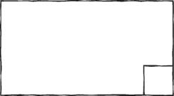

그런 다음 내가 주문한 네 조각을 만들기 위해 이렇게 칼질을 더 했다.

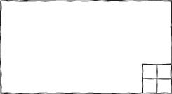

“네가 진짜 이걸 하고 있다니 믿기지가 않는군!” 아르시발트가 중얼거렸다.

“텔레네스에게 통했던 방법이라면야…” 나도 낮게 맞받았다. “자, 조용히 해.” 그러고는 다음 지시를 기다리고 있던 다스에게 다시 시선을 돌렸다. “거기 몇 조각이 나왔니?” 내가 물었다.

“네 조각이요.” 내 어이없을 만큼 쉬운 질문에 약간 당황한 듯 그가 대답했다.

“그럼 이번에는 모양은 같지만 변의 길이가 두 배인 도형을 잘라 보면 어떨까? 그러니까 한 변이 두 단위—주걱 너비 두 번—가 아니라, 몇 단위가 되지?”

“네 단위요?”

“그래. 여기 벌써 네 조각이 있잖아. 이 도형의 크기를 두 배로 키우면 몇 명에게 나누어 줄 수 있을까?”

“음, 2 곱하기 4니까 여덟 명이요.”

“2 곱하기 4가 8이라는 건 나도 동의해. 자, 직접 해 보렴.” 내가 말했다. 다스는 칼질을 이렇게 더 했다.

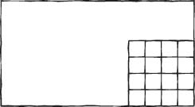

반쯤 잘랐을 때 그는 자기 실수를 깨닫고 난처한 표정을 지었지만, 나는 끝까지 마저 자르라고 격려했다. “열여섯 조각이에요.” 그가 말했다. “여덟 조각이 아니라 실제로는 열여섯 조각이 나오네요.”

“그럼 잠깐 정리해 보자. 한 변의 길이가 두 단위인 정사각형 격자를 자르면 몇 조각이 나오지?”

“네 조각이요.”

“그리고 방금 네 말대로 *네* 단위짜리 격자를 자르면 *열여섯* 조각이 나와. 그런데 만약 우리가 딱 *여덟* 조각만 원한다면 어떻게 될까? 격자의 한 변이 몇 단위가 되어야 할까?”

“세 단위요?” 다스가 조심스럽게 말했다. 그러더니 눈을 내리깔고 케이크를 세어 보았다. “아니에요, 그렇게 하면 아홉 조각이 나와요.”

“그래도 점점 가까워지고 있어. 그리고 이제 중요한 변화가 하나 생겼지. 바로 네가 모른다는 사실을 네 스스로 알게 되었다는 거야.”

다스의 눈썹이 치솟았다. “그게 중요한 건가요?”

“*여기 우리 안에서는* 그게 중요하단다.” 내가 말했다.

육천 년 전 플레인(Plane)에서 텔레네스가 노예 소년을 데리고 이 문답을 벌였을 때 그다음에 무엇을 했는지 기억이 나질 않아, 나는 오롤로에게 물어보아야 했다.

나는 케이크 판을 빙글 돌려 칼자국이 나지 않은 모퉁이를 다스 쪽으로 내밀었다. “자, 네 조각이 들어갈 만큼 큰 정사각형 하나를 잘라 보렴. 그 안을 낱개 조각으로 일일이 자를 필요는 없어.”

“크림 위에 선을 그어 봐도 되나요?” 그가 물었다.

“도움이 된다면 그러렴.”

코드가 몇 가지 힌트를 주며 거들어 준 덕분에 다스는 이런 정사각형을 만들어 냈다.

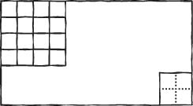

“좋아.” 내가 말했다. “이제 이것과 똑같은 정사각형 세 개를 더 붙여 보렴.”

다스는 이미 그어 둔 선을 연장하고 새 선을 몇 개 더해, 그것을 이렇게 키웠다.

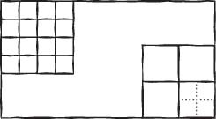

“자, 다시 확인해 보자. 이 전체 넓이에서는 몇 조각을 얻을 수 있지?”

“열여섯 조각이요.”

“좋아. 이제 오른쪽 아래 모퉁이에 있는 정사각형만 보렴.”

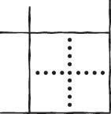

“단 한 번의 칼질로 저 정사각형을 정확히 반으로 나눌 수 있는 방법이 있을까?”

그가 점선을 따라 자르려고 하자 나는 고개를 저었다. “여기 아르시발트는 케이크에 아주 까다로워서, 누구도 자기보다 더 큰 조각을 받지 못하게 확실히 하고 싶어 하거든.”

“거 *참* 고맙네, 지혜로운 텔레네스 나리.” 아르시발트가 끼어들었다.

나는 그를 무시했다. “아르시발트가 분명히 만족할 만큼 정확하게 한 번에 자를 수 있겠니? 조각이 꼭 정사각형일 필요는 없어. 다른 모양—예컨대 삼각형 같은 거—도 괜찮아.”

그 힌트를 듣자 다스는 이렇게 칼질을 했다.

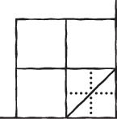

“자, 나머지 세 개도 똑같이 해 보렴.” 내가 말했다. 그러자 그는 이렇게 만들었다.

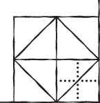

“네가 첫 번째 대각선 칼질을 했을 때, 정사각형을 정확히 반으로 자른 거 맞지?”

“네.”

“그럼 나머지 세 번의 대각선 칼질과 나머지 세 정사각형에 대해서도 마찬가지인가?”

“물론이죠.”

“그럼, 내가 팬을 돌려서 네가 이걸 이렇게 본다고 해 보자.”

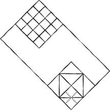

“저 한가운데에 어떤 도형이 보이니?”

“정사각형이요.”

“그럼 저 정사각형 안에는 케이크 몇 조각 분량이 들어 있을까?”

“모르겠어요.”

“글쎄, 저건 삼각형 네 개로 이루어져 있지, 안 그래?”

“네.”

“그 삼각형 하나하나는 작은 정사각형의 절반이지, 맞니?”

“맞아요.”

“그리고 작은 정사각형 하나에는 몇 조각이 들어가지?”

“네 조각이요.”

“그럼 삼각형 하나에는 몇 조각 분량의 케이크가 들어 있는 셈이지?”

“두 조각이요.”

“그럼 그런 삼각형 네 개로 이루어진 저 정사각형에는 몇 조각 분량의 케이크가 들어 있을까—”

“여덟 조각이요.” 그가 말하더니 퍼뜩 깨달았다. “우리가 아까 풀려고 했던 바로 그 문제잖아요!”

“우린 처음부터 계속 그 문제를 풀고 있었단다.” 내가 바로잡아 주었다. “그저 한두 분쯤 걸릴 뿐이지. 자, 그럼 우리에게 여덟 조각을 잘라 주겠니?”

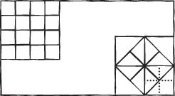

“바로 그거야.” 내가 말했다.

“이제 먹어도 돼요?”

“그래. 방금 무슨 일이 일어났는지 알겠니?”

“어… 제가 케이크를 똑같이 여덟 조각으로 잘랐죠?”

“네가 말하니 쉬워 보이는구나… 하지만 어떤 면에서는 어려운 일이었어.” 내가 말했다. “기억해 보렴. 불과 몇 분 전만 해도 너는 네 조각을 자르는 법을 알고 있었어. 그건 쉬웠지. 열여섯 조각을 자르는 법도 알고 있었어. 그것도 쉬웠지. 아홉 조각도 문제없었어. 하지만 너는 *여덟* 조각을 자르는 법은 몰랐어. 불가능해 보였지. 하지만 차근차근 깊이 생각해 냄으로써, 우리는 답을 찾아낼 수 있었어. 그저 어림짐작한 답이 아니라, 완벽하게 정확한 답을 말이야.”

## 칼카 2: 헴(배위) 공간

닐 스티븐슨의 『아나템』 부록

우리가 이리저리 드나들다가 마침 빈 포도주병 하나를 발로 차서 쓰러뜨리는 일이 있었는데, 그 병이 부엌 바닥에 이렇게 놓여 있었다.

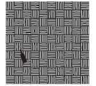

바닥은 나무 막대를 세워 격자무늬로 짜 맞춘 형태였는데, 그게 내게 좌표평면을 떠올리게 했다.

“석판이랑 분필 하나 가져오렴.” 내가 바브에게 말했다.

아이를 이렇게 부려먹자니 조금 미안한 마음도 들었지만, 배수구 고치는 걸 도와주지 않은 게 괘씸해서 일부러 심통을 부린 참이었다. 바브는 딱히 신경 쓰지 않는 눈치였고, 부엌 사방에 석판과 분필이 널려 있었으므로 심부름을 마치는 데 오래 걸리지도 않았다. 우리는 조리법이나 재료 목록을 적을 때 그걸 쓰곤 했다.

“자, 잠깐 내 장단에 맞춰서 바닥에 있는 저 병의 좌표를 적어 보겠니?”

“좌표요?”

“그래. 이 무늬를 레스퍼(Lesper)의 좌표 격자라고 생각해 보자. 바닥 무늬의 정사각형 한 칸을 1단위라고 치자. 원점을 표시하기 위해 내가 여기 감자를 하나 내려놓을게.”

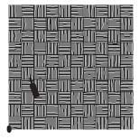

“음, 그렇다면 병은 대략 (2, 3)에 있네요.” 바브가 말하고는 잠시 분필을 놀렸다. 그러더니 석판을 내 쪽으로 기울여 보여 주었다.

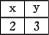

“자, 이것만으로도 이미 배위 공간이야. 네가 상상할 수 있는 가장 단순한 형태의 배위 공간이지.” 내가 그에게 일러 주었다. “그리고 병의 위치인 (2, 3)은 그 공간 안의 한 점이야.”

“그럼 그냥 보통 2차원 공간이랑 똑같잖아요.” 그가 투덜거렸다. “왜 진작 그렇게 말씀 안 하셨어요?”

“칸을 하나 더 추가할 수 있겠니?”

“물론이죠.”

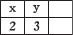

“병이 똑바로 놓여 있지 않다는 걸 눈여겨보렴. p의 10분의 1가량—혹은 성 밖에서 네가 예전에 쓰던 단위로 치면 약 20도 정도—회전해 있어. 그 회전 각도가 이 배위 공간의 세 번째 좌표가 될 거야. 네 석판의 세 번째 열이 되는 거지.”

바브가 분필로 작업하더니 이것을 내밀었다.

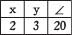

“아, 이제야 보통 2차원 공간이랑은 다른 뭔가로 보이기 시작하네요.” 그가 말했다. “이제 3차원이 되었는데, 세 번째 차원이 평범한 차원이 아니잖아요. 제가 예전에 수빈(suvin)에서 배워야 했던 뭔가랑 비슷한데요—”

“극좌표?” 나는 그가 이걸 알고 있다는 데 감탄하며 물었다. 퀸이 이 아이를 좋은 수빈에 보내느라 돈을 꽤나 썼음이 틀림없었다.

“네! 거리 대신 각도를 쓰는 거요.”

“좋아, 그럼 이 공간이 어떻게 작동하는지 좀 알아보자.” 내가 제안했다. “내가 병을 움직일 테니, 내가 ‘기록’이라고 외칠 때마다 그때의 좌표를 적어 넣으렴.”

나는 병을 살짝 비틀어 돌리면서 짧은 거리를 질질 끌었다. “기록.”

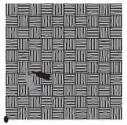 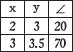

“기록. 기록. 기록…”

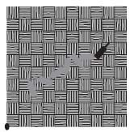 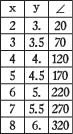

내가 말했다. “자, 배위 공간에 찍힌 이 점들의 집합은 내가 실수로 병을 발로 차서 바닥을 미끄러지고 빙글빙글 돌며 굴러가게 했을 때 얻어지는 모습과 같아. 동의하니?”

“네. 저도 대충 그렇게 생각하고 있었어요!”

“하지만 네가 자료를 받아 적기 쉽게 하려고 내가 슬로 모션으로 움직인 거지.”

바브는 이 지극히 썰렁한 농담을 어떻게 받아들여야 할지 몰라 했다. 어색한 침묵이 잠시 흐른 뒤 나는 밀고 나갔다. “자, 이제 이걸 그래프로 그려 볼 수 있겠니? 이 숫자들을 3차원 그래프로 말이야.”

“해 볼 순 있지만,” 바브가 미심쩍은 투로 말했다. “좀 이상하게 생길 텐데요.”

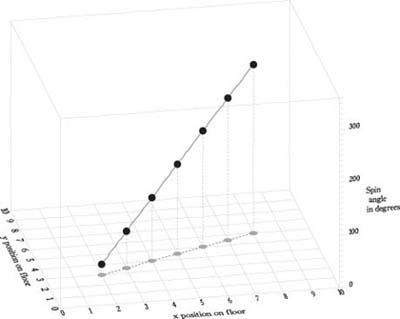

“바닥에 있는 점선 궤적은 x랑 y만 보여 주는 거예요.” 바브가 설명했다. “병이 바닥을 가로지르며 남긴 자취죠.”

“괜찮아. 배위 공간에 익숙하지 않으면 안 그래도 헷갈릴 테니까.” 내가 말했다. “왜냐하면 그중 일부—네가 점선으로 그린 xy 자취—는 우리 모두가 아드라콘 공간에서 익히 알아보는 무언가와 똑같이 보이거든. 그저 바닥에서 병이 어디로 갔는지를 보여 주니까. 하지만 각도를 나타내는 세 번째 차원은 완전히 다른 이야기야. 그건 공간상의 말 그대로의 거리를 보여 주는 게 아니거든. 병의 각변위—즉 회전—를 보여 주는 거야. 일단 그걸 이해하고 나면, 그래프에서 곧장 읽어 내서 ‘아, 알겠네, 20도에서 시작해서 바닥을 미끄러져 가는 동안 300 몇 도까지 빙글 돌아갔구나’라고 말할 수 있게 되지. 하지만 그 비밀 암호를 모르면 도무지 무슨 뜻인지 알 수 없는 거야.”

“그런데 이게 어디에 쓸모가 있는 건가요?”

“글쎄, 바닥에 병 하나만 있는 것보다 훨씬 더 복잡한 상황을 상상해 보렴. 병 하나와 감자 하나가 있다고 해 보자. 그렇다면 병-감자 계의 상태를 나타내기 위해서는 10차원 배위 공간이 필요할 거야.”

“10차원이요!?”

“병에 5차원, 감자에 5차원.”

“어떻게 5차원이 나오죠!? 병에는 겨우 3차원만 쓰고 있잖아요!”

“그래, 하지만 우리가 병의 회전 자유도 두 개를 슬쩍 빼놓고 반칙을 썼거든.” 내가 말했다.

“무슨 뜻인가요—?”

나는 쭈그리고 앉아 병에 손을 얹었다. 마침 상표가 바닥 쪽을 향하고 있었다. 나는 병을 데굴 굴렸다. “자 봐, 상표를 읽을 수 있도록 내가 병을 긴 축을 중심으로 회전시키고 있지.” 내가 가리켜 보였다. “이 회전은 네가 석판에 적은, 발로 차서 빙글 돌리는 회전과는 완전히 별개이면서 독립적인 숫자야. 그러니 이걸 위한 차원이 하나 더 필요해.” 이제 나는 병의 밑바닥을 바닥에 댄 채 병을 붙잡고, 병목이 바닥에서 비스듬히 위를 향하도록 대포처럼 기울여 세웠다. “그리고 내가 지금 하는 이것 역시 또 하나의 완전히 독립적인 회전이야.”

“그럼 병 하나에만 벌써 5차원이 되네요.” 바브가 말했다.

“그래. 완전히 일반화하려면 수직 방향 움직임을 추적하기 위해 여섯 번째 차원까지 더해야 할 거야.” 나는 그렇게 말하며 병을 바닥에서 들어 올렸다. “그러면 병의 위치와 방향만 나타내는 데도 우리 배위 공간에는 6차원이 필요해지지.” 나는 병을 다시 내려놓았다. “하지만 바닥 위에 붙여 두는 한에서는 5차원만으로도 충분히 해 나갈 수 있어.”

“알겠어요.” 바브가 말했다. 그는 뭔가를 완전히 이해했을 때만 이 말을 썼다.

“그렇게 생각하다니 다행이네. 6차원으로 사고하는 건 어려운 일이거든.”

“저는 그냥 세 칸 대신 여섯 칸짜리 열이 석판에 있다고 생각해요.” 그가 말했다. “그런데 왜 감자를 위해서 완전히 새로운 6차원이 더 필요한지는 이해가 안 돼요. 병에 쓰던 그 여섯 개를 감자에도 그대로 다시 쓰면 안 되나요?”

“어느 정도는 그렇게 하는 셈이지.” 내가 말했다. “하지만 숫자들은 서로 다른 열에 따로 적어 두는 거야. 그렇게 해야 표의 각 행이 주어진 순간에 병/감자 계에 대해 알 수 있는 모든 것을 규정해 주니까. 각 행—즉 병의 x, y, z 위치, 발로 차서 도는 각도, 상표 읽는 각도, 위로 기울어진 각도를 나타내는 여섯 개의 숫자에다 감자에 대한 똑같은 여섯 개의 숫자를 더한 열두 개의 숫자 묶음—이 바로 12차원 배위 공간 속의 한 점이 되는 거야. 그리고 이론학자들이 이 공간을 편리하게 여기는 이유 중 하나는, 이 점들을 서로 이어서 배위 공간 속의 궤적을 만들 수 있기 때문이지.”

“‘궤적’이라고 하시면 저는 뭔가 공중을 날아가는 걸 떠올리게 되는데,” 바브가 말했다. “전혀 공간처럼 생기지도 않은 이 12차원 공간에서 그 단어를 쓰실 때는 무슨 뜻인지 잘 못 따라가겠어요.”

“음, 아주 단순하게 만들어서 병과 감자가 x축 위에서만 움직이도록 제한해 보자.” 내가 말했다. “그리고 회전은 무시하자고.” 나는 둘을 이렇게 옮겨 놓았다.

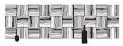

“네 석판에 둘의 x 좌표를 기록해 볼 수 있겠니?” 내가 물었다.

“물론이죠.” 그가 말했고, 잠시 뒤 이것을 내게 보여 주었다.

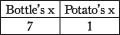

“이제 내가 둘을 서로 부딪쳐 박살을 낼 거야.” 내가 말했다. “물론 슬로 모션으로 말이야. 둘의 위치를 기록으로 남겨 보겠니?” 그리고 아까와 거의 마찬가지로 나는 감자와 병을 조금씩 움직이기 시작했고, 표에 새 줄을 추가하고 싶을 때마다 “기록”이라고 외쳤다.

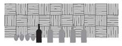

“병이 더 빨리 움직이네요.” 우리가 작업하는 동안 그가 관찰한 바를 말했다.

“그래. 두 배 더 빨라.” 마침내 나는 3번 위치에서 병 위에 감자를 올려놓고 멈추었다.

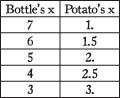

“둘이 방금 충돌했어.” 내가 말했다. “그러니까 이제 서로 부딪쳐 튕겨 나갈 거야. 하지만 충돌하면서 감자가 으깨져 에너지가 일부 손실되었기 때문에 아까보다 더 느리게 움직일 거야.” 내가 어깨너머로 조금 거들어 주자, 바브는 충돌 후의 점 여러 개를 표에 더 채워 넣었다.

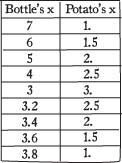

“자, 됐어.” 나는 발사체들을 놓아주고 몸을 일으켜 세우며 말했다. “자, 이 모든 움직임은 일직선 위에서 일어났지. 그러니까 네가 계속 사운트 레스퍼의 좌표계로만 생각한다면 이건 1차원 상황이야. 하지만 사운트 헴이라면 여기서 네 눈에 기이하게 비칠 만한 발상을 할 거야. 헴은 표의 각 행을 *2차원* 배위 공간의 한 점을 지정하는 것으로 생각할 테니까.”

“각 쌍을 하나의 점으로 취급한다는 거군요.” 바브가 자기 말로 바꾸어 이해했다. “그러니까 시작점은 (7, 1)이고, 그런 식으로요.”

“바로 그거야. 나를 위해서 그걸 그래프로 그려 줄 수 있겠니?”

“물론이죠. 아주 간단해요.”

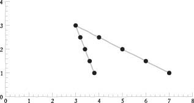

“이상하네요!” 바브가 감탄했다. “사운트 헴이 상황 전체를 완전히 안팎으로 뒤집어 놓은 것 같아요.”

“자, 분필을 잠깐만 줘 보세요. 당신이 이해하기 쉽도록 몇 가지 표시를 덧붙여 줄게요.” 내가 말했다. 몇 분 뒤, 우리 앞에는 이런 그림이 놓여 있었다.

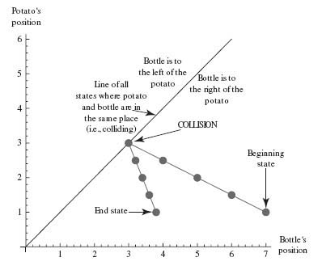

“이 ‘충돌선’은,” 내가 말했다. “병과 감자가 우연히 같은 자리에 놓이는—다시 말해 둘의 좌표가 서로 같아지는—모든 점들의 집합에 지나지 않아요. 그리고 어떤 이론학자든 이 도표를 보면, 병이니 감자니 바닥이니 하는 물리적 상황을 전혀 모르는 상태에서도 저 선에 무언가 특별한 점이 있다는 걸 단박에 알아볼 수 있습니다. 이 계(system)의 상태는 저 선에 닿기 전까지는 질서 정연하고 예측 가능한 방식으로 진행됩니다. 그러다 선에 닿는 순간 이례적인 일이 벌어지죠. 궤적이 머리핀처럼 급격히 꺾입니다. 점들 사이의 간격도 더 촘촘해지죠—이는 두 물체가 더 느리게 움직이고 있다는 뜻이고, 곧 계가 어떤 식으로든 에너지를 잃었다는 의미입니다. 이걸 보고 감탄해 넘어가길 기대하는 건 아니지만, 어쩌면 왜 이론학자들이 물리계를 사고하는 방식으로 구성 공간을 즐겨 쓰는지 짐작할 수 있는 실마리쯤은 될 거예요.”

“그래도 뭔가 더 있을 거 아니에요.” 바브가 말했다. “그냥 더 단순한 방식으로 도표를 그릴 수도 있었잖아요.”

“이 방식이 *더* 단순한 겁니다.” 내가 우겼다. “진실에 더 가까우니까요.”

“지금 힐라이아 이론 세계 이야기를 하시는 건가요?” 바브가 반쯤 속삭이듯, 그러면서도 반쯤 우쭐해하며 물었다. 마치 그것이야말로 프라가 저지를 수 있는 가장 발칙한 일탈이라도 된다는 투였다.

“나는 에드하르파입니다.” 내가 대답했다. “이곳의 몇몇 사람들이 뭐라 생각하든 상관없이…… 그게 나라는 사람이에요. 그리고 당연히 우리는 우리가 생각하는 바를 가능한 한 가장 단순하고 가장 우아한 방식으로 표현하고자 합니다. 이론학자들에게 흥미로운 많은—아니, 대부분의—경우에, 사운트 헴의 구성 공간은 당신이 지금까지 억지로 써야 했던 사운트 레스퍼의 x, y, z 좌표 공간보다 그 역할을 훨씬 더 잘 해냅니다.”

바브의 머릿속에 무언가 떠올랐다. “병과 감자가 각각 여섯 개의 숫자를 가졌잖아요—헴 공간에서 여섯 개의 좌표를요.”

“맞아요. 일반적으로 어떤 물체의 위치를 나타내는 데는 여섯 개의 숫자가 필요하죠.”

“궤도를 도는 위성도 여섯 개의 숫자가 필요하잖아요!”

“그렇습니다—궤도 요소죠. 궤도를 도는 위성은 어떤 좌표계를 쓰든 *언제나* 6차원 헴 공간이 필요합니다. 만약 사운트 레스퍼의 좌표계를 쓴다면, 아까 당신이 불평했던 바로 그 문제에 부딪히게 되죠—”

“x와 y와 z만으로는 아무것도 알 수가 없다는 거요!”

“맞아요. 하지만 그것을 여섯 개의 다른 숫자를 사용하는 *다른* 6차원 공간으로 변환하면, 우리가 병과 감자 시나리오를 적절한 공간에 그려 넣었을 때 모든 게 명쾌해졌던 것과 똑같이, 아주 명확해집니다. 위성의 경우 그 여섯 개의 숫자는 이심률, 궤도 경사각, 근일점 인수, 그리고 지금 당장 줄줄 읊지는 않을 복잡한 이름을 가진 나머지 세 개예요. 그중 몇 가지만 예로 들어 보자면, 이심률은 그 궤도가 안정적인지 아닌지를 한눈에 알려 줍니다. 궤도 경사각은 극궤도인지 적도 궤도인지 알려 주죠. 그런 식입니다.”

## 칼카 3: 복합 원형주의 대 단순 원형주의

닐 스티븐슨의 《아나템(*Anathem*)》 부록

“여기 우리 모두가 본 적 있는 두 상자 도표가 있습니다.” 크리스칸이 말을 꺼내며 먼지 바닥에 대략 이런 그림을 그렸다.

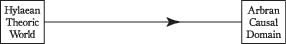

“이 화살표는 힐라이아 이론 세계에 속한 실체들이 아르브르 인과 영역 내부에 효과를 일으킬 수는 있지만 그 반대는 불가능하다는 것을 뜻합니다. 그리고 사람들이 석판에 이런 그림을 분필로 그려 넣을 때 무엇을 주장하고 있는 것인지 수고를 들여 풀어내 보면, 결국 우리가 원형주의(Protism)라 부르는 것을 정의하는 몇 개의 전제로 귀결됩니다. 두 분도 이 전제들을 잘 알고 계시겠지만, 양해해 주신다면 우리가 정확히 같은 출발선에서 시작하고 있는지 확인하기 위해 간략히 짚고 넘어가겠습니다.”

“그러시죠.” 내가 말했다.

“얼마든지요.” 리오가 말했다.

“좋습니다. 첫 번째 주장은 이렇습니다. 이론학의 대상이 되는 실체들은 인간의 지각, 정의, 구성과는 독립적으로 존재한다. 이론학자들이 그것들을 창조하는 것이 아니라, 단지 발견할 뿐이다. 그리고 두 번째 전제는 인간의 정신이 그러한 실체들을 지각할 수 있다는 것입니다. 이론학자들이 그것들을 발견할 때 하는 일이 바로 그것이지요.”

“지금까지는 다 이해했습니다.” 내가 말했다.

“아주 좋습니다.” 크리스칸이 말했다. “자, 이제 그 두 전제를 기계적으로 읊어 대는 수준을 넘어 더 나아가고자 한다면, 첫 번째 전제에 따라 비시공간적이며 우리가 아는 우주를 이루는 실체들과 정상적인 인과 관계를 맺지 않는 이론적 실체들에 대해 인간의 정신이 어떻게 지식을 얻을 수 있는지 설명을 제시해야만 합니다. 그리고 수천 년에 걸쳐 메타이론학자들이 그 설명을 내놓으려 애쓰면서 다양한 논증들이 제기되었습니다. 예를 들어 할리카른은 우리 뇌 속에 이 일을 담당하는 기관이 들어 있다고 생각했기 때문에 프로키안들로부터 거센 비난을 받았습니다.”

“기관이라니요? 분비선 같은 걸 말입니까?” 리오가 물었다.

“그렇게 해석한 사람들도 있었고, 그가 그토록 비난을 받은 이유도 상당 부분 거기에 있습니다. 하지만 이는 아마도 번역 오류였을 겁니다. 물론 할리카른은 재구성(Reconstitution) 이전의 인물이었으므로 오르스어가 아니라 당대의 소수 언어 중 하나로 글을 썼습니다. 그의 저작을 플루키시어로 번역한 사람이 잘못된 단어를 고르는 바람에 그에게 해를 끼친 셈이죠. 할리카른은 분비선 같은 것을 염두에 둔 게 아니었습니다. 그가 생각한 것은 뇌의 고유한 능력, 즉 특정 조직 덩어리 하나에 국한되지 않는 정신 기능(faculty)이었습니다.”

“그렇게 들으니 진지하게 받아들이기가 조금 낫네요.” 내가 말했다. “좋습니다.” 크리스칸이 장황하고 지루한 할리카른 변호론으로 새어 나가려 한다는 느낌이 들었기 때문이었다. “그렇다면 이 정신 기능이 이 도표에서 일어나는 일에 대한 그의 설명에 어떻게 들어맞는 겁니까?”

“우리가 눈이나 귀 등으로 감지할 수 있는 것과는 다른 어떤 종류의 소여(given)가 어찌어찌하여 아르브르 인과 영역에 도달하고, 그것이 할리카른의 기관에 의해 지각된다는 것입니다.” 크리스칸이 말했다.

“그건 답을 주기보다 오히려 더 많은 의문을 낳는 것 같은데요.” 리오가 지적했다.

“질문에 전혀 답하지 않는 것이지요.” 크리스칸이 응수했다. “이것은 사실 질문에 답하려는 시도가 아니라, 말하자면 판 위에 말을 올려놓고 용어에 합의하는 등의 방식입니다. 자, 그럼 계속하죠. HTW(힐라이아 이론 세계)에 있는 이론적 실체들—삼각형, 정리, 그리고 여타 순수 개념들—을 크노온(cnoön)이라고 부릅니다.”

“크노온, 확인했습니다!” 리오가 말했다.

“우리와 HTW 사이에는 어떤 관계가 있는데, 그 세부 사항은 추가적인 논쟁의 대상이고 할리카른도 이름을 붙이지는 않았습니다. 하지만 그것이 바로 이 화살표로 상징되기에, 사람들은 결국 그것을 할리카른의 화살표라고 부르게 되었습니다.”

“할리카른의 화살표, 확인했습니다!”

“할리카른의 화살표는 크노온에 관한 소여가 지나가는 일방통행 도관입니다. 이 소여들은 아직 제대로 이해되지 않은 ‘힐라이아 흐름(Hylaean Flow)’이라는 과정을 통해 아르브르 인과 영역으로 들어와 할리카른의 기관에 부딪히며, 바로 그 방식으로 우리가 그것들을 인식하게 됩니다.”

“힐라이아 흐름, 확인했습니다!”

크리스칸은 리오가 별로 마음에 들지 않는다고 결론 내린 듯했으나, 겉으로 티를 내며 애써 그를 참아 주고 있었다. 나는 리오를 어깨로 밀어 제치고 대화 상대의 자리에 들어섰다. 리오는 과장된 몸짓으로 반응하며 마치 과속하는 페치(fetch)에 치이기라도 한 것처럼 길가 갓길로 대자로 뻗어 버렸다. 나는 그를 무시했다. “자,” 내가 크리스칸에게 말했다. “이제 용어는 단단히 못 박아 두었으니, 이걸로 어디로 나아가려는 겁니까?”

“이제 천오백 년을 훌쩍 건너뛰어서,” 크리스칸이 말했다. “에라스마스와 유텐틴이 내디딘 행보에 대해 이야기해 봅시다. 그들은 이 도표를 방향 비순환 그래프(Directed Acyclic Graph), 줄여서 DAG의 수많은 사례 중 특별히 단순한 한 예로 간주해 보면 무슨 일이 벌어질지 살펴보기로 했습니다. 여기서 ‘방향(directed)’이란 단지 ‘화살표가 한쪽 방향으로만 향한다’는 뜻입니다. ‘비순환(acyclic)’이라는 수식어는 화살표들이 원을 그리며 돌 수 없다는 뜻이죠. 즉, A에서 B로 가는 화살표가 있다면, 동시에 B에서 A로 가는 화살표를 가질 수는 없다는 겁니다.”

“왜 굳이 그런 조건을 달았는지 궁금하군요.”

“비순환성이라는 성질은 원형주의의 근본 교리, 곧 크노온은 변치 않는다는 교리를 보존하기 위해 필수적입니다. 만약 화살표들이 원을 그리며 도는 게 가능하다면, 우리 우주에서 일어난 사건들이 힐라이아 이론 세계의 사물들을 바꿀 수 있다는 뜻이 되어 버릴 테니까요.”

“물론이죠.” 내가 말했다. “실례했습니다. 말씀을 듣고 보니 자명한 일이네요.”

“이 도표는,” 크리스칸이 내 시선을 다시 그의 두 상자 스케치로 이끌며 말했다. “메타이론학자의 눈에는 그냥 뭔가 잘못되어 보입니다.”

“그냥 잘못되어 보인다는 게 무슨 뜻입니까? 어떻게 그런 식의 주장이 통할 수 있죠?”

“메타이론학에서는 정당한 문제 제기 방식입니다. 사람은 끊임없이 스스로에게 ‘왜 사물들은 다른 방식이 아니라 이런 방식으로 존재하는가?’라고 물어야 합니다. 그리고 이 기준을 이 도표에 적용해 보면, 즉시 문제에 부딪힙니다. 세계가 정확히 두 개뿐이라는 점이지요. 하나도 아니고, 여럿도 아니고, 딱 두 개요. 오직 하나의 세계—아르브르 인과 영역—만 있고 화살표는 하나도 없는 도표를 그릴 수도 있을 겁니다. 그편이라면 메타이론학자들(적어도 원형주의자가 아닌 이들)로부터 반론을 거의 받지 않을 테지요. 반면, ‘수많은 세계가 있다’고 주장하고서 왜 그것이 그럴듯한지 논증을 펼쳐 나갈 수도 있습니다. 하지만 ‘두 개의 세계가 있다—그것도 오직 두 개뿐이다!’라고 말하는 것은, ‘정확히 173개의 세계가 있으며, 172개뿐이라고 주장하는 자들은 전부 미치광이다’라고 말하는 것만큼이나 근거가 빈약해 보입니다.”

“알겠습니다. 그렇게 말씀하시니 일종의 괴짜 같은 구석이 있다는 데 동의합니다. 마치 데올레이터들이 자기네 경전을 이루는 책이 서른일곱 권이며, 다른 숫자를 제안하는 자는 누구든 죽어야 한다고 주장하는 것 같군요.”

“네, 바로 그것이 원형주의가 일부 진영에서 거센 반발을 불러일으키는 이유 중 하나입니다. 그래서 에라스마스/유텐틴의 발상은 간단히 ‘하나의 DAG에 대해 참인 것은 다른 DAG에 대해서도 참이어야 한다’고 말하고, 다른 개수의 세계들을 가진 다른 DAG들을 고찰해 보는 것입니다.”

크리스칸은 다시 막대기를 집어 들고, 이와 비슷한 도표를 긁어 그렸다.

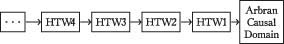

“그들은 이것을 ‘화물 열차(Freight Train)’라고 불렀습니다.” 크리스칸이 선언했다. “화물 열차 위상 구조에는 위계적 관계 속에 놓인 (어쩌면 무한히 많은) 복수의 힐라이아 이론 세계가 존재하며, 각 세계는 바로 앞 세계보다 ‘더 원형적(Protan)’이고 바로 다음 세계보다 ‘덜 원형적’입니다. 이것은 아날로그 원형주의라는 개념을 도입합니다. 단순 원형주의에서는 원형적이라는 성질이 이분법적이고 디지털적인 속성이었지요.”

“세계가 원형적이거나, 아니거나 둘 중 하나라는 거군요.” 내가 알기 쉽게 옮겼다.

“그렇습니다. 반면에 여기서는 원형성(Protanness)의 단계적 차이가 가능해집니다.”

“가능할 뿐만 아니라,” 내가 지적했다. “반드시 있어야만 하겠군요.”

“네.” 크리스칸은 이미 다른 도표를 그리느라 작업에 열중한 탓에 약간 건성으로 대답했다.

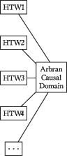

“이것은 ‘총살대(Firing Squad)’입니다.” 그가 말했다. “총살대 위상 구조에서는 일정 개수의 힐라이아 이론 세계들이 아르브르 인과 영역과 직접적인 연결선으로 이어져 있습니다. 이는 서로 아무런 관련이 없는 별개의 원형적 영역들이라는 개념을 도입합니다. 단순 원형주의에서는 가능한 모든 이론적 실체들을 ‘힐라이아 이론 세계’라고 이름 붙인 하나의 상자 안에 뭉뚱그려 넣는데, 이는 마치 그 상자 안에서 실체들이 서로 인과 관계에 놓일 수 있다는 암시를 주는 듯합니다. 하지만 어쩌면 그렇지 않을 수도 있고, 각각의 수학적 실체는 위 그림처럼 별개의 세계 안에 고립되어 있어야 할지도 모릅니다.”

이제 그는 한참 시간을 들여 훨씬 더 복잡한 도표를 그렸다.

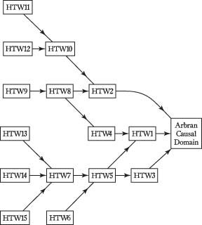

“‘역삼각주(Reverse Delta)’입니다.” 크리스칸이 말했다. “강 어귀의 삼각주(델타)와 같은 위상 구조를 가지고 있지만, 화살표가 거꾸로 흐르기 때문에 이런 이름이 붙었습니다. 역삼각주는 화물 열차 위상 구조와 총살대 위상 구조의 성질을 결합한 것이라고 요약하면 가장 쉽게 이해할 수 있습니다.”

“이해했습니다.” 나는 잠시 생각해 본 뒤 대답했다—크리스칸이 나를 시험하고 있다고 느꼈기 때문이었다. “아날로그 원형주의—원형성의 수많은 단계—도 가지고 있고, 총살대에서 나온 발상, 즉 서로 다른 크노온들이 서로 아무런 상관이 없을 수도 있으며—완전히 다른 이론 세계들에서 유래했을 수도 있다는 생각도 들어 있군요.”

크리스칸은 맞다 틀리다 대꾸하지 않은 채 다시 막대기를 놀리느라 여념이 없었다. “이것은 ‘스트라이더(Strider)’입니다.” 그가 공표했다.

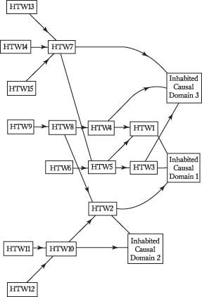

“스트라이더라니요? 어떤 식으로 성큼성큼 걷는(stride) 거죠?” 내가 물었다.

“여러 갈래의 뿌리 체계를 통해 땅에 닿는 어떤 열대 나무 종의 이름을 딴 것입니다. 보시다시피 역삼각주 위상 구조와 비슷합니다. 유일한 차이점은 스트라이더가 하나 이상의 거주자가 있는 코스모스를 포함한다는 점입니다. 제가 이름을 바꾼 걸 눈치채셨을 겁니다.”

“네. 지금까지는 언제나 아르브르 인과 영역으로 들어가는 화살표로 끝났었지요. 하지만 여기서는 다중 우주 체계를 가정하고 계시군요—인과적으로 서로 단절된, 거주자가 있는 여러 코스미(cosmi)들 말입니다.”

“맞습니다. 인과적으로는 단절되어 있지만, 그럼에도—그리고 이 점이 중요한데—동일한 크노온에 대한 지식을 공유한다는 점에서 비인과적으로 *상관관계*를 지닙니다. 이 다른 코스미의 거주자들은 우리와 같은 근원으로부터 힐라이아 흐름을 받아들입니다. 그 결과, 예컨대 그들도 우리와 같은 이유로 아드라콘의 정리를 알고 있을 수 있는 겁니다.”

“그리고 이 논의는 마침내 우리를 ‘심지(Wick)’로 이끕니다.”

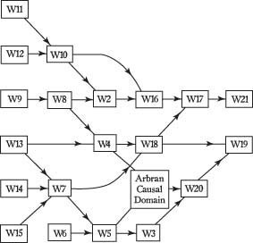

“심지는 완전히 일반화된 DAG입니다.” 크리스칸이 말했다. “힐라이아 흐름은 이 안을 왼쪽에서 오른쪽으로—더 원형적인 세계에서 덜 원형적인 세계로—이동하지만, 여기서는 세계의 유형들 사이에 아무런 구분도 두지 않음으로써 아날로그 원형주의를 논리적 극단까지 밀어붙입니다.”

“저기 우리 세계가 보이네요.” 내가 “아르브르 인과 영역”이라고 적힌 상자를 가리키며 말했다.

“네.” 크리스칸이 말했다. “그저 다른 세계들과 구별하기 위해 그렇게 표시해 두었을 뿐입니다. 하지만 원리적으로나 본질적으로나 이 도표에 있는 다른 어떤 코스미와도 다를 바가 없습니다. 여기서 모든 세계는 우리가 살고 있는 것과 비슷하게 보일 잠재적 거주 가능 코스미들입니다.”

“그렇다면 순수 관념들로 가득 찬 특별한 HTW가 있을지도 모른다는 생각은 완전히 버리신 거군요.” 내가 말했다.

크리스칸이 어깨를 으쓱했다. “어쩌면 저 왼쪽 멀리 *어딘가*에 그런 게 있을지도 모르지만, 기본적으로는 맞습니다. 이것은 우리 세계와 같은 코스미들의 연결망입니다. 그리고 이 도표에는 제가 앞서 그린 다른 어떤 위상 구조에도 나타나지 않은 한 가지 점이 있는데, 그것은 바로—”

“무엇인지 알 것 같습니다.” 내가 말하며 발끝으로 “아르브르 인과 영역” 상자를 톡톡 두드렸다. “심지에서는 우리 세계가 다른 세계들을 위한 힐라이아 흐름의 근원으로 나타나 있군요.”

“정확합니다.” 크리스칸이 말했다. “심지는 우리 세계가 사실상 어떤 다른 세계의 HTW일 수도 있다는 개념을 도입합니다.”

“아니면 그렇게 *여겨질* 수도 있겠죠.” 리오가 말을 바로잡았다. “만약 그 세계에 아직 복잡 원형주의라는 발상을 떠올린 사람이 아무도 없다면 말입니다.”

“그렇지.” 크리스칸이 말했다. 지루한 광대라고 치부해 버렸던 인물에게서 이토록 날카로운 지적이 나오자 약간 놀란 기색이었다.

“사촌들이 떠오르는군요.” 내가 말했다. 어젯밤 아르시발트가 꺼냈던 터무니없는 발상—사촌들이 단지 다른 태양계가 아니라 다른 코스모스에서 왔을지도 모른다는 생각—을 되새기면서였다.

“그렇군요.” 크리스칸이 말했다. “사촌들이 떠오르게 만드는군요.”
