# 머리말

> 들은 것은 잊어버리고, 본 것은 기억하며, 직접 해본 것은 이해한다.
> —공자(기원전 551–479)

21세기의 교양인이라면 BANG, 즉 비트(Bits), 원자(Atoms), 뉴런(Neurons), 유전자(Genes)의 핵심 원리를 두루 익혀야 한다는 말이 널리 회자된다. 과학은 이들의 기본 작동 체계를 밝혀내는 데 놀라운 성과를 거두었지만, 우리가 원자·뉴런·유전자의 실제 작동 방식을 완전히 파악하는 날은 영영 오지 않을지도 모른다. 그러나 비트와 컴퓨팅 시스템 전반은 위안이 되는 예외다. 현대 컴퓨터는 엄청나게 복잡하지만, 그 작동 원리와 구축 방식은 누구나 완벽하게 이해할 수 있다. 우리 주변의 BANG을 경외심으로 바라보며, 이 네 영역 가운데 적어도 하나는 인간의 이해 앞에 온전히 열려 있다고 생각하면 참으로 기분 좋은 일이다.

실제로 컴퓨터 초창기에는 호기심만 있다면 누구나 기계의 작동 방식을 총체적으로 이해할 수 있었다. 하드웨어와 소프트웨어 사이의 상호작용이 충분히 단순하고 투명해서, 컴퓨터의 동작을 하나의 일관된 그림으로 파악할 수 있었기 때문이다. 안타깝게도 디지털 기술이 점점 복잡해지면서 이러한 명료함은 거의 사라졌다. 컴퓨터 과학의 가장 근본적인 개념과 기법, 곧 이 분야의 진수가 이제는 난해한 인터페이스와 독점적 구현의 수많은 계층 아래 감춰져 있다. 이러한 복잡성의 필연적 결과는 세분화였다. 응용 컴퓨터 과학 교육은 각자 한 가지 측면만을 다루는 수많은 세부 과목으로 나뉘었다.

우리가 이 책을 쓴 이유는 많은 컴퓨터 과학 전공생이 나무만 보고 숲을 보지 못한다고 느꼈기 때문이다. 일반적인 학습자는 프로그래밍, 이론, 공학 과목을 차례로 이수하면서도, 전체 그림이 지닌 아름다움을 음미할 여유를 갖지 못한다. 그 전체 그림이란 하드웨어, 소프트웨어, 응용 시스템이 추상화, 인터페이스, 계약 기반 구현이라는 보이지 않는 그물망으로 긴밀하게 얽혀 있는 모습이다.

이 정교한 체계를 직접 눈으로 보고 손으로 다루어 보지 못한 많은 학습자와 실무자는 컴퓨터 내부에서 무슨 일이 벌어지는지 완전히 이해하지 못한다는 막연한 불안감을 안고 살아간다. 컴퓨터가 21세기의 가장 중요한 기계라는 사실을 떠올리면 이는 매우 안타까운 일이다.

우리는 컴퓨터의 작동 원리를 이해하는 가장 좋은 방법은 바닥부터 직접 만들어 보는 것이라고 믿는다. 이런 생각에서 출발해 다음과 같은 아이디어를 떠올렸다. 단순하면서도 충분히 강력한 컴퓨터 시스템을 명세하고, 학습자가 하드웨어 플랫폼과 소프트웨어 계층을 바닥부터 직접 구축하도록 초대하자는 것이다. 그리고 이왕 만드는 것, 제대로 만들어 보자고 마음먹었다. 기초 원리부터 범용 컴퓨터를 구축하는 일은 그 자체로 방대한 작업이기 때문이다.

따라서 우리는 단순히 컴퓨터를 만드는 데 그치지 않고, 대규모 하드웨어 및 소프트웨어 개발 프로젝트를 효과적으로 계획하고 관리하는 방법을 실습으로 보여 주는 특별한 교육적 기회를 마련했다. 또한 치밀한 추론과 모듈식 설계를 바탕으로 기초 원리에서 출발해 놀랍도록 복잡하고 유용한 시스템을 완성해 가는 짜릿함을 전하고자 했다.

이러한 노력의 결실이 오늘날 흔히 *Nand to Tetris*로 알려진 여정이다. 가장 기초적인 논리 게이트인 Nand에서 출발해 열두 개의 프로젝트를 거치면, 테트리스(Tetris)는 물론 여러분이 떠올리는 어떤 프로그램이든 실행할 수 있는 범용 컴퓨터 시스템을 완성하게 된다. 우리는 직접 이 컴퓨터 시스템을 여러 차례 설계하고, 만들고, 다시 설계하고, 다시 만들어 본 끝에, 누구나 똑같이 해낼 수 있도록 안내하는 이 책을 썼다. 아울러 [www.nand2tetris.org](http://www.nand2tetris.org) 웹사이트를 개설해, Nand to Tetris 강좌를 배우거나 가르치고자 하는 모든 사람에게 프로젝트 자료와 소프트웨어 도구를 무료로 공개했다.

기쁘게도 반응은 압도적이었다. 오늘날 Nand to Tetris 강좌는 전 세계 수많은 대학, 고등학교, 코딩 부트캠프, 온라인 플랫폼, 해커 클럽에서 강의되고 있다. 이 책과 온라인 강좌는 큰 인기를 얻었으며, 고등학생부터 구글(Google) 엔지니어에 이르기까지 수천 명의 학습자가 Nand to Tetris를 생애 최고의 교육 경험으로 꼽는 후기를 꾸준히 남기고 있다. 리처드 파인만(Richard Feynman)이 남긴 유명한 말처럼 “내가 만들지 못하는 것은 이해하지 못한 것이다.” Nand to Tetris는 곧 ‘만들며 이해하기’의 여정이다. 사람들은 이 메이커(maker) 정신에 열렬히 공감하는 듯하다.

초판 출간 이후 우리는 수많은 질문과 의견, 제안을 받았다. 이를 반영해 온라인 자료를 수정하다 보니 웹 기반 Nand to Tetris와 책 사이에 차츰 간극이 생겼다. 또한 책의 여러 절을 더 명료하고 체계적으로 다듬을 필요가 있다고 느꼈다. 미룰 수 있을 만큼 미룬 끝에, 마침내 소매를 걷어붙이고 제2판을 집필하게 되었고 그 결과물이 바로 지금 이 책이다. 이 머리말의 나머지 부분에서는 제2판의 내용을 소개하고, 마지막 절에서 초판과의 차이점을 비교한다.

## 다루는 범위

이 책은 일련의 하드웨어 및 소프트웨어 구축 과제를 진행하면서 방대한 컴퓨터 과학 지식을 익히도록 구성되어 있다. 특히 다음과 같은 주제들을 실습 프로젝트의 맥락에서 다룬다.

- 하드웨어: 불 산술, 조합 논리, 순차 논리, 논리 게이트의 설계와 구현, 멀티플렉서, 플립플롭, 레지스터, RAM 장치, 카운터, 하드웨어 기술 언어(HDL), 칩 시뮬레이션, 검증 및 테스트.
- 아키텍처: ALU/CPU 설계와 구현, 클록과 사이클, 주소 지정 방식, 인출 및 실행(fetch and execute) 논리, 명령어 집합, 메모리 맵 입출력(memory-mapped I/O).
- 저수준 언어: 단순한 기계어(이진 및 기호 형식)의 설계와 구현, 명령어 집합, 어셈블리 프로그래밍, 어셈블러.
- 가상 머신: 스택 기반 오토마타, 스택 산술, 함수 호출과 반환, 재귀 처리, 단순한 VM 언어의 설계와 구현.
- 고급 언어: 자바(Java)와 유사한 단순 객체 기반 언어의 설계와 구현: 추상 자료형, 클래스, 생성자, 메서드, 유효 범위(scoping) 규칙, 구문과 의미, 참조.
- 컴파일러: 어휘 분석, 파싱, 심볼 테이블, 코드 생성, 배열과 객체의 구현, 2단계 컴파일(two-tier compilation).
- 프로그래밍: 제공된 API에 따라 어셈블러, 가상 머신, 컴파일러를 구현하는 작업. 어떤 프로그래밍 언어로도 수행할 수 있다.
- 운영체제: 메모리 관리, 수학 라이브러리, 입출력 드라이버, 문자열 처리, 텍스트 출력, 그래픽 출력, 고급 언어 지원의 설계와 구현.
- 자료구조와 알고리즘: 스택, 해시 테이블, 리스트, 트리, 산술 알고리즘, 기하 알고리즘, 실행 시간 고려 사항.
- 소프트웨어 공학: 모듈식 설계, 인터페이스/구현 패러다임, API 설계와 문서화, 단위 테스트, 선제적 테스트 계획, 품질 보증, 대규모 프로그래밍.

Nand to Tetris의 독보적인 특징은 이 모든 주제를 ‘현대 컴퓨터 시스템을 바닥부터 구축한다’는 하나의 명확하고 포괄적인 목표 아래 유기적으로 엮어 제시한다는 점이다. 사실 이것이 바로 우리가 주제를 선정한 기준이었다. 이 책은 고급 객체 기반 언어로 작성한 프로그램을 실행할 수 있는 범용 컴퓨터 시스템을 만드는 데 꼭 필요한 최소한의 주제에 집중한다. 그리고 알고 보면 이 핵심 주제들은 응용 컴퓨터 과학의 가장 근본적인 개념과 기법, 나아가 가장 아름다운 아이디어 대부분을 아우르고 있다.

## 강좌

Nand to Tetris 강좌는 대개 학부생과 대학원생 모두 수강할 수 있도록 개설되며, 독학하는 학습자들 사이에서도 인기가 매우 높다. 이 책을 기반으로 한 강좌는 전통적인 컴퓨터 과학 커리큘럼과 ‘직교하는(perpendicular)’ 성격을 지녀, 교육 과정의 어느 시점에나 수강할 수 있다. 가장 자연스러운 배치 시점은 두 곳이다. 하나는 프로그래밍 입문 직후에 듣는 기초 과목(CS-2)이고, 다른 하나는 학위 과정 막바지에 듣는 종합 과목(CS-99)이다. 전자는 시스템 관점에서 응용 컴퓨터 과학 전반을 조망하는 입문 강좌 역할을 하며, 후자는 이전 과목들 사이의 빈틈을 메워 주는 프로젝트 기반 통합 강좌 역할을 한다.

최근 들어 전통적인 컴퓨터 아키텍처 과목과 컴파일러 과목의 핵심 주제를 하나의 틀로 묶어 가르치는 형태도 점점 인기를 얻고 있다. 어떤 목적으로 개설되든 Nand to Tetris 강좌는 ‘컴퓨팅 시스템의 구성 요소(Elements of Computing Systems)’, ‘디지털 시스템 구축(Digital Systems Construction)’, ‘컴퓨터 구조(Computer Organization)’, ‘컴퓨터 만들기(Let’s Build a Computer)’, 그리고 물론 ‘Nand to Tetris’ 등 다양한 이름으로 불린다.

이 책과 프로젝트는 매우 모듈화되어 있다. 크게 1부(하드웨어)와 2부(소프트웨어)로 나뉘며, 각 부는 여섯 개의 장과 여섯 개의 프로젝트로 구성된다. 전체 과정을 모두 경험하기를 권하지만, 두 부를 각각 따로 학습하는 것도 얼마든지 가능하다. 주제 선택과 학습 속도에 따라 6~7주짜리 독립 강좌 두 개로 운영할 수도 있고, 한 학기 또는 두 학기 강좌로 편성할 수도 있다.

이 책은 완벽하게 자기 완결적이다. 책에서 다루는 하드웨어와 소프트웨어 시스템을 구축하는 데 필요한 지식은 모두 각 장과 프로젝트 안에 담겨 있다. 1부(하드웨어)는 선수 지식이 전혀 필요 없으므로, 학생이든 독학자든 누구나 프로젝트 1–6에 도전할 수 있다. 2부(소프트웨어)와 프로젝트 7–12는 (언어에 관계없이) 고급 언어로 프로그래밍해 본 경험을 선수 조건으로 한다.

Nand to Tetris 강좌는 컴퓨터 과학 전공자만을 위한 것이 아니다. 하드웨어 아키텍처, 운영체제, 컴파일, 소프트웨어 공학을 단 하나의 강좌에서 실습으로 이해하고자 하는 모든 분야의 학습자에게 열려 있다. 다시 강조하지만, (2부에 필요한) 유일한 선수 조건은 프로그래밍 능력이다. 실제로 Nand to Tetris 수강생 가운데 상당수는 컴퓨터 과학 입문 과목을 들은 뒤 여러 과목으로 이루어진 정규 과정에 얽매이지 않고 컴퓨터 과학을 더 깊이 배우고 싶어 하는 비전공자들이다. 또한 하위 계층으로 ‘내려가’ 기반 기술의 작동 원리를 이해함으로써 더 나은 고급 프로그래머로 성장하고자 하는 현업 소프트웨어 개발자도 많다.

하드웨어 및 소프트웨어 업계의 심각한 개발자 부족 현상에 따라, 응용 컴퓨터 과학의 핵심만 압축한 집중 교육 과정에 대한 수요가 커지고 있다. 이러한 과정은 대개 정규 학위 과정을 전부 밟지 않고도 취업 시장에 대비할 수 있도록 설계된 코딩 부트캠프나 온라인 강좌 묶음의 형태를 띤다. 내실 있는 프로그램이라면 최소한 프로그래밍, 알고리즘, 시스템에 관한 실무 지식을 제공해야 한다. Nand to Tetris는 이러한 프로그램에서 시스템 영역을 단 한 과목으로 충실히 채워 줄 수 있는 독보적인 위치에 있다. 더 나아가 Nand to Tetris 프로젝트는 다른 과목에서 배운 알고리즘과 프로그래밍 지식을 하나로 통합하고 실전에 적용해 볼 수 있는 매력적인 장을 제공한다.

## 학습 자료

책에 소개된 하드웨어와 소프트웨어 시스템을 구축하는 데 필요한 도구는 모두 Nand to Tetris 소프트웨어 도구 모음으로 무료 제공된다. 여기에는 하드웨어 시뮬레이터, CPU 에뮬레이터, VM 에뮬레이터(모두 오픈 소스), 튜토리얼, 그리고 책에서 다루는 어셈블러, 가상 머신, 컴파일러, 운영체제의 실행 버전이 포함된다. 아울러 [www.nand2tetris.org](http://www.nand2tetris.org) 웹사이트에서는 약 200개의 테스트 프로그램과 테스트 스크립트를 비롯한 모든 프로젝트 자료를 제공하므로, 열두 개 프로젝트 각각을 점진적으로 개발하고 단위 테스트할 수 있다. 이 소프트웨어 도구와 프로젝트 자료는 Windows, Linux, macOS가 실행되는 어떤 컴퓨터에서도 별도 수정 없이 바로 사용할 수 있다.

## 책의 구성

1부(하드웨어)는 1장부터 6장으로 구성된다. 1장은 불 대수를 소개한 뒤 가장 기초적인 Nand 게이트에서 출발해 일련의 기본 논리 게이트를 구축한다. 2장은 조합 논리를 다루며 여러 가산기를 거쳐 ALU를 완성한다. 3장은 순차 논리를 다루며 각종 레지스터와 메모리 소자를 거쳐 RAM을 만든다. 4장은 저수준 프로그래밍을 논의하고 기호 형식과 이진 형식의 기계어를 명세한다. 5장은 1~3장에서 만든 칩들을 하나로 통합해 4장의 기계어로 작성된 프로그램을 실행할 수 있는 하드웨어 아키텍처를 구축한다. 6장은 저수준 프로그램 번역을 다루며 어셈블러를 완성하는 것으로 마무리된다.

2부(소프트웨어)는 7장부터 12장으로 구성되며, 컴퓨터 과학 입문 수준의 프로그래밍 경험(언어 무관)을 필요로 한다. 7~8장은 스택 기반 오토마타를 소개하고 JVM과 유사한 가상 머신의 구축 과정을 설명한다. 9장은 자바와 유사한 객체 기반 고급 언어를 제시한다. 10~11장은 파싱과 코드 생성 알고리즘을 다루고 2단계 컴파일러의 구축 과정을 설명한다. 12장은 다양한 메모리 관리, 대수, 기하 알고리즘을 소개하고 이를 실제로 구현하는 운영체제를 다룬다. 이 운영체제는 2부에서 구현한 고급 언어와 1부에서 구축한 하드웨어 플랫폼 사이의 간극을 메우도록 설계되었다.

이 책은 *추상화-구현(abstraction-implementation)* 패러다임을 따른다. 각 장은 관련 개념과 일반적인 하드웨어 또는 소프트웨어 시스템을 소개하는 소개(Introduction) 절로 시작한다. 이어지는 명세(Specification) 절은 시스템의 추상화, 즉 시스템이 어떤 방식으로든 제공해야 할 여러 서비스를 기술한다. 이처럼 *무엇을(what)* 만들지 제시한 뒤, 각 장은 그 추상화를 *어떻게(how)* 실현할 수 있는지 논의하며 제안된 구현(Implementation) 절로 이어진다. 그다음은 항상 프로젝트(Project) 절로, 해당 장에서 다룬 시스템을 직접 구축하고 단위 테스트하기 위한 단계별 지침, 테스트 자료, 소프트웨어 도구를 제공한다. 마지막 전망(Perspective) 절에서는 본문에서 다루지 못한 주목할 만한 주제들을 짚어 준다.

## 프로젝트

이 책에서 설명하는 컴퓨터 시스템은 *진짜*다. 실제로 만들 수 있도록 설계되었으며, 실제로 작동한다! 이 책은 직접 손을 걷어붙이고 바닥부터 컴퓨터를 만들어 보고자 하는 능동적인 독자를 위해 쓰였다. 시간과 노력을 들여 직접 구현해 본다면, 그저 읽기만 해서는 결코 얻을 수 없는 깊은 이해와 성취감을 맛보게 될 것이다.

프로젝트 1, 2, 3, 5에서 만드는 하드웨어 장치는 단순한 하드웨어 기술 언어(HDL)로 구현하고, 제공되는 소프트웨어 기반 하드웨어 시뮬레이터에서 시뮬레이션한다. 이는 실제 산업계의 하드웨어 아키텍트가 일하는 방식과 똑같다. 프로젝트 6, 7, 8, 10, 11(어셈블러, 가상 머신 , 컴파일러 )은 어떤 프로그래밍 언어로든 작성할 수 있다. 프로젝트 4는 이 컴퓨터의 어셈블리 언어로 작성하며, 프로젝트 9와 12(간단한 컴퓨터 게임과 기본 운영체제)는 10장과 11장에서 컴파일러를 직접 만들 자바 유사 고급 언어인 Jack으로 작성한다.

프로젝트는 모두 열두 개다. 평균적으로 각 프로젝트는 수준 높은 정규 대학 강좌의 1주일 치 과제 분량에 해당한다. 프로젝트들은 각각 독립적이어서 원하는 순서대로 수행하거나 건너뛸 수 있다. Nand to Tetris의 완전한 경험은 모든 프로젝트를 순서대로 완수하는 것이지만, 이는 여러 선택지 가운데 하나일 뿐이다.

이토록 방대한 내용을 한 학기 강좌에서 모두 다룰 수 있을까? 답은 ‘그렇다’이며, 실제 성과가 이를 증명한다. 현재 150개가 넘는 대학에서 한 학기 분량의 Nand to Tetris 강좌를 운영하고 있다. 학생 만족도는 대단히 높으며, Nand to Tetris 온라인 공개 강좌(MOOC)는 최고 평점 온라인 강좌 목록의 최상위권에 꾸준히 이름을 올리고 있다. 학습자들이 우리의 교육 방식에 호응하는 한 가지 이유는 *집중(focus)*에 있다. 명백한 경우를 제외하면 우리는 최적화에 신경 쓰지 않으며, 이 중요한 주제는 더 전문적인 다른 과목으로 넘긴다. 또한 학생들은 입력에 오류가 없다고 가정할 수 있다. 예외 처리 코드를 작성할 필요가 없으므로 소프트웨어 프로젝트가 훨씬 핵심에 집중되고 관리하기 쉬워진다. 잘못된 입력을 처리하는 일도 물론 매우 중요하지만, 그런 역량은 프로젝트 확장 과제나 별도의 프로그래밍 및 소프트웨어 설계 과목에서 충분히 갈고닦을 수 있다.

## 제2판에 대하여

Nand to Tetris는 원래부터 두 가지 큰 주제로 구성되어 있었지만, 제2판에서는 이 구조를 한층 분명히 드러냈다. 이제 책은 1부(하드웨어)와 2부(소프트웨어)라는 두 개의 독립된 부로 뚜렷이 나뉜다. 각 부는 여섯 개의 장과 여섯 개의 프로젝트로 이루어져 있으며, 해당 부의 장들을 안내하는 새로 쓴 도입부로 시작한다. 중요한 점은 두 부가 서로 독립적이라는 것이다. 덕분에 새로운 책 구성은 한 학기 강좌뿐 아니라 쿼터제(quarter-long) 강좌에도 잘 맞는다.

새로 추가된 두 개의 도입 장 외에도, 제2판에는 네 개의 새로운 부록이 실렸다. 많은 학습자의 요청에 따라, 초판에서는 여러 장에 흩어져 있던 다양한 기술적 주제를 새 부록에 모아 집중적으로 정리했다. 또 다른 새 부록에서는 모든 불 함수를 Nand 연산자만으로 구현할 수 있음을 형식적으로 증명하여, 응용 중심의 하드웨어 구축 프로젝트에 이론적 시각을 더했다. 이 밖에도 수많은 새로운 절, 그림, 예제가 추가되었다.

모든 장과 프로젝트 자료는 Nand to Tetris의 핵심 주제인 ‘추상화와 구현의 분리’를 강조하는 방향으로 전면 개편되었다. 특히 지난 수년간 Nand to Tetris 질의응답(Q&A) 포럼에 올라온 수천 개의 질문에 답할 수 있도록 예제와 설명 절을 추가하는 데 각별한 공을 들였다.

## 감사의 글

이 책과 함께 제공되는 소프트웨어 도구는 IDC 헤르츨리야(IDC Herzliya)와 히브리 대학교(Hebrew University)의 제자들이 개발했다. 두 명의 수석 소프트웨어 아키텍트는 Yaron Ukrainitz와 Yannai Gonczarowski였으며, 개발진에는 Iftach Ian Amit, Assaf Gad, Gal Katzhendler, Hadar Rosen-Sior, Nir Rozen이 참여했다. Oren Baranes, Oren Cohen, Jonathan Gross, Golan Parashi, Uri Zeira는 도구의 다른 부분을 맡아 작업했다. 이 학생 개발자들과 함께 일한 것은 큰 기쁨이었으며, 그들의 교육에 일조할 기회를 얻어 자랑스럽다.

이 책의 토대가 된 초기 강좌 운영을 도운 조교 Muawyah Akash, Philip Hendrix, Eytan Lifshitz, Ran Navok, David Rabinowitz에게도 감사한다. Tal Achituv, Yong Bakos, Tali Gutman, Michael Schröder는 강의 자료의 여러 측면에 큰 도움을 주었고, Aryeh Schnall, Tomasz Różański, Rudolf Adamkovič은 세심한 편집 제안을 건넸다. 특히 Rudolf의 의견은 매우 통찰력이 넘쳤으며 이에 깊이 감사한다.

전 세계의 수많은 사람이 Nand to Tetris에 참여해 주었기에 일일이 감사를 전하기는 어렵다. 다만 한 사람만은 예외로 두고자 한다. 콜로라도 출신의 소프트웨어 및 펌웨어 엔지니어인 Mark Armbrust는 Nand to Tetris 학습자들의 수호천사 같은 존재였다. 전 세계 질의응답(Q&A) 포럼의 관리를 자원한 Mark는 깊은 인내심과 품격 있는 어조로 수많은 질문에 답했다. 그의 답변은 정답을 곧바로 알려 주기보다 학습자가 스스로 노력해 해답을 깨닫도록 이끌었다. 덕분에 Mark는 전 세계 수많은 학습자의 존경과 찬사를 받았다. 10년 넘게 Nand to Tetris의 최전선에서 봉사하며 그는 2,607개의 글을 작성하고, 수십 개의 버그를 찾아냈으며, 수정 스크립트와 패치를 만들었다. 본업과 병행하며 이 모든 일을 해낸 Mark는 Nand to Tetris 커뮤니티의 기둥이 되었고, 커뮤니티는 그의 제2의 고향이 되었다. Mark는 몇 달간 심장병과 투병한 끝에 2019년 3월 세상을 떠났다. 입원 기간 동안 Mark는 Nand to Tetris 학생들로부터 매일 수백 통의 이메일을 받았다. 전 세계의 젊은이들은 그의 끝없는 너그러움에 감사를 표하며 그가 자신들의 삶에 미친 영향을 나누었다.

최근 몇 년간 컴퓨터 과학 교육은 개인의 성장과 경제적 이동성을 이끄는 강력한 원동력이 되었다. 돌이켜 보면, 초기부터 모든 교육 자료를 오픈소스로 무료 공개하기로 결정한 것은 참으로 다행스러운 일이었다. 말 그대로 원하는 사람이라면 누구나 아무런 제약 없이 Nand to Tetris 강좌를 배울 수 있을 뿐만 아니라 직접 가르칠 수도 있다. 비영리 목적으로 운영하기만 하면 우리 웹사이트에 접속해 필요한 자료를 가져다 쓰면 된다. 덕분에 Nand to Tetris는 수준 높은 컴퓨터 과학 교육을 무료로 공정하게 확산하는 손쉬운 수단이 되었고, 끝없는 선의가 뒷받침하는 거대한 교육 생태계로 자리 잡았다. 이를 실현하는 데 힘을 보태 준 전 세계의 많은 분께 감사한다.

# 1부 하드웨어

> 진정한 발견의 항해는 새로운 땅을 찾는 것이 아니라 새로운 눈을 갖는 데 있다.
>
> —마르셀 프루스트(Marcel Proust, 1871–1922)

이 책은 발견의 항해다. 독자는 여기서 세 가지를 배우게 된다. 컴퓨터 시스템이 어떻게 동작하는지, 복잡한 문제를 다루기 쉬운 모듈로 어떻게 나누는지, 그리고 대규모 하드웨어와 소프트웨어 시스템을 어떻게 구축하는지이다. 바닥부터 시작해 실제로 동작하는 완전한 컴퓨터 시스템을 직접 만들어 가는 실습 중심의 여정이 될 것이다. 컴퓨터 그 자체보다 훨씬 더 중요한 교훈들은 이러한 구축 과정의 부산물로 자연스럽게 얻게 된다. 심리학자 칼 로저스(Carl Rogers)는 이렇게 말했다. “행동에 중대한 영향을 미치는 유일한 배움은 스스로 발견하거나 스스로 체득한 배움, 곧 경험 속에서 소화해 낸 진리이다.” 이 도입부에서는 앞으로 마주하게 될 발견과 진리, 그리고 경험의 일부를 미리 살펴본다.

## Hello, World 아래의 세상

프로그래밍 경험이 조금이라도 있다면 학습 초기에 아래와 비슷한 프로그램을 접해 보았을 것이다. 경험이 없더라도 이 프로그램이 무엇을 하는지는 짐작할 수 있다. `Hello` `World`라는 텍스트를 화면에 출력하고 종료한다. 이 프로그램은 Java와 비슷한 단순한 고급 언어인 Jack으로 작성되었다.

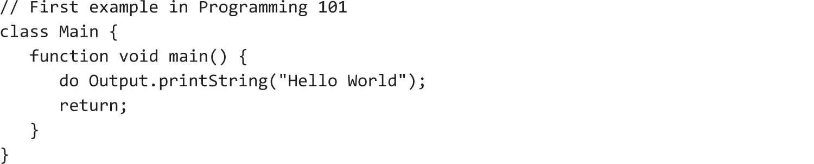

`Hello` `World`처럼 사소해 보이는 프로그램도 겉보기만큼 단순하지 않다. 이런 프로그램을 컴퓨터에서 *실제로 실행*하려면 어떤 일이 벌어져야 하는지 멈춰 서서 생각해 본 적이 있는가? 내부를 들여다보자. 우선 이 프로그램은 텍스트 파일에 저장된 평범한 문자열에 불과하다. 기계어로 작성된 명령어만 이해하는 컴퓨터에게 이러한 추상화는 완전히 수수께끼일 뿐이다. 따라서 이 프로그램을 실행하려면 먼저 고급 코드를 구성하는 문자열을 파싱(구문 분석)해 그 의미(semantics), 즉 프로그램이 무엇을 하려는지 파악한 뒤, 대상 컴퓨터의 기계어로 그 의미를 다시 표현하는 저수준 코드를 생성해야 한다. *컴파일(compilation)*이라 부르는 이 정교한 번역 과정을 거치면 비로소 실행 가능한 기계어 명령어 시퀀스가 만들어진다.

물론 기계어 역시 일종의 추상화, 즉 미리 약속된 이진 코드의 집합이다. 이 추상화를 현실로 구현하려면 어떤 *하드웨어 아키텍처*가 필요하다. 그리고 이 아키텍처는 다시 레지스터, 메모리 장치, 가산기 같은 여러 칩의 집합으로 구현된다. 이러한 하드웨어 장치는 모두 더 낮은 수준의 *기본 논리 게이트*로 구성되며, 이 게이트들은 다시 *Nand*나 *Nor* 같은 원시 게이트(primitive gate)로 만들 수 있다. 원시 게이트는 계층 구조에서 매우 낮은 위치에 있지만, 이들 역시 보통 트랜지스터로 구현되는 여러 *스위칭 소자*로 이루어진다. 그렇다면 트랜지스터는 무엇으로 만들어질까? 음, 여기서는 더 이상 내려가지 않겠다. 그 지점이 바로 컴퓨터 과학이 끝나고 물리학이 시작되는 곳이기 때문이다.

아마 이렇게 생각할 수도 있다. “*내* 컴퓨터에서는 프로그램을 컴파일하고 실행하는 일이 훨씬 쉬운데, 이 아이콘을 클릭하거나 저 명령어만 입력하면 끝이잖아!” 실제로 현대 컴퓨터 시스템은 물에 잠긴 빙산과 같다. 대부분의 사람은 수면 위의 일부분만 보며, 컴퓨팅 시스템에 대한 지식도 단편적이고 피상적인 수준에 머문다. 그러나 수면 아래를 탐험하고 싶다면 정말 잘 찾아왔다! 그 아래에는 컴퓨터 과학에서 가장 아름다운 개념들로 이루어진 매혹적인 세계가 펼쳐져 있다. 이 지하 세계를 깊이 이해하느냐가 초보 프로그래머와 복잡한 하드웨어·소프트웨어 기술을 창조할 수 있는 숙련된 개발자를 가른다. 그리고 이러한 기술이 어떻게 동작하는지 뼛속까지 제대로 이해하는 가장 좋은 방법은 바닥부터 완전한 컴퓨터 시스템을 직접 구축해 보는 것이다.

## Nand to Tetris

바닥부터 컴퓨터 시스템을 구축하기로 했다면, 구체적으로 어떤 컴퓨터를 만들어야 할까? 알고 보면 모든 범용 컴퓨터(모든 PC, 스마트폰, 서버)는 Nand to Tetris 머신이다. 첫째, 모든 컴퓨터는 가장 밑바닥에서 기본 논리 게이트를 토대로 하며, 그중 산업계에서 가장 널리 쓰이는 것이 Nand 게이트다(Nand 게이트가 정확히 무엇인지는 1장에서 설명한다). 둘째, 모든 범용 컴퓨터는 테트리스 게임은 물론이고 사용자가 원하는 어떤 프로그램이든 실행하도록 프로그래밍할 수 있다. 따라서 Nand나 Tetris 자체에는 특별할 것이 없다. 이 책을 독자가 곧 떠나게 될 마법 같은 여정으로 바꾸어 놓는 것은 바로 *Nand to Tetris*의 *to*라는 단어다. 뼈대만 있는 스위칭 소자 더미에서 출발해 텍스트, 그래픽, 애니메이션, 음악, 동영상, 분석, 시뮬레이션, 인공지능 등 범용 컴퓨터에 기대하는 모든 기능으로 인간의 정신을 사로잡는 기계를 완성하기까지 그 전 과정을 밟아 나가는 것이다. 그러므로 우리가 어떤 특정 하드웨어 플랫폼과 소프트웨어 계층을 구축하는지는 그리 중요하지 않다. 세상의 *모든* 컴퓨팅 시스템을 특징짓는 동일한 원리와 기법에 기반하기만 하면 된다.

그림 I.1은 Nand to Tetris 로드맵의 주요 이정표를 보여 준다. 그림의 맨 아래 계층부터 살펴보면, 모든 범용 컴퓨터는 ALU(산술 논리 장치)와 RAM(임의 접근 메모리)을 포함한 아키텍처를 갖춘다. 모든 ALU와 RAM 장치는 기본 논리 게이트로 만들어진다. 그리고 놀랍고도 다행스럽게도 곧 확인하겠지만, 모든 논리 게이트는 오직 Nand 게이트만으로 만들 수 있다. 소프트웨어 계층을 보면, 모든 고급 언어는 고급 코드를 기계 수준의 명령어로 단계적으로 낮추기 위해 일련의 번역기(컴파일러/인터프리터, 가상 머신, 어셈블러)에 의존한다. 일부 고급 언어는 컴파일 대신 인터프리트 방식으로 실행되고 일부는 가상 머신을 사용하지 않지만, 큰 그림은 본질적으로 같다. 이 관찰은 *처치-튜링 가설(Church-Turing conjecture)*로 알려진 컴퓨터 과학의 근본 원리를 드러낸다. 곧, 밑바닥에서 모든 컴퓨터는 본질적으로 동등하다.

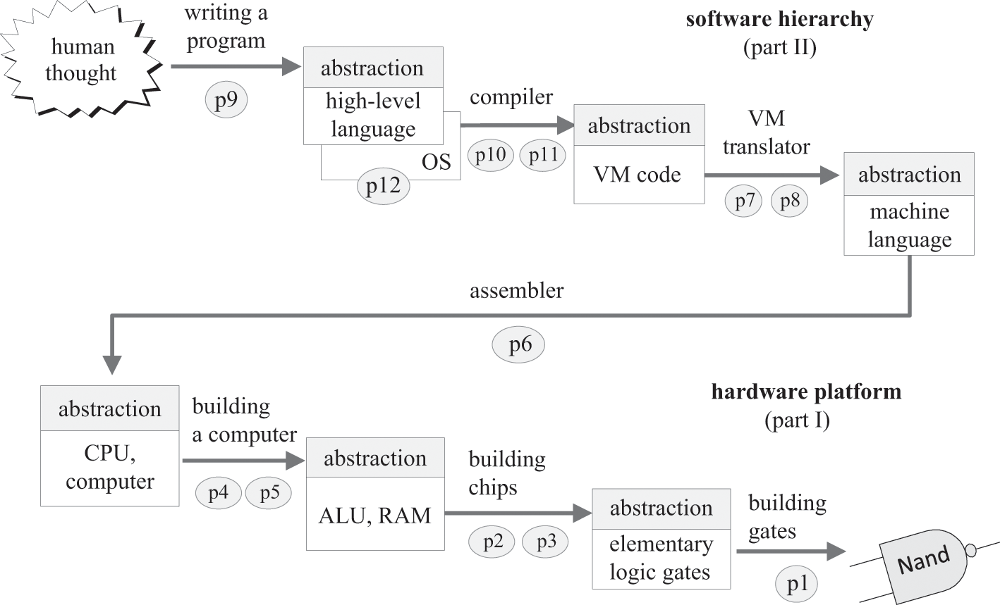

*그림 I.1 하드웨어 플랫폼과 소프트웨어 계층으로 구성된 전형적인 컴퓨터 시스템의 주요 모듈. 각 모듈은 **추상적 관점**(모듈의 **인터페이스**라고도 한다)과 **구현**을 갖는다. 오른쪽을 가리키는 화살표는 각 모듈이 바로 아래 계층의 추상적 구성 요소를 사용해 구현됨을 뜻한다. 각 원은 Nand to Tetris의 프로젝트와 장을 나타내며, 모두 열두 개의 프로젝트와 장으로 이루어져 있다.*

이 점을 짚고 넘어가는 이유는 우리의 접근 방식이 지닌 보편성을 강조하기 위해서다. 이 책에서 마주할 과제, 통찰, 요령, 기법, 용어는 현업 하드웨어 및 소프트웨어 엔지니어가 부딪히는 것과 정확히 같다. 그런 의미에서 Nand to Tetris는 일종의 입문 의식이다. 이 여정을 완주해 낸다면 독자 스스로 탄탄한 실력을 갖춘 컴퓨터 전문가로 성장할 훌륭한 토대를 얻게 될 것이다.

그렇다면 Nand to Tetris에서는 구체적으로 어떤 하드웨어 플랫폼과 어떤 고급 언어를 구축할 것인가? 한 가지 선택지는 산업 현장에서 널리 쓰이는 상용 컴퓨터 모델을 만들고 인기 있는 고급 언어의 컴파일러를 작성하는 것이다. 우리는 세 가지 이유로 이 선택을 택하지 않았다. 첫째, 컴퓨터 모델은 계속 바뀌고 인기 프로그래밍 언어도 새로운 언어에 자리를 내어 준다. 따라서 특정 하드웨어/소프트웨어 조합에 얽매이고 싶지 않았다. 둘째, 실무에서 쓰이는 컴퓨터와 언어에는 교육적 가치는 거의 없으면서 구현하는 데만 한세월이 걸리는 세부 사항이 수두룩하다. 마지막으로 우리는 쉽게 제어하고 이해하며 확장할 수 있는 하드웨어 플랫폼과 소프트웨어 계층을 원했다. 이러한 고민 끝에 이 책의 1부에서 구축하는 컴퓨터 플랫폼인 Hack과 2부에서 구현하는 고급 언어인 Jack이 탄생했다.

보통 컴퓨터 시스템은 높은 수준의 추상화가 더 단순한 추상화로 어떻게 환원되거나 실현되는지 보여 주는 *하향식(top-down)*으로 설명한다. 예를 들어 컴퓨터 아키텍처에서 실행되는 이진 기계어 명령어가 마이크로코드로 분해되어 아키텍처의 배선을 따라 이동하다가 결국 하위 계층의 ALU와 RAM 칩을 조작하는 과정을 설명할 수 있다. 반대로 *상향식(bottom-up)*으로 접근해, ALU와 RAM 칩이 이진 기계어 명령어를 구성하는 마이크로코드를 실행하도록 얼마나 정교하게 설계되는지 설명할 수도 있다. 하향식과 상향식 접근 모두 유익하며, 앞으로 구축할 시스템을 서로 다른 시각에서 바라보게 해 준다.

그림 I.1에서 화살표의 방향은 하향식 관점을 나타낸다. 어떤 두 모듈 쌍을 보더라도 상위 모듈과 하위 모듈을 잇는 오른쪽 화살표가 그려져 있다. 이 화살표의 의미는 명확하다. 상위 모듈이 바로 아래 계층의 추상적 구성 요소를 사용해 구현된다는 뜻이다. 예를 들어 고급 언어 프로그램은 각 고급 구문을 일련의 추상적 VM 명령으로 번역해 구현한다. 그리고 각 VM 명령은 다시 일련의 추상적 기계어 명령어로 번역된다. 이런 식으로 계속 이어진다. 이처럼 *추상화*와 *구현*의 구분은 시스템 설계에서 핵심적인 역할을 하며, 이제 그 내용을 살펴보겠다.

## 추상화와 구현

기본 논리 게이트 몇 개만 가지고 바닥부터 완전한 컴퓨터 시스템을 구축하는 일이 과연 인간의 힘으로 가능할까 하는 의문이 들 수 있다. 실로 어마어마한 작업일 테니 말이다! 우리는 시스템을 여러 *모듈*로 나누어 이 복잡성을 다룬다. 각 모듈은 별도의 장에서 개별적으로 설명하고, 독립된 프로젝트로 따로 구축한다. 그러면 또 이런 의문이 생길 것이다. 이 모듈들은 분명 서로 연관되어 있는데 어떻게 따로 떼어 설명하고 구축할 수 있을까? 이 책 전반에 걸쳐 보여 주겠지만, 훌륭한 모듈식 설계가 가능하게 하는 바가 바로 그것이다. 시스템의 나머지 부분을 전혀 신경 쓰지 않은 채 개별 모듈에만 집중해 작업할 수 있다. 실제로 시스템이 잘 설계되어 있다면 이 모듈들을 원하는 어떤 순서로든 구축할 수 있으며, 팀으로 작업한다면 심지어 병렬로 진행할 수도 있다.

복잡한 시스템을 다루기 쉬운 모듈로 “분할 정복(divide and conquer)”하는 인지 능력은 또 다른 인지적 재능인 각 모듈의 *추상화*와 *구현*을 구분하는 능력에 힘입어 더욱 강력해진다. 컴퓨터 과학에서 이 두 용어는 구체적인 뜻을 지닌다. 추상화는 모듈이 무엇(what)을 하는지 설명하고, 구현은 그것을 어떻게(how) 하는지 설명한다. 이 구분을 염두에 두면 시스템 공학에서 가장 중요한 규칙이 도출된다. 어떤 모듈이든(*모든 모듈에 대해*) 구성 요소로 사용할 때는 오직 그 모듈의 추상화에만 집중하고 구현 세부 사항은 철저히 무시해야 한다.

예를 들어 그림 I.1의 맨 아래 계층에서 “컴퓨터 아키텍처” 수준을 살펴보자. 그림에서 보듯 이 아키텍처의 구현은 임의 접근 메모리(RAM)를 비롯해 바로 아래 계층의 여러 구성 요소를 사용한다. RAM은 놀라운 장치다. 수십억 개의 레지스터를 담고 있을 수도 있지만, 그중 어느 레지스터에든 직접, 그리고 거의 즉각적으로 접근할 수 있다. 그림 I.1이 알려 주듯, 컴퓨터 아키텍트는 이 직접 접근 장치가 실제로 어떻게 실현되는지는 전혀 신경 쓰지 않고 추상적으로 사용해야 한다. 직접 접근 RAM이라는 마법을 구현하는 데 들어간 온갖 노력과 기발함, 그리고 극적인 과정—즉 *어떻게(how)*—은 RAM의 기능을 *사용*하는 맥락에서는 무관하므로 완전히 무시해야 한다.

그림 I.1에서 한 계층 더 내려가면, 이제 우리가 직접 RAM 칩을 구축해야 하는 입장이 된다. 어떻게 접근해야 할까? 오른쪽 화살표를 따라가 보면 RAM 구현이 그 아래 계층의 기본 논리 게이트와 칩에 기반함을 알 수 있다. 구체적으로 RAM의 저장 기능과 직접 접근 기능은 각각 *레지스터*와 *멀티플렉서*를 사용해 실현한다. 여기서도 똑같은 추상화-구현 원리가 작동한다. 우리는 이 칩들을 추상적 구성 요소로 다루며 인터페이스에만 집중할 뿐 *그것들의* 구현은 전혀 신경 쓰지 않는다. 이러한 방식은 맨 아래 Nand 수준에 도달할 때까지 계속된다.

요약하자면, 구현 과정에서 하위 수준의 하드웨어 또는 소프트웨어 모듈을 사용할 때는 언제나 그 모듈을 기성품 블랙박스 추상화로 취급해야 한다. 필요한 것은 그 모듈이 *무엇*을 할 수 있는지 설명하는 인터페이스 문서뿐이며, 그것만으로 충분하다. 인터페이스가 내세우는 기능을 모듈이 *어떻게* 수행하는지에는 일절 관심을 두지 않아야 한다. 이러한 추상화-구현 패러다임은 개발자가 복잡성을 관리하고 평정심을 유지하도록 돕는다. 압도적인 시스템을 명확히 정의된 모듈로 나누면 구현 작업을 감당할 만한 크기로 쪼갤 수 있고, 오류 탐지와 수정도 국소화할 수 있다. 이는 하드웨어 및 소프트웨어 구축 프로젝트에서 가장 중요한 설계 원칙이다.

두말할 나위 없이 이 모든 이야기는 *모듈식 설계(modular design)*라는 정교한 기술에 달려 있다. 눈앞의 문제를 명확한 인터페이스를 갖추고, 적절한 크기의 독립적인 구현 작업에 해당하며, 개별 단위 테스트 프로그램으로 검증할 수 있는 잘 정의된 모듈들의 우아한 집합으로 분리하는 인간의 능력 말이다. 실제로 모듈식 설계는 응용 컴퓨터 과학의 기본 토대다. 모든 시스템 아키텍트는 일상적으로 *모듈* 또는 *인터페이스*라 불리는 추상화를 정의한 뒤 직접 구현하거나 다른 사람에게 구현을 맡긴다. 추상화는 흔히 층층이 쌓여 점점 더 높은 수준의 기능을 만들어 낸다. 시스템 아키텍트가 훌륭한 모듈 집합을 설계하면 구현 작업은 맑은 물처럼 술술 흐르지만, 설계가 허술하면 구현은 실패로 치닫는다.

모듈식 설계는 잘 설계된 수많은 추상화를 보고 직접 구현하면서 연마되는 후천적 기술이다. 독자가 Nand to Tetris에서 경험하게 될 것이 바로 그것이다. 수백 가지 하드웨어 및 소프트웨어 추상화의 우아함과 기능성을 감상하는 법을 배우고, 안내에 따라 이 추상화들을 한 단계씩 직접 구현하며 점점 더 큰 기능 단위를 만들어 가게 된다. 한 장에서 다음 장으로 여정을 밀고 나가면서, 자신의 노력 끝에 서서히 형태를 갖추어 가는 컴퓨터 시스템을 되돌아보는 일은 짜릿한 경험이 될 것이다.

## 방법론

Nand to Tetris 여정은 하드웨어 플랫폼과 소프트웨어 계층을 구축하는 과정이다. 하드웨어 플랫폼은 이 책의 1부에서 만드는 약 30개의 논리 게이트와 칩을 기반으로 한다. 최상위 컴퓨터 아키텍처를 포함한 이 모든 게이트와 칩은 *하드웨어 기술 언어(Hardware Description Language)*로 구축한다. 여기서 사용하는 HDL은 부록 2에 정리되어 있으며 약 한 시간이면 익힐 수 있다. 작성한 HDL 프로그램이 올바르게 동작하는지는 PC에서 실행되는 소프트웨어 기반 하드웨어 시뮬레이터로 검증한다. 실제 하드웨어 엔지니어가 일하는 방식도 이와 똑같다. 엔지니어들은 소프트웨어 기반 시뮬레이터로 칩을 설계하고 테스트한다. 시뮬레이션 성능이 만족스러우면 그 명세(HDL 프로그램)를 반도체 제조사로 보낸다. 최적화를 거친 HDL 프로그램은 로봇 팔의 입력이 되어 실리콘 위에 실제 하드웨어를 만들어 낸다.

Nand to Tetris 여정의 다음 단계인 2부에서는 어셈블러, 가상 머신, 컴파일러를 포함한 소프트웨어 스택을 구축한다. 이 프로그램들은 어떤 고급 프로그래밍 언어로도 구현할 수 있다. 여기에 더해 Jack으로 작성한 기본적인 운영체제도 만든다.

이처럼 야심 찬 프로젝트들을 어떻게 한 강좌나 책 한 권의 분량 안에서 완성할 수 있는지 궁금할 것이다. 모듈식 설계에 더해 우리가 가진 비결은 설계의 불확실성을 최소한으로 줄이는 데 있다. 각 프로젝트마다 상세한 API, 뼈대 프로그램, 테스트 스크립트, 단계별 구현 지침 등 정교한 학습 발판을 제공한다.

프로젝트 1~12를 완수하는 데 필요한 모든 소프트웨어 도구는 Nand to Tetris 소프트웨어 모음에 들어 있으며, [www.nand2tetris.org](http://www.nand2tetris.org)에서 무료로 내려받을 수 있다. 여기에는 하드웨어 시뮬레이터, CPU 에뮬레이터, VM 에뮬레이터는 물론 하드웨어 칩, 어셈블러, 컴파일러, 운영체제의 실행 버전이 포함된다. PC에 소프트웨어 모음을 내려받기만 하면 이 모든 도구를 손쉽게 사용할 수 있다.

## 앞으로의 여정

Nand to Tetris 여정은 12개의 하드웨어 및 소프트웨어 구축 프로젝트로 구성된다. 이 프로젝트들 *전반*의 개발 방향과 책의 목차는 상향식(bottom-up) 여정을 따른다. 가장 기본적인 논리 게이트에서 출발해 한 단계씩 위로 올라가며, 마침내 객체 기반 고급 프로그래밍 언어에 이른다. 반면 각 프로젝트 *내부*의 개발 방향은 하향식(top-down)이다. 특히 하드웨어 모듈이나 소프트웨어 모듈을 소개할 때마다, 항상 그 모듈이 *무엇*을 하도록 설계되었는지, 그리고 왜 필요한지에 대한 추상적인 설명부터 시작한다. 모듈의 추상화(그 자체로 풍요로운 세계다)를 이해하고 나면, 바로 아래 계층의 추상적 구성 요소를 사용해 이를 구현한다.

이제 이 장대한 여정의 1부 전체 계획을 살펴보자. 1장에서는 단 하나의 논리 게이트인 Nand에서 출발해 And, Or, Xor 등 널리 쓰이는 기본 논리 게이트를 만든다. 2장과 3장에서는 이 구성 요소를 바탕으로 각각 산술 논리 장치(ALU)와 메모리 장치를 구축한다. 4장에서는 하드웨어 구축을 잠시 멈추고 저수준 기계어를 기호 형식과 이진 형식으로 나누어 소개한다. 5장에서는 앞서 만든 ALU와 메모리 장치를 조합해 중앙 처리 장치(CPU)와 임의 접근 메모리(RAM)를 구축한다. 이어서 이 장치들을 통합해 4장에서 다룬 기계어로 작성한 프로그램을 실행할 수 있는 하드웨어 플랫폼을 완성한다. 6장에서는 기호 기계어로 작성한 저수준 프로그램을 실행 가능한 이진 코드로 번역하는 프로그램인 *어셈블러*를 설명하고 구현한다. 이로써 하드웨어 플랫폼 구축이 마무리된다. 이 플랫폼은 책의 2부로 나아가는 출발점이 되며, 2부에서는 이 기초 하드웨어 위에 가상 머신, 컴파일러, 운영체제로 이루어진 현대적인 소프트웨어 계층을 얹어 확장한다.

앞으로 어떤 여정이 펼쳐질지 충분히 전달되었기를, 그리고 이 위대한 탐험을 하루빨리 시작하고 싶은 마음이 들었기를 바란다. 자, 모든 준비가 되었다면 카운트다운을 시작하자. 1, 0, 출발!

# 1 불 논리

> 이토록 단순한 것들로, 우리는 스스로를 압도할 만큼 복잡한 무언가를 만들어 낸다. 거의.
>
> —존 애시베리(John Ashbery, 1927–2017)

개인용 컴퓨터든, 휴대전화든, 네트워크 라우터든 모든 디지털 장치는 이진 정보를 저장하고 처리하도록 설계된 칩들로 이루어진다. 이 칩들은 모양과 형태가 제각각이지만 모두 똑같은 구성 요소, 즉 기본적인 *논리 게이트*로 만들어진다. 게이트는 다양한 하드웨어 기술로 물리적 구현이 가능하지만, 그 논리적 동작, 즉 *추상화*는 어떤 구현에서나 일관되게 유지된다.

이 장에서는 단 하나의 기본 논리 게이트인 Nand에서 출발해 앞으로 필요한 다른 모든 논리 게이트를 만든다. 구체적으로 Not, And, Or, Xor 게이트와 더불어 *멀티플렉서*와 *디멀티플렉서*라는 두 게이트를 구축한다(이 모든 게이트의 기능은 아래에서 설명한다). 우리가 목표로 하는 컴퓨터는 16비트 값을 처리하도록 설계하므로, Not16, And16 같은 기본 게이트의 16비트 버전도 함께 만든다. 이렇게 완성된 표준 논리 게이트 집합은 이후 컴퓨터의 처리 칩과 메모리 칩을 구축하는 데 쓰인다. 이 작업은 각각 2장과 3장에서 진행한다.

이 장은 논리 게이트를 설계하고 구현하는 데 필요한 최소한의 이론적 개념과 실무 도구로 문을 연다. 특히 불 대수와 불 함수를 소개하고, 불 함수가 논리 게이트로 어떻게 실현되는지 살펴본다. 그런 다음 하드웨어 기술 언어(HDL)로 논리 게이트를 구현하는 방법과 하드웨어 시뮬레이터로 설계를 테스트하는 방법을 설명한다. 불 대수와 HDL은 이후 모든 하드웨어 장과 프로젝트에서 계속 등장하므로, 이 도입부는 1부 전체에 걸쳐 든든한 밑거름이 될 것이다.

## 1.1 불 대수

불 대수는 흔히 참/거짓(true/false), 1/0, 예/아니오(yes/no), 켜짐/꺼짐(on/off) 등으로 표기하는 두 상태의 이진 값을 다룬다. 이 책에서는 1과 0을 사용한다. 불 함수는 이진 입력을 받아 이진 출력을 반환하는 함수다. 컴퓨터 하드웨어는 이진 값을 표현하고 조작하는 원리에 기반하므로, 불 함수는 하드웨어 아키텍처를 명세하고 분석하며 최적화하는 데 핵심적인 역할을 한다.

불 연산자: 그림 1.1은 *불 연산자*라고도 부르는 대표적인 불 함수 세 가지를 보여 준다. 이 함수들은 각각 And, Or, Not이라 하며, 표기법으로는 *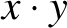*, **, *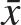* 또는 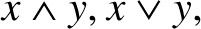와 ¬*x*로도 쓴다. 그림 1.2는 두 변수에 대해 정의할 수 있는 *모든* 불 함수의 정의와 관용적인 이름을 정리한 것이다. 이 함수들은 두 이진 변수가 가질 수 있는 값의 모든 조합을 체계적으로 나열해 구성했다. 각 연산자에는 그 근본 의미를 드러내는 관용적인 이름이 붙어 있다. 예를 들어 Nand 연산자의 이름은 *Not-And*의 줄임말로, Nand (*x*, *y*)가 Not (And (*x*, *y*))와 동치라는 관찰에서 유래했다. Xor 연산자는 *배타적 논리합(exclusive or)*의 줄임말로, 두 변수 중 정확히 하나만 1일 때 1로 평가된다. Nor 게이트는 *Not-Or*에서 이름을 따왔다. 이 게이트 이름들 자체를 지나치게 중요하게 여길 필요는 없다.

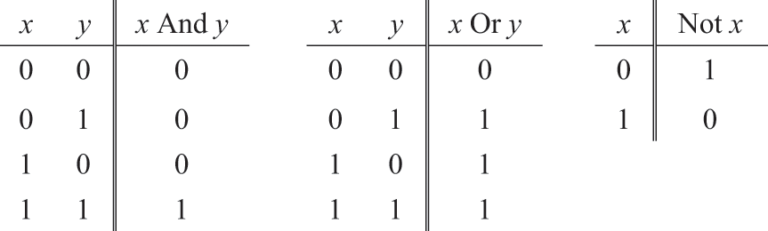

*그림 1.1 세 가지 기본 불 함수.*

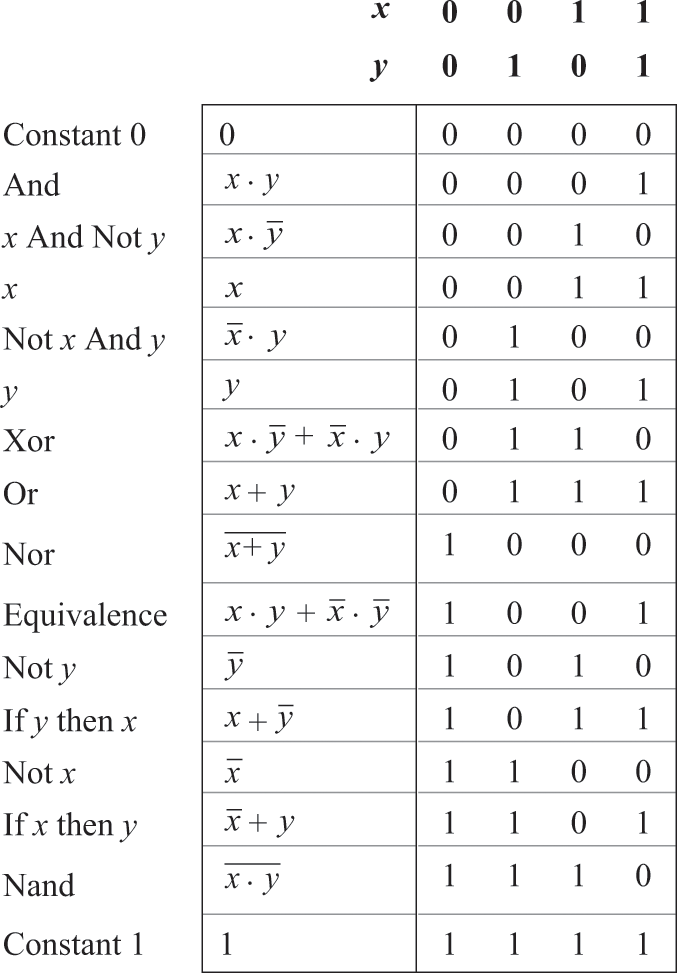

*그림 1.2 두 이진 변수의 모든 불 함수. 일반적으로 **n**개의 이진 변수(여기서는 **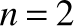**)로 정의되는 불 함수의 개수는 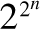개이다(실로 어마어마한 수의 불 함수이다).*

그림 1.2를 보면 자연스레 이런 의문이 든다. And, Or, Not은 다른 불 연산자 부분집합보다 무엇이 더 흥미롭거나 특별한가? 짧게 답하자면, 사실 And, Or, Not에 특별할 것은 아무것도 없다. 조금 더 깊이 답하자면, *임의의* 불 함수를 표현하는 데 사용할 수 있는 논리 연산자 부분집합은 여러 가지가 있으며, {And, Or, Not}은 그중 하나일 뿐이다. 이 사실이 인상적이라면 다음 사실도 생각해 보자. 이 세 가지 기본 연산자 중 어느 것이든 또 다른 연산자 하나, 즉 Nand만으로 표현할 수 있다. 이야말로 *정말* 인상적이다! 따라서 어떤 불 함수든 오직 Nand 게이트만으로 실현할 수 있다. 선택적 읽을거리인 부록 1에서 이 놀라운 주장의 증명을 확인할 수 있다.

### 불 함수

모든 불 함수는 두 가지 대안적 표현 방식으로 정의할 수 있다. 첫째, 그림 1.3처럼 *진리표*를 사용해 함수를 정의할 수 있다. 진리표는 변수 값의 가능한 2*n*개 튜플 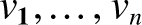(여기서는 *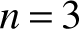*) 각각에 대응하는 *f* 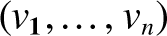의 값을 나열한다. 이러한 데이터 기반 정의 외에도 불 표현식으로 불 함수를 정의할 수 있다. 예를 들면 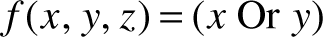 And Not (*z*)와 같다.

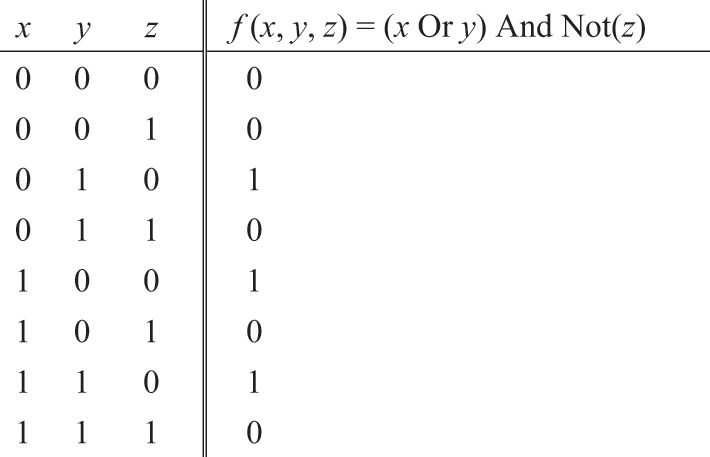

*그림 1.3 불 함수의 진리표와 함수적 정의(예시).*

주어진 불 표현식이 주어진 진리표와 동치인지 어떻게 검증할 수 있을까? 그림 1.3을 예로 들어 보자. 첫 번째 행부터 시작해 *f* (0, 0, 0), 즉 (0 Or 0) And Not (0)을 계산한다. 이 표현식은 0으로 평가되며, 이는 진리표에 적힌 값과 같다. 여기까지는 순조롭다. 표의 모든 행에 비슷한 동치 검사를 적용할 수도 있지만, 이는 꽤 지루한 작업이다. 이처럼 번거로운 상향식 증명 기법 대신, 불 표현식 (*x* Or *y*) And Not (*z*)를 분석하는 하향식 방식으로 동치임을 증명할 수 있다. And 연산자의 왼쪽에 주목하면, 전체 표현식이 1로 평가되려면 ((*x*가 1) Or (*y*가 1))이어야 함을 알 수 있다. And 연산자의 오른쪽을 보면, 전체 표현식이 1로 평가되려면 (*z*가 0)이어야 한다. 이 두 관찰을 종합하면, 전체 표현식은 (((*x*가 1) Or (*y*가 1)) And (*z*가 0))일 때만 1로 평가된다는 결론에 이른다. 이러한 0과 1의 패턴은 진리표의 3행, 5행, 7행에서만 나타나며, 실제로 표의 맨 오른쪽 열에 1이 적힌 행도 오직 이 세 행뿐이다.

### 진리표와 불 표현식

불 표현식으로 나타낸 *n*변수 불 함수가 주어지면 언제든 그 함수의 진리표를 만들 수 있다. 표의 각 값 조합(행)마다 함수를 계산하기만 하면 된다. 이 과정은 번거롭지만 자명하다. 반면 그 반대 방향의 구성은 결코 자명하지 않다. 불 함수의 진리표 표현이 주어졌을 때, 그로부터 원래 함수를 나타내는 불 표현식을 언제나 합성해 낼 수 있을까? 이 흥미로운 질문에 대한 답은 *그렇다*이다. 증명은 부록 1에 나와 있다.

컴퓨터를 만들 때 진리표 표현, 불 표현식, 그리고 한 표현에서 다른 표현을 구성하는 능력은 모두 매우 중요하다. 예를 들어 DNA 데이터를 시퀀싱하는 하드웨어를 만들어 달라는 요청을 받았고, 도메인 전문가인 생물학자가 시퀀싱 논리를 진리표로 설명하려 한다고 가정해 보자. 우리의 임무는 이 논리를 하드웨어로 실현하는 것이다. 주어진 진리표 데이터를 출발점으로 삼아 그 이면의 함수를 나타내는 불 표현식을 합성할 수 있다. 이어서 불 대수로 표현식을 간소화한 뒤, 이 장의 후반부에서 다룰 것처럼 논리 게이트로 구현하면 된다. 요약하면, 진리표는 자연 세계의 어떤 상태를 기술하는 데 편리한 수단이고, 불 표현식은 그 기술 내용을 실리콘 위에 실현하는 데 편리한 형식 체계다. 한 표현에서 다른 표현으로 옮겨 가는 능력은 하드웨어 설계에서 가장 중요한 실무 역량 중 하나다.

참고로 불 함수의 진리표 표현은 유일하지만, 모든 불 함수는 서로 다르면서도 동치인 수많은 불 표현식으로 나타낼 수 있으며, 그중에는 더 짧고 다루기 쉬운 표현식도 있다. 예를 들어 표현식 (Not (*x* And *y*) And (Not (*x*) Or *y*) And (Not (*y*) Or *y*))는 표현식 Not (*x*)와 동치다. 이처럼 불 표현식을 간소화하는 능력은 하드웨어 최적화의 첫걸음이다. 이는 부록 1에서 설명하듯 불 대수와 상식을 활용해 수행한다.

## 1.2 논리 게이트

*게이트*는 단순한 불 함수를 구현하는 물리적 장치다. 오늘날 대부분의 디지털 컴퓨터는 전기를 사용해 게이트를 실현하고 이진 데이터를 표현하지만, 스위칭과 전도 기능을 갖춘 어떤 대안 기술이라도 활용할 수 있다. 실제로 오랜 세월 동안 자기, 광학, 생물학, 유압, 공압, 양자 기반, 심지어 도미노 기반 메커니즘까지 불 함수를 구현하는 수많은 하드웨어 방식이 만들어졌다(이 가운데 다수는 "이런 것도 가능하다"는 기발한 시도로 제안되었다). 오늘날 게이트는 보통 실리콘에 식각한 트랜지스터로 구현해 *칩* 형태로 패키징한다. Nand to Tetris에서는 *칩*과 *게이트*라는 용어를 혼용하되, 상대적으로 단순한 칩을 가리킬 때 게이트라는 표현을 주로 쓴다.

한편으로는 다양한 대안 스위칭 기술이 존재한다는 점, 다른 한편으로는 불 대수로 논리 게이트의 동작을 추상화할 수 있다는 점은 대단히 중요하다. 근본적으로 이는 컴퓨터 과학자가 전기, 회로, 스위치, 릴레이, 전원 같은 물리적 실체를 신경 쓰지 않아도 된다는 뜻이다. 대신 컴퓨터 과학자는 불 대수와 게이트 논리라는 추상적 개념에만 집중하고, 이를 실제 하드웨어로 구현하는 일은 물리학자와 전기공학자가 해결해 주리라 마음 편히 믿고 맡긴다. 따라서 그림 1.4에 나타낸 기본 게이트들은 어떤 방식으로든 기본 논리 연산을 수행하는 블랙박스 장치로 볼 수 있으며, 내부가 어떻게 동작하는지는 신경 쓰지 않는다. 논리 게이트의 추상적 동작을 분석하는 데 불 대수를 활용하는 원리는 1937년 클로드 섀넌(Claude Shannon)이 정립했으며, 이는 컴퓨터 과학 역사상 가장 중요한 석사 학위 논문으로 꼽히기도 한다.

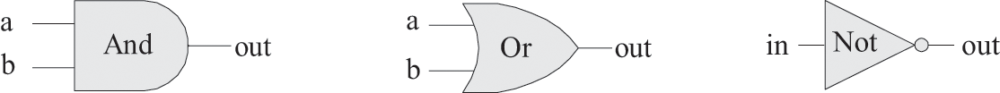

*그림 1.4 세 가지 기본 논리 게이트의 표준 게이트 기호.*

### 기본 게이트와 복합 게이트

모든 논리 게이트는 입출력 데이터 형식이 같으므로(0과 1), 이들을 결합해 원하는 만큼 복잡한 *복합 게이트*를 만들 수 있다. 예를 들어 세 입력이 모두 1일 때만 1을 반환하고 그 외에는 0을 반환하는 3입력 불 함수 And (*a*, *b*, *c*)를 구현해야 한다고 가정해 보자. 불 대수를 이용하면 먼저 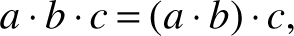임을 알 수 있고, 이를 전위 표기법으로 쓰면 And 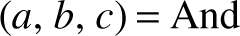 (And (*a*, *b*), *c*)가 된다. 그런 다음 이 결과를 이용해 그림 1.5에 나타낸 복합 게이트를 구성할 수 있다.

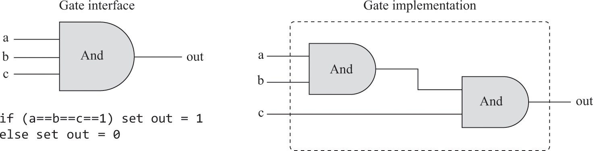

*그림 1.5 3입력 And 게이트의 복합 구현. 점선 사각형은 게이트 인터페이스의 경계를 나타낸다.*

이처럼 어떤 논리 게이트든 내부와 외부라는 두 가지 관점에서 바라볼 수 있다. 그림 1.5의 오른쪽은 게이트의 내부 아키텍처, 즉 *구현*을 보여 주는 반면, 왼쪽은 게이트의 *인터페이스*, 즉 입출력 핀과 외부 세계에 드러내는 동작을 보여 준다. 내부 관점은 게이트를 만드는 사람에게만 중요하며, 외부 관점은 구현 세부 사항에 신경 쓰지 않고 게이트를 추상적인 기성 부품처럼 사용하려는 설계자에게 알맞은 추상화 수준이다.

또 다른 논리 설계 예제로 Xor를 살펴보자. 정의에 따라 Xor (*a*, *b*)는 *a*가 1이고 *b*가 0이거나, *a*가 0이고 *b*가 1일 때만 1이다. 달리 말하면 Xor 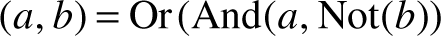, And (Not (*a*), *b*))이다. 이 정의를 구현한 논리 설계가 그림 1.6에 나타나 있다.

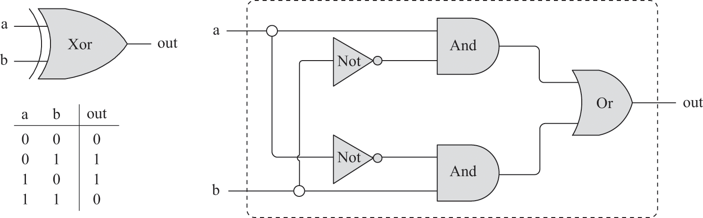

*그림 1.6 Xor 게이트의 인터페이스(왼쪽)와 가능한 구현 중 하나(오른쪽).*

어떤 게이트든 *인터페이스*는 유일하다. 인터페이스를 명세하는 방법은 오직 하나뿐이며, 보통 진리표나 불 표현식, 또는 말로 된 명세를 사용한다. 하지만 이 인터페이스를 실현하는 방법은 여러 가지가 있으며, 그중에는 다른 방법보다 더 우아하고 효율적인 구현도 있다. 예를 들어 그림 1.6에 나온 Xor 구현은 여러 가능성 중 하나일 뿐이며, 논리 게이트 수와 게이트 간 연결 수를 더 줄여 Xor를 효율적으로 구현하는 방법도 존재한다. 따라서 기능적 관점에서 논리 설계의 근본 요구 사항은 *게이트 구현이 어떤 방식으로든 명시된 인터페이스를 실현해야 한다*는 것이다. 효율성 관점에서의 일반 원칙은 가능한 한 적은 수의 게이트를 사용하는 것이다. 게이트 수가 적을수록 비용과 에너지 소모가 줄고 계산 속도가 빨라지기 때문이다.

요약하자면, 논리 설계의 기술은 다음과 같이 설명할 수 있다. 어떤 게이트 추상화(*명세* 또는 *인터페이스*라고도 한다)가 주어졌을 때, 이미 구현된 다른 게이트들을 사용해 이를 효율적으로 구현하는 방법을 찾는 것이다.

## 1.3 하드웨어 구축

이제 게이트를 실제로 어떻게 만드는지 살펴볼 차례다. 의도적으로 단순한 예에서 시작해 보자. 집 차고에 칩 제작 공방을 열었다고 가정하자. 첫 번째 계약은 Xor 게이트 100개를 만드는 일이다. 계약금으로 납땜 인두, 구리선 한 롤, 그리고 “And 게이트”, “Or 게이트”, “Not 게이트”라고 적힌 상자 세 개를 구입한다. 각 상자에는 동일한 기본 논리 게이트가 잔뜩 들어 있다. 각 게이트는 플라스틱 케이스에 밀봉되어 있고, 입력 및 출력 핀과 전원 공급 포트가 밖으로 나와 있다. 우리의 목표는 이 하드웨어를 사용해 그림 1.6의 게이트 다이어그램을 구현하는 것이다.

먼저 그림의 배치에 따라 And 게이트 두 개, Not 게이트 두 개, Or 게이트 하나를 기판 위에 올린다. 다음으로 칩들 사이에 전선을 연결하고, 전선 끝을 각각의 입력/출력 핀에 납땜한다.

게이트 다이어그램을 정확히 따랐다면 밖으로 드러난 전선 끝이 세 개 남는다. 각 전선 끝에 핀을 납땜한 뒤 세 개의 핀만 남기고 전체 장치를 플라스틱 케이스로 밀봉하여 “Xor”라고 표시한다. 이 조립 과정을 여러 번 반복할 수 있다. 작업이 끝나면 완성된 칩을 모두 새 상자에 담아 “Xor 게이트”라고 라벨을 붙인다. 앞으로 다른 칩을 만들 때, 앞서 And, Or, Not 게이트를 썼던 것처럼 이 Xor 게이트도 블랙박스 구성 요소로 활용할 수 있다.

짐작했겠지만, 차고에서 칩을 생산하는 이 방식은 아쉬운 점이 많다. 우선 주어진 칩 다이어그램이 올바르다는 보장이 없다. Xor처럼 단순한 경우에는 정확성을 증명할 수 있지만, 현실적으로 복잡한 수많은 칩에서는 그렇게 하기 어렵다. 따라서 경험적 테스트에 의존할 수밖에 없다. 칩을 만들어 전원에 연결하고, 입력 핀을 다양한 조합으로 켜고 끄면서 칩의 입출력 동작이 원하는 명세를 만족하기를 기대하는 것이다. 칩이 제대로 동작하지 않으면 물리적 구조를 직접 뜯어고쳐야 하는데, 이는 상당히 번거로운 작업이다. 게다가 올바르고 효율적인 설계를 찾아냈다 하더라도, 조립 과정을 수없이 반복하는 일은 시간이 오래 걸리고 오류도 잦다. 분명 더 나은 방법이 있어야 한다.

### 1.3.1 하드웨어 기술 언어

오늘날 하드웨어 설계자는 더 이상 맨손으로 무언가를 조립하지 않는다. 대신 *하드웨어 기술 언어*(Hardware Description Language, *HDL*)라는 형식 체계를 사용해 칩 아키텍처를 설계한다. 설계자는 *HDL 프로그램*을 작성하여 칩 논리를 명세하고, 이를 엄격한 테스트에 통과시킨다. 테스트는 컴퓨터 시뮬레이션으로 가상 환경에서 수행된다. *하드웨어 시뮬레이터*(hardware simulator)라는 전용 소프트웨어 도구가 HDL 프로그램을 입력으로 받아 칩 논리의 소프트웨어 표현을 생성한다. 그런 다음 설계자는 시뮬레이터에 지시하여 다양한 입력 집합으로 가상 칩을 테스트한다. 시뮬레이터는 칩의 출력을 계산하고, 이를 칩 제작을 의뢰한 고객이 요구한 기대 출력과 비교한다.

하드웨어 설계자는 칩의 정확성뿐만 아니라 연산 속도, 에너지 소비, 제안된 칩 구현에 따르는 전체 비용 등 다양한 지표에도 관심을 기울인다. 하드웨어 시뮬레이터는 이 모든 지표를 시뮬레이션하고 정량화할 수 있으므로, 설계자는 시뮬레이션된 칩이 원하는 비용 대비 성능 수준에 도달할 때까지 설계를 최적화할 수 있다.

이처럼 HDL을 사용하면 물리적 생산에 단 한 푼도 쓰기 전에 칩 전체를 완벽히 계획하고 디버깅하며 최적화할 수 있다. 시뮬레이션된 칩의 성능이 의뢰 고객을 만족시키면, 최적화된 HDL 프로그램은 수많은 물리적 칩을 실리콘으로 찍어내는 청사진이 된다. 최적화된 HDL 프로그램에서 대량 생산으로 이어지는 칩 설계의 이 마지막 단계는 대개 특정 스위칭 기술을 활용한 로봇 기반 칩 제조 전문 업체에 위탁한다.

예제: Xor 게이트 만들기: 이 절의 나머지 부분에서는 Xor 게이트 예제를 통해 HDL을 간략히 소개한다. 자세한 HDL 명세는 부록 2에서 확인할 수 있다.

그림 1.7의 왼쪽 아래를 살펴보자. 칩의 HDL 정의는 *헤더*(header) 부분과 *부품*(parts) 부분으로 구성된다. 헤더 부분은 칩 이름과 입력 및 출력 핀의 이름을 나열하여 칩의 *인터페이스*를 명세한다. `PARTS` 부분은 칩 아키텍처를 이루는 하위 칩 부품들을 기술한다. 각 칩 부품은 부품 이름과 그 뒤의 괄호 표현식으로 이루어진 하나의 *문장*(statement)으로 표현되며, 괄호 안에는 해당 부품이 설계 내의 다른 부품들과 어떻게 연결되는지를 적는다. 이러한 문장을 작성하려면 HDL 프로그래머가 모든 하위 칩 부품의 인터페이스, 즉 입력 및 출력 핀의 이름과 의도된 동작을 알고 있어야 한다. 예를 들어 그림 1.7의 HDL 프로그램을 작성한 프로그래머는 Not 게이트의 입력 및 출력 핀 이름이 `in`과 `out`이고, And와 Or 게이트의 핀 이름이 `a`, `b`, `out`이라는 사실을 알고 있었을 것이다(Nand to Tetris에서 사용하는 모든 칩의 API는 부록 4에 정리되어 있다).

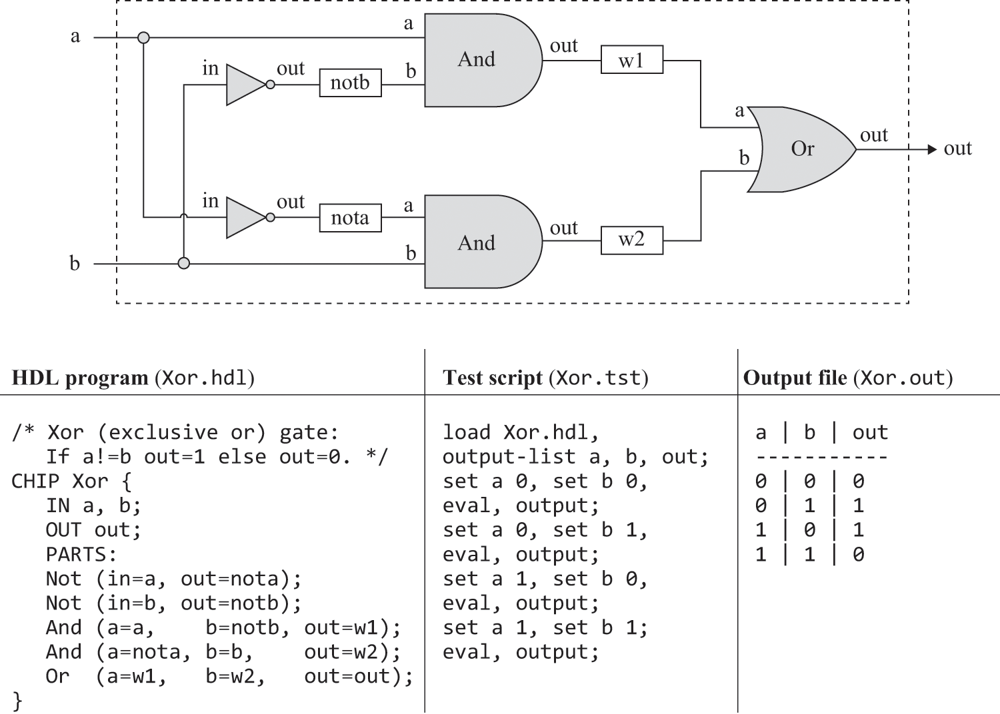

*그림 1.7 예제로 사용한 불 함수 Xor 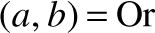 (And (**a**, Not (**b**)), And (Not (**a**), **b**))의 게이트 다이어그램과 HDL 구현. 테스트 스크립트와 테스트 실행으로 생성된 출력 파일도 함께 제시되어 있다. HDL과 테스트 언어에 대한 자세한 설명은 각각 부록 2와 부록 3에 나와 있다.*

부품 간의 연결은 필요에 따라 *내부 핀*(internal pin)을 생성하고 연결하여 명세한다. 예를 들어 게이트 다이어그램 아래쪽에서 Not 게이트의 출력이 뒤따르는 And 게이트의 입력으로 전달되는 부분을 보자. HDL 코드는 이 연결을 `Not(`…, `out`=`nota)`와 `And(a`=`nota`, …)라는 한 쌍의 문장으로 표현한다. 첫 번째 문장은 `nota`라는 이름의 내부 핀(외부로 나가는 연결)을 생성하고 `out` 핀의 값을 이 핀으로 보낸다. 두 번째 문장은 `nota`의 값을 And 게이트의 `a` 입력으로 전달한다. 여기서 두 가지를 짚고 넘어가자. 첫째, 내부 핀은 HDL 프로그램에 처음 등장할 때 “자동으로” 생성된다. 둘째, 핀의 팬아웃(fan-out)에는 제한이 없다. 예를 들어 그림 1.7에서 각 입력은 동시에 두 게이트로 들어간다. 게이트 다이어그램에서는 여러 연결을 직접 그려 갈래 모양으로 나타내지만, HDL 프로그램에서는 코드로부터 이러한 분기가 암묵적으로 추론된다.

Nand to Tetris에서 사용하는 HDL은 산업용 HDL과 모양과 느낌이 비슷하지만 훨씬 단순하다. 이 책의 HDL 문법은 대부분 직관적이므로 몇 가지 예제를 살펴보고 필요할 때 부록 2를 참고하면 쉽게 익힐 수 있다.

### 테스트

철저한 품질 보증을 위해서는 칩을 구체적이고 재현 가능하며 문서화된 방식으로 테스트해야 한다. 이러한 목적에 맞게 하드웨어 시뮬레이터는 대개 스크립트 언어로 작성된 *테스트 스크립트*(test script)를 실행하도록 설계된다. 그림 1.7에 나온 테스트 스크립트는 Nand to Tetris 하드웨어 시뮬레이터가 이해하는 스크립트 언어로 작성되었다.

이 테스트 스크립트를 간단히 살펴보자. 처음 두 줄은 시뮬레이터에 `Xor.hdl` 프로그램을 불러오고 지정된 변수들의 값을 출력할 준비를 하라고 지시한다. 그다음 스크립트는 일련의 테스트 시나리오를 나열한다. 각 시나리오에서 스크립트는 시뮬레이터에 칩 입력을 특정 데이터 값에 바인딩하고, 그에 따른 출력을 계산하여, 지정된 출력 파일에 테스트 결과를 기록하라고 지시한다. Xor 같은 단순한 게이트는 게이트가 받을 수 있는 모든 입력 값을 빠짐없이 나열하는 전수 테스트 스크립트를 작성할 수 있다. 이 경우 생성된 출력 파일(그림 1.7의 오른쪽)은 칩이 올바르게 동작함을 보여주는 완전한 경험적 검증 자료가 된다. 뒤에서 보겠지만, 더 복잡한 칩에서는 이처럼 완벽한 확신을 얻기 어렵다.

Hack 컴퓨터를 직접 구축하려는 독자에게 반가운 소식이 있다. 이 책에 등장하는 모든 칩에는 Nand to Tetris 소프트웨어 모음에 포함된 뼈대 HDL 프로그램과 테스트 스크립트가 제공된다. 칩 명세를 완성하기 위해 반드시 배워야 하는 HDL과 달리, 테스트 언어는 따로 배울 필요가 없다. 다만 제공된 테스트 스크립트를 읽고 이해할 수는 있어야 한다. 스크립트 언어는 부록 3에 설명되어 있으므로 필요할 때 참고하면 된다.

### 1.3.2 하드웨어 시뮬레이션

HDL 프로그램을 작성하고 디버깅하는 과정은 일반적인 소프트웨어 개발과 비슷하다. 주된 차이는 고급 언어 대신 HDL로 코드를 작성하고, 코드를 컴파일해 실행하는 대신 *하드웨어 시뮬레이터*로 테스트한다는 점이다. 하드웨어 시뮬레이터는 HDL 코드를 파싱하고 해석해 실행 가능한 표현으로 변환한 뒤, 제공된 테스트 스크립트에 따라 테스트하는 컴퓨터 프로그램이다. 시중에는 이러한 상용 하드웨어 시뮬레이터가 많이 나와 있다. Nand to Tetris 소프트웨어 모음에는 범용 컴퓨터 구축에 이르기까지 이 책에서 다루는 모든 칩을 만들고 테스트하며 통합하는 데 필요한 도구를 모두 갖춘 간단한 하드웨어 시뮬레이터가 포함되어 있다. 그림 1.8은 전형적인 칩 시뮬레이션 화면을 보여준다.

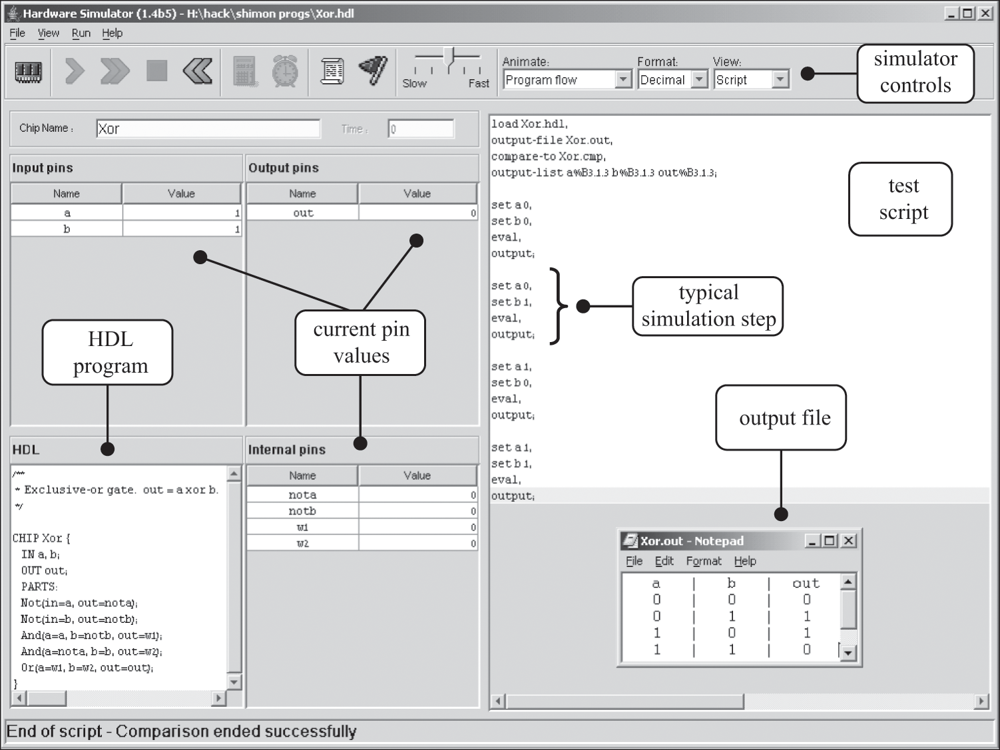

*그림 1.8 제공된 하드웨어 시뮬레이터에서 `Xor` 칩을 시뮬레이션하는 화면(이 시뮬레이터의 다른 버전은 GUI가 다소 다를 수 있다). 테스트 스크립트 실행이 막 끝난 직후의 시뮬레이터 상태를 보여준다. 핀 값들은 마지막 시뮬레이션 단계에 해당한다 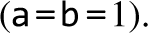 이 스크린샷에는 나와 있지 않지만, 해당 테스트 스크립트가 명세한 시뮬레이션의 기대 출력을 나열한 **비교 파일**(compare file)이 따로 존재한다. 테스트 스크립트와 마찬가지로 비교 파일도 대개 칩 제작을 의뢰한 고객이 제공한다. 이 예제에서는 시뮬레이션이 생성한 출력 파일(그림 오른쪽 아래)이 제공된 비교 파일과 완전히 일치한다.*

## 1.4 명세

이제 우리 컴퓨터 시스템의 칩을 만드는 데 필요한 논리 게이트 집합을 명세해 보자. 이 게이트들은 모두 흔히 쓰이는 기본 불 연산을 수행하도록 설계된 평범한 게이트들이다. 여기서는 각 게이트의 인터페이스(게이트가 *무엇을* 해야 하는지)에 집중하고, 구현 세부 사항(게이트의 기능을 *어떻게* 만들지)은 다음 절로 미룬다.

### 1.4.1 Nand

우리 컴퓨터 아키텍처의 출발점은 Nand 게이트이며, 다른 모든 게이트와 칩은 여기서부터 만들어진다. Nand 게이트는 다음 불 함수를 구현한다.

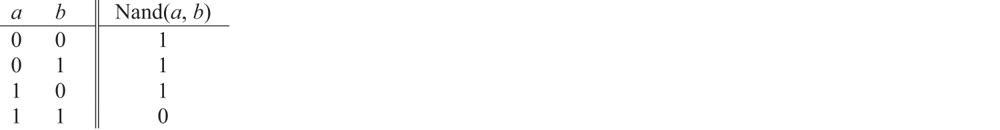

또는 API 형식으로 나타내면 다음과 같다.

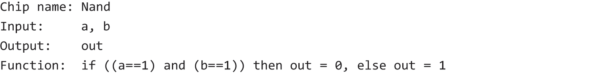

이 책 전반에 걸쳐 칩은 위와 같은 API 형식으로 명세한다. 각 칩의 API는 칩 이름, 입력 및 출력 핀 이름, 칩의 의도된 기능이나 연산, 그리고 선택적인 설명을 명시한다.

### 1.4.2 기본 논리 게이트

여기서 소개하는 논리 게이트들은 더 복잡한 칩을 구축하는 데 쓰이므로 흔히 *기본*(basic) 게이트라고 부른다. Not, And, Or, Xor 게이트는 고전적인 논리 연산자를 구현하며, 멀티플렉서와 디멀티플렉서 게이트는 정보의 흐름을 제어하는 수단을 제공한다.

Not: *인버터*(inverter)라고도 불리는 이 게이트는 입력 값의 반대 값을 출력한다. API는 다음과 같다.

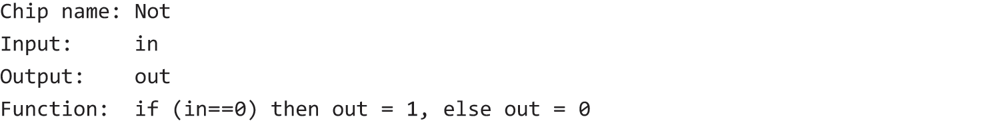

And: 두 입력이 모두 1일 때 1을, 그 외에는 0을 반환한다.

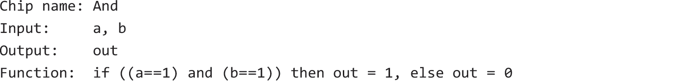

Or: 두 입력 중 적어도 하나가 1일 때 1을, 그 외에는 0을 반환한다.

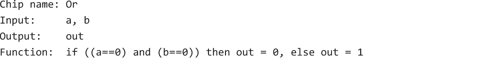

Xor: *배타적 논리합*(exclusive or)이라고도 불리는 이 게이트는 두 입력 중 정확히 하나만 1일 때 1을, 그 외에는 0을 반환한다.

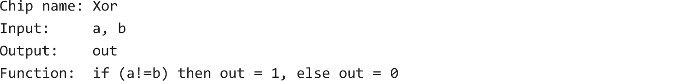

멀티플렉서: 멀티플렉서는 3입력 게이트다(그림 1.9 참조). `a`와 `b`라는 두 입력 비트는 *데이터 비트*(data bit)로, `sel`이라는 세 번째 입력 비트는 *선택 비트*(selection bit)로 해석된다. 멀티플렉서는 `sel`을 사용해 `a`와 `b` 중 하나의 값을 선택해 출력한다. 따라서 이 장치의 이름으로는 *선택기*(selector)가 더 어울렸을지도 모른다. *멀티플렉서*(multiplexer)라는 이름은 통신 시스템에서 유래했는데, 통신에서는 이 장치의 확장 버전을 사용해 여러 입력 신호를 단일 통신 채널로 직렬화(다중화, multiplexing)한다.

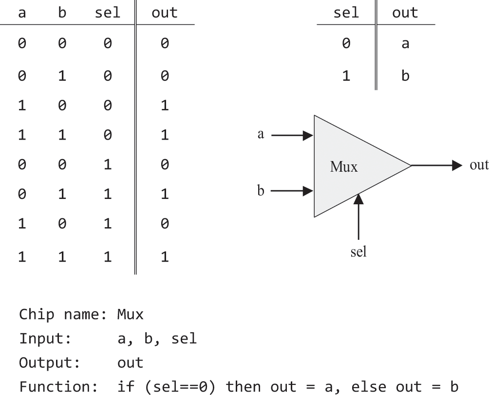

*그림 1.9 멀티플렉서. 오른쪽 위의 표는 진리표의 축약 버전이다.*

디멀티플렉서: 디멀티플렉서는 멀티플렉서와 정반대의 기능을 수행한다. 단일 입력 값을 받아, 목적지 출력을 지정하는 선택 비트에 따라 두 출력 중 하나로 전달한다. 선택되지 않은 나머지 출력은 0으로 설정된다. 그림 1.10은 그 API를 보여준다.

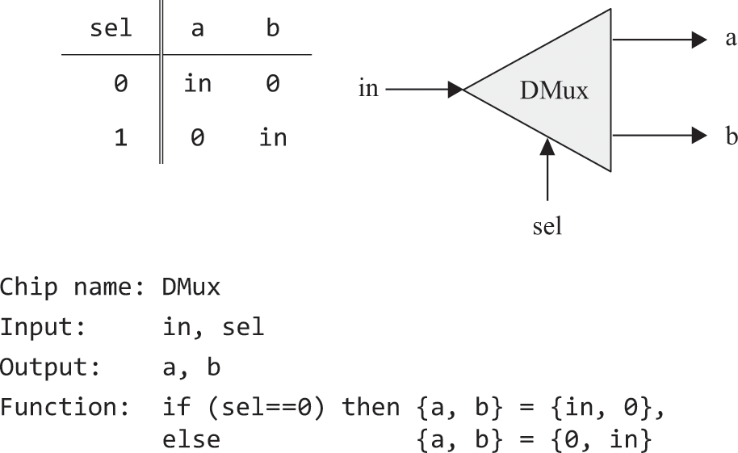

*그림 1.10 디멀티플렉서.*

### 1.4.3 기본 게이트의 멀티비트 버전

컴퓨터 하드웨어는 두 개의 16비트 입력에 비트 단위 And 함수를 계산하는 것처럼 멀티비트 값을 처리하도록 설계되는 경우가 많다. 이 절에서는 목표 컴퓨터 플랫폼을 구축하는 데 필요한 여러 16비트 논리 게이트를 설명한다. 참고로 이러한 *n*비트 게이트의 논리 아키텍처는 *n*의 값(예: 16비트, 32비트, 64비트)과 무관하게 동일하다. HDL 프로그램은 멀티비트 값을 단일 비트 값과 똑같이 다루되, 개별 비트에 접근하기 위해 인덱싱을 사용할 수 있다. 예를 들어 `in`과 `out`이 16비트 값을 나타낸다면, `out`은 `out`의 3번 비트를 `in`의 5번 비트 값으로 설정한다. 비트는 오른쪽에서 왼쪽으로 인덱싱되며, 16비트 환경에서 가장 오른쪽 비트가 0번 비트, 가장 왼쪽 비트가 15번 비트다.

멀티비트 Not: *n*비트 Not 게이트는 *n*비트 입력의 모든 비트 각각에 불 연산 Not을 적용한다.

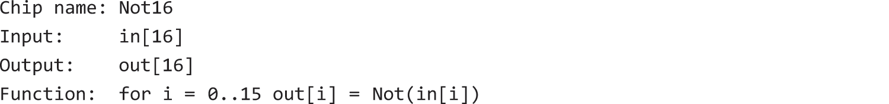

멀티비트 And: *n*비트 And 게이트는 두 *n*비트 입력의 대응하는 모든 비트 쌍에 불 연산 And를 적용한다.

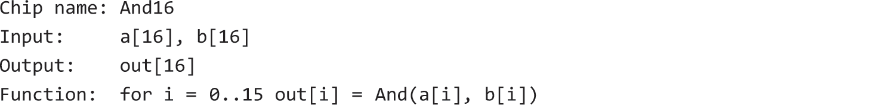

멀티비트 Or: *n*비트 Or 게이트는 두 *n*비트 입력의 대응하는 모든 비트 쌍에 불 연산 Or를 적용한다.

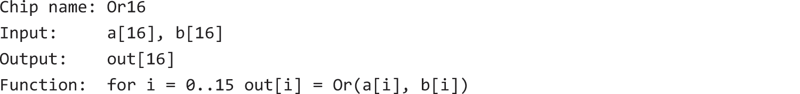

멀티비트 멀티플렉서: *n*비트 멀티플렉서는 입력과 출력의 폭이 *n*비트라는 점만 빼면 기본 멀티플렉서와 완전히 똑같이 동작한다.

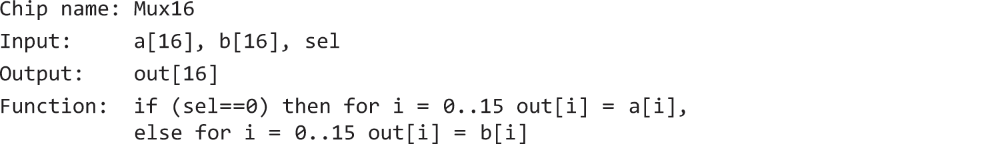

### 1.4.4 기본 게이트의 멀티웨이 버전

하나 또는 두 개의 입력에 작용하는 논리 게이트는 자연스럽게 둘 이상의 입력에 작용하는 멀티웨이(multi-way) 변형으로 일반화할 수 있다. 이 절에서는 이후 우리 컴퓨터 아키텍처의 여러 칩에서 사용할 멀티웨이 게이트 집합을 설명한다.

멀티웨이 Or: *m*웨이 Or 게이트는 *m*개의 입력 비트 중 적어도 하나가 1일 때 1을, 그 외에는 0을 출력한다. 우리에게는 이 게이트의 8웨이 변형이 필요하다.

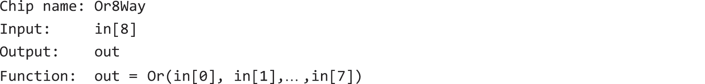

멀티웨이/멀티비트 멀티플렉서: *m*웨이 *n*비트 멀티플렉서는 *m*개의 *n*비트 입력 중 하나를 선택해 *n*비트 출력으로 내보낸다. 선택은 *k*개의 선택 비트로 지정된다(). 4웨이 멀티플렉서의 API는 다음과 같다.

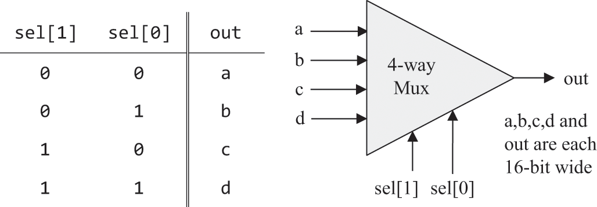

목표 컴퓨터 플랫폼에는 이 칩의 두 가지 변형, 즉 4웨이 16비트 멀티플렉서와 8웨이 16비트 멀티플렉서가 필요하다.

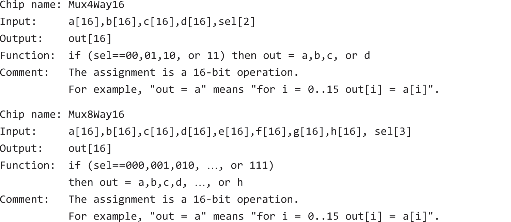

멀티웨이/멀티비트 디멀티플렉서: *m*웨이 *n*비트 디멀티플렉서는 단일 *n*비트 입력을 *m*개의 *n*비트 출력 중 하나로 전달한다. 나머지 출력은 모두 0으로 설정된다. 선택은 *k*개의 선택 비트로 지정된다(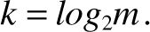). 4웨이 디멀티플렉서의 API는 다음과 같다.

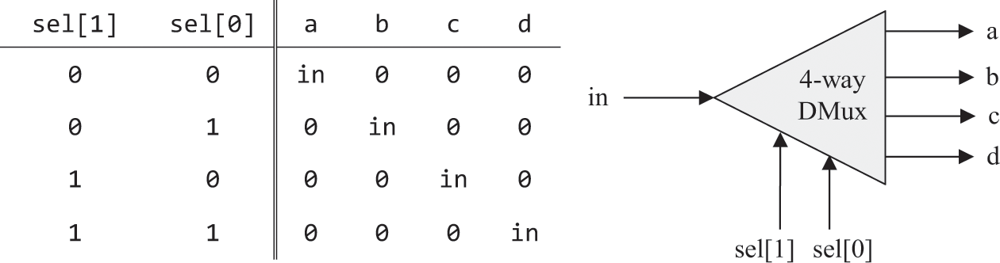

목표 컴퓨터 플랫폼에는 이 칩의 두 가지 변형, 즉 4웨이 1비트 디멀티플렉서와 8웨이 1비트 디멀티플렉서가 필요하다.

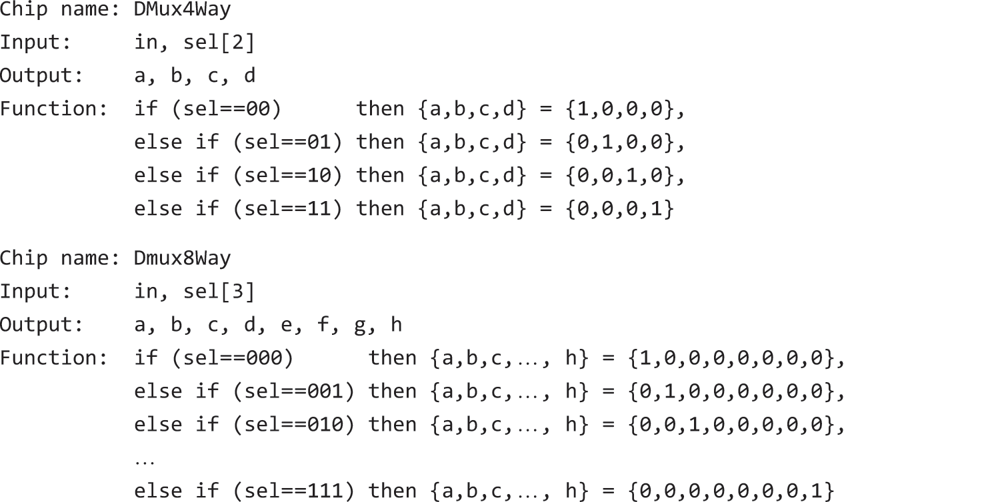

## 1.5 구현

앞 절에서는 기본 논리 게이트군의 명세, 즉 인터페이스를 설명했다. *무엇을* 할지 설명했으니 이제 *어떻게* 만들지 논의할 차례다. 특히 논리 게이트를 구현하는 두 가지 일반적 접근법인 *동작 시뮬레이션*(behavioral simulation)과 *하드웨어 구현*(hardware implementation)에 초점을 맞춘다. 두 접근법 모두 우리의 모든 하드웨어 구축 프로젝트에서 중요한 역할을 한다.

### 1.5.1 동작 시뮬레이션

지금까지 제시한 칩 설명은 철저히 추상적이다. HDL로 직접 만들기 전에 이러한 추상화를 손으로 만져보듯 미리 실험해 볼 수 있다면 좋을 것이다. 어떻게 그렇게 할 수 있을까?

칩의 동작과 상호작용하는 것만이 목적이라면 굳이 번거롭게 HDL로 만들 필요가 없다. 대신 일반 프로그래밍을 사용해 훨씬 간단하게 구현할 수 있다. 예를 들어 객체 지향 언어로 일반 칩을 구현하는 클래스 집합을 만들 수 있다. 칩 인스턴스를 생성하는 클래스 생성자와 칩 논리를 평가하는 *eval* 메서드를 작성하고, 클래스끼리 상호작용하게 하여 상위 칩을 하위 칩으로 정의할 수 있다. 그런 다음 칩 입력에 여러 값을 넣고 논리를 평가하며 출력을 관찰할 수 있는 멋진 그래픽 사용자 인터페이스를 덧붙이면 된다. *동작 시뮬레이션*이라 불리는 이 소프트웨어 기반 기법은 매우 합리적이다. HDL로 칩을 만드는 수고로운 작업에 착수하기 전에 칩 인터페이스를 미리 시험해 볼 수 있기 때문이다.

Nand to Tetris의 *하드웨어 시뮬레이터*가 바로 이런 기능을 제공한다. 이 시뮬레이터는 주 목적인 HDL 프로그램의 동작 시뮬레이션 외에도, Nand to Tetris 하드웨어 프로젝트에서 만드는 모든 칩의 내장(built-in) 소프트웨어 구현을 갖추고 있다. 각 칩의 내장 버전은 실행 가능한 소프트웨어 모듈로 구현되어 있으며, 칩 인터페이스를 제공하는 뼈대 HDL 프로그램을 통해 호출된다. 예를 들어 Xor 칩의 내장 버전을 구현하는 HDL 프로그램은 다음과 같다.

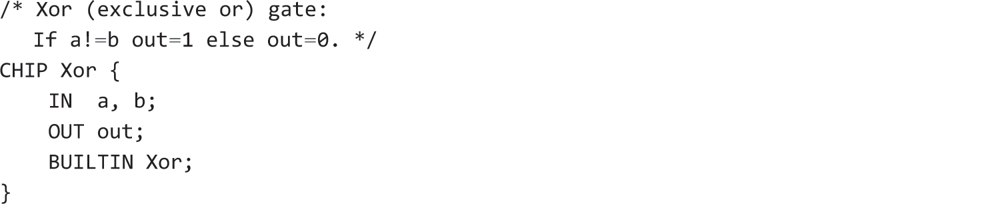

이를 그림 1.7의 HDL 프로그램과 비교해 보자. 먼저 일반 칩과 내장 칩의 인터페이스가 완전히 동일하다는 점에 주목하자. 따라서 두 칩은 정확히 같은 기능을 제공한다. 다만 내장 구현에서는 `PARTS` 부분이 `BUILTIN` `Xor`라는 단 한 줄의 문장으로 대체된다. 이 문장은 시뮬레이터에 해당 칩이 `Xor.class`로 구현되어 있음을 알려준다. 이 클래스 파일은 내장 칩을 구현하는 다른 모든 Java 클래스 파일과 마찬가지로 `nand2tetris/tools/builtIn` 폴더에 위치한다.

참고로 고급 프로그래밍으로 논리 게이트를 구현하는 일은 어렵지 않으며, 비용이 적게 들고 빠르다는 점도 동작 시뮬레이션의 장점이다. 물론 어느 시점에는 하드웨어 엔지니어가 진짜 작업을 해야 한다. 즉 칩을 소프트웨어 산출물이 아니라 실리콘에 새길 수 있는 HDL 프로그램으로 구현해야 한다. 그것이 바로 다음에 우리가 할 일이다.

### 1.5.2 하드웨어 구현

이 절에서는 이번 장에서 다룬 15개의 논리 게이트를 구현하는 지침을 제시한다. 이 책의 원칙에 따라 구현 지침은 의도적으로 간결하게 작성했다. 구현을 시작하는 데 꼭 필요한 핵심 통찰만 제공하며, 나머지 게이트 구현을 스스로 찾아내는 즐거움은 독자의 몫으로 남겨 둔다.

Nand: 우리는 기본 Nand 게이트를 토대로 하드웨어를 구축하기로 했으므로, Nand를 기능이 외부에서 주어지는 원시(primitive) 게이트로 취급한다. 제공되는 하드웨어 시뮬레이터에는 Nand가 내장 구현되어 있으므로 별도로 구현할 필요가 없다.

Not: 단일 Nand 게이트만으로 구현할 수 있다. *팁:* Nand 진리표를 살펴보고, 단일 입력 신호 0이 들어왔을 때 Nand 게이트가 1을 출력하고, 단일 입력 신호 1이 들어왔을 때 0을 출력하도록 Nand 입력을 어떻게 배치하면 될지 생각해 보라.

And: 앞서 다룬 두 게이트로 구현할 수 있다.

Or / Xor: 불 함수 Or는 불 함수 And와 Not으로 정의할 수 있다. 불 함수 Xor는 And, Not, Or로 정의할 수 있다.

멀티플렉서 / 디멀티플렉서: 앞서 구축한 게이트들로 구현할 수 있다.

멀티비트 Not / And / Or 게이트: 이 게이트들의 기본 버전을 이미 만들었다고 가정하면, *n*항(multi-bit) 버전의 구현은 *n*개의 기본 게이트를 배열로 배치하고 각 게이트가 자신의 단일 비트 입력을 독립적으로 처리하게 연결하는 문제이다. 그 결과로 나오는 HDL 코드는 복사·붙여넣기를 반복해야 해서 다소 지루할 수 있지만, 이 책의 후반부에서 더 복잡한 칩을 설계할 때 이 멀티비트 게이트들이 제 몫을 톡톡히 해낼 것이다.

멀티비트 멀티플렉서: *n*항 멀티플렉서의 구현은 동일한 선택 비트(selection bit)를 *n*개의 이진 멀티플렉서 각각에 공급하는 문제이다. 이 역시 작업 자체는 단조롭지만 매우 유용한 칩을 만들어 낸다.

다중 입력(Multi-way) 게이트: 구현 팁: 갈림길(fork)을 떠올려 보라.

### 1.5.3 내장 칩

동작 시뮬레이션(behavioral simulation)을 논의할 때 언급했듯이, 하드웨어 시뮬레이터는 이 책에서 다루는 대부분의 칩에 대해 소프트웨어 기반의 내장(built-in) 구현을 제공한다. Nand to Tetris에서 가장 대표적인 내장 칩은 단연 Nand이다. HDL 프로그램에서 Nand를 하위 부품(chip-part)으로 사용할 때마다 하드웨어 시뮬레이터는 내장된 `tools/builtIn/Nand.hdl` 구현을 호출한다. 이러한 규칙은 더 일반적인 칩 호출 전략의 특수한 사례이다. 하드웨어 시뮬레이터가 HDL 프로그램에서 어떤 하위 칩(예: *Xxx*)을 만나면 먼저 현재 폴더에서 *Xxx*`.hdl` 파일을 찾는다. 파일이 있으면 그 안의 HDL 코드를 평가한다. 파일이 없으면 `tools/builtIn` 폴더에서 해당 파일을 찾는다. 거기에서 파일을 찾으면 해당 칩의 내장 구현을 실행하고, 찾지 못하면 오류 메시지를 출력하고 시뮬레이션을 종료한다.

이 규칙은 매우 유용하다. 예를 들어 `Mux.hdl` 프로그램을 구현하다가 어떤 이유로 완성하지 못했다고 가정해 보자. 이론적으로는 Mux를 하위 부품으로 사용하는 다른 칩들을 계속 만들 수 없으므로 난감한 상황이 될 수 있다. 다행히도, 그리고 실제로 의도된 설계에 따라, 바로 이럴 때 내장 칩이 해결사가 된다. 미완성 구현 파일의 이름을 예를 들어 `Mux1.hdl`로 바꾸기만 하면 된다. 그러면 하드웨어 시뮬레이터가 Mux 부품의 기능을 시뮬레이션할 때 현재 폴더에서 `Mux.hdl` 파일을 찾지 못한다. 이에 따라 동작 시뮬레이션이 작동하여 시뮬레이터가 내장 Mux 버전을 대신 사용하게 된다. 정확히 우리가 원하는 바이다! 나중에 `Mux1.hdl`로 돌아와 구현을 마저 진행하고 싶을 때는 파일 이름을 원래의 `Mux.hdl`로 되돌려 중단했던 지점부터 계속 작업하면 된다.

## 1.6 프로젝트

이 절에서는 프로젝트 1을 완료하는 데 필요한 도구와 리소스를 설명하고, 권장 구현 단계와 팁을 안내한다.

목표: 이 장에서 제시한 모든 논리 게이트를 구현한다. 사용할 수 있는 유일한 구성 요소는 원시 Nand 게이트와 그 위에 단계적으로 쌓아 올릴 복합 게이트들뿐이다.

리소스: 책의 소프트웨어 모음이 담긴 Nand to Tetris zip 파일을 이미 내려받아 컴퓨터의 `nand2tetris`라는 폴더에 압축을 풀었다고 가정한다. 그렇다면 컴퓨터의 `nand2tetris/tools` 폴더에 이 장에서 다룬 하드웨어 시뮬레이터가 들어 있다. 이 프로그램과 일반 텍스트 편집기만 있으면 프로젝트 1뿐만 아니라 이 책에서 다루는 모든 하드웨어 프로젝트를 완료할 수 있다.

이 장에서 언급한 15개의 칩(Nand 제외)은 부록 2에 설명된 HDL 언어로 구현해야 한다. 각 칩 *Xxx*에 대해 구현부가 비어 있는 뼈대 *Xxx*`.hdl` 프로그램(때로 *스텁 파일(stub file)*이라 부른다)을 제공한다. 또한 각 칩마다 하드웨어 시뮬레이터가 칩을 테스트하는 방법을 지시하는 *Xxx*`.tst` 스크립트와, 제공된 테스트가 생성해야 할 올바른 출력을 나열한 *Xxx*`.cmp` 비교 파일도 함께 제공한다. 이 모든 파일은 `nand2tetris/projects/01` 폴더에 있다. 여러분의 과제는 이 폴더의 모든 *Xxx*`.hdl` 파일을 완성하고 테스트하는 것이다. 이 파일들은 아무 일반 텍스트 편집기로나 작성하고 편집할 수 있다.

규약: 수정한 `.hdl` 프로그램(칩 설계)을 하드웨어 시뮬레이터에 불러와 제공된 `.tst` 파일로 테스트했을 때, 제공된 `.cmp` 파일에 나열된 출력과 일치하는 결과를 생성해야 한다. 시뮬레이터가 생성한 실제 출력이 기대 출력과 다르면 시뮬레이터는 시뮬레이션을 중단하고 오류 메시지를 출력한다.

단계: 다음 순서대로 진행하기를 권장한다.

0. 이 프로젝트에 필요한 *하드웨어 시뮬레이터*는 `nand2tetris/tools`에 있다.

1. 필요에 따라 부록 2(HDL)를 참고한다.

2. 필요에 따라 하드웨어 시뮬레이터 튜토리얼([www.nand2tetris.org](http://www.nand2tetris.org)에서 이용 가능)을 참고한다.

3. `nand2tetris/projects/01`에 나열된 모든 칩을 구현하고 시뮬레이션한다.

### 일반 구현 팁

(이 책에서는 *게이트*와 *칩*이라는 용어를 같은 의미로 번갈아 사용한다.)

- 각 게이트는 여러 가지 방법으로 구현할 수 있다. 구현은 단순할수록 좋다. 일반적인 원칙으로 가능한 한 적은 수의 하위 부품을 사용하도록 노력하라.
- 모든 칩을 오직 Nand 게이트만으로 직접 구현할 수도 있지만, 이미 구현한 복합 게이트를 항상 활용하기를 권장한다. 앞의 팁을 참고하라.
- 독자적으로 설계한 “보조 칩(helper chip)”을 따로 만들 필요는 없다. HDL 프로그램에는 이 장에서 언급된 칩들만 사용해야 한다.
- 이 장에 등장하는 순서대로 칩을 구현하라. 어떤 이유로 특정 칩의 HDL 구현을 완료하지 못했더라도 다른 HDL 프로그램에서 하위 부품으로 계속 사용할 수 있다. 해당 칩 파일의 이름을 바꾸거나 폴더에서 제거하기만 하면 시뮬레이터가 대신 내장 버전을 사용한다.

프로젝트 1의 웹 기반 버전은 [www.nand2tetris.org](http://www.nand2tetris.org)에서 이용할 수 있다.

## 1.7 고찰

이 장에서는 컴퓨터 아키텍처에서 널리 쓰이는 기본 논리 게이트 집합을 명세했다. 2장과 3장에서는 이 게이트들을 사용하여 각각 연산 칩과 저장 칩을 구축할 것이다. 그리고 이 칩들은 나중에 우리 컴퓨터의 중앙 처리 장치와 메모리 장치를 구성하는 데 쓰인다.

우리는 Nand를 기본 구성 요소로 선택했지만, 다른 논리 게이트를 출발점으로 삼을 수도 있다. 예를 들어 Nor 게이트만으로, 또는 And, Or, Not 게이트의 조합으로 완전한 컴퓨터 플랫폼을 구축할 수 있다. 이러한 구성적 논리 설계 접근 방식들은 이론적으로 동등하며, 이는 같은 기하학 체계를 서로 다른 공리 집합 위에 세울 수 있는 것과 같다. 원리적으로 전기 공학자나 물리학자가 자신들이 적합하다고 여기는 어떤 기술을 써서라도 효율적이고 저비용인 논리 게이트 구현을 만들어 낸다면, 우리는 기꺼이 그것을 원시 구성 요소로 사용할 수 있다. 다만 현실에서는 대부분의 컴퓨터가 Nand 게이트나 Nor 게이트로 만들어진다.

이 장 전체에서 우리는 에너지 소비량이나 HDL 프로그램이 함축하는 배선 교차(wire crossover) 횟수 같은 효율성과 비용 문제는 고려하지 않았다. 이러한 요소들은 실무에서 대단히 중요하며, 컴퓨터 과학과 공학 분야의 수많은 전문 지식이 이를 최적화하는 데 집중되어 있다. 또 하나 다루지 않은 문제는 실리콘에 내장된 트랜지스터나 다른 스위칭 기술로 원시 논리 게이트를 실제로 어떻게 제작하는지와 같은 물리적 측면이다. 물론 여기에는 여러 구현 선택지가 존재하며, 각 선택지마다 속도, 에너지 소비, 제조 비용 등 고유한 특성이 있다. 이러한 주제를 깊이 있게 다루려면 전기 공학이나 고체 물리학처럼 컴퓨터 과학의 영역을 벗어난 분야로 나아가야 한다.

다음 장에서는 비트로 이진수를 표현하는 방법과 논리 게이트로 산술 연산을 실현하는 방법을 다룬다. 이러한 기능들은 모두 이번 장에서 구축한 기본 논리 게이트를 토대로 이루어진다.

# 2 불 산술

> 셈하기는 이 세대의 종교이자 희망이며 구원이다.
>
> —거트루드 스타인(Gertrude Stein, 1874–1946)

이 장에서는 숫자를 표현하고 산술 연산을 수행하도록 설계된 일련의 칩을 구축한다. 출발점은 1장에서 만든 논리 게이트 집합이며, 도착점은 완전한 기능을 갖춘 *산술 논리 장치(Arithmetic Logic Unit, ALU)*이다. ALU는 나중에 컴퓨터가 처리하는 모든 명령어를 실행하는 칩인 *중앙 처리 장치(Central Processing Unit, CPU)*의 연산 핵심부가 된다. 따라서 ALU를 구축하는 일은 Nand to Tetris 여정에서 중요한 이정표이다.

늘 그렇듯 이 과제도 단계적으로 접근한다. 먼저 배경 설명 절에서 이진 코드와 불 산술로 부호 있는 정수를 표현하고 더하는 방법을 살펴본다. 명세 절에서는 두 비트, 세 비트, 그리고 *n*비트 이진수 쌍을 더하도록 설계된 일련의 *가산기(adder) 칩*을 제시한다. 이는 놀라울 만큼 단순한 논리 설계에 기반한 ALU 명세의 토대가 된다. 이어지는 구현 및 프로젝트 절에서는 HDL과 제공된 하드웨어 시뮬레이터를 사용해 가산기 칩과 ALU를 구축하는 팁과 지침을 안내한다.

## 2.1 산술 연산

범용 컴퓨터 시스템은 부호 있는 정수에 대해 최소한 다음과 같은 산술 연산을 수행할 수 있어야 한다.

- 덧셈(addition)
- 부호 변환(sign conversion)
- 뺄셈(subtraction)
- 비교(comparison)
- 곱셈(multiplication)
- 나눗셈(division)

먼저 덧셈과 부호 변환을 수행하는 게이트 논리를 개발한다. 그런 다음 이 두 가지 구성 요소로 나머지 산술 연산을 구현하는 방법을 살펴볼 것이다.

수학에서와 마찬가지로 컴퓨터 과학에서도 *덧셈*은 단순하지만 심오한 연산이다. 놀랍게도 디지털 컴퓨터가 수행하는 모든 기능—산술 연산뿐만 아니라—은 이진수 덧셈으로 환원할 수 있다. 따라서 이진 덧셈을 구성적으로 이해하는 것은 컴퓨터 하드웨어가 수행하는 수많은 기본 연산을 이해하는 열쇠가 된다.

## 2.2 이진수

6083 같은 특정 코드가 *십진법(decimal system)*으로 수를 표현한다고 할 때, 우리는 관례적으로 이 수를 다음과 같이 해석한다.

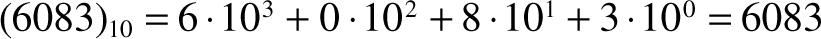

십진 코드의 각 자릿수는 *밑(base)* 10과 코드 내에서 그 자릿수가 놓인 위치에 따라 값이 결정된다. 이제 10011이라는 코드가 밑이 2인 수, 즉 *이진(binary)* 표현으로 수를 나타낸다고 하자. 이 수의 값을 계산할 때도 밑 10 대신 밑 2를 사용한다는 점만 빼면 완전히 같은 절차를 따른다.

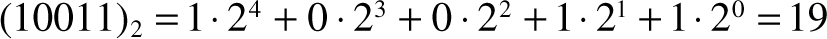

컴퓨터 내부에서는 *모든 것*이 이진 코드로 표현된다. 예를 들어 “소수의 예를 하나 드시오”라는 물음에 답하려고 키보드의 `1`, `9`, `Enter` 키를 누르면, 컴퓨터 메모리에 최종적으로 저장되는 것은 이진 코드 `10011`이다. 이 값을 화면에 표시하라고 컴퓨터에 요청하면 다음과 같은 과정이 이어진다. 먼저 컴퓨터의 운영체제가 `10011`이 나타내는 십진 값인 19를 계산한다. 이 정숫값을 두 문자 `1`과 `9`로 변환한 뒤, OS는 현재 글꼴을 조회하여 화면에 이 문자들을 그리는 데 필요한 두 비트맵 이미지를 가져온다. 그런 다음 OS가 화면 드라이버에 지시해 해당 픽셀들을 켜고 끄면—숨을 멈출 필요도 없이 이 모든 과정은 아주 짧은 순간에 끝난다—마침내 화면에 `19`라는 이미지가 나타난다.

12장에서는 이러한 화면 출력 연산을 비롯해 다양한 저수준 서비스를 수행하는 운영체제를 직접 개발할 것이다. 지금은 숫자의 십진 표현이란 고대 어느 시점에 인류가 열 손가락으로 수량을 세기로 결정하고 그 습관이 굳어진 데서 비롯된 인간만의 취향이라는 점만 짚고 넘어가자. 수학적 관점에서 숫자 10은 전혀 흥미롭지 않으며, 컴퓨터 입장에서는 완전히 성가신 존재일 뿐이다. 컴퓨터는 *모든 것*을 이진수로 처리하며 십진수에는 관심이 없다. 그럼에도 인간이 십진 코드로 숫자를 다루겠다고 고집하기 때문에, 컴퓨터는 인간이 숫자 정보를 보거나 입력하려 할 때마다 보이지 않는 곳에서 이진수-십진수 변환과 십진수-이진수 변환을 부지런히 수행해야 한다. 그 외의 모든 순간에 컴퓨터는 오직 이진수만 사용한다.

고정 워드 크기: 정수는 물론 끝이 없다. 어떤 수 *x*가 주어지더라도 *x*보다 작은 정수와 *x*보다 큰 정수가 존재한다. 하지만 컴퓨터는 숫자를 표현할 때 고정된 워드 크기를 사용하는 유한한 기계이다. *워드 크기(word size)*는 컴퓨터가 기본 정보 단위—여기서는 정숫값—를 표현하는 데 사용하는 비트 수를 가리키는 일반적인 하드웨어 용어이다. 보통 정수를 표현하는 데 8비트, 16비트, 32비트 또는 64비트 레지스터를 사용한다.1 워드 크기가 고정되어 있으므로 이 레지스터들이 표현할 수 있는 값의 개수에는 한계가 있다.

예를 들어 8비트 레지스터로 정수를 표현한다고 하자. 이 표현 방식은 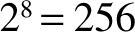가지의 서로 다른 대상을 부호화할 수 있다. 음이 아닌 정수만 표현하려면 `00000000`에 0, `00000001`에 1, `00000010`에 2, `00000011`에 3을 할당하는 식으로 쭉 이어 나가 `11111111`에 255를 할당하면 된다. 일반적으로 *n*비트를 사용하면 0부터 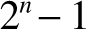까지의 모든 음이 아닌 정수를 표현할 수 있다.

그렇다면 이진 코드로 음수는 어떻게 표현할까? 이 장의 뒷부분에서 이 문제를 지극히 우아하고 만족스럽게 해결하는 기법을 소개할 것이다.

또한 고정된 레지스터 크기가 허용하는 최댓값보다 크거나 최솟값보다 작은 수는 어떻게 표현할까? 모든 고급 언어는 실용적으로 원하는 만큼 크거나 작은 수를 다룰 수 있는 추상화를 제공한다. 이러한 추상화는 보통 수를 표현하는 데 필요한 만큼 여러 개의 *n*비트 레지스터를 하나로 묶어 구현한다. 다중 워드(multi-word) 수에 대해 산술 및 논리 연산을 수행하는 일은 느리기 때문에, 이 방식은 응용 프로그램이 극도로 크거나 작은 수를 처리해야 할 때만 사용하는 것이 좋다.

## 2.3 이진 덧셈

두 이진수는 초등학교에서 배운 십진 덧셈 알고리즘과 동일한 방식으로 오른쪽에서 왼쪽으로 한 비트씩 더할 수 있다. 먼저 두 이진수의 가장 오른쪽 두 비트, 즉 *최하위 비트(least significant bits, LSB)*를 더한다. 그다음 발생한 올림수(carry) 비트를 다음 쌍의 비트 합에 더한다. 가장 왼쪽의 *최상위 비트(most significant bits, MSB)* 두 개를 더할 때까지 이 과정을 차례대로 반복한다. 고정 워드 크기가 4비트라고 가정했을 때 이 알고리즘이 동작하는 예시는 다음과 같다.

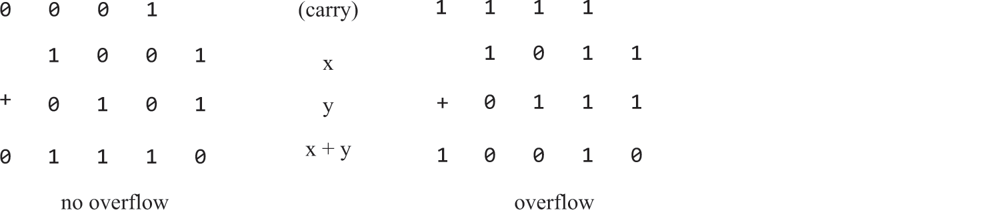

최상위 비트 덧셈에서 1의 올림수가 발생하면 이를 *오버플로(overflow)*라 한다. 오버플로를 어떻게 처리할지는 설계자의 결정에 달려 있으며, 우리는 이를 무시하기로 한다. 기본적으로 두 *n*비트 수를 더한 결과가 *n*비트 범위 내에서 정확하다는 점만 보장하면 충분하다. 덧붙이자면, 무엇을 무시하는지 명확하고 솔직하게 밝히기만 한다면 무시하는 것 자체는 완전히 허용되는 선택이다.

## 2.4 부호 있는 이진수

*n*비트 이진 시스템은 2*n*가지의 서로 다른 대상을 부호화할 수 있다. 이진 코드로 부호 있는(양수와 음수) 수를 표현해야 한다면, 사용 가능한 코드 공간을 두 부분집합으로 나누어 한쪽은 음이 아닌 수를, 다른 한쪽은 음수를 표현하게 하는 것이 자연스러운 해결책이다. 이상적으로는 부호 있는 수를 도입하더라도 산술 연산의 하드웨어 구현이 가능한 한 복잡해지지 않도록 부호화 방식을 선택해야 한다.

오랜 세월 동안 이 문제를 해결하기 위해 이진 코드로 부호 있는 수를 표현하는 여러 방식이 개발되었다. 오늘날 거의 모든 컴퓨터에서 사용하는 해결책은 *2의 보수(two’s complement)* 방법이며, *기수 보수(radix complement)*라고도 부른다. 워드 크기가 *n*비트인 이진 시스템에서 음수 *x*를 나타내는 2의 보수 이진 코드는 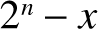를 나타내는 코드로 정의된다. 예를 들어 4비트 이진 시스템에서 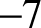는 에 해당하는 이진 코드로 표현되며, 그 값은 `1001`이다. 가 `0111`로 표현된다는 점을 떠올리면 임을 알 수 있다(오버플로 비트는 무시한다). 그림 2.1은 4비트 시스템에서 2의 보수 방법으로 표현되는 모든 부호 있는 수를 보여 준다.

*그림 2.1 4비트 이진 시스템에서 부호 있는 수의 2의 보수 표현.*

그림 2.1을 살펴보면 2의 보수 표현을 사용하는 *n*비트 이진 시스템에는 다음과 같은 매력적인 성질이 있음을 알 수 있다.

- 이 시스템은 부호 있는 수를 부호화하며, 그 범위는 부터  까지이다.
- 음이 아닌 모든 수의 코드는 0으로 시작한다.
- 모든 음수의 코드는 1로 시작한다.
- x의 이진 코드에서 의 이진 코드를 얻으려면, x의 최하위 0 비트들과 처음 나오는 최하위 1 비트는 그대로 두고 나머지 비트를 모두 뒤집는다(0은 1로, 1은 0으로 바꾼다). 또는 x의 모든 비트를 뒤집은 뒤 결과에 1을 더해도 된다.

2의 보수 표현의 특히 매력적인 특징은 *뺄셈*을 덧셈의 특수한 경우로 처리할 수 있다는 점이다. 이를 설명하기 위해 를 생각해 보자. 이 식이 와 같다는 점에 주목하고 그림 2.1을 따라 을 계산하면 결과는 `1110`이 되며, 이는 실제로 의 이진 코드이다. 다른 예도 살펴보자. 를 계산하려면 를 더하여 `11011`이라는 합을 얻는다. 오버플로 비트를 무시하면 `1011`이 되며, 이는 의 이진 코드이다.

이처럼 2의 보수 방법을 쓰면 음이 아닌 수를 더하는 데 필요한 하드웨어만으로 부호 있는 수의 덧셈과 뺄셈을 모두 수행할 수 있다. 이 책의 후반부에서 보겠지만 곱셈에서 나눗셈, 제곱근에 이르는 모든 산술 연산은 이진 덧셈으로 환원하여 구현할 수 있다. 따라서 한편으로는 방대한 범위의 컴퓨터 기능이 이진 덧셈 위에 구축된다는 사실을, 다른 한편으로는 2의 보수 방법이 부호 있는 수의 덧셈과 뺄셈을 위한 별도의 하드웨어를 불필요하게 만든다는 사실을 확인하게 된다. 이 두 관찰을 종합하면, 2의 보수 방법은 응용 컴퓨터 과학에서 가장 놀라우면서도 잘 알려지지 않은 숨은 영웅 중 하나라는 결론에 이르게 된다.

## 2.5 명세

이제 간단한 가산기에서 시작하여 ALU(산술 논리 장치)에 이르는 칩 계층 구조의 명세를 살펴본다. 이 책의 여느 장과 마찬가지로, 먼저 추상화 수준(칩이 *무엇을* 하도록 설계되었는지)에 집중하고 구현 세부 사항(*어떻게* 동작하는지)은 다음 절로 미룬다. 기쁜 마음으로 다시 한번 강조하자면, 2의 보수 표현법 덕분에 부호 있는 수를 처리하기 위한 별도의 설명이 필요 없다. 앞으로 소개할 모든 산술 칩은 음이 아닌 수, 음수, 부호가 섞인 수 모두에서 똑같이 잘 동작한다.

### 2.5.1 가산기

다음과 같은 *가산기(adder)* 계층 구조를 중점적으로 다룬다.

- 반가산기(Half-adder): 두 비트를 더하도록 설계된 칩
- 전가산기(Full-adder): 세 비트를 더하도록 설계된 칩
- 가산기(Adder): 두 개의 n비트 수를 더하도록 설계된 칩

또한 주어진 수에 1을 더하도록 설계된 특수 목적 가산기인 *증가기(incrementer)*의 명세도 다룬다. (*반가산기*와 *전가산기*라는 이름은 이 장 뒷부분에서 보게 되듯 전가산기 칩을 반가산기 두 개로 구현할 수 있다는 구현 세부 사항에서 유래했다.)

반가산기: 이진수를 더하는 첫걸음은 두 비트를 더하는 것이다. 이 연산의 결과를 2비트 수로 취급하여 오른쪽 비트를 `sum`, 왼쪽 비트를 `carry`라고 부르자. 그림 2.2는 이 덧셈 연산을 수행하는 칩을 보여 준다.

*그림 2.2 두 비트를 더하도록 설계된 반가산기.*

전가산기: 그림 2.3은 세 비트를 더하도록 설계된 *전가산기* 칩을 보여 준다. 반가산기와 마찬가지로 전가산기 칩도 세 입력 비트의 합을 함께 나타내는 두 비트를 출력한다.

*그림 2.3 세 비트를 더하도록 설계된 전가산기.*

가산기: 컴퓨터는 8, 16, 32, 64비트처럼 고정된 워드 크기를 사용하여 정수를 표현한다. 이러한 두 개의 *n*비트 수를 더하는 역할을 하는 칩을 *가산기*라고 한다. 그림 2.4는 16비트 가산기를 보여 준다.

*그림 2.4 두 16비트 수를 더하도록 설계된 16비트 가산기와 덧셈 동작의 예(왼쪽).*

참고로 16비트 수를 더하는 논리 설계는 *n*의 값과 무관하게 임의의 *n*비트 가산기 칩을 구현하도록 쉽게 확장할 수 있다.

증가기: 나중에 컴퓨터 아키텍처를 설계할 때 주어진 수에 1을 더하는 칩이 필요하다(*스포일러*: 현재 명령어를 실행한 뒤 메모리에서 다음 명령어를 가져오는 데 사용된다).  연산은 범용 `Adder` 칩으로도 구현할 수 있지만, 전용 *증가기* 칩을 사용하면 더 효율적으로 처리할 수 있다. 이 칩의 인터페이스는 다음과 같다.

### 2.5.2 산술 논리 장치

지금까지 소개한 모든 가산기 칩은 범용적이다. 산술 연산을 수행하는 모든 컴퓨터는 어떤 식으로든 이러한 칩을 사용한다. 이제 이 칩들을 바탕으로 나중에 CPU의 연산 핵심부가 될 *산술 논리 장치(Arithmetic Logic Unit)* 칩을 설명한다. 지금까지 다룬 범용 게이트 및 칩과 달리, 이 ALU 설계는 Nand to Tetris에서 구축하는 Hack 컴퓨터만의 고유한 설계이다. 그렇기는 하지만 Hack ALU의 바탕이 되는 설계 원리는 일반적이며 시사하는 바가 크다. 나아가 우리의 ALU 아키텍처는 최소한의 내부 부품만으로 매우 풍부한 기능을 달성한다. 그런 점에서 효율적이고 우아한 논리 설계의 좋은 본보기가 된다.

이름에서 알 수 있듯이 산술 논리 장치는 일련의 산술 및 논리 연산을 계산하도록 설계된 칩이다. ALU가 정확히 *어떤* 연산들을 제공해야 하는지는 비용 대비 효율성을 고려한 설계 결정이다. Hack 플랫폼에서는 (i) ALU가 정수 산술 연산만 수행하고(예: 부동소수점 산술 연산은 수행하지 않음), (ii) 그림 2.5a에 제시된 18가지 산술-논리 함수를 계산하도록 결정했다.

*그림 2.5a 오른쪽에 제시된 18가지 산술-논리 함수를 계산하도록 설계된 Hack ALU(기호 `!`, `&`, `|`는 각각 16비트 `Not`, `And`, `Or` 연산을 나타낸다). 지금은 `zr`과 `ng` 출력 비트를 무시해도 된다.*

그림 2.5a에서 보듯 Hack ALU는 `x`와 `y`로 표기되는 두 개의 16비트 2의 보수 정수와 *제어 비트(control bit)*라고 불리는 여섯 개의 1비트 입력을 받아 동작한다. 이 제어 비트들은 ALU에 어떤 함수를 계산할지 “지시”한다. 정확한 명세는 그림 2.5b에 나와 있다.

*그림 2.5b 여섯 개의 제어 비트 `zx`, `nx`, `zy`, `ny`, `f`, `no`의 값이 조합되어 ALU가 맨 오른쪽 열에 나열된 함수 중 하나를 계산하게 만든다.*

ALU 논리를 설명하기 위해, **일 때 함수 의 값을 계산하고 싶다고 하자. 먼저 27을 나타내는 16비트 이진 코드를 `x` 입력에 넣는다. 이 예에서는 `y`의 값이 원하는 계산에 아무런 영향을 미치지 않으므로 신경 쓰지 않아도 된다. 이제 그림 2.5b에서  항목을 찾아 ALU의 제어 비트를 `001110`으로 설정한다. 명세에 따르면 이 설정은 ALU가 26을 나타내는 이진 코드를 출력하게 만든다.

정말 그럴까? 이를 확인하기 위해 조금 더 깊이 들어가 Hack ALU가 어떻게 이런 마법을 부리는지 따져 보자. 그림 2.5b의 맨 위 행을 보면 여섯 개의 제어 비트가 각각 독립적인 조건부 미세 동작(micro-action)과 연결되어 있음을 알 수 있다. 예를 들어 `zx` 비트는 “if (`zx`==`1`) then set `x` to `0`”과 연결되어 있다. 이 여섯 가지 지시는 순서대로 수행된다. 먼저 `x`와 `y` 입력을 각각 `0`으로 설정하거나 그대로 둔다. 다음으로 그 결과값을 각각 반전(negate)하거나 그대로 둔다. 이어서 전처리된 두 값에 대해 + 또는 `&` 연산을 계산한다. 마지막으로 그 결과값을 반전하거나 그대로 둔다. 이러한 설정, 반전, 덧셈, 논리곱 연산은 모두 16비트 연산이다.

이 논리를 염두에 두고 `x-1`에 해당하는 행을 다시 살펴보며 여섯 개의 제어 비트가 인코딩한 미세 연산들이 실제로 ALU가 ** 값을 계산하게 만드는지 검증해 보자. 왼쪽에서 오른쪽으로 살펴보면 `zx`와 `nx` 비트가 모두 `0`이므로 `x` 입력을 0으로 만들지도, 반전하지도 않고 그대로 둔다. `zy`와 `ny` 비트는 1이므로 먼저 `y` 입력을 0으로 만든 뒤 그 결과를 반전하여 16비트 값 `1111111111111111`을 얻는다. 이 이진 코드는 2의 보수 표현에서  값을 나타내므로, 이제 ALU의 두 데이터 입력은 `x`의 값과  값이 된다. `f` 비트가 `1`이므로 선택되는 연산은 *덧셈*이며, 이에 따라 ALU는 ** 연산을 계산한다. 마지막으로 `no` 비트가 `0`이므로 출력은 반전되지 않는다. 결론적으로 ALU에 `x`와 `y` 값을 입력하고 여섯 개의 제어 비트를 `001110`으로 설정하면 ALU가 명세대로 ** 결과를 계산한다는 것을 확인했다.

그림 2.5b에 나열된 나머지 17가지 함수는 어떨까? ALU가 이 함수들도 실제로 계산할까? 이를 확인하려면 표의 다른 행들을 골라 여섯 개의 제어 비트가 인코딩한 미세 동작을 같은 과정으로 따라가며 ALU가 무엇을 출력할지 직접 계산해 보기 바란다. 아니면 ALU가 설명한 대로 동작한다는 우리의 말을 믿어도 좋다.

참고로 여섯 개의 제어 비트는 64가지 경우의 수를 인코딩하므로 ALU는 실제로 총 64가지 함수를 계산한다. 우리는 목표 컴퓨터 시스템의 명령어 집합을 지원하는 데 충분한 18가지 경우에만 집중하여 문서화하기로 결정했다. 호기심이 많은 독자라면 문서화되지 않은 ALU 연산 중 일부도 꽤 의미 있다는 사실이 흥미로울 것이다. 하지만 Hack 시스템에서는 이를 활용하지 않기로 했다.

Hack ALU의 인터페이스는 그림 2.5c에 제시되어 있다. ALU는 두 입력에 대해 지정된 함수를 계산하는 것 외에도 두 개의 출력 비트 `zr`과 `ng`를 계산한다. 이 비트들은 ALU 출력이 각각 0인지 또는 음수인지를 표시하는 플래그로, 나중에 컴퓨터 시스템의 CPU에서 사용된다.

*그림 2.5c Hack ALU API.*

우리의 ALU 설계로 이어진 사고 과정을 살펴보는 것도 도움이 될 것이다. 먼저 컴퓨터가 수행하기를 원하는 기본 연산의 잠정 목록을 작성했다(그림 2.5b의 오른쪽 열). 다음으로 역방향 추론을 사용하여 원하는 연산들을 수행하려면 `x`, `y`, `out`을 이진 방식으로 어떻게 조작해야 하는지 알아냈다. 이러한 처리 요구 사항과 ALU 논리를 가능한 한 단순하게 유지하려는 목표가 맞물려, 기본 논리 게이트로 쉽게 구현할 수 있는 직관적인 연산에 각각 연결된 여섯 개의 제어 비트를 사용하기로 설계를 결정했다. 그 결과 탄생한 ALU는 단순하면서도 우아하다. 그리고 하드웨어 분야에서는 단순함과 우아함이 가장 큰 힘을 발휘한다.

## 2.6 구현

구현 지침은 의도적으로 최소화했다. 지금까지 이미 많은 구현 팁을 제공했으므로, 이제 칩 아키텍처의 빈 부분을 스스로 찾아낼 차례이다.

이 절 전체에서 “…하는 논리 설계를 구축/구현하라”라고 말할 때는 (i) 논리 설계를 고안하고(예: 게이트 다이어그램을 스케치함), (ii) 그 설계를 실현하는 HDL 코드를 작성하며, (iii) 제공된 테스트 스크립트와 하드웨어 시뮬레이터로 설계를 테스트하고 디버깅하는 과정을 기대한다. 더 자세한 내용은 프로젝트 2를 설명하는 다음 절에 나와 있다.

반가산기: 그림 2.2의 진리표를 살펴보면 출력 `sum(a,b)`와 `carry(a,b)`가 프로젝트 1에서 다루고 구현했던 두 가지 간단한 불 함수의 출력과 정확히 일치함을 알 수 있다. 따라서 반가산기 구현은 매우 직관적이다.

전가산기: 전가산기 칩은 반가산기 두 개와 추가 게이트 하나로 구현할 수 있다(그래서 이 가산기들을 *반(half)*가산기와 *전(full)*가산기라고 부른다). 반가산기를 사용하지 않는 직접적인 접근 방식을 포함해 다른 구현 방법도 가능하다.

가산기: 두 *n*비트 수의 덧셈은 오른쪽에서 왼쪽으로 비트 단위로 수행할 수 있다. 0단계에서는 최하위 비트 쌍을 더하고, 그 결과로 나온 자리올림(carry) 비트를 다음 상위 비트 쌍의 덧셈에 입력한다. 이 과정은 최상위 비트 쌍을 더할 때까지 계속된다. 각 단계에서는 “이전” 덧셈에서 전달된 비트를 포함해 세 비트를 더한다는 점에 주목하자.

독자 중에는 이전 비트 쌍에서 자리올림 비트가 계산되기도 전에 어떻게 비트 쌍들을 “병렬로” 더할 수 있는지 궁금할 수도 있다. 그 해답은 이러한 연산이 한 클록 사이클 안에 완료되고 안정화될 만큼 충분히 빠르다는 것이다. 클록 사이클과 동기화는 다음 장에서 다룰 것이므로, 지금은 시간 요소를 완전히 무시하고 모든 비트 쌍에 동시에 작용하여 덧셈 연산을 계산하는 HDL 코드를 작성하면 된다.

증가기: *n*비트 증가기는 여러 가지 방법으로 쉽게 구현할 수 있다.

ALU: 우리의 ALU는 여섯 개의 제어 비트가 의미하는 간단한 불 연산을 사용하여 원하는 모든 ALU 연산을 *논리적으로* 수행하도록 세심하게 계획되었다. 따라서 ALU의 *물리적* 구현은 그림 2.5b 맨 위에 나열된 의사 코드 명세를 따라 이러한 간단한 연산들을 구현하는 문제로 귀결된다. 첫 단계는 16비트 값을 0으로 만들고 반전하는 논리 설계를 작성하는 일이 될 것이다. 이 논리는 `x`와 `y` 입력뿐만 아니라 `out` 출력을 처리하는 데에도 사용할 수 있다. 비트 단위 And 연산과 덧셈을 수행하는 칩은 각각 프로젝트 1과 프로젝트 2에서 이미 만들었다. 따라서 남은 일은 `f` 제어 비트에 따라 이 두 연산 중 하나를 선택하는 논리를 구축하는 것이다(이 선택 논리 역시 프로젝트 1에서 구현했다). 이 핵심 ALU 기능이 제대로 동작하면 이어서 단일 비트 출력인 `zr`과 `ng`에 필요한 기능을 구현할 수 있다.

## 2.7 프로젝트

목표: 이 장에서 제시한 모든 칩을 구현하라. 필요한 구성 요소는 1장에서 설명한 일부 게이트와 이 프로젝트에서 단계적으로 구축할 칩들뿐이다.

내장 칩(Built-in chips): 방금 말했듯이 이 프로젝트에서 구축할 칩들은 1장에서 설명한 일부 칩을 내부 부품으로 사용한다. 이 하위 수준 칩들을 HDL로 성공적으로 구현했더라도, 그 대신 내장(built-in) 버전을 사용하는 것을 권장한다. Nand to Tetris의 모든 하드웨어 프로젝트에 적용되는 모범 사례로서, HDL 구현체보다 내장 칩 부품을 우선적으로 사용하라. 내장 칩은 명세대로 동작함이 보장되며 하드웨어 시뮬레이터의 실행 속도를 높이도록 설계되었다.

이 모범 사례를 따르는 간단한 방법이 있다. 프로젝트 폴더 `nand2tetris/projects/02`에 프로젝트 1의 `.hdl` 파일을 하나도 넣지 않는 것이다. 하드웨어 시뮬레이터가 HDL 코드에서 프로젝트 1의 칩 부품(예: `And16`)에 대한 참조를 만나면, 현재 폴더에 `And16.hdl` 파일이 있는지 확인한다. 파일을 찾지 못하면 하드웨어 시뮬레이터는 기본적으로 해당 칩의 내장 버전을 사용하며, 이것이 바로 우리가 원하는 동작이다.

이 프로젝트의 나머지 지침은 프로젝트 1과 동일하다. 특히 좋은 HDL 프로그램은 가능한 한 적은 수의 칩 부품을 사용한다는 점을 기억하라. 또한 별도의 “보조 칩(helper chip)”을 만들어 구현할 필요가 없으며, HDL 프로그램에서는 오직 1장과 2장에서 명세한 칩만 사용해야 한다.

프로젝트 2의 웹 기반 버전은 [www.nand2tetris.org](http://www.nand2tetris.org)에서 이용할 수 있다.

## 2.8 전망

이 장에서 제시한 다중 비트 가산기 구성은 표준적인 방식이지만 효율성은 고려하지 않았다. 실제로 우리가 제안한 가산기 구현은 자리올림 비트가 *n*비트 피가수 전체로 전파되는 동안 발생하는 지연 때문에 비효율적이다. 이 계산은 이른바 *자리올림 예측(carry lookahead)* 휴리스틱을 구현하는 논리 회로로 가속할 수 있다. 덧셈은 컴퓨터 아키텍처에서 가장 빈번한 연산이므로 이러한 저수준 개선 하나만으로도 시스템 전반에서 극적인 성능 향상을 얻을 수 있다. 하지만 이 책에서는 기능 구현에 주로 집중하고, 칩 최적화는 더 전문적인 하드웨어 서적과 강좌에 맡긴다.2

모든 하드웨어/소프트웨어 시스템의 전체 기능은 CPU와 그 하드웨어 플랫폼 위에서 실행되는 운영체제가 함께 제공한다. 따라서 새로운 컴퓨터 시스템을 설계할 때 원하는 기능을 ALU와 OS 사이에 어떻게 배분할 것인가는 본질적으로 비용 대 성능의 딜레마이다. 일반적으로 산술 및 논리 연산을 하드웨어로 직접 구현하면 소프트웨어 구현보다 효율적이지만 하드웨어 플랫폼의 비용이 높아진다.

Nand to Tetris에서 우리가 선택한 절충안은 최소한의 기능만 갖춘 기본 ALU를 설계하고, 필요에 따라 추가 수학 연산은 시스템 소프트웨어로 구현하는 것이다. 예를 들어 우리의 ALU에는 곱셈과 나눗셈 기능이 없다. 이 책의 2부에서 운영체제(12장)를 다룰 때 곱셈과 나눗셈을 비롯한 여러 수학 연산을 위한 우아하고 효율적인 비트 단위 알고리즘을 구현할 것이다. 그러면 Hack 플랫폼 위에서 동작하는 고급 언어 컴파일러가 이 OS 루틴들을 활용할 수 있다. 따라서 고급 언어 프로그래머가 예를 들어  같은 표현식을 작성하면, 컴파일 이후 그 표현식의 일부는 ALU가 직접 평가하고 일부는 OS가 평가하지만 고급 언어 프로그래머는 이러한 저수준 분업을 전혀 의식하지 못한다. 실제로 운영체제의 핵심 역할 중 하나는 프로그래머가 사용하는 고급 언어 추상화와 그 추상화가 실현되는 최소한의 하드웨어 사이의 간극을 메우는 것이다.

---

1. 1. 이는 각각 대표적인 고급 데이터 타입인 *byte*, *short*, *int*, *long*에 해당한다. 예를 들어 기계 수준 명령어로 변환될 때 *short* 변수는 16비트 레지스터로 처리할 수 있다. 16비트 산술 연산은 64비트 산술 연산보다 네 배 빠르므로, 프로그래머는 애플리케이션의 요구 사항을 충족하는 범위에서 항상 가장 작은 데이터 타입을 사용하는 것이 좋다.
2. 2. 우리의 가산기 칩에서 자리올림 예측 기법을 사용하지 않는 기술적인 이유는, 이를 하드웨어로 구현하려면 순환 핀 연결(cyclical pin connection)이 필요한데 Nand to Tetris 하드웨어 시뮬레이터가 이를 지원하지 않기 때문이다.

# 3 메모리

> 과거로만 작동하는 기억은 형편없는 기억이다.
>
> —루이스 캐럴(Lewis Carroll, 1832–1898)

고급 언어의  연산을 생각해 보자. 2장에서는 논리 게이트를 사용해 숫자를 표현하고  같은 간단한 산술 표현식을 계산하는 방법을 살펴보았다. 이제 논리 게이트로 *시간이 지나도 값을 저장하는* 방법, 특히 `x` 같은 변수가 어떤 값을 "담고" 있다가 다른 값으로 바꿀 때까지 그 값을 유지하는 방법을 살펴본다. 이를 위해 새로운 종류의 칩인 *메모리 칩(memory chip)*을 개발한다.

지금까지 1장과 2장에서 만든 칩은 정점에 있는 ALU에 이르기까지 모두 시간과 무관했다. 이러한 칩을 *조합(combinational)* 칩이라고도 부른다. 조합 칩은 내부 부품 칩이 계산을 완료하는 데 걸리는 시간을 제외하면 지연 없이 다양한 입력 조합에 응답한다. 이 장에서는 *순차(sequential)* 칩을 소개하고 직접 구축한다. 시간에 무감각한 조합 칩과 달리, 순차 칩의 출력은 현재 시각의 입력뿐만 아니라 이전에 처리된 입력과 출력에도 의존한다.

말할 필요도 없이 *현재*와 *이전*이라는 개념은 *시간*이라는 개념과 밀접하게 연결되어 있다. 우리는 이전에 기억에 저장해 둔 것을 지금 떠올린다. 따라서 메모리를 논의하기 전에 먼저 논리를 사용해 시간의 흐름을 모델링하는 방법을 알아내야 한다. 이는 *틱(tick)*과 *톡(tock)*이라 부르는 이진 신호의 연속적인 흐름을 생성하는 *클럭(clock)*으로 구현할 수 있다. 한 번의 틱이 시작되는 시점부터 이어지는 톡이 끝나는 시점까지의 시간을 *사이클(cycle)*이라고 하며, 이 사이클을 사용해 컴퓨터가 사용하는 모든 메모리 칩의 동작을 제어한다.

메모리 장치를 사용자 관점에서 간단히 소개한 뒤, 시간 의존적 칩을 구축하는 데 필요한 순차 논리의 기법을 살펴본다. 그런 다음 레지스터, RAM 장치, 카운터를 차례로 구축한다. 이 메모리 장치들과 2장에서 만든 산술 장치를 모두 모으면 완전한 범용 컴퓨터 시스템을 구축하는 데 필요한 모든 칩이 갖춰진다. 이 도전 과제는 5장에서 본격적으로 다룬다.

## 3.1 메모리 장치

컴퓨터 프로그램은 시간이 지나도 데이터를 유지하는 추상화인 변수, 배열, 객체를 사용한다. 하드웨어 플랫폼은 *상태를 유지하는* 메모리 장치를 제공하여 이 기능을 지원한다. 진화 덕분에 인간은 놀라운 전기화학적 기억 체계를 갖추고 있어, 시간이 지나도 무언가를 기억하는 능력을 당연하게 여기는 경향이 있다. 하지만 시간도 상태도 인식하지 못하는 고전 논리에서는 이 능력을 구현하기 어렵다. 따라서 먼저 시간의 흐름을 모델링하고, 논리 게이트에 상태를 유지하며 시간 변화에 응답하는 능력을 부여할 방법을 찾아야 한다.

이 과제를 해결하기 위해 클럭과 더불어 0을 나타내는 상태와 1을 나타내는 두 안정 상태 사이를 전환(flip and flop)할 수 있는 기본적인 시간 의존적 논리 게이트를 도입한다. *데이터 플립플롭*(data flip-flop, DFF)이라 불리는 이 게이트는 앞으로 만들 모든 메모리 장치의 기본 구성 요소다. 하지만 핵심적인 역할에도 불구하고 DFF는 겉으로 잘 드러나지 않는 겸손한 게이트다. 컴퓨터 아키텍처에서 두드러진 역할을 맡는 레지스터, RAM 장치, 카운터와 달리, DFF는 다른 메모리 장치 깊숙한 곳에 내장된 저수준 부품 칩으로 암묵적으로 사용된다.

DFF의 근본적인 역할은 그림 3.1에서 분명히 드러난다. DFF는 우리가 구축하려는 메모리 계층 구조의 토대를 이룬다. 먼저 DFF를 사용해 1비트 레지스터를 만드는 방법과, 이러한 레지스터 *n*개를 묶어 *n*비트 레지스터를 만드는 방법을 살펴본다. 다음으로 이러한 레지스터를 임의의 개수만큼 포함하는 RAM 장치를 구성한다. 이 과정에서 RAM 안의 임의로 선택된 어떤 레지스터든 주소로 직접, 즉각 접근할 수 있는 *주소 지정(addressing)* 수단도 함께 개발한다.

*그림 3.1 이 장에서 구축하는 메모리 계층 구조.*

하지만 이 칩들을 구축하기에 앞서, 시간의 흐름을 모델링하고 시간이 지나도 상태를 유지할 수 있게 해 주는 방법론과 도구를 먼저 소개한다.

## 3.2 순차 논리

1장과 2장에서 다룬 모든 칩은 시간과 무관한 고전 논리에 기반했다. 메모리 장치를 개발하려면 입력 변화뿐만 아니라 클럭의 똑딱거림에도 응답할 수 있도록 게이트 논리를 확장해야 한다. 우리가 시각 *t*에 *dog*라는 단어의 뜻을 기억하는 이유는 시각 에도 기억하고 있었기 때문이며, 거슬러 올라가면 그 단어를 처음 기억에 새겼던 시점까지 이어진다. 이처럼 시간에 걸쳐 *상태를 유지하는* 능력을 구현하려면, 컴퓨터 아키텍처에 시간 차원을 확장하고 불 함수를 사용해 시간을 다루는 도구를 만들어야 한다.

### 3.2.1 시간은 중요하다

지금까지 Nand to Tetris 여정에서 우리는 칩이 입력에 즉각 응답한다고 가정했다. ALU에 7, 2, 그리고 "빼기"를 입력하면 … *짠!* ALU의 출력이 5가 된다. 하지만 현실에서는 적어도 두 가지 이유 때문에 출력이 항상 지연된다. 첫째, 칩의 입력은 허공에서 갑자기 나타나지 않는다. 입력을 나타내는 신호는 다른 칩의 출력에서 전달되어 오며, 이 이동에는 시간이 걸린다. 둘째, 칩이 수행하는 계산 자체에도 시간이 걸린다. 칩에 포함된 부품 칩이 많고 논리가 정교할수록, 칩의 회로에서 완전한 형태의 출력이 나오기까지 더 많은 시간이 필요하다.

따라서 *시간*은 반드시 다루어야 할 문제다. 그림 3.2의 상단에서 보듯이, 시간은 흔히 멈추지 않고 앞으로 나아가는 은유적 화살로 여겨진다. 이 흐름은 연속적이라고 간주한다. 즉, 임의의 두 시점 사이에는 또 다른 시점이 존재하며, 세상의 변화는 무한히 작을 수 있다. 철학자와 물리학자에게 인기 있는 이 시간 개념은 컴퓨터 과학자에게는 지나치게 심오하고 모호하다. 그래서 우리는 시간을 연속적인 흐름으로 보는 대신, *사이클(cycle)*이라 부르는 고정 길이 구간으로 나누는 방식을 선호한다. 이러한 표현은 이산적(discrete)이며, 사이클 1, 사이클 2, 사이클 3 등으로 이어진다. 무한한 세분성을 지닌 연속적 시간의 화살과 달리, 사이클은 더 이상 나눌 수 없는 원자적 단위다. 세상의 변화는 오직 사이클 전환 시점에만 일어나며, 사이클 내부에서는 세상이 정지해 있다.

*그림 3.2 이산 시간 표현: 상태 변화(입력과 출력 값)는 사이클 전환 시점에만 관찰된다. 사이클 내부의 변화는 무시된다.*

물론 실제 세상은 결코 멈추지 않는다. 하지만 시간을 이산적으로 다루기로 함으로써, 우리는 연속적인 변화를 의도적으로 무시하기로 결정한 것이다. 우리는 사이클 *n*에서의 세계 상태를 알고, 그다음 사이클 에서의 상태를 아는 것으로 만족한다. 각 사이클 *동안*의 상태는—글쎄, 신경 쓰지 않는다. 컴퓨터 아키텍처를 구축할 때 이러한 이산적 시간 관점은 두 가지 중요한 설계 목표를 달성하는 데 기여한다. 첫째, 통신 및 계산 시간 지연에 따르는 무작위성을 상쇄한다. 둘째, 뒤에서 살펴보겠지만 시스템 전반에 걸친 서로 다른 칩들의 동작을 동기화한다.

이를 설명하기 위해 그림 3.2의 하단을 살펴보자. 여기서는 예제로 삼은 Not 게이트가 임의로 주어진 입력에 어떻게 응답하는지 추적한다. 게이트에 1을 입력하면 출력이 0으로 안정되기까지 잠시 시간이 걸린다. 그러나 사이클 길이는 *설계상* 이 시간 지연보다 길기 때문에, 사이클 끝에 도달할 때쯤이면 게이트 출력은 이미 0으로 안정되어 있다. 우리는 사이클 끝에서만 세계의 상태를 관찰하므로 중간의 시간 지연을 보지 못한다. 대신 게이트에 0을 입력하자마자 *짠!* 하고 1로 응답하는 것처럼 보인다. 각 사이클 끝에서 같은 관찰을 반복하면, Not 게이트에 어떤 이진 입력 *x*를 넣을 때 즉각 Not(*x*)를 출력한다고 일반화할 수 있다.

사려 깊은 독자라면 이 방식이 제대로 작동하려면 *사이클의 길이*가 시스템에서 발생할 수 있는 최대 시간 지연보다 길어야 한다는 사실을 이미 눈치챘을 것이다. 실제로 사이클 길이는 모든 하드웨어 플랫폼에서 가장 중요한 설계 매개변수 중 하나다. 컴퓨터를 설계할 때 하드웨어 엔지니어는 두 가지 설계 목표를 모두 충족하는 사이클 길이를 선택한다. 한편으로는 발생 가능한 모든 시간 지연을 감싸고 상쇄할 만큼 사이클이 충분히 길어야 한다. 다른 한편으로는 사이클이 짧을수록 컴퓨터가 더 빨라진다. 사이클 전환 시점에만 일이 일어난다면, 사이클이 짧을수록 일이 더 빠르게 처리되는 것은 당연하다. 요약하면, 사이클 길이는 시스템 내 어떤 칩에서 발생하는 최대 시간 지연보다 약간 더 길게 설정한다. 스위칭 기술의 눈부신 발전 덕분에 오늘날에는 10억 분의 1초만큼이나 짧은 사이클을 만들어 놀라운 컴퓨터 속도를 달성할 수 있다.

일반적으로 사이클은 0−1, *low-high*, 또는 *틱톡(ticktock)*으로 표시되는 두 위상 사이를 끊임없이 오가는 발진기(oscillator)로 구현된다(그림 3.2 참조). 틱이 시작되는 시점부터 이어지는 톡이 끝나는 시점까지의 경과 시간을 *사이클*이라고 하며, 각 사이클은 하나의 이산 시간 단위를 모델링한다. 현재 클럭 위상(*틱* 또는 *톡*)은 이진 신호로 표현된다. 하드웨어 회로를 거쳐 동일한 마스터 클럭 신호가 시스템 내 모든 메모리 칩에 동시에 전달된다. 각 메모리 칩에서는 이 클럭 입력이 하위 수준의 DFF 게이트로 전달되어, 칩이 클럭 사이클의 끝에서만 새로운 상태를 확정하고 출력하도록 보장한다.

### 3.2.2 플립플롭

메모리 칩은 시간이 지나도 정보를 "기억"하거나 저장하도록 설계된다. 이 저장 추상화를 가능하게 하는 저수준 장치를 *플립플롭(flip-flop)* 게이트라고 하며, 여기에는 여러 변형이 있다. Nand to Tetris에서는 *데이터 플립플롭*(data flip-flop), 즉 DFF라는 변형을 사용한다. DFF의 인터페이스는 1비트 데이터 입력과 1비트 데이터 출력으로 구성된다(그림 3.3 상단 참조). 또한 DFF에는 마스터 클럭 신호를 받는 클럭 입력이 있다. 데이터 입력과 클럭 입력이 함께 작용하여 DFF는 단순한 시간 기반 동작 `out`을 구현한다. 여기서 `in`과 `out`은 게이트의 입력과 출력 값이며, *t*는 현재 시간 단위다(앞으로는 "시간 단위"와 "사이클"이라는 용어를 혼용한다). 이 동작이 실제로 어떻게 구현되는지는 지금 걱정하지 말자. 우선 각 시간 단위의 끝에서 DFF가 이전 시간 단위의 입력 값을 출력한다는 점만 확인하고 넘어가자.

*그림 3.3 데이터 플립플롭(상단)과 동작 예제(하단). 첫 번째 사이클에서는 이전 입력을 알 수 없으므로 DFF의 출력이 정의되지 않는다. 그 이후 모든 시간 단위에서 DFF는 이전 시간 단위의 입력을 출력한다. 게이트 다이어그램 관례에 따라 클럭 입력은 게이트 아이콘 하단에 그려진 작은 삼각형으로 표시한다.*

Nand 게이트와 마찬가지로 DFF 게이트도 하드웨어 계층의 가장 깊은 곳에 자리한다. 그림 3.1에서 보듯이, 컴퓨터의 모든 메모리 칩—레지스터, RAM 장치, 카운터—은 근본적으로 DFF 게이트에 기반한다. 이 모든 DFF는 동일한 마스터 클럭에 연결되어 거대한 분산형 "코러스 라인(chorus line)"을 이룬다. 각 클럭 사이클의 끝에서 컴퓨터 안의 *모든* DFF 출력이 이전 사이클의 입력 값으로 확정된다. 그 밖의 모든 시점에는 DFF가 *래치(latched)* 상태를 유지하므로, 입력이 바뀌어도 출력에 즉각 영향을 미치지 않는다. 이 지휘 동작은 (컴퓨터의 클럭 주파수에 따라) 초당 수많은 횟수로 시스템 내 수많은 DFF 게이트 각각에 작용한다.

하드웨어 구현에서는 시스템의 모든 DFF 게이트에 마스터 클럭 신호를 동시에 공급하는 전용 클럭 버스를 사용해 이러한 시간 의존성을 실현한다. 하드웨어 시뮬레이터는 소프트웨어로 동일한 효과를 모방한다. 특히 Nand to Tetris 하드웨어 시뮬레이터는 사용자가 대화식으로 클럭을 진행할 수 있는 클럭 아이콘을 제공하며, 테스트 스크립트에서 프로그래밍 방식으로 사용할 수 있는 `tick`과 `tock` 명령도 지원한다.

### 3.2.3 조합 논리와 순차 논리

1장과 2장에서 개발한 모든 칩은 기본 논리 게이트에서 시작해 ALU에 이르기까지 오직 현재 클럭 사이클 동안 일어나는 변화에만 응답하도록 설계되었다. 이러한 칩을 *시간 독립적(time-independent)* 칩 또는 *조합(combinational)* 칩이라고 한다. 후자의 이름은 이 칩들이 시간의 흐름에는 전혀 신경 쓰지 않고 오직 입력 값의 다양한 조합에만 응답한다는 사실을 암시한다.

반면 이전 시간 단위(그리고 경우에 따라 현재 시간 단위) 동안 일어난 변화에 응답하도록 설계된 칩을 *순차(sequential)* 칩 또는 *클럭 동기(clocked)* 칩이라고 한다. 가장 기본적인 순차 게이트는 DFF이며, 직접적이든 간접적이든 DFF를 포함하는 모든 칩 역시 순차 칩이라 한다. 그림 3.4는 전형적인 순차 논리 구성을 보여 준다. 이 구성의 핵심 요소는 DFF 부품 칩을 직접 또는 간접적으로 포함하는 하나 이상의 칩 집합이다. 그림에서 보듯이, 이 순차 칩들은 조합 칩과도 상호작용할 수 있다. 피드백 루프 덕분에 순차 칩은 이전 시간 단위의 입력과 출력에 응답할 수 있다. 시간을 모델링하지도 인식하지도 않는 조합 칩에서는 피드백 루프를 도입하면 문제가 발생한다. 칩의 출력이 입력에 의존하고, 그 입력이 다시 출력에 의존하므로 결국 출력이 자기 자신에 의존하는 모순이 생기기 때문이다. 하지만 피드백 루프가 DFF 게이트를 거치기만 하면 출력을 다시 입력으로 되돌려 보내도 아무런 문제가 없다. DFF가 본질적인 시간 지연을 도입하므로, 시각 *t*의 출력이 자기 자신이 아니라 시각 의 출력에 의존하게 된다.

*그림 3.4 순차 논리 설계는 일반적으로 조합 칩으로부터 입력을 받고 조합 칩과 연결되는 DFF 게이트를 포함한다. 이로써 순차 칩은 현재뿐만 아니라 이전의 입력과 출력에도 응답할 수 있다.*

순차 칩의 시간 의존성은 전체 컴퓨터 아키텍처를 동기화하는 중요한 부수 효과를 낳는다. 예를 들어 ALU에  계산을 지시한다고 가정하자. 여기서 *x*는 가까운 레지스터의 출력이고, *y*는 멀리 떨어진 RAM 레지스터의 출력이다. 거리, 저항, 간섭 같은 물리적 제약 때문에 *x*와 *y*를 나타내는 전기 신호는 ALU에 서로 다른 시각에 도착할 가능성이 크다. 그런데 조합 칩인 ALU는 시간 개념에 무감각하므로, 입력 단자에 무엇이 놓여 있든 그 데이터 값을 끊임없이 더해 버린다. 따라서 ALU의 출력이 올바른  결과로 안정되기까지는 어느 정도 시간이 걸린다. 그전까지 ALU는 쓰레기 값을 내놓는다.

이 어려움을 어떻게 극복할 수 있을까? 이산 시간 표현을 사용하면 *그냥 신경 쓰지 않아도 된다*. 컴퓨터의 클럭을 만들 때, 클럭 사이클의 길이를 비트가 한 칩에서 다른 칩으로 이동하는 최장 시간에 가장 시간이 오래 걸리는 칩 내부 계산 시간을 더한 값보다 약간 더 길게 맞추기만 하면 된다. 이렇게 하면 클럭 사이클이 끝날 때쯤에는 ALU의 출력이 반드시 유효하다는 보장이 생긴다. 한마디로, 이것이 바로 독립적인 하드웨어 부품들의 집합을 잘 동기화된 하나의 시스템으로 탈바꿈시키는 비결이다. 이 전체적인 조율은 5장에서 컴퓨터 아키텍처를 구축할 때 더 자세히 다룬다.

## 3.3 명세

이제 컴퓨터 아키텍처에서 일반적으로 사용되는 메모리 칩들의 명세를 살펴본다.

- 데이터 플립플롭(DFF)
- 레지스터(DFF 기반)
- RAM 장치(레지스터 기반)
- 카운터(레지스터 기반)

늘 그렇듯이 이 칩들을 *추상적으로* 기술한다. 특히 각 칩의 인터페이스—입력, 출력, 기능—에 초점을 맞춘다. 이 칩들이 해당 기능을 어떻게 구현하는지는 구현 절에서 다룬다.

### 3.3.1 데이터 플립플롭

우리가 사용할 가장 기본적인 순차 장치이자, 다른 모든 메모리 칩을 구축하는 토대가 되는 부품은 *데이터 플립플롭*이다. DFF 게이트는 1비트 데이터 입력, 1비트 데이터 출력, 클럭 입력을 가지며, 단순한 시간 의존적 동작을 수행한다: `out`

사용법: DFF의 입력에 1비트 값을 넣으면 DFF의 상태가 그 값으로 설정되고, 다음 시간 단위에서 DFF의 출력이 그 값을 내보낸다(그림 3.3 참조). 이 소박한 동작은 바로 다음에 설명할 레지스터 구현에서 매우 유용하게 쓰인다.

### 3.3.2 레지스터

여기서는 1비트 레지스터인 `Bit`와 16비트 레지스터인 `Register`를 소개한다. `Bit` 칩은 시간이 지나도 1비트의 정보(0 또는 1)를 저장하도록 설계되었다. 이 칩의 인터페이스는 데이터 비트를 전달하는 `in` 입력, 레지스터에 쓰기를 활성화하는 `load` 입력, 레지스터의 현재 상태를 내보내는 `out` 출력으로 구성된다. `Bit`의 API와 입출력 동작은 그림 3.5에 나와 있다.

*그림 3.5 1비트 레지스터. 새 값을 적재하라는 지시를 받을 때까지 1비트 값을 저장하고 출력한다.*

그림 3.5는 1비트 레지스터가 임의의 `in` 및 `load` 입력 예제에 응답하며 시간에 따라 어떻게 동작하는지 보여 준다. 입력 값이 무엇이든 `load` 비트가 활성화(assert)되지 않는 한, 레지스터는 래치 상태를 유지하며 현재 상태를 보존한다.

16비트 `Register` 칩은 16비트 값을 다룬다는 점만 제외하면 `Bit` 칩과 완전히 동일하게 동작한다. 자세한 내용은 그림 3.6에 나와 있다.

*그림 3.6 16비트 Register. 새 값을 적재하라는 지시를 받을 때까지 16비트 값을 저장하고 출력한다.*

사용법: `Bit` 레지스터와 16비트 `Register`의 사용법은 동일하다. 레지스터의 상태를 읽으려면 `out` 값을 확인한다. 레지스터의 상태를 *v*로 설정하려면 `in` 입력에 *v*를 넣고 `load` 비트를 활성화(1을 입력)한다. 그러면 레지스터의 상태가 *v*로 설정되고, 다음 시간 단위부터 레지스터가 새 값을 확정하여 `out` 출력으로 내보내기 시작한다. 이처럼 `Register` 칩은 다른 값으로 바꿀 때까지 마지막으로 기록된 값을 기억하고 출력하는, 메모리 장치의 전형적인 기능을 수행한다.

### 3.3.3 랜덤 액세스 메모리

*랜덤 액세스 메모리(Random Access Memory)* 또는 RAM이라 불리는 직접 접근 메모리 장치는 *n*개의 `Register` 칩을 모아 놓은 집합체이다. 특정 주소(0부터  사이의 수)를 지정하면 RAM 내부의 각 레지스터를 선택해 읽기/쓰기 연산을 수행할 수 있다. 중요한 점은 임의로 선택한 어떤 메모리 레지스터든 접근 시간이 즉각적이며, 레지스터의 주소나 RAM의 크기와 무관하다는 것이다. 바로 이 특성 때문에 RAM 장치가 놀라울 정도로 유용하다. 수십억 개의 레지스터가 들어 있더라도 선택한 각 레지스터에 동일한 즉각적 접근 시간으로 직접 접근하고 조작할 수 있다. RAM API는 그림 3.7에 제시되어 있다.

*그림 3.7 개별적으로 선택하고 조작할 수 있는 **n**개의 16비트 `Register` 칩으로 구성된 RAM 칩. 레지스터 주소 는 칩 하드웨어의 일부가 아니다. 대신 다음 절에서 다룰 게이트 논리 구현으로 실현된다.*

사용법: *m*번 레지스터의 내용을 읽으려면 `address` 입력을 *m*으로 설정한다. 그러면 *m*번 레지스터가 선택되고, RAM의 출력이 해당 값을 내보낸다. *m*번 레지스터에 새 값 *v*를 쓰려면 `address` 입력을 *m*으로, `in` 입력을 *v*로 설정하고 `load` 비트를 활성화(1로 설정)한다. 그러면 *m*번 레지스터가 선택되어 쓰기가 가능해지고, 그 값이 *v*로 설정된다. 다음 시간 단위부터 RAM의 출력은 *v*를 내보내기 시작한다.

결과적으로 RAM 장치는 요구 사항대로 정확하게 동작한다. 즉, 주소 지정이 가능한 레지스터들의 집합으로서 각 레지스터에 독립적으로 접근하고 연산할 수 있다. 읽기 연산(`load`==`0`)의 경우 RAM의 출력은 선택된 레지스터의 값을 즉시 내보낸다. 쓰기 연산(`load`==`1`)의 경우 선택된 메모리 레지스터가 입력 값으로 설정되며, RAM의 출력은 다음 시간 단위부터 그 값을 내보내기 시작한다.

중요한 것은 RAM 구현이 RAM 내부의 *어느* 레지스터에 대해서도 접근 시간이 거의 즉각적이도록 보장해야 한다는 점이다. 그렇지 않으면 명령어를 인출하고 변수를 조작하는 데 합리적인 시간 내에 처리할 수 없어 컴퓨터가 실용적이지 않을 만큼 느려진다. 즉각적인 접근 시간을 가능하게 하는 원리는 잠시 후 구현 절에서 밝혀진다.

### 3.3.4 카운터

카운터는 매 시간 단위마다 자신의 값을 1씩 증가시킬 수 있는 칩이다. 5장에서 컴퓨터 아키텍처를 구축할 때 이 칩을 `Program` `Counter` 또는 `PC`라고 부를 것이므로, 여기서도 같은 이름을 사용한다.

`PC` 칩의 인터페이스는 레지스터와 동일하지만 `inc`와 `reset`이라는 제어 비트가 추가되어 있다. `inc`==`1`일 때 카운터는 매 클록 사이클마다 상태를 증가시켜 `PC`++ 연산을 수행한다. 카운터를 0으로 초기화하려면 `reset` 비트를 활성화하고, 카운터를 값 *v*로 설정하려면 일반적인 레지스터와 마찬가지로 `in` 입력에 *v*를 넣고 `load` 비트를 활성화한다. 자세한 내용은 그림 3.8에 나와 있다.

*그림 3.8 프로그램 카운터(`PC`): 올바르게 사용하려면 `load`, `inc`, `reset` 비트 중 최대 하나만 활성화해야 한다.*

사용법: `PC`의 현재 내용을 읽으려면 `out` 핀을 확인한다. `PC`를 초기화하려면 `reset` 비트를 활성화하고 나머지 제어 비트는 `0`으로 설정한다. 별도의 지시가 있을 때까지 매 시간 단위마다 `PC`가 `1`씩 증가하게 하려면 `inc` 비트를 활성화하고 나머지 제어 비트는 `0`으로 설정한다. `PC`를 값 *v*로 설정하려면 `in` 입력을 *v*로 설정하고 `load` 비트를 활성화한 뒤 나머지 제어 비트는 `0`으로 설정한다.

## 3.4 구현

앞 절에서는 메모리 칩 추상화 계열의 인터페이스와 기능에 초점을 맞추어 살펴보았다. 이번 절에서는 이미 만들어 둔 더 단순한 칩들을 사용해 이러한 칩들을 어떻게 실현할 수 있는지 다룬다. 평소와 마찬가지로 구현 지침은 의도적으로 암시적인 수준에 머문다. HDL과 제공되는 하드웨어 시뮬레이터를 사용해 독자가 직접 구현을 완성할 수 있도록 충분한 힌트를 제공하는 것이 목적이다.

### 3.4.1 데이터 플립플롭

DFF 게이트는 0을 나타내는 상태와 1을 나타내는 두 가지 안정 상태 사이를 “플립플롭(flip-flop)”할 수 있도록 설계된다. 이 기능은 Nand 게이트만 사용하는 방식을 포함해 여러 가지 방법으로 구현할 수 있다. Nand 기반 DFF 구현은 우아하지만 복잡하며, 조합 게이트 간의 피드백 루프가 필요하므로 우리의 하드웨어 시뮬레이터에서는 모델링할 수 없다. 이러한 복잡성을 추상화하기 위해 DFF를 기본 빌딩 블록으로 취급한다. 구체적으로 Nand to Tetris 하드웨어 시뮬레이터는 다른 칩에서 바로 사용할 수 있는 내장 DFF 구현을 제공하며, 이제 그 활용법을 설명한다.

### 3.4.2 레지스터

레지스터 칩은 메모리 장치로, 시간이 지나도 자신의 상태를 기억하고 내보내는 기본 동작 `out,`을 구현해야 한다. 이는 `out.`인 DFF의 동작과 비슷해 보인다. DFF의 출력을 다시 입력으로 되먹임(feedback)할 수만 있다면 1비트 `Bit` 레지스터를 구현하는 좋은 출발점이 될 수 있다. 이 해법은 그림 3.9의 왼쪽에 나타나 있다.

*그림 3.9 `Bit`(1비트 레지스터) 구현: 잘못된 해법(왼쪽)과 올바른 해법(오른쪽).*

그림 3.9의 왼쪽에 표시된 구현은 서로 연관된 몇 가지 이유로 올바르지 않다. 첫째, 이 구현은 레지스터 인터페이스에서 요구하는 `load` 비트를 노출하지 않는다. 둘째, `DFF` 칩 부품에 언제 `in` 배선에서 입력을 받고 언제 되돌아오는 `out` 값에서 입력을 받을지 지시할 방법이 없다. 실제로 HDL 프로그래밍 규칙은 하나의 핀에 둘 이상의 소스에서 신호를 공급하는 것을 금지한다.

이 잘못된 설계의 장점은 그림 3.9의 오른쪽에 제시된 올바른 구현으로 우리를 이끌어 준다는 점이다. 칩 다이어그램에서 볼 수 있듯, 입력의 모호성을 해결하는 자연스러운 방법은 설계에 멀티플렉서를 도입하는 것이다. 전체 레지스터 칩의 *load 비트*를 내부 멀티플렉서의 *선택(select) 비트*로 연결하면 된다. 이 비트를 1로 설정하면 멀티플렉서가 `in` 값을 `DFF`로 전달하고, `load` 비트를 0으로 설정하면 멀티플렉서가 `DFF`의 이전 출력을 전달한다. 이렇게 하면 “`load`이면 레지스터를 새 값으로 설정하고, 그렇지 않으면 이전에 저장된 값으로 유지한다”는 동작이 만들어지며, 이는 우리가 레지스터에 원하는 동작과 정확히 일치한다.

방금 설명한 피드백 루프는 순환적인 *데이터 경쟁(data race)* 문제를 일으키지 않는다. 루프가 시간 지연을 도입하는 `DFF` 게이트를 거치기 때문이다. 사실 그림 3.9의 `Bit` 설계는 그림 3.4에 제시된 일반적인 순차 논리 설계의 특수한 사례이다.

단일 비트 `Bit` 레지스터 구현을 마치면 *w*비트 레지스터 구축으로 넘어갈 수 있다. 이는 *w*개의 `Bit` 칩 배열을 구성하여 달성할 수 있다(그림 3.1 참조). 이러한 레지스터의 기본 설계 매개변수는 저장해야 하는 비트 수인 *w*—예를 들어 16, 32, 또는 64—이다. Hack 컴퓨터는 16비트 하드웨어 플랫폼을 기반으로 하므로, 우리의 `Register` 칩은 16개의 `Bit` 칩 부품으로 구성된다.

`Bit` 레지스터는 Hack 아키텍처에서 `DFF` 게이트를 직접 사용하는 유일한 칩이다. 컴퓨터의 모든 상위 메모리 장치는 `Bit` 칩으로 만들어진 `Register` 칩을 사용함으로써 `DFF` 칩을 간접적으로 사용한다. 어떤 칩의 설계에든 `DFF` 게이트가 직접적 또는 간접적으로 포함되면, 그 칩은 물론 이를 칩 부품으로 사용하는 모든 상위 칩까지 시간에 의존하는 칩이 된다는 점에 유의하자.

### 3.4.3 RAM

Hack 하드웨어 플랫폼에는 16K(16384)개의 16비트 레지스터로 이루어진 RAM 장치가 필요하므로 이를 구현해야 한다. 다음과 같은 단계적 구현 로드맵을 제안한다.

이 모든 메모리 칩은 그림 3.7에 제시된 `RAM`*n* API와 정확히 동일한 인터페이스를 갖는다. 각 RAM 칩에는 *n*개의 레지스터가 있으며, 주소 입력의 폭은 비트이다. 이제 `RAM8`부터 시작해 이 칩들을 구현하는 방법을 설명한다.

`RAM8` 칩은 그림 3.7에서 인 경우처럼 8개의 레지스터를 갖춘다. `RAM8`의 3비트 주소 입력을 0에서 7 사이의 값으로 설정하여 각 레지스터를 선택할 수 있다. 선택된 레지스터의 값을 *읽는* 동작은 다음과 같이 설명할 수 있다. 어떤 `address`(0에서 7 사이의 값)가 주어졌을 때, `address`번 레지스터를 “선택”하여 그 출력을 `RAM8`의 출력으로 어떻게 연결할 수 있을까? *힌트:* 프로젝트 1에서 만든 조합 칩 중 하나를 사용하면 된다. 선택된 RAM 레지스터의 값을 읽는 작업이 클록이나 RAM 내 레지스터 개수와 무관하게 거의 즉각적으로 이루어지는 이유가 바로 여기에 있다. 마찬가지로 선택된 레지스터에 값을 *쓰는* 동작도 다음과 같이 설명할 수 있다. `address` 값, `load` 값(`1`), 16비트 `in` 값이 주어졌을 때 `address`번 레지스터의 값을 `in`으로 어떻게 설정할 수 있을까? *힌트:* 16비트 `in` 데이터는 8개의 `Register` 칩 모두의 `in` 입력에 동시에 공급할 수 있다. 프로젝트 1에서 개발한 또 다른 조합 칩을 `address` 및 `load` 입력과 함께 사용하면, 단 하나의 레지스터만 들어오는 `in` 값을 받아들이고 나머지 7개의 레지스터는 이를 무시하도록 만들 수 있다.

참고로 RAM 레지스터에는 어떤 물리적인 의미의 주소도 새겨져 있지 않다. 대신 위에서 설명한 논리가 주소에 따라 개별 레지스터를 선택할 수 있으며 그 역할에 충분하고, 이는 조합 칩을 사용함으로써 이루어진다. 여기서 매우 중요한 관찰이 나온다. 조합 논리는 시간에 독립적이므로, 어떤 개별 레지스터에 접근하든 그 접근 시간은 거의 즉각적이다.

`RAM8` 칩 구현을 마치면 `RAM64` 칩 구현으로 넘어갈 수 있다. 구현은 8개의 `RAM8` 칩 부품을 기반으로 할 수 있다. `RAM64` 메모리에서 특정 레지스터를 선택하려면 예를 들어 *xxxyyy*와 같은 6비트 주소를 사용한다. *xxx* 비트는 8개의 `RAM8` 칩 중 하나를 선택하는 데 사용하고, *yyy* 비트는 선택된 `RAM8` 내부의 레지스터 중 하나를 선택하는 데 사용한다. 이 계층적 주소 지정 방식은 게이트 논리로 구현할 수 있다. 나머지 `RAM512`, `RAM4K`, `RAM16K` 칩도 같은 구현 아이디어를 따라 구현할 수 있다.

요약하면, 우리는 무제한의 레지스터 집합 위에 개별 레지스터에 직접 접근할 수 있게 해 주는 조합 논리 상부 구조를 얹은 것이다. 이 해법의 아름다움이 독자의 눈에 분명히 들어오기를 바란다.

### 3.4.4 카운터

카운터는 매 시간 단위마다 자신의 값을 증가시킬 수 있는 메모리 장치이다. 또한 카운터를 0이나 다른 특정 값으로 설정할 수도 있다. 카운터의 기본 저장 기능과 카운팅 기능은 각각 `Register` 칩과 프로젝트 2에서 만든 증가기(incrementer) 칩으로 구현할 수 있다. 카운터의 `inc`, `load`, `reset` 모드 사이를 선택하는 논리는 프로젝트 1에서 만든 멀티플렉서 몇 개를 사용해 구현할 수 있다.

## 3.5 프로젝트

목표: 이 장에서 설명한 모든 칩을 구축한다. 사용할 수 있는 빌딩 블록은 기본 `DFF` 게이트, 그 위에 구축할 칩들, 그리고 앞선 장들에서 만든 게이트들이다.

준비물: 이 프로젝트에 필요한 유일한 도구는 Nand to Tetris 하드웨어 시뮬레이터이다. 모든 칩은 부록 2에 명세된 HDL 언어로 구현해야 한다. 평소와 마찬가지로 각 칩에 대해 구현부가 비어 있는 뼈대 `.hdl` 프로그램, 하드웨어 시뮬레이터에 테스트 방법을 지시하는 `.tst` 스크립트 파일, 그리고 예상 결과를 정의한 `.cmp` 비교 파일이 제공된다. 독자의 과제는 제공된 `.hdl` 프로그램의 빈 구현부를 완성하는 것이다.

계약: 수정한 `.hdl` 프로그램(칩 설계)을 하드웨어 시뮬레이터에 불러와 제공된 `.tst` 파일로 테스트했을 때, 제공된 `.cmp` 파일에 나열된 출력이 생성되어야 한다. 그렇지 않으면 시뮬레이터가 이를 알려 준다.

팁: 데이터 플립플롭(`DFF`) 게이트는 기본 요소로 간주되므로 직접 만들 필요가 없다. 시뮬레이터는 HDL 프로그램에서 `DFF` 칩 부품을 만나면 자동으로 `tools/builtIn/DFF.hdl` 구현을 호출한다.

이 프로젝트의 폴더 구조: 하위 수준의 RAM 칩 부품으로 상위 RAM 칩을 구성할 때는 하위 칩의 내장(built-in) 버전을 사용하는 것을 권장한다. 그렇지 않으면 시뮬레이터가 일반적인 RAM 장치를 구성하는 수많은 칩 부품 각각에 대해 메모리 상주 소프트웨어 객체를 재귀적으로 대량 생성하게 된다. 이로 인해 시뮬레이터가 느리게 실행되거나, 심하면 시뮬레이터가 실행 중인 호스트 컴퓨터의 메모리가 부족해질 수 있다.

이 문제를 방지하기 위해 이 프로젝트에서 구현할 RAM 칩들을 두 개의 하위 폴더로 나누어 두었다. `RAM8.hdl`과 `RAM64.hdl` 프로그램은 `projects/03/a`에 저장되어 있고, 나머지 상위 RAM 칩들은 `projects/03/b`에 저장되어 있다. 이렇게 나눈 목적은 단 하나이다. `b` 폴더에 저장된 RAM 칩을 평가할 때 `b` 폴더에는 `RAM64.hdl`이 없으므로 시뮬레이터가 `RAM64` 칩 부품의 내장 구현을 강제로 사용하게 된다.

진행 단계: 다음 순서대로 진행하는 것을 권장한다.

1. 이 프로젝트에 필요한 하드웨어 시뮬레이터는 nand2tetris/tools에 있다.
2. 필요에 따라 부록 2와 하드웨어 시뮬레이터 튜토리얼(Hardware Simulator Tutorial)을 참고한다.
3. projects/03 폴더에 명세된 모든 칩을 구현하고 시뮬레이션한다.

프로젝트 3의 웹 기반 버전은 [www.nand2tetris.org](http://www.nand2tetris.org)에서 이용할 수 있다.

## 3.6 관점

이 장에서 설명한 모든 메모리 시스템의 초석은 우리가 기본 내장 게이트로 추상화해 다룬 플립플롭이다. 일반적인 접근법은 피드백 루프로 연결된 기본 조합 게이트(예: Nand 게이트)로 플립플롭을 구성하는 것이다. 표준 구성 방식은 먼저 0을 저장하는 상태와 1을 저장하는 두 상태 중 하나로 설정할 수 있는 쌍안정(bi-stable) 비동기(non-clocked) 플립플롭을 만드는 것으로 시작한다. 그런 다음 이러한 비동기 플립플롭 두 개를 직렬 연결(cascade)하여, 첫 번째는 클록이 *틱(tick)*할 때 설정되고 두 번째는 클록이 *톡(tock)*할 때 설정되도록 함으로써 클록 동기식 플립플롭을 얻는다. 이러한 마스터-슬레이브(master-slave) 설계는 전체 플립플롭에 원하는 클록 동기화 기능을 부여한다.

이러한 플립플롭 구현은 우아하면서도 복잡하다. 이 책에서는 플립플롭을 기본 게이트로 취급하여 이러한 저수준 세부 사항을 추상화하기로 했다. 플립플롭 게이트의 내부 구조를 탐구하고 싶은 독자는 대부분의 논리 설계 및 컴퓨터 구조 교과서에서 자세한 설명을 찾을 수 있다.

플립플롭의 세부적인 원리에 깊이 파고들지 않는 또 하나의 이유는 현대 컴퓨터에 사용되는 최하위 메모리 장치가 반드시 플립플롭 게이트로 만들어지지는 않기 때문이다. 대신 현대의 메모리 칩은 기반 저장 기술의 고유한 물리적 특성을 활용해 정교하게 최적화된다. 오늘날 컴퓨터 설계자들은 이처럼 다양한 대안 기술을 선택할 수 있으며, 여느 때와 마찬가지로 어떤 기술을 사용할지는 비용 대 성능의 문제이다. 마찬가지로 우리가 RAM 칩을 구축할 때 사용한 재귀적 상향 구축 방식은 우아하지만 반드시 효율적이지는 않으며, 더 효율적인 구현도 가능하다.

이러한 물리적 고려 사항을 제외하면, 이 장에서 설명한 모든 칩 구성—레지스터, 카운터, RAM 칩—은 표준적인 형태이며 그 변형은 모든 컴퓨터 시스템에서 찾아볼 수 있다.

5장에서는 이 장에서 만든 레지스터 칩들과 2장에서 만든 ALU를 함께 사용해 중앙 처리 장치(CPU)를 구축할 것이다. 이어서 CPU에 RAM 장치를 결합하여 기계어로 작성된 프로그램을 실행할 수 있는 범용 컴퓨터 아키텍처를 완성한다. 이 기계어는 다음 장에서 다룬다.

# 4 기계어

> 상상력의 산물은 아주 평이한 언어로 쓰여야 한다. 순수하게 상상력에 기반할수록 더욱 평이하게 써야 한다.
>
> —새뮤얼 테일러 콜리지(Samuel Taylor Coleridge, 1772–1834)

1~3장에서 우리는 범용 컴퓨터의 하드웨어 플랫폼으로 통합할 수 있는 처리 칩과 메모리 칩을 구축했다. 이 구축 작업을 마무리하기 전에 잠시 멈춰 생각해 보자. 이 컴퓨터의 정확한 *목적*은 무엇인가? 건축가 루이스 설리번(Louis Sullivan)이 남긴 유명한 말처럼 “형태는 기능을 따른다(Form follows function).” 어떤 시스템을 이해하거나 직접 만들고 싶다면, 그 시스템이 수행해야 할 기능부터 살펴보아야 한다. 이러한 관점에서 하드웨어 플랫폼 구축을 완성하기 전에, 이번 장에서는 이 플랫폼이 구현하도록 설계된 *기계어*를 살펴본다. 결국 기계어로 작성된 프로그램을 효율적으로 실행하는 것이 모든 범용 컴퓨터의 궁극적인 기능이기 때문이다.

기계어는 기계 명령어를 부호화하기 위해 약속된 형식 체계다. 이러한 명령어를 사용하면 컴퓨터 프로세서에 산술 및 논리 연산을 수행하도록 지시하고, 메모리에서 값을 읽거나 쓰며, 불 조건을 검사하고, 다음에 가져와 실행할 명령어를 결정할 수 있다. 플랫폼 간 호환성과 표현력을 목표로 설계되는 고급 언어와 달리, 기계어는 특정 하드웨어 플랫폼에서의 직접적인 실행과 완전한 제어를 위해 설계된다. 물론 범용성, 간결함, 표현력도 여전히 바람직하지만, 이는 하드웨어에서의 직접적이고 효율적인 실행이라는 기본 요구 사항을 뒷받침하는 범위 내에서만 추구된다.

기계어는 컴퓨팅 분야에서 가장 근본적인 인터페이스로, 하드웨어와 소프트웨어가 만나는 정교한 경계선이다. 고급 프로그램에 담긴 인간의 추상적인 설계가 마침내 실리콘 위에서 수행되는 물리적 연산으로 환원되는 지점이 바로 여기다. 따라서 기계어는 프로그래밍의 산물이자 하드웨어 플랫폼의 필수 구성 요소로 볼 수 있다. 실제로 기계어가 특정 하드웨어 플랫폼을 제어하도록 설계되었다고 말할 수 있는 것처럼, 하드웨어 플랫폼 역시 특정 기계어로 작성된 명령어를 실행하도록 설계되었다고 말할 수 있다.

이 장은 기계어 저수준 프로그래밍에 대한 일반적인 소개로 시작한다. 이어서 *Hack 기계어*의 이진 버전과 기호 버전을 모두 포괄하는 상세 명세를 제시한다. 장의 마지막 프로젝트에서는 기계어 프로그램을 직접 작성해 본다. 이를 통해 저수준 프로그래밍을 몸소 익히고, 다음 장에서 컴퓨터 하드웨어 구축을 완성하기 위한 토대를 마련한다.

프로그래머가 기계어로 직접 프로그램을 작성하는 일은 드물지만, 저수준 프로그래밍을 익히는 것은 컴퓨터의 동작 원리를 완전하고 엄밀하게 이해하기 위한 필수 과정이다. 나아가 저수준 프로그래밍을 깊이 이해하면 더 낫고 효율적인 고급 프로그램을 작성하는 데에도 도움이 된다. 마지막으로, 아무리 정교한 소프트웨어 시스템이라도 그 바닥에는 기반 하드웨어의 원시적인 비트 단위 연산을 지시하는 단순한 명령어 흐름이 놓여 있다는 사실을 직접 확인하는 경험은 무척 흥미롭다.

## 4.1 기계어 개요

이 장에서는 기계 자체보다 기계를 제어하는 데 사용하는 *언어*에 초점을 맞춘다. 따라서 하드웨어 플랫폼의 세부 사항은 추상화하고, 기계어 명령어에 명시적으로 등장하는 최소한의 하드웨어 요소만 다룬다.

### 4.1.1 하드웨어 요소

기계어는 *프로세서*와 일련의 *레지스터*를 사용해 *메모리*를 조작하도록 약속된 형식 체계로 볼 수 있다.

메모리: *메모리*라는 용어는 컴퓨터에서 데이터와 명령어를 저장하는 하드웨어 장치의 집합을 폭넓게 가리킨다. 기능적으로 메모리는 각각 고유한 *주소*를 가진 셀(*위치* 또는 *메모리 레지스터*라고도 함)이 연속적으로 나열된 구조다. 개별 메모리 레지스터에는 해당 주소를 제공하여 접근한다.

프로세서: 흔히 *중앙 처리 장치(Central Processing Unit)* 또는 *CPU*라고 불리는 프로세서는 고정된 집합의 원시 연산을 수행하는 장치다. 여기에는 산술 및 논리 연산, 메모리 접근 연산, 제어(*분기*라고도 함) 연산이 포함된다. 프로세서는 선택된 레지스터와 메모리 위치에서 입력을 받아오고, 출력을 선택된 레지스터와 메모리 위치에 기록한다. 프로세서는 ALU, 레지스터 집합, 그리고 이진 명령어를 해석하고 실행할 수 있게 해 주는 게이트 논리로 구성된다.

레지스터: 프로세서와 메모리는 서로 분리된 독립 칩으로 구현되므로, 둘 사이에서 데이터를 주고받는 작업은 상대적으로 느리다. 이 때문에 프로세서는 보통 각각 하나의 값을 저장할 수 있는 여러 개의 내장 레지스터를 갖춘다. 프로세서 칩 내부에 위치한 레지스터는 고속 지역 메모리 역할을 하여, 프로세서가 칩 외부로 나가지 않고도 데이터와 명령어를 조작할 수 있게 해 준다.

CPU 내부 레지스터는 두 가지 범주로 나뉜다. 데이터 값을 저장하도록 설계된 *데이터 레지스터*와, 데이터 값으로도 메모리 주소로도 해석할 수 있는 값을 저장하도록 설계된 *주소 레지스터*다. 컴퓨터 아키텍처는 주소 레지스터에 특정 값(예: *n*)을 넣으면 주소가 *n*인 메모리 위치가 즉시 *선택*되도록 구성된다.1 이로써 선택된 메모리 위치에 대해 후속 연산을 수행할 준비가 갖추어진다.

### 4.1.2 언어

기계어 프로그램은 서로 대안적이지만 동등한 두 가지 방식, 즉 *이진* 방식과 *기호* 방식으로 작성할 수 있다. 예를 들어 “`R1`을 의 값으로 설정하라”라는 추상적 연산을 생각해 보자. 언어 설계자는 덧셈 연산을 6비트 코드 `101011`로, 레지스터 `R1`과 `R2`를 각각 `00001`과 `00010`으로 표현하기로 정할 수 있다. 이 코드들을 왼쪽에서 오른쪽으로 이어 붙이면, 16비트 명령어 `1010110001000001`을 “`R1`을 의 값으로 설정하라”의 이진 버전으로 사용할 수 있다.

컴퓨터 시스템 초창기에는 컴퓨터를 수동으로 프로그래밍했다. 초기 프로그래머들은 “`R1`을 의 값으로 설정하라”라는 명령을 내리고 싶을 때, 기계식 스위치를 위아래로 조작해 `1010110001000001` 같은 이진 코드를 컴퓨터의 명령어 메모리에 저장했다. 프로그램이 명령어 100개로 이루어져 있다면 이 고된 작업을 100번 반복해야 했다. 당연히 이런 프로그램을 디버깅하는 일은 그야말로 악몽이었다. 이에 프로그래머들은 프로그램을 컴퓨터에 입력하기 전에 *종이 위에서* 편리하게 문서화하고 디버깅할 수 있도록 기호 코드를 고안해 사용하기 시작했다. 예를 들어 기호 형식 `add` `R2,R1`을 “`R1`을 의 값으로 설정하라”라는 의미와 이진 명령어 `1010110001000001`을 나타내는 표현으로 선택할 수 있었다.

머지않아 여러 사람이 같은 아이디어에 도달했다. `R`, `1`, `2`, `+` 같은 기호 역시 약속된 이진 코드로 표현할 수 있지 않은가? 그렇다면 기호 명령어로 프로그램을 작성한 뒤, 또 다른 프로그램—*번역기(translator)*—을 사용해 기호 명령어를 실행 가능한 이진 코드로 번역하면 되지 않겠는가? 이 혁신은 프로그래머들을 이진 코드 작성의 지루함에서 해방시켰고, 이후 고급 프로그래밍 언어가 쏟아져 나오는 길을 열었다. 6장에서 분명해질 이유로, 기호 기계어는 *어셈블리 언어*라고 부르고, 이를 이진 코드로 번역하는 프로그램은 *어셈블러*라고 부른다.

이식성이 높고 하드웨어에 독립적인 고급 언어의 구문과 달리, 어셈블리 언어의 구문은 대상 하드웨어의 저수준 세부 사항(사용 가능한 ALU 연산, 레지스터의 수와 종류, 메모리 크기 등)과 밀접하게 연관되어 있다. 서로 다른 컴퓨터는 이러한 요소 중 어느 하나만 보더라도 크게 다르기 때문에, 저마다 난해한 구문을 가지고 특정 CPU 계열을 제어하도록 설계된 수많은 기계어가 바벨탑처럼 존재한다. 하지만 이러한 다양성에도 불구하고 모든 기계어는 이론적으로 동등하며, 지금부터 설명할 것처럼 비슷한 범용 작업 집합을 지원한다.

### 4.1.3 명령어

이어지는 설명에서는 컴퓨터 프로세서가 `R0`, `R1`, `R2`, …로 표기되는 레지스터 집합을 갖추고 있다고 가정한다. 이 레지스터들의 정확한 개수와 종류는 현재 논의와 무관하다.

산술 및 논리 연산: 모든 기계어는 덧셈과 뺄셈 같은 기본 산술 연산뿐 아니라 `And`, `Or`, `Not` 같은 기본 논리 연산을 수행하는 명령어를 제공한다. 예를 들어 다음 코드 조각을 살펴보자.

이러한 기호 명령어를 컴퓨터에서 실행하려면 먼저 이진 코드로 번역해야 한다. 이 번역은 6장에서 개발할 *어셈블러*라는 프로그램이 담당한다. 지금은 이러한 어셈블러를 사용할 수 있으며 필요할 때 언제든 활용할 수 있다고 가정한다.

메모리 접근: 모든 기계어는 선택된 메모리 위치에 접근해 조작하는 수단을 제공한다. 이는 일반적으로 *주소 레지스터*(여기서는 `A`라고 부르자)를 사용해 수행한다. 예를 들어 메모리 위치 17의 값을 1로 설정하고 싶다고 하자. 이 작업은 `load` `A,17` 명령어 다음에 `load` `M,1` 명령어를 실행해 수행할 수 있다. 여기서 관례상 `M`은 `A`가 선택한 메모리 레지스터(즉, 주소가 `A`의 현재 값인 메모리 레지스터)를 뜻한다. 이를 바탕으로 메모리 위치 200, 201, 202, …, 249의 50개 위치를 모두 1로 설정하고 싶다면, `load` `A,200` 명령어를 실행한 뒤 `load` `M,1`과 `add` `A,A,1` 명령어를 50번 반복하는 루프에 진입하면 된다.

흐름 제어: 컴퓨터 프로그램은 기본적으로 한 명령어씩 순차적으로 실행되지만, 때때로 다음 명령어가 아닌 다른 위치로 *점프*하기도 한다. 이러한 분기 동작을 지원하기 위해 기계어는 여러 형태의 조건부 및 무조건부 *goto* 명령어와, goto 목적지를 표시하는 레이블 선언문을 제공한다. 그림 4.1은 기계어를 사용한 간단한 분기 동작을 보여 준다.

*그림 4.1 동일한 저수준 코드의 두 가지 버전(여기에는 표시되지 않은 루프 종료 논리가 코드에 포함되어 있다고 가정한다).*

기호: 그림 4.1의 두 코드 버전은 모두 어셈블리 언어로 작성되었으므로 실행 전에 이진 코드로 번역되어야 한다. 또한 두 버전은 정확히 같은 논리를 수행한다. 그러나 기호 참조를 사용하는 코드 버전이 작성, 디버깅, 유지보수 측면에서 훨씬 수월하다.

나아가 물리 주소를 사용하는 코드와 달리, 기호 참조를 사용하는 코드의 번역된 이진 버전은 컴퓨터 메모리에서 사용 가능한 어느 메모리 세그먼트에나 적재해 실행할 수 있다. 따라서 물리 주소를 언급하지 않는 저수준 코드를 *재배치 가능(relocatable)*하다고 한다. PC나 휴대전화처럼 여러 앱을 동적으로 동시에 적재하고 실행하는 컴퓨터 시스템에서 재배치 가능한 코드는 필수적이다. 이처럼 기호 참조는 단순히 보기 좋게 꾸미는 수단이 아니라, 코드를 호스트 메모리에 대한 불필요한 물리적 종속성에서 해방시키는 역할을 한다.

이것으로 기계어의 핵심 요소에 대한 간략한 소개를 마친다. 다음 절에서는 특정 기계어 하나, 즉 Hack 컴퓨터의 네이티브 코드를 공식적으로 설명한다.

## 4.2 Hack 기계어

저수준 코드를 작성하는 프로그래머(또는 저수준 코드를 생성하는 컴파일러와 인터프리터를 작성하는 프로그래머)는 컴퓨터의 *인터페이스*인 기계어를 통해 컴퓨터와 추상적으로 상호작용한다. 프로그래머가 기반 컴퓨터 아키텍처의 모든 세부 사항을 알 필요는 없지만, 저수준 프로그램에 관여하는 하드웨어 요소에는 익숙해야 한다.

이러한 취지에서 Hack 기계어에 대한 논의는 Hack 컴퓨터의 개념적 설명으로 시작한다. 이어서 Hack 어셈블리 언어로 작성한 완전한 프로그램 예제를 살펴본다. 이를 토대로 이 절의 나머지 부분에서는 Hack 언어 명령어의 공식 명세를 제시한다.

### 4.2.1 배경

다음 장에서 소개할 Hack 컴퓨터의 설계는 컴퓨팅 개척자 존 폰 노이만(John von Neumann)의 이름을 딴 널리 쓰이는 하드웨어 패러다임인 *폰 노이만 아키텍처(von Neumann architecture)*를 따른다. Hack은 16비트 컴퓨터로, CPU와 메모리 장치가 16비트 단위의 값을 처리, 이동, 저장하도록 설계되었다.

메모리: 그림 4.2에서 보듯 Hack 플랫폼은 두 개의 독립된 메모리 장치, 즉 *데이터 메모리*와 *명령어 메모리*를 사용한다. 데이터 메모리는 프로그램이 조작하는 이진 값을 저장한다. 명령어 메모리는 역시 이진 값으로 표현된 프로그램의 명령어를 저장한다. 두 메모리 모두 폭이 16비트이며, 각각 15비트 주소 공간을 가진다. 따라서 각 메모리 장치의 최대 주소 지정 가능 크기는 215, 즉 32K개의 16비트 워드다(기호 *K*는 그리스어로 *천*을 뜻하는 *kilo*의 약자로, 흔히 숫자 을 나타내는 데 쓰인다). 각 메모리 장치는 0부터 32K–1까지의 주소를 가진 주소 지정 가능 메모리 레지스터의 선형 배열로 생각하면 편리하다.

*그림 4.2 Hack 메모리 시스템의 개념 모델. 실제 아키텍처는 다소 다르게 배선되지만(5장에서 설명), 이 모델은 Hack 프로그램의 의미를 이해하는 데 도움이 된다.*

*데이터 메모리*(RAM이라고도 함)는 읽기/쓰기 장치다. Hack 명령어는 선택된 RAM 레지스터에서 데이터를 읽거나 데이터를 쓸 수 있다. 개별 레지스터는 주소를 제공하여 선택한다. 메모리의 `address` 입력에는 항상 어떤 값이 들어 있으므로 언제나 하나의 레지스터가 선택되어 있으며, Hack 명령어에서는 이 레지스터를 `M`이라고 부른다. 예를 들어 Hack 명령어 는 선택된 RAM 레지스터를 `0`으로 설정한다.

*명령어 메모리*(ROM이라고도 함)는 읽기 전용 장치이며, 프로그램은 외부 수단을 통해 이곳에 적재된다(자세한 내용은 5장에서 다룬다). RAM과 마찬가지로 명령어 메모리의 `address` 입력에도 항상 어떤 값이 들어 있으므로 언제나 하나의 명령어 메모리 레지스터가 선택되어 있다. 이 레지스터의 값을 *현재 명령어*라고 부른다.

레지스터: Hack 명령어는 세 개의 16비트 레지스터를 조작하도록 설계되었다. `D`로 표기하는 *데이터 레지스터*, `A`로 표기하는 *주소 레지스터*, 그리고 `M`으로 표기하는 선택된 데이터 메모리 레지스터다. Hack 명령어는 직관적인 구문을 가진다. 예를 들면   등과 같다.

데이터 레지스터 `D`의 역할은 단순하다. 16비트 값을 저장하는 데 쓰인다. 두 번째 레지스터 `A`는 주소 레지스터이자 데이터 레지스터 역할을 겸한다. `A` 레지스터에 값 17을 저장하려면 Hack 명령어 `@17`을 사용한다(이 구문의 이유는 곧 분명해진다). 사실 이것이 Hack 컴퓨터에 상수를 입력하는 유일한 방법이다. 예를 들어 `D` 레지스터를 17로 설정하려면 `@17` 다음에 라는 두 명령어를 사용한다. 부지런히 일하는 `A` 레지스터는 두 번째 데이터 레지스터 역할을 할 뿐만 아니라, 지금부터 살펴볼 것처럼 데이터 메모리와 명령어 메모리의 주소를 지정하는 데도 사용된다.

주소 지정: Hack 명령어 `@`*xxx*는 `A` 레지스터를 값 *xxx*로 설정한다. 이에 더해 `@`*xxx* 명령어는 두 가지 부수 효과를 가진다. 첫째, 주소가 *xxx*인 RAM 레지스터를 선택된 메모리 레지스터 `M`으로 만든다. 둘째, 주소가 *xxx*인 ROM 레지스터의 값을 선택된 명령어로 만든다. 따라서 `A`에 어떤 값을 설정하면, 잠재적으로 매우 다른 두 가지 후속 동작—선택된 데이터 메모리 레지스터를 조작하거나 선택된 명령어에 대해 어떤 작업을 수행하는 것—중 하나를 위한 무대가 동시에 마련된다. 두 동작 중 어느 쪽을 수행하고 어느 쪽을 무시할지는 그다음에 오는 Hack 명령어가 결정한다.

예를 들어 `RAM[100]`의 값을 17로 설정하고 싶다고 하자. 이는 `@17`, , `@100`, 이라는 Hack 명령어로 수행할 수 있다. 첫 번째 명령어 쌍에서 `A`는 데이터 레지스터로, 두 번째 명령어 쌍에서는 주소 레지스터로 쓰였다는 점에 주목하자. 또 다른 예로, `RAM[100]`을 `RAM[200]`의 값으로 설정하려면 `@200`, , `@100`, 이라는 Hack 명령어를 사용할 수 있다.

이 두 시나리오 모두에서 `A` 레지스터는 명령어 메모리의 레지스터도 함께 선택했지만, 두 시나리오는 그 동작을 무시했다. 다음 절에서는 반대 시나리오, 즉 `A`를 사용해 명령어를 선택하고 데이터 메모리에 대한 영향은 무시하는 경우를 다룬다.

분기: 지금까지 본 코드 예제는 Hack 프로그램이 차례대로 하나씩 실행되는 명령어 시퀀스임을 시사한다. 이것이 실제로 기본 제어 흐름이지만, 다음 명령어가 아니라 프로그램의 `29`번 명령어로 분기해 실행하고 싶다면 어떻게 해야 할까? Hack 언어에서는 `@29` 명령어 다음에 `0;JMP` 명령어를 사용해 이를 수행할 수 있다. 첫 번째 명령어는 `ROM[29]` 레지스터를 선택한다(`RAM[29]`도 선택되지만 신경 쓰지 않는다). 이어지는 `0;JMP` 명령어는 Hack 버전의 *무조건 분기*를 구현한다. 즉, `A` 레지스터가 가리키는 주소의 명령어를 실행하러 이동한다(`;0` 접두사는 나중에 설명한다). `ROM`에는 현재 실행 중인 프로그램이 주소 0부터 저장되어 있다고 가정하므로, `@29`와 `0;JMP` 두 명령어를 실행하면 결과적으로 `ROM[29]`의 값이 다음에 실행될 명령어가 된다.

Hack 언어는 *조건부 분기*도 지원한다. 예를 들어 `if` `D`==`0` `goto` `52`라는 논리는 `@52` 명령어 다음에 `D;JEQ` 명령어를 사용해 구현할 수 있다. 두 번째 명령어의 의미는 “`D`를 평가하여 값이 0이면 `A`가 선택한 주소에 저장된 명령어를 실행하러 점프하라”이다. Hack 언어는 이 밖에도 여러 *조건부 분기* 명령을 제공하며, 이 장 뒷부분에서 자세히 설명한다.

정리하자면 `A` 레지스터는 서로 매우 다른 두 가지 주소 지정 기능을 동시에 수행한다. `@`*xxx* 명령어 다음에는 선택된 데이터 메모리 레지스터(`M`)에 집중하고 선택된 명령어를 무시하거나, 선택된 명령어에 집중하고 선택된 데이터 메모리 레지스터를 무시한다. 이러한 이중성은 다소 혼란스러울 수 있지만, 주소 레지스터 하나로 서로 다른 두 메모리 장치를 제어할 수 있게 되었다는 점에 주목하자(그림 4.2 참고). 그 결과 더 단순한 컴퓨터 아키텍처와 간결한 기계어를 얻었다. 이 분야에서는 늘 그렇듯 단순함과 절약이 최우선이다.

변수: Hack 명령어 `@`*xxx*의 *xxx*는 상수일 수도 있고 기호일 수도 있다. 명령어가 `@23`이면 `A` 레지스터는 값 23으로 설정된다. 명령어가 `@x`이고 `x`가 어떤 값(예: 513)에 바인딩된 기호라면, 이 명령어는 `A` 레지스터를 513으로 설정한다. 기호를 사용하면 Hack 어셈블리 프로그램은 물리 메모리 주소 대신 *변수*를 사용할 수 있다. 예를 들어 전형적인 고급 언어의 대입문 `let` 은 Hack 언어에서 `@17`, , `@x`, 으로 구현할 수 있다. 이 코드의 의미는 “기호 `x`에 바인딩된 값을 주소로 갖는 RAM 레지스터를 선택하고, 그 레지스터를 17로 설정하라”이다. 여기서는 `x`처럼 고급 언어에 등장하는 기호를 데이터 메모리의 적절하고 일관된 주소에 바인딩할 줄 아는 대리인이 있다고 가정한다. 이 대리인이 바로 어셈블러다.

어셈블러 덕분에 Hack 프로그램에서는 `x` 같은 변수를 필요에 따라 자유롭게 이름 짓고 사용할 수 있다. 예를 들어 어떤 카운터를 증가시키는 코드를 작성한다고 하자. 한 가지 방법은 이 카운터를 `RAM[30]` 등에 두고  명령어로 증가시키는 것이다. 더 합리적인 방법은 `@count`, 을 사용하고, 이 변수를 메모리 어디에 둘지는 어셈블러에 맡기는 것이다. 어셈블러가 그 기호를 항상 같은 주소로 해석해 주기만 한다면 구체적인 주소가 어디인지는 신경 쓸 필요가 없다. 6장에서는 이 유용한 매핑 작업을 구현하는 어셈블러를 개발하는 방법을 배운다.

Hack 어셈블리 프로그램에서 필요에 따라 도입할 수 있는 기호 외에도, Hack 언어에는 `R0`, `R1`, `R2`, …, `R15`라는 16개의 내장 기호가 있다. 이 기호들은 어셈블러에 의해 항상 0, 1, 2, …, 15에 바인딩된다. 따라서 예를 들어 `@R3`,  두 Hack 명령어를 실행하면 결과적으로 `RAM[3]`이 `0`으로 설정된다. 앞으로 `R0`, `R1`, `R2`, …, `R15`를 *가상 레지스터*라고 부르기도 한다.

계속 진행하기 전에 그림 4.3에 나온 코드 예제(일부는 이미 다루었다)를 검토하고 완전히 이해하고 넘어가길 권한다.

*그림 4.3 Hack 어셈블리 코드 예제.*

### 4.2.2 프로그램 예제

찬물에 바로 뛰어들듯, Hack 언어의 공식적인 설명은 다음 절로 미루고 완성된 Hack 어셈블리 프로그램 하나를 먼저 살펴보자. 시작하기 전에 한 가지 일러둘 점이 있다. 독자 대부분은 이 프로그램의 난해한 스타일에 당황할 것이다. 여기에 우리는 이렇게 답하고 싶다. 기계어 프로그래밍의 세계에 오신 것을 환영한다. 고급 언어와 달리 기계어는 프로그래머를 편하게 해주려고 설계되지 않았다. 그보다는 하드웨어 플랫폼을 효율적이고 명료하게 제어하기 위해 설계된다.

주어진 값 *n*에 대해 합 을 계산하려 한다고 가정하자. 이를 실제로 수행하기 위해 입력 *n*은 `RAM[0]`에 두고, 출력 합계는 `RAM[1]`에 저장한다. 이 합을 계산하는 프로그램이 그림 4.4에 나와 있다. 의사 코드부터 살펴보면, 등차수열의 합을 구하는 잘 알려진 공식을 쓰지 않고 무식하게 일일이 더하는 방식을 택했음을 알 수 있다. 이는 Hack 기계어에서 조건 처리와 반복 처리를 어떻게 구현하는지 보여주기 위함이다.

*그림 4.4 Hack 어셈블리 프로그램(예제). `RAM[0]`과 `RAM[1]`은 각각 `R0`과 `R1`로 참조할 수 있다.*

이 장의 후반부에 이르면 이 프로그램을 완전히 이해하게 될 것이다. 지금은 세부 사항을 제쳐 두고 다음 패턴에 주목하자. Hack 언어에서 메모리 위치를 다루는 모든 연산은 두 개의 명령어를 수반한다. 첫 번째 명령어인 `@`*addr*은 대상 메모리 주소를 선택하는 데 쓰이고, 뒤따르는 명령어는 그 주소에서 무엇을 할지 지정한다. 이러한 논리를 지원하기 위해 Hack 언어는 두 가지 범용 명령어를 제공하며, 앞선 예제에서 이미 몇 가지를 보았다. 하나는 *A*-명령어라고도 하는 *주소 명령어*(`@`로 시작하는 명령어)이고, 다른 하나는 *C*-명령어라고도 하는 *계산 명령어*(그 외 모든 명령어)이다. 각 명령어는 기호 표현, 2진 표현, 그리고 컴퓨터에 미치는 효과를 지니며, 이제부터 이를 자세히 설명한다.

### 4.2.3 Hack 언어 명세

Hack 기계어는 그림 4.5에 명세된 두 가지 명령어로 구성된다.

*그림 4.5 Hack 명령어 집합. 기호 니모닉과 그에 대응하는 2진 코드를 보여준다.*

### *A*-명령어

*A*-명령어는 `A` 레지스터를 어떤 15비트 값으로 설정한다. 2진 형태는 두 필드로 구성된다. 맨 왼쪽 비트는 *연산 코드*(*op-code*)로 `0`이며, 그 뒤에 음이 아닌 2진수를 부호화하는 15개 비트가 이어진다. 예를 들어 기호 명령어 `@5`의 2진 형태는 `0000000000000101`이며, 5의 2진 표현을 `A` 레지스터에 저장한다.

*A*-명령어는 세 가지 용도로 쓰인다. 첫째, 프로그램의 제어하에 컴퓨터로 상수를 입력하는 유일한 수단이다. 둘째, `A`를 특정 RAM 레지스터의 주소로 먼저 설정해 둠으로써, 이어지는 *C*-명령어가 선택된 RAM 레지스터(즉 `M`)를 조작할 수 있게 준비한다. 셋째, `A`를 점프 목적지 주소로 먼저 설정해 둠으로써, 이어지는 *C*-명령어가 점프를 지정할 수 있게 준비한다.

### *C*-명령어

*C*-명령어는 세 가지 질문에 답한다. 무엇을 계산할 것인가(*comp*로 표기하는 ALU 연산), 계산된 값을 어디에 저장할 것인가(*dest*), 그리고 다음에 무엇을 할 것인가(*jump*)이다. *A*-명령어와 함께 *C*-명령어는 컴퓨터가 수행할 수 있는 모든 연산을 규정한다.

2진 형태에서 맨 왼쪽 비트는 *C*-명령어의 연산 코드로 `1`이다. 다음 두 비트는 사용하지 않으며 관례상 `1`로 설정한다. 그다음 7비트는 *comp* 필드의 2진 표현이고, 그다음 3비트는 *dest* 필드의 2진 표현이며, 맨 오른쪽 3비트는 *jump* 필드의 2진 표현이다. 이제 이 세 필드의 구문과 의미를 설명한다.

계산 지정(*comp*): Hack ALU는 주어진 두 개의 16비트 입력을 받아 고정된 함수 집합 중 하나를 계산하도록 설계되었다. Hack 컴퓨터에서 두 ALU 데이터 입력은 다음과 같이 연결된다. 첫 번째 ALU 입력은 `D` 레지스터에서 들어온다. 두 번째 ALU 입력은 `a`-비트가 0이면 `A` 레지스터에서, `a`-비트가 1이면 선택된 데이터 메모리 레지스터인 `M`에서 들어온다. 종합하면, 계산할 함수는 명령어의 *comp* 필드를 이루는 `a`-비트와 여섯 개의 `c`-비트로 지정된다. 이 7비트 패턴은 이론상 128가지의 서로 다른 계산을 부호화할 수 있지만, 언어 명세에는 그림 4.5에 나열된 28가지만 정의되어 있다.

*C*-명령어의 형식이 `111accccccdddjjj`임을 떠올려 보자. `D` 레지스터 값에서 1을 뺀 값을 계산하고 싶다고 하자. 그림 4.5에 따르면 기호 명령어 `D`−`1`을 사용할 수 있으며, 2진 형태는 `1110001110000000`이다(강조를 위해 해당 7비트 *comp* 필드를 구분해 두었다). `D` 레지스터와 `M` 레지스터 값의 비트 단위 Or를 계산하려면 명령어 `D|M`(2진수: `1111010101000000`)을 사용한다. 상수 을 계산하려면 명령어 −`1`(2진수: `1110111010000000`)을 사용하는 식이다.

목적지 지정(*dest*): ALU 출력은 0개, 1개, 2개 또는 3개의 목적지에 동시에 저장할 수 있다. 첫 번째와 두 번째 `d`-비트는 계산된 값을 각각 `A` 레지스터와 `D` 레지스터에 저장할지 여부를 부호화한다. 세 번째 `d`-비트는 계산된 값을 현재 선택된 메모리 레지스터인 `M`에 저장할지 여부를 부호화한다. 이 세 비트 중 하나만 1로 설정할 수도, 둘 이상을 설정할 수도, 아무것도 설정하지 않을 수도 있다.

*C*-명령어의 형식이 `111accccccdddjjj`임을 다시 떠올려 보자. 주소가 7인 메모리 레지스터의 값을 1 증가시키고, 그 새 값을 `D` 레지스터에도 저장하고 싶다고 하자. 그림 4.5에 따르면 다음 두 명령어로 이를 수행할 수 있다.

점프 지시(*jump*): *C*-명령어의 *jump* 필드는 다음에 무엇을 할지 지정한다. 여기에는 두 가지 가능성이 있다. 프로그램의 다음 명령어를 가져와 실행하거나(기본 동작), 지정된 다른 명령어를 가져와 실행하는 것이다. 후자의 경우 `A` 레지스터에 이미 대상 명령어의 주소가 설정되어 있다고 가정한다.

실행 시점에 점프할지 여부는 명령어 *jump* 필드의 세 `j`-비트와 ALU 출력에 의해 함께 결정된다. 첫 번째, 두 번째, 세 번째 `j`-비트는 ALU 출력이 각각 음수, 0, 양수일 때 점프할지 여부를 지정한다. 이에 따라 그림 4.5의 오른쪽 아래에 나열된 8가지 점프 조건이 만들어진다. 무조건 이동(goto) 명령어를 지정하는 관례는 `0;JMP`이다(*comp* 필드가 필수이므로, 임의로 선택한 ALU 연산인 `0`을 계산하고 그 결과는 무시하는 것이 관례이다).

*A* 레지스터의 용도 충돌 방지: Hack 컴퓨터는 RAM과 ROM의 주소를 지정하는 데 하나의 주소 레지스터를 공유한다. 따라서 `@`*n* 명령어를 실행하면 `RAM[`*n*`]`과 `ROM[`*n*`]`이 동시에 선택된다. 이는 이어지는 *C*-명령어가 선택된 데이터 메모리 레지스터 `M`을 연산하거나, 혹은 점프를 지정할 수 있도록 사전 작업을 해두기 위함이다. 이 두 연산 중 정확히 하나만 수행하도록 보장하기 위해 다음 모범 사례를 권고한다. `M`을 참조하는 *C*-명령어는 점프를 지정하지 않아야 하며, 반대로 점프를 지정하는 *C*-명령어는 `M`을 참조하지 않아야 한다.

### 4.2.4 심볼

어셈블리 명령어는 상수나 심볼을 사용하여 메모리 위치(주소)를 지정할 수 있다. 심볼은 기능에 따라 세 범주로 나뉜다. 특수 메모리 주소를 나타내는 *사전 정의 심볼*(predefined symbols), goto 명령어의 목적지를 나타내는 *레이블 심볼*(label symbols), 그리고 변수를 나타내는 *변수 심볼*(variable symbols)이다.

사전 정의 심볼: 저수준 Hack 프로그램의 일관성과 가독성을 높이기 위해 여러 종류의 사전 정의 심볼이 마련되어 있다.

`R0`, `R1`, …, `R15`: 이 심볼들은 0부터 15까지의 값에 바인딩되어 있다. 이러한 사전 정의 바인딩은 Hack 프로그램의 가독성을 높여 준다. 예를 들어 다음 코드 조각을 살펴보자.

명령어 `@7`은 `A` 레지스터를 7로 설정하고, `@R3`은 `A` 레지스터를 3으로 설정한다. 왜 앞에서는 `R`을 쓰지 않고 뒤에서는 `R`을 썼을까? 코드의 의도가 더 명확히 드러나기 때문이다. `@7` 명령어에서는 `RAM[7]`이 함께 선택되는 부수 효과를 무시하고 `A`를 *데이터 레지스터*로 쓴다는 의도가 구문에서 드러난다. 반면 `@R3` 명령어에서는 `A`를 *데이터 메모리 주소를 선택하는 용도*로 쓴다는 의도가 드러난다. 일반적으로 사전 정의 심볼 `R0`, `R1`, …, `R15`는 미리 준비된 작업용 변수로 볼 수 있으며, 때로 *가상 레지스터*(virtual registers)라고도 부른다.

`SP`, `LCL`, `ARG`, `THIS`, `THAT`: 이 심볼들은 각각 0, 1, 2, 3, 4에 바인딩되어 있다. 예를 들어 주소 2는 `@2`, `@R2`, `@ARG` 중 어느 것으로든 선택할 수 있다. `SP`, `LCL`, `ARG`, `THIS`, `THAT` 심볼은 이 책의 2부에서 Hack 플랫폼 위에 동작하는 컴파일러와 가상 머신을 구현할 때 사용한다. 지금은 이 심볼들을 완전히 무시해도 되며, 완전성을 위해 여기에 명시해 둔다.

`SCREEN`, `KBD`: Hack 프로그램은 키보드에서 데이터를 읽고 화면에 데이터를 출력할 수 있다. 화면과 키보드는 *메모리 맵*(memory maps)이라 불리는 두 개의 지정된 메모리 블록을 거쳐 컴퓨터와 인터페이스를 이룬다. `SCREEN`과 `KBD` 심볼은 각각 16384와 24576(16진수로는 4000과 6000)에 바인딩되어 있으며, 이는 각각 *화면 메모리 맵*과 *키보드 메모리 맵*의 약속된 기준 주소이다. 다음 절에서 살펴보겠지만, 화면과 키보드를 다루는 Hack 프로그램에서 이 심볼들을 사용한다.

레이블 심볼: 레이블은 Hack 어셈블리 프로그램 어디에나 나타날 수 있으며 `(`*xxx*`)` 구문으로 선언한다. 이 지시문은 심볼 *xxx*를 프로그램의 다음 명령어 주소에 바인딩한다. 레이블 심볼을 사용하는 goto 명령어는 레이블이 선언되기 전을 포함해 프로그램 어디에나 올 수 있다. 관례상 레이블 심볼은 대문자로 표기한다. 그림 4.4의 프로그램은 `LOOP`, `STOP`, `END`라는 세 개의 레이블 심볼을 사용한다.

변수 심볼: Hack 어셈블리 프로그램에 등장하는 심볼 *xxx* 중 사전 정의 심볼도 아니고 다른 곳에서 `(`*xxx*`)`로 선언되지도 않은 심볼은 모두 변수로 취급되며, 16부터 시작하는 고유한 일련번호에 바인딩된다. 관례상 변수 심볼은 소문자로 표기한다. 예를 들어 그림 4.4의 프로그램은 `i`와 `sum`이라는 두 변수를 사용한다. 어셈블러는 이 심볼들을 각각 16과 17에 바인딩한다. 따라서 번역 후 `@i`와 `@sum` 같은 명령어는 결국 메모리 주소 16과 17을 각각 선택하게 된다. 이 규약의 묘미는 어셈블리 프로그램이 물리 주소를 전혀 신경 쓰지 않아도 된다는 점이다. 어셈블리 프로그램은 심볼만 사용하고, 어셈블러가 이를 실제 주소로 변환해 줄 것이라 믿고 맡긴다.

### 4.2.5 입출력 처리

Hack 하드웨어 플랫폼에는 화면과 키보드라는 두 개의 주변 입출력 장치를 연결할 수 있다. 두 장치 모두 *메모리 맵*을 매개로 컴퓨터 플랫폼과 상호작용한다.

화면에 픽셀을 그리는 작업은 화면에 할당된 메모리 영역에 2진 값을 써넣어 수행하고, 키보드 입력을 감지하는 작업은 키보드에 할당된 메모리 위치를 읽어 수행한다. 물리적인 입출력 장치와 그 메모리 맵은 주 하드웨어 플랫폼 외부의 연속적인 갱신 루프를 거쳐 동기화된다.

화면: Hack 컴퓨터는 한 행당 512픽셀씩 256개 행으로 구성된 흑백 화면과 상호작용한다. 화면의 내용은 RAM 주소 16384(16진수 4000, 사전 정의 심볼 `SCREEN`으로도 참조)에서 시작하는 16비트 워드 8K 크기의 메모리 블록에 메모리 맵으로 저장된다. 물리 화면의 왼쪽 위 모서리부터 시작하여 각 행은 RAM에서 연속된 32개의 16비트 워드로 표현된다. 관례에 따라 화면 원점은 왼쪽 위 모서리이며, 이곳을 0행 0열로 본다. 이를 염두에 두면, *row*행 *col*열의 픽셀은 `RAM[SCREEN` `]`에 위치한 워드의 *col* % 16번째 비트(LSB에서 MSB 방향으로 셈)에 매핑된다. 이 픽셀은 읽어서 검은색인지 흰색인지 확인할 수도 있고, 1로 설정해 검은색으로 만들거나 0으로 설정해 흰색으로 만들 수도 있다. 예를 들어 화면 왼쪽 위의 첫 16개 픽셀을 검게 칠하는 다음 코드 조각을 살펴보자.

Hack 명령어는 개별 픽셀이나 비트에 직접 접근할 수 없다는 점에 유의하자. 대신 메모리 맵에서 16비트 워드 전체를 가져와 조작하려는 비트가 어느 것인지 파악한 뒤, 다른 비트는 건드리지 않고 산술/논리 연산으로 해당 비트를 조작하고, 수정된 16비트 워드를 다시 메모리에 써넣어야 한다. 위 예제에서는 한 번의 일괄 연산으로 작업을 구현할 수 있었기 때문에 비트별 조작을 하지 않고 넘어갈 수 있었다.

키보드: Hack 컴퓨터는 RAM 주소 24576(16진수 6000, 사전 정의 심볼 `KBD`로도 참조)에 위치한 1워드 크기의 메모리 맵으로 표준 물리 키보드와 상호작용한다. 규약은 다음과 같다. 물리 키보드에서 키를 누르면 해당 키의 16비트 문자 코드가 `RAM[KBD]`에 나타난다. 아무 키도 누르지 않으면 코드 `0`이 나타난다. Hack 문자 집합은 부록 5에 수록되어 있다.

여기까지 읽은 프로그래밍 경험이 있는 독자라면 어셈블리 언어로 입출력 장치를 다루는 일이 매우 번거롭다는 사실을 깨달았을 것이다. `write` `("hello")`나 `draw` `Circle` `(x,y, radius)` 같은 고급 언어 문장에 익숙하기 때문이다. 이제 실감하겠지만, 이러한 추상적인 고급 입출력 문장과 실제로 실리콘 위에서 이를 실현하는 비트 단위 기계어 명령어 사이에는 상당한 간극이 존재한다. 이 간극을 메우는 주체 중 하나가 바로 *운영체제*(operating system)이며, 운영체제는 수많은 기능 가운데 픽셀 조작으로 텍스트를 출력하고 그래픽을 그리는 방법을 알고 있는 프로그램이다. 이 책의 2부에서 이러한 운영체제를 직접 논의하고 작성하게 된다.

### 4.2.7 구문 규칙 및 파일 형식

2진 코드 파일: 관례상 2진 Hack 언어로 작성된 프로그램은 `Prog.hack`처럼 `hack` 확장자를 가진 텍스트 파일에 저장한다. 파일의 각 줄은 16개의 `0`과 `1` 문자로 이루어진 시퀀스로 단일 2진 명령어를 부호화한다. 파일의 모든 줄을 합치면 하나의 기계어 프로그램이 된다. 규약은 다음과 같다. 기계어 프로그램을 컴퓨터의 명령어 메모리에 적재할 때, 파일의 *n*번째 줄에 있는 2진 코드는 명령어 메모리의 주소 *n*에 저장된다. 프로그램의 줄 번호, 명령어 번호, 메모리 주소는 모두 0부터 시작한다.

어셈블리 언어 파일: 관례상 기호 Hack 어셈블리 언어로 작성된 프로그램은 `Prog.asm`처럼 `asm` 확장자를 가진 텍스트 파일에 저장한다. 어셈블리 언어 파일은 텍스트 줄들로 구성되며, 각 줄은 *A*-명령어, *C*-명령어, 레이블 선언, 또는 주석이다.

레이블 선언은 `(`*symbol*`)` 형식의 텍스트 줄이다. 어셈블러는 이 선언을 만나면 *symbol*을 프로그램의 다음 명령어 주소에 바인딩한다. 어셈블러가 레이블 선언을 처리할 때 하는 일은 이것이 전부이며, 2진 코드는 전혀 생성되지 않는다. 그래서 레이블 선언은 때로 *의사 명령어*(pseudo-instructions)라고 불린다. 기호 수준에서만 존재할 뿐 실제 코드를 생성하지 않기 때문이다.

상수와 심볼: `@`*xxx* 형식의 *A*-명령어에서 *xxx*에 해당하는 부분이다. *상수*는 0부터 까지의 음이 아닌 값이며 10진 표기법으로 작성한다. *심볼*은 영문자, 숫자, 밑줄(`_`), 마침표(`.`), 달러 기호(`$`), 콜론(`:`)으로 이루어진 문자열로서 숫자로 시작하지 않는 모든 시퀀스이다.

주석: 두 개의 슬래시(`//`)로 시작해 줄 끝까지 이어지는 텍스트는 주석으로 간주하여 무시한다.

공백: 줄 앞의 공백 문자와 빈 줄은 무시한다.

대소문자 규칙: 모든 어셈블리 니모닉(그림 4.5)은 대문자로 작성해야 한다. 관례상 레이블 심볼은 대문자로, 변수 심볼은 소문자로 작성한다. 예시는 그림 4.4를 참고하라.

## 4.3 Hack 프로그래밍

이제 Hack 어셈블리 언어를 사용한 저수준 프로그래밍 예제 세 가지를 살펴본다. 프로젝트 4는 Hack 어셈블리 프로그램을 작성하는 과제이므로, 이 예제들을 꼼꼼히 읽고 이해해 두면 큰 도움이 될 것이다.

예제 1: 그림 4.6은 첫 두 RAM 레지스터의 값을 더한 뒤 17을 더하고, 그 결과를 세 번째 RAM 레지스터에 저장하는 프로그램을 보여준다. 프로그램을 실행하기 전에 사용자(또는 테스트 스크립트)가 `RAM[0]`과 `RAM[1]`에 어떤 값을 넣어 두어야 한다.

*그림 4.6 간단한 산술 식을 계산하는 Hack 어셈블리 프로그램.*

이 프로그램은 무엇보다 `R0`, `R1`, `R2`, … 같은 이른바 가상 레지스터를 작업용 변수로 어떻게 활용하는지 보여준다. 또한 Hack 프로그램을 종료하는 권장 방식, 즉 무한 루프를 설정하고 진입하는 방법도 보여준다. 이 무한 루프가 없으면 CPU의 인출-실행(fetch-execute) 논리(다음 장에서 설명)가 멈추지 않고 계속 나아가면서 현재 프로그램의 마지막 명령어 뒤에 메모리에 저장되어 있던 알 수 없는 명령어들을 실행하려 들 것이다. 이는 예측할 수 없고 잠재적으로 위험한 결과를 초래할 수 있다. 의도적인 무한 루프는 프로그램 실행을 마친 뒤 CPU의 동작을 제어하고 가두어 두는 역할을 한다.

예제 2: 두 번째 예제는 첫 번째 RAM 레지스터의 값이 *n*일 때 합 을 계산하여 두 번째 RAM 레지스터에 저장한다. 이 프로그램은 그림 4.4에 나와 있으며, 이제 우리는 이를 완전히 이해할 준비가 되었다.

이 프로그램은 무엇보다 기호 변수(여기서는 `i`와 `sum`)의 사용법을 보여준다. 또한 저수준 프로그램 개발에 권장하는 작업 방식도 보여준다. 어셈블리 코드를 곧바로 작성하는 대신, 먼저 goto 중심의 의사 코드를 작성하라. 그런 다음 종이에 주요 변수의 값을 추적하면서 의사 코드를 테스트하라. 프로그램의 논리가 정확하고 의도한 대로 동작한다는 확신이 서면, 비로소 각 의사 명령어를 하나 이상의 어셈블리 명령어로 옮겨 적는다.

물리적 명령어 대신 기호 명령어를 작성하고 디버깅하는 방식의 이점은 뛰어난 수학자이자 저술가인 오거스타 에이다 킹-노엘, 즉 러브레이스 백작부인(Augusta Ada King-Noel, Countess of Lovelace)이 이미 1843년에 통찰한 바 있다. 이 중요한 통찰은 그녀가 역사상 최초의 프로그래머로 길이 이름을 남기는 데 기여했다. 에이다 러브레이스 이전의 초기 기계식 컴퓨터 프로그래머들은 기계 동작을 직접 만지작거려야 했고, 코딩은 어렵고 오류가 잦았다. 1843년에 기호 프로그래밍과 물리적 프로그래밍에 적용되었던 진리는 오늘날 의사 코드와 어셈블리 프로그래밍에도 똑같이 적용된다. 조금이라도 복잡한 프로그램이라면, 어셈블리 코드를 바로 짜는 것보다 의사 코드를 작성해 테스트한 뒤 어셈블리 명령어로 번역하는 편이 더 쉽고 안전하다.

예제 3: 고급 언어의 배열 처리 관용구 `for`  `{` `arr[i]`로 어떤 작업 수행 `}`을 생각해 보자. 이 논리를 어셈블리로 표현하려 할 때 마주치는 첫 번째 난관은 기계어에는 배열이라는 추상화가 존재하지 않는다는 점이다. 하지만 RAM에서 배열의 기준 주소를 알고 있다면, 포인터 기반 접근으로 배열 원소에 접근하여 이 논리를 어셈블리로 손쉽게 구현할 수 있다.

포인터의 개념을 설명하기 위해 변수 `x`에 값 523이 들어 있다고 가정하고, 두 가지 의사 명령어 와 `*`(둘 중 하나만 실행)를 생각해 보자. 첫 번째 명령어는 `x`의 값을 17로 설정한다. 두 번째 명령어는 `x`를 *포인터*, 즉 그 값을 메모리 주소로 해석하는 변수로 취급하라고 지시한다. 따라서 이 명령어는 결국 `x`의 값은 그대로 둔 채 `RAM[523]`을 17로 설정하게 된다.

그림 4.7의 프로그램은 Hack 기계어에서 포인터 기반으로 배열을 처리하는 방법을 보여준다. 여기서 주목할 핵심 명령어는 와 그 뒤에 이어지는 이다. Hack 언어에서 기본 포인터 처리 관용구는 `A`=… 형식의 명령어 뒤에 `M`(`A`가 선택한 메모리 위치인 `RAM[A]`을 뜻함)을 연산하는 *C*-명령어를 배치하여 구현한다. 이 책의 2부에서 컴파일러를 작성할 때 보게 되겠지만, 이 소박한 저수준 프로그래밍 관용구 덕분에 어떤 고급 언어로 표현된 배열 접근이나 객체 기반 get/set 연산이든 Hack 어셈블리로 구현할 수 있다.

*그림 4.7 포인터 기반 배열 원소 접근을 사용한 배열 처리 예제.*

## 4.4 프로젝트

목표: 저수준 프로그래밍을 직접 경험하고 Hack 컴퓨터 시스템에 익숙해지는 것이다. 이를 위해 Hack 어셈블리 언어로 작성한 두 개의 저수준 프로그램을 작성하고 실행한다.

준비물: 이 프로젝트를 완료하는 데 필요한 도구는 `nand2tetris/tools`에 있는 Hack *CPU 에뮬레이터*와 `projects/04` 폴더에 있는 아래의 테스트 스크립트뿐이다.

구현 명세: 아래에서 설명하는 두 프로그램을 작성하고 테스트한다. 제공된 CPU 에뮬레이터에서 실행했을 때, 두 프로그램이 명시된 대로 동작해야 한다.

곱셈(`Mult.asm`): 이 프로그램의 입력은 `R0`와 `R1`(`RAM[0]`과 `RAM[1]`)에 저장된 값이다. 프로그램은 곱 을 계산해 그 결과를 `R2`에 저장한다. 라고 가정해도 된다(프로그램이 이 조건을 별도로 검사할 필요는 없다). 제공된 `Mult.tst`와 `Mult.cmp` 스크립트는 대표적인 데이터 값으로 프로그램을 테스트하도록 설계되었다.

입출력 처리(`Fill.asm`): 이 프로그램은 키보드 입력을 감시하는 무한 루프를 실행한다. 아무 키나 눌리면 모든 픽셀에 *검은색*을 써서 화면 전체를 검게 채운다. 어떤 키도 눌리지 않으면 모든 픽셀에 *흰색*을 써서 화면을 지운다. 키를 충분히 오래 누르고 있을 때 화면 전체가 검게 변하고, 키를 충분히 오래 누르지 않을 때 화면 전체가 하얗게 지워지기만 한다면 화면을 채우고 지우는 공간적 순서는 자유롭게 선택할 수 있다. 이 프로그램에는 테스트 스크립트(`Fill.tst`)만 있고 비교 파일은 없으므로, CPU 에뮬레이터의 시뮬레이션 화면을 눈으로 직접 확인하여 검증해야 한다.

CPU 에뮬레이터: `nand2tetris/tools`에 있는 이 프로그램은 Hack 컴퓨터를 시각적으로 시뮬레이션한다(그림 4.8 참조). 프로그램의 GUI에는 컴퓨터의 명령어 메모리(ROM), 데이터 메모리(RAM), 두 레지스터 `A`와 `D`, 프로그램 카운터 `PC`, 그리고 `ALU`의 현재 상태가 표시된다. 또한 컴퓨터 화면의 현재 상태를 보여 주고 키보드로 입력을 넣을 수도 있다.

*그림 4.8 명령어 메모리(ROM)에 프로그램이, 데이터 메모리(RAM)에 일부 데이터가 로드된 CPU 에뮬레이터. 프로그램 실행 도중에 포착한 스냅숏을 보여 준다.*

CPU 에뮬레이터의 일반적인 사용법은 기계어 프로그램을 ROM에 로드하고 코드를 실행하면서 시뮬레이션된 하드웨어 요소에 미치는 영향을 관찰하는 것이다. 중요한 점은 CPU 에뮬레이터가 이진 `.hack` 파일뿐만 아니라 Hack 어셈블리 언어로 작성된 기호 `.asm` 파일도 로드할 수 있다는 것이다. `.asm` 파일을 로드하면 에뮬레이터가 어셈블리 프로그램을 즉석에서 이진 코드로 번역한다. 또한 로드된 코드를 이진 표현과 기호 표현 모두로 편리하게 확인할 수 있다.

제공된 CPU 에뮬레이터에 어셈블러가 내장되어 있으므로, 이 프로젝트에서는 별도의 Hack 어셈블러를 사용할 필요가 없다.

진행 단계: 다음 순서대로 진행하는 것을 권장한다.

0. 제공된 CPU 에뮬레이터는 `nand2tetris/tools` 폴더에 있다. 도움이 필요하면 [www.nand2tetris.org](http://www.nand2tetris.org)에서 제공하는 튜토리얼을 참고한다.

1. 일반 텍스트 편집기로 `Mult.asm` 프로그램을 작성·편집한다. `projects/04/mult/Mult.asm`에 있는 뼈대 프로그램에서 시작한다.

2. `Mult.asm`을 CPU 에뮬레이터에 로드한다. 직접 대화형으로 로드하거나, 제공된 `Mult.tst` 스크립트를 로드해 실행할 수 있다.

3. 스크립트를 실행한다. 번역 오류나 실행 시간 오류가 발생하면 1단계로 돌아간다.

두 번째 프로그램도 `projects/04/fill` 폴더를 사용하여 1–3단계를 동일하게 따라 작성한다.

디버깅 팁: Hack 언어는 대소문자를 구분한다. 어셈블리 프로그래밍에서 흔히 저지르는 실수 중 하나는 프로그램의 서로 다른 부분에 `@foo`와 `@Foo`를 적어 놓고 두 명령어가 같은 심볼을 가리킨다고 생각하는 것이다. 실제로 어셈블러는 서로 아무 관련이 없는 두 개의 별도 변수를 생성해 관리한다.

프로젝트 4의 웹 기반 버전은 [www.nand2tetris.org](http://www.nand2tetris.org)에서 이용할 수 있다.

## 4.5 고찰

Hack 기계어는 매우 기본적이다. 일반적인 기계어는 더 많은 연산, 더 많은 데이터 타입, 더 많은 레지스터, 더 많은 명령어 형식을 제공한다. 구문 면에서 우리는 Hack에 기존 어셈블리 언어보다 한결 가벼운 느낌을 주기로 했다. 특히 *C*-명령어에 친숙한 구문을 택했는데, 예를 들어 여러 기계어에서 흔히 쓰는 전위 구문 `add` `M,D` 대신  형식을 사용한다. 다만 독자는 이것이 순전히 구문상의 표현일 뿐임을 유의해야 한다. 예컨대 연산 코드 에 들어 있는 `+` 문자는 대수적 역할을 전혀 하지 않는다. 그보다는 세 글자 문자열  전체가 단일 ALU 연산을 부호화하기 위해 설계된 하나의 어셈블리 니모닉으로 취급된다.

기계어마다 고유한 성격을 부여하는 핵심 특징 중 하나는 단일 명령어 안에 메모리 주소를 몇 개까지 담을 수 있는가이다. 이런 점에서 간결한 Hack 언어는 1/2 *주소* 기계어라고 부를 수 있다. 16비트 명령어 하나에 연산 코드와 15비트 주소를 함께 넣을 공간이 없기 때문에, 메모리 접근이 수반되는 연산에는 두 개의 Hack 명령어가 필요하다. 하나는 연산 대상 주소를 지정하는 명령어이고, 다른 하나는 수행할 연산을 지정하는 명령어이다. 반면 많은 기계어는 모든 기계어 명령어 하나에 연산과 적어도 하나의 주소를 함께 지정할 수 있다.

실제로 Hack 어셈블리 코드는 대개 *A*-명령어와 *C*-명령어가 번갈아 나타나는 형태가 된다. `@sum` 다음에 가 오고, `@LOOP` 다음에 `0;JMP`가 오는 식이다. 이러한 작성 방식이 번거롭거나 낯설게 느껴진다면, 나 `goto` `LOOP`처럼 더 친숙한 *매크로 명령어(macro-instruction)*를 언어에 쉽게 도입해 Hack 어셈블리 코드를 더 짧고 읽기 쉽게 만들 수 있다는 점을 기억하자. 비결은 각 매크로 명령어를 그에 해당하는 두 개의 Hack 명령어로 번역하도록 어셈블러를 확장하는 것뿐이며, 이는 비교적 간단한 수정으로 구현할 수 있다.

이 장에서 여러 번 언급한 *어셈블러*는 기호로 작성된 어셈블리 프로그램을 실행 가능한 이진 코드 프로그램으로 번역하는 프로그램이다. 또한 어셈블러는 어셈블리 프로그램에 등장하는 모든 시스템 정의 심볼과 사용자 정의 심볼을 관리하고, 이를 물리적 메모리 주소로 해석하여 생성된 이진 코드에 삽입하는 역할도 맡는다. 이 번역 작업은 어셈블러를 이해하고 직접 구현하는 6장에서 자세히 다룬다.

---

1. 1. 여기서 *즉각적*이라는 말은 같은 클록 사이클, 즉 같은 시간 단위 안을 의미한다.

# 5 컴퓨터 아키텍처

> 모든 것을 가능한 한 단순하게 만들어라. 하지만 그보다 더 단순하게 만들지는 마라.
>
> —알베르트 아인슈타인 (1879–1955)

이 장은 우리 여정의 하드웨어 부분에서 정점을 이룬다. 이제 1–3장에서 만든 칩들을 하나로 통합하여 4장에서 다룬 기계어 프로그램을 실행할 수 있는 범용 컴퓨터 시스템을 구축할 준비가 되었다. 우리가 만들 컴퓨터인 Hack에는 두 가지 중요한 장점이 있다. 한편으로 Hack은 앞서 만든 칩들과 제공된 하드웨어 시뮬레이터를 이용해 몇 시간 만에 구축할 수 있을 만큼 단순한 머신이다. 다른 한편으로 Hack은 모든 범용 컴퓨터의 핵심 동작 원리와 하드웨어 요소를 보여 주기에 충분할 만큼 강력하다. 따라서 Hack을 직접 만들어 보면 현대 컴퓨터가 어떻게 동작하고 어떻게 구성되는지 몸소 이해할 수 있다.

5.1절에서는 거의 모든 현대 컴퓨터 설계의 토대가 되는 컴퓨터 과학의 핵심 원리인 *폰 노이만 아키텍처(von Neumann architecture)*를 개괄한다. Hack 플랫폼은 폰 노이만 머신의 변형이며, 5.2절에서 그 정확한 하드웨어 명세를 제시한다. 5.3절에서는 앞서 만든 칩들, 특히 프로젝트 2에서 만든 ALU와 프로젝트 3에서 만든 레지스터 및 메모리 장치로 Hack 플랫폼을 구현하는 방법을 설명한다. 5.4절에서는 컴퓨터를 직접 구축하는 프로젝트를 안내한다. 5.5절에서는 전체적인 관점을 정리한다. 특히 Hack 머신을 산업용 컴퓨터와 비교하고, 산업용 컴퓨터에서 최적화가 얼마나 결정적인 역할을 하는지 강조한다.

이 작업을 통해 완성될 컴퓨터는 가능한 한 단순하되 그보다 더 단순하지는 않을 것이다. 한편으로는 최소한의 우아한 하드웨어 구성을 기반으로 하며, 다른 한편으로는 이 책의 2부에서 소개할 Java와 유사한 프로그래밍 언어로 작성된 프로그램을 실행하기에 충분한 성능을 갖춘다. 이 언어를 사용하면 그래픽과 애니메이션이 포함된 대화형 컴퓨터 게임과 응용 프로그램을 개발할 수 있으며, 탄탄한 성능과 만족스러운 사용자 경험을 얻을 수 있다. 이렇게 최소한의 하드웨어 플랫폼 위에서 고수준 응용 프로그램을 실현하려면 컴파일러, 가상 머신, 운영체제를 구축해야 한다. 이는 2부에서 다룰 것이다. 지금은 지금까지 만든 칩들을 하나의 완전한 범용 하드웨어 플랫폼으로 통합하여 1부를 마무리하자.

## 5.1 컴퓨터 아키텍처의 기초

### 5.1.1 프로그램 내장 개념

우리 주변의 다른 모든 기계와 비교할 때 디지털 컴퓨터의 가장 놀라운 특징은 경이로운 범용성이다. 유한하고 고정된 하드웨어를 가진 기계가 게임 실행부터 책 조판, 자동차 운전에 이르기까지 무한히 많은 작업을 수행할 수 있다. 우리가 이제는 당연하게 누리는 이 놀라운 범용성은 *프로그램 내장(stored program)* 개념이라는 초기의 기발한 아이디어에서 비롯되었다. 1930년대에 여러 과학자와 공학자가 독자적으로 정립한 프로그램 내장 개념은 오늘날에도 현대 컴퓨터 과학의 가장 심오한 발명이자 근간으로 평가받는다.

많은 과학적 돌파구가 그렇듯 기본 아이디어는 단순하다. 컴퓨터는 정해진 단순한 명령어 집합을 실행할 수 있는 고정된 하드웨어 플랫폼을 기반으로 한다. 동시에 이러한 명령어들을 블록처럼 조합하면 얼마든지 정교한 프로그램을 만들어 낼 수 있다. 게다가 이 프로그램의 논리는 1930년 이전의 기계식 컴퓨터에서 흔히 그러했듯 하드웨어 안에 고정되어 있지 않다. 대신 프로그램 코드는 *데이터와 마찬가지로* 컴퓨터 메모리에 일시적으로 저장되어 이른바 *소프트웨어*가 된다. 컴퓨터의 동작은 현재 실행 중인 소프트웨어를 통해 사용자에게 드러나므로, 같은 하드웨어 플랫폼이라도 서로 다른 프로그램을 로드할 때마다 완전히 다르게 동작하도록 만들 수 있다.

### 5.1.2 폰 노이만 아키텍처

프로그램 내장 개념은 추상적 컴퓨터 모델과 실용적 컴퓨터 모델 모두의 핵심 요소이며, 대표적으로 *튜링 머신(Turing machine)* (1936)과 *폰 노이만 머신(von Neumann machine)* (1945)이 있다. 겉보기에는 단순한 컴퓨터를 묘사하는 추상적 개념인 튜링 머신은 주로 이론 컴퓨터 과학에서 계산의 논리적 토대를 분석하는 데 쓰인다. 반면 폰 노이만 머신은 오늘날 거의 모든 컴퓨터 플랫폼 구축의 지침이 되는 실용적 모델이다.

그림 5.1에 나타낸 폰 노이만 아키텍처는 *중앙 처리 장치*(CPU)를 중심으로 하며, CPU는 *메모리* 장치와 상호작용하고 *입력* 장치로부터 데이터를 받아 *출력* 장치로 데이터를 내보낸다. 이 아키텍처의 핵심에는 *프로그램 내장* 개념이 자리 잡고 있다. 즉, 컴퓨터의 메모리는 컴퓨터가 다루는 데이터뿐만 아니라 컴퓨터에 무엇을 해야 할지 지시하는 명령어도 함께 저장한다. 이제 이 아키텍처를 좀 더 자세히 살펴보자.

*그림 5.1 일반적인 폰 노이만 컴퓨터 아키텍처.*

### 5.1.3 메모리

컴퓨터의 *메모리*는 물리적 관점과 논리적 관점 모두에서 논의할 수 있다. 물리적으로 메모리는 주소를 지정할 수 있는 고정 크기 *레지스터*들이 선형으로 나열된 구조이며, 각 레지스터는 고유한 주소와 값을 가진다. 논리적으로 이 주소 공간은 데이터 저장과 명령어 저장이라는 두 가지 목적에 쓰인다. “명령어 워드”와 “데이터 워드”는 둘 다 비트 시퀀스라는 완전히 동일한 방식으로 구현된다.

역할과 무관하게 모든 메모리 레지스터는 같은 방식으로 다뤄진다. 특정 메모리 레지스터에 접근하려면 해당 레지스터의 주소를 공급하면 된다. *주소 지정(addressing)*이라고도 부르는 이 동작은 레지스터의 데이터에 즉각 접근할 수 있게 해 준다. *임의 접근 메모리(Random Access Memory)*라는 용어는 메모리 크기나 레지스터 위치와 상관없이 임의로 선택한 모든 메모리 레지스터에 즉각적으로, 즉 같은 사이클(또는 시간 단계) 안에 도달할 수 있어야 한다는 중요한 요구 사항에서 유래했다. 이 요구 사항은 수십억 개의 레지스터를 가진 메모리 장치에서 그 진가를 발휘한다. 프로젝트 3에서 RAM 장치를 직접 구현해 본 독자라면 우리가 이미 이 요구 사항을 충족했음을 알 것이다.

앞으로 데이터를 전용으로 저장하는 메모리 영역을 *데이터 메모리*라 부르고, 명령어를 전용으로 저장하는 메모리 영역을 *명령어 메모리*라 부른다. 폰 노이만 아키텍처의 일부 변형에서는 데이터 메모리와 명령어 메모리가 동일한 물리적 주소 공간 안에서 필요에 따라 동적으로 할당되고 관리된다. 다른 변형에서는 데이터 메모리와 명령어 메모리를 물리적으로 분리된 두 개의 메모리 장치에 두며, 각 장치는 고유한 독립 주소 공간을 가진다. 두 방식 모두 장단점이 있으며, 이에 대해서는 뒤에서 논의할 것이다.

데이터 메모리: 고수준 프로그램은 변수, 배열, 객체 같은 추상적 개체를 다루도록 설계된다. 그러나 하드웨어 수준에서 이러한 데이터 추상화는 메모리 레지스터에 저장된 이진 값으로 구현된다. 특히 기계어로 번역되고 나면 추상적인 배열 처리나 객체의 get/set 연산은 선택된 메모리 레지스터를 *읽고* *쓰는* 작업으로 환원된다. 레지스터를 읽을 때는 주소를 공급하고 선택된 레지스터의 값을 확인한다. 레지스터에 쓸 때는 주소를 공급하고 선택된 레지스터에 새 값을 저장하여 기존 값을 덮어쓴다.

명령어 메모리: 고수준 프로그램을 대상 컴퓨터에서 실행하려면 먼저 해당 컴퓨터의 기계어로 번역해야 한다. 고수준 문장 하나는 하나 이상의 저수준 명령어로 번역되며, 이 명령어들은 프로그램의 *바이너리(binary)* 또는 *실행 파일(executable)* 버전이라 불리는 파일에 이진 값으로 기록된다. 프로그램을 실행하려면 먼저 대용량 저장 장치에서 이 이진 버전을 불러와 명령어들을 컴퓨터의 *명령어 메모리*에 순서대로 배치해야 한다.

순수한 컴퓨터 아키텍처 관점에서 프로그램이 컴퓨터 메모리에 *어떻게* 로드되는지는 외부의 문제로 간주된다. 중요한 점은 CPU가 프로그램을 실행하도록 호출되었을 때, 그 프로그램의 코드가 이미 컴퓨터 메모리에 올라와 있다는 사실이다.

### 5.1.4 중앙 처리 장치(CPU)

컴퓨터 아키텍처의 핵심인 중앙 처리 장치(CPU)는 현재 실행 중인 프로그램의 명령어를 수행하는 역할을 맡는다. 각 명령어는 CPU에 어떤 계산을 수행할지, 어떤 레지스터에 접근할지, 그리고 다음에 어떤 명령어를 인출해 실행할지를 알려 준다. CPU는 산술 논리 장치(ALU), 레지스터 집합, 제어 장치라는 세 가지 핵심 요소를 사용해 이 작업을 수행한다.

산술 논리 장치(ALU): ALU 칩은 컴퓨터가 제공하는 모든 저수준 산술 및 논리 연산을 수행하도록 제작된다. 일반적인 ALU는 주어진 두 값을 더하거나, 비트 단위 And 연산을 계산하거나, 두 값이 같은지 비교하는 등의 작업을 할 수 있다. ALU가 어느 정도의 기능을 제공할지는 설계상의 결정이다. 일반적으로 ALU가 지원하지 않는 기능은 나중에 하드웨어 플랫폼 위에서 실행되는 시스템 소프트웨어를 이용해 구현할 수 있다. 여기에는 단순한 트레이드오프가 있다. 하드웨어 구현은 대체로 더 효율적이지만 하드웨어 비용이 올라가고, 소프트웨어 구현은 비용이 적게 들지만 효율이 떨어진다.

레지스터: 계산을 수행하는 과정에서 CPU는 중간 값을 임시로 저장해야 할 때가 많다. 이론적으로는 이 값들을 메모리 레지스터에 저장할 수도 있지만, 그렇게 하면 서로 다른 두 칩인 CPU와 RAM 사이를 멀리 오가야 한다. 이러한 지연은 초고속 조합 논리 계산기인 CPU 내부 ALU의 발목을 잡는다. 그 결과 *기아(starvation)*라고 불리는 상태가 발생하는데, 이는 빠른 프로세서가 입력을 공급받고 출력을 내보내는 데 느린 데이터 저장 장치에 의존할 때 나타나는 현상이다.

기아 현상을 피하고 성능을 높이기 위해, 보통 CPU에는 프로세서의 즉각적인 메모리 역할을 하는 소수의 고속(그리고 상대적으로 비싼) *레지스터*를 탑재한다. 이 레지스터들은 다양한 목적에 쓰인다. *데이터 레지스터*는 중간 값을 저장하고, *주소 레지스터*는 RAM 주소를 지정하는 데 쓰이는 값을 저장하며, *프로그램 카운터*는 다음에 인출해 실행할 명령어의 주소를 저장하고, *명령어 레지스터*는 현재 명령어를 저장한다. 일반적인 CPU는 이러한 레지스터를 수십 개 사용하지만, 우리의 간결한 Hack 컴퓨터에는 단 세 개만 필요하다.

제어 장치: 컴퓨터 명령어는 서로 다른 장치에 무엇을 해야 할지 신호를 보내도록 설계된 1비트 이상의 비트 시퀀스, 즉 약속된 마이크로코드(micro-code)들의 구조화된 묶음이다. 따라서 명령어를 실행하기 전에 먼저 명령어를 마이크로코드들로 해독(decode)해야 한다. 그런 다음 각 마이크로코드는 CPU 내부의 지정된 하드웨어 장치(ALU, 레지스터, 메모리)로 전달되어, 전체 명령어 실행 과정에서 해당 장치가 어떤 역할을 수행할지 지시한다.

인출-실행(Fetch-Execute): 프로그램 실행의 각 단계(사이클)마다 CPU는 명령어 메모리에서 이진 기계어 명령어를 인출(fetch)하고, 이를 해독(decode)한 뒤 실행(execute)한다. 명령어를 실행하는 부수 효과로, CPU는 다음에 어떤 명령어를 인출해 실행할지도 결정한다. 이 반복적인 과정을 *인출-실행 사이클(fetch-execute cycle)*이라고 부른다.

### 5.1.5 입출력

컴퓨터는 화면, 키보드, 저장 장치, 프린터, 마이크, 스피커, 네트워크 인터페이스 카드 등 매우 다양한 입출력(I/O) 장치를 사용하여 외부 환경과 상호작용한다. 여기에 자동차, 카메라, 보청기, 경보 시스템 및 우리 주변의 온갖 기기에 내장된 수많은 센서와 액추에이터(activator)까지 더해진다. 우리가 이 책에서 이러한 입출력 장치 자체를 다루지 않는 데에는 두 가지 이유가 있다. 첫째, 각 장치는 고유한 기계 장치이므로 그에 맞는 별도의 공학 지식이 필요하다. 둘째, 바로 그 이유 때문에 컴퓨터 과학자들은 이러한 복잡성을 추상화하여 모든 입출력 장치가 컴퓨터에 완전히 똑같이 보이도록 만드는 영리한 기법을 고안해 냈다. 이 추상화의 핵심 요소가 바로 *메모리 맵 입출력*(memory-mapped I/O)이다.

기본 아이디어는 입출력 장치를 이진 형태로 에뮬레이션하여, CPU가 이를 일반적인 선형 메모리 세그먼트처럼 인식하게 만드는 것이다. 이를 위해 컴퓨터 메모리에 각 입출력 장치의 메모리 맵 역할을 하는 전용 영역을 할당한다. 키보드 같은 입력 장치의 경우, 메모리 맵은 장치의 물리적 상태를 지속적으로 반영한다. 사용자가 키보드에서 키를 누르면 그 키를 나타내는 이진 코드가 키보드의 메모리 맵에 나타난다. 화면 같은 출력 장치의 경우, 화면이 지정된 메모리 맵의 상태를 지속적으로 반영한다. 우리가 화면의 메모리 맵에 비트를 쓰면, 화면의 해당 픽셀이 켜지거나 꺼진다.

입출력 장치와 메모리 맵은 초당 여러 번 갱신(또는 동기화)되므로, 사용자 관점에서는 응답 시간이 즉각적인 것처럼 느껴진다. 프로그래밍 측면에서 핵심적인 의미는 저수준 컴퓨터 프로그램이 지정된 메모리 맵을 조작하기만 하면 어떤 입출력 장치든 접근할 수 있다는 점이다.

메모리 맵 규약은 몇 가지 합의된 약속에 기반한다. 첫째, 각 입출력 장치를 구동하는 데이터는 컴퓨터 메모리에 직렬화(매핑)되어야 하며, *메모리 맵*이라는 이름도 여기서 유래했다. 예를 들어, 픽셀의 2차원 격자인 화면은 고정 크기 메모리 레지스터의 1차원 블록에 매핑된다. 둘째, 프로그램이 예측 가능한 방식으로 장치에 접근할 수 있도록 각 입출력 장치는 합의된 상호작용 프로토콜을 지원해야 한다. 예를 들어, 어떤 이진 코드가 키보드의 어떤 키를 나타낼지 정해져야 한다. 수많은 컴퓨터 플랫폼과 입출력 장치, 그리고 다양한 하드웨어·소프트웨어 공급업체가 존재하는 현실을 고려하면, 이러한 저수준 상호작용 규약을 실현하는 데 업계 전반의 합의된 *표준*이 얼마나 중요한 역할을 하는지 알 수 있다.

메모리 맵 입출력이 갖는 실용적 의의는 매우 크다. 컴퓨터 시스템은 자신과 상호작용하거나 앞으로 상호작용할 입출력 장치의 개수, 성격, 제조사와 완전히 독립적이다. 컴퓨터에 새로운 입출력 장치를 연결하고 싶을 때는 새로운 메모리 맵을 할당하고 그 맵의 기준 주소(base address)를 기록해 두기만 하면 된다(이러한 일회성 설정은 이른바 *설치 프로그램(installer)*이 수행한다). 여기에 컴퓨터 운영체제에 추가되는 *장치 드라이버(device driver)* 프로그램이 하나 더 필요하다. 이 프로그램은 입출력 장치의 메모리 맵 데이터와, 이 데이터가 물리적 입출력 장치에서 실제로 그려지거나 생성되는 방식 사이의 간극을 이어 준다.

## 5.2 Hack 하드웨어 플랫폼: 명세

지금까지 설명한 아키텍처 프레임워크는 모든 범용 컴퓨터 시스템의 공통적인 특징이다. 이제 이 아키텍처의 구체적인 변형 하나인 Hack 컴퓨터를 살펴보자. Nand to Tetris의 관례에 따라 먼저 추상화부터 시작하여, 컴퓨터가 *무엇을* 하도록 설계되었는지에 초점을 맞춘다. 컴퓨터의 구현, 즉 *어떻게* 동작하는지는 뒤에서 설명한다.

### 5.2.1 개요

Hack 플랫폼은 Hack 기계어로 작성된 프로그램을 실행하도록 설계된 16비트 폰 노이만 머신이다. 이를 위해 Hack 플랫폼은 *CPU*, *명령어 메모리*와 *데이터 메모리* 역할을 하는 두 개의 분리된 메모리 모듈, 그리고 두 개의 메모리 맵 입출력 장치인 *화면*과 *키보드*로 구성된다.

Hack 컴퓨터는 명령어 메모리에 상주하는 프로그램을 실행한다. Hack 플랫폼의 물리적 구현에서는 필요한 프로그램이 미리 적재된 ROM(Read-Only Memory) 칩으로 명령어 메모리를 구현할 수 있다. 소프트웨어 기반의 Hack 컴퓨터 에뮬레이터는 Hack 기계어로 작성된 프로그램이 담긴 텍스트 파일에서 명령어 메모리로 코드를 불러오는 기능을 제공하여 이를 지원한다.

Hack CPU는 프로젝트 2에서 만든 ALU와 *데이터 레지스터*(`D`), *주소 레지스터*(`A`), *프로그램 카운터*(`PC`)라는 세 개의 레지스터로 이루어진다. `D` 레지스터와 `A` 레지스터는 프로젝트 3에서 만든 `Register` 칩과 동일하며, 프로그램 카운터는 프로젝트 3에서 만든 `PC` 칩과 동일하다. `D` 레지스터는 오직 데이터 값을 저장하는 데만 쓰이지만, `A` 레지스터는 사용되는 맥락에 따라 세 가지 목적 중 하나를 수행한다. 즉, (`D` 레지스터처럼) 데이터 값을 저장하거나, 명령어 메모리의 주소를 선택하거나, 데이터 메모리의 주소를 선택한다.

Hack CPU는 Hack 기계어로 작성된 명령어를 실행하도록 설계되었다. *A*-명령어의 경우, 명령어의 16비트는 이진 값으로 취급되어 그대로 `A` 레지스터에 적재된다. *C*-명령어의 경우, 명령어는 CPU 내부의 여러 칩 부품이 수행할 다양한 마이크로 연산(micro-operation)을 지정하는 제어 비트 캡슐로 취급된다. 이제 CPU가 이러한 마이크로 코드를 어떻게 구체적인 동작으로 구현하는지 살펴보자.

### 5.2.2 중앙 처리 장치

Hack CPU 인터페이스는 그림 5.2에 나와 있다. CPU는 4장에서 제시한 Hack 기계어 명세에 따라 16비트 명령어를 실행하도록 설계되었다. CPU는 ALU, `A`와 `D`라는 두 레지스터, 그리고 `PC`라는 프로그램 카운터로 구성된다(이 내부 칩 부품들은 CPU 외부에서는 보이지 않는다). CPU는 실행할 명령어를 인출하는 명령어 메모리, 그리고 데이터 값을 읽고 쓸 수 있는 데이터 메모리에 연결되도록 설계되었다. `inM` 입력과 `outM` 출력은 *C*-명령어 구문에서 `M`으로 지칭되는 값을 담는다. `addressM` 출력은 `outM`이 기록될 주소를 담는다.

*그림 5.2 Hack 중앙 처리 장치(CPU) 인터페이스.*

`instruction` 입력이 *A*-명령어이면, CPU는 16비트 명령어 값을 `A` 레지스터에 적재한다. `instruction`이 *C*-명령어이면, (i) CPU는 ALU가 명령어에 지정된 연산을 수행하도록 하고, (ii) 그 결과 값을 명령어에 지정된 {`A`,`D`,`M`} 목적지 레지스터들의 부분집합에 저장한다. 목적지 레지스터 중 하나가 `M`이면 CPU의 `outM` 출력은 ALU 출력으로 설정되고, `writeM` 출력은 1로 설정된다. 그렇지 않으면 `writeM`은 0으로 설정되며 `outM`에는 어떤 값이 나타나도 무방하다.

`reset` 입력이 0인 동안, CPU는 ALU 출력과 현재 명령어의 점프 비트를 사용하여 다음에 인출할 명령어를 결정한다. `reset`이 1이면 CPU는 `pc`를 0으로 설정한다. 이 장의 뒷부분에서는 CPU의 `pc` 출력을 명령어 메모리 칩의 `address` 입력에 연결하여, 명령어 메모리가 다음 명령어를 출력하도록 만들 것이다. 이러한 구성으로 인출-실행 사이클(fetch-execute cycle)의 인출 단계를 구현한다.

CPU의 `outM`과 `writeM` 출력은 *조합* 논리로 구현되므로, 명령어 실행에 따라 즉각적으로 영향을 받는다. 반면 `addressM`과 `pc` 출력은 *클록 동기화(clocked)* 되어 있다. 명령어 실행의 영향을 받더라도, 새로운 값은 다음 시간 단계(time step)가 되어야 확정된다.

### 5.2.3 명령어 메모리

`ROM32K`라고 부르는 Hack *명령어 메모리*의 명세는 그림 5.3과 같다.

*그림 5.3 Hack 명령어 메모리 인터페이스.*

### 5.2.4 입출력

Hack 컴퓨터의 입출력 장치에 대한 접근은 32K개의 주소 지정 가능한 16비트 레지스터로 구성된 읽기/쓰기 RAM 장치인 컴퓨터의 *데이터 메모리*를 통해 이루어진다. 데이터 메모리는 컴퓨터의 범용 데이터 저장소 역할을 할 뿐만 아니라, 지금부터 설명할 것처럼 CPU와 컴퓨터의 입출력 장치 사이의 인터페이스 역할도 겸한다.

Hack 플랫폼은 두 가지 주변 장치, 즉 *화면*과 *키보드*에 연결할 수 있다. 두 장치 모두 *메모리 맵*이라고 부르는 지정된 메모리 영역을 거쳐 컴퓨터 플랫폼과 상호작용한다. 구체적으로, *화면 메모리 맵*이라는 지정된 메모리 세그먼트에 16비트 값을 써서 화면에 이미지를 그릴 수 있다. 마찬가지로, *키보드 메모리 맵*이라는 지정된 16비트 메모리 레지스터를 확인하여 현재 키보드에서 어떤 키가 눌려 있는지 알 수 있다.

화면 메모리 맵과 키보드 메모리 맵은 컴퓨터 외부의 주변 장치 갱신 논리에 의해 초당 여러 번 지속적으로 업데이트된다. 따라서 화면 메모리 맵에서 하나 이상의 비트가 바뀌면 그 변화가 물리적 화면에 즉시 반영된다. 마찬가지로 물리적 키보드에서 키를 누르면 눌린 키의 문자 코드가 키보드 메모리 맵에 즉시 나타난다. 이를 염두에 두면, 저수준 프로그램이 키보드에서 무언가를 읽거나 화면에 무언가를 쓰고 싶을 때는 해당 입출력 장치의 메모리 맵을 조작하면 된다.

Hack 컴퓨터 플랫폼에서 화면 메모리 맵과 키보드 메모리 맵은 `Screen`과 `Keyboard`라는 두 내장 칩으로 구현된다. 이 칩들은 표준 메모리 장치처럼 동작하면서, 입출력 장치와 각자의 메모리 맵 사이를 지속적으로 동기화하는 부수 효과(side effect)를 추가로 갖는다. 이제 이 칩들의 명세를 자세히 살펴보자.

화면(Screen): Hack 컴퓨터는 512개의 흑백 픽셀로 이루어진 256개의 행, 즉 총 131,072개의 픽셀 격자로 구성된 물리적 화면과 상호작용할 수 있다. 컴퓨터는 16비트 레지스터 8K개로 이루어진 메모리 칩으로 구현된 메모리 맵을 통해 물리적 화면과 통신한다. `Screen`이라는 이름의 이 칩은 일반 메모리 칩처럼 동작하므로, 일반 RAM 인터페이스를 사용하여 읽고 쓸 수 있다. 또한 `Screen` 칩은 그 안의 어느 비트든 그 상태가 물리적 화면의 해당 픽셀에 지속적으로 반영되는 부수 효과를 갖는다 

물리적 화면은 각 픽셀이 행과 열로 식별되는 2차원 주소 공간이다. 고급 프로그래밍 언어는 보통 (*row*,*column*) 좌표를 제공하여 개별 픽셀에 접근할 수 있는 그래픽 라이브러리를 제공한다. 그러나 이 2차원 화면을 저수준에서 표현하는 메모리 맵은 각각 주소로 식별되는 16비트 워드(word)의 1차원 시퀀스이다. 따라서 개별 픽셀에 직접 접근할 수는 없다. 대신 목표 비트가 어느 워드에 있는지 계산한 뒤, 그 픽셀이 속한 16비트 워드 전체에 접근하여 조작해야 한다. 이 두 주소 공간 사이의 정확한 매핑은 그림 5.4에 명세되어 있다. 이 매핑은 이 책의 2부에서 개발할 운영체제의 화면 드라이버에서 구현한다.

*그림 5.4 Hack `Screen` 칩 인터페이스.*

키보드(Keyboard): Hack 컴퓨터는 개인용 컴퓨터의 키보드 같은 물리적 키보드와 상호작용할 수 있다. 컴퓨터는 그림 5.5에 인터페이스가 제시된 `Keyboard` 칩으로 구현된 메모리 맵을 거쳐 물리적 키보드와 통신한다. 이 칩의 인터페이스는 읽기 전용 16비트 레지스터와 동일하다. 여기에 더해 `Keyboard` 칩은 물리적 키보드의 상태를 반영하는 부수 효과를 갖는다. 물리적 키보드에서 키가 눌리면 해당 문자의 16비트 코드가 `Keyboard` 칩의 `output`으로 출력된다. 아무 키도 눌리지 않으면 칩은 `0`을 출력한다. Hack 컴퓨터가 지원하는 문자 집합과 각 문자의 코드는 부록 5에 나와 있다.

*그림 5.5 Hack `Keyboard` 칩 인터페이스.*

### 5.2.5 데이터 메모리

Hack *데이터 메모리*의 전체 주소 공간은 `Memory`라는 칩으로 구현된다. 이 칩은 본질적으로 세 개의 16비트 칩 부품을 하나로 묶은 패키지이다. 즉, `RAM16K`(범용 데이터 저장소 역할을 하는 16K 레지스터 RAM 칩), `Screen`(화면 메모리 맵 역할을 하는 8K 레지스터 내장 RAM 칩), 그리고 `Keyboard`(키보드 메모리 맵 역할을 하는 내장 레지스터 칩)이다. 전체 명세는 그림 5.6에 나와 있다.

*그림 5.6 Hack 데이터 메모리 인터페이스. 십진수 16384와 24576은 16진수로 각각 4000과 6000이다.*

### 5.2.6 컴퓨터

Hack 하드웨어 계층 구조의 최상위 요소는 `Computer`라는 단일 칩 컴퓨터(computer-on-a-chip)이다(그림 5.7). `Computer` 칩은 화면과 키보드에 연결할 수 있다. 사용자에게 보이는 것은 화면, 키보드, 그리고 `reset`이라는 단일 비트 입력뿐이다. 사용자가 이 비트를 `1`로 설정했다가 `0`으로 바꾸면, 컴퓨터는 현재 적재된 프로그램을 실행하기 시작한다. 이 시점부터 사용자는 전적으로 소프트웨어에 맡겨지게 된다.

*그림 5.7 Hack 하드웨어 플랫폼의 최상위 칩인 `Computer`의 인터페이스.*

이러한 시작 논리는 흔히 “컴퓨터를 *부팅(booting)*한다”고 부르는 과정을 구현한다. 예를 들어 PC나 휴대전화를 부팅하면, 기기는 ROM에 상주하는 프로그램을 실행하도록 설정되어 있다. 이 프로그램은 다시 운영체제의 커널(이 역시 프로그램이다)을 RAM에 적재하고 실행을 시작한다. 그러면 커널은 키보드, 마우스, 터치스크린, 마이크 같은 컴퓨터의 입력 장치를 주시하는 프로세스(또 다른 프로그램)를 실행한다. 어느 시점에 사용자가 무언가 동작을 취하면, 운영체제는 다른 프로세스를 실행하거나 어떤 프로그램을 호출하여 응답한다.

Hack 컴퓨터에서 소프트웨어는 Hack 기계어로 작성되어 컴퓨터의 명령어 메모리에 저장된 16비트 명령어들의 이진 시퀀스로 구성된다. 일반적으로 이 이진 코드는 어떤 고급 언어로 작성된 프로그램이 *컴파일러*에 의해 Hack 기계어로 번역된 저수준 버전이다. 컴파일 과정은 이 책의 2부에서 다루고 구현한다.

## 5.3 구현

이 절에서는 앞 절에서 명세한 Hack 컴퓨터를 실현하는 하드웨어 구현을 설명한다. 늘 그렇듯 정확한 제작 지침을 모두 제공하지는 않는다. 대신 독자가 스스로 구현 세부 사항을 발견하고 완성하기를 기대한다. 아래에서 설명하는 모든 칩은 HDL로 작성하고, 제공되는 하드웨어 시뮬레이터를 사용하여 개인용 컴퓨터에서 시뮬레이션할 수 있다.

### 5.3.1 중앙 처리 장치

Hack CPU를 구현한다는 것은 (i) 주어진 Hack 명령어를 실행하고 (ii) 다음에 인출하여 실행할 명령어가 무엇인지 결정할 수 있는 논리 게이트 아키텍처를 구축하는 것을 의미한다. 이를 위해 현재 명령어를 해독하는 게이트 논리, 명령어에 지정된 함수를 계산하는 산술 논리 장치(ALU), 명령어에 지정된 대로 결과 값을 저장하는 레지스터 집합, 그리고 다음에 인출해 실행할 명령어를 추적하는 프로그램 카운터를 사용한다. 기반이 되는 모든 구성 요소(`ALU`, 레지스터, `PC`, 기본 논리 게이트)는 이미 이전 장들에서 만들었으므로, 이제 우리가 직면한 핵심 질문은 원하는 CPU 동작을 실현하도록 이 칩 부품들을 어떻게 적절히 연결할 것인가이다. 가능한 구성 중 하나가 그림 5.8에 제시되어 있으며, 이어지는 내용에서 설명한다.

*그림 5.8 입력되는 16비트 명령어를 포함한 Hack CPU의 구현 제안. **C**-명령어의 경우 명령어가 여러 CPU 칩 부품을 제어하도록 설계된 제어 비트 캡슐로 취급된다는 점을 강조하기 위해 명령어 표기 **cccccccccccccccc**를 사용했다. 이 다이어그램에서 칩 부품으로 들어가는 모든 **c** 기호는 명령어에서 추출된 어떤 제어 비트를 뜻한다(ALU의 경우 **c** 입력은 ALU에 무엇을 계산할지 지시하는 6개의 제어 비트를 나타낸다). 이 제어 비트들이 각 부품에 분산되어 이끌어 내는 동작이 하나로 모이면 결국 명령어가 실행된다. 독자가 스스로 답을 찾기를 바라므로 어느 비트가 어디로 가는지는 명시하지 않았다.*

명령어 해독(Instruction decoding): 먼저 CPU의 `instruction` 입력에 주목하자. 이 16비트 값은 *A*-명령어(맨 왼쪽 비트가 0일 때) 또는 *C*-명령어(맨 왼쪽 비트가 1일 때)를 나타낸다. *A*-명령어의 경우, 명령어 비트들은 `A` 레지스터에 적재될 이진 값으로 해석된다. *C*-명령어의 경우, 명령어는 다음과 같이 `1xxaccccccdddjjj` 형태의 제어 비트 캡슐로 취급된다. `a`와 `cccccc` 비트는 명령어의 *comp* 부분을, `ddd` 비트는 *dest* 부분을, `jjj` 비트는 *jump* 부분을 부호화한다. `xx` 비트는 무시된다.

명령어 실행(Instruction execution): *A*-명령어의 경우, 명령어의 16비트가 그대로 `A` 레지스터에 적재된다(최상위 비트(MSB)는 연산 코드 `0`이므로 실제로는 15비트 값이다). *C*-명령어의 경우, `a`-비트는 ALU 입력으로 `A` 레지스터 값을 넣을지 아니면 외부에서 들어오는 `M` 값을 넣을지 결정한다. `cccccc` 비트는 ALU가 어떤 함수를 계산할지 결정한다. `ddd` 비트는 어느 레지스터가 ALU 출력을 받아들일지 결정한다. `jjj` 비트는 다음에 어떤 명령어를 인출할지 결정하는 데 쓰인다.

CPU 아키텍처는 `instruction` 입력에서 위에서 설명한 제어 비트들을 추출하여 각 목적지 칩 부품으로 전달해야 하며, 각 칩 부품은 이 제어 비트의 지시에 따라 명령어 실행에 참여한다. 이 칩 부품들은 모두 이미 각자의 기능을 수행하도록 설계되어 있다는 점에 주목하자. 따라서 CPU 설계는 대부분 이러한 실행 모델을 실현하도록 기존 칩들을 연결하는 작업이다.

명령어 인출(Instruction fetching): 현재 명령어를 실행하는 부수 효과로, CPU는 다음에 인출하여 실행해야 할 명령어의 주소를 결정하고 출력한다. 이 하위 작업의 핵심 요소는 *프로그램 카운터*이며, 이는 항상 다음 명령어의 주소를 저장하는 역할을 맡은 CPU 칩 부품이다.

Hack 컴퓨터 명세에 따르면 현재 프로그램은 명령어 메모리의 0번지부터 저장된다. 따라서 프로그램 실행을 시작(또는 재시작)하려면 프로그램 카운터를 0으로 설정해야 한다. 그림 5.8에서 CPU의 `reset` 입력이 `PC` 칩 부품의 `reset` 입력으로 곧장 들어가는 이유가 바로 여기에 있다. 이 비트를 1로 설정하면  이 동작하여, 컴퓨터가 프로그램의 첫 번째 명령어를 인출해 실행하게 된다.

그다음에는 무엇을 해야 할까? 보통은 프로그램의 다음 명령어를 실행하고 싶을 것이다. 따라서 `reset` 입력이 “다시” `0`으로 설정되었다고 가정하면, 프로그램 카운터의 기본 동작은 `PC`++이다.

하지만 현재 명령어에 점프 지시가 포함되어 있다면 어떻게 될까? 언어 명세에 따르면, 실행은 항상 현재 `A`의 값을 주소로 갖는 명령어로 분기한다. 따라서 CPU 구현은 다음과 같은 프로그램 카운터 동작을 실현해야 한다: *jump*이면 

게이트 논리를 사용해 이 동작을 어떻게 구현할 수 있을까? 그 힌트는 그림 5.8에 있다. `A` 레지스터의 출력이 `PC` 레지스터의 입력으로 들어간다는 점에 주목하자. 따라서 `PC`의 load 비트를 1로 설정하면, 기본 동작인 `PC`++ 대신  연산이 활성화된다. 이 동작은 점프를 수행해야 할 때만 일어나야 한다. 여기서 다음 질문이 이어진다. 점프를 수행해야 하는지 어떻게 알 수 있을까? 답은 현재 명령어의 세 `j`-비트와 두 ALU 출력 비트인 `zr`, `ng`에 달려 있다. 이 비트들을 함께 조합하면 점프 조건이 충족되었는지 여부를 판별할 수 있다.

독자가 스스로 CPU 구현을 완성하는 즐거움을 빼앗지 않도록 설명은 여기서 멈춘다. 직접 구현해 나가면서 Hack CPU의 시계 장치 같은 정교한 아름다움을 만끽하기 바란다.

### 5.3.2 메모리

Hack 컴퓨터의 `Memory` 칩은 `RAM16K`, `Screen`, `Keyboard`라는 세 개의 하위 칩으로 구성된다. 하지만 이 모듈 구조는 겉으로 드러나지 않으므로, Hack 기계어 프로그램에는 주소 0부터 주소 24576(16진수 6000)까지 이어지는 *단일 주소 공간*으로 보인다.

`Memory` 칩의 인터페이스는 그림 5.6에 나와 있다. 이 인터페이스를 구현할 때는 방금 설명한 연속적인 주소 공간 효과를 구현해야 한다. 예를 들어 `Memory` 칩의 `address` 입력이 16384라면 `Screen` 칩의 주소 0에 접근하도록 구현하는 식이다. 이번에도 너무 자세한 설명은 아끼고, 나머지 구현 방법은 독자가 직접 찾아내도록 남겨 둔다.

### 5.3.3 컴퓨터

이제 하드웨어 여정의 마지막에 도달했다. 최상위 `Computer` 칩은 `CPU`, 데이터 `Memory` 칩, 명령어 메모리 칩인 `ROM32K`의 세 가지 하위 칩으로 구현할 수 있다. 자세한 구성은 그림 5.9에 나와 있다.

*그림 5.9 Hack 플랫폼의 최상위 칩인 `Computer`의 구현 제안.*

`Computer` 구현은 다음과 같은 인출-실행 사이클을 수행하도록 설계되었다. 사용자가 `reset` 입력을 활성화하면 CPU의 `pc` 출력이 0을 내보내고, 이에 따라 명령어 메모리(`ROM32K`)가 프로그램의 첫 번째 명령어를 출력한다. CPU는 이 명령어를 실행하며, 실행 과정에서 데이터 메모리 레지스터를 읽거나 쓸 수 있다. 명령어를 실행하는 동안 CPU는 다음에 인출할 명령어를 결정해 그 주소를 `pc` 출력으로 내보낸다. CPU의 `pc` 출력은 명령어 메모리의 `address` 입력으로 전달되고, 명령어 메모리는 다음에 실행할 명령어를 출력한다. 이 출력이 다시 CPU의 `instruction` 입력으로 들어가면서 인출-실행 사이클이 완성된다.

## 5.4 프로젝트

목표: 최상위 `Computer` 칩을 완성하여 Hack 컴퓨터를 구축한다.

자료: 이 장에서 설명한 모든 칩은 HDL로 작성하고, 아래에 소개하는 테스트 프로그램을 사용해 제공된 하드웨어 시뮬레이터에서 검증해야 한다.

요구 사항: Hack 기계어로 작성된 프로그램을 실행할 수 있는 하드웨어 플랫폼을 구축한다. 직접 구현한 `Computer` 칩으로 제공된 세 가지 테스트 프로그램을 실행해 플랫폼이 올바르게 동작함을 입증한다.

테스트 프로그램: `Computer` 칩 전체 구현을 검증하는 가장 자연스러운 방법은 Hack 기계어로 작성된 예제 프로그램을 직접 실행해 보는 것이다. 이러한 테스트를 수행하려면 `Computer` 칩을 하드웨어 시뮬레이터에 불러오고, 외부 텍스트 파일의 프로그램을 `ROM32K` 하위 칩(명령어 메모리)에 적재한 뒤, 프로그램이 실행될 만큼 충분한 클록 사이클을 진행하는 테스트 스크립트를 작성하면 된다. 여기서는 이러한 테스트 프로그램 세 가지와 각각에 대응하는 테스트 스크립트 및 비교 파일을 제공한다.

- Add.hack: 두 상수 2와 3을 더해 그 결과를 RAM[0]에 기록한다.
- Max.hack: RAM[0]과 RAM[1] 중 최댓값을 계산해 그 결과를 RAM[2]에 기록한다.
- Rect.hack: 가로 16픽셀, 세로 RAM[0]행 크기의 직사각형을 화면에 그린다. 직사각형의 왼쪽 위 모서리는 화면의 왼쪽 위 모서리에 위치한다.

이 프로그램들로 `Computer` 칩을 테스트하기 전에, 각 프로그램에 딸린 테스트 스크립트를 먼저 살펴보고 시뮬레이터에 내려지는 지시 내용을 정확히 이해해야 한다. 필요하다면 부록 3(“테스트 기술 언어”)을 참고한다.

단계: 다음 순서에 따라 컴퓨터를 구현한다.

`Memory`: 이 칩은 그림 5.6의 전체 개요를 따라 `RAM16K`, `Screen`, `Keyboard`의 세 하위 칩으로 구현할 수 있다. `Screen`과 `Keyboard`는 내장 칩으로 제공되므로 직접 만들 필요가 없다. `RAM16K` 칩은 프로젝트 3에서 직접 만들었지만, 여기서는 내장 버전을 사용하는 편을 권장한다.

`CPU`: 중앙 처리 장치는 그림 5.8의 구현 제안에 따라 만들 수 있다. 원칙적으로는 프로젝트 2에서 만든 ALU, 프로젝트 3에서 만든 `Register`와 `PC` 칩, 그리고 프로젝트 1의 논리 게이트를 필요에 따라 조합해 사용할 수 있다. 하지만 이 칩들은 모두 내장 버전을 사용하는 편을 권장한다(특히 내장 레지스터인 `ARegister`, `DRegister`, `PC`를 사용한다). 내장 칩은 이전 프로젝트에서 직접 만든 메모리 칩과 기능이 완전히 동일하면서도, 테스트와 시뮬레이션을 편리하게 해 주는 GUI 표시 기능을 갖추고 있다.

CPU를 구현하다 보면 별도의 내부(“보조”) 칩을 정의해 만들고 싶은 유혹이 들 수도 있다. 하지만 그럴 필요가 없다. Hack CPU는 그림 5.8에 나온 하위 칩들과 프로젝트 1에서 다룬 기본 논리 게이트 몇 개(이 역시 내장 버전을 쓰는 것이 가장 좋다)만으로 깔끔하고 효율적으로 구현할 수 있다.

명령어 메모리: 내장 `ROM32K` 칩을 사용한다.

`Computer`: 그림 5.9의 구현 제안에 따라 컴퓨터를 구축한다.

하드웨어 시뮬레이터: 최상위 `Computer` 칩을 포함한 이 프로젝트의 모든 칩은 제공된 하드웨어 시뮬레이터로 구현하고 테스트할 수 있다. 그림 5.10은 구현한 `Computer` 칩에서 `Rect.hack` 프로그램을 테스트하는 화면이다.

*그림 5.10 제공된 하드웨어 시뮬레이터에서 `Computer` 칩을 테스트하는 모습. 저장된 프로그램은 `Rect`이며, 화면 왼쪽 위에 가로 16픽셀, 세로 `RAM[0]`행 크기의 검은색 직사각형을 그린다.*

프로젝트 5의 웹 기반 버전은 [www.nand2tetris.org](http://www.nand2tetris.org)에서 이용할 수 있다.

## 5.5 전망

Nand to Tetris의 정신에 따라 Hack 컴퓨터의 아키텍처는 최소한으로 설계되었다. 일반적인 컴퓨터 플랫폼은 더 많은 레지스터, 더 다양한 데이터 타입, 더 강력한 ALU, 더 풍부한 명령어 집합을 갖춘다. 그러나 이러한 차이는 대부분 양적인 차이에 불과하다. 질적인 관점에서 보면 Hack을 포함한 거의 모든 디지털 컴퓨터는 동일한 개념적 아키텍처, 즉 폰 노이만 머신에 기반을 두고 있다.

*목적*에 따라 컴퓨터 시스템은 *범용 컴퓨터*와 *단일 목적 컴퓨터*라는 두 범주로 나눌 수 있다. PC나 휴대전화 같은 범용 컴퓨터는 주로 사용자와 상호작용하며, 수많은 프로그램을 실행하고 한 프로그램에서 다른 프로그램으로 쉽게 전환할 수 있도록 설계된다. *단일 목적 컴퓨터*는 보통 자동차, 카메라, 미디어 스트리머, 의료 기기, 산업용 제어기 같은 다른 시스템 안에 내장된다. 특정 응용 분야에서는 전용 컴퓨터의 ROM(읽기 전용 메모리)에 단 하나의 프로그램만 기록해 둔다. 예를 들어 일부 게임 콘솔에서는 게임 소프트웨어가 외부 카트리지에 담겨 있는데, 이는 멋진 케이스로 감싼 교체 가능한 ROM 모듈이다. 범용 컴퓨터가 전용 컴퓨터보다 일반적으로 더 복잡하고 다재다능하지만, 내장 프로그램, 인출-해독-실행 논리, CPU, 레지스터, 카운터라는 기본적인 아키텍처 원리는 모두 동일하게 공유한다.

대부분의 범용 컴퓨터는 프로그램과 데이터를 모두 하나의 주소 공간에 저장한다. 반면 Hack 같은 컴퓨터는 두 개의 분리된 주소 공간을 사용한다. 역사적인 이유로 *하버드 아키텍처*라고 불리는 후자의 구성은 메모리를 유동적으로 활용하는 면에서는 유연성이 떨어지지만 뚜렷한 장점이 있다. 첫째, 구현이 더 쉽고 비용이 적게 든다. 둘째, 단일 주소 공간 구성보다 속도가 빠른 경우가 많다. 마지막으로, 컴퓨터가 실행할 프로그램의 크기를 미리 알 수 있다면 그에 맞춰 명령어 메모리의 크기를 최적화하고 고정할 수 있다. 이런 이유로 하버드 아키텍처는 많은 전용, 단일 목적, 임베디드 컴퓨터에서 선호되는 아키텍처다.

명령어와 데이터를 같은 주소 공간에 저장하는 컴퓨터는 다음과 같은 문제에 직면한다. 명령어의 주소와 그 명령어가 연산할 데이터 레지스터의 주소를 어떻게 공유 메모리 장치의 동일한 주소 입력으로 전달할 것인가? 당연히 두 주소를 동시에 넣을 수는 없다. 표준 해법은 컴퓨터의 동작을 2사이클 논리에 기반해 설계하는 것이다. *인출 사이클* 동안에는 명령어 주소를 메모리의 주소 입력으로 보내 현재 명령어를 즉시 읽어 들이고, 이를 *명령어 레지스터*에 저장한다. 이어지는 *실행 사이클*에서는 명령어를 해독하고, 연산 대상이 되는 데이터 주소를 같은 주소 입력으로 전달한다. 반면 Hack처럼 명령어 메모리와 데이터 메모리를 분리한 컴퓨터는 단일 사이클 인출-실행 논리의 이점을 누리며, 이는 더 빠르고 다루기도 쉽다. 명령어 레지스터를 둘 필요는 없지만, 데이터 메모리와 명령어 메모리 장치를 따로 사용해야 한다는 대가가 따른다.

Hack 컴퓨터는 화면과 키보드와 상호작용한다. 범용 컴퓨터는 보통 프린터, 저장 장치, 네트워크 연결 등 여러 입출력 장치와 연결된다. 또한 일반적인 디스플레이 장치는 Hack 화면보다 훨씬 정교해서 픽셀 수가 많고 색상 표현이 풍부하며 렌더링 성능도 빠르다. 그럼에도 메모리에 저장된 이진 값이 각 픽셀을 구동한다는 기본 원리는 그대로 유지된다. 픽셀의 흑백을 단일 비트로 제어하는 대신, 보통 여러 원색 각각의 밝기 수준을 제어하는 데 8비트씩을 할당해 이들을 조합하여 픽셀의 최종 색상을 만든다. 그 결과 사람의 눈으로 구별할 수 있는 것보다 훨씬 많은 수백만 가지 색상을 표현할 수 있다.

Hack 화면을 컴퓨터의 주기억장치에 매핑하는 방식은 단순하다. 많은 컴퓨터에서는 메모리 비트가 픽셀을 직접 구동하게 하는 대신, CPU가 “선 그리기”나 “원 그리기” 같은 고수준 그래픽 명령을 전용 그래픽 칩이나 GPU라고도 알려진 독립형 그래픽 처리 장치로 보낸다. 이러한 전용 그래픽 프로세서의 하드웨어와 저수준 소프트웨어는 그래픽, 애니메이션, 비디오 렌더링에 특별히 최적화되어 있어, CPU와 주 컴퓨터가 이처럼 자원을 많이 소모하는 작업을 직접 처리해야 하는 부담을 덜어 준다.

마지막으로, 컴퓨터 하드웨어 설계에 투입되는 노력과 창의성의 상당 부분은 더 나은 성능을 달성하는 데 집중된다는 점을 강조해 두고 싶다. 많은 하드웨어 아키텍트는 영리한 캐싱 알고리즘과 자료구조로 메모리 접근 속도를 높이고, 입출력 장치 접근을 최적화하며, 파이프라이닝, 병렬 처리, 명령어 프리페칭 등 이 장에서는 다루지 않은 다양한 최적화 기법을 적용하는 데 힘쓴다.

역사적으로 처리 성능을 높이려는 시도는 CPU 설계에서 두 주요 진영을 낳았다. *복잡 명령어 집합 컴퓨팅*(CISC) 방식을 지지하는 진영은 더 정교한 명령어 집합을 갖춘 강력한 프로세서를 만들어 성능을 높여야 한다고 주장했다. 반대로 *축소 명령어 집합 컴퓨팅*(RISC) 진영은 더 단순한 프로세서와 간결한 명령어 집합을 구축하며, 실제로 벤치마크 테스트에서 이 방식이 더 빠른 성능을 낸다고 주장했다. Hack 컴퓨터는 강력한 명령어 집합도, 특별한 하드웨어 가속 기법도 갖추지 않았으므로 이 논쟁에 끼어들지 않는다.

# 6 어셈블러

> 이름이 무엇이랴? 장미를 다른 이름으로 부른들 그 달콤한 향기가 달라지랴.
>
> —셰익스피어, *로미오와 줄리엣*

이전 장들에서 우리는 Hack 기계어로 작성된 프로그램을 실행하도록 설계된 하드웨어 플랫폼 개발을 마쳤다. 이 언어의 두 가지 형태인 기호(symbolic) 형태와 이진(binary) 형태를 소개했고, 기호 프로그램은 *어셈블러(assembler)*라는 프로그램을 사용해 이진 코드로 번역할 수 있다고 설명했다. 이 장에서는 어셈블러가 어떻게 동작하고 어떻게 구축되는지 설명한다. 이를 바탕으로 *Hack 어셈블러*를 구현하게 된다. Hack 어셈블러는 Hack 기호 언어로 작성된 프로그램을 베어본(barebone) Hack 하드웨어에서 실행할 수 있는 이진 코드로 번역하는 프로그램이다.

기호 명령어와 그에 대응하는 이진 코드 사이의 관계는 단순하므로, 고급 프로그래밍 언어로 어셈블러를 구현하는 일은 어렵지 않다. 다만 어셈블리 프로그램이 메모리 주소에 대한 기호 참조를 사용할 수 있게 허용하면서 한 가지 복잡한 문제가 생긴다. 어셈블러는 이러한 심볼을 관리하고 물리 메모리 주소로 해석(resolve)해야 한다. 이 작업은 보통 널리 쓰이는 자료구조인 *심볼 테이블(symbol table)*을 사용하여 처리한다.

어셈블러 구현은 이 책의 2부에 수반되는 일곱 가지 소프트웨어 개발 프로젝트 중 첫 번째다. 어셈블러를 개발하면서 이후의 모든 프로젝트는 물론 그 너머에서도 유용하게 쓰일 기본적인 일반 기술을 익히게 된다. 명령줄 인자 처리, 입출력 텍스트 파일 처리, 명령어 파싱, 공백 처리, 심볼 처리, 코드 생성 등 수많은 소프트웨어 개발 프로젝트에서 활용되는 다양한 기법이 여기에 포함된다.

프로그래밍 경험이 없다면 종이 기반(paper-based) 어셈블러를 개발할 수도 있다. 이 방식은 [www.nand2tetris.org](http://www.nand2tetris.org)에서 제공하는 프로젝트 6의 웹 버전에 설명되어 있다.

## 6.1 배경

기계어는 일반적으로 *이진(binary)* 형태와 *기호(symbolic)* 형태의 두 가지로 명세된다. 예를 들어 `11000010000000110000000000000111` 같은 이진 명령어는 특정 대상 하드웨어 플랫폼이 해독하고 실행하도록 약속된 마이크로코드 묶음이다. 가령 명령어의 왼쪽 8비트 `11000010`은 “로드(load)” 같은 연산을 나타낼 수 있다. 다음 8비트 `00000011`은 `R3` 같은 레지스터를 나타낼 수 있고, 나머지 16비트 `0000000000000111`은 7 같은 값을 나타낼 수 있다. 하드웨어 아키텍처와 기계어를 설계할 때, 이 특정 32비트 명령어가 하드웨어에서 “상수 7을 레지스터 `R3`에 로드하라”는 연산을 수행하도록 정할 수 있다. 현대 컴퓨터 플랫폼은 이처럼 가능한 연산을 수백 가지나 지원한다. 따라서 기계어는 수많은 연산 코드(operation code), 메모리 주소 지정 방식(addressing mode), 명령어 형식을 포함하여 복잡해질 수 있다.

분명히 이런 연산을 이진 코드로 직접 작성하는 일은 매우 번거롭다. 자연스러운 해결책은 “`load` `R3,7`”처럼 약속된 동등한 기호 구문을 사용하는 것이다. `load` 연산 코드는 때때로 *니모닉(mnemonic)*이라고 부르는데, 라틴어에서 무언가를 기억하는 데 도움을 주는 문자 패턴이라는 뜻이다. 니모닉과 심볼을 이진 코드로 번역하는 과정은 단순하므로, 저수준 프로그램을 기호 표기법으로 직접 작성하고 컴퓨터 프로그램이 이를 이진 코드로 번역하게 하는 편이 합리적이다. 이 기호 언어를 *어셈블리(assembly)*라 하고, 번역기 프로그램을 *어셈블러(assembler)*라 한다. 어셈블러는 각 어셈블리 명령어를 `load`, `R3`, `7` 같은 하위 필드로 파싱하고, 각 필드를 대응하는 이진 코드로 번역한 뒤, 마지막으로 생성된 비트들을 하드웨어가 실행할 수 있는 하나의 이진 명령어로 조립(assemble)한다. *어셈블러*라는 이름은 바로 여기서 유래했다.

심볼: 기호 명령어 `goto` `312`를 생각해 보자. 번역 후 이 명령어는 컴퓨터가 주소 `312`에 저장된 명령어를 인출(fetch)하여 실행하게 하는데, 이 위치는 어떤 루프의 시작점일 수 있다. 루프의 시작점이라면 어셈블리 프로그램의 이 지점에 `LOOP`처럼 의미를 드러내는 레이블을 붙이고, `goto` `312` 대신 `goto` `LOOP` 명령을 사용하면 어떨까? `LOOP`가 `312`를 뜻한다는 사실만 어딘가에 기록해 두면 된다. 프로그램을 이진 코드로 번역할 때 `LOOP`가 나타날 때마다 `312`로 치환하면 된다. 프로그램의 가독성과 이식성이 크게 높아지는 것에 비하면 아주 작은 대가다.

일반적으로 어셈블리 언어는 세 가지 목적으로 심볼을 사용한다.

- 레이블(Label): 어셈블리 프로그램은 코드 내 여러 위치를 표시하는 심볼(예: LOOP, END)을 선언하고 사용할 수 있다.
- 변수(Variable): 어셈블리 프로그램은 기호 변수(예: i, sum)를 선언하고 사용할 수 있다.
- 미리 정의된 심볼(Predefined symbol): 어셈블리 프로그램은 약속된 심볼(예: SCREEN, KBD)을 사용하여 컴퓨터 메모리의 특수 주소를 참조할 수 있다.

물론 공짜 점심은 없다. 누군가는 이 모든 심볼을 관리해야 한다. 특히 `SCREEN`이 `16384`를, `LOOP`가 `312`를, `sum`이 또 다른 주소를 뜻한다는 사실을 기억해야 한다. 이 심볼 처리 작업은 어셈블러의 가장 중요한 기능 중 하나다.

예제: 그림 6.1은 Hack 기계어로 작성된 같은 프로그램의 두 가지 버전을 보여 준다. 기호 버전에는 사람이 컴퓨터 프로그램에서 보고 싶어 하는 온갖 요소—주석, 공백, 들여쓰기, 기호 명령어, 기호 참조—가 담겨 있다. 그러나 오직 비트만 이해하는 컴퓨터에는 이런 장식이 아무 의미도 없다. 사람에게 편리한 기호 코드와 컴퓨터가 이해하는 이진 코드 사이의 간극을 이어 주는 도구가 바로 어셈블러다.

*그림 6.1 심볼 테이블을 사용하여 이진 코드로 번역된 어셈블리 코드. 코드의 일부가 아닌 줄 번호는 참고용으로 표시했다.*

지금은 그림 6.1의 세부 사항과 심볼 테이블은 일단 제쳐 두고 일반적인 관찰 몇 가지를 해 보자. 첫째, 줄 번호는 코드의 일부가 아니지만 번역 과정에서 암묵적이면서도 중요한 역할을 한다. 이진 코드가 명령어 메모리의 주소 0부터 적재된다면, 각 명령어의 줄 번호는 그 명령어의 메모리 주소와 일치한다. 어셈블러는 당연히 이 사실을 활용해야 한다. 둘째, 주석과 레이블 선언은 코드를 생성하지 않으며, 이 때문에 레이블 선언은 때때로 *의사 명령어(pseudo-instruction)*라고 부른다. 마지막으로 당연한 얘기지만, 어떤 기계어의 어셈블러를 작성하려면 개발자는 해당 언어의 기호 구문과 이진 구문에 대한 완전한 명세를 확보해야 한다.

이를 염두에 두고 이제 Hack 기계어 명세를 살펴보자.

## 6.2 Hack 기계어 명세

Hack 어셈블리 언어와 그에 대응하는 이진 표현은 4장에서 설명했다. 참고하기 쉽도록 여기에서 언어 명세를 다시 정리한다. 이 명세는 Hack 어셈블러가 어떤 방식으로든 반드시 구현해야 하는 계약이다.

### 6.2.1 프로그램

이진 Hack 프로그램: 이진 Hack 프로그램은 각각 16개의 `0`과 `1` 문자로 이루어진 텍스트 줄들의 나열이다. 줄이 `0`으로 시작하면 이진 *A*-명령어를 나타내고, 그렇지 않으면 이진 *C*-명령어를 나타낸다.

어셈블리 Hack 프로그램: 어셈블리 Hack 프로그램은 각각 *어셈블리 명령어*, *레이블 선언*, *주석* 중 하나인 텍스트 줄들의 나열이다.

- 어셈블리 명령어: 기호 A-명령어 또는 기호 C-명령어(그림 6.2 참조).
- 레이블 선언: (xxx) 형태의 줄. 여기서 xxx는 심볼이다.
- 주석: 슬래시 두 개(//)로 시작하는 줄은 주석으로 간주하여 무시한다.

*그림 6.2 Hack 명령어 집합. 기호 니모닉과 그에 대응하는 이진 코드를 함께 보여 준다.*

### 6.2.2 심볼

Hack 어셈블리 프로그램의 심볼은 미리 정의된 심볼, 레이블 심볼, 변수 심볼의 세 범주로 나뉜다.

미리 정의된 심볼: 모든 Hack 어셈블리 프로그램은 다음과 같이 미리 정의된 심볼을 사용할 수 있다. `R0`, `R1`, …, `R15`는 각각 0, 1, …, 15를 나타낸다. `SP`, `LCL`, `ARG`, `THIS`, `THAT`은 각각 0, 1, 2, 3, 4를 나타낸다. `SCREEN`과 `KBD`는 각각 16384와 24576을 나타낸다. 이 심볼들의 값은 Hack RAM의 주소로 해석된다.

레이블 심볼: 의사 명령어 `(`*xxx*`)`는 프로그램에서 다음 명령어가 저장될 Hack ROM 위치를 가리키도록 심볼 *xxx*를 정의한다. 레이블 심볼은 한 번만 정의할 수 있으며, 정의된 줄보다 앞선 위치를 포함해 어셈블리 프로그램 어디에서나 사용할 수 있다.

변수 심볼: 어셈블리 프로그램에 나타나는 심볼 *xxx* 중 미리 정의되지 않았고 다른 곳에서 레이블 선언 `(`*xxx*`)`으로도 정의되지 않은 심볼은 모두 변수로 취급한다. 변수는 처음 등장하는 순서대로 RAM 주소 16부터 연속된 RAM 위치에 매핑된다. 따라서 프로그램에서 처음 등장하는 변수는 `RAM[16]`에, 두 번째 변수는 `RAM[17]`에 매핑되는 식이다.

### 6.2.3 구문 규칙

심볼: *심볼*은 숫자로 시작하지 않으면서 영문자, 숫자, 밑줄(`_`), 마침표(`.`), 달러 기호(`$`), 콜론(`:`)으로 이루어진 임의의 문자열이다.

상수: `@`*xxx* 형태의 *A*-명령어에만 나타날 수 있다. 상수 *xxx*는 0–32767 범위의 값이며 십진 표기법으로 작성한다.

공백: 줄 앞의 공백 문자와 빈 줄은 무시한다.

대소문자 규칙: 모든 어셈블리 니모닉(예:  `JEQ` 등)은 반드시 대문자로 작성해야 한다. 나머지 심볼인 레이블과 변수 이름은 대소문자를 구분한다. 레이블에는 대문자를, 변수에는 소문자를 사용하는 것이 권장 규칙이다.

이로써 Hack 기계어 명세를 마친다.

## 6.3 어셈블리에서 이진 코드로의 번역

이 절에서는 Hack 어셈블리 프로그램을 이진 코드로 번역하는 방법을 설명한다. 여기서는 Hack 언어용 어셈블러 개발에 초점을 맞추지만, 소개하는 기법은 어떤 어셈블러에도 적용할 수 있다.

어셈블러는 어셈블리 명령어 스트림을 입력으로 받아 번역된 이진 명령어 스트림을 출력으로 생성한다. 생성된 코드는 그대로 컴퓨터 메모리에 적재하여 실행할 수 있다. 이 번역 과정을 수행하려면 어셈블러는 명령어와 심볼을 모두 처리해야 한다.

### 6.3.1 명령어 처리

각 어셈블리 명령어에 대해 어셈블러는 다음 작업을 수행한다.

- 명령어를 하위 필드로 파싱한다.
- 그림 6.2의 명세에 따라 각 필드에 대응하는 비트 코드를 생성한다.
- 명령어에 기호 참조가 포함되어 있으면 해당 심볼을 숫자 값으로 해석한다.
- 결과 이진 코드들을 16개의 0과 1 문자로 이루어진 문자열로 조립한다.
- 조립된 문자열을 출력 파일에 기록한다.

### 6.3.2 심볼 처리

어셈블리 프로그램에서는 기호 레이블(goto 명령어의 목적지)이 정의되기 전에 먼저 사용할 수 있다. 이 규칙은 어셈블리 코드를 작성하는 사람에게는 편리하지만 어셈블러 개발자에게는 부담이 된다. 일반적인 해결책은 코드를 처음부터 끝까지 두 번 읽는 *2패스 어셈블러(two-pass assembler)*를 만드는 것이다. 첫 번째 패스(first pass)에서 어셈블러는 *심볼 테이블*을 구축하고 모든 레이블 심볼을 테이블에 추가하며 코드는 생성하지 않는다. 두 번째 패스(second pass)에서는 심볼 테이블을 사용해 변수 심볼을 처리하고 이진 코드를 생성한다. 구체적인 과정은 다음과 같다.

초기화: 어셈블러는 심볼 테이블을 생성하고 미리 정의된 모든 심볼과 그에 사전 할당된 값으로 테이블을 초기화한다. 그림 6.1에서 초기화 단계의 결과는 `KBD`까지의 모든 심볼이 들어 있는 심볼 테이블이다.

첫 번째 패스: 어셈블러는 어셈블리 프로그램 전체를 한 줄씩 훑으며 줄 번호를 추적한다. 이 번호는 0에서 시작하여 *A*-명령어나 *C*-명령어를 만날 때마다 1씩 증가하고, 주석이나 레이블 선언을 만났을 때는 변하지 않는다. 레이블 선언 `(`*xxx*`)`를 만날 때마다 어셈블러는 심볼 *xxx*를 현재 줄 번호에 1을 더한 값(프로그램에서 다음 명령어가 놓일 ROM 주소)과 연결하는 새 항목을 심볼 테이블에 추가한다.

이 패스가 끝나면 프로그램의 모든 레이블 심볼과 그에 대응하는 값이 심볼 테이블에 추가된다. 그림 6.1에서 첫 번째 패스는 심볼 `LOOP`와 `STOP`을 심볼 테이블에 추가한다. 첫 번째 패스에서는 코드를 전혀 생성하지 않는다.

두 번째 패스: 어셈블러는 프로그램 전체를 다시 한 번 훑으며 각 줄을 다음과 같이 파싱한다. 기호 참조가 들어 있는 *A*-명령어, 즉 *xxx*가 숫자가 아닌 심볼인 `@`*xxx*를 만날 때마다 심볼 테이블에서 *xxx*를 조회한다. 심볼을 찾으면 해당 숫자 값으로 치환하고 명령어 번역을 완료한다. 심볼을 찾지 못하면 새로운 변수임이 분명하다. 이를 처리하기 위해 어셈블러는 (i) 항목 <*xxx*, *value*>를 심볼 테이블에 추가하고(여기서 *value*는 변수용으로 지정된 RAM 공간에서 다음에 사용 가능한 주소다), (ii) 이 주소를 사용해 명령어 번역을 완료한다. Hack 플랫폼에서 변수를 저장하도록 지정된 RAM 공간은 16번지에서 시작하며, 코드에서 새 변수가 발견될 때마다 1씩 증가한다. 그림 6.1에서 두 번째 패스는 심볼 `i`와 `sum`을 심볼 테이블에 추가한다.

## 6.4 구현

사용법: Hack 어셈블러는 다음과 같이 명령줄 인자 하나를 받는다.

`prompt`> `HackAssembler` *Prog.*`asm`

여기서 입력 파일 *Prog*`.asm`은 어셈블리 명령어를 담고 있다(`.asm` 확장자는 필수다). 파일 이름에는 파일 경로가 포함될 수 있다. 경로를 지정하지 않으면 어셈블러는 현재 폴더에서 동작한다. 어셈블러는 *Prog*`.hack`이라는 출력 파일을 생성하고 번역된 이진 명령어를 그 안에 기록한다. 출력 파일은 입력 파일과 같은 폴더에 생성되며, 폴더에 같은 이름의 파일이 이미 있으면 덮어쓴다.

어셈블러 구현은 두 단계로 나누어 진행할 것을 권장한다. 첫 번째 단계에서는 기호 참조가 없는 Hack 프로그램을 처리하는 기본 어셈블러를 개발한다. 두 번째 단계에서는 기본 어셈블러를 확장하여 기호 참조를 처리하게 한다.

### 6.4.1 기본 어셈블러 개발

기본 어셈블러는 소스 코드에 기호 참조가 없다고 가정한다. 따라서 주석과 공백 처리를 제외하면 어셈블러는 *C*-명령어이거나 *xxx*가 (심볼이 아닌) 십진 값인 `@`*xxx* 형태의 *A*-명령어만 번역하면 된다. 이 번역 작업은 간단하다. 기호 *C*-명령어의 각 니모닉 구성 요소(필드)는 그림 6.2에 따라 대응하는 비트 코드로 번역하고, 기호 *A*-명령어의 각 십진 상수 *xxx*는 동등한 이진 코드로 번역한다.

어셈블러의 소프트웨어 아키텍처는 입력을 명령어로, 명령어를 필드로 파싱하는 *Parser* 모듈, 필드(기호 니모닉)를 이진 코드로 번역하는 *Code* 모듈, 그리고 전체 번역 과정을 구동하는 *Hack 어셈블러* 프로그램으로 구성할 것을 제안한다. 세 모듈의 명세를 설명하기 전에, 이러한 명세를 기술할 때 사용하는 방식에 대해 한 가지 짚고 넘어가자.

API 문서화: Hack 어셈블러 개발은 이 책의 2부에 이어지는 일곱 가지 소프트웨어 구축 프로젝트 중 첫 번째다. 이 프로젝트들은 각각 어떤 고급 프로그래밍 언어를 사용해서도 독립적으로 개발할 수 있다. 따라서 우리의 API 문서화 방식은 특정 구현 언어를 가정하지 않는다.

이번 프로젝트를 시작으로 각 프로젝트에서는 여러 *모듈(module)*로 구성된 API를 제안한다. 각 모듈은 하나 이상의 *루틴(routine)*을 문서화한다. 일반적인 객체지향 언어에서 모듈은 *클래스(class)*에, 루틴은 *메서드(method)*에 대응한다. 다른 언어에서는 모듈이 *파일(file)*에, 루틴이 *함수(function)*에 대응할 수 있다. 어셈블러를 비롯한 소프트웨어 프로젝트를 어떤 언어로 구현하든, 우리가 제안하는 API의 *모듈*과 *루틴*을 해당 구현 언어의 프로그래밍 요소로 매핑하는 데 어려움은 없을 것이다.

### 파서(Parser)

파서(Parser)는 입력 어셈블리 코드에 대한 접근을 캡슐화한다. 특히 소스 코드를 순차적으로 진행하면서 주석과 공백을 건너뛰고, 각 기호 명령어를 하위 구성 요소로 분해하는 편리한 수단을 제공한다.

기본 버전의 어셈블러는 기호 참조를 처리할 필요가 없지만, 아래에 명세한 파서는 기호 참조까지 처리한다. 즉, 여기서 명세한 파서는 기본 어셈블러와 완성된 어셈블러 모두에 그대로 쓰인다.

파서는 입력 스트림의 주석과 공백을 무시하고, 입력을 한 줄씩 읽을 수 있게 하며, 기호 명령어를 하위 구성 요소로 파싱한다.

파서 API는 다음 페이지에 정리되어 있다. 파서 서비스를 사용하는 몇 가지 예시는 다음과 같다. 현재 명령어가 `@17` 또는 `@sum`이면 `symbol()`을 호출했을 때 각각 문자열 `"17"` 또는 `"sum"`을 반환한다. 현재 명령어가 `(LOOP)`이면 `symbol()`을 호출했을 때 문자열 `"LOOP"`를 반환한다. 현재 명령어가 이면 `dest` `()`, `comp` `()`, `jump` `()`를 호출했을 때 각각 문자열 `"D"`, `"`, `"JLE"`를 반환한다.

프로젝트 6에서는 이 API를 원하는 고급 프로그래밍 언어로 구현해야 한다. 이를 위해서는 해당 언어가 텍스트 파일과 문자열을 어떻게 다루는지 잘 알고 있어야 한다.

### Code 모듈

이 모듈은 심볼 형태의 Hack 니모닉(mnemonic)을 바이너리 코드로 번역하는 서비스를 제공한다. 구체적으로는 언어 명세(그림 6.2 참조)에 따라 심볼 형태의 Hack 니모닉을 해당 바이너리 코드로 번역한다. API는 다음과 같다.

모든 *n*비트 코드는 `'0'`과 `'1'` 문자로 이루어진 문자열로 반환된다. 예를 들어 `dest` `("DM")`를 호출하면 문자열 `"011"`을 반환하고, `comp` 를 호출하면 문자열 `"0110111"`을 반환하며, `comp` 를 호출하면 문자열 `"1110111"`을 반환하고, `jump` `("JNE")`를 호출하면 문자열 `"101"`을 반환하는 식이다. 이러한 모든 니모닉-바이너리 매핑은 그림 6.2에 명시되어 있다.

### Hack 어셈블러

이 모듈은 `Parser` 모듈과 `Code` 모듈의 서비스를 사용하여 전체 어셈블리 과정을 구동하는 메인 프로그램이다. 지금 설명할 기본 버전의 어셈블러는 소스 어셈블리 코드에 심볼 참조가 전혀 없다고 가정한다. 이는 (i) `@`*xxx* 형태의 모든 명령어에서 *xxx* 상수가 심볼이 아니라 10진수이며, (ii) 입력 파일에 레이블 명령어, 즉 `(`*xxx*`)` 형태의 명령어가 없음을 뜻한다.

이제 기본 어셈블러 프로그램을 다음과 같이 설명할 수 있다. 프로그램은 명령줄 인수로 입력 소스 파일의 이름(예: *Prog*)을 받는다. 입력 파일 *Prog*`.asm`을 파싱하기 위한 `Parser`를 생성하고, 번역된 바이너리 명령어를 기록할 출력 파일 *Prog*`.hack`을 만든다. 그런 다음 루프에 진입하여 입력 파일의 각 줄(어셈블리 명령어)을 순회하며 다음과 같이 처리한다.

각 *C*-명령어에 대해서는 `Parser`와 `Code` 서비스를 사용하여 명령어를 각 필드로 파싱하고, 각 필드를 대응하는 바이너리 코드로 번역한다. 그런 다음 번역된 바이너리 코드들을 조합(연결)하여 16개의 `'0'`과 `'1'` 문자로 구성된 문자열을 만들고, 이 문자열을 출력 `.hack` 파일의 다음 줄에 기록한다.

`@`*xxx* 형태의 각 *A*-명령어에 대해서는 *xxx*를 바이너리 표현으로 번역하여 16개의 `'0'`과 `'1'` 문자로 구성된 문자열을 만들고, 이를 출력 `.hack` 파일의 다음 줄에 기록한다.

이 모듈에 대해서는 별도의 API를 제공하지 않으므로, 독자가 적절하다고 판단하는 방식대로 구현하면 된다.

### 6.4.2 어셈블러 완성하기

### 심볼 테이블

Hack 명령어는 심볼 참조를 포함할 수 있으므로, 어셈블리 과정에서는 이러한 심볼을 실제 주소로 해석해야 한다. 어셈블러는 심볼과 그 의미(Hack의 경우 RAM 및 ROM 주소) 사이의 대응 관계를 생성하고 유지하도록 설계된 *심볼 테이블*을 사용하여 이 작업을 처리한다.

이러한 <*심볼, 주소*> 매핑을 표현하는 자연스러운 방법은 <*키, 값*> 쌍을 다루도록 설계된 자료구조를 사용하는 것이다. 모든 현대 고급 프로그래밍 언어는 대개 *해시 테이블*, *맵*, *딕셔너리* 등의 이름으로 불리는 이러한 기성 추상화를 제공한다. 심볼 테이블을 처음부터 직접 구현하거나 이러한 자료구조 중 하나를 필요에 맞게 활용할 수 있다. `SymbolTable` API는 다음과 같다.

## 6.5 프로젝트

목표: Hack 어셈블리 언어로 작성된 프로그램을 Hack 바이너리 코드로 번역하는 어셈블러를 개발한다.

이 버전의 어셈블러는 소스 어셈블리 코드에 오류가 없다고 가정한다. 오류 검사, 보고, 처리 기능은 이후 버전의 어셈블러에 추가할 수 있지만 프로젝트 6의 범위에는 포함되지 않는다.

리소스: 이 프로젝트를 완료하는 데 필요한 핵심 도구는 어셈블러를 구현할 프로그래밍 언어이다. `nand2tetris/tools`에 제공되는 어셈블러와 CPU 에뮬레이터도 유용하게 활용할 수 있다. 이 도구들을 사용하면 직접 구현하기 전에 이미 동작하는 어셈블러를 실험해 볼 수 있다. 무엇보다 제공되는 어셈블러를 이용하면 그 출력과 *직접 만든* 어셈블러가 생성한 출력을 비교할 수 있다. 이러한 기능에 대한 자세한 내용은 [www.nand2tetris.org](http://www.nand2tetris.org)의 어셈블러 튜토리얼을 참고한다.

규약: 유효한 Hack 어셈블리 언어 프로그램이 담긴 *Prog*`.asm` 파일을 명령줄 인수로 어셈블러에 전달하면, 어셈블러는 이를 올바른 Hack 바이너리 코드로 번역하여 소스 파일과 같은 폴더에 *Prog*`.hack`이라는 이름의 파일로 저장해야 한다(같은 이름의 파일이 이미 존재하면 덮어쓴다). 직접 만든 어셈블러가 생성한 출력은 제공되는 어셈블러가 생성한 출력과 완전히 동일해야 한다.

개발 계획: 어셈블러는 두 단계로 나누어 구현하고 테스트하는 것을 권장한다. 먼저 심볼 참조가 없는 프로그램을 번역하는 기본 어셈블러를 작성한다. 그다음 심볼 처리 기능을 추가하여 어셈블러를 확장한다.

테스트 프로그램: 첫 번째 테스트 프로그램에는 심볼 참조가 없다. 나머지 테스트 프로그램은 각각 심볼 참조가 있는 버전(*Prog*`.asm`)과 없는 버전(*ProgL*`.asm`)의 두 가지로 제공된다.

`Add.asm`: 상수 2와 3을 더해 그 결과를 `R0`에 저장한다.

`Max.asm`: max`(R0`, `R1)`을 계산해 그 결과를 `R2`에 저장한다.

`Rect.asm`: 화면의 왼쪽 상단 모서리에 직사각형을 그린다. 직사각형의 너비는 16픽셀이고 높이는 `R0`픽셀이다. 이 프로그램을 실행하기 전에 `R0`에 음이 아닌 값을 넣어 두어야 한다.

`Pong.asm`: 고전적인 1인용 아케이드 게임이다. 공이 화면의 가장자리에 부딪혀 계속 튕겨 다닌다. 플레이어는 왼쪽과 오른쪽 화살표 키를 눌러 패들을 움직여 공을 받아 쳐야 한다. 공을 성공적으로 받아 칠 때마다 플레이어는 1점을 얻고, 게임 난이도를 높이기 위해 패들이 조금씩 짧아진다. 플레이어가 공을 놓치면 게임이 끝난다. 게임을 종료하려면 `ESC`를 누른다.

제공되는 Pong 프로그램은 이 책의 2부에서 다룰 도구들을 사용해 개발되었다. 구체적으로는 고급 프로그래밍 언어인 Jack으로 게임 소프트웨어를 작성한 뒤, *Jack 컴파일러*로 이를 번역해 주어진 `Pong.asm` 파일을 생성했다. 고급 언어 프로그램인 `Pong.jack`은 약 300줄에 불과하지만, 실행 가능한 Pong 애플리케이션은 약 2만 줄의 바이너리 코드로 이루어져 있으며 그 대부분은 Jack 운영체제 코드이다. 이 대화형 프로그램을 제공되는 CPU 에뮬레이터에서 실행하면 속도가 느리므로 고성능의 Pong 게임을 기대해서는 안 된다. 하지만 이 느린 속도는 프로그램의 그래픽 동작을 추적할 수 있게 해 주므로 오히려 장점이다. 2부에서 소프트웨어 계층 구조를 직접 개발하면 이 게임은 훨씬 더 빠르게 실행된다.

테스트: *Prog*`.asm`이 주어진 테스트 프로그램 중 하나와 같은 Hack 어셈블리 프로그램이라고 하자. 어셈블러가 *Prog*`.asm`을 올바르게 번역하는지 테스트하는 방법은 크게 두 가지이다. 첫째, 직접 만든 어셈블러가 생성한 *Prog*`.hack` 파일을 제공되는 CPU 에뮬레이터에 불러와 실행하고 의도한 대로 동작하는지 확인하는 방법이다.

둘째, 직접 만든 어셈블러가 생성한 코드를 제공되는 어셈블러가 생성한 코드와 비교하는 방법이다. 먼저 직접 만든 어셈블러가 생성한 파일의 이름을 *Prog*1`.hack`으로 바꾼다. 다음으로 *Prog*`.asm`을 제공되는 어셈블러에 불러와 번역한다. 어셈블러가 올바르게 동작한다면 *Prog*1`.hack`은 제공되는 어셈블러가 생성한 *Prog*`.hack` 파일과 완전히 동일해야 한다. 이 비교는 *Prog*1`.asm`을 비교 파일로 불러와 수행할 수 있다(자세한 내용은 그림 6.3 참조).

*그림 6.3 제공되는 어셈블러를 사용해 어셈블러의 출력을 테스트하는 모습.*

프로젝트 6의 웹 기반 버전은 [www.nand2tetris.org](http://www.nand2tetris.org)에서 이용할 수 있다.

## 6.6 전망

대부분의 어셈블러와 마찬가지로 Hack 어셈블러는 주로 텍스트 처리를 다루는 비교적 단순한 번역기이다. 당연히 더 풍부한 기계어를 위한 어셈블러는 이보다 더 정교하다. 또한 일부 어셈블러는 Hack에는 없는 더 고도화된 심볼 처리 기능을 제공한다. 예를 들어 어떤 어셈블러는 `base`가 가리키는 주소에서 다섯 번째 뒤에 있는 메모리 위치를 참조하기 위해 를 사용하는 것처럼 심볼에 대한 *상수 산술(constant arithmetic)*을 지원한다.

많은 어셈블러는 *매크로 명령어(macro-instruction)*를 처리할 수 있도록 확장된다. 매크로 명령어란 이름이 붙은 기계 명령어 시퀀스이다. 예를 들어 우리의 어셈블러도 약속된 매크로 명령어인 `[`*addr*`]`을 `@`*addr*와 그 뒤를 잇는 이라는 두 개의 기본 Hack 명령어로 번역하도록 확장할 수 있다. 마찬가지로 `goto` *addr*이라는 매크로 명령어는 `@`*addr*와 그 뒤를 잇는 `0;JMP`로 번역할 수 있다. 이러한 매크로 명령어는 적은 번역 비용으로도 어셈블리 프로그램 작성을 상당히 단순화해 준다.

기계어 프로그램을 사람이 직접 작성하는 일은 드물다는 점도 짚고 넘어갈 필요가 있다. 기계어 프로그램은 보통 컴파일러가 작성한다. 그리고 자동화된 프로그램인 컴파일러는 심볼 명령어 단계를 건너뛰고 바이너리 기계어 코드를 직접 생성할 수도 있다. 그럼에도 어셈블러는 여전히 유용한 프로그램이며, 특히 효율성과 최적화에 신경 쓰는 C/C++ 개발자에게 중요하다. 프로그래머는 컴파일러가 생성한 심볼 코드를 살펴봄으로써 호스트 하드웨어에서 더 나은 성능을 내도록 고급 언어 코드를 개선할 수 있다. 이렇게 생성된 어셈블리 코드가 충분히 효율적이라고 판단되면, 어셈블러가 이를 최종 바이너리 실행 코드로 번역한다.

---

축하한다! Nand to Tetris 여정의 1부 끝에 도달했다. 프로젝트 1–6을 완료했다면 기초 원리부터 출발해 범용 컴퓨터 시스템을 직접 구축한 것이다. 이는 대단한 성취이며, 스스로 자부심과 성취감을 느껴도 좋다.

하지만 이 컴퓨터는 오직 기계어로 작성된 프로그램만 실행할 수 있다. 이 책의 2부에서는 이 최소한의 하드웨어 플랫폼을 출발점으로 삼아 그 위에 현대적인 소프트웨어 계층 구조를 구축할 것이다. 이 소프트웨어는 가상 머신, 고급 객체 기반 프로그래밍 언어를 위한 컴파일러, 그리고 기본 운영체제로 구성된다.

자, 새로운 모험을 떠날 준비가 되었다면 Nand에서 Tetris로 향하는 장대한 여정의 2부로 나아가자.

# II 소프트웨어

> 충분히 발달한 기술은 마법과 구별할 수 없다.
>
> —아서 C. 클라크(Arthur C. Clarke, 1962)

여기에 우리는 한마디를 덧붙이고자 한다. "그리고 충분히 발달한 마법은 무대 뒤의 고된 노력과 구별할 수 없다." 이 책의 1부에서는 Hack 기계어로 작성된 프로그램을 실행할 수 있는 Hack 컴퓨터 시스템의 하드웨어 플랫폼을 구축했다. 2부에서는 이 뼈대만 있는 기계를 마법과 구별할 수 없는 고도의 기술로 탈바꿈시킨다. 체스 플레이어, 검색 엔진, 비행 시뮬레이터, 미디어 스트리머 등 원하는 무엇으로든 변신할 수 있는 블랙박스를 만드는 것이다. 이를 위해 컴퓨터가 고급 프로그래밍 언어로 작성된 프로그램을 실행할 수 있게 해주는 정교한 무대 뒤의 소프트웨어 계층 구조를 하나씩 펼쳐 보인다. 특히 9장에서 공식적으로 다루는, Java와 유사한 단순한 객체 기반(object-based) 프로그래밍 언어인 Jack에 초점을 맞춘다. 수년 동안 Nand to Tetris 독자와 학생들은 Jack을 사용해 테트리스(Tetris), 퐁(Pong), 스네이크(Snake), 스페이스 인베이더(Space Invaders)를 비롯한 수많은 게임과 대화형 앱을 개발해 왔다. 범용 컴퓨터인 Hack은 이 모든 프로그램은 물론, 독자가 떠올리는 어떤 프로그램이든 실행할 수 있다.

고급 프로그래밍 언어의 풍부한 표현 구문과 저수준 기계어의 투박한 명령어 사이에는 분명 거대한 간극이 존재한다. 납득이 잘 가지 않는다면 `@17`이나  같은 명령어만으로 테트리스 게임을 개발해 보라. 이 간극을 메우는 것이 바로 이 책 2부의 핵심 목표다. 우리는 응용 컴퓨터 과학에서 가장 강력하고 야심 찬 프로그램인 *컴파일러*, *가상 머신*, 그리고 기본 *운영체제*를 차근차근 개발하며 이 다리를 놓을 것이다.

우리가 설계할 Jack 컴파일러는 테트리스 같은 Jack 프로그램을 입력받아 기계어 명령어 스트림을 생성한다. 이 명령어를 실행하면 Hack 플랫폼에서 테트리스 게임을 즐길 수 있다. 물론 테트리스는 하나의 예시에 불과하다. 독자가 직접 구축할 컴파일러는 *어떤* Jack 프로그램이든 Hack 컴퓨터에서 실행 가능한 기계어 코드로 번역할 수 있다. *구문 분석*과 *코드 생성*을 핵심 과제로 삼는 이 컴파일러는 10장과 11장에서 구현한다.

Java나 C# 같은 프로그래밍 언어와 마찬가지로 Jack 컴파일러 역시 *2단계(two-tiered)* 구조를 따른다. 컴파일러는 먼저 추상 *가상 머신*에서 실행되도록 설계된 중간 *VM 코드*를 생성한다. 그런 다음 별도의 번역기가 이 VM 코드를 다시 Hack 기계어로 컴파일한다. 응용 컴퓨터 과학에서 가장 중요한 개념 중 하나인 *가상화(virtualization)*는 프로그램 컴파일, 클라우드 컴퓨팅, 분산 스토리지, 분산 처리, 운영체제 등 수많은 분야에서 핵심 역할을 한다. 7장과 8장에서는 이 가상 머신의 도입 배경과 설계, 그리고 구현을 다룬다.

다른 많은 고급 언어와 마찬가지로 기본 Jack 언어 자체는 놀라울 정도로 단순하다. 현대 언어를 강력한 프로그래밍 시스템으로 만들어 주는 것은 수학 함수, 문자열 처리, 메모리 관리, 그래픽 출력, 사용자 상호작용 처리 등을 제공하는 *표준 라이브러리*다. 이러한 표준 라이브러리가 모여 기본적인 *운영체제*(OS)를 이루며, Jack 프레임워크에서는 Jack의 *표준 클래스 라이브러리* 형태로 제공된다. 고급 Jack 언어와 저수준 Hack 플랫폼 사이의 여러 간극을 메우도록 설계된 이 기본 OS는 Jack 언어 자체로 개발한다. 프로그래밍 언어를 동작하게 만드는 소프트웨어를 어떻게 바로 그 언어로 개발할 수 있는지 의아할 수 있다. 우리는 Unix OS가 C 언어로 개발된 방식과 유사하게 *부트스트래핑(bootstrapping)*이라는 개발 전략으로 이 과제를 해결한다.

OS를 구축하는 과정은 하드웨어 자원과 주변 장치를 관리하는 데 전형적으로 쓰이는 우아한 알고리즘과 고전적 자료구조를 소개할 좋은 기회가 된다. 우리는 이 알고리즘들을 Jack으로 구현하며 언어의 기능을 한 단계씩 확장해 나간다. 2부의 각 장을 진행하면서 독자는 여러 관점에서 OS를 마주하게 된다. 9장에서는 *애플리케이션 프로그래머* 입장에서 Jack 앱을 개발하며 고수준 클라이언트 관점으로 OS 서비스를 추상적으로 사용한다. 10장과 11장에서 Jack 컴파일러를 만들 때는 컴파일러에 필요한 각종 메모리 관리 서비스처럼 저수준 클라이언트로서 OS 서비스를 활용한다. 그리고 마침내 12장에서는 OS 개발자의 모자를 쓰고 이 모든 시스템 서비스를 직접 구현한다.

## II.1 Jack 프로그래밍 맛보기

이 흥미진진한 프로젝트들에 뛰어들기 전에 Jack 언어를 간단하고 비공식적으로 소개한다. Hello World로 시작하는 두 가지 예제를 살펴볼 것이다. 첫 번째 예제는 아무리 사소한 고급 프로그램이라도 겉으로 보이는 것보다 훨씬 많은 요소가 숨어 있음을 보여 준다. 이어서 Jack 언어의 객체 기반 기능을 잘 드러내는 간단한 프로그램을 살펴본다. 프로그래머 관점에서 고급 Jack 언어를 맛보고 나면, 가상 머신, 컴파일러, 운영체제를 차례로 구축하며 이 언어를 현실로 구현하는 여정을 떠날 준비가 끝난다.

다시 만나는 `Hello` `World`: 이 책은 프로그래밍 입문 과정에서 학습자가 가장 먼저 접하곤 하는 상징적인 Hello World 프로그램으로 시작했다. 이 단순한 프로그램을 Jack 프로그래밍 언어로 다시 작성하면 다음과 같다.

`// 프로그래밍 입문 첫 번째 예제 class Main {`

`function void main` `() {`

`do Output.printString` `("Hello` `World"); return;`

`}`

`}`

이런 프로그램을 볼 때 우리가 무심코 깔고 가는 암묵적 가정들을 살펴보자. 우리가 당연하게 받아들이는 첫 번째 마법은 `printString` `("Hello` `World")` 같은 문자 시퀀스가 컴퓨터로 하여금 실제로 화면에 무언가를 표시하게 만든다는 점이다. 컴퓨터는 *무엇을* 해야 하는지 어떻게 알아낼까? 설령 무엇을 해야 하는지 안다고 해도, *어떻게* 실제로 그것을 수행할까? 1부에서 보았듯 화면은 픽셀의 격자(grid)다. 화면에 `H`를 표시하려면 신중하게 선택된 픽셀들의 부분집합을 켜고 꺼서 원하는 글자 모양을 화면에 그려야 한다. 물론 이는 시작에 불과하다. 크기와 해상도가 제각각인 화면에 이 `H`를 읽기 좋게 표시하려면 어떻게 해야 할까? 또 고급 프로그래머들이 내부 동작 원리는 전혀 신경 쓰지 않고 쓰도록 훈련받는 *while*과 *for* 반복문, *배열*, *객체*, *메서드*, *클래스* 등 수많은 편리한 기능은 어떻게 처리할까?

사실 고급 프로그래밍 언어의 매력, 나아가 잘 설계된 추상화 전반의 매력은 내부를 전혀 모르는 행복한 무지 상태에서도 이를 사용할 수 있게 해준다는 점에 있다. 애플리케이션 프로그래머는 언어가 실제로 어떻게 구현되었는지 신경 쓰지 않고 블랙박스 추상화로 바라보도록 권장된다. 훌륭한 튜토리얼과 몇 가지 코드 예제만 있으면 바로 개발을 시작할 수 있다.

하지만 분명 어느 시점엔가 *누군가는* 이 언어 추상화를 구현해야 한다. 애플리케이션 프로그래머가 아무 걱정 없이 `sqrt(1764)`라고 적을 때 제곱근을 효율적으로 계산하는 기능, 프로그래머가 가볍게 라고 적을 때 사용자로부터 숫자를 입력받는 기능, 프로그래머가 무심코 `new`로 객체를 생성할 때 사용 가능한 메모리 블록을 찾아 할당하는 기능, 그리고 프로그래머가 전혀 의식하지 않고 당연히 누리길 기대하는 그 밖의 모든 추상 서비스를 누군가는 한 번 제대로 개발해 두어야 한다. 그렇다면 고급 프로그래밍을 마법과 구별할 수 없는 첨단 기술로 만들어 주는 이 고마운 존재들은 누구일까? 바로 *컴파일러*, *가상 머신*, *운영체제*를 개발하는 소프트웨어 마법사들이다. 그리고 앞으로 이어질 장들에서 바로 *독자*가 그 역할을 맡게 된다.

이처럼 눈에 잘 띄지 않는 무대 뒤의 영역을 굳이 왜 신경 써야 하는지 의문이 들 수 있다. 방금 전까지만 해도 고급 언어가 어떻게 동작하는지 걱정하지 않고 써도 된다고 말하지 않았던가? 여기에는 적어도 두 가지 이유가 있다. 첫째, 저수준 시스템 내부를 깊이 파고들수록 더 뛰어난 고급 프로그래머가 된다. 특히 하드웨어와 OS를 영리하고 효율적으로 활용하는 고급 코드를 작성하는 방법과, 메모리 누수(memory leak)처럼 당혹스러운 버그를 피하는 방법을 익힐 수 있다.

둘째, 직접 손을 더럽히며 시스템 내부를 구현하는 과정에서 응용 컴퓨터 과학의 가장 아름답고 강력한 알고리즘과 자료구조를 발견하게 된다. 중요한 점은 2부에서 펼쳐질 개념과 기법이 컴파일러와 운영체제에만 국한되지 않는다는 사실이다. 오히려 이는 독자의 경력 전반에 걸쳐 함께하게 될 수많은 소프트웨어 시스템과 애플리케이션의 핵심 구성 요소다.

PointDemo 프로그램: 평면 위의 *점(point)*을 표현하고 조작하려 한다고 가정해 보자. 그림 II.1은 두 점 *p*1과 *p*2, 그리고 벡터 덧셈 의 결과로 얻은 세 번째 점 *p*3을 보여 준다. 또한 피타고라스 정리로 계산할 수 있는 *p*1과 *p*3 사이의 *유클리드 거리(Euclidean distance)*도 함께 나타낸다. `Main` 클래스의 코드는 객체 기반 Jack 언어로 이러한 대수적 조작을 어떻게 수행하는지 보여 준다.

*그림 II.1 평면 위의 점 조작: 예제와 Jack 코드.*

Jack이 왜 `var`, `let`, `do` 같은 키워드를 사용하는지 궁금할 수 있다. 지금은 문법적 세부 사항에 얽매이지 말고 큰 그림에 집중하여, Jack 언어로 `Point` 추상 자료형을 어떻게 구현하는지 계속 살펴보자(그림 II.2).

*그림 II.2 `Point` 추상화의 Jack 구현.*

그림 II.2의 코드는 Jack 클래스(`Main`과 `Point`가 그 예다)가 하나 이상의 *서브루틴(subroutine)*으로 구성되며, 각 서브루틴이 *생성자(constructor)*, *메서드(method)*, *함수(function)* 중 하나임을 보여 준다. *생성자*는 새 객체를 만드는 서브루틴이고, *메서드*는 현재 객체를 대상으로 동작하는 서브루틴이며, *함수*는 특정 객체에 속하지 않고 동작하는 서브루틴이다. (객체 지향 설계 순수주의자들은 한 클래스 안에 메서드와 함수를 섞어 쓰는 것을 탐탁지 않게 여길 수 있으나, 여기서는 설명을 위해 함께 사용했다.)

이 절의 나머지 부분에서는 `Main` 클래스와 `Point` 클래스를 비공식적으로 개관한다. 목표는 Jack 프로그래밍을 맛보는 것이며, 완전한 언어 명세는 9장으로 미룬다. 본질에만 집중하는 사치를 누리며 시작해 보자. `Main.main` 함수는 먼저 `Point` 클래스의 인스턴스를 가리키기 위한 세 개의 *객체 변수*(또는 *참조*, *포인터*)를 선언한다. 이어서 두 개의 `Point` 객체를 생성해 각각 `p1`과 `p2` 변수에 대입한다. 다음으로 `plus` 메서드를 호출하고, 이 메서드가 반환한 `Point` 객체를 `p3`에 대입한다. `Main.main` 함수의 나머지 부분은 몇 가지 결과를 출력한다.

`Point` 클래스는 모든 `Point` 객체가 두 개의 *필드* 변수(또는 *속성*, *인스턴스 변수*)로 특징지어진다고 선언하며 시작한다. 그런 다음 특정 객체에 속하지 않는 클래스 수준 변수인 *정적 변수(static variable)*를 선언한다. 클래스 생성자는 새로 생성된 객체의 필드 값을 설정하고, 지금까지 이 클래스에서 만들어진 인스턴스 수를 1 증가시킨다. Jack 생성자는 새로 생성된 객체의 메모리 주소를 명시적으로 반환해야 하며, 언어 규칙에 따라 이 주소는 `this`로 표기한다.

`distance` 메서드가 계산한 제곱근 결과를 왜 `int` 변수에 저장하는지 의아할 수 있다. 분명 `float` 같은 실수형 자료형이 더 자연스러워 보인다. 이 특이한 설계의 이유는 간단하다. Jack 언어는 `int`, `boolean`, `char`라는 세 가지 기본 자료형만 제공하기 때문이다. 그 밖의 자료형은 9장과 12장에서 살펴보듯 클래스를 사용해 얼마든지 직접 구현할 수 있다.

운영체제: `Main`과 `Point` 클래스는 `Output.printInt`, `Output.printString`, `Math.sqrt`라는 세 가지 OS 함수를 사용한다. 다른 현대 고급 언어와 마찬가지로 Jack 언어 역시 자주 쓰이는 OS 서비스를 제공하는 *표준 클래스* 집합으로 확장된다(전체 OS API는 부록 6에 수록되어 있다). OS 서비스는 Jack 프로그래밍 맥락에서 이를 활용하는 9장과 OS를 직접 구축하는 12장에서 훨씬 자세히 다룬다.

OS는 Jack 프로그램에서 원하는 효과를 얻기 위해 직접 호출하는 경우 외에도, 덜 눈에 띄는 방식으로 활약한다. 예를 들어 객체 지향 언어에서 객체를 생성할 때 사용하는 `new` 연산을 생각해 보자. 컴파일러는 새로 생성한 객체를 호스트 RAM의 어느 위치에 배치해야 하는지 어떻게 알까? 사실 컴파일러는 이를 알지 못한다. 대신 OS 루틴이 호출되어 그 위치를 결정한다. 12장에서 OS를 구축할 때 독자는 여러 기능 중 하나로 전형적인 런타임 메모리 관리 시스템을 직접 구현하게 된다. 그 과정에서 이 시스템이 한쪽으로는 하드웨어와, 다른 한쪽으로는 컴파일러와 어떻게 상호작용하며 RAM 공간을 영리하고 효율적으로 할당하고 회수하는지 직접 체험하며 배우게 된다. 이는 OS가 고급 애플리케이션과 호스트 하드웨어 플랫폼 사이의 간극을 어떻게 메우는지 보여 주는 한 가지 예시에 불과하다.

## II.2 프로그램 컴파일

고급 프로그램은 하위 하드웨어 입장에서는 아무 의미도 없는 기호적 추상화다. 프로그램을 실행하려면 먼저 고급 코드를 기계어로 번역해야 한다. 이 번역 과정을 *컴파일(compilation)*이라 하고, 이를 수행하는 프로그램을 *컴파일러*라 한다. 고급 프로그램을 저수준 기계어 명령어로 번역하는 컴파일러를 작성하는 일은 도전할 가치가 충분한 과제다. Java나 C# 같은 일부 언어는 우아한 *2단계(two-tier)* 컴파일 모델을 도입해 이 문제를 해결한다. 먼저 소스 프로그램을 중간 단계의 추상 VM 코드(Java와 Python에서는 *바이트코드(bytecode)*, C#/.NET에서는 *중간 언어(Intermediate Language)*라 부른다)로 번역한다. 그런 다음 완전히 분리된 독립적인 과정을 거쳐 이 VM 코드를 원하는 대상 하드웨어 플랫폼의 기계어로 다시 번역한다.

이러한 모듈성은 Java가 지배적인 프로그래밍 언어로 자리 잡은 중요한 이유 중 하나다. 역사적 관점에서 볼 때 Java는 컴퓨터가 몇몇 예측 가능한 프로세서/OS 플랫폼에서 전 세계 네트워크로 연결된 수많은 PC, 휴대전화, 모바일 기기, 사물인터넷(IoT) 기기가 뒤섞인 복잡한 생태계로 진화하던 바로 그 시점에, 딱 맞는 2단계 컴파일 모델을 제시한 강력한 객체 지향 언어였다. 이 모든 호스트 플랫폼에서 실행할 수 있는 고급 프로그램을 작성하는 일은 만만치 않은 과제다. 컴파일 관점에서 이 분산된 다중 벤더 생태계를 단순화하는 한 가지 방법은 모두가 합의한 포괄적인 가상 머신 아키텍처를 기반으로 삼는 것이다. 공통의 중간 런타임 환경 역할을 하는 VM 접근 방식을 사용하면, 개발자는 각 하드웨어 플랫폼에 맞는 VM 구현만 갖춰져 있다면 수많은 플랫폼에서 거의 그대로 실행되는 고급 프로그램을 작성할 수 있다. 이 모듈성이 지닌 강력한 힘은 2부를 진행하며 훨씬 자세히 살펴볼 것이다.

앞으로의 여정: 이 책의 나머지 부분에서는 앞서 언급한 흥미진진한 소프트웨어 기술들을 직접 개발한다. 우리의 궁극적인 목표는 고급 프로그램—*어떤* 프로그램이든—을 실행 가능한 코드로 변환하는 인프라를 구축하는 것이다. 전체 로드맵은 그림 II.3에 나와 있다.

*그림 II.3 2부 로드맵(어셈블러는 1부에 속하지만 전체 구성을 위해 함께 표시했다). 이 로드맵은 고수준의 객체 기반 다중 클래스 프로그램에서 VM 코드, 어셈블리 코드, 실행 가능한 이진 코드로 이어지는 번역 계층 구조를 보여 준다. 번호가 매겨진 원은 컴파일러, VM 번역기, 어셈블러, 운영체제를 구현하는 프로젝트를 나타낸다. 프로젝트 9는 언어에 익숙해지기 위해 Jack 애플리케이션을 작성하는 데 초점을 맞춘다.*

Nand to Tetris의 정신에 따라 2부 로드맵 역시 상향식(bottom-up)으로 진행한다. 시작 단계에서는 어셈블리 언어를 갖춘 하드웨어 플랫폼이 이미 준비되어 있다고 가정한다. 7~8장에서는 가상 머신 아키텍처와 VM 언어를 소개하고, VM 프로그램을 Hack 어셈블리 프로그램으로 번역하는 *VM 번역기*를 개발해 이 추상화를 구현한다. 9장에서는 Jack 고급 언어를 소개하고 이를 사용해 간단한 컴퓨터 게임을 개발한다. 이렇게 하면 Jack 언어와 운영체제를 직접 구현하기 전에 먼저 이들과 친숙해질 수 있다. 10~11장에서는 Jack 컴파일러를 개발하고, 12장에서는 운영체제를 구축한다.

자, 이제 소매를 걷어붙이고 일을 시작해 보자!

# 7 가상 머신 I: 처리

> 프로그래머는 자신이 오롯이 책임을 지는 우주의 창조자다. 컴퓨터 프로그램이라는 형태로 사실상 무한한 복잡성을 지닌 우주를 창조할 수 있다.
>
> —조지프 바이젠바움(Joseph Weizenbaum), *Computer Power and Human Reason* (1974)

이 장에서는 전형적인 객체 기반 고급 언어를 위한 컴파일러를 구축하는 첫 단계를 다룬다. 이 과제는 각각 두 장에 걸쳐 진행되는 두 개의 주요 단계로 나누어 접근한다. 10~11장에서는 고급 프로그램을 *중간 코드(intermediate code)*로 번역하는 *컴파일러*의 구축을 설명하고, 7~8장에서는 이 중간 코드를 대상 하드웨어 플랫폼의 기계어로 번역하는 후속 *번역기(translator)*의 구축을 설명한다. 장 번호에서 알 수 있듯이, 이 방대한 개발 작업은 번역기부터 시작하여 상향식(bottom-up)으로 진행한다.

이 컴파일 모델의 핵심에 자리한 중간 코드는 *가상 머신*(virtual machine, 줄여서 VM)이라 불리는 추상 컴퓨터에서 실행되도록 설계된다. 고급 프로그램을 기계어로 직접 번역하는 전통적인 컴파일러와 비교할 때, 이러한 2단계 컴파일 모델이 합리적인 이유는 여러 가지다. 그중 한 가지 이점은 크로스 플랫폼 호환성이다. 가상 머신은 다양한 하드웨어 플랫폼 위에 비교적 쉽게 구현할 수 있으므로, 이러한 VM 구현을 갖춘 기기라면 어디서나 동일한 VM 코드를 그대로 실행할 수 있다. 서로 다른 프로세서와 운영체제(OS) 조합이 공존하는 모바일 기기용 앱 개발에서 Java가 지배적인 언어로 자리 잡은 이유 중 하나도 바로 여기에 있다. 대상 기기에 VM을 구현하는 방법으로는 소프트웨어 인터프리터를 사용하거나, 특수 목적 하드웨어를 사용하거나, VM 프로그램을 기기의 기계어로 번역하는 방식이 있다. Java, Scala, C#, Python뿐 아니라 Nand to Tetris에서 개발하는 Jack 언어도 마지막 방식을 채택한다.

이 장에서는 각각 Java 가상 머신(JVM)과 바이트코드(bytecode)와 개념적으로 유사한 전형적인 VM 아키텍처와 VM 언어를 소개한다. Nand to Tetris의 여느 장과 마찬가지로, 가상 머신 역시 두 가지 관점에서 살펴본다. 먼저 VM 추상화의 동기와 명세를 제시하여 VM이 무엇을 수행하도록 설계되었는지 설명한다. 이어서 Hack 플랫폼 위에서의 VM 구현 방안을 설명한다. 이 구현은 VM 코드를 Hack 어셈블리 코드로 번역하는 *VM 번역기(VM translator)*라는 프로그램을 작성하는 작업이다.

여기서 다룰 VM 언어는 산술-논리 명령, *push*와 *pop*이라 불리는 메모리 접근 명령, 분기 명령, 그리고 함수 호출 및 반환 명령으로 구성된다. 이 언어에 대한 설명과 구현은 두 부분으로 나누어 각각 별도의 장과 프로젝트에서 다룬다. 이 장에서는 VM의 산술-논리 명령과 push/pop 명령을 구현하는 기본 VM 번역기를 만든다. 다음 장에서는 이 기본 번역기를 확장하여 분기 명령과 함수 명령까지 처리하도록 한다. 이렇게 완성된 본격적인 가상 머신 구현은 10~11장에서 구축할 컴파일러의 백엔드 역할을 하게 된다.

이 과정을 거쳐 완성될 가상 머신은 여러 중요한 아이디어와 기법을 보여 준다. 첫째, 하나의 컴퓨팅 프레임워크가 다른 컴퓨팅 프레임워크를 에뮬레이션한다는 개념은 1930년대 앨런 튜링(Alan Turing)까지 거슬러 올라가는 컴퓨터 과학의 근본적인 아이디어다. 오늘날 가상 머신 모델은 Java, .NET, Python을 비롯한 여러 주류 프로그래밍 환경의 핵심을 이룬다. 이러한 프로그래밍 환경의 내부 동작 원리를 깊이 이해하는 가장 좋은 방법은 여기서 하는 것처럼 그 VM 핵심부의 단순한 버전을 직접 만들어 보는 것이다.

이 장의 또 다른 중요한 주제는 *스택 처리(stack processing)*다. *스택(stack)*은 수많은 컴퓨터 시스템, 알고리즘, 응용 프로그램에서 활용되는 기본적이면서도 우아한 자료구조다. 이 장에서 소개하는 VM은 스택 기반이므로, 이처럼 놀랍도록 다재다능하고 강력한 자료구조의 실제 동작 사례를 보여 준다.

## 7.1 가상 머신 패러다임

고급 프로그램이 대상 컴퓨터에서 실행되려면 먼저 그 컴퓨터의 기계어로 번역되어야 한다. 전통적으로는 고급 언어와 저급 기계어의 조합마다 전용 컴파일러를 따로 개발했다. 세월이 흐르면서 한쪽에는 수많은 고급 언어가, 다른 한쪽에는 수많은 프로세서와 명령어 집합이 공존하게 되었고, 그 결과 원시 언어와 대상 언어의 세부 사항 모두에 의존하는 수많은 컴파일러가 난립하게 되었다. 이러한 의존성을 분리하는 한 가지 방법은 전체 컴파일 과정을 거의 독립적인 두 단계로 나누는 것이다. 첫 번째 단계에서는 고급 코드를 파싱하여 고급도 저급도 아닌 추상적인 중간 처리 단계로 번역한다. 두 번째 단계에서는 이 중간 처리 단계를 대상 하드웨어의 저급 기계어로 다시 번역한다.

이러한 분해는 소프트웨어 공학 관점에서 매우 매력적이다. 먼저 첫 번째 번역 단계는 원시 고급 언어의 세부 사항에만 의존하고, 두 번째 단계는 대상 저급 기계어의 세부 사항에만 의존한다. 물론 두 번역 단계 사이의 인터페이스, 즉 중간 처리 단계의 정확한 정의는 신중하게 설계하고 최적화해야 한다. 프로그램 번역 기술이 발전하는 과정에서 컴파일러 개발자들은 이 중간 인터페이스가 추상 머신에서 실행되는 독립된 언어로 정의할 만큼 충분히 중요하다는 결론에 이르렀다. 구체적으로, 고급 명령이 번역되어 나오는 중간 처리 단계를 명령어로 구현하는 *가상 머신*을 정의할 수 있다. 이제 과거에 하나의 거대한 단일 프로그램이었던 컴파일러는 서로 분리되고 훨씬 단순한 두 프로그램으로 나뉜다. 여전히 *컴파일러*라 불리는 첫 번째 프로그램은 고급 코드를 중간 VM 명령으로 번역하고, *VM 번역기*라 불리는 두 번째 프로그램은 이 VM 명령을 대상 하드웨어 플랫폼의 기계어 명령어로 다시 번역한다. 그림 7.1은 이러한 2단계 컴파일 프레임워크가 Java 프로그램의 크로스 플랫폼 이식성에 어떻게 기여했는지를 보여 준다.

*그림 7.1 Java를 예로 든 가상 머신 프레임워크. 고급 프로그램은 중간 VM 코드로 컴파일된다. 동일한 VM 코드는 적절한 **JVM 구현**을 갖춘 어떤 하드웨어 플랫폼으로도 배포하여 실행할 수 있다. 이러한 VM 구현은 일반적으로 VM 코드를 대상 기기의 기계어로 번역하는 클라이언트 측 프로그램으로 구현된다.*

가상 머신 프레임워크는 여러 실용적인 이점을 제공한다. 제조사가 휴대폰 같은 새로운 디지털 기기를 시장에 출시할 때, JRE(Java Runtime Environment)로 알려진 JVM 구현을 비교적 쉽게 개발할 수 있다. 이 클라이언트 측 기반 인프라를 갖추면 해당 기기에서 방대한 Java 소프트웨어를 즉시 사용할 수 있게 된다. 또한 여러 고급 언어가 동일한 중간 VM 언어로 컴파일되는 .NET 같은 환경에서는 서로 다른 언어의 컴파일러가 같은 VM 백엔드를 공유할 수 있어, 공통 소프트웨어 라이브러리를 활용하고 언어 간 상호 운용성을 확보할 수 있다.

VM 프레임워크의 우아함과 강력함에는 효율성 저하라는 대가가 따른다. 2단계 번역 과정을 거치면 자연히 직접 컴파일할 때보다 더 길고 번잡한 기계어 코드가 생성된다. 하지만 프로세서가 빨라지고 VM 구현이 더욱 최적화되면서 대부분의 응용 프로그램에서는 이러한 효율성 저하를 거의 체감하기 어렵다. 물론 C나 C++ 같은 언어의 단일 단계 컴파일러가 생성하는 고효율 코드를 계속 필요로 하는 고성능 응용 프로그램과 임베디드 시스템은 언제나 존재할 것이다. 그렇긴 해도 현대의 C++에는 전통적인 단일 단계 컴파일러와 VM 기반 2단계 컴파일러가 모두 존재한다.

## 7.2 스택 머신

효과적인 VM 언어를 설계하려면 한편으로는 고급 프로그래밍 언어와, 다른 한편으로는 다양한 저급 기계어 사이에서 적절한 균형을 맞춰야 한다. 따라서 바람직한 VM 언어는 위와 아래 양쪽에서 오는 여러 요구 사항을 만족해야 한다. 먼저 언어 자체가 적절한 표현력을 갖추어야 한다. 이를 위해 산술-논리 명령, push/pop 명령, 분기 명령, 함수 명령을 갖춘 VM 언어를 설계한다. 이러한 VM 명령은 컴파일러가 생성하는 VM 코드가 깔끔하고 구조화될 수 있을 만큼 충분히 “고급”이어야 한다. 동시에 VM 번역기가 이로부터 생성하는 기계어 코드가 간결하고 효율적일 수 있을 만큼 충분히 “저급”이어야 한다. 달리 말하면, 고급 언어와 VM 수준 사이의 번역 간극과 VM 수준과 기계어 수준 사이의 번역 간극이 모두 지나치게 크지 않도록 해야 한다. 다소 상충하는 이러한 요구 사항을 충족하는 한 가지 방법은 중간 VM 언어를 *스택 머신(stack machine)*이라 불리는 추상 아키텍처에 기반해 설계하는 것이다.

계속 나아가기 전에 독자들에게 잠시 인내심을 부탁하고자 한다. 지금부터 설명할 스택 머신과 이 책의 뒷부분에서 소개할 컴파일러 사이의 관계는 미묘하다. 따라서 매 단계마다 그 궁극적인 목적을 미리 걱정하기보다 스택 머신 추상화 자체의 본질적인 아름다움을 음미해 보길 권한다. 이 놀라운 추상화의 진정한 실용적 위력은 *다음* 장의 막바지에 이르러서야 비로소 온전히 드러난다. 지금은 어떤 고급 프로그래밍 언어로 작성된 프로그램이든 스택 위에서 수행되는 연산들의 나열로 번역할 수 있다는 점만 기억해 두면 충분하다.

### 7.2.1 Push와 Pop

스택 머신 모델의 중심에는 *스택(stack)*이라는 추상 자료구조가 있다. 스택은 필요에 따라 커지거나 작아지는 순차 저장 공간이다. 스택은 여러 연산을 지원하는데, 그중 핵심적인 두 연산이 `push`와 `pop`이다. `push` 연산은 쌓아 올린 접시 더미 맨 위에 접시를 하나 더 얹듯이 스택의 맨 위(top)에 값을 추가한다. `pop` 연산은 스택의 맨 위 값을 제거하며, 그 바로 아래에 있던 값이 새로운 맨 위 원소가 된다. 그림 7.2에서 그 예를 볼 수 있다. push/pop 방식은 *후입선출(last-in-first-out, LIFO)* 접근 규칙을 따르며, pop으로 꺼내는 값은 언제나 스택에 가장 마지막으로 push된 값이다. 알고 보면 이 접근 방식은 프로그램의 번역과 실행에 완벽하게 들어맞지만, 그 통찰을 온전히 이해하는 데는 두 장의 분량이 필요하다.

*그림 7.2 두 기본 연산 `push`와 `pop`을 보여 주는 스택 처리 예제. 이 구성은 RAM과 유사한 메모리 세그먼트와 스택이라는 두 자료구조로 이루어진다. 관례에 따라 스택은 아래 방향으로 자라는 것처럼 그렸다. 스택의 맨 위 값 바로 다음 위치는 **sp**, 즉 **스택 포인터(stack pointer)**라는 포인터가 가리킨다. 기호 **x**와 **y**는 임의의 두 메모리 위치를 뜻한다.*

그림 7.2에서 보듯, 우리의 VM 추상화는 *스택*뿐만 아니라 RAM과 유사한 순차 메모리 세그먼트도 포함한다. 스택 접근 방식은 일반적인 메모리 접근 방식과 다르다. 첫째, 일반 메모리는 인덱스나 주소를 이용해 메모리 안의 어떤 값에든 직접 접근할 수 있는 반면, 스택은 오직 맨 위에서만 접근할 수 있다. 둘째, 스택에서 값을 *읽는* 연산은 손실이 발생하는 연산이다. 맨 위의 값만 읽을 수 있으며, 그 값에 접근하는 유일한 방법은 스택에서 값을 *제거*하는 것이다(물론 일부 스택 모델은 제거하지 않고 읽기만 하는 *peek* 연산을 제공하기도 한다). 반면 일반 메모리에서 값을 읽는 행위는 메모리 상태에 아무런 영향을 주지 않는다. 마지막으로, 스택에 값을 *쓰는* 연산은 스택의 기존 값들을 바꾸지 않고 맨 위에 새 값을 추가한다. 이와 달리 일반 메모리의 특정 위치에 항목을 쓰는 것은 그 위치에 있던 기존 값을 덮어쓰므로 손실이 발생하는 연산이다.

### 7.2.2 스택 산술

피연산자 *x*와 *y*에 연산자 *op*를 적용하는 일반적인 연산 *x op y*(예:  등)를 생각해 보자. 스택 머신에서 각 *x op y* 연산은 다음과 같이 수행된다. 먼저 스택 맨 위에서 피연산자 *x*와 *y*를 pop한다. 다음으로 *x op y*의 값을 계산한다. 마지막으로 계산된 값을 스택 맨 위에 push한다. 마찬가지로 단항 연산 *op x*는 스택 맨 위에서 *x*를 pop하고 *op x*의 값을 계산한 뒤 그 결과를 스택 맨 위에 push하여 수행한다. 예를 들어 덧셈과 부호 반전은 다음과 같이 처리된다.

일반적인 산술 표현식의 스택 기반 계산도 같은 원리의 확장이다. 예를 들어 어떤 고급 프로그램에서 가져온 표현식 의 경우를 생각해 보자. 이 표현식을 스택 기반으로 계산하는 과정은 그림 7.3a에 나와 있다. 그림 7.3b에 나타난 논리 표현식의 스택 기반 계산도 동일한 방식을 따른다.

*그림 7.3a 산술 표현식의 스택 기반 계산.*

*그림 7.3b 논리 표현식의 스택 기반 계산.*

스택의 관점에서 보면, 각 산술·논리 연산은 스택의 나머지 부분에는 영향을 주지 않으면서 피연산자들을 연산 결과로 치환하는 순효과(net impact)를 낸다. 이는 사람이 단기 기억을 사용해 암산하는 방식과 비슷하다. 예를 들어 의 값은 어떻게 계산할까? 먼저 머릿속에서 식으로부터 11과 7을 꺼내어(pop)  계산을 수행한다. 그런 다음 그 결과값을 식에 다시 집어넣어  형태를 얻는다. 결과적으로  부분이 18로 바뀌고 식의 나머지는 이전과 그대로 유지된다. 이제 식이 단일 값으로 축약될 때까지 이와 비슷한 pop-계산-push 암산 과정을 계속 반복하면 된다.

이 예제들은 스택 머신의 중요한 장점을 보여 준다. 아무리 복잡한 산술·논리 표현식이라도 스택 위의 단순한 연산 나열로 체계적으로 변환하고 계산할 수 있다는 점이다. 따라서 10~11장에서 실제로 구현하게 될 것처럼, 고급 산술·논리 표현식을 스택 명령의 나열로 번역하는 *컴파일러*를 작성할 수 있다. 고급 표현식이 일단 스택 명령으로 환원되고 나면, 스택 머신 구현을 이용해 그 값을 계산할 수 있다.

### 7.2.3 가상 메모리 세그먼트

지금까지 살펴본 스택 처리 예제에서는 임의의 메모리 위치를 추상적으로 가리키는 *x*와 *y*를 사용하여 `push` *x*와 `pop` *y*라는 구문으로 push/pop 명령을 개념적으로 설명했다. 이제 `push`와 `pop` 명령의 공식적인 정의를 살펴보자.

고급 언어에는 `x`, `y`, `sum`, `count` 같은 심볼릭 변수(symbolic variable)가 있다. 객체 기반 언어라면 이러한 각 변수는 클래스 수준의 *정적(static)* 변수, 객체 인스턴스 수준의 *필드(field)*, 또는 메서드 수준의 *지역(local)* 변수나 *인수(argument)* 변수가 될 수 있다. Java의 JVM이나 우리의 VM 모델 같은 가상 머신에는 심볼릭 변수가 없다. 대신 변수는 `static`, `this`, `local`, `argument` 같은 이름을 가진 가상 메모리 세그먼트의 항목으로 표현된다. 특히 뒷장에서 살펴보겠지만, 컴파일러는 고급 프로그램에서 발견되는 첫 번째, 두 번째, 세 번째, … 정적 변수를 각각 `static` `0`, `static` `1`, `static` `2` 등에 매핑한다. 다른 종류의 변수도 마찬가지로 `this`, `local`, `argument` 세그먼트에 매핑된다. 예를 들어 지역 변수 `x`와 필드 `y`가 각각 `local` `1`과 `this` `3`에 매핑되었다면, `let`  같은 고급 문장은 컴파일러에 의해 `push` `this` `3`과 그 뒤를 잇는 `pop` `local` `1`로 번역된다. 우리의 VM 모델은 총 여덟 개의 메모리 세그먼트를 갖추고 있으며, 각 세그먼트의 이름과 역할은 그림 7.4에 정리되어 있다.

*그림 7.4 가상 메모리 세그먼트.*

참고로 VM 구현 개발자는 컴파일러가 심볼릭 변수를 가상 메모리 세그먼트에 어떻게 매핑하는지 신경 쓸 필요가 없다. 이 문제는 10~11장에서 컴파일러를 개발할 때 자세히 다룰 것이다. 지금은 VM 명령이 모든 가상 메모리 세그먼트에 똑같은 방식, 즉 *세그먼트 이름* 뒤에 음이 아닌 정수 *인덱스*를 붙이는 방식으로 접근한다는 점만 기억하면 된다.

## 7.3 VM 명세, 1부

우리의 VM 모델은 *스택 기반*이다. 모든 VM 연산은 *스택*에서 피연산자를 꺼내고 그 결과를 다시 스택에 저장한다. 데이터 타입은 부호 있는 16비트 정수 하나뿐이다. VM *프로그램*은 다음 네 가지 범주에 속하는 VM 명령들의 나열이다.

- Push / pop 명령은 스택과 메모리 세그먼트 사이에서 데이터를 전송한다.
- 산술-논리 명령은 산술 연산과 논리 연산을 수행한다.
- 분기 명령은 조건부 분기 및 무조건 분기 연산을 지원한다.
- 함수 명령은 함수 호출 및 반환 연산을 지원한다.

이 명령들의 명세와 구현은 두 장에 걸쳐 다룬다. 이 장에서는 *산술-논리* 명령과 *push/pop* 명령에 집중하고, 다음 장에서 나머지 명령들의 명세를 완성한다.

주석과 공백: `//`로 시작하는 줄은 주석으로 간주하여 무시한다. 빈 줄은 허용되며 무시한다.

### Push / Pop 명령

### 산술-논리 명령

- 산술 명령: add, sub, neg
- 비교 명령: eq, gt, lt
- 논리 명령: and, or, not

`add`, `sub`, `eq`, `gt`, `lt`, `and`, `or` 명령은 두 개의 암묵적 피연산자(implicit operand)를 갖는다. VM 구현은 각 명령을 실행할 때 스택 최상단에서 두 값을 꺼내(pop) 지정된 연산을 수행한 뒤, 결과값을 다시 스택에 넣는다(push). 여기서 *암묵적 피연산자*란 피연산자가 명령 구문에 명시되지 않음을 뜻한다. 이 명령들은 항상 스택 최상단의 두 값을 대상으로 동작하도록 설계되었으므로 피연산자를 따로 지정할 필요가 없다. 나머지 `neg`와 `not` 명령은 하나의 암묵적 피연산자를 가지며 같은 방식으로 동작한다. 자세한 내용은 그림 7.5에 나와 있다.

*그림 7.5 VM 언어의 산술-논리 명령.*

## 7.4 구현

지금까지 설명한 가상 머신은 하나의 추상화이다. 이 VM을 실제로 사용하려면 실제 호스트 플랫폼 위에 구현해야 한다. 여러 구현 방식이 있지만, 여기서는 그중 하나인 VM *번역기(translator)*를 다룬다. VM 번역기는 VM 명령을 기계어 명령어로 번역하는 프로그램이다. 이러한 프로그램을 작성하려면 크게 두 가지 작업을 수행해야 한다. 첫째, 대상 플랫폼에서 스택과 가상 메모리 세그먼트를 어떻게 표현할지 결정해야 한다. 둘째, 각 VM 명령을 대상 플랫폼에서 실행할 수 있는 저수준 명령어 시퀀스로 번역해야 한다.

예를 들어 대상 플랫폼이 전형적인 폰 노이만 머신이라고 가정하자. 이 경우 호스트 RAM의 지정된 메모리 블록을 사용하여 VM 스택을 표현할 수 있다. 이 RAM 블록의 하위 끝은 고정된 기준 주소(base address)가 되고, 상위 끝은 스택이 커지거나 줄어듦에 따라 변한다. 따라서 고정된 `stackBase` 주소가 주어지면, 스택 최상단 값 바로 다음 RAM 항목의 주소를 보관하는 *스택 포인터(stack pointer)*, 즉 `SP`라는 변수 하나만 추적하여 스택을 관리할 수 있다. 스택을 초기화할 때는 `SP`를 `stackBase`로 설정한다. 이후부터 각 `push` *x* 명령은 의사코드 연산 을 수행한 뒤 `SP`++를 실행하여 구현할 수 있고, 각 `pop` *x* 명령은 `SP——`를 실행한 뒤 을 수행하여 구현할 수 있다.

호스트 플랫폼이 Hack 컴퓨터이고, Hack RAM의 256번지에 스택 기준 주소를 두기로 결정했다고 가정하자. 이 경우 VM 번역기는 을 실현하는 어셈블리 코드, 즉 `@256`, , `@SP`, 를 생성하며 시작할 수 있다. 이후부터 VM 번역기는 각 `push` *x* 명령과 `pop` *x* 명령을 각각 과  연산을 수행하는 어셈블리 코드로 생성하여 처리할 수 있다.

이를 염두에 두고 이제 `add`, `sub`, `neg` 같은 VM 산술-논리 명령의 구현을 살펴보자. 편리하게도 이 명령들은 모두 완전히 동일한 접근 로직을 공유한다. 스택에서 피연산자를 꺼내고, 간단한 계산을 수행한 뒤, 결과를 다시 스택에 넣는 것이다. 즉, VM의 push와 pop 명령을 구현하는 방법만 정립하면 VM 산술-논리 명령의 구현도 자연스럽게 뒤따른다.

### 7.4.1 Hack 플랫폼에서의 표준 VM 매핑(1부)

이 장에서 지금까지는 가상 머신을 구현할 대상 플랫폼에 관해 어떠한 가정도 하지 않았으며 모든 내용을 추상적으로 설명했다. 가상 머신에서는 바로 이러한 플랫폼 독립성이 핵심이다. 아직 만들어지거나 발명되지 않은 플랫폼을 포함하여 잠재적으로 *어떠한* 플랫폼에서도 실행될 수 있어야 하므로, 추상 머신을 특정 하드웨어 플랫폼에 종속시키지 않으려는 것이다.

물론 어느 시점에는 VM 추상화를 특정 하드웨어 플랫폼(예: 그림 7.1에 언급된 대상 플랫폼 중 하나) 위에 구현해야 한다. 이를 어떻게 진행해야 할까? 원칙적으로는 VM 추상화를 충실하고 효율적으로 실현하기만 하면 어떤 방식을 써도 무방하다. 그럼에도 VM 설계자들은 보통 여러 하드웨어 플랫폼에 대한 기본 구현 지침인 *표준 매핑(standard mapping)*을 공개한다. 이에 따라 이 절의 나머지 부분에서는 Hack 컴퓨터에서의 VM 추상화 표준 매핑을 규정한다. 이하에서는 *VM 구현*과 *VM 번역기*라는 용어를 같은 의미로 사용한다.

VM 프로그램: VM *프로그램*의 완전한 정의는 다음 장에서 제시한다. 당장은 VM 프로그램을 *FileName*`.vm`이라는 이름의 텍스트 파일에 저장된 VM 명령 시퀀스로 본다(파일 이름의 첫 글자는 대문자여야 하며 확장자는 `vm`이어야 한다). VM 번역기는 파일의 각 줄을 읽어 VM 명령으로 취급하고, 이를 Hack 언어로 작성된 하나 이상의 명령어로 번역해야 한다. 그 결과물인 Hack 어셈블리 명령어 시퀀스는 *FileName*`.asm`이라는 이름의 텍스트 파일에 저장해야 한다(파일 이름은 원본 파일과 같고 확장자는 `asm`이어야 한다). 이 `.asm` 파일을 Hack 어셈블러로 이진 코드로 번역하거나 Hack CPU 에뮬레이터에서 그대로 실행하면, 원본 VM 프로그램이 규정한 의미를 그대로 수행해야 한다.

데이터 타입: VM 추상화에는 부호 있는 정수(signed integer)라는 단 하나의 데이터 타입만 존재한다. 이 타입은 Hack 플랫폼에서 2의 보수 16비트 값으로 구현된다. VM의 불 값 *true*와 *false*는 각각 과 `0`으로 표현된다.

RAM 사용량: 호스트 Hack RAM은 16비트 워드 32K개로 구성된다. VM 구현은 이 주소 공간의 앞부분을 다음과 같이 사용해야 한다.

*Hack 기계어 명세*(6장)에 따르면 RAM 주소 0부터 4까지는 `SP`, `LCL`, `ARG`, `THIS`, `THAT`이라는 심볼로 참조할 수 있음을 기억하자. 이 규칙은 VM 구현 개발자가 읽기 쉬운 코드를 작성할 수 있도록 미리 내다보고 어셈블리 언어에 도입된 것이다. VM 구현에서 이 주소들의 용도는 다음과 같다.

세그먼트의 *기준 주소(base address)*란 호스트 RAM의 물리 주소를 뜻한다. 예를 들어 `local` 세그먼트를 주소 1017에서 시작하는 물리 RAM 영역에 매핑하려면 `LCL`을 1017로 설정하는 Hack 코드를 작성하면 된다. 참고로 가상 메모리 세그먼트를 호스트 RAM의 어디에 배치할지 결정하는 일은 까다로운 문제이다. 예를 들어 함수가 실행을 시작할 때마다 그 함수의 `local` 및 `argument` 메모리 세그먼트를 담을 RAM 공간을 할당해야 한다. 그리고 그 함수가 다른 함수를 호출하면 기존 세그먼트를 보류하고 호출된 함수의 세그먼트를 표현할 추가 RAM 공간을 할당해야 하며, 이런 과정이 계속 이어진다. 크기가 고정되지 않은 이 메모리 세그먼트들이 서로 침범하거나 다른 예약된 RAM 영역으로 넘치지 않도록 어떻게 보장할 수 있을까? 이러한 메모리 관리 문제는 다음 장에서 VM 언어의 함수 호출 및 반환 명령을 구현할 때 다룬다.

하지만 지금은 이러한 메모리 할당 문제를 신경 쓸 필요가 없다. 대신 `SP`, `ARG`, `LCL`, `THIS`, `THAT`이 이미 호스트 RAM의 적절한 주소로 초기화되어 있다고 가정한다. 어차피 VM 구현은 이 구체적인 주소값을 직접 알지 못하며, 포인터 이름을 사용해 심볼릭하게 조작할 뿐이다. 예를 들어 `D` 레지스터의 값을 스택에 푸시하고 싶다고 하자. 이 연산은  로직으로 구현할 수 있으며, Hack 어셈블리로 표현하면 `@SP`,  `@SP`, 가 된다. 이 코드는 스택이 호스트 RAM의 어디에 위치하는지, 현재 스택 포인터의 값이 무엇인지 전혀 알지 못한 상태에서도 푸시 연산을 완벽하게 수행한다.

방금 살펴본 어셈블리 코드를 잠시 시간을 들여 곱씹어 보기를 권한다. 이 코드가 이해되지 않는다면 Hack 어셈블리 언어에서의 포인터 조작 방법(4.3절 예제 3)을 반드시 복습해야 한다. 각 VM 명령을 번역하는 일은 곧 Hack 어셈블리 언어 코드를 생성하는 작업이므로, 이 지식은 VM 번역기를 개발하기 위한 필수 전제 조건이다.

### 메모리 세그먼트 매핑

Local, argument, this, that: VM 구현이 이 세그먼트들을 호스트 RAM에 동적으로 매핑하는 방법은 다음 장에서 다룬다. 지금은 이 세그먼트들의 기준 주소가 각각 `LCL`, `ARG`, `THIS`, `THAT` 레지스터에 저장된다는 사실만 알면 된다. 따라서 (VM의 "`push` / `pop` *segmentName i*" 명령에서) 가상 세그먼트의 *i*번째 항목에 접근할 때는 RAM의 주소 에 접근하는 어셈블리 코드로 번역해야 한다. 여기서 *base*는 `LCL`, `ARG`, `THIS`, `THAT` 포인터 중 하나이다.

Pointer: 위에서 설명한 가상 세그먼트와 달리 `pointer` 세그먼트는 정확히 두 개의 값만 포함하며 RAM 위치 3과 4에 직접 매핑된다. 이 RAM 위치들은 각각 `THIS`와 `THAT`이라고도 불린다. 따라서 `pointer` 세그먼트의 의미는 다음과 같다. `pointer` `0`에 접근하면 `THIS` 포인터에 접근하고, `pointer` `1`에 접근하면 `THAT` 포인터에 접근한다. 예를 들어 `pop` `pointer` `0`은 스택에서 꺼낸 값으로 `THIS`를 설정하며, `push` `pointer` `1`은 현재 `THAT`의 값을 스택에 푸시한다. 이 다소 특이한 의미는 10~11장에서 컴파일러를 작성할 때 완벽하게 납득될 것이니 기대해도 좋다.

Temp: 이 8워드 세그먼트 역시 고정되어 있으며 RAM 위치 5~12에 직접 매핑된다. 따라서 `temp` *i*(*i*는 0부터 7까지의 값)에 접근하는 명령은 RAM 위치 에 접근하는 어셈블리 코드로 번역해야 한다.

Constant: 이 가상 메모리 세그먼트는 물리 RAM 공간을 전혀 차지하지 않는 진정한 의미의 가상 세그먼트이다. 대신 VM 구현은 `constant` *i*에 접근할 때 단순히 상수 *i*를 제공하는 방식으로 처리한다. 예를 들어 `push` `constant` `17` 명령은 값 17을 스택에 푸시하는 어셈블리 코드로 번역해야 한다.

Static: 정적 변수는 호스트 RAM의 주소 16부터 255까지에 매핑된다. VM 번역기는 이 매핑을 다음과 같이 자동으로 구현할 수 있다. `Foo.vm` 파일에 저장된 VM 프로그램에서 `static` *i*를 참조할 때마다 이를 어셈블리 심볼 `Foo.`*i*로 번역한다. *Hack 기계어 명세*(6장)에 따라 Hack 어셈블러는 이 심볼릭 변수들을 호스트 RAM의 주소 16부터 차례대로 매핑한다. 이 규칙 덕분에 VM 프로그램에 등장하는 정적 변수들은 *VM 코드에 나타나는 순서대로* 주소 16번지부터 매핑된다. 예를 들어 어떤 VM 프로그램이 `push` `constant` `100`, `push` `constant` `200`, `pop` `static` `5`, `pop` `static` `2`로 시작한다고 하자. 앞서 설명한 번역 방식을 적용하면 `static` `5`와 `static` `2`는 각각 RAM 주소 16과 17에 매핑된다.

정적 변수를 구현하는 이 방식은 다소 교묘해 보이지만 아주 잘 작동한다. 생성되는 *FileName*`.`*i* 심볼이 고유한 파일 이름 접두사를 가지므로, 서로 다른 VM 파일의 정적 변수들이 뒤섞이지 않고 공존할 수 있다. 끝으로, 스택이 주소 256에서 시작하므로 이 구현에서는 Jack 프로그램의 정적 변수 개수가 개로 제한된다는 점을 덧붙인다.

어셈블리 언어 심볼: 지금까지 언급한 모든 특수 심볼을 정리해 보자. 번역해야 할 VM 프로그램이 `Foo.vm`이라는 파일에 저장되어 있다고 가정하자. 표준 *Hack 플랫폼 VM 매핑*을 따르는 VM 번역기는 `SP`, `LCL`, `ARG`, `THIS`, `THAT`, 그리고 `Foo.`*i*(*i*는 음이 아닌 정수) 심볼을 사용하는 어셈블리 코드를 생성한다. 임시 저장용 변수가 필요한 코드를 생성해야 할 때 VM 번역기는 `R13`, `R14`, `R15` 심볼을 사용할 수 있다.

### 7.4.2 VM 에뮬레이터

가상 머신을 구현하는 비교적 간단한 방법 중 하나는 스택과 메모리 세그먼트를 표현하고 모든 VM 명령을 고급 언어로 구현하는 프로그램을 작성하는 것이다. 예를 들어 충분히 큰 `stack`이라는 배열로 스택을 표현하면, 푸시와 팝 연산은 각각 과  같은 고급 언어 문장으로 직접 구현할 수 있다. 가상 메모리 세그먼트 역시 배열을 사용해 처리할 수 있다.

이 VM 에뮬레이션 프로그램을 더 멋지게 만들고 싶다면 그래픽 인터페이스를 덧붙여 사용자가 VM 명령을 실험하고 스택과 메모리 세그먼트 화면에 미치는 영향을 시각적으로 확인할 수 있게 할 수 있다. Nand to Tetris 소프트웨어 도구 모음에는 Java로 작성된 이러한 에뮬레이터가 포함되어 있다(그림 7.6 참조). 이 편리한 프로그램을 이용하면 VM 코드를 그대로 불러와 실행하고, 시뮬레이션 실행 중에 VM 명령이 에뮬레이션된 스택과 메모리 세그먼트의 상태를 어떻게 바꾸는지 시각적으로 관찰할 수 있다. 또한 에뮬레이터는 스택과 메모리 세그먼트가 호스트 RAM에 어떻게 매핑되는지, VM 명령이 실행될 때 RAM 상태가 어떻게 변하는지도 보여 준다. 제공되는 VM 에뮬레이터는 아주 훌륭한 프로그램이니 꼭 사용해 보길 바란다!

*그림 7.6 Nand to Tetris 소프트웨어 도구 모음에서 제공하는 VM 에뮬레이터.*

### 7.4.3 VM 구현을 위한 설계 제안

사용법: VM 번역기는 다음과 같이 단일 명령줄 인수를 받는다.

`prompt`> `VMTranslator` *source*

여기서 *source*는 *ProgName*`.vm` 형식의 파일 이름이다. 파일 이름에는 파일 경로가 포함될 수 있으며, 경로를 지정하지 않으면 VM 번역기는 현재 폴더에서 동작한다. 파일 이름의 첫 글자는 대문자여야 하고 `vm` 확장자는 필수이다. 이 파일에는 하나 이상의 VM 명령 시퀀스가 들어 있다. 번역기는 이에 대응하여 VM 명령을 구현하는 어셈블리 명령어가 담긴 *ProgName*`.asm` 출력 파일을 생성한다. 출력 파일 *ProgName*`.asm`은 입력 파일과 같은 폴더에 저장되며, 이미 존재할 경우 덮어쓴다.

### 프로그램 구조

VM 번역기는 메인 프로그램인 `VMTranslator`, 그리고 `Parser`와 `CodeWriter`라는 세 개의 모듈로 구현하는 것을 권장한다. `Parser`는 각 VM 명령을 해석하여 그 명령이 무엇을 하려는 것인지 파악한다. `CodeWriter`는 해석된 VM 명령을 Hack 플랫폼에서 원하는 연산을 수행하는 어셈블리 명령어로 번역한다. `VMTranslator`는 전체 번역 과정을 주도한다.

### Parser

이 모듈은 단일 `.vm` 파일의 구문 분석을 담당한다. 파서는 VM 명령을 읽고, 명령을 여러 구성 요소로 분해하며, 이 구성 요소들에 편리하게 접근할 수 있는 서비스를 제공한다. 또한 모든 공백과 주석을 무시한다. 파서는 8장에서 구현할 *분기(branching)* 명령과 *함수(function)* 명령을 포함하여 모든 VM 명령을 처리하도록 설계된다.

예를 들어 현재 명령이 `push` `local` `2`라면 `arg1()`과 `arg2()`를 호출했을 때 각각 `"local"`과 `2`를 반환한다. 현재 명령이 `add`라면 `arg1()`은 `"add"`를 반환하고 `arg2()`는 호출하지 않는다.

### CodeWriter

이 모듈은 구문 분석된 VM 명령을 Hack 어셈블리 코드로 번역한다.

예를 들어 `writePushPop` `(C_PUSH,"local",2)`를 호출하면 VM 명령 `push` `local` `2`를 구현하는 어셈블리 명령어가 생성된다. 또 다른 예로, `WriteArithmetic("add")`를 호출하면 스택 최상단의 두 원소를 꺼내 더한 뒤 결과를 다시 스택에 푸시하는 어셈블리 명령어가 생성된다.

### VM 번역기

이 모듈은 `Parser`와 `CodeWriter`의 서비스를 이용해 번역 과정을 주도하는 메인 프로그램이다. 프로그램은 명령줄 인수로부터 입력 소스 파일 이름(예: *Prog*`.vm`)을 전달받는다. 입력 파일 *Prog*`.vm`을 분석할 `Parser`를 생성하고, 번역된 어셈블리 명령어를 기록할 출력 파일 *Prog*`.asm`을 만든다. 그런 다음 입력 파일의 VM 명령들을 순회하는 루프에 진입한다. 각 명령에 대해 프로그램은 `Parser`와 `CodeWriter`의 서비스를 사용하여 명령을 필드 단위로 분해하고, 이를 바탕으로 어셈블리 명령어 시퀀스를 생성한다. 생성된 명령어는 출력 *Prog*`.asm` 파일에 기록된다.

이 모듈에 대해서는 별도의 API를 제공하지 않으므로 원하는 방식대로 구현하면 된다.

### 구현 팁

1. `push local 2` 같은 VM 명령을 번역하기 시작할 때 출력 어셈블리 코드 스트림에 `// push local 2`와 같은 주석을 함께 생성해 출력하는 것이 좋다. 이러한 주석은 생성된 코드를 읽고 필요할 때 번역기를 디버깅하는 데 큰 도움이 된다.
2. 거의 모든 VM 명령은 스택에 데이터를 푸시하거나 스택에서 데이터를 팝해야 한다. 따라서 `writeXxx` 루틴들은 비슷한 어셈블리 명령어를 계속 반복해서 출력하게 된다. 중복 코드를 피하려면 자주 사용되는 코드 조각을 생성하는 비공개 루틴(헬퍼 메서드라고도 함)을 작성해 활용하는 것이 좋다.
3. 6장에서 설명했듯이 모든 기계어 프로그램은 무한 루프로 끝맺는 것이 권장된다. 따라서 무한 루프 어셈블리 코드를 작성하는 비공개 루틴을 만들어 두고, 모든 VM 명령의 번역이 끝난 뒤 이 루틴을 한 번 호출하라.

## 7.5 프로젝트

기본적으로 여러분은 VM 명령어를 한 번에 하나씩 읽어 들여 각 명령어를 Hack 명령어로 번역하는 프로그램을 작성해야 한다. 예를 들어 VM 명령어 `push` `local` `2`는 어떻게 처리해야 할까? *힌트:* 무엇보다도 `SP`와 `LCL` 포인터를 조작하는 여러 개의 Hack 어셈블리 명령어를 작성해야 한다. 각각의 VM 산술-논리 명령어와 push/pop 명령어를 구현하는 Hack 명령어 시퀀스를 고안하는 것이 바로 이 프로젝트의 핵심이다. 그것이 곧 코드 생성의 본질이다.

먼저 이 어셈블리 코드 조각들을 종이에 직접 작성하고 테스트해 보기를 권한다. RAM 세그먼트를 그리고, `SP`와 `LCL` 같은 변수의 값을 기록하는 추적표(trace table)를 만든 뒤, 이 변수들을 임의의 메모리 주소로 초기화한다. 이제 `push` `local` `2`를 구현한다고 생각한 어셈블리 코드를 종이 위에서 직접 추적해 본다. 이 코드가 RAM 관점에서 스택과 `local` 세그먼트에 올바른 영향을 미치는가? 스택 포인터를 갱신하는 것을 잊지 않았는가? 이런 식으로 점검해 나간다. 어셈블리 코드 조각들이 제 역할을 정확히 수행한다는 확신이 서면, `CodeWriter`가 이 코드들을 거의 그대로 생성하도록 만들면 된다.

VM 번역기는 어셈블리 코드를 작성해야 하므로, 저수준 Hack 프로그래밍 감각을 충분히 발휘해야 한다. 이를 위한 가장 좋은 방법은 4장의 어셈블리 프로그램 예제와 프로젝트 4에서 직접 작성한 프로그램들을 다시 살펴보는 것이다. Hack 어셈블리 언어 문서를 참고해야 한다면 4.2절을 보라.

목표: VM 언어의 *산술-논리* 명령어와 *push* / *pop* 명령어를 구현하는 기본 VM 번역기를 구축한다.

이번 버전의 VM 번역기는 입력 VM 코드에 오류가 없다고 가정한다. 오류 검사, 보고, 처리는 이후 버전의 VM 번역기에 추가할 수 있으며, 프로젝트 7의 범위에는 포함되지 않는다.

준비물: 두 가지 도구가 필요하다. VM 번역기를 구현할 프로그래밍 언어와, `nand2tetris/tools` 폴더에 제공되는 *CPU 에뮬레이터*이다. CPU 에뮬레이터를 사용하면 번역기가 생성한 어셈블리 코드를 실행하고 테스트할 수 있다. 생성된 코드가 CPU 에뮬레이터에서 올바르게 실행된다면 VM 번역기가 의도대로 동작한다고 간주한다. 이는 번역기에 대한 부분적인 테스트에 불과하지만, 우리의 목적에는 충분하다.

이 프로젝트에서 유용하게 쓰이는 또 다른 도구는 마찬가지로 `nand2tetris/tools` 폴더에 제공되는 *VM 에뮬레이터*이다. 제공된 테스트 프로그램을 실행하면서 VM 코드가 시뮬레이션된 스택과 가상 메모리 세그먼트의 상태를 어떻게 변화시키는지 관찰하는 데 이 프로그램을 활용하기를 권장한다. 예를 들어 어떤 테스트 프로그램이 상수 몇 개를 스택에 푸시한 뒤 `local` 세그먼트로 팝한다고 가정해 보자. VM 에뮬레이터에서 이 테스트 프로그램을 실행하면 스택이 어떻게 커지고 줄어드는지, 그리고 `local` 세그먼트에 값이 어떻게 채워지는지 직접 확인할 수 있다. 이는 구현을 시작하기 전에 VM 번역기가 어떤 동작을 생성해야 하는지 이해하는 데 큰 도움이 된다.

계약: 7.3절에 제시된 VM 명세와 7.4.1절에 제시된 Hack 플랫폼의 표준 VM 매핑을 따르는 VM-to-Hack 번역기를 작성한다. 이 번역기를 사용해 제공된 테스트 VM 프로그램들을 번역하여, 대응하는 Hack 어셈블리 언어 프로그램들을 생성한다. 번역기가 생성한 어셈블리 프로그램들을 제공된 CPU 에뮬레이터에서 실행했을 때, 제공된 테스트 스크립트와 비교 파일이 요구하는 결과를 정확히 산출해야 한다.

### 테스트 및 구현 단계

다섯 개의 테스트 VM 프로그램을 제공한다. 번역기를 점진적으로 개발하면서 주어진 순서대로 테스트 프로그램에 적용해 보기를 권한다. 이렇게 하면 각 테스트 프로그램이 요구하는 기능에 맞춰 번역기의 코드 생성 능력을 단계적으로 자연스럽게 확장해 나갈 수 있다.

`SimpleAdd`: 상수 두 개를 스택에 푸시하고 더하는 프로그램이다. `push` `constant` *i*와 `add` 명령어를 구현이 올바르게 처리하는지 테스트한다.

`StackTest`: 여러 상수를 스택에 푸시하고 모든 산술-논리 명령어를 구현이 올바르게 처리하는지 테스트한다.

`BasicTest`: `constant`, `local`, `argument`, `this`, `that`, `temp` 메모리 세그먼트를 사용하여 push, pop, 산술 명령어를 실행한다. 이러한 메모리 세그먼트를 구현이 올바르게 처리하는지 테스트한다(`constant`는 이미 처리했다).

`PointerTest`: `pointer`, `this`, `that` 메모리 세그먼트를 사용하여 push, pop, 산술 명령어를 실행한다. `pointer` 세그먼트를 구현이 올바르게 처리하는지 테스트한다.

`StaticTest`: 상수와 `static` 메모리 세그먼트를 사용하여 push, pop, 산술 명령어를 실행한다. `static` 세그먼트를 구현이 올바르게 처리하는지 테스트한다.

초기화: 번역된 VM 프로그램이 실행을 시작하려면, 생성된 어셈블리 코드가 호스트 플랫폼에서 실행을 개시하도록 하는 시작 코드(startup code)가 포함되어야 한다. 또한 이 코드가 실행되기 전에 VM 구현은 스택과 가상 메모리 세그먼트의 기준 주소를 지정된 RAM 위치에 고정해 두어야 한다. 시작 코드와 세그먼트 초기화라는 이 두 가지 문제는 모두 다음 장에서 설명하고 구현한다. 여기서의 난점은 이 프로젝트의 테스트 프로그램을 실행하기 위해 이러한 초기화가 이미 갖춰져 있어야 한다는 점이다. 다행히도 이 프로젝트에 필요한 모든 초기화는 제공된 테스트 스크립트가 "수동으로" 처리하므로, 여러분은 이 세부 사항을 신경 쓰지 않아도 된다.

테스트 / 디버깅: 다섯 세트의 테스트 프로그램, 테스트 스크립트, 비교 파일을 제공한다. 각 테스트 프로그램 *Xxx*`.vm`에 대해 다음 단계를 따르기를 권한다.

0. *Xxx*`VME.tst` 스크립트를 사용하여 제공된 VM 에뮬레이터에서 테스트 프로그램 *Xxx*`.vm`을 실행한다. 이를 통해 테스트 프로그램의 의도된 동작에 익숙해진다. 시뮬레이션된 스택과 가상 세그먼트를 살펴보며 테스트 프로그램이 무엇을 하는지 확실히 이해한다.

1. 부분적으로 구현한 번역기를 사용해 테스트 프로그램 파일 *Xxx*`.vm`을 번역한다. 그 결과로 번역기가 생성한 Hack 어셈블리 코드가 담긴 *Xxx*`.asm` 텍스트 파일이 만들어져야 한다.

2. 번역기가 생성한 *Xxx*`.asm` 코드를 직접 검토한다. 눈에 띄는 오류가 있다면 번역기를 디버깅하고 수정한다.

3. 제공된 *Xxx*`.tst` 및 *Xxx*`.cmp` 파일을 사용하여 제공된 *CPU 에뮬레이터*에서 번역된 *Xxx*`.asm` 프로그램을 실행하고 테스트한다. 오류가 발생하면 번역기를 디버깅하고 수정한다.

이 프로젝트를 마친 뒤에는 반드시 VM 번역기의 사본을 백업해 두어야 한다. 다음 장에서는 이 프로그램을 확장하여 더 많은 VM 명령어를 처리하도록 기능을 추가하게 된다. 프로젝트 8의 수정 작업 때문에 프로젝트 7에서 개발한 코드가 망가지더라도, 백업 버전으로 되돌릴 수 있다.

프로젝트 7의 웹 기반 버전은 [www.nand2tetris.org](http://www.nand2tetris.org)에서 이용할 수 있다.

## 7.6 관점

이 장에서는 고급 언어를 위한 컴파일러를 개발하는 여정을 시작했다. 현대 소프트웨어 공학의 관례를 따라, 우리는 2단계 컴파일 모델(two-tier compilation model)을 기반으로 컴파일러를 설계하기로 했다. 10장과 11장에서 다룰 *프론트엔드(front-end)* 단계에서는 고급 코드를 가상 머신에서 실행되도록 설계된 중간 코드로 번역한다. 이 장과 다음 장에서 다루는 *백엔드(back-end)* 단계에서는 그 중간 코드를 다시 대상 하드웨어 플랫폼의 기계어로 번역한다(그림 7.1 참조).

오랜 세월에 걸쳐 이러한 2단계 컴파일 모델은 수많은 컴파일러 구축 프로젝트에서 암묵적으로나 명시적으로 활용되어 왔다. 1970년대 후반, IBM과 Apple은 IBM PC와 Apple II라는 선구적이고 경이로운 성공을 거둔 두 개인용 컴퓨터를 선보였다. 이 초기 PC에서 인기를 얻은 고급 언어 중 하나가 파스칼(Pascal)이었다. 하지만 IBM과 Apple의 기기는 서로 다른 프로세서, 서로 다른 기계어, 서로 다른 운영체제를 사용했기 때문에 안타깝게도 각기 다른 파스칼 컴파일러를 개발해야 했다. 게다가 IBM과 Apple은 경쟁사였으므로 개발자들이 소프트웨어를 상대 기기로 이식하는 것을 도울 이유가 전혀 없었다. 그 결과, 자신의 파스칼 애플리케이션을 두 컴퓨터 계열 모두에서 실행하고자 하는 소프트웨어 개발자들은 각 기기에 특화된 이진 코드를 생성하는 서로 다른 컴파일러를 사용해야 했다. 프로그램을 한 번만 작성하면 어디서나 실행할 수 있도록 크로스 플랫폼 컴파일을 처리하는 더 나은 방법은 없었을까?

이 난제에 대한 한 가지 해법이 *p-code*라는 초기 가상 머신 프레임워크였다. 기본 아이디어는 파스칼 프로그램을 중간 형태인 p-code(우리의 VM 언어와 유사하다)로 컴파일한 뒤, 추상적인 p-code를 IBM PC가 사용하는 Intel의 x86 명령어 집합으로 번역하는 구현체 하나와, 동일한 p-code를 Apple 컴퓨터가 사용하는 Motorola의 68000 명령어 집합으로 번역하는 구현체 하나를 각각 두는 것이었다. 한편 다른 회사들은 효율적인 p-code를 생성하는 고도로 최적화된 파스칼 컴파일러를 개발했다. 그 결과 동일한 파스칼 프로그램이 태동기 PC 시장의 거의 모든 기기에서 그대로 실행될 수 있었다. 고객이 어떤 컴퓨터를 사용하든 정확히 같은 p-code 파일을 배포할 수 있었으므로 여러 컴파일러를 사용할 필요가 사라졌다. 물론 이 전체 구조는 고객의 컴퓨터에 클라이언트 측 p-code 구현체(우리의 VM 번역기에 해당한다)가 설치되어 있다는 가정에 기반했다. 이를 실현하기 위해 p-code 구현체들은 인터넷을 통해 무료로 배포되었고, 고객들은 이를 자신의 컴퓨터에 내려받아 설치하도록 안내받았다. 역사적으로 이는 크로스 플랫폼 고급 언어라는 개념이 그 잠재력을 온전히 실현하기 시작한 첫 사례였을 것이다.

1990년대 중반 인터넷과 모바일 기기가 폭발적으로 성장하면서 크로스 플랫폼 호환성은 전 세계적인 골칫거리가 되었다. 이 문제를 해결하기 위해 Sun Microsystems(이후 Oracle에 인수됨)는 컴파일된 코드가 인터넷에 연결된 모든 컴퓨터와 디지털 기기에서 그대로 실행될 수 있는 새로운 프로그래밍 언어를 개발하고자 했다. 이 시도에서 탄생한 언어인 *Java*는 *Java Virtual Machine*(JVM)이라는 중간 코드 실행 모델에 기반을 두고 있다.

JVM은 Java 컴파일러의 대상 VM 언어인 *바이트코드(bytecode)*라는 중간 언어를 정의하는 명세이다. 바이트코드로 작성된 파일은 인터넷을 통해 Java 프로그램을 배포하는 데 널리 사용된다. 이러한 이식 가능한 프로그램을 실행하려면 이를 내려받는 클라이언트 PC, 태블릿, 휴대전화에 JRE(Java Runtime Environment)로 알려진 적합한 JVM 구현체가 설치되어 있어야 한다. 이러한 프로그램은 수많은 프로세서와 운영체제 조합에 맞게 널리 제공된다. 오늘날 많은 개인용 컴퓨터와 휴대전화 사용자들은 기기에 JRE가 존재한다는 사실조차 인식하지 못한 채 이 인프라 프로그램을 일상적으로, 암묵적으로 사용하고 있다.

1980년대 후반에 구상된 Python 언어 역시 2단계 번역 모델에 기반하며, 그 중심에는 고유한 버전의 바이트코드를 사용하는 PVM(Python Virtual Machine)이 있다.

2000년대 초반, Microsoft는 .NET Framework를 출시했다. .NET의 핵심은 *Common Language Runtime*(CLR)이라는 가상 머신 프레임워크이다. Microsoft의 비전에 따르면 C#과 C++ 같은 여러 프로그래밍 언어를 CLR에서 실행되는 중간 코드로 컴파일할 수 있다. 이를 통해 서로 다른 언어로 작성된 코드가 상호 운용되고 공통 런타임 환경의 소프트웨어 라이브러리를 공유할 수 있다. 물론 C와 C++를 위한 단일 단계 컴파일러도 여전히 널리 사용되며, 특히 촘촘하고 최적화된 코드가 필요한 고성능 애플리케이션에서 그러하다.

사실 이 장에서 완전히 비켜 간 문제가 하나 있는데, 바로 *효율성*이다. 우리의 계약은 VM 번역기를 개발하라고 요구할 뿐, 생성된 어셈블리 코드가 효율적일 것까지는 요구하지 않았다. 분명 이는 중대한 누락이다. VM 번역기는 PC, 태블릿, 휴대전화의 핵심에 자리 잡은 필수 핵심 기술이다. VM 번역기가 촘촘하고 효율적인 저수준 코드를 생성한다면 애플리케이션은 하드웨어 자원을 최소한으로 사용하면서 기기에서 빠르게 실행된다. 따라서 VM 번역기를 최적화하는 것은 최우선 과제이다.

일반적으로 VM 번역기를 최적화할 기회는 무수히 많다. 예를 들어 고급 코드에서는 `let` 과 같은 대입문이 매우 빈번하게 등장하며, 컴파일러는 이러한 문장을 예를 들어 `push` `local` `3` 다음에 `pop` `static` `1`이 이어지는 VM 명령어 쌍으로 번역한다. 이러한 VM 명령어 쌍을 영리하게 구현하면 스택을 완전히 우회하는 어셈블리 코드를 생성하여 극적인 성능 향상을 얻을 수 있다. 물론 이는 가능한 수많은 VM 최적화 기법 중 한 가지 예에 불과하다. 실제로 수년에 걸쳐 Java, Python, C#의 VM 구현체는 비약적으로 강력하고 정교해졌다.

마무리하며 덧붙이자면, 가상 머신 모델이 잠재력을 완전히 발휘하기 위해 반드시 추가되어야 할 핵심 요소는 공통 소프트웨어 라이브러리이다. 실제로 Java Virtual Machine에는 *표준 Java 클래스 라이브러리(standard Java class library)*가 함께 제공되며, Microsoft의 .NET Framework에는 *Framework Class Library*가 함께 제공된다. 이 방대한 소프트웨어 라이브러리들은 메모리 관리, GUI 툴킷, 문자열 함수, 수학 함수 등 수많은 서비스를 제공하는 이식 가능한 운영체제로 볼 수 있다. 이러한 확장 기능은 12장에서 설명하고 직접 구현할 것이다.

# 8 가상 머신 II: 제어

> 모든 것이 통제되고 있는 것처럼 보인다면, 그저 충분히 빠르게 달리지 않고 있을 뿐이다.
>
> —마리오 안드레티(Mario Andretti, 1940년생), 자동차 경주 챔피언

7장에서는 *가상 머신*(VM)의 개념을 소개했고, 프로젝트 7에서는 Hack 플랫폼 위에 추상 가상 머신과 VM 언어를 구현하기 시작했다. 이 구현에는 VM 명령을 Hack 어셈블리 코드로 번역하는 프로그램을 개발하는 작업이 포함되었다. 구체적으로 이전 장에서는 VM의 산술-논리 명령과 push/pop 명령을 사용하고 구현하는 방법을 배웠다. 이번 장에서는 VM의 분기 명령과 함수 명령을 사용하고 구현하는 방법을 배운다. 장이 진행됨에 따라 프로젝트 7에서 개발한 기본 번역기를 확장하여, Hack 플랫폼에서 동작하는 완전한 규모의 VM 번역기를 완성할 것이다. 이 번역기는 10장과 11장에서 구축할 컴파일러의 백엔드 모듈 역할을 하게 된다.

만약 '응용 컴퓨터 과학의 위대한 보석' 대회가 열린다면 스택 처리는 강력한 최종 후보가 될 것이다. 이전 장에서는 스택 위의 기본 연산만으로 산술 표현식과 불 표현식을 어떻게 표현하고 평가할 수 있는지 살펴보았다. 이번 장에서는 이 놀랍도록 단순한 자료구조가 중첩된 함수 호출, 매개변수 전달, 재귀, 그리고 런타임에 프로그램 실행을 지원하기 위해 필요한 다양한 메모리 할당 및 회수 작업과 같은 매우 복잡한 과업도 어떻게 뒷받침할 수 있는지 보여준다. 대부분의 프로그래머는 이러한 서비스를 당연하게 여기며, 컴파일러와 운영체제가 어떤 식으로든 이를 제공해 줄 것이라 기대한다. 이제 우리는 이 블랙박스를 열어 이러한 핵심 프로그래밍 메커니즘이 실제로 어떻게 실현되는지 들여다볼 준비가 되었다.

런타임 시스템: 모든 컴퓨터 시스템은 런타임 모델을 명세해야 한다. 이 모델은 프로그램이 실행되기 위해 반드시 답해야 하는 필수적인 질문들—프로그램 실행을 어떻게 시작할 것인가, 프로그램이 종료될 때 컴퓨터는 무엇을 해야 하는가, 한 함수에서 다른 함수로 인수를 어떻게 전달할 것인가, 실행 중인 함수에 메모리 자원을 어떻게 할당할 것인가, 더 이상 필요하지 않은 메모리 자원을 어떻게 해제할 것인가 등—에 해답을 제시한다.

Nand to Tetris에서는 이러한 문제들을 *VM 언어* 명세와 *Hack 플랫폼의 표준 매핑* 명세로 다룬다. 이 지침에 따라 VM 번역기를 개발하면 실행 가능한 런타임 시스템을 구현하게 된다. 특히 VM 번역기는 VM 명령(`push`, `pop`, `add` 등)을 어셈블리 명령어로 번역할 뿐만 아니라, 프로그램이 실행되는 외피(envelope)를 구현하는 어셈블리 코드도 함께 생성한다. 앞서 언급한 모든 질문—프로그램을 시작하는 방법, 함수 호출과 반환 동작을 관리하는 방법 등—은 본래 코드를 감싸는 기반 어셈블리 코드를 생성함으로써 해결된다. 예제를 통해 살펴보자.

## 8.1 고급 언어의 마법

고급 언어를 사용하면 고수준의 개념으로 프로그램을 작성할 수 있다. 예를 들어  같은 수식은 처럼 작성할 수 있는데, 이는 실제 수식만큼이나 직관적이다. 여기서 `+`와 `−` 같은 기본 연산과 `sqrt`나 `power` 같은 함수의 차이에 주목하자. 전자는 고급 언어의 기본 구문에 내장되어 있고, 후자는 기본 언어를 확장한 것이다.

언어를 원하는 대로 무한히 확장할 수 있는 능력은 고급 프로그래밍 언어의 가장 중요한 특징 중 하나이다. 물론 어느 시점에는 누군가가 `sqrt`나 `power` 같은 함수를 구현해야 한다. 하지만 이러한 추상화를 구현하는 이야기는 그것을 사용하는 이야기와 완전히 분리되어 있다. 따라서 응용 프로그래머는 이러한 함수 각각이 *어떻게든* 실행될 것이며, 실행이 끝나면 제어가 *어떻게든* 자기 코드의 다음 연산으로 돌아올 것이라고 가정할 수 있다. 분기 명령은 언어에 표현력을 한층 더해 주어 `if` `!`  같은 조건부 코드를 작성할 수 있게 한다. 여기서도 고급 코드가 고수준의 논리—이 경우에는 이차방정식을 푸는 알고리즘—를 거의 직접적으로 표현할 수 있음을 다시 한 번 확인할 수 있다.

실제로 현대 프로그래밍 언어는 프로그래머 친화적이며 유용하고 강력한 추상화를 제공한다. 하지만 아무리 고수준의 언어를 설계하더라도, 결국에는 원시 기계어 명령어만 실행할 수 있는 하드웨어 플랫폼 위에서 실현되어야 한다는 냉엄한 사실을 잊지 말아야 한다. 따라서 컴파일러와 VM 설계자는 무엇보다도 분기 명령과 함수 호출-반환 명령을 구현할 저수준 해법을 찾아야 한다.

모듈식 프로그래밍의 핵심인 *함수*는 원하는 효과를 얻기 위해 서로를 호출할 수 있는 독립적인 프로그래밍 단위이다. 예를 들어 `solve`는 `sqrt`를 호출할 수 있고, `sqrt`는 다시 `power`를 호출할 수 있다. 이러한 호출 연쇄는 원하는 만큼 깊어질 수 있으며 재귀적일 수도 있다. 일반적으로 호출하는 함수(*호출자*(caller))는 호출되는 함수(*피호출자*(callee))에 인수를 전달하고, 피호출자가 *자신의* 실행을 마칠 때까지 실행을 일시 중단한다. 피호출자는 전달받은 인수를 사용해 어떤 작업을 수행하거나 값을 계산한 뒤 호출자에게 결과값(`void`일 수도 있다)을 반환한다. 그러면 호출자는 즉시 다시 깨어나 실행을 재개한다.

따라서 일반적으로 어떤 함수(*호출자*)가 다른 함수(*피호출자*)를 호출할 때마다 누군가는 다음과 같은 부가 작업(overhead)을 처리해야 한다.

- 피호출자가 실행을 마친 뒤 제어가 돌아와야 할 호출자 코드 내의 주소인 반환 주소(return address)를 저장한다.
- 호출자의 메모리 자원을 저장한다.
- 피호출자에 필요한 메모리 자원을 할당한다.
- 호출자가 전달한 인수를 피호출자의 코드에서 사용할 수 있게 만든다.
- 피호출자의 코드 실행을 시작한다.

피호출자가 종료하고 값을 반환할 때는 누군가가 다음과 같은 부가 작업을 처리해야 한다.

- 피호출자의 반환값을 호출자의 코드에서 사용할 수 있게 만든다.
- 피호출자가 사용한 메모리 자원을 회수한다.
- 이전에 저장해 둔 호출자의 메모리 자원을 복원한다.
- 이전에 저장해 둔 반환 주소를 가져온다.
- 반환 주소부터 호출자의 코드 실행을 재개한다.

다행히도 고급 언어 프로그래머는 이러한 자잘하고 번거로운 뒤처리 작업을 전혀 신경 쓸 필요가 없다. 컴파일러가 생성하는 어셈블리 코드가 이를 은밀하고 효율적으로 처리하기 때문이다. 그리고 2단계 컴파일 모델에서 이러한 관리 책임은 컴파일러의 백엔드, 즉 우리가 지금 개발하고 있는 VM 번역기에 맡겨진다. 따라서 이번 장에서는 프로그래밍 기술에서 가장 중요한 추상화라 할 수 있는 *함수 호출과 반환*을 가능하게 하는 런타임 프레임워크를 비롯한 여러 메커니즘을 파헤쳐 볼 것이다. 먼저 비교적 쉬운 과제인 분기 명령 처리부터 시작해 보자.

## 8.2 분기

컴퓨터 프로그램의 기본 흐름은 명령을 하나씩 차례대로 실행하는 순차적 흐름이다. 그러나 반복문의 새 회차로 진입하는 등 다양한 이유로 분기 명령을 사용해 이 순차적 흐름의 방향을 바꿀 수 있다. 저수준 프로그래밍에서 분기는 *goto destination* 명령으로 이루어진다. 목적지(destination)를 지정하는 방식은 여러 가지가 있는데, 가장 원시적인 형태는 다음에 실행할 명령어의 물리적 메모리 주소를 직접 지정하는 것이다. 이보다 약간 더 추상적인 방식은 물리적 메모리 주소에 바인딩된 기호 레이블(symbolic label)을 지정하는 것이다. 이 방식을 사용하려면 코드의 특정 위치에 기호 레이블을 부여하는 레이블 지정 지시어가 언어에 갖추어져 있어야 한다. 우리의 VM 언어에서는 `label` *symbol* 구문을 갖는 레이블 지정 명령으로 이를 수행한다.

이를 바탕으로 VM 언어는 두 가지 형태의 분기를 지원한다. *무조건 분기*는 `goto` *symbol* 명령으로 수행되며, 코드에서 `label` *symbol* 명령 바로 다음에 나오는 명령으로 점프해 실행하라는 뜻이다. *조건부 분기*는 `if-goto` *symbol* 명령으로 수행되며, 그 의미는 다음과 같다. 스택의 최상단 값을 꺼내고(pop), 그 값이 `false`가 아니면 코드에서 `label` *symbol* 명령 바로 다음 명령으로 점프해 실행한다. 그렇지 않으면 코드의 다음 명령을 그대로 실행한다. 이 규약에 따라 VM 코드 작성자(예: 컴파일러)는 조건부 goto 명령을 배치하기 전에 먼저 조건을 지정해야 한다. 우리의 VM 언어에서는 불 표현식을 스택에 푸시함으로써 조건을 지정한다. 예를 들어 10~11장에서 개발할 컴파일러는 `if`  `goto` `LOOP`를 `push` `n,` `push` `100,` `lt,` `if-goto` `LOOP`로 번역한다.

예제: 두 인수 *x*와 *y*를 받아 곱 *x* ∙ *y*를 반환하는 함수를 생각해 보자. 이는 지역 변수(예: `sum`)에 *x*를 *y*번 반복해서 더한 뒤 `sum`의 값을 반환함으로써 구현할 수 있다. 이 단순한 곱셈 알고리즘을 구현한 함수가 그림 8.1에 제시되어 있다. 이 예제는 VM 분기 명령 `goto`, `if-goto`, `label`을 사용해 전형적인 반복문 논리를 어떻게 표현할 수 있는지 보여준다.

*그림 8.1 분기 명령의 동작. (오른쪽의 VM 코드는 가독성을 높이기 위해 가상 메모리 세그먼트 대신 기호 변수 이름을 사용했다.)*

불 조건 `!`이 `push` `i`, `push` `y`, `lt`, `ng`로 구현되어 `if-goto` `WHILE_END` 명령 바로 전에 스택에 푸시되는 방식에 주목하자. 7장에서는 VM 명령으로 어떤 불 표현식이든 표현하고 평가할 수 있음을 확인했다. 그림 8.1에서 보듯 `if`나 `while` 같은 고급 제어 구조는 오직 `goto`와 `if-goto` 명령만으로 손쉽게 구현할 수 있다. 일반적으로 고급 프로그래밍 언어에 등장하는 모든 제어 흐름 구조는 (상당히 단출한 집합인) 우리의 VM 논리 명령과 분기 명령을 사용해 구현할 수 있다.

구현: Hack을 포함한 대부분의 저수준 기계어는 기호 레이블을 선언하고 조건부 및 무조건 "goto label" 동작을 수행하는 수단을 갖추고 있다. 따라서 VM 명령을 어셈블리 명령어로 번역하는 프로그램을 기반으로 VM을 구현한다면, VM 분기 명령을 구현하는 일은 비교적 간단하다.

운영체제: 이 절을 마치며 두 가지 부연 설명을 덧붙인다. 첫째, VM 프로그램은 사람이 직접 작성하는 것이 아니라 컴파일러가 작성한다. 그림 8.1은 왼쪽에 소스 코드를, 오른쪽에 VM 코드를 보여준다. 10~11장에서는 전자를 후자로 번역하는 *컴파일러*를 개발할 것이다. 둘째, 그림 8.1에 나온 `mult` 구현은 비효율적이다. 책의 후반부에서는 비트 수준에서 동작하는 최적화된 곱셈 및 나눗셈 알고리즘을 소개할 것이다. 이 알고리즘은 12장에서 구축할 운영체제의 일부인 `Math.multiply`와 `Math.divide` 함수를 구현하는 데 사용된다.

우리의 OS는 Jack 언어로 작성되고 Jack 컴파일러를 통해 VM 언어로 번역된다. 그 결과물은 `Math.vm`, `Memory.vm`, `String.vm`, `Array.vm`, `Output.vm`, `Screen.vm`, `Keyboard.vm`, `Sys.vm`이라는 여덟 개 파일로 구성된 라이브러리가 된다(OS API는 부록 6에 제시되어 있다). 각 OS 파일에는 유용한 함수 모음이 담겨 있어 어떤 VM 함수든 필요할 때 자유롭게 호출해 사용할 수 있다. 예를 들어 VM 함수가 곱셈이나 나눗셈 기능이 필요할 때마다 `Math.multiply` 또는 `Math.divide` 함수를 호출하면 된다.

## 8.3 함수

모든 프로그래밍 언어는 고정된 집합의 내장 연산으로 특징지어진다. 이에 더해 고급 언어와 일부 저수준 언어는 프로그래머가 직접 정의한 연산을 무한히 추가해 이 고정된 레퍼토리를 확장할 수 있는 커다란 자유를 제공한다. 언어에 따라 이렇게 미리 만들어 둔 연산을 보통 *서브루틴*(subroutine), *프로시저*(procedure), *메서드*(method), 또는 *함수*(function)라고 부른다. 우리의 VM 언어에서는 이러한 모든 프로그래밍 단위를 *함수*라고 통칭한다.

잘 설계된 언어에서는 내장 명령과 프로그래머가 정의한 함수의 사용 방식과 느낌이 동일하다. 예를 들어 스택 머신에서 을 계산하려면 `push` `x`, `push` `y`, 그리고 `add`를 실행한다. 이때 `add` 구현은 스택의 최상단 두 값을 팝하여 더한 뒤 그 결과를 다시 스택에 푸시할 것으로 기대한다. 이제 우리나 다른 누군가가 를 계산하도록 설계된 *power* 함수를 작성했다고 가정해 보자. 이 함수를 사용할 때도 정확히 똑같은 절차를 따른다. `push` `x,` `push` `y`, 그리고 `call` `power`를 실행하는 것이다. 이러한 일관된 호출 프로토콜 덕분에 기본 명령과 함수 호출을 매끄럽게 조합할 수 있다. 예를 들어  같은 수식은 `push` `x`, `push` `y`, `add`, `push` `3`, `call` `power`로 평가할 수 있다.

기본 연산을 적용하는 것과 함수를 호출하는 것의 유일한 차이는 후자 앞에 `call` 키워드가 붙는다는 점뿐이다. 그 외의 모든 것은 완전히 같다. 두 연산 모두 호출자가 인수를 스택에 푸시해 무대를 준비해야 하며, 두 연산 모두 전달받은 인수를 소비하고, 두 연산 모두 반환값을 스택에 푸시해야 한다. 이 호출 프로토콜이 지닌 우아한 일관성을 독자도 충분히 느낄 수 있기를 바란다.

예제: 그림 8.2는 *hypot*으로도 알려진 함수 를 계산하는 VM 프로그램을 보여준다. 이 프로그램은 세 개의 함수로 구성되며 런타임에 다음과 같이 동작한다. `main`이 `hypot`을 호출하고, 이어서 `hypot`이 `mult`를 두 번 호출한다. `sqrt` 함수 호출도 있지만 복잡도를 줄이기 위해 여기서는 추적하지 않는다.

*그림 8.2 세 개의 함수로 이루어진 프로그램이 실행되는 동안 선택한 스택과 세그먼트 상태의 런타임 스냅샷. 줄 번호는 코드의 일부가 아니며 참조용으로만 표시했다.*

그림 8.2의 아랫부분을 보면 런타임 동안 각 함수는 자신만의 작업 스택(working stack)과 메모리 세그먼트로 이루어진 독립된 세계를 바라본다. 이렇게 분리된 세계들은 두 개의 "웜홀"을 통해 연결된다. 어떤 함수가 `call` `mult`를 실행하면, 호출 직전에 자기 스택에 푸시해 둔 인수들이 어떻게든 피호출자의 `argument` 세그먼트로 전달된다. 마찬가지로 어떤 함수가 `return`을 실행하면, 반환 직전에 자기 스택에 푸시한 마지막 값이 어떻게든 호출자의 스택으로 복사되어 이전에 푸시했던 인수들을 대체한다. 이러한 핸드셰이크(hand-shaking) 동작은 VM 구현이 수행하며, 이제 그 과정을 자세히 살펴볼 차례이다.

구현: 컴퓨터 프로그램은 보통 여러 개, 많게는 수많은 함수로 구성된다. 하지만 런타임의 어느 특정 시점에 실제로 작업을 수행하고 있는 함수는 그중 극소수에 불과하다. 우리는 현재 프로그램 실행에 관여하고 있는 모든 함수를 개념적으로 가리켜 *호출 연쇄*(calling chain)라고 부른다. VM 프로그램이 실행을 시작하면 호출 연쇄에는 `main` 같은 함수 하나만 존재한다. 그러다 어느 시점에 `main`이 `foo` 같은 다른 함수를 호출할 수 있고, 그 함수가 다시 `bar` 같은 또 다른 함수를 호출할 수 있다. 이 시점의 호출 연쇄는 가 된다. 호출 연쇄에 있는 각 함수는 자신이 호출한 함수가 반환되기를 기다린다. 따라서 호출 연쇄에서 실제로 활성 상태인 함수는 오직 맨 마지막 함수뿐이며, 우리는 이를 현재 실행 중인 함수라는 뜻에서 *현재 함수*(current function)라고 부른다.

함수는 작업을 수행하기 위해 보통 *local* 변수와 *argument* 변수를 사용한다. 이러한 변수는 임시적이다. 즉, 이들을 표현하는 메모리 세그먼트는 함수가 실행을 시작할 때 할당되어야 하고, 함수가 반환될 때 회수될 수 있다. 이 메모리 관리 작업은 함수 호출이 임의로 중첩될 수 있고 재귀적일 수도 있다는 요구사항 때문에 복잡해진다. 런타임 동안 각 함수 호출은 다른 모든 호출과 독립적으로 실행되어야 하며 자신만의 스택, 지역 변수, 인수 변수를 유지해야 한다. 이 무제한 중첩 메커니즘과 그에 따르는 메모리 관리 작업을 어떻게 구현할 수 있을까?

이 관리 작업을 다룰 수 있게 만들어 주는 핵심 성질은 호출-반환 논리의 선형적 특성이다. 함수 호출 연쇄가 아무리 깊어지고 재귀적으로 일어나더라도, 어느 한 시점에 실행되는 함수는 연쇄의 맨 끝에 있는 단 하나의 함수뿐이며, 호출 연쇄 위쪽에 있는 나머지 모든 함수는 그 함수가 반환되기를 기다린다. 이러한 *후입선출*(Last-In-First-Out, LIFO) 처리 모델은 똑같이 LIFO 특성을 갖는 스택 자료구조에 완벽하게 들어맞는다. 좀 더 자세히 살펴보자.

현재 함수가 `foo`라고 가정하자. `foo`가 이미 자신의 작업 스택에 몇 개의 값을 푸시했고 메모리 세그먼트의 일부 항목을 수정했다고 하자. 이제 어느 시점에 `foo`가 원하는 효과를 얻기 위해 다른 함수 `bar`를 호출하려 한다. 이 시점에는 `bar`가 *자신의* 실행을 마칠 때까지 `foo`의 실행을 보류해야 한다. 여기서 `foo`의 작업 스택을 보류하는 것은 문제가 되지 않는다. 스택은 한 방향으로만 자라기 때문에 `bar`의 작업 스택이 이전에 푸시된 값을 덮어쓸 일이 없기 때문이다. 따라서 호출자의 작업 스택을 저장하는 일은 선형적이고 단방향적인 스택 구조 덕분에 "공짜로" 얻어진다. 그렇다면 `foo`의 메모리 세그먼트는 어떻게 저장할 수 있을까? 7장에서 현재 함수의 `local`, `argument`, `this`, `that` 세그먼트의 기준 RAM 주소를 가리키기 위해 `LCL`, `ARG`, `THIS`, `THAT` 포인터를 사용했던 것을 떠올려 보자. 이 세그먼트들을 보류해 두고 싶다면 해당 포인터들을 스택에 푸시해 두었다가, 나중에 `foo`를 다시 깨울 때 스택에서 팝해 복원하면 된다. 앞으로는 함수의 상태를 저장하고 복원하는 데 필요한 이 포인터 값들의 집합을 통칭해 *프레임*(frame)이라고 부른다.

이처럼 단일 함수 환경에서 다중 함수 환경으로 넘어가면, 소박해 보이던 스택이 우리의 이야기에서 실로 막중한 역할을 맡게 된다. 구체적으로 이제 우리는 하나의 동일한 자료구조를 사용해 호출 연쇄 상의 모든 함수의 작업 스택과 프레임을 함께 보관한다. 그 위상에 걸맞은 대우를 해 주기 위해, 지금부터는 이 부지런한 자료구조를 *전역 스택*(global stack)이라고 부르겠다. 자세한 내용은 그림 8.3을 참조하자.

*그림 8.3 피호출자가 실행 중일 때의 전역 스택. 피호출자는 종료하기 전에 반환값을 스택에 푸시한다(그림에는 표시되지 않음). VM 구현이 `return` 명령을 처리할 때 반환값을 `argument` `0` 위치에 복사하고, `SP`가 그 바로 다음 주소를 가리키도록 설정한다. 이로써 새로운 `SP` 값 아래쪽의 전역 스택 영역이 사실상 해제된다. 따라서 호출자가 실행을 재개하면 자신의 작업 스택 맨 위에서 반환값을 보게 된다.*

그림 8.3에 나타나 있듯, `call` *functionName* 명령을 처리할 때 VM 구현은 호출자의 프레임을 스택에 푸시한다. 이 정리 작업이 끝나면 피호출자의 코드를 실행하러 점프할 준비가 완료된다. 이 커다란 점프는 구현하기 어렵지 않다. 나중에 보겠지만, `function` *functionName* 명령을 처리할 때 우리는 함수 이름을 사용해 함수의 시작 지점을 표시하는 고유한 기호 레이블을 만들고, 이를 생성되는 어셈블리 코드 스트림에 삽입한다. 따라서 “`function` *functionName*” 명령을 처리할 때 “`goto` *functionName*” 연산을 수행하는 어셈블리 코드를 생성할 수 있다. 이 명령이 실행되면 제어가 피호출자로 효과적으로 넘어간다.

피호출자가 종료될 때 호출자로 돌아오는 과정은 조금 더 까다롭다. VM의 `return` 명령에는 반환 주소가 명시되어 있지 않기 때문이다. 사실 호출자의 익명성은 함수 호출이라는 개념 자체에 내재되어 있다. `mult`나 `sqrt` 같은 함수는 어떤 호출자든 섬길 수 있도록 설계되므로 반환 주소를 미리 정해 둘 수 없다. 대신 `return` 명령은 다음과 같이 해석된다. 프로그램의 실행 흐름을 현재 함수를 호출했던 `call` 명령 바로 다음 명령이 저장된 메모리 위치로 돌린다.

VM 구현은 (i) 제어가 넘어가기 직전에 반환 주소를 저장하고, (ii) 피호출자가 반환된 직후에 그 반환 주소를 꺼내 해당 위치로 점프함으로써 이 규약을 실현할 수 있다. 그렇다면 반환 주소는 어디에 저장해야 할까? 이번에도 다재다능한 스택이 해결사로 나선다. 상기해 보면 VM 번역기는 VM 명령을 하나씩 차례로 읽어가며 어셈블리 코드를 생성한다. VM 코드에서 `call` `foo` 명령을 만났을 때, 우리는 `foo`가 종료된 후 어떤 명령을 실행해야 하는지 정확히 알고 있다. 바로 `call` `foo` 명령을 구현하는 어셈블리 명령어들 바로 다음에 오는 어셈블리 명령어이다. 따라서 VM 번역기가 생성된 어셈블리 코드 스트림의 바로 그 위치에 레이블을 심고, 이 레이블을 스택에 푸시하도록 할 수 있다. 나중에 VM 코드에서 `return` 명령을 만나면, 이전에 저장해 둔 반환 주소(이를 *returnAddress*라 부르자)를 스택에서 꺼내 어셈블리에서 `goto` *returnAddress* 연산을 수행하면 된다. 이것이 바로 호출자 코드의 정확한 위치로 제어를 되돌려 보내는 런타임 마법을 가능하게 하는 저수준 기법이다.

VM 구현의 동작 모습: 이제 VM 구현이 함수 호출과 반환 동작을 어떻게 지원하는지 단계별로 살펴보자. *n*!을 재귀적으로 계산하도록 설계된 `factorial` 함수의 실행을 예로 들겠다. 그림 8.4는 이 프로그램의 코드와 `factorial(3)`이 실행되는 동안 선택한 전역 스택의 스냅샷을 보여준다. 이 계산의 완전한 런타임 시뮬레이션에는 `mult` 함수의 호출과 반환 동작도 포함되어야 하는데, 이 특정 런타임 예제에서 `mult`는 `factorial(2)`가 반환되기 직전에 한 번, 그리고 `factorial(3)`이 반환되기 직전에 한 번, 총 두 번 호출된다.

*그림 8.4 `main` 함수가 3!을 계산하기 위해 `factorial`을 호출하는 동안 찍은 전역 스택(global stack)의 여러 스냅샷. 실행 중인 함수는 전역 스택 끝부분의 음영이 없는 영역인 자신의 작업 스택만 볼 수 있다. 전역 스택 안의 다른 음영 없는 영역들은 현재 실행 중인 함수가 반환되기를 기다리며 호출 연쇄 위쪽에 머물러 있는 함수들의 작업 스택이다. 그림 8.3에 나타난 것처럼 각 프레임은 다섯 워드로 구성되므로, 음영 처리된 영역들은 실제 비율대로 그려진 것이 아님에 유의하자.*

그림 8.4 아랫부분의 맨 왼쪽과 맨 오른쪽에 집중해 보면, `main`의 관점에서 일어난 일은 다음과 같다. "무대를 준비하기 위해 상수 3을 스택에 푸시하고, 그 효과를 얻기 위해 `factorial`을 호출했다(맨 왼쪽 스택 스냅샷 참조). 그 시점에 나는 잠들었고, 잠시 뒤 깨어나 보니 스택에 6이 들어 있었다(맨 오른쪽 최종 스택 스냅샷 참조). 이 마법이 어떻게 일어났는지는 전혀 모르고 딱히 알고 싶지도 않다. 내가 아는 건 그저 3!을 계산하려 했고, 정확히 내가 요청한 값을 얻었다는 사실뿐이다." 다시 말해 호출자는 자신의 `call` 명령으로 촉발된 정교한 작은 드라마를 전혀 알지 못한다.

그림 8.4에서 보듯 이 드라마가 펼쳐지는 무대 뒤편은 전역 스택이며, 공연을 지휘하는 안무가는 VM 구현이다. 각 `call` 연산은 호출자의 프레임을 스택에 저장하고 피호출자를 실행하러 점프함으로써 구현된다. 각 `return` 연산은 (i) 가장 최근에 저장된 프레임을 사용해 호출자 코드 내의 반환 주소를 얻고 호출자의 메모리 세그먼트를 복원하고, (ii) 스택 최상단 값(반환값)을 `argument` `0`에 해당하는 스택 위치에 복사한 뒤, (iii) 반환 주소부터 호출자의 코드를 실행하도록 점프함으로써 구현된다. 이 모든 연산은 생성된 어셈블리 코드로 실현되어야 한다.

독자 중에는 왜 이런 세부 사항까지 모두 파고들어야 하는지 의아해하는 사람도 있을 것이다. 그 이유는 적어도 세 가지이다. 첫째, VM 번역기를 구현하려면 이 내용이 반드시 필요하다. 둘째, 함수 호출-반환 프로토콜의 구현은 저수준 소프트웨어 공학의 아름다운 사례이므로 그 동작을 감상하는 것만으로도 즐거움이 있다. 셋째, 가상 머신 내부를 깊이 이해하면 더 뛰어나고 안목 있는 고급 언어 프로그래머가 될 수 있다. 예를 들어 스택을 직접 다루어 보면 재귀의 장점과 함정을 깊이 이해할 수 있다. 런타임 동안 재귀 호출이 일어날 때마다 VM 구현은 인수, 함수 프레임, 지역 변수, 피호출자의 작업 스택으로 이루어진 메모리 블록을 스택에 추가한다. 따라서 재귀를 무분별하게 사용하면 악명 높은 *스택 오버플로*(stack overflow) 런타임 참사로 이어질 수 있다. 이 문제와 효율성 때문에 컴파일러 작성자들은 가능한 경우 재귀 코드를 순차 코드로 다시 표현하려고 시도한다. 하지만 그것은 11장에서 다룰 또 다른 이야기이다.

## 8.4 VM 명세 2부

이 장에서는 지금까지 정확한 문법이나 프로그래밍 규약에 얽매이지 않고 일반적인 VM 명령어를 살펴보았다. 이제 VM의 *분기(branching)* 명령어, *함수(function)* 명령어, 그리고 VM *프로그램*의 구조를 공식적으로 명세한다. 이로써 7장의 'VM 명세 1부'에서 시작한 VM 언어 명세를 완성한다.

다시 강조하자면, VM 프로그램은 보통 사람이 직접 작성하지 않고 컴파일러가 생성한다. 따라서 여기의 명세는 컴파일러 개발자를 대상으로 한다. 즉, 어떤 고급 언어로 작성된 프로그램을 VM 코드로 번역하는 컴파일러를 개발한다면, 컴파일러가 생성하는 코드는 여기서 설명하는 규약을 따라야 한다.

### 분기 명령어

- label label: 함수 코드에서 현재 위치에 레이블을 지정한다. 레이블이 붙은 위치로만 점프할 수 있다. 레이블의 유효 범위(scope)는 해당 레이블이 정의된 함수 내부이다. 레이블은 영문자, 숫자, 밑줄(_), 점(.), 콜론(:)으로 이루어진 문자열이며 숫자로 시작할 수 없다. label 명령어는 이를 참조하는 goto 명령어 앞이든 뒤든 함수 내 어느 위치에나 둘 수 있다.
- goto label: 무조건 점프(goto) 연산을 수행하여, 지정한 레이블이 표시된 위치부터 실행을 이어 간다. goto 명령어와 점프 대상 레이블은 반드시 같은 함수 안에 있어야 한다.
- if-goto label: 조건부 점프(goto) 연산을 수행한다. 스택 최상단 값을 꺼내어(pop) 그 값이 0이 아니면 지정한 레이블이 표시된 위치부터 실행을 이어 가고, 0이면 프로그램의 다음 명령어부터 실행을 이어 간다. if-goto 명령어와 점프 대상 레이블은 반드시 같은 함수 안에 있어야 한다.

### 함수 명령어

- function functionName nVars: 이름이 functionName인 함수의 시작을 표시한다. 이 명령어는 해당 함수가 nVars개의 지역 변수를 가진다는 사실을 알린다.
- call functionName nArgs: 지정한 이름의 함수를 호출한다. 이 명령어는 호출에 앞서 nArgs개의 인수가 스택에 푸시되었음을 알린다.
- return: 현재 함수를 호출한 함수의 코드에서, 해당 call 명령어 바로 다음 명령어로 실행을 옮긴다.

### VM 프로그램

VM 프로그램은 Jack 같은 고급 언어로 작성된 프로그램에서 생성된다. 다음 장에서 보겠지만, 고급 언어인 Jack 프로그램은 같은 폴더에 저장된 하나 이상의 `.jack` 클래스 파일 모음으로 느슨하게 정의된다. 이 폴더에 Jack 컴파일러를 실행하면 각 클래스 파일 *FileName*`.jack`을 VM 명령어가 담긴 *FileName*`.vm` 파일로 번역한다.

컴파일이 끝나면, Jack 파일 *FileName*`.jack` 안에 정의된 이름이 `bar`인 각 *생성자(constructor)*, *함수(function, 정적 메서드)*, *메서드(method)*는 *FileName*`.bar`라는 고유한 VM 함수 이름으로 식별되는 VM 함수로 번역된다. VM 함수 이름의 유효 범위는 전역(global)이다. 즉, 프로그램 폴더 내 모든 `.vm` 파일에 들어 있는 모든 VM 함수는 서로를 볼 수 있으며, 고유한 전체 함수 이름인 *FileName*`.`*functionName*을 사용해 서로를 호출할 수 있다.

프로그램 진입점: 모든 Jack 프로그램에는 `Main.jack`이라는 파일이 반드시 하나 있어야 하며, 이 파일 안에는 `main`이라는 함수가 반드시 하나 있어야 한다. 따라서 컴파일 후 모든 VM 프로그램에는 `Main.vm` 파일이 있고, 그 안에 애플리케이션의 진입점인 `Main.main`이라는 VM 함수가 존재해야 한다. 이 런타임 규약은 다음과 같이 구현된다. VM 프로그램 실행을 시작하면 언제나 운영체제의 일부이자 인수가 없는 `Sys.init`이라는 VM 함수가 가장 먼저 실행된다. 이 OS 함수는 사용자 프로그램의 진입점 함수를 호출하도록 작성되어 있다. Jack 프로그램의 경우 `Sys.init`은 `Main.main`을 호출한다.

프로그램 실행: VM 프로그램을 실행하는 방법은 여러 가지가 있으며, 그중 하나가 7장에서 소개한 *VM 에뮬레이터*를 사용하는 것이다. 하나 이상의 `.vm` 파일이 들어 있는 프로그램 폴더를 VM 에뮬레이터에 불러오면, 에뮬레이터는 모든 파일에 있는 VM 함수를 차례로 모두 적재한다(VM 함수가 적재되는 순서는 중요하지 않다). 그 결과 생성되는 코드 베이스는 프로그램 폴더의 모든 `.vm` 파일에 들어 있던 VM 함수들을 나열한 시퀀스가 된다. 적재된 VM 함수의 이름(*FileName*`.`*functionName*)에 파일 정보가 암묵적으로 남아 있기는 하지만, VM 파일이라는 개념 자체는 더 이상 존재하지 않는다.

Java 프로그램으로 작성된 Nand to Tetris VM 에뮬레이터에는 역시 Java로 구현된 Jack OS가 내장되어 있다. 에뮬레이터가 `call` `Math.sqrt` 같은 OS 함수 호출을 만나면 다음과 같이 동작한다. 적재된 VM 코드 안에 대응하는 `function` `Math.sqrt` 명령어가 있으면 그 함수의 VM 코드를 실행한다. 그렇지 않으면 내장된 `Math.sqrt` 메서드 구현을 대신 사용한다. 따라서 제공되는 VM 에뮬레이터로 VM 프로그램을 실행하는 동안에는 코드에 OS 파일을 포함할 필요가 없다. VM 에뮬레이터가 내장 OS 구현을 사용해 코드의 모든 OS 호출을 처리해 주기 때문이다.

## 8.5 구현

앞 절에서 VM 언어와 프레임워크의 명세를 마쳤다. 이 절에서는 본격적인 VM-Hack 번역기를 완성하기 위한 구현 문제를 다룬다. 8.5.1절에서는 함수 호출 및 반환 프로토콜의 구현 방식을 제안한다. 8.5.2절에서는 Hack 플랫폼 위에서의 표준 VM 매핑을 완성한다. 8.5.3절에서는 프로젝트 7에서 만들기 시작한 VM 번역기를 완성하기 위한 설계와 API를 제안한다.

### 8.5.1 함수 호출과 반환

함수를 호출하고 호출에서 반환되는 과정은 두 가지 관점에서 볼 수 있다. 하나는 *호출하는 함수(calling function)*, 즉 *호출자(caller)*의 관점이고, 다른 하나는 *호출되는 함수(called function)*, 즉 *피호출자(callee)*의 관점이다. 호출자와 피호출자는 모두 `call`, `function`, `return` 명령어 처리에 관한 일정한 기대와 책임을 가진다. 한쪽의 기대를 충족하는 것이 다른 쪽의 책임이다. 여기에 더해 VM 구현체 역시 이 규약을 실행하는 데 중요한 역할을 맡는다. 이하에서 VM 구현체의 책임은 [†]로 표시한다.

VM 구현체는 그림 8.3에 설명된 전역 스택 구조를 유지하고 조작함으로써 이 규약을 지원한다. 구체적으로, VM 코드의 모든 `function`, `call`, `return` 명령어는 다음과 같이 전역 스택을 조작하는 어셈블리 코드를 생성하여 처리한다. `call` 명령어는 호출자의 프레임(frame)을 스택에 저장하고 피호출자 실행으로 점프하는 코드를 생성한다. `function` 명령어는 피호출자의 지역 변수를 초기화하는 코드를 생성한다. 마지막으로 `return` 명령어는 반환값을 호출자의 작업 스택 최상단에 복사하고, 호출자의 세그먼트 포인터들을 복원한 뒤, 반환 주소부터 호출자를 이어서 실행하도록 점프하는 코드를 생성한다. 자세한 내용은 그림 8.5를 참고하라.

*그림 8.5 VM 언어의 함수 명령어 구현. 오른쪽에 설명된 모든 동작은 생성된 Hack 어셈블리 명령어로 실현된다.*

### 8.5.2 Hack 플랫폼에서의 표준 VM 매핑 2부

Hack 컴퓨터용 VM 구현체를 개발할 때는 여기서 설명하는 규약을 따르는 것이 좋다. 이 규약은 7.4.1절에서 제시한 'Hack 플랫폼에서의 표준 VM 매핑 1부' 지침을 완성한다.

스택: Hack 플랫폼에서는 RAM 주소 0부터 15까지가 포인터와 가상 레지스터용으로 예약되어 있고, RAM 주소 16부터 255까지는 정적 변수용으로 예약되어 있다. 스택은 주소 256부터 매핑된다. 이 매핑을 구현하려면 VM 번역기가 먼저 `SP`를 256으로 설정하는 어셈블리 코드를 생성해야 한다. 그 이후부터 VM 번역기는 원본 VM 코드에서 `pop`, `push`, `add` 같은 명령어를 만날 때마다 `SP`가 가리키는 주소를 조작하고 필요에 따라 `SP`를 갱신하여 해당 연산을 수행하는 어셈블리 코드를 생성한다. 이러한 동작은 7장에서 설명하고 프로젝트 7에서 구현했다.

특수 심볼: VM 명령어를 Hack 어셈블리로 번역할 때 VM 번역기는 두 종류의 심볼을 다룬다. 첫째, `SP`, `LCL`, `ARG`처럼 미리 정의된 어셈블리 수준의 심볼을 관리한다. 둘째, 반환 주소와 함수 진입점을 표시하기 위한 심볼릭 레이블을 생성하고 사용한다. 예를 들어, 2부 서론에서 소개한 `PointDemo` 프로그램을 다시 살펴보자. 이 프로그램은 `PointDemo`라는 폴더에 저장된 두 개의 Jack 클래스 파일 `Main.jack`(그림 II.1)과 `Point.jack`(그림 II.2)으로 구성된다. `PointDemo` 폴더에 Jack 컴파일러를 실행하면 `Main.vm`과 `Point.vm`이라는 두 VM 파일이 생성된다. 첫 번째 파일에는 단일 VM 함수 `Main.main`이, 두 번째 파일에는 `Point.new`, `Point.getx`, …, `Point.print` 같은 VM 함수들이 들어 있다.

같은 폴더에 VM 번역기를 실행하면 `PointDemo.asm`이라는 단일 어셈블리 코드 파일이 생성된다. 어셈블리 코드 수준에서는 더 이상 함수라는 추상화가 존재하지 않는다. 대신 VM 번역기는 각 `function` 명령어마다 어셈블리에 진입 레이블을 생성한다. 각 `call` 명령어마다 (i) 어셈블리 `goto` 명령어를 생성하고, (ii) 반환 주소 레이블을 만들어 스택에 푸시하며, (iii) 생성된 코드에 그 레이블을 삽입한다. 각 `return` 명령어마다 스택에서 반환 주소를 꺼내 `goto` 명령어를 생성한다. 예를 들면 다음과 같다.

그림 8.6은 VM 번역기가 다루고 생성하는 모든 심볼을 명세한다.

*그림 8.6 위에 설명된 명명 규약은 여러 `.vm` 파일과 함수를 단일 `.asm` 파일로 번역할 수 있도록 설계되었으며, 생성된 어셈블리 심볼이 파일 내에서 고유하도록 보장한다.*

부트스트랩 코드: Hack 플랫폼의 표준 VM 매핑은 스택이 호스트 RAM의 주소 256부터 매핑되어야 하며, 가장 먼저 실행되어야 할 VM 함수가 OS 함수인 `Sys.init`이라고 규정한다. Hack 플랫폼에서 이 규약을 어떻게 실현할 수 있을까? 5장에서 Hack 컴퓨터를 만들 때, 리셋되면 ROM 주소 0에 있는 명령어를 가져와 실행하도록 회로를 구성했던 것을 떠올려 보자. 따라서 컴퓨터가 부팅될 때 미리 정해진 코드 조각을 실행하게 하려면, 그 코드를 Hack 컴퓨터의 명령어 메모리 주소 0부터 배치하면 된다. 그 코드는 다음과 같다.

`// 부트스트랩 (의사) 코드, 기계어로 표현해야 한다`

`SP` = `256`

`call Sys.init`

그러면 운영체제의 일부인 `Sys.init` 함수가 애플리케이션의 메인 함수를 호출하고 무한 루프에 진입한다. 이 동작으로 번역된 VM 프로그램이 실행되기 시작한다. *애플리케이션*과 *메인 함수*의 개념은 고급 언어마다 다르다는 점에 유의하라. Jack 언어에서는 `Sys.init`이 VM 함수 `Main.main`을 호출하는 것이 규약이다. 이는 Java 환경과 비슷하다. JVM에 `Foo`라는 Java 클래스를 실행하라고 지시하면 JVM은 `Foo.main` 메서드를 찾아 실행한다. 일반적으로 서로 다른 버전의 `Sys.init` 함수를 사용하면 언어별 시작 루틴을 구현할 수 있다.

사용법: 번역기는 다음과 같이 단일 명령줄 인수를 받는다.

`prompt`> `VMTranslator` *source*

여기서 *source*는 *Xxx*`.vm` 형식의 파일 이름(확장자 필수)이거나, 하나 이상의 `.vm` 파일이 들어 있는 폴더 이름(이 경우 확장자 없음)이다. 파일이나 폴더 이름에는 파일 경로가 포함될 수 있으며, 경로를 지정하지 않으면 현재 폴더에서 작업한다. VM 번역기의 출력은 *source*`.asm`이라는 단일 어셈블리 파일이다. *source*가 폴더 이름이면, 단일 `.asm` 파일에는 폴더 내 모든 `.vm` 파일의 모든 함수를 차례로 번역한 결과가 담긴다. 출력 파일은 입력 파일과 같은 폴더에 생성되며, 같은 이름의 파일이 이미 존재하면 덮어쓴다.

### 8.5.3 VM 구현을 위한 설계 제안

프로젝트 7에서는 `VMTranslator`, `Parser`, `CodeWriter` 세 모듈로 기본 VM 번역기를 구현하도록 제안했다. 이제 이 기본 구현을 완전한 VM 번역기로 확장하는 방법을 설명한다. 이 확장은 프로젝트 7에서 이미 만든 세 모듈에 아래 기능을 추가하는 것만으로 완성할 수 있으며, 별도의 모듈을 새로 개발할 필요는 없다.

### VMTranslator

번역기의 입력이 `Prog.vm` 같은 단일 파일이라면, `VMTranslator`는 `Prog.vm`을 파싱할 `Parser`와 `Prog.asm`이라는 출력 파일을 생성하는 `CodeWriter`를 만든다. 이어서 `VMTranslator`는 루프에 들어가 `Parser`를 사용해 입력 파일을 순회하며 공백을 제외한 각 줄을 VM 명령어로 파싱한다. 파싱된 각 명령어에 대해 `VMTranslator`는 `CodeWriter`를 사용해 Hack 어셈블리 코드를 생성하고 출력 파일에 기록한다. 여기까지는 이미 프로젝트 7에서 구현한 내용이다.

번역기의 입력이 `Prog` 같은 폴더이라면, `VMTranslator`는 폴더 안의 각 `.vm` 파일을 처리할 `Parser`를 생성하고, 단일 출력 파일 `Prog.asm`에 Hack 어셈블리 코드를 생성할 단일 `CodeWriter`를 만든다. `VMTranslator`는 폴더 안의 새로운 `.vm` 파일을 번역하기 시작할 때마다 `CodeWriter`에 새 파일 처리가 시작되었음을 알려야 한다. 이 작업은 이제 설명할 `CodeWriter`의 `setFileName` 루틴을 호출하여 수행한다.

### Parser

이 모듈은 프로젝트 7에서 개발한 `Parser`와 동일하다.

### CodeWriter

프로젝트 7에서 개발한 `CodeWriter`는 VM의 *산술-논리(arithmetic-logical)* 명령어와 *push* / *pop* 명령어를 처리하도록 설계되었다. 다음은 VM 언어의 모든 명령어를 처리하는 완전한 `CodeWriter`의 API이다.

## 8.6 프로젝트

요약하면, 7장에서 개발한 기본 번역기를 확장하여 여러 `.vm` 파일을 처리하고 VM의 *분기* 명령어와 *함수* 명령어를 Hack 어셈블리 코드로 번역할 수 있게 만들어야 한다. VM 번역기는 파싱된 각 VM 명령어마다 호스트 Hack 플랫폼에서 그 명령어의 의미를 구현하는 어셈블리 코드를 생성해야 한다. 세 가지 *분기* 명령어를 어셈블리로 번역하는 일은 어렵지 않다. 세 가지 *함수* 명령어를 번역하는 일은 더 까다로우며, 그림 8.6에 설명된 심볼을 사용해 그림 8.5에 제시된 의사코드를 구현해야 한다. 앞 장에서 드린 조언을 다시 한번 강조한다. 먼저 필요한 어셈블리 코드를 종이에 직접 써 보라. RAM과 전역 스택 그림을 그리고, 스택 포인터와 관련 메모리 세그먼트 포인터의 변화를 추적하면서, 종이에 적은 어셈블리 코드가 `call`, `function`, `return` 명령어 처리와 관련된 모든 저수준 동작을 정확히 구현하는지 확인하라.

목표: 프로젝트 7에서 만든 기본 VM 번역기를 확장하여, VM 언어로 작성된 다중 파일 프로그램을 처리하는 완전한 VM 번역기를 구현한다.

이 버전의 VM 번역기는 원본 VM 코드에 오류가 없다고 가정한다. 오류 검사, 보고, 처리 기능은 이후 버전의 VM 번역기에 추가할 수 있지만 프로젝트 8의 범위에는 포함되지 않는다.

규약: VM 명세 2부(8.4절)와 Hack 플랫폼에서의 표준 VM 매핑 2부(8.5.2절)를 준수하는 VM-Hack 번역기를 완성하라. 완성한 번역기로 제공된 VM 테스트 프로그램들을 번역하여 Hack 어셈블리 언어 프로그램을 생성하라. 생성된 어셈블리 프로그램을 제공된 CPU 에뮬레이터에서 테스트 스크립트와 함께 실행했을 때, 제공된 비교 파일(compare file)이 요구하는 결과가 나와야 한다.

준비물: 두 가지 도구가 필요하다. VM 번역기를 구현할 프로그래밍 언어와 Nand to Tetris 소프트웨어 모음에 포함된 *CPU 에뮬레이터*이다. CPU 에뮬레이터를 사용해 번역기가 생성한 어셈블리 코드를 실행하고 테스트하라. 생성된 코드가 올바르게 동작하면 VM 번역기가 기대대로 작동한다고 간주한다. 이 정도 부분 테스트만으로도 우리의 목적에는 충분하다.

이 프로젝트에서 유용하게 쓸 수 있는 또 다른 도구는 제공되는 *VM 에뮬레이터*이다. 이 프로그램으로 제공된 테스트 VM 프로그램을 실행해 보고, VM 코드가 시뮬레이션된 스택과 가상 메모리 세그먼트의 상태에 어떤 영향을 미치는지 관찰하라. 이를 통해 VM 번역기가 궁극적으로 어셈블리로 구현해야 하는 동작을 이해하는 데 도움을 받을 수 있다.

완전한 VM 번역기는 프로젝트 7에서 만든 VM 번역기를 확장하여 구현하므로, 프로젝트 7의 소스 코드도 필요하다.

### 테스트 및 구현 단계

VM 번역기 구현은 두 단계로 나누어 완료하는 것을 권장한다. 먼저 *분기(branching)* 명령어를 구현하고, 이어서 *함수(function)* 명령어를 구현한다. 이렇게 하면 제공된 테스트 프로그램을 활용해 구현 결과를 점진적으로 단위 테스트할 수 있다.

VM 명령어 `label`, `if`, `if-goto` 처리 테스트:

- BasicLoop: 결과를 계산해 스택에 푸시한다. VM 번역기가 label과 if-goto 명령어를 제대로 처리하는지 테스트한다.
- FibonacciSeries: 피보나치 수열의 처음 n개 항을 계산해 메모리에 저장한다. label, goto, if-goto 명령어 처리를 한층 엄격하게 테스트한다.

VM 명령어 `call`, `function`, `return` 처리 테스트:

프로젝트 7과 달리 이제 VM 번역기는 여러 파일로 구성된 프로그램을 처리해야 한다. 관례상 VM 프로그램에서 가장 먼저 실행되는 함수는 `Sys.init`임을 상기하자. 일반적으로 `Sys.init`은 프로그램의 `Main.main` 함수를 호출하도록 작성된다. 다만 이 프로젝트에서는 수행하려는 여러 테스트 환경을 설정하기 위해 제공된 `Sys.init` 함수를 사용한다.

- SimpleFunction: 간단한 연산을 수행하고 결과를 반환한다. VM 번역기가 function과 return 명령어를 어떻게 처리하는지 테스트한다. 이 테스트는 단일 함수로 구성된 단일 파일을 다루므로 Sys.init 테스트 함수가 필요하지 않다.
- FibonacciElement: 이 테스트 프로그램은 두 개의 파일로 구성된다. Main.vm에는 피보나치 수열의 n번째 항을 재귀적으로 반환하는 단일 피보나치 함수가 들어 있으며, Sys.vm에는 Main.fibonacci를 호출한 뒤 무한 루프에 진입하는 단일 Sys.init 함수가 들어 있다(VM 번역기가 Sys.init을 호출하는 부트스트랩 코드를 생성한다는 점을 기억하자). 이러한 구성은 여러 .vm 파일의 처리, VM 함수 호출 및 반환 명령어, 부트스트랩 코드, 그리고 대부분의 다른 VM 명령어를 철저히 테스트할 수 있게 해준다. 테스트 프로그램이 두 개의 .vm 파일로 이루어져 있으므로 폴더 전체를 번역해 단일 FibonacciElement.asm 파일을 생성해야 한다.
- StaticsTest: 이 테스트 프로그램은 세 개의 파일로 구성된다. Class1.vm과 Class2.vm에는 여러 정적(static) 변수의 값을 설정하고 가져오는 함수들이 들어 있으며, Sys.vm에는 이 함수들을 호출하는 단일 Sys.init 함수가 들어 있다. 프로그램이 여러 .vm 파일로 이루어져 있으므로 폴더 전체를 번역해 단일 StaticsTest.asm 파일을 생성해야 한다.

### 구현 팁

프로젝트 8은 프로젝트 7에서 개발한 기본 VM 번역기를 확장하는 작업이므로, 아직 백업하지 않았다면 프로젝트 7 소스 코드의 백업 복사본을 먼저 만들어 두는 것이 좋다.

먼저 VM 명령어 `label`, `goto`, `if-goto`의 논리를 구현하는 데 필요한 어셈블리 코드를 파악하자. 그런 다음 `CodeWriter`의 `writeLabel`, `writeGoto`, `writeIf` 메서드를 구현한다. 이어서 제공된 `BasicLoop.vm`과 `FibonacciSeries.vm` 프로그램을 번역해 보며 발전 중인 VM 번역기를 테스트한다.

부트스트래핑 코드(Bootstrapping code): 번역된 VM 프로그램이 실행을 시작하려면, VM 구현이 호스트 플랫폼에서 프로그램 실행을 개시하도록 강제하는 시작 코드(startup code)가 포함되어야 한다. 나아가 VM 코드가 올바르게 동작하려면 VM 구현이 스택과 가상 세그먼트들의 기준 주소(base address)를 호스트 RAM의 올바른 위치에 저장해야 한다. 이 프로젝트의 처음 세 테스트 프로그램(`BasicLoop`, `FibonaciiSeries`, `SimpleFunction`)은 시작 코드가 아직 구현되지 않았다고 가정하며, 필요한 초기화를 *수동으로* 수행하는 테스트 스크립트를 포함한다. 즉, 이 개발 단계에서는 부트스트래핑 코드를 신경 쓸 필요가 없다. 반면 마지막 두 테스트 프로그램(`FibonaciiElement`와 `StaticsTest`)은 시작 코드가 이미 VM 구현의 일부로 포함되어 있다고 가정한다.

이 점을 염두에 두고 `CodeWriter`의 생성자(constructor)는 두 단계로 나누어 개발해야 한다. 생성자의 첫 번째 버전은 부트스트래핑 코드를 전혀 생성하지 않아야 한다(즉, 생성자 API 지침에서 “Writes the assembly instructions …”로 시작하는 부분을 무시한다). 이 버전의 번역기를 사용해 `BasicLoop`, `FibonaciiSeries`, `SimpleFunction` 프로그램을 단위 테스트한다. `CodeWriter` 생성자의 두 번째이자 최종 버전은 생성자 API에 명시된 대로 부트스트래핑 코드를 작성해야 한다. 이 버전은 `FibonaciiElement`와 `StaticsTest`의 단위 테스트에 사용한다.

제공된 테스트 프로그램들은 VM 구현의 각 단계에서 특정 기능을 검증하도록 세심하게 설계되었다. 제안된 순서대로 번역기를 구현하고, 각 단계마다 알맞은 테스트 프로그램으로 검증하기를 권장한다. 앞선 단계보다 나중 단계를 먼저 구현하면 테스트 프로그램이 실패할 수 있다.

프로젝트 8의 웹 기반 버전은 [www.nand2tetris.org](http://www.nand2tetris.org)에서 확인할 수 있다.

## 8.7 전망

*분기(branching)*와 *함수 호출(function calling)* 개념은 모든 고급 언어의 핵심이다. 따라서 고급 언어를 이진 코드로 번역하는 경로 어딘가에서는 이들의 구현과 관련된 복잡한 관리 작업을 반드시 처리해야 한다. Java, C#, Python, Jack에서는 이 부담을 가상 머신(VM) 계층이 맡는다. 그리고 이 장 전체에서 살펴보았듯이 VM 아키텍처가 *스택 기반*이라면 이러한 작업에 매우 잘 들어맞는다.

스택 기반 VM 모델의 표현력을 실감하려면 이 장에 소개된 프로그램들을 다시 한번 살펴보자. 예를 들어 그림 8.1과 그림 8.4는 고급 언어 프로그램과 그 VM 번역 결과를 보여 준다. 줄 수를 세어 보면 고급 코드 한 줄이 평균적으로 약 네 줄의 컴파일된 VM 코드를 생성한다는 사실을 알 수 있다. 실제로 Jack 프로그램을 VM 코드로 컴파일할 때 이 1:4 번역 비율은 상당히 일관되게 나타난다. 컴파일 기법을 깊이 알지 못하더라도 컴파일러가 생성한 VM 코드의 간결함과 가독성을 충분히 느낄 수 있다. 예를 들어 앞으로 컴파일러를 만들 때 확인하겠지만, `let`  같은 고급 문장은 `push` `x`, `call` `Math.sqrt`, `pop` `y`로 번역된다. 2단계 컴파일러는 나머지 번역 작업을 VM 구현에 맡길 수 있기 때문에 이처럼 적은 작업만으로도 충분하다. 중간 VM 계층의 이점 없이 `let`  같은 고급 문장을 Hack 코드로 직접 번역해야 했다면, 결과 코드는 훨씬 덜 우아하고 이해하기도 어려웠을 것이다.

그렇긴 해도 직접 번역한 코드가 더 효율적이기는 하다. VM 코드 역시 결국 기계어로 구현되어야 한다는 사실을 잊지 말자. 바로 그것이 프로젝트 7과 프로젝트 8에서 다룬 내용이다. 일반적으로 2단계 번역 과정으로 얻은 최종 기계어 코드는 직접 번역으로 생성한 코드보다 더 길고 효율성이 떨어진다. 그렇다면 결국 기계어 명령어 1,000개를 생성하는 2단계 Java 프로그램과 명령어 700개를 생성하는 동등한 1단계 C++ 프로그램 중 어느 쪽이 더 바람직할까? 실용적인 답은 각 프로그래밍 언어마다 장단점이 있고, 애플리케이션마다 요구되는 운영 조건이 다르다는 것이다.

2단계 모델의 큰 장점 중 하나는 중간 VM 코드(예: Java의 바이트코드)를 *관리(managed)*할 수 있다는 점이다. 예를 들어 악성 코드가 포함되어 있는지 검사하는 프로그램이나 비즈니스 프로세스 모델링을 위해 코드를 모니터링하는 프로그램 등을 적용할 수 있다. 대체로 대부분의 애플리케이션에서는 관리되는 코드의 이점이 VM 계층으로 인한 성능 저하를 충분히 상쇄한다. 반면 운영체제나 임베디드 애플리케이션 같은 고성능 프로그램에서는 간결하고 효율적인 코드를 생성해야 하므로, 기계어로 직접 컴파일되는 C/C++를 사용하는 것이 일반적이다.

컴파일러 개발자 입장에서 명시적인 중간 VM 언어를 사용하는 명백한 이점은 컴파일러의 작성과 유지보수가 단순해진다는 것이다. 예를 들어 이 장에서 개발한 VM 구현은 함수 호출 및 반환 프로토콜의 저수준 구현을 처리해야 하는 막중한 부담에서 컴파일러를 해방시켜 준다. 일반적으로 중간 VM 계층은 고급 언어에서 저수준 언어로 번역하는 거대한 컴파일러 구축 과제를 훨씬 단순한 두 과제로 분리한다. 즉, 고급 언어-대-VM 컴파일러 구축과 VM-대-저수준 번역기 구축이다. 뒤쪽의 번역기, 즉 컴파일러의 *백엔드(back end)*는 이미 프로젝트 7과 프로젝트 8에서 개발했으므로 전체 컴파일 과제의 절반가량을 이미 완수했다고 볼 수 있다. 나머지 절반인 컴파일러의 *프론트엔드(front end)* 개발은 10장과 11장에서 다룬다.

이 장은 추상화와 구현을 분리하는 미덕에 관한 일반적인 통찰로 마무리하고자 한다. 이는 Nand to Tetris 전반을 관통하는 주제이자, 프로그램 컴파일의 맥락을 훨씬 뛰어넘는 핵심적인 시스템 구축 원리이다. VM 함수들이 `push` `argument` `2`, `pop` `local` `1` 같은 명령어로 메모리 세그먼트에 접근하면서도, 이 값들이 실행 시간에 *어떻게* 표현되고 저장되며 복원되는지 전혀 알 필요가 없다는 점을 떠올려 보자. 복잡하고 번거로운 세부 사항은 모두 VM 구현이 처리한다. 추상화와 구현이 이처럼 완전히 분리되어 있기 때문에, VM 코드를 생성하는 컴파일러 개발자는 자신이 생성한 코드가 최종적으로 어떻게 실행될지 걱정할 필요가 없다. 곧 깨닫게 되겠지만 컴파일러 개발자에게는 그 자체로도 해결해야 할 문제가 충분히 많다.

그러니 힘내자! 당신은 고급 객체 기반의 Java와 유사한 프로그래밍 언어를 위한 2단계 컴파일러 작성의 절반을 이미 마쳤다. 다음 장에서는 이 언어를 자세히 설명한다. 이를 토대로 10장과 11장에서 컴파일러 개발을 완성할 것이다. 이제 터널 끝에서 테트리스 블록이 떨어지는 모습이 보이기 시작한다.

# 9 고급 언어

> 고차원적인 생각에는 고급 언어가 필요하다.
>
> —아리스토파네스(기원전 427–386년)

지금까지 이 책에서 다룬 어셈블리 언어와 VM 언어는 모두 저수준 언어이다. 즉, 애플리케이션을 개발하기 위해서가 아니라 기계를 제어하기 위해 만들어진 언어이다. 이 장에서는 프로그래머가 고급 프로그램을 작성할 수 있도록 설계된 고급 언어인 Jack을 소개한다. Jack은 단순한 객체 기반 언어이다. Java나 C++ 같은 주류 언어의 기본 기능과 분위기를 갖추고 있지만, 구문이 더 단순하고 상속(inheritance)을 지원하지 않는다. 이처럼 단순함에도 불구하고 Jack은 수많은 애플리케이션을 만들 수 있는 범용 언어이다. 특히 테트리스(Tetris), 스네이크(Snake), 퐁(Pong), 스페이스 인베이더(Space Invaders) 같은 고전 인터랙티브 게임을 구현하는 데 아주 잘 어울린다.

Jack의 등장은 우리 여정의 마지막 장이 시작되었음을 알린다. 10장과 11장에서는 Jack 프로그램을 VM 코드로 번역하는 컴파일러를 작성하고, 12장에서는 Jack/Hack 플랫폼을 위한 간단한 운영체제를 개발한다. 이로써 컴퓨터 구축이 완성된다. 이 점을 염두에 두고 처음부터 분명히 해둘 것이 있다. 이 장의 목표는 독자를 Jack 프로그래머로 만드는 것이 아니다. 또한 Nand to Tetris 맥락 밖에서 Jack이 중요한 언어라고 주장하려는 것도 아니다. 오히려 우리는 Jack을 10–12장을 위한 필수적인 발판으로 본다. 10–12장에서는 바로 이 Jack을 가능하게 하는 컴파일러와 운영체제를 직접 구축할 것이다.

현대 객체 지향 프로그래밍 언어를 다뤄 본 경험이 있다면 Jack이 곧바로 익숙하게 느껴질 것이다. 따라서 이 장은 대표적인 Jack 프로그램 예제 몇 가지로 시작한다. 이 모든 프로그램은 `nand2tetris/tools`에 제공된 Jack 컴파일러로 컴파일할 수 있다. 컴파일러가 생성한 VM 코드는 제공된 VM 에뮬레이터를 포함한 어떤 VM 구현에서도 그대로 실행할 수 있다. 또는 7–8장에서 구축한 VM 번역기를 사용해 컴파일된 VM 코드를 기계어로 한 번 더 번역할 수도 있다. 그 결과 생성된 어셈블리 코드는 제공된 CPU 에뮬레이터에서 실행하거나, 이진 코드로 한 단계 더 번역해 1–5장에서 구축한 하드웨어 플랫폼에서 실행할 수 있다.

Jack은 단순한 언어이며, 이 단순함에는 분명한 목적이 있다. 첫째, 약 한 시간이면 Jack을 배우고(또 잊어버릴) 수 있다. 둘째, Jack 언어는 보편적인 컴파일 기법을 적용하기 좋도록 세심하게 설계되었다. 그 덕분에 10장과 11장에서 직접 해 보겠지만 비교적 수월하게 우아한 *Jack 컴파일러*를 작성할 수 있다. 다시 말해 Jack의 의도적으로 단순한 구조는 Java나 C# 같은 현대 언어의 소프트웨어 인프라를 파헤쳐 이해하는 데 도움을 주기 위해 설계되었다. 기존 언어의 컴파일러와 런타임 환경을 분해해 살펴보는 것보다, 그 구축의 밑바탕이 되는 핵심 아이디어에 집중해 컴파일러와 런타임 환경을 직접 만들어 보는 편이 훨씬 유익하다. 이 작업은 책의 마지막 세 장에서 진행한다. 지금은 먼저 Jack을 상자에서 꺼내 살펴보자.

## 9.1 예제

Jack은 대부분 설명 없이도 직관적으로 이해할 수 있다. 따라서 언어 명세는 다음 절로 미루고 예제부터 시작한다. 첫 번째 예제는 빠질 수 없는 *Hello World* 프로그램이다. 두 번째 예제는 절차적 프로그래밍과 배열 처리를 보여 준다. 세 번째 예제는 Jack 언어에서 추상 데이터 타입(abstract data type)을 어떻게 구현하는지 보여 준다. 네 번째 예제는 언어의 객체 처리 기능을 활용한 연결 리스트(linked list) 구현을 보여 준다.

예제를 살펴보면서 다양한 객체 지향 관용구와 자주 쓰이는 자료구조도 간략히 논의한다. 독자가 이러한 주제에 대해 기본적인 친숙함을 갖추고 있다고 가정하지만, 그렇지 않더라도 계속 읽어 나가면 충분히 따라올 수 있다.

예제 1: Hello World: 그림 9.1에 제시된 프로그램은 Jack의 여러 기본 특징을 보여 준다. 관례에 따라 컴파일된 Jack 프로그램을 실행하면 항상 `Main.main` 함수에서 실행이 시작된다. 따라서 모든 Jack 프로그램에는 `Main`이라는 이름의 클래스가 최소한 하나 포함되어야 하며, 이 클래스에는 `Main.main`이라는 이름의 함수가 최소한 하나 있어야 한다. 그림 9.1이 이러한 관례를 보여 준다.

*그림 9.1 Jack 언어로 작성한 'Hello World'.*

Jack에는 부록 6에 전체 API가 수록된 *표준 클래스 라이브러리*가 함께 제공된다. *Jack OS*라고도 불리는 이 소프트웨어 라이브러리는 수학 함수, 문자열 처리, 메모리 관리, 그래픽, 입출력 함수 등 다양한 추상화와 서비스로 기본 언어를 확장한다. Hello World 프로그램은 이러한 OS 함수 두 개를 호출해 프로그램 출력을 수행한다. 또한 이 프로그램은 Jack이 지원하는 주석 형식도 함께 보여 준다.

예제 2: 절차적 프로그래밍과 배열 처리: Jack은 대입과 반복을 처리하기 위한 전형적인 문장들을 제공한다. 그림 9.2의 프로그램은 배열 처리 맥락에서 이러한 기능을 보여 준다.

*그림 9.2 전형적인 절차적 프로그래밍과 간단한 배열 처리. OS 클래스 `Array`, `Keyboard`, `Output`의 서비스를 사용한다.*

대부분의 고급 프로그래밍 언어는 배열 선언을 언어의 기본 구문 일부로 포함한다. 반면 Jack에서는 기본 언어를 확장하는 OS의 일부인 `Array` 클래스의 인스턴스로 배열을 다루기로 했다. 이는 Jack 컴파일러 구축을 단순화하기 위한 실용적인 선택이다.

예제 3: 추상 데이터 타입: 모든 프로그래밍 언어에는 고정된 기본 데이터 타입(primitive data type) 집합이 있으며, Jack에는 `int`, `char`, `boolean`의 세 가지가 있다. 객체 기반 언어에서는 필요에 따라 추상 데이터 타입을 표현하는 클래스를 만들어 프로그래머가 새로운 타입을 도입할 수 있다. 예를 들어 Jack에 정밀도 손실 없이 2/3나 314159/100000 같은 유리수를 다루는 기능을 추가하고 싶다고 하자. 이를 위해 정수 *x*와 *y*로 이루어진 *x/y* 형태의 분수 객체를 생성하고 조작하는 독립된 Jack 클래스를 개발할 수 있다. 그러면 이 클래스는 유리수를 표현하고 조작해야 하는 모든 Jack 프로그램에 분수 추상화를 제공할 수 있다. 이제 `Fraction` 클래스를 어떻게 사용하고 개발하는지 살펴보자. 이 예제는 Jack에서의 전형적인 다중 클래스 기반 객체 지향 프로그래밍을 보여 준다.

클래스 사용하기: 그림 9.3a는 분수 추상화에서 합리적으로 기대할 수 있는 서비스 일부를 명시한 클래스 골격(메서드 시그니처 집합)을 보여 준다. 이러한 명세를 흔히 *애플리케이션 프로그램 인터페이스(Application Program Interface, API)*라고 부른다. 그림 하단의 클라이언트 코드는 이 API를 사용해 분수 객체를 생성하고 조작하는 방법을 보여 준다.

*그림 9.3a `Fraction` API(위)와 이를 사용해 `Fraction` 객체를 생성하고 조작하는 샘플 Jack 클래스(아래).*

그림 9.3a는 중요한 소프트웨어 공학 원리를 보여 준다. 즉, `Fraction` 같은 추상화의 사용자는 그 구현에 대해 아무것도 알 필요가 없다. 사용자에게 필요한 것은 API라고도 불리는 클래스 *인터페이스*뿐이다. API는 해당 클래스가 어떤 기능을 제공하며 그 기능을 어떻게 사용하는지 알려 준다. 클라이언트가 알아야 할 것은 그것이 전부이다.

클래스 구현하기: 지금까지는 `Fraction` 클래스를 블랙박스 추상화로 사용하는 클라이언트 관점만 살펴보았다. 그림 9.3b는 이 추상화의 가능한 구현 중 하나를 보여 준다.

*그림 9.3b `Fraction` 추상화의 Jack 구현.*

`Fraction` 클래스는 Jack에서 객체 기반 프로그래밍의 여러 핵심 기능을 보여 준다. *필드(field)*는 객체의 속성(*멤버 변수*라고도 한다)을 지정한다. *생성자(constructor)*는 새 객체를 생성하는 서브루틴이며, *메서드(method)*는 현재 객체(`this` 키워드로 참조한다)에 대해 동작하는 서브루틴이다. *함수(function)*는 특정 객체에 속하지 않고 클래스 수준에서 동작하는 서브루틴(*정적 메서드*라고도 한다)이다. 또한 `Fraction` 클래스는 Jack 언어에서 사용할 수 있는 모든 문장 유형인 `let`, `do`, `if`, `while`, `return`을 모두 보여 준다. 물론 `Fraction` 클래스는 상상할 수 있는 모든 프로그래밍 목적을 지원하기 위해 Jack으로 만들 수 있는 무수히 많은 클래스 중 한 가지 예에 불과하다.

예제 4: 연결 리스트 구현: *리스트(list)*라는 자료구조는 하나의 값과 그 뒤에 이어지는 리스트로 재귀적으로 정의된다. 이 정의의 기저 사례(base case)인 `null` 값 역시 리스트로 간주한다. 그림 9.4는 정수 리스트를 Jack으로 구현한 한 가지 예를 보여 준다. 이 예제는 컴퓨터 과학에서 널리 쓰이는 주요 자료구조를 Jack으로 어떻게 구현할 수 있는지 보여 준다.

*그림 9.4 Jack으로 구현한 연결 리스트(왼쪽 및 오른쪽 위)와 사용 예(오른쪽 아래).*

운영체제: Jack 프로그램은 12장에서 논의하고 개발할 Jack 운영체제를 광범위하게 활용한다. 당장은 Jack 프로그램이 OS의 내부 구현에 신경 쓰지 않고 OS 서비스를 추상적으로 사용한다는 점만 알아 두면 충분하다. Jack 프로그램은 외부 코드를 포함(include)하거나 임포트(import)할 필요 없이 OS 서비스를 바로 사용할 수 있다.

OS는 여덟 개의 클래스로 구성되며, 그림 9.5에 요약되어 있고 부록 6에 상세히 문서화되어 있다.

*그림 9.5 운영체제 서비스(요약). 전체 OS API는 부록 6에 제시되어 있다.*

## 9.2 Jack 언어 명세

이 절은 한 번 읽어 둔 뒤 필요할 때마다 찾아보는 기술 참조서로 활용할 수 있다.

### 9.2.1 구문 요소

Jack 프로그램은 임의의 공백과 주석으로 구분된 토큰(token)의 나열이다. 토큰은 그림 9.6에 나열된 것처럼 기호, 예약어, 상수, 식별자로 나뉜다.

*그림 9.6 Jack 언어의 구문 요소.*

### 9.2.2 프로그램 구조

Jack 프로그램은 같은 폴더에 저장된 하나 이상의 클래스 모음이다. 그중 한 클래스는 반드시 `Main`이라는 이름이어야 하며, 이 클래스에는 `main`이라는 함수가 있어야 한다. 컴파일된 Jack 프로그램의 실행은 항상 `Main.main` 함수에서 시작한다.

Jack의 기본 프로그래밍 단위는 *클래스(class)*이다. 각 클래스 *Xxx*는 *Xxx*`.jack`이라는 별도의 파일에 저장되며 개별적으로 컴파일된다. 관례상 클래스 이름은 대문자로 시작한다. 파일 이름은 대소문자까지 포함하여 클래스 이름과 정확히 일치해야 한다. 클래스 선언의 구조는 다음과 같다.

각 클래스 선언은 해당 클래스의 서비스를 전역적으로 접근할 때 사용할 이름을 지정한다. 그다음에는 0개 이상의 필드 선언과 0개 이상의 정적 변수 선언이 온다. 이어서 하나 이상의 서브루틴 선언이 나오며, 각 서브루틴 선언은 *메서드(method)*, *함수(function)*, 또는 *생성자(constructor)*를 정의한다.

*메서드*는 현재 객체를 대상으로 동작하도록 설계된다. *함수*는 특정 객체와 연결되지 않은 클래스 수준의 *정적 메서드(static method)*이다. *생성자*는 해당 클래스 타입의 새 객체를 생성하여 반환한다. 서브루틴 선언의 구조는 다음과 같다.

여기서 *subroutine*은 `constructor`, `method`, `function` 중 하나이다. 각 서브루틴은 호출에 사용할 *name*과 서브루틴이 반환하는 값의 자료형을 지정하는 *type*을 갖는다. 서브루틴이 아무 값도 반환하지 않도록 설계되었다면 반환 타입을 `void`로 선언한다. *parameter-list*는 쉼표로 구분된 <*type identifier*> 쌍의 목록이다(예: `int` `x,` `boolean` `sign,` `Fraction` `g`).

서브루틴이 *메서드*나 *함수*라면 반환 타입으로 언어가 지원하는 기본 자료형(`int`, `char`, `boolean`), 표준 클래스 라이브러리가 제공하는 클래스 타입(`String`, `Array`), 또는 프로그램 내 다른 클래스가 구현한 타입(예: `Fraction`, `List`) 중 어느 것이든 지정할 수 있다. 서브루틴이 *생성자*라면 이름은 임의로 지을 수 있지만 반환 타입은 반드시 자신이 속한 클래스 이름이어야 한다. 클래스는 0개, 1개 또는 그 이상의 생성자를 가질 수 있다. 관례상 생성자 중 하나는 `new`라는 이름을 붙인다.

인터페이스 명세 다음에는 0개 이상의 지역 변수 선언(`var` 문)이 나오고, 이어서 하나 이상의 문장이 온다. 모든 서브루틴은 반드시 `return` *expression* 문으로 끝나야 한다. 반환할 값이 없는 `void` 서브루틴은 `return` 문으로 끝나야 한다(이는 `void`를 “아무것도 없음”을 뜻하는 상수로 보았을 때 `return` `void`의 축약형으로 이해할 수 있다). 생성자는 반드시 `return` `this` 문으로 끝나야 한다. 이 문장은 새로 생성된 객체의 메모리 주소인 `this`를 반환한다(Java 생성자도 암묵적으로 같은 동작을 수행한다).

### 9.2.3 자료형

변수의 자료형은 *기본 자료형*(`int`, `char`, `boolean`)이거나 *ClassName*이다. 여기서 *ClassName*은 `String`, `Array`, 또는 프로그램 폴더에 있는 클래스의 이름이다.

기본 자료형(Primitive types): Jack은 세 가지 기본 자료형을 제공한다.

`int`: 2의 보수 16비트 정수

`char`: 음이 아닌 16비트 정수

`boolean`: `true` 또는 `false`

세 가지 기본 자료형 `int`, `char`, `boolean`은 모두 내부적으로 16비트 값으로 표현된다. Jack은 약한 타입(weakly typed) 언어이므로, 별도의 형 변환(casting) 없이 어떤 타입의 값이든 다른 타입의 변수에 대입할 수 있다.

배열(Arrays): 배열은 OS 클래스 `Array`를 사용하여 선언한다. 배열 원소는 일반적인 `arr`[*i*] 표기법으로 접근하며, 첫 번째 원소의 인덱스는 0이다. 배열의 배열을 만들면 다차원 배열을 구성할 수 있다. 배열 원소에는 타입이 지정되지 않으므로 같은 배열 안의 서로 다른 원소가 서로 다른 타입을 가질 수도 있다. 배열 변수를 선언하면 참조(reference)만 생성되며, 실제 배열은 생성자 호출 `Array.new` `(`*arrayLength*`)`를 실행해야 생성된다. 배열 사용 예제는 그림 9.2를 참조하라.

객체 타입(Object types): 메서드를 하나 이상 포함하는 Jack 클래스는 객체 타입을 정의한다. 객체 지향 프로그래밍에서 흔히 그렇듯 객체 생성은 두 단계로 이루어진다. 다음은 그 예이다.

문자열(Strings): 문자열은 OS 클래스 `String`의 인스턴스로, `char` 값의 배열로 구현된다. Jack 컴파일러는 `"foo"` 구문을 인식하여 이를 `String` 객체로 처리한다. `String` 객체의 내용은 `charAt`(*index*)를 비롯해 `String` 클래스 API에 문서화된 여러 메서드로 접근할 수 있다(부록 6 참조). 다음은 그 예이다.

`let`  문은 `let` `s` = `String.new(11)` 문을 실행한 뒤 11번의 메서드 호출 `do` `s.appendChar(72)`, …, `do` `s.appendChar(100)`을 이어서 수행하는 것과 같다. 여기서 `appendChar`의 인수는 해당 문자의 정수 코드이다. 실제로 컴파일러가 `let`  문을 번역하는 방식이 바로 이것이다. Jack 언어는 `'H'`와 같은 단일 문자 표기법을 지원하지 않는다는 점에 유의하라. 문자를 표현하는 유일한 방법은 문자의 정수 코드를 사용하거나 `charAt` 메서드를 호출하는 것이다. Hack 문자 집합은 부록 5에 문서화되어 있다.

타입 변환(Type conversions): Jack은 약한 타입 언어이므로, 어떤 타입의 값을 다른 타입의 변수에 대입할 때 어떤 일이 일어나는지를 언어 명세에서 정의하지 않는다. 이러한 형 변환 연산을 허용할지 여부와 처리 방식은 개별 Jack 컴파일러의 결정에 맡긴다. 이러한 의도적인 명세 생략 덕분에 타입 검사를 무시하는 최소한의 컴파일러를 구현할 수 있다. 그렇더라도 모든 Jack 컴파일러는 다음과 같은 대입을 지원하고 자동으로 수행해야 한다.

- 문자 값은 Jack 문자 집합 명세(부록 5)에 따라 정수 변수에 대입할 수 있으며, 그 반대도 가능하다. 예:

- 정수는 (임의의 객체 타입의) 참조 변수에 대입할 수 있으며, 이때 그 정수는 메모리 주소로 해석된다. 예:

- 객체 변수는 `Array` 변수에 대입할 수 있으며, 그 반대도 가능하다. 이를 이용하면 객체의 필드에 배열 원소처럼 접근하거나, 반대로 배열 원소에 객체 필드처럼 접근할 수 있다. 예:

### 9.2.4 변수

Jack은 네 종류의 변수를 제공한다. *정적 변수(static variable)*는 클래스 수준에서 정의되며 해당 클래스의 모든 서브루틴에서 접근할 수 있다. *필드 변수(field variable)* 역시 클래스 수준에서 정의되며 개별 객체의 속성을 나타내는 데 쓰이고, 해당 클래스의 모든 생성자와 메서드에서 접근할 수 있다. *지역 변수(local variable)*는 서브루틴 내부의 지역 계산에 쓰이며, *매개변수(parameter variable)*는 호출자가 서브루틴에 전달한 인수를 나타낸다. 지역 변수와 매개변수의 값은 서브루틴 실행 직전에 생성되고 서브루틴이 반환될 때 회수된다. 자세한 내용은 그림 9.7에 정리되어 있다. 변수의 *유효 범위(scope)*란 프로그램에서 그 변수가 인식되는 영역을 말한다.

*그림 9.7 Jack 언어의 변수 종류. 표 전체에서 **서브루틴**은 **함수**, **메서드**, **생성자** 중 하나를 가리킨다.*

변수 초기화(Variable initialization): 정적 변수는 자동으로 초기화되지 않으므로 프로그래머가 사용하기 전에 초기화 코드를 직접 작성해야 한다. 필드 변수도 자동으로 초기화되지 않으며, 클래스의 생성자(또는 생성자들)에서 초기화하는 것이 원칙이다. 지역 변수 역시 자동으로 초기화되지 않으므로 프로그래머가 직접 초기화해야 한다. 매개변수는 호출자가 전달한 인수 값으로 초기화된다.

변수 가시성(Variable visibility): 정적 변수와 필드 변수는 자신이 정의된 클래스 외부에서 직접 접근할 수 없다. 클래스 설계자가 제공하는 접근자(accessor)와 변경자(mutator) 메서드를 통해서만 접근할 수 있다.

### 9.2.5 문장

Jack 언어는 그림 9.8에 나타난 것처럼 다섯 가지 문장을 제공한다.

*그림 9.8 Jack 언어의 문장.*

### 9.2.6 표현식

Jack 표현식은 다음 중 하나이다.

- 상수
- 유효 범위 내의 변수 이름(정적 변수, 필드 변수, 지역 변수, 매개변수 모두 가능)
- 현재 객체를 가리키는 `this` 키워드(함수에서는 사용할 수 없음)
- 유효 범위 내의 `Array` 타입 변수 이름 `arr`을 사용한 `arr[expression]` 구문의 배열 원소
- `void`가 아닌 타입을 반환하는 서브루틴 호출
- 단항 연산자 `-` 또는 `~`가 앞에 붙은 표현식:

`-` *expression*: 산술 부정

`~` *expression*: 불 부정(정수의 경우 비트 단위 부정)

- `expression op expression` 형태의 표현식(여기서 `op`는 다음 이항 연산자 중 하나):

`+` `-` `*` `/`: 정수 산술 연산자

`&` `|`: 불 And 및 불 Or 연산자(정수의 경우 비트 단위 연산자)

`<` `>` `=`: 비교 연산자

- `(expression)`: 괄호로 묶인 표현식

연산자 우선순위와 평가 순서(Operator priority and order of evaluation): 괄호 안의 표현식이 먼저 평가된다는 규칙을 제외하면, Jack 언어는 연산자 우선순위를 정의하지 *않는다*. 따라서 표현식 의 값은 예측할 수 없는 반면, 는 반드시 14로 평가된다. Nand to Tetris에서 제공하는 Jack 컴파일러(그리고 우리가 10~11장에서 개발할 컴파일러)는 표현식을 왼쪽에서 오른쪽으로 평가하므로, 표현식 은 20으로 평가된다. 다시 강조하지만 대수적으로 올바른 결과를 얻으려면 처럼 작성해야 한다.

연산자 우선순위를 강제하기 위해 괄호를 써야 하므로 Jack 표현식은 다소 번거롭다. 하지만 공식적인 연산자 우선순위를 두지 않은 것은 Jack 컴파일러의 구현을 단순화하기 위한 의도적인 설계이다. 원한다면 개별 Jack 컴파일러가 자체적으로 연산자 우선순위를 정하고 이를 언어 문서에 추가할 수도 있다.

### 9.2.7 서브루틴 호출

서브루틴 호출은 함수, 생성자 또는 메서드의 효과를 얻기 위해 이를 호출하는 것으로, 일반 구문은 *subroutineName* `(`*exp*1`,` *exp*2`,` …, *expn*`)`이며 각 인수 *exp*는 표현식이다. 인수의 개수와 타입은 서브루틴 선언에 명시된 매개변수의 개수 및 타입과 일치해야 한다. 인수 목록이 비어 있더라도 괄호는 반드시 표기해야 한다.

서브루틴은 자신이 정의된 클래스 내부에서 호출할 수도 있고 다른 클래스에서 호출할 수도 있으며, 이때 다음 구문 규칙을 따른다.

### 함수 호출 / 생성자 호출:

- className.functionName (exp1, exp2, … , expn)
- className.constructorName (exp1, exp2, … , expn)

함수나 생성자가 호출자와 같은 클래스에 속해 있더라도 *className*은 항상 명시해야 한다.

### 메서드 호출:

- varName.methodName (exp1, exp2, … , expn)

*varName*이 참조하는 객체에 메서드를 적용한다.

- methodName (exp1, exp2, … , expn)

*현재 객체*에 메서드를 적용한다. `this.`*methodName* `(`*exp*1`,` *exp*2`,` … `,` *expn*`)`와 같다.

다음은 서브루틴 호출 예제이다.

### 9.2.8 객체 생성과 해제

객체 생성은 두 단계로 이루어진다. 먼저 객체에 대한 포인터 역할을 하는 참조 변수를 선언한다. 그다음(원하는 경우) 객체 생성을 완료하기 위해 해당 객체 클래스의 생성자를 호출해야 한다. 따라서 하나의 타입을 구현하는 클래스(예: `Fraction`)에는 생성자가 적어도 하나 있어야 한다. Jack 생성자의 이름은 자유롭게 정할 수 있으며, 관례상 그중 하나를 `new`라고 부른다.

객체를 생성하여 변수에 대입할 때는 `let` *varName* = *className.constructorName* `(`*exp*1`,` *exp*2`,` … `,` *expn*) 관용구를 사용한다(예: `let` c = `Circle.new` `(x,y,50)`). 생성자는 일반적으로 호출자가 전달한 인수 값으로 새 객체의 필드를 초기화하는 코드를 포함한다.

객체가 더 이상 필요하지 않으면 해제(dispose)하여 객체가 차지하던 메모리를 반환할 수 있다. 예를 들어 `c`가 가리키는 객체가 더 이상 필요 없다면, OS 함수 `Memory.deAlloc` `(c)`를 호출해 해당 객체의 메모리를 해제할 수 있다. Jack에는 가비지 컬렉션(garbage collection)이 없으므로, 객체를 표현하는 모든 클래스가 이러한 메모리 해제를 적절히 캡슐화하는 `dispose()` 메서드를 제공하는 것이 모범 사례이다. 그림 9.3과 그림 9.4에서 그 예를 볼 수 있다. 메모리 누수를 방지하려면 더 이상 사용하지 않는 객체를 해제하는 습관을 들이는 것이 좋다.

## 9.3 Jack 애플리케이션 작성

Jack은 다양한 하드웨어 플랫폼 위에 구현할 수 있는 범용 언어이다. Nand to Tetris에서는 *Hack 플랫폼용 Jack 컴파일러*를 개발하므로, Hack 환경의 맥락에서 Jack 애플리케이션을 살펴보는 것이 자연스럽다.

예제: 그림 9.9는 네 가지 샘플 Jack 프로그램의 실행 화면을 보여 준다. 일반적으로 Jack/Hack 플랫폼은 Pong, Snake, Tetris 같은 단순한 대화형 고전 게임을 만들기에 적합하다. `projects/09/Square` 폴더에는 키보드의 네 방향 화살표 키로 화면 위의 사각형 도형을 움직일 수 있는 간단한 대화형 프로그램의 전체 Jack 코드가 들어 있다.

*그림 9.9 Hack 컴퓨터에서 실행 중인 Jack 애플리케이션 화면.*

이 프로그램을 직접 실행해 보면서 Jack 소스 코드를 함께 살펴보면, Jack으로 대화형 그래픽 애플리케이션을 작성하는 방법을 익히는 데 큰 도움이 된다. 이 장의 뒷부분에서 제공되는 도구를 사용해 Jack 프로그램을 컴파일하고 실행하는 방법을 설명한다.

애플리케이션 설계와 구현: 소프트웨어 개발은 언제나 치밀한 계획에 바탕을 두어야 하며, Hack 컴퓨터처럼 자원이 극도로 제한된 하드웨어 플랫폼에서는 더욱 그러하다. 먼저 프로그램 설계자는 하드웨어의 물리적 한계를 파악하고 이에 맞춰 계획해야 한다. 우선 컴퓨터 화면의 크기가 프로그램이 다룰 수 있는 그래픽 이미지의 크기를 제한한다. 마찬가지로 언어가 제공하는 입출력 명령의 범위와 플랫폼의 실행 속도도 고려해야 무엇이 가능하고 무엇이 불가능한지 현실적으로 판단할 수 있다.

설계 과정은 보통 원하는 프로그램 동작을 개념적으로 기술하는 단계에서 시작한다. 그래픽 기반의 대화형 프로그램이라면 대표적인 화면 구성을 손으로 그려 보는 형태가 될 수 있다. 그다음에는 프로그램의 객체 기반 아키텍처를 설계한다. 여기에는 *클래스*, *필드*, *서브루틴*을 식별하는 작업이 포함된다. 예를 들어 사용자가 사각형 객체를 생성하고 키보드 화살표 키로 화면 곳곳으로 이동시킬 수 있는 프로그램이라면, `moveRight`, `moveLeft`, `moveUp`, `moveDown` 같은 메서드와 사각형을 생성하는 생성자 서브루틴, 사각형을 해제하는 해제 서브루틴으로 이러한 연산을 캡슐화하는 `Square` 클래스를 설계하는 것이 합리적이다. 또한 사용자 상호작용을 처리하는 `SquareGame` 클래스와 프로그램 시작을 담당하는 `Main` 클래스를 두는 것이 자연스럽다. 이들 클래스의 API를 면밀히 명세한 뒤 구현, 컴파일, 테스트 단계로 나아가면 된다.

Jack 프로그램 컴파일과 실행: 프로그램을 구성하는 모든 `.jack` 파일은 같은 폴더에 있어야 한다. 프로그램 폴더에 Jack 컴파일러를 실행하면 각 `.jack` 소스 파일이 대응하는 `.vm` 파일로 번역되어 같은 프로그램 폴더에 저장된다.

컴파일된 Jack 프로그램을 실행하거나 디버깅하는 가장 간단한 방법은 프로그램 폴더를 VM 에뮬레이터에 불러오는 것이다. 그러면 에뮬레이터가 폴더 안의 모든 `.vm` 파일에 들어 있는 VM 함수를 차례로 불러온다. 그 결과(길이가 꽤 길 수도 있는) VM 함수 스트림이 만들어지며, VM 에뮬레이터의 코드 창에 전체 이름 *fileName*`.`*functionName* 형식으로 표시된다. 에뮬레이터에 프로그램 실행을 지시하면 먼저 OS의 `Sys.init` 함수가 실행되고, 이 함수가 Jack 프로그램의 `Main.main` 함수를 호출한다.

다른 방법으로는 VM 번역기(프로젝트 7~8에서 만든 것과 같은 도구)를 사용해 컴파일된 VM 코드와 기본 제공되는 8개의 OS 파일(`tools/OS/*.vm`)을 Hack 기계어로 작성된 단일 `.asm` 파일로 번역할 수 있다. 이렇게 얻은 어셈블리 코드는 제공된 CPU 에뮬레이터에서 실행할 수 있다. 혹은 어셈블러(프로젝트 6에서 만든 것과 같은 도구)를 사용해 `.asm` 파일을 이진 코드인 `.hack` 파일로 한 번 더 번역할 수도 있다. 그런 다음 하드웨어 시뮬레이터에 Hack 컴퓨터 칩(프로젝트 1~5에서 만든 것과 같은 칩)을 불러오거나 내장 `Computer` 칩을 사용하여, ROM 칩에 이진 코드를 올리고 실행하면 된다.

운영체제: Jack 프로그램은 언어의 *표준 클래스 라이브러리*를 광범위하게 활용하며, 우리는 이를 *운영체제(OS)*라고도 부른다. 프로젝트 12에서는 Unix가 C로 작성된 것처럼 OS 클래스 라이브러리를 Jack으로 직접 개발하고 Jack 컴파일러로 컴파일하게 된다. 컴파일 결과로 OS 구현을 구성하는 8개의 `.vm` 파일이 생성된다. 이 8개의 `.vm` 파일을 프로그램 폴더에 함께 넣어 두면, 컴파일된 VM 코드와 같은 코드베이스(같은 폴더)에 속하게 되므로 모든 OS 함수를 호출할 수 있다.

하지만 지금 당장은 OS 구현을 걱정할 필요가 없다. 제공되는 VM 에뮬레이터는 Java 프로그램으로, Jack OS의 Java 구현을 내장하고 있다. 에뮬레이터에 불러온 VM 코드가 예를 들어 `Math.sqrt` 같은 OS 함수를 호출하면 두 가지 중 하나가 일어난다. 불러온 코드베이스에 해당 OS 함수가 있으면 VM 에뮬레이터는 다른 일반 VM 함수와 마찬가지로 그 함수를 실행한다. 불러온 코드베이스에 해당 OS 함수가 없으면 에뮬레이터는 내장된 OS 구현을 실행한다.

## 9.4 프로젝트

이 책의 다른 프로젝트와 달리, 이번 프로젝트에서는 하드웨어나 소프트웨어 모듈을 구현할 필요가 없다. 대신 원하는 애플리케이션을 하나 골라 Hack 플랫폼 위의 Jack 언어로 직접 만들어 본다.

목표: 이 프로젝트의 "숨은 의도"는 두 가지 목적을 위해 Jack 언어에 익숙해지는 것이다. 바로 프로젝트 10과 프로젝트 11에서 Jack 컴파일러를 작성하고, 프로젝트 12에서 Jack 운영체제를 작성하기 위해서다.

규약: 간단한 컴퓨터 게임이나 대화형 프로그램 같은 애플리케이션 아이디어를 선택하거나 직접 구상한다. 그런 다음 해당 애플리케이션을 설계하고 구현한다.

리소스: 프로그램을 `.vm` 파일 집합으로 번역하기 위해 제공되는 `tools/JackCompiler`와, 컴파일된 코드를 실행하고 테스트하기 위한 `tools/VMEmulator`가 필요하다.

### Jack 프로그램 컴파일 및 실행

0. 프로그램을 저장할 폴더를 만든다. 이를 *프로그램 폴더(program folder)*라고 부르자.

1. 하나 이상의 Jack 클래스로 구성된 Jack 프로그램을 작성하고, 각 클래스를 별도의 *ClassName*`.jack` 텍스트 파일에 저장한다. 이 `.jack` 파일들을 모두 프로그램 폴더에 넣는다.

2. 제공되는 Jack 컴파일러로 프로그램 폴더를 컴파일한다. 그러면 컴파일러가 폴더 안의 모든 `.jack` 클래스를 대응하는 `.vm` 파일로 번역한다. 컴파일 오류가 보고되면 오류 메시지가 나오지 않을 때까지 프로그램을 디버깅하고 다시 컴파일한다.

3. 이제 프로그램 폴더에는 원본 `.jack` 파일과 컴파일된 `.vm` 파일이 함께 들어 있다. 컴파일된 프로그램을 테스트하려면 제공되는 VM 에뮬레이터에 프로그램 폴더를 불러온 뒤 로드된 코드를 실행한다. 런타임 오류가 발생하거나 프로그램이 의도대로 동작하지 않으면 해당 파일을 수정하고 2단계로 돌아간다.

프로그램 예제: `nand2tetris/project/09` 폴더에는 세 개의 클래스로 이루어진 완전한 대화형 Jack 프로그램(`Square`)의 소스 코드가 들어 있다. 이 장에서 다룬 Jack 프로그램들의 소스 코드도 함께 포함되어 있다.

비트맵 에디터: 고속 그래픽이 필요한 프로그램을 개발한다면 프로그램의 핵심 그래픽 요소를 렌더링할 *스프라이트(sprite)*를 설계하는 편이 좋다. 예를 들어 그림 9.9에 나온 소코반(Sokoban) 애플리케이션의 화면은 반복되는 여러 스프라이트로 구성된다. 이러한 스프라이트를 직접 설계해(속도가 느릴 수 있는 OS `Screen` 클래스의 서비스를 거치지 않고) 화면 메모리 맵에 바로 기록하고 싶다면 `projects/09/BitmapEditor` 도구가 유용하다.

프로젝트 9의 웹 기반 버전은 [www.nand2tetris.org](http://www.nand2tetris.org)에서 이용할 수 있다.

## 9.5 관점

Jack은 *객체 기반(object-based)* 언어로, 객체와 클래스는 지원하지만 상속은 지원하지 않는다. 이런 점에서 Pascal이나 C 같은 절차적 언어와 Java나 C++ 같은 객체 지향 언어의 중간쯤에 위치한다. 물론 Jack은 이러한 상용 프로그래밍 언어들보다 훨씬 단순하다. 하지만 기본 문법과 의미론은 현대 언어들과 유사하다.

Jack 언어에는 아쉬운 점도 적지 않다. 예를 들어 기본 타입 시스템은 말 그대로 다소 원시적이다. 게다가 약타입(weakly typed) 언어여서 대입이나 연산에서 타입 일치를 엄격하게 강제하지 않는다. 또한 Jack 문법에 왜 `do`나 `let` 같은 투박한 키워드가 들어 있는지, 모든 서브루틴이 왜 반드시 `return` 문으로 끝나야 하는지, 언어 차원에서 연산자 우선순위를 왜 강제하지 않는지 의문이 들 수도 있다. 여기에 본인이 느낀 불만을 얼마든지 더 덧붙여도 좋다.

이처럼 다소 번거로운 특이점들이 Jack에 들어간 이유는 단 하나다. 다음 두 장에서 직접 만들 것처럼 단순하고 최소한의 Jack 컴파일러를 개발할 수 있게 하기 위해서다. 예를 들어 어떤 언어에서든 문의 첫 번째 토큰만 보고 무슨 문인지 알 수 있으면 구문 분석이 훨씬 쉬워진다. Jack이 대입문 앞에 `let` 키워드를 붙이는 이유가 바로 그것이다. 따라서 Jack의 단순함은 Jack *애플리케이션*을 작성할 때는 다소 성가실 수 있지만, 다음 두 장에서 Jack *컴파일러*를 작성할 때는 그 단순함에 감사하게 될 것이다.

대부분의 현대 언어는 일련의 *표준 클래스(standard classes)*와 함께 배포되며 Jack도 마찬가지다. 이 클래스들을 통틀어 이식 가능한 언어 지향 운영체제로 볼 수 있다. 다만 수많은 클래스를 제공하는 상용 언어의 표준 라이브러리와 달리, Jack OS는 간단한 대화형 애플리케이션을 개발하기에 충분한 최소한의 서비스 집합만을 제공한다.

물론 Jack OS를 확장해 멀티스레딩을 지원하는 동시성, 영구 저장을 위한 파일 시스템, 통신을 위한 소켓 등을 추가할 수 있다면 좋을 것이다. 이러한 서비스를 모두 OS에 추가하는 것도 가능하지만, 독자들은 아마 다른 곳에서 프로그래밍 역량을 연마하고 싶을 것이다. 어차피 Nand to Tetris를 넘어선 일상에서까지 Jack을 계속 쓰기를 기대하지는 않기 때문이다. 따라서 Jack/Hack 플랫폼을 주어진 환경으로 받아들이고 그 안에서 최선을 다하는 편이 바람직하다. 제한된 환경에서 동작하는 임베디드 장치나 전용 프로세서용 소프트웨어를 작성하는 프로그래머들도 정확히 그렇게 일한다. 전문가들은 호스트 플랫폼의 제약을 문제로 여기기보다 자신의 기지와 창의력을 발휘할 기회로 삼는다. 프로젝트 9에서 여러분에게 기대하는 바가 바로 그것이다.

# 10 컴파일러 I: 구문 분석

> 생각의 배열과 표현 없이는 언어의 장식을 찾을 수 없고, 언어의 빛 없이는 생각도 빛날 수 없다.
>
> —키케로(기원전 106–43년)

앞 장에서는 Java와 유사한 문법을 가진 단순한 객체 기반 프로그래밍 언어인 Jack을 소개했다. 이 장에서는 Jack 언어용 컴파일러를 만들기 시작한다. *컴파일러(compiler)*는 소스 언어로 작성된 프로그램을 타깃 언어로 번역하는 프로그램이다. *컴파일(compilation)*이라 불리는 이 번역 과정은 개념적으로 두 가지 별개의 작업에 기반한다. 먼저 소스 프로그램의 구문을 이해하고 그로부터 프로그램의 의미를 파악해야 한다. 예를 들어 코드를 파싱하면 프로그램이 배열을 선언하려는지, 객체를 조작하려는지 알 수 있다. 의미를 파악하고 나면 이를 타깃 언어의 문법으로 다시 표현할 수 있다. 첫 번째 작업은 일반적으로 *구문 분석(syntax analysis)*이라 하며 이 장에서 다룬다. 두 번째 작업인 *코드 생성(code generation)*은 다음 장에서 다룬다.

컴파일러가 프로그램을 "이해"할 수 있는지 어떻게 알 수 있을까? 컴파일러가 생성한 코드가 의도한 대로 동작하는 한, 컴파일러가 제대로 작동한다고 낙관적으로 가정할 수 있다. 그러나 이 장에서는 코드 생성 기능 없이 컴파일러의 구문 분석기 모듈만 만든다. 구문 분석기를 독립적으로 단위 테스트하려면 분석기가 소스 프로그램을 이해하고 있음을 입증할 방법이 필요하다. 우리가 선택한 해법은 구문 분석기가 소스 코드의 구문 구조를 마크업으로 반영한 XML 파일을 출력하게 하는 것이다. 생성된 XML 출력을 검사하면 분석기가 입력 프로그램을 올바르게 파싱하고 있는지 확인할 수 있다.

컴파일러를 밑바닥부터 작성하는 일은 컴퓨터 과학의 여러 핵심 주제를 총동원하는 작업이다. 파싱과 언어 번역 기법, 트리와 해시 테이블 같은 고전적 자료구조의 응용, 재귀적 컴파일 알고리즘이 모두 필요하다. 이런 이유로 컴파일러 작성은 만만치 않은 도전이기도 하다. 그러나 컴파일러 구현을 두 개의 프로젝트로 나누고(7장과 8장까지 포함하면 실제로는 *네 개*다), 각 부분을 모듈식으로 개발해 독립적으로 단위 테스트할 수 있게 함으로써 컴파일러 개발을 감당할 수 있고 완결성 있는 활동으로 바꿀 수 있다.

굳이 수고를 들여 컴파일러를 직접 만들어야 하는 이유는 무엇일까? 역량과 성취감을 얻는 것 외에도, 컴파일 내부 동작을 직접 익히면 더 뛰어난 고급 언어 프로그래머가 된다. 나아가 프로그래밍 언어를 기술하는 데 쓰이는 동일한 규칙과 문법은 컴퓨터 그래픽스, 통신 및 네트워크, 생물정보학, 머신러닝, 데이터 사이언스, 블록체인 기술 등 다양한 분야에서도 활용된다. 또한 지능형 챗봇, 로봇 개인 비서, 언어 번역기, 수많은 인공지능 애플리케이션을 뒷받침하는 과학과 실무인 *자연어 처리(natural language processing)* 분야 역시 텍스트를 분석하고 의미를 합성하는 능력을 요구한다. 따라서 대부분의 프로그래머가 일상 업무에서 컴파일러를 직접 개발하지는 않더라도, 복잡하고 다양한 구조의 텍스트와 데이터 집합을 파싱하고 조작해야 하는 경우는 매우 많다. 이러한 작업은 이 장에서 설명하는 알고리즘과 기법을 사용하면 효율적이고 우아하게 해결할 수 있다.

먼저 배경 절에서는 구문 분석기 구현에 필요한 최소한의 개념인 어휘 분석, 문맥 자유 문법, 파스 트리, 재귀 하강 파싱 알고리즘을 살펴본다. 이를 토대로 명세 절에서는 Jack 언어 문법과 Jack 분석기가 생성해야 하는 출력을 제시한다. 구현 절에서는 Jack 분석기를 구축하기 위한 소프트웨어 아키텍처와 권장 API를 제안한다. 여느 때와 마찬가지로 프로젝트 절에서는 구문 분석기를 만들기 위한 단계별 지침과 테스트 프로그램을 제공한다. 다음 장에서는 이 분석기를 완전한 컴파일러로 확장한다.

## 10.1 배경

컴파일은 *구문 분석(syntax analysis)*과 *코드 생성(code generation)*이라는 두 주요 단계로 이루어진다. 구문 분석 단계는 보통 다시 두 하위 단계로 나뉜다. 입력 문자들을 *토큰(token)*이라는 언어의 최소 단위로 묶는 *토큰화(tokenizing)*와, 토큰들을 의미를 지닌 구조화된 문으로 묶는 *파싱(parsing)*이다.

토큰화와 파싱 작업은 소스 입력을 번역할 타깃 언어와 완전히 무관하다. 이 장에서는 코드 생성을 다루지 않으므로, 구문 분석기가 입력 프로그램의 파싱된 구조를 XML 파일로 출력하도록 했다. 이 결정에는 두 가지 이점이 있다. 첫째, 출력 파일을 쉽게 검사해 구문 분석기가 소스 프로그램을 올바르게 파싱하는지 확인할 수 있다. 둘째, 이 파일을 출력하도록 요구함으로써 나중에 완전한 컴파일러로 발전시킬 수 있는 아키텍처로 구문 분석기를 자연스럽게 작성하게 된다. 실제로 그림 10.1에서 보듯 다음 장에서는 이 장에서 개발한 구문 분석기를 수동적인 XML 코드가 아니라 실행 가능한 VM 코드를 생성하는 완전한 컴파일 엔진으로 확장한다.

*그림 10.1 Jack 컴파일러의 단계별 개발 계획.*

이 장에서는 *프로그램의 구조를 이해하는* 역할을 맡은 컴파일러의 구문 분석기 모듈에만 집중한다. 이 개념은 조금 더 설명이 필요하다. 사람은 컴퓨터 프로그램의 소스 코드를 읽을 때 프로그램의 구조를 즉시 파악한다. 머릿속에 해당 언어의 *문법(grammar)* 이미지가 자리 잡고 있기 때문이다. 특히 어떤 프로그램 구문이 유효하고 어떤 구문이 유효하지 않은지 직관적으로 감지한다. 이러한 문법적 통찰을 바탕으로 사람은 클래스와 메서드가 어디서 시작하고 끝나는지, 무엇이 선언이고 무엇이 문이며 무엇이 식이고 어떻게 구성되는지 등을 식별한다. 중첩될 수도 있는 이러한 언어 구문을 인식하기 위해 사람은 이들을 언어 문법이 허용하는 텍스트 패턴에 재귀적으로 대응시킨다.

구문 분석기도 프로그래밍 언어의 문법을 정의하는 규칙 집합인 *문법*에 따라 구축하면 이와 유사하게 동작하도록 만들 수 있다. 주어진 프로그램을 이해한다—즉 *파싱(parse)*한다—는 것은 프로그램 텍스트와 문법 규칙 사이의 정확한 대응 관계를 판별하는 것을 뜻한다. 이를 위해서는 먼저 프로그램 텍스트를 *토큰(token)* 목록으로 변환해야 하며, 이제 그 과정을 살펴본다.

### 10.1.1 어휘 분석

모든 프로그래밍 언어 명세에는 해당 언어가 인식하는 *토큰(token)*, 즉 단어의 종류가 정의되어 있다. Jack 언어에서 토큰은 다섯 가지 범주로 나뉜다. *키워드(keyword)*(`class`, `while` 등), *기호(symbol)*  *정수 상수(integer constant)*(`17`, `314` 등), *문자열 상수(string constant)*(`"FAQ"`, `"Frequently` `Asked` `Questions"` 등), 그리고 변수, 클래스, 서브루틴의 이름을 붙이는 데 쓰이는 텍스트 레이블인 *식별자(identifier)*다. 이러한 어휘 범주들이 정의하는 토큰 전체를 해당 언어의 *어휘(lexicon)*라고 부른다.

가장 원초적인 형태에서 컴퓨터 프로그램은 텍스트 파일에 저장된 문자 스트림이다. 프로그램 구문을 분석하는 첫 단계는 공백과 주석을 무시하면서 문자들을 언어의 어휘 정의에 따라 토큰으로 묶는 것이다. 이 작업을 *어휘 분석(lexical analysis)*, *스캐닝(scanning)*, 또는 *토큰화(tokenizing)*라고 하며, 모두 정확히 같은 의미다.

프로그램이 일단 토큰화되면 문자가 아니라 토큰이 프로그램의 기본 원자로 취급된다. 따라서 토큰 스트림이 컴파일러의 주요 입력이 된다.

그림 10.2는 Jack 언어의 어휘를 제시하고 전형적인 코드 조각이 토큰화되는 과정을 보여준다. 이 버전의 토크나이저는 토큰 자체와 함께 각 토큰의 어휘 분류도 출력한다.

*그림 10.2 Jack 어휘의 정의와 예제 입력에 대한 어휘 분석.*

토큰화는 단순하면서도 중요한 작업이다. 언어의 어휘가 주어지면 임의의 문자 스트림을 토큰 스트림으로 변환하는 프로그램을 작성하는 일은 어렵지 않다. 이 기능은 구문 분석기 개발로 나아가는 첫 번째 디딤돌이 된다.

### 10.1.2 문법

주어진 텍스트를 토큰, 즉 단어의 스트림으로 다룰 수 있게 되면 다음으로 단어들을 유효한 문장으로 묶는 단계로 넘어갈 수 있다. 예를 들어 "Bob got the job"이라는 문장을 들으면 고개를 끄덕이지만, "Got job the Bob"이나 "Job Bob the got" 같은 입력은 어색하게 들린다. 우리 뇌가 단어의 나열을 영어 문법이 허용하거나 거부하는 패턴에 대응시키도록 훈련되어 있기 때문에 우리는 이런 파싱 작업을 무의식중에 수행한다. 프로그래밍 언어의 문법은 자연어의 문법보다 훨씬 단순하다. 그림 10.3의 예를 살펴보자.

*그림 10.3 Jack 언어 문법의 일부와 문법에서 허용되거나 거부되는 Jack 코드 조각.*

문법은 언어를 기술하는 언어인 *메타언어(meta-language)*로 작성된다. 컴파일 이론에는 문법, 언어, 메타언어를 명세하고 추론하기 위한 형식 체계가 넘쳐난다. 그중 일부는 솔직히 지나치게 형식적이다. 단순함을 유지하기 위해 Nand to Tetris에서는 문법을 규칙의 집합으로 본다. 각 규칙은 좌변과 우변으로 구성된다. 좌변은 규칙의 이름을 지정하며, 이 이름은 언어의 일부가 아니다. 문법을 기술하는 사람이 임의로 지은 이름이므로 그리 중요하지 않다. 예를 들어 문법 전체에서 어떤 규칙의 이름을 다른 이름으로 바꾸더라도(가독성은 떨어질 수 있지만) 문법 자체는 똑같이 유효하다.

규칙의 우변은 해당 규칙이 규정하는 언어 패턴을 기술한다. 이 패턴은 *터미널(terminal)*, *논터미널(nonterminal)*, *한정자(qualifier)*라는 세 가지 구성 요소의 왼쪽에서 오른쪽으로 이어지는 시퀀스다. 터미널은 토큰이고, 논터미널은 다른 규칙의 이름이며, 한정자는 `|`, `*`, `?`, `(`, `)` 다섯 가지 기호로 나타낸다. `'if'` 같은 터미널 요소는 굵은 글씨에 작은따옴표로 감싸 표기하고, *expression* 같은 논터미널 요소는 기울임꼴로 표기하며, 한정자는 일반 글꼴로 표기한다. 예를 들어 규칙 *ifStatement*: `'if'` `'('` *expression* `')'` `'{'` *statements* `'}'`는 *ifStatement*의 모든 유효한 인스턴스가 토큰 `if`로 시작해 토큰 `(`, (문법의 다른 곳에 정의된) *expression*의 유효한 인스턴스, 토큰 `)`, 토큰 `{`, (문법의 다른 곳에 정의된) *statements*의 유효한 인스턴스, 그리고 토큰 `}` 순서로 이어져야 함을 규정한다.

어떤 패턴을 파싱하는 방법이 둘 이상일 때는 한정자 `|`를 사용해 대안을 나열한다. 예를 들어 규칙 *statement*: *letStatement* | *ifStatement* | *whileStatement*는 *statement*가 *letStatement*, *ifStatement*, *whileStatement* 중 하나일 수 있음을 규정한다.

한정자 `*`는 "0회, 1회, 또는 그 이상"을 나타내는 데 사용한다. 예를 들어 규칙 *statements*: *statement*\*는 *statements*가 *statement*의 0개, 1개, 또는 그 이상의 인스턴스를 뜻함을 규정한다. 마찬가지로 한정자 `?`는 "0회 또는 1회"를 나타낸다. 예를 들어 규칙 *expression*: *term* (*op term*)?는 *expression*이 하나의 *term*으로 이루어지며 그 뒤에 *op term* 시퀀스가 올 수도 있고 오지 않을 수도 있음을 규정한다. 이에 따라 예를 들어 `x`는 *expression*이며, 와  역시 마찬가지다. 한정자 `(`와 `)`는 문법 요소를 그룹화하는 데 사용한다. 예를 들어 (*op term*)은 이 규칙의 문맥에서 *op*와 그 뒤의 *term*을 하나의 문법 요소로 취급해야 함을 규정한다.

### 10.1.3 파싱

문법은 본질적으로 재귀적이다. “Bob got the job that Alice offered(밥은 앨리스가 제안한 일자리를 얻었다)”라는 문장이 올바른 것으로 인정되듯, `if`  문장도 올바른 문장이다. 이 입력이 문법에 부합하는지 어떻게 판단할 수 있을까? 첫 번째 토큰을 읽고 `if` 패턴임을 파악한 뒤, 규칙 *ifStatement*: `'if'` `'('` *expression* `')'` `'{'` *statements* `'}'`에 주목한다. 이 규칙은 `if` 토큰 뒤에 `(` 토큰이 오고, 그 뒤에 *expression*, 그 뒤에 `)` 토큰이 와야 한다고 규정한다. 실제로 입력 요소 가 이 요구 사항을 충족한다. 다시 규칙으로 돌아가 보면, 이제 `{` 토큰 뒤에 *statements*가 오고 `}` 토큰이 뒤따를 것을 기대해야 한다. 이때 *statements*는 0개 이상의 *statement*로 정의되며, *statement*는 다시 *letStatement*, *ifStatement*, *whileStatement* 중 하나이다. 이 기대는 내부 입력 요소인 `if` (즉, 하나의 *ifStatement*)로 충족된다.

이처럼 프로그래밍 언어의 문법을 사용하면 주어진 입력이 허용되는지 거부되는지를 모호함 없이 판별할 수 있다.1 이러한 파싱 과정의 부수 효과로, 파서는 주어진 입력과 문법 규칙이 허용하는 구문 패턴 사이의 정확한 대응 관계를 생성한다. 이 대응 관계는 그림 10.4a에 나타난 것처럼 *파스 트리(parse tree)* 또는 *유도 트리(derivation tree)*라고 부르는 자료구조로 표현할 수 있다. 이러한 트리를 구성할 수 있으면 파서는 입력을 유효하다고 판단하며, 구성할 수 없으면 입력에 구문 오류가 포함되어 있다고 보고할 수 있다.

*그림 10.4a 전형적인 코드 조각의 파스 트리. 파싱 과정은 문법 규칙에 따라 진행된다.*

파스 트리를 텍스트 형태로 표현하려면 어떻게 해야 할까? Nand to Tetris에서는 파서가 트리 구조를 반영하는 마크업 형식의 XML 파일을 출력하도록 설계했다. 이 XML 출력 파일을 살펴보면 파서가 입력을 올바르게 파싱하고 있는지 확인할 수 있다. 예시는 그림 10.4b를 참고한다.

*그림 10.4b 동일한 파스 트리의 XML 표현.*

### 10.1.4 파서

파서는 주어진 문법에 따라 동작하는 에이전트이다. 파서는 토큰 스트림을 입력으로 받아, 해당 입력에 대응하는 파스 트리를 출력으로 생성하려 시도한다. 여기서는 입력이 Jack 문법에 따라 구조화되어 있으며 출력은 XML로 작성된다고 가정한다. 다만 지금부터 설명할 파싱 기법은 어떤 프로그래밍 언어와 구조화된 파일 형식을 다루는 데도 적용할 수 있다.

파스 트리를 구성하는 알고리즘은 여러 가지가 있다. *재귀 하강 파싱(recursive descent parsing)*이라고도 알려진 하향식(top-down) 접근법은 언어 문법이 허용하는 중첩 구조를 이용해 토큰화된 입력을 재귀적으로 파싱한다. 이 알고리즘은 다음과 같이 구현할 수 있다. 문법의 자명하지 않은 모든 규칙마다 해당 규칙에 따라 입력을 파싱하는 루틴을 파서 프로그램에 마련한다. 예를 들어, 그림 10.3의 문법은 `compileStatement`, `compileStatements`, `compileLet`, `compileIf`, …, `compileExpression` 같은 이름의 루틴 집합으로 구현할 수 있다. *parse* 대신 *compile*이라는 동사를 사용하는 이유는, 다음 장에서 이 로직을 완전한 규모의 컴파일 엔진으로 확장할 것이기 때문이다.

각 `compile`*xxx* 루틴의 파싱 로직은 *xxx* 규칙의 우변에 명시된 구문 패턴을 따라야 한다. 예를 들어, *whileStatement*: `'while'` `'('` *expression* `')'` `'{'` *statements* `'}'` 규칙을 살펴보자. 우리의 설계 방식에 따르면 이 규칙은 `compileWhile`이라는 파싱 루틴으로 구현된다. 이 루틴은 `'while'` `'('` *expression* `')'` `'{'` *statements* `'}'` 패턴이 지정하는 왼쪽에서 오른쪽으로의 유도 로직을 구현해야 한다. 의사코드로 표현한 구현 방식의 한 예는 다음과 같다.

이 파싱 과정은 `while` 문의 *expression*과 *statements* 부분이 완전히 파싱될 때까지 계속된다. 물론 *statements* 부분 안에 더 낮은 계층의 `while` 문이 포함될 수도 있으며, 그 경우 파싱은 재귀적으로 이어진다.

방금 살펴본 예제는 유도 로직이 단순한 직선형 파싱(straight-line parsing)에 해당하는 비교적 간단한 규칙의 구현을 보여준다. 일반적으로 문법 규칙은 이보다 더 복잡할 수 있다. 예를 들어, Jack 언어에서 클래스 수준의 `static` 변수와 인스턴스 수준의 `field` 변수 정의를 규정하는 다음 규칙을 살펴보자.

이 규칙은 단순한 직선형 파싱을 넘어서는 두 가지 파싱 과제를 제시한다. 첫째, 첫 번째 토큰으로 `static` 또는 `field` 둘 중 하나를 허용한다. 둘째, 여러 개의 변수 선언을 허용한다. 이 두 문제를 모두 해결하기 위해, 이에 대응하는 `compileClassVarDec` 루틴은 (i) 보조 루틴을 호출하지 않고 첫 번째 토큰(`static` 또는 `field`)을 직접 처리하고, (ii) 입력에 포함된 모든 변수 선언을 처리하기 위해 반복문을 사용할 수 있다. 일반적으로 문법 규칙마다 파싱 구현 방식이 조금씩 달라진다. 그러나 모든 루틴은 동일한 계약을 따른다. 즉, 각 `compile`*xxx* 루틴은 입력에서 *xxx*를 구성하는 모든 토큰을 가져와 처리하고, 토크나이저를 정확히 이 토큰들 다음 위치로 전진시킨 뒤, *xxx*의 파스 트리를 출력해야 한다.

재귀 파싱 알고리즘은 단순하고 우아하다. 언어가 단순하다면 다음에 어떤 파싱 규칙을 호출해야 할지 아는 데 단 하나의 토큰만 미리 보는 것(lookahead)으로 충분하다. 예를 들어, 현재 토큰이 `let`이면 *letStatement*임을 알 수 있고, `while`이면 *whileStatement*임을 알 수 있다. 실제로 그림 10.3에 나타난 단순한 문법에서는 토큰 하나만 미리 보아도 다음에 사용할 규칙을 모호함 없이 결정할 수 있다. 이러한 언어적 특성을 지닌 문법을 *LL*(1)이라고 부른다. 이런 문법은 백트래킹(backtracking) 없이 재귀 하강 알고리즘만으로 단순하고 우아하게 처리할 수 있다.

*LL*이라는 용어는 문법이 입력을 *왼쪽(left)*에서 오른쪽으로 파싱하면서 입력의 *좌측 유도(leftmost derivation)*를 수행한다는 점에서 유래했다. 매개변수 (1)은 다음에 호출할 파싱 규칙을 결정하는 데 토큰 1개만 미리 보면 충분하다는 뜻이다. 토큰 하나로 사용할 규칙을 결정할 수 없다면 토큰을 하나 더 미리 볼 수 있다. 이렇게 해서 모호함이 해소되면 그 파서를 *LL*(2)라고 한다. 그래도 안 되면 또 다른 토큰을 미리 보는 식이다. 당연히 토큰 스트림에서 더 멀리 미리 보아야 할수록 상황이 복잡해지고, 더 정교한 파서가 필요해진다.

지금부터 살펴볼 완전한 Jack 언어 문법은 쉽게 처리할 수 있는 단 하나의 예외를 제외하면 *LL*(1)이다. 따라서 Jack은 프로젝트 10의 핵심인 재귀 하강 파서로 구현하기에 매우 적합하다.

## 10.2 명세

이 절은 두 부분으로 구성된다. 먼저 Jack 언어의 문법을 명세하고, 이어서 이 문법에 따라 프로그램을 파싱하는 구문 분석기를 명세한다.

### 10.2.1 Jack 언어 문법

9장에서 제시한 Jack 언어의 기능 명세는 Jack 프로그래머를 대상으로 했다. 이제 Jack 컴파일러 개발자를 대상으로 하는 Jack 언어의 형식 명세를 제시한다. 언어 명세, 즉 *문법*은 다음 표기법을 사용한다.

이 표기법을 염두에 두고, 그림 10.5에 명시된 완전한 Jack 문법을 살펴보자.

*그림 10.5 Jack 문법.*

### 10.2.2 Jack 언어용 구문 분석기

구문 분석기는 토큰화와 파싱을 모두 수행하는 프로그램이다. Nand to Tetris에서 구문 분석기의 주된 목적은 Jack 프로그램을 처리하고 Jack 문법에 따라 그 구문 구조를 이해하는 것이다. 여기서 *이해한다*는 것은 구문 분석기가 파싱 과정의 매 시점에서 현재 다루고 있는 프로그램 요소의 구조적 정체—즉, 표현식인지, 문장인지, 변수 이름인지 등—를 알고 있어야 한다는 뜻이다. 구문 분석기는 이러한 구문 지식을 완전한 재귀적 수준으로 갖추어야 한다. 이것이 없다면 컴파일 과정의 궁극적인 목표인 코드 생성 단계로 넘어갈 수 없다.

사용법: 구문 분석기는 다음과 같이 단일 명령줄 인자를 받는다.

`prompt`> `JackAnalyzer` *source*

여기서 *source*는 *Xxx*`.jack` 형식의 파일 이름(확장자 필수)이거나, 하나 이상의 `.jack` 파일을 포함하는 폴더 이름(이 경우 확장자 없음)이다. 파일/폴더 이름에는 파일 경로가 포함될 수 있다. 경로가 지정되지 않으면 분석기는 현재 폴더에서 동작한다. 파서는 각 *Xxx*`.jack` 파일마다 출력 파일 *Xxx*`.xml`을 생성하고 파싱 결과를 기록한다. 출력 파일은 입력 파일과 같은 폴더에 생성된다. 해당 폴더에 같은 이름의 파일이 이미 존재하면 덮어쓴다.

입력: *Xxx*`.jack` 파일은 문자 스트림이다. 이 파일이 유효한 프로그램을 나타낸다면 Jack 어휘 규칙(lexicon)에 명시된 대로 유효한 토큰 스트림으로 토큰화할 수 있다. 토큰 사이에는 임의 개수의 공백 문자, 줄바꿈 문자, 주석이 올 수 있으며 이들은 모두 무시된다. 주석 형식은 세 가지가 있다: 닫는 `*/`까지 이어지는 `/*` 주석, 닫는 `*/`까지 이어지는 `/` API 주석, 그리고 줄 끝까지 이어지는 `//` 주석이다.

출력: 구문 분석기는 입력 파일에 대한 XML 설명을 다음과 같이 출력한다. 입력에 나타나는 *xxx* 타입의 각 단말 요소(*token*)마다 구문 분석기는 <*xxx*> *token* <`/`*xxx*> 형식의 마크업 출력을 기록한다. 여기서 *xxx*는 Jack 언어가 인식하는 다섯 가지 토큰 타입을 나타내는 `keyword`, `symbol`, `integerConstant`, `stringConstant`, `identifier` 태그 중 하나이다. 비단말 언어 요소 *xxx*가 감지될 때마다 구문 분석기는 다음 의사코드에 따라 이를 처리한다.

여기서 *xxx*는 다음 태그들 중 하나이며, 오직 이 태그들만 사용한다: `class`, `classVarDec`, `subroutineDec`, `parameterList`, `subroutineBody`, `varDec`, `statements`, `letStatement`, `ifStatement`, `whileStatement`, `doStatement`, `returnStatement`, `expression`, `term`, `expressionList`.

단순화를 위해 다음 Jack 문법 규칙들은 XML 출력에 명시적으로 반영하지 않는다: *type*, *className*, *subroutineName*, *varName*, *statement*, *subroutineCall*. 이에 대해서는 다음 절에서 컴파일 엔진의 아키텍처를 논의할 때 더 자세히 설명한다.

## 10.3 구현

앞 절에서는 구문 분석기가 *무엇을* 해야 하는지 명세했으며 구현에 관한 내용은 거의 다루지 않았다. 이 절에서는 그러한 분석기를 *어떻게* 구축하는지 설명한다. 여기서 제안하는 구현은 세 가지 모듈을 기반으로 한다.

- JackAnalyzer: 다른 모듈들을 설정하고 호출하는 메인 프로그램
- JackTokenizer: 토크나이저
- CompilationEngine: 재귀 하향 파서

다음 장에서는 언어의 의미론을 처리하는 두 개의 모듈—*심볼 테이블(symbol table)*과 *VM 코드 작성기(VM code writer)*—을 추가하여 이 소프트웨어 아키텍처를 확장할 것이다. 이로써 Jack 언어용 완전한 컴파일러 구축이 마무리된다. 이 프로젝트에서 파싱 과정을 주도하는 핵심 모듈이 결국 전체 컴파일 과정도 주도하게 되므로, 이 모듈의 이름을 `CompilationEngine`이라고 붙인다.

### JackTokenizer

이 모듈은 입력 스트림에서 모든 주석과 공백을 무시하고 입력에 한 번에 토큰 하나씩 접근할 수 있게 해준다. 또한 Jack 문법에 정의된 대로 각 토큰의 *타입*을 파싱하여 제공한다.

### CompilationEngine

`CompilationEngine`은 이 장에서 설명하는 구문 분석기와 다음 장에서 설명할 완전한 컴파일러 모두의 중추가 되는 모듈이다. 구문 분석기에서는 컴파일 엔진이 입력 소스 코드를 XML 태그로 감싼 구조화된 표현으로 출력한다. 컴파일러에서는 대신 실행 가능한 VM 코드를 출력한다. 두 버전 모두에서 아래에 제시된 파싱 로직과 API는 완전히 동일하다.

컴파일 엔진은 `JackTokenizer`로부터 입력을 받아 출력 파일로 결과를 내보낸다. 출력은 일련의 `compile`*xxx* 루틴들이 생성하며, 각 루틴은 특정 Jack 언어 구문 요소 *xxx*의 컴파일을 담당하도록 설계된다. 이 루틴들 사이의 계약에 따라, 각 `compile`*xxx* 루틴은 입력에서 *xxx*를 구성하는 모든 토큰을 가져와 처리하고, 토크나이저를 정확히 이 토큰들 다음 위치로 전진시킨 뒤, *xxx*의 파싱 결과를 출력해야 한다. 원칙적으로 각 `compile`*xxx* 루틴은 현재 토큰이 *xxx*일 때만 호출된다.

대응하는 `compile`*xxx* 루틴이 없는 문법 규칙: *type*, *className*, *subroutineName*, *varName*, *statement*, *subroutineCall*. 이 규칙들은 Jack 문법을 더 구조화하기 위해 도입했다. 실제로는 이 규칙들의 파싱 로직을 별도 루틴으로 두기보다, 해당 규칙을 참조하는 상위 규칙의 구현 루틴 안에서 처리하는 편이 더 낫다. 예를 들어, `compileType` 루틴을 따로 작성하는 대신, 어떤 규칙 *xxx*에서 *type*이 언급될 때마다 가능한 타입들의 파싱을 `compile`*xxx* 루틴이 직접 수행하면 된다.

토큰 룩어헤드(lookahead): Jack은 거의 *LL*(1) 언어에 가깝다. 즉, 현재 토큰만으로 다음에 어떤 `CompilationEngine` 루틴을 호출해야 할지 결정할 수 있다. 유일한 예외는 *term*을 파싱할 때 발생하며, 이는 *expression*을 파싱할 때만 일어난다. 예를 들어, 다소 인위적이지만 문법적으로 유효한 표현식 을 살펴보자. 이 표현식은 여섯 개의 항(term)으로 구성되어 있다: 변수 `y`, 배열 요소 `arr[5]`, `p` 객체에 대한 메서드 호출 `p.get` `(row)`, `this` 객체에 대한 메서드 호출 `count` `()`, 함수(정적 메서드) 호출 `Math.sqrt(dist)`, 그리고 상수 `2`이다.

이 표현식을 파싱하는 도중 현재 토큰이 식별자 `y`, `arr`, `p`, `count`, `Math` 중 하나라고 가정해 보자. 이 모든 경우에 *identifier*로 시작하는 *term*을 만났다는 사실은 알 수 있지만, 어떤 파싱 분기를 따라야 할지는 알 수 없다. 이것이 나쁜 소식이지만, 좋은 소식은 다음 토큰을 딱 한 번만 미리 보면 이 딜레마를 해결할 수 있다는 점이다.

이러한 비정형 룩어헤드 연산은 `CompilationEngine`에서 두 번 필요하다. 즉, (*expression*을 파싱할 때만 일어나는) *term* 파싱 시점과 *subroutineCall* 파싱 시점이다. 그런데 Jack 문법을 살펴보면 *subroutineCall*은 오직 두 곳에서만 나타난다: `do` *subroutineCall* 문장 안이거나 *term* 안이다.

이 점을 염두에 두고, `do` *subroutineCall* 문장의 구문을 마치 `do` *expression*인 것처럼 파싱할 것을 제안한다. 이 실용적인 방식을 따르면 비정형 룩어헤드 코드를 두 번 작성할 필요가 없어진다. 또한 *subroutineCall*의 파싱을 이제 `compileTerm` 루틴이 직접 처리할 수 있게 된다. 요컨대, 비정형 토큰 룩어헤드 코드를 작성해야 하는 곳을 `compileTerm` 단 하나의 루틴으로 국한하고, `compileSubroutineCall` 루틴의 필요성을 없앤 것이다.

`compileExpressionList` 루틴: 목록에 포함된 표현식의 개수를 반환한다. 이 반환값은 프로젝트 11에서 컴파일러 개발을 완성할 때 살펴보겠지만 VM 코드를 생성하는 데 필요하다. 이번 프로젝트에서는 VM 코드를 생성하지 않으므로 반환값은 사용되지 않으며, `compileExpressionList`를 호출하는 루틴에서는 이를 무시해도 된다.

### JackAnalyzer

이 모듈은 `JackTokenizer`와 `CompilationEngine`의 기능을 이용해 전체 구문 분석 과정을 주도하는 메인 프로그램이다. 각 소스 파일 *Xxx*`.jack`에 대해 분석기는 다음을 수행한다.

1. 입력 파일 Xxx.jack으로부터 JackTokenizer를 생성한다.
2. Xxx.xml이라는 이름의 출력 파일을 생성한다.
3. JackTokenizer와 CompilationEngine을 사용하여 입력 파일을 파싱하고 파싱된 코드를 출력 파일에 기록한다.

이 모듈의 API는 따로 제공하지 않으므로 자유롭게 적합한 방식으로 구현하면 된다. `.jack` 파일을 컴파일할 때 가장 먼저 호출해야 하는 루틴은 `compileClass`임을 기억하라.

## 10.4 프로젝트

목표: Jack 문법에 따라 Jack 프로그램을 파싱하는 구문 분석기를 구축한다. 분석기의 출력은 10.2.2절에 명시된 대로 XML로 작성되어야 한다.

이번 버전의 구문 분석기는 소스 Jack 코드에 오류가 없다고 가정한다. 오류 검사, 보고, 처리는 이후 버전의 분석기에 추가할 수 있지만 프로젝트 10의 범위에는 포함되지 않는다.

리소스: 이 프로젝트의 주요 도구는 구문 분석기를 구현하는 데 사용할 프로그래밍 언어이다. 또한 제공된 TextComparer 유틸리티도 필요하다. 이 프로그램은 공백을 무시하고 파일을 비교할 수 있게 해주므로, 직접 만든 분석기가 생성한 출력 파일과 제공된 비교(compare) 파일을 대조하는 데 도움이 된다. 이 파일들을 XML 뷰어로 살펴보고 싶을 수도 있다. 표준 웹 브라우저라면 무엇이든 충분하다. 브라우저의 “파일 열기(open file)” 옵션을 이용해 확인하려는 XML 파일을 열면 된다.

계약: Jack 언어용 구문 분석기를 작성하고 제공된 테스트 파일로 테스트한다. 분석기가 생성한 XML 파일은 공백을 무시했을 때 제공된 비교 파일과 완전히 동일해야 한다.

테스트 파일: 테스트용으로 여러 `.jack` 파일을 제공한다. `projects/10/Square` 프로그램은 키보드 방향키로 화면에서 검은 사각형을 움직일 수 있는 3개 클래스로 이루어진 앱이다. `projects/10/ArrayTest` 프로그램은 배열 처리를 이용해 사용자가 입력한 정수 시퀀스의 평균을 계산하는 단일 클래스 앱이다. 두 프로그램 모두 9장에서 다루었으므로 익숙할 것이다. 다만 구문 분석기가 Jack 언어의 모든 측면을 빠짐없이 테스트할 수 있도록 원본 코드에 무해한 변경을 몇 가지 가했다. 예를 들어, `projects/10/Square/Main.jack`에 정적 변수 하나와 `more`라는 함수를 추가했는데, 이들은 실제로 사용되거나 호출되지 않는다. 이러한 변경 덕분에 정적 변수, `else`, 단항 연산자처럼 원본 `Square`와 `ArrayTest` 파일에는 등장하지 않는 언어 요소를 분석기가 어떻게 처리하는지 테스트할 수 있다.

개발 계획: 분석기를 네 단계로 나누어 개발하고 단위 테스트할 것을 권장한다.

- 먼저 Jack 토크나이저를 작성하고 테스트한다.
- 다음으로 표현식과 배열 관련 문장을 제외한 Jack 언어의 모든 기능을 처리하는 기본 컴파일 엔진을 작성하고 테스트한다.
- 이어서 표현식을 처리하도록 컴파일 엔진을 확장한다.
- 마지막으로 배열 관련 문장을 처리하도록 컴파일 엔진을 확장한다.

지금부터 설명하겠지만, 이 네 단계 각각을 단위 테스트할 수 있도록 입력 `.jack` 파일과 비교용 `.xml` 파일을 제공한다.

### 10.4.1 토크나이저

10.3절에서 명세한 `JackTokenizer` 모듈을 구현한다. 구현을 검증하려면 다음과 같이 정의된 기본 버전의 `JackAnalyzer`를 작성해 테스트한다. 메인 프로그램인 분석기는 `JackAnalyzer` *source* 명령으로 실행하며, 여기서 *source*는 *Xxx*`.jack` 형식의 파일 이름(확장자는 필수)이거나 폴더 이름(이 경우 확장자가 없음)이다. 폴더인 경우 그 안에는 하나 이상의 `.jack` 파일이 들어 있으며, 다른 파일도 함께 있을 수 있다. 파일이나 폴더 이름에는 경로가 포함될 수 있다. 경로를 지정하지 않으면 분석기는 현재 폴더에서 동작한다.

분석기는 각 파일을 개별적으로 처리한다. 구체적으로 각 *Xxx*`.jack` 파일마다 입력을 처리할 `JackTokenizer`와 결과를 기록할 출력 파일을 생성한다. 분석기의 첫 번째 버전에서 출력 파일 이름은 *Xxx*`T.xml`이다(여기서 `T`는 *토큰화된 출력(tokenized output)*을 뜻한다). 그런 다음 분석기는 루프를 돌며 `JackTokenizer` 메서드를 사용해 입력 파일의 모든 토큰을 하나씩 `advance`하며 처리한다. 각 토큰은 <*tokenType*> *token* <`/`*tokenType*> 형식으로 별도의 줄에 출력해야 하며, 여기서 *tokenType*은 토큰의 유형을 나타내는 다섯 가지 XML 태그 중 하나다. 다음은 그 예시다.

*문자열 상수(string constants)*의 경우 프로그램이 큰따옴표를 무시한다는 점에 유의한다. 이 요구 사항은 의도된 설계다.

생성되는 출력에는 XML 관례에 따른 두 가지 사소한 기술적 사항이 있다. 첫째, XML 파일은 시작 태그와 종료 태그로 둘러싸여야 하며, 이 관례는 <`tokens`>와 <`/tokens`> 태그로 충족한다. 둘째, Jack 언어에서 사용하는 기호 중 네 가지(<, >, `"`, `&`)는 XML 마크업에서도 쓰이므로 XML 파일의 데이터로 그대로 나타낼 수 없다. 관례에 따라 분석기는 이 기호들을 각각 `&lt;`, `&gt;`, `&quot;`, `&amp;`로 표현한다. 예를 들어 파서가 입력 파일에서 < 기호를 만나면 <`symbol`> `&lt;` <`/symbol`> 줄을 출력한다. 이른바 *이스케이프 시퀀스(escape sequence)*는 XML 뷰어에서 우리가 원하는 대로 <`symbol`> < <`/symbol`>로 표시된다.

### 테스트 지침

- 먼저 제공된 `.jack` 파일 중 하나에 `JackAnalyzer`를 적용해 단일 입력 파일에서 올바르게 동작하는지 확인한다.
- 다음으로 `Main.jack`, `Square.jack`, `SquareGame.jack` 파일이 들어 있는 `Square` 폴더와 `Main.jack` 파일이 들어 있는 `TestArray` 폴더에 `JackAnalyzer`를 적용한다.
- 제공된 `TextComparer` 유틸리티를 사용해 `JackAnalyzer`가 생성한 출력 파일을 제공된 `.xml` 비교 파일과 대조한다. 예를 들어 생성된 `SquareT.xml` 파일을 제공된 비교 파일 `SquareT.xml`과 비교한다.
- 생성된 파일과 비교 파일의 이름이 같으므로 서로 다른 폴더에 두는 것이 좋다.

### 10.4.2 컴파일 엔진

구문 분석기의 다음 버전은 표현식(expression)과 배열 관련 명령을 제외한 Jack 언어의 모든 요소를 파싱할 수 있어야 한다. 이를 위해 10.3절에서 명세한 `CompilationEngine` 모듈에서 표현식과 배열을 처리하는 루틴을 제외한 나머지를 구현한다. 구현한 내용은 다음과 같이 Jack 분석기를 사용해 테스트한다.

각 *Xxx*`.jack` 파일마다 분석기는 입력을 처리할 `JackTokenizer`와 결과를 기록할 출력 파일 *Xxx*`.xml`을 생성한다. 그런 다음 `CompilationEngine`의 `compileClass` 루틴을 호출한다. 이 시점부터 `CompilationEngine` 루틴들은 서로를 재귀적으로 호출하며 그림 10.4b에 나온 것과 비슷한 XML 출력을 생성해야 한다.

이 버전의 `JackAnalyzer`를 `ExpressionlessSquare` 폴더에 적용해 단위 테스트한다. 이 폴더에는 원본 코드의 모든 표현식을 단일 식별자(유효 범위 내의 변수 이름)로 치환한 `Square.jack`, `SquareGame.jack`, `Main.jack` 파일이 들어 있다. 예를 들면 다음과 같다.

표현식을 변수로 치환하면 의미가 통하지 않는 코드가 된다는 점에 유의한다. 프로젝트 10에서는 프로그램의 의미론(semantics)이 무관하므로 문제되지 않는다. 의미는 없더라도 구문상으로는 올바른 코드이며, 파서를 테스트하는 데는 그것만으로 충분하다. 또한 원본 파일과 표현식이 제거된 파일은 이름은 같지만 서로 다른 폴더에 위치한다는 점도 기억한다.

제공된 `TextComparer` 유틸리티를 사용해 `JackAnalyzer`가 생성한 출력 파일을 제공된 `.xml` 비교 파일과 비교한다.

다음으로 표현식을 처리하는 `CompilationEngine` 루틴을 완성하고, `Square` 폴더에 `JackAnalyzer`를 적용해 테스트한다. 마지막으로 배열을 처리하는 루틴을 완성하고 `ArrayTest` 폴더에 `JackAnalyzer`를 적용해 테스트한다.

프로젝트 10의 웹 기반 버전은 [www.nand2tetris.org](http://www.nand2tetris.org)에서 이용할 수 있다.

## 10.5 전망

파스 트리와 XML 파일을 사용해 컴퓨터 프로그램의 구조를 설명하는 것은 편리하지만, 컴파일러가 반드시 이러한 자료 구조를 명시적으로 유지해야 하는 것은 아니다. 예를 들어 이 장에서 설명한 파싱 알고리즘은 입력을 읽는 동시에 파싱을 수행하며 전체 입력 프로그램을 메모리에 보관하지 않는다. 이러한 파싱 전략은 크게 두 가지 유형으로 나뉜다. 더 단순한 전략은 하향식(top-down)으로 동작하며, 이것이 바로 이 장에서 다룬 방식이다. 상향식(bottom-up)으로 동작하는 더 고급 파싱 알고리즘은 더 많은 컴파일 이론을 설명해야 하므로 여기서는 다루지 않았다.

실제로 이 장에서는 일반적인 컴파일러 강좌에서 배우는 형식 언어 이론을 피해 갔다. 또한 재귀 하강(recursive descent) 기법으로 쉽게 컴파일할 수 있도록 Jack 언어에 단순한 구문을 채택했다. 예를 들어 Jack 문법은 대수 표현식 평가에서 덧셈보다 곱셈을 먼저 계산하는 것과 같은 일반적인 연산자 우선순위를 강제하지 않는다. 덕분에 이 장에서 소개한 우아한 하향식 파싱 기법보다 강력하지만 훨씬 복잡한 파싱 알고리즘을 피할 수 있었다.

모든 프로그래머는 많은 컴파일러에서 흔히 볼 수 있는 형편없는 컴파일 오류 처리를 경험해 보았을 것이다. 알고 보면 오류 진단과 보고는 상당히 까다로운 문제다. 많은 경우 오류의 영향은 실제 오류가 발생한 위치보다 몇 줄 혹은 수십 줄 뒤에 감지된다. 따라서 오류 보고가 때로는 난해하고 불친절하게 느껴진다. 실제로 컴파일러마다 크게 차이가 나는 영역 중 하나가 오류를 진단하고 디버깅을 돕는 능력이다. 이를 위해 컴파일러는 파스 트리의 일부를 메모리에 유지하고, 필요할 때 오류의 원인을 정확히 짚어내고 진단 과정을 역추적할 수 있도록 트리에 주석 정보를 덧붙인다. Nand to Tetris에서는 컴파일러가 처리하는 소스 파일에 오류가 없다고 가정하고 이러한 확장 기능을 모두 생략한다.

우리가 거의 다루지 않은 또 다른 주제는 컴퓨터 과학과 인지 과학에서 프로그래밍 언어의 구문과 의미를 연구하는 방식이다. 언어 계층의 속성과 이를 명세하기 위한 메타 언어 및 형식 체계를 다루는 풍부한 형식 언어·자연어 이론이 존재한다. 이는 컴퓨터 과학이 인간 언어 연구와 만나는 지점이기도 하며, 전산 언어학(computational linguistics)과 자연어 처리(natural language processing)라는 활발한 연구·실무 분야로 이어진다.

마지막으로, 구문 분석기는 대개 독립 실행형 프로그램이 아니며 처음부터 직접 작성하는 경우도 드물다. 대신 프로그래머들은 보통 LEX(*LEXical analysis*)나 YACC(*Yet Another Compiler Compiler*) 같은 다양한 *컴파일러 생성기(compiler generator)* 도구를 사용해 토크나이저와 파서를 만든다. 이러한 유틸리티는 문맥 자유 문법(context-free grammar)을 입력받아 해당 문법으로 작성된 프로그램을 토큰화하고 파싱할 수 있는 구문 분석 코드를 출력한다. 생성된 코드는 컴파일러 작성자의 구체적인 요구에 맞게 수정할 수 있다. 하지만 "직접 보여 주기"라는 Nand to Tetris의 정신에 따라, 우리는 컴파일러 구현에 이러한 블랙박스를 사용하지 않고 바닥부터 모든 것을 직접 만들기로 했다.

---

1. 1. 바로 여기에 프로그래밍 언어와 자연어 사이의 결정적인 차이가 있다. 자연어에서는 “Whoever saves one life, saves the world entire.”(한 생명을 구하는 자는 온 세상을 구한다.)처럼 말할 수 있다. 영어에서는 형용사를 명사 뒤에 두는 것이 문법적으로 틀리다. 그러나 이 특별한 경우에는 아주 자연스럽게 들린다. 프로그래밍 언어와 달리 자연어는 글쓴이가 자신이 무엇을 하는지 알고 있는 한 문법 규칙을 어길 수 있는 시적 허용을 인정한다. 이러한 표현의 자유가 자연어를 무한히 풍요롭게 만든다.

# 11 컴파일러 II: 코드 생성

> 문제를 풀 때는 아름다움을 전혀 생각하지 않는다. 하지만 다 풀고 난 뒤 그 해법이 아름답지 않다면, 그것이 틀렸음을 안다.
>
> — R. 버크민스터 풀러(R. Buckminster Fuller, 1895–1993)

대부분의 프로그래머는 컴파일러를 당연한 존재로 여긴다. 하지만 잠시 멈춰 생각해 보면, 고급 언어 프로그램을 이진 코드로 번역하는 능력은 거의 마법에 가깝다. Nand to Tetris에서는 이 마법의 베일을 벗기는 데 네 개의 장(7~11장)을 할애한다. 우리의 실습 중심 방법론은 단순하면서도 현대적인 객체 기반 언어인 Jack용 컴파일러를 개발하는 데 바탕을 둔다. Java나 C#과 마찬가지로 전체 Jack 컴파일러는 두 계층으로 이루어진다. VM 명령을 기계어로 번역하는 가상 머신(VM) *백엔드(back end)*와, Jack 프로그램을 VM 코드로 번역하는 *프런트엔드(front end)* 컴파일러다. 컴파일러를 만드는 일은 만만치 않은 과제이므로 이를 다시 두 개념적 모듈로 나눈다. 10장에서 개발한 *구문 분석기(syntax analyzer)*와, 이 장의 주제인 *코드 생성기(code generator)*다.

구문 분석기는 고급 언어 프로그램을 기저의 구문 요소로 파싱하는 능력을 개발하고 입증하기 위해 만들었다. 이 장에서는 이 분석기를 본격적인 컴파일러로 탈바꿈시킨다. 즉, 파싱된 요소들을 7~8장에서 설명한 추상 가상 머신 위에서 실행되도록 설계된 VM 명령으로 변환하는 프로그램이다. 이러한 접근 방식은 잘 설계된 컴파일러의 구축을 이끄는 모듈식 분석-합성(analysis-synthesis) 패러다임을 따른다. 또한 한 언어의 텍스트를 다른 언어로 번역하는 본질을 그대로 담아낸다. 먼저 원시 언어의 *구문(syntax)*을 사용해 원시 텍스트를 분석하고 기저의 *의미(semantics)*, 즉 텍스트가 말하고자 하는 바를 파악한다. 그런 다음 파악한 의미를 대상 언어의 구문으로 다시 표현한다. 이 장의 맥락에서 원시 언어는 Jack이고 대상 언어는 VM 언어다.

현대의 고급 프로그래밍 언어는 풍부하고 강력하다. 함수와 객체 같은 정교한 추상화를 정의하고 사용할 수 있으며, 우아한 문장으로 알고리즘을 표현하고, 복잡도에 제한이 없는 자료 구조를 구축할 수 있다. 반면 이러한 프로그램이 궁극적으로 실행되는 하드웨어 플랫폼은 단출하고 최소한이다. 보통 저장을 위한 레지스터 집합과 처리를 위한 원시 명령어 집합 정도만 제공한다. 따라서 프로그램을 고급 수준에서 저급 수준으로 번역하는 일은 까다로운 작업이다. 대상 플랫폼이 맨몸의 하드웨어가 아니라 가상 머신이라면 추상 VM 명령이 구체적인 기계어 명령만큼 원시적이지는 않으므로 사정이 다소 낫다. 그럼에도 고급 언어의 표현력과 VM 언어의 표현력 사이의 간극은 넓고 만만치 않다.

이 장은 여섯 절로 나뉜 *코드 생성*에 대한 전반적인 논의로 시작한다. 먼저 컴파일러가 *심볼 테이블*을 사용해 기호 변수를 가상 메모리 세그먼트에 매핑하는 방법을 설명한다. 다음으로 *표현식*과 문자 *문자열(string)*을 컴파일하는 알고리즘을 제시한다. 이어서 `let`, `if`, `while`, `do`, `return` 같은 *문장(statement)*을 컴파일하는 기법을 소개한다. *변수*, *표현식*, *문장*을 컴파일하는 능력을 모두 합치면 단순한 절차적 C 유사 언어용 컴파일러를 구축하는 토대가 완성된다. 이를 발판으로 11.1절의 나머지 부분에서는 *객체*와 *배열*의 컴파일을 다룬다.

11.2절(명세)에서는 Jack 프로그램을 VM 플랫폼과 언어에 매핑하는 지침을 제공하고, 11.3절(구현)에서는 컴파일러 개발을 완성하기 위한 소프트웨어 아키텍처와 API를 제안한다. 여느 때와 마찬가지로 이 장은 컴파일러 구축을 마무리하기 위한 단계별 지침과 테스트 프로그램을 제공하는 프로젝트 절과, 이 장에서 생략한 여러 주제를 다루는 전망 절로 끝을 맺는다.

그렇다면 독자에게 돌아오는 보상은 무엇일까? 많은 전문가가 컴파일러의 동작 원리를 이해하고 싶어 하지만, 실제로 손을 걷어붙이고 바닥부터 컴파일러를 만들어 보는 사람은 드물다. 적어도 대학에서는 이러한 경험을 얻기 위해 한 학기 전체를 투자해야 하는 벅찬 선택 과목을 수강해야 하기 때문이다. Nand to Tetris는 이 경험의 핵심 요소를 네 개의 장과 프로젝트에 압축해 담았으며, 이 장에서 그 정점에 이른다. 그 과정에서 전형적인 컴파일러 구축의 바탕이 되는 핵심 알고리즘, 자료 구조, 프로그래밍 기법을 논의하고 예시로 보여 준다. 이러한 영리한 아이디어와 기법이 실제로 작동하는 모습을 보면, 인간의 독창성이 어떻게 원시적인 스위칭 기계를 마법에 가까운 무언가로 탈바꿈시키는지 다시 한번 감탄하게 된다.

## 11.1 코드 생성

고급 언어 프로그래머는 *변수*, *표현식*, *문장*, *서브루틴*, *객체*, *배열* 같은 추상 구성 요소를 사용해 작업한다. 프로그래머는 이러한 추상 구성 요소로 프로그램이 수행하기를 원하는 일을 기술한다. 컴파일러의 역할은 이 의미를 대상 컴퓨터가 이해하는 언어로 번역하는 것이다.

우리의 경우 대상 컴퓨터는 7~8장에서 설명한 가상 머신이다. 따라서 *표현식*, *문장*, *서브루틴*은 물론 *변수*, *객체*, *배열*의 처리를 대상 가상 머신에서 원하는 의미를 실행하는 스택 기반 VM 명령 시퀀스로 체계적으로 번역하는 방법을 알아내야 한다. VM 프로그램을 기계어로 번역하는 후속 작업은 프로젝트 7~8에서 이미 이 골칫거리를 해결했으므로 걱정할 필요가 없다. 2단계 컴파일과 모듈식 설계에 감사할 따름이다.

이 장 전체에 걸쳐 책 앞에서 소개한 `Point` 클래스의 여러 부분을 컴파일하는 예시를 제시한다. Jack 언어의 기능을 대부분 보여 주는 이 클래스 선언을 그림 11.1에 다시 실었다. 지금 이 Jack 코드를 잠깐 훑어보며 `Point` 클래스의 기능을 되새겨 보길 권한다. 그러면 이 고급 수준의 기능—그리고 이와 비슷한 모든 객체 기반 프로그램—을 VM 코드로 체계적으로 환원해 나가는 명쾌한 여정에 뛰어들 준비가 될 것이다.

*그림 11.1 `Point` 클래스. 이 클래스는 가능한 모든 변수 종류(`field`, `static`, `local`, `argument`)와 서브루틴 종류(`constructor`, `method`, `function`)뿐만 아니라 원시 타입, 객체 타입을 반환하는 서브루틴과 `void` 서브루틴을 모두 갖추고 있다. 또한 함수 호출, 생성자 호출, 그리고 현재 객체(`this`)와 다른 객체에 대한 메서드 호출도 보여 준다.*

### 11.1.1 변수 처리

컴파일러의 기본 과제 중 하나는 고급 원시 프로그램에 선언된 변수를 대상 플랫폼의 호스트 RAM에 매핑하는 것이다. 예를 들어 Java를 생각해 보자. `int` 변수는 32비트 값을, `long` 변수는 64비트 값을 표현하도록 설계되었다. 호스트 RAM의 폭이 32비트라면 컴파일러는 `int` 변수를 메모리 워드 하나에, `long` 변수를 연속된 메모리 워드 두 개에 각각 매핑한다. Nand to Tetris에서는 이러한 매핑의 복잡함이 없다. Jack의 모든 원시 타입(`int`, `char`, `boolean`)이 16비트 폭이며, Hack RAM의 주소와 워드 역시 16비트다. 따라서 16비트 주소 값을 담는 포인터 변수를 포함해 모든 Jack 변수는 메모리의 정확히 한 워드에 매핑할 수 있다.

컴파일러가 직면하는 두 번째 과제는 *종류(kind)*가 다른 변수들의 생명 주기가 서로 다르다는 점이다. 클래스 수준의 정적(static) 변수는 클래스 내의 모든 서브루틴이 전역적으로 공유한다. 따라서 각 정적 변수의 단일 사본은 프로그램이 실행되는 전체 기간 동안 살아 있어야 한다. 인스턴스 수준의 필드(field) 변수는 다르게 취급된다. 각 객체(클래스의 인스턴스)는 자신만의 전용 필드 변수 집합을 가져야 하며, 객체가 더 이상 필요 없어지면 이 메모리를 해제해야 한다. 서브루틴 수준의 지역(local) 변수와 인수(argument) 변수는 서브루틴이 실행을 시작할 때마다 생성되고 서브루틴이 종료될 때 해제되어야 한다.

여기까지가 나쁜 소식이다. 좋은 소식은 우리가 이러한 어려움을 이미 모두 해결했다는 점이다. 우리의 2단계 컴파일러 아키텍처에서는 메모리 할당과 해제가 VM 계층에 위임되어 있다. 이제 우리가 할 일은 Jack의 *정적* 변수를 `static` `0`, `static` `1`, `static` `2`, …에, *필드* 변수를 `this` `0`, `this` `1`, …에, *지역* 변수를 `local` `0`, `local` `1`, …에, *인수* 변수를 `argument` `0`, `argument` `1`, …에 매핑하는 것뿐이다. 가상 메모리 세그먼트를 호스트 RAM에 매핑하고 실행 시간 생명 주기를 복잡하게 관리하는 후속 작업은 VM 구현이 전적으로 처리한다.

이 구현이 결코 쉽게 얻어진 것이 아님을 떠올려 보자. 우리는 함수 호출-반환 프로토콜을 실현하는 부수 효과로 가상 메모리 세그먼트를 호스트 RAM에 동적으로 매핑하는 어셈블리 코드를 생성하기 위해 애써야 했다. 이제 그 노력의 결실을 거둘 때다. 컴파일러에 요구되는 일은 고급 변수를 가상 메모리 세그먼트에 매핑하는 것뿐이다. RAM에서 이 세그먼트들을 관리하는 번거로운 세부 사항은 모두 VM 구현이 처리한다. 우리가 VM 구현을 컴파일러의 *백엔드*라고 부르는 이유도 바로 여기에 있다.

요약하자면, 2단계 컴파일 모델에서 변수 처리는 고급 변수를 가상 메모리 세그먼트에 매핑하고 코드 생성 전반에서 필요할 때마다 이 매핑을 참조하는 일로 단순화된다. 이러한 작업은 *심볼 테이블(symbol table)*이라는 고전적인 추상화를 사용해 손쉽게 관리할 수 있다.

심볼 테이블: 컴파일러가 `let`  같은 고급 언어 문장에서 변수를 만나면 그 변수들이 무엇을 뜻하는지 알아야 한다. `x`는 정적 변수인가, 객체의 필드인가, 지역 변수인가, 아니면 서브루틴의 인수인가? `integer`, `boolean`, `char`, 아니면 어떤 클래스 타입을 나타내는가? 코드 생성을 위해 소스 코드에 변수 `x`가 나올 때마다 이 모든 질문에 답할 수 있어야 한다. 물론 변수 `y`도 똑같이 다루어야 한다.

변수의 속성은 *심볼 테이블*을 사용하면 편리하게 관리할 수 있다. 소스 코드에 정적, 필드, 지역 또는 인수 변수가 선언되면, 컴파일러는 해당 변수를 대응하는 `static`, `this`, `local` 또는 `argument` VM 세그먼트의 다음 가용 항목에 할당하고 그 매핑을 심볼 테이블에 기록한다. 코드의 다른 곳에서 변수를 만날 때마다 컴파일러는 심볼 테이블에서 변수 이름을 조회해 속성을 가져오고, 코드 생성에 필요한 대로 이를 사용한다.

고급 언어의 중요한 특징 중 하나는 *분리된 네임스페이스(separate namespaces)*다. 같은 식별자라도 프로그램의 다른 영역에서는 서로 다른 대상을 가리킬 수 있다. 분리된 네임스페이스를 지원하기 위해 각 식별자에는 그 식별자가 인식되는 프로그램 영역인 *유효 범위(scope)*가 암묵적으로 연결된다. Jack에서 정적 변수와 필드 변수의 유효 범위는 자신이 선언된 클래스이며, 지역 변수와 인수 변수의 유효 범위는 자신이 선언된 서브루틴이다. Jack 컴파일러는 그림 11.2와 같이 두 개의 별도 심볼 테이블을 관리함으로써 이러한 유효 범위 추상화를 구현할 수 있다.

*그림 11.2 심볼 테이블의 예. 서브루틴 수준 테이블의 `this` 행은 이 장의 뒷부분에서 다룬다.*

유효 범위는 중첩되며, 안쪽 유효 범위가 바깥쪽 유효 범위를 가린다. 예를 들어 Jack 컴파일러가 표현식 을 만나면, 먼저 `x`가 서브루틴 수준 변수(지역 변수 또는 인수)인지 확인한다. 찾지 못하면 정적 변수나 필드 변수인지 확인한다. 일부 언어는 깊이에 제한이 없는 중첩 유효 범위를 지원해 변수가 선언된 어떤 코드 블록 안에서든 지역 변수가 될 수 있게 한다. 무제한 중첩을 지원하려면 컴파일러는 심볼 테이블의 연결 리스트를 사용할 수 있으며, 각 테이블은 리스트의 다음 테이블 안에 중첩된 단일 유효 범위를 반영한다. 현재 유효 범위의 테이블에서 변수를 찾지 못하면 안쪽 유효 범위에서 바깥쪽 방향으로 리스트의 다음 테이블을 차례로 조회한다. 리스트 어디에서도 변수를 찾지 못하면 컴파일러는 "선언되지 않은 변수(undeclared variable)" 오류를 발생시킬 수 있다.

Jack 언어에는 현재 컴파일 중인 서브루틴과 그 서브루틴이 선언된 클래스라는 두 가지 유효 범위 수준만 존재한다. 따라서 컴파일러는 단 두 개의 심볼 테이블만 관리하면 충분하다.

변수 선언 처리: Jack 컴파일러는 클래스 선언을 컴파일하기 시작할 때 클래스 수준 심볼 테이블과 서브루틴 수준 심볼 테이블을 생성한다. 정적 변수나 필드 변수 선언을 파싱하면 클래스 수준 심볼 테이블에 새 행을 추가한다. 이 행에는 변수의 *이름(name)*, *타입(type)*(`integer`, `boolean`, `char` 또는 클래스 이름), *종류(kind)*(`static` 또는 `field`), 그리고 해당 종류 내에서의 *인덱스(index)*를 기록한다.

Jack 컴파일러는 서브루틴(생성자, 메서드 또는 함수) 선언을 컴파일하기 시작할 때 서브루틴 수준 심볼 테이블을 초기화한다. 서브루틴이 메서드라면 컴파일러는 서브루틴 수준 심볼 테이블에 <`this`, *className*, `arg`, `0`> 행을 추가한다(이 초기화 세부 사항은 11.1.5.2절에서 설명하므로 그때까지는 무시해도 된다). 지역 변수나 인수 변수 선언을 파싱하면 서브루틴 수준 심볼 테이블에 새 행을 추가해 변수의 이름, 타입(`integer`, `boolean`, `char` 또는 클래스 이름), 종류(`var` 또는 `arg`), 그리고 해당 종류 내에서의 인덱스를 기록한다. 각 종류(`var` 또는 `arg`)의 인덱스는 0에서 시작하며 해당 종류의 새 변수가 테이블에 추가될 때마다 1씩 증가한다.

문장 내 변수 처리: 컴파일러가 문장에서 변수를 만나면 서브루틴 수준 심볼 테이블에서 변수 이름을 조회한다. 변수를 찾지 못하면 클래스 수준 심볼 테이블에서 조회한다. 변수를 찾고 나면 컴파일러는 해당 문장의 번역을 마칠 수 있다. 예를 들어 그림 11.2에 나온 심볼 테이블을 기준으로 고급 언어 문장 `let` 을 컴파일한다고 가정하자. 컴파일러는 이 문장을 `push` `this` `1`, `push` `local` `1`, `add`, `pop` `this` `1`이라는 VM 명령으로 번역한다. 여기서는 컴파일러가 표현식과 `let` 문장을 처리하는 방법을 알고 있다고 가정했으며, 이 주제들은 이어지는 두 절에서 다룬다.

### 11.1.2 표현식 컴파일

먼저  같은 단순한 표현식을 컴파일하는 방법부터 살펴보자. 여기서 “단순한 표현식”이란 *term operator term operator term* … 형태의 나열을 뜻하며, 각 *term*은 변수나 상수이고 각 *operator*는 +, −, `*`, `/` 중 하나이다.

대부분의 고급 언어와 마찬가지로 Jack에서도 표현식은 *중위(infix)* 표기법으로 작성한다. 예를 들어 `x`와 `y`를 더할 때는 처럼 쓴다. 반면 컴파일의 대상 언어는 *후위(postfix)* 표기법을 따른다. 즉, 스택 지향 VM 코드에서는 같은 덧셈의 의미를 `push` `x`, `push` `y`, `add`로 표현한다. 10장에서는 파싱한 소스 코드를 XML 태그를 사용해 중위 형태로 출력하는 알고리즘을 소개했다. 이 알고리즘의 파싱 로직은 그대로 유지할 수 있지만, 출력 부분은 이제 후위 명령을 생성하도록 수정해야 한다. 그림 11.3은 이 차이를 보여 준다.

*그림 11.3 동일한 의미를 중위 표기법과 후위 표기법으로 나타낸 모습.*

요약하면, 중위 표현식을 파싱하고 스택 머신에서 동일한 의미를 실현하는 후위 코드를 출력으로 생성하는 알고리즘이 필요하다. 그림 11.4는 그러한 알고리즘 중 하나를 제시한다. 이 알고리즘은 입력 표현식을 왼쪽에서 오른쪽으로 처리하면서 순차적으로 VM 코드를 생성한다. 편리하게도 이 알고리즘은 단항 연산자와 함수 호출까지 함께 처리한다.

*그림 11.4 표현식을 위한 VM 코드 생성 알고리즘과 컴파일 예시. 이 알고리즘은 입력 표현식이 유효하다고 가정한다. 최종 구현에서는 출력되는 심볼릭 변수를 심볼 테이블에서 매핑한 실제 값으로 치환해야 한다.*

`codeWrite` 알고리즘이 생성한 스택 기반 VM 코드(그림 11.4의 오른쪽)를 실행하면, 표현식의 모든 항을 소비한 뒤 표현식의 결과값을 스택 맨 위에 올려놓게 된다. 이는 표현식을 컴파일한 코드에 기대하는 동작과 정확히 일치한다.

지금까지는 비교적 단순한 표현식을 다루었다. 그림 11.5는 Jack 표현식의 완전한 문법 정의와 이 정의에 부합하는 실제 표현식 예시 몇 가지를 보여 준다.

*그림 11.5 Jack 언어의 표현식.*

Jack 표현식의 컴파일은 `compileExpression`이라는 루틴이 담당한다. 이 루틴을 개발할 때는 그림 11.4에 제시된 알고리즘에서 출발해 그림 11.5에 명시된 다양한 경우를 모두 처리할 수 있도록 확장해야 한다. 이 구현의 세부 사항은 이 장의 뒷부분에서 더 자세히 다룬다.

### 11.1.3 문자열 컴파일

문자들의 나열인 문자열은 컴퓨터 프로그램에서 널리 쓰인다. 객체 지향 언어는 보통 문자열을 `String`이라는 클래스의 인스턴스로 다룬다(Jack OS의 일부인 Jack의 `String` 클래스는 부록 6에 문서화되어 있다). 고급 언어의 구문이나 표현식에 문자열 상수가 등장할 때마다, 컴파일러는 새로운 `String` 객체를 생성하여 반환하는 `String` 생성자를 호출하는 코드를 생성한다. 그런 다음 컴파일러는 문자열의 각 문자로 새 객체를 초기화한다. 이는 고급 언어 문자열 상수에 나열된 각 문자마다 `String`의 `appendChar` 메서드를 호출하는 코드를 차례로 생성함으로써 이루어진다.

이러한 문자열 상수 구현은 비효율적일 수 있으며 메모리 누수로 이어질 위험이 있다. 예를 들어 `Output.printString("Loading … please wait")` 구문을 생각해 보자. 고급 언어 프로그래머가 원하는 것은 그저 메시지를 화면에 출력하는 것뿐일 것이다. 컴파일러가 새 객체를 만드는지에는 관심이 없을 것이며, 그 객체가 프로그램이 종료될 때까지 메모리에 계속 남아 있다는 사실을 알면 놀랄지도 모른다. 그러나 실제로 일어나는 일이 바로 그것이다. 새로운 `String` 객체가 생성되고, 이 객체는 아무 일도 하지 않은 채 메모리 뒤편에 계속 남아 있게 된다.

Java, C#, Python은 더 이상 사용되지 않는 객체(기술적으로는 참조하는 변수가 없는 객체)가 차지한 메모리를 회수하는 런타임 *가비지 컬렉션(garbage collection)* 프로세스를 사용한다. 일반적으로 현대 언어들은 문자열 객체를 효율적으로 사용하기 위해 다양한 최적화 기법과 특화된 문자열 클래스를 제공한다. 반면 Jack OS는 단 하나의 `String` 클래스만 제공하며, 문자열 관련 최적화는 지원하지 않는다.

운영체제 서비스: 문자열을 다루면서, 컴파일러가 필요에 따라 OS 서비스를 활용할 수 있다는 점을 처음으로 언급했다. 실제로 Jack 컴파일러 개발자는 OS API(부록 6)에 나열된 모든 생성자, 메서드, 함수가 *컴파일된 VM 함수*로 제공된다고 가정할 수 있다. 기술적으로 말하면, 컴파일러가 생성한 코드는 이러한 VM 함수 중 어느 것이든 호출할 수 있다. 이러한 구성은 12장에서 OS를 Jack으로 직접 구현하고 VM 코드로 컴파일할 때 완전히 실현된다.

### 11.1.4 구문 컴파일

Jack 프로그래밍 언어에는 `let`, `do`, `return`, `if`, `while`의 다섯 가지 구문이 있다. 이제 Jack 컴파일러가 이러한 구문의 의미를 처리하는 VM 코드를 어떻게 생성하는지 살펴보자.

`return` 구문 컴파일: 표현식을 컴파일하는 방법을 이미 알고 있으므로 `return` *expression*의 컴파일은 간단하다. 먼저 `compileExpression` 루틴을 호출하여 표현식을 평가하고 그 값을 스택에 올리는 VM 코드를 생성한다. 그다음 VM 명령 `return`을 생성한다.

`let` 구문 컴파일: 여기서는 `let` *varName* = *expression* 형태의 구문을 처리하는 방법을 다룬다. 파싱은 왼쪽에서 오른쪽으로 진행되므로, 먼저 *varName*을 기억해 둔다. 다음으로 `compileExpression`을 호출하여 표현식의 값을 스택에 올린다. 마지막으로 `pop` *varName* VM 명령을 생성한다. 이때 *varName*은 실제로 심볼 테이블에 매핑된 *varName*의 위치이다(예: `local` `3`, `static` `1` 등).

`let` *varName*`[`*expression*1`]` = *expression*2 형태의 구문을 컴파일하는 방법은 이 장의 뒷부분에서 배열 처리를 다루는 절에서 설명한다.

`do` 구문 컴파일: 여기서는 `do` *className*`.`*functionName* `(`*exp*1`,` *exp*2`,` … `,` *exp*n`)` 형태의 *함수 호출*을 컴파일하는 방법을 다룬다. `do` 추상화는 반환값을 무시하고 부수 효과를 얻기 위해 서브루틴을 호출하도록 설계되었다. 10장에서는 이러한 구문을 마치 문법이 `do` *expression*인 것처럼 컴파일하라고 권장했다. 여기서도 같은 방식을 권장한다. 즉, `do` *className*`.`*functionName* `(`…`)` 구문을 컴파일하려면 `compileExpression`을 호출한 뒤, `pop` `temp` `0` 같은 명령을 생성해 스택 맨 위의 원소(표현식의 반환값)를 버린다.

`do` *varName.methodName* `(`…`)` 및 `do` *methodName* `(`…`)` 형태의 *메서드 호출*을 컴파일하는 방법은 이 장의 뒷부분에서 메서드 호출 컴파일을 다루는 절에서 설명한다.

`if` 및 `while` 구문 컴파일: 고급 프로그래밍 언어는 `if`, `while`, `for`, `switch` 등 다양한 *제어 흐름 구문*을 제공하며, Jack은 이 가운데 `if`와 `while`을 지원한다. 반면 저수준 어셈블리 언어와 VM 언어는 *조건부 goto*와 *무조건 goto*라는 두 가지 분기 기본 연산으로 실행 흐름을 제어한다. 따라서 컴파일러 개발자가 해결해야 할 과제 중 하나는 오직 goto 기본 연산만으로 고급 제어 흐름 구문의 의미를 표현하는 것이다. 그림 11.6은 이 간극을 체계적으로 메우는 방법을 보여 준다.

*그림 11.6 `if`와 `while` 구문의 컴파일. `L1`과 `L2` 레이블은 컴파일러가 생성한다.*

컴파일러가 `if` 키워드를 만나면 `if` `(`*expression*`)` `{`*statements*`}` `else` `{`*statements*`}` 형태의 패턴을 파싱해야 함을 안다. 따라서 컴파일러는 먼저 `compileExpression`을 호출하여 표현식의 값을 계산하고 스택에 푸시하는 VM 명령을 생성한다. 이어서 표현식의 값을 부정하는 VM 명령 `not`을 생성한다. 다음으로 `L1` 같은 레이블을 만들고 이를 사용해 `if-goto` `L1` VM 명령을 생성한다. 그다음 `compileStatements`를 호출한다. 이 루틴은 *statement*`;` *statement*`;` … *statement*`;` 형태의 구문 나열을 컴파일하며, 여기서 각 *statement*는 `let`, `do`, `return`, `if`, `while` 중 하나이다. 그 결과로 생성되는 VM 코드는 그림 11.6에서 개념적으로 “compiled (*statements*)”로 표기되어 있다. 나머지 컴파일 전략은 그림만 보아도 명확히 이해할 수 있다.

고급 언어 프로그램에는 일반적으로 `if`와 `while`이 여러 번 등장한다. 이 복잡성을 처리하기 위해 컴파일러는 전역적으로 고유한 레이블을 생성할 수 있다. 예를 들어 계속 증가하는 카운터 값을 접미사로 붙이는 방식이다. 또한 제어 흐름 구문은 종종 중첩된다. 예컨대 `while` 안에 `while`이 있고 그 안에 다시 `if`가 들어가는 식이다. `compileStatements` 루틴 자체가 재귀적으로 동작하므로 이러한 중첩은 자연스럽게 처리된다.

### 11.1.5 객체 처리

이 장에서는 지금까지 *변수*, *표현식*, *문자열*, *구문*을 컴파일하는 기법을 설명했다. 이것만으로도 C와 같은 절차적 언어의 컴파일러를 만드는 데 필요한 핵심 지식 대부분을 갖춘 셈이다. 그러나 Nand to Tetris에서는 한 걸음 더 나아가 Java와 같은 객체 기반 언어의 컴파일러를 구축하는 것을 목표로 한다. 이러한 목표를 염두에 두고 이제 *객체*를 처리하는 방법을 살펴보자.

객체 지향 언어는 *객체*라는 복합 추상화를 선언하고 조작하는 수단을 제공한다. 각 객체는 물리적으로 메모리 블록으로 구현되며, 정적(static), 필드(field), 지역(local), 인수(argument) 변수로 참조할 수 있다. *객체 변수* 또는 *포인터*라고도 불리는 참조 변수는 해당 메모리 블록의 기준 주소를 담는다. 운영체제는 RAM 안에 *힙(heap)*이라는 논리 영역을 관리하여 이 모델을 실현한다. *힙*은 새 객체를 표현하는 데 필요한 메모리 블록을 그때그때 잘라 내어 할당하는 메모리 풀로 사용된다. 객체가 더 이상 필요 없어지면 해당 메모리 블록을 해제하여 힙으로 반환하고 재활용할 수 있다. 뒤에서 보겠지만, 컴파일러는 OS 함수를 호출함으로써 이러한 메모리 관리 작업을 수행한다.

프로그램 실행 중 어느 시점에나 힙에는 수많은 객체가 존재할 수 있다. 이 가운데 `p`라는 객체에 `foo`라는 메서드를 적용하고 싶다고 하자. 객체 지향 언어에서는 이를 `p.foo()`라는 메서드 호출 관용구로 표현한다. 이제 호출자(caller)에서 피호출자(callee)로 시선을 옮겨 보면, 다른 모든 메서드와 마찬가지로 `foo` 역시 *현재 객체*, 즉 `this`라는 자리 표시자를 대상으로 동작하도록 설계되어 있다. 특히 `foo` 코드 안의 VM 명령이 `this` `0`, `this` `1`, `this` `2` 등을 참조할 때, 이는 `foo`가 호출된 대상 객체인 `p`의 필드에 작용해야 한다. 그렇다면 여기서 의문이 생긴다. `this` 세그먼트를 어떻게 `p`에 맞출(align) 수 있을까?

7장과 8장에서 구축한 가상 머신에는 이 정렬을 실현하는 메커니즘이 마련되어 있다. 바로 두 개의 값을 가지며 RAM 주소 3과 4(각각 `THIS`와 `THAT`)에 직접 매핑되는 `pointer` 세그먼트이다. VM 명세에 따르면 포인터 `THIS`(`pointer` `0`으로 참조)는 `this` 메모리 세그먼트의 기준 주소를 보관한다. 따라서 `this` 세그먼트를 객체 `p`에 맞추려면 `p`의 값(곧 주소)을 스택에 푸시한 뒤 `pointer` `0`으로 팝하면 된다. 이러한 초기화 기법의 여러 변형은 이제 살펴볼 *생성자*와 *메서드*의 컴파일에서 두드러지게 사용된다.

### 11.1.5.1 생성자 컴파일

객체 지향 언어에서 객체는 *생성자(constructor)*라는 서브루틴에 의해 만들어진다. 이 절에서는 *호출자* 관점에서 생성자 호출(예: Java의 `new` 연산자)을 컴파일하는 방법과, *피호출자*인 생성자 자체의 코드를 컴파일하는 방법을 설명한다.

생성자 호출 컴파일: 객체 생성은 보통 두 단계로 이루어진다. 먼저 `var` `Point` `p`처럼 특정 클래스 타입의 변수를 선언한다. 그런 다음 나중에 `let` `p` = `Point.new(2,3)`처럼 클래스 생성자를 호출해 객체를 인스턴스화한다. 사용하는 언어에 따라 고급 언어의 단일 구문으로 변수를 선언*하면서 동시에* 객체를 생성할 수도 있다. 하지만 내부적으로는 이 동작 역시 항상 선언 후 생성이라는 두 개의 분리된 단계로 나뉜다.

`let` `p` = `Point.new(2,3)` 구문을 자세히 들여다보자. 이 추상화는 “`Point.new` 생성자가 새 `Point` 인스턴스를 표현할 2워드 크기의 메모리 블록을 할당하고, 이 블록의 두 워드를 2와 3으로 초기화한 뒤, `p`가 이 블록의 기준 주소를 참조하게 하라”고 설명할 수 있다. 이 의미에는 두 가지 가정이 암묵적으로 깔려 있다. 첫째, 생성자는 필요한 크기의 메모리 블록을 할당하는 방법을 알고 있다. 둘째, 서브루틴인 생성자는 실행을 마칠 때 할당한 메모리 블록의 기준 주소를 호출자에게 반환한다. 그림 11.7은 이 추상화가 어떻게 실현되는지 보여 준다.

*그림 11.7 호출자 관점에서의 객체 생성. 이 예시에서 호출자는 두 개의 객체 변수를 선언한 뒤 클래스 생성자를 호출하여 두 객체를 생성한다. 생성자는 두 객체를 표현할 메모리 블록을 할당하는 마법 같은 역할을 수행한다. 그다음 호출 코드는 두 객체 변수가 이 메모리 블록들을 참조하도록 만든다.*

그림 11.7과 관련해 세 가지 사항을 짚어 볼 필요가 있다. 첫째, `let` `p` = `Point.new(2,3)`이나 `let` `p` = `Point.new(5,7)` 같은 구문을 컴파일하는 데 특별한 기법이 필요하지 않다는 점이다. `let` 구문과 서브루틴 호출을 컴파일하는 방법은 이미 다루었다. 이 호출을 특별하게 만드는 유일한 요소는 어찌 되었든 두 객체가 만들어질 것이라는 마법 같은 가정뿐이다. 이 마법의 구현은 전적으로 *피호출자*, 즉 생성자의 컴파일에 위임된다. 이 마법의 결과로 생성자는 그림 11.7의 RAM 다이어그램에 보이는 두 객체를 만들어 낸다. 여기서 두 번째 관찰로 이어진다. 6012나 9543 같은 물리 주소 자체는 아무런 의미가 없다. 고급 언어 코드도, 컴파일된 VM 코드도 객체가 메모리의 어디에 저장되는지 알지 못한다. 이 객체들에 대한 참조는 고급 언어 코드에서는 `p1`과 `p2`, 컴파일된 코드에서는 `local` `0`과 `local` `1`을 사용하는 순수한 심볼릭 참조이다(덧붙여, 덕분에 프로그램은 재배치가 가능하고 더 안전해진다). 셋째, 당연한 이야기이지만 생성된 VM 코드가 실제로 실행되기 전까지는 실질적으로 아무 일도 일어나지 않는다. 특히 *컴파일 타임*에는 심볼 테이블이 갱신되고 저수준 코드가 생성될 뿐이다. 객체가 실제로 만들어지고 변수에 바인딩되는 시점은 컴파일된 코드가 실행되는 *런타임*이다.

생성자 컴파일: 지금까지 생성자를 블랙박스 추상화로 취급해 왔다. 즉, *어떻게든* 객체를 만들어 낸다고 가정했다. 그림 11.8은 이 마법의 실체를 풀어 보여 준다. 그림을 살펴보기 전에, 생성자는 무엇보다 먼저 하나의 *서브루틴*이라는 점을 기억하자. 생성자는 인수, 지역 변수, 그리고 구문 본문을 가질 수 있으므로 컴파일러는 이를 일반 서브루틴처럼 다룬다. 생성자 컴파일을 특별하게 만드는 점은 일반 서브루틴으로 처리하는 것에 더해, (i) 새 객체를 생성하고 (ii) 그 새 객체를 생성자 코드가 조작할 대상인 *현재 객체*(즉, `this`)로 설정하는 코드를 추가로 생성해야 한다는 것이다.

*그림 11.8 객체 생성: 생성자의 관점.*

새 객체를 생성하려면 새 객체의 데이터를 담을 만큼 충분히 큰 빈 RAM 블록을 찾고, 그 블록을 사용 중으로 표시해야 한다. 이 작업은 호스트 운영체제에 위임된다. 부록 6에 명시된 OS API에 따르면, OS 함수 `Memory.alloc` `(`*size*`)`은 주어진 *size*(16비트 워드 개수)만큼의 사용 가능한 RAM 블록을 찾아 그 기준 주소를 반환한다.

`Memory.alloc`과 그 자매 함수인 `Memory.deAlloc`은 RAM 자원을 효율적으로 할당하고 해제하기 위해 영리한 알고리즘을 사용한다. 이 알고리즘들은 12장에서 운영체제를 직접 구축할 때 소개하고 구현할 것이다. 지금은 컴파일러가 생성자에서는 `alloc`을, 소멸자에서는 `deAlloc`을 추상적으로 호출하는 저수준 코드를 생성한다고 이해하면 충분하다.

`Memory.alloc`을 호출하기 전에 컴파일러는 필요한 메모리 블록의 크기를 결정한다. 이는 클래스 수준 심볼 테이블에서 손쉽게 계산할 수 있다. 예를 들어 `Point` 클래스의 심볼 테이블은 각 `Point` 객체가 두 개의 `int` 값(점의 *x* 좌표와 *y* 좌표)으로 구성됨을 명시한다. 따라서 컴파일러는 `push` `constant` `2`와 `call` `Memory.alloc` `1` 명령을 생성하여 `Memory.alloc(2)` 함수 호출을 수행한다. OS 함수 `alloc`은 크기 2의 빈 RAM 블록을 찾아 그 기준 주소를 스택에 푸시하는데, 이것이 VM에서 값을 반환하는 방식이다. 이어서 생성되는 VM 명령 `pop` `pointer` `0`은 `alloc`이 반환한 기준 주소로 `THIS`를 설정한다. 이 시점부터 생성자의 `this` 세그먼트는 새로 생성된 객체를 표현하기 위해 할당된 RAM 블록에 맞춰 정렬된다.

`this` 세그먼트가 올바르게 정렬되고 나면 이후의 코드 생성은 수월하다. 예를 들어 `let`  구문을 처리하기 위해 `compileLet` 루틴이 호출되면, 심볼 테이블을 탐색하여 `x`를 `this` `0`으로, `ax`를 `argument` `0`으로 해석한다. 따라서 `compileLet`은 `push` `argument` `0`에 이어 `pop` `this` `0` 명령을 생성한다. 뒤의 명령은 `this` 세그먼트가 새 객체의 기준 주소에 올바르게 정렬되어 있다고 가정하며, 실제로 앞서 `pointer` `0`(곧 `THIS`)을 `alloc`이 반환한 기준 주소로 설정했기 때문에 이 가정은 성립한다. 이 단 한 번의 초기화 덕분에 이후의 모든 `push` / `pop` `this` *i* 명령이 RAM(더 정확히는 *힙*)의 정확한 위치를 가리키게 된다. 이 규약이 지닌 정교한 아름다움을 독자도 함께 느끼길 바란다.

Jack 언어 명세에 따르면 모든 생성자는 반드시 `return` `this` 구문으로 끝나야 한다. 이 규칙 때문에 컴파일러는 생성자의 컴파일 결과를 `push` `pointer` `0`과 `return`으로 마무리하게 된다. 이 명령들은 생성된 객체의 기준 주소인 `THIS`의 값을 스택에 푸시하고 반환한다. Java 같은 일부 언어에서는 생성자가 명시적인 `return` `this` 구문으로 끝날 필요가 없다. 그럼에도 Java 생성자를 컴파일한 코드는 VM 수준에서 정확히 동일한 동작을 수행한다. 객체를 생성하고 그 핸들을 호출자에게 반환하는 것이 바로 생성자의 본래 역할이기 때문이다.

방금 살펴본 이 정교한 저수준 과정이 호출자 쪽의 `let` *varName* = *className*`.`*constructorName* `(`…`)` 구문 하나에서 비롯되었음을 떠올려 보자. 이제 생성자가 종료될 때 설계상 *varName*에 새 객체의 기준 주소가 저장된다는 사실이 명확해졌다. 여기서 “설계상”이란 고급 언어의 객체 생성 관용구 문법과, 이 추상화를 실현하기 위해 컴파일러, 운영체제, VM 번역기, 어셈블러가 기울이는 치밀한 노력을 아우르는 말이다. 그 결과 고급 언어 프로그래머는 객체 생성의 복잡한 세부 사항에서 벗어나 쉽고 투명하게 객체를 생성할 수 있다.

### 11.1.5.2 메서드 컴파일

생성자에서 그랬던 것처럼, 먼저 메서드 호출을 컴파일하는 방법을 설명한 뒤 메서드 자체를 컴파일하는 방법을 다룬다.

메서드 호출 컴파일: 평면 위의 두 점 `p1`과 `p2` 사이의 유클리드 거리를 계산한다고 가정하자. C 스타일의 절차적 프로그래밍에서는 `p1`과 `p2`가 복합 데이터 타입을 나타낼 때 `distance(p1,p2)` 같은 함수 호출로 이를 구현할 수 있다. 반면 객체 지향 프로그래밍에서는 `p1`과 `p2`를 `Point` 클래스의 인스턴스로 구현하고, 동일한 계산을 `p1.distance(p2)` 같은 메서드 호출로 수행한다. 함수와 달리 *메서드(method)*는 항상 주어진 객체에 작용하는 서브루틴이며, 이 객체를 지정하는 것은 호출자의 책임이다. (`distance` 메서드가 또 다른 `Point` 객체를 인수로 받는 것은 우연일 뿐이다. 일반적으로 메서드는 항상 한 객체에 작용하도록 설계되지만, 어떤 타입이든 0개, 1개 또는 그 이상의 인수를 가질 수 있다.)

`distance`는 주어진 점에서 다른 점까지의 거리를 계산하는 *절차(procedure)*로 볼 수 있고, `p1`은 그 절차가 작용하는 *데이터(data)*로 볼 수 있다. 또한 `distance(p1,p2)`와 `p1.distance(p2)` 두 관용 표현 모두 같은 값을 계산하여 반환하도록 설계되어 있다. 그러나 C 스타일 구문이 `distance`에 초점을 맞추는 반면, 객체 지향 구문에서는 말 그대로 객체가 먼저 나온다. 이 때문에 C 계열 언어를 흔히 *절차적(procedural)* 언어라 부르고, 객체 지향 언어를 *데이터 주도(data-driven)* 언어라 부른다. 무엇보다 객체 지향 프로그래밍 스타일은 객체가 스스로를 다룰 줄 안다는 가정에 바탕을 둔다. 예를 들어 `Point` 객체는 자신과 다른 `Point` 객체 사이의 거리를 계산하는 방법을 알고 있다. 달리 말하면, `distance` 연산은 `Point`라는 정의 안에 *캡슐화(encapsulated)*되어 있다.

이처럼 근사한 추상화를 현실로 끌어내리는 주체는 언제나 그렇듯 부지런한 컴파일러다. 대상 VM 언어에는 객체나 메서드의 개념이 없으므로, 컴파일러는 `p1.distance` `(p2)` 같은 객체 지향 메서드 호출을 `distance` `(p1,p2)` 같은 절차적 호출인 것처럼 처리한다. 구체적으로 `p1.distance` `(p2)`를 `push` `p1`, `push` `p2`, `call` `distance`로 번역한다. 이를 일반화해 보자. Jack에는 두 가지 형태의 메서드 호출이 있다.

메서드 호출 *varName*`.`*methodName*`(`*exp*1`,` *exp*2`,` …`,` *expn*`)`를 컴파일하려면, 먼저 `push` *varName* 명령을 생성한다. 여기서 *varName*은 심볼 테이블에서 *varName*이 매핑된 대상이다. 메서드 호출에 *varName*이 명시되어 있지 않다면 심볼 테이블에서 `this`가 매핑된 대상을 푸시한다. 다음으로 `compileExpressionList`를 호출한다. 이 루틴은 괄호 안의 각 표현식마다 한 번씩, 총 *n*번 `compileExpression`을 호출한다. 마지막으로 스택에 개의 인수가 푸시되었음을 알리는 `call` *className*`.`*methodName*  명령을 생성한다. 인수가 없는 메서드를 호출하는 특수한 경우는 `call` *className*`.`*methodName* `1`로 번역된다. 여기서 *className*은 심볼 테이블에 기록된 *varName* 식별자의 *타입*이다. 예시는 그림 11.9를 참고하자.

*그림 11.9 메서드 호출 컴파일: 호출자 관점.*

메서드 컴파일: 지금까지 `distance` 메서드를 호출자 관점에서 추상적으로 살펴보았다. 이제 이 메서드를 예를 들어 Java로 어떻게 구현할 수 있는지 생각해 보자.

모든 메서드와 마찬가지로 `distance`는 *현재 객체(current object)*에 작용하도록 설계되었으며, Java(그리고 Jack)에서는 내장 식별자 `this`로 현재 객체를 나타낸다. 하지만 위 예시에서 보듯 메서드 전체를 작성하면서 `this`를 한 번도 언급하지 않을 수 있다. 친절한 Java 컴파일러가  같은 문장을 인 것처럼 처리해 주기 때문이다. 이 관례 덕분에 고급 코드의 가독성이 높아지고 작성하기도 쉬워진다.

다만 지나가며 짚어 둘 점이 있다. Jack 언어에서는 *object*`.`*field* 같은 표현을 지원하지 않는다. 따라서 현재 객체 이외의 객체가 가진 필드는 오직 접근자(accessor) 메서드와 변경자(mutator) 메서드를 통해서만 다룰 수 있다. 예를 들어 `x` `–` `other.x` 같은 표현식은 Jack에서 `x` `–` `other.getx()`로 구현하며, 여기서 `getx`는 `Point` 클래스의 접근자 메서드다.

그렇다면 Jack 컴파일러는 `x` `–` `other.getx()` 같은 표현식을 어떻게 처리할까? Java 컴파일러와 마찬가지로 심볼 테이블에서 `x`를 조회하여 그것이 현재 객체의 첫 번째 필드를 나타낸다는 사실을 알아낸다. 그런데 수많은 객체 중에서 *현재 객체*는 대체 *어느* 객체를 가리키는 것일까? 메서드 호출 규약에 따르면, 그것은 메서드 호출자가 전달한 첫 번째 인수임이 틀림없다. 따라서 피호출자 관점에서 현재 객체는 기준 주소(base address)가 `argument` `0`의 값인 객체다. 요약하자면, 이것이 바로 Java, Python, 그리고 물론 Jack 같은 언어에서 "객체에 메서드를 적용한다"는 보편적인 추상화를 가능하게 하는 저수준 컴파일 기법이다. 자세한 내용은 그림 11.10을 참고하자.

*그림 11.10 메서드 컴파일: 피호출자 관점.*

이 예시는 호출자 코드가 `p1.distance(p2)` 메서드를 호출하는 그림 11.10의 왼쪽 위에서 시작한다. 피호출자의 컴파일된 코드를 살펴보면, 본문이 `push` `argument` `0`에 이어 `pop` `pointer` `0`으로 시작하는 것을 볼 수 있다. 이 명령들은 메서드의 `THIS` 포인터를 `argument` `0`의 값으로 설정하는데, 메서드 호출 규약상 `argument` `0`에는 메서드가 작용해야 할 대상 객체의 기준 주소가 들어 있다. 따라서 이 시점부터 메서드의 `this` 세그먼트가 대상 객체의 기준 주소에 정확히 정렬되며, 이후의 모든 `push` / `pop` `this` *i* 명령 역시 정확히 정렬된다. 예를 들어 표현식 `x`—`other.getx` `()`는 `push` `this` `0`, `push` `argument` `1`, `call` `Point.getx` `1`, `sub`로 컴파일된다. 컴파일된 메서드 코드의 시작 부분에서 `THIS`를 호출된 객체의 기준 주소로 설정했으므로, `this` `0`(및 다른 모든 `this` *i* 참조)은 올바른 객체의 올바른 필드를 정확히 가리킴이 보장된다.

### 11.1.6 배열 컴파일

배열은 객체와 비슷하다. Jack에서 배열은 운영체제의 일부인 `Array` 클래스의 인스턴스로 구현된다. 따라서 배열과 객체는 완전히 같은 방식으로 선언되고 구현되며 저장된다. 실제로 배열은 *곧 객체*이며, 다만 배열 추상화는 예를 들어 `let` `arr`와 같이 인덱스를 사용해 배열 원소에 접근할 수 있게 해 준다는 점이 다를 뿐이다. 이 유용한 추상화를 구체화하는 주체가 바로 컴파일러이며, 이제 그 과정을 살펴본다.

포인터 표기법을 사용하면 `arr[i]`를 , 즉 메모리 주소 로 쓸 수 있다. 이 통찰이 `let`  같은 문장을 컴파일하는 핵심 열쇠다. `arr[i]`의 물리 주소를 계산하려면 `push` `arr`, `push` `i`, `add`를 실행하여 대상 주소를 스택에 푸시한다. 이어서 `pop` `pointer` `1`을 실행한다. VM 명세에 따르면 이 동작은 대상 주소를 메서드의 `THAT` 포인터(`RAM[4]`)에 저장하며, 결과적으로 가상 세그먼트 `that`의 기준 주소를 대상 주소에 정렬한다. 이제 `push` `that` `0`과 `pop` `x`를 실행하면 `let` 의 저수준 번역이 완료된다. 자세한 내용은 그림 11.11을 참고하자.

*그림 11.11 VM 명령을 사용한 배열 접근.*

이 깔끔한 컴파일 전략에는 단 하나의 문제가 있다. 제대로 작동하지 않는다는 것이다. 더 정확히 말하면 `let`  같은 문장에서는 잘 작동하지만, `let` 처럼 대입문의 좌변에 인덱스가 포함된 문장에서는 실패한다. 그림 11.12를 보자.

*그림 11.12 배열의 기본 컴파일 전략과 그로 인해 발생할 수 있는 버그의 예. 이 특정 사례에서는 `pointer` `1`에 저장된 값이 덮어씌워져 `a[i]`의 주소를 잃어버린다.*

다행히 이 결함 있는 컴파일 전략은 쉽게 수정할 수 있으며, 어떤 형태의 `let` `arr[`*expression*1`]` = *expression*2 문장도 올바르게 컴파일하도록 만들 수 있다. 이전과 마찬가지로 먼저 `push` `arr` 명령을 생성하고 `compileExpression`을 호출한 뒤 `add` 명령을 생성한다. 이 시퀀스는 대상 주소(`arr` + *expression*1)를 스택 최상단에 올려놓는다. 다음으로 `compileExpression`을 호출하면 스택 최상단에 *expression*2의 값이 놓이게 된다. 이 시점에서 `pop` `temp` `0`을 사용해 이 값을 임시 저장한다. 이 연산은 (`arr` + *expression*1)을 다시 스택 최상단 원소로 만들어 주는 좋은 부수 효과도 있다. 따라서 이제 `pop` `pointer` `1`, `push` `temp` `0`, `pop` `that` `0`을 차례로 실행할 수 있다. 이 작은 수정과 `compileExpression` 루틴의 재귀적 특성 덕분에, 이 컴파일 전략은 예를 들어 `let` 처럼 아무리 재귀적으로 복잡한 `let` `arr[`*expression*1`]` = *expression*2 문장이라도 모두 처리할 수 있다.

끝으로, Jack 배열의 컴파일이 비교적 단순한 데에는 몇 가지 이유가 있다. 첫째, Jack 배열에는 타입이 없으며 아무런 제약 없이 16비트 값을 저장하도록 설계되어 있다. 둘째, Jack의 모든 기본 데이터 타입은 16비트 폭이고, 모든 주소도 16비트 폭이며, RAM의 워드 폭 역시 16비트다. 강타입 프로그래밍 언어나 이러한 일대일 대응이 보장되지 않는 언어에서는 배열 컴파일에 더 많은 작업이 필요하다.

## 11.2 명세

지금까지 설명한 컴파일 과제와 해법은 모든 객체 기반 프로그래밍 언어의 컴파일을 지원하도록 일반화할 수 있다. 이제 일반론에서 구체적인 내용으로 넘어가, 이 장의 나머지 부분에서 *Jack 컴파일러*를 설명한다. Jack 컴파일러는 Jack 프로그램을 입력으로 받아 실행 가능한 VM 코드를 출력으로 생성하는 프로그램이다. 생성된 VM 코드는 7~8장에 명세된 가상 머신 위에서 프로그램의 의미를 실현한다.

사용법: 컴파일러는 다음과 같이 하나의 명령줄 인수를 받는다.

`prompt`> `JackCompiler` *source*

여기서 *source*는 *Xxx*`.jack` 형식의 파일 이름(확장자 필수)이거나, 하나 이상의 `.jack` 파일을 포함하는 폴더 이름(이 경우 확장자 없음)이다. 파일 또는 폴더 이름에는 파일 경로가 포함될 수 있다. 경로가 지정되지 않으면 컴파일러는 현재 폴더에서 동작한다. 컴파일러는 각 *Xxx*`.jack` 파일마다 출력 파일 *Xxx*`.vm`을 생성하고 그 안에 VM 명령을 기록한다. 출력 파일은 입력 파일과 같은 폴더에 생성된다. 해당 폴더에 같은 이름의 파일이 이미 존재하면 덮어쓴다.

## 11.3 구현

이제 10장에서 구축한 구문 분석기를 완전한 규모의 Jack 컴파일러로 확장하기 위한 지침, 구현 팁, 그리고 제안 API를 제시한다.

### 11.3.1 가상 머신에 대한 표준 매핑

Jack 컴파일러는 다양한 대상 플랫폼용으로 개발할 수 있다. 이 절에서는 Jack 언어의 여러 구문을 특정 플랫폼 하나, 즉 7~8장에 명세된 가상 머신에 매핑하는 지침을 제공한다.

파일 및 함수 이름 지정

- Jack 클래스 파일 Xxx.jack은 Xxx.vm이라는 이름의 VM 클래스 파일로 컴파일된다.
- Xxx.jack 파일의 Jack 서브루틴 yyy는 Xxx.yyy라는 이름의 VM 함수로 컴파일된다.

변수 매핑

- 클래스 선언에 선언된 첫 번째, 두 번째, 세 번째, … static 변수는 가상 세그먼트 항목 static 0, static 1, static 2, …에 매핑된다.
- 클래스 선언에 선언된 첫 번째, 두 번째, 세 번째, … field 변수는 this 0, this 1, this 2, …에 매핑된다.
- 서브루틴의 var 문에 선언된 첫 번째, 두 번째, 세 번째, … 지역 변수는 local 0, local 1, local 2, …에 매핑된다.
- 함수나 생성자(메서드는 제외)의 매개변수 목록에 선언된 첫 번째, 두 번째, 세 번째, … 인수 변수는 argument 0, argument 1, argument 2, …에 매핑된다.
- 메서드의 매개변수 목록에 선언된 첫 번째, 두 번째, 세 번째, … 인수 변수는 argument 1, argument 2, argument 3, …에 매핑된다.

객체 필드 매핑

*메서드* 호출자가 전달한 객체에 가상 세그먼트 `this`를 정렬하려면 VM 명령 `push` `argument` `0`, `pop` `pointer` `0`을 사용한다.

배열 원소 매핑

고급 언어의 참조 `arr[`*expression*`]`은 `pointer` `1`을 (`arr` + *expression*)으로 설정한 뒤 `that` `0`에 접근하는 방식으로 컴파일한다.

상수 매핑

- Jack 상수 null과 false에 대한 참조는 push constant 0으로 컴파일된다.
- Jack 상수 true에 대한 참조는 push constant 1, neg로 컴파일된다. 이 시퀀스는 스택에 값 −1을 푸시한다.
- Jack 상수 this에 대한 참조는 push pointer 0으로 컴파일된다. 이 명령은 현재 객체의 기준 주소를 스택에 푸시한다.

### 11.3.2 구현 지침

이 장 전체에 걸쳐 개념적인 컴파일 예시를 많이 살펴보았다. 이제 이러한 컴파일 기법 전체를 간결하고 형식적으로 요약한다.

식별자 처리

변수 이름에 쓰이는 식별자는 심볼 테이블로 처리할 수 있다. 유효한 Jack 코드를 컴파일하는 동안 심볼 테이블에서 찾을 수 없는 식별자는 서브루틴 이름이나 클래스 이름 중 하나라고 가정해도 된다. Jack 구문 규칙만으로 이 두 가능성을 충분히 구별할 수 있고, Jack 컴파일러는 "링킹(linking)"을 수행하지 않으므로 이러한 식별자를 심볼 테이블에 보관할 필요가 없다.

표현식 컴파일

`compileExpression` 루틴은 입력을 *term op term op term* … 시퀀스로 처리해야 한다. 이를 위해 `compileExpression`은 Jack 문법(그림 11.5)에 명시된 모든 가능한 *항(term)*을 처리할 수 있도록 확장된 `codeWrite` 알고리즘(그림 11.4)을 구현해야 한다. 실제로 문법 규칙을 살펴보면 *표현식(expression)*을 컴파일하는 작업의 대부분이 그 하위 *항*을 컴파일하는 과정에서 일어남을 알 수 있다. 이는 서브루틴 호출 컴파일을 *항* 컴파일에서 직접 처리하라는 권장 사항(10.3절 `CompilationEngine` API 뒤의 구현 참고 사항)을 따를 때 특히 그러하다.

*표현식* 문법과 이에 대응하는 `compileExpression` 루틴은 본질적으로 재귀적이다. 예를 들어 `compileExpression`이 여는 괄호를 만나면 안쪽 표현식을 처리하기 위해 `compileExpression`을 재귀적으로 호출해야 한다. 이러한 재귀 하강(recursive descent) 방식은 안쪽 표현식이 먼저 평가되도록 보장한다. 이 우선순위 규칙을 제외하면 Jack 언어는 *연산자 우선순위를 지원하지 않는다*. 물론 연산자 우선순위를 처리하는 것도 가능하지만, Nand to Tetris에서는 이를 Jack 언어의 표준 기능이 아니라 컴파일러별 선택적 확장으로 간주한다.

표현식 `x` `*` `y`는 `push` `x`, `push` `y`, `call` `Math.multiply` `2`로 컴파일된다. 표현식 `x` `/` `y`는 `push` `x`, `push` `y`, `call` `Math.divide` `2`로 컴파일된다. `Math` 클래스는 부록 6에 문서화된 OS의 일부이며, 12장에서 개발한다.

문자열 컴파일

각 문자열 상수 `"`*ccc* … *c*`"`는 (i) 문자열 길이를 스택에 푸시하고 `String.new` 생성자를 호출한 뒤, (ii) 문자열의 각 문자 *c*마다 *c*의 문자 코드를 스택에 푸시하고 `String` 메서드 `appendChar`를 호출하는 방식으로 처리한다(Jack 문자 집합은 부록 5에 문서화되어 있다). 부록 6의 `String` 클래스 API에 문서화되어 있듯, `new` 생성자와 `appendChar` 메서드 모두 그 문자열 자체를 반환값으로 돌려준다(즉, 문자열 객체를 스택에 푸시한다). 덕분에 `appendChar`를 호출할 때마다 문자열을 다시 푸시할 필요가 없어 컴파일이 단순해진다.

함수 호출 및 생성자 호출 컴파일

인수가 *n*개인 함수 호출이나 생성자 호출의 컴파일 코드는 (i) `compileExpression`을 *n*번 호출하는 `compileExpressionList`를 호출하고, (ii) 호출 전에 스택에 *n*개의 인수가 푸시되었음을 알리며 호출을 수행해야 한다.

메서드 호출 컴파일

인수가 *n*개인 메서드 호출의 컴파일 코드는 (i) 메서드가 작용할 대상 객체의 참조를 푸시하고, (ii) `compileExpression`을 *n*번 호출하는 `compileExpressionList`를 호출하며, (iii) 호출 전에 스택에 개의 인수가 푸시되었음을 알리며 호출을 수행해야 한다.

`do` 문 컴파일

`do` *subroutineCall* 문은 마치 `do` *expression* 문인 것처럼 컴파일한 다음, `pop` `temp` `0`을 사용해 스택 최상단 값을 꺼내 버리는 방식을 권장한다.

클래스 컴파일

클래스 컴파일을 시작할 때 컴파일러는 클래스 수준 심볼 테이블을 생성하고, 클래스 선언에 선언된 모든 *field* 변수와 *static* 변수를 여기에 추가한다. 또한 빈 서브루틴 수준 심볼 테이블도 생성한다. 이 단계에서는 코드를 생성하지 않는다.

서브루틴 컴파일

- 서브루틴(생성자, 함수, 또는 메서드) 컴파일을 시작할 때 컴파일러는 서브루틴의 심볼 테이블을 초기화한다. 서브루틴이 메서드라면 심볼 테이블에 <this, className, arg, 0> 매핑을 추가한다.
- 다음으로 서브루틴의 매개변수 목록에 선언된 모든 매개변수(있는 경우)를 심볼 테이블에 추가한다. 이어서 모든 var 선언(있는 경우)을 처리하여 서브루틴의 모든 지역 변수를 심볼 테이블에 추가한다.
- 이 단계에서 컴파일러는 코드 생성을 시작하며, function className.subroutineName nVars 명령으로 시작한다. 여기서 nVars는 서브루틴의 지역 변수 개수다.
- 서브루틴이 메서드라면 컴파일러는 push argument 0, pop pointer 0 코드를 생성한다. 이 시퀀스는 가상 메모리 세그먼트 this를 메서드가 호출된 객체의 기준 주소에 정렬한다.

생성자 컴파일

- 먼저 컴파일러는 앞 절에서 설명한 모든 동작을 수행하며, function className.constructorName nVars 명령을 생성하는 것으로 마친다.
- 다음으로 컴파일러는 push constant nFields, call Memory.alloc 1, pop pointer 0 코드를 생성한다. 여기서 nFields는 컴파일 중인 클래스의 필드 개수다. 이로써 16비트 워드 nFields개 크기의 메모리 블록을 할당하고, 가상 메모리 세그먼트 this를 새로 할당된 블록의 기준 주소에 정렬한다.
- 컴파일된 생성자는 반드시 push pointer 0, return으로 끝나야 한다. 이 시퀀스는 생성자가 만든 새 객체의 기준 주소를 호출자에게 반환한다.

void 메서드 및 void 함수 컴파일

모든 VM 함수는 반환하기 전에 스택에 값을 하나 푸시해야 한다. void Jack 메서드나 함수를 컴파일할 때는 생성된 코드를 `push` `constant` `0`, `return`으로 끝내는 것이 관례다.

배열 컴파일

`let` `arr[`*expression*1`]` = *expression*2 형태의 문장은 11.1.6절 끝부분에 설명된 기법으로 컴파일한다. *구현 팁*: 배열을 다룰 때 인덱스가 `0`보다 큰 `that` 항목을 사용할 필요는 결코 없다.

### 운영체제

고수준 표현식 을 살펴보자. 컴파일러는 이 표현식을 `push` *dx*, `push` *dx*, `call` `Math.multiply` `2`, `push` *dy*, `push` *dy*, `call` `Math.multiply` `2`, `add`, `call` `Math.sqrt` `1`이라는 VM 명령들로 컴파일한다. 여기서 *dx*와 *dy*는 심볼 테이블에서 `dx`와 `dy`에 매핑된 값이다. 이 예제는 컴파일 과정에서 운영체제 서비스가 개입하는 두 가지 방식을 보여 준다. 첫째, `x` `*` `y` 같은 일부 고수준 추상화는 `Math.multiply` 같은 OS 서브루틴을 호출하는 코드를 생성하여 컴파일한다. 둘째, Jack 표현식에 `Math.sqrt(x)`처럼 OS 루틴을 직접 호출하는 고수준 구문이 포함되면, 컴파일러는 VM 후위 표기법(postfix syntax)을 사용해 동일한 호출을 수행하는 VM 코드를 생성한다.

OS는 부록 6에 문서화된 8개의 클래스로 구성된다. Nand to Tetris는 이 OS의 두 가지 구현, 즉 *네이티브(native)* 구현과 *에뮬레이션(emulated)* 구현을 제공한다.

네이티브 OS 구현

프로젝트 12에서는 Jack으로 OS 클래스 라이브러리를 직접 개발하고 Jack 컴파일러로 컴파일한다. 컴파일 결과로 8개의 `.vm` 파일이 생성되며, 이 파일들이 네이티브 OS 구현을 이룬다. *임의의* Jack 프로그램을 컴파일해 얻은 `.vm` 파일들이 들어 있는 폴더에 이 8개의 `.vm` 파일을 함께 두면, 모두 같은 코드베이스에 속하므로 컴파일된 VM 코드가 모든 OS 함수를 호출할 수 있다.

에뮬레이션 OS 구현

제공되는 VM 에뮬레이터는 Java 프로그램으로, Jack OS의 Java 기반 구현을 내장하고 있다. 에뮬레이터에 로드된 VM 코드가 OS 함수를 호출할 때마다, 에뮬레이터는 해당 이름의 VM 함수가 로드된 코드베이스에 존재하는지 확인한다. 존재하면 그 VM 함수를 실행하고, 그렇지 않으면 내장된 OS 함수 구현을 호출한다. 핵심은 이렇다. 프로젝트 11에서처럼 컴파일러가 생성한 VM 코드를 제공된 VM 에뮬레이터로 실행한다면 OS 구성을 신경 쓸 필요가 없다. 에뮬레이터가 모든 OS 호출을 알아서 처리해 준다.

### 11.3.3 소프트웨어 아키텍처

제안하는 컴파일러 아키텍처는 10장에서 설명한 구문 분석기를 기반으로 한다. 구체적으로, 다음 모듈들을 사용하여 구문 분석기를 완전한 컴파일러로 점진적으로 발전시킨다.

- JackCompiler: 메인 프로그램으로, 다른 모듈들을 설정하고 호출한다.
- JackTokenizer: Jack 언어용 토크나이저(tokenizer)
- SymbolTable: Jack 코드에 등장하는 모든 변수를 추적한다.
- VMWriter: VM 코드를 출력한다.
- CompilationEngine: 재귀적 하향식(recursive top-down) 컴파일 엔진

### JackCompiler

이 모듈은 전체 컴파일 과정을 주도한다. *Xxx*`.jack` 형식의 파일 이름이나 이러한 파일을 하나 이상 포함하는 폴더 이름을 입력으로 받는다. 프로그램은 각 소스 파일 *Xxx*`.jack`에 대해 다음을 수행한다.

1. 입력 파일 Xxx.jack으로부터 JackTokenizer를 생성한다.
2. Xxx.vm이라는 이름의 출력 파일을 생성한다.
3. CompilationEngine, SymbolTable, VMWriter를 사용하여 입력 파일을 파싱하고 번역된 VM 코드를 출력 파일에 기록한다.

이 모듈의 API는 따로 제공하지 않으므로 자유롭게 구현하면 된다. `.jack` 파일을 컴파일할 때 가장 먼저 호출해야 하는 루틴은 `compileClass`라는 점을 기억하자.

### JackTokenizer

이 모듈은 프로젝트 10에서 구현한 토크나이저와 동일하다. 10.3절의 API를 참고하자.

### SymbolTable

이 모듈은 심볼의 속성인 *이름(name)*, *타입(type)*, *종류(kind)*, 그리고 각 종류별로 증가하는 *인덱스(index)*를 추적하는 심볼 테이블을 생성하고 채우며 조회하는 기능을 제공한다. 예시는 그림 11.2를 참고하자.

*구현 참고*: Jack 클래스 파일을 컴파일하는 동안 Jack 컴파일러는 `SymbolTable` 인스턴스 두 개를 사용한다.

### VMWriter

이 모듈은 출력 파일에 VM 명령을 기록하는 간단한 루틴들의 집합을 제공한다.

### CompilationEngine

이 모듈은 실제 컴파일 과정을 수행한다. `CompilationEngine` API는 10장에서 제시한 API와 거의 동일하지만, 참고하기 쉽도록 여기에 다시 싣는다.

`CompilationEngine`은 `JackTokenizer`로부터 입력을 받고, (프로젝트 10에서 XML을 생성하던 것과 달리) `VMWriter`를 사용하여 VM 코드 출력을 기록한다. 출력은 일련의 `compile`*xxx* 루틴들이 생성하며, 각 루틴은 특정 Jack 언어 구문 *xxx*의 컴파일을 담당한다(예를 들어 `compileWhile`은 `while` 문을 구현하는 VM 코드를 생성한다). 이 루틴들 사이의 규약은 다음과 같다. 각 `compile`*xxx* 루틴은 입력에서 *xxx*를 구성하는 모든 토큰을 가져와 처리하고, 토크나이저를 이 토큰들 바로 다음 위치로 전진시키며, *xxx*의 의미를 수행하는 VM 코드를 출력으로 내보낸다. 만약 *xxx*가 표현식의 일부여서 값을 갖는다면, 출력된 VM 코드는 그 값을 계산해 스택의 최상단에 남겨 두어야 한다. 원칙적으로 각 `compile`*xxx* 루틴은 현재 토큰이 *xxx*일 때만 호출된다. 유효한 `.jack` 파일의 첫 번째 토큰은 반드시 키워드 `class`여야 하므로, 컴파일 과정은 `compileClass` 루틴을 호출하면서 시작한다.

참고: 다음 Jack 문법 규칙들은 `CompilationEngine`에 대응하는 compile xxx 루틴이 없다. *type*, *className*, *subroutineName*, *varName*, *statement*, *subroutineCall*.

이 규칙들의 파싱 로직은 해당 규칙을 참조하는 루틴 안에서 처리해야 한다. Jack 언어 문법은 10.2.1절에 제시되어 있다.

토큰 미리 보기(token lookahead): 토큰 미리 보기가 필요한 이유와 이를 처리하는 방법은 10.3절의 `CompilationEngine` API 바로 뒤에 설명되어 있다.

## 11.4 프로젝트

목표: 10장에서 구현한 구문 분석기를 완전한 Jack 컴파일러로 확장한다. 아래에 설명된 모든 테스트 프로그램에 직접 만든 컴파일러를 적용한다. 번역된 각 프로그램을 실행하여 주어진 명세대로 동작하는지 확인한다.

이 버전의 컴파일러는 소스 Jack 코드에 오류가 없다고 가정한다. 오류 검사, 보고, 처리는 이후 버전의 컴파일러에 추가할 수 있지만 프로젝트 11의 범위에는 포함되지 않는다.

준비물: 가장 중요한 도구는 컴파일러를 구현할 프로그래밍 언어이다. 컴파일러가 생성한 VM 코드를 테스트하려면 제공된 VM 에뮬레이터도 필요하다. 또한 프로젝트 10에서 만든 구문 분석기를 확장하여 컴파일러를 구현하므로 구문 분석기의 소스 코드가 필요하다.

### 구현 단계

프로젝트 10에서 구현한 구문 분석기를 최종 컴파일러로 점진적으로 변형해 나가는 방식을 권장한다. 구체적으로는 수동적인 XML 출력을 생성하던 루틴들을 실행 가능한 VM 코드를 생성하는 루틴들로 하나씩 교체해 나간다. 이 작업은 크게 두 단계로 나누어 진행할 수 있다.

(0단계: 프로젝트 10에서 개발한 구문 분석기 코드의 백업 복사본을 만들어 둔다.)

1단계: 심볼 테이블: 먼저 컴파일러의 `SymbolTable` 모듈을 구현하고, 이를 이용해 프로젝트 10에서 만든 구문 분석기를 다음과 같이 확장한다. 현재 구문 분석기는 소스 코드에서 `foo` 같은 식별자를 만나면 <`identifier`> `foo` <`/identifier`>라는 XML 줄을 출력한다. 대신 각 식별자에 대해 다음 정보를 출력하도록 구문 분석기를 확장한다.

- 이름(name)
- 범주(category): field, static, var, arg, class, subroutine
- 인덱스(index): 식별자의 범주가 field, static, var, arg인 경우, 심볼 테이블이 해당 식별자에 부여한 일련 인덱스
- 용도(usage): 식별자가 현재 선언되고 있는지(예: static / field / var Jack 변수 선언에 등장) 아니면 사용되고 있는지(예: Jack 표현식에 등장)

원하는 마크업 태그를 사용하여 이 정보를 XML 출력의 일부로 내보내도록 구문 분석기를 수정한다.

프로젝트 10에서 제공된 테스트 Jack 프로그램들에 확장된 구문 분석기를 실행하여 새로운 `SymbolTable` 모듈과 방금 구현한 기능을 테스트한다. 확장된 구문 분석기가 위 정보를 정확하게 출력한다면, Jack 프로그램의 의미를 완벽하게 파악하는 실행 가능한 기반을 갖춘 셈이다. 이 단계에 도달하면 본격적인 컴파일러 개발로 전환하여 XML 대신 VM 코드를 생성하기 시작할 수 있다. 이 과정 역시 지금부터 설명할 대로 점진적으로 진행할 수 있다.

(1.5단계: 확장된 구문 분석기 코드의 백업 복사본을 만들어 둔다.)

2단계: 코드 생성: Jack 컴파일러의 코드 생성 기능을 단계적으로 단위 테스트할 수 있도록 6개의 응용 프로그램을 제공한다. 제시된 순서대로 테스트 프로그램을 실행하면서 컴파일러를 개발하고 테스트하기를 권장한다. 이렇게 하면 각 테스트 프로그램이 요구하는 기능에 맞춰 컴파일러의 코드 생성 역량을 자연스럽고 합리적인 단계로 구축해 나갈 수 있다.

보통 고수준 프로그램을 컴파일하다가 문제가 생기면 프로그램에 결함이 있다고 판단한다. 하지만 이 프로젝트에서는 상황이 정반대이다. 제공되는 테스트 프로그램은 모두 오류가 없다. 따라서 컴파일 과정에서 오류가 발생하면 고쳐야 할 대상은 프로그램이 아니라 컴파일러이다. 각 테스트 프로그램에 대해 다음 절차를 따르기를 권장한다.

1. 개발 중인 컴파일러로 프로그램 폴더를 컴파일한다. 이 작업은 폴더 내의 각 .jack 소스 파일마다 하나의 .vm 파일을 생성해야 한다.
2. 생성된 VM 파일을 검토한다. 눈에 띄는 문제가 있다면 컴파일러를 수정하고 1단계로 돌아간다. 제공되는 모든 테스트 프로그램에는 오류가 없다는 점을 기억하자.
3. 프로그램 폴더를 VM 에뮬레이터에 로드하고 코드를 실행한다. 제공되는 6개의 테스트 프로그램에는 각각 구체적인 실행 지침이 있으므로, 이 지침에 따라 컴파일된 프로그램(번역된 VM 코드)을 테스트한다.
4. 프로그램이 예상과 다르게 동작하거나 VM 에뮬레이터가 오류 메시지를 표시하면, 컴파일러를 수정하고 1단계로 돌아간다.

### 테스트 프로그램

`Seven`: 정수 상수가 포함된 산술 표현식, `do` 문, `return` 문으로 이루어진 간단한 프로그램을 컴파일러가 어떻게 처리하는지 테스트한다. 구체적으로 이 프로그램은 표현식 의 값을 계산해 화면 왼쪽 위에 출력한다. 컴파일러가 프로그램을 올바르게 번역했는지 확인하려면 번역된 코드를 VM 에뮬레이터에서 실행해 `7`이 제대로 표시되는지 검증한다.

`ConvertToBin`: Jack 언어의 모든 절차적 요소, 즉 (배열과 메서드 호출을 제외한) 표현식, 함수, 그리고 `if`, `while`, `do`, `let`, `return` 문을 컴파일러가 어떻게 처리하는지 테스트한다. 메서드, 생성자, 배열, 문자열, 정적 변수, 필드 변수의 처리는 테스트하지 않는다. 구체적으로 이 프로그램은 `RAM[8000]`에서 16비트 십진수 값을 읽어 이진수로 변환한 뒤, 각 비트를 `RAM[8001`…`8016]`에 저장한다(각 위치에는 `0` 또는 `1`이 들어간다). 변환을 시작하기 전에 프로그램은 `RAM[8001`…`8016]`을 로 초기화한다. 컴파일러가 프로그램을 올바르게 번역했는지 확인하려면 번역된 코드를 VM 에뮬레이터에 로드한 뒤 다음 순서로 진행한다.

- (에뮬레이터 GUI를 이용해 대화식으로) RAM[8000]에 임의의 십진수 값을 입력한다.
- 프로그램을 몇 초간 실행한 뒤 멈춘다.
- 메모리 위치 RAM[8001…8016]에 올바른 비트가 들어 있는지, 그리고 그중 어느 위치에도 초기값이 남아 있지 않은지 (육안으로) 확인한다.

`Square`: Jack 언어의 객체 기반 기능, 즉 생성자, 메서드, 필드, 그리고 메서드 호출이 포함된 표현식을 컴파일러가 어떻게 처리하는지 테스트한다. 정적 변수의 처리는 테스트하지 않는다. 구체적으로 이 다중 클래스 프로그램은 키보드의 네 방향키로 화면에서 검은색 정사각형을 움직이는 간단한 대화형 게임을 실행한다.

이동하는 동안 `z` 키와 `x` 키를 눌러 정사각형의 크기를 각각 키우거나 줄일 수 있다. 게임을 종료하려면 `q` 키를 누른다. 컴파일러가 프로그램을 올바르게 번역했는지 확인하려면 번역된 코드를 VM 에뮬레이터에서 실행해 게임이 의도대로 동작하는지 검증한다.

`Average`: 컴파일러가 배열과 문자열을 어떻게 처리하는지 테스트한다. 사용자가 입력한 정수 수열의 평균을 계산하는 방식으로 테스트가 이루어진다. 컴파일러가 프로그램을 올바르게 번역했는지 확인하려면 번역된 코드를 VM 에뮬레이터에서 실행하고 화면에 표시되는 지시를 따른다.

`Pong`: 객체와 정적 변수의 처리를 포함해, 객체 기반 응용 프로그램 전체를 컴파일러가 어떻게 처리하는지 종합적으로 테스트한다. 고전 Pong 게임에서는 공이 무작위로 움직이며 화면 가장자리에서 튕겨 나온다. 사용자는 키보드의 왼쪽·오른쪽 방향키로 작은 패들을 움직여 공을 받아쳐야 한다. 패들이 공을 칠 때마다 점수가 1점 오르고 패들의 크기가 조금씩 줄어들어 게임이 점점 어려워진다. 공을 놓쳐 바닥에 닿으면 게임이 끝난다. 컴파일러가 이 프로그램을 올바르게 번역했는지 확인하려면 번역된 코드를 VM 에뮬레이터에서 실행해 게임을 직접 플레이한다. 점수를 화면에 표시하는 부분까지 테스트할 수 있도록 반드시 몇 점 이상 득점해 보자.

`ComplexArrays`: 컴파일러가 복잡한 배열 참조와 표현식을 어떻게 처리하는지 테스트한다. 이를 위해 프로그램은 배열을 이용한 다섯 가지 복잡한 계산을 수행한다. 각 계산마다 프로그램은 기대 결과와 컴파일된 프로그램이 계산한 결과를 화면에 함께 출력한다. 컴파일러가 프로그램을 올바르게 번역했는지 확인하려면 번역된 코드를 VM 에뮬레이터에서 실행하여 기대 결과와 실제 결과가 일치하는지 확인한다.

프로젝트 11의 웹 기반 버전은 [www.nand2tetris.org](http://www.nand2tetris.org)에서 이용할 수 있다.

## 11.5 전망

Jack은 범용 객체 기반 프로그래밍 언어이다. 설계 단계부터 비교적 단순한 언어로 만들어졌으며, 이러한 단순함 덕분에 까다로운 컴파일 문제 여러 가지를 피해 갈 수 있었다. 예를 들어 Jack은 타입이 있는 언어처럼 보이지만 실제로는 거의 그렇지 않다. Jack의 모든 데이터 타입(`int`, `char`, `boolean`)은 16비트 폭을 가지므로, Jack 컴파일러는 대부분의 타입 정보를 무시할 수 있다. 특히 표현식을 컴파일하고 평가할 때 컴파일러가 표현식의 타입을 판별할 필요가 없다. 유일한 예외는 `x.m()` 형태의 메서드 호출을 컴파일할 때인데, 이때는 `x`의 클래스 타입을 알아내야 한다. 배열 원소에 타입이 지정되지 않는다는 점도 Jack 타입 시스템이 단순한 또 다른 측면이다.

Jack과 달리 대부분의 프로그래밍 언어는 풍부한 타입 시스템을 갖추고 있어 컴파일러에 추가적인 부담을 준다. 변수 타입에 따라 서로 다른 크기의 메모리를 할당해야 하고, 한 타입에서 다른 타입으로 변환할 때 암시적·명시적 형변환(casting) 연산이 필요하며, 처럼 단순한 표현식조차 `x`와 `y`의 타입에 따라 컴파일 방식이 크게 달라지는 식이다.

또 하나의 중요한 단순화는 Jack 언어가 *상속(inheritance)*을 지원하지 않는다는 점이다. 상속을 지원하는 언어에서는 `x.m()` 같은 메서드 호출의 처리가 객체 `x`가 어느 클래스에 속하는지에 따라 달라지며, 이는 실행 시간(run-time)에야 결정할 수 있다. 따라서 상속 기능을 갖춘 객체 지향 언어의 컴파일러는 모든 메서드를 가상(virtual) 메서드로 취급하고, 메서드가 적용되는 객체의 실행 시간 타입에 따라 클래스 소속을 결정해야 한다. 반면 Jack은 상속을 지원하지 않으므로 모든 메서드 호출을 컴파일 시간에 정적으로 컴파일할 수 있다.

객체 지향 언어의 또 다른 흔한 기능이지만 Jack이 지원하지 않는 것으로는 private 클래스 멤버와 public 클래스 멤버의 구분이 있다. Jack에서는 모든 정적 변수와 필드 변수가 private(선언된 클래스 내부에서만 인식됨)이고, 모든 서브루틴은 public(어느 클래스에서나 호출 가능)이다.

진정한 의미의 타입 검사, 상속, public 필드가 없기 때문에 클래스들을 완전히 독립적으로 컴파일할 수 있다. 즉, 어떤 Jack 클래스든 다른 클래스의 코드에 접근하지 않고도 컴파일할 수 있다. 다른 클래스의 필드는 직접 참조되지 않으며, 다른 클래스의 메서드에 대한 모든 링크는 이름만으로 이루어지는 "지연(late)" 결합 방식이다.

Jack 언어의 다른 여러 단순화 요소는 본질적인 제약이 아니므로 약간의 노력만으로 완화할 수 있다. 예를 들어 `for` 문이나 `switch` 문은 쉽게 언어에 추가할 수 있다. 마찬가지로 현재는 지원하지 않는 `'c'` 같은 문자 상수를 `char` 타입 변수에 대입하는 기능도 손쉽게 추가할 수 있다.

마지막으로, 우리의 코드 생성 전략은 최적화를 전혀 고려하지 않았다. 고수준 문장 `c`++를 생각해 보자. 단순한 컴파일러는 이를 `push` `c`, `push` `1`, `add`, `pop` `c`라는 일련의 저수준 VM 연산으로 번역한다. 이어서 VM 번역기는 이 각 VM 명령을 다시 여러 개의 기계어 명령으로 번역하므로 상당한 분량의 코드가 생성된다. 반면 최적화를 수행하는 컴파일러는 이것이 단순한 증가 연산임을 알아차리고, 예를 들어 `@c` 뒤에 이 오는 단 두 개의 기계어 명령으로 번역한다. 물론 이는 상용 수준의 컴파일러에 기대되는 정교함의 한 예시에 불과하다. 일반적으로 컴파일러 개발자는 생성된 코드가 시간과 공간 면에서 효율적이도록 많은 노력과 창의력을 기울인다.

Nand to Tetris에서는 효율성이 문제가 되는 경우가 드물지만, 한 가지 큰 예외가 있다. 바로 운영체제이다. 다음 장에서 자세히 살펴보겠지만, Jack OS는 효율적인 알고리즘과 최적화된 자료 구조에 기반한다.

# 12 운영체제

> 문명은 생각하지 않고도 수행할 수 있는 연산의 수를 늘려감으로써 발전한다.
>
> —알프레드 노스 화이트헤드(Alfred North Whitehead), *수학 입문(Introduction to Mathematics)* (1911)

1~6장에서는 범용 하드웨어 아키텍처를 설계하고 구축했다. 7~11장에서는 이 하드웨어를 활용할 수 있게 해주는 소프트웨어 계층 구조를 개발하여, 현대적인 객체 기반 언어를 완성하기에 이르렀다. 이 하드웨어 플랫폼 위에는 다른 고급 프로그래밍 언어도 명세하고 구현할 수 있으며, 각 언어에는 고유한 컴파일러가 필요하다.

이 퍼즐에서 마지막으로 남은 주요 조각이 바로 *운영체제(operating system)*이다. OS는 컴퓨터의 하드웨어와 소프트웨어 사이의 간극을 메워 프로그래머, 컴파일러, 사용자가 컴퓨터 시스템을 훨씬 쉽게 다룰 수 있도록 설계된다. 예를 들어 화면에 `Hello` `World`라는 텍스트를 표시하려면 화면의 특정 위치에 수백 개의 픽셀을 그려야 한다. 하드웨어 명세를 참고해 지정된 RAM 주소의 비트를 켜고 끄는 코드를 작성하면 이를 구현할 수 있지만, 고급 언어 프로그래머라면 당연히 더 나은 인터페이스를 기대한다. 프로그래머는 그저 `print` `("Hello` `World")`라고 작성하고 나머지 세부 사항은 다른 누군가가 처리해주기를 원한다. 바로 이 지점에서 운영체제가 등장한다.

이 장 전체에서 *운영체제*라는 용어는 다소 느슨한 의미로 사용한다. 우리가 만들 OS는 최소한의 구성을 갖추며, (i) 저수준의 하드웨어 종속 서비스를 프로그래머 친화적인 고수준 소프트웨어 서비스로 캡슐화하고, (ii) 자주 쓰이는 함수와 추상 데이터 타입으로 고급 언어를 확장하는 것을 목표로 한다. 이런 의미에서의 *운영체제*와 *표준 클래스 라이브러리* 사이의 경계는 명확하지 않다. 실제로 현대 프로그래밍 언어들은 그래픽, 메모리 관리, 멀티태스킹을 비롯한 수많은 표준 운영체제 서비스와 확장 기능을 언어의 *표준 클래스 라이브러리(standard class library)*라는 이름으로 묶어 제공한다. 이 모델을 따라 Jack OS 역시 보조 클래스들의 모음으로 구성되며, 각 클래스는 Jack 서브루틴 호출을 통해 관련 서비스 집합을 제공한다. 전체 OS API는 부록 6에 수록되어 있다.

고급 언어 프로그래머는 OS가 복잡한 하드웨어 세부 사항을 응용 프로그램으로부터 감추고, 잘 설계된 인터페이스로 서비스를 제공하기를 기대한다. 이를 위해 OS 코드는 하드웨어와 밀접하게 맞물려 동작하며 메모리, 입출력, 처리 장치를 거의 직접적으로 제어해야 한다. 게다가 OS는 컴퓨터에서 실행되는 모든 프로그램의 실행을 뒷받침하므로 매우 효율적이어야 한다. 예를 들어 응용 프로그램은 수시로 객체와 배열을 생성하고 해제한다. 따라서 이 작업은 빠르고 경제적으로 처리되어야 한다. 기반이 되는 OS 서비스의 시간 효율성이나 공간 효율성을 조금만 개선해도, 그 서비스에 의존하는 모든 응용 프로그램의 성능이 극적으로 향상된다.

운영체제는 보통 고급 언어로 작성된 뒤 이진 코드로 컴파일된다. 우리의 OS도 예외는 아니다. Unix가 C로 작성된 것처럼, Jack OS도 Jack으로 작성된다. C 언어와 마찬가지로 Jack 역시 필요할 때 하드웨어에 밀접하게 접근할 수 있을 만큼 충분한 “저수준성”을 갖추도록 설계되었다.

이 장은 비교적 긴 배경 절로 시작하여 OS 구현에 흔히 쓰이는 핵심 알고리즘을 소개한다. 여기에는 수학 연산, 문자열 처리, 메모리 관리, 텍스트 및 그래픽 출력, 키보드 입력이 포함된다. 이러한 알고리즘 소개에 이어 Jack OS를 설명하는 명세 절과, 앞서 다룬 알고리즘을 바탕으로 OS를 구축하는 지침을 제공하는 구현 절이 이어진다. 여느 장과 마찬가지로 프로젝트 절에서는 전체 OS를 단계적으로 구현하고 단위 테스트하는 데 필요한 지침과 자료를 제공한다.

이 장에는 시스템 지향 소프트웨어 공학과 컴퓨터 과학의 핵심 교훈이 담겨 있다. 한편으로는 저수준 시스템 서비스를 개발하는 프로그래밍 기법과 OS 서비스를 통합하고 체계화하는 “대규모 프로그래밍(programming at the large)” 기법을 다룬다. 다른 한편으로는 컴퓨터 과학의 보석이라 할 만한 우아하고 고도로 효율적인 알고리즘들을 살펴본다.

## 12.1 배경

컴퓨터는 일반적으로 키보드, 화면, 마우스, 대용량 저장 장치, 네트워크 인터페이스 카드, 마이크, 스피커 등 다양한 입출력 장치와 연결되어 있다. 각 I/O 장치는 고유한 전기기계적 특성을 지니므로 데이터를 읽고 쓰려면 수많은 기술적 세부 사항을 다루어야 한다. 고급 언어는 `let` `n` = `Keyboard.readInt("Enter` `a` `number:")` 같은 고수준 추상화를 제공하여 이러한 세부 사항을 감춘다. 겉보기에 단순해 보이는 이 데이터 입력 연산을 실현하려면 실제로 어떤 일이 벌어져야 하는지 깊이 들여다보자.

먼저 `Enter` `a` `number:`라는 프롬프트를 화면에 표시해 사용자의 입력을 유도한다. 이를 위해서는 `String` 객체를 생성하고 `'E'`, `'n'`, `'t'`, … 같은 `char` 값의 배열로 초기화해야 한다. 다음으로, 다음 문자가 물리적으로 표시될 위치를 추적하는 *커서(cursor)* 위치를 갱신하면서 이 문자열을 한 글자씩 화면에 렌더링해야 한다. `Enter` `a` `number:` 프롬프트를 표시한 뒤에는 사용자가 키보드의 키(바람직하게는 숫자를 나타내는 키)를 누를 때까지 기다리는 루프를 실행해야 한다. 이를 위해서는 (i) 키 입력을 감지하고, (ii) 단일 문자 입력을 받아들이며, (iii) 이 문자들을 문자열에 이어 붙이고, (iv) 완성된 문자열을 정수 값으로 변환하는 방법을 알아야 한다.

지금까지의 설명이 꽤 까다롭게 들렸다면, 사실은 아직 많은 복잡한 세부 사항을 슬쩍 덮어둔 채 아주 부드럽게 설명한 것뿐임을 알아둘 필요가 있다. 예를 들어 “문자열 객체를 생성한다”, “화면에 문자를 표시한다”, “여러 문자로 이루어진 입력을 받는다”는 말은 정확히 무엇을 뜻하는가?

먼저 “문자열 객체를 생성한다”부터 살펴보자. 문자열 객체는 완전히 갖추어진 형태로 허공에서 뚝딱 나타나지 않는다. 객체를 생성할 때마다 RAM에서 그 객체를 표현할 빈 공간을 찾고, 그 공간을 사용 중으로 표시한 뒤, 객체가 더 이상 필요 없어지면 해제하는 일을 잊지 말아야 한다. 다음으로 “문자 표시” 추상화로 넘어가면, 사실 문자는 그 자체로 화면에 표시될 수 없다. 물리적으로 화면에 표시할 수 있는 것은 오직 개별 픽셀뿐이다. 따라서 해당 문자의 *글꼴(font)*이 무엇인지 파악하고, 글꼴 이미지를 나타내는 비트가 화면 메모리 맵의 어느 위치에 놓여야 하는지 계산한 다음, 필요에 따라 그 비트들을 켜고 꺼야 한다. 마지막으로 “여러 문자로 이루어진 입력을 받는다”를 구현하려면, 키보드 입력을 계속 기다리며 들어오는 문자를 누적할 뿐만 아니라 사용자가 백스페이스를 누르거나 문자를 삭제하고 다시 입력할 수 있게 허용해야 하며, 이 모든 동작을 시각적 피드백으로 화면에 그대로 출력(echo)하는 루프까지 작성해야 한다.

이 정교한 배후 작업을 도맡아 처리하는 주체가 바로 운영체제다. `let` `n` = `Keyboard.readInt("Enter` `a` `number:")`라는 한 문장을 실행하는 데도 메모리 할당, 입력 구동, 출력 구동, 문자열 처리 등 다양한 영역을 다루는 수많은 OS 함수 호출이 수반된다. 앞 장에서 보았듯이 컴파일러는 컴파일된 코드에 OS 함수 호출을 삽입하는 방식으로 OS 서비스를 추상적으로 활용한다. 이 장에서는 *이 함수들이 실제로 어떻게 구현되는지* 살펴본다. 물론 지금까지 훑어본 내용은 OS가 맡은 역할의 극히 일부에 지나지 않는다. 예컨대 수학 연산이나 그래픽 출력 등 자주 필요한 서비스는 아직 언급조차 하지 않았다. 다행인 점은, 잘 작성된 OS라면 이처럼 다양하고 겉보기에 서로 무관해 보이는 작업들을 멋진 알고리즘과 자료구조를 이용해 우아하고 효율적으로 통합할 수 있다는 것이다. 그것이 바로 이 장의 핵심 주제다.

### 12.1.1 수학 연산

*덧셈*, *뺄셈*, *곱셈*, *나눗셈*의 사칙연산은 거의 모든 컴퓨터 프로그램의 핵심을 이룬다. 백만 번 반복하는 루프 안에 이 연산들이 포함된 식이 들어 있다면, 연산 자체가 반드시 효율적으로 구현되어 있어야 한다.

보통 덧셈은 ALU 수준의 하드웨어로 구현되며, 뺄셈은 2의 보수 표현법 덕분에 별도 비용 없이 자연스럽게 얻어진다. 그 밖의 산술 연산은 비용 대 성능 고려에 따라 하드웨어로 처리할 수도 있고 소프트웨어로 처리할 수도 있다. 이제 곱셈, 나눗셈, 제곱근을 계산하는 효율적인 알고리즘을 살펴보자. 이 알고리즘들은 소프트웨어와 하드웨어 구현 모두에 잘 들어맞는다.

## 효율성 우선

수학 알고리즘은 *n*비트 값에 대해 동작하도록 만들어지며, 피연산자의 데이터 타입에 따라 *n*은 보통 16, 32, 또는 64비트이다. 원칙적으로 우리는 워드 크기 *n*의 다항 함수에 비례하는 실행 시간을 갖는 알고리즘을 찾는다. 실행 시간이 *n*비트 숫자의 *값* 자체에 의존하는 알고리즘은 받아들일 수 없는데, 숫자의 값은 *n*에 대해 지수적으로 커지기 때문이다. 예를 들어 곱셈 연산 *x* × *y*를 단순하게 반복 덧셈 알고리즘 `for`  으로 구현한다고 하자. *y*가 64비트 너비라면 그 값은 9,000,000,000,000,000,000을 훌쩍 넘을 수 있으므로, 이 루프는 종료되기까지 수십억 년이 걸릴 수도 있다.

이와 극명하게 대조적으로, 아래에서 소개할 곱셈, 나눗셈, 제곱근 알고리즘의 실행 시간은 최대 2*n*까지 커질 수 있는 *n*비트 *값*이 아니라 비트 수인 *n*에 의존한다. 산술 연산의 효율성 측면에서 이는 우리가 기대할 수 있는 최선의 수준이다.

우리는 “*n*의 크기 정도(order of magnitude)에 비례하는” 실행 시간을 나타내기 위해 *빅오(Big-O)* 표기법인 *O* (*n*)을 사용한다. 이 장에서 소개하는 모든 산술 알고리즘의 실행 시간은 입력의 비트 너비를 *n*이라 할 때 *O* (*n*)이다.

## 곱셈

초등학교에서 배우는 표준 곱셈 방법을 떠올려 보자. 356 곱하기 73을 계산하려면 두 수를 오른쪽으로 정렬해 위아래로 나란히 적는다. 그런 다음 356에 3을 곱한다. 이어서 356을 왼쪽으로 한 자리 이동해 3560에 7을 곱한다(이는 356에 70을 곱하는 것과 같다). 마지막으로 각 열을 더해 결과를 얻는다. 이 절차는  이라는 통찰에 바탕을 둔다. 다른 예제를 사용하여 이 절차의 이진수 버전을 나타낸 것이 그림 12.1이다.

*그림 12.1 곱셈 알고리즘.*

표기법 참고: 이 장에 제시되는 알고리즘은 별도 설명 없이도 이해할 수 있는 의사코드(pseudocode) 문법으로 작성되었다. 코드 블록은 들여쓰기로 구분하므로 중괄호나 begin/end 키워드를 생략했다. 예를 들어 그림 12.1에서  은 `if` 문의 단일 문장 본문에 속하며,  은 두 문장으로 이루어진 `for` 문의 본문을 마무리한다.

그림 12.1 왼쪽에 나타낸 곱셈 절차를 자세히 살펴보자. *y*의 각 *i*번째 비트마다 *x*를 왼쪽으로 *i*번 시프트한다(이는 *x*에 2*i*를 곱하는 것과 같다). 그런 다음 *y*의 *i*번째 비트를 확인한다. 그 비트가 1이면 시프트된 *x*를 누산기(accumulator)에 더하고, 그렇지 않으면 아무것도 하지 않는다. 오른쪽에 보인 알고리즘은 이 절차를 정형화한 것이다. 여기서 2 * *shiftedx*는 *shiftedx*의 비트 표현을 왼쪽으로 시프트하거나 *shiftedx*를 자기 자신에 더함으로써 효율적으로 계산할 수 있다. 두 연산 모두 기본 하드웨어 연산으로 손쉽게 구현된다.

실행 시간: 곱셈 알고리즘은 입력 *y*의 비트 너비 *n*만큼 반복한다. 각 반복에서는 몇 차례의 덧셈과 비교 연산만 수행한다. 따라서 알고리즘의 총 실행 시간은  이 되며, 여기서 *a*는 몇 개의 변수를 초기화하는 데 걸리는 시간이고, *b*는 몇 차례의 덧셈과 비교 연산을 수행하는 데 걸리는 시간이다. 공식적으로 이 알고리즘의 실행 시간은 입력의 비트 너비를 *n*이라 할 때 *O* (*n*)이다.

다시 강조하면, 이  알고리즘의 실행 시간은 입력 *x*와 *y*의 *값*이 아니라 입력의 *비트 너비*에 의존한다. 컴퓨터에서 비트 너비는 입력의 데이터 타입에 따라 16(`short`), 32(`int`), 64(`long`)처럼 작고 고정된 상수인 것이 보통이다. Hack 플랫폼에서는 모든 데이터 타입의 비트 너비가 16이다. 곱셈 알고리즘의 각 반복이 약 10개의 Hack 기계어 명령을 필요로 한다고 가정하면, 입력 값의 크기와 무관하게 모든 곱셈 연산은 최대 160클럭 사이클 안에 끝난다. 반면 실행 시간이 비트 너비가 아니라 입력 값 자체에 비례하는 알고리즘이라면  클럭 사이클이 걸린다.

## 나눗셈

두 *n*비트 수의 나눗셈 *x* / *y*를 계산하는 가장 단순한 방법은 나머지가 *y*보다 작아질 때까지 *x*에서 *y*를 몇 번 뺄 수 있는지 세는 것이다. 이 알고리즘의 실행 시간은 피제수 *x*의 값에 비례하므로 비트 수 *n*에 대해 지수적으로 증가하여 도저히 사용할 수 없다.

속도를 높이려면 매 반복마다 *x*에서 *y*를 큰 덩어리째 빼는 방법을 시도할 수 있다. 예를 들어 175를 3으로 나누어야 한다고 하자. 먼저 “ 을 만족하는 가장 큰 수  은 무엇인가?”라고 묻는다. 답은 50이다. 다시 말해 175에서 3을 한꺼번에 50번 빼냄으로써, 단순한 방법에서 필요한 반복 횟수를 50번이나 줄인 것이다. 이 가속된 뺄셈을 거치면 나머지는  이 된다. 계속해서 “ 을 만족하는 가장 큰 수  은 무엇인가?”라고 묻는다. 답은 8이므로 3을 8번 더 뺄 수 있고, 지금까지 구한 몫은  이 된다. 나머지는  으로 3보다 작으므로 과정을 멈추고, 몫은  이고 나머지는 1이라고 결론짓는다.

이 기법이 바로 학교에서 배우는 악명 높은 *장제법(long division)*의 원리다. 이 알고리즘의 이진수 버전도 완전히 동일하며, 다만 뺄셈을 가속할 때 10의 거듭제곱 대신 2의 거듭제곱을 사용한다는 점만 다르다. 이 알고리즘은 피제수의 자릿수 *n*만큼 반복하며, 각 반복에서는 몇 차례의 곱셈(실제로는 시프트), 비교, 뺄셈 연산을 수행한다. 이번에도 실행 시간이 *x*와 *y*의 값에 의존하지 않는  알고리즘을 얻었다. 이 알고리즘의 실행 시간 역시 입력의 비트 너비를 *n*이라 할 때 *O* (*n*)이다.

이 알고리즘을 곱셈에서 했던 것처럼 의사코드로 적어보는 것은 쉬운 연습 문제다. 조금 더 흥미로운 접근을 위해, 그림 12.2에서는 똑같이 효율적이면서도 더 우아하고 구현하기 쉬운 또 다른 나눗셈 알고리즘을 소개한다.

*그림 12.2 나눗셈 알고리즘.*

480을 17로 나누어야 한다고 하자. 그림 12.2의 알고리즘은  식으로 이어지는 통찰에 기초한다. 이 재귀의 깊이는 *y*에 2를 몇 번 곱해야 *x*에 도달하는지에 의해 제한된다. 이는 공교롭게도 *x*를 표현하는 데 필요한 비트 수 이하이다. 따라서 이 알고리즘의 실행 시간은 입력의 비트 너비를 *n*이라 할 때 *O* (*n*)이다.

이 알고리즘의 한 가지 걸림돌은 곱셈 연산 자체도 매번 *O* (*n*) 연산을 요구한다는 점이다. 그러나 알고리즘의 논리를 자세히 들여다보면  식의 값은 곱셈 없이도 계산할 수 있음을 알 수 있다. 곱셈 대신 이전 재귀 단계에서의 값에 덧셈을 적용해 구할 수 있다.

## 제곱근

제곱근은 뉴턴-랩슨 방법(Newton-Raphson method)이나 테일러 급수 전개(Taylor series expansion) 등 여러 가지 효율적인 방식으로 계산할 수 있다. 하지만 우리의 목적에는 더 단순한 알고리즘으로도 충분하다. 제곱근 함수  에는 두 가지 매력적인 성질이 있다. 첫째, 단조 증가(monotonically increasing) 함수다. 둘째, 그 역함수인  는 이미 우리가 효율적으로 계산하는 법을 알고 있는 함수, 즉 곱셈이다. 이 두 성질을 종합하면 *이진 탐색(binary search)*의 한 형태로 제곱근을 효율적으로 계산하는 데 필요한 조건을 모두 갖춘 셈이다. 그림 12.3에 그 세부 내용이 나와 있다.

*그림 12.3 제곱근 알고리즘.*

이 알고리즘이 수행하는 이진 탐색의 반복 횟수는 *x*의 비트 수를 *n*이라 할 때 *n* / 2로 제한되므로, 알고리즘의 실행 시간은 *O* (*n*)이다.

수학 연산 절을 정리하자면, 우리는 곱셈, 나눗셈, 제곱근을 계산하는 알고리즘을 살펴보았다. 각 알고리즘의 실행 시간은 입력의 비트 너비를 *n*이라 할 때 *O* (*n*)이다. 또한 컴퓨터에서 *n*은 16, 32, 64 같은 작은 상수라는 점도 확인했다. 따라서 모든 덧셈, 뺄셈, 곱셈, 나눗셈 연산은 입력의 크기와 상관없이 예측 가능한 시간 안에 신속하게 수행할 수 있다.

### 12.1.2 문자열

대부분의 프로그래밍 언어는 기본 데이터 타입 외에도 `"Loading game` …`"`이나 `"QUIT"` 같은 문자 시퀀스를 표현하는 *문자열(string)* 타입을 제공한다. 일반적으로 문자열 추상화는 해당 언어를 지원하는 표준 클래스 라이브러리의 일부인 `String` 클래스를 통해 제공된다. Jack 역시 이와 같은 방식을 따른다.

Jack 프로그램에 등장하는 모든 문자열 상수는 `String` 객체로 구현된다. 부록 6에 API가 정리된 `String` 클래스는 문자열 끝에 문자를 추가하거나 마지막 문자를 삭제하는 등 다양한 문자열 처리 메서드를 제공한다. 이 장의 뒷부분에서 살펴보겠지만, 이러한 서비스는 구현하기 어렵지 않다. `String` 메서드 가운데 더 까다로운 것은 정숫값을 문자열로 변환하거나 숫자 문자로 이루어진 문자열을 정숫값으로 변환하는 메서드이다. 이제 이러한 연산을 수행하는 알고리즘을 살펴보자.

숫자의 문자열 표현: 컴퓨터는 내부적으로 이진 코드를 사용하여 숫자를 표현한다. 그러나 사람은 십진 표기법으로 쓰인 숫자를 다루는 데 익숙하다. 따라서 사람이 숫자를 읽거나 입력해야 할 때, *그리고 오직 그럴 때만* 십진 표기법과의 상호 변환이 필요하다. 키보드 같은 입력 장치로 숫자를 입력받거나 화면 같은 출력 장치에 숫자를 표시할 때, 숫자는 0부터 9까지의 각 자릿수를 나타내는 문자들로 구성된 문자열로 표현된다. 관련된 문자 부분 집합은 다음과 같다.

(전체 Hack 문자 집합은 부록 5에 나와 있다.) 이를 보면 숫자 문자는 자신이 나타내는 정수로, 또 그 반대로 쉽게 변환할 수 있음을 알 수 있다. 인 문자 *c*의 정숫값은 다음과 같다:  반대로, 인 정수 *x*의 문자 코드는 다음과 같다: 

한 자리 숫자 문자를 다루는 법을 알고 나면, 임의의 정수를 문자열로, 그리고 숫자 문자로 이루어진 임의의 문자열을 해당하는 정수로 변환하는 알고리즘을 개발할 수 있다. 이러한 변환 알고리즘은 반복(iterative) 논리나 재귀(recursive) 논리 중 어느 쪽으로도 구현할 수 있으므로, 그림 12.4에서는 두 가지 방식을 하나씩 제시한다.

*그림 12.4 문자열-정수 변환. (`appendChar`, `length`, `charAt`은 `String` 클래스의 메서드이다.)*

그림 12.4를 보면 `int2String`과 `string2Int` 알고리즘의 실행 시간이 *O* (*n*)임을 쉽게 알 수 있다. 여기서 *n*은 입력에 포함된 숫자 문자의 개수이다.

### 12.1.3 메모리 관리

프로그램이 새 배열이나 새 객체를 생성할 때마다, 이를 표현하기 위해 일정 크기의 메모리 블록을 할당해야 한다. 그리고 배열이나 객체가 더 이상 필요하지 않게 되면, 그 RAM 공간을 회수하여 재사용할 수 있다. 이러한 작업은 `alloc`과 `deAlloc`이라는 두 가지 고전적인 OS 함수가 담당한다. 이 함수들은 컴파일러가 생성자와 소멸자를 처리하는 저수준 코드를 생성할 때 사용되며, 필요에 따라 고급 언어 프로그래머가 직접 호출하기도 한다.

배열과 객체를 표현하는 메모리 블록은 *힙(heap)*이라 불리는 지정된 RAM 영역에서 떼어내어 할당되고, 사용이 끝나면 다시 그 영역으로 반환된다. 이 자원을 관리하는 주체는 운영체제이다. OS는 실행을 시작할 때 RAM 내 힙의 기준 주소를 담는 `heapBase`라는 포인터를 초기화한다(Jack에서 힙은 스택이 끝나는 지점 바로 뒤에서 시작하며,  여기서는 기본 방식과 개선된 방식, 두 가지 힙 관리 알고리즘을 소개한다.

메모리 할당 알고리즘(기본): 이 알고리즘이 관리하는 자료구조는 아직 할당되지 않은 힙 세그먼트의 시작 지점을 가리키는 단일 포인터 `free`뿐이다. 자세한 내용은 그림 12.5a를 참조하라.

*그림 12.5a 메모리 할당 알고리즘(기본).*

이 기본 힙 관리 방식은 메모리 공간을 전혀 회수하지 않으므로 명백히 낭비가 심하다. 하지만 응용 프로그램이 소수의 작은 객체와 배열만 사용하고 문자열도 그리 많이 쓰지 않는다면, 이 방식으로도 문제없이 동작할 수 있다.

메모리 할당 알고리즘(개선): 이 알고리즘은 `freeList`라 불리는 가용 메모리 세그먼트들의 연결 리스트를 관리한다(그림 12.5b 참조). 리스트의 각 세그먼트는 두 개의 관리용 필드로 시작한다. 하나는 해당 세그먼트의 *length*(길이)이고, 다른 하나는 리스트의 *next*(다음) 세그먼트를 가리키는 포인터이다.

*그림 12.5b 메모리 할당 알고리즘(개선).*

주어진 크기의 메모리 블록 할당을 요청받으면, 알고리즘은 `freeList`에서 적합한 세그먼트를 탐색해야 한다. 이 탐색에는 두 가지 휴리스틱이 있다. *최적 적합(best-fit)*은 요청된 크기를 담기에 충분한 세그먼트 중 가장 짧은 것을 찾고, *최초 적합(first-fit)*은 충분한 크기를 가진 첫 번째 세그먼트를 찾는다. 적합한 세그먼트를 찾으면 그 안에서 필요한 메모리 블록을 잘라낸다(반환되는 블록의 시작 지점 바로 앞 위치인 `block[`−`1]`은 나중에 할당 해제 시 사용할 수 있도록 블록의 길이를 저장하는 용도로 예약된다).

다음으로, 할당 후 남은 부분의 길이를 반영하여 `freeList`에서 해당 세그먼트의 *length*를 갱신한다. 세그먼트에 남은 메모리가 없거나 남은 부분이 실질적으로 너무 작다면, 해당 세그먼트 전체를 `freeList`에서 제거한다.

사용하지 않는 객체의 메모리 블록 회수를 요청받으면, 알고리즘은 할당 해제된 블록을 `freeList`의 끝에 추가한다.

그림 12.5b에 제시된 것과 같은 동적 메모리 할당 알고리즘은 블록 단편화(fragmentation) 문제를 일으킬 수 있다. 따라서 메모리상에서 물리적으로는 인접해 있지만 논리적으로는 `freeList`의 서로 다른 세그먼트로 나뉘어 있는 메모리 영역들을 병합하는 *조각 모음(defragmentation)* 연산을 고려해야 한다. 조각 모음은 객체가 할당 해제될 때마다 수행할 수도 있고, `alloc()`이 요청된 크기의 블록을 찾지 못했을 때 수행할 수도 있으며, 그 밖의 주기적이거나 임시적인 조건에 따라 수행할 수도 있다.

Peek과 poke: 메모리 관리 논의의 마무리로 자원 할당과는 무관한 두 가지 간단한 OS 함수를 살펴보자. `Memory.peek(`*addr*`)`은 RAM의 *addr* 주소에 저장된 값을 반환하고, `Memory.poke(`*addr*`,`*value*`)`는 RAM의 *addr* 주소의 워드를 *value*로 설정한다. 이 함수들은 이제부터 살펴볼 그래픽 루틴을 비롯해 메모리를 직접 조작하는 다양한 OS 서비스에서 중요한 역할을 한다.

### 12.1.4 그래픽 출력

현대 컴퓨터는 최적화된 그래픽 드라이버와 전용 그래픽 처리 장치(GPU)를 사용하여 고해상도 컬러 화면에 애니메이션이나 동영상 같은 그래픽 출력을 렌더링한다. Nand to Tetris에서는 이러한 복잡성의 대부분을 추상화하고, 근본적인 그래픽 드로잉 알고리즘과 기법에 집중한다.

컴퓨터에는 행과 열의 격자로 구성된 물리적 흑백 화면이 연결되어 있으며, 각 행과 열의 교차점에 픽셀이 놓여 있다고 가정한다. 관례에 따라 열 번호는 왼쪽에서 오른쪽으로, 행 번호는 위에서 아래로 매긴다. 따라서 픽셀 (0,0)은 화면의 왼쪽 위 모서리에 위치한다.

화면은 *메모리 맵(memory map)*을 통해 컴퓨터 시스템에 연결되어 있다고 가정한다. 메모리 맵은 각 픽셀이 1비트로 표현되는 전용 RAM 영역이다. 컴퓨터 외부의 프로세스가 이 메모리 맵을 읽어 초당 여러 차례 화면을 갱신한다. 컴퓨터의 동작을 시뮬레이션하는 프로그램들은 이러한 갱신 과정을 에뮬레이션하도록 설계된다.

화면에서 수행할 수 있는 가장 기본적인 연산은 (*x,y*) 좌표로 지정된 개별 픽셀을 그리는 것이다. 이는 메모리 맵에서 해당하는 비트를 켜거나 끄는 방식으로 이루어진다. 선 그리기나 원 그리기 같은 다른 연산들은 모두 이 기본 연산 위에 구축된다. 그래픽 패키지는 *검정(black)* 또는 *흰색(white)*으로 설정할 수 있는 *현재 색상(current color)*을 유지하며, 모든 그리기 연산은 이 현재 색상을 사용한다.

픽셀 그리기(drawPixel): 화면의 (*x*,*y*) 위치에 선택된 픽셀을 그리려면 메모리 맵에서 해당 비트를 찾아 현재 색상으로 설정하면 된다. RAM은 *n*비트 장치이므로, 이 연산은 *n*비트 값을 읽고 쓰는 과정을 필요로 한다. 그림 12.6을 참조하라.

*그림 12.6 픽셀 그리기.*

Hack 화면의 메모리 맵 인터페이스는 5.2.4절에 명세되어 있다. `drawPixel` 알고리즘을 구현할 때는 이 매핑을 사용해야 한다.

선 그리기(drawLine): 이산적인 픽셀들로 이루어진 격자 위에서 두 “점” 사이에 연속적인 “선”을 그려야 할 때, 우리가 할 수 있는 최선은 두 점을 잇는 가상의 직선을 따라 일련의 픽셀을 찍어 선을 근사하는 것이다. 선을 그리는 데 사용하는 “펜”은 위, 아래, 왼쪽, 오른쪽의 네 방향으로만 움직일 수 있다. 따라서 그려진 선은 필연적으로 계단 현상(들쭉날쭉한 형태)을 띠게 되며, 이를 매끄럽게 보이게 만드는 유일한 방법은 픽셀 크기가 최대한 작은 고해상도 화면을 사용하는 것이다. 물론 또 하나의 기계인 인간의 눈 역시 망막에 있는 수용체 세포의 수와 종류에 따라 이미지 포착 능력에 한계가 있다. 그래서 고해상도 화면은 픽셀로 이루어진 선이 시각적으로 매끄럽다고 인간의 뇌를 속일 수 있다. 하지만 실제로는 언제나 계단 모양이다.

(*x*1,*y*1)에서 (*x*2,*y*2)까지 선을 그리는 절차는 (*x*1,*y*1) 픽셀을 먼저 그린 다음, (*x*2,*y*2) 픽셀에 도달할 때까지 그 방향으로 지그재그로 이동하며 픽셀을 찍는 방식으로 진행된다. 그림 12.7을 참조하라.

*그림 12.7 선 그리기 알고리즘: 기본 버전(왼쪽 아래)과 개선된 버전(오른쪽 아래).*

루프가 한 번 반복될 때마다 나눗셈 연산을 두 번 수행하므로, 이 기본 알고리즘은 효율적이지도 정확하지도 않다. 가장 먼저 눈에 띄는 개선점은  조건을 정수 곱셈만 필요한 동치 조건인  조건으로 바꾸는 것이다. 이 후자의 조건을 자세히 살펴보면 곱셈조차 없이 검사할 수 있음을 알 수 있다. 그림 12.7의 개선된 알고리즘에서 보듯, *a*나 *b*가 증가할 때마다  값을 갱신하는 변수를 유지함으로써 이를 효율적으로 처리할 수 있다.

이 선 그리기 알고리즘의 실행 시간은 *O*(*n*)이며, 여기서 *n*은 그려진 선을 따라 놓인 픽셀의 개수이다. 이 알고리즘은 덧셈과 뺄셈 연산만 사용하므로 소프트웨어나 하드웨어 어느 쪽으로도 효율적으로 구현할 수 있다.

원 그리기(drawCircle): 그림 12.8은 우리가 이미 구현한 세 가지 루틴, 즉 곱셈, 제곱근, 선 그리기를 활용하는 알고리즘을 보여 준다.

*그림 12.8 원 그리기 알고리즘.*

이 알고리즘은 각 행마다 수평선(그림의 전형적인 선분 *ab* 같은)을 차례로 그리는 방식에 기반하며, 대상 행의 범위는 다음과 같다:  *r*은 픽셀 단위로 지정되므로, 알고리즘은 원의 남북 지름을 따라 모든 행에 선을 그리게 되어 내부가 완전히 채워진 원을 완성한다. 원한다면 간단한 수정만으로 원의 테두리만 그리도록 바꿀 수도 있다.

### 12.1.5 문자 출력

문자를 화면에 표시하는 기능을 개발하려면, 먼저 픽셀 중심의 물리적 화면을 문자를 나타내는 고정 크기 비트맵 이미지를 렌더링하기에 적합한 문자 중심의 논리적 화면으로 전환해야 한다. 예를 들어, 각각 512픽셀로 이루어진 256개의 행을 가진 물리적 화면을 생각해 보자. 한 문자를 그리는 데 11행×8열의 격자를 할당하면, 이 화면은 한 줄에 64문자씩 총 23줄을 표시할 수 있고 여분의 3행의 픽셀이 남는다.

폰트(Fonts): 컴퓨터가 사용하는 문자 집합은 *출력 가능한(printable)* 부분 집합과 *출력 불가능한(non-printable)* 부분 집합으로 나뉜다. Hack 문자 집합(부록 5 참조)의 각 출력 가능한 문자에 대해, 저자들의 제한된 예술적 역량을 총동원하여 11행×8열 크기의 비트맵 이미지를 디자인했다. 이 이미지들을 통틀어 *폰트(font)*라고 한다. 그림 12.9는 이 폰트가 대문자 `N`을 어떻게 표현하는지 보여 준다. 문자 간격을 확보하기 위해 각 문자 이미지에는 같은 행의 다음 문자 앞에 최소 1픽셀의 여백이, 인접한 행 사이에도 최소 1픽셀의 여백이 포함되어 있다(정확한 간격은 개별 문자의 크기와 굴곡에 따라 달라진다). Hack 폰트는 Hack 문자 집합의 출력 가능한 문자 하나당 하나씩, 총 95개의 비트맵 이미지로 구성된다.

*그림 12.9 문자 비트맵의 예.*

폰트 디자인은 오래되었으면서도 여전히 활기 넘치는 예술 분야이다. 가장 오래된 폰트는 문자 기록의 역사만큼이나 유구하며, 예술적 표현이나 기술적·기능적 목표를 달성하려는 서체 디자이너들에 의해 오늘날에도 새로운 폰트가 꾸준히 등장하고 있다. 우리의 경우, 한편으로는 작은 물리적 화면 크기와 다른 한편으로는 한 행에 적절한 수의 문자를 표시하고자 하는 요구 사이에서 절충한 결과,  픽셀이라는 최소한의 이미지 영역을 실용적으로 선택하게 되었다. 이러한 제약 때문에 다소 투박한 폰트를 만들 수밖에 없었지만, 본래의 목적은 충분히 잘 수행한다.

커서(Cursor): 문자는 보통 줄 끝에 도달할 때까지 왼쪽에서 오른쪽으로 차례대로 표시된다. 예를 들어 프로그램에서 `print("a")` 문장 다음에(반드시 바로 이어지지 않더라도) `print` `("b")` 문장이 실행된다고 하자. 이는 프로그램이 화면에 `ab`를 표시하려 한다는 뜻이다. 이러한 연속성을 구현하기 위해 문자 출력 패키지는 다음 문자가 그려져야 할 화면 위치를 추적하는 전역 *커서(cursor)*를 유지한다. 커서 정보는 `cursor.col`과 `cursor.row` 같은 열과 행의 카운트로 구성된다. 문자 하나를 표시한 뒤에는 `cursor.col`++를 수행한다. 행의 끝에 도달하면 `cursor.row`++와 `cursor.col` = `0`을 수행한다. 화면의 맨 아래에 도달했을 때 다음에 무엇을 할지는 선택의 문제이다. 가능한 두 가지 동작은 스크롤(scrolling) 연산을 수행하거나, 화면을 지우고 커서를 `(0,0)`으로 재설정하여 처음부터 다시 시작하는 것이다.

요약하자면, 지금까지 화면에 개별 문자를 쓰는 방식을 살펴보았다. 다른 유형의 데이터를 출력하는 일은 이 기본 기능에서 자연스럽게 파생된다. 문자열은 한 문자씩 차례로 쓰면 되고, 숫자는 먼저 문자열로 변환한 뒤 문자열로 쓰면 된다.

### 12.1.6 키보드 입력

키보드에서 들어오는 입력을 포착하는 일은 겉보기보다 훨씬 까다롭다. 예를 들어 `let` `name` = `Keyboard.readLine("enter` `your` `name:")` 문장을 생각해 보자. 정의상 `readLine` 함수의 실행은 예측 불가능한 존재, 즉 인간 사용자의 손놀림과 협조에 달려 있다. 이 함수는 사용자가 키보드에서 몇 개의 키를 누르고 마지막으로 `ENTER` 키를 누를 때까지 종료되지 않는다. 문제는 사람이 키보드 키를 누르고 떼는 시간이 제각각이고 예측할 수 없으며, 입력 도중에 커피를 마시러 자리를 비울 수도 있다는 점이다. 또한 사람은 백스페이스로 글자를 지우고 다시 입력하는 일을 즐겨 한다. `readLine` 함수의 구현은 이러한 모든 불규칙성을 처리할 수 있어야 한다.

이 절에서는 키보드 입력을 세 가지 추상화 계층으로 나누어 관리하는 방법을 설명한다. (i) 현재 키보드에서 어떤 키가 눌려 있는지 감지하기, (ii) 단일 문자 입력 포착하기, (iii) 다중 문자 입력 포착하기가 그것이다.

키보드 입력 감지(keyPressed): 현재 어떤 키가 눌려 있는지 감지하는 작업은 키보드 인터페이스에 의존하는 하드웨어 종속적 연산이다. Hack 컴퓨터에서 키보드는 `KBD`라는 포인터에 주소가 저장된 16비트 메모리 레지스터를 지속적으로 갱신한다. 상호 작용 규약은 다음과 같다. 현재 키보드에서 어떤 키가 눌려 있으면 해당 주소에 그 키의 문자 코드가 저장되고(Hack 문자 집합은 부록 5에 나와 있다), 그렇지 않으면 0이 저장된다. 그림 12.10에 제시된 `keyPressed` 함수는 이 규약을 바탕으로 구현된다.

*그림 12.10 키보드 입력 처리.*

단일 문자 읽기(readChar): *키를 누른(key pressed)* 시점과 그 뒤 *키를 뗀(key released)* 시점 사이의 경과 시간은 예측할 수 없다. 따라서 이러한 불확실성을 상쇄하는 코드를 작성해야 한다. 또한 사용자가 키보드 키를 누를 때 어떤 키가 눌렸는지 피드백을 제공해야 한다(아마 독자도 당연하게 여기고 있을 기능이다). 일반적으로 다음 입력이 들어갈 화면 위치에 그래픽 커서를 표시하고, 어떤 키가 눌리면 커서 위치에 입력된 문자의 비트맵을 화면에 출력하여 에코(echo)해 준다. 이러한 동작은 모두 `readChar` 함수에서 구현된다.

문자열 읽기(readLine): 사용자가 입력한 다중 문자 입력은 `ENTER` 키를 눌러 `newLine` 문자가 생성될 때 비로소 완료된 것으로 간주된다. `ENTER` 키를 누르기 전까지는 사용자가 이전에 입력한 문자를 백스페이스로 지우고 다시 입력할 수 있어야 한다. 이러한 동작은 모두 `readLine` 함수가 처리한다.

늘 그렇듯, 우리의 입력 처리 해법은 단계적으로 쌓아 올린 일련의 추상화에 기반한다. 고급 프로그램은 `readLine` 추상화에 의존하고, `readLine`은 `readChar` 추상화에, `readChar`는 `keyPressed` 추상화에, `keyPressed`는 `Memory.peek` 추상화에, 그리고 `Memory.peek`은 하드웨어에 의존한다.

## 12.2 Jack OS 명세

이전 절에서는 운영체제의 여러 고전적인 과제를 해결하는 알고리즘을 살펴보았다. 이제 특정 운영체제 하나, 즉 Jack OS의 명세를 공식적으로 정의한다. Jack 운영체제는 다음 여덟 개의 클래스로 구성된다.

- Math: 수학 연산을 제공한다.
- String: String 타입을 구현한다.
- Array: Array 타입을 구현한다.
- Memory: 메모리 연산을 처리한다.
- Screen: 화면에 그래픽을 출력한다.
- Output: 화면에 문자를 출력한다.
- Keyboard: 키보드 입력을 처리한다.
- Sys: 실행 관련 서비스를 제공한다.

전체 OS API는 부록 6에 수록되어 있다. 이 API를 곧 OS 명세로 볼 수 있다. 다음 절에서는 앞서 살펴본 알고리즘을 활용해 이 API를 어떻게 구현하는지 설명한다.

## 12.3 구현

각 OS 클래스는 서브루틴(생성자, 함수, 메서드)의 집합이다. 대부분의 OS 서브루틴은 구현이 간단하므로 여기서는 다루지 않는다. 나머지 OS 서브루틴은 12.2절에서 제시한 알고리즘을 기반으로 하며, 이를 구현할 때 유용한 요령과 지침을 지금부터 소개한다.

`Init` 함수: 일부 OS 클래스는 서브루틴 구현을 지원하는 자료구조를 사용한다. 이러한 각 *OSClass*에서 해당 자료구조는 클래스 수준에 정적으로 선언하고, 관례상 *OSClass*`.init`이라 부르는 함수로 초기화할 수 있다. `init` 함수는 내부 용도이므로 OS API에는 문서화되어 있지 않다.

### Math

`multiply`: *곱셈* 알고리즘(그림 12.1 참조)의 각 반복 *i*에서는 두 번째 피승수의 *i*번째 비트를 추출한다. 이 연산을 정수 `x`의 `i`번째 비트가 1이면 `true`, 아니면 `false`를 반환하는 보조 함수 `bit` `(x,i)`로 캡슐화하는 것을 권장한다. `bit(x,i)` 함수는 시프트 연산을 사용하면 쉽게 구현할 수 있지만, 아쉽게도 Jack은 시프트 연산을 지원하지 않는다. 대신 길이가 16인 고정 정적 배열(예: `twoToThe`)을 정의하고 각 원소 *i*에 2의 *i*제곱을 저장해 두면 편리하다. 그런 다음 이 배열을 이용해 `bit` `(x,i)`를 구현할 수 있다. `twoToThe` 배열은 `Math.init` 함수에서 초기화하면 된다.

`divide`: 그림 12.1과 12.2에 제시된 *곱셈* 및 *나눗셈* 알고리즘은 음이 아닌 정수를 대상으로 설계되었다. 부호 있는 숫자는 절댓값에 알고리즘을 적용한 뒤 반환값의 부호를 적절히 설정하는 방식으로 처리할 수 있다. 다만 곱셈 알고리즘에서는 이 과정이 필요 없다. 피승수가 2의 보수 표현으로 주어지므로 별도 처리 없이도 곱셈 결과가 정확하게 계산되기 때문이다.

*나눗셈* 알고리즘에서는 *y* > *x*가 될 때까지 *y*에 2를 계속 곱한다. 이 과정에서 *y*에 오버플로가 발생할 수 있으며, 오버플로는 *y*가 음수가 되는 시점을 확인해 감지할 수 있다.

`sqrt`: *제곱근* 알고리즘(그림 12.3)에서는 을 계산할 때 오버플로가 발생해 비정상적인 음수 결과가 나올 수 있다. 이 문제는 알고리즘의 `if` 조건을 다음과 같이 효율적으로 수정해 해결할 수 있다: if  and  then .

### String

Jack 프로그램에 등장하는 모든 문자열 상수는 `String` 클래스의 객체로 구현되며, 그 API는 부록 6에 문서화되어 있다. 구체적으로 각 문자열은 `char` 값의 배열, 문자열의 최대 길이를 저장하는 `maxLength` 속성, 그리고 문자열의 실제 길이를 저장하는 `length` 속성으로 이루어진 객체다.

예를 들어  문장을 살펴보자. 컴파일러는 이 문장을 처리할 때 `String` 생성자를 호출하고, 이 생성자는 이고 인 `char` 배열을 생성한다. 나중에 `String` 메서드 `str.eraseLastChar()`를 호출하면 배열의 `length`가 5가 되고, 문자열은 사실상 `"scoob"`이 된다. 따라서 일반적으로 `length` 이후의 배열 원소는 문자열의 일부로 간주하지 않는다.

`length`가 `maxLength`와 같은 문자열에 문자를 추가하려고 하면 어떻게 해야 할까? 이 동작은 OS 명세에 정의되어 있지 않다. `String` 클래스가 유연하게 배열 크기를 늘릴 수도 있고 그렇지 않을 수도 있으며, 이는 개별 OS 구현의 재량에 맡겨진다.

`intValue,` `setInt`: 이 서브루틴들은 그림 12.4의 알고리즘을 사용해 구현할 수 있다. 단, 두 알고리즘 모두 음수를 처리하지 않으므로 이 부분은 구현에서 별도로 처리해야 한다.

`newLine, backSpace, doubleQuote`: 부록 5에서 보듯이 이 문자들의 코드는 각각 128, 129, 34이다.

나머지 `String` 메서드들은 각 `String` 객체를 구성하는 `char` 배열과 `length` 필드를 조작해 직관적으로 구현할 수 있다.

### Array

`new`: 이름과 달리 이 서브루틴은 생성자가 아니라 함수다. 따라서 이 함수를 구현할 때는 OS 함수 `Memory.alloc`을 명시적으로 호출해 새 배열을 위한 메모리 공간을 할당해야 한다.

`dispose`: 이 void 메서드는 `do` `arr.dispose()` 같은 문장으로 호출된다. `dispose` 구현은 OS 함수 `Memory.deAlloc`을 호출해 배열의 메모리를 해제한다.

### Memory

`peek,` `poke`: 이 함수들은 호스트 메모리에 직접 접근할 수 있게 해 준다. Jack 고급 언어를 사용해 이러한 저수준 접근을 어떻게 달성할 수 있을까? 알고 보면 Jack 언어에는 호스트 컴퓨터의 메모리를 완전히 제어할 수 있는 트랩도어(trapdoor)가 존재한다. 이 트랩도어를 활용하면 순수 Jack 코드만으로 `Memory.peek`과 `Memory.poke`를 구현할 수 있다.

이 기법은 참조 변수(포인터)를 비정상적으로 활용하는 데 기반한다. Jack은 약타입(weakly typed) 언어이며, 여러 특이한 점 가운데 하나로 프로그래머가 참조 변수에 상수를 대입하는 것을 막지 않는다. 그러면 이 상수는 절대 메모리 주소로 취급된다. 참조 변수가 배열인 경우, 이 방식을 이용하면 호스트 RAM의 모든 워드에 인덱스로 접근할 수 있다. 그림 12.11을 보자.

*그림 12.11 Jack에서 호스트 RAM을 완전히 제어할 수 있게 하는 트랩도어.*

처음 두 줄의 코드를 실행하고 나면 `memory` 배열의 시작 위치가 컴퓨터 RAM의 첫 번째 주소(주소 `0`)를 가리키게 된다. 물리 주소가 *i*인 RAM 위치의 값을 읽거나 쓰려면 배열 원소 `memory[`*i*`]`를 조작하기만 하면 된다. 그러면 컴파일러는 주소 에 해당하는 RAM 위치를 조작하게 되며, 이것이 바로 우리가 원하는 동작이다.

Jack 배열은 컴파일 시점이 아니라 런타임에 배열의 `new` 함수가 호출될 때 힙 공간을 할당받는다. 만약 `new`가 함수가 아니라 생성자였다면, 컴파일러와 OS가 우리가 제어할 수 없는 RAM의 임의의 주소에 `new` 배열을 할당했을 것이다. 많은 고전적인 해킹 기법과 마찬가지로, 이 트릭 역시 배열을 사용할 때의 일반적인 절차를 따르지 않고 배열 변수를 제대로 초기화하지 않은 채 사용하기 때문에 동작한다.

`memory` 배열은 클래스 수준에 선언하고 `Memory.init` 함수에서 초기화할 수 있다. 이 기법만 적용하면 `Memory.peek`과 `Memory.poke`의 구현은 매우 간단해진다.

`alloc,` `deAlloc`: 이 함수들은 그림 12.5a와 12.5b에 제시된 알고리즘 중 하나를 선택해 구현할 수 있다. `Memory.deAlloc`을 구현할 때는 *최적 적합(best-fit)*과 *최초 적합(first-fit)* 중 어느 방식을 사용해도 무방하다.

Hack 플랫폼의 표준 VM 매핑(7.4.1절 참조)에서는 *스택*을 RAM 주소 256부터 2047까지 매핑하도록 규정한다. 따라서 *힙*은 주소 2048부터 시작할 수 있다.

`freeList` 연결 리스트를 구현하려면 그림 12.12처럼 `Memory` 클래스에 정적 변수 `freeList`를 선언해 유지하면 된다. `freeList`는 `heapBase`(2048) 값으로 초기화되지만, `alloc`과 `deAlloc` 연산을 여러 번 수행하다 보면 그림과 같이 `freeList`가 메모리의 다른 주소를 가리키게 될 수 있다.

*그림 12.12 동적 메모리 할당을 지원하는 연결 리스트의 논리적 구조(왼쪽)와 물리적 구현(오른쪽).*

효율성을 위해 그림 12.12처럼 RAM에서 `freeList` 연결 리스트를 직접 관리하는 Jack 코드를 작성하는 것이 좋다. 이 연결 리스트는 `Memory.init` 함수에서 초기화할 수 있다.

### Screen

`Screen` 클래스는 클래스 내 모든 그리기 함수가 사용하는 *현재 색상(current color)*을 유지한다. 현재 색상은 정적 불 변수로 표현할 수 있다.

`drawPixel`: 화면에 픽셀을 그리는 작업은 `Memory.peek`과 `Memory.poke`를 사용해 구현할 수 있다. Hack 플랫폼의 화면 메모리 맵에 따르면, 열 *col*과 행 *row* 에 위치한 픽셀은 메모리 주소 의 *col* % 16번째 비트에 매핑된다. 단일 픽셀을 그리려면 접근한 워드에서 해당 비트 하나만(오직 그 비트만) 변경해야 한다.

`drawLine`: 그림 12.7의 기본 알고리즘은 오버플로를 일으킬 가능성이 있지만, 개선된 버전의 알고리즘은 이 문제를 해결한다.

알고리즘의 일부는 네 방향으로 뻗어 나가는 선을 모두 그릴 수 있도록 일반화해야 한다. 화면의 원점(좌표 (0,0))이 왼쪽 위 모서리라는 점을 기억하라. 따라서 `drawLine`을 구현할 때는 알고리즘에 명시된 일부 방향과 덧셈/뺄셈 연산을 적절히 수정해야 한다.

수직선이나 수평선을 그리는 특수하면서도 빈번한 경우, 즉 이거나 인 경우는 이 알고리즘으로 처리하지 말아야 한다. 대신 별도의 최적화된 구현으로 처리하는 편이 좋다.

`drawCircle`: 그림 12.8의 알고리즘은 오버플로를 일으킬 수 있다. 원의 반지름을 최대 181로 제한하는 것이 합리적인 해결책이다.

### Output

`Output` 클래스는 문자를 표시하는 함수 라이브러리다. 이 클래스는 23개 행(위에서 아래로 0 … 22번 인덱스)과 각 행당 64개 문자(왼쪽에서 오른쪽으로 0 … 63번 인덱스)로 구성된 문자 기반 화면을 가정한다. 화면의 왼쪽 위 문자 위치의 인덱스는 (0,0)이다. 작은 채워진 사각형으로 구현된 가시적 커서가 다음 문자가 표시될 위치를 가리킨다. 각 문자는 높이 11픽셀, 너비 8픽셀의 직사각형 이미지(자간과 행간 여백 포함)를 화면에 렌더링해 표시한다. 이 모든 문자 이미지의 집합을 *글꼴(font)*이라고 한다.

글꼴 구현: Hack 문자 집합(부록 5)의 글꼴을 설계하고 구현하는 일은 미적 감각과 기계적인 반복 작업이 결합된 고된 일이다. 완성된 글꼴은 출력 가능한 문자 하나씩을 나타내는 95개의 직사각형 비트맵 이미지 집합으로 이루어진다.

일반적으로 글꼴은 외부 파일에 저장되어 필요할 때 문자 출력 패키지가 불러와 사용한다. 반면 Nand to Tetris에서는 글꼴을 OS의 `Output` 클래스 내부에 직접 내장한다. 출력 가능한 각 문자마다 해당 문자의 비트맵을 담는 배열을 정의한다. 이 배열은 11개의 원소로 구성되며, 각 원소는 8픽셀로 이루어진 한 행에 대응한다. 구체적으로 배열의 각 원소 *j*에는 문자 비트맵의 *j*번째 행에 나타나는 8개 픽셀을 이진 표현(비트)으로 인코딩한 정숫값을 설정한다. 또한 크기가 127인 정적 배열을 정의하고, 그 인덱스 32 … 126을 Hack 문자 집합에서 출력 가능한 문자 코드에 대응시킨다(0 … 31번 원소는 사용하지 않는다). 그런 다음 이 배열의 각 원소 *i*에 문자 코드가 *i*인 문자의 비트맵 이미지를 나타내는 11원소 배열을 할당한다(고된 작업이라고 말했던가?).

프로젝트 12 자료에는 위에서 설명한 구현 작업을 모두 수행하는 Jack 코드가 포함된 뼈대 `Output` 클래스가 들어 있다. 제공된 코드는 95개 문자 글꼴 가운데 한 문자를 제외한 나머지를 모두 구현해 두었으며, 빠진 한 문자의 설계와 구현은 연습 문제로 남겨 두었다. 이 코드는 `Output.init` 함수에서 활성화할 수 있으며, `Output.init`에서 커서도 함께 초기화하면 된다.

`printChar`: 커서 위치에 문자를 표시하고 커서를 오른쪽으로 한 열 이동시킨다. 위치 (*row*,*col*)()에 문자를 표시하려면  범위와  범위로 이루어진 픽셀 영역에 해당 문자의 비트맵을 기록한다.

`printString`: `printChar`를 연속으로 호출해 구현할 수 있다.

`printInt`: 정수를 문자열로 변환한 뒤 그 문자열을 출력해 구현할 수 있다.

### Keyboard

Hack 컴퓨터의 메모리 구성(5.2.6절 참조)에 따르면 *키보드 메모리 맵*은 주소 24576에 위치한 단일 16비트 메모리 레지스터다.

`keyPressed`: `Memory.peek` `()`를 사용해 간단히 구현할 수 있다.

`readChar,` `readString`: 그림 12.10의 알고리즘을 따라 구현할 수 있다.

`readInt`: 문자열을 읽은 뒤 `String` 메서드를 사용해 `int` 값으로 변환해 구현할 수 있다.

### Sys

`wait`: 이 함수는 주어진 밀리초만큼 대기한 뒤 반환해야 한다. 약 `duration` 밀리초 동안 실행되다 종료되는 루프를 작성해 구현할 수 있다. 1밀리초 대기에 해당하는 상수는 CPU마다 다르므로, 자신이 사용하는 컴퓨터에서 직접 시간을 측정해 값을 구해야 한다. 그 결과 `Sys.wait()` 함수는 이식성을 갖추지 못하게 된다. 호스트 플랫폼의 하드웨어 사양을 반영해 각종 상수를 설정하는 별도의 구성 함수를 실행하면 이식성을 확보할 수 있지만, Nand to Tetris에서는 거기까지 필요하지 않다.

`halt`: 무한 루프에 진입하도록 작성해 구현할 수 있다.

`init`: Jack 언어 명세(9.2.2절 참조)에 따르면 Jack 프로그램은 하나 이상의 클래스로 구성된다. 그중 한 클래스는 반드시 `Main`이라는 이름이어야 하며, 이 클래스에는 `main`이라는 함수가 포함되어야 한다. 프로그램 실행을 시작하려면 `Main.main` 함수를 호출해야 한다.

운영체제 역시 컴파일된 Jack 클래스들의 집합이다. 컴퓨터가 부팅되면 먼저 운영체제가 실행되고, 이어서 *운영체제가* 메인 프로그램을 실행하도록 해야 한다. 이 명령 체계는 다음과 같이 구현된다. Hack 플랫폼의 표준 VM 매핑(8.5.2절)에 따라 VM 번역기는 OS 함수 `Sys.init`을 호출하는 부트스트랩 코드(기계어)를 생성한다. 이 부트스트랩 코드는 ROM의 주소 0부터 저장된다. 컴퓨터를 리셋하면 프로그램 카운터가 0으로 설정되고, 부트스트랩 코드가 실행되면서 `Sys.init` 함수가 호출된다.

이를 염두에 두면 `Sys.init`은 두 가지 일을 수행해야 한다. 먼저 다른 모든 OS 클래스의 `init` 함수를 호출하고, 그다음 `Main.main`을 호출하는 것이다.

이 시점부터 사용자는 응용 프로그램의 흐름에 몸을 맡기게 되며, Nand to Tetris 여정도 막을 내린다. 즐거운 여정이었기를 바란다!

## 12.4 프로젝트

목표: 이 장에서 설명한 운영체제를 구현한다.

규약: Jack 언어로 운영체제를 구현하고, 아래에 설명된 프로그램과 테스트 시나리오를 사용해 테스트한다. 각 테스트 프로그램은 OS 서비스의 일부를 사용한다. 여덟 개의 OS 클래스는 어떤 순서로든 개별적으로 구현하고 단위 테스트할 수 있다.

준비물: 가장 중요한 도구는 OS를 개발할 언어인 Jack이다. 또한 작성한 OS 구현과 역시 Jack으로 작성된 제공 테스트 프로그램을 컴파일하기 위해 제공된 Jack 컴파일러가 필요하다. 마지막으로 테스트를 실행할 플랫폼인 제공된 VM 에뮬레이터가 필요하다.

`projects/12` 폴더에는 `Math.jack`, `String.jack`, `Array.jack`, `Memory.jack`, `Screen.jack`, `Output.jack`, `Keyboard.jack`, `Sys.jack`이라는 여덟 개의 뼈대 OS 클래스 파일이 들어 있다. 각 파일에는 클래스의 모든 서브루틴 시그니처가 들어 있으며, 여러분의 과제는 비어 있는 구현을 완성하는 것이다.

VM 에뮬레이터: 운영체제 개발자는 종종 다음과 같은 닭이 먼저냐 달걀이 먼저냐의 딜레마에 부딪힌다. 아직 개발하지 않은 다른 OS 클래스의 서비스를 사용하는 OS 클래스를 어떻게 단독으로 테스트할 수 있을까? 다행히 VM 에뮬레이터는 OS를 클래스 하나씩 단위 테스트하는 데 완벽하게 적합한 구조를 갖추고 있다.

구체적으로 VM 에뮬레이터에는 Java로 작성된 실행 가능한 OS 버전이 내장되어 있다. 로드된 VM 코드에서 `call` `foo` 명령을 만나면 에뮬레이터는 다음과 같이 동작한다. 로드된 코드베이스에 `foo`라는 이름의 VM 함수가 있으면 그 VM 코드를 실행한다. 그렇지 않으면 `foo`가 내장 OS 함수 중 하나인지 확인하고, 맞다면 `foo`의 내장 구현을 실행한다. 이 방식은 지금부터 설명할 테스트 전략을 지원하는 데 이상적이다.

## 테스트 계획

`projects/12` 폴더에는 `Math`, `Memory`, … 등 여덟 개의 OS 클래스를 각각 테스트하기 위한 `MathTest`, `MemoryTest`, … 등 여덟 개의 테스트 폴더가 들어 있다. 각 폴더에는 해당 OS 클래스의 서비스를 사용해 이를 테스트하도록 설계된 Jack 프로그램이 들어 있다. 일부 폴더에는 테스트 스크립트와 비교 파일이 포함되어 있고, 일부 폴더에는 `.jack` 파일만 들어 있다. 직접 구현한 OS 클래스 *Xxx*`.jack`을 테스트하려면 다음 절차를 따르면 된다.

- 제공된 XxxTest/*.jack 테스트 프로그램 코드를 살펴보고 어떤 OS 서비스를 어떻게 테스트하는지 파악한다.
- 직접 개발한 OS 클래스 Xxx.jack을 XxxTest 폴더에 넣는다.
- 제공된 Jack 컴파일러로 해당 폴더를 컴파일한다. 그러면 작성한 OS 클래스 파일과 테스트 프로그램의 .jack 파일(들)이 모두 대응하는 .vm 파일로 번역되어 같은 폴더에 저장된다.
- 폴더에 .tst 테스트 스크립트가 있으면 그 스크립트를 VM 에뮬레이터에 로드하고, 없으면 폴더 자체를 VM 에뮬레이터에 로드한다.
- 아래에 제시된 각 OS 클래스별 테스트 지침을 따른다.

`Memory,` `Array,` `Math`: 이 세 클래스를 테스트하는 폴더에는 테스트 스크립트와 비교 파일이 포함되어 있다. 각 테스트 스크립트는 `load` 명령으로 시작하며, 이 명령은 현재 폴더의 모든 `.vm` 파일을 VM 에뮬레이터에 로드한다. 이어지는 두 명령은 출력 파일을 생성하고 제공된 비교 파일을 로드한다. 그다음 테스트 스크립트는 여러 테스트를 실행하며 테스트 결과를 비교 파일에 기록된 값과 대조한다. 이 비교가 모두 성공적으로 끝나도록 만드는 것이 여러분의 목표다.

참고로 제공된 테스트 프로그램은 `Memory.alloc`과 `Memory.deAlloc`을 완벽하게 검증하지는 않는다. 이 메모리 관리 함수들을 완전히 테스트하려면 사용자 수준 테스트에서는 보이지 않는 내부 구현 세부 사항을 살펴봐야 한다. 원한다면 단계별 디버깅을 사용하고 호스트 RAM의 상태를 직접 확인하면서 이 함수들을 테스트할 수 있다.

`String`: 제공된 테스트 프로그램을 실행하면 다음과 같은 출력이 나와야 한다.

`Output`: 제공된 테스트 프로그램을 실행하면 다음과 같은 출력이 나와야 한다.

`Screen`: 제공된 테스트 프로그램을 실행하면 다음과 같은 출력이 나와야 한다.

`Keyboard`: 이 OS 클래스는 사용자와 프로그램 간의 상호작용을 수행하는 테스트 프로그램으로 검증한다. `Keyboard` 클래스의 각 함수(`keyPressed`, `readChar`, `readLine`, `readInt`)마다 프로그램이 사용자에게 특정 키를 누르도록 요청한다. OS 함수가 올바르게 구현되었고 요청된 키를 누르면 프로그램은 `ok`를 출력하고 다음 OS 함수 테스트로 넘어간다. 그렇지 않으면 요청을 반복한다. 모든 요청이 성공적으로 끝나면 프로그램은 `Test` `ended` `successfully`를 출력한다. 이 시점에 화면에는 다음과 같은 출력이 표시되어야 한다.

### Sys

제공된 `.jack` 파일은 `Sys.wait` 함수를 테스트한다. 이 프로그램은 사용자에게 아무 키나 누르도록 요청한 뒤 `Sys.wait`를 호출해 2초 동안 대기한다. 그다음 화면에 메시지를 출력한다. 키에서 손을 뗀 시점부터 메시지가 화면에 나타나기까지 약 2초가 걸리는지 확인한다.

`Sys.init` 함수는 명시적으로 테스트하지 않는다. 하지만 `Sys.init`는 필요한 모든 OS 초기화를 수행한 뒤 각 테스트 프로그램의 `Main.main` 함수를 호출한다. 따라서 `Sys.init`를 올바르게 구현하지 않으면 아무것도 제대로 동작하지 않는다고 볼 수 있다.

## 전체 테스트

각 OS 클래스를 개별적으로 성공적으로 테스트한 다음에는 이 책의 앞부분에서 소개한 Pong 게임으로 전체 OS 구현을 테스트한다. Pong의 소스 코드는 `projects/11/Pong`에 있다. 직접 작성한 8개의 OS `.jack` 파일을 `Pong` 폴더에 넣고 제공된 Jack 컴파일러로 해당 폴더를 컴파일한다. 이어서 `Pong` 폴더를 VM 에뮬레이터에 불러와 게임을 실행하고, 기대한 대로 동작하는지 확인한다.

## 12.5 전망

이 장에서는 대부분의 운영체제에서 볼 수 있는 기본 서비스의 일부를 다루었다. 메모리 관리, 입출력 장치 제어, 하드웨어에 구현되지 않은 수학 연산 제공, 문자열 추상화 같은 추상 자료형 구현이 그 예이다. 이 표준 소프트웨어 라이브러리를 *운영체제*라고 부른 이유는 두 가지 핵심 역할 때문이다. 첫째, 복잡하고 까다로운 하드웨어 세부 사항과 누락된 기능, 특이점을 투명한 소프트웨어 서비스로 감싸고, 둘째, 컴파일러와 응용 프로그램이 깔끔한 인터페이스로 이러한 서비스를 활용할 수 있게 한다. 그러나 여기서 OS라고 부른 것과 상용 수준의 운영체제 사이에는 여전히 큰 간극이 존재한다.

우선 우리의 OS에는 운영체제 하면 가장 먼저 떠오르는 기본 서비스 몇 가지가 빠져 있다. 예컨대 멀티스레딩이나 멀티프로세싱을 지원하지 않는다. 반면 대부분 운영체제의 커널은 바로 이 기능에 집중한다. 또한 대용량 저장 장치를 지원하지 않지만, 일반 운영체제가 다루는 핵심 데이터 저장소는 파일 시스템 추상화이다. Unix 셸 같은 명령줄 인터페이스나 창과 메뉴로 구성된 그래픽 인터페이스도 갖추고 있지 않다. 반면 실제 사용자들이 운영체제에서 보고 상호작용하기를 기대하는 것은 바로 이러한 인터페이스이다. 이 밖에도 보안, 통신 등 일반 운영체제에 흔히 포함된 수많은 서비스가 우리의 OS에는 없다.

또 다른 두드러진 차이는 OS 연산을 호출하는 자유로운 방식에 있다. `peek`나 `poke` 같은 일부 OS 연산은 프로그래머에게 호스트 컴퓨터 자원에 대한 완전한 접근 권한을 준다. 이러한 함수를 실수로 혹은 악의적으로 사용하면 시스템에 큰 혼란을 일으킬 수 있다. 따라서 많은 OS 서비스는 특권(privileged) 연산으로 취급되며, 여기에 접근하려면 단순한 함수 호출보다 훨씬 정교한 보안 메커니즘이 필요하다. 반면 Hack 플랫폼에서는 OS 코드와 사용자 코드 사이에 구분이 없으며, 운영체제 서비스가 응용 프로그램과 동일한 사용자 모드에서 실행된다.

효율성 측면에서 살펴보면, 이 장에서 제시한 곱셈과 나눗셈 알고리즘은 표준적인 방식이다. 이러한 알고리즘이나 그 변형은 보통 소프트웨어가 아니라 하드웨어로 구현된다. 이 알고리즘들의 실행 시간은 *O* (*n*)번의 덧셈 연산에 비례한다. *n*비트 수 두 개를 더하는 데 *O* (*n*)번의 비트 연산(하드웨어에서는 게이트)이 필요하므로, 결과적으로 이 알고리즘들은 *O* (*n*2)번의 비트 연산을 요구한다. 점근적으로 *O* (*n*2)보다 훨씬 빠르게 실행되는 곱셈·나눗셈 알고리즘도 존재하며, 비트 수가 클수록 이러한 알고리즘이 더 효율적이다. 마찬가지로 이 장에서 다룬 선 그리기나 원 그리기 같은 기하 연산의 최적화 버전도 전용 그래픽 가속 하드웨어에 구현되는 경우가 많다.

Nand to Tetris에서 개발한 다른 모든 하드웨어와 소프트웨어 시스템과 마찬가지로, 우리의 목표는 모든 요구와 필요를 충족하는 완벽한 해법을 제공하는 것이 아니다. 그보다는 동작하는 구현을 직접 만들고 시스템의 *기초*를 탄탄히 이해한 뒤, 이를 더 확장할 수 있는 방향을 제시하는 데 중점을 둔다. 이러한 선택적 확장 프로젝트 중 일부는 이 책의 마지막 장인 다음 장에서 소개한다.

# 13 더 많은 즐거움을 향해

> 우리는 탐험을 멈추지 않을 것이며, 모든 탐험의 끝에 우리가 출발했던 곳에 다다라 그곳을 비로소 처음으로 알게 될 것이다.
>
> —T. S. Eliot (1888–1965)

축하한다! 우리는 기초 원리에서 출발해 완전한 컴퓨팅 시스템을 구축하는 여정을 마쳤다. 이 여정이 즐거웠기를 바란다. 저자들로서 한 가지 비밀을 털어놓자면, 이 책을 쓰는 동안 우리가 훨씬 더 즐거웠을지도 모른다. 결국 이 컴퓨팅 시스템을 설계한 사람은 우리이고, 모든 프로젝트에서 가장 재미있는 부분은 대개 설계이기 때문이다. 모험심 넘치는 독자 중에는 그 설계 과정에 직접 뛰어들고 싶은 이도 있을 것이다. 아키텍처를 개선하고 싶을 수도 있고, 곳곳에 새로운 기능을 추가할 아이디어가 떠올랐을 수도 있으며, 더 넓은 시스템을 구상하고 있을지도 모른다. 그리고 이제는 단순히 목적지까지 가는 방법이 아니라 어디로 갈지를 스스로 결정하는 항해사의 자리에 앉고 싶을 수도 있다.

Jack/Hack 시스템은 거의 모든 측면에서 개선, 최적화, 확장이 가능하다. 예를 들어 어셈블리 언어, Jack 언어, 운영체제는 각각 직접 구현한 어셈블러, 컴파일러, OS의 일부를 다시 작성하는 방식으로 수정하고 확장할 수 있다. 다른 종류의 변경은 제공된 소프트웨어 도구까지 수정해야 할 가능성이 높다. 예컨대 하드웨어 명세나 VM 명세를 바꾼다면 해당하는 에뮬레이터도 수정해야 한다. 혹은 Hack 컴퓨터에 새로운 입력 장치나 출력 장치를 추가하고 싶다면 새로운 내장 칩을 작성해 이를 모델링해야 할 것이다.

수정과 확장을 완전히 자유롭게 할 수 있도록 제공된 모든 도구의 소스 코드를 공개해 두었다. 일부 플랫폼에서 소프트웨어를 실행하기 위한 배치 파일을 제외하면 모든 코드는 100% Java로 작성되었다. 소프트웨어와 관련 문서는 [www.nand2tetris.org](http://www.nand2tetris.org)에서 확인할 수 있다. 새로운 아이디어에 맞춰 원하는 대로 모든 도구를 수정하고 확장할 수 있으며, 원한다면 다른 사람들과 공유해도 좋다. 우리가 작성한 코드와 문서가 충분히 잘 정리되어 있어 수정 과정이 만족스러운 경험이 되기를 바란다. 특히 제공된 하드웨어 시뮬레이터는 새로운 내장 칩을 추가하기 위한 간결하고 문서화가 잘된 인터페이스를 갖추고 있다. 이 인터페이스를 활용하면 대용량 저장 장치나 통신 장치 등으로 시뮬레이션된 하드웨어 플랫폼을 확장할 수 있다.

독자들이 어떤 설계 개선을 떠올릴지는 감히 상상조차 할 수 없지만, 우리가 생각해 본 몇 가지 아이디어를 간략히 소개하고자 한다.

## 하드웨어 실현

이 책에서 다룬 하드웨어 모듈들은 HDL로 구현하거나 제공된 실행 가능한 소프트웨어 모듈로 구현했다. 실제로 하드웨어가 설계되는 방식도 이와 같다. 하지만 어느 시점에 이르면 HDL 설계는 실리콘 칩으로 제작되어 “진짜” 컴퓨터가 된다. 비트가 아니라 원자로 이루어진 실제 하드웨어 플랫폼 위에서 Hack이나 Jack이 실행된다면 멋지지 않겠는가?

이 목표를 달성하는 데는 여러 접근법이 있다. 한 극단으로는 FPGA 보드 위에 Hack 플랫폼을 구현해 볼 수 있다. 이를 위해서는 주류 하드웨어 기술 언어로 모든 칩 정의를 다시 작성하고, 호스트 보드 위에서 RAM, ROM, 입출력 장치를 구현하는 데 따르는 문제들을 해결해야 한다. Michael Schröder가 개발한 이러한 단계별 선택 프로젝트가 [www.nand2tetris.org](http://www.nand2tetris.org) 웹사이트에 소개되어 있다. 또 다른 극단적인 접근법은 휴대전화 같은 기존 하드웨어 장치에서 Hack이나 VM, 심지어 Jack 플랫폼을 에뮬레이션해 보는 것이다. 이러한 프로젝트에서는 하드웨어 자원 비용을 합리적인 수준으로 유지하기 위해 Hack 화면의 크기를 줄이는 편이 좋을 것이다.

## 하드웨어 개선

Hack은 *프로그램 내장식(stored program)* 컴퓨터이지만, 실행할 프로그램이 ROM 장치에 미리 저장되어 있어야 한다. 현재의 Hack 아키텍처에서는 물리적인 ROM 칩 전체를 교체하는 상황을 시뮬레이션하는 것 외에는 다른 프로그램을 컴퓨터에 불러올 방법이 없다.

*프로그램 로딩* 기능을 균형 있게 추가하려면 계층 구조의 여러 수준에서 변경이 필요하다. 우선 불러온 프로그램이 기존 ROM이 아니라 쓰기 가능한 RAM에 상주할 수 있도록 Hack 하드웨어를 수정해야 한다. 프로그램을 보관하려면 내장 대용량 저장 칩 같은 영구 저장 장치도 하드웨어에 추가해야 할 것이다. 운영체제 역시 이 영구 저장 장치를 다루고 프로그램을 불러와 실행하는 새로운 로직을 처리하도록 확장해야 한다. 이 단계에 이르면 파일과 프로그램 관리 명령을 제공하는 OS 사용자 인터페이스 *셸*이 매우 유용해질 것이다.

## 고급 언어

모든 전문가가 그렇듯 프로그래머도 자신의 도구인 프로그래밍 언어에 강한 애착을 가지며 이를 자신에게 맞게 다듬기를 좋아한다. 실제로 아쉬운 점이 적지 않은 Jack 언어는 크게 개선할 여지가 있다. 간단한 변경도 있고 더 복잡한 변경도 있으며, 상속 추가처럼 VM 명세까지 함께 수정해야 하는 변경도 있다.

또 다른 선택지는 Hack 플랫폼 위에서 다른 고급 언어를 구현해 보는 것이다. 예를 들어 Scheme을 구현해 보는 것은 어떠한가?

## 최적화

지금까지의 Nand to Tetris 여정에서는 효율성을 일부 고려한 운영체제를 제외하면 최적화 문제를 거의 완전히 비켜 갔다. 최적화는 해커들에게 훌륭한 놀이터이다. 하드웨어나 컴파일러의 지역 최적화부터 시작할 수도 있지만, 투자 대비 가장 큰 효과를 얻을 수 있는 곳은 VM 번역기 최적화이다. 예를 들어 생성되는 어셈블리 코드의 크기를 줄이고 더 효율적으로 실행되도록 만들 수 있다. 더 전역적인 규모의 야심 찬 최적화를 시도하려면 기계어나 VM 언어의 명세를 변경하게 될 것이다.

## 통신

Hack 컴퓨터를 인터넷에 연결한다면 멋지지 않겠는가? 하드웨어에 내장 통신 칩을 추가하고, 이 칩을 제어하며 상위 수준의 통신 프로토콜을 처리하는 OS 클래스를 작성하면 이를 구현할 수 있다. 또한 인터넷 인터페이스를 제공하기 위해 내장 통신 칩과 통신하는 프로그램들도 필요하다. 예를 들어 HTTP를 지원하는 웹 브라우저를 Jack으로 구현하는 것은 실현 가능하면서도 가치 있는 프로젝트가 될 것이다.

이상은 우리가 설계해 보고 싶었던 몇 가지 아이디어이다. 이제 당신의 아이디어는 무엇인가?

# 부록 1: 불 함수 합성

> 논리로 증명하고, 직관으로 발견한다.
>
> — 앙리 푸앵카레(Henri Poincaré, 1854–1912)

1장에서는 증명 없이 다음과 같은 주장을 제시했다.

- 불 함수의 진리표 표현이 주어지면, 그로부터 해당 함수를 실현하는 불 식을 합성할 수 있다.
- 모든 불 함수는 And, Or, Not 연산자만으로 표현할 수 있다.
- 모든 불 함수는 Nand 연산자만으로 표현할 수 있다.

이 부록에서는 이 주장들을 증명하고, 이들이 서로 어떻게 연관되어 있는지 보여준다. 또한 불 대수를 사용하여 불 식을 간소화하는 과정도 살펴본다.

## A1.1 불 대수

불 연산자 And, Or, Not은 유용한 대수적 성질을 지닌다. 여기서는 이러한 성질 중 일부를 간략히 소개하며, 각각의 증명은 1장의 그림 1.1에 나열된 관련 진리표에서 쉽게 유도할 수 있다.

이러한 대수 법칙은 불 함수를 간소화하는 데 활용할 수 있다. 예를 들어 함수 Not (Not (*x*) And Not (*x* Or *y*))를 생각해 보자. 이 식을 더 간단한 형태로 줄일 수 있을까? 직접 시도해 보자.

방금 살펴본 것과 같은 불 식의 간소화는 실무적으로 매우 중요한 의미를 지닌다. 예를 들어 원래의 불 식인 Not (Not (*x*) And Not (*x* Or *y*))는 하드웨어에서 5개의 논리 게이트로 구현해야 하지만, 간소화된 식 *x* Or *y*는 단 1개의 논리 게이트로 구현할 수 있다. 두 식은 동일한 기능을 수행하지만, 후자가 비용, 에너지, 연산 속도 면에서 5배 더 효율적이다.

불 식을 더 간단한 형태로 줄이는 작업은 경험과 통찰이 필요한 일종의 기예다. 다양한 간소화 도구와 기법이 존재하지만, 이 문제는 여전히 쉽지 않다. 일반적으로 불 식을 가장 간단한 형태로 줄이는 것은 *NP-난해(NP-hard)* 문제다.

## A1.2 불 함수 합성

불 함수의 진리표가 주어졌을 때, 이 함수를 나타내는 불 식을 어떻게 구성하거나 합성할 수 있을까? 그리고 생각해 보면, 진리표로 표현된 모든 불 함수가 불 식으로도 표현될 수 있다고 *보장*할 수 있을까?

이 질문들에는 매우 만족스러운 답이 있다. 첫째, 그렇다. 모든 불 함수는 불 식으로 표현할 수 있다. 게다가 이를 실제로 수행하는 구성적(constructive) 알고리즘도 존재한다. 이를 설명하기 위해 그림 A1.1을 보고 왼쪽의 네 열에 주목해 보자. 이 열들은 세 변수를 갖는 어떤 함수 *f*(*x*,*y*,*z*)의 진리표 정의를 나타낸다. 우리의 목표는 이 데이터로부터 해당 함수를 표현하는 불 식을 합성하는 것이다.

*그림 A1.1 진리표에서 불 함수 합성하기(예제).*

이 구체적인 예제의 단계를 따라가며 합성 알고리즘을 설명하겠다. 먼저 진리표에서 함수 값이 1인 행에만 주목한다. 그림 A1.1에 제시된 함수에서는 3행, 5행, 7행이 이에 해당한다. 이러한 각 행 *i*에 대해, 행 *i*의 변수 값에서만 1을 반환하고 나머지 모든 변수 값에서는 0을 반환하는 불 함수 *fi*를 정의한다. 그림 A1.1의 진리표에서는 이러한 함수가 세 개 만들어지며, 이들의 진리표 정의는 표의 오른쪽 세 열에 나열되어 있다. 각 함수 *fi*는 세 변수 *x*, *y*, *z*에 각각 하나씩 대응하는 세 항의 논리곱(And 연산)으로 표현할 수 있다. 이때 각 항은 행 *i*에서 해당 변수의 값이 1이면 변수 자체, 0이면 그 부정이 된다. 이 과정을 거치면 표 맨 아래에 적힌 세 함수 *f*3, *f*5, *f*7을 얻는다. 이 함수들은 불 함수 *f*가 1로 평가되는 유일한 경우들을 기술하므로, *f*는 불 식  Or  Or 로 표현할 수 있다는 결론에 도달한다. 이를 풀어서 쓰면 (Not (*x*) And *y* And Not (*z*)) Or (*x* And Not (*y*) And Not (*z*)) Or (*x* And *y* And Not (*z*))가 된다.

번거로운 형식화를 피하고 직관적으로 말하자면, 이 예제는 모든 불 함수가 매우 특정한 구조를 갖는 불 식으로 체계적으로 표현될 수 있음을 보여준다. 즉, 방금 설명한 방식으로 구성한 모든 논리곱(And 연산) 함수 *fi*들의 논리합(Or 연산)이다. 곱의 합(sum of products)의 불 대수 버전인 이 식을 해당 함수의 *선언적 정규형(disjunctive normal form, DNF)*이라고 부르기도 한다.

함수의 변수가 많아 진리표의 행 수가 지수적으로 늘어나면, 결과로 나오는 DNF가 길고 다루기 번거로워질 수 있다는 점에 유의하자. 이때 불 대수와 다양한 간소화 기법을 적용하면 식을 훨씬 더 효율적이고 다루기 쉬운 표현으로 변환할 수 있다.

## A1.3 Nand의 표현력

이 책의 제목 *Nand to Tetris*가 암시하듯, 모든 컴퓨터는 오직 Nand 게이트만으로 만들 수 있다. 이 주장을 뒷받침하는 방법은 두 가지다. 하나는 실제로 Nand 게이트만으로 컴퓨터를 만들어 보는 것인데, 이것이 바로 이 책의 1부에서 우리가 수행하는 작업이다. 다른 하나는 형식적 증명을 제시하는 것이며, 지금부터 이를 살펴보겠다.

보조정리 1: 모든 불 함수는 And, Or, Not 연산자만 포함하는 불 식으로 표현할 수 있다.

*증명*: 모든 불 함수는 대응하는 진리표를 생성하는 데 사용할 수 있다. 그리고 방금 보였듯이, 모든 진리표는 DNF를 합성하는 데 사용할 수 있으며, DNF는 변수와 그 부정의 And 연산들을 Or 연산으로 결합한 식이다. 따라서 모든 불 함수는 And, Or, Not 연산자만 포함하는 불 식으로 표현할 수 있다.

이 결과의 중요성을 실감하려면, 이진수가 아니라 *정수* 위에서 정의할 수 있는 무한히 많은 함수를 생각해 보자. 만약 그러한 모든 함수를 덧셈, 곱셈, 부호 반전만으로 이루어진 대수식으로 표현할 수 있다면 좋겠지만, 실제로는 대부분의 정수 함수(예를 들어 와 에 대한 )가 닫힌 대수적 형식으로 표현되지 않는다. 반면 *이진수*의 세계에서는 각 변수가 가질 수 있는 값이 유한하기 때문에(0 또는 1), 모든 불 함수를 And, Or, Not 연산자만으로 표현할 *수 있다*는 매력적인 성질이 성립한다. 이것이 지니는 실용적 의미는 막대하다. 즉, 모든 컴퓨터는 And, Or, Not 게이트만으로 만들 수 있다.

그렇다면 여기서 더 나아갈 수 있을까?

보조정리 2: 모든 불 함수는 Not과 And 연산자만 포함하는 불 식으로 표현할 수 있다.

*증명*: 드모르간의 법칙(De Morgan law)에 따라 Or 연산자는 Not과 And 연산자로 표현할 수 있다. 이 결과를 보조정리 1과 결합하면 증명이 완성된다.

한 걸음 더 욕심을 내 보자. 이보다 더 줄일 수 있을까?

정리: 모든 불 함수는 Nand 연산자만 포함하는 불 식으로 표현할 수 있다.

*증명*: Nand 진리표(1장의 그림 1.2에서 뒤에서 두 번째 행)를 살펴보면 다음 두 가지 성질을 발견할 수 있다.

- Not (x) = Nand (x, x)

말로 풀어쓰면, Nand 함수의 변수 *x*와 *y*에 같은 값(0 또는 1)을 넣으면 함수 결과는 그 값의 부정이 된다.

- And (x, y) = Not (Nand (x, y))

등식 양변의 진리표가 동일하다는 것은 쉽게 보일 수 있다. 또한 방금 Not을 Nand로 표현할 수 있음을 보였다.

이 두 결과를 보조정리 2와 결합하면, 모든 불 함수는 Nand 연산자만 포함하는 불 식으로 표현할 수 있다는 결론을 얻는다.

논리 설계의 기본 정리라 불러도 손색이 없는 이 놀라운 결과는, 컴퓨터가 단 하나의 원자—즉 Nand 함수를 실현하는 논리 게이트—만으로 만들어질 수 있음을 보여준다. 다시 말해, Nand 게이트를 원하는 만큼 사용할 수 있다면, 이를 적절한 활성화 패턴으로 배선하여 주어진 어떤 불 함수든 구현할 수 있다. 우리가 해야 할 일은 올바른 배선 방식을 찾는 것뿐이다.

실제로 오늘날 대부분의 컴퓨터는 수십억 개의 Nand 게이트(또는 유사한 생성 성질을 지닌 Nor 게이트)로 이루어진 하드웨어 인프라에 기반한다. 물론 실무에서는 굳이 Nand 게이트에만 국한할 필요가 없다. 전기공학자와 물리학자가 다른 기본 논리 게이트들의 효율적이고 저비용인 물리적 구현을 만들어 낼 수 있다면, 우리는 이를 기본 구성 요소로 기꺼이 직접 사용한다. 그렇다고 해서 이러한 실용적 관점이 이 정리의 중요성을 조금이라도 퇴색시키는 것은 아니다.

# 부록 2: 하드웨어 기술 언어

> 지성은 인공물을 만드는 능력, 특히 도구를 만드는 도구를 제작하는 능력이다.
>
> — 앙리 베르그송(Henry Bergson, 1859–1941)

이 부록은 크게 두 부분으로 나뉜다. A2.1–A2.5절에서는 이 책과 프로젝트에서 사용하는 HDL 언어를 설명한다. ‘HDL 생존 가이드(HDL Survival Guide)’라는 제목의 A2.6절에서는 하드웨어 프로젝트를 성공적으로 완수하기 위한 필수 팁을 제공한다.

하드웨어 기술 언어(HDL)는 *칩(chip)*을 정의하기 위한 형식 체계다. 여기서 칩이란 이진 신호를 전달하는 입력 및 출력 *핀(pin)*으로 구성된 *인터페이스*를 가지며, 다른 하위 수준 칩들을 서로 연결해 배치한 *구현*을 지닌 객체를 뜻한다. 이 부록에서는 Nand to Tetris에서 사용하는 HDL을 다룬다. 1장(특히 1.3절)은 이 부록을 이해하기 위한 필수 배경 지식을 제공한다.

## A2.1 HDL 기초

Nand to Tetris에서 사용하는 HDL은 단순한 언어이며, 이를 익히는 가장 좋은 방법은 제공되는 하드웨어 시뮬레이터로 HDL 프로그램을 직접 다뤄 보는 것이다. 다음 예제부터 시작해 가능한 한 빨리 실험해 보길 권한다.

예제: 세 개의 1비트 변수 *a*, *b*, *c*가 모두 같은 값을 갖는지 확인해야 한다고 가정하자. 이 세 변수의 동등성을 검사하는 한 가지 방법은 불 함수 를 평가하는 것이다. 이항 연산자 *다름(not-equal)*은 Xor 게이트로 실현할 수 있으므로, 이 함수는 그림 A2.1의 HDL 프로그램으로 구현할 수 있다.

*그림 A2.1 HDL 프로그램 예제.*

`Eq3.hdl` 구현은 두 개의 `Xor` 게이트, 한 개의 `Or` 게이트, 한 개의 `Not` 게이트 등 총 네 개의 *칩 부품(chip-part)*을 사용한다. 로 표현된 논리를 실현하기 위해, HDL 프로그래머는 `neq1`, `neq2`, `outOr`라는 세 개의 *내부 핀(internal pin)*을 생성하고 이름을 붙여 칩 부품들을 연결한다.

원하는 대로 만들고 이름을 붙일 수 있는 내부 핀과 달리, HDL 프로그래머는 입력 핀과 출력 핀의 이름을 마음대로 정할 수 없다. 이들은 보통 칩 설계자가 정해 주며, 주어진 API에 문서화되어 있다. 예를 들어 Nand to Tetris에서는 여러분이 구현해야 하는 모든 칩에 대해 *스텁 파일(stub file)*을 제공한다. 각 스텁 파일에는 칩 인터페이스만 있고 구현은 비어 있다. 규칙은 다음과 같다. `PARTS` 문 *아래*에서는 원하는 대로 자유롭게 작성할 수 있지만, `PARTS` 문 *위*의 내용은 무엇도 변경할 수 없다.

`Eq3` 예제에서는 공교롭게도 `Eq3` 칩의 처음 두 입력과 `Xor` 및 `Or` 칩 부품의 두 입력이 같은 이름(`a`와 `b`)을 갖는다. 마찬가지로 `Eq3` 칩의 출력과 `Not` 칩 부품의 출력도 같은 이름(`out`)을 갖는다. 이 때문에 나  같은 바인딩이 나타난다. 이런 바인딩은 처음에는 생소해 보일 수 있지만 HDL 프로그램에서 매우 자주 등장하며 곧 익숙해진다. 이 부록의 뒤쪽에서 이러한 바인딩의 의미를 명확히 정리해 주는 간단한 규칙을 소개할 것이다.

중요한 점은 프로그래머가 칩 부품들의 내부 구현 방식을 신경 쓸 필요가 없다는 것이다. 칩 부품은 블랙박스 추상화처럼 사용되므로, 프로그래머는 칩 기능을 실현하기 위해 부품들을 어떻게 적절히 배치하고 연결할지에만 집중할 수 있다. 이러한 모듈성 덕분에 HDL 프로그램은 짧고 읽기 쉬우며 단위 테스트를 수행하기에도 적합하다.

`Eq3.hdl` 같은 HDL 기반 칩은 *하드웨어 시뮬레이터*라는 컴퓨터 프로그램으로 테스트할 수 있다. 시뮬레이터에 특정 칩을 평가하도록 지시하면, 시뮬레이터는 해당 칩의 `PARTS` 섹션에 명시된 모든 칩 부품을 평가한다. 이는 다시 *그 부품들의* 하위 수준 칩 부품을 평가하는 과정으로 이어진다. 이러한 재귀적 하강은 모든 칩의 기반이 되는 말단 Nand 게이트까지 아래로 뻗어 나가는 거대한 칩 부품 계층 구조를 만들 수 있다. 이러한 비용이 큰 하향 탐색은 *내장 칩(built-in chip)*을 사용하여 피할 수 있으며, 이에 대해서는 잠시 뒤에 설명한다.

HDL은 선언형 언어다. 즉, HDL 프로그램은 칩 다이어그램을 텍스트로 명세한 것으로 볼 수 있다. 다이어그램에 나타나는 각 칩 *chipName*에 대해, 프로그래머는 HDL 프로그램의 `PARTS` 섹션에 *chipName* `(`…`)` 문을 작성한다. 이 언어는 *절차*가 아니라 *연결*을 기술하도록 설계되었으므로 `PARTS` 문의 순서는 중요하지 않다. 칩 부품들이 올바르게 연결되어 있기만 하면 칩은 명세된 대로 동작한다. HDL 문장의 순서를 바꾸어도 칩의 동작에 영향이 없다는 사실은 일반적인 프로그래밍에 익숙한 독자에게는 낯설게 느껴질 수 있다. 기억하자. HDL은 프로그래밍 언어가 아니라 명세 언어다.

공백, 주석, 대소문자 규칙: HDL은 대소문자를 구분한다. 즉, `foo`와 `Foo`는 서로 다른 대상을 가리킨다. HDL 키워드는 대문자로 작성한다. 공백 문자, 줄바꿈 문자, 주석은 무시된다. 다음과 같은 주석 형식이 지원된다.

핀: HDL 프로그램에는 입력 핀, 출력 핀, 내부 핀의 세 가지 *핀*이 있다. 내부 핀은 어떤 칩 부품의 출력을 다른 칩 부품의 입력에 연결하는 역할을 한다. 핀은 기본적으로 `0` 또는 `1` 값을 전달하는 단일 비트로 간주된다. 이 부록의 뒤쪽에서 설명하듯이 멀티비트 *버스(bus)* 핀도 선언하고 사용할 수 있다.

칩과 핀의 이름은 숫자로 시작하지 않는 영문자와 숫자의 조합이면 무엇이든 가능하다(일부 하드웨어 시뮬레이터는 하이픈 사용을 허용하지 않는다). 관례상 칩 이름은 대문자로, 핀 이름은 소문자로 시작한다. 가독성을 위해 `xorResult`처럼 이름 중간에 대문자를 포함할 수 있다. HDL 프로그램은 `.hdl` 파일에 저장된다. HDL 문장 `CHIP` *Xxx*에 선언된 칩 이름은 파일 이름 *Xxx*`.hdl`의 접두사와 정확히 일치해야 한다.

프로그램 구조: HDL 프로그램은 *인터페이스*와 *구현*으로 구성된다. 인터페이스는 칩의 API 문서, 칩 이름, 입력 및 출력 핀의 이름으로 이루어진다. 구현은 `PARTS` 키워드 아래의 문장들로 이루어진다. 전체 프로그램 구조는 다음과 같다.

부품: 칩 구현은 다음과 같이 순서가 없는 칩 부품 문장들의 나열이다.

각 *연결(connection)*은 바인딩 으로 지정하며, 여기서 *pin*1과 *pin*2는 입력, 출력 또는 내부 핀의 이름이다. 이러한 연결은 HDL 프로그래머가 필요에 따라 만들고 이름을 붙이는 “전선(wire)”으로 시각화할 수 있다. *chipPart*1과 *chipPart*2를 연결하는 각 “전선”에는 HDL 프로그램에 두 번 등장하는 내부 핀이 대응한다. 한 번은 어떤 *chipPart*1`(`…`)` 문에서 *싱크(sink, 수신 측)*로, 다른 한 번은 다른 *chipPart*2 `(`…`)` 문에서 *소스(source, 송신 측)*로 쓰인다. 예를 들어 다음 문장들을 살펴보자.

핀의 팬인(fan-in)은 1이고 팬아웃(fan-out)은 무제한이다. 즉, 하나의 핀은 오직 하나의 소스로부터만 신호를 받을 수 있지만, 여러 연결을 통해 하나 이상의 칩 부품에 있는 하나 이상의 핀으로 신호를 보낼 수 있다. 위 예제에서 내부 핀 `v`는 세 개의 입력에 동시에 신호를 공급한다. 이는 칩 다이어그램에서의 *분기(fork)*에 해당하는 HDL 표현이다.

a = a의 의미: Hack 플랫폼의 많은 칩이 동일한 핀 이름을 사용한다. 그림 A2.1에서 보았듯이, 이로 인해 `Xor`  같은 문장이 나타난다. 처음 두 연결은 구현 중인 칩(`Eq3`)의 `a`와 `b` 입력을 `Xor` 칩 부품의 `a`와 `b` 입력으로 전달한다. 세 번째 연결은 `Xor` 칩 부품의 `out` 출력을 내부 핀 `neq1`으로 전달한다. 이를 혼동 없이 이해할 수 있는 간단한 규칙이 있다. 모든 칩 부품 문장에서 각 `=` 바인딩의 왼쪽은 항상 *칩 부품의* 입력 또는 출력 핀을 가리키고, 오른쪽은 항상 *구현 중인 칩의* 입력, 출력 또는 내부 핀을 가리킨다.

## A2.2 멀티비트 버스

HDL 프로그램의 각 입력, 출력, 내부 핀은 기본값인 단일 비트 값이거나, *버스(bus)*라 부르는 멀티비트 값일 수 있다.

비트 번호 매기기와 버스 구문: 비트는 오른쪽에서 왼쪽으로 0부터 번호를 매긴다. 예를 들어 `sel`=`110`이면 `sel[2]`=`1`, `sel[1]`=`1`, `sel[0]`=`0`을 의미한다.

입력 및 출력 버스 핀: 이 핀들의 비트 폭은 칩의 `IN`과 `OUT` 문에서 선언할 때 지정한다. 구문은 `x[`*n*`]`이며, 여기서 `x`는 핀의 이름, *n*은 비트 폭을 선언한다.

내부 버스 핀: 내부 핀의 비트 폭은 다음과 같이 해당 핀이 선언되는 바인딩으로부터 암묵적으로 추론된다.

여기서 `x`는 칩 부품의 입력 또는 출력 핀이다. 첫 번째 바인딩은 `u`를 단일 비트 내부 핀으로 정의하고 그 값을 `x[`*i*`]`로 설정한다. 두 번째 바인딩은 `v`를 폭이 비트인 내부 버스 핀으로 정의하고 그 값을 버스 핀 `x`의 인덱스 *i*부터 *j*(포함)까지의 비트로 설정한다.

입력 및 출력 핀과 달리, 내부 핀(`u`나 `v` 등)에는 첨자(인덱스)를 붙일 수 없다. 예를 들어 `u[`*i*`]`는 허용되지 않는다.

참/거짓 버스: 상수 `true`(`1`)와 `false`(`0`)도 버스를 정의하는 데 사용할 수 있다. 예를 들어 `x`가 8비트 버스 핀이라고 가정하고 다음 문장을 살펴보자.

이 문장은 `x`의 값을 `11000111`로 설정한다. 영향을 받지 않는 비트는 기본적으로 `false`(`0`)로 설정된다는 점에 유의하자. 그림 A2.2는 또 다른 예제를 보여준다.

*그림 A2.2 버스 사용 예제.*

## A2.3 내장 칩

칩은 HDL로 작성한 *네이티브* 구현이나 고급 프로그래밍 언어로 작성한 실행 모듈 형태의 *내장(built-in)* 구현을 가질 수 있다. Nand to Tetris 하드웨어 시뮬레이터는 Java로 작성되었으므로, 내장 칩을 Java 클래스로 구현하는 것이 편리했다. 따라서 사용자는 예컨대 `Mux` 칩을 HDL로 직접 만들기 전에 내장 `Mux` 칩을 하드웨어 시뮬레이터에 불러와 실험해 볼 수 있다. 내장 `Mux` 칩의 동작은 시뮬레이터 소프트웨어의 일부인 `Mux.class`라는 Java 클래스 파일이 제공한다.

Hack 컴퓨터는 부록 4에 나열된 약 30개의 범용 칩으로 구성된다. 이 가운데 `Nand`와 `DFF` 두 칩은 논리학의 공리와 마찬가지로 *주어진(given)* 칩, 즉 *원시(primitive)* 칩으로 간주한다. 하드웨어 시뮬레이터는 주어진 칩의 내장 구현을 호출해 이를 실현한다. 따라서 Nand to Tetris에서는 `Nand`와 `DFF`를 HDL로 구현하지 않고도 바로 사용할 수 있다.

프로젝트 1, 2, 3, 5는 부록 4에 나열된 나머지 칩들의 HDL 구현을 작성하는 과정으로 진행된다. `CPU`와 `Computer` 칩을 제외한 나머지 모든 칩에도 내장 구현이 제공된다. 이는 1장에서 설명한 것처럼 동작 시뮬레이션을 원활하게 지원하기 위함이다.

내장 칩—약 30개의 *chipName*`.class` 파일로 이루어진 라이브러리—은 컴퓨터의 `nand2tetris/tools/builtInChips` 폴더에 들어 있다. 내장 칩의 HDL 인터페이스는 일반 HDL 칩의 인터페이스와 동일하다. 따라서 각 `.class` 파일에는 해당 내장 칩의 인터페이스를 정의하는 `.hdl` 파일이 함께 제공된다. 그림 A2.3은 전형적인 내장 칩의 HDL 정의를 보여 준다.

*그림 A2.3 내장 칩 정의 예시.*

여기서 기억해야 할 점은 제공되는 하드웨어 시뮬레이터가 범용 도구인 반면, Nand to Tetris에서 구축하는 Hack 컴퓨터는 특정 하드웨어 플랫폼이라는 사실이다. 하드웨어 시뮬레이터는 Hack과 전혀 무관한 게이트, 칩, 플랫폼을 만드는 데도 사용할 수 있다. 따라서 내장 칩 개념을 다룰 때는 시야를 넓혀, 모든 종류의 하드웨어 구축 프로젝트를 지원하는 일반적인 효용을 살펴보는 편이 유익하다. 일반적으로 내장 칩은 다음과 같은 기능을 제공한다.

기반 제공: 내장 칩은 *주어진* 칩 또는 *원시* 칩으로 간주하는 칩의 구현을 미리 제공한다. 예를 들어 Hack 컴퓨터에서는 `Nand`와 `DFF`가 주어진 칩이다.

효율성: RAM 장치 같은 일부 칩은 수많은 하위 칩으로 이루어진다. 이러한 칩을 부품 칩으로 사용하면 하드웨어 시뮬레이터가 이를 평가해야 한다. 이때 시뮬레이터는 해당 칩을 구성하는 모든 하위 칩을 재귀적으로 평가하므로 시뮬레이션이 느리고 비효율적이 된다. 일반 HDL 기반 칩 대신 내장 부품 칩을 사용하면 시뮬레이션 속도가 크게 빨라진다.

단위 테스트: HDL 프로그램은 부품 칩의 내부 구현에 신경 쓰지 않고 추상적으로 사용한다. 따라서 새 칩을 만들 때는 언제나 내장 부품 칩을 사용하는 편이 좋다. 이 방식은 효율성을 높이고 오류를 최소화한다.

시각화: 설계자가 사용자에게 칩의 동작을 눈으로 “보여” 주고, 나아가 시뮬레이션 중인 칩의 내부 상태를 대화식으로 변경할 수 있게 하려면 그래픽 사용자 인터페이스(GUI)를 갖춘 내장 칩 구현을 제공하면 된다. 이 GUI는 해당 내장 칩을 시뮬레이터에 불러오거나 부품 칩으로 호출할 때마다 화면에 표시된다. 이러한 시각적 부수 효과를 제외하면 GUI 지원 칩은 다른 모든 칩과 똑같이 동작하고 똑같이 사용할 수 있다. GUI 지원 칩에 관한 자세한 내용은 A2.5절에서 다룬다.

확장성: 새로운 입출력 장치를 구현하거나 (Hack이 아닌) 완전히 새로운 하드웨어 플랫폼을 만들고 싶다면 내장 칩으로 이를 지원할 수 있다. 추가 기능이나 새 기능을 개발하는 방법에 대한 자세한 내용은 13장을 참고하라.

## A2.4 순차 칩

칩은 *조합(combinational)* 칩이거나 *순차(sequential)* 칩이다. 조합 칩은 시간과 무관하며, 입력 변화에 즉각 반응한다. 순차 칩은 시간에 의존하며 *클럭 기반(clocked)* 칩이라고도 한다. 사용자나 테스트 스크립트가 순차 칩의 입력을 변경하더라도 칩의 출력은 다음 *시간 단위*(또는 *사이클*)가 시작될 때만 바뀔 수 있다. 하드웨어 시뮬레이터는 시뮬레이션된 클럭을 사용해 시간의 흐름을 구현한다.

클럭: 시뮬레이터의 2단계(two-phase) 클럭은  등으로 표기되는 무한한 값의 시퀀스를 생성한다. 이 이산 시계열의 진행은 `tick`과 `tock`이라는 두 시뮬레이터 명령으로 제어한다. `tick`은 클럭 값을 *t*에서 로, `tock`은 에서 로 이동시켜 다음 시간 단위로 넘긴다. 시뮬레이션된 시간은 다음과 같이 사용자나 테스트 스크립트가 제어하므로, 이 과정에서 흐른 *실제 시간*은 시뮬레이션과 무관하다.

먼저, 순차 칩을 시뮬레이터에 불러오면 GUI에서 시계 모양 버튼이 활성화된다(조합 칩을 시뮬레이션할 때는 비활성화된다). 이 버튼을 한 번 클릭하면(`tick`) 클럭 사이클의 첫 번째 단계가 끝나고, 다시 한 번 클릭하면(`tock`) 사이클의 두 번째 단계가 끝나며 다음 사이클의 첫 번째 단계로 넘어간다.

또는 테스트 스크립트에서 클럭을 실행할 수도 있다. 예를 들어 `repeat` *n* `{tick,` `tock,` `output}`이라는 스크립트 명령 시퀀스는 시뮬레이터에 클럭을 *n* 시간 단위만큼 진행하면서 그 과정에서 특정 값들을 출력하라고 지시한다. 이러한 명령을 지원하는 *테스트 기술 언어*(TDL, Test Description Language)는 부록 3에서 설명한다.

클럭이 생성하는 2단계 시간 단위는 구현된 칩 내부의 모든 순차 부품 칩의 동작을 조율한다. 시간 단위의 첫 번째 단계(`tick`) 동안에는 각 순차 부품 칩의 입력이 칩의 논리에 따라 내부 상태에 반영된다. 두 번째 단계(`tock`) 동안에는 칩의 출력이 새 값으로 설정된다. 따라서 순차 칩을 “외부에서” 바라보면, 출력 핀은 두 연속된 시간 단위 사이의 전환 시점인 `tock`에서만 새 값으로 안정된다.

다시 강조하지만 조합 칩은 클럭의 영향을 전혀 받지 않는다. Nand to Tetris에서 1~2장에 걸쳐 만드는 ALU까지의 모든 논리 게이트와 칩은 조합 칩이다. 3장에서 만드는 모든 레지스터와 메모리 장치는 순차 칩이다. 기본적으로 칩은 조합 칩이며, 다음과 같이 명시적 또는 암묵적으로 *순차* 칩이 될 수 있다.

순차 내장 칩: *내장 칩*은 다음 문장을 사용해 클럭 의존성을 명시적으로 선언할 수 있다.

여기서 각 *pin*은 칩의 입력 핀 또는 출력 핀 중 하나다. 입력 핀 *x*를 `CLOCKED` 목록에 포함하면 *x*의 변화가 다음 시간 단위가 시작될 때만 칩의 출력에 영향을 미치도록 규정한다. 출력 핀 *x*를 `CLOCKED` 목록에 포함하면 칩의 어떤 입력이 변하더라도 다음 시간 단위가 시작될 때만 *x*에 영향을 미치도록 규정한다. 그림 A2.4는 Hack 플랫폼에서 가장 기본적인 내장 순차 칩인 `DFF`의 정의를 보여 준다.

*그림 A2.4 `DFF` 정의.*

칩의 입력 핀이나 출력 핀 가운데 일부만 클럭 적용 대상으로 선언할 수도 있다. 이 경우 클럭이 적용되지 않은 입력 핀의 변화는 클럭이 적용되지 않은 출력 핀에 즉각 반영된다. `RAM` 장치의 `address` 핀이 바로 이런 방식으로 구현되어 있으며, 주소 지정 논리는 클럭과 무관한 조합 논리다.

`CLOCKED` 키워드 뒤에 빈 핀 목록을 선언하는 것도 가능하다. 이 문장은 칩의 내부 상태는 클럭에 따라 변할 수 있지만, 입출력 동작 자체는 클럭과 무관한 조합 방식으로 동작함을 규정한다.

순차 복합 칩: `CLOCKED` 속성은 내장 칩에서만 명시적으로 정의할 수 있다. 그렇다면 시뮬레이터는 특정 부품 칩이 순차 칩인지 어떻게 알 수 있을까? 내장 칩이 아닌 경우, 그 부품 칩 중 하나 이상이 클럭 기반이면 해당 칩도 클럭 기반으로 간주한다. 시뮬레이터는 칩 계층 구조의 맨 아래, 즉 명시적으로 클럭이 선언된 내장 칩에 도달할 때까지 재귀적으로 클럭 속성을 확인한다. 그러한 칩이 발견되면 계층 구조 위쪽에서 이에 의존하는 모든 칩도 “클럭 기반”이 된다. 따라서 Hack 컴퓨터에서는 하나 이상의 `DFF` 부품 칩을 직간접적으로 포함하는 모든 칩이 클럭 기반 칩이다.

이처럼 내장 칩이 아니라면 HDL 코드만 보고는 그 칩이 순차 칩인지 알 방법이 없다. *모범 사례 조언*: 칩 설계자는 이 정보를 칩의 API 문서에 명시해야 한다.

피드백 루프: 칩의 입력이 직접적으로 또는 (길 수도 있는) 의존성 경로를 거쳐 자기 자신의 출력에서 공급받는 경우, 이 칩은 *피드백 루프(feedback loop)*를 포함한다고 말한다. 예를 들어 다음 두 부품 칩 문장을 살펴보자.

두 예 모두 내부 핀(`loop1` 또는 `loop2`)이 칩의 출력을 입력으로 되돌려 피드백 루프를 만든다. 두 예의 차이는 `Not`은 조합 칩이고 `DFF`는 순차 칩이라는 점이다. `Not`의 예에서 `loop1`은 `in`과 `out` 사이에 즉각적이고 제어되지 않는 의존성을 만드는데, 이를 *데이터 경쟁(data race)*이라고 부르기도 한다. 반면 `DFF`의 경우 `in` 입력이 클럭 적용 대상으로 선언되어 있으므로 `loop2`가 만드는 `in`-`out` 의존성이 클럭에 의해 지연된다. 따라서 `out(`*t*`)`는 `in(`*t*`)`의 함수가 아니라 `in(`*t* - 1`)`의 함수다.

시뮬레이터는 칩을 평가할 때 다양한 연결이 피드백 루프를 이루는지 재귀적으로 검사한다. 각 루프에 대해 경로 어딘가에 클럭이 적용된 핀을 거치는지 확인하며, 그렇다면 그 루프를 허용한다. 그렇지 않으면 시뮬레이터는 처리를 중단하고 오류 메시지를 출력한다. 이는 제어되지 않는 데이터 경쟁을 방지하기 위함이다.

## A2.5 칩 시각화

내장 칩은 *GUI 지원(GUI empowered)* 기능을 갖출 수 있다. 이러한 칩은 칩 동작의 일부를 애니메이션으로 보여 주는 시각적 부수 효과를 제공한다. 시뮬레이터가 GUI 지원 부품 칩을 평가할 때 화면에 그래픽 이미지를 표시한다. 사용자는 대화형 요소가 포함될 수 있는 이 이미지를 사용해 칩의 현재 상태를 확인하거나 변경할 수 있다. 허용되는 GUI 지원 동작은 해당 내장 칩 구현의 개발자가 결정하고 구현한다.

현재 버전의 하드웨어 시뮬레이터는 다음과 같은 GUI 지원 내장 칩을 제공한다.

`ALU`: Hack ALU의 입력, 출력, 그리고 현재 계산 중인 함수를 표시한다.

`Registers` (`ARegister`, `DRegister`, `PC`): 레지스터의 내용을 표시하며 사용자가 이를 수정할 수 있다.

`RAM` 칩: 모든 메모리 위치의 내용을 보여 주는 스크롤 가능한 배열 형태의 이미지를 표시하며 사용자가 내용을 수정할 수 있다. 시뮬레이션 중에 어떤 메모리 위치의 내용이 바뀌면 GUI의 해당 항목도 함께 바뀐다.

`ROM` 칩 (`ROM32K`): RAM 칩과 같은 배열 형태의 이미지에 더해, 외부 텍스트 파일에서 기계어 프로그램을 불러올 수 있는 아이콘을 제공한다. (`ROM32K` 칩은 Hack 컴퓨터의 명령어 메모리 역할을 한다.)

`Screen` 칩: 물리적 화면을 시뮬레이션하는 256행 × 512열 크기의 창을 표시한다. 시뮬레이션 중에 RAM에 상주하는 *스크린 메모리 맵*의 비트 중 하나 이상이 바뀌면 스크린 GUI의 해당 픽셀도 함께 바뀐다. 이 지속적인 화면 갱신 루프는 시뮬레이터 구현에 내장되어 있다.

`Keyboard` 칩: 키보드 아이콘을 표시한다. 이 아이콘을 클릭하면 컴퓨터의 실제 키보드가 시뮬레이션된 칩에 연결된다. 이때부터 실제 키보드에서 누르는 모든 키는 시뮬레이션된 칩이 가로채며, 해당 키의 이진 코드가 RAM에 상주하는 *키보드 메모리 맵*에 나타난다. 사용자가 마우스 포커스를 시뮬레이터 GUI의 다른 영역으로 옮기면 키보드 제어권이 다시 실제 컴퓨터로 돌아간다.

그림 A2.5는 GUI 지원 부품 칩 세 개를 사용하는 칩을 보여 주며, 그림 A2.6은 시뮬레이터가 이 칩을 처리하는 모습을 보여 준다. `GUIDemo` 칩의 논리는 `in` 입력을 두 목적지, 즉 `RAM16K` 부품 칩의 `address`번 레지스터와 `Screen` 부품 칩의 `address`번 레지스터로 전달한다. 또한 세 부품 칩의 `out` 값을 “막다른” 내부 핀 `a`, `b`, `c`로 보낸다. 이 무의미한 연결은 오직 시뮬레이터가 GUI 지원 내장 부품 칩을 어떻게 다루는지 보여 주기 위한 목적일 뿐이다.

*그림 A2.5 GUI 지원 부품 칩을 활성화하는 칩.*

*그림 A2.6 GUI 지원 칩 데모. 불러온 HDL 프로그램이 GUI 지원 부품 칩을 사용하므로(1단계), 시뮬레이터가 각각의 GUI 이미지를 렌더링한다(2단계). 사용자가 칩의 입력 핀 값을 변경하면(3단계), 시뮬레이터가 이 변경 사항을 각 GUI에 반영한다(4단계).*

사용자가 가한 변경(3단계)이 스크린에 어떻게 반영되는지(4단계) 주목하자. 스크린에 동그라미로 표시된 수평선은 메모리 위치 5012에 `–1`을 저장한 시각적 부수 효과다. –1의 16비트 2의 보수 이진 코드는 1111111111111111이므로, 컴퓨터는 RAM 주소 5012에 대응하는 스크린 좌표인 156행 320열부터 16개 픽셀을 그린다. 메모리 *주소*와 (*행*, *열*) 스크린 좌표 사이의 매핑은 4장(4.2.5절)에 명시되어 있다.

## A2.6 HDL 생존 가이드

이 절에서는 제공되는 하드웨어 시뮬레이터를 사용해 HDL로 칩을 개발할 때 유용한 실전 팁을 제공한다. 팁은 특정 순서 없이 나열되어 있다. 이 절을 처음부터 끝까지 한 번 읽어 둔 뒤 필요할 때마다 참고하기를 권한다.

칩 구현 순서: `nand2tetris/projects` 폴더에는 해당 장 번호에 대응하는 `01`, `02`, …, `13`이라는 13개의 하위 폴더가 있다. 하드웨어 프로젝트 폴더는 `01`, `02`, `03`, `05`다. 각 하드웨어 프로젝트 폴더에는 직접 구현해야 하는 칩마다 하나씩 제공되는 HDL *스텁 파일(stub file)*이 들어 있다. 제공된 HDL 파일에는 구현부가 비어 있으며, 이 구현부를 채우는 것이 바로 프로젝트의 핵심이다. 책에서 설명하는 순서대로 칩을 구현하지 않으면 문제가 생길 수 있다. 예를 들어 프로젝트 1에서 `Xor` 칩부터 구현하기 시작했다고 하자. `Xor.hdl` 구현에 `And`와 `Or` 부품 칩을 사용했는데 아직 `And.hdl`과 `Or.hdl`을 구현하지 않았다면, `Xor.hdl` 프로그램 자체가 완벽하게 작성되었더라도 제대로 동작하지 않는다.

하지만 프로젝트 폴더에 `And.hdl`과 `Or.hdl` 파일이 아예 없다면 `Xor.hdl` 프로그램은 정상적으로 동작한다. Java 프로그램인 하드웨어 시뮬레이터는 (`CPU`와 `Computer` 칩을 제외하고) Hack 컴퓨터를 구축하는 데 필요한 모든 칩의 내장 구현을 포함하고 있기 때문이다. 시뮬레이터가 예컨대 `And` 같은 부품 칩을 평가할 때는 현재 폴더에서 `And.hdl` 파일을 찾는다. 이때 세 가지 경우가 생긴다.

- HDL 파일을 찾지 못한 경우: 해당 칩의 내장 구현이 대신 실행되어 누락된 HDL 구현을 대체한다.
- 스텁 HDL 파일을 찾은 경우: 시뮬레이터가 이를 실행하려고 시도하지만 구현이 없으므로 실행에 실패한다.
- HDL 구현이 포함된 HDL 파일을 찾은 경우: 시뮬레이터가 이를 실행하며, 오류가 있으면 최대한 상세히 보고한다.

*모범 사례 조언*: 두 가지 방법 중 하나를 선택할 수 있다. 먼저 책과 프로젝트 설명에 제시된 순서대로 칩을 구현하는 방법이다. 칩은 기본 칩에서 복잡한 칩으로 상향식(bottom-up)으로 다뤄지므로, 각 칩을 올바르게 완성한 뒤 다음 칩으로 넘어가기만 하면 칩 구현 순서로 인한 문제가 전혀 발생하지 않는다.

권장하는 또 다른 대안은 예컨대 `stubs` 같은 하위 폴더를 만들어 제공된 모든 `.hdl` 스텁 파일을 그 안으로 옮겨 두는 것이다. 그런 다음 작업할 스텁 파일을 한 번에 하나씩 작업 폴더로 옮겨 구현한다. 칩 구현을 성공적으로 마치면 예컨대 `completed` 같은 하위 폴더로 옮긴다. 이렇게 하면 작업 폴더에는 현재 작업 중인 `.hdl` 파일(과 제공된 `.tst` 및 `.cmp` 파일)만 남게 되므로 시뮬레이터가 항상 내장 칩을 사용하게 된다.

HDL 파일과 테스트 스크립트: 작업 중인 `.hdl` 파일과 그에 해당하는 `.tst` 테스트 스크립트 파일은 반드시 같은 폴더에 있어야 한다. 제공된 각 테스트 스크립트는 테스트 대상 `.hdl` 파일을 불러오는 `load` 명령으로 시작하며, 시뮬레이터는 언제나 현재 폴더에서 이 파일을 찾는다.

원칙적으로 시뮬레이터의 `File` 메뉴에서는 사용자가 대화식으로 `.hdl` 파일과 `.tst` 스크립트 파일을 둘 다 불러올 수 있다. 이로 인해 문제가 생길 수 있다. 예를 들어 작업 중인 `.hdl` 파일을 시뮬레이터에 불러온 뒤 다른 폴더의 테스트 스크립트를 불러왔다고 하자. 테스트 스크립트를 실행하면 시뮬레이터에 다른 버전의 HDL 프로그램(어쩌면 스텁 파일)이 덮어씌워질 수 있다. 의심스러울 때는 시뮬레이터 GUI의 `HDL` 창을 살펴 현재 어떤 HDL 코드가 불러와져 있는지 확인하라. *모범 사례 조언*: 시뮬레이터의 `File` 메뉴에서는 `.hdl` 파일과 `.tst` 파일 중 하나만 불러오고 둘 다 불러오지는 마라.

칩 단독 테스트: 어떤 시점에는 자신이 만든 칩이 맞다고 확신하는데도 테스트를 계속 통과하지 못할 수 있다. 실제로 칩 자체는 완벽하게 구현되었는데 그 안의 부품 칩 중 하나에 문제가 있을 수 있다. 또한 단독 테스트를 성공적으로 통과한 칩이라도 다른 칩의 부품 칩으로 쓰일 때 실패할 수 있다. 하드웨어 설계의 가장 큰 본질적 한계 중 하나는 테스트 스크립트—특히 복잡한 칩을 테스트하는 스크립트—가 모든 상황에서 해당 칩이 완벽하게 동작함을 보장할 수 없다는 점이다.

다행히 어느 부품 칩이 문제를 일으키는지 언제든 진단할 수 있다. 테스트용 하위 폴더를 만들고 현재 만들고 있는 칩과 관련된 `.hdl`, `.tst`, `.out` 파일 세 개만 복사하라. 이 하위 폴더에서 칩 구현이 그대로(시뮬레이터가 기본 내장 부품 칩을 사용하도록 둔 상태에서) 테스트를 통과한다면, 이 프로젝트에서 앞서 직접 만든 부품 칩 구현 중 하나에 문제가 있는 것이다. 다른 칩들을 이 테스트 폴더에 하나씩 복사하면서 테스트를 반복하면 문제가 되는 칩을 찾아낼 수 있다.

HDL 구문 오류: 하드웨어 시뮬레이터는 오류를 하단 상태 표시줄에 표시한다. 화면이 작은 컴퓨터에서는 이 메시지가 화면 아래쪽으로 잘려 보이지 않을 때가 있다. HDL 프로그램을 불러왔는데 `HDL` 창에 아무것도 나타나지 않고 오류 메시지도 보이지 않는다면 이 문제일 가능성이 크다. 사용 중인 컴퓨터에서 키보드로 창을 이동하는 방법이 있을 것이다. 예를 들어 Windows에서는 `Alt`+`Space`, `M`, 그리고 방향키를 사용한다.

연결되지 않은 핀: 하드웨어 시뮬레이터는 연결되지 않은 핀을 오류로 간주하지 않는다. 기본적으로 연결되지 않은 모든 입력 핀이나 출력 핀을 `false`(이진 값 `0`)로 설정한다. 이 때문에 칩 구현에서 원인을 알기 어려운 오류가 발생할 수 있다.

칩의 출력 핀이 항상 `0`이라면 프로그램 내의 다른 핀에 제대로 연결되어 있는지 확인하라. 특히 이 핀으로 값을 직간접적으로 전달하는 내부 핀(“전선”)의 이름을 꼼꼼히 다시 확인해야 한다. 시뮬레이터는 끊어진 전선에 대해 오류를 발생시키지 않으므로 오타가 특히 치명적이다. 예를 들어 `Foo`의 `sum` 출력을 내부 핀으로 전달하려는 의도로 작성한 `Foo(`…`,` `sum`=`sun)`이라는 문장을 생각해 보자. 시뮬레이터는 아무 문제 없이 `sun`이라는 이름의 내부 핀을 새로 만들어 버린다. 만약 `sum`의 값이 구현 중인 칩의 출력 핀이나 다른 부품 칩의 입력 핀으로 전달되어야 했다면, `Foo`에서 아무 값도 이어지지 않으므로 그 핀의 값은 *언제나* `0`이 된다.

요약하자면, 출력 핀이 항상 `0`이거나 부품 칩 중 하나가 제대로 동작하지 않는 것 같다면 관련 핀 이름의 철자를 모두 확인하고 부품 칩의 모든 입력 핀이 연결되어 있는지 점검하라.

사용자 정의 테스트: 완성해야 하는 모든 *chip*`.hdl` 파일에 대해 프로젝트 폴더에는 *chip*`.tst`라는 테스트 스크립트와 *chip*`.cmp`라는 비교 파일이 함께 제공된다. 칩이 출력을 생성하기 시작하면 폴더에 *chip*`.out`이라는 출력 파일도 만들어진다. 칩이 테스트 스크립트를 통과하지 못하면 반드시 `.out` 파일을 확인하라. 기록된 출력 값을 살펴보며 실패 원인의 단서를 찾을 수 있다. 어떤 이유로 시뮬레이터 GUI에서 출력 파일을 볼 수 없다면 텍스트 편집기로 열어 확인할 수도 있다.

원한다면 직접 테스트를 작성해 실행할 수도 있다. 제공된 테스트 스크립트를 예컨대 *MyTestChip*`.tst`로 복사한 뒤 스크립트 명령을 수정하면 칩의 동작을 더 깊이 파악할 수 있다. 먼저 `output-file` 줄의 출력 파일 이름을 바꾸고 `compare-to` 줄을 삭제하라. 이렇게 하면 테스트가 항상 끝까지 실행된다(기본적으로 출력 줄이 비교 파일의 해당 줄과 일치하지 않으면 시뮬레이션이 중단된다). 내부 핀의 출력도 함께 보이도록 `output-list` 줄을 수정해 보는 것도 좋다.

부록 3은 이러한 모든 명령을 포함하는 테스트 기술 언어(TDL)를 설명한다.

내부 핀의 서브 버싱(인덱싱): 내부 핀의 서브 버싱은 허용되지 않는다. 인덱싱할 수 있는 버스 핀은 구현 중인 칩의 입력·출력 핀이나 그 부품 칩의 입력·출력 핀뿐이다. 그러나 내부 버스 핀을 서브 버싱할 수 있는 우회 방법이 있다. 이 우회 방법이 필요한 상황을 이해하기 위해 먼저 동작하지 않는 예시를 보자.

우회 방법을 사용한 해결 예시는 다음과 같다.

다중 출력: 때로는 버스 핀의 다중 비트 값을 두 개의 버스로 나누어야 할 때가 있다. 이는 여러 개의 `out=` 바인딩을 사용해 처리할 수 있다.

예를 들면 다음과 같다.

어떤 값을 출력하는 동시에 추가 계산에도 사용하고 싶을 때는 다음과 같이 작성할 수 있다.

부품 칩 “(일종의) 자동 완성”: 이 책에 나오는 모든 칩의 시그니처는 부록 4에 정리되어 있으며, 웹 버전([www.nand2tetris.org](http://www.nand2tetris.org))도 제공된다. 칩 구현에서 부품 칩을 사용할 때 온라인 문서에서 해당 칩 시그니처를 복사해 HDL 프로그램에 붙여 넣은 뒤 빠진 바인딩만 채워 넣어라. 이 습관은 시간을 절약하고 오타를 최소화한다.

# 부록 3: 테스트 기술 언어

> 실수는 발견으로 가는 관문이다.
>
> —제임스 조이스(1882–1941)

테스트는 시스템 개발에서 매우 중요한 요소이지만, 컴퓨터 과학 교육에서는 흔히 충분한 주목을 받지 못한다. Nand to Tetris에서는 테스트를 매우 중요하게 다룬다. 새로운 하드웨어나 소프트웨어 모듈 *P*를 개발하기에 앞서, 이를 테스트하는 모듈 *T*를 먼저 개발해야 한다고 믿는다. 나아가 *T*는 *P*의 개발 계약 일부가 되어야 한다. 따라서 이 책에서 명세한 모든 칩과 소프트웨어 시스템에 대해 저자들이 직접 작성한 공식 테스트 프로그램을 제공한다. 독자는 자신이 원하는 어떤 방식으로든 작업물을 테스트할 수 있지만, 궁극적으로는 *우리가 제공한* 테스트를 통과해야 한다는 것이 이 계약의 조건이다.

책의 프로젝트 전반에 흩어져 있는 수많은 테스트의 정의와 실행을 간소화하기 위해 통일된 테스트 기술 언어를 설계했다. 이 언어는 Nand to Tetris에서 제공하는 모든 관련 도구에서 거의 동일하게 작동한다. 여기에는 HDL로 작성한 칩을 시뮬레이션하고 테스트하는 *하드웨어 시뮬레이터*, 기계어 프로그램을 시뮬레이션하고 테스트하는 *CPU 에뮬레이터*, 그리고 대개 컴파일된 Jack 프로그램인 VM 언어 프로그램을 시뮬레이션하고 테스트하는 *VM 에뮬레이터*가 포함된다.

이들 시뮬레이터는 모두 불러온 칩이나 프로그램을 대화형으로 테스트하거나, 테스트 스크립트를 사용해 일괄 처리(batch) 방식으로 테스트할 수 있는 GUI를 제공한다. 테스트 스크립트는 하드웨어나 소프트웨어 모듈을 해당 시뮬레이터에 불러와 사전에 계획된 일련의 테스트 시나리오를 실행하는 명령들의 시퀀스다. 또한 테스트 스크립트에는 테스트 결과를 출력하고, 제공된 비교 파일에 정의된 기댓값과 비교하는 명령도 포함되어 있다. 요약하면, 테스트 스크립트는 기반 코드를 체계적이고 재현 가능하며 문서화된 방식으로 테스트할 수 있게 해 주며, 이는 모든 하드웨어 및 소프트웨어 개발 프로젝트에서 없어서는 안 될 필수 요건이다.

Nand to Tetris에서는 학습자가 직접 테스트 스크립트를 작성할 것을 기대하지 않는다. 책에 나오는 모든 하드웨어와 소프트웨어 모듈을 테스트하는 데 필요한 테스트 스크립트는 모두 프로젝트 자료와 함께 제공된다. 따라서 이 부록의 목적은 테스트 스크립트 작성법을 가르치는 것이 아니라, 제공된 테스트 스크립트의 구문과 논리를 이해하도록 돕는 것이다. 물론 원한다면 제공된 스크립트를 수정하거나 새로운 스크립트를 직접 만들어 사용해도 좋다.

## A3.1 일반 지침

다음 사용 지침은 모든 소프트웨어 도구와 테스트 스크립트에 공통으로 적용된다.

파일 형식 및 사용법: 하드웨어나 소프트웨어 모듈을 테스트하는 작업에는 네 가지 유형의 파일이 관여한다. 필수는 아니지만 네 파일 모두 동일한 접두사(파일 이름)를 사용하는 것이 좋다.

- Xxx.yyy: 여기서 Xxx는 테스트 대상 모듈의 이름이며, yyy는 hdl, hack, asm, vm 중 하나다. 각각 HDL로 작성된 칩 정의, Hack 기계어 프로그램, Hack 어셈블리 언어 프로그램, VM 가상 머신 언어 프로그램을 의미한다.
- Xxx.tst: Xxx에 저장된 코드를 테스트하도록 설계된 일련의 단계를 시뮬레이터가 수행하게 하는 테스트 스크립트
- Xxx.out: 시뮬레이션 도중 스크립트 명령이 선택한 변수들의 현재 값을 기록할 수 있는 선택적 출력 파일
- Xxx.cmp: 선택한 변수들의 기댓값, 즉 모듈이 올바르게 구현되었을 때 시뮬레이션이 생성해야 하는 값을 담고 있는 선택적 비교 파일

이 파일들은 모두 같은 폴더에 보관해야 하며, 편의상 폴더 이름을 *Xxx*로 지을 수 있다. 모든 시뮬레이터의 문서와 설명에서 "현재 폴더"라는 용어는 시뮬레이터 환경에서 마지막으로 파일을 연 폴더를 가리킨다.

공백 문자: 테스트 스크립트(*Xxx*`.tst` 파일)의 스페이스 문자, 줄바꿈 문자, 주석은 무시된다. 테스트 스크립트에는 다음과 같은 주석 형식이 나타날 수 있다.

테스트 스크립트는 파일 이름과 폴더 이름을 제외하면 대소문자를 구분하지 않는다.

사용법: Nand to Tetris의 각 하드웨어 및 소프트웨어 모듈 *Xxx*에 대해 스크립트 파일 *Xxx*`.tst`와 비교 파일 *Xxx*`.cmp`를 제공한다. 이 파일들은 독자가 구현한 *Xxx*를 테스트하도록 설계되었다. 경우에 따라 구현부가 비어 있는 HDL 인터페이스처럼 *Xxx*의 뼈대(skeletal) 버전도 함께 제공한다. 모든 프로젝트의 파일은 일반 텍스트 파일이므로 일반 텍스트 편집기로 보고 편집해야 한다.

일반적으로 시뮬레이션 세션은 제공된 *Xxx*`.tst` 스크립트 파일을 해당 시뮬레이터에 불러오는 것으로 시작한다. 스크립트의 첫 번째 명령은 보통 테스트 대상 모듈 *Xxx*에 저장된 코드를 불러온다. 이어서 선택적으로 출력 파일을 초기화하고 비교 파일을 지정하는 명령이 나온다. 스크립트의 나머지 명령은 실제 테스트를 실행한다.

시뮬레이션 제어: 제공되는 각 시뮬레이터는 시뮬레이션을 제어하기 위한 메뉴와 아이콘 세트를 갖추고 있다.

- File 메뉴: 해당 프로그램(.hdl 파일, .hack 파일, .asm 파일, .vm 파일 또는 폴더 이름)이나 테스트 스크립트(.tst 파일)를 시뮬레이터에 불러온다. 사용자가 테스트 스크립트를 불러오지 않으면 시뮬레이터는 기본 테스트 스크립트(아래에서 설명)를 불러온다.
- 재생(Play) 아이콘: 현재 불러온 테스트 스크립트에 지정된 다음 시뮬레이션 단계를 실행하도록 시뮬레이터에 지시한다.
- 일시 정지(Pause) 아이콘: 현재 불러온 테스트 스크립트의 실행을 일시 정지하도록 시뮬레이터에 지시한다. 시뮬레이션 환경의 여러 요소를 살펴볼 때 유용하다.
- 빨리 감기(Fast-forward) 아이콘: 현재 불러온 테스트 스크립트의 모든 명령을 실행하도록 시뮬레이터에 지시한다.
- 정지(Stop) 아이콘: 현재 불러온 테스트 스크립트의 실행을 정지하도록 시뮬레이터에 지시한다.
- 되감기(Rewind) 아이콘: 현재 불러온 테스트 스크립트의 실행을 초기화하여 첫 번째 명령부터 다시 실행할 준비를 하도록 시뮬레이터에 지시한다.

위에 나열한 시뮬레이터 아이콘들은 "코드를 직접 실행"하는 것이 아니라, 코드를 실행하는 테스트 스크립트를 실행한다는 점에 유의하자.

## A3.2 하드웨어 시뮬레이터에서 칩 테스트하기

제공되는 하드웨어 시뮬레이터는 부록 2에서 설명한 하드웨어 기술 언어(HDL)로 작성된 칩 정의를 테스트하고 시뮬레이션하도록 설계되었다. 1장에서 칩 개발과 테스트에 관한 필수 배경지식을 다루므로 먼저 읽어 두기를 권한다.

예제: 부록 2의 그림 A2.1에는 1비트 입력 세 개가 모두 같은지 확인하는 `Eq3` 칩이 나와 있다. 그림 A3.1은 이 칩을 테스트하기 위해 작성한 스크립트 `Eq3.tst`와 이 테스트의 예상 출력을 담은 비교 파일 `Eq3.cmp`를 보여 준다.

*그림 A3.1 테스트 스크립트와 비교 파일(예제).*

테스트 스크립트는 보통 몇 가지 설정 명령으로 시작하고, 그 뒤에 각각 세미콜론으로 끝나는 일련의 시뮬레이션 단계가 이어진다. 하나의 시뮬레이션 단계는 대개 칩의 입력 핀에 테스트 값을 바인딩하고, 칩 논리를 평가하며, 선택한 변수 값을 지정된 출력 파일에 기록하도록 시뮬레이터에 지시한다.

`Eq3` 칩은 1비트 입력이 세 개이므로 전수 테스트(exhaustive test)를 하려면 여덟 가지 테스트 시나리오가 필요하다. 전수 테스트의 크기는 입력 크기에 따라 기하급수적으로 커진다. 따라서 그림에 나온 것처럼 대부분의 테스트 스크립트는 대표적인 입력값의 부분 집합만 테스트한다.

데이터 타입과 변수: 테스트 스크립트는 *정수(integer)*와 *문자열(string)*이라는 두 가지 데이터 타입을 지원한다. 정수 상수는 기본 형식인 10진수(`%D` 접두사), 2진수(`%B` 접두사), 16진수(`%X` 접두사) 형식으로 표현할 수 있다. 이 값들은 항상 이에 대응하는 2의 보수 2진수로 변환된다. 예를 들어 다음 명령들을 살펴보자.

네 변수 모두 동일한 값인 2진수 `1111111111111111`로 설정되며, 이는 10진수 의 2의 보수 2진 표현이다.

문자열 값은 `%S` 접두사를 사용해 지정하며 큰따옴표로 감싸야 한다. 문자열은 오직 출력 용도로만 사용되며 변수에 할당할 수 없다.

하드웨어 시뮬레이터의 2상 클록(순차 칩을 테스트할 때만 사용)은  등으로 표기되는 일련의 값을 발생시킨다. 이러한 *클록 사이클*(또는 *시간 단위*)의 진행은 `tick`과 `tock`이라는 두 스크립트 명령으로 제어할 수 있다. `tick`은 클록 값을 *t*에서 로 이동시키고, `tock`은 에서 로 이동시켜 다음 시간 단위로 넘어간다. 현재 시간 단위는 읽기 전용 시스템 변수인 `time`에 저장된다.

스크립트 명령은 핀, 내장 칩의 변수, 시스템 변수 `time`이라는 세 가지 유형의 변수에 접근할 수 있다.

- 핀: 시뮬레이션 대상 칩의 입력, 출력, 내부 핀(예를 들어 `set in 0` 명령은 이름이 `in`인 핀의 값을 0으로 설정한다)
- 내장 칩의 변수: 칩의 외부 구현에서 노출하는 변수(그림 A3.2 참조)

*그림 A3.2 Nand to Tetris 주요 내장 칩의 변수와 메서드.*

- time: 시뮬레이션이 시작된 이후 경과한 시간 단위의 수(읽기 전용 변수)

스크립트 명령: 스크립트는 명령들의 시퀀스다. 각 명령은 쉼표, 세미콜론 또는 느낌표로 끝난다. 이 종료 기호들은 다음과 같은 의미를 가진다.

- 쉼표(,): 스크립트 명령을 끝낸다.
- 세미콜론(;): 스크립트 명령과 시뮬레이션 단계를 함께 끝낸다. 하나의 시뮬레이션 단계는 하나 이상의 스크립트 명령으로 구성된다. 사용자가 시뮬레이터의 메뉴나 재생 아이콘을 사용해 한 단계씩 실행(single-step)을 지시하면, 시뮬레이터는 현재 명령부터 세미콜론을 만날 때까지 스크립트를 실행한 뒤 시뮬레이션을 일시 정지한다.
- 느낌표(!): 스크립트 명령을 끝내고 스크립트 실행을 중단한다. 사용자는 나중에 그 지점부터 스크립트 실행을 재개할 수 있다. 주로 디버깅 용도로 사용된다.

아래에서는 스크립트 명령을 두 가지 개념적 영역으로 나누어 설명한다. 파일을 불러오고 설정을 초기화하는 *설정 명령*과, 시뮬레이터가 실제 테스트를 수행하도록 이끄는 *시뮬레이션 명령*이다.

### 설정 명령

`load` *Xxx*`.hdl`: *Xxx*`.hdl`에 저장된 HDL 프로그램을 시뮬레이터에 불러온다. 파일 이름에는 `.hdl` 확장자가 포함되어야 하며 경로 지정은 포함하지 않아야 한다. 시뮬레이터는 현재 폴더에서 파일을 불러오려 시도하고, 실패하면 `tools/builtInChips` 폴더에서 찾는다.

`output-file` *Xxx*`.out`: `output` 명령의 결과를 지정한 파일에 기록하도록 시뮬레이터에 지시한다. 파일 이름에는 `.out` 확장자가 포함되어야 하며, 출력 파일은 현재 폴더에 생성된다.

`output-list` *v*1`,` *v*2`,` …: 스크립트에서 `output` 명령을 만났을 때(다음 `output-list` 명령이 나오기 전까지) 출력 파일에 무엇을 기록할지 지정한다. 목록의 각 항목은 변수 이름과 그 뒤에 이어지는 형식 지정으로 구성된다. 이 명령은 또한 변수 이름들로 이루어진 한 줄의 헤더를 생성해 출력 파일에 기록한다. `output-list`의 각 항목 *v*는 *varName format padL.len.padR* 구문(공백 없이)을 따른다. 이 지시자는 시뮬레이터에 *padL*개의 공백 문자를 쓰고, 변수 *varName*의 현재 값을 지정된 *format*과 *len*개의 열 너비로 출력한 다음, *padR*개의 공백을 쓰고, 마지막으로 구분 기호 `|`를 기록하도록 지시한다. *format*은 `%B`(2진수), `%X`(16진수), `%D`(10진수), `%S`(문자열) 중 하나이며, 기본 형식은 `%B1.1.1`이다.

예를 들어 Hack 플랫폼의 `CPU.hdl` 칩에는 여러 구성 요소 가운데 `reset`이라는 입력 핀, `pc`라는 출력 핀, 그리고 `DRegister`라는 부품 칩이 있다. 시뮬레이션 도중 이 요소들의 값을 추적하려면 다음과 같은 명령을 사용할 수 있다.

(내장 칩의 상태 변수는 아래에서 설명한다.) 이 `output-list` 명령은 뒤이어 `output` 명령이 두 번 실행된 후 다음과 같은 출력을 생성할 수 있다.

`compare-to` *Xxx*`.cmp`: 이후의 각 `output` 명령이 생성하는 출력 줄을 지정한 비교 파일(확장자 `.cmp` 포함)의 해당 줄과 비교하도록 지정한다. 두 줄이 서로 다르면 시뮬레이터는 오류 메시지를 표시하고 스크립트 실행을 중단한다. 비교 파일은 현재 폴더에 있다고 가정한다.

### 시뮬레이션 명령

`set` *varName value*: 변수에 값을 할당한다. 변수는 시뮬레이션 대상 칩이나 그 부품 칩 중 하나의 핀 또는 내부 변수다. 값과 변수의 비트 폭은 서로 호환되어야 한다.

`eval`: 입력 핀의 현재 값에 칩 논리를 적용해 결과 출력 값을 계산하도록 시뮬레이터에 지시한다.

`output`: 시뮬레이터가 다음 절차를 수행하게 한다.

1. 마지막 `output-list` 명령에 나열된 모든 변수의 현재 값을 가져온다.
2. 마지막 `output-list` 명령에 지정된 형식을 사용해 출력 줄을 만든다.
3. 출력 줄을 출력 파일에 기록한다.
4. (이전에 `compare-to` 명령으로 비교 파일을 선언한 경우) 출력 줄이 비교 파일의 현재 줄과 다르면 오류 메시지를 표시하고 스크립트 실행을 멈춘다.
5. 출력 파일과 비교 파일의 줄 커서를 다음 줄로 이동한다.

`tick`: 현재 시간 단위(클록 사이클)의 첫 번째 단계를 끝낸다.

`tock`: 현재 시간 단위의 두 번째 단계를 끝내고 다음 시간 단위의 첫 번째 단계로 진입한다.

`repeat` *n* `{`*commands*`}`: 중괄호로 감싼 명령들을 *n*번 반복하도록 시뮬레이터에 지시한다. *n*을 생략하면 어떤 이유로든 시뮬레이션이 멈출 때까지(예를 들어 사용자가 `Stop` 아이콘을 클릭할 때까지) 명령을 계속 반복한다.

`while` *booleanCondition* `{`*commands*`}`: *booleanCondition*이 참인 동안 중괄호로 감싼 명령들을 반복하도록 시뮬레이터에 지시한다. 조건은 *x op y* 형식이며, 여기서 *x*와 *y*는 상수 또는 변수 이름이고 *op*는 `=`, `>`, `<`, `>=`, `<=`, `<>` 중 하나다. *x*와 *y*가 문자열이면 *op*는 `=` 또는 `<>`만 사용할 수 있다.

`echo` *text*: 시뮬레이터 상태 표시줄에 *text*를 표시한다. 텍스트는 큰따옴표로 감싸야 한다.

`clear-echo`: 시뮬레이터의 상태 표시줄을 비운다.

`breakpoint` *varName value*: 이후 각 스크립트 명령을 실행한 뒤 지정한 변수의 현재 값을 지정한 *value*와 비교하기 시작한다. 변수에 지정한 *value*가 들어 있으면 실행을 멈추고 메시지를 표시하며, 그렇지 않으면 실행을 정상적으로 계속한다. 디버깅 용도로 유용하다.

`clear-breakpoints`: 이전에 정의한 모든 중단점(breakpoint)을 지운다.

*builtInChipName method argument*(s): 제공된 인수를 사용해 지정한 내장 부품 칩의 지정된 메서드를 실행한다. 내장 칩의 설계자는 사용자나 테스트 스크립트가 시뮬레이션 대상 칩을 조작할 수 있도록 메서드를 제공할 수 있다. 그림 A3.2를 참조하자.

내장 칩의 변수: 칩은 HDL 프로그램으로 구현할 수도 있고, 외부에서 제공되는 실행 가능한 모듈로 구현할 수도 있다. 후자의 경우 그 칩을 *내장(built-in)* 칩이라고 한다. 내장 칩은 *chipName*`[`*varName*`]` 구문을 통해 칩의 상태에 접근할 수 있도록 지원하며, 여기서 *varName*은 칩 API에 문서화된 구현별 변수다. 그림 A3.2를 참조하자.

예를 들어 `set RAM16K[1017] 15`라는 스크립트 명령을 생각해 보자. `RAM16K`가 현재 시뮬레이션 중인 칩이거나 그 부품 칩이라면, 이 명령은 메모리 위치 `1017`번을 `15`로 설정한다. 그리고 내장 `RAM16K` 칩에는 GUI 부수 효과가 있으므로 새 값은 칩의 시각적 화면에도 반영된다.

내장 칩이 단일 값으로 된 내부 상태를 유지하는 경우, 상태의 현재 값은 *chipName*`[]` 표기법으로 접근할 수 있다. 내부 상태가 벡터라면 *chipName*`[`*i*`]` 표기법을 사용한다. 예를 들어 내장 `Register` 칩을 시뮬레이션할 때 `set Register[] 135` 같은 스크립트 명령을 작성할 수 있다. 이 명령은 칩의 내부 상태를 `135`로 설정하며, 다음 시간 단위에 `Register` 칩은 이 값을 확정하고 출력 핀에서 이 값을 내보내기 시작한다.

내장 칩의 메서드: 내장 칩은 스크립트 명령에서 사용할 수 있는 *메서드*도 노출할 수 있다. 예를 들어 Hack 컴퓨터에서 프로그램은 내장 칩 `ROM32K`로 구현된 명령어 메모리 장치에 상주한다. Hack 컴퓨터에서 기계어 프로그램을 실행하려면 먼저 이 칩에 프로그램을 불러와야 한다. 이 기능을 지원하기 위해 `ROM32K`의 내장 구현은 기계어 명령어가 담긴 텍스트 파일을 불러올 수 있는 `load` 메서드를 제공한다. 이 메서드는 `ROM32K load` *fileName*`.hack`과 같은 스크립트 명령으로 호출할 수 있다.

마무리 예제: Hack 컴퓨터의 최상위 `Computer` 칩을 테스트하기 위해 설계된 비교적 복잡한 테스트 스크립트로 이 절을 마무리한다.

`Computer` 칩을 테스트하는 한 가지 방법은 기계어 프로그램을 불러온 뒤, 컴퓨터가 프로그램을 한 명령어씩 실행하는 동안 선택한 값들을 모니터링하는 것이다. 예를 들어 `RAM[0]`과 `RAM[1]` 중 최댓값을 계산해 그 결과를 `RAM[2]`에 기록하는 기계어 프로그램을 작성했다고 하자. 이 프로그램은 `Max.hack`이라는 파일에 저장되어 있다.

우리가 다루고 있는 이 저수준 계층에서는 이러한 프로그램이 제대로 실행되지 않을 때 프로그램에 버그가 있을 수도 있고 하드웨어에 버그가 있을 수도 있다(또는 테스트 스크립트나 하드웨어 시뮬레이터에 버그가 있을 수도 있다). 단순화를 위해 시뮬레이션 대상인 `Computer` 칩을 제외한 나머지는 모두 오류가 없다고 가정하자.

`Max.hack` 프로그램을 사용해 `Computer` 칩을 테스트하기 위해 `ComputerMax.tst`라는 테스트 스크립트를 작성했다. 이 스크립트는 `Computer.hdl`을 하드웨어 시뮬레이터에 불러온 다음, `Max.hack` 프로그램을 그 부품 칩인 `ROM32K`에 불러온다. 칩이 제대로 작동하는지 확인하는 합리적인 방법은 다음과 같다. `RAM[0]`과 `RAM[1]`에 몇 가지 값을 넣고, 컴퓨터를 리셋한 뒤, 클록을 충분한 사이클 동안 실행하고 `RAM[2]`를 검사한다. 요약하면 이것이 바로 그림 A3.3의 스크립트가 수행하도록 설계된 작업이다.

*그림 A3.3 최상위 `Computer` 칩 테스트하기.*

이 프로그램을 실행하는 데 14번의 클록 사이클이면 충분하다는 것을 어떻게 알 수 있을까? 이는 큰 값으로 시작해 잠시 후 컴퓨터의 출력이 안정화되는 것을 관찰하는 시행착오를 거치거나, 불러온 프로그램의 실행 시간 동작을 분석하여 알아낼 수 있다.

기본 테스트 스크립트: 각 Nand to Tetris 시뮬레이터는 기본 테스트 스크립트를 제공한다. 사용자가 시뮬레이터에 테스트 스크립트를 불러오지 않으면 기본 테스트 스크립트가 사용된다. 하드웨어 시뮬레이터의 기본 테스트 스크립트는 다음과 같이 정의된다.

## A3.3 CPU 에뮬레이터에서 기계어 프로그램 테스트하기

어떤 하드웨어 플랫폼이든 구축할 수 있도록 설계된 범용 프로그램인 *하드웨어 시뮬레이터*와 달리, 제공되는 *CPU 에뮬레이터*는 특정 플랫폼인 Hack 컴퓨터에서 기계어 프로그램의 실행을 시뮬레이션하도록 설계된 단일 목적 도구이다. 프로그램은 4장에서 설명한 기호(symbolic) Hack 기계어나 이진(binary) Hack 기계어 중 어느 것으로든 작성할 수 있다.

여느 때와 마찬가지로 시뮬레이션에는 네 개의 파일이 관여한다. 테스트할 프로그램(*Xxx*`.asm` 또는 *Xxx*`.hack`), 테스트 스크립트(*Xxx*`.tst`), 선택적인 출력 파일(*Xxx*`.out`), 그리고 선택적인 비교 파일(*Xxx*`.cmp`)이다. 이 파일들은 모두 보통 *Xxx*라는 이름의 같은 폴더에 위치한다.

예제:  연산을 수행하도록 설계된 곱셈 프로그램 `Mult.hack`을 생각해 보자. 이 프로그램을 CPU 에뮬레이터에서 테스트하고자 한다면, `RAM[0]`과 `RAM[1]`에 임의의 값을 넣고 프로그램을 실행한 뒤 `RAM[2]`를 확인하는 것이 합리적이다. 이러한 논리는 그림 A3.4에 나온 테스트 스크립트가 수행한다.

*그림 A3.4 CPU 에뮬레이터에서 기계어 프로그램 테스트하기.*

변수: CPU 에뮬레이터에서 실행되는 스크립트 명령은 Hack 컴퓨터의 다음 요소들에 접근할 수 있다.

명령: CPU 에뮬레이터는 A3.2절에서 설명한 모든 명령을 지원하며, 다음 사항만 변경된다.

- load progName: 여기서 progName은 Xxx.asm 또는 Xxx.hack이다. 이 명령은 (테스트할) 기계어 프로그램을 시뮬레이션된 명령어 메모리에 적재한다. 프로그램이 어셈블리어로 작성된 경우, 시뮬레이터는 load programName 명령을 실행하는 과정에서 즉석으로 이를 이진 코드로 번역한다.
- eval: CPU 에뮬레이터에서는 해당 없음.
- builtInChipName method argument (s): CPU 에뮬레이터에서는 해당 없음.
- tickTock: tick과 tock 대신 이 명령을 사용한다. ticktock을 한 번 실행할 때마다 클록이 1시간 단위(사이클) 전진한다.

### 기본 테스트 스크립트

## A3.4 VM 에뮬레이터에서 VM 프로그램 테스트하기

제공되는 *VM 에뮬레이터*는 7~8장에서 명세한 가상 머신의 Java 구현체이다. 이를 사용하여 VM 프로그램의 실행을 시뮬레이션하고, 동작을 시각화하며, 영향을 받는 가상 메모리 세그먼트의 상태를 표시할 수 있다.

VM 프로그램은 하나 이상의 `.vm` 파일로 구성된다. 따라서 VM 프로그램의 시뮬레이션에는 테스트할 프로그램(단일 *Xxx*`.vm` 파일 또는 하나 이상의 `.vm` 파일이 들어 있는 *Xxx* 폴더)과, 선택적으로 테스트 스크립트(*Xxx*`.tst`), 비교 파일(*Xxx*`.cmp`), 출력 파일(*Xxx*`.out`)이 관여한다. 이 파일들은 모두 보통 *Xxx*라는 이름의 같은 폴더에 위치한다.

가상 메모리 세그먼트: VM 명령인 `push`와 `pop`은 *가상 메모리 세그먼트*(`argument`, `local` 등)를 조작하도록 설계되었다. 이 세그먼트들은 호스트 RAM에 할당되어야 하며, VM 에뮬레이터는 `call`, `function`, `return` VM 명령의 실행을 시뮬레이션하는 부수 효과로 이 작업을 수행한다.

시작 코드: VM 번역기가 VM 프로그램을 번역할 때는 스택 포인터를 256으로 설정한 뒤 `Sys.init` 함수를 호출하는 기계어 코드를 생성하며, `Sys.init`은 OS 클래스들을 초기화하고 `Main.main`을 호출한다. 이와 비슷한 방식으로, VM 에뮬레이터가 VM 프로그램(하나 이상의 VM 함수 모음)을 실행하도록 지시받으면 `Sys.init` 함수부터 실행하도록 프로그래밍되어 있다. 적재된 VM 코드에서 해당 함수를 찾을 수 없으면, 에뮬레이터는 적재된 VM 코드의 첫 번째 명령부터 실행하도록 프로그래밍되어 있다.

후자의 관례는 책의 두 장과 두 프로젝트에 걸쳐 진행되는 VM 번역기의 단위 테스트를 지원하기 위해 VM 에뮬레이터에 추가되었다. 프로젝트 7에서는 함수 호출 명령은 처리하지 않고 `push`, `pop`, 산술 명령만 처리하는 기본 VM 번역기를 구축한다. 이러한 프로그램을 실행하려면 시뮬레이션되는 VM 코드에서 언급된 세그먼트만이라도 호스트 RAM에 어떻게든 고정(anchor)해 두어야 한다. 편리하게도 이 초기화는 가상 세그먼트의 기준 RAM 주소를 제어하는 포인터를 조작하는 스크립트 명령으로 수행할 수 있다. 이러한 스크립트 명령을 사용하면 가상 세그먼트를 호스트 RAM의 원하는 어느 곳에나 고정할 수 있다.

예제: `FibonacciSeries.vm` 파일에는 피보나치 수열의 처음 *n*개 원소를 계산하는 VM 명령 시퀀스가 들어 있다. 이 코드는 두 개의 인수, 즉 *n*과 계산된 원소들을 저장할 시작 메모리 주소를 받아 동작하도록 설계되었다. 그림 A3.5에 나온 테스트 스크립트는 인수 6과 4000을 사용하여 이 프로그램을 테스트한다.

*그림 A3.5 VM 에뮬레이터에서 VM 프로그램 테스트하기.*

변수: VM 에뮬레이터에서 실행되는 스크립트 명령은 가상 머신의 다음 요소들에 접근할 수 있다.

<u>VM 세그먼트의 내용:</u>

<u>VM 세그먼트의 포인터:</u>

<u>구현별 변수:</u>

명령: VM 에뮬레이터는 A3.2절에서 설명한 모든 명령을 지원하며, 다음 사항만 변경된다.

`load` *source*: 여기서 선택적 *source* 매개변수는 VM 코드가 들어 있는 파일인 *Xxx*`.vm`이거나, 하나 이상의 `.vm` 파일이 들어 있는 폴더 이름인 *Xxx*이다(폴더인 경우 모든 파일이 차례대로 적재된다). `.vm` 파일들이 현재 폴더에 있으면 source 인수를 생략할 수 있다.

`tick` / `tock`: 해당 없음.

`vmstep`: 단일 VM 명령의 실행을 시뮬레이션하고 코드의 다음 명령으로 이동한다.

### 기본 스크립트

# 부록 4: Hack 칩셋

칩들은 이름의 알파벳순으로 정렬되어 있다. [www.nand2tetris.org](http://www.nand2tetris.org)에서 제공하는 이 문서의 온라인 버전에서는 이 API 형식이 매우 유용하다. 칩 부품(chip-part)을 사용하려면 칩 시그니처를 HDL 프로그램에 복사해 붙여 넣은 뒤 빠진 바인딩(*연결(connections)*이라고도 함)을 채워 넣으면 된다.

# 부록 5: Hack 문자 집합

# 부록 6: Jack OS API

Jack 언어는 메모리 할당, 수학 함수, 입력 수신, 출력 렌더링과 같은 기본 OS 서비스를 제공하는 여덟 개의 표준 클래스의 지원을 받는다. 이 부록에서는 이들 클래스의 API를 문서화한다.

## Math

이 클래스는 자주 필요한 수학 함수를 제공한다.

- function int multiply(int x, int y): x와 y의 곱을 반환한다. Jack 컴파일러가 프로그램 코드에서 곱셈 연산자 *를 감지하면 이 함수를 호출하여 처리한다. 따라서 Jack 표현식 x * y와 함수 호출 Math.multiply(x,y)는 같은 값을 반환한다.
- function int divide(int x, int y): x / y의 정수 부분을 반환한다. Jack 컴파일러가 프로그램 코드에서 나눗셈 연산자 /를 감지하면 이 함수를 호출하여 처리한다. 따라서 Jack 표현식 x / y와 함수 호출 Math.divide(x,y)는 같은 값을 반환한다.
- function int min(int x, int y): x와 y 중 최솟값을 반환한다.
- function int max(int x, int y): x와 y 중 최댓값을 반환한다.
- function int sqrt(int x): x의 제곱근의 정수 부분을 반환한다.

## String

이 클래스는 `char` 값으로 이루어진 문자열을 표현하며 자주 필요한 문자열 처리 서비스를 제공한다.

- constructor String new(int maxLength): 최대 길이가 maxLength이고 초기 길이가 0인 새 빈 문자열을 생성한다.
- method void dispose(): 이 문자열을 해제한다.
- method int length(): 이 문자열에 들어 있는 문자 수를 반환한다.
- method char charAt(int i): 이 문자열의 i번째 위치에 있는 문자를 반환한다.
- method void setCharAt(int i, char c): 이 문자열의 i번째 위치의 문자를 c로 설정한다.
- method String appendChar(char c): 이 문자열의 끝에 c를 덧붙이고 이 문자열을 반환한다.
- method void eraseLastChar(): 이 문자열에서 마지막 문자를 지운다.
- method int intValue(): 숫자가 아닌 문자가 나올 때까지 이 문자열의 정수 값을 반환한다.
- method void setInt(int val): 주어진 값의 문자열 표현을 담도록 이 문자열을 설정한다.
- function char backSpace(): 백스페이스 문자를 반환한다.
- function char doubleQuote(): 큰따옴표 문자를 반환한다.
- function char newLine(): 줄바꿈 문자를 반환한다.

## Array

Jack 언어에서 배열은 OS 클래스 `Array`의 인스턴스로 구현된다. 선언된 뒤에는 `arr[i]` 구문을 사용하여 배열 원소에 접근할 수 있다. Jack 배열에는 타입이 없다. 각 배열 원소는 기본 데이터 타입이나 객체 타입을 담을 수 있으며, 같은 배열 안의 서로 다른 원소가 서로 다른 타입을 가질 수도 있다.

- function Array new(int size): 주어진 크기의 새 배열을 생성한다.
- method void dispose(): 이 배열을 해제한다.

## Output

이 클래스는 문자를 화면에 표시하는 함수를 제공한다. 각 행에 64개의 문자(왼쪽에서 오른쪽으로 0…63 인덱스)가 들어가는 23개의 행(위에서 아래로 0…22 인덱스)으로 구성된 문자 지향 화면을 가정한다. 화면의 왼쪽 위 문자 위치의 인덱스는 (0,0)이다. 각 문자는 높이 11픽셀, 너비 8픽셀의 직사각형 이미지(자간 및 행간 여백 포함)를 화면에 렌더링하여 표시한다. 필요하다면 제공된 `Output` 클래스의 코드를 살펴 모든 문자의 비트맵 이미지(“글꼴”)를 확인할 수 있다. 작고 속이 채워진 정사각형으로 구현된 가시적 커서가 다음 문자가 표시될 위치를 나타낸다.

- function void moveCursor(int i, int j): 커서를 i번째 행의 j번째 열로 이동하고 그 위치에 표시되어 있던 문자를 덮어쓴다.
- function void printChar(char c): 커서 위치에 문자를 표시하고 커서를 한 열 앞으로 이동한다.
- function void printString(String s): 커서 위치부터 문자열을 표시하고 커서를 알맞게 이동한다.
- function void printInt(int i): 커서 위치부터 정수를 표시하고 커서를 알맞게 이동한다.
- function void println(): 커서를 다음 줄의 시작 위치로 이동한다.
- function void backSpace(): 커서를 한 열 뒤로 이동한다.

## Screen

이 클래스는 화면에 그래픽 도형을 표시하는 함수를 제공한다. Hack 물리 화면은 각 행에 512개의 픽셀(왼쪽에서 오른쪽으로 0…511 인덱스)이 있는 256개의 행(위에서 아래로 0…255 인덱스)으로 구성된다. 화면의 왼쪽 위 픽셀의 인덱스는 (0,0)이다.

- function void clearScreen(): 화면 전체를 지운다.
- function void setColor(boolean b): 현재 색상을 설정한다. 이후의 모든 drawXxx 함수 호출에서 이 색상이 사용된다. 검은색은 true, 흰색은 false로 표현된다.
- function void drawPixel(int x, int y): 현재 색상을 사용하여 (x,y) 픽셀을 그린다.
- function void drawLine(int x1, int y1, int x2, int y2): 현재 색상을 사용하여 픽셀 (x1,y1)에서 픽셀 (x2,y2)까지 직선을 그린다.
- function void drawRectangle(int x1, int y1, int x2, int y2): 현재 색상을 사용하여 왼쪽 위 모서리가 (x1,y1)이고 오른쪽 아래 모서리가 (x2,y2)인 속이 채워진 직사각형을 그린다.
- function void drawCircle(int x, int y, int r): 현재 색상을 사용하여 (x,y)를 중심으로 반지름이 r ≤ 181인 속이 채워진 원을 그린다.

## Keyboard

이 클래스는 표준 키보드로부터 입력을 읽는 함수를 제공한다.

- function char keyPressed(): 현재 키보드에서 눌려 있는 키의 문자를 반환하며, 눌린 키가 없으면 0을 반환한다. Hack 문자 집합의 모든 값을 인식한다(부록 5 참조). 여기에는 newLine(128, String.newLine()의 반환값), backSpace(129, String.backSpace ()의 반환값), leftArrow(130), upArrow(131), rightArrow(132), downArrow(133), home(134), end(135), pageUp(136), pageDown(137), insert(138), delete(139), esc(140), 그리고 f1–f12(141–152) 문자가 포함된다.
- function char readChar(): 키보드 키가 눌렸다가 떼어질 때까지 기다린 뒤, 해당 문자를 화면에 표시하고 그 문자를 반환한다.
- function String readLine(String message): message를 표시하고, newLine 문자가 감지될 때까지 키보드에서 입력된 문자열을 읽어 화면에 표시한 뒤 그 문자열을 반환한다. 사용자의 백스페이스 입력도 처리한다.
- function int readInt(String message): message를 표시하고, newLine 문자가 감지될 때까지 키보드에서 입력된 문자열을 읽어 화면에 표시한 뒤, 입력된 문자열에서 첫 번째 비숫자(non-digit) 문자가 감지되기 전까지의 정수 값을 반환한다. 사용자의 백스페이스 입력도 처리한다.

## Memory

이 클래스는 메모리 관리 서비스를 제공한다. Hack RAM은 각각 16비트 이진수를 저장하는 32,768개의 워드로 구성된다.

- function int peek(int address): RAM[address]의 값을 반환한다.
- function void poke(int address, int value): RAM[address]를 주어진 value로 설정한다.
- function Array alloc(int size): 주어진 크기의 사용 가능한 RAM 블록을 찾아 그 기준 주소를 반환한다.
- function void deAlloc(Array o): 배열로 캐스팅된 주어진 객체를 할당 해제한다. 즉, 이 주소에서 시작하는 RAM 블록을 향후 메모리 할당에 사용할 수 있게 만든다.

## Sys

이 클래스는 기본적인 프로그램 실행 서비스를 제공한다.

- function void halt(): 프로그램 실행을 중단한다.
- function void error(int errorCode): ERR<errorCode> 형식으로 오류 코드를 표시하고 프로그램 실행을 중단한다.
- function void wait(int duration): 약 duration 밀리초 동안 대기한 뒤 반환한다.

