# 제2판 서문

1990년대에 우리는 프로젝트에 문제를 겪고 있는 여러 회사와 일했습니다. 그러면서 각 회사에 똑같은 말을 반복하고 있다는 사실을 깨달았습니다. "배포하기 전에 테스트를 해보는 게 어떨까요?", "왜 이 코드는 메리의 컴퓨터에서만 빌드되죠?", "왜 아무도 사용자에게 물어보지 않았죠?"

새로운 고객들과 일할 때 시간을 절약하기 위해 우리는 메모를 적기 시작했습니다. 그리고 그 메모들이 모여 *실용주의 프로그래머*가 되었습니다. 놀랍게도 이 책은 많은 공감을 얻었고, 지난 20년 동안 꾸준히 사랑받았습니다.

하지만 소프트웨어 세계에서 20년은 여러 번의 생애와도 같은 긴 시간입니다. 1999년의 개발자를 데려와 오늘날의 팀에 투입한다면, 이 낯설고 새로운 세상에서 고군분투할 것입니다. 반대로 1990년대의 세상 역시 오늘날의 개발자에게는 똑같이 낯설 것입니다. 책에 등장하던 CORBA, CASE 도구, 인덱스 기반 루프 같은 언급들은 기껏해야 고풍스럽고, 대부분은 혼란스러울 뿐입니다.

동시에 20년이라는 세월은 상식에는 전혀 영향을 미치지 않았습니다. 기술은 변했을지 몰라도 사람은 변하지 않았습니다. 그때 좋은 아이디어였던 실천법과 접근 방식은 지금도 여전히 좋은 아이디어입니다. 책의 그런 부분들은 세월이 흘러도 잘 버텨냈습니다.

그래서 이번 *20주년 기념판*을 만들 때가 되었을 때, 우리는 결정을 내려야 했습니다. 책에서 언급하는 기술들만 훑어보며 최신으로 업데이트하고 끝낼 수도 있었습니다. 아니면 지난 20년간의 추가적인 경험을 바탕으로 우리가 권장했던 실천법 이면의 가정들을 다시 검토해 볼 수도 있었습니다.

결국 우리는 두 가지 모두를 선택했습니다.

그 결과, 이 책은 일종의 *테세우스의 배*가 되었습니다.^[1]^ 책에 실린 주제의 약 3분의 1은 완전히 새로운 내용입니다. 나머지 중 대다수도 부분적으로 혹은 전면적으로 다시 썼습니다. 우리의 의도는 내용을 더 명확하고, 더 시의적절하며, 바라건대 시대를 초월하게 만드는 것이었습니다.

우리는 몇 가지 어려운 결정을 내렸습니다. *참고 자료(Resources)* 부록은 최신 상태로 유지하는 것이 불가능할 뿐만 아니라 원하는 것을 검색하는 편이 더 쉽기 때문에 삭제했습니다. 병렬 하드웨어가 넘쳐나지만 이를 제대로 다룰 방법이 부족한 현실을 반영해 동시성(concurrency) 관련 주제들을 재구성하고 다시 썼습니다. 또한 우리가 출범을 도왔던 애자일(agile) 운동부터 함수형 프로그래밍 관용구의 확산, 그리고 점점 커지는 프라이버시와 보안 고려의 필요성에 이르기까지 변화하는 태도와 환경을 반영하는 내용을 추가했습니다.

흥미롭게도 초판을 쓸 때보다 이번 개정판의 내용을 두고 우리 둘 사이에 벌어진 논쟁은 훨씬 적었습니다. 우리 모두 무엇이 중요한지 식별하기가 더 쉬워졌다고 느꼈기 때문입니다.

어쨌든 이 책이 그 결과물입니다. 부디 즐겁게 읽어주시기 바랍니다. 새로운 실천법을 몇 가지 도입해 보기도 하고, 우리가 제안한 것 중 일부는 틀렸다고 판단할 수도 있을 것입니다. 자신의 기술(craft)에 깊이 관여하고, 우리에게 피드백을 주세요.

하지만 무엇보다도, 일을 재미있게 만드는 것을 잊지 마세요.

## 이 책의 구성

이 책은 짧은 주제들의 모음으로 쓰였습니다. 각 주제는 그 자체로 완결되어 있으며 특정한 테마를 다룹니다. 각 주제를 맥락 속에서 이해할 수 있도록 수많은 상호 참조를 넣어 두었습니다. 순서에 상관없이 편한 대로 읽으세요. 이 책은 처음부터 끝까지 차례대로 읽어야 하는 책이 아닙니다.

가끔 *팁 nn*(예: 팁 1, *자신의 기술에 애정을 가져라*)이라는 상자를 마주치게 될 것입니다. 본문의 요점을 강조할 뿐만 아니라, 우리는 이 팁들이 그 자체로 생명력을 지닌다고 생각하며 매일 이 팁들에 따라 살아갑니다. 책 뒷표지 안쪽의 접이식 카드에서 모든 팁의 요약을 찾아볼 수 있습니다.

적절한 곳에 연습문제(exercise)와 도전과제(challenge)를 포함했습니다. 연습문제는 보통 비교적 명확한 답이 있는 반면, 도전과제는 더 개방적입니다. 우리의 사고방식을 엿볼 수 있도록 부록에 연습문제에 대한 해답을 실었지만, 단 하나의 *정답*만 존재하는 문제는 거의 없습니다. 도전과제는 고급 프로그래밍 과정의 그룹 토론이나 에세이 주제의 기초로 활용할 수 있을 것입니다.

또한 우리가 명시적으로 참고한 책과 논문들을 나열한 짧은 참고문헌 목록도 있습니다.

## 이름에 담긴 의미는?

책 곳곳에서 다양한 전문 용어(jargon)를 만나게 될 것입니다. 기술적인 의미를 갖도록 변형된 멀쩡한 영어 단어이거나, 언어에 원한을 품은 컴퓨터 과학자들이 의미를 부여해 만들어낸 끔찍한 조어들입니다. 이러한 전문 용어를 처음 사용할 때는 정의를 내리거나 최소한 그 의미에 대한 힌트를 주려고 노력했습니다. 하지만 미처 챙기지 못한 용어도 있을 것이고, *객체(object)*나 *관계형 데이터베이스(relational database)*처럼 너무 널리 쓰여서 정의를 추가하는 것이 지루한 용어들도 있습니다. 만약 *처음 보는* 용어를 마주친다면 그냥 넘어가지 마세요. 웹이나 컴퓨터 과학 교과서에서 찾아보는 시간을 가지세요. 그리고 기회가 된다면 우리에게 이메일로 불평을 보내주세요. 다음 개정판에 정의를 추가할 수 있도록 말입니다.

이렇게 말하긴 했지만, 우리도 컴퓨터 과학자들에게 복수하기로 마음먹었습니다. 때로는 어떤 개념을 가리키는 아주 좋은 전문 용어가 이미 존재하는데도 우리가 의도적으로 무시하기로 한 경우가 있습니다. 왜냐고요? 기존의 전문 용어는 보통 특정 문제 영역이나 특정 개발 단계에 국한되어 있기 때문입니다. 하지만 이 책의 기본 철학 중 하나는 우리가 권장하는 대부분의 기법이 보편적이라는 것입니다. 예를 들어 모듈성은 코드, 설계, 문서화, 팀 구성 등 모든 곳에 적용됩니다. 기존의 전문 용어를 더 넓은 맥락에서 사용하려고 하면 혼란스러워졌습니다. 원래 용어가 가진 선입견을 극복할 수 없었기 때문입니다. 이런 경우에는 우리만의 새로운 용어를 만들어냄으로써 언어의 타락에 일조했습니다.

## 소스 코드 및 기타 자료

이 책에 나오는 대부분의 코드는 컴파일 가능한 소스 파일에서 추출한 것이며, 우리 웹사이트에서 다운로드할 수 있습니다.^[2]^

웹사이트에서는 우리가 유용하다고 생각하는 자료로의 링크, 책의 업데이트, 그리고 실용주의 프로그래머와 관련된 다른 소식들도 찾아볼 수 있습니다.

## 누가 이 책을 읽어야 하는가?

이 책은 더 유능하고 생산적인 프로그래머가 되고자 하는 사람들을 위한 책입니다. 어쩌면 자신의 잠재력을 충분히 발휘하지 못하고 있다는 좌절감을 느끼고 있을지도 모릅니다. 혹은 도구를 활용해 자신보다 훨씬 생산적으로 일하는 것처럼 보이는 동료들을 부러워하고 있을 수도 있습니다. 현재 직장에서 구식 기술을 사용하고 있어서, 새로운 아이디어들을 자신의 업무에 어떻게 적용할 수 있는지 알고 싶을 수도 있습니다.

우리가 모든 답(혹은 대부분의 답)을 가지고 있다고 주장하지는 않으며, 우리의 모든 아이디어가 모든 상황에 적용되는 것도 아닙니다. 우리가 말할 수 있는 것은 우리의 접근 방식을 따르면 경험을 빠르게 쌓을 수 있고, 생산성이 향상되며, 전체 개발 프로세스를 더 잘 이해하게 될 것이라는 점입니다. 그리고 더 나은 소프트웨어를 작성하게 될 것입니다.

## 실용주의 프로그래머를 만드는 것은 무엇인가?

개발자는 저마다 고유하며, 각자의 강점과 약점, 선호와 비선호가 있습니다. 시간이 지남에 따라 각자는 자신만의 개인적인 환경을 구축합니다. 그 환경은 취미, 옷차림, 헤어스타일만큼이나 프로그래머의 개성을 강하게 반영합니다. 하지만 여러분이 실용주의 프로그래머라면 다음과 같은 특성들을 많이 공유할 것입니다.

**얼리 어답터 / 빠른 적응자 (Early adopter/fast adapter)**

여러분은 기술과 기법에 대한 직관이 뛰어나며 새로운 것을 시도해 보는 것을 좋아합니다. 새로운 것이 주어지면 빠르게 파악하고 기존의 지식과 통합할 수 있습니다. 여러분의 자신감은 경험에서 나옵니다.

**호기심이 많음 (Inquisitive)**

여러분은 질문을 던지는 경향이 있습니다. *멋지네요—어떻게 한 건가요?*, *그 라이브러리 쓰면서 문제없었나요?*, *요즘 듣는 양자 컴퓨팅이라는 게 뭔가요?*, *심볼릭 링크는 어떻게 구현되어 있나요?* 여러분은 몇 년 후 어떤 결정에 영향을 미칠지 모르는 작은 사실들을 모으는 수집광입니다.

**비판적 사고가 (Critical thinker)**

여러분은 먼저 사실을 확인하지 않고는 어떤 것도 당연하게 받아들이지 않습니다. 동료들이 "원래 그렇게 하는 거니까요"라고 말하거나, 벤더가 모든 문제를 해결해 주겠다고 약속할 때 여러분은 도전을 느낍니다.

**현실적임 (Realistic)**

여러분은 직면한 각 문제의 근본적인 본질을 이해하려고 노력합니다. 이러한 현실감은 일이 얼마나 어려운지, 그리고 완료하는 데 얼마나 걸릴지에 대한 좋은 감각을 줍니다. 어떤 과정이 *어려울 수밖에 없고* 완료하는 데 *시간이 걸릴 것*이라는 점을 깊이 이해하면 끝까지 버텨낼 수 있는 끈기가 생깁니다.

**만능 재주꾼 (Jack of all trades)**

여러분은 광범위한 기술과 환경에 익숙해지려고 열심히 노력하며, 새로운 발전을 따라잡기 위해 애씁니다. 현재 직무에서는 전문가여야 할지 몰라도, 언제든 새로운 영역과 새로운 도전으로 옮겨갈 수 있습니다.

가장 기본적인 특성들은 마지막에 남겨두었습니다. 모든 실용주의 프로그래머가 공유하는 특성들입니다. 팁으로 정리할 수 있을 만큼 기본적인 내용입니다.

::: {.callout-tip appearance="simple" icon=false}
**팁 1: 자신의 기술에 애정을 가져라 (Care About Your Craft)**
:::

소프트웨어를 잘 만들려는 애정이 없다면 소프트웨어를 개발할 이유가 없다고 생각합니다.

::: {.callout-tip appearance="simple" icon=false}
**팁 2: 자신의 작업에 대해 생각하라! (Think! About Your Work)**
:::

실용주의 프로그래머가 되기 위해, 우리는 여러분이 일을 하는 *동안* 자신이 무엇을 하고 있는지 생각하라고 권합니다. 이것은 현재의 실천법을 한 번 감사하고 끝나는 일이 아닙니다. 매일, 모든 프로젝트에서 내리는 모든 결정에 대한 지속적이고 비판적인 평가입니다. 절대 자동 조종(auto-pilot) 상태로 일하지 마세요. 끊임없이 생각하고 실시간으로 자신의 작업을 비평하세요. 옛 IBM의 기업 모토인 *THINK!(생각하라!)*는 실용주의 프로그래머의 주문입니다.

이것이 힘든 일처럼 들린다면, 여러분은 *현실적인* 특성을 보여주고 있는 것입니다. 이 일은 이미 엄청난 압박을 받고 있는 여러분의 소중한 시간을 어느 정도 차지할 것입니다. 하지만 그 보상은 자신이 사랑하는 일에 더 적극적으로 참여하는 것, 점점 더 넓은 주제에 대한 숙달감, 그리고 지속적인 개선에서 오는 즐거움입니다. 장기적으로 볼 때, 여러분과 팀이 더 효율적이 되고, 유지보수하기 쉬운 코드를 작성하며, 회의에 쓰는 시간이 줄어듦으로써 시간 투자는 충분히 보상받을 것입니다.

## 개인 실용주의자와 대규모 팀

어떤 사람들은 대규모 팀이나 복잡한 프로젝트에서는 개성이 설 자리가 없다고 생각합니다. 그들은 "소프트웨어는 공학 분야이기 때문에 개별 팀원이 스스로 결정을 내리면 무너진다"라고 말합니다.

우리는 강력히 반대합니다.

소프트웨어 구축에는 분명 공학이 *필요*합니다. 하지만 이것이 개인의 장인정신을 배제하는 것은 아닙니다. 중세 시대에 유럽에 지어진 거대한 대성당들을 생각해 보세요. 각 대성당은 수십 년에 걸쳐 수천 인년(person-years)의 노력이 투입되었습니다. 얻은 교훈은 다음 세대의 건축가들에게 전해졌고, 그들은 자신의 성취로 구조 공학을 발전시켰습니다. 하지만 목수, 석공, 조각가, 유리 세공가들은 모두 장인이었으며, 공학적 요구사항을 해석하여 건축의 순수하게 기계적인 측면을 초월하는 전체를 만들어냈습니다. 프로젝트를 지탱한 것은 개인의 기여에 대한 그들의 믿음이었습니다. *단순한 돌을 깎는 우리도 항상 대성당을 꿈꾸어야 한다.*

프로젝트의 전체적인 구조 안에는 언제나 개성과 장인정신이 발휘될 여지가 있습니다. 이는 현재 소프트웨어 공학의 상태를 고려할 때 특히 그렇습니다. 100년 후에는 우리의 공학 기술이 오늘날의 토목 공학자들에게 중세 대성당 건축가들의 기법이 구식으로 보이는 것처럼 보일지 모르지만, 우리의 장인정신은 여전히 존중받을 것입니다.

## 끊임없는 과정

*영국의 이튼 칼리지를 방문한 한 관광객이 정원사에게 어떻게 잔디를 그렇게 완벽하게 가꾸는지 물었습니다. "간단합니다." 그가 대답했습니다. "매일 아침 이슬을 털어내고, 이틀에 한 번씩 깎고, 일주일에 한 번씩 롤러로 다져주면 됩니다."*

*"그게 다인가요?" 관광객이 물었습니다. "물론이죠." 정원사가 대답했습니다. "그걸 500년 동안 하면 당신도 멋진 잔디를 가질 수 있을 겁니다."*

훌륭한 잔디에는 매일의 작은 손길이 필요하며, 훌륭한 프로그래머도 마찬가지입니다. 경영 컨설턴트들은 대화 중에 *카이젠(kaizen)*이라는 단어를 즐겨 씁니다. "카이젠"은 많은 작은 개선을 지속적으로 이루어내는 개념을 담은 일본어입니다. 일본 제조업의 극적인 생산성과 품질 향상의 주요 원인 중 하나로 여겨졌으며 전 세계로 널리 퍼졌습니다. 카이젠은 개인에게도 적용됩니다. 매일 자신이 가진 기술을 다듬고 레퍼토리에 새로운 도구를 추가하기 위해 노력하세요. 이튼의 잔디와는 달리, 여러분은 며칠 만에 결과를 보기 시작할 것입니다. 몇 년이 지나면 자신의 경험이 얼마나 꽃을 피웠고 기술이 얼마나 성장했는지 놀라게 될 것입니다.

# 1장: 실용주의 철학

이 책은 여러분에 관한 책입니다.

착각하지 마세요. 이것은 *여러분의* 경력이며, 더 중요하게는 주제 1, *인생은 여러분의 것*입니다. 여러분이 주인입니다. 여러분은 더 나은 개발자가 될 수 있고 다른 사람들도 더 나아지도록 도울 수 있다는 것을 알기 때문에 이 자리에 있습니다. 여러분은 *실용주의 프로그래머*가 될 수 있습니다.

실용주의 프로그래머를 구별 짓는 것은 무엇일까요? 우리는 그것이 문제와 해결책에 접근하는 태도, 스타일, 철학이라고 생각합니다. 그들은 당면한 문제를 넘어, 문제를 더 큰 맥락 속에 놓고 큰 그림을 찾습니다. 결국 이 더 큰 맥락 없이는 어떻게 실용적일 수 있겠습니까? 어떻게 현명한 타협과 정보에 입각한 결정을 내릴 수 있겠습니까?

그들의 성공 비결 중 또 다른 하나는 실용주의 프로그래머가 자신이 하는 모든 일에 책임을 진다는 것입니다. 이에 대해서는 주제 2, *고양이가 내 소스 코드를 삼켰어요*에서 다룹니다. 책임감이 있기 때문에 실용주의 프로그래머는 프로젝트가 방치되어 무너지는 것을 팔짱 끼고 지켜보지 않습니다. 주제 3, *소프트웨어 엔트로피*에서는 프로젝트를 깨끗하게 유지하는 방법을 알려드립니다.

대부분의 사람들은 변화를 어려워합니다. 때로는 타당한 이유 때문이고, 때로는 그저 오래된 관성 때문입니다. 주제 4, *돌멩이 수프와 삶은 개구리*에서는 변화를 촉발하는 전략을 살펴보고, (균형을 맞추기 위해) 점진적인 변화의 위험성을 무시한 양서류의 경고성 이야기도 들려드립니다.

자신이 일하는 맥락을 이해할 때 얻는 이점 중 하나는 소프트웨어가 얼마나 좋아야 하는지 알기가 더 쉬워진다는 것입니다. 때로는 완벽에 가까운 것만이 유일한 선택지이지만, 종종 타협이 필요한 경우도 있습니다. 주제 5, *적당히 괜찮은 소프트웨어*에서 이를 탐구합니다.

물론 이 모든 것을 해내려면 폭넓은 지식과 경험의 기반이 필요합니다. 학습은 지속적이고 끊임없는 과정입니다. 주제 6, *지식 포트폴리오*에서는 이 추진력을 유지하기 위한 몇 가지 전략을 논의합니다.

마지막으로, 우리 중 누구도 진공 상태에서 일하지 않습니다. 우리 모두는 다른 사람들과 상호작용하는 데 많은 시간을 보냅니다. 주제 7, *소통하라!*에서는 이를 더 잘할 수 있는 방법들을 나열합니다.

실용주의 프로그래밍은 실용주의적 사고의 철학에서 비롯됩니다. 이 장에서는 그 철학의 기초를 다집니다.

## 주제 1: 인생은 여러분의 것

> *나는 당신의 기대에 부응하기 위해 이 세상에 온 것이 아니고, 당신도 내 기대에 부응하기 위해 이 세상에 온 것이 아니다.*
>
> — 이소룡(Bruce Lee)

그것은 *여러분의* 인생입니다. 여러분이 소유하고, 운영하고, 창조합니다.

우리가 이야기 나누는 많은 개발자들이 좌절감을 느낍니다. 그들의 고민은 다양합니다. 어떤 이들은 직장에서 정체되어 있다고 느끼고, 다른 이들은 기술이 자신을 지나쳐 가고 있다고 느낍니다. 사람들은 자신이 저평가되거나, 급여가 적거나, 팀이 유해하다고 느낍니다. 어쩌면 아시아나 유럽으로 이주하거나, 재택근무를 하고 싶을 수도 있습니다.

그리고 우리가 주는 대답은 언제나 같습니다.

"왜 바꿀 수 없나요?"

소프트웨어 개발은 자신이 통제권을 가질 수 있는 직업 목록에서 거의 최상위에 오를 것입니다. 우리의 기술은 수요가 많고, 우리의 지식은 지리적 경계를 넘나들며, 원격으로 일할 수도 있습니다. 보수도 좋습니다. 우리는 정말로 원하는 거의 모든 것을 할 수 있습니다.

하지만 어떤 이유에서인지 개발자들은 변화에 저항하는 것처럼 보입니다. 그들은 웅크리고 앉아 상황이 나아지기를 바랍니다. 자신의 기술이 구식이 되어가는 것을 수동적으로 지켜보면서 회사가 교육을 시켜주지 않는다고 불평합니다. 버스에서 이국적인 여행지 광고를 보다가도, 차가운 빗속으로 내려 직장으로 발걸음을 옮깁니다.

그래서 이 책에서 가장 중요한 팁을 드립니다.

::: {.callout-tip appearance="simple" icon=false}
**팁 3: 여러분에게는 주체성이 있다 (You Have Agency)**
:::

근무 환경이 엉망인가요? 일이 지루한가요? 고치려고 노력해 보세요. 하지만 영원히 노력하지는 마세요. 마틴 파울러(Martin Fowler)가 말했듯이, "조직을 바꾸거나, 조직을 바꾸세요(you can change your organization or change your organization)."^[3]^

기술이 자신을 지나쳐 가는 것 같다면, (자신만의 시간에) 흥미로워 보이는 새로운 것들을 공부할 시간을 내세요. 자기 자신에게 투자하는 것이니 근무 시간 외에 하는 것은 지극히 당연합니다.

원격 근무를 하고 싶나요? 요청해 보셨나요? 거절당했다면, 좋다고 말하는 다른 곳을 찾으세요.

이 업계는 여러분에게 놀라운 기회의 집합을 제공합니다. 주도적으로 움직여 그 기회들을 잡으세요.

### 관련 섹션

- 주제 4, *돌멩이 수프와 삶은 개구리*
- 주제 6, *지식 포트폴리오*

## 주제 2: 고양이가 내 소스 코드를 삼켰어요

> *모든 약점 중 가장 큰 약점은 약해 보일까 봐 두려워하는 것이다.*
>
> — J.B. 보쉬에(J.B. Bossuet), 성서에서 나온 정치학, 1709

실용주의 철학의 초석 중 하나는 경력 발전, 학습과 교육, 프로젝트, 그리고 일상 업무에 있어 자기 자신과 자신의 행동에 책임을 진다는 생각입니다. 실용주의 프로그래머는 자신의 경력을 스스로 책임지며, 무지나 실수를 인정하는 것을 두려워하지 않습니다. 물론 프로그래밍에서 가장 유쾌한 측면은 아니지만, 최고의 프로젝트에서도 그런 일은 일어납니다. 철저한 테스트, 훌륭한 문서화, 탄탄한 자동화에도 불구하고 일은 잘못됩니다. 납기는 늦어지고, 예상치 못한 기술적 문제가 발생합니다.

이런 일은 일어나기 마련이며, 우리는 가능한 한 전문적으로 대처하려고 노력합니다. 이는 정직하고 직설적이어야 함을 의미합니다. 우리는 자신의 능력에 자부심을 가질 수 있지만, 우리의 부족함—우리의 무지와 실수—을 인정해야 합니다.

### 팀의 신뢰

무엇보다도 팀은 여러분을 신뢰하고 의지할 수 있어야 하며, 여러분 역시 팀원 각자에게 편하게 의지할 수 있어야 합니다. 연구 문헌에 따르면 팀 내의 신뢰는 창의성과 협업에 절대적으로 필수적입니다.^[4]^ 신뢰를 바탕으로 한 건강한 환경에서는 안심하고 자신의 생각을 말하고, 아이디어를 제시하며, 서로에게 의지할 수 있습니다. 신뢰가 없다면, 글쎄요…

악당의 비밀 기지에 침투하는 최첨단 스텔스 닌자 팀을 상상해 보세요. 몇 달간의 계획과 정교한 실행 끝에 현장에 도착했습니다. 이제 여러분이 레이저 유도망을 설치할 차례입니다. "죄송해요 여러분, 레이저가 없어요. 고양이가 빨간 점으로 놀고 있어서 집에 두고 왔어요."

그런 식의 신뢰 훼손은 회복하기 어려울 것입니다.

### 책임을 져라

책임은 여러분이 능동적으로 동의하는 것입니다. 어떤 일이 제대로 되도록 하겠다고 약속하지만, 그 모든 측면을 직접 통제할 수 있는 것은 아닙니다. 개인적으로 최선을 다하는 것 외에도, 통제할 수 없는 위험 요소가 있는지 상황을 분석해야 합니다. 불가능한 상황이나 위험이 너무 큰 상황, 또는 윤리적 함의가 너무 모호한 상황에 대해서는 책임을 지지 *않을* 권리가 있습니다. 자신의 가치관과 판단에 따라 결정을 내려야 합니다.

결과에 대한 책임을 *받아들였다면*, 그에 대한 책임을 질 각오를 해야 합니다. 우리 모두가 그렇듯 실수나 판단 착오를 했을 때는 솔직하게 인정하고 대안을 제시하려고 노력하세요.

다른 사람이나 다른 것을 비난하거나, 변명을 지어내지 마세요. 모든 문제를 벤더, 프로그래밍 언어, 경영진, 또는 동료 탓으로 돌리지 마세요. 이 모든 것이 어느 정도 역할을 했을 수는 있지만, 변명이 아니라 해결책을 제시하는 것은 *여러분*의 몫입니다.

벤더가 약속을 지키지 못할 위험이 있었다면 비상 계획을 세워두었어야 합니다. 대용량 저장장치가 녹아내려 모든 소스 코드가 날아갔는데 백업이 없다면 그것은 여러분의 잘못입니다. 상사에게 "고양이가 내 소스 코드를 삼켰어요"라고 말하는 것은 통하지 않을 것입니다.

::: {.callout-tip appearance="simple" icon=false}
**팁 4: 어설픈 변명 대신 대안을 제시하라 (Provide Options, Don't Make Lame Excuses)**
:::

누군가에게 왜 어떤 일을 할 수 없는지, 왜 늦었는지, 또는 왜 고장 났는지 말하러 가기 전에 멈춰서 자신의 말을 들어보세요. 모니터 위의 고무 오리나 고양이에게 말해 보세요. 여러분의 변명이 합리적으로 들리나요, 아니면 멍청하게 들리나요? 상사에게는 어떻게 들릴까요?

머릿속으로 대화를 시뮬레이션해 보세요. 상대방이 뭐라고 말할 것 같나요? "이건 해봤나요?" 또는 "저건 고려해 보지 않았나요?"라고 묻지 않을까요? 어떻게 대답할 건가요? 가서 나쁜 소식을 전하기 전에, 시도해 볼 수 있는 다른 방법이 있을까요? 때로는 상대방이 무슨 말을 할지 *뻔히* 보일 때가 있으니, 그들이 말할 수고를 덜어주세요.

변명 대신 대안을 제시하세요. 할 수 없다고 말하지 말고, 상황을 수습하기 위해 무엇을 *할 수 있는지* 설명하세요. 코드를 삭제해야 하나요? 그렇다고 말하고 리팩토링의 가치를 설명하세요(주제 40, *리팩토링* 참조).

최선의 진행 방향을 결정하기 위해 프로토타이핑에 시간을 써야 하나요(주제 13, *프로토타입과 포스트잇* 참조)? 같은 일이 다시 일어나지 않도록 더 나은 테스트(주제 41, *테스트할 코드* 및 *가차 없고 지속적인 테스트* 참조)나 자동화를 도입해야 하나요?

어쩌면 이 작업을 완료하기 위해 추가 리소스가 필요할 수도 있습니다. 아니면 사용자들과 더 많은 시간을 보내야 할 수도 있습니다. 혹은 그저 여러분 자신의 문제일 수도 있습니다. 어떤 기법이나 기술을 더 깊이 배워야 하나요? 책이나 강의가 도움이 될까요? 도움을 요청하거나 도움이 필요하다고 인정하는 것을 두려워하지 마세요.

어설픈 변명을 입 밖으로 내기 전에 먼저 걸러내세요. 꼭 해야겠다면 고양이에게 먼저 말하세요. 어쨌든 작은 고양이 티들스가 비난을 대신 받게 될 테니까요….

### 관련 섹션

- 주제 49, *실용주의 팀*

### 도전과제

- 은행원, 자동차 정비공, 점원 등 누군가가 여러분에게 어설픈 변명을 늘어놓을 때 여러분은 어떻게 반응하나요? 그 결과 그 사람과 그 회사에 대해 어떤 생각을 하게 되나요?
- 자신이 "모르겠습니다"라고 말하고 있다면, 반드시 "—하지만 알아보겠습니다"라고 덧붙이세요. 자신이 모르는 것을 인정하면서도 프로답게 책임을 지는 훌륭한 방법입니다.

## 주제 3: 소프트웨어 엔트로피

소프트웨어 개발은 거의 모든 물리 법칙으로부터 자유롭지만, 피할 수 없는 *엔트로피(entropy)*의 증가만큼은 우리를 강하게 타격합니다. *엔트로피*는 시스템 내의 "무질서"의 양을 가리키는 물리학 용어입니다. 불행히도 열역학 법칙은 우주의 엔트로피가 최대치를 향해 증가한다는 것을 보장합니다. 소프트웨어에서 무질서가 증가할 때 우리는 이를 "소프트웨어 부패(software rot)"라고 부릅니다. 어떤 사람들은 언젠가 갚을 것이라는 암묵적인 생각과 함께 "기술 부채(technical debt)"라는 좀 더 낙관적인 용어로 부르기도 합니다. 아마 갚지 못할 것입니다.

이름이 무엇이든 부채와 부패는 모두 통제 불능 상태로 퍼져나갈 수 있습니다.

소프트웨어 부패에 기여하는 요인은 많습니다. 가장 중요한 요인은 프로젝트에서 작용하는 심리, 즉 문화인 것 같습니다. 1인 팀이라 하더라도 프로젝트의 심리는 매우 미묘할 수 있습니다. 아무리 잘 짜인 계획과 최고의 인재들이 있어도 프로젝트는 수명 주기 동안 여전히 파멸과 부패를 겪을 수 있습니다. 반면 엄청난 어려움과 끊임없는 좌절에도 불구하고 무질서로 향하는 자연의 경향에 성공적으로 맞서 싸워 꽤 괜찮은 결과를 내는 프로젝트들도 있습니다.

무엇이 그 차이를 만들까요?

도심에는 아름답고 깨끗한 건물도 있는 반면, 썩어가는 폐허 같은 건물도 있습니다. 왜 그럴까요? 범죄와 도시 황폐화 분야의 연구자들은 깨끗하고 온전하며 사람이 살던 건물을 순식간에 부서지고 버려진 폐가로 만들어버리는 매혹적인 방아쇠 메커니즘을 발견했습니다.^[5]^

바로 깨진 창문입니다.

깨진 창문 하나를 상당 기간 수리하지 않고 방치하면, 건물 거주자들에게 버림받았다는 느낌—권력을 가진 이들이 건물에 신경 쓰지 않는다는 느낌—이 스며듭니다. 그러면 또 다른 창문이 깨집니다. 사람들이 쓰레기를 버리기 시작합니다. 낙서가 나타납니다. 심각한 구조적 손상이 시작됩니다. 비교적 짧은 시간 안에 건물은 소유주가 고치고 싶어 하는 수준을 넘어 망가지고, 버림받았다는 느낌은 현실이 됩니다.

왜 그것이 차이를 만들까요? 심리학자들은 무력감이 전염될 수 있다는 연구 결과를 내놓았습니다.^[6]^ 좁은 공간의 독감 바이러스를 생각해 보세요. 명백히 망가진 상황을 무시하는 것은 어쩌면 *아무것도* 고칠 수 없고, 아무도 신경 쓰지 않으며, 모든 것이 망했다는 생각을 강화합니다. 이러한 부정적인 생각들은 모두 팀원들 사이에 퍼져 악순환을 만들어낼 수 있습니다.

::: {.callout-tip appearance="simple" icon=false}
**팁 5: 깨진 창문을 내버려 두지 마라 (Don't Live with Broken Windows)**
:::

"깨진 창문"(나쁜 설계, 잘못된 결정, 또는 형편없는 코드)을 수리하지 않은 채 내버려 두지 마세요. 발견하자마자 즉시 고치세요. 제대로 고칠 시간이 부족하다면 *판자로 막아두기라도 하세요.* 문제가 되는 코드를 주석 처리하거나, "미구현(Not Implemented)" 메시지를 표시하거나, 대신 더미 데이터를 넣을 수도 있습니다. 추가적인 손상을 막고 여러분이 상황을 통제하고 있음을 보여주기 위해 *무슨* 조치든 취하세요.

우리는 일단 창문이 깨지기 시작하면 깨끗하고 잘 작동하던 시스템이 꽤 빠르게 악화되는 것을 보아왔습니다. 소프트웨어 부패에 기여하는 다른 요인들도 있고 다른 곳에서 몇 가지를 다루겠지만, 방치는 다른 어떤 요인보다도 부패를 *가속화*합니다.

프로젝트의 모든 깨진 유리창을 치우고 다닐 시간이 있는 사람이 어디 있느냐고 생각할 수도 있습니다. 그렇다면 쓰레기통을 준비하거나 다른 동네로 이사할 계획을 세우는 편이 나을 것입니다. 엔트로피가 승리하게 두지 마세요.

### 첫째, 해를 끼치지 마라

앤디에게는 엄청난 부자인 지인이 한 명 있었습니다. 그의 집은 티끌 하나 없이 깨끗했고, 값을 매길 수 없는 골동품과 *예술품*들로 가득 차 있었습니다. 어느 날, 벽난로에 너무 가까이 걸려 있던 태피스트리에 불이 붙었습니다. 소방대가 그날을, 그리고 그의 집을 구하기 위해 달려왔습니다. 하지만 그들은 크고 더러운 호스를 집 안으로 끌고 들어가기 전에—불길이 치솟는 와중에도—멈춰 서서 현관문부터 불이 난 곳까지 매트를 깔았습니다.

카펫을 망치고 싶지 않았던 것입니다.

꽤 극단적으로 들릴 수도 있습니다. 분명 소방대의 최우선 순위는 부수적인 피해가 있든 말든 불을 끄는 것입니다. 하지만 그들은 상황을 명확히 평가했고, 불을 진압할 수 있는 자신들의 능력에 확신이 있었으며, 재산에 불필요한 피해를 주지 않도록 주의를 기울였습니다. 소프트웨어도 그래야 합니다. 어떤 위기가 닥쳤다고 해서 부수적인 피해를 일으키지 마세요. 깨진 창문은 단 하나만으로도 너무 많습니다.

깨진 창문 하나—잘못 설계된 코드 조각, 팀이 프로젝트 기간 내내 안고 가야 하는 형편없는 경영진의 결정—만으로도 쇠퇴는 시작될 수 있습니다. 이미 깨진 창문이 꽤 많은 프로젝트에서 일하고 있다면, "어차피 이 코드 나머지 다 쓰레기인데, 나도 대충 하지 뭐"라는 사고방식에 빠지기 너무 쉽습니다. 프로젝트가 지금까지 괜찮았는지는 중요하지 않습니다. "깨진 창문 이론"을 이끌어낸 원래의 실험에서, 버려진 자동차는 일주일 동안 아무런 손상 없이 그대로 있었습니다. 하지만 창문 하나가 깨지자마자, 그 차는 *몇 시간* 만에 부품이 뜯겨 나가고 뒤집혀 버렸습니다.

마찬가지로, 코드가 티끌 없이 아름답고 깔끔하게 작성되어 있으며 잘 설계되고 우아한 프로젝트에 참여하게 된다면, 여러분은 마치 소방관들처럼 그것을 망치지 않기 위해 각별히 주의를 기울일 것입니다. 불길이 치솟고 있더라도(마감일, 출시일, 무역 박람회 데모 등), *여러분*은 난장판을 만들고 추가 피해를 입히는 첫 번째 사람이 되고 싶지 않을 것입니다.

그저 스스로에게 말하세요. "깨진 창문은 안 돼."

### 관련 섹션

- 주제 10, *직교성*
- 주제 40, *리팩토링*
- 주제 44, *이름 짓기*

### 도전과제

- 프로젝트 주변을 둘러보며 팀을 강화하는 데 도움을 주세요. 깨진 창문 두세 개를 골라 동료들과 무엇이 문제이고 어떻게 고칠 수 있을지 논의해 보세요.
- 창문이 처음 깨졌을 때를 알아차릴 수 있나요? 그때 여러분의 반응은 어땠나요? 만약 그것이 다른 사람의 결정이나 경영진의 지시 때문이었다면, 여러분은 무엇을 할 수 있을까요?

## 주제 4: 돌멩이 수프와 삶은 개구리

*전쟁에서 집으로 돌아오던 세 명의 군인은 배가 고팠습니다. 앞쪽에 마을이 보이자 그들은 기운이 났습니다. 마을 사람들이 식사를 대접해 줄 거라고 확신했기 때문입니다. 하지만 마을에 도착했을 때, 문은 잠겨 있었고 창문은 닫혀 있었습니다. 오랜 전쟁 끝에 마을 사람들은 식량이 부족했고, 가진 것을 숨겨두고 있었습니다.*

*굴하지 않고 군인들은 물 한 솥을 끓이고 그 안에 돌멩이 세 개를 조심스럽게 넣었습니다. 놀란 마을 사람들이 구경하러 나왔습니다.*

*"이건 돌멩이 수프입니다." 군인들이 설명했습니다. "정말 그게 다인가요?" 마을 사람들이 물었습니다. "물론이죠—다만 당근을 몇 개 넣으면 훨씬 맛있다고들 하더군요…" 한 마을 사람이 달려가더니, 금세 자신이 숨겨둔 곳에서 당근 한 바구니를 가져왔습니다.*

*몇 분 후, 마을 사람들이 다시 물었습니다. "그게 끝인가요?"*

*"글쎄요," 군인들이 말했습니다. "감자 두어 개를 넣으면 국물이 진해지죠." 또 다른 마을 사람이 달려갔습니다.*

*그다음 한 시간 동안 군인들은 수프를 더 맛있게 해줄 재료들을 나열했습니다. 소고기, 리크(부추), 소금, 허브 등. 그때마다 다른 마을 사람이 달려가 개인 창고를 털어왔습니다.*

*결국 그들은 김이 모락모락 나는 커다란 수프 한 솥을 만들어냈습니다. 군인들은 돌멩이를 건져냈고, 온 마을 사람들과 함께 둘러앉아 몇 달 만에 처음으로 제대로 된 식사를 즐겼습니다.*

돌멩이 수프 이야기에는 몇 가지 교훈이 있습니다. 마을 사람들은 호기심을 이용해 음식을 얻어낸 군인들에게 속았습니다. 하지만 더 중요한 것은, 군인들이 촉매제 역할을 하여 마을 사람들을 하나로 모았고, 그들이 혼자서는 할 수 없었던 무언가—시너지 효과를 낸 결과물—를 함께 만들어냈다는 점입니다. 결국 모두가 승자가 되었습니다.

가끔은 여러분도 이 군인들을 본받고 싶을 때가 있을 것입니다.

무엇을 해야 하고 어떻게 해야 하는지 정확히 알고 있는 상황에 처할 수 있습니다. 전체 시스템이 눈앞에 그려지고, 그것이 옳다는 것을 압니다. 하지만 전체를 다뤄도 좋다는 허락을 구하면 지체와 멍한 시선만 돌아올 것입니다. 사람들은 위원회를 구성하고, 예산을 승인받아야 하며, 일은 복잡해집니다. 모두가 자신의 자원을 지키려 할 것입니다. 때로는 이를 "시작 피로(start-up fatigue)"라고 부릅니다.

이제 돌멩이를 꺼낼 때입니다. 합리적으로 요청할 수 있는 수준이 무엇인지 파악하세요. 그것을 훌륭하게 개발하세요. 결과물이 나오면 사람들에게 보여주고 감탄하게 하세요. 그런 다음 "물론, 여기에 …를 추가하면 훨씬 *좋긴 하겠죠*"라고 말하세요. 중요하지 않은 척하세요. 뒤로 물러나 앉아 사람들이 여러분에게 원래 원했던 기능을 추가해 달라고 요청하기 시작할 때까지 기다리세요. 사람들은 이미 진행 중인 성공에 합류하는 것을 더 쉽게 느낍니다. 그들에게 미래의 모습을 살짝 보여주면 사람들을 결집시킬 수 있습니다.^[7]^

::: {.callout-tip appearance="simple" icon=false}
**팁 6: 변화의 촉매제가 되어라 (Be a Catalyst for Change)**
:::

### 마을 사람들의 입장

반면, 돌멩이 수프 이야기는 부드럽고 점진적인 속임수에 관한 이야기이기도 합니다. 너무 좁게 집중하는 것에 대한 이야기입니다. 마을 사람들은 돌멩이에만 신경 쓰느라 세상의 나머지 부분을 잊어버립니다. 우리 모두 매일 그런 함정에 빠집니다. 일들이 그저 슬그머니 우리에게 다가옵니다.

우리 모두 그 증상을 본 적이 있습니다. 프로젝트가 천천히, 그리고 가차 없이 완전히 통제 불능 상태에 빠집니다. 대부분의 소프트웨어 재앙은 알아차리지 못할 만큼 작게 시작되며, 대부분의 프로젝트 일정 초과는 하루에 조금씩 일어납니다. 시스템은 기능 하나씩 사양에서 벗어나고, 코드 조각에 패치에 패치가 더해지다가 결국 원래의 모습은 아무것도 남지 않게 됩니다. 사기와 팀을 무너뜨리는 것은 대개 작은 것들의 축적입니다.

::: {.callout-tip appearance="simple" icon=false}
**팁 7: 큰 그림을 기억하라 (Remember the Big Picture)**
:::

솔직히 우리가 직접 해본 적은 없습니다. 하지만 "사람들" 말로는, 개구리를 끓는 물에 넣으면 곧장 다시 뛰어 나온다고 합니다. 하지만 개구리를 찬물이 담긴 냄비에 넣고 서서히 가열하면, 개구리는 천천히 올라가는 온도를 알아차리지 못하고 결국 익을 때까지 그 자리에 머문다고 합니다.

개구리의 문제는 주제 3, *소프트웨어 엔트로피*에서 다룬 깨진 창문 문제와는 다르다는 점에 유의하세요. 깨진 창문 이론에서는 다른 아무도 신경 쓰지 않는다고 인식하기 때문에 사람들이 엔트로피에 맞서 싸울 의지를 잃습니다. 개구리는 그저 변화를 알아차리지 못할 뿐입니다.

우화 속의 개구리처럼 되지 마세요. 큰 그림을 주시하세요. 여러분 개인이 하고 있는 일뿐만 아니라 주변에서 일어나고 있는 일을 끊임없이 검토하세요.

### 관련 섹션

- 주제 1, *인생은 여러분의 것*
- 주제 38, *우연에 맡기는 프로그래밍*

### 도전과제

- 초판 원고를 검토하면서 존 라코스(John Lakos)는 다음과 같은 문제를 제기했습니다. 군인들은 마을 사람들을 점진적으로 속였지만, 그들이 촉발한 변화는 모두에게 이익이 되었습니다. 하지만 개구리를 점진적으로 속이면 개구리에게 해를 끼치게 됩니다. 변화를 촉발하려고 할 때 여러분이 돌멩이 수프를 만들고 있는지, 아니면 개구리 수프를 만들고 있는지 판단할 수 있나요? 그 판단은 주관적인가요, 아니면 객관적인가요?
- 자, 보지 말고 지금 여러분 머리 위 천장에 조명이 몇 개 있나요? 방에 출구는 몇 개인가요? 사람은 몇 명인가요? 맥락에 맞지 않거나 어울리지 않는 것이 있나요? 이것은 보이스카우트와 걸스카우트부터 네이비 씰(Navy SEALs)에 이르기까지 다양한 사람들이 훈련하는 *상황 인식(situational awareness)* 연습입니다. 주변을 정말로 자세히 보고 인지하는 습관을 들이세요. 그런 다음 여러분의 프로젝트에도 똑같이 해보세요.

## 주제 5: 적당히 괜찮은 소프트웨어

> *더 잘하려고 애쓰다가 종종 멀쩡한 것마저 망친다.*
>
> — 셰익스피어, 리어왕 1막 4장

한 회사가 일본 제조업체에 IC 칩 10만 개를 주문했다는 오래된 농담이 있습니다. 사양 중 일부는 불량률이었습니다. 1만 개당 1개꼴이었죠. 몇 주 후 주문한 물건이 도착했습니다. 수만 개의 IC가 들어 있는 커다란 상자 하나와, 단 10개만 들어 있는 작은 상자 하나였습니다. 작은 상자에는 이런 라벨이 붙어 있었습니다. "이것들이 불량품입니다."

우리도 품질에 대해 이런 식의 통제력을 가질 수 있다면 얼마나 좋을까요. 하지만 현실 세계는 우리가 진정으로 완벽한 것을 많이 만들어내도록 내버려 두지 않으며, 특히 버그 없는 소프트웨어는 더욱 그렇습니다. 시간, 기술, 그리고 기질이 모두 우리를 방해합니다.

하지만 이것이 좌절감을 줄 필요는 없습니다. 에드 요돈(Ed Yourdon)이 *IEEE Software*의 기사 *적당히 괜찮은 소프트웨어가 최고일 때(When good-enough software is best)* [You95]에서 설명했듯이, 여러분은 적당히 괜찮은(good enough) 소프트웨어를 작성하도록 스스로를 단련할 수 있습니다. 사용자에게, 미래의 유지보수자에게, 그리고 여러분 자신의 마음의 평화를 위해 적당히 괜찮은 소프트웨어 말입니다. 그러면 여러분은 더 생산적이 되고 사용자는 더 행복해질 것입니다. 그리고 실제로 프로그램이 더 짧은 개발 기간 덕분에 더 나아졌음을 발견하게 될지도 모릅니다.

더 나아가기 전에 우리가 하려는 말을 분명히 한정할 필요가 있습니다. "적당히 괜찮은"이라는 표현이 대충 만들거나 형편없이 생산된 코드를 의미하는 것은 아닙니다. 모든 시스템은 성공하기 위해 사용자의 요구사항을 충족해야 하며, 기본적인 성능, 프라이버시, 보안 표준을 충족해야 합니다. 우리는 단지 여러분이 만든 것이 사용자의 요구에 적당히 괜찮은지 결정하는 과정에 사용자가 참여할 기회를 주어야 한다고 주장할 뿐입니다.

### 트레이드오프에 사용자를 참여시켜라

보통 여러분은 다른 사람들을 위해 소프트웨어를 작성합니다. 종종 그들이 무엇을 원하는지 알아내는 것을 잊지 않을 것입니다.^[8]^ 하지만 그들에게 소프트웨어가 *얼마나* 좋기를 원하는지 물어본 적이 있나요? 때로는 선택의 여지가 없을 때도 있습니다. 심박 조율기, 자동 조종 장치, 또는 널리 배포될 저수준 라이브러리를 작업하고 있다면 요구사항이 더 엄격하고 선택지가 더 제한적일 것입니다.

하지만 완전히 새로운 제품을 만들고 있다면 다른 제약 조건이 있을 것입니다. 마케팅 담당자들은 지켜야 할 약속이 있고, 최종 사용자들은 배포 일정에 맞춰 계획을 세웠을 것이며, 회사에는 분명 현금 흐름의 제약이 있을 것입니다. 단순히 프로그램에 새로운 기능을 추가하거나 코드를 한 번 더 다듬기 위해 이러한 사용자들의 요구사항을 무시하는 것은 프로답지 못한 일입니다. 그렇다고 패닉에 빠지라는 것도 아닙니다. 마감일을 맞추기 위해 불가능한 일정을 약속하고 기본적인 공학적 원칙을 대충 넘어가는 것도 똑같이 프로답지 못한 일입니다.

여러분이 만드는 시스템의 범위와 품질은 해당 시스템의 요구사항 중 일부로 논의되어야 합니다.

::: {.callout-tip appearance="simple" icon=false}
**팁 8: 품질을 요구사항의 일부로 만들어라 (Make Quality a Requirements Issue)**
:::

종종 트레이드오프가 수반되는 상황에 놓이게 될 것입니다. 놀랍게도 많은 사용자는 온갖 화려한 기능이 다 갖춰진 버전을 1년 동안 기다리기보다는 다소 거친 부분이 있더라도 *오늘* 소프트웨어를 사용하는 편을 더 선호합니다(게다가 어차피 1년 뒤에 그들이 필요로 할 것은 완전히 다를 수도 있습니다). 예산이 빠듯한 많은 IT 부서도 이에 동의할 것입니다. 내일의 완벽한 소프트웨어라는 환상보다 오늘의 훌륭한 소프트웨어가 종종 더 낫습니다. 사용자들에게 일찍 만져볼 수 있는 무언가를 주면, 그들의 피드백이 결국 여러분을 더 나은 최종 해결책으로 이끌어 줄 것입니다(주제 12, *예광탄* 참조).

### 멈춰야 할 때를 알아라

어떤 면에서 프로그래밍은 그림 그리기와 같습니다. 빈 캔버스와 몇 가지 기본 재료로 시작합니다. 과학, 예술, 그리고 기술의 조합을 사용하여 그것들로 무엇을 할지 결정합니다. 전체적인 윤곽을 스케치하고, 바탕 환경을 칠한 다음, 세부 사항을 채워 넣습니다. 끊임없이 뒤로 물러나 비판적인 눈으로 자신이 한 작업을 바라봅니다. 가끔은 캔버스를 버리고 처음부터 다시 시작하기도 합니다.

하지만 화가들은 멈춰야 할 때를 모르면 모든 노고가 물거품이 된다고 말할 것입니다. 겹겹이 칠하고 세부 사항 위에 세부 사항을 계속 더하면, *그림은 물감 속에 파묻혀 사라지고 맙니다*.

지나친 장식과 과도한 다듬기로 멀쩡히 좋은 프로그램을 망치지 마세요. 다음으로 넘어가고, 당분간 여러분의 코드가 그 자체로 설 수 있게 두세요. 완벽하지 않을 수도 있습니다. 걱정하지 마세요. 어차피 완벽할 수는 없습니다. (7장, *코딩하는 동안*에서는 불완전한 세상에서 코드를 개발하기 위한 철학들을 논의할 것입니다.)

### 관련 섹션

- 주제 45, *요구사항의 함정*
- 주제 46, *불가능한 퍼즐 풀기*

### 도전과제

- 여러분이 정기적으로 사용하는 소프트웨어 도구와 운영체제를 살펴보세요. 해당 조직이나 개발자들이 완벽하지 않다는 것을 알면서도 소프트웨어를 출시하는 데 거리낌이 없다는 증거를 찾을 수 있나요? 사용자로서 여러분은 (1) 모든 버그가 잡힐 때까지 기다리겠습니까, (2) 복잡하지만 약간의 버그를 감수하겠습니까, 아니면 (3) 결함이 적은 더 단순한 소프트웨어를 선택하겠습니까?
- 모듈화가 소프트웨어 배포에 미치는 영향을 생각해 보세요. 강하게 결합된 단일 모놀리식(monolithic) 소프트웨어 덩어리를 요구되는 품질 수준으로 만드는 것과, 매우 느슨하게 결합된 모듈이나 마이크로서비스로 설계된 시스템 중 어느 쪽이 시간이 더 걸리거나 덜 걸릴까요? 각 접근 방식의 장단점은 무엇인가요?
- *기능 비대화(feature bloat)*로 고통받는 인기 있는 소프트웨어를 떠올릴 수 있나요? 즉, 여러분이 절대 사용하지 않을 기능이 너무 많이 들어 있어서 각 기능이 버그와 보안 취약점의 기회를 더 많이 만들고, 정작 *사용하는* 기능은 찾고 관리하기 더 어렵게 만드는 소프트웨어 말입니다. 여러분 자신도 이 함정에 빠질 위험이 있나요?

## 주제 6: 지식 포트폴리오

> *지식에 대한 투자는 언제나 최고의 이자를 낸다.*
>
> — 벤저민 프랭클린(Benjamin Franklin)

아, 우리의 좋은 친구 벤 프랭클린—언제나 촌철살인의 명언을 아끼지 않죠. 일찍 자고 일찍 일어나기만 하면 우리도 위대한 프로그래머가 될 수 있을 텐데, 그렇죠? 일찍 일어나는 새가 벌레를 잡을지는 몰라도, 일찍 일어난 벌레에게는 무슨 일이 생길까요?

하지만 이번만큼은 벤이 정말 정곡을 찔렀습니다. 여러분의 지식과 경험은 일상 업무에서 가장 중요한 전문적 자산입니다.

불행히도, 그것은 *유효기간이 있는 자산(expiring assets)*입니다.^[9]^ 새로운 기법, 언어, 환경이 개발됨에 따라 여러분의 지식은 구식이 됩니다. 변화하는 시장의 힘은 여러분의 경험을 쓸모없거나 무관하게 만들 수 있습니다. 기술 사회의 변화 속도가 갈수록 빨라지고 있음을 고려하면, 이런 일은 꽤 빨리 일어날 수 있습니다.

여러분의 지식 가치가 하락하면, 회사나 고객에게 여러분이 가지는 가치도 하락합니다. 우리는 이런 일이 절대 일어나지 않도록 막고 싶습니다.

새로운 것을 배우는 능력은 여러분의 가장 중요한 전략적 자산입니다. 하지만 *어떻게* 배우는지를 어떻게 배우고, *무엇을* 배워야 하는지는 어떻게 알 수 있을까요?

### 여러분의 지식 포트폴리오

우리는 프로그래머가 컴퓨팅에 대해 아는 모든 사실, 그들이 일하는 응용 분야, 그리고 그들의 모든 경험을 *지식 포트폴리오(knowledge portfolio)*라고 생각하기를 좋아합니다. 지식 포트폴리오를 관리하는 것은 금융 포트폴리오를 관리하는 것과 매우 비슷합니다.

1. 진지한 투자자는 습관처럼 정기적으로 투자합니다.
2. 분산 투자는 장기적인 성공의 열쇠입니다.
3. 현명한 투자자는 보수적인 투자와 고위험-고수익 투자 사이에서 포트폴리오의 균형을 맞춥니다.
4. 투자자는 최대의 수익을 위해 싸게 사서 비싸게 팔려고 노력합니다.
5. 포트폴리오는 주기적으로 검토하고 재조정해야 합니다.

경력에서 성공하려면 이와 동일한 지침을 사용하여 지식 포트폴리오에 투자해야 합니다.

다행스러운 점은 이러한 투자를 관리하는 것도 다른 기술과 마찬가지로 배울 수 있는 기술이라는 것입니다. 요령은 처음에 억지로라도 실행에 옮겨 습관을 들이는 것입니다. 뇌가 내면화할 때까지 따를 수 있는 루틴을 개발하세요. 그 지점에 이르면, 여러분은 자신이 자동으로 새로운 지식을 흡수하고 있다는 것을 깨닫게 될 것입니다.

### 포트폴리오 구축하기

**정기적으로 투자하라**

금융 투자와 마찬가지로, 아주 적은 양이라도 *정기적으로* 지식 포트폴리오에 투자해야 합니다. 액수만큼이나 습관이 중요하므로, 방해받지 않는 일관된 시간과 장소를 정해두세요. 몇 가지 목표 예시는 다음 섹션에 나와 있습니다.

**다각화하라**

*서로 다른* 것을 많이 알수록 여러분의 가치는 높아집니다. 기본으로, 현재 작업 중인 특정 기술의 속사정을 꿰뚫고 있어야 합니다. 하지만 거기서 멈추지 마세요. 컴퓨팅의 판도는 빠르게 변합니다. 오늘 잘 나가는 기술이 내일이면 거의 쓸모없어질(또는 적어도 수요가 없을) 수도 있습니다. 편안하게 다룰 수 있는 기술이 많을수록 변화에 더 잘 적응할 수 있습니다. 그리고 비기술적인 영역을 포함해 여러분에게 필요한 *다른* 모든 기술도 잊지 마세요.

**위험을 관리하라**

기술은 위험하지만 잠재적으로 높은 보상을 주는 것부터 저위험-저수익 표준에 이르기까지 스펙트럼상에 존재합니다. 갑자기 무너질 수도 있는 고위험 주식에 모든 돈을 투자하는 것은 좋은 생각이 아니며, 그렇다고 모든 것을 보수적으로만 투자해서 가능한 기회들을 놓쳐서도 안 됩니다. 모든 기술적 달걀을 한 바구니에 담지 마세요.

**싸게 사서 비싸게 팔라**

인기를 얻기 전에 신흥 기술을 배우는 것은 저평가된 주식을 찾는 것만큼이나 어려울 수 있지만, 그 보상 또한 그만큼 클 수 있습니다. 자바(Java)가 처음 소개되어 알려지지 않았을 때 그것을 배우는 것은 당시에는 위험했을지 모르지만, 나중에 업계의 주류가 되었을 때 초기 수용자들에게는 두둑한 보상으로 돌아왔습니다.

**검토하고 재조정하라**

이 업계는 매우 역동적입니다. 지난달에 조사하기 시작했던 그 뜨거운 기술이 지금쯤이면 차갑게 식었을지도 모릅니다. 오랫동안 쓰지 않았던 그 데이터베이스 기술을 다시 복습해야 할 수도 있습니다. 아니면 다른 언어를 시도해 보면 그 새로운 채용 공고에 더 유리한 위치에 설 수 있을지도 모릅니다….

이 모든 지침 중에서 가장 중요한 것은 실행하기 가장 간단한 것입니다.

::: {.callout-tip appearance="simple" icon=false}
**팁 9: 지식 포트폴리오에 정기적으로 투자하라 (Invest Regularly in Your Knowledge Portfolio)**
:::

### 목표

이제 포트폴리오에 무엇을, 언제 추가해야 하는지에 대한 지침을 알았으니, 포트폴리오에 자금을 댈 지적 자본을 획득하는 가장 좋은 방법은 무엇일까요? 몇 가지 제안을 드립니다.

**매년 최소 하나의 새로운 언어를 배워라**

서로 다른 언어들은 같은 문제를 다른 방식으로 해결합니다. 여러 가지 다른 접근 방식을 배움으로써 사고를 넓히고 판에 박힌 생각에 갇히는 것을 피할 수 있습니다. 게다가 무료로 이용할 수 있는 풍부한 소프트웨어 덕분에 많은 언어를 배우는 것이 쉽습니다.

**매달 기술 서적을 한 권씩 읽어라**

웹에는 짧은 에세이와 가끔 믿을 만한 답변들이 넘쳐나지만, 깊은 이해를 위해서는 긴 호흡의 책이 필요합니다. 현재 프로젝트와 관련된 흥미로운 주제의 기술 서적을 서점에서 찾아보세요.^[10]^ 습관이 붙으면 한 달에 한 권씩 읽으세요. 현재 사용 중인 기술을 마스터하고 나면, 가지를 뻗어 프로젝트와 *관련이 없는* 기술도 공부해 보세요.

**비기술 서적도 읽어라**

컴퓨터는 *사람*이 사용한다는 사실을 기억하는 것이 중요합니다. 여러분이 충족시키려고 노력하는 요구를 가진 사람들 말입니다. 여러분은 사람들과 함께 일하고, 사람들에게 고용되며, 사람들에게 해킹당합니다. 방정식의 인간적인 측면을 잊지 마세요. 거기에는 완전히 다른 기술 세트(우리는 역설적으로 이것을 *소프트* 스킬이라고 부르지만, 실제로는 마스터하기가 꽤 어렵습니다)가 필요합니다.

**수업을 들어라**

지역 대학이나 온라인 대학에서 흥미로운 강좌를 찾아보거나, 근처에서 열리는 다음 무역 박람회나 컨퍼런스를 살펴보세요.

**지역 사용자 그룹과 밋업에 참여하라**

고립은 경력에 치명적일 수 있습니다. 회사 밖에서 사람들이 어떤 일을 하고 있는지 알아보세요. 그냥 가서 듣기만 하지 말고 적극적으로 참여하세요.

**다양한 환경을 실험해 보라**

윈도우(Windows)에서만 일해봤다면 리눅스(Linux)와 함께 시간을 보내보세요. `makefile`과 에디터만 사용해 봤다면 최첨단 기능이 있는 정교한 IDE를 사용해 보고, 그 반대도 해보세요.

**최신 흐름을 파악하라**

현재 프로젝트와 다른 기술에 대한 온라인 뉴스와 글을 읽어보세요. 다른 사람들이 그 기술로 어떤 경험을 하고 있는지, 어떤 특정 전문 용어를 사용하는지 등을 알아내는 훌륭한 방법입니다.

투자를 계속하는 것이 중요합니다. 어떤 새로운 언어나 기술에 익숙해졌다고 느끼면 다음으로 넘어가세요. 또 다른 것을 배우세요.

이 기술들을 프로젝트에 실제로 사용하게 될지, 심지어 이력서에 올리게 될지는 중요하지 않습니다. 배우는 과정 자체가 여러분의 사고를 확장시켜 새로운 가능성과 일을 처리하는 새로운 방식에 눈을 뜨게 해줄 것입니다. 아이디어의 교차 수분(cross-pollination)은 중요합니다. 배운 교훈을 현재 프로젝트에 적용해 보세요. 프로젝트에서 그 기술을 사용하지 않더라도 몇 가지 아이디어를 빌려올 수는 있을 것입니다. 예를 들어 객체 지향에 익숙해지면 절차적 프로그램을 다르게 작성하게 됩니다. 함수형 프로그래밍 패러다임을 이해하면 객체 지향 코드를 다르게 작성하게 되는 식입니다.

### 학습의 기회

자, 여러분은 탐욕스럽게 책을 읽고, 해당 분야의 최신 동향을 모두 꿰뚫고 있습니다(결코 쉬운 일이 아니죠). 그런데 누군가 여러분에게 질문을 합니다. 여러분은 답이 무엇인지 전혀 감이 오지 않고, 솔직히 모른다고 인정합니다.

*거기서 멈추지 마세요.* 답을 찾는 것을 개인적인 도전으로 삼으세요. 주변에 물어보세요. 웹을 검색하세요—소비자용 정보뿐만 아니라 학술적인 부분까지도요.

스스로 답을 찾을 수 없다면, *누가* 아는지 찾아내세요. 그냥 넘어가지 마세요. 다른 사람들과 이야기하는 것은 개인적인 인맥을 쌓는 데 도움이 되며, 그 과정에서 관련 없는 다른 문제들에 대한 해결책을 찾고 스스로 놀라게 될지도 모릅니다. 그리고 그 오래된 포트폴리오는 계속해서 커져만 갑니다….

이 모든 독서와 조사는 시간이 걸리며, 시간은 이미 부족합니다. 따라서 미리 계획을 세워야 합니다. 그렇지 않으면 버려졌을 자투리 시간에 항상 읽을거리를 준비해 두세요. 병원이나 치과에서 기다리는 시간은 독서를 따라잡을 수 있는 좋은 기회가 될 수 있습니다. 단, 본인의 전자책 리더기를 꼭 챙기세요. 그렇지 않으면 1973년에 나온 파푸아뉴기니에 관한 귀퉁이가 접힌 기사를 뒤적거리는 자신을 발견하게 될지도 모릅니다.

### 비판적 사고

마지막으로 중요한 점은 읽고 듣는 것에 대해 *비판적으로* 생각하는 것입니다. 포트폴리오에 있는 지식이 정확하며 벤더나 미디어의 과대광고에 휘둘리지 않았는지 확인해야 합니다. 자신들의 교리가 *유일한* 해답이라고 주장하는 광신도들을 조심하세요. 그것이 여러분과 여러분의 프로젝트에 적용될 수도 있고 아닐 수도 있습니다.

상업주의의 힘을 절대 과소평가하지 마세요. 웹 검색 엔진이 어떤 결과를 첫 번째로 나열했다고 해서 그것이 가장 좋은 결과라는 뜻은 아닙니다. 콘텐츠 제공자가 최상단에 노출되기 위해 돈을 냈을 수도 있습니다. 서점이 어떤 책을 눈에 띄는 곳에 진열했다고 해서 좋은 책이라거나 심지어 인기 있는 책이라는 뜻은 아닙니다. 그곳에 배치하기 위해 돈을 받았을 수도 있습니다.

::: {.callout-tip appearance="simple" icon=false}
**팁 10: 읽고 듣는 것을 비판적으로 분석하라 (Critically Analyze What You Read and Hear)**
:::

비판적 사고는 그 자체로 하나의 완전한 학문이며, 이에 대해 가능한 한 많이 읽고 공부하기를 권합니다. 우선, 물어보고 생각해 볼 몇 가지 질문으로 시작해 봅시다.

**"다섯 번의 왜(Five Whys)"를 물어보라**

컨설팅에서 즐겨 쓰는 기법입니다. "왜?"라고 최소 다섯 번 물어보세요. 질문을 하고 답을 얻습니다. "왜?"라고 물으며 더 깊이 파고듭니다. 마치 고집 센 네 살배기처럼(하지만 예의 바르게) 반복하세요. 이 방법으로 근본 원인에 더 가까이 다가갈 수 있을 것입니다.

**이것이 누구에게 이익이 되는가?**

냉소적으로 들릴지 모르지만, *돈의 흐름을 따라가는 것*은 매우 유용한 분석 경로가 될 수 있습니다. 다른 사람이나 다른 조직에 돌아가는 이익이 여러분의 이익과 일치할 수도 있고, 그렇지 않을 수도 있습니다.

**맥락이 무엇인가?**

모든 것은 각자의 맥락 속에서 일어납니다. "만능" 해결책이 종종 통하지 않는 이유가 바로 이것입니다. "모범 사례(best practice)"를 선전하는 기사나 책을 생각해 보세요. 고려해야 할 좋은 질문은 "누구에게 최선인가?"입니다. 전제 조건은 무엇이며, 단기적 및 장기적 결과는 무엇인가요?

**언제 또는 어디서 이것이 작동할 것인가?**

어떤 상황에서인가요? 너무 늦었나요? 너무 이른가요? 1차 사고(*다음에 무슨 일이 일어날 것인가*)에서 멈추지 말고, 2차 사고(*그다음에는 무슨 일이 일어날 것인가?*)를 사용하세요.

**왜 이것이 문제인가?**

기저에 깔린 모델이 있나요? 그 기저 모델은 어떻게 작동하나요?

불행히도, 이제는 단순한 답이 거의 없습니다. 하지만 방대한 포트폴리오를 갖추고, 여러분이 읽을 기술 기사의 홍수에 약간의 비판적 분석을 적용한다면, *복잡한* 답을 이해할 수 있을 것입니다.

### 관련 섹션

- 주제 1, *인생은 여러분의 것*
- 주제 22, *엔지니어링 일지*

### 도전과제

- 이번 주에 새로운 언어를 배우기 시작하세요. 늘 쓰던 낡은 언어로만 프로그래밍하셨나요? Clojure, Elixir, Elm, F#, Go, Haskell, Python, R, ReasonML, Ruby, Rust, Scala, Swift, TypeScript 등 여러분의 마음을 끌거나 좋아 보이는 무엇이든 시도해 보세요.^[11]^
- 새 책을 읽기 시작하세요(단, 이 책부터 다 읽고 나서요!). 매우 상세한 구현과 코딩을 하고 있다면 설계와 아키텍처에 관한 책을 읽으세요. 고수준 설계를 하고 있다면 코딩 기법에 관한 책을 읽으세요.
- 밖으로 나가 현재 프로젝트에 참여하지 않았거나 같은 회사에서 일하지 않는 사람들과 기술에 대해 이야기해 보세요. 회사 구내식당에서 네트워킹을 하거나 지역 밋업에서 동료 애호가들을 찾아보는 것도 좋습니다.

## 주제 7: 소통하라!

> *나는 무시당하는 것보다는 주목받는 편이 낫다고 믿는다.*
>
> — 메이 웨스트(Mae West), 90년대의 미녀, 1934

어쩌면 우리는 웨스트 여사에게서 교훈을 얻을 수 있을 것입니다. 중요한 것은 여러분이 무엇을 가졌는지뿐만 아니라 그것을 어떻게 포장하는가입니다. 최고의 아이디어, 가장 훌륭한 코드, 또는 가장 실용적인 사고를 가지고 있더라도 다른 사람들과 소통할 수 없다면 결국 아무런 결실도 맺지 못합니다. 효과적인 소통이 없는 좋은 아이디어는 고아와 같습니다.

개발자로서 우리는 여러 수준에서 소통해야 합니다. 회의에서 몇 시간씩 듣고 말합니다. 최종 사용자와 함께 일하며 그들의 요구를 이해하려고 노력합니다. 기계에 우리의 의도를 전달하고 미래 세대의 개발자들을 위해 우리의 생각을 문서화하는 코드를 작성합니다. 자원을 요청하고 정당화하며, 상태를 보고하고, 새로운 접근 방식을 제안하는 제안서와 메모를 작성합니다. 그리고 매일 팀 내에서 일하며 우리의 아이디어를 옹호하고, 기존 관행을 수정하며, 새로운 관행을 제안합니다. 하루의 많은 부분을 소통하는 데 보내므로, 우리는 소통을 잘해야 합니다.

영어(또는 여러분의 모국어)를 그저 또 하나의 프로그래밍 언어처럼 다루세요. 코드를 작성하듯 자연어를 작성하세요. DRY 원칙, ETC, 자동화 등을 지키세요. (DRY와 ETC 설계 원칙은 다음 장에서 논의합니다.)

::: {.callout-tip appearance="simple" icon=false}
**팁 11: 영어는 그저 또 하나의 프로그래밍 언어다 (English is Just Another Programming Language)**
:::

우리가 유용하다고 생각하는 추가적인 아이디어 목록을 정리해 보았습니다.

### 청중을 파악하라

여러분이 전달하려는 바를 실제로 전달하고 있을 때만 소통하고 있는 것입니다. 그저 말하는 것만으로는 충분하지 않습니다. 그러려면 청중의 요구, 관심사, 그리고 역량을 이해해야 합니다. 우리 모두 개발 괴짜가 어떤 난해한 기술의 장점에 대해 긴 독백을 늘어놓으며 마케팅 부사장의 눈을 흐리멍덩하게 만드는 회의에 앉아본 적이 있습니다. 이것은 소통이 아닙니다. 그저 혼자 떠드는 것이고, 성가신(annoying) 일입니다.^[12]^

원격 모니터링 시스템을 변경하여 상태 알림을 전파하는 데 서드파티 메시지 브로커를 사용하고 싶다고 가정해 봅시다. 청중에 따라 이 업데이트를 여러 가지 다른 방식으로 제시할 수 있습니다. 최종 사용자는 이제 자신들의 시스템이 그 브로커를 사용하는 다른 서비스들과 상호 운용될 수 있다는 점을 반길 것입니다. 마케팅 부서는 이 사실을 활용해 매출을 늘릴 수 있을 것입니다. 개발 및 운영 관리자들은 시스템의 그 부분을 관리하고 유지보수하는 일이 이제 다른 사람의 문제가 되었기 때문에 기뻐할 것입니다. 마지막으로 개발자들은 새로운 API를 경험해 보는 것을 즐길 수 있고, 심지어 그 메시지 브로커의 새로운 용도를 찾아낼 수도 있습니다. 각 그룹에 맞는 적절한 제안을 함으로써, 여러분은 그들 모두가 프로젝트에 열광하게 만들 수 있습니다.

모든 형태의 소통과 마찬가지로, 여기서 요령은 피드백을 수집하는 것입니다. 질문이 나오기를 기다리기만 하지 말고 질문을 요청하세요. 몸짓과 얼굴 표정을 살피세요. 신경언어프로그래밍(NLP)의 전제 중 하나는 "당신의 소통의 의미는 당신이 얻는 반응이다"입니다. 소통하면서 청중에 대한 지식을 지속적으로 개선하세요.

### 무엇을 말하고 싶은지 파악하라

비즈니스에서 사용되는 더 격식 있는 소통 방식에서 가장 어려운 부분은 아마도 자신이 정확히 무엇을 말하고 싶은지 정리하는 것일 겁니다. 소설가들은 시작하기 전에 책의 줄거리를 상세히 구상하는 경우가 많지만, 기술 문서를 쓰는 사람들은 키보드 앞에 앉아 다음과 같이 입력하는 것으로 만족하곤 합니다.

> 1. 서론

그러고는 그다음에 머릿속에 떠오르는 대로 아무거나 타이핑하기 시작합니다.

무엇을 말할지 계획하세요. 개요를 작성하세요. 그런 다음 스스로에게 물어보세요. "이것이 내가 표현하고자 하는 바를 청중에게 효과가 있는 방식으로 전달하는가?" 그럴 때까지 다듬으세요.

이 접근 방식은 문서뿐만 아니라 다른 곳에서도 통합니다. 중요한 회의나 주요 고객과의 대화를 앞두고 있다면, 전달하고 싶은 아이디어들을 적어두고 그것을 전달할 몇 가지 전략을 계획하세요.

이제 청중이 무엇을 원하는지 알았으니, 전달해 봅시다.

### 적절한 순간을 선택하라

금요일 오후 6시, 감사관들이 다녀간 한 주가 끝난 시점입니다. 상사의 막내아이는 병원에 입원해 있고, 밖에는 비가 쏟아지며, 퇴근길은 악몽이 될 것이 뻔합니다. 아마도 그녀에게 노트북 메모리 업그레이드를 요청하기에 좋은 시간은 아닐 것입니다.

청중이 무엇을 들어야 하는지 이해하는 것의 일부로, 그들의 우선순위가 무엇인지 파악해야 합니다. 소스 코드 일부가 분실되어 방금 그녀의 상사에게 한 소리 들은 관리자를 붙잡는다면, 소스 코드 저장소에 대한 여러분의 아이디어에 더 귀를 기울이는 청자를 얻게 될 것입니다. 여러분이 하는 말이 내용뿐만 아니라 시간적으로도 적절하게 만드세요. 때로는 "지금 …에 대해 이야기하기에 좋은 시간인가요?"라는 간단한 질문 하나면 충분합니다.

### 스타일을 선택하라

청중에 맞게 전달 스타일을 조정하세요. 어떤 사람들은 격식 있는 "핵심 사실만" 브리핑을 원합니다. 다른 사람들은 본론으로 들어가기 전에 길고 폭넓은 잡담을 나누는 것을 좋아합니다. 이 분야에 대한 그들의 숙련도와 경험은 어느 정도인가요? 전문가인가요? 초보자인가요? 세세한 안내가 필요한가요, 아니면 그저 빠른 요약(tl;dr)만 필요한가요? 의심스러우면 물어보세요.

하지만 여러분 역시 소통 거래의 절반을 차지한다는 점을 기억하세요. 누군가 무언가를 설명하는 데 한 문단이면 된다고 말했는데 여러분이 보기에 몇 페이지 이하로는 도저히 불가능하다면, 그렇다고 말하세요. 그런 종류의 피드백 역시 소통의 한 형태임을 기억하세요.

### 보기 좋게 만들어라

여러분의 아이디어는 중요합니다. 청중에게 아이디어를 전달할 훌륭한 수단을 갖출 자격이 있습니다.

너무 많은 개발자들(그리고 그들의 관리자들)이 문서화된 자료를 만들 때 내용에만 집중합니다. 우리는 이것이 실수라고 생각합니다. 어떤 요리사(또는 푸드 네트워크 시청자)에게 물어보더라도, 주방에서 몇 시간 동안 고생해 놓고 형편없는 플레이팅으로 노력을 망칠 수 있다고 말할 것입니다.

오늘날 조잡해 보이는 인쇄 문서를 만드는 것은 변명의 여지가 없습니다. 마크다운(Markdown)을 사용하든 워드 프로세서를 사용하든, 최신 소프트웨어는 멋진 결과물을 만들어낼 수 있습니다. 몇 가지 기본 명령어만 배우면 됩니다. 워드 프로세서를 사용한다면 일관성을 위해 스타일 시트를 사용하세요. (회사에 이미 정의된 스타일 시트가 있을 수도 있습니다.) 페이지 머리글과 바닥글을 설정하는 법을 배우세요. 패키지에 포함된 샘플 문서를 보고 스타일과 레이아웃에 대한 아이디어를 얻으세요. 먼저 자동으로, 그리고 그다음에는 직접 손으로 *철자를 확인하세요.* 결국 철자 검사기가 잡아내지 못하는 오타는 있기 마련이니까요.

### 청중을 참여시켜라

우리는 종종 우리가 만들어낸 문서 자체보다 그 문서를 만들어내는 과정이 더 중요하다는 것을 깨닫습니다. 가능하다면 문서의 초기 초안 단계부터 독자들을 참여시키세요. 그들의 피드백을 받고, 그들의 지혜를 빌리세요. 좋은 업무 관계를 구축할 수 있을 뿐만 아니라, 그 과정에서 더 나은 문서를 만들어낼 가능성도 높습니다.

### 경청하는 사람이 되어라

사람들이 여러분의 말을 듣게 만들고 싶다면 반드시 사용해야 할 기법이 하나 있습니다. *그들의 말을 들으세요.* 여러분이 모든 정보를 가지고 있는 상황이라 하더라도, 양복 입은 20명 앞에 서 있는 공식적인 회의라 하더라도—여러분들이 그들의 말을 듣지 않으면, 그들도 여러분의 말을 듣지 않을 것입니다.

질문을 던져서 사람들이 말하도록 유도하거나, 논의된 내용을 자신의 말로 다시 말해달라고 요청하세요. 회의를 대화로 바꾸면 여러분의 요점을 더 효과적으로 전달할 수 있습니다. 누가 알겠습니까, 어쩌면 무언가를 배울 수도 있습니다.

### 사람들에게 회신하라

누군가에게 질문을 했는데 상대방이 대답하지 않으면 무례하다고 느낄 것입니다. 하지만 누군가 정보를 요청하거나 어떤 조치를 요청하는 이메일이나 메모를 보냈을 때 여러분은 얼마나 자주 회신하지 못하나요? 바쁜 일상 속에서 잊어버리기 쉽습니다. 설령 그 대답이 단순히 "나중에 다시 회신하겠습니다"일지라도, 항상 이메일과 음성 메시지에 응답하세요. 사람들에게 상황을 계속 알려주면 가끔 있는 실수에 대해 훨씬 더 너그러워지며, 그들이 잊히지 않았다고 느끼게 해줍니다.

::: {.callout-tip appearance="simple" icon=false}
**팁 12: 무엇을 말하느냐와 어떻게 말하느냐가 모두 중요하다 (It's Both What You Say and the Way You Say It)**
:::

진공 상태에서 일하는 것이 아니라면, 소통할 수 있어야 합니다. 그 소통이 효과적일수록, 여러분은 더 영향력 있는 사람이 됩니다.

### 문서화

마지막으로, 문서화를 통한 소통 문제가 있습니다. 일반적으로 개발자들은 문서화에 큰 신경을 쓰지 않습니다. 기껏해야 불행한 필수품이고, 최악의 경우 프로젝트가 끝날 때 경영진이 까먹기를 바라며 우선순위가 낮은 작업으로 취급합니다.

실용주의 프로그래머는 문서화를 전체 개발 프로세스의 필수적인 부분으로 받아들입니다. 노력을 중복하거나 시간을 낭비하지 않고, 문서를 가까운 곳—코드 자체—에 둠으로써 문서 작성을 더 쉽게 만들 수 있습니다. 사실, 우리는 코드뿐만 아니라 문서화에도 *모든* 실용주의 원칙을 적용하고 싶습니다.

::: {.callout-tip appearance="simple" icon=false}
**팁 13: 문서화는 나중에 덧붙이는 것이 아니라 안에 구축하는 것이다 (Build Documentation In, Don't Bolt It On)**
:::

소스 코드의 주석에서 보기 좋은 문서를 생성하는 것은 쉽습니다. 다른 개발자들이 모듈과 내보낸 함수를 사용할 때 도움을 줄 수 있도록 주석을 추가하는 것을 권장합니다.

하지만 이것이 *모든* 함수, 데이터 구조, 타입 선언 등에 자체 주석이 필요하다고 말하는 사람들의 의견에 동의한다는 뜻은 아닙니다. 이런 식의 기계적인 주석 작성은 실제로 코드를 유지보수하기 더 어렵게 만듭니다. 이제 변경을 할 때마다 업데이트해야 할 것이 두 개가 되기 때문입니다. 따라서 API가 아닌 일반 주석은 *왜* 무언가를 하는지, 그 목적과 목표를 논의하는 것으로 제한하세요. 코드는 이미 그것이 *어떻게* 수행되는지를 보여주고 있으므로, 이에 대해 주석을 다는 것은 중복이며 DRY 원칙을 위반하는 것입니다.

소스 코드에 주석을 다는 것은 프로젝트에서 다른 어디에도 문서화할 수 없는 모호한 부분들—공학적 트레이드오프, 결정이 내려진 이유, 어떤 다른 대안들이 폐기되었는지 등—을 문서화할 수 있는 완벽한 기회를 제공합니다.

### 요약

- 무엇을 말하고 싶은지 파악하라.
- 청중을 파악하라.
- 적절한 순간을 선택하라.
- 스타일을 선택하라.
- 보기 좋게 만들어라.
- 청중을 참여시켜라.
- 경청하는 사람이 되어라.
- 사람들에게 회신하라.
- 코드와 문서를 함께 두어라.

### 관련 섹션

- 주제 15, *추정*
- 주제 18, *파워 에디팅*
- 주제 45, *요구사항의 함정*
- 주제 49, *실용주의 팀*

::: {.callout-note title="온라인 소통"}
글을 통한 소통에 대해 우리가 말한 모든 것은 이메일, 소셜 미디어 게시물, 블로그 등에도 똑같이 적용됩니다. 특히 이메일은 기업 소통의 주축이 되는 지점까지 발전했습니다. 계약을 논의하고, 분쟁을 해결하며, 법정에서 증거로 사용됩니다. 하지만 어떤 이유에서인지, 허접한 종이 문서는 절대 보내지 않을 사람들이 지저분해 보이고 두서없는 이메일을 전 세계로 날려 보내는 데는 거리낌이 없습니다.

우리의 팁은 간단합니다.

- 전송(SEND) 버튼을 누르기 전에 교정하세요.
- 철자를 확인하고 우발적인 자동 수정 실수가 없는지 살펴보세요.
- 형식은 단순하고 명확하게 유지하세요.
- 인용은 최소화하세요. 자신이 보낸 100줄짜리 이메일 끝에 "동의합니다"만 달랑 붙어 돌아오는 것을 좋아하는 사람은 없습니다.
- 다른 사람의 이메일을 인용한다면 반드시 출처를 밝히고, (첨부 파일이 아니라) 본문 안에 인용하세요. 소셜 미디어 플랫폼에서 인용할 때도 마찬가지입니다.
- 나중에 부메랑이 되어 돌아와 여러분을 괴롭히길 원치 않는다면 비난하거나 트롤처럼 행동하지 마세요. 누군가의 얼굴을 보고 직접 할 수 없는 말이라면 온라인에서도 하지 마세요.
- 보내기 전에 수신자 목록을 확인하세요. 상사가 참조(cc) 목록에 들어가 있는 줄도 모르고 부서 이메일로 상사를 비판하는 것은 이제 클리셰가 되었습니다. 더 좋은 방법은, 이메일로 상사를 비판하지 않는 것입니다.

수많은 대기업과 정치인들이 깨달았듯이, 이메일과 소셜 미디어 게시물은 영원히 남습니다. 어떤 서면 메모나 보고서에 쏟는 것과 똑같은 주의와 정성을 이메일에도 기울이도록 노력하세요.
:::

### 도전과제

- *맨먼스 미신: 소프트웨어 공학에 관한 에세이* [Bro96]와 *피플웨어: 생산적인 프로젝트와 팀* [DL13]을 포함해 팀 내 소통에 관한 장이 담긴 좋은 책들이 몇 권 있습니다. 앞으로 18개월 동안 이 책들을 꼭 읽어보도록 하세요. 또한 *공룡의 뇌: 직장의 모든 불가능한 사람들 다루기* [BR89]는 우리 모두가 직장 환경으로 가져오는 감정적 짐에 대해 다룹니다.
- 다음에 프레젠테이션을 하거나 어떤 입장을 옹호하는 메모를 작성해야 할 때, 시작하기 전에 이 섹션의 조언을 따라 해보세요. 청중과 전달해야 할 내용을 명확히 식별하세요. 적절하다면, 그 후에 청중과 이야기를 나누며 그들의 요구에 대한 여러분의 평가가 얼마나 정확했는지 확인해 보세요.

### 각주

**[3]**

[http://wiki.c2.com/?ChangeYourOrganization](http://wiki.c2.com/?ChangeYourOrganization)

**[4]**

예를 들어 훌륭한 메타 분석 자료인 *신뢰와 팀 성과: 주효과, 조절변수 및 공변량에 대한 메타 분석*을 참고하세요. [http://dx.doi.org/10.1037/apl0000110](http://dx.doi.org/10.1037/apl0000110)

**[5]**

*경찰과 동네의 안전(The police and neighborhood safety)* [WH82] 참조

**[6]**

*전염성 우울증: 존재 여부, 우울 증상에 대한 특이성, 그리고 안심 추구의 역할* [Joi94] 참조

**[7]**

이 일을 하는 동안, 그레이스 호퍼(Grace Hopper) 해군 소장의 말로 알려진 "허락을 구하는 것보다 용서를 구하는 것이 더 쉽다"라는 문구에서 위안을 얻을 수 있을 것입니다.

**[8]**

방금 건 농담이었습니다!

**[9]**

*유효기간이 있는 자산*이란 시간이 지남에 따라 가치가 감소하는 것을 말합니다. 바나나가 가득 찬 창고나 야구 경기 티켓이 그 예입니다.

**[10]**

우리의 편견일 수도 있지만, [https://pragprog.com](https://pragprog.com)에 훌륭한 책들이 많이 있습니다.

**[11]**

이 언어들 중 들어본 적이 없는 것이 있나요? 기억하세요. 지식은 유효기간이 있는 자산이며, 인기 있는 기술도 마찬가지입니다. 뜨겁고 새로운 실험적인 언어 목록은 초판 때와 매우 달랐으며, 여러분이 이 책을 읽을 때쯤이면 또 달라져 있을 것입니다. 계속 배워야 할 이유가 하나 더 늘었네요.

**[12]**

*성가시다(annoy)*라는 단어는 고대 프랑스어 *enui*에서 유래했으며, 이는 "지루하게 하다"라는 뜻도 가지고 있습니다.

# 2장: 실용주의 접근법

소프트웨어 개발의 모든 수준에 적용되는 특정한 팁과 요령, 사실상 보편적인 프로세스, 그리고 거의 공리(axiomatic)에 가까운 아이디어들이 있습니다. 하지만 이러한 접근법들이 그 자체로 문서화되는 경우는 드뭅니다. 대부분은 설계, 프로젝트 관리, 또는 코딩에 관한 논의 속에 흩어진 문장들로 적혀 있을 뿐입니다. 하지만 여러분의 편의를 위해, 여기서 그 아이디어와 프로세스들을 한데 모아보겠습니다.

첫 번째이자 어쩌면 가장 중요한 주제는 소프트웨어 개발의 핵심을 다룹니다. 주제 8, *좋은 설계의 본질*입니다. 모든 것이 여기에서 비롯됩니다.

그다음 두 섹션인 주제 9, *DRY—중복의 해악*과 주제 10, *직교성*은 서로 밀접하게 관련되어 있습니다. 첫 번째는 시스템 전체에 지식을 중복하지 말라고 경고하며, 두 번째는 하나의 지식을 여러 시스템 컴포넌트에 쪼개어 분산시키지 말라고 경고합니다.

변화의 속도가 빨라짐에 따라 애플리케이션을 시대에 맞게 유지하는 것이 점점 더 어려워지고 있습니다. 주제 11, *가역성*에서는 변화하는 환경으로부터 프로젝트를 보호하는 데 도움이 되는 몇 가지 기법을 살펴볼 것입니다.

그다음 두 섹션도 서로 관련이 있습니다. 주제 12, *예광탄*에서는 요구사항을 수집하고, 설계를 테스트하며, 코드를 구현하는 일을 동시에 수행할 수 있게 해주는 개발 스타일에 대해 이야기합니다. 현대 사회의 속도를 따라잡는 유일한 방법입니다.

주제 13, *프로토타입과 포스트잇*에서는 아키텍처, 알고리즘, 인터페이스, 그리고 아이디어를 테스트하기 위해 프로토타이핑을 사용하는 방법을 보여줍니다. 현대 세계에서는 어떤 아이디어에 전적으로 헌신하기 전에 미리 테스트하고 피드백을 받는 것이 매우 중요합니다.

컴퓨터 과학이 천천히 성숙함에 따라 설계자들은 점점 더 고수준의 언어를 만들어내고 있습니다. "그렇게 되게 하라(make it so)"라는 명령을 받아들이는 컴파일러는 아직 발명되지 않았지만, 주제 14, *도메인 언어*에서는 여러분이 직접 구현할 수 있는 좀 더 소박한 제안들을 제시합니다.

마지막으로, 우리 모두는 시간과 자원이 제한된 세상에서 일합니다. 일이 얼마나 걸릴지 잘 계산해 낼 수 있다면 이러한 부족함 속에서도 더 잘 살아남을 수 있고(상사나 고객을 더 행복하게 해줄 수 있고), 이를 주제 15, *추정*에서 다룹니다.

개발하는 동안 이러한 기본 원칙들을 염두에 두면 더 좋고, 더 빠르며, 더 튼튼한 코드를 작성할 수 있을 것입니다. 심지어 쉬워 보이게 만들 수도 있습니다.

## 주제 8: 좋은 설계의 본질

세상은 소프트웨어를 설계하는 방법에 관해 힘들게 얻은 지혜를 전수하려고 안달이 난 구루(guru)와 전문가들로 가득 차 있습니다. 약어, 목록(다섯 개짜리 항목을 선호하는 것 같습니다), 패턴, 다이어그램, 동영상, 강연, 그리고 (인터넷이 인터넷인 만큼) 아마도 데메테르의 법칙(Law of Demeter)을 현대 무용으로 설명하는 멋진 시리즈도 있을 것입니다.

그리고 온화한 저자인 우리 역시 이에 대한 죄가 있습니다. 하지만 비교적 최근에야 우리에게 분명해진 무언가를 설명함으로써 속죄하고자 합니다. 먼저, 일반적인 명제입니다.

::: {.callout-tip appearance="simple" icon=false}
**팁 14: 좋은 설계는 나쁜 설계보다 바꾸기 쉽다 (Good Design Is Easier to Change Than Bad Design)**
:::

어떤 것이 그것을 사용하는 사람들에게 적응한다면 잘 설계된 것입니다. 코드의 경우, 그것은 변경을 통해 적응해야 함을 의미합니다. 그래서 우리는 ETC 원칙을 믿습니다. *바꾸기 쉬움(Easier to Change)*. *ETC*. 그게 다입니다.

우리가 아는 한, 세상의 모든 설계 원칙은 ETC의 특수한 경우입니다.

왜 디커플링(decoupling)이 좋을까요? 관심사를 분리함으로써 각각을 바꾸기 쉽게 만들기 때문입니다. ETC.

왜 단일 책임 원칙(single responsibility principle)이 유용할까요? 요구사항의 변경이 단 하나의 모듈의 변경으로 이어지기 때문입니다. ETC.

왜 이름 짓기가 중요할까요? 좋은 이름은 코드를 읽기 쉽게 만들고, 코드를 바꾸려면 먼저 읽어야 하기 때문입니다. ETC!

### ETC는 규칙이 아니라 가치다

가치(value)는 결정을 내리는 데 도움을 주는 것입니다. 이것을 해야 할까, 저것을 해야 할까? 소프트웨어에 대해 생각할 때 ETC는 여러 경로 중에서 선택하도록 돕는 길잡이입니다. 다른 모든 가치와 마찬가지로, ETC는 여러분의 의식적인 생각 바로 뒤에 떠다니며 올바른 방향으로 슬쩍 밀어주어야 합니다.

하지만 어떻게 그렇게 만들 수 있을까요? 우리의 경험상 초기에는 의식적인 강화가 필요합니다. 일주일 정도는 의도적으로 스스로에게 "방금 내가 한 일이 전체 시스템을 바꾸기 쉽게 만들었는가, 아니면 어렵게 만들었는가?"라고 물어볼 필요가 있습니다. 파일을 저장할 때 해보세요. 테스트를 작성할 때 해보세요. 버그를 고칠 때 해보세요.

ETC에는 암묵적인 전제가 있습니다. 사람이 미래에 여러 경로 중 어떤 것이 바꾸기 쉬울지 알 수 있다고 가정하는 것입니다. 대부분의 경우 상식이 맞을 것이며, 정보에 입각한 추측을 할 수 있습니다.

하지만 때로는 전혀 감이 오지 않을 때도 있습니다. 괜찮습니다. 그런 경우에는 두 가지를 할 수 있다고 생각합니다.

첫째, 변화가 어떤 형태를 띨지 확신할 수 없다면, 언제나 궁극의 "바꾸기 쉬운" 경로로 돌아갈 수 있습니다. 바로 여러분이 작성하는 것을 *교체 가능하게(replaceable)* 만들려고 노력하는 것입니다. 그렇게 하면 미래에 무슨 일이 일어나든 이 코드 덩어리가 걸림돌이 되지 않을 것입니다. 극단적으로 보이지만, 사실 어차피 항상 해야 하는 일입니다. 그저 코드를 디커플링되고 응집력 있게 유지하는 것에 대해 생각하는 것뿐입니다.

둘째, 이것을 직관을 기르는 방법으로 삼으세요. 엔지니어링 일지에 상황을 기록해 두세요. 여러분이 가진 선택지들과 변화에 대한 몇 가지 추측을 적어두세요. 소스에 태그를 남겨두세요. 그러면 나중에 이 코드를 변경해야 할 때, 뒤돌아보며 스스로에게 피드백을 줄 수 있을 것입니다. 다음에 비슷한 갈림길에 섰을 때 도움이 될 수도 있습니다.

이 장의 나머지 섹션들은 설계에 관한 구체적인 아이디어들을 담고 있지만, 모두 이 하나의 원칙에서 비롯된 것입니다.

### 관련 섹션

- 주제 9, *DRY—중복의 해악*
- 주제 10, *직교성*
- 주제 11, *가역성*
- 주제 14, *도메인 언어*
- 주제 28, *디커플링*
- 주제 30, *변환 프로그래밍*
- 주제 31, *상속세*

### 도전과제

- 여러분이 정기적으로 사용하는 설계 원칙을 하나 생각해 보세요. 그것은 무언가를 바꾸기 쉽게 만들기 위한 것인가요?
- 또한 언어와 프로그래밍 패러다임(OO, FP, 리액티브 등)에 대해서도 생각해 보세요. ETC 코드를 작성하는 데 도움을 주는 측면에서 큰 장점이나 큰 단점을 가진 것이 있나요? 둘 다 가진 것이 있나요? 코딩할 때 단점을 없애고 장점을 부각하기 위해 무엇을 할 수 있을까요?^[13]^
- 많은 에디터가 파일을 저장할 때 명령을 실행하는 기능(내장 또는 확장 기능을 통해)을 지원합니다. 저장할 때마다 *ETC?* 메시지가 팝업으로 뜨도록 에디터를 설정하고,^[14]^ 방금 작성한 코드에 대해 생각하는 신호로 삼으세요. 바꾸기 쉬운가요?

## 주제 9: DRY—중복의 해악

컴퓨터에게 서로 모순되는 두 가지 지식을 주는 것은 제임스 T. 커크(James T. Kirk) 선장이 날뛰는 인공지능을 무력화할 때 선호하던 방법이었습니다. 불행히도, 똑같은 원리가 *여러분의* 코드를 무너뜨리는 데도 효과적일 수 있습니다.

프로그래머로서 우리는 지식을 수집하고, 조직하고, 유지하며, 활용합니다. 우리는 명세서에 지식을 문서화하고, 실행되는 코드 속에서 그것이 살아 숨 쉬게 하며, 테스트 중에 필요한 검증을 제공하는 데 사용합니다.

불행히도 지식은 안정적이지 않습니다. 지식은 변합니다—종종 빠르게 변합니다. 고객과의 회의 후에 요구사항에 대한 이해가 바뀔 수도 있습니다. 정부가 규정을 바꾸어 일부 비즈니스 로직이 구식이 될 수도 있습니다. 테스트 결과 선택한 알고리즘이 작동하지 않는다는 것이 밝혀질 수도 있습니다. 이 모든 불안정성은 우리가 시스템의 지식을 재구성하고 재표현하는 유지보수 모드에서 많은 시간을 보낸다는 것을 의미합니다.

대부분의 사람들은 애플리케이션이 출시될 때 유지보수가 시작되며, 유지보수란 버그를 수정하고 기능을 개선하는 것을 의미한다고 가정합니다. 우리는 이런 사람들이 틀렸다고 생각합니다. 프로그래머는 끊임없이 유지보수 모드에 있습니다. 우리의 이해는 날마다 변합니다. 우리가 프로젝트에 몰두해 있는 동안에도 새로운 요구사항이 도착하고 기존 요구사항이 진화합니다. 환경이 변할 수도 있습니다. 이유가 무엇이든, 유지보수는 별개의 활동이 아니라 전체 개발 프로세스의 일상적인 부분입니다.

유지보수를 수행할 때 우리는 애플리케이션에 내장된 지식의 캡슐인 사물들의 표현을 찾아서 변경해야 합니다. 문제는 우리가 개발하는 명세서, 프로세스, 그리고 프로그램에서 지식을 중복하기가 너무 쉽다는 것이며, 그렇게 할 때 우리는 유지보수의 악몽—애플리케이션이 출시되기도 훨씬 전에 시작되는 악몽—을 불러들이게 됩니다.

우리는 소프트웨어를 안정적으로 개발하고, 개발 결과물을 이해하고 유지보수하기 쉽게 만드는 유일한 방법은 우리가 DRY 원칙이라고 부르는 것을 따르는 것이라고 생각합니다.

*모든 지식은 시스템 내에서 단일하고, 모호하지 않으며, 권위 있는 표현을 가져야 한다.*

왜 우리는 그것을 DRY라고 부를까요?

::: {.callout-tip appearance="simple" icon=false}
**팁 15: DRY—반복하지 마라 (DRY—Don't Repeat Yourself)**
:::

그 대안은 똑같은 것을 두 곳 이상에 표현하는 것입니다. 한 곳을 변경하면 다른 곳들도 변경하는 것을 기억해야 하며, 그렇지 않으면 외계인 컴퓨터들처럼 여러분의 프로그램도 모순에 의해 무릎을 꿇게 될 것입니다. 기억할 수 있을지 없을지의 문제가 아닙니다. *언제* 잊어버릴지의 문제입니다.

이 책 전체에서 DRY 원칙이 계속해서 등장하는 것을 보게 될 것이며, 종종 코딩과는 전혀 상관없는 맥락에서도 나타납니다. 우리는 이것이 실용주의 프로그래머의 도구 상자에서 가장 중요한 도구 중 하나라고 생각합니다.

이 섹션에서는 중복의 문제점을 개괄하고 이를 다루기 위한 일반적인 전략을 제안할 것입니다.

### DRY는 코드 그 이상이다

먼저 오해부터 풀고 갑시다. 이 책의 초판에서 우리는 *반복하지 마라(Don't Repeat Yourself)*가 무엇을 의미하는지 제대로 설명하지 못했습니다. 많은 사람들이 이를 코드에만 해당하는 것으로 받아들였습니다. 그들은 DRY가 "소스 코드 줄을 복사해서 붙여넣지 마라"는 뜻이라고 생각했습니다.

그것도 DRY의 일부이긴 하지만, 아주 작고 꽤 사소한 일부일 뿐입니다.

DRY는 *지식*의 중복, *의도*의 중복에 관한 것입니다. 똑같은 것을 두 개의 다른 장소에, 어쩌면 완전히 다른 두 가지 방식으로 표현하는 것에 관한 것입니다.

리트머스 시험지는 이것입니다. 코드의 어떤 단일한 측면이 변경되어야 할 때, 여러분은 여러 장소에서, 그리고 여러 다른 형식으로 그 변경을 수행하고 있는 자신을 발견하나요? 코드와 문서, 또는 데이터베이스 스키마와 그것을 담는 구조체 등을 모두 변경해야 하나요? 그렇다면 여러분의 코드는 DRY하지 않은 것입니다.

이제 전형적인 중복의 예시들을 살펴봅시다.

### 코드에서의 중복

사소해 보일 수 있지만, 코드 중복은 아, 너무나 흔합니다. 여기에 예시가 있습니다.

```
def print_balance(account)
  printf "Debits:  %10.2f\n", account.debits
  printf "Credits: %10.2f\n", account.credits
  if account.fees < 0
    printf "Fees:    %10.2f-\n", -account.fees
  else
    printf "Fees:    %10.2f\n", account.fees
  end
  printf "         ———-\n"
  if account.balance < 0
    printf "Balance: %10.2f-\n", -account.balance
  else
    printf "Balance: %10.2f\n", account.balance
  end
end
```

화폐를 부동소수점(float)으로 저장하는 초보자 실수를 저지르고 있다는 점은 일단 무시합시다. 대신 이 코드에서 중복을 찾을 수 있는지 살펴보세요. (우리는 최소 세 가지를 찾을 수 있지만, 여러분은 더 많이 볼 수도 있습니다.)

무엇을 찾았나요? 우리가 찾은 목록은 다음과 같습니다.

첫째, 음수를 처리하는 부분에서 명백한 복사-붙여넣기 중복이 있습니다. 다른 함수를 추가하여 이를 해결할 수 있습니다.

```
def format_amount(value)
  result = sprintf("%10.2f", value.abs)
  if value < 0
    result + "-"
  else
    result + " "
  end
end

def print_balance(account)
  printf "Debits:  %10.2f\n", account.debits
  printf "Credits: %10.2f\n", account.credits
  printf "Fees:    %s\n",     format_amount(account.fees)
  printf "         ———-\n"
  printf "Balance: %s\n",     format_amount(account.balance)
end
```

또 다른 중복은 모든 `printf` 호출에서 필드 너비를 반복하는 것입니다. 상수를 도입해서 각 호출에 전달하여 해결할 *수도* 있겠지만, 그냥 기존 함수를 사용하는 게 어떨까요?

```
def format_amount(value)
  result = sprintf("%10.2f", value.abs)
  if value < 0
    result + "-"
  else
    result + " "
  end
end

def print_balance(account)
  printf "Debits:  %s\n", format_amount(account.debits)
  printf "Credits: %s\n", format_amount(account.credits)
  printf "Fees:    %s\n", format_amount(account.fees)
  printf "         ———-\n"
  printf "Balance: %s\n", format_amount(account.balance)
end
```

더 있나요? 음, 만약 고객이 라벨과 숫자 사이에 공백을 하나 더 넣어달라고 요청하면 어떨까요? 다섯 줄을 바꿔야 할 것입니다. 그 중복을 제거해 봅시다.

```
def format_amount(value)
  result = sprintf("%10.2f", value.abs)
  if value < 0
    result + "-"
  else
    result + " "
  end
end

def print_line(label, value)
  printf "%-9s%s\n", label, value
end

def report_line(label, amount)
  print_line(label + ":", format_amount(amount))
end

def print_balance(account)
  report_line("Debits",  account.debits)
  report_line("Credits", account.credits)
  report_line("Fees",    account.fees)
  print_line("",         "———-")
  report_line("Balance", account.balance)
end
```

금액의 형식을 변경해야 한다면 `format_amount`를 변경합니다. 라벨 형식을 변경하고 싶다면 `report_line`을 변경합니다.

여전히 암묵적인 DRY 위반이 하나 남아 있습니다. 구분선의 하이픈 개수가 금액 필드의 너비와 관련되어 있다는 점입니다. 하지만 정확히 일치하는 것은 아닙니다. 현재는 한 글자 더 짧아서, 뒤에 붙는 마이너스 기호가 열을 벗어나 뻗어 나갑니다. 이것은 고객의 의도이며, 실제 금액의 형식 지정과는 다른 의도입니다.

#### 모든 코드 중복이 지식의 중복은 아니다

온라인 와인 주문 애플리케이션의 일부로 사용자의 나이와 주문 수량을 입력받아 검증하고 있습니다. 사이트 소유자에 따르면, 둘 다 숫자여야 하고, 둘 다 0보다 커야 합니다. 그래서 검증 코드를 작성합니다.

```
def validate_age(value):
    validate_type(value, :integer)
    validate_min_integer(value, 0)

def validate_quantity(value):
    validate_type(value, :integer)
    validate_min_integer(value, 0)
```

코드 리뷰 중에, 상주하는 잘난 척쟁이가 두 함수의 본문이 똑같다며 DRY 위반이라고 이 코드를 반려합니다.

그들은 틀렸습니다. 코드는 같지만, 그 코드가 나타내는 지식은 다릅니다. 두 함수는 우연히 같은 규칙을 가졌을 뿐인 두 개의 별개 사안을 검증합니다. 그것은 우연이지, 중복이 아닙니다.

### 문서에서의 중복

어떻게 해서인지 모든 함수에 주석을 달아야 한다는 신화가 생겨났습니다. 이 광기를 믿는 사람들은 다음과 같은 코드를 만들어냅니다.

```
# 이 계좌의 수수료를 계산한다.
#
# * 반송된 수표당 $20의 비용이 든다
# * 계좌가 3일 이상 초과 인출(overdraft) 상태이면,
#   하루당 $10를 부과한다
# * 평균 계좌 잔액이 $2,000보다 크면
#   수수료를 50% 감면한다

def fees(a)
  f = 0
  if a.returned_check_count > 0
    f += 20 * a.returned_check_count
  end
  if a.overdraft_days > 3
    f += 10*a.overdraft_days
  end
  if a.average_balance > 2_000
    f /= 2
  end
  f
end
```

이 함수의 의도는 두 번 주어졌습니다. 한 번은 주석에, 그리고 다시 코드에. 고객이 수수료를 변경하면 우리는 두 곳을 모두 업데이트해야 합니다. 시간이 지나면 주석과 코드가 어긋날 것이라고 거의 장담할 수 있습니다.

주석이 코드에 무엇을 더해주는지 스스로에게 물어보세요. 우리 관점에서 볼 때, 그것은 단순히 나쁜 이름 짓기와 레이아웃을 보상해 줄 뿐입니다. 그냥 이렇게 하는 건 어떨까요?

```
def calculate_account_fees(account)
  fees  = 20 * account.returned_check_count
  fees += 10 * account.overdraft_days  if account.overdraft_days > 3
  fees /= 2                            if account.average_balance > 2_000
  fees
end
```

이름이 무엇을 하는지 말해주고, 누군가 세부 사항이 필요하면 소스에 펼쳐져 있습니다. 그것이 DRY입니다!

#### 데이터에서의 DRY 위반

우리의 데이터 구조는 지식을 나타내며, DRY 원칙에 어긋날 수 있습니다. 선(line)을 나타내는 클래스를 살펴봅시다.

```
class Line {
  Point  start;
  Point  end;
  double length;
};
```

언뜻 보기에 이 클래스는 합리적으로 보일 수 있습니다. 선은 분명 시작점과 끝점을 가지며, 항상 길이를 가질 것입니다(설령 0이라 하더라도). 하지만 여기에는 중복이 있습니다. 길이는 시작점과 끝점에 의해 정의됩니다. 점 중 하나를 바꾸면 길이도 바뀝니다. 길이는 계산된 필드로 만드는 것이 더 낫습니다.

```
class Line {
  Point  start;
  Point  end;
  double length() { return start.distanceTo(end); }
};
```

개발 과정의 후반부에는 성능상의 이유로 DRY 원칙을 위반하기로 선택할 수도 있습니다. 종종 비싼 연산을 반복하지 않기 위해 데이터를 캐싱해야 할 때 이런 일이 발생합니다. 요령은 그 영향을 국소화하는 것입니다. 위반 사항은 외부 세계에 노출되지 않습니다. 클래스 내의 메서드들만 상태를 일관되게 유지하는 것에 신경 쓰면 됩니다.

```
class Line {
  private double length;
  private Point  start;
  private Point  end;

  public Line(Point start, Point end) {
    this.start = start;
    this.end   = end;
    calculateLength();
  }

  // public
  void setStart(Point p) { this.start = p; calculateLength(); }
  void setEnd(Point p)   { this.end   = p; calculateLength(); }

  Point getStart()       { return start; }
  Point getEnd()         { return end;   }

  double getLength()     { return length; }

  private void calculateLength() {
    this.length  = start.distanceTo(end);
  }
};
```

이 예시는 또한 중요한 문제를 보여줍니다. 모듈이 데이터 구조를 노출할 때마다, 여러분은 그 구조를 사용하는 모든 코드를 해당 모듈의 구현에 결합(coupling)시키게 됩니다. 가능한 한 객체의 속성을 읽고 쓸 때는 항상 접근자(accessor) 함수를 사용하세요. 미래에 기능을 추가하기가 더 쉬워질 것입니다.

이러한 접근자 함수의 사용은 *객체 지향 소프트웨어 공학* [Mey97]에 설명된 메이어(Meyer)의 *단일 접근 원칙(Uniform Access principle)*과 맥을 같이합니다.

> 모듈이 제공하는 모든 서비스는 그것이 저장을 통해 구현되었는지 계산을 통해 구현되었는지를 드러내지 않는 일관된 표기법을 통해 이용할 수 있어야 한다.

### 표현상의 중복

여러분의 코드는 외부 세계와 상호작용합니다. API를 통해 다른 라이브러리와, 원격 호출을 통해 다른 서비스와, 외부 소스의 데이터 등과 만납니다. 그리고 거의 매번 그렇게 할 때마다 일종의 DRY 위반을 도입하게 됩니다. 여러분의 코드는 외부의 *그것*에도 존재하는 지식을 가지고 있어야 합니다. API나 스키마, 에러 코드의 의미 등을 알아야 합니다. 여기서의 중복은 두 가지(여러분의 코드와 외부 엔티티)가 모두 인터페이스의 표현에 대한 지식을 가지고 있어야 한다는 점입니다. 한쪽 끝을 변경하면 다른 쪽 끝이 망가집니다.

이 중복은 피할 수 없지만, 완화할 수는 있습니다. 몇 가지 전략을 소개합니다.

#### 내부 API 간의 중복

내부 API의 경우, 일종의 중립적인 형식으로 API를 명세할 수 있는 도구를 찾아보세요. 이러한 도구들은 일반적으로 문서, 모의(mock) API, 기능 테스트, 그리고 여러 다른 언어로 된 API 클라이언트를 생성해 줍니다. 이상적으로는 도구가 모든 API를 중앙 저장소에 저장하여 팀 간에 공유할 수 있게 해줄 것입니다.

#### 외부 API 간의 중복

점점 더 많은 공개 API가 OpenAPI 같은 것을 사용하여 공식적으로 문서화되고 있습니다.^[15]^ 이를 통해 API 명세를 로컬 API 도구로 가져와 서비스와 더 안정적으로 통합할 수 있습니다.

그러한 명세를 찾을 수 없다면, 직접 만들어서 공개하는 것을 고려해 보세요. 다른 사람들도 유용하게 쓸 뿐만 아니라, 유지보수하는 데 도움을 받을 수도 있습니다.

#### 데이터 소스와의 중복

많은 데이터 소스가 자신의 데이터 스키마를 인트로스펙션(introspect)할 수 있게 해줍니다. 이를 사용하여 데이터 소스와 여러분의 코드 사이의 중복을 상당 부분 제거할 수 있습니다. 저장된 데이터를 담기 위한 코드를 수동으로 작성하는 대신, 스키마에서 직접 컨테이너를 생성할 수 있습니다. 많은 영속성(persistence) 프레임워크가 이 힘든 작업을 대신 해줄 것입니다.

우리가 종종 선호하는 또 다른 선택지가 있습니다. 외부 데이터를 고정된 구조(예: 구조체나 클래스의 인스턴스)로 나타내는 코드를 작성하는 대신, 그냥 키/값 데이터 구조(여러분의 언어에서는 map, hash, dictionary, 혹은 object라고 부를 수도 있습니다)에 넣는 것입니다.

이것만으로는 위험합니다. 자신이 어떤 데이터를 다루고 있는지 정확히 안다는 안정감을 많이 잃게 됩니다. 그래서 우리는 이 해결책에 두 번째 계층을 추가할 것을 권장합니다. 여러분이 만든 맵에 최소한 필요한 데이터가 필요한 형식으로 들어 있는지 검증하는 간단한 테이블 기반 검증 스위트(suite)를 추가하는 것입니다. API 문서화 도구가 이것을 생성해 줄 수도 있습니다.

### 개발자 간의 중복

아마도 탐지하고 다루기 가장 어려운 중복 유형은 프로젝트 내 서로 다른 개발자들 사이에서 발생합니다. 전체 기능 세트가 의도치 않게 중복될 수 있으며, 그 중복은 몇 년 동안 발견되지 않은 채 유지보수 문제로 이어질 수 있습니다. 우리는 Y2K 준수 여부를 조사받은 미국의 한 주 정부 컴퓨터 시스템에 대한 이야기를 직접 들은 적이 있습니다. 감사 결과 10,000개 이상의 프로그램이 각각 다른 버전의 사회보장번호(SSN) 검증 코드를 포함하고 있는 것으로 밝혀졌습니다.

고수준에서는 원활한 소통이 이루어지는 강력하고 긴밀한 팀을 구축하여 이 문제를 해결하세요.

하지만 모듈 수준에서는 문제가 더 교활합니다. 명백한 책임 영역에 속하지 않는 흔히 필요한 기능이나 데이터는 여러 번 반복해서 구현될 수 있습니다.

우리는 이를 해결하는 가장 좋은 방법이 개발자들 사이의 활발하고 빈번한 소통을 장려하는 것이라고 생각합니다.

매일 스크럼 스탠드업 미팅을 진행해 보세요. 공통 문제를 논의하기 위한 포럼(예: Slack 채널)을 설정하세요. 이는 여러 사이트에 걸쳐 있더라도 방해되지 않는 소통 방식을 제공하며, 오고 간 모든 내용의 영구적인 기록을 남깁니다.

팀원 중 한 명을 프로젝트 사서(librarian)로 임명하여 지식 교환을 촉진하는 역할을 맡기세요. 소스 트리 내에 유틸리티 루틴과 스크립트를 보관할 수 있는 중앙 장소를 마련하세요. 그리고 비공식적으로든 코드 리뷰 중에든 다른 사람들의 소스 코드와 문서를 읽는 습관을 들이세요. 염탐하는 것이 아닙니다—그들에게서 배우는 것입니다. 그리고 접근 권한은 상호적이라는 것을 기억하세요. 다른 사람들이 *여러분의* 코드를 샅샅이 뒤진다고 해서 기분 나빠하지 마세요.

::: {.callout-tip appearance="simple" icon=false}
**팁 16: 재사용하기 쉽게 만들어라 (Make It Easy to Reuse)**
:::

여러분이 하려는 것은 직접 작성하는 것보다 기존의 것을 찾아 재사용하는 것이 더 쉬운 환경을 조성하는 것입니다. *쉽지 않으면 사람들은 하지 않을 것입니다.* 그리고 재사용에 실패하면 지식을 중복할 위험을 감수해야 합니다.

### 관련 섹션

- 주제 8, *좋은 설계의 본질*
- 주제 28, *디커플링*
- 주제 32, *설정*
- 주제 38, *우연에 맡기는 프로그래밍*
- 주제 40, *리팩토링*

## 주제 10: 직교성

설계, 구축, 테스트, 확장이 쉬운 시스템을 만들고 싶다면 직교성(orthogonality)은 매우 중요한 개념입니다. 하지만 직교성이라는 개념이 직접적으로 교육되는 경우는 드뭅니다. 종종 여러분이 배우는 다양한 다른 방법과 기법들의 암묵적인 특징으로 존재할 뿐입니다. 이것은 실수입니다. 일단 직교성의 원칙을 직접 적용하는 법을 배우면, 여러분이 만드는 시스템의 품질이 즉각적으로 향상되는 것을 느낄 것입니다.

### 직교성이란 무엇인가?

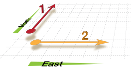

"직교성(Orthogonality)"은 기하학에서 빌려온 용어입니다. 그래프의 축처럼 두 직선이 직각으로 만나면 직교한다고 합니다. 벡터 용어로 말하자면 두 직선은 *독립적*입니다. 다이어그램에서 1번이 북쪽으로 이동할 때, 동쪽이나 서쪽으로 얼마나 떨어져 있는지는 변하지 않습니다. 2번은 동쪽으로 이동하지만, 북쪽이나 남쪽으로는 이동하지 않습니다.

컴퓨팅에서 이 용어는 일종의 독립성이나 디커플링을 의미하게 되었습니다. 두 개 이상의 것에서 한쪽의 변경이 다른 쪽에 아무런 영향을 미치지 않는다면 그것들은 직교합니다. 잘 설계된 시스템에서 데이터베이스 코드는 사용자 인터페이스와 직교할 것입니다. 인터페이스에 영향을 주지 않고 데이터베이스를 변경할 수 있고, 데이터베이스를 변경하지 않고 인터페이스를 교체할 수 있습니다.

직교적인 시스템의 이점을 살펴보기 전에, 먼저 직교적이지 않은 시스템을 살펴봅시다.

#### 비직교적 시스템

여러분은 그랜드 캐니언 헬리콥터 투어를 하고 있습니다. 그런데 점심으로 생선을 먹은 명백한 실수를 저지른 조종사가 갑자기 신음하며 기절해 버립니다. 다행히 그는 여러분을 지상 100피트 상공에 정지 비행(hovering) 상태로 남겨두었습니다.

운 좋게도 여러분은 전날 밤 위키백과에서 헬리콥터에 관한 페이지를 읽었습니다. 여러분은 헬리콥터에 네 가지 기본 조종 장치가 있다는 것을 압니다. *사이클릭(cyclic)*은 오른손으로 잡는 조종간입니다. 이것을 움직이면 헬리콥터가 해당 방향으로 움직입니다. 왼손은 *콜렉티브 피치 레버(collective pitch lever)*를 잡습니다. 이것을 위로 당기면 모든 날개의 피치가 증가하여 양력이 발생합니다. 피치 레버 끝에는 *스로틀(throttle)*이 있습니다. 마지막으로 두 개의 *풋 페달(foot pedals)*이 있는데, 이는 꼬리 로터의 추력을 변화시켜 헬리콥터를 회전시키는 데 도움을 줍니다.

"쉽네!" 여러분은 생각합니다. "왼손의 콜렉티브 피치 레버를 부드럽게 내리면 영웅처럼 우아하게 지상으로 내려갈 수 있을 거야." 하지만 막상 해보니 인생이 그렇게 단순하지 않다는 것을 깨닫습니다. 헬리콥터의 기수가 아래로 떨어지고, 왼쪽으로 나선형을 그리며 추락하기 시작합니다. 갑자기 여러분은 모든 조종 입력이 부차적인 효과를 일으키는 시스템을 조종하고 있다는 사실을 깨닫습니다. 왼손 레버를 내리면 오른손 조종간을 뒤로 당겨 보상해 주어야 하고, 오른쪽 페달을 밟아야 합니다. 하지만 이러한 각각의 변경은 다시 다른 모든 조종 장치에 영향을 미칩니다. 순식간에 여러분은 모든 변경 사항이 다른 모든 입력에 영향을 미치는 믿을 수 없을 만큼 복잡한 시스템을 다루게 됩니다. 작업량은 엄청납니다. 상호작용하는 모든 힘의 균형을 맞추려고 손과 발이 끊임없이 움직여야 합니다.

헬리콥터 조종 장치는 확실히 직교적이지 않습니다.

### 직교성의 이점

헬리콥터 예시가 보여주듯, 비직교적 시스템은 본질적으로 변경하고 제어하기가 훨씬 더 복잡합니다. 어떤 시스템의 컴포넌트들이 서로 고도로 상호 의존적일 때, 국소적인 수정이란 존재하지 않습니다.

::: {.callout-tip appearance="simple" icon=false}
**팁 17: 관련 없는 것들 사이의 영향을 제거하라 (Eliminate Effects Between Unrelated Things)**
:::

우리는 컴포넌트들이 독립적이고, 단일하며 잘 정의된 목적을 가진 자기 완결적인(self-contained) 형태로 설계되기를 원합니다(요돈과 콘스탄틴이 *구조적 설계: 컴퓨터 프로그램 및 시스템 설계 분야의 기초* [YC79]에서 *응집도(cohesion)*라고 부른 것입니다). 컴포넌트들이 서로 격리되어 있으면, 나머지에 대해 걱정할 필요 없이 하나를 변경할 수 있다는 것을 압니다. 해당 컴포넌트의 외부 인터페이스를 변경하지 않는 한, 시스템 전체로 파급되는 문제를 일으키지 않을 것이라고 확신할 수 있습니다.

직교적인 시스템을 작성하면 두 가지 큰 이점을 얻습니다. 생산성 향상과 위험 감소입니다.

#### 생산성 향상

- 변경이 국소화되므로 개발 시간과 테스트 시간이 줄어듭니다. 하나의 거대한 코드 블록보다 비교적 작고 자기 완결적인 컴포넌트를 작성하는 것이 더 쉽습니다. 단순한 컴포넌트는 설계하고, 코딩하고, 테스트한 다음 잊어버릴 수 있습니다. 새로운 코드를 추가할 때마다 기존 코드를 계속 변경할 필요가 없습니다.
- 직교적인 접근 방식은 재사용도 촉진합니다. 컴포넌트들이 구체적이고 잘 정의된 책임을 가지고 있다면, 원래 구현자가 상상하지 못했던 방식으로 새로운 컴포넌트들과 결합될 수 있습니다. 시스템이 느슨하게 결합될수록 재구성하고 재설계하기가 더 쉬워집니다.
- 직교적인 컴포넌트들을 결합할 때 꽤 미묘한 생산성 향상이 있습니다. 한 컴포넌트가 가지의 서로 다른 일을 하고 다른 컴포넌트가 가지 일을 한다고 가정해 봅시다. 두 컴포넌트가 직교적이고 이를 결합하면, 결과물은 가지 일을 합니다. 하지만 두 컴포넌트가 직교적이지 않다면 겹치는 부분이 생겨 결과물은 그보다 적은 일만 하게 됩니다. 직교적인 컴포넌트들을 결합함으로써 단위 노력당 더 많은 기능을 얻게 됩니다.

#### 위험 감소

직교적인 접근 방식은 모든 개발에 내재된 위험을 줄여줍니다.

- 병든 코드 영역이 격리됩니다. 어떤 모듈이 아프더라도 시스템의 나머지 부분으로 증상이 퍼질 가능성이 적습니다. 또한 그것을 잘라내고 새롭고 건강한 것으로 이식하기도 더 쉽습니다.
- 결과 시스템이 덜 취약합니다. 특정 영역에 작은 변경과 수정을 가하더라도, 여러분이 발생시킨 모든 문제는 그 영역으로 제한됩니다.
- 직교적인 시스템은 개별 컴포넌트에 대한 테스트를 설계하고 실행하기가 더 쉽기 때문에 아마도 더 잘 테스트될 것입니다.
- 서드파티 컴포넌트에 대한 인터페이스가 전체 개발의 더 작은 부분으로 격리될 것이므로, 특정 벤더, 제품, 또는 플랫폼에 덜 얽매이게 됩니다.

이제 직교성의 원칙을 여러분의 작업에 적용할 수 있는 몇 가지 방법을 살펴봅시다.

### 설계

대부분의 개발자들은 직교적인 시스템을 설계해야 할 필요성에 익숙하지만, 그 과정을 설명하기 위해 *모듈식(modular)*, *컴포넌트 기반(component-based)*, *계층형(layered)* 같은 단어를 사용할 수도 있습니다. 시스템은 각자 다른 모듈과 독립적으로 기능을 구현하는 협력 모듈들의 집합으로 구성되어야 합니다. 때때로 이러한 컴포넌트들은 각각 추상화 수준을 제공하는 계층(layer)으로 조직됩니다. 이 계층형 접근 방식은 직교적인 시스템을 설계하는 강력한 방법입니다. 각 계층은 그 아래 계층이 제공하는 추상화만을 사용하기 때문에, 코드에 영향을 주지 않고 기저 구현을 변경할 수 있는 큰 유연성을 갖게 됩니다. 계층화는 또한 모듈 간에 의존성이 통제 불능으로 커지는 위험을 줄여줍니다. 종종 다이어그램으로 표현된 계층화를 보게 될 것입니다.

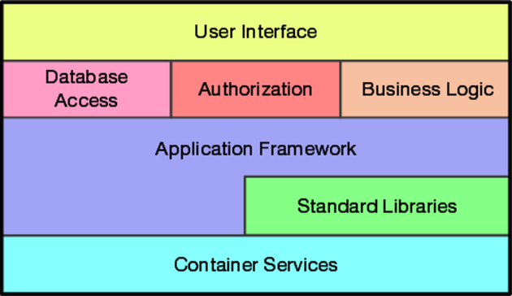

직교적 설계를 확인하는 쉬운 테스트가 있습니다. 컴포넌트를 배치하고 난 뒤 스스로에게 물어보세요. *특정 기능 이면의 요구사항을 극적으로 변경한다면, 몇 개의 모듈이 영향을 받는가?* 직교적인 시스템에서는 답이 "하나"여야 합니다.^[16]^ GUI 패널의 버튼을 옮기는 것이 데이터베이스 스키마의 변경을 요구해서는 안 됩니다. 상황별 도움말을 추가하는 것이 결제 서브시스템을 변경해서는 안 됩니다.

난방 플랜트를 모니터링하고 제어하는 복잡한 시스템을 생각해 봅시다. 원래 요구사항은 그래픽 사용자 인터페이스(GUI)를 요구했지만, 엔지니어들이 주요 수치를 모니터링할 수 있도록 모바일 인터페이스를 추가하는 것으로 요구사항이 변경되었습니다. 직교적으로 설계된 시스템에서는 이를 처리하기 위해 사용자 인터페이스와 관련된 모듈만 변경하면 됩니다. 플랜트를 제어하는 기저 로직은 변경되지 않은 채로 남습니다. 사실, 시스템을 신중하게 구조화했다면 동일한 기저 코드 베이스로 두 인터페이스를 모두 지원할 수 있어야 합니다.

또한 여러분의 설계가 현실 세계의 변화로부터 얼마나 디커플링되어 있는지 스스로에게 물어보세요. 전화번호를 고객 식별자로 사용하고 있나요? 전화 회사가 지역 번호를 재할당하면 어떻게 되나요? 우편번호, 사회보장번호나 정부 ID, 이메일 주소, 도메인은 모두 여러분이 통제할 수 없는 외부 식별자들이며, 언제든 어떤 이유로든 변할 수 있습니다. *여러분이 통제할 수 없는 것의 속성에 의존하지 마세요.*

### 툴킷과 라이브러리

서드파티 툴킷과 라이브러리를 도입할 때 시스템의 직교성을 해치지 않도록 주의하세요. 기술을 현명하게 선택하세요.

툴킷(또는 팀의 다른 구성원이 만든 라이브러리라도)을 가져올 때는, 그것이 여러분의 코드에 있어서는 안 될 변경을 강요하는지 스스로에게 물어보세요. 객체 영속성(object persistence) 체계가 투명하다면 직교적인 것입니다. 하지만 객체를 특별한 방식으로 생성하거나 접근하도록 요구한다면 직교적이지 않은 것입니다. 이러한 세부 사항을 코드로부터 격리해 두면 미래에 벤더를 변경하기가 더 쉬워진다는 추가적인 이점도 있습니다.

EJB(Enterprise Java Beans) 시스템은 직교성의 흥미로운 예입니다. 대부분의 트랜잭션 지향 시스템에서는 애플리케이션 코드가 각 트랜잭션의 시작과 끝을 명시해야 합니다. EJB에서는 이 정보가 실제 작업을 수행하는 메서드 외부에 애너테이션(annotation)으로 선언적으로 표현됩니다. 동일한 애플리케이션 코드가 아무런 변경 없이 서로 다른 EJB 트랜잭션 환경에서 실행될 수 있습니다.

어떻게 보면 EJB는 데코레이터 패턴(Decorator Pattern)의 한 예입니다. 사물을 변경하지 않고 기능을 추가하는 것이죠. 이러한 프로그래밍 스타일은 거의 모든 프로그래밍 언어에서 사용할 수 있으며, 반드시 프레임워크나 라이브러리가 필요한 것은 아닙니다. 프로그래밍할 때 약간의 규율만 있으면 됩니다.

### 코딩

코드를 작성할 때마다 여러분은 애플리케이션의 직교성을 떨어뜨릴 위험을 안고 있습니다. 자신이 하고 있는 일뿐만 아니라 애플리케이션의 더 큰 맥락을 끊임없이 모니터링하지 않으면, 의도치 않게 다른 모듈의 기능을 중복하거나 기존 지식을 두 번 표현할 수 있습니다.

직교성을 유지하기 위해 사용할 수 있는 몇 가지 기법이 있습니다.

**코드를 디커플링된 상태로 유지하라**

수줍은 코드(shy code)를 작성하세요—다른 모듈에 불필요한 것을 드러내지 않고 다른 모듈의 구현에 의존하지 않는 모듈 말입니다. 주제 28, *디커플링*에서 논의하는 데메테르의 법칙을 시도해 보세요. 객체의 상태를 변경해야 한다면, 객체가 직접 하도록 시키세요. 이렇게 하면 여러분의 코드는 다른 코드의 구현으로부터 격리된 상태를 유지하며 직교성을 유지할 확률이 높아집니다.

**전역 데이터를 피하라**

코드가 전역 데이터를 참조할 때마다, 그것은 그 데이터를 공유하는 다른 컴포넌트들과 스스로를 얽어매게 됩니다. 읽기만 하려고 의도한 전역 데이터조차도 문제로 이어질 수 있습니다(예를 들어 갑자기 코드를 멀티스레드로 변경해야 할 때). 일반적으로 필요한 모든 컨텍스트를 모듈에 명시적으로 전달하면 코드를 이해하고 유지보수하기가 더 쉬워집니다. 객체 지향 애플리케이션에서는 컨텍스트가 종종 객체 생성자의 매개변수로 전달됩니다. 다른 코드에서는 컨텍스트를 포함하는 구조체를 만들고 그에 대한 참조를 전달할 수 있습니다.

*디자인 패턴: 재사용 가능한 객체 지향 소프트웨어의 요소* [GHJV95]에 나오는 싱글톤(Singleton) 패턴은 특정 클래스의 객체 인스턴스가 단 하나만 존재하도록 보장하는 방법입니다. 많은 사람들이(특히 자바처럼 전역 변수 개념을 지원하지 않는 언어에서) 이 싱글톤 객체를 일종의 전역 변수처럼 사용합니다. 싱글톤을 조심하세요—그것 역시 불필요한 연결(linkage)로 이어질 수 있습니다.

**유사한 함수를 피하라**

종종 모두 비슷해 보이는 함수들의 집합을 마주하게 될 것입니다. 어쩌면 시작과 끝부분의 공통 코드는 공유하지만, 각각 다른 핵심 알고리즘을 가지고 있을 수도 있습니다. 중복 코드는 구조적 문제의 증상입니다. 더 나은 구현을 위해 *디자인 패턴*의 전략(Strategy) 패턴을 살펴보세요.

자신의 코드를 끊임없이 비판적으로 바라보는 습관을 들이세요. 구조와 직교성을 개선하기 위해 코드를 재구성할 기회가 있는지 찾아보세요. 이 과정을 *리팩토링(refactoring)*이라고 하며, 너무나 중요하기 때문에 별도의 섹션을 할애했습니다(주제 40, *리팩토링* 참조).

### 테스트

직교적으로 설계되고 구현된 시스템은 테스트하기가 더 쉽습니다. 시스템 컴포넌트 간의 상호작용이 공식화되고 제한되어 있기 때문에, 시스템 테스트의 더 많은 부분을 개별 모듈 수준에서 수행할 수 있습니다. 모듈 수준(또는 단위) 테스트는 통합 테스트보다 명세하고 수행하기가 훨씬 쉽기 때문에 이것은 좋은 소식입니다. 사실, 우리는 이러한 테스트가 정기적인 빌드 프로세스의 일부로 자동 수행될 것을 제안합니다(주제 41, *테스트할 코드* 참조).

단위 테스트를 작성하는 것 자체가 직교성에 대한 흥미로운 테스트입니다. 단위 테스트를 빌드하고 실행하는 데 무엇이 필요한가요? 시스템의 나머지 코드 중 상당 부분을 가져와야(import) 하나요? 그렇다면 나머지 시스템과 잘 디커플링되지 않은 모듈을 발견한 것입니다.

버그 수정 역시 시스템 전체의 직교성을 평가하기에 좋은 시기입니다. 문제에 부딪혔을 때, 수정이 얼마나 국소적인지 평가해 보세요. 단 하나의 모듈만 변경하나요, 아니면 변경 사항이 시스템 전체에 흩어져 있나요? 변경을 가했을 때 모든 것이 고쳐지나요, 아니면 다른 문제들이 신비롭게 튀어나오나요? 이것은 자동화를 도입하기에 좋은 기회입니다. 버전 관리 시스템을 사용한다면(주제 19, *버전 관리*를 읽고 나면 사용하게 될 것입니다), 테스트 후 코드를 다시 체크인할 때 버그 수정에 태그를 붙이세요. 그런 다음 매월 각 버그 수정으로 영향을 받은 소스 파일 수의 추세를 분석하는 보고서를 실행할 수 있습니다.

### 문서화

아마 놀랍게도, 직교성은 문서화에도 적용됩니다. 축은 내용(content)과 표현(presentation)입니다. 진정으로 직교적인 문서화에서는 내용을 변경하지 않고도 외형을 극적으로 바꿀 수 있어야 합니다. 워드 프로세서는 도움이 되는 스타일 시트와 매크로를 제공합니다. 우리는 개인적으로 마크다운 같은 마크업 시스템을 사용하는 것을 선호합니다. 글을 쓸 때는 내용에만 집중하고, 표현은 렌더링하는 데 사용하는 도구에 맡기는 것입니다.^[17]^

### 직교성과 함께 살아가기

직교성은 DRY 원칙과 밀접하게 관련되어 있습니다. DRY를 통해 시스템 내의 중복을 최소화하려고 한다면, 직교성을 통해 시스템 컴포넌트 간의 상호 의존성을 줄입니다. 어색한 단어일지 몰라도, 직교성의 원칙을 DRY 원칙과 긴밀히 결합하여 사용하면 여러분이 개발하는 시스템이 더 유연하고, 더 이해하기 쉬우며, 디버깅, 테스트, 유지보수하기가 더 쉬워진다는 것을 알게 될 것입니다.

사람들이 변경을 가하기 위해 필사적으로 고군분투하고, 모든 변경이 다른 네 가지 일을 잘못되게 만드는 것 같은 프로젝트에 투입된다면, 헬리콥터의 악몽을 기억하세요. 그 프로젝트는 아마 직교적으로 설계되고 코딩되지 않았을 것입니다. 이제 리팩토링할 시간입니다.

그리고, 만약 여러분이 헬리콥터 조종사라면, 생선은 먹지 마세요….

### 관련 섹션

- 주제 3, *소프트웨어 엔트로피*
- 주제 8, *좋은 설계의 본질*
- 주제 11, *가역성*
- 주제 28, *디커플링*
- 주제 31, *상속세*
- 주제 33, *시간적 결합 깨뜨리기*
- 주제 34, *공유 상태는 잘못된 상태다*
- 주제 36, *칠판*

#### 도전과제

- 그래픽 사용자 인터페이스(GUI)를 가진 도구와 셸 프롬프트에서 사용되는 작지만 조합 가능한 커맨드라인 유틸리티의 차이를 생각해 보세요. 어느 쪽이 더 직교적이며, 그 이유는 무엇인가요? 의도된 정확한 목적을 위해 사용하기에는 어느 쪽이 더 쉬운가요? 새로운 도전에 맞서기 위해 다른 도구들과 결합하기에는 어느 쪽이 더 쉬운가요? 배우기에는 어느 쪽이 더 쉬운가요?
- C++는 다중 상속을 지원하고, 자바는 클래스가 여러 인터페이스를 구현할 수 있게 합니다. 루비에는 믹스인(mixin)이 있습니다. 이러한 기능들을 사용하는 것이 직교성에 어떤 영향을 미칠까요? 다중 상속을 사용하는 것과 여러 인터페이스를 사용하는 것 사이에 영향의 차이가 있나요? 위임(delegation)을 사용하는 것과 상속(inheritance)을 사용하는 것 사이에는 차이가 있나요?

#### 연습문제

**연습문제 1** (가능한 해답)

파일을 한 번에 한 줄씩 읽으라는 요청을 받았습니다. 각 줄마다 필드로 쪼개야 합니다. 다음 의사 클래스 정의 세트 중 어느 쪽이 더 직교적일 가능성이 높나요?

```
class Split1 {
  constructor(fileName)    # 읽기를 위해 파일을 연다
  def readNextLine()       # 다음 줄로 이동한다
  def getField(n)          # 현재 줄의 n번째 필드를 반환한다
}
```

또는

```
class Split2 {
  constructor(line)        # 한 줄을 쪼갠다
  def getField(n)          # 현재 줄의 n번째 필드를 반환한다
}
```

**연습문제 2** (가능한 해답)

객체 지향 언어와 함수형 언어 사이에는 직교성 측면에서 어떤 차이가 있나요? 이러한 차이는 언어 자체에 내재된 것인가요, 아니면 사람들이 언어를 사용하는 방식 때문인가요?

## 주제 11: 가역성

> *유일한 아이디어일 때만큼 위험한 것은 없다.*
>
> — 에밀오귀스트 샤르티에(알랭), 종교에 관한 담론, 1938

엔지니어들은 문제에 대한 단순하고 단일한 해결책을 선호합니다. 큰 자신감을 가지고 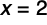라고 선언할 수 있는 수학 시험이 프랑스 혁명의 수많은 원인에 관한 모호하고 장황한 에세이보다 훨씬 편합니다. 경영진도 엔지니어들에게 동의하는 경향이 있습니다. 단일하고 쉬운 답은 스프레드시트와 프로젝트 계획에 깔끔하게 들어맞기 때문입니다.

현실 세계가 협조해 주기만 한다면 얼마나 좋을까요! 불행히도 오늘 가 라 하더라도 내일은 가 되어야 할지 모르고, 다음 주에는 이 되어야 할지 모릅니다. 영원한 것은 아무것도 없습니다. 그리고 어떤 사실에 크게 의존한다면, 그것이 *반드시* 변할 것이라고 거의 장담할 수 있습니다.

무언가를 구현하는 방법은 항상 하나 이상 존재하며, 보통 서드파티 제품을 제공할 수 있는 벤더도 하나 이상 존재합니다. 오직 *하나의* 방법만 있다는 근시안적인 생각에 사로잡혀 프로젝트에 뛰어든다면, 불쾌한 놀라움을 겪게 될 수도 있습니다. 많은 프로젝트 팀들이 미래가 펼쳐지면서 강제로 눈을 뜨게 됩니다.

> "하지만 데이터베이스 XYZ를 쓰기로 했잖아요! 프로젝트 코딩이 85%나 끝났는데 이제 와서 바꿀 수는 없어요!" 프로그래머가 항의했습니다. "미안하지만, 회사에서 모든 프로젝트의 표준을 데이터베이스 PDQ로 통일하기로 결정했어요. 내 손을 떠난 문제입니다. 그냥 다시 코딩해야 해요. 추후 공지가 있을 때까지 모두 주말에도 근무하게 될 겁니다."

변화가 그렇게 가혹하거나 그렇게 즉각적일 필요는 없습니다. 하지만 시간이 흐르고 프로젝트가 진행됨에 따라, 여러분은 자신이 유지할 수 없는 위치에 갇혀 있다는 것을 발견할지도 모릅니다. 모든 중요한 결정이 내려질 때마다 프로젝트 팀은 더 작은 목표—더 적은 선택지를 가진 더 좁은 현실 버전—에 전념하게 됩니다.

많은 중요한 결정들이 내려지고 나면 목표는 너무 작아져서, 목표가 움직이거나, 바람의 방향이 바뀌거나, 도쿄에서 나비 한 마리가 날갯짓을 하면 빗나가게 됩니다.^[18]^ 그리고 엄청난 차이로 빗나갈 수도 있습니다.

문제는 중요한 결정들이 쉽게 되돌릴 수 없다는(reversible) 것입니다.

일단 이 벤더의 데이터베이스나 저 아키텍처 패턴, 혹은 특정 배포 모델을 사용하기로 결정하고 나면, 막대한 비용을 치르지 않고는 되돌릴 수 없는 행동 경로에 발을 들여놓게 됩니다.

### 가역성

이 책의 많은 주제들은 유연하고 적응력 있는 소프트웨어를 만드는 데 맞춰져 있습니다. 특히 DRY 원칙, 디커플링, 그리고 외부 설정의 사용 같은 권장 사항을 고수함으로써, 우리는 돌이킬 수 없는 중요한 결정을 그렇게 많이 내리지 않아도 됩니다. 우리가 처음부터 항상 최선의 결정을 내리는 것은 아니기 때문에 이것은 좋은 일입니다. 특정 기술을 쓰기로 약속했다가 필요한 기술을 가진 사람을 충분히 채용할 수 없다는 것을 깨닫기도 합니다. 특정 서드파티 벤더에 묶여 버렸는데 바로 직후 그 벤더가 경쟁사에 인수되기도 합니다. 요구사항, 사용자, 그리고 하드웨어는 우리가 소프트웨어를 개발할 수 있는 속도보다 더 빠르게 변합니다.

프로젝트 초기에 벤더 A의 관계형 데이터베이스를 사용하기로 결정했다고 가정해 봅시다. 훨씬 나중에 성능 테스트 중에 그 데이터베이스가 너무 느리지만, 벤더 B의 문서 데이터베이스가 더 빠르다는 것을 발견합니다. 대부분의 기존 프로젝트에서는 운이 없는 셈이 됩니다. 대부분의 경우 서드파티 제품에 대한 호출이 코드 전체에 뒤엉켜 있기 때문입니다. 하지만 데이터베이스라는 아이디어를 *정말로* 추상화해 두었다면—단순히 서비스로서의 영속성(persistence)만 제공하는 지점까지—여러분은 달리는 도중에 말을 갈아탈 수 있는 유연성을 갖게 됩니다.

마찬가지로, 프로젝트가 브라우저 기반 애플리케이션으로 시작되었는데, 게임 후반부에 마케팅 부서에서 정말로 원하는 것은 모바일 앱이라고 결정했다고 가정해 봅시다. 여러분에게 얼마나 어려운 일일까요? 이상적인 세상에서는 적어도 서버 측에서는 큰 영향을 받지 않아야 합니다. HTML 렌더링을 일부 걷어내고 API로 대체하기만 하면 될 것입니다.

실수는 어떤 결정이든 돌에 새겨진 것처럼 영구적이라고 가정하는 데 있으며, 발생할 수 있는 비상 상황에 대비하지 않는 데 있습니다. 결정을 돌에 새기는 대신, 해변의 모래 위에 쓰인 것으로 생각하세요. 언제든 큰 파도가 밀려와 쓸어버릴 수 있습니다.

::: {.callout-tip appearance="simple" icon=false}
**팁 18: 최종 결정이란 없다 (There Are No Final Decisions)**
:::

### 유연한 아키텍처

많은 사람들이 *코드*를 유연하게 유지하려고 노력하지만, 아키텍처, 배포, 그리고 벤더 통합 영역에서도 유연성을 유지하는 것에 대해 생각할 필요가 있습니다.

우리는 2019년에 이 글을 쓰고 있습니다. 세기가 바뀐 이후로 우리는 다음과 같은 "모범 사례" 서버 측 아키텍처들을 보아왔습니다.

- 거대한 철제 서버(Big hunk of iron)
- 거대한 철제 서버들의 연합
- 상용(commodity) 하드웨어의 로드 밸런싱 클러스터
- 애플리케이션을 실행하는 클라우드 기반 가상 머신
- 서비스를 실행하는 클라우드 기반 가상 머신
- 위의 것들의 컨테이너화된 버전
- 클라우드 지원 서버리스 애플리케이션
- 그리고 필연적으로, 일부 작업을 위해 다시 거대한 철제 덩어리로 돌아가는 듯한 움직임

여기에 아주 최신의 가장 위대한 유행들을 마음껏 추가한 다음, 경외심을 가지고 바라보세요. 무언가가 작동했다는 것 자체가 기적입니다.

이런 종류의 아키텍처 변동성을 어떻게 계획할 수 있을까요? 계획할 수 없습니다.

여러분이 할 수 있는 것은 그것을 바꾸기 쉽게 만드는 것입니다. 서드파티 API를 여러분만의 추상화 계층 뒤에 숨기세요. 코드를 컴포넌트로 쪼개세요. 설령 결국 단일한 거대 서버에 배포하게 되더라도, 이 접근 방식은 모놀리식 애플리케이션을 가져다가 쪼개는 것보다 훨씬 쉽습니다. (우리는 그것을 증명할 상처들을 가지고 있습니다.)

그리고, 이것이 특별히 가역성 문제는 아니지만, 마지막 조언 하나를 드립니다.

::: {.callout-tip appearance="simple" icon=false}
**팁 19: 유행을 쫓지 마라 (Forgo Following Fads)**
:::

미래가 무엇을 품고 있는지는 아무도 모릅니다. 특히 우리도 모릅니다! 그러니 여러분의 코드가 로큰롤(rock-n-roll)을 할 수 있게 해주세요. 할 수 있을 때는 "신나게 나아가고(rock on)", 필요할 때는 유연하게 대처(roll with the punches)할 수 있도록 말입니다.

### 관련 섹션

- 주제 8, *좋은 설계의 본질*
- 주제 10, *직교성*
- 주제 19, *버전 관리*
- 주제 28, *디커플링*
- 주제 45, *요구사항의 함정*
- 주제 51, *실용주의 시작 키트*

### 도전과제

- 슈뢰딩거의 고양이로 양자 역학 시간을 조금 가져봅시다. 닫힌 상자 안에 방사성 입자와 함께 고양이가 한 마리 있다고 가정해 봅시다. 입자가 둘로 분열할 확률은 정확히 50%입니다. 분열하면 고양이는 죽습니다. 분열하지 않으면 고양이는 무사합니다. 자, 고양이는 죽었을까요 살았을까요? 슈뢰딩거에 따르면, 정답은 *둘 다*(적어도 상자가 닫혀 있는 동안에는)입니다. 두 가지 가능한 결과를 가진 아핵(subnuclear) 반응이 일어날 때마다 우주는 복제됩니다. 한 우주에서는 사건이 일어났고, 다른 우주에서는 일어나지 않았습니다. 고양이는 한 우주에서는 살아 있고, 다른 우주에서는 죽어 있습니다. 상자를 열어야만 *여러분*이 어느 우주에 있는지 알 수 있습니다. 미래를 위해 코딩하는 것이 어려운 것도 당연합니다. 하지만 코드의 진화를 슈뢰딩거의 고양이들로 가득 찬 상자와 같은 맥락으로 생각해 보세요. 모든 결정은 미래의 다른 버전을 낳습니다. 여러분의 코드는 얼마나 많은 가능한 미래를 지원할 수 있나요? 어느 쪽이 더 가능성이 높나요? 때가 되었을 때 그것들을 지원하는 것이 얼마나 어려울까요? 감히 상자를 열어보시겠습니까?

## 주제 12: 예광탄

> *준비, 발사, 조준…*
>
> — 작자 미상

우리는 소프트웨어를 개발할 때 종종 목표물(target)을 맞히는 것에 대해 이야기합니다. 사격장에서 실제로 무언가를 쏘는 것은 아니지만, 여전히 유용하고 매우 시각적인 은유입니다. 특히 복잡하고 변화하는 세상에서 목표물을 *어떻게* 맞힐 것인지 고민해 보는 것은 흥미롭습니다.

물론 그 답은 여러분이 조준하고 있는 장치의 성격에 달려 있습니다. 많은 경우 조준할 기회는 단 한 번뿐이며, 그다음에는 과녁의 정중앙을 맞혔는지 못 맞혔는지 지켜봐야 합니다. 하지만 더 나은 방법이 있습니다.

사람들이 기관총을 쏘는 영화, TV 쇼, 비디오 게임을 모두 아시죠? 이런 장면에서는 종종 총알의 궤적이 공중에 밝은 줄무늬로 보입니다. 이 줄무늬는 예광탄(tracer bullets)에서 나옵니다.

예광탄은 일반 탄약과 함께 일정한 간격으로 장전됩니다. 발사되면 인(phosphorus)이 점화되어 총구에서부터 그것이 맞히는 곳까지 불꽃 궤적을 남깁니다. 예광탄이 목표물을 맞히고 있다면 일반 총알도 마찬가지입니다. 군인들은 이 예광탄을 사용해 조준을 수정합니다. 실제 조건하에서의 실용적이고 실시간인 피드백입니다.

똑같은 원칙이 프로젝트에도 적용되며, 특히 이전에 만들어본 적이 없는 무언가를 구축할 때 그렇습니다. 우리는 움직이는 목표물과 실제 조건하에서 즉각적인 피드백이 필요함을 시각적으로 설명하기 위해 *예광탄 개발(tracer bullet development)*이라는 용어를 사용합니다.

사수들과 마찬가지로, 여러분은 어둠 속에서 목표물을 맞히려 하고 있습니다. 사용자들은 이런 시스템을 전에 본 적이 없기 때문에 그들의 요구사항은 모호할 수 있습니다. 여러분은 익숙하지 않은 알고리즘, 기법, 언어, 또는 라이브러리를 사용하고 있을 수 있으므로 수많은 미지의 요소에 직면합니다. 그리고 프로젝트는 완료하는 데 시간이 걸리기 때문에, 작업을 끝내기 전에 여러분이 일하는 환경이 변할 것이라고 거의 장담할 수 있습니다.

고전적인 대응책은 시스템을 죽을 때까지 명세하는 것입니다. 모든 요구사항을 항목별로 나열하고, 모든 미지의 요소를 묶어두고, 환경을 제약하는 수많은 종이 뭉치를 만들어냅니다. 추측 항법(dead reckoning)을 사용해 총을 쏩니다. 사전에 거대한 계산을 한 번 하고, 그다음에는 쏘고 나서 잘 맞기를 기도합니다.

하지만 실용주의 프로그래머는 소프트웨어판 예광탄을 사용하는 것을 선호하는 경향이 있습니다.

### 어둠 속에서 빛나는 코드

예광탄이 작동하는 이유는 실제 총알과 동일한 환경과 동일한 제약 조건하에서 작동하기 때문입니다. 예광탄은 목표물에 빠르게 도달하므로 사수는 즉각적인 피드백을 얻습니다. 그리고 실용적인 관점에서 비교적 저렴한 해결책입니다.

코드에서도 같은 효과를 얻기 위해, 우리는 요구사항에서 최종 시스템의 어떤 측면으로 빠르고, 눈에 띄며, 반복 가능하게 도달할 수 있게 해주는 무언가를 찾습니다.

시스템을 정의하는 중요한 요구사항을 찾으세요. 의구심이 드는 영역과 가장 큰 위험이 보이는 영역을 찾으세요. 그런 다음 이 영역들이 가장 먼저 코딩할 영역이 되도록 개발 우선순위를 정하세요.

::: {.callout-tip appearance="simple" icon=false}
**팁 20: 목표물을 찾기 위해 예광탄을 사용하라 (Use Tracer Bullets to Find the Target)**
:::

사실 수많은 외부 의존성과 도구들이 얽힌 오늘날의 프로젝트 설정 복잡성을 고려하면, 예광탄은 훨씬 더 중요해집니다. 우리에게 맨 첫 번째 예광탄은 단순히 *프로젝트를 생성하고, "hello world!"를 추가한 다음, 컴파일되고 실행되는지 확인하는 것*입니다. 그런 다음 전체 애플리케이션에서 불확실한 영역을 찾아 그것이 작동하는 데 필요한 뼈대를 추가합니다.

다음 다이어그램을 살펴보세요. 이 시스템에는 다섯 개의 아키텍처 계층이 있습니다. 우리는 이 계층들이 어떻게 통합될지에 대해 약간의 우려가 있으므로, 이를 함께 실행해 볼 수 있는 간단한 기능을 찾습니다. 대각선은 그 기능이 코드를 통과하는 경로를 보여줍니다. 이것이 작동하게 하려면 각 계층에서 진하게 음영 처리된 영역만 구현하면 됩니다. 물결무늬가 있는 부분은 나중에 할 것입니다.

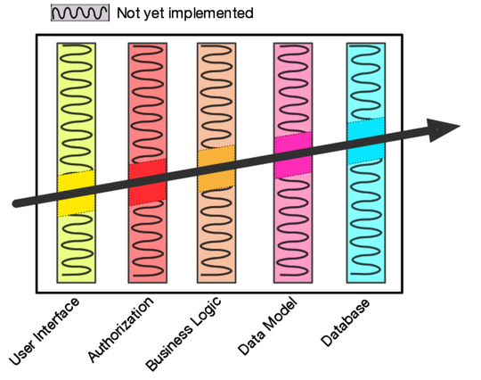

우리는 예전에 복잡한 클라이언트-서버 데이터베이스 마케팅 프로젝트를 맡은 적이 있습니다. 요구사항 중 일부는 시간적(temporal) 쿼리를 지정하고 실행하는 기능이었습니다. 서버는 다양한 관계형 및 특수 데이터베이스였습니다. 임의의 언어 A로 작성된 클라이언트 UI는 서버에 대한 인터페이스를 제공하기 위해 다른 언어로 작성된 라이브러리 세트를 사용했습니다. 사용자의 쿼리는 실행 직전에 최적화된 SQL로 변환되기 전까지 Lisp와 유사한 표기법으로 서버에 저장되었습니다. 수많은 미지의 요소와 다양한 환경이 있었고, 아무도 UI가 어떻게 동작해야 하는지 확신하지 못했습니다.

이것은 예광탄 코드를 사용하기에 아주 좋은 기회였습니다. 우리는 프론트엔드용 프레임워크, 쿼리를 표현하기 위한 라이브러리, 그리고 저장된 쿼리를 데이터베이스별 쿼리로 변환하기 위한 구조를 개발했습니다. 그런 다음 모두 합쳐서 작동하는지 확인했습니다. 초기 빌드에서 우리가 할 수 있었던 것은 테이블의 모든 행을 나열하는 쿼리를 제출하는 것뿐이었지만, 그것은 UI가 라이브러리와 통신할 수 있고, 라이브러리가 쿼리를 직렬화 및 역직렬화할 수 있으며, 서버가 그 결과로부터 SQL을 생성할 수 있음을 증명했습니다. 그다음 몇 달 동안 우리는 예광탄 코드의 각 컴포넌트를 병렬로 보강하면서 새로운 기능을 추가해 이 기본 구조를 점진적으로 살을 붙여 나갔습니다. UI에 새로운 쿼리 유형이 추가되면, 라이브러리가 커지고 SQL 생성이 더 정교해졌습니다.

예광탄 코드는 일회용이 아닙니다. 계속 유지하기 위해 작성하는 것입니다. 여기에는 모든 프로덕션 코드가 가지는 에러 체크, 구조화, 문서화, 자체 검증이 모두 포함되어 있습니다. 단지 아직 모든 기능이 다 갖춰지지 않았을 뿐입니다. 하지만 일단 시스템의 컴포넌트들 간에 종단 간(end-to-end) 연결을 달성하고 나면, 목표물에 얼마나 가까이 있는지 확인하고 필요하면 조정할 수 있습니다. 일단 목표물에 조준이 맞으면, 기능을 추가하는 것은 쉽습니다.

예광탄 개발은 프로젝트가 결코 끝나지 않는다는 생각과 일치합니다. 항상 필요한 변경과 추가할 기능이 있을 것입니다. 이것은 점진적인 접근 방식입니다.

전통적인 대안은 일종의 중공업식 접근 방식입니다. 코드를 모듈로 나누고, 각 모듈을 진공 상태에서 코딩합니다. 모듈들을 하위 어셈블리로 결합하고, 그것들을 다시 결합하여 마침내 어느 날 완전한 애플리케이션을 얻게 됩니다. 오직 그때가 되어서야 전체로서의 애플리케이션을 사용자에게 제시하고 테스트할 수 있습니다.

예광탄 코드 접근 방식에는 많은 장점이 있습니다.

**사용자가 작동하는 무언가를 일찍 보게 된다**

여러분이 무엇을 하고 있는지 성공적으로 소통했다면(주제 52, *사용자를 기쁘게 하라* 참조), 사용자들은 자신들이 보고 있는 것이 아직 미성숙한 상태라는 것을 알 것입니다. 그들은 기능 부족에 실망하지 않을 것이며, 자신들의 시스템을 향한 눈에 보이는 진전을 보고 기뻐할 것입니다. 또한 프로젝트가 진행됨에 따라 기여하게 되어 참여도가 높아집니다. 바로 이 사용자들이 각 반복(iteration)이 목표물에 얼마나 가까운지 말해줄 사람들이 될 가능성이 높습니다.

**개발자들이 일할 수 있는 구조를 구축한다**

가장 막막한 종이는 아무것도 쓰여 있지 않은 백지입니다. 애플리케이션의 모든 종단 간 상호작용을 파악하여 코드로 구현해 두었다면, 팀원들은 맨땅에 헤딩할 필요가 훨씬 줄어듭니다. 이는 모두를 더 생산적으로 만들고 일관성을 장려합니다.

**통합 플랫폼을 갖게 된다**

시스템이 종단 간으로 연결되어 있으므로, 새로운 코드 조각들이 단위 테스트를 거치자마자 추가할 수 있는 환경을 갖게 됩니다. 빅뱅(big-bang) 통합을 시도하는 대신, 매일(종종 하루에도 여러 번) 통합하게 될 것입니다. 각 새로운 변경의 영향이 더 명확해지고 상호작용이 더 제한적이므로 디버깅과 테스트가 더 빠르고 정확해집니다.

**시연할 무언가를 갖게 된다**

프로젝트 스폰서와 고위 임원들은 가장 불편한 시점에 데모를 보고 싶어 하는 경향이 있습니다. 예광탄 코드가 있으면 언제나 그들에게 보여줄 무언가가 있습니다.

**진척도에 대한 더 나은 감각을 갖게 된다**

예광탄 코드 개발에서 개발자들은 유스케이스를 하나씩 처리합니다. 하나가 끝나면 다음으로 넘어갑니다. 성과를 측정하고 사용자에게 진척도를 입증하기가 훨씬 쉽습니다. 개별 개발 단위가 더 작기 때문에, 몇 주 동안 계속 95% 완료되었다고 보고되는 그런 모놀리식 코드 덩어리를 만드는 것을 피할 수 있습니다.

### 예광탄이 항상 목표물을 맞히는 것은 아니다

예광탄은 여러분이 무엇을 맞히고 있는지 보여줍니다. 그것이 항상 목표물은 아닐 수도 있습니다. 그러면 목표물에 맞을 때까지 조준을 조정합니다. 그것이 핵심입니다.

예광탄 코드도 마찬가지입니다. 여러분은 자신이 어디로 가고 있는지 100% 확신할 수 없는 상황에서 이 기법을 사용합니다. 처음 두어 번의 시도가 빗나가더라도 놀라지 마세요. 사용자가 "제가 말한 건 그게 아니에요"라고 말하거나, 필요한 데이터가 필요할 때 구할 수 없거나, 성능 문제가 발생할 것 같아 보일 수 있습니다. 그러면 가진 것을 변경하여 목표물에 더 가까이 가져가고, 린(lean) 개발 방법론을 사용한 것에 감사하세요. 작은 코드 덩어리는 관성이 낮아 변경하기가 쉽고 빠릅니다. 애플리케이션에 대한 피드백을 수집하고 새롭고 더 정확한 버전을 빠르고 저렴하게 생성할 수 있을 것입니다. 그리고 모든 주요 애플리케이션 컴포넌트가 예광탄 코드에 표현되어 있으므로, 사용자들은 자신들이 보고 있는 것이 단순한 종이 명세서가 아니라 현실에 기반한 것임을 확신할 수 있습니다.

### 예광탄 코드 대 프로토타이핑

이 예광탄 코드 개념이 그저 공격적인 이름을 붙인 프로토타이핑에 지나지 않는다고 생각할 수도 있습니다. 차이가 있습니다. 프로토타입을 만들 때는 최종 시스템의 특정 측면을 탐구하는 것을 목표로 합니다. 진정한 프로토타입에서는 개념을 시험해 보기 위해 급조했던 모든 것을 버리고, 배운 교훈을 바탕으로 처음부터 제대로 다시 코딩하게 됩니다.

예를 들어, 배송업자들이 크기가 제각각인 상자들을 컨테이너에 어떻게 채울지 결정하는 데 도움을 주는 애플리케이션을 만들고 있다고 합시다. 다른 문제들 중에서도, 사용자 인터페이스는 직관적이어야 하고 최적의 적재 방식을 결정하는 데 사용하는 알고리즘은 매우 복잡합니다.

UI 도구에서 최종 사용자를 위한 사용자 인터페이스를 프로토타이핑할 수 있습니다. 사용자 행동에 반응하도록 만드는 데 필요한 만큼만 코딩합니다. 사용자들이 레이아웃에 동의하고 나면, 그것을 버리고 이번에는 그 뒤에 비즈니스 로직을 붙여 목표 언어를 사용하여 다시 코딩할 수 있습니다. 마찬가지로, 실제 적재를 수행하는 여러 알고리즘을 프로토타이핑하고 싶을 수도 있습니다. 파이썬(Python)처럼 고수준이고 관대한 언어로 기능 테스트를 코딩하고, 기계에 더 가까운 언어로 저수준 성능 테스트를 코딩할 수 있습니다. 어느 쪽이든 일단 결정을 내리고 나면, 다시 시작하여 최종 환경에서 실제 세계와 인터페이스하도록 알고리즘을 코딩하게 될 것입니다. 이것이 *프로토타이핑*이며, 매우 유용합니다.

예광탄 코드 접근 방식은 다른 문제를 다룹니다. 여러분은 애플리케이션이 전체적으로 어떻게 엮이는지 알아야 합니다. 사용자들에게 상호작용이 실제로 어떻게 작동할지 보여주고 싶고, 개발자들에게 코드를 매달 수 있는 아키텍처 뼈대를 제공하고 싶습니다. 이 경우, 컨테이너 적재 알고리즘의 사소한 구현(예: 선착순 방식)과 단순하지만 작동하는 사용자 인터페이스로 구성된 예광탄을 구축할 수 있습니다. 일단 애플리케이션의 모든 컴포넌트가 배관으로 연결되고 나면, 사용자와 개발자들에게 보여줄 수 있는 프레임워크를 갖게 됩니다. 시간이 지남에 따라 스텁(stub) 처리된 루틴들을 완성하면서 이 프레임워크에 새로운 기능을 추가합니다. 하지만 프레임워크는 온전하게 유지되며, 여러분은 첫 번째 예광탄 코드가 완성되었을 때와 동일한 방식으로 시스템이 계속 동작할 것임을 압니다.

이 구별은 반복할 가치가 있을 만큼 중요합니다. 프로토타이핑은 일회용 코드를 생성합니다. 예광탄 코드는 군더더기 없지만 완전하며, 최종 시스템 뼈대의 일부를 형성합니다. 프로토타이핑을 단 한 발의 예광탄이 발사되기 전에 이루어지는 정찰 및 정보 수집이라고 생각하세요.

### 관련 섹션

- 주제 13, *프로토타입과 포스트잇*
- 주제 27, *헤드라이트보다 앞서 달리지 마라*
- 주제 40, *리팩토링*
- 주제 49, *실용주의 팀*
- 주제 50, *코코넛만으로는 부족하다*
- 주제 51, *실용주의 시작 키트*
- 주제 52, *사용자를 기쁘게 하라*

## 주제 13: 프로토타입과 포스트잇

많은 산업에서 특정 아이디어를 시험해 보기 위해 프로토타입을 사용합니다. 프로토타이핑은 본격적인 생산보다 훨씬 저렴합니다. 예를 들어 자동차 제조사들은 새로운 자동차 디자인에 대해 여러 가지 다른 프로토타입을 만들 수 있습니다. 각 프로토타입은 자동차의 특정 측면—공기역학, 스타일링, 구조적 특성 등—을 테스트하기 위해 설계됩니다. 구식 사람들은 풍동 테스트를 위해 점토 모델을 사용할 수도 있고, 아트 부서에서는 발사 나무와 덕트 테이프 모델로 충분할 수도 있습니다. 덜 낭만적인 사람들은 컴퓨터 화면이나 가상 현실에서 모델링을 하여 비용을 더욱 절감할 것입니다. 이런 식으로 실제 제품을 만들기로 결정하기 전에 위험하거나 불확실한 요소들을 시험해 볼 수 있습니다.

우리도 같은 방식으로, 그리고 같은 이유—위험을 분석 및 노출하고 훨씬 적은 비용으로 수정할 기회를 제공하기 위해—로 소프트웨어 프로토타입을 만듭니다. 자동차 제조사들처럼, 우리도 프로젝트의 하나 이상의 특정 측면을 테스트하기 위해 프로토타입을 겨냥할 수 있습니다.

우리는 프로토타입을 코드 기반이라고 생각하는 경향이 있지만, 항상 그럴 필요는 없습니다. 자동차 제조사들처럼 다른 재료로 프로토타입을 만들 수 있습니다. 포스트잇은 워크플로우나 애플리케이션 로직 같은 동적인 것들을 프로토타이핑하는 데 아주 좋습니다. 사용자 인터페이스는 화이트보드에 그린 그림이나, 그림판 프로그램으로 그린 비기능적 목업(mock-up), 또는 인터페이스 빌더로 프로토타이핑할 수 있습니다.

프로토타입은 몇 가지 질문에만 답하도록 설계되므로 프로덕션에 들어가는 애플리케이션보다 훨씬 저렴하고 빠르게 개발할 수 있습니다. 코드는 중요하지 않은 세부 사항—지금 당장 여러분에게 중요하지 않지만 나중에는 사용자에게 매우 중요할 세부 사항—을 무시할 수 있습니다. 예를 들어 UI를 프로토타이핑하고 있다면 부정확한 결과나 데이터를 써도 괜찮습니다. 반면, 계산이나 성능 측면을 조사하고 있다면 꽤 형편없는 UI를 쓰거나 아예 UI가 없어도 괜찮습니다.

하지만 세부 사항을 포기할 *수 없는* 환경에 처해 있다면, 자신이 정말로 프로토타입을 만들고 있는 것이 맞는지 스스로에게 물어봐야 합니다. 이 경우에는 예광탄 스타일의 개발이 더 적절할 것입니다(주제 12, *예광탄* 참조).

### 프로토타이핑할 대상

프로토타입으로 조사하기로 선택할 수 있는 것들은 무엇일까요? 위험을 수반하는 모든 것입니다. 이전에 시도해 본 적이 없거나, 최종 시스템에 절대적으로 중요한 모든 것입니다. 입증되지 않았거나, 실험적이거나, 의심스러운 모든 것입니다. 여러분이 편안하지 않은 모든 것입니다. 다음을 프로토타이핑할 수 있습니다.

- 아키텍처
- 기존 시스템의 새로운 기능
- 외부 데이터의 구조 또는 내용
- 서드파티 도구 또는 컴포넌트
- 성능 문제
- 사용자 인터페이스 설계

프로토타이핑은 학습 경험입니다. 그 가치는 생산된 코드가 아니라 배운 교훈에 있습니다. 그것이 정말로 프로토타이핑의 핵심입니다.

::: {.callout-tip appearance="simple" icon=false}
**팁 21: 배우기 위해 프로토타이핑하라 (Prototype to Learn)**
:::

### 프로토타입 사용법

프로토타입을 만들 때 어떤 세부 사항을 무시할 수 있을까요?

***정확성 (Correctness)***

적절한 경우 더미 데이터를 사용할 수 있습니다.

***완전성 (Completeness)***

프로토타입은 아마도 미리 선택된 단 하나의 입력 데이터와 단 하나의 메뉴 항목만으로 매우 제한된 의미에서만 작동할 수 있습니다.

***견고성 (Robustness)***

에러 체크는 불완전하거나 아예 빠져 있을 가능성이 높습니다. 미리 정의된 경로에서 벗어나면 프로토타입은 화려한 불꽃놀이를 선보이며 충돌하고 타버릴 수도 있습니다. 괜찮습니다.

***스타일 (Style)***

프로토타입 코드에는 주석이나 문서화가 많지 않아야 합니다(비록 프로토타입 경험의 결과로 수많은 문서를 생산할 수는 있겠지만요).

프로토타입은 세부 사항을 대충 넘어가고 고려 중인 시스템의 특정 측면에 집중하므로, 프로젝트의 나머지 부분보다 더 고수준의 스크립팅 언어(예: Python이나 Ruby 같은 언어)를 사용하여 구현하고 싶을 수도 있습니다. 이러한 언어들은 여러분을 방해하지 않기 때문입니다. 프로토타입에 사용한 언어로 계속 개발하기로 선택할 수도 있고, 바꿀 수도 있습니다. 어차피 프로토타입은 버릴 것이니까요.

사용자 인터페이스를 프로토타이핑하려면 코드나 마크업에 대해 걱정하지 않고 외형 및/또는 상호작용에 집중할 수 있게 해주는 도구를 사용하세요.

스크립팅 언어는 또한 저수준 조각들을 새로운 조합으로 결합하는 "접착제" 역할도 잘 해냅니다. 이 접근 방식을 사용하면 기존 컴포넌트들을 새로운 구성으로 빠르게 조립하여 어떻게 작동하는지 확인할 수 있습니다.

### 아키텍처 프로토타이핑

많은 프로토타입이 고려 중인 전체 시스템을 모델링하기 위해 구축됩니다. 예광탄과 달리 프로토타입 시스템의 개별 모듈 중 어느 것도 특별히 기능적일 필요는 없습니다. 사실 아키텍처를 프로토타이핑하기 위해 코딩조차 할 필요가 없을 수도 있습니다. 화이트보드, 포스트잇 또는 인덱스 카드로 프로토타이핑할 수 있습니다. 여러분이 찾고 있는 것은 세부 사항을 미룬 채 시스템이 전체적으로 어떻게 엮이는가입니다. 아키텍처 프로토타입에서 찾아볼 수 있는 몇 가지 구체적인 영역은 다음과 같습니다.

- 주요 영역들의 책임이 잘 정의되어 있고 적절한가?
- 주요 컴포넌트 간의 협업이 잘 정의되어 있는가?
- 결합도(coupling)가 최소화되어 있는가?
- 잠재적인 중복 원인을 식별할 수 있는가?
- 인터페이스 정의와 제약 조건이 수용 가능한가?
- 모든 모듈이 실행 중에 필요한 데이터에 접근할 수 있는 경로를 가지고 있는가? *필요할 때* 그 접근 권한을 가지고 있는가?

이 마지막 항목은 프로토타이핑 경험에서 가장 많은 놀라움과 가장 가치 있는 결과를 만들어내는 경향이 있습니다.

### 프로토타입을 사용하지 *말아야* 할 때

코드 기반 프로토타이핑에 착수하기 전에, 여러분이 일회용 코드를 작성하고 있다는 것을 모두가 이해하도록 하세요. 프로토타입은 그것이 그저 프로토타입이라는 사실을 모르는 사람들에게는 기만적일 만큼 매력적일 수 있습니다. 이 코드가 일회용이고, 불완전하며, 완성될 수 없는 것임을 *매우* 분명히 해야 합니다.

시연된 프로토타입의 겉보기 완전성에 현혹되기 쉬우며, 올바른 기대치를 설정해 두지 않으면 프로젝트 스폰서나 경영진이 프로토타입(또는 그 파생물)을 배포하라고 고집할 수도 있습니다. 발사 나무와 덕트 테이프로 새 자동차의 훌륭한 프로토타입을 만들 수는 있지만, 출퇴근 시간의 꽉 막힌 도로에서 그것을 운전하려고 하지는 않을 것임을 그들에게 상기시키세요!

여러분의 환경이나 문화에서 프로토타입 코드의 목적이 오해받을 가능성이 높다고 느낀다면, 예광탄 접근 방식을 쓰는 편이 나을 수 있습니다. 미래 개발의 토대로 삼을 수 있는 탄탄한 프레임워크를 얻게 될 것입니다.

제대로 사용된 프로토타입은 개발 주기의 초기—실수를 고치는 것이 저렴하고 쉬운 시기—에 잠재적인 문제 지점을 식별하고 수정함으로써 엄청난 양의 시간, 돈, 그리고 고통을 덜어줄 수 있습니다.

### 관련 섹션

- 주제 12, *예광탄*
- 주제 14, *도메인 언어*
- 주제 17, *셸 게임*
- 주제 27, *헤드라이트보다 앞서 달리지 마라*
- 주제 37, *파충류의 뇌에 귀를 기울여라*
- 주제 45, *요구사항의 함정*
- 주제 52, *사용자를 기쁘게 하라*

### 연습문제

**연습문제 3** (가능한 해답)

마케팅 부서에서 여러분과 앉아 몇 가지 웹페이지 디자인에 대해 브레인스토밍을 하고 싶어 합니다. 그들은 다른 페이지로 이동할 수 있는 클릭 가능한 이미지 맵 등을 생각하고 있습니다. 하지만 이미지 모델—자동차일지, 전화기일지, 집일지—을 결정하지 못하고 있습니다. 여러분은 대상 페이지와 콘텐츠 목록을 가지고 있고, 그들은 몇 가지 프로토타입을 보고 싶어 합니다. 아, 참고로 시간은 15분입니다. 어떤 도구를 사용할 수 있을까요?

## 주제 14: 도메인 언어

> *내 언어의 한계는 내 세계의 한계를 의미한다.*
>
> — 루트비히 비트겐슈타인(Ludwig Wittgenstein)

컴퓨터 언어는 여러분이 문제를 *어떻게* 생각하는지, 그리고 소통에 대해 *어떻게* 생각하는지에 영향을 미칩니다. 모든 언어에는 기능 목록이 따라옵니다. 정적 대 동적 타이핑, 이른 대 늦은 바인딩, 함수형 대 객체 지향, 상속 모델, 믹스인, 매크로 같은 유행어들—이 모든 것이 특정 해결책을 암시하거나 가릴 수 있습니다. C++를 염두에 두고 해결책을 설계하는 것은 하스켈(Haskell) 스타일의 사고에 기반한 해결책과는 다른 결과를 낳을 것이고, 그 반대도 마찬가지입니다. 반대로, 그리고 우리가 생각하기에 더 중요한 것은, 문제 도메인의 언어 또한 프로그래밍 해결책을 암시할 수 있다는 점입니다.

우리는 항상 애플리케이션 도메인의 어휘를 사용하여 코드를 작성하려고 노력합니다(*용어집 유지하기* 참조). 어떤 경우에 실용주의 프로그래머는 한 단계 더 나아가 실제로 도메인의 어휘, 문법, 의미론—즉 도메인의 언어—을 사용하여 프로그래밍할 수 있습니다.

::: {.callout-tip appearance="simple" icon=false}
**팁 22: 문제 도메인 가까이에서 프로그래밍하라 (Program Close to the Problem Domain)**
:::

### 실제 도메인 언어의 예

사람들이 실제로 그렇게 한 몇 가지 예시를 살펴봅시다.

#### RSpec

RSpec^[19]^은 루비(Ruby)용 테스트 라이브러리입니다. 다른 대부분의 현대 언어용 버전들에 영감을 주었습니다. RSpec의 테스트는 여러분이 코드에서 기대하는 동작을 반영하도록 의도되었습니다.

```
describe BowlingScore do
  it "totals 12 if you score 3 four times" do
    score = BowlingScore.new
    4.times { score.add_pins(3) }
    expect(score.total).to eq(12)
  end
end
```

#### Cucumber

Cucumber^[20]^는 프로그래밍 언어에 중립적인 테스트 명세 방식입니다. 여러분은 자신이 사용하는 언어에 맞는 Cucumber 버전을 사용하여 테스트를 실행합니다. 자연어 같은 문법을 지원하기 위해, 문구를 인식하고 테스트용 매개변수를 추출하는 특정 매처(matcher)도 작성해야 합니다.

```
Feature: Scoring

Background:
  Given an empty scorecard

Scenario: bowling a lot of 3s
  Given I throw a 3
  And I throw a 3
  And I throw a 3
  And I throw a 3
  Then the score should be 12
```

Cucumber 테스트는 소프트웨어의 고객들이 읽을 수 있도록 의도되었습니다(비록 실제로는 그런 일이 꽤 드물게 일어나긴 하지만요. 다음 글상자에서 그 이유를 생각해 봅니다).

::: {.callout-note title="왜 많은 비즈니스 사용자들이 Cucumber 기능을 읽지 않을까요?"}
고전적인 *요구사항 수집, 설계, 코딩, 출시* 접근 방식이 작동하지 않는 이유 중 하나는, 그것이 우리가 요구사항이 무엇인지 안다는 개념에 닻을 내리고 있기 때문입니다. 하지만 우리는 거의 모릅니다. 비즈니스 사용자들은 자신이 성취하고자 하는 바에 대한 모호한 아이디어를 가지고 있을 뿐, 세부 사항은 알지도 못하고 신경 쓰지도 않습니다. 그것이 우리의 가치 중 일부입니다. 우리는 의도를 직관적으로 파악하여 코드로 변환합니다.

따라서 비즈니스 담당자에게 요구사항 문서에 서명하도록 강요하거나 Cucumber 기능 세트에 동의하게 만드는 것은, 수메르어로 쓰인 에세이의 철자를 검사하게 시키는 것과 같습니다. 그들은 체면을 살리기 위해 아무렇게나 몇 군데를 수정하고, 여러분을 사무실에서 내보내기 위해 서명해 줄 것입니다.

하지만 그들에게 실행되는 코드를 주면, 그들은 그것을 가지고 놀아볼 수 있습니다. 바로 거기서 그들의 진짜 요구가 표면으로 드러날 것입니다.
:::

#### Phoenix Routes

많은 웹 프레임워크는 들어오는 HTTP 요청을 코드 내의 핸들러 함수에 매핑하는 라우팅 기능을 가지고 있습니다. 다음은 피닉스(Phoenix)의 예시입니다.^[21]^

```
scope "/", HelloPhoenix do
  pipe_through :browser # 기본 브라우저 스택 사용

  get "/", PageController, :index
  resources "/users", UserController
end
```

이 코드는 "/"로 시작하는 요청들이 브라우저에 적합한 일련의 필터를 거치게 됨을 말합니다. "/" 자체로의 요청은 `PageController` 모듈의 `index` 함수에 의해 처리될 것입니다. `UsersController`는 `/users` URL을 통해 접근 가능한 리소스를 관리하는 데 필요한 함수들을 구현합니다.

#### Ansible

Ansible^[22]^은 일반적으로 여러 원격 서버에 소프트웨어를 설정하는 도구입니다. 여러분이 제공한 명세를 읽은 다음, 서버들이 그 명세를 그대로 반영하도록 만드는 데 필요한 작업을 수행함으로써 작동합니다. 명세는 텍스트 설명으로부터 데이터 구조를 구축하는 언어인 YAML^[23]^로 작성할 수 있습니다.

```
---
- name: install nginx
  apt: name=nginx state=latest

- name: ensure nginx is running (and enable it at boot)
  service: name=nginx state=started enabled=yes

- name: write the nginx config file
  template: src=templates/nginx.conf.j2 dest=/etc/nginx/nginx.conf
  notify:
  - restart nginx
```

이 예시는 내 서버들에 최신 버전의 nginx가 설치되고, 기본적으로 시작되며, 여러분이 제공한 설정 파일을 사용하도록 보장합니다.

### 도메인 언어의 특성

이 예시들을 좀 더 자세히 살펴봅시다.

RSpec과 Phoenix 라우터는 호스트 언어(Ruby와 Elixir)로 작성되었습니다. 메타프로그래밍과 매크로를 포함한 꽤 교묘한 코드를 사용하지만, 궁극적으로는 일반 코드로 컴파일되고 실행됩니다.

Cucumber 테스트와 Ansible 설정은 자체 언어로 작성됩니다. Cucumber 테스트는 실행될 코드나 데이터 구조로 변환되는 반면, Ansible 명세는 항상 Ansible 자체에 의해 실행되는 데이터 구조로 변환됩니다.

결과적으로, RSpec과 라우터 코드는 여러분이 실행하는 코드 안에 내장되어 있습니다. 그것들은 코드 어휘에 대한 진정한 확장입니다. Cucumber와 Ansible은 코드에 의해 *읽혀서* 코드가 사용할 수 있는 어떤 형태로 변환됩니다.

우리는 RSpec과 라우터를 *내부(internal)* 도메인 언어의 예라고 부르고, Cucumber와 Ansible은 *외부(external)* 언어를 사용한다고 말합니다.

### 내부 언어와 외부 언어의 트레이드오프

일반적으로 내부 도메인 언어는 호스트 언어의 기능을 활용할 수 있습니다. 여러분이 만드는 도메인 언어는 더 강력하며, 그 힘은 공짜로 얻어집니다. 예를 들어, 약간의 루비 코드를 사용하여 수많은 RSpec 테스트를 자동으로 생성할 수 있습니다. 이 경우 스페어나 스트라이크가 없는 점수를 테스트할 수 있습니다.

```
describe BowlingScore do
  (0..4).each do |pins|
    (1..20).each do |throws|
      target = pins * throws

      it "totals #{target} if you score #{pins} #{throws} times" do
        score = BowlingScore.new
        throws.times { score.add_pins(pins) }
        expect(score.total).to eq(target)
      end
    end
  end
end
```

방금 100개의 테스트를 작성했습니다. 오늘 남은 시간은 쉬세요.

내부 도메인 언어의 단점은 해당 언어의 문법과 의미론에 얽매인다는 것입니다. 일부 언어는 이 점에서 놀라울 정도로 유연하지만, 여전히 여러분은 원하는 언어와 구현할 수 있는 언어 사이에서 타협해야 합니다.

궁극적으로 여러분이 생각해 낸 것이 무엇이든 목표 언어에서 여전히 유효한 문법이어야 합니다. 매크로가 있는 언어(예: Elixir, Clojure, Crystal)는 약간 더 많은 유연성을 주지만, 궁극적으로 문법은 문법입니다.

외부 언어에는 그러한 제약이 없습니다. 언어에 대한 파서(parser)를 작성할 수 있는 한, 문제없이 진행할 수 있습니다. 때로는 다른 사람의 파서를 사용할 수도 있지만(Ansible이 YAML을 사용한 것처럼), 그러면 다시 타협을 해야 합니다.

파서를 작성한다는 것은 아마도 애플리케이션에 새로운 라이브러리와 어쩌면 도구까지 추가해야 함을 의미합니다. 그리고 좋은 파서를 작성하는 것은 사소한 작업이 아닙니다. 하지만 마음이 단단하다면, bison이나 ANTLR 같은 파서 생성기, 그리고 수많은 PEG 파서 같은 파싱 프레임워크를 살펴볼 수 있습니다.

우리의 제안은 꽤 간단합니다. 절약하는 것보다 더 많은 노력을 들이지 마세요. 도메인 언어를 작성하는 것은 프로젝트에 약간의 비용을 추가하므로, 이를 상쇄하는 절감 효과(잠재적으로 장기적인)가 있다는 확신이 필요할 것입니다.

일반적으로 가능하면 기성품 외부 언어(YAML, JSON, CSV 등)를 사용하세요. 그렇지 않다면 내부 언어를 살펴보세요. 외부 언어는 애플리케이션의 사용자들이 직접 언어를 작성하게 될 경우에만 사용하는 것을 권장합니다.

### 값싸게 만드는 내부 도메인 언어

마지막으로, 호스트 언어의 문법이 새어 나오는 것을 개의치 않는다면 내부 도메인 언어를 만드는 꼼수가 있습니다. 메타프로그래밍을 잔뜩 하지 마세요. 대신, 그냥 일을 처리하는 함수들을 작성하세요. 사실, 이것이 RSpec이 하는 일과 꽤 비슷합니다.

```
describe BowlingScore do
  it "totals 12 if you score 3 four times" do
    score = BowlingScore.new
    4.times { score.add_pins(3) }
    expect(score.total).to eq(12)
  end
end
```

이 코드에서 `describe`, `it`, `expect`, `to`, 그리고 `eq`는 그저 루비 메서드일 뿐입니다. 객체들이 어떻게 전달되는지에 관해 뒤에서 약간의 배관 작업이 이루어지긴 하지만, 전부 그저 코드일 뿐입니다. 연습문제에서 이를 조금 탐구해 볼 것입니다.

### 관련 섹션

- 주제 8, *좋은 설계의 본질*
- 주제 13, *프로토타입과 포스트잇*
- 주제 32, *설정*

### 도전과제

- 현재 프로젝트의 요구사항 중 일부를 도메인 특화 언어로 표현할 수 있을까요? 필요한 코드의 대부분을 생성할 수 있는 컴파일러나 번역기를 작성하는 것이 가능할까요?
- 문제 도메인에 더 가깝게 프로그래밍하는 방법으로 미니 언어를 채택하기로 결정했다면, 그것을 구현하는 데 약간의 노력이 필요할 것임을 받아들이는 셈입니다. 한 프로젝트를 위해 개발한 프레임워크를 다른 프로젝트에서도 재사용할 수 있는 방법을 찾을 수 있나요?

### 연습문제

**연습문제 4** (가능한 해답)

간단한 거북이 그래픽(turtle-graphics) 시스템을 제어하는 미니 언어를 구현하고자 합니다. 언어는 한 글자 명령어로 구성되며, 일부 명령어 뒤에는 숫자 하나가 따릅니다. 예를 들어 다음 입력은 직사각형을 그릴 것입니다.

```
P 2  # 펜 2 선택
D    # 펜 내리기
W 2  # 서쪽으로 2cm 그리기
N 1  # 그다음 북쪽으로 1
E 2  # 그다음 동쪽으로 2
S 1  # 그다음 다시 남쪽으로
U    # 펜 올리기
```

이 언어를 파싱하는 코드를 구현하세요. 새로운 명령어를 추가하기 간단하도록 설계해야 합니다.

**연습문제 5** (가능한 해답)

이전 연습문제에서는 그리기 언어를 위한 파서를 구현했습니다—그것은 외부 도메인 언어였습니다. 이번에는 내부 언어로 다시 구현해 보세요. 영리한 짓은 하지 말고, 각 명령어에 대해 함수를 하나씩 작성하세요. 명령어 이름을 소문자로 바꾸고, 약간의 컨텍스트를 제공하기 위해 무언가 안에 감싸야 할 수도 있습니다.

**연습문제 6** (가능한 해답)

시간 명세를 파싱하는 BNF 문법을 설계하세요. 다음 예시들이 모두 허용되어야 합니다.

```
4pm, 7:38pm, 23:42, 3:16, 3:16am
```

**연습문제 7** (가능한 해답)

여러분이 선택한 언어로 된 PEG 파서 생성기를 사용하여 이전 연습문제의 BNF 문법에 대한 파서를 구현하세요. 출력은 자정 이후 지난 분(minute) 수를 담은 정수여야 합니다.

**연습문제 8** (가능한 해답)

스크립팅 언어와 정규 표현식을 사용하여 시간 파서를 구현하세요.

## 주제 15: 추정

워싱턴 D.C.의 미국 의회 도서관에는 현재 약 75테라바이트의 디지털 정보가 온라인에 있습니다. 자, 빨리! 그 모든 정보를 1Gbps 네트워크로 전송하는 데 얼마나 걸릴까요? 백만 명의 이름과 주소를 저장하는 데는 얼마나 많은 저장 공간이 필요할까요? 100Mb의 텍스트를 압축하는 데는 얼마나 걸릴까요? 여러분의 프로젝트를 인도하는 데는 몇 달이 걸릴까요?

어떤 수준에서는 이것들이 모두 무의미한 질문입니다—모두 정보가 빠져 있기 때문입니다. 하지만 여러분이 추정에 익숙하다면 모두 답할 수 있습니다. 그리고 추정을 만들어내는 과정에서, 여러분은 프로그램이 살아가는 세상에 대해 더 많이 이해하게 될 것입니다.

추정하는 법을 배우고, 사물의 규모에 대한 직관적인 감각을 가질 수 있는 지점까지 이 기술을 연마하면, 그것들의 실현 가능성을 판단하는 겉보기에 마법 같은 능력을 보여줄 수 있을 것입니다. 누군가 "네트워크 연결을 통해 S3로 백업을 보낼 겁니다"라고 말할 때, 여러분은 이것이 실용적인지 아닌지 직관적으로 알 수 있을 것입니다. 코딩할 때는 어떤 서브시스템을 최적화해야 하고 어떤 서브시스템은 내버려 두어도 되는지 알 수 있을 것입니다.

::: {.callout-tip appearance="simple" icon=false}
**팁 23: 놀라움을 피하기 위해 추정하라 (Estimate to Avoid Surprises)**
:::

보너스로, 이 섹션의 끝에서 누군가 여러분에게 추정을 요청할 때마다 줄 수 있는 단 하나의 정답을 공개할 것입니다.

### 얼마나 정확해야 충분히 정확한가?

어느 정도는 모든 답이 추정치입니다. 단지 어떤 것들이 다른 것들보다 더 정확할 뿐입니다. 따라서 누군가 여러분에게 추정을 요청할 때 스스로에게 던져야 할 첫 번째 질문은 여러분의 답이 받아들여질 맥락입니다. 그들이 높은 정확도를 필요로 하나요, 아니면 대략적인 수치(ballpark figure)를 찾고 있나요?

추정에 관한 흥미로운 점 중 하나는 여러분이 사용하는 단위가 결과의 해석에 차이를 만든다는 것입니다. 만약 어떤 일이 약 130일(working days) 걸릴 것이라고 말하면, 사람들은 꽤 정확하게 그 날짜에 맞춰 나오기를 기대할 것입니다. 하지만 "아, 한 여섯 달쯤 걸릴 겁니다"라고 말하면, 사람들은 지금부터 5개월에서 7개월 사이 아무 때나 나올 것으로 생각할 것입니다. 두 숫자 모두 같은 기간을 나타내지만, "130일"은 아마도 여러분이 느끼는 것보다 더 높은 정확도를 암시할 것입니다. 우리는 시간 추정의 단위를 다음과 같이 맞추기를 권장합니다.

|  | 기간 | 추정치 표현 단위 |
| --- | --- | --- |
|  | 1–15일 | 일(Days) |
|  | 3–6주 | 주(Weeks) |
|  | 8–20주 | 개월(Months) |
|  | 20주 이상 | 추정치를 내기 전에 깊이 생각하라 |

따라서 필요한 작업을 모두 마친 후 프로젝트가 125일(25주) 걸릴 것이라고 판단했다면, "약 여섯 달"이라는 추정치를 전달하고 싶을 것입니다.

동일한 개념이 모든 수량의 추정에도 적용됩니다. 여러분이 전달하고자 하는 정확도를 반영하도록 답의 단위를 선택하세요.

### 추정치는 어디서 오는가?

모든 추정치는 문제의 모델에 기반합니다. 하지만 모델 구축 기법에 너무 깊이 들어가기 전에, 항상 좋은 답을 주는 기본적인 추정 요령을 언급해야겠습니다. 이미 그것을 해본 사람에게 물어보세요. 모델 구축에 너무 몰두하기 전에, 과거에 비슷한 상황에 처했던 사람이 있는지 주위를 둘러보세요. 그들의 문제가 어떻게 해결되었는지 살펴보세요. 정확히 일치하는 경우를 찾기는 어렵겠지만, 다른 사람들의 경험을 성공적으로 활용할 수 있는 경우가 얼마나 많은지 놀라게 될 것입니다.

#### 무엇을 묻고 있는지 이해하라

모든 추정 연습의 첫 번째 부분은 무엇을 묻고 있는지에 대한 이해를 구축하는 것입니다. 위에서 논의한 정확도 문제뿐만 아니라 도메인의 범위도 파악하고 있어야 합니다. 종종 이것은 질문 속에 암묵적으로 포함되어 있지만, 추측을 시작하기 전에 범위에 대해 생각하는 습관을 들여야 합니다. 종종 여러분이 선택한 범위가 여러분이 주는 답의 일부를 형성할 것입니다. "교통사고가 없고 차에 기름이 있다고 가정하면, 20분 안에 도착할 겁니다."

#### 시스템의 모델을 구축하라

이것이 추정의 재미있는 부분입니다. 묻고 있는 질문에 대한 이해를 바탕으로, 대략적이고 뼈대만 있는 멘탈 모델을 구축하세요. 응답 시간을 추정하고 있다면, 모델에는 서버와 일종의 도착 트래픽이 포함될 수 있습니다. 프로젝트의 경우, 모델은 개발 중에 조직이 사용하는 단계들과 시스템이 어떻게 구현될지에 대한 매우 대략적인 그림이 될 수 있습니다.

모델 구축은 창의적일 뿐만 아니라 장기적으로도 유용할 수 있습니다. 종종 모델을 구축하는 과정은 표면적으로는 드러나지 않았던 기저 패턴과 프로세스의 발견으로 이어집니다. 심지어 원래 질문을 다시 검토하고 싶을 수도 있습니다. "*X*를 하는 데 드는 추정치를 요청하셨죠. 하지만 *X*의 변형인 *Y*는 절반 정도의 시간에 끝낼 수 있고, 기능은 단 하나만 빠지는 것처럼 보입니다."

모델을 구축하면 추정 과정에 부정확성이 도입됩니다. 이것은 피할 수 없으며, 또한 유익합니다. 여러분은 모델의 단순성과 정확성을 맞바꾸고 있는 것입니다. 모델에 들이는 노력을 두 배로 늘려도 정확도는 아주 약간만 증가할 수 있습니다. 언제 다듬기를 멈춰야 할지는 경험이 말해줄 것입니다.

#### 모델을 컴포넌트로 쪼개라

일단 모델을 갖게 되면, 그것을 컴포넌트로 분해할 수 있습니다. 이 컴포넌트들이 어떻게 상호작용하는지 설명하는 수학적 규칙을 발견해야 할 것입니다. 때로는 어떤 컴포넌트가 결과에 더해지는 단일 값을 제공합니다. 어떤 컴포넌트는 곱셈 인자를 제공할 수 있는 반면, 다른 컴포넌트는 더 복잡할 수도 있습니다(예: 노드에 트래픽이 도착하는 것을 시뮬레이션하는 것들).

각 컴포넌트에는 일반적으로 전체 모델에 어떻게 기여하는지에 영향을 미치는 매개변수들이 있다는 것을 알게 될 것입니다. 이 단계에서는 단순히 각 매개변수를 식별하기만 하세요.

#### 각 매개변수에 값을 부여하라

매개변수들을 쪼개고 나면, 하나씩 살펴보며 각 매개변수에 값을 할당할 수 있습니다. 이 단계에서는 약간의 오차가 도입될 것으로 예상합니다. 요령은 어떤 매개변수가 결과에 가장 큰 영향을 미치는지 파악하고, 그 값들을 얼추 맞게 구하는 데 집중하는 것입니다. 일반적으로 결과에 더해지는 값을 가진 매개변수는 곱하거나 나누는 매개변수보다 덜 중요합니다. 회선 속도를 두 배로 늘리면 한 시간 동안 수신되는 데이터 양이 두 배가 될 수 있지만, 5ms의 전송 지연을 더하는 것은 눈에 띄는 효과가 없을 것입니다.

이러한 중요한 매개변수들을 계산하는 정당한 방법이 있어야 합니다. 대기열(queuing) 예시의 경우, 기존 시스템의 실제 트랜잭션 도착률을 측정하거나 측정할 유사한 시스템을 찾고 싶을 것입니다. 마찬가지로, 요청을 처리하는 데 현재 걸리는 시간을 측정하거나 이 섹션에 설명된 기법을 사용하여 추정치를 도출할 수 있습니다. 사실, 여러분은 종종 다른 하위 추정치에 기반하여 추정을 내리고 있는 자신을 발견할 것입니다. 바로 여기가 가장 큰 오차가 스며드는 곳입니다.

#### 답을 계산하라

가장 단순한 경우에만 추정치가 단일한 답을 가집니다. "도심 다섯 블록을 걸어가는 데 15분 걸립니다"라고 말하고 싶을 수도 있습니다. 하지만 시스템이 더 복잡해짐에 따라, 여러분은 답에 안전장치(hedge)를 두고 싶을 것입니다. 어떤 매개변수가 실제로 모델을 주도하는지 파악할 때까지 중요한 매개변수들의 값을 바꾸어가며 여러 번 계산을 실행하세요. 스프레드시트가 큰 도움이 될 수 있습니다. 그런 다음 이 매개변수들의 관점에서 답을 표현하세요. "시스템에 SSD와 32GB 메모리가 있다면 응답 시간은 대략 4분의 3초이고, 16GB 메모리라면 1초입니다." ("4분의 3초"가 750ms와는 다른 정확도의 느낌을 전달하는 방식에 주목하세요.)

계산 단계에서 이상해 보이는 답이 나오더라도, 너무 성급하게 무시하지 마세요. 산수가 맞다면, 문제에 대한 여러분의 이해나 모델이 틀렸을 가능성이 높습니다. 이것은 귀중한 정보입니다.

#### 자신의 추정 실력을 추적하라

자신이 얼마나 근접했는지 볼 수 있도록 추정치를 기록해 두는 것은 아주 좋은 생각이라고 생각합니다. 전체 추정치에 하위 추정치를 계산하는 과정이 포함되었다면, 이것들도 함께 추적하세요. 종종 여러분의 추정치가 꽤 정확하다는 것을 알게 될 것입니다—사실, 시간이 지나면 이를 당연하게 기대하게 될 것입니다.

추정치가 틀린 것으로 판명되면, 그저 어깨를 으쓱하고 떠나지 마세요—왜 틀렸는지 찾아내세요. 어쩌면 문제의 현실과 맞지 않는 매개변수를 선택했을 수도 있습니다. 어쩌면 모델이 틀렸을 수도 있습니다. 이유가 무엇이든, 무슨 일이 일어났는지 밝혀내는 데 시간을 쓰세요. 그렇게 한다면, 다음 추정치는 더 나아질 것입니다.

### 프로젝트 일정 추정하기

보통 여러분은 어떤 일이 얼마나 오래 걸릴지 추정해 달라는 요청을 받을 것입니다. 그 "어떤 일"이 복잡하다면, 추정치를 만들어내는 것은 매우 어려울 수 있습니다. 이 섹션에서는 그 불확실성을 줄이는 두 가지 기법을 살펴볼 것입니다.

#### 미사일 페인트칠하기

*"집을 페인트칠하는 데 얼마나 걸릴까요?"*

*"음, 모든 게 순조롭고 이 페인트가 광고하는 만큼의 도포력을 가지고 있다면, 10시간 정도로 적게 걸릴 수도 있습니다. 하지만 그럴 가능성은 낮고요. 더 현실적인 수치는 18시간에 가깝다고 추측합니다. 그리고 물론 날씨가 나빠지면 30시간 이상으로 늘어날 수도 있죠."*

그것이 현실 세계에서 사람들이 추정하는 방식입니다. (강제로 하나만 대라고 하지 않는 한) 단일한 숫자가 아니라, 시나리오의 범위로 추정합니다.

미 해군이 폴라리스(Polaris) 잠수함 프로젝트를 계획해야 했을 때, 그들은 *프로그램 평가 및 검토 기법(Program Evaluation Review Technique)*, 즉 PERT라고 부르는 방법론으로 이러한 추정 스타일을 채택했습니다.

모든 PERT 작업에는 *낙관적(optimistic)*, *최빈(most likely)*, 그리고 *비관적(pessimistic)* 추정치가 있습니다. 작업들은 의존성 네트워크로 배치되며, 그런 다음 간단한 통계를 사용하여 전체 프로젝트의 가능한 최선 및 최악의 시간을 식별합니다.

이처럼 값의 범위를 사용하는 것은 추정 오차의 가장 흔한 원인 중 하나인 "불확실해서 숫자에 여유분(padding)을 더하는 것"을 피하는 훌륭한 방법입니다. 대신, PERT 이면의 통계가 여러분을 위해 불확실성을 분산시켜 주므로, 전체 프로젝트에 대해 더 나은 추정치를 얻을 수 있습니다.

하지만 우리는 이것의 열렬한 팬은 아닙니다. 사람들은 프로젝트의 모든 작업을 담은 벽 크기만 한 차트를 만들어내는 경향이 있으며, 단지 *공식*을 사용했다는 이유만으로 정확한 추정치를 얻었다고 암묵적으로 믿습니다. 그들은 이런 일을 전에 해본 적이 없기 때문에, 정확하지 않을 가능성이 높습니다.

#### 코끼리 먹기

우리는 종종 프로젝트의 일정표를 결정하는 유일한 방법이 바로 그 프로젝트에서 경험을 쌓는 것임을 발견합니다. 아주 얇은 기능 조각들로 다음 단계들을 반복하며 점진적 개발을 실천한다면, 이것이 역설일 필요는 없습니다.

- 요구사항 확인
- 위험 분석 (가장 위험한 항목을 먼저 우선순위화)
- 설계, 구현, 통합
- 사용자와 함께 검증

처음에는 몇 번의 반복이 필요할지, 혹은 각 반복이 얼마나 길지에 대해 모호한 생각만 가지고 있을 수 있습니다. 일부 방법론에서는 초기 계획의 일부로 이것을 못 박아두기를 요구하지만, 가장 사소한 프로젝트가 아닌 이상 이것은 실수입니다. 같은 팀과 같은 기술로 이전 것과 유사한 애플리케이션을 만드는 것이 아니라면, 여러분은 그저 추측하고 있을 뿐입니다.

따라서 초기 기능의 코딩과 테스트를 완료하고 이것을 첫 번째 반복의 끝으로 표시합니다. 그 경험을 바탕으로, 반복 횟수와 각 반복에 무엇을 포함할 수 있는지에 대한 초기 추측을 다듬을 수 있습니다. 다듬기는 매번 점점 더 나아지고, 일정에 대한 신뢰도도 함께 커집니다. 이러한 종류의 추정은 종종 각 반복 주기가 끝날 때 팀의 검토 중에 이루어집니다.

이것은 또한 오래된 농담이 말하는 코끼리를 먹는 방법이기도 합니다. 한 입에 한 조각씩.

::: {.callout-tip appearance="simple" icon=false}
**팁 24: 코드와 함께 일정을 반복하라 (Iterate the Schedule with the Code)**
:::

이것은 프로젝트가 시작되기도 전에 단일하고 확고부동한 숫자를 원하는 경영진에게 인기가 없을 수도 있습니다. 여러분은 팀, 팀의 생산성, 그리고 환경이 일정을 결정한다는 것을 그들이 이해하도록 도와야 할 것입니다. 이를 공식화하고 각 반복의 일부로 일정을 다듬음으로써, 여러분은 그들에게 할 수 있는 가장 정확한 일정 추정치를 제공하게 될 것입니다.

### 추정치를 요청받았을 때 할 말

여러분은 *"다시 연락드리겠습니다(I'll get back to you)"*라고 말합니다.

속도를 늦추고 이 섹션에서 설명한 단계들을 거치는 데 시간을 쓰면 거의 항상 더 나은 결과를 얻습니다. 커피 머신 앞에서 내뱉은 추정치는 (커피처럼) 다시 돌아와 여러분을 괴롭힐 것입니다.

### 관련 섹션

- 주제 7, *소통하라!*
- 주제 39, *알고리즘 속도*

### 도전과제

- 여러분의 추정치에 대한 기록을 남기기 시작하세요. 각각에 대해 얼마나 정확했는지 추적하세요. 오차가 50%보다 컸다면, 어디서 추정이 잘못되었는지 찾아보려고 노력하세요.

### 연습문제

**연습문제 9** (가능한 해답)

"1Gbps 인터넷 연결과 주머니에 1TB 저장장치를 가득 채워 넣고 두 컴퓨터 사이를 걸어가는 사람 중 어느 쪽이 대역폭이 더 높은가요?"라는 질문을 받았습니다. 응답의 범위가 올바른지 확인하기 위해 답에 어떤 제약 조건을 둘 것인가요? (예를 들어, 저장장치에 접근하는 데 걸리는 시간은 무시한다고 말할 수 있습니다.)

**연습문제 10** (가능한 해답)

자, 그래서 어느 쪽의 대역폭이 더 높은가요?

### 각주

**[13]**

오래된 알렌/머서(Arlen/Mercer)의 노래를 패러디하자면…

**[14]**

아니면, 제정신을 유지하기 위해 매 10번째마다…

**[15]**

[https://github.com/OAI/OpenAPI-Specification](https://github.com/OAI/OpenAPI-Specification)

**[16]**

현실적으로 이것은 순진한 생각입니다. 엄청나게 운이 좋지 않은 한, 대부분의 실제 요구사항 변경은 시스템의 여러 함수에 영향을 미칠 것입니다. 하지만 기능 관점에서 변경을 분석한다면, 각 기능적 변경은 여전히 이상적으로 단 하나의 모듈에만 영향을 미쳐야 합니다.

**[17]**

사실 이 책은 마크다운으로 작성되었으며, 마크다운 소스에서 직접 조판되었습니다.

**[18]**

비선형적이거나 혼돈(chaotic) 시스템을 가져와 입력 중 하나에 작은 변화를 가해 보세요. 크고 종종 예측할 수 없는 결과를 얻을 수 있습니다. 도쿄에서 날갯짓하는 진부한 나비 한 마리가 결국 텍사스에 토네이도를 일으키는 일련의 사건의 시작이 될 수 있습니다. 여러분이 아는 어떤 프로젝트처럼 들리지 않나요?

**[19]**

[https://rspec.info](https://rspec.info)

**[20]**

[https://cucumber.io/](https://cucumber.io/)

**[21]**

[https://phoenixframework.org/](https://phoenixframework.org/)

**[22]**

[https://www.ansible.com/](https://www.ansible.com/)

**[23]**

[https://yaml.org/](https://yaml.org/)

# Chapter
3: 기본 도구

모든 장인은 양질의 기본 도구 세트로 여정을 시작한다. 목수라면 자, 게이지, 톱 몇 개, 좋은 대패, 정교한 끌, 드릴과 활비비, 나무망치, 클램프가 필요할 것이다. 이 도구들은 애정을 담아 고른 것이고, 오래 쓸 수 있게 만들어졌으며, 다른 도구와 기능이 거의 겹치지 않고 각자의 특정한 작업을 수행하며, 아마도 가장 중요하게는 초보 목수의 손에 딱 맞는 느낌을 줄 것이다.

그다음에는 배우고 적응하는 과정이 시작된다. 각 도구에는 고유한 성격과 버릇이 있어 특별한 다루기가 필요하다. 저마다 독특한 방식으로 날을 갈아야 하거나, 딱 알맞은 각도로 잡아야 한다. 시간이 지나면서 각 도구는 사용에 따라 닳아 손잡이가 목수의 손 모양에 딱 맞게 되고, 절단면은 도구를 잡는 각도와 완벽하게 일치하게 된다. 이 시점이 되면 도구는 제작자의 뇌에서 완성품으로 이어지는 통로가 된다. 즉, 손의 연장이 되는 것이다. 시간이 흐르면서 목수는 비스킷 커터, 레이저 가이드 마이터 톱, 도브테일 지그 같은 훌륭한 신기술 도구들을 추가할 것이다. 하지만 장담하건대, 목수는 여전히 처음에 쓰던 도구 중 하나를 손에 쥐고 대패가 나무를 가르며 노래하는 소리를 들을 때 가장 행복할 것이다.

도구는 재능을 증폭시킨다. 도구가 좋을수록, 그리고 도구를 다루는 법을 잘 알수록 생산성이 높아진다. 일반적으로 적용할 수 있는 기본 도구 세트로 시작하라. 경험을 쌓고 특별한 요구 사항을 마주하면서 이 기본 세트에 도구를 하나씩 추가하게 될 것이다. 장인처럼 도구 상자에 정기적으로 도구를 추가할 생각을 하라. 항상 일을 더 잘할 수 있는 방법을 찾아라. 현재 도구로는 역부족이라고 느껴지는 상황을 만나면, 도움이 될 만한 더 강력하거나 다른 도구를 찾아보겠다고 메모해 두라. 필요가 도구 구매를 이끌도록 하라.

많은 초보 프로그래머들이 특정 통합 개발 환경(IDE) 같은 강력한 도구 하나만 채택하고 그 아늑한 인터페이스 밖으로 절대 나오지 않는 실수를 저지른다. 이것은 정말 실수다. IDE가 부과하는 한계 너머에서도 편안하게 작업할 수 있어야 한다. 이를 위한 유일한 방법은 기본 도구 세트를 날카롭게 갈고 닦아 언제든 쓸 수 있게 유지하는 것이다.

이 장에서는 여러분만의 기본 도구 상자에 투자하는 이야기를 할 것이다. 도구에 관한 좋은 논의가 으레 그렇듯, Topic 16 *일반 텍스트의 힘(The Power of Plain Text)*에서 우리가 다듬을 원재료부터 살펴보며 시작한다. 거기서 작업대, 즉 우리의 경우 컴퓨터로 넘어간다. 사용하는 도구를 최대한 활용하기 위해 컴퓨터를 어떻게 써야 할까? 이 내용은 Topic 17 *셸 게임(Shell Games)*에서 다룬다. 재료와 작업대가 준비되었으니 이제 다른 어떤 도구보다 많이 사용할 편집기로 눈을 돌릴 차례다. Topic 18 *파워 에디팅(Power Editing)*에서는 효율성을 높이는 방법을 제안한다.

소중한 작업을 절대 잃어버리지 않으려면, 요리법이나 메모 같은 개인적인 것들조차도 항상 Topic 19 *버전 관리(Version Control)* 시스템을 사용해야 한다. 그리고 결국 머피가 사실 낙관론자였음이 드러났으니, Topic 20 *디버깅(Debugging)*에 고도로 숙련되지 않고서는 훌륭한 프로그래머가 될 수 없다.

이 모든 마법을 하나로 묶어 줄 접착제도 필요하다. Topic 21 *텍스트 조작(Text Manipulation)*에서 몇 가지 가능성을 논의한다.

마지막으로, 가장 희미한 잉크가 가장 좋은 기억력보다 낫다. Topic 22 *엔지니어링 일지(Engineering Daybooks)*에서 설명하듯이 여러분의 생각과 이력을 기록해 두라.

이 도구들을 배우는 데 시간을 투자하다 보면, 어느 순간 의식하지 않고도 손가락이 키보드 위를 움직이며 텍스트를 조작하고 있는 자신을 발견하고 놀라게 될 것이다. 도구가 여러분 손의 연장이 된 것이다.

## Topic 16: 일반 텍스트의 힘

실용주의 프로그래머에게 우리의 기본 재료는 나무나 쇠가 아니라 지식이다. 우리는 요구 사항을 지식으로 수집하고, 그 지식을 설계, 구현, 테스트, 문서로 표현한다. 그리고 우리는 지식을 영구적으로 저장하는 최고의 형식이 *일반 텍스트(plain text)*라고 믿는다. 일반 텍스트를 사용하면, 우리가 가진 사실상 모든 도구를 동원해 수동으로든 프로그래밍 방식으로든 지식을 조작할 수 있다.

대부분의 바이너리 형식이 가진 문제는 데이터를 이해하는 데 필요한 맥락이 데이터 자체와 분리되어 있다는 점이다. 데이터와 그 의미를 인위적으로 떼어놓는 셈이다. 그런 데이터는 암호화된 것이나 다름없어서, 이를 파싱할 애플리케이션 로직이 없으면 전혀 무의미하다. 반면 일반 텍스트를 사용하면 데이터를 만든 애플리케이션에 독립적인, 자기 서술적(self-describing) 데이터 스트림을 얻을 수 있다.

### 일반 텍스트란 무엇인가?

*일반 텍스트*는 정보를 전달하는 형태로 인쇄 가능한 문자들로 이루어져 있다. 쇼핑 목록처럼 단순할 수도 있고:

```
* milk
* lettuce
* coffee
```

이 책의 소스처럼 복잡할 수도 있다(그렇다. 워드 프로세서를 쓰길 원했던 출판사의 실망에도 불구하고 이 책의 소스는 일반 텍스트로 되어 있다).

정보를 전달한다는 부분이 중요하다. 다음은 유용한 일반 텍스트가 아니다:

```
hlj;uijn bfjxrrctvh jkni'pio6p7gu;vh bjxrdi5rgvhj
```

이것도 마찬가지다:

```
Field19=467abe
```

읽는 사람은 `467abe`가 무슨 의미인지 전혀 알 수 없다. 우리는 일반 텍스트가 인간에게 *이해 가능*하기를 바란다.

::: {.callout-tip appearance="simple" icon=false}
**Tip 25: 지식을 일반 텍스트로 보관하라**
:::

### 텍스트의 힘

일반 텍스트라고 해서 텍스트에 구조가 없다는 뜻은 아니다. HTML, JSON, YAML 등은 모두 일반 텍스트다. HTTP, SMTP, IMAP 등 인터넷의 근간을 이루는 대부분의 프로토콜도 마찬가지다. 여기에는 몇 가지 타당한 이유가 있다.

- 진부화(구식화)에 대한 보험
- 기존 도구의 활용
- 더 쉬운 테스트

#### 진부화에 대한 보험

인간이 읽을 수 있는 형태의 데이터와 자기 서술적 데이터는 다른 모든 형태의 데이터와 그것을 만든 애플리케이션보다 오래 살아남는다. 예외는 없다. 데이터가 살아남아 있는 한, 원래 그것을 기록한 애플리케이션이 사라진 지 오래된 후에도 그 데이터를 사용할 수 있는 가능성이 열린다.

이러한 파일은 형식의 일부만 알고 있어도 파싱할 수 있지만, 대부분의 바이너리 파일은 성공적으로 파싱하려면 전체 형식의 모든 세부 사항을 알아야 한다.

어떤 레거시 시스템에서 넘겨받은 데이터 파일을 생각해 보자.^[24]^ 여러분은 원래 애플리케이션에 대해 거의 알지 못한다. 중요한 것은 그 애플리케이션이 고객의 사회보장번호(Social Security number) 목록을 관리했고, 여러분이 그것을 찾아 추출해야 한다는 점뿐이다. 데이터 속에서 다음과 같은 내용을 보았다고 하자.

```
<FIELD10>123-45-6789</FIELD10>
...
<FIELD10>567-89-0123</FIELD10>
...
<FIELD10>901-23-4567</FIELD10>
```

사회보장번호의 형식을 알아본다면, 파일의 다른 부분에 대한 정보가 전혀 없더라도 그 데이터를 추출하는 작은 프로그램을 금방 작성할 수 있다.

하지만 파일이 대신 이런 식으로 포맷되어 있었다면 어떨까?

```
AC27123456789B11P
...
XY43567890123QTYL
...
6T2190123456788AM
```

숫자의 의미를 그토록 쉽게 알아채지 못했을 것이다. 이것이 *인간이 읽을 수 있음(human readable)*과 *인간이 이해할 수 있음(human understandable)*의 차이다.

말 나온 김에 덧붙이자면, `FIELD10`도 그다지 도움이 되지 않는다. 다음과 같은 형태라면

```
<SOCIAL-SECURITY-NO>123-45-6789</SOCIAL-SECURITY-NO>
```

이 작업은 식은 죽 먹기가 되며, 데이터가 그것을 만든 어떤 프로젝트보다도 오래 살아남도록 보장해 준다.

#### 활용성

버전 관리 시스템에서부터 편집기, 커맨드 라인 도구에 이르기까지 컴퓨팅 세계의 사실상 모든 도구가 일반 텍스트를 다룰 수 있다.

::: {.callout-note title="유닉스 철학"}
유닉스는 각자 한 가지 일을 잘 수행하도록 의도된 작고 날카로운 도구들을 중심으로 설계된 것으로 유명하다. 이 철학은 공통의 기반 형식인 줄 단위 일반 텍스트 파일(line-oriented, plain-text file)을 사용함으로써 가능해졌다. 시스템 관리에 사용되는 데이터베이스(사용자 및 비밀번호, 네트워크 설정 등)는 모두 일반 텍스트 파일로 유지된다. (일부 시스템은 성능 최적화를 위해 특정 데이터베이스의 바이너리 형태도 유지하지만, 일반 텍스트 버전이 바이너리 버전에 대한 인터페이스로 유지된다.)

시스템이 충돌했을 때, 복구를 위해 최소한의 환경만 주어질 수 있다(예를 들어 그래픽 드라이버에 접근하지 못할 수도 있다). 이런 상황을 겪어 보면 일반 텍스트의 단순함에 진심으로 감사하게 된다.

일반 텍스트는 검색하기도 더 쉽다. 어떤 설정 파일이 시스템 백업을 관리하는지 기억나지 않는다면, 빠르게 `grep -r backup /etc`를 실행해 보면 알 수 있을 것이다.
:::

예를 들어, 복잡한 사이트별 설정 파일이 있는 대규모 애플리케이션을 프로덕션에 배포했다고 가정해 보자. 이 파일이 일반 텍스트라면 버전 관리 시스템(Topic 19 *버전 관리* 참조)에 넣어 모든 변경 이력을 자동으로 보관할 수 있다. `diff`나 `fc` 같은 파일 비교 도구를 사용하면 어떤 변경이 이루어졌는지 한눈에 볼 수 있고, `sum`을 사용하면 체크섬을 생성해 우발적(또는 악의적)인 수정을 감시할 수 있다.

#### 더 쉬운 테스트

시스템 테스트를 구동하기 위한 합성 데이터를 만드는 데 일반 텍스트를 사용하면, *이를 위한 특별한 도구를 만들 필요 없이* 테스트 데이터를 추가, 업데이트 또는 수정하는 일이 간단해진다. 마찬가지로 회귀 테스트의 일반 텍스트 출력도 셸 명령어나 간단한 스크립트로 손쉽게 분석할 수 있다.

### 최소 공통 분모

블록체인 기반의 지능형 에이전트들이 거칠고 위험한 인터넷을 자율적으로 돌아다니며 서로 데이터 교환을 협상하는 미래가 오더라도, 어디에나 있는 텍스트 파일은 여전히 존재할 것이다. 사실 이기종 환경에서는 일반 텍스트의 장점이 모든 단점을 능가할 수 있다. 모든 당사자가 공통 표준을 사용해 통신할 수 있도록 보장해야 한다. 일반 텍스트가 바로 그 표준이다.

### 관련 섹션

- Topic 17, *셸 게임*
- Topic 21, *텍스트 조작*
- Topic 32, *설정*

### 도전 과제

- 선택한 언어로 직관적인 바이너리 표현을 사용해 작은 주소록 데이터베이스(이름, 전화번호 등)를 설계해 보라. 이 도전 과제의 나머지 부분을 읽기 전에 먼저 해 보라. 버전 관리와 확장성 측면에서 어떤 문제가 발생하는가? 어떤 형태가 수정하기 더 쉬웠는가? 기존 데이터를 변환하는 것은 어떠한가?
  - 그 형식을 XML이나 JSON을 사용하는 일반 텍스트 형식으로 변환해 보라.
  - 각 버전에 각 사람의 집으로 가는 길을 입력할 수 있는 가변 길이 필드 *directions*를 새로 추가해 보라.

## Topic 17: 셸 게임

모든 목수에게는 작업물을 다듬는 동안 편리한 높이에 고정해 둘 수 있는 좋고, 튼튼하며, 믿을 수 있는 작업대가 필요하다. 작업대는 목공소의 중심이 되며, 제작자는 작품이 형태를 갖추어 가는 동안 수없이 작업대로 돌아온다.

텍스트 파일을 다루는 프로그래머에게 그 작업대는 바로 커맨드 셸이다. 셸 프롬프트에서 여러분은 보유한 모든 도구를 호출할 수 있고, 파이프를 사용해 원래 개발자들이 꿈꾸지도 못했던 방식으로 도구들을 결합할 수 있다. 셸에서 애플리케이션, 디버거, 브라우저, 편집기, 유틸리티를 실행할 수 있다. 파일을 검색하고, 시스템 상태를 조회하며, 출력을 필터링할 수 있다. 그리고 셸을 프로그래밍함으로써 자주 수행하는 활동을 위한 복잡한 매크로 명령을 만들 수 있다.

GUI 인터페이스와 통합 개발 환경(IDE)에 익숙해진 프로그래머들에게는 이것이 극단적인 주장처럼 보일 수 있다. 결국, 마우스로 가리키고 클릭하는 것만으로도 모든 일을 똑같이 잘할 수 있지 않은가?

간단한 답은 “아니다”이다. GUI 인터페이스는 훌륭하며, 일부 단순한 작업에서는 더 빠르고 편리할 수 있다. 파일 이동, 이메일 읽기와 쓰기, 프로젝트 빌드 및 배포 등은 그래픽 환경에서 하고 싶은 일들이다. 하지만 모든 작업을 GUI로만 수행한다면 환경이 제공하는 전체 기능을 놓치게 된다. 일반적인 작업을 자동화하거나, 사용 가능한 도구의 모든 힘을 발휘하지 못할 것이다. 그리고 도구를 결합해 맞춤형 *매크로 도구*를 만들 수도 없다. GUI의 장점은 WYSIWYG(보는 것이 곧 얻는 것)이다. 단점은 WYSIAYG(보는 것이 *얻을 수 있는 전부*라는 것)이다.

GUI 환경은 보통 설계자가 의도한 기능으로 제한된다. 설계자가 제공한 모델을 넘어서야 할 필요가 생기면 대개 속수무책이며, 실제로 모델을 넘어서야 할 일은 생각보다 자주 발생한다. 실용주의 프로그래머는 단순히 코드만 짜거나, 객체 모델만 개발하거나, 문서만 작성하거나, 빌드 프로세스만 자동화하지 않는다. 우리는 이 *모든* 일을 한다. 어느 한 도구의 범위는 보통 그 도구가 수행할 것으로 기대되는 작업으로 제한된다. 예를 들어, IDE에 코드 전처리기(계약에 의한 설계나 멀티프로세싱 프라그마 등을 구현하기 위한)를 통합해야 한다고 가정해 보자. IDE 설계자가 이 기능을 위한 훅(hook)을 명시적으로 제공하지 않았다면 할 수 없다.

::: {.callout-tip appearance="simple" icon=false}
**Tip 26: 명령어 셸의 힘을 사용하라**
:::

셸에 익숙해지면 생산성이 급상승하는 것을 느낄 것이다. 자바 코드에서 명시적으로 임포트한 모든 고유 패키지 이름 목록을 만들어야 하는가? 다음 명령은 이를 “list”라는 파일에 저장한다.

*다운로드: [sh/packages.sh](http://media.pragprog.com/titles/tpp20/code/sh/packages.sh)*

```
grep '^import ' *.java |
  sed -e's/.*import  *//' -e's/;.*$//' |
  sort -u >list
```

사용하는 시스템의 커맨드 셸 기능을 탐색하는 데 많은 시간을 보내지 않았다면, 이 코드가 위압적으로 보일 수도 있다. 하지만 셸에 익숙해지는 데 에너지를 조금만 투자하면 곧 모든 것이 제자리를 찾기 시작할 것이다. 커맨드 셸을 이리저리 만져 보라. 생산성이 얼마나 높아지는지 놀라게 될 것이다.

### 나만의 셸

목수가 자신의 작업 공간을 맞춤화하듯, 개발자도 자신의 셸을 맞춤화해야 한다. 여기에는 보통 사용하는 터미널 프로그램의 설정을 변경하는 것도 포함된다.

일반적인 변경 사항은 다음과 같다.

- *색상 테마 설정.* 특정 셸용으로 온라인에 공개된 *모든* 테마를 하나하나 시험해 보는 데 아주 많은 시간을 보낼 수 있다.
- *프롬프트 설정.* 셸이 명령을 입력받을 준비가 되었음을 알려주는 프롬프트는 여러분이 원하는 거의 모든 정보(그리고 절대 원하지 않을 수많은 정보)를 표시하도록 설정할 수 있다. 여기서는 개인 취향이 전부다. 우리는 짧게 줄인 현재 디렉터리 이름과 버전 관리 상태, 그리고 시간이 함께 표시되는 단순한 프롬프트를 선호한다.
- *별칭(alias)과 셸 함수.* 자주 사용하는 명령어를 간단한 별칭으로 만들어 작업 흐름을 단순화하라. 리눅스 장비를 정기적으로 업데이트하지만 `update` 후 `upgrade`인지, `upgrade` 후 `update`인지 매번 헷갈릴 수도 있다. 별칭을 만들어라. 혹은 `rm` 명령어로 파일을 실수로 삭제한 적이 너무 많을 수도 있다. 앞으로는 항상 확인을 묻도록 별칭을 작성하라.
```
alias apt-up='sudo apt-get update && sudo apt-get upgrade'
```
```
alias rm ='rm -iv'
```
- *명령어 자동 완성.* 대부분의 셸은 명령어와 파일 이름을 완성해 준다. 처음 몇 글자를 입력하고 탭 키를 누르면 가능한 부분을 채워 준다. 하지만 여기서 한 걸음 더 나아가, 입력 중인 명령어를 인식해 문맥에 맞는 자동 완성을 제공하도록 셸을 설정할 수 있다. 심지어 현재 디렉터리에 따라 자동 완성을 맞춤화하는 셸도 있다.

여러분은 이런 셸 중 하나에서 많은 시간을 보내게 될 것이다. 소라게처럼 그곳을 여러분만의 집으로 만들어라.

### 관련 섹션

- Topic 13, *프로토타입과 포스트잇*
- Topic 16, *일반 텍스트의 힘*
- Topic 21, *텍스트 조작*
- Topic 30, *변환 프로그래밍*
- Topic 51, *실용주의 시작 키트*

### 도전 과제

- 현재 GUI에서 수동으로 하고 있는 일들이 있는가? 동료에게 “이 버튼을 클릭하고”, “이 항목을 선택하세요” 같은 개별 단계가 포함된 지침을 전달한 적이 있는가? 이것들을 자동화할 수 있을까?
- 새로운 환경으로 옮길 때마다 어떤 셸을 사용할 수 있는지 반드시 확인하라. 현재 쓰는 셸을 가져올 수 있는지 살펴보라.
- 현재 셸의 대안을 조사해 보라. 현재 셸로 해결할 수 없는 문제를 만나면 대안 셸이 더 잘 처리할 수 있는지 확인해 보라.

## Topic 18: 파워 에디팅

앞서 도구가 손의 연장이 된다는 이야기를 했다. 이 말은 다른 어떤 소프트웨어 도구보다도 편집기에 가장 잘 들어맞는다. 텍스트는 프로그래밍의 기본 원재료이므로, 텍스트를 가능한 한 힘들이지 않고 조작할 수 있어야 한다.

이 책의 초판에서는 코드, 문서, 메모, 시스템 관리 등 모든 일에 단 하나의 편집기를 사용할 것을 권장했다. 우리는 그 입장을 조금 누그러뜨렸다. 원하는 만큼 많은 편집기를 사용해도 좋다. 다만 각 편집기에 유창해지도록 노력하기를 바랄 뿐이다.

::: {.callout-tip appearance="simple" icon=false}
**Tip 27: 편집기에 유창해져라**
:::

이것이 왜 그렇게 중요할까? 시간을 많이 절약할 수 있다는 뜻일까? 사실 그렇다. 일주일에 20시간을 편집하는 사람이 편집 효율을 단 4%만 높여도 1년이면 무려 일주일의 시간을 추가로 벌 수 있다.

하지만 그것이 진짜 이점은 아니다. 진짜 큰 이득은 유창해짐으로써 편집의 기계적인 동작에 대해 더 이상 생각할 필요가 없어진다는 데 있다. 무언가를 생각하는 순간부터 그것이 편집기 버퍼에 나타나기까지의 거리가 획기적으로 줄어든다. 생각의 흐름이 끊기지 않고, 프로그래밍이 그 혜택을 입는다. (누군가에게 운전을 가르쳐 본 적이 있다면, 모든 동작을 하나하나 생각해야 하는 사람과 본능적으로 차를 제어하는 숙련된 운전자의 차이를 이해할 것이다.)

### “유창하다”는 것은 무엇을 의미하는가?

유창하다는 것은 무엇을 뜻할까? 다음은 체크리스트다.

- 텍스트를 편집할 때 문자, 단어, 줄, 문단 단위로 이동하고 선택할 수 있다.
- 코드를 편집할 때 다양한 구문 단위(짝이 맞는 구분자, 함수, 모듈 등)로 이동할 수 있다.
- 변경 후 코드의 들여쓰기를 다시 맞출 수 있다.
- 단 하나의 명령으로 코드 블록을 주석 처리하거나 주석을 해제할 수 있다.
- 변경 사항을 실행 취소(undo)하고 다시 실행(redo)할 수 있다.
- 편집기 창을 여러 패널로 분할하고 그 사이를 이동할 수 있다.
- 특정 줄 번호로 바로 이동할 수 있다.
- 선택한 줄들을 정렬할 수 있다.
- 문자열과 정규 표현식 모두를 검색하고, 이전 검색을 반복할 수 있다.
- 선택 영역이나 패턴 일치를 기반으로 임시 다중 커서를 만들어 각 위치의 텍스트를 동시에 편집할 수 있다.
- 현재 프로젝트의 컴파일 오류를 표시할 수 있다.
- 현재 프로젝트의 테스트를 실행할 수 있다.

마우스나 트랙패드를 사용하지 않고 이 모든 것을 할 수 있는가?

현재 사용 중인 편집기가 이 중 몇 가지를 할 수 없다고 말할지도 모른다. 그렇다면 편집기를 바꿀 때가 된 것은 아닐까?

### 유창함을 향하여

특정 강력한 편집기의 *모든* 명령어를 아는 사람이 한 줌도 안 될 것이라는 데 의심의 여지가 없다. 여러분에게도 그것을 기대하지 않는다. 대신 우리는 더 실용적인 접근 방식을 제안한다. 삶을 더 편하게 만들어 주는 명령어를 배우라.

이를 위한 비법은 꽤 간단하다.

먼저, 편집하는 동안 자기 자신을 관찰하라. 반복적인 작업을 하고 있는 자신을 발견할 때마다 “더 나은 방법이 있을 거야”라고 생각하는 습관을 들이라. 그리고 그 방법을 찾아내라.

새롭고 유용한 기능을 발견했다면, 이제 생각하지 않고도 쓸 수 있도록 근육 기억에 심어야 한다. 우리가 아는 유일한 방법은 반복뿐이다. 이상적으로는 하루에도 여러 번, 이 새로운 초능력을 사용할 기회를 의식적으로 찾으라. 일주일쯤 지나면 생각하지 않고도 그것을 사용하고 있는 자신을 발견하게 될 것이다.

#### 편집기 키우기

대부분의 강력한 코드 편집기는 기본 코어를 중심으로 구축되고 확장을 통해 기능이 보강된다. 많은 확장이 편집기와 함께 제공되며, 다른 것들은 나중에 추가할 수 있다.

사용 중인 편집기의 명백한 한계에 부딪히면, 그 일을 해 줄 확장을 찾아보라. 그 기능이 필요한 사람이 여러분 혼자일 가능성은 거의 없으며, 운이 좋다면 다른 누군가가 이미 해결책을 공개해 두었을 것이다.

여기서 한 걸음 더 나아가라. 편집기의 확장 언어를 파고들어 보라. 반복적으로 하는 일 중 일부를 자동화하는 데 어떻게 사용할 수 있는지 파악하라. 대개 코드 한두 줄이면 충분하다.

때로는 거기서 더 나아가 본격적인 확장을 직접 작성하고 있는 자신을 발견할 수도 있다. 그렇다면 공개하라. 여러분에게 필요했다면 다른 사람들에게도 필요할 것이다.

### 관련 섹션

- Topic 7, *소통하라!*

### 도전 과제

- 자동 반복(autorepeat) 금지. 누구나 하는 행동이 있다. 방금 입력한 마지막 단어를 지워야 할 때 백스페이스를 꾹 누르고 자동 반복이 작동하기를 기다린다. 사실 여러분의 뇌는 이 행동을 너무 많이 해서 키를 언제 떼야 할지 거의 정확하게 판단할 수 있을 것이다. 그러니 자동 반복을 끄고, 대신 문자, 단어, 줄, 블록 단위로 이동하고 선택하고 삭제하는 키 시퀀스를 배우라.
- 이번 것은 좀 아플 것이다. 마우스와 트랙패드를 치워라. 꼬박 일주일 동안 키보드만 사용해 편집하라. 마우스로 가리키고 클릭하지 않고는 할 수 없는 일들을 잔뜩 발견하게 될 것이니, 지금이 바로 배울 때다. 배운 키 시퀀스를 노트에 적어 두라(우리는 구식으로 연필과 종이를 사용하는 것을 권장한다). 며칠간은 생산성이 떨어질 것이다. 하지만 홈 포지션에서 손을 떼지 않고 작업을 처리하는 법을 배우게 되면, 편집 속도와 유창함이 과거 어느 때보다 빨라질 것이다.
- 통합 기능을 찾아보라. 이 장을 쓰는 동안 데이브는 편집기 버퍼 안에서 최종 레이아웃(PDF 파일)을 미리 볼 수 있을지 궁금해졌다. 다운로드 한 번으로 레이아웃이 원본 텍스트 옆에 나란히 놓이게 되었고, 모든 작업이 편집기 안에서 이루어졌다. 편집기 안으로 가져오고 싶은 것들의 목록을 만들고 찾아보라.
- 조금 더 야심 차게, 원하는 기능을 하는 플러그인이나 확장을 찾을 수 없다면 직접 만들어 보라. 앤디는 자신이 좋아하는 편집기용으로 로컬 파일 기반의 맞춤형 위키 플러그인을 만드는 것을 즐긴다. 찾을 수 없다면 직접 만들라!

## Topic 19: 버전 관리

> *진보는 변화로 이루어지는 것이 아니라 보존력에 달려 있다. 과거를 기억하지 못하는 자들은 과거를 반복할 수밖에 없다.*
>
> — 조지 산타야나, 《이성의 삶(Life of Reason)》

사용자 인터페이스에서 우리가 중요하게 찾는 것 중 하나는 실행 취소(undo) 키다. 우리의 실수를 용서해 주는 단 하나의 버튼이다. 환경이 다단계 실행 취소와 다시 실행을 지원한다면 몇 분 전에 일어난 일에서도 복구할 수 있어 더욱 좋다.

하지만 실수가 지난주에 일어났고, 그사이 컴퓨터를 열 번이나 껐다 켰다면 어떨까? 그것이 바로 버전 관리 시스템(VCS)을 사용하는 수많은 이점 중 하나다. VCS는 거대한 실행 취소 키이자, 코드가 실제로 컴파일되고 실행되던 지난주의 평온한 시절로 여러분을 되돌려 줄 수 있는 프로젝트 전체의 타임머신이다.

많은 사람들에게 그것이 VCS 활용의 전부다. 그런 사람들은 협업, 배포 파이프라인, 이슈 추적, 그리고 전반적인 팀 상호작용이라는 훨씬 더 큰 세상을 놓치고 있다.

그러니 먼저 변경 사항의 저장소로서, 그다음에는 팀과 코드가 만나는 중앙 만남의 장소로서 VCS를 살펴보자.

::: {.callout-note title="공유 디렉터리는 버전 관리가 아니다"}
우리는 여전히 내부 네트워크나 일종의 클라우드 스토리지를 통해 프로젝트 소스 파일을 공유하는 팀을 가끔 마주친다.

이것은 실현 가능한 방법이 아니다.

이렇게 하는 팀은 끊임없이 서로의 작업을 망가뜨리고, 변경 사항을 잃어버리고, 빌드를 깨뜨리며, 주차장에서 주먹다짐을 벌인다. 동기화 메커니즘 없이 공유 데이터로 동시성 코드를 작성하는 것과 같다. 버전 관리를 사용하라.

하지만 더 있다! 어떤 사람들은 버전 관리를 *사용하기는* 하는데, 메인 저장소를 네트워크 드라이브나 클라우드 드라이브에 둔다. 그들은 이것이 양쪽의 장점만 취하는 것이라고 추론한다. 어디서나 파일에 접근할 수 있고(클라우드 스토리지의 경우) 외부에 백업도 된다는 것이다.

알고 보면 이것은 훨씬 더 나쁜 방법이며, 모든 것을 잃을 위험이 있다. 버전 관리 소프트웨어는 서로 상호작용하는 파일과 디렉터리 집합을 사용한다. 두 인스턴스가 동시에 변경을 가하면 전체 상태가 손상될 수 있으며, 얼마나 큰 피해가 발생할지 알 수 없다. 개발자가 우는 모습을 보고 싶어 하는 사람은 아무도 없다.
:::

### 소스에서 시작한다

버전 관리 시스템은 소스 코드와 문서에서 여러분이 만든 모든 변경 사항을 추적한다. 적절하게 구성된 소스 코드 관리 시스템이 있다면, *언제든 소프트웨어의 이전 버전으로 돌아갈 수 있다.*

하지만 버전 관리 시스템은 실수를 되돌리는 것 이상의 일을 한다. 좋은 VCS를 사용하면 다음과 같은 질문에 답하며 변경 사항을 추적할 수 있다. 이 코드 줄을 누가 변경했는가? 현재 버전과 지난주 버전의 차이는 무엇인가? 이번 릴리스에서 코드 몇 줄을 변경했는가? 어떤 파일이 가장 자주 변경되는가? 이런 종류의 정보는 버그 추적, 감사, 성능 및 품질 목적에 매우 귀중하다.

VCS는 또한 소프트웨어의 릴리스를 식별할 수 있게 해 준다. 한 번 식별해 두면, 나중에 어떤 변경이 발생했는지와 무관하게 언제든 돌아가서 그 릴리스를 다시 생성할 수 있다.

버전 관리 시스템은 관리하는 파일들을 중앙 저장소에 보관할 수 있는데, 이는 아카이빙을 위한 훌륭한 후보가 된다.

마지막으로, 버전 관리 시스템을 사용하면 두 명 이상의 사용자가 동일한 파일 집합에서 동시에 작업할 수 있으며, 심지어 같은 파일에서 동시에 변경을 가할 수도 있다. 그런 다음 파일이 저장소로 다시 전송될 때 시스템이 이러한 변경 사항의 병합을 관리한다. 겉보기에는 위험해 보이지만, 이러한 시스템은 모든 규모의 프로젝트에서 실제로 잘 작동한다.

::: {.callout-tip appearance="simple" icon=false}
**Tip 28: 항상 버전 관리를 사용하라**
:::

항상 사용하라. 일주일짜리 프로젝트의 1인 팀이더라도 마찬가지다. “일회용” 프로토타입이라도 그렇다. 작업 중인 대상이 소스 코드가 아니더라도 그렇다. *모든 것*이 버전 관리 아래에 있도록 하라. 문서, 전화번호 목록, 업체에 보내는 메모, 메이크파일, 빌드 및 배포 절차, 로그 파일을 정리하는 그 작은 셸 스크립트까지 모든 것이다. 우리는 일상적으로 우리가 입력하는 거의 모든 것(이 책의 텍스트 포함)에 버전 관리를 사용한다. 프로젝트를 진행 중이 아닐 때조차도 우리의 일상 작업은 저장소에 안전하게 보관된다.

### 브랜치 뻗어 나가기

버전 관리 시스템은 프로젝트의 단일 이력만 유지하는 것이 아니다. 가장 강력하고 유용한 기능 중 하나는 개발의 섬들을 *브랜치(branch)*라는 것으로 격리할 수 있게 해 주는 방식이다. 프로젝트 이력의 어느 시점에서든 브랜치를 만들 수 있으며, 그 브랜치에서 하는 모든 작업은 다른 모든 브랜치로부터 격리된다. 미래의 어느 시점에 작업 중인 브랜치를 다른 브랜치로 다시 *병합(merge)*할 수 있으며, 그러면 대상 브랜치는 여러분이 만든 변경 사항을 포함하게 된다. 여러 사람이 하나의 브랜치에서 함께 작업할 수도 있다. 어떤 면에서 브랜치는 작은 복제 프로젝트와 같다.

브랜치의 한 가지 이점은 격리성이다. 여러분이 한 브랜치에서 기능 A를 개발하고 팀원이 다른 브랜치에서 기능 B를 작업한다면, 서로 간섭하지 않게 된다.

놀라울 수도 있는 두 번째 이점은 브랜치가 종종 팀의 프로젝트 워크플로의 핵심이 된다는 점이다.

바로 이 지점에서 상황이 조금 혼란스러워진다. 버전 관리 브랜치와 테스트 구성에는 공통점이 있다. 둘 다 여러분이 어떻게 해야 하는지 훈수를 두는 수천 명의 사람들이 있다는 것이다. 그리고 그 조언은 대체로 무의미하다. 그들이 실제로 하고 있는 말은 “이게 나한테는 효과가 있었어”이기 때문이다.

그러니 프로젝트에서 버전 관리를 사용하고, 워크플로 문제에 부딪히면 가능한 해결책을 찾아보라. 그리고 경험을 쌓으면서 여러분이 하고 있는 방식을 검토하고 조정하는 것을 잊지 말라.

::: {.callout-note title="사고 실험"}
노트북 키보드에 차 한 잔(우유를 조금 넣은 잉글리시 블랙퍼스트)을 통째로 쏟아 보라. 기계를 전문가 바(smart-person bar)에 가져가서 그들이 혀를 차며 찌푸리는 것을 보라. 새 컴퓨터를 사서 집으로 가져오라.

운명의 그 찻잔을 처음 들어 올렸던 시점의 상태(모든 SSH 키, 편집기 설정, 셸 설정, 설치된 애플리케이션 등)로 그 기계를 되돌리는 데 얼마나 걸릴까? 이것은 우리 중 한 명이 최근에 직면했던 문제다.

원래 기계의 설정과 사용을 정의하는 거의 모든 것이 버전 관리에 저장되어 있었다. 여기에는 다음이 포함된다.

- 모든 사용자 환경설정과 dotfiles
- 편집기 설정
- Homebrew를 사용해 설치한 소프트웨어 목록
- 앱을 설정하는 데 사용된 Ansible 스크립트
- 현재 진행 중인 모든 프로젝트

기계는 그날 오후가 끝나기 전에 복구되었다.
:::

### 프로젝트 허브로서의 버전 관리

버전 관리는 개인 프로젝트에서도 믿을 수 없을 만큼 유용하지만, 팀과 함께 일할 때 진가를 발휘한다. 그리고 이 가치의 상당 부분은 저장소를 어떻게 호스팅하느냐에서 나온다.

오늘날 많은 버전 관리 시스템은 호스팅을 전혀 필요로 하지 않는다. 각 개발자가 P2P 방식으로 협력하는 완전히 분산된 형태다. 하지만 이러한 시스템을 사용하더라도 중앙 저장소를 두는 것을 고려해 볼 가치가 있다. 일단 그렇게 하면 프로젝트 흐름을 더 쉽게 만들어 주는 수많은 통합 기능을 활용할 수 있기 때문이다.

많은 저장소 시스템이 오픈 소스이므로 회사에 직접 설치해 실행할 수 있다. 하지만 그것은 여러분의 본업이 아니므로, 대부분의 사람들에게는 서드파티 호스팅을 권장한다. 다음과 같은 기능을 살펴보라.

- 우수한 보안 및 접근 제어
- 직관적인 UI
- 커맨드 라인에서도 모든 것을 할 수 있는 기능(자동화해야 할 수도 있으므로)
- 자동화된 빌드 및 테스트
- 브랜치 병합에 대한 우수한 지원(종종 풀 리퀘스트라고 불림)
- 이슈 관리(이상적으로는 커밋 및 병합과 통합되어 지표를 유지할 수 있는 것)
- 우수한 리포팅(보류 중인 이슈와 작업을 칸반 보드처럼 표시해 주는 기능은 매우 유용할 수 있음)
- 원활한 팀 커뮤니케이션: 변경 사항에 대한 이메일이나 기타 알림, 위키 등

많은 팀이 특정 브랜치에 푸시(push)하면 자동으로 시스템을 빌드하고, 테스트를 실행하며, 성공하면 새 코드를 프로덕션에 배포하도록 VCS를 설정한다.

무섭게 들리는가? 버전 관리를 사용하고 있다는 사실을 깨달으면 그렇지 않다. 언제든 되돌릴(roll back) 수 있다.

### 관련 섹션

- Topic 11, *가역성*
- Topic 49, *실용주의 팀*
- Topic 51, *실용주의 시작 키트*

### 도전 과제

- VCS를 사용해 이전 상태로 되돌릴 수 있다는 것을 아는 것과 실제로 할 수 있는 것은 별개다. 이를 제대로 수행하는 명령어를 알고 있는가? 재앙이 닥쳐 압박을 받을 때가 아니라 지금 배우라.
- 재해 발생 시 자신의 노트북 환경을 복구하는 것에 대해 잠시 생각해 보라. 복구하려면 무엇이 필요할까? 필요한 것 중 많은 부분이 그저 텍스트 파일일 뿐이다. 만약 그것들이(노트북 외부에 호스팅된) VCS에 들어 있지 않다면 추가할 방법을 찾으라. 그다음 설치된 애플리케이션, 시스템 설정 등 다른 것들을 생각해 보라. 이 모든 것을 텍스트 파일로 표현해 함께 저장하려면 어떻게 해야 할까? 어느 정도 진전을 이룬 후 해 볼 만한 흥미로운 실험은, 더 이상 사용하지 않는 오래된 컴퓨터를 찾아 새 시스템으로 그것을 설정할 수 있는지 확인해 보는 것이다.
- 현재 사용 중인 VCS와 호스팅 제공업체의 기능 중 아직 쓰지 않는 것들을 의식적으로 탐색해 보라. 팀에서 피처 브랜치(feature branch)를 사용하지 않고 있다면 도입을 실험해 보라. 풀/머지 리퀘스트, 지속적 통합(CI), 빌드 파이프라인, 심지어 지속적 배포(CD)도 마찬가지다. 위키, 칸반 보드 같은 팀 커뮤니케이션 도구도 살펴보라. 그중 아무것도 쓰지 않아도 된다. 하지만 결정을 내릴 수 있도록 그것이 무엇을 하는지는 알아야 한다.
- 프로젝트가 아닌 것들에도 버전 관리를 사용하라.

## Topic 20: 디버깅

> *자신의 고통을 바라보며
> 다른 누구도 아닌 바로 자신이 그것을 만들었음을 아는 것은
> 고통스러운 일이다.*
>
> — 소포클레스, 《아이아스(Ajax)》

*버그(bug)*라는 단어는 14세기부터 “공포의 대상”을 묘사하는 데 사용되어 왔다. COBOL의 발명가인 그레이스 호퍼(Grace Hopper) 해군 소장은 최초의 *컴퓨터 버그*—말 그대로 초기 컴퓨터 시스템의 릴레이에 끼어 있던 나방—를 관찰한 공로를 인정받고 있다. 기계가 의도한 대로 작동하지 않는 이유를 묻자, 한 기술자가 “시스템에 버그가 있다”고 보고하며 날개까지 온전한 그 나방을 일지에 정성스레 테이프로 붙여 두었다.

유감스럽게도 우리는 여전히 시스템에 버그를 안고 산다. 비록 날아다니는 종류는 아니지만 말이다. 하지만 14세기의 의미인 ‘도깨비(bogeyman)’는 어쩌면 그때보다 지금에 더 잘 어울릴지도 모른다. 소프트웨어 결함은 잘못 이해된 요구 사항부터 코딩 오류까지 다양한 방식으로 나타난다. 불행히도 현대 컴퓨터 시스템은 여전히 여러분이 *원하는* 것이 아니라 *시키는* 것만 수행하도록 제한되어 있다.

완벽한 소프트웨어를 작성하는 사람은 아무도 없으므로, 디버깅이 하루의 상당 부분을 차지하는 것은 당연한 일이다. 디버깅과 관련된 몇 가지 문제와 교묘한 버그를 찾는 몇 가지 일반적인 전략을 살펴보자.

### 디버깅의 심리학

디버깅은 많은 개발자들에게 민감하고 감정적인 주제다. 해결해야 할 퍼즐로 접근하는 대신, 부정, 남 탓하기, 궁색한 변명, 혹은 그저 무관심을 마주하게 될 수도 있다.

디버깅이 그저 *문제 해결*이라는 사실을 받아들이고, 그렇게 접근하라.

다른 사람의 버그를 발견하고 나면, 그것을 만든 몹쓸 범인을 비난하는 데 시간과 에너지를 쏟을 수도 있다. 어떤 직장에서는 이것이 문화의 일부이며 카타르시스를 줄 수도 있다. 하지만 기술의 영역에서는 비난이 아니라 *문제*를 고치는 데 집중해야 한다.

::: {.callout-tip appearance="simple" icon=false}
**Tip 29: 비난이 아니라 문제를 고쳐라**
:::

버그가 여러분의 잘못이든 다른 사람의 잘못이든 별로 중요하지 않다. 어쨌든 그것은 여전히 여러분의 문제다.

### 디버깅 마인드셋

디버깅을 시작하기 전에 올바른 마인드셋을 갖추는 것이 중요하다. 매일 자존심을 보호하기 위해 사용하는 여러 방어기제를 끄고, 받고 있을지 모르는 프로젝트 압박감을 차단하며, 마음을 편안하게 먹어야 한다. 무엇보다 디버깅의 첫 번째 규칙을 기억하라.

::: {.callout-tip appearance="simple" icon=false}
**Tip 30: 당황하지 마라**
:::

특히 마감 기한에 쫓기거나, 버그의 원인을 찾는 동안 예민한 상사나 클라이언트가 목덜미에 숨결을 불어넣고 있을 때는 당황하기 쉽다. 하지만 한 걸음 물러나서, 버그를 가리킨다고 생각되는 증상의 원인이 무엇일지 실제로 *생각*해 보는 것이 매우 중요하다.

버그를 목격하거나 버그 리포트를 보았을 때 첫 반응이 “그건 불가능해”라면, 여러분은 명백히 틀렸다. “하지만 그런 일은 일어날 수 없어”로 시작하는 생각의 흐름에 단 하나의 뉴런도 낭비하지 마라. 왜냐하면 분명히 그 일은 일어날 *수* 있고, 실제로 일어났기 때문이다.

디버깅할 때 근시안적인 태도를 경계하라. 눈에 보이는 증상만 고치려는 충동을 억눌러라. 실제 결함은 여러분이 관찰하고 있는 것에서 몇 단계 떨어져 있을 가능성이 크며, 다른 여러 관련 사항을 포함하고 있을 수 있다. 단순히 특정 현상 하나만이 아니라 항상 문제의 근본 원인을 발견하려고 노력하라.

### 어디서부터 시작할까

버그를 살펴보기 *전에*, 경고 없이 깨끗하게 빌드된 코드에서 작업하고 있는지 확인하라. 우리는 일상적으로 컴파일러 경고 수준을 가능한 한 높게 설정한다. 컴퓨터가 대신 찾아줄 수 있는 문제를 찾느라 시간을 낭비할 이유는 없다! 우리는 당면한 더 어려운 문제에 집중해야 한다.

어떤 문제를 해결하려 할 때든 관련 데이터를 모두 수집해야 한다. 불행히도 버그 리포팅은 정확한 과학이 아니다. 우연의 일치에 속아 넘어가기 쉬우며, 우연을 디버깅하느라 시간을 낭비할 여유는 없다. 먼저 관찰이 정확해야 한다.

버그 리포트가 제3자를 거쳐 올 때는 정확도가 더욱 떨어진다. 충분한 수준의 세부 정보를 얻기 위해 버그를 보고한 사용자가 실제로 작업하는 모습을 *지켜봐야* 할 수도 있다.

앤디가 한때 대규모 그래픽 애플리케이션 작업을 한 적이 있다. 출시를 앞두고 테스터들이 특정 브러시로 선을 그릴 때마다 애플리케이션이 충돌한다고 보고했다. 담당 프로그래머는 아무런 문제가 없다고 주장했다. 자기가 그 브러시로 그려 보았는데 아주 잘 작동했다는 것이다. 이 대화는 며칠 동안 오갔고, 감정은 급격히 격해졌다.

마침내 우리는 두 사람을 같은 방에 모았다. 테스터가 브러시 도구를 선택하고 오른쪽 위 모서리에서 왼쪽 아래 모서리로 선을 그렸다. 애플리케이션이 폭발했다. “아,” 프로그래머가 작은 목소리로 말했고, 그러고는 자기가 버그를 드러내지 않는 왼쪽 아래에서 오른쪽 위로만 테스트 선을 그어 보았음을 멋쩍게 시인했다.

이 이야기에는 두 가지 요점이 있다.

- 처음에 받은 것보다 더 많은 데이터를 수집하기 위해 버그를 보고한 사용자를 인터뷰해야 할 수도 있다.
- (프로그래머가 아래에서 위로 한 번만 브러시를 그어 본 것과 같은) 인위적인 테스트는 애플리케이션을 충분히 검증하지 못한다. 경계 조건과 현실적인 최종 사용자 사용 패턴을 모두 가혹하게 테스트해야 한다. 이를 체계적으로 수행해야 한다(*가차 없고 지속적인 테스트* 참조).

### 디버깅 전략

*여러분*이 무슨 일이 일어나고 있는지 알았다고 생각되면, 이제 *프로그램*이 무슨 일이 일어나고 있다고 생각하는지 알아낼 차례다.

#### 버그 재현하기

아니, 우리의 버그들이 진짜로 번식하는 것은 아니다(비록 그중 일부는 법적으로 번식해도 될 만큼 나이가 들었겠지만). 여기서 말하는 것은 다른 종류의 재현(reproduction)이다.

버그 수정을 시작하는 가장 좋은 방법은 버그를 재현 가능하게 만드는 것이다. 결국, 재현할 수 없다면 버그가 고쳐졌는지 어떻게 알 수 있겠는가?

하지만 우리는 일련의 긴 단계를 거쳐야 재현되는 버그 그 이상을 원한다. *단 하나의 명령*으로 재현할 수 있는 버그를 원한다. 버그가 나타나는 지점까지 15단계를 거쳐야 한다면 버그를 고치기가 훨씬 더 어려워진다.

따라서 디버깅의 가장 중요한 규칙은 다음과 같다.

::: {.callout-tip appearance="simple" icon=false}
**Tip 31: 코드를 고치기 전에 실패하는 테스트부터 작성하라**
:::

때로는 버그를 드러내는 상황을 강제로 격리하다 보면 그것을 어떻게 고쳐야 할지에 대한 통찰을 얻기도 한다. 테스트를 작성하는 행위 자체가 해결책을 알려 주는 것이다.

### 낯선 땅의 코더

버그를 격리한다는 이야기는 다 좋지만, 5만 줄의 코드와 째깍거리는 시계를 마주한 가엾은 코더는 무엇을 해야 할까?

먼저 문제를 보라. 충돌(crash)인가? 프로그래밍이 포함된 강의를 할 때마다 빨간색으로 예외가 떴는데도 곧바로 코드 창으로 탭을 전환하는 개발자가 얼마나 많은지 항상 놀란다.

::: {.callout-tip appearance="simple" icon=false}
**Tip 32: 제발 오류 메시지를 읽어라**
:::

이것으로 충분하다.

#### 잘못된 결과

충돌이 아니라면? 그저 잘못된 결과라면 어떨까?

디버거를 가지고 들어가서 실패하는 테스트를 이용해 문제를 촉발하라.

다른 무엇보다도, 디버거에서도 잘못된 값이 보이는지 확인하라. 우리 둘 다 버그를 추적하느라 몇 시간을 낭비하고 나서야 그 특정 실행에서는 코드가 멀쩡히 작동했다는 사실을 발견한 적이 있다.

때로는 문제가 명백하다. `interest_rate`가 `0.045`여야 하는데 `4.5`인 식이다. 하지만 더 자주, 애초에 왜 값이 잘못되었는지 알아내기 위해 더 깊이 들여다봐야 한다. 호출 스택(call stack)을 위아래로 오가고 로컬 스택 환경을 검사하는 방법을 반드시 익혀 두라.

우리는 메모를 할 수 있도록 펜과 종이를 가까이에 두는 것이 종종 도움이 된다는 것을 알았다. 특히 단서를 발견해 끝까지 쫓아갔는데 허탕이었을 때가 많다. 추적을 시작할 때 어디에 있었는지 적어 두지 않았다면, 그곳으로 되돌아가는 데 많은 시간을 허비할 수 있다.

때로는 끝없이 스크롤되는 것처럼 보이는 스택 트레이스를 보게 된다. 이 경우 모든 스택 프레임을 일일이 검사하는 것보다 더 빠른 문제 해결 방법이 종종 있다. 바로 *이진 탐색(binary chop)*을 사용하는 것이다. 하지만 그에 대해 논의하기 전에, 흔히 겪는 두 가지 다른 버그 시나리오를 살펴보자.

#### 입력값에 대한 민감성

여러분도 겪어 보았을 것이다. 프로그램이 모든 테스트 데이터로 잘 작동하고, 프로덕션에서 첫 주를 명예롭게 버텨낸다. 그러다 특정 데이터셋이 들어오자 갑자기 충돌한다.

충돌한 지점을 보고 거꾸로 거슬러 올라가며 찾아볼 수도 있다. 하지만 때로는 데이터에서 시작하는 편이 더 쉽다. 데이터셋의 사본을 구해 로컬에서 실행 중인 앱에 넣어 보고 여전히 충돌하는지 확인하라. 그런 다음 충돌을 일으키는 정확한 입력값이 무엇인지 격리될 때까지 데이터를 이진 탐색하라.

#### 릴리스 간의 회귀

여러분은 훌륭한 팀에 속해 있고, 소프트웨어를 프로덕션에 릴리스한다. 어느 시점에 일주일 전에는 멀쩡히 작동하던 코드에서 버그가 불쑥 나타난다. 그 버그를 유발한 특정 변경 사항을 식별할 수 있다면 좋지 않겠는가? 무엇을 해야 할까? 이진 탐색 시간이다.

### 이진 탐색

모든 컴퓨터 공학부생은 이진 탐색(binary chop, 때로는 binary search라고도 함)을 코딩해 보도록 강요받는다. 아이디어는 간단하다. 정렬된 배열에서 특정 값을 찾고 있다고 하자. 각 값을 차례대로 살펴볼 수도 있지만, 그러면 원하는 값을 찾거나 그보다 큰 값을 찾아 배열에 해당 값이 없다는 것을 알 때까지 평균적으로 전체 항목의 약 절반을 살펴보아야 한다.

하지만 *분할 정복(divide and conquer)* 접근 방식을 사용하는 편이 더 빠르다. 배열의 중간 값을 선택한다. 찾고 있는 값이면 멈춘다. 그렇지 않으면 배열을 반으로 자른다. 찾은 값이 목표값보다 크면 배열의 앞쪽 절반에 있어야 하고, 그렇지 않으면 뒤쪽 절반에 있다. 적절한 부분 배열에서 이 절차를 반복하면 순식간에 결과를 얻을 수 있다. (*빅오 표기법*에서 살펴보겠지만, 선형 탐색은 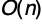이고, 이진 탐색은 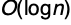이다.)

따라서 이진 탐색은 어느 정도 규모가 있는 문제에서 훨씬, 훨씬 더 빠르다. 이것을 디버깅에 어떻게 적용하는지 살펴보자.

거대한 스택 트레이스를 마주하고 정확히 어떤 함수가 오류 값을 망가뜨렸는지 찾으려 할 때, 중간쯤의 스택 프레임을 선택해 거기서 오류가 나타나는지 확인함으로써 탐색을 수행한다. 오류가 나타난다면 그 이전 프레임에 집중해야 하고, 그렇지 않다면 문제는 그 이후 프레임에 있다. 다시 반으로 자른다. 스택 트레이스에 64개의 프레임이 있더라도 이 접근 방식은 최대 여섯 번의 시도만으로 답을 준다.

특정 데이터셋에서 나타나는 버그를 발견했다면 똑같은 일을 할 수 있다. 데이터셋을 둘로 나누고, 한쪽이나 다른 쪽을 앱에 넣었을 때 문제가 발생하는지 확인한다. 문제를 드러내는 최소한의 값 집합을 얻을 때까지 데이터를 계속 나눈다.

여러 릴리스를 거치는 동안 팀이 버그를 만들어 냈다면, 같은 유형의 기법을 사용할 수 있다. 현재 릴리스가 실패하게 만드는 테스트를 작성하라. 그런 다음 현재와 마지막으로 정상 작동했던 버전 사이의 중간 릴리스를 선택한다. 테스트를 다시 실행하고 검색 범위를 어떻게 좁힐지 결정한다. 이렇게 할 수 있다는 것은 프로젝트에 훌륭한 버전 관리를 갖추었을 때 얻는 수많은 이점 중 하나일 뿐이다. 실제로 많은 버전 관리 시스템은 여기서 한 걸음 더 나아가 테스트 결과에 따라 릴리스를 골라 주며 이 과정을 자동화해 준다.

#### 로깅 및/또는 트레이싱

디버거는 일반적으로 *지금* 프로그램의 상태에 초점을 맞춘다. 때로는 그 이상이 필요하다. 시간에 따른 프로그램이나 자료구조의 상태를 지켜보아야 한다. 스택 트레이스를 보는 것은 여러분이 어떻게 직접 여기까지 왔는지만 알려 줄 뿐이다. 특히 이벤트 기반 시스템에서는 이 호출 체인 이전에 무엇을 하고 있었는지 대개 알려 줄 수 없다.^[25]^

*트레이싱 구문(tracing statements)*은 “여기까지 왔음”이나 “x의 값 = 2” 같은 내용을 화면이나 파일에 출력하는 작은 진단 메시지다. IDE 스타일 디버거에 비하면 원시적인 기법이지만, 디버거가 진단할 수 없는 여러 부류의 오류를 진단하는 데 유독 효과적이다. 트레이싱은 동시성 프로세스, 실시간 시스템, 이벤트 기반 애플리케이션처럼 시간 자체가 요인이 되는 모든 시스템에서 매우 귀중하다.

트레이싱 구문을 사용해 코드 내부로 깊이 파고들 수 있다. 즉, 호출 트리를 내려가면서 트레이싱 구문을 추가할 수 있다.

트레이스 메시지는 자동으로 파싱할 수 있도록 규칙적이고 일관된 형식이어야 한다. 예를 들어, 리소스 누수(짝이 맞지 않는 파일 열기/닫기 등)를 추적해야 한다면 로그 파일에 각 `open`과 각 `close`를 기록할 수 있다. 텍스트 처리 도구나 셸 명령어로 로그 파일을 처리하면, 문제가 되는 `open`이 어디서 발생했는지 쉽게 식별할 수 있다.

#### 고무 오리 디버깅

문제의 원인을 찾는 매우 단순하지만 특히 유용한 기법은 그저 다른 사람에게 문제를 설명하는 것이다. 상대방은 여러분의 어깨너머로 화면을 바라보며(욕조에서 위아래로 까딱거리는 고무 오리처럼) 계속 고개를 끄덕여 주기만 하면 된다. 그 사람은 한마디도 할 필요가 없다. 코드가 무엇을 해야 하는지 단계별로 설명하는 단순한 행위만으로도 문제가 화면에서 튀어나와 스스로를 드러내는 경우가 많다.^[26]^

단순하게 들리지만, 다른 사람에게 문제를 설명할 때는 혼자 코드를 훑어볼 때 당연하게 여기던 것들을 명시적으로 말로 표현해야 한다. 이러한 가정 중 일부를 말로 내뱉어야만 갑자기 문제에 대한 새로운 통찰을 얻을 수 있다. 그리고 곁에 사람이 없다면 고무 오리나 테디 베어, 혹은 화분으로도 충분하다.^[27]^

#### 소거법

대부분의 프로젝트에서 여러분이 디버깅하는 코드는 여러분과 프로젝트 팀원들이 작성한 애플리케이션 코드, 서드파티 제품(데이터베이스, 연결성, 웹 프레임워크, 특수 통신이나 알고리즘 등), 그리고 플랫폼 환경(운영체제, 시스템 라이브러리, 컴파일러)이 뒤섞여 있을 수 있다.

OS나 컴파일러, 서드파티 제품에 버그가 있을 수도 있지만, 이것이 첫 번째 생각이어서는 안 된다. 개발 중인 애플리케이션 코드에 버그가 있을 가능성이 훨씬 더 크다. 라이브러리 자체가 망가졌다고 가정하기보다는 애플리케이션 코드가 라이브러리를 잘못 호출하고 있다고 가정하는 편이 일반적으로 더 유익하다. 설령 문제가 실제로 서드파티에 있다 하더라도, 버그 리포트를 제출하기 전에 여러분의 코드에 문제가 없음을 먼저 입증해야 할 것이다.

우리가 참여한 한 프로젝트에서, 한 시니어 엔지니어는 유닉스 시스템의 `select` 시스템 콜이 망가졌다고 확신했다. 아무리 설득하거나 논리를 펴도 그의 생각을 바꿀 수 없었다(그 장비의 다른 모든 네트워킹 애플리케이션이 멀쩡히 잘 작동한다는 사실은 무관했다). 그는 몇 주 동안 우회 방법을 작성하느라 시간을 보냈지만, 이상하게도 문제를 해결하지 못하는 것 같았다. 마침내 자리에 앉아 `select` 문서를 읽도록 강요받고 나서야 그는 문제를 발견했고 몇 분 만에 고쳤다. 우리는 이제 누군가가 자신의 잘못일 가능성이 큰 결함을 두고 시스템을 탓하기 시작할 때마다 부드러운 일깨움으로 “select가 망가졌군”이라는 표현을 쓴다.

::: {.callout-tip appearance="simple" icon=false}
**Tip 33: “select”는 망가지지 않았다**
:::

기억하라. 발굽 자국이 보이면 얼룩말이 아니라 말을 떠올려라. OS는 아마 망가지지 않았다. 그리고 `select`도 아마 멀쩡할 것이다.

“딱 하나만 바꿨는데” 시스템이 작동을 멈췄다면, 아무리 터무니없어 보이더라도 그 한 가지가 직간접적으로 원인일 가능성이 크다. 때로는 바뀐 것이 여러분의 통제 밖에 있을 수도 있다. OS, 컴파일러, 데이터베이스 또는 기타 서드파티 소프트웨어의 새 버전은 이전에 멀쩡하던 코드에 대혼란을 일으킬 수 있다. 새로운 버그가 나타날 수도 있다. 여러분이 우회 방법을 만들어 두었던 버그가 수정되면서 우회 코드가 깨질 수도 있다. API가 바뀌고 기능이 바뀐다. 요컨대 완전히 새로운 판이 벌어지는 것이므로, 이러한 새로운 조건 아래에서 시스템을 다시 테스트해야 한다. 따라서 업그레이드를 고려할 때는 일정을 예의주시하라. 다음 릴리스 *이후*까지 기다리는 편이 나을 수도 있다.

### 놀라움의 요소

버그에 놀란 자신을 발견할 때(어쩌면 우리가 들을 수 없는 곳에서 혼잣말로 “그건 불가능해”라고 중얼거리기까지 하며), 여러분은 소중히 여겨 온 진실들을 재평가해야 한다. 절대 뚫릴 리 없고 이번 버그의 원인일 리가 없다고 확신했던 그 할인 계산 알고리즘에서, *모든* 경계 조건을 테스트했는가? 몇 년 동안 써 온 그 다른 코드 조각에 여전히 버그가 있을 리가 없지 않은가. 정말 없을까?

물론 있을 수 있다. 무언가 잘못되었을 때 여러분이 느끼는 놀라움의 크기는 실행 중인 코드에 대해 여러분이 가진 신뢰와 믿음의 크기에 비례한다. 그렇기 때문에 “놀라운” 실패에 직면했을 때는 자신의 가정 중 하나 이상이 틀렸음을 받아들여야 한다. 그것이 작동한다는 것을 “안다”는 이유로 버그에 연루된 루틴이나 코드 조각을 대충 넘기지 마라. 증명하라. *이* 맥락에서, *이* 데이터로, *이* 경계 조건으로 증명하라.

::: {.callout-tip appearance="simple" icon=false}
**Tip 34: 가정하지 말고 증명하라**
:::

놀라운 버그를 마주쳤을 때는 단순히 고치는 것을 넘어, 왜 이 실패가 더 일찍 잡히지 않았는지 파악해야 한다. 단위 테스트나 다른 테스트를 수정해 그 버그를 잡아낼 수 있도록 해야 할지 고민해 보라.

또한, 버그가 몇 단계를 거쳐 전파된 잘못된 데이터의 결과로 폭발을 일으킨 것이라면, 그 루틴들에서 매개변수 검사를 더 잘했더라면 더 일찍 격리할 수 있었을지 살펴보라(각각 여기와 여기의 조기 종료와 단언문에 대한 논의 참조).

하는 김에, 코드의 다른 곳 중 똑같은 버그에 취약한 부분이 있는지 살펴보라. 지금이 바로 그것들을 찾아 고칠 때다. *무슨* 일이 일어났든, 다시 일어나면 알 수 있도록 만들어라.

이 버그를 고치는 데 오랜 시간이 걸렸다면 왜 그랬는지 자문해 보라. 다음번에 이 버그를 더 쉽게 고치기 위해 할 수 있는 일이 있는가? 더 나은 테스트 훅을 내장하거나 로그 파일 분석기를 작성할 수도 있을 것이다.

마지막으로, 버그가 누군가의 잘못된 가정에서 비롯된 것이라면 팀 전체와 문제에 대해 논의하라. 한 사람이 오해했다면 많은 사람이 오해하고 있을 가능성이 있다.

이 모든 것을 수행한다면, 다음번에는 놀라지 않기를 바랄 수 있다.

### 디버깅 체크리스트

- 보고된 문제가 근본적인 버그의 직접적인 결과인가, 아니면 단순한 증상인가?
- 버그가 *정말로* 사용 중인 프레임워크에 있는가? OS에 있는가? 아니면 여러분의 코드에 있는가?
- 이 문제를 동료에게 자세히 설명한다면 어떻게 말하겠는가?
- 의심스러운 코드가 단위 테스트를 통과했다면, 그 테스트가 충분히 완전한가? *이* 데이터로 테스트를 실행하면 어떻게 되는가?
- 이 버그를 유발한 조건이 시스템의 다른 곳에도 존재하는가? 아직 유충 단계에 있으며 부화하기만을 기다리는 다른 버그들이 있는가?

### 관련 섹션

- Topic 24, *죽은 프로그램은 거짓말을 하지 않는다*

### 도전 과제

- 디버깅은 그 자체로 충분한 도전이다.

## Topic 21: 텍스트 조작

실용주의 프로그래머는 목수가 나무를 다듬는 것과 똑같은 방식으로 텍스트를 조작한다. 앞선 섹션들에서 우리는 셸, 편집기, 디버거처럼 우리가 사용하는 몇 가지 구체적인 도구들을 논의했다. 이것들은 한두 가지 일을 잘하도록 특화된 목수의 끌, 톱, 대패와 비슷하다. 하지만 가끔씩은 기본 도구 세트로 쉽게 처리할 수 없는 어떤 변환을 수행해야 할 때가 있다. 범용 텍스트 조작 도구가 필요한 것이다.

텍스트 조작 언어는 목공에서의 라우터(router)^[28]^와 같다. 시끄럽고, 지저분하며, 다소 무식한 힘이 들어간다. 실수하면 작품 전체를 망칠 수 있다. 어떤 사람들은 도구 상자에 둘 곳이 못 된다고 단언하기도 한다. 하지만 올바른 손에 들리면 라우터와 텍스트 조작 언어 모두 믿을 수 없을 만큼 강력하고 다재다능해진다. 무언가를 빠르게 다듬어 모양을 만들고, 이음새를 만들고, 조각할 수 있다. 제대로 사용하면 이 도구들은 놀라운 정교함과 섬세함을 발휘한다. 하지만 숙달하는 데는 시간이 걸린다.

다행히도 훌륭한 텍스트 조작 언어가 많이 있다. 유닉스 개발자들(여기에는 macOS 사용자도 포함된다)은 종종 `awk`와 `sed` 같은 도구로 보강된 커맨드 셸의 힘을 사용하는 것을 좋아한다. 더 구조화된 도구를 선호하는 사람들은 파이썬(Python)이나 루비(Ruby) 같은 언어를 선호할 수도 있다.

이러한 언어들은 중요한 기반 기술이다. 이를 사용하면 유틸리티를 빠르게 뚝딱 만들고 아이디어를 프로토타이핑할 수 있다. 기존 언어를 사용하면 5배에서 10배는 더 오래 걸릴 작업들이다. 그리고 그 배수 차이는 우리가 하는 종류의 실험에 결정적으로 중요하다. 엉뚱한 아이디어를 시험해 보는 데 30분을 쓰는 것이 5시간을 쓰는 것보다 훨씬 낫다. 프로젝트의 중요한 구성 요소를 자동화하는 데 하루를 쓰는 것은 받아들일 만하지만, 일주일을 쓰는 것은 그렇지 않을 수 있다. 커니핸과 파이크는 저서 《프로그래밍 수련법(The Practice of Programming)》[KP99]에서 똑같은 프로그램을 다섯 가지 다른 언어로 구현했다. 펄(Perl) 버전이 가장 짧았다(C의 150줄과 비교해 17줄). 펄을 사용하면 텍스트를 조작하고, 프로그램과 상호작용하며, 네트워크로 통신하고, 웹 페이지를 제어하며, 임의 정밀도 산술을 수행하고, 스누피가 욕하는 것처럼 보이는 프로그램을 작성할 수 있다.

::: {.callout-tip appearance="simple" icon=false}
**Tip 35: 텍스트 조작 언어를 배우라**
:::

텍스트 조작 언어의 폭넓은 적용 가능성을 보여 주기 위해, 바로 이 책을 만드는 것과 관련해 우리가 루비와 파이썬으로 한 작업 몇 가지를 소개한다.

**책 빌드하기**

프래그매틱 북셸프(Pragmatic Bookshelf)의 빌드 시스템은 루비로 작성되었다. 저자, 편집자, 레이아웃 담당자, 지원 인력들은 PDF와 전자책 빌드를 조율하기 위해 Rake 태스크를 사용한다.

**코드 포함 및 하이라이팅**

우리는 책에 제시된 모든 코드가 먼저 테스트를 거쳤어야 한다고 생각한다. 이 책의 코드 대부분이 그렇다. 하지만 DRY 원칙(Topic 9 *DRY—중복의 해악* 참조)에 따라 테스트된 프로그램에서 코드 줄을 복사해 책에 붙여 넣고 싶지는 않았다. 그렇게 하면 코드를 중복하게 되어, 해당 프로그램이 변경되었을 때 예제를 업데이트하는 것을 잊어버릴 가능성이 사실상 확실해지기 때문이다. 또한 일부 예제에서는 예제를 컴파일하고 실행하는 데 필요한 모든 프레임워크 코드로 여러분을 지루하게 만들고 싶지 않았다. 우리는 루비에 눈을 돌렸다. 책을 포맷할 때 비교적 간단한 스크립트가 호출되어 소스 파일에서 이름이 지정된 세그먼트를 추출하고, 구문 강조(syntax highlighting)를 수행한 뒤, 결과를 우리가 사용하는 조판 언어로 변환한다.

**웹사이트 업데이트**

부분적인 책 빌드를 수행하고, 목차를 추출한 다음, 웹사이트의 책 페이지에 업로드하는 간단한 스크립트가 있다. 책의 섹션을 추출해 샘플로 업로드하는 스크립트도 있다.

**수식 포함하기**

LaTeX 수학 마크업을 보기 좋게 포맷된 텍스트로 변환하는 파이썬 스크립트가 있다.

**색인 생성**

대부분의 색인은 별도의 문서로 만들어진다(이는 문서가 변경될 때 색인을 유지 관리하기 어렵게 만든다). 우리의 색인은 텍스트 자체에 마크업되어 있으며, 루비 스크립트가 항목들을 수집하고 포맷한다.

이런 식이다. 아주 현실적인 의미에서 프래그매틱 북셸프는 텍스트 조작을 중심으로 구축되어 있다. 그리고 모든 것을 일반 텍스트로 보관하라는 우리의 조언을 따른다면, 이러한 언어를 사용해 그 텍스트를 조작함으로써 수많은 이점을 얻을 수 있다.

### 관련 섹션

- Topic 16, *일반 텍스트의 힘*
- Topic 17, *셸 게임*

### 연습 문제

**Exercise 11**

설정 언어로 YAML을 사용하던 애플리케이션을 다시 작성하고 있다. 회사가 이제 JSON으로 표준화했기 때문에 `.json`으로 바꾸어야 할 `.yaml` 파일이 잔뜩 있다. 디렉터리를 받아 각 `.yaml` 파일을 해당하는 `.json` 파일로 변환하는 스크립트를 작성하라(즉, `database.yaml`이 `database.json`이 되고, 내용은 유효한 JSON이어야 한다).

**Exercise 12**

팀에서 처음에는 변수 이름에 `camelCase`를 사용하기로 했다가, 마음이 바뀌어 `snake_case`로 전환했다. 모든 소스 파일을 스캔해 camelCase 이름을 찾아 보고하는 스크립트를 작성하라.

**Exercise 13**

이전 연습 문제에 이어, 하나 이상의 파일에서 그 변수 이름들을 자동으로 변경하는 기능을 추가하라. 무언가 끔찍하게 잘못될 경우를 대비해 원본 백업을 남겨 두는 것을 잊지 마라.

## Topic 22: 엔지니어링 일지

데이브는 한때 소규모 컴퓨터 제조업체에서 일한 적이 있는데, 이는 전자공학자 및 때로는 기계공학자들과 함께 일한다는 뜻이었다.

그들 중 많은 이들이 대개 책등에 펜을 꽂은 종이 공책을 가지고 다녔다. 우리가 이야기를 나누는 도중에도 그들은 가끔 공책을 톡 열어 젖히고 무언가를 끄적였다.

결국 데이브는 당연한 질문을 던졌다. 알고 보니 그들은 자신이 한 일, 배운 것, 아이디어 스케치, 계측기 수치 등 기본적으로 업무와 관련된 모든 것을 기록하는 일종의 저널인 *엔지니어링 일지(engineering daybook)*를 쓰도록 훈련받았던 것이다. 공책이 가득 차면 책등에 날짜 범위를 적고 이전 일지들 옆 선반에 꽂아 두었다. 누구의 일지 세트가 선반 공간을 가장 많이 차지하는지 은근한 경쟁이 벌어지기도 했을 것이다.

우리는 회의에서 메모하고, 현재 작업 중인 내용을 적고, 디버깅할 때 변수 값을 기록하고, 물건을 둔 곳을 잊지 않기 위해 메모를 남기고, 엉뚱한 아이디어를 기록하고, 때로는 그저 낙서를 하기 위해 일지를 사용한다.^[29]^

일지에는 세 가지 주요 이점이 있다.

- 기억력보다 믿을 만하다. 사람들이 “지난주에 전원 공급 장치 문제로 전화했던 그 회사 이름이 뭐였죠?”라고 물으면 한두 페이지 뒤로 넘겨 이름과 번호를 알려 줄 수 있다.
- 당면한 작업과 즉각적인 관련이 없는 아이디어를 저장할 공간을 제공한다. 그렇게 하면 그 멋진 아이디어가 잊히지 않을 것이라는 사실을 알기에 현재 하고 있는 일에 계속 집중할 수 있다.
- 일종의 고무 오리(여기 설명됨) 역할을 한다. 무언가를 적기 위해 멈추면, 마치 누군가와 이야기할 때처럼 뇌의 기어가 바뀔 수 있다. 이는 성찰할 수 있는 좋은 기회다. 메모를 시작하다가 문득 방금 자신이 한 일, 즉 메모의 주제가 완전히 틀렸다는 것을 깨달을 수도 있다.

추가적인 이점도 있다. 가끔씩 아주 오래전에 자신이 무엇을 하고 있었는지 되돌아보며 그 시절의 사람들, 프로젝트, 그리고 끔찍했던 옷과 헤어스타일을 떠올릴 수 있다.

그러니 엔지니어링 일지를 한번 써 보라. 파일이나 위키가 아니라 종이를 사용하라. 타이핑하는 것과 비교해 직접 손으로 쓰는 행위에는 무언가 특별한 것이 있다. 한 달간 해 보고 어떤 이점이 있는지 살펴보라.

적어도, 여러분이 부자가 되고 유명해졌을 때 회고록을 쓰기가 더 쉬워질 것이다.

### 관련 섹션

- Topic 6, *여러분의 지식 포트폴리오*
- Topic 37, *도마뱀 뇌의 목소리에 귀 기울여라*

### 각주

**[24]**

모든 소프트웨어는 작성되는 즉시 레거시 소프트웨어가 된다.

**[25]**

하지만 Elm 언어에는 시간 여행 디버거가 있다.

**[26]**

왜 “고무 오리 디버깅(rubber ducking)”일까? 런던 임페리얼 칼리지 학부생 시절, 데이브는 자신이 아는 최고의 개발자 중 한 명인 그레그 퓨(Greg Pugh)라는 연구 조교와 많은 일을 함께했다. 몇 달 동안 그레그는 작은 노란색 고무 오리를 가지고 다니며 코딩할 때마다 단말기 위에 올려놓곤 했다. 데이브가 용기를 내어 물어보기까지는 한참이 걸렸다….

**[27]**

이 책의 이전 버전에서는 *화분(pot plant)*에게 말 거는 이야기를 했다. 오타(pot plant/potted plant)였다. 정말이다.

**[28]**

여기서 *라우터*는 네트워크를 상호 연결하는 장치가 아니라 절단 날을 아주, 아주 빠르게 회전시키는 도구를 의미한다.

**[29]**

낙서가 집중력을 높이고 인지 능력을 향상시킨다는 몇 가지 증거가 있다. 예를 들어 *What does doodling do?* [And10]를 참조하라.

# Chapter
4: 실용주의적 편집증

::: {.callout-tip appearance="simple" icon=false}
**Tip 36: 완벽한 소프트웨어는 작성할 수 없다**
:::

아팠는가? 아프지 말아야 한다. 삶의 공리로 받아들여라. 포용하라. 축하하라. 완벽한 소프트웨어는 존재하지 않기 때문이다. 컴퓨팅의 짧은 역사상 완벽한 소프트웨어를 작성한 사람은 아무도 없다. 여러분이 최초가 될 가능성도 희박하다. 그리고 이것을 사실로 받아들이지 않는 한, 불가능한 꿈을 쫓느라 시간과 에너지를 낭비하게 될 것이다.

자, 이 우울한 현실이 주어졌을 때 실용주의 프로그래머는 어떻게 이것을 이점으로 바꿀까? 그것이 바로 이 장의 주제다.

누구나 지구상에서 오직 자신만이 훌륭한 운전자라고 생각한다. 세상의 나머지 사람들은 모두 정지 신호를 무시하고, 차선 사이를 요리조리 넘나들고, 방향지시등도 켜지 않고, 휴대전화로 문자를 보내며, 전반적으로 우리의 기준에 미치지 못한 채 우리를 해치려 든다. 그래서 우리는 방어 운전을 한다. 문제가 일어나기 전에 살피고, 예상치 못한 상황에 대비하며, 빠져나올 수 없는 궁지에 스스로를 몰아넣지 않는다.

코딩과의 비유는 꽤 명백하다. 우리는 끊임없이 다른 사람의 코드—우리의 높은 기준에 미치지 못할 수도 있는 코드—와 인터페이스를 맺고, 유효할 수도 있고 아닐 수도 있는 입력을 다룬다. 그래서 우리는 방어적으로 코딩하라고 배운다. 조금이라도 의심스러우면 전달받은 모든 정보를 검증한다. 잘못된 데이터를 감지하기 위해 단언문(assertion)을 사용하고, 잠재적인 공격자나 트롤로부터 온 데이터를 불신한다. 일관성을 확인하고, 데이터베이스 칼럼에 제약 조건을 걸며, 전반적으로 자기 자신에 대해 꽤 흡족해한다.

하지만 실용주의 프로그래머는 여기서 한 걸음 더 나아간다. *그들은 자기 자신도 믿지 않는다.* 자신을 포함해 그 누구도 완벽한 코드를 작성하지 못한다는 것을 알기에, 실용주의 프로그래머는 자신의 실수에 대비한 방어책을 구축한다. 우리는 첫 번째 방어 수단을 Topic 23 *계약에 의한 설계(Design by Contract)*에서 설명한다. 클라이언트와 공급자는 권리와 책임에 합의해야 한다.

Topic 24 *죽은 프로그램은 거짓말을 하지 않는다(Dead Programs Tell No Lies)*에서는 버그를 잡아내는 동안 아무런 피해도 입히지 않도록 보장하고자 한다. 그래서 자주 상태를 확인하고 일이 잘못되면 프로그램을 종료하려고 한다.

Topic 25 *단언적 프로그래밍(Assertive Programming)*은 그 과정에서 확인하는 쉬운 방법을 설명한다. 즉, 여러분의 가정을 적극적으로 검증하는 코드를 작성하라.

프로그램이 더 동적이 될수록 메모리, 파일, 장치 같은 시스템 리소스를 저글링하고 있는 자신을 발견하게 될 것이다. Topic 26 *리소스 균형 맞추기(How to Balance Resources)*에서는 공을 하나도 떨어뜨리지 않도록 보장하는 방법을 제안할 것이다.

그리고 가장 중요하게는, Topic 27 *헤드라이트보다 앞서 달리지 마라(Don't Outrun Your Headlights)*에서 설명하듯이 항상 작은 단계를 유지해 절벽 끝으로 떨어지지 않도록 한다.

불완전한 시스템, 터무니없는 일정, 우스꽝스러운 도구, 불가능한 요구 사항으로 가득한 세상에서 안전하게 행동하자. 우디 앨런이 말했듯이, “모두가 실제로 *당신*을 노리고 있을 때, 편집증은 그저 좋은 생각일 뿐이다.”

## Topic 23: 계약에 의한 설계

> *상식과 공정한 거래만큼 인간을 놀라게 하는 것은 없다.*
>
> — 랄프 왈도 에머슨, 《수필집(Essays)》

컴퓨터 시스템을 다루는 것은 어렵다. 사람을 다루는 것은 훨씬 더 어렵다. 하지만 종(species)으로서 우리는 인간의 상호작용 문제를 해결할 시간이 더 길었다. 지난 수천 년 동안 우리가 내놓은 해결책 중 일부는 소프트웨어 작성에도 똑같이 적용할 수 있다. 공정한 거래를 보장하는 최고의 해결책 중 하나는 바로 *계약(contract)*이다.

계약은 여러분의 권리와 책임뿐만 아니라 상대방의 권리와 책임도 정의한다. 또한 어느 한쪽이 계약을 준수하지 못했을 때의 결과에 대한 합의가 있다.

아마 여러분은 일할 시간과 따라야 할 행동 규칙을 명시한 고용 계약을 맺고 있을 것이다. 그 대가로 회사는 여러분에게 급여와 기타 혜택을 지급한다. 각 당사자가 의무를 다하면 모두가 혜택을 얻는다.

이것은 전 세계적으로 인간이 상호작용하는 데 공식적·비공식적으로 모두 사용되는 아이디어다. 소프트웨어 모듈이 상호작용하는 것을 돕기 위해 똑같은 개념을 사용할 수 있을까? 답은 “그렇다”이다.

### DBC

베르트랑 마이어(Bertrand Meyer, 《객체지향 소프트웨어 구축(Object-Oriented Software Construction)》 [Mey97])는 에펠(Eiffel) 언어를 위해 *계약에 의한 설계(Design by Contract)* 개념을 개발했다.^[30]^ 이는 프로그램의 정확성을 보장하기 위해 소프트웨어 모듈의 권리와 책임을 문서화하고(그리고 합의하고) 데 초점을 맞춘 단순하면서도 강력한 기법이다. 올바른 프로그램이란 무엇인가? 자신이 하겠다고 주장하는 것보다 더 많이도, 더 적게도 하지 않는 프로그램이다. 그 주장을 문서화하고 검증하는 것이 *계약에 의한 설계*(줄여서 DBC)의 핵심이다.

소프트웨어 시스템의 모든 함수와 메서드는 *무언가를 수행한다*. 그 *무언가*를 시작하기 전에 함수는 세상의 상태에 대한 어떤 기대를 가질 수 있으며, 작업이 끝났을 때 세상의 상태에 대해 어떤 진술을 할 수 있다. 마이어는 이러한 기대와 주장을 다음과 같이 설명한다.

**사전 조건(Preconditions)**

루틴이 호출되기 위해 반드시 참이어야 하는 것, 즉 루틴의 요구 사항이다. 사전 조건이 위반될 때 루틴이 호출되어서는 절대 안 된다. 올바른 데이터를 전달하는 것은 호출자의 책임이다(여기 박스 참조).

**사후 조건(Postconditions)**

루틴이 수행하기로 보장하는 것, 즉 루틴이 끝났을 때의 세상의 상태다. 루틴에 사후 조건이 있다는 사실은 그 루틴이 *반드시 종료될 것*임을 함의한다. 무한 루프는 허용되지 않는다.

**클래스 불변식(Class invariants)**

클래스는 호출자의 관점에서 이 조건이 항상 참임을 보장한다. 루틴의 내부 처리 중에는 불변식이 성립하지 않을 수도 있지만, 루틴이 종료되고 제어권이 호출자에게 돌아갈 때쯤에는 불변식이 반드시 참이어야 한다. (클래스는 불변식에 참여하는 어떤 데이터 멤버에 대해서도 무제한적인 쓰기 접근을 허용할 수 없음에 유의하라.)

따라서 루틴과 잠재적 호출자 사이의 계약은 다음과 같이 읽을 수 있다.

> 호출자가 루틴의 모든 사전 조건을 충족하면, 루틴은 완료 시 모든 사후 조건과 불변식이 참이 될 것임을 보장한다.

어느 한쪽이라도 계약 조건을 지키지 못하면(사전에 합의된) 구제 조치가 발동된다. 예외가 발생하거나 프로그램이 종료될 수 있다. 무슨 일이 일어나든, 계약을 지키지 못한 것은 명백한 버그다. 그것은 절대 일어나서는 안 되는 일이며, 바로 이 때문에 사용자 입력 검증 같은 것을 수행하는 데 사전 조건을 사용해서는 안 된다.

어떤 언어들은 다른 언어들보다 이러한 개념을 더 잘 지원한다. 예를 들어 클로저(Clojure)는 *specs*가 제공하는 더 포괄적인 계측뿐만 아니라 사전·사후 조건도 지원한다. 다음은 간단한 사전·사후 조건을 사용해 입금을 처리하는 은행 함수의 예시다.

```
(defn accept-deposit [account-id amount]
   { :pre [  (> amount 0.00)
             (account-open? account-id) ]
     :post [ (contains? (account-transactions account-id) %) ] }
   "Accept a deposit and return the new transaction id"
   ;; Some other processing goes here...
   ;; Return the newly created transaction:
   (create-transaction account-id :deposit amount))
```

`accept-deposit` 함수에는 두 개의 사전 조건이 있다. 첫 번째는 금액이 0보다 커야 한다는 것이고, 두 번째는 `account-open?`이라는 함수로 판별했을 때 계좌가 열려 있고 유효해야 한다는 것이다. 사후 조건도 하나 있다. 함수는 새로운 거래(여기서 ‘%’로 표현된 이 함수의 반환값)가 이 계좌의 거래 내역에서 발견될 수 있음을 보장한다.

양수의 입금액과 유효한 계좌로 `accept-deposit`을 호출하면, 적절한 유형의 거래를 생성하고 다른 처리들을 진행할 것이다. 하지만 프로그램에 버그가 있어 어쩌다 음수 금액을 입금으로 전달했다면 런타임 예외를 받게 된다.

```
Exception in thread "main"...
Caused by: java.lang.AssertionError: Assert failed: (> amount 0.0)
```

마찬가지로, 이 함수는 지정된 계좌가 열려 있고 유효할 것을 요구한다. 그렇지 않다면 대신 다음과 같은 예외를 보게 될 것이다.

```
Exception in thread "main"...
Caused by: java.lang.AssertionError: Assert failed: (account-open? account-id)
```

다른 언어들은 DBC 전용은 아니지만 여전히 훌륭한 효과를 낼 수 있는 기능을 가지고 있다. 예를 들어 엘릭서(Elixir)는 사용 가능한 여러 본문에 대해 함수 호출을 디스패치하기 위해 *가드 절(guard clauses)*을 사용한다.

```
defmodule Deposits do
  def accept_deposit(account_id, amount) when (amount > 100000) do
    # Call the manager!
  end
  def accept_deposit(account_id, amount) when (amount > 10000) do
    # Extra Federal requirements for reporting
    # Some processing...
  end
  def accept_deposit(account_id, amount) when (amount > 0) do
    # Some processing...
  end
end
```

이 경우, 충분히 큰 금액으로 `accept_deposit`을 호출하면 추가적인 단계와 처리가 촉발될 수 있다. 하지만 0 이하의 금액으로 호출하려고 하면, 호출할 수 없음을 알리는 예외를 받게 된다.

```
** (FunctionClauseError) no function clause matching in Deposits.accept_deposit/2
```

이것은 단순히 입력을 검사하는 것보다 더 나은 접근 방식이다. 이 경우 인자가 범위를 벗어나면 이 함수를 *아예 호출할 수조차* 없다.

::: {.callout-tip appearance="simple" icon=false}
**Tip 37: 계약으로 설계하라**
:::

Topic 10 *직교성*에서 우리는 “수줍은(shy)” 코드를 작성하라고 권장했다. 여기서 강조하는 것은 “게으른(lazy)” 코드다. 시작하기 전에 받아들일 수 있는 것에 대해서는 엄격하고, 그 대가로 약속하는 것은 가능한 한 적게 하라. 기억하라. 여러분의 계약이 무엇이든 다 받아들이고 세상 모든 것을 약속한다고 명시한다면, 작성해야 할 코드가 엄청나게 많아진다!

함수형이든, 객체지향이든, 절차적이든 어떤 프로그래밍 언어에서든 DBC는 여러분이 *생각*하도록 강제한다.

::: {.callout-note title="DBC와 테스트 주도 개발"}
개발자들이 단위 테스트, 테스트 주도 개발(TDD), 속성 기반 테스트, 또는 방어적 프로그래밍을 실천하는 세상에서도 계약에 의한 설계가 필요할까?

짧은 답은 “그렇다”이다.

DBC와 테스트는 프로그램 정확성이라는 더 넓은 주제에 대한 서로 다른 접근 방식이다. 둘 다 가치가 있으며 서로 다른 상황에서 쓰임새가 있다. DBC는 특정 테스트 접근 방식에 비해 몇 가지 장점을 제공한다.

- DBC는 어떠한 설정(setup)이나 모킹(mocking)도 필요로 하지 않는다.
- 테스트가 한 번에 하나의 특정 사례만 겨냥할 수 있는 반면, DBC는 *모든* 경우에 대한 성공 또는 실패의 매개변수를 정의한다.
- TDD와 기타 테스트는 빌드 주기 내의 “테스트 시간”에만 일어난다. 하지만 DBC와 단언문은 설계, 개발, 배포, 유지보수 내내 영원히 존재한다.
- TDD는 테스트 대상 코드 내부의 불변식을 확인하는 데 초점을 맞추지 않으며, 공개 인터페이스를 확인하는 블랙박스 스타일에 가깝다.
- DBC는 다른 아무도 검증하지 않을 경우를 대비해 *모든 이가* 데이터를 검증해야 하는 방어적 프로그래밍보다 더 효율적(그리고 더 DRY함)이다.

TDD는 훌륭한 기법이지만, 많은 기법들이 그렇듯 잘못된 데이터, 악의적 행위자, 잘못된 버전, 잘못된 명세로 가득한 현실 세계가 아니라 “행복한 경로(happy path)”에 집중하게 만들 수 있다.
:::

#### 클래스 불변식과 함수형 언어

이름 붙이기 나름이다. 에펠은 객체지향 언어이므로 마이어는 이 아이디어에 “클래스 불변식”이라는 이름을 붙였다. 하지만 사실 그것은 그보다 더 일반적이다. 이 아이디어가 실제로 가리키는 것은 *상태(state)*다. 객체지향 언어에서 상태는 클래스의 인스턴스와 연관된다. 하지만 다른 언어들에도 상태가 있다.

함수형 언어에서는 일반적으로 상태를 함수에 전달하고 결과로 업데이트된 상태를 돌려받는다. 불변식의 개념은 이러한 상황에서도 똑같이 유용하다.

### DBC 구현하기

코드를 작성하기 전에 입력 도메인 범위가 무엇인지, 경계 조건이 무엇인지, 그리고 루틴이 무엇을 전달하기로 약속하는지—더 중요하게는 무엇을 전달하기로 약속하지 *않는지*—단순히 나열하는 것만으로도 더 나은 소프트웨어를 작성하는 데 있어 큰 도약이 된다. 이런 것들을 명시하지 않으면 여러분은 다시 *우연에 의한 프로그래밍*(여기 논의 참조)으로 돌아가게 되며, 많은 프로젝트가 바로 거기서 시작하고, 끝나며, 실패한다.

코드에서 DBC를 지원하지 않는 언어에서는 이 정도까지가 할 수 있는 전부일 수도 있으며, 그것도 그리 나쁘지 않다. 결국 DBC는 *설계* 기법이다. 자동 검사가 없더라도 코드에 주석으로 계약을 넣거나 단위 테스트에 넣어 여전히 매우 실질적인 이점을 얻을 수 있다.

#### 단언문

이러한 가정을 문서화하는 것도 훌륭한 시작이지만, 컴파일러가 계약을 대신 검사하게 하면 훨씬 더 큰 이점을 얻을 수 있다. 일부 언어에서는 *단언문(assertions)*—논리적 조건에 대한 런타임 검사(Topic 25 *단언적 프로그래밍* 참조)—을 사용해 이를 부분적으로 모방할 수 있다. 왜 부분적으로만 가능할까? 단언문을 사용해 DBC가 할 수 있는 모든 것을 할 수는 없을까?

불행히도 답은 ‘아니오’다. 우선, 객체지향 언어에서는 상속 계층 아래로 단언문을 전파하는 지원이 없을 가능성이 크다. 즉, 계약이 있는 기본 클래스 메서드를 재정의(override)하면 그 계약을 구현하는 단언문들이(새 코드에 수동으로 중복 작성하지 않는 한) 올바르게 호출되지 않을 것이다. 모든 메서드를 종료하기 전에 클래스 불변식(및 모든 기본 클래스 불변식)을 수동으로 호출하는 것을 기억해야 한다. 근본적인 문제는 계약이 자동으로 강제되지 않는다는 것이다.

다른 환경에서는 DBC 스타일 단언문에서 발생한 예외가 전역적으로 꺼져 있거나 코드에서 무시될 수도 있다.

또한 “이전(old)” 값—즉, 메서드 진입 시점에 존재했던 값—에 대한 내장 개념이 없다. 계약을 강제하기 위해 단언문을 사용하고 있다면, 사후 조건에서 사용하고 싶은 정보를 저장하는 코드를 사전 조건에 추가해야 한다(언어가 그것을 허용하기라도 한다면 말이다). DBC가 탄생한 에펠 언어에서는 그저 `old` *expression*을 쓰면 된다.

마지막으로, 기존의 런타임 시스템과 라이브러리는 계약을 지원하도록 설계되지 않았으므로 이러한 호출들은 검사되지 않는다. 이는 큰 손실인데, 가장 많은 문제가 감지되는 곳이 종종 여러분의 코드와 그것이 사용하는 라이브러리 사이의 경계이기 때문이다(더 자세한 논의는 Topic 24 *죽은 프로그램은 거짓말을 하지 않는다* 참조).

::: {.callout-note title="누구의 책임인가?"}
사전 조건을 검사할 책임은 누구에게 있는가? 호출자인가, 아니면 호출되는 루틴인가? 언어의 일부로 구현된 경우 답은 둘 다 아니다. 사전 조건은 호출자가 루틴을 호출한 후, 하지만 루틴 자체에 진입하기 전에 보이지 않는 곳에서 테스트된다. 따라서 매개변수에 대한 명시적인 검사가 수행되어야 한다면 그것은 *호출자*가 수행해야 한다. 왜냐하면 루틴 자체는 자신의 사전 조건을 위반하는 매개변수를 절대 보지 못할 것이기 때문이다. (내장 지원이 없는 언어에서는 *호출되는* 루틴을 이러한 단언문을 검사하는 전처리 및/또는 후처리 코드로 감싸야 할 것이다.)

콘솔에서 숫자를 읽고, 제곱근을 계산하고(`sqrt` 호출), 결과를 출력하는 프로그램을 생각해 보자. `sqrt` 함수에는 사전 조건이 있다. 인자가 음수여서는 안 된다. 사용자가 콘솔에 음수를 입력하면, 그 값이 `sqrt`에 절대 전달되지 않도록 보장하는 것은 호출 코드의 몫이다. 이 호출 코드에는 여러 선택지가 있다. 종료할 수도 있고, 경고를 내보내고 다른 숫자를 읽을 수도 있으며, 숫자를 양수로 만든 뒤 `sqrt`가 반환한 결과에 *i*를 붙일 수도 있다. 선택이 무엇이든, 이것은 분명히 `sqrt`의 문제가 아니다.

`sqrt` 루틴의 사전 조건에 제곱근 함수의 정의역을 표현함으로써, 여러분은 정확성의 부담을 그것이 마땅히 속한 곳인 호출자에게 넘긴다. 그러면 입력이 범위 내에 있을 것이라는 확신을 가지고 `sqrt` 루틴을 설계할 수 있다.
:::

### DBC와 조기 충돌

DBC는 우리의 조기 충돌(crashing early) 개념과도 잘 어울린다(Topic 24 *죽은 프로그램은 거짓말을 하지 않는다* 참조). assert나 DBC 메커니즘을 사용해 사전 조건, 사후 조건, 불변식을 검증함으로써 일찍 충돌시키고 문제에 대한 더 정확한 정보를 보고할 수 있다.

예를 들어, 제곱근을 계산하는 메서드가 있다고 가정해 보자. 이 메서드에는 정의역을 양수로 제한하는 DBC 사전 조건이 필요하다. DBC를 지원하는 언어에서 `sqrt`에 음수 매개변수를 전달하면 스택 트레이스와 함께 `sqrt_arg_must_be_positive`와 같은 유익한 오류를 얻게 된다.

이는 자바, C, C++ 같은 다른 언어에서 `sqrt`에 음수를 전달했을 때 특수 값 `NaN`(Not a Number)을 반환하는 대안보다 낫다. 프로그램의 한참 뒤에서 `NaN`으로 어떤 수학 연산을 시도하다가 놀라운 결과를 마주할 수도 있기 때문이다.

문제가 발생한 지점에서 일찍 충돌시킴으로써 문제를 찾고 진단하는 것이 훨씬 더 쉽다.

### 의미론적 불변식

일종의 “철학적 계약”인 침해할 수 없는 요구 사항을 표현하기 위해 *의미론적 불변식(semantic invariants)*을 사용할 수 있다.

우리는 한때 직불카드 거래 스위치를 작성한 적이 있다. 주요 요구 사항은 직불카드 사용자의 계좌에 동일한 거래가 두 번 적용되어서는 절대 안 된다는 것이었다. 다시 말해, 어떤 종류의 실패 모드가 발생하든 오류는 중복 거래를 처리하는 쪽이 아니라 거래를 처리하지 *않는* 쪽으로 기울어야 했다.

요구 사항에서 직접 도출된 이 단순한 법칙은 복잡한 오류 복구 시나리오를 정리하는 데 매우 유용한 것으로 입증되었으며, 많은 영역에서 상세 설계와 구현을 안내했다.

고정되고 침해할 수 없는 법칙인 요구 사항과, 새로운 경영진 체제에 따라 바뀔 수 있는 단순한 정책을 혼동하지 않도록 주의하라. 바로 그 때문에 우리가 *의미론적(semantic)* 불변식이라는 용어를 쓰는 것이다. 그것은 사물의 *본질적 의미*의 중심에 있어야 하며, 정책의 변덕에 좌우되어서는 안 된다(정책은 더 동적인 비즈니스 규칙이 담당하는 영역이다).

이에 해당하는 요구 사항을 발견하면, 3부로 서명되는 요구 사항 문서의 글머리 기호 목록이든 모두가 보는 공용 화이트보드의 큰 메모든, 여러분이 만드는 어떤 문서에서든 잘 알려진 일부가 되도록 하라. 그것을 명확하고 모호하지 않게 진술하려고 노력하라. 예를 들어 직불카드 예시에서는 다음과 같이 쓸 수 있다.

> 소비자에게 유리한 쪽으로 오류를 내라.

이것은 시스템의 여러 다양한 영역에 적용할 수 있는 명확하고, 간결하며, 모호하지 않은 진술이다. 이는 시스템의 모든 사용자와 맺는 우리의 계약이자, 동작에 대한 우리의 보장이다.

### 동적 계약과 에이전트

지금까지 우리는 계약을 고정되고 불변하는 명세로 이야기해 왔다. 하지만 자율 에이전트의 환경에서는 반드시 그럴 필요가 없다. “자율적”이라는 정의에 따라, 에이전트는 자신이 지키고 싶지 않은 요청을 *거부*할 자유가 있다. 그들은 계약을 재협상할 자유가 있다. “그건 제공할 수 없지만, 이걸 주면 다른 걸 제공할 수도 있어요.”

확실히 에이전트 기술에 의존하는 모든 시스템은—설령 동적으로 생성되더라도—계약적 합의에 *결정적으로* 의존한다.

상상해 보라. 목표를 달성하기 위해 스스로 계약을 협상할 수 있는 충분한 컴포넌트와 에이전트가 있다면, 소프트웨어가 우리를 대신해 문제를 해결하게 함으로써 소프트웨어 생산성 위기를 해결할 수 있을지도 모른다.

하지만 우리가 손으로 계약을 사용할 수 없다면, 자동으로 사용하는 것도 불가능할 것이다. 그러니 다음에 소프트웨어 한 조각을 설계할 때는 그 계약도 함께 설계하라.

### 관련 섹션

- Topic 24, *죽은 프로그램은 거짓말을 하지 않는다*
- Topic 25, *단언적 프로그래밍*
- Topic 38, *우연에 의한 프로그래밍*
- Topic 42, *속성 기반 테스트*
- Topic 43, *바깥세상은 위험하니 안전을 지켜라*
- Topic 45, *요구 사항의 구덩이*

### 도전 과제

- 생각해 볼 점: DBC가 그렇게 강력하다면 왜 더 널리 쓰이지 않을까? 계약을 떠올리는 것이 어렵기 때문인가? 지금 당장은 무시하고 싶은 문제들에 대해 생각하게 만들기 때문인가? 여러분이 *생각!*하도록 강제하기 때문인가? 분명히 이것은 위험한 도구다!

### 연습 문제

**Exercise 14** (가능한 해답)

주방용 블렌더의 인터페이스를 설계하라. 결국에는 웹 기반의 IoT 지원 블렌더가 되겠지만, 지금은 그것을 제어할 인터페이스만 필요하다. 10단계의 속도 설정(0은 꺼짐을 의미)이 있다. 비어 있을 때는 작동할 수 없으며, 속도는 한 번에 한 단위씩만 변경할 수 있다(즉, 0에서 1로, 1에서 2로는 가능하지만 0에서 2로는 불가능하다).

메서드는 다음과 같다. 적절한 사전 조건, 사후 조건, 그리고 불변식을 추가하라.

```
int getSpeed()
void setSpeed(int x)
boolean isFull()
void fill()
void empty()
```

**Exercise 15** (가능한 해답)

수열 0, 5, 10, 15, …, 100에는 몇 개의 숫자가 있는가?

## Topic 24: 죽은 프로그램은 거짓말을 하지 않는다

때때로 여러분 자신이 문제에 대해 인식하기도 전에 다른 사람들이 여러분에게 무언가 좋지 않다는 것을 감지하는 것을 본 적이 있는가? 다른 사람의 코드에서도 마찬가지다. 우리 프로그램 중 하나에서 무언가 잘못되기 시작하면, 때로는 라이브러리나 프레임워크 루틴이 그것을 가장 먼저 잡아낸다. 아마 `nil` 값이나 빈 리스트를 전달했을지도 모른다. 그 해시에 키가 빠져 있거나, 해시가 들어 있을 거라고 생각한 값에 실제로는 리스트가 들어 있을지도 모른다. 우리가 잡지 못한 네트워크 오류나 파일 시스템 오류가 발생해서 비어 있거나 손상된 데이터를 얻었을 수도 있다. 수백만 명령어 전에 발생한 논리 오류 때문에 case 문의 선택자가 더 이상 예상된 1, 2, 또는 3이 아닐 수도 있다. 우리는 예기치 않게 `default` 케이스에 도달할 것이다. 모든 case/switch 문에 default 절이 있어야 하는 이유 중 하나도 바로 그것이다. “불가능한” 일이 일어났을 때 알고 싶기 때문이다.

“그런 일은 일어날 수 없어”라는 사고방식에 빠지기 쉽다. 우리 대부분은 파일이 성공적으로 닫혔는지, 혹은 트레이스 구문이 예상대로 기록되었는지 확인하지 않는 코드를 작성해 본 적이 있다. 그리고 다른 조건이 모두 같다면, 확인할 필요가 없었을 가능성이 크다. 문제의 코드는 정상적인 조건에서는 실패하지 않을 것이기 때문이다. 하지만 우리는 방어적으로 코딩하고 있다. 우리는 데이터가 우리가 생각하는 바로 그 데이터인지, 프로덕션에 있는 코드가 우리가 생각하는 바로 그 코드인지 확인하고 있다. 의존성의 올바른 버전이 실제로 로드되었는지 확인하고 있다.

모든 오류는 여러분에게 정보를 준다. 오류가 일어날 수 없다고 스스로를 납득시키고 무시하기로 선택할 수도 있다. 그 대신 실용주의 프로그래머는 오류가 발생했다면 무언가 아주, 아주 나쁜 일이 일어난 것이라고 스스로에게 말한다. 제발 오류 메시지를 읽는 것(*낯선 땅의 코더* 참조)을 잊지 마라.

### 잡고 놓아주는 것은 물고기에게나 하는 일

일부 개발자들은 모든 예외를 잡거나(catch/rescue) 어떤 종류의 메시지를 기록한 뒤 다시 던지는(re-raise) 것이 좋은 스타일이라고 느낀다. 그들의 코드는 이런 것들로 가득하다(여기서 빈 `raise` 문은 현재 예외를 다시 던진다).

```
try do
   add_score_to_board(score);
rescue InvalidScore
   Logger.error("Can't add invalid score. Exiting");
   raise
rescue BoardServerDown
   Logger.error("Can't add score: board is down. Exiting");
   raise
rescue StaleTransaction
   Logger.error("Can't add score: stale transaction. Exiting");
   raise
end
```

실용주의 프로그래머라면 이것을 다음과 같이 작성할 것이다.

```
add_score_to_board(score);
```

우리가 이 방식을 선호하는 데는 두 가지 이유가 있다. 첫째, 애플리케이션 코드가 오류 처리에 가려지지 않는다. 둘째, 그리고 아마 더 중요하게는, 코드의 결합도가 낮아진다. 장황한 예제에서는 `add_score_to_board` 메서드가 발생시킬 수 있는 모든 예외를 나열해야 한다. 그 메서드의 작성자가 또 다른 예외를 추가하면, 우리 코드는 미묘하게 구식이 된다. 더 실용적인 두 번째 버전에서는 새로운 예외가 자동으로 전파된다.

::: {.callout-tip appearance="simple" icon=false}
**Tip 38: 일찍 충돌시켜라**
:::

### 망가뜨리지 말고 충돌시켜라

문제를 가능한 한 빨리 감지했을 때 얻는 이점 중 하나는 더 일찍 충돌시킬 수 있다는 것이며, 충돌시키는 것이 종종 여러분이 할 수 있는 최선의 행동이다. 그 대안은 계속 실행되면서 손상된 데이터를 어떤 중요한 데이터베이스에 기록하거나 세탁기에 20번째 연속 탈수 사이클을 명령하는 것일 수도 있다.

얼랭(Erlang)과 엘릭서(Elixir) 언어는 이 철학을 포용한다. 얼랭의 발명가이자 《Programming Erlang: Software for a Concurrent World》[Arm07]의 저자인 조 암스트롱(Joe Armstrong)은 “방어적 프로그래밍은 시간 낭비다. 그냥 충돌하게 두어라!(Let it crash!)”라고 말한 것으로 자주 인용된다. 이러한 환경에서 프로그램은 실패하도록 설계되지만, 그 실패는 *슈퍼바이저(supervisors)*로 관리된다. 슈퍼바이저는 코드를 실행할 책임을 지며, 코드가 실패할 경우 뒷정리를 하거나 재시작하는 등 무엇을 해야 하는지 알고 있다. 슈퍼바이저 자체가 실패하면 어떻게 될까? 그 자신의 슈퍼바이저가 그 이벤트를 관리하며, 이는 *슈퍼바이저 트리(supervisor trees)*로 구성된 설계로 이어진다. 이 기법은 매우 효과적이며, 고가용성·내결함성 시스템에서 이러한 언어들이 사용되는 이유를 설명해 준다.

다른 환경에서는 실행 중인 프로그램을 단순히 종료하는 것이 부적절할 수도 있다. 해제되지 않을 수도 있는 리소스를 점유하고 있거나, 로그 메시지를 작성하거나, 열린 트랜잭션을 정리하거나, 다른 프로세스와 상호작용해야 할 수도 있다.

하지만 기본 원칙은 동일하다. 불가능하다고 여겨졌던 일이 방금 일어났음을 코드가 발견하면, 프로그램은 더 이상 실행 가능한 상태가 아니다. 이 시점 이후로 프로그램이 하는 모든 일은 의심스러워지므로 가능한 한 빨리 종료하라.

죽은 프로그램은 보통 불구가 된 프로그램보다 훨씬 적은 피해를 입힌다.

### 관련 섹션

- Topic 20, *디버깅*
- Topic 23, *계약에 의한 설계*
- Topic 25, *단언적 프로그래밍*
- Topic 26, *리소스 균형 맞추기*
- Topic 43, *바깥세상은 위험하니 안전을 지켜라*

## Topic 25: 단언적 프로그래밍

> *자기 비난에는 사치가 있다. 우리가 스스로를 비난할 때, 우리는 다른 누구도 우리를 비난할 권리가 없다고 느낀다.*
>
> — 오스카 와일드, 《도리안 그레이의 초상》

모든 프로그래머가 경력 초기에 외워야만 하는 주문이 하나 있는 것 같다. 그것은 컴퓨팅의 근본적인 교리이자, 요구 사항, 설계, 코드, 주석 등 우리가 하는 거의 모든 일에 적용하는 핵심 신념이다. 그것은 이렇다.

> 이런 일은 절대 일어날 수 없어…

“이 애플리케이션은 해외에서 절대 쓰이지 않을 테니 왜 국제화를 해?” “`count`가 음수일 리가 없어.” “로깅이 실패할 리가 없어.”

특히 코딩할 때는 이런 종류의 자기기만을 하지 말자.

::: {.callout-tip appearance="simple" icon=false}
**Tip 39: 불가능을 막기 위해 단언문을 사용하라**
:::

“하지만 물론 그런 일은 절대 일어날 수 없어”라고 생각하고 있는 자신을 발견할 때마다, 그것을 확인하는 코드를 추가하라. 이를 수행하는 가장 쉬운 방법은 단언문(assertions)을 사용하는 것이다. 많은 언어 구현체에서 불리언(Boolean) 조건을 검사하는 어떤 형태의 `assert`를 찾을 수 있다.^[31]^ 이러한 검사는 매우 귀중할 수 있다. 매개변수나 결과가 절대 `null`이 되어서는 안 된다면, 명시적으로 검사하라.

```
assert (result != null);
```

자바 구현체에서는 설명 문자열을 추가할 수 있다(그리고 추가해야 한다).

```
assert result != null && result.size() > 0 : "Empty result from XYZ";
```

단언문은 알고리즘의 동작을 확인하는 데도 유용하다. `my_sort`라는 영리한 정렬 알고리즘을 작성했을 수도 있다. 그것이 작동하는지 확인하라.

```
books = my_sort(find("scifi"))
assert(is_sorted?(books))
```

실제 오류 처리 대신 단언문을 사용하지 마라. 단언문은 절대 일어나서는 안 되는 일을 검사한다. 다음과 같은 코드를 작성하고 싶지는 않을 것이다.

```
puts("Enter 'Y' or 'N': ")
ans = gets[0] # Grab first character of response
assert((ch == 'Y') || (ch == 'N'))    # Very bad idea!
```

그리고 대부분의 `assert` 구현체가 단언이 실패할 때 프로세스를 종료한다고 해서, 여러분이 작성하는 버전도 그래야 할 이유는 없다. 리소스를 해제해야 한다면 단언문의 예외를 잡거나 종료를 가로채서(trap) 여러분만의 오류 핸들러를 실행하라. 다만 그 죽어가는 몇 밀리초 동안 실행하는 코드가 애초에 단언 실패를 촉발한 정보에 의존하지 않도록 주의하라.

### 단언문과 부수 효과

오류를 감지하기 위해 우리가 추가한 코드가 실제로는 새로운 오류를 만들어 내고 만다면 참으로 민망한 일이다. 조건을 평가할 때 부수 효과(side effects)가 있다면 단언문에서도 이런 일이 일어날 수 있다. 예를 들어, 다음과 같이 코딩하는 것은 나쁜 생각이다.

```
while (iter.hasMoreElements()) {
  assert(iter.nextElement() != null);
  Object obj = iter.nextElement();
  // ....
}
```

단언문 안의 `.nextElement()` 호출은 가져오는 요소 다음으로 이터레이터를 이동시키는 부수 효과를 가지고 있으므로, 루프는 컬렉션 요소의 절반만 처리하게 된다. 다음과 같이 작성하는 편이 나을 것이다.

```
while (iter.hasMoreElements()) {
  Object obj = iter.nextElement();
  assert(obj != null);
  // ....
}
```

이 문제는 일종의 하이젠버그(Heisenbug)^[32]^—디버깅 행위가 디버깅 대상 시스템의 동작을 바꾸는 현상—다.

(또한 오늘날 대부분의 언어가 컬렉션에 대해 함수를 반복 실행하는 훌륭한 지원을 갖추고 있는 상황에서, 이런 종류의 명시적 루프는 불필요하며 나쁜 형식이라고 우리는 믿는다.)

### 단언문을 켜 둔 채로 두라

단언문에 대한 흔한 오해가 있다. 대충 이런 식이다.

> 단언문은 코드에 약간의 오버헤드를 추가한다. 절대 일어나서는 안 되는 일을 검사하기 때문에, 코드의 버그에 의해서만 촉발될 것이다. 코드가 테스트되고 출시되고 나면 더 이상 필요하지 않으며, 코드가 더 빨리 실행되도록 꺼 두어야 한다. 단언문은 디버깅 기능이다.

여기에는 명백히 틀린 두 가지 가정이 있다. 첫째, 테스트가 모든 버그를 찾아낸다고 가정한다. 현실에서는 복잡한 프로그램의 경우 코드가 겪게 될 순열의 아주 극소수조차 테스트할 가능성이 낮다. 둘째, 낙관론자들은 여러분의 프로그램이 위험한 세상에서 실행된다는 사실을 잊고 있다. 테스트하는 동안에는 쥐가 통신 케이블을 갉아먹지 않을 것이고, 게임을 하는 누군가가 메모리를 고갈시키지도 않을 것이며, 로그 파일이 저장소 파티션을 가득 채우지도 않을 것이다. 이러한 일들은 프로그램이 프로덕션 환경에서 실행될 때 일어날 수 있다. 여러분의 첫 번째 방어선은 가능한 모든 오류를 검사하는 것이고, 두 번째 방어선은 단언문을 사용해 여러분이 놓친 오류를 감지하려고 시도하는 것이다.

프로그램을 프로덕션에 인도할 때 단언문을 끄는 것은, 연습 때 한 번 건넜다는 이유로 안전망 없이 고공 줄타기를 하는 것과 같다. 극적인 가치는 있겠지만, 생명보험에 들기는 어려울 것이다.

설령 성능 문제가 *실제로* 발생하더라도, 정말로 여러분을 괴롭히는 그 단언문만 끄라. 위의 정렬 예제는 애플리케이션의 핵심 부분일 수 있으며 빨라야 할 수도 있다. 검사를 추가한다는 것은 데이터를 한 번 더 훑는다는 뜻이므로 받아들일 수 없을지도 모른다. 그 특정 검사만 선택적으로 만들고, 나머지는 켜 두라.

::: {.callout-note title="프로덕션에서 단언문을 사용해 큰돈을 벌다"}
앤디의 옛 이웃 중 한 명이 네트워크 장비를 만드는 작은 스타트업을 이끌고 있었다. 그들의 성공 비결 중 하나는 프로덕션 릴리스에서도 단언문을 그대로 두기로 한 결정이었다. 이 단언문들은 실패로 이어진 모든 관련 데이터를 보고하도록 잘 다듬어져 있었고, 보기 좋은 UI를 통해 최종 사용자에게 제시되었다. 실제 조건 아래의 실제 사용자로부터 나온 이 수준의 피드백 덕분에 개발자들은 구멍을 메우고 재현하기 어려운 모호한 버그들을 고칠 수 있었으며, 결과적으로 놀라울 정도로 안정적이고 방탄 같은 소프트웨어가 탄생했다.

이 작고 무명이던 회사는 워낙 탄탄한 제품을 가지고 있어서 곧 수억 달러에 인수되었다.

그냥 그렇다는 말이다.
:::

**Exercise 16** (가능한 해답)

간단한 현실 점검이다. 다음 중 “불가능한” 일들 가운데 실제로 일어날 수 있는 것은 무엇인가?

- 28일보다 적은 달
- 시스템 콜의 오류 코드: 현재 디렉터리에 접근할 수 없음
- C++에서: `a = 2; b = 3;`이지만 `(a + b)`가 `5`와 같지 않음
- 내각의 합이 180°가 아닌 삼각형
- 60초가 아닌 1분
- `(a + 1) <= a`

### 관련 섹션

- Topic 23, *계약에 의한 설계*
- Topic 24, *죽은 프로그램은 거짓말을 하지 않는다*
- Topic 42, *속성 기반 테스트*
- Topic 43, *바깥세상은 위험하니 안전을 지켜라*

## Topic 26: 리소스 균형 맞추기

> *촛불을 켜는 것은 그림자를 드리우는 일이다…*
>
> — 어슐러 K. 르 귄, 《어스시의 마법사》

우리는 코딩할 때마다 메모리, 트랜잭션, 스레드, 네트워크 연결, 파일, 타이머 등 가용성이 제한된 온갖 리소스를 관리한다. 대부분의 경우 리소스 사용은 예측 가능한 패턴을 따른다. 리소스를 할당하고, 사용하고, 그런 다음 해제(deallocate)한다.

하지만 많은 개발자들이 리소스 할당과 해제를 다루는 일관된 계획을 가지고 있지 않다. 그래서 우리는 간단한 팁 하나를 제안하고자 한다.

::: {.callout-tip appearance="simple" icon=false}
**Tip 40: 시작한 것은 끝내라**
:::

이 팁은 대부분의 상황에서 적용하기 쉽다. 그저 리소스를 할당한 함수나 객체가 그것을 해제할 책임도 져야 한다는 뜻이다. 나쁜 코드의 예—파일을 열고, 거기서 고객 정보를 읽고, 필드를 업데이트하고, 결과를 다시 쓰는 루비 프로그램의 일부—를 살펴보며 이 팁이 어떻게 적용되는지 보자. 예제를 더 명확하게 하기 위해 오류 처리는 제거했다.

```
def read_customer
  @customer_file = File.open(@name + ".rec", "r+")
  @balance       = BigDecimal(@customer_file.gets)
end

def write_customer
  @customer_file.rewind
  @customer_file.puts @balance.to_s
  @customer_file.close
end

def update_customer(transaction_amount)
  read_customer
  @balance = @balance.add(transaction_amount,2)
  write_customer
end
```

언뜻 보기에 `update_customer` 루틴은 합리적으로 보인다. 레코드를 읽고, 잔액을 업데이트하고, 레코드를 다시 쓰는 우리가 요구하는 로직을 구현한 것처럼 보인다. 하지만 이 깔끔함 뒤에는 큰 문제가 숨어 있다. `read_customer`와 `write_customer` 루틴은 강하게 결합(tightly coupled)되어 있다^[33]^—인스턴스 변수 `customer_file`을 공유하는 것이다. `read_customer`가 파일을 열고 파일 참조를 `customer_file`에 저장하면, `write_customer`가 작업을 마칠 때 그 저장된 참조를 사용해 파일을 닫는다. 이 공유 변수는 `update_customer` 루틴에는 나타나지도 않는다.

이것이 왜 나쁠까? 명세가 바뀌었다는 말을 들은 불행한 유지보수 프로그래머를 생각해 보자. 새 값이 음수가 아닐 때만 잔액을 업데이트해야 한다는 것이다. 그들은 소스로 들어가 `update_customer`를 수정한다.

```
def update_customer(transaction_amount)
  read_customer
  if (transaction_amount >= 0.00)
    @balance = @balance.add(transaction_amount,2)
    write_customer
  end
end
```

테스트하는 동안에는 모든 것이 괜찮아 보인다. 하지만 코드가 프로덕션에 들어가면 몇 시간 뒤에 *열린 파일이 너무 많음(too many open files)*이라는 불평과 함께 무너진다. 어떤 상황에서는 `write_customer`가 호출되지 않고 있었던 것이다. 그럴 때 파일이 닫히지 않고 있었다.

이 문제에 대한 아주 *나쁜* 해결책은 `update_customer`에서 특수한 경우를 처리하는 것일 테다.

```
def update_customer(transaction_amount)
  read_customer
  if (transaction_amount >= 0.00)
    @balance += BigDecimal(transaction_amount, 2)
    write_customer
  else
    @customer_file.close # Bad idea!
  end
end
```

이것은 문제를 해결할 것이다—이제 새로운 잔액과 무관하게 파일이 닫힐 것이다—하지만 이 수정은 이제 *세* 개의 루틴이 공유 변수 `customer_file`을 통해 결합되었음을 의미하며, 파일이 언제 열려 있는지 아닌지를 추적하는 일이 지저분해지기 시작할 것이다. 우리는 함정에 빠지고 있으며, 이 경로를 계속 가면 상황은 급속도로 내리막길을 걷게 될 것이다. 이것은 균형이 맞지 않는다!

*시작한 것은 끝내라* 팁은 이상적으로 리소스를 할당한 루틴이 그것을 해제하기도 해야 한다고 말해 준다. 코드를 살짝 리팩터링함으로써 여기에 적용할 수 있다.

```
def read_customer(file)
  @balance=BigDecimal(file.gets)
end

def write_customer(file)
  file.rewind
  file.puts @balance.to_s
end

def update_customer(transaction_amount)
  file=File.open(@name + ".rec", "r+")          # >--
  read_customer(file)                           #    |
  @balance = @balance.add(transaction_amount,2) #    |
  file.close                                    # <--
end
```

파일 참조를 붙들고 있는 대신, 매개변수로 전달하도록 코드를 변경했다.^[34]^ 이제 파일에 대한 모든 책임은 `update_customer` 루틴에 있다. 파일을 열고(시작한 것을 끝내며) 반환하기 전에 닫는다. 이 루틴은 파일 사용의 균형을 맞춘다. 열기와 닫기가 같은 위치에 있으며, 모든 열기에 대해 상응하는 닫기가 있을 것임이 명백하다. 이 리팩터링은 또한 보기 흉한 공유 변수도 제거한다.

우리가 할 수 있는 작지만 중요한 개선이 하나 더 있다. 많은 현대 언어에서는 리소스의 수명을 어떤 종류의 닫힌 블록으로 범위 지정(scope)할 수 있다. 루비에는 열린 파일 참조를 `do`와 `end` 사이에 표시된 블록으로 전달하는 파일 `open`의 변형이 있다.

```
def update_customer(transaction_amount)
  File.open(@name + ".rec", "r+") do |file|       # >--
    read_customer(file)                           #    |
    @balance = @balance.add(transaction_amount,2) #    |
    write_customer(file)                          #    |
  end                                             # <--
end
```

이 경우 블록이 끝날 때 `file` 변수는 범위를 벗어나고 외부 파일은 닫힌다. 예외는 없다. 파일을 닫고 리소스를 해제하는 것을 기억할 필요가 없으며, 알아서 일어나도록 보장된다.

의심스러울 때는 항상 범위를 줄이는 것이 이득이다.

::: {.callout-tip appearance="simple" icon=false}
**Tip 41: 지역적으로 행동하라**
:::

::: {.callout-note title="시간에 걸친 균형 맞추기"}
이 주제에서는 주로 실행 중인 프로세스가 사용하는 일시적인 리소스를 살펴보고 있다. 하지만 여러분이 뒤에 남기고 있을지도 모르는 다른 어지러운 것들도 고려해 보고 싶을 것이다.

예를 들어, 로깅 파일은 어떻게 처리되고 있는가? 여러분은 데이터를 생성하고 저장 공간을 사용하고 있다. 로그를 순환(rotate)시키고 정리하는 장치가 마련되어 있는가? 여러분이 떨구어 놓는 비공식적인 디버그 파일들은 어떠한가? 데이터베이스에 로깅 레코드를 추가하고 있다면, 그것을 만료시키는 비슷한 프로세스가 마련되어 있는가? 유한한 리소스를 차지하는 무언가를 생성한다면, 그것을 어떻게 균형 맞출지 고려하라.

또 무엇을 뒤에 남기고 있는가?
:::

### 할당 중첩하기

리소스 할당의 기본 패턴은 한 번에 둘 이상의 리소스가 필요한 루틴으로 확장될 수 있다. 두 가지 제안만 더 하면 된다.

- 리소스를 할당한 순서의 반대 순서로 해제하라. 그렇게 하면 한 리소스가 다른 리소스에 대한 참조를 포함하고 있을 때 리소스를 고아로 만들지 않을 수 있다.
- 코드의 다른 곳에서 동일한 리소스 집합을 할당할 때는 항상 같은 순서로 할당하라. 이는 교착 상태(deadlock)의 가능성을 줄여 준다. (프로세스 A가 `resource1`을 점유하고 `resource2`를 점유하려는 참인데, 프로세스 B가 `resource2`를 점유하고 `resource1`을 얻으려 한다면, 두 프로세스는 영원히 기다리게 될 것이다.)

트랜잭션, 네트워크 연결, 메모리, 파일, 스레드, 창 등 우리가 어떤 종류의 리소스를 사용하고 있든 기본 패턴은 적용된다. 리소스를 할당한 자가 그것을 해제할 책임을 져야 한다. 하지만 일부 언어에서는 이 개념을 더 발전시킬 수 있다.

### 객체와 예외

할당과 해제 사이의 균형은 객체지향 클래스의 생성자(constructor)와 소멸자(destructor)를 떠올리게 한다. 클래스는 리소스를 나타내고, 생성자는 그 리소스 유형의 특정 객체를 제공하며, 소멸자는 그것을 여러분의 범위에서 제거한다.

객체지향 언어로 프로그래밍하고 있다면, 리소스를 클래스로 캡슐화하는 것이 유용할 수 있다. 특정 리소스 유형이 필요할 때마다 그 클래스의 객체를 인스턴스화하라. 객체가 범위를 벗어나거나 가비지 컬렉터에 의해 회수될 때, 객체의 소멸자가 감싸고 있던 리소스를 해제한다.

이 접근 방식은 예외가 리소스 해제를 방해할 수 있는 언어에서 작업할 때 특히 이점이 있다.

### 균형 맞추기와 예외

예외를 지원하는 언어는 리소스 해제를 까다롭게 만들 수 있다. 예외가 던져졌을 때, 예외 이전에 할당된 모든 것이 정리되도록 어떻게 보장할 것인가? 답은 언어 지원에 따라 어느 정도 달라진다. 일반적으로 두 가지 선택지가 있다.

1. 변수 범위 사용(예: C++이나 러스트의 스택 변수)
2. `try` … `catch` 블록에서 `finally` 절 사용

C++이나 러스트(Rust) 같은 언어의 일반적인 범위 규칙을 따르면, return, 블록 종료, 또는 예외를 통해 변수가 범위를 벗어날 때 변수의 메모리가 회수된다. 하지만 변수의 소멸자에 훅을 걸어 외부 리소스를 정리할 수도 있다. 이 예제에서 `accounts`라는 러스트 변수는 범위를 벗어날 때 연관된 파일을 자동으로 닫을 것이다.

```
{
  let mut accounts = File::open("mydata.txt")?; // >--
  // use 'accounts'                             //    |
  ...                                           //    |
}                                               // <--
// 'accounts' is now out of scope, and the file is
// automatically closed
```

언어가 지원한다면 다른 선택지는 `finally` 절이다. `finally` 절은 `try`…`catch` 블록에서 예외가 발생했는지 여부와 관계없이 지정된 코드가 실행되도록 보장한다.

```
try
  // some dodgy stuff
catch
  // exception was raised
finally
  // clean up in either case
```

하지만 여기에는 함정이 있다.

#### 예외 안티패턴

우리는 사람들이 다음과 같이 작성하는 것을 흔히 본다.

```
begin
   thing = allocate_resource()
   process(thing)
finally
   deallocate(thing)
end
```

무엇이 잘못되었는지 보이는가?

리소스 할당이 실패하여 예외를 발생시키면 어떻게 될까? `finally` 절이 그것을 잡고, 할당된 적이 없는 *thing*을 해제하려고 시도할 것이다.

예외가 있는 환경에서 리소스 해제를 처리하는 올바른 패턴은 다음과 같다.

```
thing = allocate_resource()
begin
   process(thing)
finally
   deallocate(thing)
end
```

### 리소스 균형을 맞출 수 없을 때

기본 리소스 할당 패턴이 그저 적절하지 않은 때도 있다. 흔히 동적 자료구조를 사용하는 프로그램에서 이런 경우가 발견된다. 한 루틴이 메모리 영역을 할당해 어떤 더 큰 구조에 연결하고, 거기서 한동안 머무를 수 있다.

여기서 요령은 메모리 할당에 대한 의미론적 불변식을 확립하는 것이다. 집합 자료구조 안의 데이터에 대해 누가 책임을 지는지 결정해야 한다. 최상위 구조를 해제할 때 무슨 일이 일어나는가? 세 가지 주요 선택지가 있다.

- 최상위 구조가 자신이 포함하는 모든 하위 구조를 해제할 책임도 진다. 그러면 이 구조들은 자신이 포함하는 데이터를 재귀적으로 삭제하는 식으로 이어진다.
- 최상위 구조만 단순히 해제된다. 그것이 가리키던(그리고 다른 곳에서 참조되지 않는) 모든 구조는 고아가 된다.
- 최상위 구조가 하위 구조를 하나라도 포함하고 있으면 스스로를 해제하기를 거부한다.

여기서 선택은 개별 자료구조 각각의 상황에 따라 달라진다. 하지만 각각에 대해 결정을 명시적으로 내리고, 그 결정을 일관되게 구현해야 한다. C 같은 절차적 언어에서 이러한 선택지 중 하나를 구현하는 것은 문제가 될 수 있다. 자료구조 자체가 능동적이지 않기 때문이다. 이러한 상황에서 우리가 선호하는 방식은 각 주요 구조에 대해 표준 할당 및 해제 기능을 제공하는 모듈을 작성하는 것이다. (이 모듈은 디버그 출력, 직렬화, 역직렬화, 순회 훅 같은 기능도 제공할 수 있다.)

### 균형 확인하기

실용주의 프로그래머는 자기 자신을 포함해 그 누구도 믿지 않기 때문에, 리소스가 실제로 적절하게 해제되었는지 확인하는 코드를 구축하는 것이 항상 좋은 생각이라고 느낀다. 대부분의 애플리케이션에서 이는 보통 각 리소스 유형에 대한 래퍼(wrapper)를 만들고, 이 래퍼를 사용해 모든 할당과 해제를 추적하는 것을 의미한다. 코드의 특정 지점에서 프로그램 로직은 리소스가 특정 상태에 있을 것임을 지시한다. 래퍼를 사용해 이를 확인하라. 예를 들어, 요청을 서비스하는 장기 실행 프로그램은 아마도 메인 처리 루프의 맨 위에 다음 요청이 도착하기를 기다리는 단일 지점을 가지고 있을 것이다. 여기가 루프의 마지막 실행 이후 리소스 사용량이 증가하지 않았는지 확인하기에 좋은 곳이다.

더 낮은 수준이지만 그에 못지않게 유용한 차원에서, (무엇보다도) 실행 중인 프로그램의 메모리 누수를 검사하는 도구에 투자할 수 있다.

### 관련 섹션

- Topic 24, *죽은 프로그램은 거짓말을 하지 않는다*
- Topic 30, *변환 프로그래밍*
- Topic 33, *시간적 결합 깨뜨리기*

### 도전 과제

- 모든 리소스를 항상 해제하도록 보장하는 확실한 방법은 없지만, 특정 설계 기법을 일관되게 적용하면 도움이 된다. 본문에서 우리는 주요 자료구조에 대한 의미론적 불변식을 확립하는 것이 어떻게 메모리 해제 결정을 이끌 수 있는지 논의했다. Topic 23 *계약에 의한 설계*가 이 아이디어를 정교하게 다듬는 데 어떻게 도움이 될 수 있을지 생각해 보라.

**Exercise 17** (가능한 해답)

일부 C와 C++ 개발자들은 포인터가 참조하는 메모리를 해제한 후 포인터를 `NULL`로 설정하는 것을 철칙으로 삼는다. 왜 이것이 좋은 생각인가?

**Exercise 18** (가능한 해답)

일부 자바 개발자들은 객체 사용을 마친 후 객체 변수를 `NULL`로 설정하는 것을 철칙으로 삼는다. 왜 이것이 좋은 생각인가?

## Topic 27: 헤드라이트보다 앞서 달리지 마라

> *예측하는 것은 어렵다. 특히 미래에 대해서는 더욱 그렇다.*
>
> — 로런스 “요기” 베라, 덴마크 속담을 인용하여

어둡고 비가 쏟아지는 늦은 밤이다. 2인승 스포츠카가 구불구불한 작은 산길의 급커브를 아슬아슬하게 돌아 나간다. 헤어핀 커브가 나타나고 차는 그것을 놓쳐, 허술한 가드레일을 뚫고 아래 계곡으로 불타며 추락한다. 주 경찰이 현장에 도착하고, 선임 경찰관이 슬프게 고개를 젓는다. “헤드라이트보다 앞서 달렸군.”

과속하던 2인승 스포츠카가 빛의 속도보다 빨리 달리고 있었던 것일까? 아니다. 그 속도 제한은 굳건히 고정되어 있다. 경찰관이 말한 것은 헤드라이트가 비추는 범위에 맞춰 운전자가 제때 멈추거나 핸들을 꺾을 수 있는 능력이었다.

헤드라이트에는 *투사 거리(throw distance)*로 알려진 일정한 제한 범위가 있다. 그 지점을 지나면 빛의 퍼짐이 너무 옅어져 효과가 없다. 게다가 헤드라이트는 직선으로만 비추며, 커브나 언덕, 도로의 움푹 패인 곳처럼 축에서 벗어난 것은 비추지 못한다. 미국 도로교통안전국(NHTSA)에 따르면 하향등 헤드라이트가 비추는 평균 거리는 약 160피트다. 불행히도 시속 40마일에서의 정지 거리는 189피트이며, 시속 70마일에서는 무려 464피트다.^[35]^ 그러니 실제로 헤드라이트보다 앞서 달리기는 꽤 쉽다.

소프트웨어 개발에서도 우리의 “헤드라이트”는 비슷하게 제한되어 있다. 우리는 미래를 너무 멀리 내다볼 수 없으며, 축에서 벗어나 볼수록 더 어두워진다. 그래서 실용주의 프로그래머에게는 확고한 규칙이 하나 있다.

::: {.callout-tip appearance="simple" icon=false}
**Tip 42: 항상 작은 단계를 밟아라**
:::

항상 작고 신중한 단계를 밟고, 진행하기 전에 피드백을 확인하고 조정하라. 피드백의 속도가 여러분의 속도 제한이라고 생각하라. “너무 큰” 단계나 작업은 절대 맡지 않는다.

피드백이란 정확히 무엇을 의미하는가? 여러분의 행동을 독립적으로 확인하거나 반증하는 모든 것이다. 예를 들면 다음과 같다.

- REPL의 결과는 API와 알고리즘에 대한 여러분의 이해에 피드백을 제공한다.
- 단위 테스트는 여러분의 마지막 코드 변경에 대한 피드백을 제공한다.
- 사용자 데모와 대화는 기능과 사용성에 대한 피드백을 제공한다.

너무 큰 작업이란 무엇인가? “점치기(fortune telling)”를 요구하는 모든 작업이다. 자동차 헤드라이트의 투사 거리가 제한되어 있듯, 우리는 미래를 기껏해야 한두 단계, 어쩌면 몇 시간이나 며칠 정도만 내다볼 수 있다. 그 너머에서는 금방 *근거 있는 추측*을 지나 *무모한 억측*으로 넘어가게 된다. 다음과 같은 일을 해야 할 때 점치기에 빠져들고 있는 자신을 발견할 수도 있다.

- 몇 달 뒤의 완료 날짜 추정하기
- 미래의 유지보수나 확장성을 위한 설계 계획하기
- 사용자의 미래 요구 사항 추측하기
- 미래의 기술 가용성 추측하기

하지만, 미래의 유지보수를 위해 설계해야 하는 것 아니냐고 여러분이 외치는 소리가 들린다. 그렇다. 하지만 어느 정도까지만, 즉 여러분이 볼 수 있는 만큼만 앞을 내다보라. 미래가 어떤 모습일지 예측해야 할수록 틀릴 위험이 커진다. 불확실한 미래를 위해 설계하느라 노력을 낭비하는 대신, 언제든 코드를 교체 가능하게(replaceable) 설계하는 쪽으로 물러설 수 있다. 코드를 버리고 더 잘 맞는 것으로 교체하기 쉽게 만들어라. 코드를 교체 가능하게 만드는 것은 응집도, 결합도, 디커플링, DRY에도 도움이 되어 전반적으로 더 나은 설계로 이어진다.

미래를 확신하고 있더라도, 모퉁이 너머에는 언제든 블랙 스완이 있을 수 있다.

### 블랙 스완

나심 니콜라스 탈레브(Nassim Nicholas Taleb)는 저서 《블랙 스완(The Black Swan: The Impact of the Highly Improbable)》[Tal10]에서 역사의 모든 중대한 사건이 정상적인 기대의 영역을 넘어서는, 세간의 이목을 끌고 예측하기 어려우며 희귀한 사건에서 비롯되었다고 주장한다. 이러한 이상치(outliers)는 통계적으로 희귀하지만 불균형적으로 큰 영향을 미친다. 게다가 우리 자신의 인지 편향은 작업의 가장자리에서 서서히 다가오는 변화에 눈이 멀게 만드는 경향이 있다(Topic 4 *돌멩이 수프와 삶은 개구리* 참조).

《실용주의 프로그래머》 초판이 나올 무렵, 컴퓨터 잡지와 온라인 포럼에서는 “데스크톱 GUI 전쟁에서 모티프(Motif)와 오픈룩(OpenLook) 중 누가 이길 것인가?”라는 뜨거운 질문을 두고 논쟁이 치열했다.^[36]^ 그것은 잘못된 질문이었다. 아마 여러분은 이 기술들에 대해 들어본 적도 없을 것이다. 둘 중 어느 쪽도 “이기지” 못했고, 브라우저 중심의 웹이 순식간에 판도를 장악했기 때문이다.

::: {.callout-tip appearance="simple" icon=false}
**Tip 43: 점치기를 피하라**
:::

대부분의 경우 내일은 오늘과 매우 비슷하다. 하지만 그것을 믿지는 마라.

### 관련 섹션

- Topic 12, *예광탄*
- Topic 13, *프로토타입과 포스트잇*
- Topic 40, *리팩터링*
- Topic 41, *테스트를 위한 코드*
- Topic 48, *애자일의 본질*
- Topic 50, *코코넛은 안 된다*

### 각주

**[30]**

데이크스트라(Dijkstra), 플로이드(Floyd), 호어(Hoare), 비르트(Wirth) 등의 초기 연구에 일부 기반을 두고 있다.

**[31]**

C와 C++에서는 보통 매크로로 구현된다. 자바에서는 단언문이 기본적으로 비활성화되어 있다. 이를 활성화하려면 `–enableassertions` 플래그와 함께 자바 VM을 실행하고, 활성화 상태를 유지하라.

**[32]**

[http://www.eps.mcgill.ca/jargon/jargon.html#heisenbug](http://www.eps.mcgill.ca/jargon/jargon.html#heisenbug)

**[33]**

결합된 코드의 위험성에 대한 논의는 Topic 28 *디커플링*을 참조하라.

**[34]**

여기의 팁을 참조하라.

**[35]**

NHTSA에 따르면, 정지 거리 = 반응 거리 + 제동 거리이며, 평균 반응 시간 1.5초와 감속도 17.02ft/s²를 가정한다.

**[36]**

모티프(Motif)와 오픈룩(OpenLook)은 X-Window 기반 유닉스 워크스테이션의 GUI 표준이었다.

# 5장: 구부러지거나 부러지거나

삶은 멈춰 서지 않는다. 우리가 작성하는 코드도 마찬가지다. 오늘날의 숨 가쁜 변화 속도를 따라잡기 위해, 우리는 코드를 가능한 한 느슨하게, 즉 유연하게 작성하려고 온 힘을 다해야 한다. 그렇지 않으면 우리의 코드는 금세 시대에 뒤떨어지거나 너무 부서지기 쉬워서 고칠 수 없게 되고, 결국 미래를 향한 미친 듯한 질주에서 뒤처지고 말 것이다.

앞서 주제 11 *되돌릴 수 있음(Reversibility)*에서 우리는 되돌릴 수 없는 결정의 위험성에 대해 이야기했다. 이번 장에서는 불확실한 세상 속에서도 코드가 유연하고 적응력 있게 유지될 수 있도록 *되돌릴 수 있는* 결정을 내리는 방법을 알려줄 것이다.

먼저 코드 조각들 간의 의존성인 *결합도(coupling)*를 살펴본다. 주제 28 *결합도 줄이기(Decoupling)*에서는 별개의 개념들을 분리하여 결합도를 낮추는 방법을 보여준다.

다음으로, 주제 29 *현실 세계 저글링하기(Juggling the Real World)*에서 사용할 수 있는 다양한 기법들을 살펴볼 것이다. 현대 소프트웨어 애플리케이션의 핵심 측면인 이벤트를 관리하고 반응하는 데 도움이 되는 네 가지 전략을 검토한다.

전통적인 절차적 코드와 객체 지향 코드는 여러분의 목적에 비해 너무 강하게 결합되어 있을 수 있다. 주제 30 *변환 프로그래밍(Transforming Programming)*에서는 언어가 직접 지원하지 않더라도 함수 파이프라인이 제공하는 더 유연하고 명확한 스타일을 활용하는 방법을 다룬다.

흔한 객체 지향 스타일은 또 다른 함정으로 여러분을 유혹할 수 있다. 그 유혹에 빠지지 마라. 그렇지 않으면 막대한 주제 31 *상속세(Inheritance Tax)*를 치르게 될 것이다. 코드를 유연하고 변경하기 쉽게 유지하기 위한 더 나은 대안들을 탐구해 볼 것이다.

그리고 물론 유연성을 유지하는 좋은 방법 중 하나는 코드를 *덜* 작성하는 것이다. 코드를 변경하면 새로운 버그를 도입할 가능성이 열린다. 주제 32 *설정(Configuration)*에서는 세부 사항을 코드 밖으로 완전히 빼내어 더 안전하고 쉽게 변경할 수 있는 방법을 설명한다.

이 모든 기법은 구부러질지언정 부러지지 않는 코드를 작성하는 데 도움이 될 것이다.

## 주제 28: 결합도 줄이기

> *우리가 무엇이든 홀로 떼어내려 하면, 그것이 우주의 다른 모든 것과 연결되어 있음을 발견하게 된다.*
>
> — 존 뮤어(John Muir), 《시에라에서의 첫 여름(My First Summer in the Sierra)》

주제 8 *좋은 설계의 본질(The Essence of Good Design)*에서 우리는 좋은 설계 원칙을 사용하면 작성하는 코드를 변경하기 쉬워진다고 주장했다. 결합도는 변화의 적이다. 결합도는 함께 변경되어야 하는 것들을 서로 묶어놓기 때문이다. 이로 인해 변경이 더 어려워진다. 변경해야 할 모든 부분을 추적하는 데 시간을 쓰거나, "딱 하나만" 고쳤는데 그것과 결합된 다른 것들은 고치지 않아 왜 문제가 생겼는지 고민하는 데 시간을 쓰게 된다.

다리나 탑처럼 단단하게 만들고 싶은 무언가를 설계할 때는 구성 요소들을 서로 결합한다.

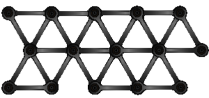

링크들이 함께 작동하여 구조를 단단하게 만든다.

이를 다음과 같은 구조와 비교해 보자.

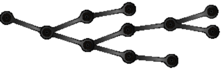

여기에는 구조적 경직성이 없다. 개별 링크가 변하면 다른 링크들은 그저 거기에 맞출 뿐이다.

다리를 설계할 때는 모양을 유지하기를 원하므로 단단해야 한다. 하지만 변경하고 싶은 소프트웨어를 설계할 때는 정반대를 원한다. 즉, 유연하기를 원한다. 그리고 유연해지려면 개별 구성 요소가 가능한 한 적은 수의 다른 구성 요소와 결합되어야 한다.

게다가 설상가상으로 결합도는 전이된다. 만약 A가 B와 C에 결합되어 있고, B가 M과 N에, C가 X와 Y에 결합되어 있다면, A는 사실상 B, C, M, N, X, Y 모두에 결합된 것이다.

이는 여러분이 따라야 할 단순한 원칙이 있음을 의미한다.

::: {.callout-tip appearance="simple" icon=false}
**팁 44: 결합도가 낮은 코드는 변경하기 쉽다**
:::

우리가 보통 철골과 리벳을 사용해 코딩하지 않는다는 점을 감안할 때, 코드의 결합도를 낮춘다는 것은 정확히 무엇을 의미할까? 이 절에서는 다음 내용을 다룰 것이다.

- 열차 사고(Train wrecks)—메서드 호출의 연쇄
- 전역화(Globalization)—정적(static)인 것들의 위험성
- 상속(Inheritance)—서브클래싱이 위험한 이유

어느 정도 이 목록은 인위적이다. 두 코드 조각이 무언가를 공유할 때마다 결합이 발생할 수 있으므로, 이어지는 내용을 읽으면서 여러분의 코드에 적용할 수 있는 근본적인 패턴을 주시하기 바란다. 그리고 결합의 징후들도 살펴보라.

- 관련 없는 모듈이나 라이브러리 간의 기이한 의존성
- 한 모듈에 대한 "단순한" 변경이 관련 없는 모듈로 전파되거나 시스템의 다른 곳을 망가뜨리는 현상
- 무엇이 영향을 받을지 확신할 수 없어 코드 변경을 두려워하는 개발자들
- 변경의 영향을 누가 받을지 아무도 확신하지 못해 모두가 참석해야 하는 회의

### 열차 사고

우리 모두 이런 코드를 본 적이 있고(아마 작성해 본 적도 있을 것이다):

```
public void applyDiscount(customer, order_id, discount) {
  totals = customer
           .orders
           .find(order_id)
           .getTotals();
  totals.grandTotal = totals.grandTotal - discount;
  totals.discount   = discount;
}
```

우리는 고객(customer) 객체에서 주문 목록(orders)에 대한 참조를 얻고, 그것을 사용해 특정 주문을 찾은 다음, 그 주문의 합계(totals) 집합을 가져온다. 그리고 그 합계를 사용해 주문 총액(grandTotal)에서 할인을 빼고, 할인액(discount)도 함께 업데이트한다.

이 코드 덩어리는 고객에서 총액까지 다섯 단계의 추상화를 가로지르고 있다. 결국 우리의 최상위 코드는 고객 객체가 `orders`를 노출한다는 것, `orders`에는 주문 ID를 받아 주문을 반환하는 `find` 메서드가 있다는 것, 그리고 주문 객체에는 총액과 할인에 대한 게터(getter)와 세터(setter)를 가진 `totals` 객체가 있다는 것을 모두 알아야 한다. 이는 엄청난 양의 암묵적 지식이다. 하지만 더 나쁜 것은, 이 코드가 계속 작동하려면 *미래에도 변해서는 안 되는 것들*이 너무 많다는 점이다. 기차의 모든 객차가 서로 연결되어 있듯이, 열차 사고(train wreck) 같은 코드의 모든 메서드와 속성도 서로 결합되어 있다.

비즈니스에서 어떤 주문도 40%를 초과하는 할인을 받을 수 없다고 결정했다고 상상해 보자. 이 규칙을 강제하는 코드는 어디에 두어야 할까?

방금 작성한 `applyDiscount` 함수에 두어야 한다고 말할 수도 있다. 물론 그것도 답의 일부다. 하지만 지금과 같은 코드에서는 그것이 *전체* 답이라고 확신할 수 없다. 어디에 있는 어떤 코드든 `totals` 객체의 필드를 설정할 수 있고, 만약 그 코드의 유지보수자가 변경 사항을 전달받지 못했다면 새로운 정책을 확인하지 않을 것이다.

이를 바라보는 한 가지 방법은 책임(responsibilities)에 대해 생각하는 것이다. 분명 `totals` 객체가 합계를 관리할 책임을 져야 한다. 하지만 그렇지 않다. 현재 그것은 누구나 조회하고 업데이트할 수 있는 필드 묶음의 컨테이너일 뿐이다.

이에 대한 해결책은 우리가 부르는 다음 원칙을 적용하는 것이다.

::: {.callout-tip appearance="simple" icon=false}
**팁 45: 묻지 말고 시켜라(Tell, Don't Ask)**
:::

이 원칙은 객체의 내부 상태를 기반으로 결정을 내린 다음 그 객체를 업데이트해서는 안 된다고 말한다. 그렇게 하면 캡슐화의 이점이 완전히 파괴되고, 그 결과 구현에 대한 지식이 코드 전체에 퍼지게 된다. 따라서 우리의 열차 사고에 대한 첫 번째 해결책은 할인 적용을 `totals` 객체에 위임하는 것이다.

```
public void applyDiscount(customer, order_id, discount) {
  customer
    .orders
    .find(order_id)
    .getTotals()
    .applyDiscount(discount);
}
```

고객 객체와 그 주문 목록 사이에도 똑같은 *묻지 말고 시켜라(TDA)* 문제가 있다. 주문 목록을 가져와서 우리가 직접 검색해서는 안 된다. 대신 고객 객체에게서 원하는 주문을 직접 얻어야 한다.

```
public void applyDiscount(customer, order_id, discount) {
  customer
    .findOrder(order_id)
    .getTotals()
    .applyDiscount(discount);
}
```

주문 객체와 그 합계에도 같은 원리가 적용된다. 외부 세계가 주문의 구현에서 합계를 저장하기 위해 별도의 객체를 사용한다는 사실을 왜 알아야 하는가?

```
public void applyDiscount(customer, order_id, discount) {
  customer
    .findOrder(order_id)
    .applyDiscount(discount);
}
```

아마 우리는 이 지점에서 멈출 것이다.

이 시점에서 여러분은 TDA 원칙대로라면 고객에게 `applyDiscountToOrder(order_id)` 메서드를 추가해야 하지 않느냐고 생각할지도 모른다. 물론 맹목적으로 따른다면 그럴 것이다.

하지만 TDA는 자연의 법칙이 아니다. 그저 문제를 인식하는 데 도움을 주는 패턴일 뿐이다. 이 경우 우리는 고객이 주문을 가지고 있다는 사실과, 고객 객체에 요청하여 그 주문 중 하나를 찾을 수 있다는 사실을 노출하는 것에 대해 불편함이 없다. 이는 실용적인 결정이다.

모든 애플리케이션에는 보편적인 최상위 개념들이 있다. 이 애플리케이션에서 그러한 개념에는 *고객(customers)*과 *주문(orders)*이 포함된다. 주문을 고객 객체 내부에 완전히 숨기는 것은 말이 되지 않는다. 주문은 그 자체로 독립적인 존재이기 때문이다. 따라서 주문 객체를 노출하는 API를 만드는 데 아무런 문제가 없다.

#### 데메테르의 법칙

사람들은 결합도와 관련하여 종종 *데메테르의 법칙(Law of Demeter, LoD)*이라는 것에 대해 이야기한다. LoD는 1980년대 후반 이안 홀랜드(Ian Holland)가 작성한 일련의 지침^[37]^이다. 그는 데메테르 프로젝트의 개발자들이 함수를 더 깔끔하고 결합도가 낮게 유지할 수 있도록 돕기 위해 이 지침을 만들었다.

LoD에 따르면 클래스 *C*에 정의된 메서드는 다음만 호출해야 한다.

- C의 다른 인스턴스 메서드
- 자신의 매개변수
- 스택이나 힙에 자신이 생성한 객체의 메서드
- 전역 변수

이 책의 초판에서 우리는 LoD를 설명하는 데 상당한 시간을 할애했다. 그 후 20년이 지나면서 그 장미의 꽃잎은 다소 시들었다. 우리는 이제 "전역 변수" 조항을 좋아하지 않는다(그 이유는 다음 절에서 설명할 것이다). 또한 이것을 실제로 적용하기 어렵다는 것도 알게 되었다. 메서드를 호출할 때마다 법률 문서를 파싱해야 하는 것과 비슷하기 때문이다.

하지만 그 원칙 자체는 여전히 건전하다. 우리는 단지 거의 같은 내용을 표현하는 다소 더 간단한 방법을 권장할 뿐이다.

::: {.callout-tip appearance="simple" icon=false}
**팁 46: 메서드 호출을 연쇄적으로 하지 마라**
:::

무언가에 접근할 때 "."을 하나 이상 사용하지 않도록 노력하라. 그리고 *무언가에 접근한다*는 것은 다음 코드처럼 중간 변수를 사용하는 경우도 포함한다.

```
# 이것은 꽤 나쁜 스타일이다
amount = customer.orders.last().totals().amount;

# 이것도 마찬가지다…
orders = customer.orders;
last   = orders.last();
totals = last.totals();
amount = totals.amount;
```

점 하나 규칙(one-dot rule)에는 큰 예외가 있다. 연쇄적으로 호출하는 대상들이 정말로, 정말로 변할 가능성이 없다면 이 규칙은 적용되지 않는다. 실제로 여러분의 애플리케이션에 있는 모든 것은 변할 가능성이 있다고 간주해야 한다. 서드파티 라이브러리에 있는 모든 것도, 특히 해당 라이브러리 유지보수자들이 릴리스 사이에 API를 자주 변경하는 것으로 알려져 있다면 변동성이 있다고 간주해야 한다. 하지만 언어와 함께 제공되는 라이브러리는 아마도 꽤 안정적일 것이므로, 다음과 같은 코드는 기꺼이 허용할 수 있다.

```
people
.sort_by {|person| person.age }
.first(10)
.map {| person | person.name }
```

이 루비(Ruby) 코드는 우리가 20년 전 초판을 썼을 때도 작동했고, 우리가 늙은 프로그래머들을 위한 양로원에 들어갈 때도(머지않아…) 여전히 작동할 것이다.

#### 체인과 파이프라인

주제 30 *변환 프로그래밍*에서 우리는 함수들을 파이프라인으로 조합하는 것에 대해 이야기한다. 이러한 파이프라인은 데이터를 변환하여 한 함수에서 다음 함수로 전달한다. 이는 숨겨진 구현 세부 사항에 의존하지 않기 때문에 메서드 호출의 열차 사고와는 다르다.

그렇다고 파이프라인이 결합을 전혀 도입하지 않는다는 것은 아니다. 결합이 발생하기는 한다. 파이프라인의 한 함수가 반환하는 데이터 형식은 다음 함수가 받아들이는 형식과 호환되어야 한다.

우리의 경험에 따르면 이러한 형태의 결합은 열차 사고로 인해 발생하는 결합보다 코드를 변경하는 데 훨씬 적은 장벽이 된다.

### 전역화의 해악

전역적으로 접근 가능한 데이터는 애플리케이션 구성 요소 간의 교묘한 결합 원천이다. 각각의 전역 데이터는 마치 애플리케이션의 모든 메서드에 갑자기 추가 매개변수가 하나 더 생긴 것처럼 작동한다. 결국 그 전역 데이터는 *모든* 메서드 내부에서 사용할 수 있기 때문이다.

전역 데이터는 여러 가지 이유로 코드를 결합시킨다. 가장 명백한 것은 전역 데이터의 구현을 변경하면 잠재적으로 시스템의 모든 코드에 영향을 미친다는 것이다. 물론 실제로는 영향이 꽤 제한적이지만, 진짜 문제는 변경해야 할 모든 곳을 다 찾았는지 알기 어렵다는 데 있다.

전역 데이터는 코드를 떼어낼 때도 결합을 일으킨다.

코드 재사용의 이점에 대해서는 많은 이야기가 있었다. 우리의 경험에 따르면 재사용이 코드를 작성할 때의 주된 관심사가 되어서는 안 되지만, 코드를 재사용 가능하게 만드는 사고방식은 코딩 루틴의 일부가 되어야 한다. 코드를 재사용 가능하게 만들 때 깔끔한 인터페이스를 부여하여 나머지 코드로부터 분리하게 된다. 이를 통해 다른 모든 것을 끌고 오지 않고도 메서드나 모듈을 추출할 수 있다. 만약 코드가 전역 데이터를 사용한다면, 나머지 부분에서 그것을 분리해 내기가 어려워진다.

전역 데이터를 사용하는 코드에 대해 단위 테스트를 작성할 때 이 문제를 겪게 될 것이다. 그저 테스트를 실행하기 위해서 전역 환경을 구축하는 설정 코드를 잔뜩 작성하고 있는 자신을 발견하게 될 것이다.

::: {.callout-tip appearance="simple" icon=false}
**팁 47: 전역 데이터를 피하라**
:::

#### 전역 데이터에는 싱글턴도 포함된다

앞선 절에서 우리는 *전역 변수*가 아니라 *전역 데이터*라고 조심스럽게 말했다. 사람들이 종종 "보세요! 전역 변수가 없어요. 싱글턴 객체나 전역 모듈 안에 인스턴스 데이터로 다 감쌌거든요"라고 말하기 때문이다.

다시 생각해 보라. 공개된 인스턴스 변수들이 잔뜩 들어있는 싱글턴만 있다면, 그것은 여전히 그냥 전역 데이터일 뿐이다. 이름만 더 길어졌을 뿐이다.

그래서 사람들은 이 싱글턴을 가져다가 모든 데이터를 메서드 뒤에 숨긴다. `Config.log_level`이라고 코딩하는 대신 이제 `Config.log_level()`이나 `Config.getLogLevel()`이라고 한다. 이것은 더 나은데, 전역 데이터 뒤에 약간의 지능이 생겼기 때문이다. 로그 레벨의 표현 방식을 변경하기로 결정하더라도 Config API에서 새 방식과 옛 방식을 매핑하여 호환성을 유지할 수 있다. 하지만 여전히 단 하나의 설정 데이터 집합만 가지고 있을 뿐이다.

#### 전역 데이터에는 외부 리소스도 포함된다

변경 가능한 모든 외부 리소스는 전역 데이터다. 애플리케이션이 데이터베이스, 데이터스토어, 파일 시스템, 서비스 API 등을 사용한다면 전역화의 함정에 빠질 위험이 있다. 역시 해결책은 항상 여러분이 제어하는 코드 뒤에 이러한 리소스를 감싸는 것이다.

::: {.callout-tip appearance="simple" icon=false}
**팁 48: 전역으로 둘 만큼 중요하다면 API로 감싸라**
:::

### 상속은 결합을 더한다

한 클래스가 다른 클래스로부터 상태와 동작을 상속받는 서브클래싱의 오용은 매우 중요하므로, 별도의 절인 주제 31 *상속세*에서 자세히 다룬다.

### 다시 말하지만, 모든 것은 변화에 관한 것이다

결합된 코드는 변경하기 어렵다. 한 곳을 수정하면 코드의 다른 곳에서 부차적인 효과가 발생할 수 있으며, 종종 프로덕션 환경에서 한 달 뒤에야 드러나는 찾기 어려운 곳에서 문제가 생긴다.

코드를 부끄럼쟁이(shy)로 유지하는 것, 즉 직접 아는 것만 다루도록 하는 것은 애플리케이션의 결합도를 낮추는 데 도움이 되며, 이는 애플리케이션을 변화에 더 잘 적응하게 만들어 준다.

### 관련 절

- 주제 8, *좋은 설계의 본질*
- 주제 9, *DRY—중복의 해악*
- 주제 10, *직교성*
- 주제 11, *되돌릴 수 있음*
- 주제 29, *현실 세계 저글링하기*
- 주제 30, *변환 프로그래밍*
- 주제 31, *상속세*
- 주제 32, *설정*
- 주제 33, *시간적 결합 깨기*
- 주제 34, *공유 상태는 잘못된 상태다*
- 주제 35, *액터와 프로세스*
- 주제 36, *블랙보드*
- 우리는 2003년 Software Construction 기고문 *버그 심기의 기술(The Art of Enbugging)*에서 *묻지 말고 시켜라*를 논의했다. ^[38]^

## 주제 29: 현실 세계 저글링하기

> *일은 그저 일어나는 것이 아니라, 일어나도록 만들어지는 것이다.*
>
> — 존 F. 케네디(John F. Kennedy)

옛날, 저자들이 아직 소년 같은 훈훈한 외모를 가지고 있었을 시절에는 컴퓨터가 그리 유연하지 않았다. 우리는 보통 컴퓨터의 한계에 맞춰 컴퓨터와 상호작용하는 방식을 구성하곤 했다.

오늘날 우리는 더 많은 것을 기대한다. 컴퓨터가 *우리의* 세상에 통합되어야지, 그 반대가 되어서는 안 된다. 그리고 우리의 세상은 어수선하다. 끊임없이 무언가가 일어나고, 물건이 이리저리 옮겨지고, 우리는 마음을 바꾼다…. 그리고 우리가 작성하는 애플리케이션은 어떻게든 무엇을 해야 할지 알아내야 한다.

이 절은 바로 이런 반응형(responsive) 애플리케이션을 작성하는 것에 관한 것이다.

*이벤트(event)*라는 개념부터 시작해 보자.

### 이벤트

*이벤트*는 정보의 가용성을 나타낸다. 외부 세계에서 올 수도 있다. 사용자가 버튼을 클릭하거나 주가 시세가 업데이트되는 것 등이다. 내부적일 수도 있다. 계산 결과가 준비되었거나 검색이 끝나는 것 등이다. 심지어 리스트에서 다음 요소를 가져오는 것만큼 사소한 것일 수도 있다.

출처가 무엇이든, 이벤트에 반응하고 그 이벤트에 따라 동작을 조정하는 애플리케이션을 작성하면, 그 애플리케이션은 현실 세계에서 더 잘 작동할 것이다. 사용자들은 애플리케이션이 더 상호작용적이라고 느낄 것이고, 애플리케이션 자체도 리소스를 더 잘 활용할 것이다.

하지만 이런 종류의 애플리케이션을 어떻게 작성할 수 있을까? 어떤 전략이 없다면 금방 혼란에 빠지고, 애플리케이션은 강하게 결합된 코드 덩어리가 될 것이다.

도움이 되는 네 가지 전략을 살펴보자.

1. 유한 상태 머신(Finite State Machines)
2. 옵저버 패턴(The Observer Pattern)
3. 발행/구독(Publish/Subscribe)
4. 반응형 프로그래밍과 스트림(Reactive Programming and Streams)

### 유한 상태 머신

데이브(Dave)는 거의 매주 유한 상태 머신(FSM)을 사용하여 코드를 작성한다고 한다. 아주 자주 FSM 구현은 단 몇 줄의 코드에 불과하지만, 그 몇 줄이 엄청난 혼란을 푸는 데 큰 도움이 된다.

FSM을 사용하는 것은 사소할 정도로 쉽지만, 많은 개발자가 이를 피한다. FSM이 어렵다거나, 하드웨어 작업을 할 때만 적용된다거나, 이해하기 어려운 라이브러리를 사용해야 한다는 믿음이 있는 것 같다. 이 중 어느 것도 사실이 아니다.

#### 실용적인 FSM의 해부

상태 머신은 기본적으로 이벤트를 처리하는 방법에 대한 명세일 뿐이다. 이는 상태들의 집합으로 구성되며, 그중 하나가 *현재 상태*다. 각 상태에 대해 해당 상태에 중요한 이벤트들을 나열한다. 그리고 각각의 이벤트에 대해 시스템의 새로운 현재 상태를 정의한다.

예를 들어, 웹소켓으로부터 멀티파트 메시지를 수신하고 있다고 하자. 첫 번째 메시지는 헤더(header)다. 그 뒤로 임의의 개수의 데이터(data) 메시지가 따르고, 마지막으로 트레일러(trailer) 메시지가 온다. 이는 다음과 같은 FSM으로 표현할 수 있다.

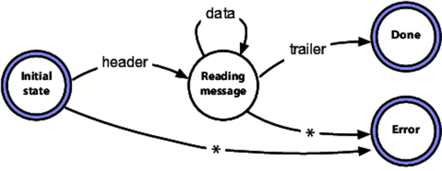

우리는 "초기 상태(Initial state)"에서 시작한다. 헤더 메시지를 받으면 "메시지 읽기(Reading message)" 상태로 *전이(transition)*한다. 초기 상태에 있는 동안 다른 어떤 것을 받으면(별표로 표시된 선) "오류(Error)" 상태로 전이하고 끝난다.

"메시지 읽기" 상태에 있는 동안에는 데이터 메시지를 받아 같은 상태에서 계속 읽기를 진행하거나, 트레일러 메시지를 받아 "완료(Done)" 상태로 전이할 수 있다. 그 외의 다른 모든 것은 오류 상태로의 전이를 유발한다.

FSM의 멋진 점은 이를 순수한 데이터로 표현할 수 있다는 것이다. 다음은 우리의 메시지 파서를 나타내는 표다.

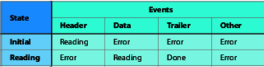

표의 행은 상태를 나타낸다. 이벤트가 발생했을 때 무엇을 해야 하는지 찾으려면, 현재 상태에 해당하는 행을 찾고 이벤트를 나타내는 열을 따라 훑어보면 된다. 그 셀의 내용이 바로 새로운 상태다.

이를 처리하는 코드도 똑같이 단순하다.

*다운로드: [event/simple_fsm.rb](http://media.pragprog.com/titles/tpp20/code/event/simple_fsm.rb)*

```
TRANSITIONS = {
  initial: {header: :reading},
  reading: {data: :reading, trailer: :done},
}

state = :initial

while state != :done && state != :error
  msg = get_next_message()
  state = TRANSITIONS[state][msg.msg_type] || :error
end
```

상태 간의 전이를 구현하는 코드는 10번째 줄에 있다. 현재 상태를 사용해 전이 테이블을 인덱싱한 다음, 메시지 타입을 사용해 해당 상태의 전이들을 인덱싱한다. 일치하는 새 상태가 없으면 상태를 `:error`로 설정한다.

#### 액션 추가하기

방금 살펴본 것과 같은 순수한 FSM은 이벤트 스트림 파서다. 유일한 출력은 최종 상태다. 특정 전이 시 트리거되는 액션(action)을 추가하여 이를 강화할 수 있다.

예를 들어, 소스 파일에서 모든 문자열을 추출해야 할 수도 있다. 문자열은 따옴표 사이의 텍스트이지만, 문자열 안의 백슬래시는 다음 문자를 이스케이프하므로 `"Ignore \"quotes\""`는 하나의 문자열이다. 다음은 이 작업을 수행하는 FSM이다.


이번에는 각 전이에 두 개의 레이블이 있다. 위쪽은 전이를 트리거하는 이벤트이고, 아래쪽은 상태 간 이동 시 취해야 할 액션이다.

지난번처럼 이를 표로 표현해 보자. 하지만 이번에는 표의 각 항목이 다음 상태와 액션 이름을 포함하는 2요소 리스트다.

*다운로드: [event/strings_fsm.rb](http://media.pragprog.com/titles/tpp20/code/event/strings_fsm.rb)*

```
TRANSITIONS = {

  # current        new state        action to take
  #---------------------------------------------------------

  look_for_string: {
    '"'      => [ :in_string,       :start_new_string ],
    :default => [ :look_for_string, :ignore ],
  },

  in_string: {
    '"'      => [ :look_for_string, :finish_current_string ],
    '\\'     => [ :copy_next_char,  :add_current_to_string ],
    :default => [ :in_string,       :add_current_to_string ],
  },

  copy_next_char: {
    :default => [ :in_string,       :add_current_to_string ],
  },
}
```

이벤트가 해당 상태의 다른 전이와 일치하지 않을 때 취해지는 기본(default) 전이를 지정하는 기능도 추가했다.

이제 코드를 살펴보자.

*다운로드: [event/strings_fsm.rb](http://media.pragprog.com/titles/tpp20/code/event/strings_fsm.rb)*

```
state = :look_for_string
result = []

while ch = STDIN.getc
  state, action = TRANSITIONS[state][ch] || TRANSITIONS[state][:default]
  case action
  when :ignore
  when :start_new_string
    result = []
  when :add_current_to_string
    result << ch
  when :finish_current_string
    puts result.join
  end
end
```

이 코드는 이벤트(입력의 문자들)를 순회하며 전이를 트리거한다는 점에서 앞선 예제와 비슷하다. 하지만 이전 코드보다 더 많은 일을 한다. 각 전이의 결과는 새로운 상태와 액션의 이름 모두다. 루프를 다시 돌기 전에 실행할 코드를 선택하기 위해 액션 이름을 사용한다.

이 코드는 매우 기본적이지만 제 역할을 톡톡히 해낸다. 다른 변형도 많다. 전이 테이블에서 액션을 위해 익명 함수나 함수 포인터를 사용할 수도 있고, 상태 머신을 구현하는 코드를 자체 상태를 가진 별도의 클래스로 감쌀 수도 있다.

모든 상태 전이를 동시에 처리해야 한다는 법은 없다. 앱에서 사용자가 가입하는 단계를 거치고 있다면, 세부 정보를 입력하고, 이메일을 인증하고, 요즘 온라인 앱들이 반드시 제공해야 하는 107가지의 법적 경고에 동의하는 등 여러 전이가 있을 것이다. 상태를 외부 저장소에 보관하고 이를 사용해 상태 머신을 구동하는 것은 이러한 종류의 워크플로 요구 사항을 처리하는 훌륭한 방법이다.

#### 상태 머신은 시작일 뿐이다

상태 머신은 개발자들에 의해 충분히 활용되지 못하고 있으며, 우리는 여러분이 이를 적용할 기회를 찾아보기를 권장한다. 하지만 상태 머신이 이벤트와 관련된 모든 문제를 해결해 주지는 않는다. 그러므로 이벤트 저글링 문제를 바라보는 다른 방법들로 넘어가 보자.

### 옵저버 패턴

*옵저버 패턴(observer pattern)*에는 *옵저버블(observable)*이라고 불리는 이벤트 소스와, 그 이벤트에 관심이 있는 *옵저버(observers)*라는 클라이언트 목록이 있다.

옵저버는 일반적으로 호출될 함수에 대한 참조를 전달함으로써 옵저버블에 자신의 관심을 등록한다. 그 후 이벤트가 발생하면 옵저버블은 옵저버 목록을 순회하며 각각이 전달한 함수를 호출한다. 이벤트는 그 호출의 매개변수로 주어진다.

다음은 루비로 작성한 간단한 예제다. `Terminator` 모듈은 애플리케이션을 종료하는 데 사용된다. 하지만 종료하기 전에 모든 옵저버에게 애플리케이션이 종료될 것임을 알린다.^[39]^ 옵저버들은 이 알림을 사용해 임시 리소스를 정리하거나 데이터를 커밋하는 등의 작업을 할 수 있다.

*다운로드: [event/observer.rb](http://media.pragprog.com/titles/tpp20/code/event/observer.rb)*

```
module Terminator
  CALLBACKS = []

  def self.register(callback)
    CALLBACKS << callback
  end

  def self.exit(exit_status)
    CALLBACKS.each { |callback| callback.(exit_status) }
    exit!(exit_status)
  end
end

Terminator.register(-> (status) { puts "callback 1 sees #{status}" })
Terminator.register(-> (status) { puts "callback 2 sees #{status}" })

Terminator.exit(99)
```

```
$ ruby event/observer.rb
callback 1 sees 99
callback 2 sees 99
```

옵저버블을 만드는 데 많은 코드가 필요하지 않다. 함수 참조를 리스트에 넣고, 이벤트가 발생할 때 그 함수들을 호출하면 된다. 이는 라이브러리를 *사용하지 말아야 할* 좋은 예다.

옵저버/옵저버블 패턴은 수십 년 동안 사용되어 왔으며 우리에게 큰 도움이 되었다. 특히 콜백을 사용해 어떤 상호작용이 발생했음을 애플리케이션에 알리는 사용자 인터페이스 시스템에서 널리 쓰인다.

하지만 옵저버 패턴에는 문제가 있다. 각 옵저버가 옵저버블에 등록해야 하므로 결합이 발생한다. 게다가 전형적인 구현에서는 콜백이 옵저버블에 의해 인라인으로, 동기적으로 처리되기 때문에 성능 병목을 유발할 수 있다.

이 문제는 다음 전략인 발행/구독(Publish/Subscribe)으로 해결된다.

### 발행/구독

발행/구독(pubsub)은 옵저버 패턴을 일반화하는 동시에 결합과 성능 문제를 해결한다.

pubsub 모델에는 *발행자(publishers)*와 *구독자(subscribers)*가 있다. 이들은 채널을 통해 연결된다. 채널은 별도의 코드 본체로 구현된다. 때로는 라이브러리로, 때로는 프로세스로, 때로는 분산 인프라로 구현된다. 이러한 모든 구현 세부 사항은 여러분의 코드로부터 숨겨진다.

모든 채널에는 이름이 있다. 구독자는 이름이 지정된 채널 중 하나 이상에 관심을 등록하고, 발행자는 그 채널에 이벤트를 쓴다. 옵저버 패턴과 달리 발행자와 구독자 간의 통신은 여러분의 코드 외부에서 처리되며, 잠재적으로 비동기적이다.

매우 기본적인 pubsub 시스템을 직접 구현할 수도 있지만, 아마 그러고 싶지는 않을 것이다. 대부분의 클라우드 서비스 제공업체는 전 세계의 애플리케이션을 연결할 수 있는 pubsub 서비스를 제공한다. 모든 인기 있는 언어에는 최소한 하나 이상의 pubsub 라이브러리가 있을 것이다.

pubsub는 비동기 이벤트 처리를 분리하는 데 좋은 기술이다. 이를 통해 기존 코드를 변경하지 않고도 잠재적으로 애플리케이션이 실행되는 동안 코드를 추가하고 교체할 수 있다. 단점은 pubsub를 과도하게 사용하는 시스템에서는 무슨 일이 일어나고 있는지 파악하기 어려울 수 있다는 것이다. 발행자만 보고서는 특정 메시지에 어떤 구독자들이 관여하는지 즉시 알 수 없다.

옵저버 패턴과 비교할 때, pubsub는 공유 인터페이스(채널)를 통해 추상화함으로써 결합도를 낮추는 훌륭한 예다. 하지만 여전히 기본적으로는 단순한 메시지 전달 시스템일 뿐이다. 이벤트의 조합에 반응하는 시스템을 만들려면 이보다 더 많은 것이 필요하므로, 이벤트 처리에 시간 차원을 추가할 수 있는 방법을 살펴보자.

### 반응형 프로그래밍, 스트림, 그리고 이벤트

스프레드시트를 사용해 본 적이 있다면 *반응형 프로그래밍(reactive programming)*에 익숙할 것이다. 어떤 셀에 두 번째 셀을 참조하는 수식이 들어 있다면, 두 번째 셀을 업데이트할 때 첫 번째 셀도 함께 업데이트된다. 값들은 자신이 사용하는 값이 변함에 따라 *반응(react)*한다.

이러한 종류의 데이터 수준 반응성을 도울 수 있는 프레임워크는 많다. 브라우저 영역에서는 React와 Vue.js가 현재 인기다(하지만 자바스크립트 생태계 특성상 이 정보는 이 책이 인쇄되기도 전에 구식이 될 것이다).

이벤트 역시 코드에서 반응을 트리거하는 데 사용될 수 있다는 것은 분명하지만, 이를 연결하는 것이 반드시 쉽지는 않다. 바로 거기서 *스트림(streams)*이 등장한다.

스트림을 사용하면 이벤트를 마치 데이터 컬렉션인 것처럼 다룰 수 있다. 마치 새로운 이벤트가 도착할 때마다 길어지는 이벤트 리스트를 가진 것과 같다. 이것의 장점은 스트림을 다른 모든 컬렉션과 똑같이 다룰 수 있다는 것이다. 조작하고, 결합하고, 필터링하는 등 우리가 잘 아는 모든 데이터 관련 작업을 할 수 있다. 심지어 이벤트 스트림과 일반 컬렉션을 결합할 수도 있다. 그리고 스트림은 비동기적일 수 있으므로, 코드가 이벤트가 도착하는 대로 응답할 수 있는 기회를 얻는다.

반응형 이벤트 처리의 현재 *사실상(de facto)* 표준은 웹사이트 [http://reactivex.io](http://reactivex.io)에 정의되어 있으며, 여기서는 언어에 구애받지 않는 원칙 집합을 정의하고 몇 가지 일반적인 구현을 문서화하고 있다. 여기서는 자바스크립트용 RxJs 라이브러리를 사용할 것이다.

첫 번째 예제는 두 스트림을 가져와 하나로 묶는다(zip). 결과는 각 요소가 첫 번째 입력 스트림의 항목 하나와 다른 스트림의 항목 하나를 포함하는 새로운 스트림이다. 이 경우 첫 번째 스트림은 단순히 다섯 개의 동물 이름 리스트다. 두 번째 스트림은 더 흥미롭다. 500ms마다 이벤트를 생성하는 인터벌 타이머다. 두 스트림이 하나로 묶여 있기 때문에 양쪽 모두에서 데이터가 사용 가능할 때만 결과가 생성되며, 따라서 결과 스트림은 0.5초마다 하나의 값만 방출한다.

*다운로드: [event/rx0/index.js](http://media.pragprog.com/titles/tpp20/code/event/rx0/index.js)*

```
import * as Observable from 'rxjs'
import { logValues }   from "../rxcommon/logger.js"

let animals  = Observable.of("ant", "bee", "cat", "dog", "elk")
let ticker   = Observable.interval(500)

let combined = Observable.zip(animals, ticker)

combined.subscribe(next => logValues(JSON.stringify(next)))
```

이 코드는 브라우저 창의 리스트에 항목을 추가하는 간단한 로깅 함수^[40]^를 사용한다. 각 항목에는 프로그램이 실행되기 시작한 이후의 밀리초 단위 타임스탬프가 찍힌다. 우리 코드의 출력 결과는 다음과 같다.

![다양한 타임스탬프가 있는 출력이 표시된다. 502밀리초에서의 출력은 ["ant", 0], 1002밀리초에서는 ["bee", 1], 1502밀리초에서는 ["cat", 2], 2002밀리초에서는 ["dog", 3], 2502밀리초에서는 ["elk", 4]다.](images/events_rxjs_0.png)

타임스탬프를 주목하라. 500ms마다 스트림에서 하나의 이벤트를 받고 있다. 각 이벤트에는 일련번호(`interval` 옵저버블에 의해 생성됨)와 리스트의 다음 동물 이름이 들어 있다. 브라우저에서 실시간으로 지켜보면 0.5초마다 로그 줄이 나타난다.

이벤트 스트림은 일반적으로 이벤트가 발생할 때 채워지며, 이는 스트림을 채우는 옵저버블들이 병렬로 실행될 수 있음을 의미한다. 원격 사이트에서 사용자 정보를 가져오는 예제를 보자. 이를 위해 공개 REST 인터페이스를 제공하는 사이트인 [https://reqres.in](https://reqres.in)을 사용할 것이다. 이 사이트 API의 일부로, `users/«id»`에 GET 요청을 수행하여 특정(가짜) 사용자의 데이터를 가져올 수 있다. 우리 코드는 ID가 3, 2, 1인 사용자를 가져온다.

*다운로드: [event/rx1/index.js](http://media.pragprog.com/titles/tpp20/code/event/rx1/index.js)*

```
import * as Observable from 'rxjs'
import { mergeMap }    from 'rxjs/operators'
import { ajax }        from 'rxjs/ajax'
import { logValues }   from "../rxcommon/logger.js"

let users = Observable.of(3, 2, 1)

let result = users.pipe(
  mergeMap((user) => ajax.getJSON(`https://reqres.in/api/users/${user}`))
)

result.subscribe(
  resp => logValues(JSON.stringify(resp.data)),
  err  => console.error(JSON.stringify(err))
)
```

코드의 내부 세부 사항은 그리 중요하지 않다. 흥미로운 것은 다음 스크린샷에 표시된 결과다.

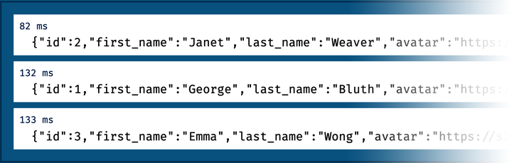

타임스탬프를 보라. 세 개의 요청, 즉 세 개의 별도 스트림이 병렬로 처리되었다. 가장 먼저 돌아온 id 2는 82ms가 걸렸고, 다음 두 개는 각각 50ms와 51ms 뒤에 돌아왔다.

#### 이벤트 스트림은 비동기 컬렉션이다

앞선 예제에서 사용자 ID 리스트(옵저버블 `users`)는 정적이었다. 하지만 꼭 그럴 필요는 없다. 어쩌면 사람들이 우리 사이트에 로그인할 때 이 정보를 수집하고 싶을 수도 있다. 우리가 해야 할 일은 세션이 생성될 때 사용자 ID를 포함하는 옵저버블 이벤트를 생성하고, 정적인 것 대신 그 옵저버블을 사용하는 것뿐이다. 그러면 이 ID들을 받는 대로 사용자에 대한 세부 정보를 가져와서 어딘가에 저장하게 될 것이다.

이것은 매우 강력한 추상화다. 우리는 더 이상 시간을 우리가 관리해야 할 무언가로 생각할 필요가 없다. 이벤트 스트림은 동기 처리와 비동기 처리를 하나의 공통되고 편리한 API 뒤로 통합한다.

### 이벤트는 어디에나 있다

이벤트는 어디에나 있다. 어떤 것들은 명백하다. 버튼 클릭, 타이머 만료 등이다. 다른 것들은 덜 명백하다. 누군가의 로그인, 패턴과 일치하는 파일의 한 줄 등이다. 하지만 출처가 무엇이든, 이벤트를 중심으로 다듬어진 코드는 더 선형적인 대응 코드보다 반응성이 뛰어나고 결합도도 더 낮다.

### 관련 절

- 주제 28, *결합도 줄이기*
- 주제 36, *블랙보드*

### 연습 문제

**연습 문제 19** (가능한 해답)

FSM 절에서 우리는 제네릭 상태 머신 구현을 자체 클래스로 옮길 수 있다고 언급했다. 그 클래스는 아마 전이 테이블과 초기 상태를 전달받아 초기화될 것이다.

문자열 추출기를 그런 방식으로 구현해 보라.

**연습 문제 20** (가능한 해답)

다음 상황에 가장 잘 어울리는 기술(아마도 조합하여)은 무엇일까?

- 5분 이내에 *네트워크 인터페이스 다운* 이벤트를 세 번 받으면 운영 담당자에게 알린다.
- 일몰 후이고, 계단 아래쪽에서 움직임이 감지된 다음 계단 위쪽에서 움직임이 감지되면 위층 조명을 켠다.
- 주문이 완료되었음을 다양한 보고 시스템에 알리고 싶다.
- 고객이 자동차 대출 자격을 갖추었는지 판단하기 위해, 애플리케이션이 세 개의 백엔드 서비스에 요청을 보내고 응답을 기다려야 한다.

## 주제 30: 변환 프로그래밍

> *당신이 하고 있는 일을 프로세스로 설명할 수 없다면, 당신은 자신이 무엇을 하고 있는지 모르는 것이다.*
>
> — W. 에드워즈 데밍(W. Edwards Deming), (전언)

모든 프로그램은 데이터를 변환하여 입력을 출력으로 바꾼다. 그런데도 우리가 설계에 대해 생각할 때 변환을 만드는 것에 대해서는 거의 생각하지 않는다. 대신 클래스와 모듈, 자료구조와 알고리즘, 언어와 프레임워크에 대해 고민한다.

우리는 이처럼 코드에 집중하는 것이 종종 핵심을 놓친다고 생각한다. 우리는 프로그램을 입력을 출력으로 변환하는 무언가로 생각하는 방식으로 돌아갈 필요가 있다. 그렇게 하면 이전에 걱정하던 많은 세부 사항이 그저 증발해 버린다. 구조는 더 명확해지고, 오류 처리는 더 일관되며, 결합도는 뚝 떨어진다.

탐구를 시작하기 위해 타임머신을 타고 1970년대로 돌아가 유닉스(Unix) 프로그래머에게 디렉터리 트리에서 가장 긴 파일 5개를 나열하는 프로그램을 작성해 달라고 요청해 보자. 여기서 가장 길다는 것은 "줄 수가 가장 많은" 것을 의미한다.

그들이 에디터를 열고 C 언어를 타이핑하기 시작할 거라고 예상할 수도 있다. 하지만 그들은 그러지 않을 것이다. 그들은 우리가 가진 것(디렉터리 트리)과 우리가 원하는 것(파일 목록)의 관점에서 생각하기 때문이다. 그리고 터미널로 가서 다음과 같이 입력할 것이다.

```
$ find . -type f | xargs wc -l | sort -n | tail -5
```

이것은 일련의 변환이다.

**`find . -type f`**

현재 디렉터리(`.`) 또는 그 아래에 있는 모든 파일(`-type f`)의 목록을 표준 출력에 쓴다.

**`xargs wc -l`**

표준 입력에서 줄을 읽어 모든 줄이 `wc -l` 명령의 인수로 전달되도록 한다. `-l` 옵션을 준 `wc` 프로그램은 각 인수의 줄 수를 세어 각 결과를 "줄수 파일명" 형태로 표준 출력에 쓴다.

**`sort -n`**

각 줄이 숫자로 시작한다고 가정하고(`-n`) 표준 입력을 정렬하여 결과를 표준 출력에 쓴다.

**`tail -5`**

표준 입력을 읽어 마지막 다섯 줄만 표준 출력에 쓴다.

우리 책의 디렉터리에서 이것을 실행하면 다음과 같은 결과를 얻는다.

```
 470 ./test_to_build.pml
 487 ./dbc.pml
 719 ./domain_languages.pml
 727 ./dry.pml
9561 total
```

마지막 줄은(보여진 파일들뿐만 아니라) 모든 파일의 총 줄 수인데, `wc`가 원래 그렇게 동작하기 때문이다. `tail`에 한 줄을 더 요청한 다음 마지막 줄을 무시함으로써 이를 제거할 수 있다.

```
$ find . -type f | xargs wc -l | sort -n | tail -6 | head -5
     470 ./debug.pml
     470 ./test_to_build.pml
     487 ./dbc.pml
     719 ./domain_languages.pml
     727 ./dry.pml
```


개별 단계들 사이를 흐르는 데이터의 관점에서 이것을 살펴보자. 우리의 원래 요구 사항인 "줄 수 기준 상위 5개 파일"은 일련의 변환(그림에도 표시됨)이 된다.

디렉터리 이름
→ 파일 목록
→ 줄 번호가 있는 목록
→ 정렬된 목록
→ 가장 큰 5개 + 합계
→ 가장 큰 5개

이는 마치 산업용 조립 라인과 거의 같다. 한쪽 끝에 원자재(raw data)를 넣으면 다른 쪽 끝에서 완제품(정보)이 나온다.

그리고 우리는 모든 코드를 이런 식으로 생각하는 것을 좋아한다.

::: {.callout-tip appearance="simple" icon=false}
**팁 49: 프로그래밍은 코드에 관한 것이지만, 프로그램은 데이터에 관한 것이다**
:::

### 변환 찾기

때로는 변환을 찾는 가장 쉬운 방법은 요구 사항으로 시작하여 그 입력과 출력을 결정하는 것이다. 이제 여러분은 전체 프로그램을 나타내는 함수를 정의한 것이다. 그런 다음 입력에서 출력으로 이어지는 단계들을 찾을 수 있다. 이는 *하향식(top-down)* 접근 방식이다.

예를 들어, 단어 게임을 하는 사람들을 위해 주어진 글자 집합으로 만들 수 있는 모든 단어를 찾아주는 웹사이트를 만들고 싶다고 하자. 여기서 입력은 글자 집합이고, 출력은 세 글자 단어, 네 글자 단어 등의 목록이다.

| "lvyin" | 다음으로 변환됨 → | 3 => ivy, lin, nil, yin 4 => inly, liny, viny 5 => vinyl |
| --- | --- | --- |

(그렇다, 적어도 macOS 사전에 따르면 이것들은 모두 단어다.)

전체 애플리케이션 뒤에 있는 비결은 간단하다. 우리는 단어들을 *시그니처(signature)*별로 그룹화한 사전을 가지고 있는데, 같은 글자를 포함하는 모든 단어가 같은 시그니처를 갖도록 시그니처를 선택한다. 가장 간단한 시그니처 함수는 그저 단어의 글자들을 정렬한 목록이다. 그러면 입력 문자열에 대한 시그니처를 생성한 다음, 사전에서 같은 시그니처를 가진 단어가 무엇인지(있다면) 찾아볼 수 있다.

따라서 *애너그램 찾기(anagram finder)*는 네 개의 별도 변환으로 나뉜다.

| 단계 | 변환 | 샘플 데이터 |
| --- | --- | --- |
| 단계 0: | 초기 입력 | "ylvin" |
| 단계 1: | 세 글자 이상의 모든 조합 | vin, viy, vil, vny, vnl, vyl, iny, inl, iyl, nyl, viny, vinl, viyl, vnyl, inyl, vinyl |
| 단계 2: | 조합들의 시그니처 | inv, ivy, ilv, nvy, lnv, lvy, iny, iln, ily, lny, invy, ilnv, ilvy, lnvy, ilny, ilnvy |
| 단계 3: | 시그니처 중 하나와 일치하는 모든 사전 단어 목록 | ivy, yin, nil, lin, viny, liny, inly, vinyl |
| 단계 4: | 길이별로 그룹화된 단어 | 3 => ivy, lin, nil, yin 4 => inly, liny, viny 5 => vinyl |

#### 끝없이 이어지는 변환

단어를 받아 세 글자 이상의 모든 조합 목록을 만드는 1단계부터 살펴보자. 이 단계 자체도 변환 목록으로 표현할 수 있다.

| 단계 | 변환 | 샘플 데이터 |
| --- | --- | --- |
| 단계 1.0: | 초기 입력 | "vinyl" |
| 단계 1.1: | 문자로 변환 | v, i, n, y, l |
| 단계 1.2: | 모든 부분집합 구하기 | [], [v], [i], … [v,i], [v,n], [v,y], … [v,i,n], [v,i,y], … [v,n,y,l], [i,n,y,l], [v,i,n,y,l] |
| 단계 1.3: | 세 글자 이상인 것만 남기기 | [v,i,n], [v,i,y], … [i,n,y,l], [v,i,n,y,l] |
| 단계 1.4: | 다시 문자열로 변환 | [vin,viy, … inyl,vinyl] |

이제 각 변환을 코드로 쉽게 구현할 수 있는 지점에 도달했다(이 경우 엘릭서(Elixir)를 사용한다).

*다운로드: [function-pipelines/anagrams/lib/anagrams.ex](http://media.pragprog.com/titles/tpp20/code/function-pipelines/anagrams/lib/anagrams.ex)*

```
defp all_subsets_longer_than_three_characters(word) do
  word
  |> String.codepoints()
  |> Comb.subsets()
  |> Stream.filter(fn subset -> length(subset) >= 3 end)
  |> Stream.map(&List.to_string(&1))
end
```

#### |> 연산자는 무엇인가?

엘릭서에는 다른 많은 함수형 언어와 마찬가지로 파이프라인 연산자, 때로는 *포워드 파이프(forward pipe)* 또는 그냥 *파이프(pipe)*라고 불리는 연산자가 있다.^[41]^ 이 연산자가 하는 일은 왼쪽의 값을 가져와 오른쪽 함수의 첫 번째 매개변수로 집어넣는 것뿐이므로,

```
"vinyl" |> String.codepoints |> Comb.subsets()
```

는 다음과 같이 쓰는 것과 같다.

```
Comb.subsets(String.codepoints("vinyl"))
```

(다른 언어들은 이 파이프된 값을 다음 함수의 *마지막* 매개변수로 주입할 수도 있다. 이는 주로 내장 라이브러리의 스타일에 달려 있다.)

이것이 그저 문법적 설탕(syntactic sugar)일 뿐이라고 생각할 수도 있다. 하지만 매우 실질적인 의미에서 파이프라인 연산자는 다르게 생각할 수 있는 혁명적인 기회다. 파이프라인을 사용한다는 것은 자동으로 데이터를 변환하는 관점에서 생각한다는 것을 의미한다. `|>`를 볼 때마다 실제로는 데이터가 한 변환에서 다음 변환으로 흐르는 지점을 보고 있는 것이다.

많은 언어에 비슷한 것이 있다. Elm과 F#에는 `|>`가 있고, Clojure에는 `->`와 `->>`(조금 다르게 작동함)가 있으며, R에는 `%>%`가 있다. Haskell은 파이프 연산자를 가지고 있을 뿐만 아니라 새로운 연산자를 쉽게 선언할 수 있게 해준다. 우리가 이 글을 쓰는 시점에는 자바스크립트에 `|>`를 추가하자는 논의가 있다.

현재 사용하는 언어가 비슷한 것을 지원한다면 운이 좋은 것이다. 지원하지 않는다면 *언어 X에 파이프라인이 없다면*을 보라.

어쨌든, 다시 코드로 돌아가자.

#### 계속 변환하기…

이제 부분집합을 시그니처로 변환하는 주 프로그램의 *2단계*를 보자. 역시 간단한 변환이다. 부분집합 목록이 시그니처 목록이 된다.

| 단계 | 변환 | 샘플 데이터 |
| --- | --- | --- |
| 단계 2.0: | 초기 입력 | vin, viy, … inyl, vinyl |
| 단계 2.1: | 시그니처로 변환 | inv, ivy … ilny, inlvy |

다음 목록에 있는 엘릭서 코드도 똑같이 단순하다.

*다운로드: [function-pipelines/anagrams/lib/anagrams.ex](http://media.pragprog.com/titles/tpp20/code/function-pipelines/anagrams/lib/anagrams.ex)*

```
defp as_unique_signatures(subsets) do
  subsets
  |> Stream.map(&Dictionary.signature_of/1)
end
```

이제 그 시그니처 목록을 변환한다. 각 시그니처는 같은 시그니처를 가진 알려진 단어 목록으로 매핑되거나, 그러한 단어가 없으면 `nil`로 매핑된다. 그런 다음 `nil`들을 제거하고 중첩된 리스트를 단일 레벨로 평탄화(flatten)해야 한다.

*다운로드: [function-pipelines/anagrams/lib/anagrams.ex](http://media.pragprog.com/titles/tpp20/code/function-pipelines/anagrams/lib/anagrams.ex)*

```
defp find_in_dictionary(signatures) do
  signatures
  |> Stream.map(&Dictionary.lookup_by_signature/1)
  |> Stream.reject(&is_nil/1)
  |> Stream.concat(&(&1))
end
```

단어를 길이별로 그룹화하는 4단계는 또 하나의 간단한 변환으로, 리스트를 길이가 키이고 그 길이를 가진 모든 단어가 값인 맵(map)으로 변환한다.

*다운로드: [function-pipelines/anagrams/lib/anagrams.ex](http://media.pragprog.com/titles/tpp20/code/function-pipelines/anagrams/lib/anagrams.ex)*

```
defp group_by_length(words) do
  words
  |> Enum.sort()
  |> Enum.group_by(&String.length/1)
end
```

::: {.callout-note title="언어 X에 파이프라인이 없다면"}
파이프라인은 오랫동안 존재해 왔지만 틈새 언어에만 있었다. 최근에야 주류로 들어왔으며, 여전히 많은 인기 언어가 이 개념을 지원하지 않는다.

좋은 소식은 변환으로 생각하는 것이 특정 언어 문법을 요구하지 않는다는 것이다. 그것은 설계 철학에 가깝다. 여전히 코드를 변환으로 구성하되, 일련의 할당문으로 작성하면 된다.

```
const content = File.read(file_name);
const lines   = find_matching_lines(content, pattern)
const result  = truncate_lines(lines)
```

조금 더 지루하지만, 제 역할을 다한다.
:::

#### 모두 합치기

개별 변환들을 모두 작성했다. 이제 그것들을 모두 엮어 주 함수로 만들 차례다.

*다운로드: [function-pipelines/anagrams/lib/anagrams.ex](http://media.pragprog.com/titles/tpp20/code/function-pipelines/anagrams/lib/anagrams.ex)*

```
  def anagrams_in(word) do
    word
    |> all_subsets_longer_than_three_characters()
    |> as_unique_signatures()
    |> find_in_dictionary()
    |> group_by_length()
end
```

작동할까? 시도해 보자.

```
iex(1)> Anagrams.anagrams_in "lyvin"
%{
  3 => ["ivy", "lin", "nil", "yin"],
  4 => ["inly", "liny", "viny"],
  5 => ["vinyl"]
}
```

### 왜 이것이 그렇게 훌륭한가?

주 함수의 본문을 다시 한 번 살펴보자.

```
word
|> all_subsets_longer_than_three_characters()
|> as_unique_signatures()
|> find_in_dictionary()
|> group_by_length()
```

그것은 단순히 우리의 요구 사항을 충족하는 데 필요한 변환들의 연쇄이며, 각 단계는 이전 변환에서 입력을 받아 출력을 다음 단계로 전달한다. 이보다 더 읽기 쉬운(literate) 코드에 가까워지기는 어렵다.

하지만 더 깊은 무언가도 있다. 여러분의 배경이 객체 지향 프로그래밍이라면, 반사적으로 데이터를 숨기고 객체 내부에 캡슐화하려 할 것이다. 그러면 이 객체들이 서로 수다를 떨며 서로의 상태를 변경한다. 이는 많은 결합을 유발하며, OO 시스템이 변경하기 어려운 큰 이유다.

::: {.callout-tip appearance="simple" icon=false}
**팁 50: 상태를 쌓아두지 말고, 전달하라**
:::

변환 모델에서는 이를 뒤집는다. 시스템 전체에 흩어져 있는 작은 데이터 웅덩이 대신, 데이터를 거대한 강, 즉 *흐름(flow)*으로 생각하라. 데이터는 기능과 대등한 동료가 된다. 파이프라인은 `코드 → 데이터 → 코드 → 데이터…`의 연속이다. 데이터는 더 이상 클래스 정의에서처럼 특정 함수 그룹에 묶여 있지 않다. 대신 입력을 출력으로 변환해 나가는 애플리케이션의 진행 과정을 자유롭게 표현한다. 이는 결합도를 크게 줄일 수 있음을 의미한다. 함수는 그 매개변수가 다른 어떤 함수의 출력과 일치하는 곳이라면 어디서든 사용(및 재사용)될 수 있다.

물론 여전히 어느 정도의 결합도는 존재하지만, 우리의 경험에 따르면 명령과 제어의 OO 스타일보다 훨씬 관리하기 쉽다. 그리고 타입 검사가 있는 언어를 사용한다면, 호환되지 않는 두 가지를 연결하려고 할 때 컴파일 타임 경고를 받게 될 것이다.

### 오류 처리는 어떻게 하는가?

지금까지 우리의 변환은 아무것도 잘못되지 않는 세상에서 작동했다. 그렇다면 현실 세계에서는 어떻게 사용할 수 있을까? 선형 체인만 만들 수 있다면 오류 검사에 필요한 모든 조건부 논리를 어떻게 추가할 수 있을까?

이를 수행하는 방법은 많지만, 모두 기본적인 관례에 의존한다. 우리는 변환 사이에 날것의(raw) 값을 절대 전달하지 않는다. 대신, 포함된 값이 유효한지도 함께 알려주는 데이터 구조(또는 타입)로 값을 감싼다. 예를 들어 Haskell에서는 이 래퍼(wrapper)를 `Maybe`라고 부른다. F#과 Scala에서는 `Option`이다.

이 개념을 어떻게 사용하는지는 언어마다 다르다. 하지만 일반적으로 코드를 작성하는 데는 두 가지 기본적인 방법이 있다. 변환 내부에서 오류 검사를 처리하거나, 변환 외부에서 처리하는 것이다.

지금까지 사용한 엘릭서에는 이러한 지원이 내장되어 있지 않다. 우리의 목적에는 이것이 오히려 좋은데, 바닥부터 직접 구현하는 모습을 보여줄 수 있기 때문이다. 비슷한 방식이 대부분의 다른 언어에서도 작동할 것이다.

#### 먼저 표현 방식을 선택하라

우리의 래퍼(값이나 오류 표시를 실어 나르는 데이터 구조)를 위한 표현 방식이 필요하다. 이를 위해 구조체를 사용할 수도 있지만, 엘릭서에는 이미 꽤 강력한 관례가 있다. 함수들이 `{:ok, value}` 또는 `{:error, reason}` 중 하나를 포함하는 튜플을 반환하는 경향이 있다. 예를 들어 `File.open`은 `:ok`와 IO 프로세스, 또는 `:error`와 이유 코드를 반환한다.

```
iex(1)> File.open("/etc/passwd")
{:ok, #PID<0.109.0>}
iex(2)> File.open("/etc/wombat")
{:error, :enoent}
```

파이프라인을 통해 데이터를 전달할 때 `:ok`/`:error` 튜플을 래퍼로 사용할 것이다.

#### 그런 다음 각 변환 내부에서 처리하라

주어진 문자열을 포함하는 파일의 모든 줄을 찾아 처음 20자로 잘라 반환하는 함수를 작성해 보자. 이를 변환으로 작성하고 싶으므로, 입력은 파일 이름과 일치시킬 문자열이 되고, 출력은 줄 목록이 담긴 `:ok` 튜플이거나 어떤 종류의 이유가 담긴 `:error` 튜플이 될 것이다. 최상위 함수는 다음과 같아야 한다.

*다운로드: [function-pipelines/anagrams/lib/grep.ex](http://media.pragprog.com/titles/tpp20/code/function-pipelines/anagrams/lib/grep.ex)*

```
def find_all(file_name, pattern) do
  File.read(file_name)
  |> find_matching_lines(pattern)
  |> truncate_lines()
end
```

여기에는 명시적인 오류 검사가 없지만, 파이프라인의 어떤 단계에서든 오류 튜플을 반환하면 파이프라인은 뒤따르는 함수들을 실행하지 않고 그 오류를 반환할 것이다.^[42]^ 우리는 엘릭서의 패턴 매칭을 사용하여 이를 수행한다.

*다운로드: [function-pipelines/anagrams/lib/grep.ex](http://media.pragprog.com/titles/tpp20/code/function-pipelines/anagrams/lib/grep.ex)*

```
defp find_matching_lines({:ok, content}, pattern) do
  content
  |> String.split(~r/\n/)
  |> Enum.filter(&String.match?(&1, pattern))
  |> ok_unless_empty()
end

defp find_matching_lines(error, _), do: error

# ----------

defp truncate_lines({ :ok, lines }) do
  lines
  |> Enum.map(&String.slice(&1, 0, 20))
  |> ok()
end

defp truncate_lines(error), do: error

# ----------

defp ok_unless_empty([]),     do: error("nothing found")
defp ok_unless_empty(result), do: ok(result)

defp ok(result),    do: { :ok,    result }
defp error(reason), do: { :error, reason }
```

`find_matching_lines` 함수를 보라. 첫 번째 매개변수가 `:ok` 튜플이면 그 튜플 안의 내용을 사용하여 패턴과 일치하는 줄을 찾는다. 하지만 첫 번째 매개변수가 `:ok` 튜플이 *아니면*, 그 매개변수를 그대로 반환하는 두 번째 버전의 함수가 실행된다. 이런 식으로 함수는 단순히 오류를 파이프라인 아래로 전달한다. `truncate_lines`에도 똑같은 방식이 적용된다.

콘솔에서 이것을 가지고 놀아볼 수 있다.

```
iex> Grep.find_all "/etc/passwd", ~r/www/
{:ok, ["_www:*:70:70:World W", "_wwwproxy:*:252:252:"]}
```

```
iex> Grep.find_all "/etc/passwd", ~r/wombat/
{:error, "nothing found"}
iex> Grep.find_all "/etc/koala", ~r/www/
{:error, :enoent}
```

파이프라인의 어느 곳에서든 발생한 오류가 즉시 파이프라인의 값이 되는 것을 볼 수 있다.

#### 또는 파이프라인에서 처리하라

`find_matching_lines`와 `truncate_lines` 함수를 보면서 우리가 오류 처리의 부담을 변환 내부로 옮겼다고 생각할 수도 있다. 맞는 말이다. 엘릭서처럼 함수 호출에서 패턴 매칭을 사용하는 언어에서는 그 영향이 덜하지만, 여전히 보기 좋지는 않다.

엘릭서에 `:ok`/`:error` 튜플을 알고 있어서 오류가 발생했을 때 실행을 단락(short-circuit)시키는 버전의 파이프라인 연산자 `|>`가 있다면 좋을 것이다.^[43]^ 하지만 그렇지 않다는 사실 덕분에 우리는 다른 여러 언어에도 적용할 수 있는 방식으로 비슷한 것을 추가해 볼 수 있다.

우리가 직면한 문제는 오류가 발생했을 때 파이프라인의 뒤쪽 코드를 실행하고 싶지 않으며, 그 코드가 이런 일이 일어나고 있다는 것을 알지 못하게 하고 싶다는 것이다. 이는 이전 단계가 성공했음을 알 때까지 파이프라인 함수의 실행을 미뤄야 함을 의미한다. 이를 위해 함수 *호출*을 나중에 호출할 수 있는 함수 *값*으로 바꿔야 한다. 다음은 한 가지 구현이다.

*다운로드: [function-pipelines/anagrams/lib/grep1.ex](http://media.pragprog.com/titles/tpp20/code/function-pipelines/anagrams/lib/grep1.ex)*

```
defmodule Grep1 do

  def and_then({ :ok, value }, func), do: func.(value)
  def and_then(anything_else, _func), do: anything_else

  def find_all(file_name, pattern) do
    File.read(file_name)
    |> and_then(&find_matching_lines(&1, pattern))
    |> and_then(&truncate_lines(&1))
  end

  defp find_matching_lines(content, pattern) do
    content
    |> String.split(~r/\n/)
    |> Enum.filter(&String.match?(&1, pattern))
    |> ok_unless_empty()
  end

  defp truncate_lines(lines) do
    lines
    |> Enum.map(&String.slice(&1, 0, 20))
    |> ok()
  end


  defp ok_unless_empty([]),     do: error("nothing found")
  defp ok_unless_empty(result), do: ok(result)

  defp ok(result),    do: { :ok, result }
  defp error(reason), do: { :error, reason }
end
```

`and_then` 함수는 *바인드(bind)* 함수의 예다. 무언가로 감싸진 값을 받아 그 값에 함수를 적용하고 새로운 감싸진 값을 반환한다. 파이프라인에서 `and_then` 함수를 사용하면 엘릭서에게 함수 호출을 함수 값으로 변환하라고 알려주어야 하므로 약간의 추가 문장 부호가 필요하지만, 그 추가 수고는 변환 함수들이 단순해진다는 사실로 상쇄된다. 각 함수는 그저 값(과 추가 매개변수)을 받아 `{:ok, new_value}` 또는 `{:error, reason}`을 반환할 뿐이다.

### 변환은 프로그래밍을 변화시킨다

코드를 일련의 (중첩된) 변환으로 생각하는 것은 프로그래밍에 대한 해방적인 접근 방식이 될 수 있다. 익숙해지는 데 시간이 좀 걸리겠지만, 일단 습관이 들면 코드가 더 깔끔해지고, 함수가 더 짧아지며, 설계가 더 평탄해지는 것을 발견하게 될 것이다.

한번 시도해 보라.

### 관련 절

- 주제 8, *좋은 설계의 본질*
- 주제 17, *셸 게임*
- 주제 26, *리소스 균형을 맞추는 법*
- 주제 28, *결합도 줄이기*
- 주제 35, *액터와 프로세스*

### 연습 문제

**연습 문제 21** (가능한 해답)

다음 요구 사항을 최상위 변환으로 표현할 수 있는가? 즉, 각각에 대해 입력과 출력을 식별하라.

1. 주문에 배송비와 판매세가 추가된다.
2. 애플리케이션이 지정된 파일에서 설정 정보를 로드한다.
3. 누군가 웹 애플리케이션에 로그인한다.

**연습 문제 22** (가능한 해답)

입력 필드를 문자열에서 18에서 150 사이의 정수로 검증하고 변환해야 할 필요성을 확인했다. 전체 변환은 다음과 같이 설명된다.

```
field contents as string
    → [validate & convert]
        → {:ok, value} | {:error, reason}
```

*validate & convert*를 구성하는 개별 변환들을 작성하라.

**연습 문제 23** (가능한 해답)

*언어 X에 파이프라인이 없다면*에서 우리는 다음과 같이 썼다.

```
const content = File.read(file_name);
const lines   = find_matching_lines(content, pattern)
const result  = truncate_lines(lines)
```

많은 사람들이 메서드 호출을 연쇄적으로 연결하여 OO 코드를 작성하며, 이를 다음과 같이 쓰고 싶은 유혹을 느낄 수도 있다.

```
const result = content_of(file_name)
               .find_matching_lines(pattern)
               .truncate_lines()
```

이 두 코드 조각의 차이점은 무엇인가? 우리가 어느 쪽을 더 선호할 것 같은가?

## 주제 31: 상속세

> *당신은 바나나를 원했지만 당신이 얻은 것은 바나나를 들고 있는 고릴라와 정글 전체였다.*
>
> — 조 암스트롱(Joe Armstrong)

객체 지향 언어로 프로그래밍하는가? 상속을 사용하는가?

그렇다면 멈춰라! 그것은 아마도 여러분이 하고 싶은 일이 아닐 것이다.

왜 그런지 살펴보자.

### 약간의 배경

상속은 1969년 시뮬라 67(Simula 67)에서 처음 등장했다. 그것은 같은 리스트에 여러 타입의 이벤트를 큐잉하는 문제에 대한 우아한 해결책이었다. 시뮬라의 접근 방식은 *접두사 클래스(prefix classes)*라는 것을 사용하는 것이었다. 다음과 같이 쓸 수 있었다.

```
link CLASS car;
  ... implementation of car

link CLASS bicycle;
  ... implementation of bicycle
```

`link`는 연결 리스트의 기능을 추가하는 접두사 클래스다. 이를 통해(예를 들어) 신호등에서 기다리는 것들의 리스트에 자동차와 자전거를 모두 추가할 수 있다. 현재 용어로 `link`는 부모 클래스가 될 것이다.

시뮬라 프로그래머들이 사용한 멘탈 모델은 클래스 `link`의 인스턴스 데이터와 구현이 클래스 `car`와 `bicycle`의 구현 앞에 붙는다는 것이었다. `link` 부분은 거의 자동차와 자전거를 실어 나르는 *컨테이너*로 여겨졌다. 이는 그들에게 일종의 다형성(polymorphism)을 제공했다. 자동차와 자전거 모두 `link` 코드를 포함하고 있었기 때문에 둘 다 `link` 인터페이스를 구현한 것이었다.

시뮬라 다음에는 스몰토크(Smalltalk)가 왔다. 스몰토크의 창시자 중 한 명인 앨런 케이(Alan Kay)는 2019년 Quora 답변^[44]^에서 스몰토크에 상속이 있는 *이유*를 다음과 같이 설명한다.

> 그래서 내가 Smalltalk-72를 설계할 때—Smalltalk-71을 생각하면서 재미 삼아 한 일이었는데—Lisp 같은 동적 특성을 이용해 "차분 프로그래밍(differential programming)"("이것은 저것과 같지만 ~만 다르다"를 달성하는 다양한 방법)을 실험해 보면 재미있겠다고 생각했다.

이것은 순수하게 동작(behavior)을 위한 서브클래싱이다.

이 두 가지 상속 스타일(실제로는 공통점이 꽤 많았다)은 그 후 수십 년 동안 발전했다. 상속이 타입을 결합하는 방법이라고 제안한 시뮬라 접근 방식은 C++와 Java 같은 언어에서 계속되었다. 상속이 동작의 동적 구성이었던 스몰토크 학파는 Ruby와 JavaScript 같은 언어에서 볼 수 있었다.

그래서 이제 우리는 두 가지 이유 중 하나로 상속을 사용하는 OO 개발자 세대를 마주하고 있다. 타이핑하기를 싫어하거나, 타입을 좋아하거나.

타이핑하기를 싫어하는 사람들은 기반 클래스의 공통 기능을 자식 클래스에 추가하기 위해 상속을 사용하여 손가락을 아낀다. `User` 클래스와 `Product` 클래스는 모두 `ActiveRecord::Base`의 서브클래스다.

타입을 좋아하는 사람들은 클래스 간의 관계를 표현하기 위해 상속을 사용한다. `Car`는 `Vehicle`의 일종(is-a-kind-of)이다.

불행히도 두 종류의 상속 모두 문제가 있다.

### 코드를 공유하기 위해 상속을 사용할 때의 문제점

상속은 *결합*이다. 자식 클래스가 부모, 부모의 부모 등에 결합될 뿐만 아니라, 자식을 *사용하는* 코드 역시 모든 조상에 결합된다. 다음은 그 예시다.

```
class Vehicle
  def initialize
    @speed = 0
  end
  def stop
    @speed = 0
  end
  def move_at(speed)
    @speed = speed
  end
end

class Car < Vehicle
  def info
    "I'm car driving at #{@speed}"
  end
end

# top-level code
my_ride = Car.new
my_ride.move_at(30)
```

최상위 코드가 `my_car.move_at`을 호출할 때, 호출되는 메서드는 `Car`의 부모인 `Vehicle`에 있다.

이제 `Vehicle`을 담당하는 개발자가 API를 변경하여 `move_at`이 `set_velocity`가 되고, 인스턴스 변수 `@speed`가 `@velocity`가 된다.

API 변경은 `Vehicle` 클래스의 클라이언트를 망가뜨릴 것으로 예상된다. 하지만 최상위 코드는 아니다. 최상위 코드 입장에서는 `Car`를 사용하고 있을 뿐이다. `Car` 클래스가 구현 측면에서 무엇을 하는지는 최상위 코드의 관심사가 아니지만, 그럼에도 불구하고 최상위 코드는 망가진다.

마찬가지로 인스턴스 변수의 이름은 순전히 내부 구현 세부 사항이지만, `Vehicle`이 그것을 변경하면 `Car`도 (조용히) 망가진다.

너무 많은 결합이다.

#### 타입을 만들기 위해 상속을 사용할 때의 문제점

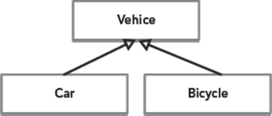

어떤 사람들은 상속을 새로운 타입을 정의하는 방법으로 본다. 그들이 가장 좋아하는 설계 다이어그램은 클래스 계층 구조를 보여준다. 그들은 빅토리아 시대 신사 과학자들이 자연을 바라보던 방식, 즉 범주로 나누어야 할 무언가로 문제를 바라본다.

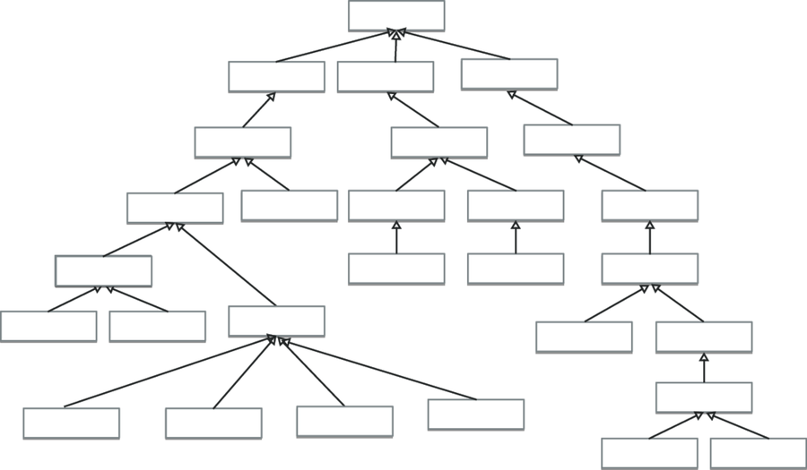

불행히도 이러한 다이어그램은 클래스 간의 가장 작은 차별화 뉘앙스를 표현하기 위해 층위에 층이 더해지면서 금세 벽을 뒤덮는 괴물로 자라난다. 이렇게 추가된 복잡성은 변경 사항이 여러 계층을 오르내리며 파급될 수 있기 때문에 애플리케이션을 더 부서지기 쉽게 만들 수 있다.

하지만 더 나쁜 것은 다중 상속(multiple inheritance) 문제다. `Car`는 `Vehicle`의 일종일 수 있지만, `Asset`(자산), `InsuredItem`(보험 가입 품목), `LoanCollateral`(대출 담보) 등의 일종일 수도 있다. 이를 올바르게 모델링하려면 다중 상속이 필요하다.

C++는 1990년대에 몇 가지 의문스러운 모호성 해소(disambiguation) 시맨틱스 때문에 다중 상속에 나쁜 평판을 안겨주었다. 그 결과, 많은 현대 OO 언어들은 다중 상속을 제공하지 않는다. 따라서 복잡한 타입 트리에 만족하더라도 어차피 도메인을 정확하게 모델링할 수 없을 것이다.

::: {.callout-tip appearance="simple" icon=false}
**팁 51: 상속세를 내지 마라**
:::

### 대안이 더 낫다

다시는 상속을 사용할 필요가 없게 해줄 세 가지 기법을 제안한다.

- 인터페이스와 프로토콜(Interfaces and protocols)
- 위임(Delegation)
- 믹스인과 트레이트(Mixins and traits)

#### 인터페이스와 프로토콜

대부분의 OO 언어는 클래스가 하나 이상의 동작 집합을 구현하도록 지정할 수 있게 해준다. 예를 들어, `Car` 클래스가 `Drivable` 동작과 `Locatable` 동작을 구현한다고 말할 수 있다. 이를 수행하는 데 사용되는 문법은 다양하다. Java에서는 다음과 같을 것이다.

```
public class Car implements Drivable, Locatable {

  // Code for class Car. This code must include
  // the functionality of both Drivable
  // and Locatable

}
```

`Drivable`과 `Locatable`은 Java에서 *인터페이스(interfaces)*라고 부르는 것이다. 다른 언어에서는 *프로토콜(protocols)*이라고 부르고, 어떤 언어에서는 *트레이트(traits)*라고 부른다(비록 우리가 나중에 트레이트라고 부를 것과는 다르지만).

인터페이스는 다음과 같이 정의된다.

```
public interface Drivable {
  double getSpeed();
  void   stop();
}

public interface Locatable() {
  Coordinate getLocation();
  boolean    locationIsValid();
}
```

이 선언들은 어떤 코드도 생성하지 않는다. 그저 `Drivable`을 구현하는 모든 클래스는 `getSpeed`와 `stop` 두 메서드를 구현해야 하고, `Locatable`인 클래스는 `getLocation`과 `locationIsValid`를 구현해야 한다고 말할 뿐이다. 이는 이전의 `Car` 클래스 정의가 이 네 가지 메서드를 모두 포함해야만 유효하다는 것을 의미한다.

인터페이스와 프로토콜을 그토록 강력하게 만드는 것은 우리가 그것들을 타입으로 사용할 수 있으며, 적절한 인터페이스를 구현하는 모든 클래스가 그 타입과 호환된다는 점이다. 만약 `Car`와 `Phone`이 모두 `Locatable`을 구현한다면, 둘 다 위치 지정 가능 항목의 리스트에 저장할 수 있다.

```
List<Locatable> items = new ArrayList<>();

items.add(new Car(...));
items.add(new Phone(...));
items.add(new Car(...));
// ...
```

그런 다음 모든 항목에 `getLocation`과 `locationIsValid`가 있다는 것을 확신하며 그 리스트를 처리할 수 있다.

```
void printLocation(Locatable item) {
  if (item.locationIsValid() {
    print(item.getLocation().asString());
}

// ...

items.forEach(printLocation);
```

::: {.callout-tip appearance="simple" icon=false}
**팁 52: 다형성을 표현할 때는 인터페이스를 선호하라**
:::

인터페이스와 프로토콜은 상속 없이 다형성을 제공한다.

#### 위임

상속은 개발자가 엄청나게 많은 메서드를 가진 클래스를 만들도록 부추긴다. 부모 클래스에 20개의 메서드가 있고 서브클래스가 그중 단 두 개만 사용하고 싶더라도, 그 객체에는 나머지 18개가 여전히 굴러다니며 호출 가능한 상태로 남게 된다. 클래스가 자신의 인터페이스에 대한 제어권을 잃어버린 것이다. 이는 흔한 문제다. 많은 영속성(persistence) 및 UI 프레임워크가 애플리케이션 구성 요소가 제공된 어떤 기반 클래스를 서브클래싱하도록 강요한다.

```
class Account < PersistenceBaseClass
end
```

`Account` 클래스는 이제 영속성 클래스의 모든 API를 달고 다닌다. 대신 다음 예제처럼 위임(delegation)을 사용하는 대안을 상상해 보라.

```
class Account
  def initialize(. . .)
    @repo = Persister.for(self)
  end

  def save
    @repo.save()
  end
end
```

이제 우리는 프레임워크 API를 `Account` 클래스의 클라이언트에게 *전혀* 노출하지 않는다. 그 결합은 이제 깨졌다. 하지만 더 있다. 이제 우리가 사용하는 프레임워크의 API에 의해 제약받지 않으므로, 우리에게 필요한 API를 자유롭게 만들 수 있다. 물론 전에도 그렇게 할 수 있었지만, *우리가* 작성한 인터페이스가 우회되어 영속성 API가 대신 사용될 위험을 항상 안고 있었다. 이제는 우리가 모든 것을 제어한다.

::: {.callout-tip appearance="simple" icon=false}
**팁 53: 서비스에 위임하라: Has-A가 Is-A를 이긴다**
:::

사실, 여기서 한 걸음 더 나아갈 수 있다. `Account`가 왜 스스로를 영속화하는 방법을 알아야 하는가? 계좌 비즈니스 규칙을 알고 강제하는 것이 그 일이 아닌가?

```
class Account
  # nothing but account stuff
end

class AccountRecord
  # wraps an account with the ability
  # to be fetched and stored
end
```

이제 우리는 정말로 결합도를 낮추었지만, 대가가 따랐다. 더 많은 코드를 작성해야 하고, 일반적으로 그중 일부는 상용구(boilerplate) 코드가 될 것이다. 예를 들어, 모든 레코드 클래스에 `find` 메서드가 필요할 가능성이 높다.

다행히도 그것이 바로 믹스인과 트레이트가 우리를 위해 해주는 일이다.

#### 믹스인, 트레이트, 카테고리, 프로토콜 확장, …

업계로서 우리는 사물에 이름 붙이기를 좋아한다. 아주 자주 같은 것에 여러 이름을 붙인다. 다다익선(More is better), 맞지 않은가?

믹스인을 볼 때 우리가 다루고 있는 것이 바로 그것이다. 기본 아이디어는 간단하다. 상속을 사용하지 않고 새로운 기능으로 클래스와 객체를 확장할 수 있기를 원한다. 그래서 이러한 함수들의 집합을 만들고, 그 집합에 이름을 붙인 다음, 어떻게든 클래스나 객체를 그것들로 확장한다. 그 시점에서 여러분은 원본과 모든 믹스인의 기능을 결합한 새로운 클래스나 객체를 만든 것이다. 대부분의 경우 확장하려는 클래스의 소스 코드에 접근할 수 없더라도 이러한 확장을 수행할 수 있다.

이제 이 기능의 구현과 이름은 언어마다 다르다. 여기서는 이를 *믹스인(mixins)*이라고 부르는 경향이 있겠지만, 여러분이 이것을 언어에 구애받지 않는 기능으로 생각하기를 정말로 바란다. 중요한 것은 이 모든 구현이 가진 능력, 즉 *기존의 것들*과 *새로운 것들* 사이의 기능을 병합하는 능력이다.

예제로, `AccountRecord` 예제로 돌아가 보자. 아까 남겨둔 상태에서 `AccountRecord`는 계좌와 영속성 프레임워크 모두에 대해 알아야 했다. 또한 외부 세계에 노출하고자 하는 영속성 계층의 모든 메서드를 위임해야 했다.

믹스인은 우리에게 대안을 제공한다. 먼저(예를 들어) 표준 파인더(finder) 메서드 두세 개를 구현하는 믹스인을 작성할 수 있다. 그런 다음 그것을 `AccountRecord`에 믹스인으로 추가할 수 있다. 그리고 영속화되는 것들을 위한 새로운 클래스를 작성할 때, 그 클래스들에도 믹스인을 추가할 수 있다.

```
mixin CommonFinders {
  def find(id) { ... }
  def findAll() { ... }
end

class AccountRecord extends BasicRecord with CommonFinders
class OrderRecord   extends BasicRecord with CommonFinders
```

여기서 훨씬 더 나아갈 수 있다. 예를 들어, 우리 모두 비즈니스 객체에 잘못된 데이터가 계산에 스며드는 것을 방지하기 위한 검증(validation) 코드가 필요하다는 것을 안다. 하지만 정확히 *검증*이란 무엇을 의미하는가?

예를 들어 계좌를 보면, 적용될 수 있는 다양한 계층의 검증이 있을 것이다.

- 해시된 비밀번호가 사용자가 입력한 것과 일치하는지 검증
- 계좌가 생성될 때 사용자가 입력한 폼 데이터 검증
- 관리자(admin)가 사용자 세부 정보를 업데이트할 때 입력한 폼 데이터 검증
- 다른 시스템 구성 요소에 의해 계좌에 추가된 데이터 검증
- 영속화되기 전 데이터의 일관성 검증

흔한(그리고 우리가 보기에 이상적이지 않은) 접근 방식은 모든 검증을 단일 클래스(비즈니스 객체/영속성 객체)에 몰아넣고 어떤 상황에서 어떤 것이 실행될지 제어하는 플래그를 추가하는 것이다.

우리는 적절한 상황에 맞는 특화된 클래스를 만들기 위해 믹스인을 사용하는 것이 더 나은 방법이라고 생각한다.

```
class AccountForCustomer extends Account
     with AccountValidations,AccountCustomerValidations

class AccountForAdmin extends Account
     with AccountValidations,AccountAdminValidations
```

여기서 두 파생 클래스 모두 모든 계좌 객체에 공통적인 검증을 포함한다. 고객용 변형에는 고객 대면 API에 적합한 검증도 포함되는 반면, 관리자용 변형에는 (아마도 덜 제한적인) 관리자 검증이 포함된다.

이제 `AccountForCustomer` 또는 `AccountForAdmin`의 인스턴스를 이리저리 전달함으로써, 우리 코드는 *자동으로* 올바른 검증이 적용되도록 보장한다.

::: {.callout-tip appearance="simple" icon=false}
**팁 54: 기능을 공유하려면 믹스인을 사용하라**
:::

### 상속이 답인 경우는 드물다

우리는 전통적인 클래스 상속에 대한 세 가지 대안을 빠르게 살펴보았다.

- 인터페이스와 프로토콜
- 위임
- 믹스인과 트레이트

목표가 타입 정보 공유인지, 기능 추가인지, 아니면 메서드 공유인지에 따라 상황에 따라 이 방법들 중 하나가 더 나을 수 있다. 프로그래밍의 모든 것과 마찬가지로, 여러분의 의도를 가장 잘 표현하는 기법을 사용하도록 노력하라.

그리고 정글 전체를 함께 끌고 오지 않도록 하라.

### 관련 절

- 주제 8, *좋은 설계의 본질*
- 주제 10, *직교성*
- 주제 28, *결합도 줄이기*

### 도전 과제

- 다음에 자신이 서브클래싱을 하고 있다는 것을 깨달았을 때, 잠시 멈춰서 옵션들을 검토해 보라. 인터페이스, 위임, 그리고/또는 믹스인으로 원하는 것을 달성할 수 있는가? 그렇게 함으로써 결합도를 낮출 수 있는가?

## 주제 32: 설정

> *당신의 모든 물건에는 제자리가 있게 하고, 당신의 사업의 각 부분에는 제시간이 있게 하라.*
>
> — 벤저민 프랭클린(Benjamin Franklin), 《13가지 덕목(Thirteen Virtues)》, 자서전

코드가 애플리케이션이 가동된 후에 바뀔 수 있는 값에 의존할 때는, 그 값들을 앱 외부에 두라. 애플리케이션이 다른 환경에서, 그리고 잠재적으로 다른 고객을 위해 실행될 때는, 환경별 및 고객별 값을 앱 외부에 두라. 이런 식으로 애플리케이션을 매개변수화하면, 코드가 실행되는 장소에 적응하게 된다.

::: {.callout-tip appearance="simple" icon=false}
**팁 55: 외부 설정을 사용하여 앱을 매개변수화하라**
:::

설정 데이터에 넣고 싶을 만한 흔한 것들은 다음과 같다.

- 외부 서비스(데이터베이스, 서드파티 API 등)에 대한 자격 증명
- 로깅 레벨 및 대상
- 앱이 사용하는 포트, IP 주소, 머신 및 클러스터 이름
- 환경별 검증 매개변수
- 세율과 같이 외부에서 설정되는 매개변수
- 사이트별 포맷 세부 사항
- 라이선스 키

기본적으로 바뀔 것이라는 것을 알면서 메인 코드 본문 외부에 표현할 수 있는 모든 것을 찾아 어떤 설정 버킷에 집어넣어라.

### 정적 설정

많은 프레임워크와 꽤 많은 맞춤형 애플리케이션이 설정을 플랫 파일(flat file)이나 데이터베이스 테이블에 보관한다. 정보가 플랫 파일에 있다면, 기성 일반 텍스트 형식을 사용하는 것이 추세다. 현재는 YAML과 JSON이 이에 인기가 많다. 때로는 스크립트 언어로 작성된 애플리케이션이 설정만을 담는 데 전용으로 쓰이는 특수 목적의 소스 코드 파일을 사용하기도 한다. 정보가 구조화되어 있고 고객에 의해 변경될 가능성이 높다면(예를 들어 판매세율), 데이터베이스 테이블에 저장하는 것이 더 나을 수도 있다. 그리고 물론 용도에 따라 설정 정보를 나누어 둘 다 사용할 수도 있다.

어떤 형식을 사용하든, 설정은 보통 애플리케이션이 시작될 때 애플리케이션 내의 데이터 구조로 읽혀 들어간다. 흔히 이 데이터 구조는 전역으로 만들어지는데, 이렇게 하면 코드의 어느 부분에서든 그 안에 담긴 값에 더 쉽게 접근할 수 있다고 생각하기 때문이다.

우리는 여러분이 그렇게 하지 않기를 바란다. 대신, (얇은) API 뒤에 설정 정보를 감싸라. 이는 설정의 표현 방식 세부 사항으로부터 코드를 분리해 준다.

### 서비스로서의 설정(Configuration-As-A-Service)

정적 설정이 흔하지만, 우리는 현재 다른 접근 방식을 선호한다. 우리는 여전히 설정 데이터가 애플리케이션 외부에 보관되기를 원하지만, 플랫 파일이나 데이터베이스에 있기보다는 서비스 API 뒤에 저장되기를 바란다. 여기에는 여러 가지 이점이 있다.

- 여러 애플리케이션이 설정 정보를 공유할 수 있으며, 인증 및 접근 제어를 통해 각 애플리케이션이 볼 수 있는 것을 제한할 수 있다.
- 설정 변경을 전역적으로 수행할 수 있다.
- 특화된 UI를 통해 설정 데이터를 유지보수할 수 있다.
- 설정 데이터가 동적이 된다.

마지막 요점, 즉 설정이 동적이어야 한다는 점은 우리가 고가용성 애플리케이션으로 나아가면서 매우 중요해졌다. 단일 매개변수를 변경하기 위해 애플리케이션을 중지하고 재시작해야 한다는 생각은 현대의 현실과 동떨어져 있다. 설정 서비스를 사용하면, 애플리케이션의 구성 요소들이 자신이 사용하는 매개변수의 업데이트 알림을 등록할 수 있고, 서비스는 값이 변경될 때 새 값을 담은 메시지를 보낼 수 있다.

어떤 형태를 취하든, 설정 데이터는 애플리케이션의 런타임 동작을 구동한다. 설정 값이 변경될 때 코드를 다시 빌드할 필요가 없다.

### 도도(Dodo) 코드를 작성하지 마라

외부 설정이 없다면, 여러분의 코드는 그럴 수 있는 만큼 적응력이 뛰어나거나 유연하지 못하다. 이것이 나쁜 일일까? 글쎄, 여기 현실 세계에서는 적응하지 못하는 종은 죽는다.

도도새는 모리셔스 섬에 인간과 그 가축들이 나타나자 적응하지 못했고, 빠르게 멸종했다.^[45]^ 이는 인간의 손에 의해 기록된 최초의 종 멸종이었다.

여러분의 프로젝트(또는 경력)가 도도새의 길을 걷게 두지 마라.


### 관련 절

- 주제 9, *DRY—중복의 해악*
- 주제 14, *도메인 언어*
- 주제 16, *일반 텍스트의 힘*
- 주제 28, *결합도 줄이기*

::: {.callout-note title="과유불급(Don't Overdo It)"}
이 책의 초판에서 우리는 비슷한 방식으로 코드 대신 설정을 사용할 것을 제안했지만, 지침을 조금 더 구체적으로 썼어야 했던 것 같다. 어떤 조언이든 극단으로 치닫거나 부적절하게 사용될 수 있으므로, 여기에 몇 가지 주의 사항을 남긴다.

과하게 하지 마라. 우리의 초기 고객 중 한 곳은 애플리케이션의 모든 단일 필드를 설정 가능하게 만들어야 한다고 결정했다. 그 결과, 필드와 그것을 저장하고 편집하는 모든 관리자 코드를 구현해야 했기 때문에 가장 작은 변경을 하는 데도 몇 주가 걸렸다. 그들은 약 *40,000개*의 설정 변수를 가지게 되었고, 코딩 악몽을 겪어야 했다.

게으름 때문에 결정을 설정으로 떠넘기지 마라. 어떤 기능이 이 방식으로 작동해야 할지 저 방식으로 작동해야 할지, 아니면 사용자의 선택이어야 할지에 대해 진정한 논쟁이 있다면, 한 가지 방식으로 먼저 시도해 보고 그 결정이 좋았는지에 대한 피드백을 받아라.
:::

### 각주

**[37]**

따라서 이것은 진짜 법칙이 아니다. 차라리 '데메테르의 아주 좋은 아이디어'에 가깝다.

**[38]**

[https://media.pragprog.com/articles/jan_03_enbug.pdf](https://media.pragprog.com/articles/jan_03_enbug.pdf)

**[39]**

그렇다, 우리는 루비에 이미 `at_exit` 함수로 이 기능이 있다는 것을 알고 있다.

**[40]**

[https://media.pragprog.com/titles/tpp20/code/event/rxcommon/logger.js](https://media.pragprog.com/titles/tpp20/code/event/rxcommon/logger.js)

**[41]**

파이프로서 `|>` 문자를 처음 사용한 것은 1994년 Isobelle/ML 언어에 관한 토론에서였던 것으로 보이며, 이는 [https://blogs.msdn.microsoft.com/dsyme/2011/05/17/archeological-semiotics-the-birth-of-the-pipeline-symbol-1994/](https://blogs.msdn.microsoft.com/dsyme/2011/05/17/archeological-semiotics-the-birth-of-the-pipeline-symbol-1994/)에 아카이브되어 있다.

**[42]**

여기서 약간의 비약이 있었다. 엄밀히 말하면 뒤따르는 함수들을 실행하기는 한다. 단지 그 안의 코드를 실행하지 않을 뿐이다.

**[43]**

사실 엘릭서의 매크로 기능을 사용하여 그런 연산자를 추가할 수 있다. hex의 Monad 라이브러리가 그 예다. 엘릭서의 `with` 구문을 사용할 수도 있지만, 그러면 파이프라인에서 얻는 변환 작성의 느낌을 많이 잃게 된다.

**[44]**

[https://www.quora.com/What-does-Alan-Kay-think-about-inheritance-in-object-oriented-programming](https://www.quora.com/What-does-Alan-Kay-think-about-inheritance-in-object-oriented-programming)

**[45]**

정착민들이 온순한(즉, *멍청한*) 새들을 재미 삼아 몽둥이로 때려죽인 것도 도움이 되지 않았다.

# Chapter
6: 동시성

모두가 같은 이해를 바탕으로 시작할 수 있도록 몇 가지 정의부터 살펴봅시다.

*동시성(Concurrency)*은 둘 이상의 코드 조각이 마치 동시에 실행되는 것처럼 동작하는 것을 말합니다. *병렬성(Parallelism)*은 실제로 *동시에* 실행되는 것을 말합니다.

동시성을 구현하려면 실행 중에 코드의 서로 다른 부분 사이를 전환할 수 있는 환경에서 코드를 실행해야 합니다. 이는 흔히 파이버(fiber), 스레드(thread), 프로세스(process) 같은 도구를 사용해 구현합니다.

병렬성을 구현하려면 한 번에 두 가지 일을 처리할 수 있는 하드웨어가 필요합니다. CPU 내부의 여러 코어나 컴퓨터의 여러 CPU, 또는 서로 연결된 여러 대의 컴퓨터가 이에 해당합니다.

## 모든 것은 동시적이다

적당한 규모의 시스템에서 동시적인 측면이 전혀 없는 코드를 작성하기란 거의 불가능합니다. 동시성은 명시적으로 드러날 수도 있고 라이브러리 내부에 숨어 있을 수도 있습니다. 애플리케이션이 현실 세계를 다루려면 동시성이 필수적입니다. 현실 세계에서는 사용자 상호작용, 데이터 가져오기, 외부 서비스 호출 등이 모두 동시에 비동기적으로 일어나기 때문입니다. 이 과정을 직렬로 강제해 한 가지 일이 끝난 뒤에야 다음 일이 일어나게 하면 시스템이 느려질 뿐만 아니라 실행 중인 하드웨어의 성능도 제대로 활용하지 못하게 됩니다.

이번 장에서는 동시성과 병렬성에 대해 살펴보겠습니다.

개발자들은 흔히 코드 덩어리 간의 결합도(coupling)를 이야기합니다. 이는 의존성과, 그 의존성이 코드를 변경하기 어렵게 만드는 방식을 가리킵니다. 하지만 또 다른 형태의 결합도도 존재합니다. *시간적 결합(Temporal coupling)*은 해결하려는 문제에 꼭 필요하지 않은 순서를 코드가 강제할 때 발생합니다. "틱(tick)"이 반드시 "톡(tock)"보다 먼저 와야 할까요? 유연성을 유지하고 싶다면 그렇지 않습니다. 코드가 여러 백엔드 서비스에 하나씩 순차적으로 접근하나요? 고객을 붙잡아 두고 싶다면 그래서는 안 됩니다. 토픽 33 *시간적 결합 깨기*에서는 이러한 시간적 결합을 찾아내는 방법을 알아봅니다.

동시성 코드와 병렬 코드를 작성하기가 왜 이렇게 어려울까요? 한 가지 이유는 우리가 순차적 시스템을 사용해 프로그래밍을 배웠기 때문이며, 우리가 쓰는 언어들이 순차적으로 사용할 때는 비교적 안전하지만 두 가지 일이 동시에 일어날 수 있게 되면 골칫거리가 되는 기능들을 갖고 있기 때문입니다. 여기서 가장 큰 주범 중 하나가 *공유 상태(shared state)*입니다. 이는 단순히 전역 변수만을 뜻하지 않습니다. 둘 이상의 코드 조각이 같은 가변(mutable) 데이터에 대한 참조를 갖고 있다면 언제든 공유 상태가 됩니다. 토픽 34 *공유 상태는 잘못된 상태다*에서는 이를 우회하는 여러 방법을 설명하지만, 궁극적으로 그 방법들은 모두 오류가 발생하기 쉽습니다.

이 말에 기운이 빠지셨더라도 *절망하지 마세요(nil desperandum)!* 동시성 애플리케이션을 구축하는 더 나은 방법들이 있습니다. 그중 하나가 *액터 모델(actor model)*입니다. 액터 모델에서는 데이터를 공유하지 않는 독립적인 프로세스들이 명확하고 단순한 규칙을 가진 채널을 통해 통신합니다. 이 접근법의 이론과 실제는 토픽 35 *액터와 프로세스*에서 다룹니다.

마지막으로 토픽 36 *칠판(Blackboards)*을 살펴보겠습니다. 칠판은 객체 저장소와 똑똑한 발행/구독(publish/subscribe) 브로커를 합쳐 놓은 것처럼 동작하는 시스템입니다. 원래 형태로는 크게 성공하지 못했지만, 오늘날에는 칠판과 유사한 시맨틱을 갖춘 미들웨어 계층 구현체가 점점 더 많이 등장하고 있습니다. 올바르게 사용하면 이러한 시스템은 상당한 수준의 결합도 감소를 제공합니다.

동시성 코드와 병렬 코드는 예전에는 특수한 영역이었지만, 이제는 필수입니다.

## 토픽 33: 시간적 결합 깨기

"도대체 *시간적 결합(temporal coupling)*이 뭔가요?"라고 물을지도 모릅니다. 바로 시간에 관한 것입니다.

시간은 소프트웨어 아키텍처에서 자주 무시되는 측면입니다. 우리가 신경 쓰는 유일한 시간은 일정상의 시간, 즉 출시까지 남은 시간뿐이지만 여기서 이야기하려는 것은 그게 아닙니다. 대신 소프트웨어 자체의 설계 요소로서의 시간을 이야기하려 합니다. 우리에게 중요한 시간의 두 가지 측면은 동시성(일들이 동시에 일어나는 것)과 순서(시간상 일들의 상대적 위치)입니다.

보통 우리는 이 두 가지 측면을 염두에 두고 프로그래밍을 시작하지 않습니다. 사람들이 처음 자리에 앉아 아키텍처를 설계하거나 프로그램을 작성할 때 사고방식은 선형적인 경향이 있습니다. 대부분의 사람이 생각하는 방식, 즉 *이것을 하고* 그다음에 항상 *저것을 한다*는 식입니다. 하지만 이런 식으로 생각하면 *시간적 결합*, 즉 시간에 따른 결합이 생깁니다. 메서드 `A`는 항상 메서드 `B`보다 먼저 호출되어야 하고, 보고서는 한 번에 하나만 실행할 수 있으며, 버튼 클릭을 받기 전에 화면이 다시 그려질 때까지 기다려야 합니다. 틱(tick)은 반드시 톡(tock)보다 먼저 일어나야 합니다.

이러한 접근 방식은 그리 유연하지도, 현실적이지도 않습니다.

우리는 동시성을 허용하고 시간이나 순서에 대한 의존성을 분리하는 방법을 고민해야 합니다. 그렇게 함으로써 워크플로 분석, 아키텍처, 설계, 배포 등 개발의 여러 영역에서 유연성을 얻고 시간 기반 의존성을 줄일 수 있습니다. 그 결과 이해하기 쉽고, 잠재적으로 더 빠르고 안정적으로 응답하는 시스템을 만들 수 있습니다.

### 동시성 찾기

많은 프로젝트에서 설계의 일부로 애플리케이션 워크플로를 모델링하고 분석해야 합니다. 우리는 무엇이 동시에 일어날 *수* 있고, 무엇이 엄격한 순서로 일어나야 *하는지*를 찾아내고 싶습니다. 이를 위한 한 가지 방법은 *활동 다이어그램(activity diagram)*^[46]^ 같은 표기법을 사용해 워크플로를 포착하는 것입니다.

::: {.callout-tip appearance="simple" icon=false}
**Tip 56: 워크플로를 분석해 동시성을 개선하라**
:::

활동 다이어그램은 둥근 사각형으로 그린 일련의 활동(action)들로 구성됩니다. 한 활동에서 나가는 화살표는 다른 활동(첫 번째 활동이 완료되면 시작할 수 있음)으로 이어지거나, *동기화 막대(synchronization bar)*라고 부르는 굵은 선으로 이어집니다. 동기화 막대로 들어오는 *모든* 활동이 완료되면 막대에서 나가는 어느 화살표로든 진행할 수 있습니다. 들어오는 화살표가 없는 활동은 언제든지 시작할 수 있습니다.

활동 다이어그램을 사용하면 병렬로 수행될 *수 있지만* 그렇게 하지 않고 있는 활동들을 식별하여 병렬성을 극대화할 수 있습니다.

예를 들어, 로봇 피나 콜라다 제조기용 소프트웨어를 작성한다고 가정해 봅시다. 우리가 전달받은 단계는 다음과 같습니다.

| 블렌더 열기<br>피나 콜라다 믹스 열기<br>믹스를 블렌더에 넣기<br>화이트 럼 1/2컵 계량하기<br>럼 붓기<br>얼음 2컵 넣기 | 블렌더 닫기<br>1분간 갈기(Liquefy)<br>블렌더 열기<br>잔 가져오기<br>분홍색 우산 장식 가져오기<br>서빙하기 |
| --- | --- |

하지만 바텐더가 이 단계들을 순서대로 하나씩 따른다면 직장에서 잘릴 것입니다. 이 작업들이 순차적으로 기술되어 있더라도 그중 많은 부분은 병렬로 수행할 수 있습니다. 다음 활동 다이어그램을 사용해 잠재적인 동시성을 포착하고 추론해 봅시다.


의존성이 실제로 어디에 존재하는지 눈으로 확인하면 놀라울 때가 있습니다. 이 예에서는 최상위 작업들(1, 2, 4, 10, 11)이 모두 처음부터 동시에 일어날 수 있습니다. 작업 3, 5, 6은 나중에 병렬로 일어날 수 있습니다. 만약 피나 콜라다 만들기 대회에 나갔다면 이러한 최적화가 승패를 가를 수도 있을 것입니다.

::: {.callout-note title="더 빠른 포매팅"}
이 책은 일반 텍스트로 작성되었습니다. 인쇄용 버전이나 전자책 등을 빌드하려면 이 텍스트를 프로세서들의 파이프라인에 통과시킵니다. 일부 프로세서는 특정 구문(참고문헌 인용, 색인 항목, 팁을 위한 특수 마크업 등)을 찾습니다. 다른 프로세서들은 문서 전체를 대상으로 동작합니다.

파이프라인의 많은 프로세서는 외부 정보에 접근해야 합니다(파일 읽기, 파일 쓰기, 외부 프로그램으로 파이핑하기 등). 이처럼 상대적으로 속도가 느린 작업들은 모두 동시성을 활용할 기회를 제공합니다. 실제로 파이프라인의 각 단계는 이전 단계에서 데이터를 읽고 다음 단계로 쓰면서 동시에 실행됩니다.

게다가 과정의 일부는 프로세서 자원을 비교적 많이 소모합니다. 그중 하나가 수학 수식 변환입니다. 여러 역사적인 이유로 각 수식을 변환하는 데 최대 500ms가 걸릴 수 있습니다. 속도를 높이기 위해 우리는 병렬성을 활용합니다. 각 수식은 서로 독립적이므로, 각각의 수식을 별도의 병렬 프로세스에서 변환한 뒤 결과가 나오는 대로 책에 다시 모읍니다.

그 결과 멀티코어 머신에서 책이 훨씬 더 빠르게 빌드됩니다.

(그리고 네, 그 과정에서 파이프라인의 동시성 오류를 꽤 많이 발견하기도 했습니다….)
:::

### 동시성을 위한 기회

활동 다이어그램은 동시성이 가능한 영역을 보여 주지만, 그 영역을 활용하는 것이 가치가 있는지에 대해서는 아무 말도 하지 않습니다. 예를 들어 피나 콜라다 예제에서 바텐더가 잠재적인 초기 작업들을 모두 한꺼번에 처리하려면 손이 다섯 개는 필요할 것입니다.

바로 이 지점에서 설계가 들어옵니다. 활동들을 살펴보다 보면 8번 작업인 '갈기(liquify)'에 1분이 걸린다는 것을 알게 됩니다. 그 시간 동안 바텐더는 잔과 우산 장식을 가져올 수 있고(작업 10과 11), 아마 다른 손님에게 서빙할 시간도 남을 것입니다.

동시성을 고려해 설계할 때 우리가 찾는 것이 바로 이것입니다. 시간은 걸리지만 우리 코드가 실행되는 데 시간을 쓰지 않는 활동들을 찾으려는 것입니다. 데이터베이스 쿼리, 외부 서비스 접근, 사용자 입력 대기: 이 모든 것들은 보통 완료될 때까지 우리 프로그램을 멈춰 세웁니다. 그리고 이 모두가 CPU가 손가락만 빨고 있는 것과 다름없는 상태 대신 더 생산적인 일을 할 수 있는 기회입니다.

### 병렬성을 위한 기회

구분을 기억하세요. 동시성은 소프트웨어 메커니즘이고, 병렬성은 하드웨어의 문제입니다. 로컬이든 원격이든 여러 프로세서가 있다면, 작업을 프로세서들 사이에 나누어 전체 소요 시간을 줄일 수 있습니다.

이런 식으로 나누기에 이상적인 것은 서로 상대적으로 독립적인 작업 조각들, 즉 각자 다른 작업의 결과를 기다리지 않고 진행할 수 있는 작업들입니다. 흔한 패턴은 큰 작업을 받아 독립적인 덩어리로 나눈 뒤, 각각을 병렬로 처리하고 결과를 합치는 것입니다.

실제로 이를 잘 보여주는 흥미로운 예가 Elixir 언어 컴파일러의 동작 방식입니다. 컴파일러가 시작되면 빌드할 프로젝트를 모듈 단위로 나누어 각 모듈을 병렬로 컴파일합니다. 때로는 어떤 모듈이 다른 모듈에 의존하기도 하는데, 이 경우 다른 모듈의 빌드 결과가 나올 때까지 해당 모듈의 컴파일이 잠시 멈춥니다. 최상위 모듈이 완료되면 모든 의존성이 컴파일되었다는 뜻입니다. 그 결과 사용 가능한 모든 코어를 활용하는 빠른 컴파일이 이루어집니다.

### 기회를 찾는 것은 쉬운 부분이다

다시 여러분의 애플리케이션으로 돌아옵시다. 우리는 동시성과 병렬성으로 이득을 볼 수 있는 지점들을 찾았습니다. 이제 까다로운 부분이 남았습니다. 어떻게 하면 이를 안전하게 구현할 수 있을까요? 그것이 이 장의 나머지 부분에서 다룰 주제입니다.

### 관련 항목

- 토픽 10, *직교성*
- 토픽 26, *리소스 균형 맞추기*
- 토픽 28, *결합도 낮추기*
- 토픽 36, *칠판*

### 도전 과제

- 아침에 출근 준비를 할 때 병렬로 수행하는 작업이 몇 가지나 되나요? 이를 UML 활동 다이어그램으로 표현할 수 있을까요? 동시성을 높여 더 빨리 준비할 방법을 찾을 수 있나요?

## 토픽 34: 공유 상태는 잘못된 상태다

여러분은 단골 식당(diner)에 있습니다. 메인 요리를 다 먹고 종업원에게 애플 파이가 남았는지 물어봅니다. 그는 어깨너머로 진열장을 보고 한 조각이 남아 있는 것을 확인한 뒤 그렇다고 말합니다. 여러분은 파이를 주문하고 만족스럽게 한숨을 내쉽니다.

한편 식당 반대편에서는 다른 손님이 자신의 종업원에게 똑같은 질문을 합니다. 그 종업원 역시 진열장을 보고 한 조각이 있는 것을 확인하고, 그 손님도 주문합니다.

손님 중 한 명은 실망하게 될 것입니다.

진열장을 공동 은행 계좌로 바꾸고, 종업원들을 카드 단말기(POS)로 바꿔 봅시다. 여러분과 파트너가 동시에 새 휴대폰을 사기로 했는데, 계좌에는 딱 한 대 살 돈만 들어 있습니다. 누군가—은행이든, 가게든, 여러분이든—아주 불행해질 것입니다.

::: {.callout-tip appearance="simple" icon=false}
**Tip 57: 공유 상태는 잘못된 상태다**
:::

문제는 공유 상태(shared state)입니다. 식당의 각 종업원은 다른 종업원을 신경 쓰지 않고 진열장을 들여다보았습니다. 각 카드 단말기는 다른 단말기를 신경 쓰지 않고 계좌 잔액을 확인했습니다.

### 원자적이지 않은 갱신 (Nonatomic Updates)

식당 예제를 코드로 살펴봅시다.


두 종업원은 동시적으로(그리고 현실에서는 병렬로) 동작합니다. 그들의 코드를 살펴봅시다.

```
if display_case.pie_count > 0
  promise_pie_to_customer()
  display_case.take_pie()
  give_pie_to_customer()
end
```

종업원 1이 현재 파이 개수를 가져와 1이라는 것을 확인합니다. 그는 손님에게 파이를 주겠다고 약속합니다. 바로 그 시점에 종업원 2가 실행됩니다. 그녀 역시 파이 개수가 1인 것을 보고 자신의 손님에게 똑같은 약속을 합니다. 둘 중 한 명이 마지막 파이 조각을 집어 들고, 다른 종업원은 일종의 오류 상태에 빠집니다(아마도 굽실거리며 사과해야 할 것입니다).

여기서 문제는 두 프로세스가 같은 메모리에 쓸 수 있다는 것이 아닙니다. 문제는 어느 프로세스도 자신이 보는 그 메모리의 상태가 일관되다고 보장할 수 없다는 점입니다. 사실상 종업원이 `display_case.pie_count()`를 실행할 때 진열장의 값을 자신의 메모리로 복사하는 셈입니다. 진열장의 값이 바뀌면, (결정을 내리는 데 사용하고 있는) 자신의 메모리는 이제 낡은 값이 됩니다.

이 모든 것은 파이 개수를 가져오고(fetching) 그다음 갱신하는(updating) 과정이 원자적(atomic) 연산이 아니기 때문에 발생합니다. 중간에 기반 값이 바뀔 수 있는 것입니다.

그렇다면 어떻게 이것을 원자적으로 만들 수 있을까요?

#### 세마포어와 다른 형태의 상호 배제

세마포어(semaphore)는 단순히 한 번에 한 사람만 소유할 수 있는 *무언가*입니다. 세마포어를 만들어 다른 리소스에 대한 접근을 제어하는 데 사용할 수 있습니다. 우리 예제에서는 진열장 접근을 제어하는 세마포어를 만들고, 진열장 내용을 갱신하려는 사람은 누구든 그 세마포어를 쥐고 있을 때만 그렇게 할 수 있다는 규칙을 정할 수 있습니다.

식당에서 물리적인 세마포어로 파이 문제를 해결하기로 했다고 해 봅시다. 진열장 위에 플라스틱 레프리콘(요정) 인형을 올려둡니다. 종업원이 파이를 팔기 전에는 반드시 손에 레프리콘을 쥐고 있어야 합니다. 주문이 완료되면(즉, 테이블에 파이를 가져다주면) 레프리콘을 다시 파이의 보물을 지키는 제자리에 돌려놓아 다음 주문을 중재할 수 있게 합니다.

이것을 코드로 살펴봅시다. 전통적으로 세마포어를 잡는 연산은 *P*, 놓아주는 연산은 *V*라고 불렀습니다.^[47]^ 오늘날에는 *lock/unlock*, *claim/release* 같은 용어를 사용합니다.

```
case_semaphore.lock()

if display_case.pie_count > 0
  promise_pie_to_customer()
  display_case.take_pie()
  give_pie_to_customer()
end

case_semaphore.unlock()
```

이 코드는 세마포어가 이미 생성되어 `case_semaphore` 변수에 저장되어 있다고 가정합니다.

두 종업원이 동시에 이 코드를 실행한다고 가정해 봅시다. 둘 다 세마포어를 잠그려고 시도하지만, 한 명만 성공합니다. 세마포어를 얻은 쪽은 평소처럼 계속 실행합니다. 얻지 못한 쪽은 세마포어가 사용 가능해질 때까지 일시 중단됩니다(종업원이 기다립니다…). 첫 번째 종업원이 주문을 완료하고 세마포어 잠금을 해제하면 두 번째 종업원이 실행을 재개합니다. 이제 진열장에 파이가 없다는 것을 확인하고 손님에게 사과합니다.

이 접근 방식에는 몇 가지 문제가 있습니다. 아마도 가장 큰 문제는 진열장에 접근하는 모든 사람이 세마포어를 사용한다는 규칙에 동의해야만 작동한다는 점입니다. 누군가 깜빡한다면(즉, 어떤 개발자가 그 규칙을 따르지 않는 코드를 작성한다면) 우리는 다시 혼돈 속으로 빠집니다.

#### 리소스를 트랜잭션으로 만들기

현재 설계는 진열장 접근을 보호할 책임을 그것을 사용하는 사람들에게 떠넘기기 때문에 좋지 않습니다. 그 제어를 중앙 집중화하도록 바꿔 봅시다. 이를 위해 종업원이 한 번의 호출로 개수를 확인하고 파이 한 조각을 가져갈 수 있도록 API를 변경해야 합니다.

```
slice = display_case.get_pie_if_available()
if slice
  give_pie_to_customer()
end
```

이를 작동시키려면 진열장 자체의 일부로 실행되는 메서드를 작성해야 합니다.

```
def get_pie_if_available()     ####
  if @slices.size > 0             #
    update_sales_data(:pie)       #
    return @slices.shift          #
  else                            #  incorrect code!
    false                         #
  end                             #
end                            ####
```

이 코드는 흔한 오해를 보여 줍니다. 리소스 접근을 중앙의 한 곳으로 옮겼지만, 이 메서드는 여전히 여러 동시 스레드에서 호출될 수 있으므로 여전히 세마포어로 보호해야 합니다.

```
def get_pie_if_available()
  @case_semaphore.lock()

  if @slices.size > 0
    update_sales_data(:pie)
    return @slices.shift
  else
    false
  end

  @case_semaphore.unlock()
end
```

이 코드조차 올바르지 않을 수 있습니다. `update_sales_data`가 예외를 발생시키면 세마포어는 절대 잠금 해제되지 않고, 앞으로 진열장에 대한 모든 접근이 무한정 멈춰 버릴 것입니다. 이를 처리해야 합니다.

```
def get_pie_if_available()
  @case_semaphore.lock()

  try {
    if @slices.size > 0
      update_sales_data(:pie)
      return @slices.shift
    else
      false
    end
  }
  ensure {
    @case_semaphore.unlock()
  }
end
```

이는 너무나 흔한 실수이기 때문에 많은 언어가 이를 대신 처리해 주는 라이브러리를 제공합니다.

```
def get_pie_if_available()
  @case_semaphore.protect() {
    if @slices.size > 0
      update_sales_data(:pie)
      return @slices.shift
    else
      false
    end
  }
end
```

### 다중 리소스 트랜잭션

우리 식당에 방금 아이스크림 냉동고가 들어왔습니다. 손님이 *아이스크림을 얹은 파이(pie à la mode)*를 주문하면, 종업원은 파이*와* 아이스크림이 모두 있는지 확인해야 합니다.

종업원 코드를 다음과 같이 바꿀 수 있습니다.

```
slice = display_case.get_pie_if_available()
scoop = freezer.get_ice_cream_if_available()

if slice && scoop
  give_order_to_customer()
end
```

하지만 이 코드는 작동하지 않습니다. 파이 한 조각을 확보했는데 아이스크림 한 스쿱을 가져오려다 보니 아이스크림이 하나도 없다면 어떻게 될까요? 이제 우리는 아무것도 할 수 없는 파이(손님이 *반드시* 아이스크림을 원하기 때문에)를 손에 들고 있게 됩니다. 그리고 우리가 파이를 들고 있다는 사실은 진열장에 파이가 없다는 뜻이므로, 아이스크림 없이 파이만 원하는(순수주의자인) 다른 손님에게도 줄 수 없게 됩니다.

진열장에 파이 조각을 되돌려 놓는 메서드를 추가해 이 문제를 해결할 수 있습니다. 무언가 실패했을 때 리소스를 붙잡고 있지 않도록 예외 처리도 추가해야 합니다.

```
slice = display_case.get_pie_if_available()

if slice
  try {
      scoop = freezer.get_ice_cream_if_available()
      if scoop
      try {
        give_order_to_customer()
      }
      rescue {
        freezer.give_back(scoop)
      }
      end
  }
  rescue {
    display_case.give_back(slice)
  }
end
```

역시 이것도 이상적이지 않습니다. 코드가 이제 정말 지저분해졌습니다. 실제로 무슨 일을 하는지 파악하기 어렵고, 비즈니스 로직이 온갖 뒷정리 코드 속에 파묻혀 있습니다.

앞에서는 리소스 처리 코드를 리소스 자체 안으로 옮겨서 이 문제를 해결했습니다. 하지만 여기서는 리소스가 두 개입니다. 코드를 진열장에 넣어야 할까요, 냉동고에 넣어야 할까요?

우리는 두 선택지 모두 "아니오"라고 생각합니다. 실용적인 접근 방식은 "아이스크림을 얹은 애플 파이" 자체를 하나의 리소스로 보는 것입니다. 이 코드를 새 모듈로 옮기면, 클라이언트는 그저 "아이스크림 얹은 애플 파이 주세요"라고 말하면 되고, 성공하거나 실패하거나 둘 중 하나가 됩니다.

물론 현실 세계에서는 이런 복합 요리가 많을 것이고, 각 요리마다 새 모듈을 작성하고 싶지는 않을 것입니다. 대신 구성 요소들에 대한 참조를 담은 일종의 메뉴 항목을 두고, 각 요소에 대해 리소스 조율 작업을 수행하는 범용 `get_menu_item` 메서드를 두는 편이 나을 것입니다.

### 비트랜잭션 갱신

동시성 문제의 원인으로 공유 메모리가 많은 주목을 받지만, 사실 이 문제는 애플리케이션 코드가 가변 리소스를 공유하는 *어디에서나*—파일, 데이터베이스, 외부 서비스 등—튀어나올 수 있습니다. 둘 이상의 코드 인스턴스가 어떤 리소스에 동시에 접근할 수 있다면 언제든 잠재적인 문제를 안고 있는 것입니다.

때로는 그 리소스가 그리 명확하지 않기도 합니다. 이 책의 이번 판을 집필하는 동안 우리는 스레드를 사용해 더 많은 작업을 병렬로 처리하도록 툴체인을 업데이트했습니다. 그러자 빌드가 이상한 방식과 무작위한 위치에서 실패하기 시작했습니다. 모든 오류의 공통점은 파일이나 디렉터리가 정확히 제자리에 있는데도 찾을 수 없다는 것이었습니다.

추적해 보니 코드의 몇 군데에서 현재 디렉터리를 일시적으로 변경하고 있었습니다. 비병렬 버전에서는 이 코드가 디렉터리를 원래대로 복원해 두는 것만으로 충분했습니다. 하지만 병렬 버전에서는 한 스레드가 디렉터리를 바꾸고 그 디렉터리에 머무르는 동안 다른 스레드가 실행을 시작했습니다. 그 스레드는 자신이 원래 디렉터리에 있을 거라 기대했지만, 현재 디렉터리가 스레드 간에 공유되기 때문에 그렇지 않았던 것입니다.

이 문제의 본질은 또 하나의 팁으로 이어집니다.

::: {.callout-tip appearance="simple" icon=false}
**Tip 58: 무작위 실패는 종종 동시성 문제다**
:::

### 다른 종류의 배타적 접근

대부분의 언어는 공유 리소스에 대한 일종의 배타적 접근을 라이브러리로 지원합니다. 이를 뮤텍스(mutex, 상호 배제), 모니터(monitor), 또는 세마포어라고 부릅니다. 이들은 모두 라이브러리로 구현됩니다.

하지만 일부 언어는 동시성 지원을 언어 자체에 내장하고 있습니다. 예를 들어 Rust는 데이터 소유권(ownership) 개념을 강제합니다. 한 번에 단 하나의 변수나 매개변수만이 특정 가변 데이터에 대한 참조를 가질 수 있습니다.

모든 데이터를 불변(immutable)으로 만드는 경향이 있는 함수형 언어가 동시성을 더 단순하게 만든다고 주장할 수도 있습니다. 하지만 함수형 언어 역시 어느 시점에는 현실의 가변적인 세계로 발을 내디뎌야 하므로 같은 어려움에 직면합니다.

### 선생님, 여기가 아파요…

이 절에서 다른 것은 다 잊더라도 이것 하나만은 기억하세요. 공유 리소스 환경에서의 동시성은 어렵고, 이를 직접 관리하는 일은 수많은 난관으로 가득합니다.

그래서 우리는 옛 농담의 결론을 추천합니다.

> 선생님, 이렇게 하면 아파요.

> 그럼 그렇게 하지 마세요.

다음 몇 개의 절에서는 고통 없이 동시성의 이점을 얻는 대안들을 제시합니다.

### 관련 항목

- 토픽 10, *직교성*
- 토픽 28, *결합도 낮추기*
- 토픽 38, *우연에 맡기는 프로그래밍*

## 토픽 35: 액터와 프로세스

> *작가 없이는 이야기가 쓰이지 못할 것이고,
액터(배우) 없이는 이야기가 살아 숨 쉬지 못할 것이다.*
>
> — 앤지-마리 델산테(Angie-Marie Delsante)

액터와 프로세스는 공유 메모리에 대한 접근을 동기화해야 하는 부담 없이 동시성을 구현하는 흥미로운 방법을 제공합니다.

하지만 본론으로 들어가기 전에 우리가 말하는 바를 정의해야 합니다. 조금 학술적으로 들릴 수 있겠지만 걱정하지 마세요. 금방 차근차근 풀어서 살펴볼 것입니다.

- *액터(actor)*는 자신만의 지역(그리고 비공개) 상태를 가진 독립적인 가상 프로세서입니다. 각 액터는 우편함(mailbox)을 가지고 있습니다. 우편함에 메시지가 도착하고 액터가 유휴 상태라면, 액터가 깨어나 메시지를 처리합니다. 메시지 처리를 마치면 우편함의 다른 메시지를 처리하거나, 우편함이 비어 있으면 다시 잠듭니다. 메시지를 처리하는 동안 액터는 다른 액터를 생성하거나, 자신이 알고 있는 다른 액터에게 메시지를 보내거나, 다음 메시지가 처리될 때 현재 상태가 될 새로운 상태를 만들 수 있습니다.
- *프로세스(process)*는 일반적으로 더 범용적인 가상 프로세서로, 대개 동시성을 지원하기 위해 운영체제가 구현합니다. 프로세스 역시 (관례에 의해) 액터처럼 동작하도록 제약할 수 있으며, 여기서 말하는 프로세스는 바로 그런 유형입니다.

### 액터는 오직 동시적일 뿐이다

액터의 정의에서는 찾아볼 *수 없는* 몇 가지가 있습니다.

- 제어권을 쥔 단일 *무언가*가 없습니다. 다음에 무엇이 일어날지 스케줄링하거나, 원시 데이터에서 최종 출력까지의 정보 전달을 지휘하는 존재가 없습니다.
- 시스템의 *유일한* 상태는 메시지와 각 액터의 지역 상태에 보관됩니다. 메시지는 수신자가 읽는 것 외에는 들여다볼 수 없으며, 지역 상태는 액터 외부에서 접근할 수 없습니다.
- 모든 메시지는 단방향입니다. 응답(reply)이라는 개념이 없습니다. 액터가 응답을 돌려주길 원한다면, 보내는 메시지에 자신의 우편함 주소를 포함해야 하며, 그러면 상대 액터가 (결국) 그 우편함으로 응답을 또 하나의 메시지로 보내 줄 것입니다.
- 액터는 각 메시지를 끝까지 처리하며, 한 번에 하나의 메시지만 처리합니다.

그 결과 액터들은 동시적으로, 비동기적으로 실행되며 아무것도 공유하지 않습니다. 물리적 프로세서가 충분하다면 각 프로세서에서 액터를 하나씩 실행할 수 있습니다. 프로세서가 하나뿐이라면 런타임이 액터들 사이의 컨텍스트 전환을 처리합니다. 어느 쪽이든 액터 내부에서 실행되는 코드는 똑같습니다.

::: {.callout-tip appearance="simple" icon=false}
**Tip 59: 공유 상태 없는 동시성을 위해 액터를 사용하라**
:::

### 간단한 액터

우리의 식당을 액터를 사용해 구현해 봅시다. 이 경우 세 개의 액터(손님, 종업원, 파이 진열장)를 둘 것입니다.

전체 메시지 흐름은 다음과 같습니다.

- 우리(일종의 외부의 신 같은 존재)가 손님에게 배고프다고 알립니다.
- 이에 손님은 종업원에게 파이를 달라고 요청합니다.
- 종업원은 파이 진열장에게 손님에게 줄 파이를 가져오라고 요청합니다.
- 파이 진열장에 남은 조각이 있으면 손님에게 보내고, 종업원에게도 알려 주문서에 추가하게 합니다.
- 파이가 없으면 진열장이 종업원에게 알리고, 종업원은 손님에게 사과합니다.

우리는 Nact 라이브러리^[48]^를 사용해 JavaScript로 코드를 구현하기로 했습니다. 여기에 액터를 단순한 객체로 작성할 수 있게 해 주는 작은 래퍼를 추가했는데, 객체의 키는 수신하는 메시지 유형이고 값은 해당 메시지를 받았을 때 실행할 함수입니다. (대부분의 액터 시스템이 이와 비슷한 구조를 가지지만, 세부 사항은 호스트 언어에 따라 다릅니다.)

손님부터 시작합시다. 손님은 세 가지 메시지를 받을 수 있습니다.

- 배고프다 (외부 컨텍스트에서 보냄)
- 테이블에 파이가 놓였다 (파이 진열장에서 보냄)
- 죄송하지만 파이가 없다 (종업원이 보냄)

코드는 다음과 같습니다.

*다운로드: [concurrency/actors/index.js](http://media.pragprog.com/titles/tpp20/code/concurrency/actors/index.js)*

```
const customerActor = {
  'hungry for pie': (msg, ctx, state) => {
    return dispatch(state.waiter,
                    { type: "order", customer: ctx.self, wants: 'pie' })
  },

  'put on table': (msg, ctx, _state) =>
    console.log(`${ctx.self.name} sees "${msg.food}" appear on the table`),

  'no pie left': (_msg, ctx, _state) =>
    console.log(`${ctx.self.name} sulks…`)
}
```

흥미로운 부분은 `'hungry for pie'` 메시지를 받았을 때로, 이때 종업원에게 메시지를 보냅니다. (손님이 종업원 액터를 어떻게 알게 되는지는 곧 살펴볼 것입니다.)

다음은 종업원의 코드입니다.

*다운로드: [concurrency/actors/index.js](http://media.pragprog.com/titles/tpp20/code/concurrency/actors/index.js)*

```
const waiterActor = {
  "order": (msg, ctx, state) => {
    if (msg.wants == "pie") {
      dispatch(state.pieCase,
               { type: "get slice", customer: msg.customer, waiter: ctx.self })
    }
    else {
      console.dir(`Don't know how to order ${msg.wants}`);
    }
  },

  "add to order": (msg, ctx) =>
    console.log(`Waiter adds ${msg.food} to ${msg.customer.name}'s order`),

  "error": (msg, ctx) => {
    dispatch(msg.customer, { type: 'no pie left', msg: msg.msg });
    console.log(`\nThe waiter apologizes to ${msg.customer.name}: ${msg.msg}`)
  }

};
```

종업원은 손님으로부터 `'order'` 메시지를 받으면 파이를 요청한 것인지 확인합니다. 그렇다면 자신과 손님에 대한 참조를 함께 전달해 파이 진열장에 요청을 보냅니다.

파이 진열장은 자신이 가진 모든 파이 조각의 배열이라는 상태를 가집니다. (이 역시 어떻게 설정되는지 곧 살펴볼 것입니다.) 종업원으로부터 `'get slice'` 메시지를 받으면 남은 조각이 있는지 확인합니다. 남아 있으면 손님에게 조각을 전달하고, 종업원에게 주문을 갱신하라고 알린 뒤, 마지막으로 한 조각이 줄어든 갱신된 상태를 반환합니다. 코드는 다음과 같습니다.

*다운로드: [concurrency/actors/index.js](http://media.pragprog.com/titles/tpp20/code/concurrency/actors/index.js)*

```
const pieCaseActor = {
  'get slice': (msg, context, state) => {
    if (state.slices.length == 0) {
      dispatch(msg.waiter,
               { type: 'error', msg: "no pie left", customer: msg.customer })
      return state
    }
    else {
      var slice = state.slices.shift() + " pie slice";
      dispatch(msg.customer,
               { type: 'put on table', food: slice });
      dispatch(msg.waiter,
               { type: 'add to order', food: slice, customer: msg.customer });
      return state;
    }
  }
}
```

액터가 다른 액터에 의해 동적으로 시작되는 경우가 많지만, 여기서는 단순하게 유지하기 위해 액터들을 수동으로 시작하겠습니다. 각 액터에 초기 상태도 전달할 것입니다.

- 파이 진열장에는 초기 파이 조각 목록을 줍니다.
- 종업원에게는 파이 진열장에 대한 참조를 줍니다.
- 손님들에게는 종업원에 대한 참조를 줍니다.

*다운로드: [concurrency/actors/index.js](http://media.pragprog.com/titles/tpp20/code/concurrency/actors/index.js)*

```
const actorSystem = start();

let pieCase = start_actor(
  actorSystem,
  'pie-case',
  pieCaseActor,
  { slices: ["apple", "peach", "cherry"] });

let waiter = start_actor(
  actorSystem,
  'waiter',
  waiterActor,
  { pieCase: pieCase });
```

```
let c1 = start_actor(actorSystem,   'customer1',
                     customerActor, { waiter: waiter });
let c2 = start_actor(actorSystem,   'customer2',
                     customerActor, { waiter: waiter });
```

마지막으로 실행을 시작합니다. 손님들이 욕심이 많습니다. 손님 1은 파이 세 조각을 요청하고, 손님 2는 두 조각을 요청합니다.

*다운로드: [concurrency/actors/index.js](http://media.pragprog.com/titles/tpp20/code/concurrency/actors/index.js)*

```
dispatch(c1, { type: 'hungry for pie', waiter: waiter });
dispatch(c2, { type: 'hungry for pie', waiter: waiter });
dispatch(c1, { type: 'hungry for pie', waiter: waiter });
dispatch(c2, { type: 'hungry for pie', waiter: waiter });
dispatch(c1, { type: 'hungry for pie', waiter: waiter });
sleep(500)
  .then(() => {
    stop(actorSystem);
  })
```

실행해 보면 액터들이 통신하는 모습을 볼 수 있습니다.^[49]^ 출력 순서는 달라질 수 있습니다.

```
$ node index.js
customer1 sees "apple pie slice" appear on the table
customer2 sees "peach pie slice" appear on the table
Waiter adds apple pie slice to customer1's order
Waiter adds peach pie slice to customer2's order
customer1 sees "cherry pie slice" appear on the table
Waiter adds cherry pie slice to customer1's order

The waiter apologizes to customer1: no pie left
customer1 sulks…

The waiter apologizes to customer2: no pie left
customer2 sulks…
```

### 명시적 동시성이 없다

액터 모델에서는 공유 상태가 없으므로 동시성을 처리하는 코드를 작성할 필요가 전혀 없습니다. 또한 액터들이 받는 메시지를 바탕으로 스스로 알아서 일을 처리하므로 명시적인 종단 간 "이것 하고, 저것 하라"는 로직을 코딩할 필요도 없습니다.

기반 아키텍처에 대한 언급도 없습니다. 이 컴포넌트 집합은 단일 프로세서에서든, 멀티코어에서든, 네트워크로 연결된 여러 머신에서든 똑같이 잘 동작합니다.

### Erlang이 무대를 열다

Erlang 언어와 런타임은 (비록 Erlang의 창시자들이 원래 액터 논문을 읽지 않았더라도) 액터 구현의 훌륭한 예입니다. Erlang은 액터를 *프로세스(process)*라고 부르지만, 이는 일반적인 운영체제 프로세스가 아닙니다. 대신 우리가 논의해 온 액터와 마찬가지로 Erlang 프로세스는 가볍고(단일 머신에서 수백만 개를 실행할 수 있습니다), 메시지를 보내는 방식으로 통신합니다. 각 프로세스는 다른 프로세스로부터 격리되어 있으므로 상태 공유가 없습니다.

또한 Erlang 런타임은 *감독(supervision)* 시스템을 구현하여 프로세스의 수명을 관리하고, 장애 발생 시 프로세스나 프로세스 집합을 재시작할 수 있습니다. 그리고 Erlang은 핫 코드 로딩(hot-code loading)도 제공합니다. 실행 중인 시스템을 멈추지 않고도 코드를 교체할 수 있습니다. 게다가 Erlang 시스템은 세계에서 가장 신뢰성이 높은 코드 중 일부를 실행하며, 흔히 9가 아홉 개인 가용성(99.9999999%)을 자랑합니다.

하지만 Erlang(과 그 후손인 Elixir)만이 유일한 것은 아닙니다. 대부분의 언어에 액터 구현체가 존재합니다. 동시성 구현에 액터를 사용해 보세요.

### 관련 항목

- 토픽 28, *결합도 낮추기*
- 토픽 30, *변환 프로그래밍*
- 토픽 36, *칠판*

### 도전 과제

- 현재 공유 데이터를 보호하기 위해 상호 배제를 사용하는 코드가 있나요? 같은 코드를 액터를 사용해 프로토타입으로 작성해 보는 건 어떨까요?
- 식당용 액터 코드는 파이 조각 주문만 지원합니다. 파이 조각을 관리하는 에이전트와 아이스크림 스쿱을 관리하는 에이전트를 따로 두어 손님이 아이스크림을 얹은 파이(pie à la mode)를 주문할 수 있도록 확장해 보세요. 둘 중 하나가 떨어졌을 때의 상황도 처리하도록 구성해 보세요.

## 토픽 36: 칠판

> *벽에 글씨가 쓰여 있네…*
>
> — 다니엘서 5장 (참고)

형사들이 살인 사건 수사를 조율하고 해결하기 위해 *칠판(blackboard)*을 어떻게 사용할지 생각해 봅시다. 반장이 회의실에 커다란 칠판을 세우는 것으로 시작합니다. 그 위에 그녀는 단 하나의 질문을 적습니다.

> 험프티 덤프티 (남성, 달걀): 사고인가? 살인인가?

험프티는 정말 떨어진 걸까요, 아니면 누가 밀었을까요? 각 형사는 사실, 목격자 진술, 새롭게 나온 법의학 증거 등을 추가함으로써 이 잠재적 살인 미스터리에 기여할 수 있습니다. 데이터가 쌓이면서 어떤 형사는 연결 고리를 발견하고 그 관찰이나 추측을 칠판에 올릴 수도 있습니다. 이 과정은 사건이 종결될 때까지 모든 교대 근무에 걸쳐 다양한 사람과 에이전트가 참여하며 계속됩니다. 칠판의 예시는 그림과 같습니다.


칠판 접근법의 몇 가지 핵심 특징은 다음과 같습니다.

- 어떤 형사도 다른 형사의 존재를 알 필요가 없습니다. 그들은 새로운 정보가 올라오는지 칠판을 지켜보고, 자신이 발견한 것을 추가할 뿐입니다.
- 형사들은 서로 다른 분야의 훈련을 받았을 수도 있고, 교육 수준이나 전문성이 다를 수도 있으며, 심지어 같은 경찰서에서 일하지 않을 수도 있습니다. 사건을 해결하고 싶다는 열망만 공유할 뿐, 그게 전부입니다.
- 수사가 진행되는 동안 서로 다른 형사들이 오갈 수 있고, 서로 다른 교대 시간대에 일할 수 있습니다.
- 칠판에 올릴 수 있는 것에는 아무런 제한이 없습니다. 사진, 문장, 물리적 증거 등 무엇이든 될 수 있습니다.

이는 일종의 *자유방임(laissez faire)* 동시성입니다. 형사들은 독립적인 프로세스, 에이전트, 액터 등입니다. 어떤 이들은 칠판에 사실을 저장합니다. 다른 이들은 칠판에서 사실을 가져와 조합하거나 처리한 뒤, 더 많은 정보를 칠판에 추가합니다. 점차 칠판은 그들이 결론에 도달하도록 돕습니다.

컴퓨터 기반 칠판 시스템은 원래 해결해야 할 문제가 크고 복잡한 인공지능 애플리케이션—음성 인식, 지식 기반 추론 시스템 등—에서 사용되었습니다.

최초의 칠판 시스템 중 하나는 데이비드 겔런터(David Gelernter)의 Linda였습니다. Linda는 사실을 타입이 지정된 튜플로 저장했습니다. 애플리케이션은 Linda에 새 튜플을 쓸 수 있고, 일종의 패턴 매칭을 사용해 기존 튜플을 쿼리할 수 있었습니다.

이후 JavaSpaces나 T Spaces 같은 분산 칠판 유사 시스템이 등장했습니다. 이러한 시스템에서는 단순한 데이터뿐만 아니라 활성 자바 객체(active Java object)도 칠판에 저장할 수 있고, (템플릿과 와일드카드를 통한) 필드 부분 매칭이나 하위 타입으로 검색할 수 있었습니다. 예를 들어 `Person`의 하위 타입인 `Author`가 있다고 가정해 봅시다. `lastName` 값이 "Shakespeare"인 `Author` 템플릿을 사용해 `Person` 객체들이 담긴 칠판을 검색할 수 있습니다. 그러면 정원사 프레드 셰익스피어가 아니라 작가 빌 셰익스피어를 얻게 됩니다.

우리가 보기에 이러한 시스템들이 크게 성공하지 못한 이유 중 하나는, 이런 종류의 동시적 협력 처리에 대한 필요가 당시에는 아직 성숙하지 않았기 때문입니다.

### 칠판의 실제 활용

주택담보대출이나 대출 신청을 접수하고 처리하는 프로그램을 작성한다고 가정해 봅시다. 이 분야를 규율하는 법률은 연방, 주, 지방 정부가 모두 한마디씩 거들면서 지독하게 복잡합니다. 대출 기관은 특정 사항을 고지했음을 증명해야 하고, 특정 정보를 반드시 요청해야 하지만, 또 다른 특정 질문은 *절대* 해서는 안 되는 등 끝이 없습니다.

적용되는 법률의 수렁 외에도 우리는 다음과 같은 문제들을 해결해야 합니다.

- 응답이 어떤 순서로든 도착할 수 있습니다. 예를 들어 신용 조회나 권리 조사(title search) 쿼리는 상당한 시간이 걸릴 수 있는 반면, 이름과 주소 같은 항목은 즉시 얻을 수 있습니다.
- 데이터 수집은 서로 다른 시간대의 여러 사무실에 흩어져 있는 다른 사람들이 수행할 수 있습니다.
- 일부 데이터 수집은 다른 시스템에 의해 자동으로 수행될 수 있습니다. 이 데이터 역시 비동기적으로 도착할 수 있습니다.
- 그럼에도 특정 데이터는 여전히 다른 데이터에 의존할 수 있습니다. 예를 들어 자동차에 대한 권리 조사는 소유권이나 보험 증명을 받기 전에는 시작할 수 없을지도 모릅니다.
- 새로운 데이터의 도착이 새로운 질문과 정책을 불러일으킬 수 있습니다. 신용 조회 결과가 별로 좋지 않게 나왔다고 가정해 봅시다. 이제 추가 서류 다섯 장과 어쩌면 혈액 샘플까지 필요해질 수 있습니다.

워크플로 시스템을 사용해 가능한 모든 조합과 상황을 처리하려 할 수도 있습니다. 그런 시스템은 많이 존재하지만 복잡하고 프로그래머의 손이 많이 갑니다. 규정이 바뀌면 워크플로를 재구성해야 합니다. 사람들은 절차를 바꿔야 할 수도 있고, 하드코딩된 코드는 다시 작성해야 할 수도 있습니다.

법적 요구사항을 캡슐화한 규칙 엔진(rules engine)과 결합된 칠판은 여기서 발견되는 어려움에 대한 우아한 해결책입니다. 데이터 도착 순서는 중요하지 않습니다. 사실이 게시되면 적절한 규칙을 트리거할 수 있습니다. 피드백도 쉽게 처리됩니다. 어떤 규칙 집합의 출력이든 칠판에 게시되어 또 다른 적용 가능한 규칙들을 트리거할 수 있기 때문입니다.

::: {.callout-tip appearance="simple" icon=false}
**Tip 60: 워크플로를 조율하기 위해 칠판을 사용하라**
:::

### 메시징 시스템은 칠판처럼 될 수 있다

우리가 이 2판을 쓰고 있는 지금, 많은 애플리케이션이 일종의 메시징 시스템을 통해 통신하는 작고 분리된(decoupled) 서비스들로 구축되고 있습니다. Kafka나 NATS 같은 이러한 메시징 시스템은 단순히 A에서 B로 데이터를 보내는 것 이상의 일을 합니다. 특히 (이벤트 로그 형태의) 영속성(persistence)과 일종의 패턴 매칭을 통해 메시지를 검색하는 기능을 제공합니다. 즉, 이들을 칠판 시스템으로 사용할 수도 있고, 여러 액터를 실행할 수 있는 플랫폼으로 사용할 수도 있습니다.

### 하지만 그렇게 간단하지는 않다…

아키텍처에 액터, 칠판, 마이크로서비스 접근 방식을 도입하면 애플리케이션에서 잠재적인 동시성 문제 한 부류를 통째로 제거할 수 있습니다. 하지만 그 이점에는 대가가 따릅니다. 많은 동작이 간접적으로 일어나기 때문에 이러한 접근 방식은 추론하기가 더 어렵습니다. 메시지 형식이나 API를 모아 둔 중앙 저장소를 유지하면 도움이 되며, 특히 그 저장소가 코드와 문서를 자동으로 생성해 줄 수 있다면 더욱 좋습니다. 또한 메시지와 사실이 시스템을 통과해 진행하는 과정을 추적할 수 있는 좋은 도구도 필요합니다. (유용한 기법 중 하나는 특정 비즈니스 기능이 시작될 때 고유한 *추적 ID(trace id)*를 추가해 관련된 모든 액터에 전파하는 것입니다. 그러면 로그 파일로부터 무슨 일이 일어났는지 재구성할 수 있습니다.)

마지막으로, 이러한 종류의 시스템은 움직이는 부품이 더 많기 때문에 배포하고 관리하기가 더 까다로울 수 있습니다. 어느 정도는 시스템이 더 세분화되어 있어서 전체 시스템이 아니라 개별 액터만 교체하여 업데이트할 수 있다는 점으로 상쇄됩니다.

### 관련 항목

- 토픽 28, *결합도 낮추기*
- 토픽 29, *현실 세계 저글링하기*
- 토픽 33, *시간적 결합 깨기*
- 토픽 35, *액터와 프로세스*

### 연습 문제

**연습 문제 24** (해답 예)

다음 애플리케이션에 칠판 스타일 시스템이 적합할까요? 그 이유는 무엇인가요?

*이미지 처리.* 여러 병렬 프로세스가 이미지의 조각을 가져와 처리한 뒤, 완성된 조각을 다시 돌려놓게 하려 합니다.

*그룹 일정 관리.* 전 세계 여러 시간대에 흩어져 있고 서로 다른 언어를 사용하는 사람들이 회의 일정을 잡으려 합니다.

*네트워크 모니터링 도구.* 시스템은 성능 통계를 수집하고 장애 보고서를 모으며, 에이전트들이 이를 사용해 시스템의 문제를 찾습니다.

### 도전 과제

- 현실 세계에서 칠판 시스템을 사용하고 있나요—냉장고 옆의 메모판이나 직장의 커다란 화이트보드처럼요? 무엇이 그것을 효과적으로 만드나요? 메시지가 항상 일관된 형식으로 올라오나요? 그게 중요한가요?

### 각주

**[46]**

UML이 점차 쇠퇴하긴 했지만, 매우 유용한 *활동 다이어그램*을 포함해 많은 개별 다이어그램은 여전히 어떤 형태로든 존재합니다. 모든 UML 다이어그램 유형에 대한 자세한 내용은 *UML Distilled: A Brief Guide to the Standard Object Modeling Language* [Fow04]를 참고하세요.

**[47]**

P와 V라는 이름은 네덜란드어 단어의 첫 글자에서 유래했습니다. 하지만 정확히 어떤 단어인지에 대해서는 약간의 논의가 있습니다. 이 기법의 발명자인 에츠허르 데이크스트라(Edsger Dijkstra)는 P에 대해 *passering*과 *prolaag*를, V에 대해서는 *vrijgave*와 아마도 *verhogen*을 제안한 바 있습니다.

**[48]**

[https://github.com/ncthbrt/nact](https://github.com/ncthbrt/nact)

**[49]**

이 코드를 실행하려면 여기에는 나와 있지 않은 래퍼 함수들도 필요합니다. [https://media.pragprog.com/titles/tpp20/code/concurrency/actors/index.js](https://media.pragprog.com/titles/tpp20/code/concurrency/actors/index.js)에서 다운로드할 수 있습니다.

# Chapter
7: 코딩하는 동안

통념에 따르면 프로젝트가 코딩 단계에 접어들면 작업은 대부분 기계적이 되어, 설계를 실행 가능한 문장으로 옮기는 일만 남는다고 한다. 우리는 이러한 태도가 소프트웨어 프로젝트가 실패하고, 많은 시스템이 흉하고, 비효율적이며, 구조가 엉망이고, 유지보수하기 어렵거나, 아예 잘못된 상태로 끝나는 가장 큰 단일 이유라고 생각한다.

코딩은 기계적인 작업이 아니다. 만약 그렇다면 1980년대 초반에 사람들이 희망을 걸었던 모든 CASE 도구들이 이미 오래전에 프로그래머를 대체했을 것이다. 매 순간 내려야 할 결정들이 있으며, 그 결과물이 오래도록 정확하고 생산적인 수명을 누리려면 신중한 사고와 판단이 필요한 결정들이다.

모든 결정이 의식적인 것만은 아니다. Topic 37, *파충류 뇌의 말에 귀 기울여라*를 실천하면 본능과 무의식적 사고를 더 잘 활용할 수 있다. 어떻게 더 주의 깊게 귀를 기울일 수 있는지, 그리고 때때로 성가시게 느껴지는 이러한 생각에 능동적으로 대응하는 방법을 살펴볼 것이다.

하지만 본능에 귀를 기울인다고 해서 그냥 자동 조종 장치에 맡기고 날아가도 된다는 뜻은 아니다. 자신의 코드에 대해 능동적으로 생각하지 않는 개발자는 우연에 의한 프로그래밍을 하고 있는 것이다. 코드는 작동할지 모르지만, 왜 작동하는지 특별한 이유가 없다. Topic 38, *우연에 의한 프로그래밍*에서는 코딩 과정에 더 적극적으로 참여할 것을 권한다.

우리가 작성하는 대부분의 코드는 빠르게 실행되지만, 가끔은 가장 빠른 프로세서조차 느리게 만들 수 있는 알고리즘을 개발하기도 한다. Topic 39, *알고리즘 속도*에서는 코드의 속도를 추정하는 방법을 논의하고, 문제가 발생하기 전에 잠재적인 문제를 포착하는 몇 가지 팁을 제공한다.

실용주의 프로그래머는 우리 자신의 코드를 포함한 모든 코드에 대해 비판적으로 생각한다. 우리는 프로그램과 설계에서 개선할 여지를 끊임없이 발견한다. Topic 40, *리팩토링*에서는 작업을 진행하면서 기존 코드를 지속적으로 고쳐 나가는 데 도움이 되는 기법들을 살펴본다.

테스팅은 버그를 찾는 것이 아니라 코드에 대한 피드백—설계 측면, API, 결합도 등—을 얻는 것이다. 즉, 테스팅의 주요 이점은 테스트를 실행할 때가 아니라 테스트에 대해 생각하고 작성할 때 발생한다. 이 아이디어는 Topic 41, *코드로 테스트하기*에서 탐구할 것이다.

하지만 물론 자신의 코드를 테스트할 때는 자신의 편견을 작업에 끌어들일 수 있다. Topic 42, *속성 기반 테스팅*에서는 컴퓨터가 여러분을 대신해 광범위한 테스트를 수행하게 하는 방법과 필연적으로 발생하는 버그를 다루는 방법을 알아볼 것이다.

읽기 쉽고 추론하기 쉬운 코드를 작성하는 것은 매우 중요하다. 바깥세상은 험난하며, 시스템에 침입해 해를 끼치려고 적극적으로 시도하는 악의적인 행위자들로 가득하다. Topic 43, *바깥세상에서 안전 지키기*를 돕기 위한 몇 가지 매우 기본적인 기법과 접근 방식을 논의할 것이다.

마지막으로 소프트웨어 개발에서 가장 어려운 것 중 하나는 Topic 44, *이름 짓기*이다. 우리는 아주 많은 것에 이름을 지어야 하며, 여러 면에서 우리가 선택한 이름이 우리가 만드는 현실을 정의한다. 코딩하는 동안 잠재적인 의미의 표류(semantic drift)를 항상 경계해야 한다.

대부분의 우리는 대체로 자동 조종 상태로 운전할 수 있다. 발에 페달을 밟으라고 명시적으로 명령하거나 팔에 핸들을 돌리라고 명령하지 않고, 그저 "속도를 줄이고 우회전하자"라고 생각할 뿐이다. 하지만 훌륭하고 안전한 운전자는 끊임없이 상황을 살피고, 잠재적인 문제를 확인하며, 예상치 못한 일이 발생할 경우를 대비해 좋은 위치를 선점한다. 코딩도 마찬가지다. 대부분 일상적인 작업일 수 있지만, 정신을 바짝 차리고 있으면 재앙을 막을 수 있다.

## Topic 37: 파충류 뇌의 말에 귀 기울여라

> *오직 인간만이 무언가를 똑바로 바라보고, 정확한 예측을 내리는 데 필요한 모든 정보를 가지고 있으며, 심지어 순간적으로 정확한 예측을 내리기까지 해놓고는 그렇지 않다고 말할 수 있다.*
>
> — 개빈 드 베커(Gavin de Becker), 『공포의 선물(The Gift of Fear)』

개빈 드 베커의 평생의 업은 사람들이 스스로를 보호하도록 돕는 것이다. 그의 저서 『공포의 선물: 폭력으로부터 우리를 보호하는 그 밖의 생존 신호들(The Gift of Fear: And Other Survival Signals That Protect Us from Violence)』[de 98]은 그의 메시지를 집약하고 있다. 이 책을 관통하는 핵심 주제 중 하나는, 세련된 인간이 되면서 우리가 더 동물적인 측면, 즉 본능과 파충류 뇌(lizard brain)를 무시하는 법을 배웠다는 것이다. 그는 거리에서 공격당하는 대부분의 사람들이 공격받기 전에 불편함이나 긴장감을 느꼈다는 사실을 알고 있다고 주장한다. 이 사람들은 그저 자신이 어리석게 굴고 있다고 스스로에게 말할 뿐이다. 그러다 어두운 출입구에서 인물이 나타난다….

본능은 단순히 우리의 무의식적인 뇌에 축적된 패턴에 대한 반응이다. 어떤 것은 선천적이고, 다른 어떤 것은 반복을 통해 학습된다. 프로그래머로서 경험을 쌓아가면서, 여러분의 뇌는 암묵적 지식의 층위를 쌓아간다. 작동하는 것들, 작동하지 않는 것들, 특정 유형의 오류에 대한 개연성 있는 원인들, 하루 일과 중에 눈치챈 모든 것들 말이다. 누군가와 이야기를 나누기 위해 멈출 때, 여러분이 하고 있다는 사실조차 깨닫지 못한 채 *파일 저장* 키를 누르게 만드는 것이 바로 뇌의 이 부분이다.

출처가 무엇이든 본능에는 한 가지 공통점이 있다. 바로 말이 없다는 것이다. 본능은 생각하게 만드는 것이 아니라 느끼게 만든다. 그래서 본능이 촉발될 때, 리본이 감긴 번쩍이는 전구가 보이지는 않는다. 대신 초조해지거나, 속이 메스꺼워지거나, 이 일이 그저 너무 버겁다는 느낌이 든다.

요령은 먼저 그런 일이 일어나고 있음을 알아차리고, 그다음에 왜 그런지 알아내는 것이다. 먼저 내면의 파충류가 여러분에게 무언가를 말하려고 하는 흔한 상황 몇 가지를 살펴보자. 그런 다음 그 본능적인 뇌를 보호막 밖으로 꺼내는 방법을 논의할 것이다.

### 빈 페이지의 공포

누구나 텅 빈 화면, 아무것도 없는 허공에 홀로 깜빡이는 커서를 두려워한다. 새로운 프로젝트(또는 기존 프로젝트의 새로운 모듈조차도)를 시작하는 것은 불안한 경험일 수 있다. 우리 중 많은 이들이 시작이라는 초기 결단을 미루고 싶어 한다.

우리는 이것을 야기하는 두 가지 문제가 있으며, 둘 다 같은 해결책을 가지고 있다고 생각한다.

한 가지 문제는 파충류 뇌가 여러분에게 무언가를 말하려고 한다는 것이다. 인식의 표면 바로 아래에 어떤 의심이 도사리고 있다. 그리고 그것은 중요하다.

개발자로서 여러분은 여러 가지를 시도해 보며 무엇이 작동하고 무엇이 작동하지 않는지 보아왔다. 경험과 지혜를 축적해 온 것이다. 어떤 작업에 직면했을 때 끊임없이 드는 의심이나 약간의 망설임을 느낀다면, 그것은 그 경험이 여러분에게 말을 걸려고 하는 것일 수 있다. 귀를 기울여라. 정확히 무엇이 잘못되었는지 콕 집어 말할 수는 없을지라도, 시간을 주면 의심이 더 견고한 무언가, 즉 여러분이 다룰 수 있는 무언가로 구체화될 것이다. 본능이 여러분의 성과에 기여하도록 하라.

다른 한 가지 문제는 조금 더 현실적이다. 그저 실수할까 봐 두려운 것일 수도 있다.

그리고 그것은 합리적인 두려움이다. 우리 개발자들은 코드에 자신만의 많은 것을 쏟아붓는다. 우리는 그 코드의 오류를 자신의 역량에 대한 평가로 받아들일 수 있다. 어쩌면 *가면 증후군(imposter syndrome)*의 요소도 있을지 모른다. 이 프로젝트가 우리 능력 밖이라고 생각할 수도 있다. 끝까지 가는 길이 보이지 않고, 어느 정도 가다가 결국 길을 잃었음을 인정해야만 할 것 같기도 하다.

### 자신과의 싸움

때로는 코드가 뇌에서 에디터로 그냥 날아든다. 아이디어가 아무런 노력도 들이지 않은 것처럼 비트가 된다.

다른 날에는 코딩이 진흙탕 속의 오르막길을 걷는 것처럼 느껴진다. 한 걸음 내딛는 데 엄청난 노력이 들고, 세 걸음 가면 두 걸음 뒤로 미끄러진다.

하지만 프로페셔널이기 때문에 여러분은 진흙탕 속을 한 걸음 한 걸음 묵묵히 걸어 나간다. 해야 할 일이 있으니까. 불행히도, 그것은 아마 여러분이 해야 할 일의 정반대일 것이다.

여러분의 코드가 여러분에게 무언가를 말하려고 하고 있다. 이 일이 원래보다 더 어렵다고 말하고 있는 것이다. 구조나 설계가 잘못되었을 수도 있고, 잘못된 문제를 풀고 있을 수도 있으며, 아니면 그저 개미 농장만큼이나 많은 버그를 만들고 있을 뿐일 수도 있다. 이유가 무엇이든, 여러분의 파충류 뇌는 코드로부터 피드백을 감지하고 있으며, 여러분이 귀를 기울이게 하려고 필사적으로 노력하고 있다.

### 파충류와 대화하는 법

우리는 본능, 즉 무의식적인 파충류 뇌의 말에 귀를 기울이는 것에 대해 많이 이야기한다. 기법은 언제나 같다.

::: {.callout-tip appearance="simple" icon=false}
**Tip 61: 내면의 파충류 말에 귀 기울여라**
:::

먼저, 지금 하고 있는 일을 멈춰라. 뇌가 스스로를 정리할 수 있도록 약간의 시간과 공간을 주라. 코드에 대한 생각을 멈추고, 키보드에서 떨어져 잠시 동안 별생각 없이 할 수 있는 무언가를 하라. 산책을 하거나, 점심을 먹거나, 누군가와 잡담을 하라. 하룻밤 자고 생각해 볼 수도 있다. 아이디어가 뇌의 여러 층위를 거쳐 스스로 스며 나오게 두라. 억지로 할 수는 없다. 결국 의식 수준으로 거품처럼 올라와 *아하!* 하는 순간을 맞이하게 될 것이다.

그것이 효과가 없다면 문제를 외부화해 보라. 작성 중인 코드에 대해 낙서를 하거나, 동료(가급적 프로그래머가 아닌 사람)나 고무 오리에게 설명해 보라. 뇌의 다른 부분들을 그 문제에 노출시키고, 그중 어느 부분이 여러분을 괴롭히는 문제를 더 잘 다루는지 보라. 우리 중 한 명이 다른 한 명에게 문제를 설명하다가 갑자기 "오! 물론이지!"라고 외치고는 고치러 달려갔던 대화가 몇 번이나 있었는지 셀 수조차 없다.

하지만 이런 것들을 다 시도해 보았는데도 여전히 막혀 있다면 어떨까? 이제 행동할 시간이다. 우리는 지금 하려는 일이 중요하지 않다고 뇌에게 말해줘야 한다. 그리고 우리는 프로토타이핑을 통해 그렇게 한다.

### 놀이 시간이다!

앤디와 데이브 둘 다 텅 빈 에디터 버퍼를 바라보며 몇 시간을 보낸 적이 있다. 코드를 좀 입력하다가, 천장을 바라보다가, 또 다른 음료를 가져오고, 코드를 좀 더 입력하다가, 꼬리가 두 개 달린 고양이에 관한 재미있는 이야기를 읽고, 코드를 좀 더 입력한 다음, 전체 선택/삭제를 하고 다시 시작한다. 또 다시. 그리고 또 다시.

그리고 수년에 걸쳐 우리는 효과가 있어 보이는 뇌 해킹 방법을 찾았다. 무언가를 프로토타이핑해야 한다고 스스로에게 말하라. 빈 화면을 마주하고 있다면, 탐구하고 싶은 프로젝트의 어떤 측면을 찾아보라. 새로운 프레임워크를 사용하고 있고 데이터 바인딩을 어떻게 하는지 보고 싶을 수도 있다. 아니면 새로운 알고리즘이고 엣지 케이스에서 어떻게 작동하는지 탐구하고 싶을 수도 있다. 아니면 몇 가지 다른 스타일의 사용자 상호작용을 시도해 보고 싶을 수도 있다.

기존 코드에서 작업 중이고 코드가 반발하고 있다면, 어딘가에 치워두고 대신 비슷한 무언가를 프로토타이핑해 보라.

다음과 같이 하라.

1. 포스트잇에 "나는 프로토타이핑 중이다"라고 적고, 화면 옆에 붙여라.
2. 프로토타입은 실패하도록 만들어진 것임을 스스로에게 상기시켜라. 그리고 실패하지 않더라도 프로토타입은 버려진다는 것을 상기시켜라. 이렇게 하는 데에는 어떤 단점도 없다.
3. 빈 에디터 버퍼에, 배우거나 하고 싶은 것을 한 문장으로 설명하는 주석을 작성하라.
4. 코딩을 시작하라.

의심이 들기 시작하면 포스트잇을 보라.

코딩 도중에 그 성가신 의심이 갑자기 확고한 우려로 구체화된다면, 그것을 해결하라.

실험이 끝났는데도 여전히 불안하다면, 산책과 대화와 휴식으로 다시 시작하라.

하지만 우리의 경험상, 첫 번째 프로토타입을 만드는 도중 어느 시점에 여러분은 자신이 음악에 맞춰 콧노래를 흥얼거리며 코드를 만드는 기분을 즐기고 있다는 사실에 놀라게 될 것이다. 긴장감은 증발하고, 그 자리는 "어서 끝내자!"라는 긴박감으로 채워질 것이다.

이 단계에 이르면 무엇을 해야 할지 알 것이다. 프로토타입 코드를 모두 삭제하고, 포스트잇을 버리고, 그 빈 에디터 버퍼를 반짝이는 새 코드로 채워라.

### *여러분*의 코드만이 아니다

우리 일의 큰 부분은 기존 코드, 종종 다른 사람들이 작성한 코드를 다루는 것이다. 그 사람들은 여러분과 다른 본능을 가지고 있을 것이므로, 그들이 내린 결정도 다를 것이다. 반드시 더 나쁜 것은 아니다. 그저 다를 뿐이다.

중요해 보이는 것들에 대해 메모를 하면서 기계적으로 그들의 코드를 훑어 읽을 수도 있다. 고된 일이지만 효과가 있다.

아니면 실험을 해볼 수도 있다. 이상해 보이는 방식으로 처리된 것들을 발견하면 적어두라. 계속 이렇게 하면서 패턴을 찾아보라. 그들이 왜 그런 식으로 코드를 작성했는지 파악할 수 있다면, 코드를 이해하는 작업이 훨씬 쉬워진다는 것을 알게 될 것이다. 그들이 암묵적으로 적용했던 패턴을 여러분은 의식적으로 적용할 수 있게 될 것이다.

그리고 그 과정에서 새로운 무언가를 배울 수도 있다.

### 코드만이 아니다

코딩할 때 직감에 귀를 기울이는 법을 배우는 것은 키워야 할 중요한 기술이다. 하지만 이것은 더 큰 그림에도 똑같이 적용된다. 때로는 설계가 그냥 잘못된 것 같거나, 어떤 요구사항이 여러분을 불안하게 만든다. 멈춰서 이러한 느낌을 분석하라. 지지적인 환경에 있다면, 그것을 소리 내어 표현하라. 탐구하라. 그 어두운 출입구 너머에 무언가가 도사리고 있을 가능성이 높다. 본능에 귀를 기울여 문제가 여러분에게 덮치기 전에 피하라.

### 관련 섹션

- Topic 13, *프로토타입과 포스트잇*
- Topic 22, *엔지니어링 일지*
- Topic 46, *불가능한 퍼즐 풀기*

### 도전 과제

- 해야 한다는 것을 알지만, 조금 두렵거나 어렵게 느껴져서 미루고 있는 일이 있는가? 이 섹션의 기법들을 적용해 보라. 한 시간, 어쩌면 두 시간으로 시간을 제한하고, 종이 울리면 자신이 한 것을 삭제하겠다고 스스로에게 약속하라. 무엇을 배웠는가?

## Topic 38: 우연에 의한 프로그래밍

오래된 흑백 전쟁 영화를 본 적이 있는가? 지친 병사가 덤불에서 조심스럽게 걸어 나온다. 앞에 공터가 있다. 지뢰가 있을까, 아니면 건너도 안전할까? 표지판도, 철조망도, 분화구도 없어 지뢰밭이라는 어떤 징후도 보이지 않는다. 병사는 총검으로 앞쪽 땅을 찔러보고는 폭발을 예상하며 움찔한다. 폭발은 없다. 그래서 그는 한동안 조심스럽게 들판을 가로지르며 가면서 계속 찔러보고 쑤셔본다. 마침내 들판이 안전하다고 확신한 그는 허리를 펴고 당당하게 앞으로 행진하지만, 결국 산산조각이 나고 만다.

지뢰를 찾으려는 병사의 초기 탐침에서 아무것도 나오지 않았지만, 그것은 단지 운이 좋았을 뿐이다. 그는 잘못된 결론에 도달했고, 그 결과는 참담했다.

개발자로서 우리 역시 지뢰밭에서 일한다. 매일 우리를 기다리는 수백 개의 함정이 있다. 병사의 이야기를 기억하며, 우리는 잘못된 결론을 내리는 것을 경계해야 한다. 우리는 운과 우연한 성공에 의존하는 '우연에 의한 프로그래밍(programming by coincidence)'을 피하고, *의도적인 프로그래밍(programming deliberately)*을 해야 한다.

### 우연에 의한 프로그래밍을 하는 법

프레드가 프로그래밍 과제를 받았다고 가정해 보자. 프레드는 코드를 좀 입력하고, 실행해 보니 작동하는 것 같다. 프레드는 코드를 좀 더 입력하고, 실행해 보니 여전히 작동하는 것 같다. 이런 식으로 몇 주 동안 코딩한 후, 프로그램이 갑자기 작동을 멈추고, 몇 시간 동안 고치려고 애썼지만 여전히 왜 그런지 모른다. 프레드는 이 코드를 고치지 못한 채 쫓아다니느라 상당한 시간을 허비할 수도 있다. 무엇을 하든 제대로 작동하는 것 같지 않다.

프레드가 코드가 실패하는 이유를 모르는 것은 *애초에 왜 작동했는지 몰랐기 때문*이다. 프레드가 한 제한적인 "테스트"에서는 작동하는 것처럼 보였지만, 그것은 그저 우연이었을 뿐이다. 잘못된 자신감에 부풀어, 프레드는 망각 속으로 돌진했다. 이제, 대부분의 똑똑한 사람들은 프레드 같은 사람을 한 명쯤 알겠지만, *우리*는 더 잘 안다. 우리는 우연에 의존하지 않는다—그렇지 않은가?

때로는 그럴지도 모른다. 때로는 행복한 우연과 의도적인 계획을 혼동하기가 꽤 쉬울 수 있다. 몇 가지 예를 살펴보자.

#### 구현의 우연

구현의 우연(Accidents of implementation)은 코드가 현재 작성된 방식 때문에 단순히 일어나는 일들이다. 결국 문서화되지 않은 오류나 경계 조건에 의존하게 된다.

잘못된 데이터를 넣어 루틴을 호출했다고 가정해 보자. 루틴은 특정 방식으로 응답하고, 여러분은 그 응답을 기반으로 코딩한다. 하지만 작성자는 루틴이 그런 식으로 작동하도록 의도하지 않았다. 심지어 고려조차 되지 않았던 것이다. 루틴이 "고쳐질" 때, 여러분의 코드는 망가질 수 있다. 가장 극단적인 경우, 여러분이 호출한 루틴은 여러분이 원하는 것을 하도록 설계되지 않았을 수도 있지만, 괜찮게 작동하는 *것처럼* 보인다. 잘못된 순서로, 또는 잘못된 문맥에서 호출하는 것도 관련된 문제이다.

여기 프레드가 특정 GUI 렌더링 프레임워크를 사용하여 화면에 무언가를 띄우려고 필사적으로 노력하는 것처럼 보인다.

```
paint();
invalidate();
validate();
revalidate();
repaint();
paintImmediately();
```

하지만 이 루틴들은 이런 식으로 호출되도록 설계된 적이 없다. 작동하는 것처럼 보이지만, 그것은 정말로 그저 우연일 뿐이다.

설상가상으로, 마침내 화면이 그려지면 프레드는 돌아가서 불필요한 호출들을 제거하려고 하지 않을 것이다. "지금 작동하니까, 그냥 내버려 두는 게 낫겠어…."

이런 식의 생각에 속아 넘어가기는 쉽다. 잘 작동하고 있는 것을 건드려 위험을 감수할 필요가 있을까? 음, 우리는 몇 가지 이유를 생각해 볼 수 있다.

- 실제로는 작동하고 있지 않을 수도 있다. 그저 그렇게 보일 뿐일지도 모른다.
- 여러분이 의존하는 경계 조건은 그저 우연일 수 있다. 다른 환경(다른 화면 해상도, 더 많은 CPU 코어)에서는 다르게 동작할 수도 있다.
- 문서화되지 않은 동작은 라이브러리의 다음 릴리스에서 변경될 수 있다.
- 추가적이고 불필요한 호출은 코드를 느리게 만든다.
- 추가적인 호출은 그 자체로 새로운 버그를 유발할 위험을 높인다.

다른 사람이 호출할 코드를 작성할 때는, 훌륭한 모듈화의 기본 원칙과 작고 잘 문서화된 인터페이스 뒤에 구현을 숨기는 것이 모두 도움이 될 수 있다. 잘 명시된 계약(Topic 23, *계약에 의한 설계* 참조)은 오해를 없애는 데 도움이 될 수 있다.

여러분이 호출하는 루틴에 대해서는 문서화된 동작에만 의존하라. 어떤 이유로든 그럴 수 없다면, 여러분의 가정을 잘 문서화하라.

#### 대충 맞으면 된 것 아닌가

우리는 현장에 있는 아주 많은 수의 하드웨어 데이터 수집 장치에서 들어오는 데이터를 보고하는 대규모 프로젝트에서 일한 적이 있다. 이 장치들은 여러 주와 시간대에 걸쳐 있었고, 다양한 물류적·역사적 이유로 각 장치는 현지 시간으로 설정되어 있었다.^[50]^ 상충하는 시간대 해석과 일광 절약 시간제(DST) 정책의 불일치로 인해 결과는 거의 항상 틀렸지만, 딱 1만큼만 차이가 났다. 프로젝트의 개발자들은 이 한 가지 상황에서만 *겨우* 1만큼 차이가 난다고 생각하며, 정답을 얻기 위해 그냥 1을 더하거나 빼는 습관을 들였다. 그러면 다음 함수는 그 값이 반대 방향으로 1만큼 틀렸다고 보고 다시 되돌려 놓곤 했다.

하지만 가끔씩 "겨우" 1만큼만 차이가 난다는 사실은 더 깊고 근본적인 결함을 가리는 우연이었다. 적절한 시간 처리 모델이 없었기 때문에, 그 거대한 코드베이스 전체는 시간이 지나면서 유지할 수 없는 `+1`과 `-1` 문장들의 덩어리로 전락하고 말았다. 결국 그중 어느 것도 정확하지 않았고 프로젝트는 폐기되었다.

#### 유령 패턴

인간은 단지 우연일 때조차 패턴과 원인을 보도록 설계되어 있다. 예를 들어, 러시아의 지도자들은 항상 대머리와 풍성한 머리가 번갈아 가며 등장한다. 거의 200년 동안 대머리(또는 명백히 대머리가 진행 중인) 러시아 국가 지도자는 대머리가 아닌("풍성한") 지도자의 뒤를 이었고, 그 반대도 마찬가지였다.^[51]^

하지만 다음 러시아 지도자가 대머리일지 풍성한 머리일지에 의존하는 코드를 작성하지는 않겠지만, 어떤 영역에서는 우리가 항상 그런 식으로 생각한다. 도박꾼들은 복권 번호, 주사위 게임, 룰렛에서 패턴을 상상하지만, 사실 이것들은 통계적으로 독립적인 사건들이다. 금융계에서 주식과 채권 거래 역시 실제적이고 식별 가능한 패턴 대신 우연으로 가득 차 있다.

요청 1,000번마다 간헐적인 오류를 보여주는 로그 파일은 진단하기 어려운 경쟁 상태(race condition)일 수도 있고, 평범한 옛날 버그일 수도 있다. 여러분의 머신에서는 통과하지만 서버에서는 통과하지 않는 것 같은 테스트는 두 환경 간의 차이를 나타낼 수도 있고, 아니면 그저 우연일 수도 있다.

가정하지 말고, 증명하라.

#### 문맥의 우연

"문맥의 우연(accidents of context)"도 있을 수 있다. 유틸리티 모듈을 작성하고 있다고 가정해 보자. 현재 GUI 환경용으로 코딩하고 있다고 해서, 그 모듈이 GUI가 존재하는 것에 의존해야 하는가? 영어를 사용하는 사용자에게 의존하고 있는가? 글을 읽을 줄 아는 사용자에게 의존하고 있는가? 보장되지 않은 또 무엇에 의존하고 있는가?

현재 디렉터리에 쓰기가 가능하다는 것에 의존하고 있는가? 특정 환경 변수나 설정 파일이 존재한다는 것에 의존하고 있는가? 서버의 시간이 정확하다는 것에—어떤 허용 오차 내에서—의존하고 있는가? 네트워크 가용성과 속도에 의존하고 있는가?

인터넷에서 찾은 첫 번째 답변에서 코드를 복사했을 때, 여러분의 문맥이 같은지 확실한가? 아니면 내용 없이 형식만 모방하는 "화물 숭배(cargo cult)" 코드를 만들고 있는 것인가?^[52]^

우연히 들어맞는 답을 찾는 것은 올바른 답을 찾는 것과 같지 않다.

::: {.callout-tip appearance="simple" icon=false}
**Tip 62: 우연에 의한 프로그래밍을 하지 마라**
:::

#### 암묵적 가정

우연은 요구사항 생성부터 테스팅에 이르기까지 모든 수준에서 우리를 오도할 수 있다. 테스팅은 특히 잘못된 인과관계와 우연한 결과로 가득 차 있다. *X*가 *Y*를 유발한다고 가정하기 쉽지만, Topic 20, *디버깅*에서 말했듯이 가정하지 말고 증명하라.

모든 수준에서 사람들은 머릿속에 많은 가정을 품고 작업하지만, 이러한 가정은 거의 문서화되지 않으며 종종 서로 다른 개발자들 사이에서 충돌한다. 잘 확립된 사실에 기반하지 않은 가정은 모든 프로젝트의 골칫거리다.

### 의도적으로 프로그래밍하는 법

우리는 코드를 마구 찍어내는 데 시간을 덜 쓰고, 개발 주기에서 가능한 한 일찍 오류를 잡아내어 고치며, 애초에 오류를 덜 만들고 싶어 한다. 의도적으로 프로그래밍할 수 있다면 도움이 된다.

- 자신이 무엇을 하고 있는지 항상 인식하라. 프레드는 상황이 서서히 통제 불능 상태가 되도록 내버려 두다가, 결국 여기 나오는 개구리처럼 삶아지고 말았다.
- 더 주니어인 프로그래머에게 코드를 자세히 설명할 수 있는가? 그렇지 않다면, 아마도 우연에 의존하고 있는 것이다.
- 어둠 속에서 코딩하지 마라. 완전히 파악하지 못한 애플리케이션을 구축하거나, 이해하지 못하는 기술을 사용하면, 우연에 의해 물릴 가능성이 높다. 왜 작동하는지 확신하지 못한다면, 왜 실패하는지도 모를 것이다.
- 계획에 따라 진행하라. 그 계획이 머릿속에 있든, 칵테일 냅킨 뒷면에 있든, 화이트보드에 있든 상관없다.
- 신뢰할 수 있는 것에만 의존하라. 가정에 의존하지 마라. 무언가가 신뢰할 수 있는지 알 수 없다면, 최악의 경우를 가정하라.
- 가정을 문서화하라. Topic 23, *계약에 의한 설계*는 여러분의 머릿속에 있는 가정을 명확히 하고, 다른 사람들에게 전달하는 데 도움이 될 수 있다.
- 코드만 테스트하지 말고, 가정도 테스트하라. 추측하지 말고, 실제로 시도해 보라. 가정을 테스트하기 위해 단언문(assertion)을 작성하라(Topic 25, *단언적 프로그래밍* 참조). 단언문이 맞다면 코드의 문서화를 개선한 것이다. 가정이 틀렸다는 것을 발견했다면 운이 좋았다고 생각하라.
- 노력의 우선순위를 정하라. 중요한 측면에 시간을 쏟으라. 십중팔구 그것들이 어려운 부분일 것이다. 기본이나 인프라가 올바르지 않다면, 화려한 부가 기능들은 무의미할 것이다.
- 역사의 노예가 되지 마라. 기존 코드가 미래의 코드를 지시하게 두지 마라. 모든 코드는 더 이상 적절하지 않다면 교체될 수 있다. 심지어 하나의 프로그램 내에서도, 이미 한 일이 다음에 할 일을 제약하게 두지 마라—언제든 리팩토링할 준비를 하라(Topic 40, *리팩토링* 참조). 이 결정은 프로젝트 일정에 영향을 미칠 수 있다. 그 영향이 변경을 *하지 않는* 비용보다 적을 것이라는 가정이 전제된다.^[53]^

그러니 다음에 무언가가 작동하는 것 같지만 왜 그런지 모르겠다면, 그것이 그저 우연이 아닌지 확인하라.

### 관련 섹션

- Topic 4, *돌 수프와 삶은 개구리*
- Topic 9, *DRY—중복의 해악*
- Topic 23, *계약에 의한 설계*
- Topic 34, *공유 상태는 잘못된 상태다*
- Topic 43, *바깥세상에서 안전 지키기*

### 연습 문제

**Exercise 25** (가능한 해답)

벤더로부터 받은 데이터 피드가 키-값 쌍을 나타내는 튜플의 배열을 제공한다. `DepositAccount` 키는 해당하는 값에 계좌 번호 문자열을 담고 있을 것이다.

```
[
  ...
  {:DepositAccount, "564-904-143-00"}
  ...
]
```

4코어 개발자 노트북과 12코어 빌드 머신에서의 테스트에서는 완벽하게 작동했지만, 컨테이너에서 실행되는 프로덕션 서버에서는 계속 잘못된 계좌 번호를 얻고 있다. 무슨 일이 일어나고 있는 것일까?

**Exercise 26** (가능한 해답)

여러분은 음성 알림용 자동 다이얼러를 코딩하고 있으며, 연락처 정보 데이터베이스를 관리해야 한다. ITU는 전화번호가 15자리를 넘지 않아야 한다고 명시하고 있으므로, 여러분은 최소 15자리를 저장할 수 있는 숫자 필드에 연락처의 전화번호를 저장한다. 북미 전역에서 철저히 테스트했고 모든 것이 괜찮아 보였지만, 갑자기 세계 다른 지역에서 불만이 쇄도하고 있다. 왜 그럴까?

**Exercise 27** (가능한 해답)

여러분은 5,000명을 수용하는 크루즈 선박 식당을 위해 일반 레시피의 분량을 늘리는 앱을 작성했다. 그런데 변환이 정확하지 않다는 불만이 들어오고 있다. 확인해 보니, 코드는 1갤런당 16컵이라는 변환 공식을 사용하고 있다. 맞는 공식이지, 그렇지 않은가?

## Topic 39: 알고리즘 속도

Topic 15, *추정*에서 우리는 마을을 가로질러 걷는 데 걸리는 시간이나 프로젝트가 완료되는 데 걸리는 시간 같은 것을 추정하는 것에 대해 이야기했다. 하지만 실용주의 프로그래머가 거의 매일 사용하는 또 다른 종류의 추정이 있다. 바로 알고리즘이 사용하는 자원—시간, 프로세서, 메모리 등—을 추정하는 것이다.

이런 종류의 추정은 종종 매우 중요하다. 어떤 일을 하는 두 가지 방법 중 하나를 선택해야 할 때, 어느 것을 고를 것인가? 프로그램이 1,000개의 레코드로 얼마나 오래 실행되는지는 알지만, 1,000,000개로 확장되면 어떻게 될까? 코드의 어느 부분을 최적화해야 할까?

이러한 질문들은 상식, 약간의 분석, 그리고 *빅오(Big-O)* 표기법이라 불리는 근사치를 쓰는 방법을 사용하여 종종 답할 수 있다.

### 알고리즘을 추정한다는 것은 무엇을 의미하는가?

사소하지 않은 대부분의 알고리즘은 어떤 종류의 가변 입력을 다룬다. 개의 문자열을 정렬하거나, 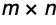 행렬을 역행렬로 만들거나, 비트 키로 메시지를 복호화하는 식이다. 보통 이 입력의 크기가 알고리즘에 영향을 미친다. 입력이 클수록 실행 시간이 길어지거나 더 많은 메모리를 사용한다.

만약 그 관계가 항상 선형(시간이 의 값에 정비례하여 증가하는)이라면 이 섹션은 중요하지 않을 것이다. 하지만 대부분의 주요 알고리즘은 선형이 아니다. 좋은 소식은 많은 알고리즘이 준선형(sublinear)이라는 것이다. 예를 들어 이진 탐색은 일치하는 항목을 찾을 때 모든 후보를 다 볼 필요가 없다. 나쁜 소식은 다른 알고리즘들이 선형보다 훨씬 나쁘다는 것이다. 실행 시간이나 메모리 요구량이 보다 훨씬 빠르게 증가한다. 항목 10개를 처리하는 데 1분 걸리는 알고리즘이 100개를 처리하는 데는 평생이 걸릴 수도 있다.

우리는 루프나 재귀 호출이 포함된 무언가를 작성할 때마다, 무의식적으로 실행 시간과 메모리 요구량을 확인하곤 한다. 이것은 공식적인 과정이라기보다는, 지금 하는 일이 주어진 상황에서 합리적인지 빠르게 확인하는 과정에 가깝다. 하지만 때로는 더 상세한 분석을 수행하기도 *한다*. 그때 바로 빅오 표기법이 유용하다.

### 빅오 표기법

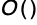로 쓰는 빅오(Big-O) 표기법은 근사치를 다루는 수학적 방법이다. 특정 정렬 루틴이 개의 레코드를 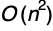 시간에 정렬한다고 쓸 때, 우리는 단순히 최악의 경우 걸리는 시간이 의 제곱에 비례하여 변한다는 것을 말하고 있을 뿐이다. 레코드 수를 두 배로 늘리면 시간은 대략 네 배로 증가한다. 를 *~의 차수(on the order of)*라는 의미로 생각하라.

 표기법은 우리가 측정하려는 대상(시간, 메모리 등)의 값에 상한(upper bound)을 둔다. 어떤 함수가  시간이 걸린다고 말하면, 걸리는 시간의 상한이 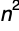보다 빠르게 증가하지 않는다는 것을 안다. 때때로 꽤 복잡한  함수가 나오기도 하지만, 이 증가함에 따라 가장 높은 차수의 항이 값을 지배하게 되므로, 낮은 차수의 항은 모두 제거하고 상수 곱셈 인자도 굳이 표시하지 않는 것이 관례다.


이것은 사실  표기법의 특징이다. 한  알고리즘이 다른  알고리즘보다 1,000배 더 빠를 수 있지만, 표기법만으로는 그것을 알 수 없다. 빅오는 시간이나 메모리 등의 실제 숫자를 결코 알려주지 않는다. 입력이 변함에 따라 이러한 값들이 어떻게 변할지만 알려줄 뿐이다.

Figure 3, *다양한 알고리즘의 실행 시간*은 여러분이 마주치게 될 몇 가지 일반적인  표기법과 각 범주에 속하는 알고리즘의 실행 시간을 비교하는 그래프를 보여준다. 분명히 을 넘어서면 상황이 빠르게 통제 불능이 되기 시작한다.

예를 들어, 100개의 레코드를 처리하는 데 1초가 걸리는 루틴이 있다고 가정해 보자. 1,000개를 처리하는 데는 얼마나 걸릴까? 코드가 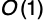이라면 여전히 1초가 걸릴 것이다. 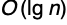이라면 아마 약 3초를 기다려야 할 것이다. 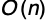은 선형적으로 증가해 10초가 걸릴 것이고, 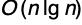은 약 33초가 걸릴 것이다. 불운하게도  루틴을 가지고 있다면, 일을 마칠 때까지 100초 동안 느긋하게 기다려야 한다. 그리고 지수 알고리즘 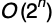을 사용하고 있다면, 커피를 한 잔 타 오는 게 좋을 것이다—여러분의 루틴은 약 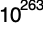년 후에 끝날 것이다. 우주가 어떻게 끝나는지 우리에게도 알려달라.

 표기법은 시간에만 적용되는 것이 아니다. 알고리즘이 사용하는 다른 모든 자원을 나타내는 데 사용할 수 있다. 예를 들어, 메모리 소비량을 모델링할 때도 유용한 경우가 많다(연습 문제에서 예를 보라).

|  | 상수 (배열의 요소 접근, 단순 문장) |
| --- | --- |
|  | 로그 (이진 탐색). 로그의 밑은 중요하지 않으므로, 이것은 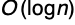과 동등하다. |
|  | 선형 (순차 탐색) |
|  | 선형보다 나쁘지만, 크게 나쁘지는 않음. (퀵 정렬, 힙 정렬의 평균 실행 시간) |
|  | 제곱 법칙 (선택 정렬 및 삽입 정렬) |
| 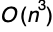 | 세제곱 (두 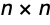 행렬의 곱셈) |
| 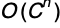 | 지수 (외판원 순회 문제, 집합 분할) |


### 상식적인 추정

상식을 사용하여 많은 기본 알고리즘의 차수를 추정할 수 있다.

**단순 루프**

단순 루프가 부터 까지 실행된다면, 알고리즘은 일 가능성이 높다—시간이 에 비례하여 선형적으로 증가한다. 예로는 완전 탐색, 배열에서 최댓값 찾기, 체크섬 생성 등이 있다.

**중첩 루프**

루프 안에 또 다른 루프를 중첩하면, 알고리즘은 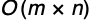이 된다. 여기서 과 은 두 루프의 한계값이다. 이는 버블 정렬 같은 단순 정렬 알고리즘에서 흔히 발생하며, 바깥쪽 루프는 배열의 각 요소를 차례로 스캔하고 안쪽 루프는 정렬된 결과에서 그 요소를 어디에 배치할지 계산한다. 이러한 정렬 알고리즘은 인 경향이 있다.

**이진 분할(Binary chop)**

알고리즘이 루프를 돌 때마다 고려하는 집합을 절반으로 줄인다면, 로그 시간인 일 가능성이 높다. 정렬된 리스트의 이진 탐색, 이진 트리 순회, 기계어 워드에서 첫 번째로 설정된 비트 찾기는 모두 일 수 있다.

**분할 정복(Divide and conquer)**

입력을 분할하여 두 절반에 대해 독립적으로 작업한 다음 결과를 결합하는 알고리즘은 일 수 있다. 고전적인 예는 데이터를 두 절반으로 분할하고 각각을 재귀적으로 정렬하는 퀵 정렬이다. 정렬된 입력이 주어지면 동작이 저하되기 때문에 이론적으로는 이지만, 퀵 정렬의 평균 실행 시간은 이다.

**조합론적(Combinatoric)**

알고리즘이 사물의 순열을 살피기 시작할 때마다 실행 시간이 통제 불능이 될 수 있다. 순열에는 팩토리얼이 포함되기 때문이다(1부터 5까지의 숫자 순열은 가지가 있다). 5개의 요소에 대해 조합론적 알고리즘의 시간을 측정해 보라. 6개에 대해서는 실행하는 데 6배 더 오래 걸리고, 7개에 대해서는 42배 더 오래 걸릴 것이다. 예로는 알려진 많은 *어려운(hard)* 문제들에 대한 알고리즘—외판원 순회 문제, 컨테이너에 물건 최적 포장하기, 각 집합의 합이 같도록 숫자 집합 분할하기 등—이 포함된다. 종종 특정 문제 영역에서 이러한 유형의 알고리즘 실행 시간을 줄이기 위해 휴리스틱이 사용된다.

### 실제에서의 알고리즘 속도

여러분이 경력 동안 정렬 루틴을 작성하는 데 많은 시간을 보낼 가능성은 낮다. 여러분이 사용할 수 있는 라이브러리에 있는 것들이 상당한 노력을 들이지 않고 여러분이 작성할 수 있는 어떤 것보다도 성능이 뛰어날 것이다. 하지만 앞서 설명한 기본적인 종류의 알고리즘들은 계속해서 나타난다. 단순 루프를 작성하고 있는 자신을 발견할 때마다, 여러분은  알고리즘을 가지고 있다는 것을 안다. 그 루프에 안쪽 루프가 포함되어 있다면, 여러분은 을 보고 있는 것이다. 이 값들이 얼마나 커질 수 있는지 스스로에게 물어봐야 한다. 숫자가 제한되어 있다면 코드가 실행되는 데 얼마나 걸릴지 알 수 있을 것이다. 숫자가 외부 요인(예: 야간 배치 실행의 레코드 수 또는 사람 목록의 이름 수)에 의존한다면, 멈춰서 큰 값이 실행 시간이나 메모리 소비에 미칠 수 있는 영향을 고려해 보고 싶을 것이다.

::: {.callout-tip appearance="simple" icon=false}
**Tip 63: 알고리즘의 차수를 추정하라**
:::

잠재적인 문제를 해결하기 위해 취할 수 있는 몇 가지 접근 방식이 있다. 인 알고리즘이 있다면, 으로 낮출 수 있는 분할 정복 접근 방식을 찾아보라.

코드가 얼마나 오래 걸릴지, 또는 얼마나 많은 메모리를 사용할지 확신이 서지 않는다면, 입력 레코드 수나 실행 시간에 영향을 미칠 만한 변수를 변화시키면서 실행해 보라. 그런 다음 결과를 그래프로 그려보라. 곧 곡선의 모양에 대한 감을 잡을 수 있을 것이다. 입력 크기가 증가함에 따라 위로 휘어지는가, 직선인가, 아니면 완만해지는가? 서너 개의 점만 찍어봐도 감을 잡을 수 있을 것이다.

또한 코드 자체에서 무엇을 하고 있는지도 고려하라. 단순한  루프가 작은  값에 대해서는 복잡한  루프보다 실제로 더 나은 성능을 보일 수 있다. 특히  알고리즘이 비용이 많이 드는 안쪽 루프를 가지고 있다면 더욱 그렇다.

이 모든 이론 속에서도 실질적인 고려 사항이 있다는 것을 잊지 마라. 작은 입력 집합에 대해서는 실행 시간이 선형적으로 증가하는 것처럼 보일 수 있다. 하지만 코드에 수백만 개의 레코드를 넣으면 시스템이 스래싱(thrashing)을 시작하면서 갑자기 시간이 저하된다. 무작위 입력 키로 정렬 루틴을 테스트하면, 정렬된 입력을 처음 만났을 때 놀랄 수도 있다. 이론적 기반과 실용적 기반을 모두 다루려고 노력하라. 이 모든 추정 후에, 유일하게 중요한 타이밍은 실제 데이터를 가지고 프로덕션 환경에서 실행되는 여러분 코드의 속도다. 이것이 다음 팁으로 이어진다.

::: {.callout-tip appearance="simple" icon=false}
**Tip 64: 추정한 것을 테스트하라**
:::

정확한 타이밍을 얻기 까다롭다면, *코드 프로파일러(code profiler)*를 사용하여 알고리즘의 각 단계가 실행되는 횟수를 세고, 이 수치를 입력 크기에 대비해 그래프로 그려보라.

#### 최고가 항상 최선은 아니다

적절한 알고리즘을 선택할 때도 실용적이어야 한다. 가장 빠른 알고리즘이 항상 그 작업에 가장 좋은 것은 아니다. 작은 입력 집합이 주어진다면, 간단한 삽입 정렬이 퀵 정렬만큼이나 잘 작동할 것이며, 작성하고 디버깅하는 데 시간도 덜 걸릴 것이다. 또한 선택한 알고리즘이 높은 설정 비용(setup cost)을 가지고 있다면 주의해야 한다. 작은 입력 집합의 경우, 이 설정 비용이 실행 시간을 압도하여 그 알고리즘을 부적절하게 만들 수 있다.

또한 *조기 최적화(premature optimization)*를 경계하라. 소중한 시간을 들여 알고리즘을 개선하려고 하기 전에, 그 알고리즘이 정말로 병목인지 확인하는 것이 언제나 좋은 생각이다.

### 관련 섹션

- Topic 15, *추정*

### 도전 과제

- 모든 개발자는 알고리즘이 어떻게 설계되고 분석되는지에 대한 감각을 가지고 있어야 한다. 로버트 세지윅(Robert Sedgewick)은 이 주제에 대해 접근하기 쉬운 일련의 책들(*Algorithms* [SW11], *An Introduction to the Analysis of Algorithms* [SF13] 등)을 썼다. 그의 책 중 한 권을 장서 목록에 추가하고 꼭 읽어보기를 권한다.
- 세지윅이 제공하는 것보다 더 자세한 내용을 좋아하는 사람들을 위해, 광범위한 알고리즘을 분석하는 도널드 커누스(Donald Knuth)의 결정판 *컴퓨터 프로그래밍의 예술(The Art of Computer Programming)* 시리즈를 읽어보라.
  - *The Art of Computer Programming, Volume 1: Fundamental Algorithms* [Knu98]
  - *The Art of Computer Programming, Volume 2: Seminumerical Algorithms* [Knu98a]
  - *The Art of Computer Programming, Volume 3: Sorting and Searching* [Knu98b]
  - *The Art of Computer Programming, Volume 4A: Combinatorial Algorithms, Part 1* [Knu11] .
- 이어지는 첫 번째 연습 문제에서 우리는 긴 정수 배열을 정렬하는 것을 살펴본다. 키가 더 복잡하고 키 비교의 오버헤드가 높다면 어떤 영향이 있을까? 키 구조가 정렬 알고리즘의 효율성에 영향을 미치는가, 아니면 가장 빠른 정렬이 항상 가장 빠른가?

### 연습 문제

**Exercise 28** (가능한 해답)

우리는 Rust로 간단한 정렬 루틴 모음^[54]^을 코딩했다. 여러분이 사용할 수 있는 다양한 머신에서 실행해 보라. 수치가 예상된 곡선을 따르는가? 머신들의 상대적 속도에 대해 무엇을 추론할 수 있는가? 다양한 컴파일러 최적화 설정의 효과는 무엇인가?

**Exercise 29** (가능한 해답)

*상식적인 추정*에서 우리는 이진 분할이 이라고 주장했다. 이것을 증명할 수 있는가?

**Exercise 30** (가능한 해답)

Figure 3, *다양한 알고리즘의 실행 시간*에서 우리는 이 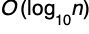(또는 실제로 어떤 밑을 가진 로그든)과 같다고 주장했다. 왜 그런지 설명할 수 있는가?

## Topic 40: 리팩토링

> *내 주위의 모든 것에서 변화와 쇠퇴를 보네...*
>
> — H. F. 라이트(H. F. Lyte), 「나와 함께 머무소서(Abide With Me)」

프로그램이 진화함에 따라, 이전의 결정들을 다시 생각하고 코드의 일부를 재작업해야 할 필요가 생긴다. 이 과정은 지극히 자연스럽다. 코드는 진화해야 한다. 정적인 것이 아니다.

안타깝게도 소프트웨어 개발에 대한 가장 흔한 비유는 건축 공사다. 버트런드 마이어(Bertrand Meyer)의 고전 『객체지향 소프트웨어 구축(Object-Oriented Software Construction)』[Mey97]은 "소프트웨어 구축(Software Construction)"이라는 용어를 사용하며, 심지어 보잘것없는 우리 저자들조차 2000년대 초반에 IEEE Software의 *Software Construction* 칼럼을 편집했다.^[55]^

하지만 건축을 지침 비유로 사용하면 다음과 같은 단계를 암시하게 된다.

1. 건축가가 청사진을 그린다.
2. 도급업자들이 기초를 파고, 상부 구조를 세우고, 배선과 배관 작업을 하고, 마감 처리를 한다.
3. 세입자들이 입주해 오래오래 행복하게 살면서, 문제가 생기면 건물 관리실에 전화해 고쳐달라고 한다.

음, 소프트웨어는 그렇게 작동하지 않는다. 소프트웨어는 건축보다는 *원예(gardening)*에 더 가깝다—콘크리트보다는 훨씬 유기적이다. 여러분은 초기 계획과 조건에 따라 정원에 많은 것을 심는다. 어떤 것은 잘 자라고, 다른 것은 결국 퇴비가 될 운명이다. 빛과 그림자, 바람과 비의 상호작용을 활용하기 위해 식물들을 서로 상대적인 위치로 옮길 수도 있다. 너무 자란 식물은 나누거나 가지치기를 하고, 서로 어울리지 않는 색깔은 미적으로 더 보기 좋은 곳으로 옮길 수도 있다. 잡초를 뽑고, 추가적인 도움이 필요한 식물에는 비료를 준다. 끊임없이 정원의 건강을 모니터링하고, 필요에 따라(토양, 식물, 배치에 대해) 조정을 가한다.

비즈니스계 사람들은 건축 공사라는 비유를 편하게 느낀다. 원예보다 더 과학적이고, 반복 가능하며, 관리를 위한 엄격한 보고 체계가 있는 식이기 때문이다. 하지만 우리는 마천루를 짓고 있는 것이 아니다—물리학의 경계와 현실 세계에 그토록 얽매여 있지 않다.

원예 비유가 소프트웨어 개발의 현실에 훨씬 더 가깝다. 아마도 특정 루틴이 너무 커졌거나, 너무 많은 일을 하려고 해서 둘로 쪼개야 할지도 모른다. 계획대로 되지 않은 것들은 잡초를 뽑듯 제거하거나 가지치기를 해야 한다.

코드를 다시 쓰고, 재작업하고, 재설계하는 것을 통틀어 *재구조화(restructuring)*라고 한다. 하지만 그 활동의 하위 집합 중 *리팩토링(refactoring)*으로 실천되어 온 것이 있다.

마틴 파울러(Martin Fowler)는 *리팩토링*[Fow19]을 다음과 같이 정의한다.

> 외부 동작을 바꾸지 않으면서 내부 구조를 변경하여 기존 코드 베이스를 재구조화하는 규율 있는 기법.

이 정의의 핵심 부분은 다음과 같다.

1. 그 활동은 규율이 있으며, 무법천지가 아니다.
2. 외부 동작은 변하지 않는다. 이때가 기능을 추가할 때가 아니다.

리팩토링은 다시 심기 위해 정원 전체를 갈아엎는 것처럼 특별하고 격식을 차린, 가끔 하는 활동으로 의도된 것이 아니다. 대신 리팩토링은 잡초를 뽑고 갈퀴질을 하는 것처럼 위험이 적은 작은 단계를 밟는 일상적인 활동이다. 코드베이스를 제멋대로 전면 재작성하는 대신, 코드를 변경하기 쉽게 유지하는 데 도움이 되는 표적화된 정밀 접근 방식이다.

외부 동작이 변하지 않았음을 보장하기 위해, 코드의 동작을 검증하는 훌륭한 자동화된 단위 테스트가 필요하다.

### 언제 리팩토링해야 하는가?

무언가를 배웠을 때, 즉 작년이나 어제, 심지어 10분 전보다 무언가를 더 잘 이해하게 되었을 때 리팩토링한다.

아마도 코드가 더 이상 잘 맞지 않아 걸림돌을 만났거나, 정말로 합쳐져야 할 두 가지를 발견했거나, 그 밖의 무엇이든 "잘못되었다"는 느낌이 든다면 *주저하지 말고 고쳐라*. 지금 당장보다 좋은 때는 없다. 어떤 코드든 다음과 같은 이유로 리팩토링 대상이 될 수 있다.

**중복**

DRY 원칙 위반을 발견했다.

**비직교적 설계**

더 직교적으로 만들 수 있는 무언가를 발견했다.

**오래된 지식**

상황이 변하고, 요구사항이 표류하며, 문제에 대한 여러분의 지식은 증가한다. 코드도 보조를 맞춰야 한다.

**사용성**

실제 사람들이 실제 환경에서 시스템을 사용함에 따라, 이전 생각보다 더 중요한 기능이 무엇인지, 그리고 "반드시 있어야 할" 기능이 어쩌면 그렇지 않았음을 깨닫게 된다.

**성능**

성능을 개선하기 위해 시스템의 한 영역에서 다른 영역으로 기능을 옮겨야 한다.

**테스트 통과**

그렇다. 진심이다. 우리는 리팩토링이 훌륭한 테스트로 뒷받침되는 소규모 활동이어야 한다고 말했다. 따라서 소량의 코드를 추가하고 그 추가 테스트 하나가 통과했을 때, 여러분은 이제 뛰어들어 방금 작성한 것을 깔끔하게 정리할 수 있는 훌륭한 기회를 얻은 것이다.

코드를 리팩토링하는 것—기능을 이리저리 옮기고 이전 결정을 업데이트하는 것—은 실제로는 *고통 관리*의 연습이다. 솔직히 말해서, 소스 코드를 이리저리 바꾸는 것은 꽤 고통스러울 수 있다. 잘 작동하고 있었으니, 그냥 내버려 두는 게 나을지도 모른다. 많은 개발자들이 그저 딱 맞지 않는다는 이유만으로 코드를 다시 열어보는 것을 꺼린다.

#### 현실 세계의 복잡한 문제들

그래서 여러분은 팀원이나 클라이언트에게 가서 "이 코드는 작동하지만, 완전히 리팩토링하려면 일주일이 더 필요합니다"라고 말한다.

그들의 대답은 차마 인쇄할 수가 없다.

시간 압박은 종종 리팩토링을 하지 않는 핑계로 사용된다. 하지만 이 핑계는 통하지 않는다. 지금 리팩토링하지 않으면, 나중에—씨름해야 할 의존성이 훨씬 더 많아졌을 때—문제를 고치는 데 훨씬 더 많은 시간을 투자해야 할 것이다. 그때 가면 시간이 더 많아질까? 천만에.

의학적 비유를 사용하여 다른 사람들에게 이 원칙을 설명할 수도 있다. 리팩토링이 필요한 코드를 "혹(종양)"이라고 생각해 보라. 그것을 제거하려면 침습적인 수술이 필요하다. 지금 들어가서 아직 작을 때 떼어낼 수 있다. 아니면 그것이 자라고 퍼지는 동안 기다릴 수도 있다—하지만 그때 제거하는 것은 비용도 더 많이 들고 위험도 더 크다. 더 오래 기다리면, 환자를 아예 잃을 수도 있다.

::: {.callout-tip appearance="simple" icon=false}
**Tip 65: 일찍, 그리고 자주 리팩토링하라**
:::

코드의 부수적 피해는 시간이 지남에 따라 똑같이 치명적일 수 있다(Topic 3, *소프트웨어 엔트로피* 참조). 대부분의 일과 마찬가지로 리팩토링도 문제가 작을 때, 코딩하는 동안 진행되는 지속적인 활동으로 하는 것이 더 쉽다. 코드 한 조각을 "리팩토링하는 데 일주일"이 필요해서는 안 된다—그것은 완전한 재작성이다. 그 정도의 혼란이 필요하다면, 즉시 할 수는 없을 것이다. 대신 그것이 일정에 잡히도록 하라. 영향을 받는 코드의 사용자들이 그것이 재작성될 예정이라는 사실과 이것이 그들에게 어떤 영향을 미칠 수 있는지 *알도록* 하라.

### 어떻게 리팩토링하는가?

리팩토링은 스몰토크(Smalltalk) 커뮤니티에서 시작되었으며, 우리가 이 책의 초판을 쓸 무렵에야 더 넓은 독자층을 얻기 시작했는데, 아마도 리팩토링에 관한 최초의 주요 저서(*리팩토링: 기존 코드의 설계 개선* [Fow19], 현재 2판) 덕분일 것이다.

본질적으로 리팩토링은 재설계다. 여러분이나 팀의 다른 사람들이 설계한 것은 무엇이든 새로운 사실, 더 깊은 이해, 변화하는 요구사항 등에 비추어 재설계될 수 있다. 하지만 앞뒤 안 가리고 막대한 양의 코드를 마구 뜯어고치기 시작하면, 시작할 때보다 더 나쁜 상황에 처하게 될 수도 있다.

분명히 리팩토링은 천천히, 의도적으로, 그리고 신중하게 수행되어야 하는 활동이다. 마틴 파울러는 득보다 실이 많지 않게 리팩토링하는 방법에 대해 다음과 같은 간단한 팁을 제공한다.^[56]^

1. 리팩토링과 기능 추가를 동시에 하려고 하지 마라.
2. 리팩토링을 시작하기 전에 훌륭한 테스트가 있는지 확인하라. 테스트를 가능한 한 자주 실행하라. 그렇게 하면 변경 사항이 무언가를 망가뜨렸는지 빠르게 알 수 있다.
3. 짧고 의도적인 단계를 밟아라. 한 클래스에서 다른 클래스로 필드를 옮기고, 메서드를 쪼개고, 변수 이름을 바꾸라. 리팩토링은 종종 더 큰 규모의 변경을 이끌어내는 많은 국소적 변경을 수반한다. 단계를 작게 유지하고 매 단계마다 테스트하면, 지루한 디버깅을 피할 수 있을 것이다.^[57]^

::: {.callout-note title="자동 리팩토링"}
초판에서 우리는 "이 기술은 아직 스몰토크 세계 밖에는 나타나지 않았지만, 곧 바뀔 것이다…"라고 적었다. 그리고 실제로 그렇게 되어, 이제 많은 IDE와 대부분의 주류 언어에서 자동 리팩토링이 가능하다.

이러한 IDE들은 변수와 메서드의 이름을 바꾸고, 긴 루틴을 더 작은 것들로 쪼개며, 필요한 변경 사항을 자동으로 전파하고, 드래그 앤 드롭으로 코드 이동을 돕는 등의 일을 할 수 있다.
:::

이 수준의 테스팅에 대해서는 Topic 41, *코드로 테스트하기*에서, 더 큰 규모의 테스팅에 대해서는 *가차 없고 지속적인 테스팅*에서 더 자세히 이야기하겠지만, 훌륭한 회귀 테스트를 유지하라는 파울러 씨의 지적은 안전하게 리팩토링하는 열쇠다.

리팩토링을 넘어 결국 외부 동작이나 인터페이스를 변경해야 한다면, 의도적으로 빌드를 깨뜨리는 것이 도움이 될 수 있다. 이 코드의 이전 클라이언트들은 컴파일에 실패해야 한다. 그렇게 하면 무엇을 업데이트해야 하는지 알 수 있다. 다음에 코드 한 조각이 마땅히 그래야 할 모습이 아닌 것을 보게 되면, 고쳐라. 고통을 관리하라. 지금 아프지만 나중에 훨씬 더 아플 것이라면, 차라리 지금 해치우는 편이 낫다. Topic 3, *소프트웨어 엔트로피*의 교훈을 기억하라. 깨진 유리창을 방치하지 마라.

### 관련 섹션

- Topic 3, *소프트웨어 엔트로피*
- Topic 9, *DRY—중복의 해악*
- Topic 12, *예광탄*
- Topic 27, *헤드라이트보다 앞서 달리지 마라*
- Topic 44, *이름 짓기*
- Topic 48, *애자일의 본질*

## Topic 41: 코드로 테스트하기

이 책의 초판은 대부분의 개발자가 테스트를 전혀 작성하지 않던 더 원시적인 시대에 쓰였다. 어차피 2000년에 세상이 끝날 텐데 뭐 하러 수고를 하겠냐고 생각했던 것이다.

그 책에서 우리는 테스트하기 쉬운 코드를 만드는 방법에 대한 섹션을 두었다. 그것은 개발자들이 실제로 테스트를 작성하도록 설득하기 위한 은근한 방법이었다.

지금은 더 계몽된 시대다. 아직도 테스트를 작성하지 않는 개발자가 있다면, 적어도 작성해야 한다는 사실만은 알고 있다.

하지만 여전히 문제가 있다. 우리가 개발자들에게 *왜* 테스트를 작성하느냐고 물으면, 그들은 마치 우리가 아직도 천공 카드로 코딩하느냐고 물은 것처럼 우리를 쳐다보며, 말로 하지는 않지만 끝에 "바보야"라는 뉘앙스를 담아 "코드가 작동하는지 확인하려고요"라고 말할 것이다. 그리고 우리는 그것이 틀렸다고 생각한다.

그렇다면 *우리*는 테스팅에서 무엇이 중요하다고 생각할까? 그리고 여러분이 어떻게 접근해야 한다고 생각할까?

대담한 선언으로 시작해 보자.

::: {.callout-tip appearance="simple" icon=false}
**Tip 66: 테스팅은 버그를 찾는 것이 아니다**
:::

우리는 테스팅의 주요 이점이 테스트를 실행할 때가 아니라, 테스트에 대해 생각하고 작성할 때 발생한다고 믿는다.

### 테스트에 대해 생각하기

월요일 아침, 여러분은 새로운 코드 작업을 시작하기 위해 자리에 앉는다. 여러분의 "세상에서 가장 웃긴 설거지 동영상" 사이트에서 일주일에 10개 이상의 동영상을 시청하는 사람들의 목록을 반환하기 위해 데이터베이스를 쿼리하는 무언가를 작성해야 한다.

에디터를 켜고, 쿼리를 수행하는 함수를 작성하는 것으로 시작한다.

```
def return_avid_viewers do
  # ... 음 ...
end
```

멈춰라! 여러분이 하려는 일이 좋은 일인지 어떻게 아는가?

답은 알 수 없다는 것이다. 아무도 모른다. 하지만 테스트에 대해 생각하는 것은 그럴 가능성을 높여줄 수 있다. 어떻게 작동하는지 보자.

함수를 다 작성했고 이제 테스트해야 한다고 상상하는 것으로 시작하라. 어떻게 할 것인가? 음, 테스트 데이터를 사용하고 싶을 텐데, 이는 아마 여러분이 제어할 수 있는 데이터베이스에서 작업하고 싶다는 뜻일 것이다. 이제 일부 프레임워크는 테스트 데이터베이스에 대해 테스트를 실행하며 그 일을 대신 처리해 줄 수 있지만, 우리의 경우에는 전역 데이터베이스를 사용하는 대신 데이터베이스 인스턴스를 함수에 전달해야 한다는 의미다. 그래야 테스트 중에 그것을 바꿀 수 있기 때문이다.

```
def return_avid_users(db) do
```

그다음에는 그 테스트 데이터를 어떻게 채울지 생각해야 한다. 요구사항은 "일주일에 10개 이상의 동영상을 시청하는 사람들의 목록"을 요청한다. 그래서 도움이 될 만한 필드를 찾기 위해 데이터베이스 스키마를 살펴본다. 누가 무엇을 보았는지 기록한 테이블에서 `opened_video`와 `completed_video`라는 두 개의 유력한 필드를 찾았다. 테스트 데이터를 작성하려면 어느 필드를 사용해야 하는지 알아야 한다. 하지만 요구사항이 무엇을 의미하는지 모르고, 비즈니스 담당자는 자리를 비웠다. 그냥 편법을 써서 필드 이름을 전달받도록 하자(이렇게 하면 우리가 가진 것을 테스트할 수 있고, 나중에 바꿀 수도 있을 것이다).

```
def return_avid_users(db, qualifying_field_name) do
```

우리는 테스트에 대해 생각하는 것으로 시작했고, 코드를 한 줄도 작성하지 않은 채 이미 두 가지 발견을 했으며 이를 사용하여 메서드의 API를 변경했다.

### 테스트가 코딩을 이끈다

앞선 예에서 테스트에 대해 생각하는 것은 우리로 하여금 코드의 결합도를 낮추게 만들었고(전역 데이터베이스 연결 대신 데이터베이스 연결을 전달함으로써) 유연성을 높였다(테스트하는 필드의 이름을 파라미터로 만듦으로써). 메서드에 대한 테스트를 작성하는 것에 대해 생각함으로써, 우리는 코드의 작성자가 아니라 마치 코드의 클라이언트인 것처럼 코드를 외부에서 바라보게 되었다.

::: {.callout-tip appearance="simple" icon=false}
**Tip 67: 테스트는 여러분 코드의 첫 번째 사용자다**
:::

우리는 이것이 테스팅이 제공하는 가장 큰 이점일 것이라고 생각한다. 테스팅은 여러분의 코딩을 안내하는 필수적인 피드백이다.

다른 코드와 강하게 결합된 함수나 메서드는 테스트하기 어렵다. 메서드를 실행하기도 전에 그 모든 환경을 설정해야 하기 때문이다. 따라서 코드를 테스트 가능하게 만드는 것은 결합도를 낮추는 효과도 있다.

그리고 무언가를 테스트하려면 먼저 그것을 이해해야 한다. 우습게 들릴지 모르지만, 실제로 우리 모두는 해야 할 일에 대한 모호한 이해만을 바탕으로 코드 작성에 뛰어든 적이 있다. 우리는 진행하면서 알아낼 것이라고 스스로를 안심시킨다. 아, 그리고 경계 조건을 지원하는 코드도 나중에 추가할 거라고. 아, 그리고 오류 처리도. 그러다 보면 코드는 조건 논리와 특수 사례로 가득 차서 원래보다 다섯 배는 더 길어진다. 하지만 그 코드에 테스트라는 빛을 비추면 상황이 더 명확해진다. 코딩을 시작하기 *전에* 경계 조건을 테스트하는 것과 그것이 어떻게 작동할지에 대해 생각한다면, 함수를 단순화할 수 있는 논리적 패턴을 발견할 수도 있다. 테스트해야 할 오류 조건에 대해 생각한다면, 그에 맞춰 함수를 구조화할 것이다.

#### 테스트 주도 개발(TDD)

테스트에 대해 미리 생각하는 것의 모든 이점을 고려할 때, 아예 테스트를 미리 작성하는 게 어떻겠느냐고 말하는 프로그래밍 학파가 있다. 그들은 *테스트 주도 개발(test-driven development)* 또는 *TDD*라고 불리는 것을 실천한다. 이것을 *테스트 우선 개발(test-first development)*이라고 부르는 것도 볼 수 있을 것이다.^[58]^

TDD의 기본 주기는 다음과 같다.

1. 추가하고 싶은 작은 기능 하나를 결정한다.
2. 그 기능이 구현되면 통과할 테스트를 작성한다.
3. 모든 테스트를 실행한다. 유일한 실패가 방금 작성한 테스트인지 확인한다.
4. 테스트를 통과시키는 데 필요한 최소한의 코드를 작성하고, 테스트가 이제 깔끔하게 실행되는지 확인한다.
5. 코드를 리팩토링한다. 방금 작성한 것(테스트나 함수)을 개선할 방법이 있는지 살펴본다. 작업이 끝났을 때 테스트가 여전히 통과하는지 확인한다.

아이디어는 이 주기가 매우 짧아야 한다는 것이다. 몇 분 단위로, 끊임없이 테스트를 작성하고 그것들이 작동하게 만드는 것이다.

우리는 이제 막 테스팅을 시작하는 사람들에게 TDD의 큰 이점이 있다고 본다. TDD 워크플로를 따르면 코드에 대한 테스트를 항상 보유하게 될 것임을 보장한다. 그리고 그것은 항상 테스트에 대해 생각하게 된다는 뜻이다.

하지만 우리는 사람들이 TDD의 노예가 되는 것도 보았다. 이는 여러 가지 방식으로 나타난다.

- 항상 100% 테스트 커버리지를 확보하는 데 과도한 시간을 소비한다.
- 중복된 테스트를 많이 가진다. 예를 들어, 클래스를 처음 작성하기 전에 많은 TDD 신봉자들은 단순히 그 클래스의 이름만 참조하는 실패하는 테스트를 먼저 작성한다. 실패하면 빈 클래스 정의를 작성하고 통과한다. 하지만 이제 아무것도 하지 않는 테스트가 하나 생겼다. 다음에 작성할 테스트도 그 클래스를 참조할 것이므로 첫 번째 테스트는 불필요해진다. 나중에 클래스 이름이 바뀌면 변경해야 할 것만 늘어날 뿐이다. 그리고 이것은 그저 사소한 예일 뿐이다.
- 그들의 설계는 바닥에서 시작해 위로 올라가는 경향이 있다. (*상향식 vs. 하향식 vs. 여러분이 해야 할 방식* 참조.)

::: {.callout-note title="상향식 vs. 하향식 vs. 여러분이 해야 할 방식"}
컴퓨팅이 젊고 걱정 없던 시절에는 하향식(top-down)과 상향식(bottom-up)이라는 두 가지 설계 학파가 있었다. 하향식 쪽 사람들은 해결하려는 전체 문제에서 시작해 작은 수의 조각으로 나누어야 한다고 말했다. 그런 다음 각 조각을 더 작은 조각으로 나누고, 코드로 표현할 수 있을 만큼 작은 조각이 될 때까지 계속한다.

상향식 쪽 사람들은 집을 짓듯이 코드를 만든다. 바닥에서 시작하여 해결하려는 문제에 더 가까운 추상화를 제공하는 코드 계층을 만든다. 그런 다음 더 높은 수준의 추상화를 가진 또 다른 계층을 추가한다. 마지막 계층이 문제를 해결하는 추상화가 될 때까지 계속한다. "그렇게 되게 하라…."

실제로는 어느 학파도 작동하지 않는다. 둘 다 소프트웨어 개발의 가장 중요한 측면 중 하나를 무시하기 때문이다. 바로 우리가 시작할 때 무엇을 하고 있는지 모른다는 사실이다. 하향식 쪽 사람들은 전체 요구사항을 처음부터 표현할 수 있다고 가정하지만, 할 수 없다. 상향식 쪽 사람들은 결국 단일 최상위 해결책으로 이어질 추상화 목록을 만들 수 있다고 가정하지만, 어디로 향하고 있는지 모를 때 계층의 기능을 어떻게 결정할 수 있겠는가?

::: {.callout-tip appearance="simple" icon=false}
**Tip 68: 하향식이나 상향식이 아니라 종단 간(End-to-End)으로 구축하라**
:::

우리는 소프트웨어를 구축하는 유일한 방법은 점진적(incremental) 방식이라고 강하게 믿는다. 진행하면서 문제에 대해 배워가며, 작은 종단 간(end-to-end) 기능 조각들을 구축하라. 코드를 계속 구체화해 나가면서 이 배움을 적용하고, 매 단계마다 고객을 참여시켜 그들이 과정을 안내하게 하라.
:::

물론 TDD를 실천하라. 하지만 만약 그렇게 한다면, 가끔씩 멈춰서 큰 그림을 보는 것을 잊지 마라. 초록색 `"tests passed"` 메시지에 현혹되어, 실제로는 해결책에 더 가까워지지 않는 많은 코드를 작성하기 쉽다.

### TDD: 어디로 가고 있는지 알아야 한다

옛날 농담에 "코끼리를 어떻게 먹나요?"라는 질문이 있다. 핵심 대답은 "한 입씩"이다. 그리고 이 아이디어는 종종 TDD의 장점으로 선전된다. 전체 문제를 파악할 수 없을 때는 한 번에 테스트 하나씩 작은 단계를 밟으라는 것이다. 하지만 이 접근 방식은 여러분을 오도하여, 코딩하는 진짜 이유는 무시한 채 쉬운 문제들에만 집중하고 끝없이 다듬도록 부추길 수 있다. 이에 대한 흥미로운 예가 2006년에 일어났다. 애자일 운동의 선도적 인물인 론 제프리스(Ron Jeffries)가 스도쿠(Sudoku) 솔버를 테스트 주도로 코딩하는 과정을 기록한 일련의 블로그 포스트를 시작했다.^[59]^ 5개의 포스트가 지난 후, 그는 기본 보드의 표현을 다듬었고, 객체 모델에 만족할 때까지 여러 번 리팩토링했다. 하지만 그 후 그는 프로젝트를 포기했다. 블로그 포스트를 순서대로 읽어보며, 똑똑한 사람이 통과하는 테스트의 빛에 고무되어 어떻게 사소한 세부 사항에 빠져 옆길로 샐 수 있는지 지켜보는 것은 흥미롭다.

대조적으로, 피터 노빅(Peter Norvig)은 성격이 매우 다르게 느껴지는 대안적 접근 방식을 설명한다.^[60]^ 테스트에 의해 주도되는 대신, 그는 이런 종류의 문제가 전통적으로 어떻게 해결되는지(제약 전파 사용)에 대한 기본적인 이해로 시작한 다음, 알고리즘을 다듬는 데 집중한다. 그는 표기법에 대한 논의에서 자연스럽게 흘러나오는 열두 줄의 코드로 보드 표현을 해결한다.

테스트는 분명히 개발을 이끄는 데 도움이 될 수 있다. 하지만 모든 운전과 마찬가지로, 염두에 둔 목적지가 없다면 결국 제자리만 맴돌게 될 수 있다.

### 다시 코드로

컴포넌트 기반 개발은 오랫동안 소프트웨어 개발의 숭고한 목표였다.^[61]^ 일반적인 집적 회로(IC)가 결합되는 것만큼이나 쉽게 범용 소프트웨어 컴포넌트들을 구해서 결합할 수 있어야 한다는 아이디어다. 하지만 이것은 여러분이 사용하는 컴포넌트들이 신뢰할 수 있는 것으로 알려져 있고, 공통 전압, 상호 연결 표준, 타이밍 등을 갖추고 있을 때만 작동한다.

칩은 공장에서뿐만 아니라, 설치될 때, 그리고 배포되어 현장에서 작동할 때도 테스트되도록 설계된다. 더 복잡한 칩과 시스템은 내부적으로 기본 수준의 진단을 실행하는 완전한 내장 자체 테스트(BIST) 기능이나, 외부 환경이 칩에 자극을 주고 응답을 수집할 수 있게 해주는 테스트 하네스를 제공하는 테스트 접근 메커니즘(TAM)을 가질 수 있다.

소프트웨어에서도 똑같이 할 수 있다. 하드웨어 동료들처럼, 우리는 처음부터 소프트웨어에 테스트 가능성(testability)을 내장해야 하며, 각 조각을 서로 연결하기 전에 철저히 테스트해야 한다.

### 단위 테스트

하드웨어의 칩 수준 테스트는 소프트웨어의 *단위 테스트(unit testing)*와 대략 동등하다—각 모듈의 동작을 검증하기 위해 격리된 상태에서 수행되는 테스트다. 통제된(심지어 인위적인) 조건에서 철저히 테스트하고 나면, 모듈이 크고 넓은 세상에서 어떻게 반응할지 더 잘 파악할 수 있다.

소프트웨어 단위 테스트는 모듈을 실행하는 코드다. 일반적으로 단위 테스트는 일종의 인공적인 환경을 설정한 다음, 테스트 중인 모듈의 루틴을 호출한다. 그런 다음 반환된 결과를 알려진 값이나 이전 실행의 동일한 테스트 결과와 비교하여 확인한다(회귀 테스트).

나중에 우리의 "소프트웨어 IC"들을 완전한 시스템으로 조립할 때, 개별 부품들이 예상대로 작동한다는 확신을 갖게 될 것이며, 그런 다음 동일한 단위 테스트 시설을 사용하여 시스템 전체를 테스트할 수 있다. 시스템에 대한 이러한 대규모 점검에 대해서는 *가차 없고 지속적인 테스팅*에서 이야기한다.

하지만 거기까지 가기 전에, 단위 수준에서 무엇을 테스트할지 결정해야 한다. 역사적으로 프로그래머들은 코드에 무작위 데이터 몇 비트를 던져보고, print 문을 본 다음 테스트가 끝났다고 불렀다. 우리는 훨씬 더 잘할 수 있다.

### 계약에 대비한 테스팅

우리는 단위 테스트를 *계약에 대비한 테스팅(testing against contract)*으로 생각하는 것을 좋아한다(Topic 23, *계약에 의한 설계* 참조). 우리는 주어진 단위가 자신의 계약을 준수하는지 확인하는 테스트 케이스를 작성하고 싶다. 이것은 우리에게 두 가지를 알려줄 것이다. 코드가 계약을 충족하는지, 그리고 계약이 우리가 생각하는 의미를 가지는지 여부다. 우리는 광범위한 테스트 케이스와 경계 조건에 걸쳐 모듈이 약속한 기능을 제공하는지 테스트하고 싶다.

실제로 이것이 무엇을 의미할까? 간단한 수치적 예인 제곱근 루틴으로 시작해 보자. 문서화된 계약은 간단하다.

```
pre-conditions:
  argument >= 0;

post-conditions:
  ((result * result) - argument).abs <= epsilon*argument;
```

이것은 우리에게 무엇을 테스트해야 하는지 알려준다.

- 음수 인수를 전달하여 거부되는지 확인한다.
- 0을 인수로 전달하여 수락되는지 확인한다(이것이 경계값이다).
- 0과 표현 가능한 최대 인수 사이의 값들을 전달하고, 결과의 제곱과 원래 인수 간의 차이가 인수의 어떤 작은 비율(epsilon)보다 작은지 검증한다.

이 계약으로 무장하고, 루틴이 자체적인 사전 및 사후 조건 검사를 수행한다고 가정하면, 제곱근 함수를 실행하는 기본 테스트 스크립트를 작성할 수 있다.

그런 다음 이 루틴을 호출하여 제곱근 함수를 테스트할 수 있다.

```
assertWithinEpsilon(my_sqrt(0), 0)
assertWithinEpsilon(my_sqrt(2.0),   1.4142135624)
assertWithinEpsilon(my_sqrt(64.0),  8.0)
assertWithinEpsilon(my_sqrt(1.0e7), 3162.2776602)
assertRaisesException fn =>  my_sqrt(-4.0) end
```

이것은 꽤 간단한 테스트다. 현실 세계에서 사소하지 않은 모듈은 여러 다른 모듈에 의존할 가능성이 높으므로, 그 조합을 테스트하는 것은 어떻게 해야 할까?

`DataFeed`와 `LinearRegression`을 사용하는 모듈 `A`가 있다고 가정해 보자. 순서대로 우리는 다음을 테스트할 것이다.

1. `DataFeed`의 계약, 전체
2. `LinearRegression`의 계약, 전체
3. 다른 계약들에 의존하지만 직접 노출하지는 않는 `A`의 계약

이 테스팅 스타일은 모듈의 하위 컴포넌트들을 먼저 테스트할 것을 요구한다. 하위 컴포넌트들이 검증되고 나면, 모듈 자체를 테스트할 수 있다.

`DataFeed`와 `LinearRegression`의 테스트는 통과했는데 `A`의 테스트가 실패했다면, 문제가 `A` 내부에 있거나 `A`가 그 하위 컴포넌트 중 하나를 *사용하는 방식*에 있다고 꽤 확신할 수 있다. 이 기법은 디버깅 노력을 줄이는 훌륭한 방법이다. 하위 컴포넌트들을 다시 검사하느라 시간을 낭비하지 않고, 모듈 `A` 내의 유력한 문제 원인에 빠르게 집중할 수 있다.

왜 이렇게까지 수고를 하는 걸까? 무엇보다도 우리는 "시한폭탄"—눈에 띄지 않게 주변에 있다가 프로젝트 후반의 어색한 순간에 터져버리는 무언가—을 만드는 것을 피하고 싶다. 계약에 대비한 테스팅을 강조함으로써, 우리는 그러한 하류 재앙을 가능한 한 많이 피하려고 노력할 수 있다.

::: {.callout-tip appearance="simple" icon=false}
**Tip 69: 테스트하기 쉽게 설계하라**
:::

### 임시 테스팅(Ad Hoc Testing)

"이상한 꼼수(odd hack)"와 혼동하지 말아야 할 *임시(ad-hoc)* 테스팅은 우리가 수동으로 코드를 찔러보며 실행할 때를 말한다. 이것은 `console.log()`만큼 간단할 수도 있고, 디버거, IDE 환경 또는 REPL에서 대화형으로 입력한 코드 조각일 수도 있다.

디버깅 세션이 끝나면, 이 임시 테스트를 공식화해야 한다. 코드가 한 번 망가졌다면, 다시 망가질 가능성이 높다. 여러분이 만든 테스트를 그냥 버리지 말고, 기존 단위 테스트 무기고에 추가하라.

### 테스트 창 만들기

최고의 테스트 세트라도 모든 버그를 찾아낼 가능성은 낮다. 프로덕션 환경의 축축하고 따뜻한 조건에는 버그들을 기어 나오게 만드는 무언가가 있는 것 같다.

이는 종종 소프트웨어가 배포된 후—실제 데이터가 그 혈관을 타고 흐르는 상태에서—테스트해야 할 필요가 있음을 의미한다. 회로 기판이나 칩과 달리 소프트웨어에는 *테스트 핀*이 없지만, 디버거를 사용하지 않고도(프로덕션 애플리케이션에서는 불편하거나 불가능할 수 있으므로) 모듈의 내부 상태를 볼 수 있는 다양한 뷰를 제공할 수는 *있다*.

추적 메시지가 담긴 로그 파일이 그러한 메커니즘 중 하나다. 로그 메시지는 규칙적이고 일관된 형식이어야 한다. 처리 시간이나 프로그램이 거친 논리 경로를 추론하기 위해 자동으로 파싱하고 싶을 수도 있기 때문이다. 형식이 엉망이거나 일관성 없는 진단 로그는 그저 "쓰레기 배설물(spew)"일 뿐이다—읽기 어렵고 파싱하기 비현실적이다.

실행 중인 코드 내부로 들어가는 또 다른 메커니즘은 "단축키" 시퀀스나 마법의 URL이다. 이 특정 키 조합을 누르거나 URL에 접근하면, 상태 메시지 등이 담긴 진단 제어 창이 팝업된다. 이것은 보통 최종 사용자에게 공개할 만한 것은 아니지만, 헬프 데스크에는 매우 유용할 수 있다.

더 일반적으로는, 특정 사용자나 사용자 그룹에 대해 추가 진단을 활성화하는 *기능 스위치(feature switch)*를 사용할 수 있다.

::: {.callout-note title="고백"}
나(데이브)는 사람들에게 더 이상 테스트를 작성하지 않는다고 말하곤 했다. 부분적으로는 테스팅을 종교로 만든 사람들의 믿음을 흔들기 위해서였다. 그리고 부분적으로는 그것이 (어느 정도) 사실이기 때문이다.

나는 45년 동안 코딩을 해왔고, 그중 30년 넘게 자동화된 테스트를 작성해 왔다. 테스팅에 대해 생각하는 것은 내가 코딩에 접근하는 방식에 내재되어 있다. 그것이 편안하게 느껴졌다. 그리고 내 성격은 무언가가 편안하게 느껴지기 시작하면 다른 것으로 넘어가야 한다고 고집한다.

이 경우 나는 두어 달 동안 테스트 작성을 멈추고 그것이 내 코드에 어떤 영향을 미치는지 보기로 결정했다. 놀랍게도 대답은 "별일 없다"였다. 그래서 나는 왜 그런지 알아내는 데 시간을 좀 썼다.

나는 그 대답이 (나에게 있어) 테스팅의 이점 대부분이 테스트에 대해 생각하고 그것이 코드에 미치는 영향에서 비롯되기 때문이라고 *믿는다*. 그리고 그것을 너무 오랫동안 해왔기 때문에, 실제로 테스트를 작성하지 않고도 그 생각을 할 수 있었던 것이다. 내 코드는 여전히 테스트 가능했다. 단지 테스트되지 않았을 뿐이다.

하지만 그것은 테스트가 다른 개발자들과 소통하는 방법이기도 하다는 사실을 간과한 것이므로, 나는 이제 다른 사람들과 공유하거나 외부 의존성의 특이성에 의존하는 코드에는 테스트를 작성*한다*.

앤디는 내가 이 사이드바를 넣지 말아야 한다고 말한다. 그는 이것이 경험 없는 개발자들에게 테스트를 하지 않도록 유혹할까 봐 걱정한다. 여기 나의 타협안이 있다.

테스트를 작성해야 하는가? 그렇다. 하지만 30년 동안 해보고 나면, 여러분에게 이점이 어디에 있는지 알아보기 위해 약간의 실험을 해봐도 좋다.
:::

### 테스팅 문화

여러분이 작성하는 모든 소프트웨어는 테스트될 *것이다*—여러분과 여러분의 팀에 의해서가 아니라면, 결국 사용자들에 의해서라도 말이다. 그러니 철저히 테스트할 계획을 세우는 편이 낫다. 약간의 선견지명이 유지보수 비용과 헬프 데스크 전화를 줄이는 데 큰 도움이 될 수 있다.

여러분에게 실제로 있는 선택지는 몇 가지뿐이다.

- 먼저 테스트하기(Test First)
- 도중에 테스트하기(Test During)
- 절대 테스트하지 않기(Test Never)

테스트 주도 설계를 포함한 '먼저 테스트하기'는 테스팅이 반드시 일어나도록 보장하므로 대부분의 상황에서 아마도 최선의 선택일 것이다. 하지만 때로는 그것이 그다지 편리하거나 유용하지 않을 수 있으므로, 코드를 좀 작성하고 만지작거리다가 그에 대한 테스트를 작성한 다음 다음 부분으로 넘어가는 '도중에 테스트하기'가 좋은 대안이 될 수 있다. 최악의 선택은 흔히 "나중에 테스트하기"라고 불리지만, 누구를 속이려는 건가? "나중에 테스트하기"는 실제로는 "절대 테스트하지 않기"를 의미한다.

테스팅 문화란 모든 테스트가 항상 통과한다는 것을 의미한다. "항상 실패하는" 테스트들의 배설물을 무시하면 *모든* 테스트를 무시하기가 더 쉬워지고, 악순환이 시작된다(Topic 3, *소프트웨어 엔트로피* 참조).

테스트 코드를 프로덕션 코드와 똑같은 주의를 기울여 다루라. 결합도를 낮추고, 깨끗하고, 견고하게 유지하라. GUI 시스템에서 위젯의 절대 위치나, 서버 로그의 정확한 타임스탬프, 또는 오류 메시지의 정확한 문구 같은 신뢰할 수 없는 것들(Topic 38, *우연에 의한 프로그래밍* 참조)에 의존하지 마라. 이런 것들을 테스트하면 깨지기 쉬운 테스트가 만들어진다.

::: {.callout-tip appearance="simple" icon=false}
**Tip 70: 소프트웨어를 테스트하라. 그렇지 않으면 사용자가 테스트할 것이다**
:::

오해하지 마라. 테스팅은 프로그래밍의 일부다. 다른 부서나 직원에게 맡겨두는 것이 아니다.

테스팅, 설계, 코딩—이 모든 것이 프로그래밍이다.

### 관련 섹션

- Topic 27, *헤드라이트보다 앞서 달리지 마라*
- Topic 51, *실용주의 스타터 키트*

## Topic 42: 속성 기반 테스팅

> *Доверяй, но проверяй (신뢰하되, 검증하라)*
>
> — 러시아 속담

우리는 여러분의 함수에 대한 단위 테스트를 작성할 것을 권장한다. 여러분은 테스트하려는 대상에 대한 지식을 바탕으로 문제가 될 만한 전형적인 것들에 대해 생각함으로써 그렇게 한다.

하지만 그 문단에는 작지만 잠재적으로 중요한 문제가 숨어 있다. 여러분이 원래 코드를 작성하고 테스트도 작성한다면, 잘못된 가정이 둘 다에 표현될 가능성이 있을까? 코드는 여러분의 이해를 바탕으로 해야 할 일을 하기 때문에 테스트를 통과한다.

이를 피하는 한 가지 방법은 다른 사람에게 테스트와 테스트 대상 코드를 각각 작성하게 하는 것이지만, 우리는 이것을 좋아하지 않는다. Topic 41, *코드로 테스트하기*에서 말했듯이, 테스트에 대해 생각하는 것의 가장 큰 이점 중 하나는 그것이 여러분이 작성하는 코드에 정보를 제공하는 방식이다. 테스팅 작업이 코딩과 분리되면 그것을 잃게 된다.

대신, 우리는 여러분의 선입견을 공유하지 않는 컴퓨터가 여러분을 대신해 일부 테스트를 수행하게 하는 대안을 선호한다.

### 계약, 불변식, 그리고 속성

Topic 23, *계약에 의한 설계*에서 우리는 코드가 충족하는 *계약(contracts)*이라는 개념에 대해 이야기했다. 입력을 넣을 때 조건을 충족하면, 코드는 자신이 생성하는 출력에 대해 특정한 보장을 해줄 것이다.

또한 함수에 전달될 때 어떤 상태에 대해 참으로 유지되는 것들인 코드 *불변식(invariants)*도 있다. 예를 들어 리스트를 정렬하면 결과는 원본과 같은 수의 요소를 가질 것이다—길이는 불변이다.

계약과 불변식(이들을 한데 묶어 *속성(properties)*이라고 부를 것이다)을 파악하고 나면, 이를 사용하여 테스팅을 자동화할 수 있다. 우리가 결국 하게 되는 일을 *속성 기반 테스팅(property-based testing)*이라고 부른다.

::: {.callout-tip appearance="simple" icon=false}
**Tip 71: 가정을 검증하기 위해 속성 기반 테스트를 사용하라**
:::

인위적인 예로서, 정렬된 리스트에 대한 몇 가지 테스트를 만들 수 있다. 우리는 이미 하나의 속성을 확립했다. 정렬된 리스트는 원본과 크기가 같다. 또한 결과의 어떤 요소도 그 뒤에 오는 요소보다 클 수 없다고 진술할 수 있다.

이제 그것을 코드로 표현할 수 있다. 대부분의 언어에는 어떤 종류의 속성 기반 테스팅 프레임워크가 있다. 이 예제는 파이썬으로 작성되었으며 Hypothesis 도구와 pytest를 사용하지만, 원칙은 꽤 보편적이다.

테스트의 전체 소스는 다음과 같다.

*다운로드: [proptest/sort.py](http://media.pragprog.com/titles/tpp20/code/proptest/sort.py)*

```
from   hypothesis import given
import hypothesis.strategies as some

@given(some.lists(some.integers()))
def test_list_size_is_invariant_across_sorting(a_list):
    original_length = len(a_list)
    a_list.sort()
    assert len(a_list) == original_length

@given(some.lists(some.text()))
def test_sorted_result_is_ordered(a_list):
    a_list.sort()
    for i in range(len(a_list) - 1):
        assert a_list[i] <= a_list[i + 1]
```

실행하면 다음과 같은 일이 일어난다.

```
$ pytest sort.py
======================= test session starts ========================
...
plugins: hypothesis-4.14.0

sort.py ..                                                    [100%]
===================== 2 passed in 0.95 seconds =====================
```

별다른 극적인 일은 없다. 하지만 그 이면에서 Hypothesis는 매번 다른 리스트를 전달하면서 두 테스트를 모두 100번씩 실행했다. 리스트들은 다양한 길이를 가질 것이고, 다른 내용물을 가질 것이다. 마치 200개의 무작위 리스트로 200개의 개별 테스트를 만들어 낸 것과 같다.

### 테스트 데이터 생성

대부분의 속성 기반 테스팅 라이브러리처럼, Hypothesis는 생성해야 할 데이터를 설명하기 위한 미니 언어를 제공한다. 이 언어는 `hypothesis.strategies` 모듈의 함수 호출을 기반으로 하며, 우리는 그저 읽기 편하다는 이유로 이를 `some`으로 별칭을 붙였다.

만약 다음과 같이 작성했다면:

```
@given(some.integers())
```

테스트 함수는 여러 번 실행될 것이다. 매번 다른 정수가 전달될 것이다. 대신 다음과 같이 작성한다면:

```
@given(some.integers(min_value=5, max_value=10).map(lambda x: x * 2))
```

10과 20 사이의 짝수를 얻게 될 것이다.

타입을 조합할 수도 있어서,

```
@given(some.lists(some.integers(min_value=1), max_size=100))
```

는 최대 100개의 요소로 이루어진 자연수 리스트가 될 것이다.

이것은 특정 프레임워크에 대한 튜토리얼이 아니므로, 멋진 세부 사항들은 건너뛰고 대신 실제 세계의 예제를 살펴보겠다.

### 잘못된 가정 찾기

우리는 간단한 주문 처리 및 재고 관리 시스템을 작성하고 있다(하나 더 들어갈 자리는 언제나 있으니까). 이 시스템은 `Warehouse` 객체로 재고 수준을 모델링한다. 우리는 창고에 무언가가 재고가 있는지 조회하고, 재고에서 물건을 빼고, 현재 재고 수준을 가져올 수 있다.

코드는 다음과 같다.

*다운로드: [proptest/stock.py](http://media.pragprog.com/titles/tpp20/code/proptest/stock.py)*

```
class Warehouse:
    def __init__(self, stock):
        self.stock = stock

    def in_stock(self, item_name):
        return (item_name in self.stock) and (self.stock[item_name] > 0)

    def take_from_stock(self, item_name, quantity):
        if quantity <= self.stock[item_name]:
            self.stock[item_name] -= quantity
        else:
          raise Exception("Oversold {}".format(item_name))

    def stock_count(self, item_name):
        return self.stock[item_name]
```

기본 단위 테스트를 작성했고, 통과한다.

*다운로드: [proptest/stock.py](http://media.pragprog.com/titles/tpp20/code/proptest/stock.py)*

```
def test_warehouse():
    wh = Warehouse({"shoes": 10, "hats": 2, "umbrellas": 0})
    assert wh.in_stock("shoes")
    assert wh.in_stock("hats")
    assert not wh.in_stock("umbrellas")

    wh.take_from_stock("shoes", 2)
    assert wh.in_stock("shoes")

    wh.take_from_stock("hats", 2)
    assert not wh.in_stock("hats")
```

그런 다음 창고에서 품목을 주문하는 요청을 처리하는 함수를 작성했다. 이 함수는 첫 번째 요소가 `"ok"` 또는 `"not available"`이고, 그 뒤에 품목과 요청된 수량이 오는 튜플을 반환한다. 테스트도 몇 개 작성했고, 통과한다.

*다운로드: [proptest/stock.py](http://media.pragprog.com/titles/tpp20/code/proptest/stock.py)*

```
def order(warehouse, item, quantity):
    if warehouse.in_stock(item):
        warehouse.take_from_stock(item, quantity)
        return ( "ok", item, quantity )
    else:
        return ( "not available", item, quantity )
```

*다운로드: [proptest/stock.py](http://media.pragprog.com/titles/tpp20/code/proptest/stock.py)*

```
def test_order_in_stock():
    wh = Warehouse({"shoes": 10, "hats": 2, "umbrellas": 0})
    status, item, quantity = order(wh, "hats", 1)
    assert status   == "ok"
    assert item     == "hats"
    assert quantity == 1
    assert wh.stock_count("hats") == 1

def test_order_not_in_stock():
    wh = Warehouse({"shoes": 10, "hats": 2, "umbrellas": 0})
    status, item, quantity = order(wh, "umbrellas", 1)
    assert status   == "not available"
    assert item     == "umbrellas"
    assert quantity == 1
    assert wh.stock_count("umbrellas") == 0

def test_order_unknown_item():
    wh = Warehouse({"shoes": 10, "hats": 2, "umbrellas": 0})
    status, item, quantity = order(wh, "bagel", 1)
    assert status   == "not available"
    assert item     == "bagel"
    assert quantity == 1
```

겉으로 보기에는 모든 것이 괜찮아 보인다. 하지만 코드를 출시하기 전에, 속성 테스트를 몇 개 추가해 보자.

우리가 아는 한 가지는 트랜잭션을 거치면서 재고가 갑자기 나타나거나 사라질 수 없다는 것이다. 이는 창고에서 물건을 꺼내면, 꺼낸 수량과 현재 창고에 남아있는 수량을 더한 값이 원래 창고에 있던 수량과 같아야 함을 의미한다. 다음 테스트에서는 `"hat"` 또는 `"shoe"` 중에서 무작위로 선택된 item 파라미터와 1에서 4 사이에서 선택된 quantity로 테스트를 실행한다.

*다운로드: [proptest/stock.py](http://media.pragprog.com/titles/tpp20/code/proptest/stock.py)*

```
@given(item     = some.sampled_from(["shoes", "hats"]),
       quantity = some.integers(min_value=1, max_value=4))

def test_stock_level_plus_quantity_equals_original_stock_level(item, quantity):
    wh = Warehouse({"shoes": 10, "hats": 2, "umbrellas": 0})
    initial_stock_level = wh.stock_count(item)
    (status, item, quantity) = order(wh, item, quantity)
    if status == "ok":
        assert wh.stock_count(item) + quantity == initial_stock_level
```

실행해 보자.

```
$ pytest stock.py
. . .
stock.py:72:
_ _ _ _ _ _ _ _ _ _ _ _ _ _ _ _ _ _ _ _ _ _ _ _ _ _ _ _ _ _ _ _ _ _
stock.py:76: in test_stock_level_plus_quantity_equals_original_stock_level
    (status, item, quantity) = order(wh, item, quantity)
stock.py:40: in order
    warehouse.take_from_stock(item, quantity)
_ _ _ _ _ _ _ _ _ _ _ _ _ _ _ _ _ _ _ _ _ _ _ _ _ _ _ _ _ _ _ _ _ _

self = <stock.Warehouse object at 0x10cf97cf8>, item_name = 'hats'
quantity = 3

    def take_from_stock(self, item_name, quantity):
      if quantity <= self.stock[item_name]:
        self.stock[item_name] -= quantity
      else:
> raise Exception("Oversold {}".format(item_name))
E       Exception: Oversold hats

stock.py:16: Exception
---------------------------- Hypothesis ----------------------------
Falsifying example:
 test_stock_level_plus_quantity_equals_original_stock_level(
       item='hats', quantity=3)
```

`warehouse.take_from_stock`에서 터져버렸다. 창고에서 모자 세 개를 꺼내려고 했지만, 재고가 두 개뿐이었다.

우리의 속성 테스팅은 잘못된 가정을 찾아냈다. 우리의 `in_stock` 함수는 주어진 품목의 재고가 최소한 하나 있는지 여부만 확인한다. 대신 주문을 채울 만큼 충분한 재고가 있는지 확인해야 한다.

*다운로드: [proptest/stock1.py](http://media.pragprog.com/titles/tpp20/code/proptest/stock1.py)*

```
def in_stock(self, item_name, quantity):
    return (item_name in self.stock) and (self.stock[item_name] >= quantity)
```

그리고 `order` 함수도 바꾼다.

*다운로드: [proptest/stock1.py](http://media.pragprog.com/titles/tpp20/code/proptest/stock1.py)*

```
def order(warehouse, item, quantity):
    if warehouse.in_stock(item, quantity):
        warehouse.take_from_stock(item, quantity)
        return ( "ok", item, quantity )
    else:
        return ( "not available", item, quantity )
```

이제 우리의 속성 테스트가 통과한다.

### 속성 기반 테스트는 종종 여러분을 놀라게 한다

앞선 예에서 우리는 재고 수준이 적절하게 조정되는지 확인하기 위해 속성 기반 테스트를 사용했다. 테스트는 버그를 찾았지만, 그것은 재고 수준 조정과 관련된 것이 아니었다. 대신 `in_stock` 함수의 버그를 찾아냈다.

이것이 속성 기반 테스팅의 힘이자 좌절감이다. 입력을 생성하기 위한 몇 가지 규칙을 설정하고, 출력을 검증하기 위한 몇 가지 단언문을 설정한 다음, 그냥 돌려버리기만 하면 되므로 강력하다. 무슨 일이 일어날지 결코 정확히 알 수 없다. 테스트가 통과할 수도 있다. 단언문이 실패할 수도 있다. 아니면 주어진 입력을 처리하지 못해 코드가 완전히 실패할 수도 있다.

좌절스러운 점은 무엇이 실패했는지 정확히 짚어내기가 까다로울 수 있다는 것이다.

우리의 제안은 속성 기반 테스트가 실패했을 때, 테스트 함수에 전달된 파라미터가 무엇이었는지 알아낸 다음, 그 값들을 사용하여 별도의 일반 단위 테스트를 만들라는 것이다. 그 단위 테스트는 두 가지 역할을 한다. 첫째, 속성 기반 테스팅 프레임워크가 코드로 보내는 모든 추가 호출 없이 문제에 집중할 수 있게 해준다. 둘째, 그 단위 테스트는 *회귀 테스트(regression test)* 역할을 한다. 속성 기반 테스트는 테스트에 전달되는 무작위 값을 생성하므로, 다음에 테스트를 실행할 때 같은 값이 사용된다는 보장이 없다. 그 값들을 강제로 사용하게 하는 단위 테스트를 두면 이 버그가 빠져나가지 못하도록 보장할 수 있다.

### 속성 기반 테스트는 설계에도 도움이 된다

단위 테스팅에 대해 이야기할 때, 우리는 주요 이점 중 하나가 코드에 대해 생각하게 만드는 방식이라고 말했다. 즉, 단위 테스트는 여러분 API의 첫 번째 클라이언트다.

속성 기반 테스트에서도 마찬가지이지만, 약간 다른 방식으로 작용한다. 속성 기반 테스트는 불변식과 계약의 관점에서 코드에 대해 생각하게 만든다. 무엇이 변하지 않아야 하는지, 무엇이 참이어야 하는지 생각하게 되는 것이다. 이 추가적인 통찰력은 코드에 마법 같은 효과를 발휘하여, 엣지 케이스를 제거하고 데이터를 일관성 없는 상태로 남기는 함수들을 부각시킨다.

우리는 속성 기반 테스팅이 단위 테스팅과 상호 보완적이라고 믿는다. 둘은 서로 다른 관심사를 다루며, 각각 고유한 이점을 제공한다. 현재 사용하고 있지 않다면, 한 번 시도해 보라.

### 관련 섹션

- Topic 23, *계약에 의한 설계*
- Topic 25, *단언적 프로그래밍*
- Topic 45, *요구사항의 구덩이*

### 연습 문제

**Exercise 31** (가능한 해답)

창고 예제를 다시 보라. 테스트할 수 있는 다른 속성들이 있는가?

**Exercise 32** (가능한 해답)

여러분의 회사는 기계를 배송한다. 각 기계는 상자에 담겨 오며, 각 상자는 직사각형이다. 상자들의 크기는 다양하다. 여러분의 임무는 배송 트럭에 들어가는 단일 층에 가능한 한 많은 상자를 채워 넣는 코드를 작성하는 것이다. 코드의 출력은 모든 상자의 목록이다. 각 상자에 대해, 목록은 너비 및 높이와 함께 트럭 내에서의 위치를 제공한다. 출력의 어떤 속성들을 테스트할 수 있을까?

### 도전 과제

현재 작업 중인 코드에 대해 생각해 보라. 계약과 불변식, 즉 속성들은 무엇인가? 이것들을 자동으로 검증하기 위해 속성 기반 테스팅 프레임워크를 사용할 수 있는가?

## Topic 43: 바깥세상에서 안전 지키기

> *좋은 울타리가 좋은 이웃을 만든다.*
>
> — 로버트 프로스트(Robert Frost), 「담장 고치기(Mending Wall)」

초판의 코드 결합도에 관한 논의에서 우리는 대담하고 순진한 진술을 했다. "우리는 스파이나 반체제 인사들처럼 편집증적일 필요는 없다." 우리가 틀렸다. 사실 여러분은 매일 그만큼 편집증적이어야 *한다*.

우리가 이 글을 쓰는 지금, 매일의 뉴스는 파괴적인 데이터 유출, 하이재킹된 시스템, 그리고 사이버 사기 이야기로 가득 차 있다. 한 번에 수억 건의 기록이 도난당하고, 수십억 달러의 손실과 복구 비용이 발생하며, 이 수치는 매년 빠르게 증가하고 있다. 대다수의 경우, 공격자들이 엄청나게 영리하거나 심지어 어설프게나마 유능했기 때문이 아니다.

개발자들이 부주의했기 때문이다.

### 나머지 90%

코딩할 때 여러분은 "작동한다!"와 "왜 저게 안 되지?"의 여러 주기를 거치며, 가끔은 "저런 일이 일어났을 리가 없는데…"를 겪을 수도 있다.^[62]^ 이 오르막길에서 여러 언덕과 턱을 넘고 나면, 스스로에게 "휴, 다 작동하네!"라고 말하며 코드가 끝났다고 선언하기 쉽다. 물론 아직 끝나지 않았다. 여러분은 90% 끝났지만, 이제 *나머지* 90%를 고려해야 한다.

다음으로 해야 할 일은 코드가 잘못될 수 있는 방식들을 분석하여 테스트 스위트에 추가하는 것이다. 잘못된 파라미터를 전달하거나, 자원이 누수되거나 사용할 수 없게 되는 등의 일을 고려할 것이다.

좋았던 옛날에는 내부 원인에 의한 오류에 대한 이러한 평가로 충분했을지도 모른다. 하지만 오늘날 그것은 시작에 불과하다. 내부 원인에 의한 오류 외에도, 외부 행위자가 어떻게 시스템을 고의로 망가뜨릴 수 있는지 고려해야 하기 때문이다. 하지만 아마 여러분은 이렇게 항변할지도 모른다. "오, 아무도 이 코드에 신경 쓰지 않을 거야, 중요하지도 않고, 이 서버에 대해 아는 사람도 없어…" 바깥세상은 넓고, 그 대부분이 연결되어 있다. 지구 반대편의 심심한 꼬마든, 국가가 지원하는 테러 조직이든, 범죄 조직이든, 기업 스파이든, 심지어 복수심에 불타는 전 연인이든, 그들은 바깥에 있으며 여러분을 노리고 있다. 공개된 네트워크에서 패치되지 않고 구식인 시스템의 생존 시간은 분 단위—또는 그보다도 짧은 시간—로 측정된다.

은폐를 통한 보안(Security through obscurity)은 그저 작동하지 않는다.

### 보안 기본 원칙

실용주의 프로그래머는 건강한 수준의 편집증을 가지고 있다. 우리는 우리에게 결함과 한계가 있으며, 외부 공격자들이 시스템을 손상시키기 위해 우리가 남긴 *어떤* 틈이라도 노릴 것이라는 사실을 안다. 여러분의 특정 개발 및 배포 환경에는 고유한 보안 중심 요구사항이 있겠지만, 항상 염두에 두어야 할 몇 가지 기본 원칙이 있다.

1. 공격 표면적 최소화 (Minimize Attack Surface Area)
2. 최소 권한 원칙 (Principle of Least Privilege)
3. 안전한 기본값 (Secure Defaults)
4. 민감한 데이터 암호화 (Encrypt Sensitive Data)
5. 보안 업데이트 유지 (Maintain Security Updates)

각각을 살펴보자.

#### 공격 표면적 최소화

시스템의 *공격 표면적(attack surface area)*은 공격자가 데이터를 입력하거나, 데이터를 추출하거나, 서비스 실행을 호출할 수 있는 모든 접근 지점의 합이다. 몇 가지 예는 다음과 같다.

**코드 복잡성은 공격 벡터로 이어진다**

코드 복잡성은 공격 표면을 더 넓게 만들고, 예상치 못한 부수 효과가 발생할 기회를 더 많이 만든다. 복잡한 코드는 표면적이 더 다공성이고 감염에 열려 있는 것으로 생각하라. 다시 말하지만, 단순하고 작은 코드가 더 좋다. 코드가 적다는 것은 버그가 적고, 치명적인 보안 구멍이 생길 기회가 적다는 것을 의미한다. 더 단순하고, 더 탄탄하며, 덜 복잡한 코드가 추론하기 쉽고 잠재적인 약점을 발견하기도 쉽다.

**입력 데이터는 공격 벡터다**

외부 개체로부터 온 데이터를 절대 신뢰하지 말고, 데이터베이스, 뷰 렌더링 또는 기타 처리에 전달하기 전에 항상 정제(sanitize)하라.^[63]^ 일부 언어는 이를 도울 수 있다. 예를 들어 루비(Ruby)에서 외부 입력을 담고 있는 변수는 *오염된(tainted)* 상태가 되며, 이는 그 변수에 수행할 수 있는 연산을 제한한다. 예를 들어, 다음 코드는 런타임에 이름이 제공된 파일의 문자 수를 보고하기 위해 `wc` 유틸리티를 사용하는 것처럼 보인다.

*다운로드: [safety/taint.rb](http://media.pragprog.com/titles/tpp20/code/safety/taint.rb)*

```
puts "Enter a file name to count: "
name = gets
system("wc -c #{name}")
```

악의적인 사용자는 다음과 같은 피해를 입힐 수 있다.

```
Enter a file name to count:
test.dat; rm -rf /
```

하지만 SAFE 수준을 1로 설정하면 외부 데이터가 오염 처리되어, 위험한 문맥에서 사용될 수 없음을 의미한다.

```
$SAFE = 1

puts "Enter a file name to count: "
name = gets
system("wc -c #{name}")
```

이제 실행해 보면, 현장에서 딱 걸린다.

```
$ ruby taint.rb
Enter a file name to count:
test.dat; rm -rf /
code/safety/taint.rb:5:in `system': Insecure operation - system (SecurityError)
  from code/safety/taint.rb:5:in `main
```

**인증되지 않은 서비스는 공격 벡터다**

본질적으로 전 세계의 어떤 사용자든 인증되지 않은 서비스를 호출할 수 있으므로, 다른 처리나 제한을 두지 않으면 최소한 *서비스 거부(denial-of-service)* 공격의 기회를 즉각 만들어 준 셈이다. 최근 매우 공개적인 데이터 유출 사고 중 상당수는 개발자들이 클라우드의 인증되지 않고 공개적으로 읽을 수 있는 데이터 저장소에 실수로 데이터를 넣어두어 발생했다.

**인증된 서비스도 공격 벡터다**

인가된 사용자의 수를 절대적인 최소한으로 유지하라. 사용하지 않거나, 오래되었거나, 구식인 사용자와 서비스를 솎아내라. 많은 네트워크 연결 장치에서 단순한 기본 비밀번호나 사용되지 않고 보호되지 않는 관리자 계정이 발견되곤 한다. 배포 자격 증명을 가진 계정이 손상되면, 제품 전체가 손상된다.

**출력 데이터는 공격 벡터다**

`Password is used by another user`(다른 사용자가 사용 중인 비밀번호입니다)라는 오류 메시지를 충실하게 보고했던 시스템에 대한(아마도 지어낸) 이야기가 있다. 정보를 흘리지 마라. 여러분이 보고하는 데이터가 그 사용자의 권한에 적절한지 확인하라. 사회보장번호나 기타 정부 ID 번호와 같은 잠재적으로 위험한 정보는 잘라내거나 난독화하라.

**디버깅 정보는 공격 벡터다**

동네 ATM 기기, 공항 키오스크, 또는 충돌한 웹 페이지에서 데이터가 포함된 전체 스택 트레이스를 보는 것만큼 흐뭇한 일도 없다. 디버깅을 쉽게 만들기 위해 설계된 정보는 침입하는 것도 똑같이 쉽게 만들 수 있다. 여기서 논의한 모든 "테스트 창"과 런타임 예외 보고가 엿보는 눈으로부터 보호되는지 확인하라.^[64]^

::: {.callout-tip appearance="simple" icon=false}
**Tip 72: 단순하게 유지하고 공격 표면을 최소화하라**
:::

#### 최소 권한 원칙

또 다른 핵심 원칙은 빠져나갈 수 있는 *최소한의* 시간 동안 *최소한의* 권한만 사용하는 것이다. 즉, `root`나 `Administrator` 같은 가장 높은 권한 수준을 자동으로 잡지 마라. 그 높은 수준이 *필요하다면*, 권한을 얻어 최소한의 작업만 수행하고, 위험을 줄이기 위해 권한을 빠르게 포기하라. 이 원칙은 1970년대 초반으로 거슬러 올라간다.

> 시스템의 모든 프로그램과 모든 특권 사용자는 작업을 완료하는 데 필요한 최소한의 권한만을 사용하여 작동해야 한다. — 제롬 솔처(Jerome Saltzer), Communications of the ACM, 1974.

유닉스 계열 시스템의 `login` 프로그램을 예로 들어보자. 처음에는 루트 권한으로 실행된다. 하지만 올바른 사용자를 인증하는 일을 마치자마자, 높은 수준의 권한을 해당 사용자의 권한으로 낮춘다.

이것은 운영체제 권한 수준에만 적용되는 것이 아니다. 여러분의 애플리케이션은 다양한 수준의 접근을 구현하고 있는가? "관리자" 대 "사용자" 같은 무딘 도구인가? 그렇다면 민감한 자원을 여러 범주로 분할하고, 개별 사용자가 그 범주 중 특정한 것들에 대해서만 권한을 갖도록 더 세밀하게 나누는 것을 고려하라.

이 기법은 표면적 최소화—시간과 권한 수준 모두에 의해 공격 벡터의 범위를 줄이는 것—와 같은 종류의 아이디어를 따른다. 이 경우, 적은 것이 정말로 더 많은 것이다.

#### 안전한 기본값

앱의 기본 설정이나 사이트의 사용자를 위한 기본 설정은 *가장* 안전한 값이어야 한다. 이것이 가장 사용자 친화적이거나 편리한 값은 아닐지 모르지만, 보안과 편의성 사이의 절충안을 각 개인이 스스로 결정하게 하는 편이 낫다.

예를 들어 비밀번호 입력의 기본값은 입력된 비밀번호를 숨기고 각 문자를 별표로 바꾸는 것일 수 있다. 붐비는 공공장소에서 비밀번호를 입력하거나 큰 청중 앞에서 화면을 띄워놓고 있다면, 그것은 합리적인 기본값이다. 하지만 어떤 사용자들은 아마도 접근성을 위해 비밀번호가 철자대로 보이기를 원할 수도 있다. 누군가 어깨너머로 훔쳐볼 위험이 거의 없다면, 그들에게는 합리적인 선택이다.

#### 민감한 데이터 암호화

개인 식별 정보, 금융 데이터, 비밀번호 또는 기타 자격 증명을 데이터베이스나 다른 외부 파일에 평문으로 두지 마라. 데이터가 노출되더라도 암호화는 추가적인 수준의 안전을 제공한다.

Topic 19, *버전 관리*에서 우리는 프로젝트에 필요한 모든 것을 버전 관리 아래에 둘 것을 강력히 권장했다. 음, *거의* 모든 것을 말이다. 그 규칙에는 한 가지 주요 예외가 있다.

비밀 정보, API 키, SSH 키, 암호화 비밀번호 또는 기타 자격 증명을 버전 관리에 있는 소스 코드와 함께 체크인하지 마라.

키와 비밀 정보는 별도로 관리되어야 하며, 일반적으로 빌드 및 배포의 일부로서 설정 파일이나 환경 변수를 통해 관리된다.

::: {.callout-note title="비밀번호 안티패턴"}
보안의 근본적인 문제 중 하나는 좋은 보안이 종종 상식이나 일반적인 관행에 어긋난다는 것이다. 예를 들어, 엄격한 비밀번호 요구사항이 애플리케이션이나 사이트의 보안을 높여줄 것이라고 생각할 수도 있다. 여러분이 틀렸다.

엄격한 비밀번호 정책은 실제로 보안을 *낮춘다*. NIST의 몇 가지 권장 사항과 함께 아주 나쁜 아이디어들의 짧은 목록은 다음과 같다.^[65]^

- 비밀번호 길이를 64자 미만으로 제한하지 마라. NIST는 좋은 최대 길이로 256자를 권장한다.
- 사용자가 선택한 비밀번호를 잘라내지(truncate) 마라.
- `[]();&%$#` 또는 `/` 같은 특수 문자를 제한하지 마라. 이 섹션 앞부분에 있는 바비 테이블스(Bobby Tables)에 관한 주석을 보라. 비밀번호의 특수 문자가 시스템을 손상시킨다면, 여러분에게는 더 큰 문제가 있는 것이다. NIST는 인쇄 가능한 모든 ASCII 문자, 공백 및 유니코드를 허용하라고 말한다.
- 인증되지 않은 사용자에게 비밀번호 힌트를 제공하거나, 특정 유형의 정보(예: "첫 번째 반려동물의 이름은 무엇이었나요?")를 묻지 마라.
- 브라우저에서 `paste`(붙여넣기) 기능을 비활성화하지 마라. 브라우저와 비밀번호 관리자의 기능을 망가뜨리는 것은 시스템을 더 안전하게 만들지 않으며, 사실 사용자들이 훨씬 더 손상되기 쉬운 단순하고 짧은 비밀번호를 만들도록 내몬다. 미국의 NIST와 영국의 국가사이버보안센터(NCSC) 모두 이러한 이유로 검증자가 붙여넣기 기능을 허용하도록 명시적으로 요구한다.
- 다른 구성 규칙을 부과하지 마라. 예를 들어 대문자와 소문자, 숫자, 특수 문자의 특정 조합을 강제하거나, 반복되는 문자를 금지하는 등의 일을 하지 마라.
- 일정 시간이 지난 후 사용자에게 비밀번호를 변경하도록 임의로 요구하지 마라. 오직 타당한 이유(예: 유출 사고가 있었을 때)가 있을 때만 이렇게 하라.

여러분은 높은 엔트로피를 가진 길고 무작위적인 비밀번호를 장려하고 싶어 한다. 인위적인 제약을 두는 것은 엔트로피를 제한하고 나쁜 비밀번호 습관을 조장하여, 사용자 계정을 탈취에 취약하게 만든다.
:::

#### 보안 업데이트 유지

컴퓨터 시스템을 업데이트하는 것은 엄청난 고통일 수 있다. 그 보안 패치가 필요하지만, 부작용으로 애플리케이션의 일부가 망가진다. 여러분은 기다렸다가 업데이트를 나중으로 미루기로 결정할 수도 있다. 그것은 끔찍한 생각이다. 이제 여러분의 시스템이 알려진 익스플로잇에 취약해지기 때문이다.

::: {.callout-tip appearance="simple" icon=false}
**Tip 73: 보안 패치를 신속하게 적용하라**
:::

이 팁은 휴대폰, 자동차, 가전제품, 개인용 노트북, 개발자 머신, 빌드 머신, 프로덕션 서버, 클라우드 이미지를 포함한 모든 네트워크 연결 장치에 영향을 미친다. 모든 것에 해당한다. 그리고 이것이 별로 중요하지 않다고 생각한다면, (지금까지) 역사상 가장 큰 데이터 유출 사고들은 업데이트가 뒤처진 시스템들 때문에 발생했다는 사실을 기억하라.

여러분에게 그런 일이 일어나지 않게 하라.

### 상식 vs. 암호화

암호화 문제에 있어서는 상식이 여러분을 배신할 수 있다는 점을 명심하는 것이 중요하다. 암호화에 관한 첫 번째이자 가장 중요한 규칙은 *절대 직접 만들지 마라*는 것이다.^[66]^ 비밀번호처럼 단순한 것에 대해서조차 일반적인 관행은 잘못되어 있다(*비밀번호 안티패턴* 사이드바 참조). 일단 암호화의 세계로 들어가면, 아주 작고 가장 사소해 보이는 오류조차 모든 것을 망가뜨릴 수 있다. 여러분의 영리하고 새로운 자체 제작 암호화 알고리즘은 전문가가 몇 분 만에 깨뜨릴 수 있을 것이다. 여러분은 암호화를 직접 하고 싶지 않을 것이다.

다른 곳에서도 말했듯이, 신뢰할 수 있는 것에만 의존하라. 잘 검증되고, 철저히 검토되었으며, 잘 유지보수되고, 자주 업데이트되며, 가급적 오픈 소스인 라이브러리와 프레임워크를 사용하라.

단순한 암호화 작업을 넘어, 사이트나 애플리케이션의 다른 보안 관련 기능들을 면밀히 살펴보라. 예를 들어 인증을 생각해 보자.

비밀번호나 생체 인식을 이용한 자체 로그인을 구현하려면, 해시와 솔트(salt)가 어떻게 작동하는지, 크래커들이 레인보우 테이블(Rainbow table) 같은 것을 어떻게 사용하는지, 왜 MD5나 SHA1을 사용하지 말아야 하는지, 그리고 수많은 다른 문제들을 이해해야 한다. 그리고 그 모든 것을 다 제대로 해냈더라도, 하루가 끝나면 여전히 데이터를 보관하고 안전하게 지킬 책임이 여러분에게 있으며, 새로 생겨나는 법안과 법적 의무의 적용을 받는다.

아니면 실용적인 접근 방식을 취해 다른 사람이 걱정하게 하고 제3자 인증 제공자를 사용할 수도 있다. 이것은 사내에서 운영하는 기성 서비스일 수도 있고, 클라우드의 제3자일 수도 있다. 인증 서비스는 종종 이메일, 전화 또는 소셜 미디어 제공업체로부터 이용할 수 있으며, 이는 여러분의 애플리케이션에 적절할 수도 있고 아닐 수도 있다. 어느 쪽이든, 이 사람들은 하루 종일 시스템을 안전하게 지키는 데 시간을 보내며, 여러분보다 그 일을 더 잘한다.

바깥세상에서 안전을 지켜라.

### 관련 섹션

- Topic 23, *계약에 의한 설계*
- Topic 24, *죽은 프로그램은 거짓말을 하지 않는다*
- Topic 25, *단언적 프로그래밍*
- Topic 38, *우연에 의한 프로그래밍*
- Topic 45, *요구사항의 구덩이*

## Topic 44: 이름 짓기

> *지혜의 시작은 사물을 올바른 이름으로 부르는 것이다.*
>
> — 공자

이름에 무엇이 들어 있을까? 프로그래밍할 때 그 대답은 "모든 것!"이다.

우리는 애플리케이션, 하위 시스템, 모듈, 함수, 변수에 이름을 붙인다—우리는 끊임없이 새로운 것을 만들고 그것들에 이름을 부여한다. 그리고 그 이름들은 여러분의 의도와 믿음에 대해 많은 것을 드러내기 때문에 매우, 매우 중요하다.

우리는 사물이 코드에서 수행하는 역할에 따라 이름이 지어져야 한다고 믿는다. 이는 무언가를 만들 때마다 멈춰 서서 "이것을 만드는 나의 동기는 무엇인가?"라고 생각해야 함을 의미한다.

이것은 즉각적인 문제 해결 사고방식에서 벗어나 더 큰 그림을 보게 만들기 때문에 강력한 질문이다. 변수나 함수의 역할을 고려할 때, 여러분은 그것의 특별한 점이 무엇인지, 무엇을 할 수 있는지, 그리고 무엇과 상호작용하는지에 대해 생각하게 된다. 종종 우리는 적절한 이름을 떠올릴 수 없다는 바로 그 이유 때문에 자신이 하려던 일이 말이 안 된다는 것을 깨닫게 된다.

이름이 깊은 의미를 가진다는 생각 뒤에는 약간의 과학이 있다. 뇌는 단어를 정말 빠르게 읽고 이해할 수 있다는 것이 밝혀졌다. 다른 많은 활동보다 빠르다. 이는 우리가 무언가를 이해하려고 할 때 단어가 특정한 우선순위를 갖는다는 것을 의미한다. 이것은 스트룹 효과(Stroop effect)를 통해 입증될 수 있다.^[67]^

다음 패널을 보라. 여기에는 색상 이름이나 음영 목록이 있으며, 각각은 특정 색상이나 음영으로 표시되어 있다. 하지만 이름과 색상이 반드시 일치하지는 않는다. 도전의 첫 번째 부분은 이것이다—쓰여 있는 대로 각 색상의 이름을 소리 내어 말하라.^[68]^

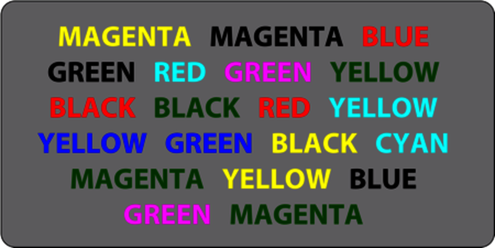

이제 이것을 반복하되, 대신 단어를 그리는 데 사용된 색상을 소리 내어 말하라. 더 어렵지 않은가? 읽을 때는 유창하기 쉽지만, 색상을 인식하려고 할 때는 훨씬 더 어렵다.

여러분의 뇌는 쓰인 단어를 존중받아야 할 무언가로 취급한다. 우리는 우리가 사용하는 이름들이 이에 부응하도록 해야 한다.

몇 가지 예를 살펴보자.

- 우리는 오래된 그래픽 카드로 만든 보석을 파는 사이트에 접속하는 사람들을 인증하고 있다. 변수는 *언제나* `user`이기 때문에 `user`다. 하지만 왜인가? 아무 의미도 없다. `customer`나 `buyer`는 어떤가? 그렇게 하면 코딩하면서 이 사람이 무엇을 하려고 하는지, 그리고 그것이 우리에게 무엇을 의미하는지 끊임없이 상기시킬 수 있다.
```
let user = authenticate(credentials)
```
- 주문을 할인하는 인스턴스 메서드가 있다. 여기에는 두 가지 문제가 있다. 첫째, `deductPercent`는 *무엇을 하는가*이지 *왜 하는가*가 아니다. 그리고 파라미터 이름 `amount`는 기껏해야 오해를 불러일으킨다. 절대 금액인가, 백분율인가? 아마 이것이 더 나을 것이다. 메서드 이름이 이제 그 의도를 명확하게 만든다. 또한 파라미터를 `double`에서 우리가 정의한 타입인 `Percentage`로 바꿨다. 여러분은 어떨지 모르겠지만, 우리는 백분율을 다룰 때 값이 0에서 100 사이여야 하는지 0.0에서 1.0 사이여야 하는지 도무지 알 수 없다. 타입을 사용하면 함수가 기대하는 바를 문서화할 수 있다.
```
public void deductPercent(double amount)
    // ...
```
```
public void applyDiscount(Percentage discount)
  // ...
```
- 피보나치 수열로 흥미로운 일을 하는 모듈이 있다. 그중 하나는 수열에서 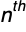번째 숫자를 계산하는 것이다. 멈춰서 이 함수를 무엇이라 부를지 생각해 보라. 우리가 물어본 대부분의 사람들은 `fib`라고 부를 것이다. 합리적으로 보이지만, 보통 그 모듈의 문맥에서 호출될 것이므로 호출은 `Fib.fib(n)`이 될 것임을 기억하라. 대신 `of`나 `nth`라고 부르는 것은 어떤가?
```
Fib.of(0)    # => 0
Fib.nth(20)  # => 4181
```

이름을 지을 때 여러분은 자신이 의미하는 바를 명확히 할 방법을 끊임없이 찾게 되며, 그 명확화 행위는 *코드를 작성하는 동안* 코드에 대한 더 나은 이해로 이어질 것이다.

하지만 모든 이름이 문학상 후보가 되어야 하는 것은 아니다.

::: {.callout-note title="규칙을 증명하는 예외"}
코드에서는 명확성을 추구하지만, 브랜딩은 완전히 다른 문제다.

프로젝트와 프로젝트 팀은 모호하고 "영리한" 이름을 가져야 한다는 잘 확립된 전통이 있다. 포켓몬, 마블 슈퍼히어로, 귀여운 포유류, *반지의 제왕* 등장인물 등 무엇이든 말이다.

말 그대로다.
:::

### 문화를 존중하라

대부분의 컴퓨터 입문서는 `i`, `j`, `k` 같은 한 글자 변수를 절대 사용하지 말라고 훈계할 것이다.^[69]^

우리는 그들이 틀렸다고 생각한다. 어느 정도는 말이다.

사실 그것은 특정 프로그래밍 언어나 환경의 문화에 달려 있다. C 프로그래밍 언어에서 `i`, `j`, `k`는 전통적으로 루프 증가 변수로 사용되고, `s`는 문자열에 사용되는 식이다. 그 환경에서 프로그래밍한다면 그것이 익숙하게 보는 것이며, 그 규범을 어기는 것은 거슬리는(따라서 잘못된) 일이 될 것이다. 반면에, 기대되지 *않는* 다른 환경에서 그 관례를 사용하는 것도 똑같이 잘못된 것이다. 변수 `i`에 문자열을 할당하는 이 클로저(Clojure) 예제처럼 끔찍한 짓은 절대 하지 않을 것이다.

```
(let [i "Hello World"]
        (println i))
```

어떤 언어 커뮤니티는 대문자가 내장된 `camelCase`를 선호하는 반면, 다른 커뮤니티는 단어를 구분하기 위해 밑줄이 내장된 `snake_case`를 선호한다. 물론 언어 자체는 둘 다 받아들이겠지만, 그렇다고 해서 그것이 옳은 것은 아니다. 현지 문화를 존중하라.

일부 언어는 이름에 유니코드의 하위 집합을 허용한다. `ɹǝsn`이나 `εξέρχεται` 같은 귀여운 이름을 쓰며 잘난 척하기 전에 커뮤니티가 무엇을 기대하는지 파악하라.

### 일관성

에머슨(Emerson)은 "어리석은 일관성은 소인배의 도깨비다…"라고 쓴 것으로 유명하지만, 에머슨은 프로그래머 팀에 속해 있지 않았다.

모든 프로젝트에는 팀에게 특별한 의미를 갖는 전문 용어인 자체 어휘가 있다. "주문(Order)"은 온라인 상점을 만드는 팀에게는 한 가지를 의미하고, 종교 단체의 계보를 도표로 그리는 앱을 만드는 팀에게는 매우 다른 것을 의미한다. 팀의 모든 사람이 이 단어들이 무엇을 의미하는지 알고, 일관되게 사용하는 것이 중요하다.

한 가지 방법은 많은 소통을 장려하는 것이다. 모두가 짝 프로그래밍을 하고 짝이 자주 바뀐다면, 전문 용어는 삼투압처럼 퍼져나갈 것이다.

또 다른 방법은 팀에 특별한 의미를 갖는 용어들을 나열한 프로젝트 용어집(glossary)을 두는 것이다. 이것은 위키에서 관리될 수도 있고, 어딘가 벽에 붙은 인덱스 카드일 수도 있는 비공식적인 문서다.

시간이 지나면 프로젝트 전문 용어는 자체적인 생명력을 얻게 된다. 모두가 어휘에 익숙해짐에 따라, 많은 의미를 정확하고 간결하게 표현하는 속기법으로 전문 용어를 사용할 수 있게 될 것이다. (이것이 바로 *패턴 언어(pattern language)*다.)

### 이름을 바꾸는 것은 훨씬 더 어렵다

초기에 아무리 많은 노력을 기울이더라도, 상황은 변한다. 코드는 리팩토링되고, 사용법이 바뀌며, 의미는 미묘하게 변질된다. 진행하면서 이름을 업데이트하는 데 주의를 기울이지 않으면, 의미 없는 이름보다 훨씬 더 나쁜 악몽인 *오해를 불러일으키는(misleading)* 이름으로 빠르게 추락할 수 있다. 누군가가 "사실 `getData`라고 불리는 루틴은 데이터를 아카이브 파일에 씁니다" 같은 코드의 불일치를 설명하는 것을 들어본 적이 있는가?

Topic 3, *소프트웨어 엔트로피*에서 논의했듯이, 문제를 발견하면 지금 당장 여기서 고쳐라. 더 이상 의도를 표현하지 못하거나, 오해를 불러일으키거나 혼란스러운 이름을 보면 고쳐라. 완전한 회귀 테스트가 있으므로 놓친 인스턴스가 있는지 바로 알 수 있을 것이다.

::: {.callout-tip appearance="simple" icon=false}
**Tip 74: 이름을 잘 지어라. 필요할 때 이름을 바꿔라**
:::

어떤 이유로든 이제는 잘못된 이름을 바꿀 수 없다면, 더 큰 문제가 있는 것이다. 바로 ETC 위반이다(Topic 8, *좋은 설계의 본질* 참조). 그것을 먼저 고친 다음, 문제가 되는 이름을 바꿔라. 이름 바꾸기를 쉽게 만들고, 자주 하라.

그렇지 않으면 팀에 새로 온 사람들에게 `getData`가 실제로는 파일에 데이터를 쓴다는 사실을 정색하고 설명해야 할 것이다.

### 관련 섹션

- Topic 3, *소프트웨어 엔트로피*
- Topic 40, *리팩토링*
- Topic 45, *요구사항의 구덩이*

### 도전 과제

- 지나치게 일반적인 이름을 가진 함수나 메서드를 발견하면, 그것이 실제로 하는 모든 일을 표현하도록 이름을 바꿔보라. 이제 리팩토링하기 더 쉬운 표적이 되었다.
- 예제에서 우리는 더 전통적이고 일반적인 *user* 대신 *buyer* 같은 더 구체적인 이름을 사용할 것을 제안했다. 습관적으로 사용하는 이름 중 더 나아질 수 있는 다른 이름은 무엇인가?
- 시스템의 이름들이 도메인의 사용자 용어와 일치하는가? 그렇지 않다면 왜 그런가? 이것이 팀에게 스트룹 효과 스타일의 인지 부조화를 일으키는가?
- 시스템에서 이름을 바꾸기가 어려운가? 그 특정한 깨진 유리창을 고치기 위해 무엇을 할 수 있는가?

### 각주

**[50]**

전투의 상흔이 남은 자의 조언: UTC가 존재하는 데는 이유가 있다. 사용하라.

**[51]**

[https://en.wikipedia.org/wiki/Correlation_does_not_imply_causation](https://en.wikipedia.org/wiki/Correlation_does_not_imply_causation)

**[52]**

Topic 50, *코코넛만으로는 안 된다* 참조.

**[53]**

여기서도 너무 지나칠 수 있다. 우리는 한때 자신만의 명명 규칙을 가지고 있다는 이유로 주어진 모든 소스를 다시 작성했던 개발자를 알고 있었다.

**[54]**

[https://media-origin.pragprog.com/titles/tpp20/code/algorithm_speed/sort/src/main.rs](https://media-origin.pragprog.com/titles/tpp20/code/algorithm_speed/sort/src/main.rs)

**[55]**

그리고 네, 우리는 그 제목에 대해 우려를 표명했었습니다.

**[56]**

원래 *UML Distilled: A Brief Guide to the Standard Object Modeling Language* [Fow00]에서 발견됨.

**[57]**

이것은 일반적으로 훌륭한 조언이다(Topic 27, *헤드라이트보다 앞서 달리지 마라* 참조).

**[58]**

일부 사람들은 테스트 우선 개발과 테스트 주도 개발이 두 개의 다른 것이며, 둘의 의도가 다르다고 주장한다. 하지만 역사적으로 테스트 우선(익스트림 프로그래밍에서 유래)은 사람들이 현재 TDD라고 부르는 것과 동일했다.

**[59]**

[https://ronjeffries.com/categories/sudoku](https://ronjeffries.com/categories/sudoku). 이 이야기를 사용하도록 허락해 준 론에게 큰 "감사"를 전한다.

**[60]**

[http://norvig.com/sudoku.html](http://norvig.com/sudoku.html)

**[61]**

우리는 적어도 1986년, 콕스(Cox)와 노보빌스키(Novobilski)가 그들의 Objective-C 책 *Object-Oriented Programming: An Evolutionary Approach* [CN91]에서 "소프트웨어 IC"라는 용어를 만들어냈을 때부터 시도해 왔다.

**[62]**

Topic 20, *디버깅* 참조.

**[63]**

우리의 좋은 친구, 꼬마 바비 테이블스([https://xkcd.com/327](https://xkcd.com/327))를 기억하는가? 추억에 잠긴 김에 데이터베이스 쿼리에 전달되는 데이터를 정제하는 방법들을 나열한 [https://bobby-tables.com](https://bobby-tables.com)도 살펴보라.

**[64]**

이 기법은 CPU 칩 수준에서도 성공적인 것으로 입증되었으며, 잘 알려진 익스플로잇들이 디버깅 및 관리 기능을 표적으로 삼는다. 일단 뚫리면 전체 머신이 노출된다.

**[65]**

*NIST Special Publication 800-63B: Digital Identity Guidelines: Authentication and Lifecycle Management*, [https://doi.org/10.6028/NIST.SP.800-63b](https://doi.org/10.6028/NIST.SP.800-63b)에서 무료로 온라인 이용 가능.

**[66]**

암호학 박사 학위가 있지 않은 한 말이다. 설령 있더라도 주요 동료 검토, 버그 바운티를 포함한 광범위한 현장 테스트, 그리고 장기 유지보수를 위한 예산이 있을 때만 가능하다.

**[67]**

*Studies of Interference in Serial Verbal Reactions* [Str35]

**[68]**

이 패널에는 두 가지 버전이 있다. 하나는 다른 색상을 사용하고, 다른 하나는 회색 음영을 사용한다. 흑백으로 보고 있어서 컬러 버전을 원하거나, 색상을 구별하는 데 어려움이 있어 회색조 버전을 시도해 보고 싶다면 [https://pragprog.com/the-pragmatic-programmer/stroop-effect](https://pragprog.com/the-pragmatic-programmer/stroop-effect)로 가보라.

**[69]**

`i`가 루프 변수로 흔히 사용되는 *이유*를 아는가? 그 해답은 60여 년 전, 초기 FORTRAN에서 `I`부터 `N`으로 시작하는 변수들이 정수였던 시절로 거슬러 올라간다. 그리고 FORTRAN은 차례로 대수학의 영향을 받았다.

# 8장
: 프로젝트 전에

프로젝트의 맨 처음에 여러분과 팀은 요구사항을 파악해야 합니다. 단순히 무엇을 하라는 말을 듣거나 사용자의 말을 듣는 것만으로는 충분하지 않습니다. Topic 45, *요구사항의 구덩이(The Requirements Pit)*를 읽고 흔한 함정과 위험을 피하는 방법을 배우세요.

통념과 제약 조건 관리는 Topic 46, *불가능한 퍼즐 풀기(Solving Impossible Puzzles)*의 주제입니다. 요구사항, 분석, 코딩, 테스트 중 무엇을 수행하든 어려운 문제가 불쑥 나타납니다. 대부분의 경우, 처음에 보이는 것만큼 어렵지는 않습니다.

그리고 불가능해 보이는 프로젝트가 닥쳤을 때, 우리는 비밀 병기를 꺼내 듭니다. Topic 47, *함께 일하기(Working Together)*입니다. 여기서 "함께 일한다"는 것은 거대한 요구사항 문서를 공유하거나, 수많은 참조(cc)가 달린 이메일을 주고받거나, 끝없는 회의를 견디는 것을 의미하지 않습니다. 코딩하면서 함께 문제를 해결하는 것을 의미합니다. 누가 필요한지, 어떻게 시작해야 하는지 보여드리겠습니다.

애자일 선언문(Agile Manifesto)이 "프로세스와 도구보다 개인과 상호작용을"로 시작하지만, 사실상 거의 모든 "애자일" 프로젝트는 어떤 프로세스와 어떤 도구를 사용할지에 대한 아이러니한 논의로 시작합니다. 하지만 아무리 잘 짜여 있고 어떤 "모범 사례"를 포함하고 있더라도, 그 어떤 방법론도 *생각하는 것*을 대신할 수 없습니다. 여러분에게 필요한 것은 특정 프로세스나 도구가 아니라 Topic 48, *애자일의 본질(The Essence of Agility)*입니다.

프로젝트가 시작되기 *전에* 이러한 핵심적인 문제들을 정리해 두면, "분석 마비(analysis paralysis)"를 피하고 실제로 성공적인 프로젝트를 시작하고 완수할 수 있는 더 나은 위치에 서게 됩니다.

## Topic 45: 요구사항의 구덩이(The Requirements Pit)

> *완벽함이란 더 이상 보탤 것이 없을 때가 아니라
> 더 이상 뺄 것이 없을 때 달성된다...*
>
> — 앙투안 드 생텍쥐페리, 『바람, 모래 그리고 별』, 1939

많은 책과 튜토리얼이 프로젝트의 초기 단계로 *요구사항 수집(requirements gathering)*을 언급합니다. "수집(gathering)"이라는 단어는 배경에 전원 교향곡이 부드럽게 흐르는 가운데, 행복한 분석가 무리가 주변 바닥에 널려 있는 지혜의 조각들을 주워 담는 모습을 연상시킵니다. "수집"은 요구사항이 이미 거기에 존재하므로, 여러분은 그저 그것을 찾아 바구니에 담고 즐겁게 길을 떠나기만 하면 된다는 뉘앙스를 줍니다.

실제로는 그렇게 돌아가지 않습니다. 요구사항이 표면에 놓여 있는 경우는 드뭅니다. 보통은 가정, 오해, 그리고 정치적 역학 관계의 층위 아래 깊숙이 묻혀 있습니다. 설상가상으로, 아예 존재하지 않는 경우도 많습니다.

::: {.callout-tip appearance="simple" icon=false}
**Tip 75: 어느 누구도 자신이 정확히 무엇을 원하는지 모른다**
:::

### 요구사항의 신화

소프트웨어 초창기에는 컴퓨터가 그것을 다루는 사람보다(시간당 감가상각 비용 측면에서) 더 비쌌습니다. 우리는 처음부터 일을 정확하게 처리하려고 노력함으로써 비용을 절감했습니다. 그 과정의 일부는 기계가 할 일을 정확히 명세하려는 것이었습니다. 요구사항 명세를 얻는 것으로 시작해, 그것을 설계 문서로, 그다음 순서도와 의사 코드로, 마지막으로 코드로 옮겼습니다. 하지만 컴퓨터에 입력하기 전에는 책상 위에서 검증(desk checking)하는 데 시간을 보냈습니다.

그것은 막대한 비용이 드는 일이었습니다. 그리고 그 비용 때문에 사람들은 자신이 무엇을 원하는지 정확히 알 때만 무언가를 자동화하려고 했습니다. 초기 기계는 상당히 제한적이었기 때문에, 그것들이 해결하는 문제의 범위도 제약되어 있었습니다. 시작하기 전에 전체 문제를 이해하는 것이 실제로 *가능했던* 것입니다.

하지만 그것은 현실 세계가 아닙니다. 현실 세계는 지저분하고, 상충하며, 알 수 없는 것들로 가득합니다. 그 세계에서는 어떤 것에 대해서도 정확한 명세가 드물며, 아예 불가능한 경우가 다반사입니다.

바로 거기서 우리 프로그래머의 역할이 시작됩니다. 우리의 일은 사람들이 자신이 원하는 바를 이해하도록 돕는 것입니다. 사실, 그것이 아마도 우리의 가장 가치 있는 역량일 것입니다. 그리고 이 말은 반복할 가치가 있습니다.

::: {.callout-tip appearance="simple" icon=false}
**Tip 76: 프로그래머는 사람들이 자신이 무엇을 원하는지 이해하도록 돕는다**
:::

### 치료로서의 프로그래밍

우리에게 소프트웨어 작성을 요청하는 사람들을 클라이언트(의뢰인)라고 부릅시다.

전형적인 클라이언트는 필요(need)를 가지고 우리를 찾아옵니다. 그 필요는 전략적일 수도 있지만, 현재의 문제에 대한 대응인 전술적 이슈일 가능성도 높습니다. 기존 시스템의 변경에 관한 것일 수도 있고, 새로운 것을 요구하는 것일 수도 있습니다. 그 필요는 때로는 비즈니스 용어로, 때로는 기술적인 용어로 표현됩니다.

신입 개발자들이 자주 저지르는 실수는 이 필요에 대한 진술을 그대로 받아들여 그에 대한 해결책을 구현하는 것입니다.

우리의 경험상, 이 초기 필요 진술은 절대적인 요구사항이 아닙니다. 클라이언트는 이를 깨닫지 못할 수도 있지만, 그것은 사실 탐구를 위한 초대장입니다.

간단한 예를 들어봅시다.

여러분은 종이책과 전자책을 출판하는 회사에서 일하고 있습니다. 새로운 요구사항을 받았습니다.

> 50달러 이상 주문 시 배송비는 무료여야 합니다.

잠시 멈추고 여러분이 그 입장에 있다고 상상해 보세요. 가장 먼저 떠오르는 것은 무엇인가요?

아마 다음과 같은 질문들이 떠올랐을 가능성이 높습니다.

- 50달러에 세금이 포함되나요?
- 50달러에 현재 배송비가 포함되나요?
- 50달러는 종이책만 해당하나요, 아니면 전자책도 주문에 포함될 수 있나요?
- 어떤 종류의 배송이 제공되나요? 우선 배송(Priority)? 일반 배송(Ground)?
- 해외 주문은 어떻게 되나요?
- 앞으로 50달러 기준이 얼마나 자주 바뀔까요?

이것이 우리가 하는 일입니다. 단순해 보이는 것을 받았을 때, 우리는 엣지 케이스(edge cases)를 찾고 그것에 대해 질문함으로써 사람들을 귀찮게 만듭니다.

클라이언트가 이 중 일부는 이미 생각해 두었고, 구현이 당연히 그렇게 작동할 것이라고 가정했을 가능성이 큽니다. 질문을 던지면 그 정보가 밖으로 드러납니다.

하지만 다른 질문들은 클라이언트가 미처 고려하지 못했던 것들일 가능성이 높습니다. 바로 거기서 일이 흥미로워지며, 훌륭한 개발자가 외교적 수완을 발휘하는 법을 배우는 지점입니다.

**여러분:**

50달러 총액에 대해 궁금한 점이 있습니다. 거기에 보통 청구하는 배송비도 포함되나요?

**클라이언트:**

물론이죠. 고객이 우리에게 지불하는 총액이니까요.

**여러분:**

고객들이 이해하기에 깔끔하고 단순하네요. 왜 그렇게 하려는지 알겠습니다. 하지만 양심이 덜한 일부 고객들이 그 시스템을 악용하려고 할 수도 있을 것 같습니다.

**클라이언트:**

어떻게요?

**여러분:**

음, 고객이 25달러짜리 책을 사고 가장 비싼 옵션인 익일 배송(overnight shipping)을 선택한다고 해보죠. 배송비가 약 30달러쯤 나올 테니 전체 주문 금액은 55달러가 됩니다. 그러면 우리는 배송비를 무료로 해줘야 하고, 결국 고객은 25달러짜리 책에 대해 익일 배송을 단돈 25달러에 이용하게 됩니다.

(이 지점에서 경험 많은 개발자는 말을 멈춥니다. 사실만 전달하고, 결정은 클라이언트가 내리게 두세요.)

**클라이언트:**

아이쿠. 그건 전혀 의도한 바가 아니에요. 그런 주문에서는 손해를 보겠네요. 어떤 대안이 있을까요?

이렇게 탐구가 시작됩니다. 여기서 여러분의 역할은 클라이언트가 말하는 바를 해석하고 그에 따른 영향(implications)을 피드백으로 돌려주는 것입니다. 이것은 지적인 과정이자 동시에 창의적인 과정입니다. 여러분은 임기응변으로 생각하며, 여러분이나 클라이언트 혼자서 만들어냈을 것보다 더 나은 해결책에 기여하게 됩니다.

### 요구사항은 하나의 과정이다

앞선 예에서 개발자는 요구사항을 받아 그 결과를 클라이언트에게 피드백으로 돌려주었습니다. 이것이 탐구를 촉발했습니다. 그 탐구 과정에서 클라이언트가 여러 해결책을 시험해 봄에 따라 여러분은 더 많은 피드백을 내놓게 될 것입니다. 이것이 모든 요구사항 수집의 현실입니다.

::: {.callout-tip appearance="simple" icon=false}
**Tip 77: 요구사항은 피드백 루프 속에서 학습된다**
:::

여러분의 일은 클라이언트가 자신이 진술한 요구사항의 결과를 이해하도록 돕는 것입니다. 피드백을 생성하고, 클라이언트가 그 피드백을 사용해 생각을 다듬을 수 있게 함으로써 그 일을 합니다.

앞선 예에서는 피드백을 말로 표현하기가 쉬웠습니다. 때로는 그렇지 않은 경우도 있습니다. 그리고 때로는 솔직히 도메인에 대해 그만큼 구체적으로 알지 못할 수도 있습니다.

그런 경우, 실용주의 프로그래머는 "당신이 의도한 게 이것인가요?" 방식의 피드백에 의존합니다. 모형(mockups)과 프로토타입을 만들어 클라이언트가 직접 다뤄보게 합니다. 이상적으로는 우리가 만드는 것들이 클라이언트와 논의하는 동안 바로 수정할 수 있을 만큼 유연해서, "내가 의도한 건 그게 아니에요"라는 말에 "그럼 이런 식인가요?"라고 대응할 수 있어야 합니다.

때로는 이런 모형을 한 시간 정도 만에 뚝딱 만들어낼 수도 있습니다. 물론 아이디어를 전달하기 위한 임시방편(hack)일 뿐입니다.

하지만 현실적으로 우리가 하는 *모든* 작업은 사실 어떤 형태로든 모형입니다. 프로젝트가 끝날 무렵에도 우리는 여전히 클라이언트가 무엇을 원하는지 해석하고 있습니다. 사실 그 시점이 되면 QA 담당자, 운영팀, 마케팅팀, 심지어 고객 테스트 그룹까지 더 많은 클라이언트를 상대하게 될 것입니다.

따라서 실용주의 프로그래머는 프로젝트 *전체*를 요구사항 수집 연습으로 봅니다. 이것이 우리가 짧은 이터레이션(iterations), 즉 클라이언트의 직접적인 피드백으로 끝나는 짧은 주기를 선호하는 이유입니다. 이렇게 하면 궤도를 벗어나지 않을 수 있고, 설령 잘못된 방향으로 *가더라도* 낭비되는 시간을 최소화할 수 있습니다.

### 클라이언트의 입장이 되어보기

클라이언트의 머릿속을 들여다보는 간단하면서도 충분히 자주 쓰이지 않는 기법이 있습니다. 직접 클라이언트가 되어보는 것입니다. 헬프 데스크용 시스템을 작성하고 있나요? 숙련된 지원 담당자와 함께 며칠 동안 전화를 모니터링해 보세요. 수동 재고 관리 시스템을 자동화하고 있나요? 창고에서 일주일간 일해 보세요.^[70]^

시스템이 *실제로* 어떻게 사용될지에 대한 통찰을 얻을 수 있을 뿐만 아니라, "일하시는 동안 일주일만 옆에 앉아 있어도 될까요?"라는 요청이 얼마나 신뢰를 쌓고 클라이언트와의 소통 기반을 다지는 데 도움이 되는지 놀라게 될 것입니다. 다만 방해가 되지 않도록만 주의하세요!

::: {.callout-tip appearance="simple" icon=false}
**Tip 78: 사용자처럼 생각하기 위해 사용자와 함께 일하라**
:::

피드백을 수집하는 시간은 또한 클라이언트 기반과 유대감을 형성하고, 여러분이 구축하는 시스템에 대한 그들의 기대와 희망을 배우기 시작하는 시간이기도 합니다. 자세한 내용은 Topic 52, *사용자를 기쁘게 하라(Delight Your Users)*를 참고하세요.

### 요구사항 대 정책(Policy)

인사 관리 시스템을 논의하는 중에 클라이언트가 "직원의 상사와 인사부서만 해당 직원의 기록을 볼 수 있습니다"라고 말했다고 가정해 봅시다. 이 진술이 진정한 요구사항일까요? 오늘날에는 그럴지 모르지만, 여기에는 절대적인 진술 속에 비즈니스 정책(policy)이 내포되어 있습니다.

비즈니스 정책? 요구사항? 비교적 미묘한 차이지만, 개발자에게는 엄청난 영향을 미칩니다. 요구사항이 "상사와 인사부서만 직원 기록을 볼 수 있다"로 기술된다면, 개발자는 애플리케이션이 이 데이터에 접근할 때마다 명시적인 검사를 코딩하게 될 수 있습니다. 하지만 진술이 "인가된 사용자만 직원 기록에 접근할 수 있다"라면, 개발자는 아마도 일종의 접근 제어 시스템을 설계하고 구현할 것입니다. 정책이 바뀔 때(그리고 정책은 반드시 바뀝니다), 그 시스템의 메타데이터만 업데이트하면 됩니다. 사실, 이런 식으로 요구사항을 수집하면 자연스럽게 메타데이터를 지원하도록 잘 분해된(well factored) 시스템으로 이어집니다.

사실 여기에는 일반적인 규칙이 있습니다.

::: {.callout-tip appearance="simple" icon=false}
**Tip 79: 정책은 메타데이터다**
:::

일반적인 경우를 구현하고, 정책 정보는 시스템이 지원해야 하는 것의 한 예시로 다루세요.

### 요구사항 대 현실

1999년 1월 *Wired* 잡지 기사에서^[71]^ 프로듀서이자 음악가인 브라이언 이노(Brian Eno)는 놀라운 기술, 즉 궁극의 믹싱 보드에 대해 묘사했습니다. 그것은 소리에 대해 할 수 있는 모든 것을 해냅니다. 하지만 음악가들이 더 나은 음악을 만들거나, 더 빠르고 저렴하게 녹음을 제작하도록 돕는 대신, 오히려 방해가 되고 창작 과정을 훼손합니다.

그 이유를 알기 위해서는 녹음 엔지니어들이 일하는 방식을 살펴봐야 합니다. 그들은 직관적으로 소리의 균형을 맞춥니다. 수년에 걸쳐 그들은 귀와 손가락 끝 사이의 타고난 피드백 루프—페이더를 밀고, 노브를 돌리는 등—를 발전시켜 왔습니다. 그러나 새로운 믹서의 인터페이스는 그러한 능력을 활용하지 못했습니다. 대신 사용자에게 키보드를 타이핑하거나 마우스를 클릭하도록 강요했습니다. 제공되는 기능은 포괄적이었지만, 낯설고 이질적인 방식으로 포장되어 있었습니다. 엔지니어들이 필요로 하는 기능은 때때로 모호한 이름 뒤에 숨겨져 있거나, 기본 기능들의 직관적이지 않은 조합으로만 달성할 수 있었습니다.

이 예시는 성공적인 도구는 그것을 사용하는 손에 맞춰진다는 우리의 믿음을 잘 보여줍니다. 성공적인 요구사항 수집은 이를 고려합니다. 그리고 이것이 프로토타입이나 예광탄(tracer bullets)을 통한 초기 피드백이 중요한 이유입니다. 클라이언트가 "네, 제가 원하는 *것*을 하긴 하는데, 제가 원하는 *방식*은 아니네요"라고 말할 수 있게 해주기 때문입니다.

### 요구사항 문서화하기

우리는 최고의 요구사항 문서, 어쩌면 *유일한* 요구사항 문서는 작동하는 코드라고 믿습니다.

하지만 그렇다고 해서 클라이언트가 원하는 바에 대한 여러분의 이해를 문서화하지 않고 넘어갈 수 있다는 뜻은 아닙니다. 그저 그 문서들이 최종 산출물(deliverable)이 아니라는 뜻일 뿐입니다. 클라이언트에게 서명을 받기 위해 건네는 것이 아닙니다. 대신, 구현 과정을 안내하는 데 도움이 되는 이정표(mileposts)일 뿐입니다.

#### 요구사항 문서는 클라이언트를 위한 것이 아니다

과거에 앤디와 데이브는 둘 다 믿을 수 없을 정도로 상세한 요구사항을 만들어내는 프로젝트에 참여한 적이 있습니다. 이 방대한 문서들은 클라이언트가 처음에 2분 동안 설명한 내용을 부풀려, 도표와 표로 가득 찬 1인치 두께의 걸작을 만들어냈습니다. 구현에 모호함이 거의 남지 않을 정도로 모든 것이 명세되었습니다. 충분히 강력한 도구만 있다면, 그 문서가 실제로 최종 프로그램 *그 자체*가 될 수도 있을 정도였습니다.

이런 문서를 만든 것은 두 가지 이유에서 실수였습니다. 첫째, 앞서 논의했듯이 클라이언트는 처음부터 자신이 무엇을 원하는지 정확히 알지 못합니다. 따라서 그들이 하는 말을 받아 거의 법률 문서처럼 확장하는 것은 모래성 위에 믿을 수 없을 만큼 복잡한 성을 쌓는 것과 같습니다.

"하지만 문서를 클라이언트에게 가져가서 서명을 받잖아요. 피드백을 얻는 거죠"라고 말할 수도 있습니다. 그리고 그것이 이러한 요구사항 명세의 두 번째 문제로 이어집니다. 클라이언트는 결코 그 문서를 읽지 않는다는 것입니다.

클라이언트가 프로그래머를 고용하는 이유는, 클라이언트는 고수준의 다소 모호한 문제를 해결하는 데 동기가 있는 반면, 프로그래머는 모든 세부 사항과 뉘앙스에 관심이 있기 때문입니다. 요구사항 문서는 개발자를 위해 작성되며, 클라이언트가 이해하기 어렵고 종종 지루하게 느끼는 정보와 미묘한 내용들을 담고 있습니다.

200페이지짜리 요구사항 문서를 제출하면, 클라이언트는 아마도 그것이 중요할 만큼 무거운지 들어보고, 처음 몇 단락을 읽어본 뒤(그래서 첫 두 단락의 제목은 항상 *경영진 요약(Management Summary)*입니다), 나머지는 훑어보다가 멋진 다이어그램이 나오면 가끔 멈춰 설 것입니다.

이것은 클라이언트를 깎아내리는 것이 아닙니다. 하지만 그들에게 거대한 기술 문서를 주는 것은 평균적인 개발자에게 호메로스 그리스어로 된 『일리아스』 사본을 주면서 그걸로 비디오 게임을 코딩해 달라고 부탁하는 것과 같습니다.

#### 요구사항 문서는 계획을 위한 것이다

따라서 우리는 황소를 기절시킬 만큼 무거운 단일 거대 요구사항 문서를 믿지 않습니다. 하지만 팀의 개발자들이 자신이 무엇을 할지 알아야 하기 때문에 요구사항이 글로 쓰여야 한다는 점은 분명히 알고 있습니다.

어떤 형태를 취해야 할까요? 우리는 실제(또는 가상의) 인덱스 카드에 들어갈 수 있는 형태를 선호합니다. 이러한 짧은 설명을 흔히 *사용자 스토리(user stories)*라고 부릅니다. 이는 해당 기능의 사용자 관점에서 애플리케이션의 작은 부분이 무엇을 해야 하는지 설명합니다.

이렇게 작성하면 요구사항을 보드에 붙이고 이리저리 옮기면서 상태와 우선순위를 모두 보여줄 수 있습니다.

인덱스 카드 한 장에는 애플리케이션의 컴포넌트를 구현하는 데 필요한 정보가 다 들어갈 수 없다고 생각할 수도 있습니다. 맞습니다. 그리고 바로 그것이 핵심입니다. 요구사항 진술을 짧게 유지함으로써, 개발자들이 명확히 하기 위한 질문을 던지도록 장려하는 것입니다. 각 코드 조각을 만들기 전과 만드는 도중에 클라이언트와 코더 사이의 피드백 과정을 강화하는 것입니다.

### 과도한 명세(Overspecification)

요구사항 문서를 작성할 때의 또 다른 큰 위험은 너무 구체적인 것입니다. 좋은 요구사항은 추상적입니다. 요구사항에 관한 한, 비즈니스 필요를 정확하게 반영하는 가장 단순한 진술이 최선입니다. 이것이 모호해도 된다는 뜻은 아닙니다. 근본적인 의미론적 불변식(semantic invariants)을 요구사항으로 포착하고, 구체적이거나 현재의 작업 관행은 정책으로 문서화해야 합니다.

요구사항은 아키텍처가 아닙니다. 요구사항은 설계도 아니며, 사용자 인터페이스도 아닙니다. 요구사항은 *필요(need)*입니다.

### 웨이퍼처럼 얇은 민트 하나만 더…

많은 프로젝트 실패가 범위의 증가—기능 비대화(feature bloat), 기능 추가 병(creeping featurism), 또는 요구사항 크리프(requirements creep)라고도 함—탓으로 돌려집니다. 이것은 Topic 4, *돌멩이 수프와 삶아진 개구리(Stone Soup and Boiled Frogs)*에서 다룬 삶아진 개구리 증후군의 한 측면입니다. 요구사항이 슬금슬금 불어나는 것을 막기 위해 무엇을 할 수 있을까요?

답은 (다시 한번) 피드백입니다. 지속적인 피드백을 주고받는 이터레이션으로 클라이언트와 함께 일하고 있다면, 클라이언트는 "기능 하나만 더" 추가할 때의 영향을 직접 경험하게 됩니다. 보드에 또 다른 스토리 카드가 올라가는 것을 보고, 자리를 만들기 위해 다음 이터레이션으로 옮길 다른 카드를 선택하는 데 직접 참여하게 됩니다. 피드백은 양방향으로 작동합니다.

### 용어집 유지하기

요구사항을 논의하기 시작하자마자, 사용자와 도메인 전문가들은 그들에게 특별한 의미를 가진 특정 용어들을 사용할 것입니다. 예를 들어, 그들은 "클라이언트(client)"와 "고객(customer)"을 구분할 수도 있습니다. 그렇다면 시스템에서 두 단어를 아무렇게나 혼용하는 것은 부적절할 것입니다.

*프로젝트 용어집(project glossary)*—프로젝트에서 사용되는 모든 특정 용어와 어휘를 정의하는 한 곳—을 만들고 유지하세요. 최종 사용자부터 지원 인력까지 프로젝트의 모든 참여자가 일관성을 유지하기 위해 용어집을 사용해야 합니다. 이는 용어집이 널리 접근 가능해야 함을 의미하며, 온라인 문서화가 좋은 이유입니다.

::: {.callout-tip appearance="simple" icon=false}
**Tip 80: 프로젝트 용어집을 사용하라**
:::

사용자와 개발자가 같은 것을 다른 이름으로 부르거나, 더 나쁘게는 다른 것을 같은 이름으로 부른다면 프로젝트에서 성공하기 어렵습니다.

### 관련 섹션

- Topic 5, *적당히 괜찮은 소프트웨어(Good-Enough Software)*
- Topic 7, *소통하라!(Communicate!)*
- Topic 11, *가역성(Reversibility)*
- Topic 13, *프로토타입과 포스트잇(Prototypes and Post-it Notes)*
- Topic 23, *계약에 의한 설계(Design by Contract)*
- Topic 43, *밖에서는 안전에 유의하라(Stay Safe Out There)*
- Topic 44, *이름 짓기(Naming Things)*
- Topic 46, *불가능한 퍼즐 풀기(Solving Impossible Puzzles)*
- Topic 52, *사용자를 기쁘게 하라(Delight Your Users)*

### 연습 문제

**연습 문제 33** (가능한 해답)

다음 중 진정한 요구사항일 가능성이 높은 것은 무엇인가요? 그렇지 않은 것들은(가능하다면) 더 유용하게 고쳐 써보세요.

1. 응답 시간은 ~500ms 미만이어야 한다.
2. 모달 창은 회색 배경을 가질 것이다.
3. 애플리케이션은 여러 개의 프론트엔드 프로세스와 하나의 백엔드 서버로 구성될 것이다.
4. 사용자가 숫자 필드에 숫자가 아닌 문자를 입력하면, 시스템은 필드 배경을 깜빡이고 입력을 받지 않을 것이다.
5. 이 임베디드 애플리케이션의 코드와 데이터는 32Mb 이내에 들어가야 한다.

### 도전 과제

- 여러분은 지금 작성하고 있는 소프트웨어를 직접 사용할 수 있나요? 소프트웨어를 직접 사용할 수 *없이도* 요구사항에 대한 좋은 감각을 갖는 것이 가능할까요?
- 현재 해결해야 할 컴퓨터와 무관한 문제를 하나 골라보세요. 컴퓨터를 쓰지 않는 해결책을 위한 요구사항을 만들어 보세요.

## Topic 46: 불가능한 퍼즐 풀기(Solving Impossible Puzzles)

> *프리기아의 왕 고르디우스는 한 번도 누구도 풀지 못한 매듭을 묶었다. 고르디우스의 매듭의 수수께끼를 푸는 자가 아시아 전체를 지배할 것이라는 말이 있었다. 그러자 알렉산더 대왕이 나타나 칼로 매듭을 단칼에 베어버렸다. 요구사항을 조금 다르게 해석했을 뿐이다…. 그리고 그는 실제로 아시아 대부분을 지배하게 되었다.*

프로젝트 한가운데서 정말 어려운 퍼즐에 휘말리는 일이 가끔 있습니다. 도저히 감을 잡을 수 없는 엔지니어링 문제라거나, 생각보다 작성하기가 훨씬 더 까다로운 코드 조각 같은 것 말입니다. 불가능해 보일 수도 있습니다. 하지만 정말 보이는 것만큼 어려울까요?

크리스마스 선물이나 차고 세일(garage sales)에서 흔히 볼 수 있는 나무, 연철, 또는 플라스틱으로 된 그 교묘한 작은 퍼즐들을 생각해 보세요. 여러분이 할 일은 그저 고리를 빼내거나, T자 모양 조각들을 상자에 끼워 넣는 것뿐입니다.

그래서 고리를 잡아당기거나 T자 조각들을 상자에 넣어보지만, 뻔한 해결책이 전혀 통하지 않는다는 것을 금방 깨닫게 됩니다. 그 방식으로는 퍼즐을 풀 수 없습니다. 하지만 그게 명백함에도 불구하고, 사람들은 길이 있을 거라고 생각하며 같은 시도를 계속해서 반복합니다.

물론 길은 없습니다. 해답은 다른 곳에 있습니다. 퍼즐을 푸는 비결은 (상상 속의 제약이 아니라) 진짜 제약 조건을 식별하고, 그 안에서 해결책을 찾는 것입니다. 어떤 제약 조건은 *절대적*이고, 다른 것들은 단지 *선입견*일 뿐입니다. 절대적인 제약 조건은 아무리 불쾌하거나 어리석어 보이더라도 *반드시* 지켜야 합니다.

반면, 알렉산더가 증명했듯이, 겉보기에 제약 조건처럼 보이는 것 중 일부는 실제로는 전혀 제약 조건이 아닐 수도 있습니다. 많은 소프트웨어 문제도 그만큼 교묘할 수 있습니다.

### 자유도(Degrees of Freedom)

유행어인 "상자 밖에서 생각하기(thinking outside the box)"는 적용되지 않을 수도 있는 제약 조건을 인식하고 무시하도록 장려합니다. 하지만 이 표현은 완전히 정확하지 않습니다. 만약 "상자"가 제약 조건과 조건들의 경계라면, 요령은 여러분이 생각하는 것보다 훨씬 더 클 수도 있는 그 상자를 *찾는* 것입니다.

퍼즐을 푸는 열쇠는 여러분에게 부과된 제약 조건을 인식하는 것과 여러분이 *가지고 있는* 자유도를 인식하는 것 둘 다입니다. 왜냐하면 바로 그 자유도 안에서 해답을 찾을 것이기 때문입니다. 이것이 일부 퍼즐이 그토록 효과적인 이유입니다. 여러분은 잠재적인 해결책을 너무 쉽게 기각해 버릴 수 있습니다.

예를 들어, 종이에서 펜을 떼지 않고, 지나간 선을 다시 밟지 않으면서, 단 세 개의 직선만으로 다음 퍼즐의 모든 점을 연결하고 시작점으로 돌아올 수 있나요(*Math Puzzles & Games* [Hol92])?


여러분은 모든 선입견에 의문을 제기하고 그것들이 진짜로 움직일 수 없는 제약 조건인지 평가해야 합니다.

상자 안에서 생각하느냐 상자 밖에서 생각하느냐의 문제가 아닙니다. 문제는 상자를 *찾는* 것, 즉 진짜 제약 조건을 식별하는 데 있습니다.

::: {.callout-tip appearance="simple" icon=false}
**Tip 81: 상자 밖에서 생각하지 마라—상자를 찾아라**
:::

난해한 문제에 직면했을 때, 여러분 앞에 놓인 *모든* 가능한 경로를 나열해 보세요. 아무리 쓸모없거나 어리석어 보이더라도 아무것도 기각하지 마세요. 이제 목록을 훑어보며 특정 경로를 왜 택할 수 없는지 설명해 보세요. 확실한가요? 그것을 *증명*할 수 있나요?

트로이의 목마를 생각해 보세요. 난해한 문제에 대한 참신한 해결책이죠. 들키지 않고 성벽으로 둘러싸인 도시 안으로 어떻게 병력을 들여보낼까요? "정문을 통해서"는 처음에는 자살 행위라며 기각되었을 게 뻔합니다.

제약 조건을 분류하고 우선순위를 정하세요. 목수들이 프로젝트를 시작할 때, 그들은 가장 긴 조각을 먼저 자른 다음 남은 나무에서 더 작은 조각들을 잘라냅니다. 마찬가지로, 우리는 가장 제한적인 제약 조건을 먼저 식별하고, 나머지 제약 조건들을 그 안에 맞추고 싶습니다.

참고로, 네 개의 기둥 퍼즐(Four Posts puzzle)에 대한 해답은 책의 마지막 부분에 나와 있습니다.

### 자신의 앞길에서 비켜서라!

때때로 여러분은 생각했던 것보다 훨씬 더 어렵게 느껴지는 문제를 붙잡고 씨름하고 있는 자신을 발견하게 될 것입니다. 잘못된 길로 가고 있는 것 같고, 이보다 더 쉬운 방법이 분명 있을 것 같은 기분이 들 수도 있습니다. 어쩌면 일정이 늦어지고 있거나, 이 특정 문제가 "불가능하다"는 이유로 시스템을 작동시키는 것을 아예 포기하고 싶을 수도 있습니다.

이럴 때가 바로 잠시 다른 일을 하기에 이상적인 시간입니다. 다른 작업을 하세요. 개를 산책시키세요. 하룻밤 자고 생각하세요.

여러분의 의식적인 뇌는 문제를 인지하고 있지만, 의식적인 뇌는 사실 꽤 멍청합니다(기분 나빠하지 마세요). 그러니 의식 아래에 도사리고 있는 그 놀라운 연상 신경망인 여러분의 진짜 뇌에게 약간의 여유를 줄 때입니다. 의도적으로 주의를 딴 데로 돌렸을 때 답이 머릿속에 툭 튀어나오는 빈도에 놀라게 될 것입니다.

너무 신비롭게 들린다면, 그렇지 않습니다. *Psychology Today*^[72]^는 다음과 같이 보고합니다.

> 단도직입적으로 말하자면—주의가 산만해진 사람들이 의식적인 노력을 기울인 사람들보다 복잡한 문제 해결 과제에서 더 나은 성과를 보였다.

여전히 문제를 잠시 내려놓을 마음이 없다면, 그다음으로 좋은 방법은 아마도 그것을 설명할 누군가를 찾는 것입니다. 종종 그저 그것에 대해 이야기하는 것만으로도 깨달음을 얻게 됩니다.

그 사람에게 다음과 같은 질문을 해달라고 하세요.

- 왜 이 문제를 풀고 있나요?
- 이 문제를 풀면 어떤 이점이 있나요?
- 겪고 있는 문제가 엣지 케이스와 관련이 있나요? 그것들을 제거할 수 있나요?
- 풀 수 있는 더 단순하고 관련된 문제가 있나요?

이것은 실제로 고무 오리 디버깅(Rubber Ducking)을 활용하는 또 다른 예입니다.

### 행운은 준비된 자에게 찾아온다

루이 파스퇴르는 이렇게 말했다고 전해집니다.

> Dans les champs de l'observation le hasard ne favorise que les esprits préparés.
> *(관찰의 영역에서 행운은 오직 준비된 마음에만 미소 짓는다.)*

이것은 문제 해결에도 마찬가지입니다. 그 *유레카!*의 순간을 맞이하려면, 여러분의 무의식적인 뇌는 충분한 원재료, 즉 답에 기여할 수 있는 이전의 경험들을 가지고 있어야 합니다.

뇌에 먹이를 주는 훌륭한 방법은 매일 일을 하면서 무엇이 효과가 있고 무엇이 효과가 없는지에 대한 피드백을 주는 것입니다. 그리고 우리는 엔지니어링 일지(Topic 22, *엔지니어링 일지(Engineering Daybooks)*)를 사용하여 그렇게 하는 훌륭한 방법을 설명했습니다.

그리고 『은하수를 여행하는 히치하이커를 위한 안내서』 표지에 적힌 조언을 항상 기억하세요. 당황하지 마라(DON'T PANIC).

### 관련 섹션

- Topic 5, *적당히 괜찮은 소프트웨어(Good-Enough Software)*
- Topic 37, *도마뱀 뇌의 목소리를 들어라(Listen to Your Lizard Brain)*
- Topic 45, *요구사항의 구덩이(The Requirements Pit)*
- 앤디는 이런 종류의 주제에 대해 책 한 권을 통째로 썼습니다: *실용주의 사고와 학습(Pragmatic Thinking and Learning: Refactor Your Wetware)* [Hun08].

### 도전 과제

- 오늘 여러분이 휘말려 있는 어려운 문제를 냉정하게 들여다보세요. 고르디우스의 매듭을 자를 수 있나요? 꼭 이 방식으로 해야 하나요? 아예 해야 할 필요가 있나요?
- 현재 프로젝트에 합류할 때 일련의 제약 조건을 전달받았나요? 그것들이 모두 여전히 유효한가요, 그리고 그것들에 대한 해석이 여전히 타당한가요?

## Topic 47: 함께 일하기(Working Together)

> *17,000페이지 분량의 문서를 읽고 싶어 할 만한 인간을 나는 한 번도 본 적이 없다. 만약 그런 사람이 있다면, 유전자 풀에서 제거하기 위해 그를 죽여버릴 것이다.*
>
> — 조셉 코스텔로, 케이던스(Cadence) 사장

그것은 "불가능한" 프로젝트 중 하나였습니다. 들으면 신나면서도 동시에 소름이 돋는 그런 종류의 프로젝트였죠. 오래된 시스템이 수명을 다해가고 있었고, 하드웨어는 물리적으로 사라질 예정이었으며, (종종 문서화되지 않은) 동작을 *정확히* 일치시키는 완전히 새로운 시스템을 만들어야 했습니다. 수억 달러에 달하는 남의 돈이 이 시스템을 통과할 것이었고, 착수부터 배포까지의 마감 기한은 몇 달 수준이었습니다.

그리고 그곳이 바로 앤디와 데이브가 처음 만난 자리였습니다. 터무니없는 마감 기한이 걸린 불가능한 프로젝트였죠. 그 프로젝트를 대성공으로 이끈 단 한 가지 요소가 있었습니다. 수년간 이 시스템을 관리해 온 전문가가 빗자루 벽장만 한 우리 개발실 바로 복도 건너편 사무실에 앉아 있었다는 것입니다. 질문, 명확화, 결정, 그리고 데모를 위해 끊임없이 대기하고 있었죠.

이 책 전반에 걸쳐 우리는 사용자와 긴밀하게 일할 것을 권장합니다. 그들은 여러분 팀의 일원입니다. 함께한 그 첫 프로젝트에서 우리는 지금이라면 *짝 프로그래밍(pair programming)* 또는 *몹 프로그래밍(mob programming)*이라고 부를 만한 방식을 실천했습니다. 한 사람이 코드를 타이핑하는 동안 한 명 이상의 다른 팀원들이 의견을 내고, 숙고하며, 함께 문제를 해결하는 것입니다. 이것은 끝없는 회의, 메모, 그리고 유용성보다 무게를 중시하는 과대포장된 법률적 문서들을 초월하는 강력한 협업 방식입니다.

그리고 그것이 우리가 "함께 일하기"로 진정 의미하는 바입니다. 그저 질문을 던지고, 토론하고, 메모를 남기는 것이 아니라, *실제로 코딩을 하면서* 질문을 던지고 토론하는 것입니다.

::: {.callout-note title="콘웨이의 법칙(Conway's Law)"}
1967년, 멜빈 콘웨이(Melvin Conway)는 *위원회는 어떻게 발명하는가(How do Committees Invent?)* [Con68]에서 훗날 콘웨이의 법칙으로 알려지게 될 아이디어를 소개했습니다.

> 시스템을 설계하는 조직은 그 조직의 의사소통 구조를 복제한 설계를 만들어내도록 제약된다.

즉, 팀과 조직의 사회적 구조와 의사소통 경로가 개발 중인 애플리케이션, 웹사이트, 또는 제품에 그대로 반영된다는 것입니다. 여러 연구가 이 아이디어를 강력하게 뒷받침합니다. 우리도 이를 수없이 직접 목격했습니다. 예를 들어, 아무도 서로 말을 하지 않는 팀에서는 고립된 "연통(stove-pipe)"형 시스템이 나옵니다. 혹은 둘로 나뉜 팀에서는 클라이언트/서버 또는 프론트엔드/백엔드 분리가 나타납니다.

연구들은 그 반대의 원칙도 뒷받침합니다. 여러분이 코드가 보이기를 원하는 방식대로 팀을 의도적으로 구조화할 수 있다는 것입니다. 예를 들어, 지리적으로 분산된 팀은 더 모듈화되고 분산된 소프트웨어를 만드는 경향이 있음이 밝혀졌습니다.

하지만 가장 중요한 것은, 사용자를 포함하는 개발 팀은 그 참여를 명확히 반영하는 소프트웨어를 만들어낼 것이고, 신경 쓰지 않는 팀은 그것 역시 반영할 것이라는 점입니다.
:::

### 짝 프로그래밍(Pair Programming)

*짝 프로그래밍*은 XP(eXtreme Programming)의 실천법 중 하나로, XP 외부에서도 인기를 얻었습니다. 짝 프로그래밍에서는 한 개발자가 키보드를 조작하고, 다른 한 명은 그렇지 않습니다. 둘 다 함께 문제를 해결하며, 필요에 따라 타이핑 역할을 바꿀 수 있습니다.

짝 프로그래밍에는 많은 이점이 있습니다. 서로 다른 사람들이 서로 다른 배경과 경험, 서로 다른 문제 해결 기법과 접근 방식, 그리고 주어진 문제에 대해 서로 다른 수준의 집중력과 주의를 가져옵니다. 타이피스트 역할을 맡은 개발자는 문법과 코딩 스타일의 저수준 세부 사항에 집중해야 하는 반면, 다른 개발자는 더 고수준의 문제와 범위를 자유롭게 고려할 수 있습니다. 작은 차이처럼 들릴지 모르지만, 우리 인간의 뇌 대역폭에는 한계가 있다는 것을 기억하세요. 컴파일러가 마지못해 받아들일 난해한 단어와 기호를 타이핑하며 씨름하는 것은 우리의 처리 능력을 꽤 많이 소모합니다. 작업 중에 두 번째 개발자의 온전한 뇌를 사용할 수 있다는 것은 훨씬 더 많은 정신적 능력을 발휘하게 해줍니다.

두 번째 사람이 있다는 데서 오는 내재적인 동료 압박(peer-pressure)은 약해지는 순간이나 변수 이름을 `foo` 따위로 짓는 나쁜 습관을 막아줍니다. 누군가 적극적으로 지켜보고 있을 때는 창피할 수 있는 지름길을 택할 가능성이 줄어들며, 이는 더 높은 품질의 소프트웨어로 이어집니다.

### 몹 프로그래밍(Mob Programming)

그리고 두 머리가 하나보다 낫다면, 한 명의 타이피스트와 함께 십여 명의 다양한 사람들이 모두 동시에 같은 문제를 해결하기 위해 일하는 것은 어떨까요?

*몹 프로그래밍*은 그 이름과 달리 횃불이나 쇠스랑을 들고 몰려다니는 것이 아닙니다. 두 명 이상의 개발자가 참여하는 짝 프로그래밍의 확장입니다. 지지자들은 어려운 문제를 해결하는 데 몹을 활용하여 훌륭한 결과를 얻었다고 보고합니다. 몹에는 사용자, 프로젝트 스폰서, 테스터 등 보통 개발 팀의 일원으로 간주되지 않는 사람들도 쉽게 포함될 수 있습니다. 사실, 우리가 함께한 첫 번째 "불가능한" 프로젝트에서 우리 중 한 명이 타이핑하는 동안 다른 한 명은 비즈니스 전문가와 문제를 논의하는 광경은 흔했습니다. 세 명으로 이루어진 작은 몹이었던 셈이죠.

몹 프로그래밍을 *라이브 코딩을 동반한 긴밀한 협업*이라고 생각할 수 있습니다.

### 무엇을 해야 할까요?

현재 혼자서만 프로그래밍하고 있다면, 짝 프로그래밍을 시도해 보세요. 처음에는 이상하게 느껴질 것이므로, 한 번에 몇 시간씩만이라도 최소 2주 동안 해보세요. 새로운 아이디어를 브레인스토밍하거나 까다로운 문제를 진단하기 위해서는 몹 프로그래밍 세션을 시도해 볼 수도 있습니다.

이미 짝 프로그래밍이나 몹 프로그래밍을 하고 있다면, 누가 포함되어 있나요? 개발자들뿐인가요, 아니면 확장된 팀원들(사용자, 테스터, 스폰서 등)도 참여하도록 허용하나요?

그리고 모든 협업과 마찬가지로, 기술적인 측면뿐만 아니라 인간적인 측면도 관리해야 합니다. 시작하기 위한 몇 가지 팁을 소개합니다.

- 자존심이 아니라 코드를 구축하세요. 누가 가장 똑똑한가에 대한 문제가 아닙니다. 우리 모두에게는 좋은 순간도 있고 나쁜 순간도 있습니다.
- 작게 시작하세요. 4~5명만으로 몹을 구성하거나, 짧은 세션으로 몇 개의 짝만 이루어 시작하세요.
- 사람이 아니라 코드를 비판하세요. "틀렸어요"보다는 "이 블록을 한번 봅시다"가 훨씬 듣기 좋습니다.
- 경청하고 다른 사람의 관점을 이해하려고 노력하세요. 다름은 틀림이 아닙니다.
- 다음번을 위해 개선할 수 있도록 빈번하게 회고를 진행하세요.

같은 사무실에 있든 원격으로 일하든, 혼자 하든, 짝을 짓든, 몹을 이루든 모두 문제를 해결하기 위해 함께 일하는 효과적인 방법입니다. 여러분과 팀이 한 가지 방식만 해봤다면, 다른 스타일을 실험해 보고 싶을 수도 있습니다. 하지만 순진한 접근 방식으로 무작정 뛰어들지는 마세요. 이러한 각 개발 스타일에는 규칙, 제안, 지침이 있습니다. 예를 들어, 몹 프로그래밍에서는 5~10분마다 타이피스트를 교체합니다.

교과서와 경험 보고서를 모두 읽고 조사하여 여러분이 마주할 수 있는 장점과 함정에 대한 감을 잡으세요. 가장 힘든 프로덕션 코드에 곧바로 뛰어들지 말고, 간단한 연습 문제를 코딩하는 것으로 시작하는 것이 좋을 것입니다.

하지만 어떤 방식으로 진행하든, 마지막 조언 하나를 드리고 싶습니다.

::: {.callout-tip appearance="simple" icon=false}
**Tip 82: 혼자서 코드 속으로 들어가지 마라**
:::

## Topic 48: 애자일의 본질(The Essence of Agility)

> *그 단어를 계속 쓰시는군요. 그게 당신이 생각하는 그런 뜻이 아닌 것 같은데요.*
>
> — 이니고 몬토야, 『프린세스 브라이드』

*애자일(Agile)*은 형용사입니다. 무언가를 *하는 방식*입니다. 여러분은 애자일한 개발자가 될 수 있습니다. 변화와 좌절에 민첩하게(with agility) 대응하는, 애자일한 실천법을 채택한 팀에 속할 수도 있습니다. 애자일함은 여러분 자체가 아니라 여러분의 스타일입니다.

::: {.callout-tip appearance="simple" icon=false}
**Tip 83: 애자일은 명사가 아니다. 애자일은 일을 하는 방식이다**
:::

이 글을 쓰는 시점은 애자일 소프트웨어 개발 선언문(Manifesto for Agile Software Development)^[73]^이 탄생한 지 거의 20년이 지난 때이며, 우리는 그 가치를 성공적으로 적용하는 수많은 개발자들을 봅니다. 이 가치들을 받아들여 자신들이 하는 일과 일하는 방식을 바꾸는 지침으로 삼는 환상적인 팀들을 많이 봅니다.

하지만 우리는 애자일의 또 다른 면도 봅니다. 기성품 해결책, 즉 '상자 속의 애자일(Agile-in-a-Box)'을 갈망하는 팀과 회사들을 봅니다. 그리고 그들이 원하는 것을 기꺼이 팔아넘기는 수많은 컨설턴트와 회사들을 봅니다. 더 많은 관리 계층, 더 공식적인 보고, 더 세분화된 개발자, 그리고 그저 "클립보드와 스톱워치를 든 사람"을 뜻할 뿐인 더 화려한 직함들을 채택하는 회사들을 봅니다.^[74]^

우리는 많은 사람들이 애자일의 진정한 의미를 잃어버렸다고 느끼며, 사람들이 기본으로 돌아가기를 바랍니다.

선언문의 가치들을 기억하세요.

> 우리는 소프트웨어를 개발하고, 또 다른 사람의 개발을 도와주면서 소프트웨어 개발의 더 나은 방법들을 찾아가고 있다. 이 작업을 통해 우리는 다음을 가치 있게 여기게 되었다:
>
> - 공정과 도구보다 **개인과 상호작용을**
> - 포괄적인 문서보다 **작동하는 소프트웨어를**
> - 계약 협상보다 **고객과의 협력을**
> - 계획을 따르기보다 **변화에 대응하기를**
>
> 가치 있게 여긴다. 이 말은, 왼쪽에 있는 것들도 가치가 있지만, 우리는 오른쪽에 있는 것들에 더 높은 가치를 둔다는 것이다.

오른쪽에 있는 것들보다 왼쪽에 있는 것들의 중요성을 떨어뜨리는 무언가를 파는 사람은 분명 우리와 다른 선언문 작성자들이 가치 있게 여긴 것과 같은 것을 가치 있게 여기지 않는 것입니다.

그리고 상자 속의 해결책을 파는 사람은 도입 문구를 읽지 않은 것입니다. 그 가치들은 소프트웨어를 생산하는 더 나은 방법을 찾아가는 지속적인 행위에서 동기를 얻고 정보를 얻습니다. 이것은 정적인 문서가 아닙니다. 생성적 과정(generative process)을 위한 제안입니다.

### 애자일 프로세스란 결코 존재할 수 없다

사실, 누군가 "이것을 하세요, 그러면 애자일해질 것입니다"라고 말할 때마다 그들은 틀렸습니다. 정의상 그렇습니다.

왜냐하면 물리적 세계에서든 소프트웨어 개발에서든 애자일함이란 변화에 대응하는 것, 즉 출발한 후에 마주치는 미지의 것들에 대응하는 것이기 때문입니다. 달리는 가젤은 직선으로 가지 않습니다. 체조 선수는 환경의 변화와 발 위치의 사소한 오류에 대응하며 1초에 수백 번씩 교정을 합니다.

팀과 개별 개발자도 마찬가지입니다. 소프트웨어를 개발할 때 따를 수 있는 단일한 계획은 없습니다. 네 가지 가치 중 세 가지가 여러분에게 그것을 말해줍니다. 그것들은 모두 피드백을 수집하고 대응하는 것에 관한 것입니다.

그 가치들은 여러분에게 무엇을 해야 할지 말해주지 않습니다. 여러분 스스로 무엇을 해야 할지 결정할 때 무엇을 살펴봐야 하는지 말해줍니다.

이러한 결정은 항상 맥락에 따라 다릅니다. 여러분이 누구인지, 팀의 성격, 애플리케이션, 도구, 회사, 고객, 외부 세계 등 크고 작은 엄청나게 많은 요소에 의존합니다. 어떤 고정되고 정적인 계획도 이 불확실성 속에서 살아남을 수 없습니다.

### 그렇다면 우리는 무엇을 해야 할까요?

아무도 여러분에게 *무엇을* 해야 할지 말해줄 수 없습니다. 하지만 우리는 여러분이 그것을 행하는 정신에 대해서는 무언가 말해줄 수 있다고 생각합니다. 모든 것은 불확실성을 어떻게 다루느냐로 귀결됩니다. 선언문은 피드백을 수집하고 그에 따라 행동함으로써 그렇게 하라고 제안합니다. 그러니 애자일한 방식으로 일하기 위한 우리의 비법은 다음과 같습니다.

| 1. 현재 자신이 어디에 있는지 파악하라. |
| --- |
| 2. 가고자 하는 곳을 향해 가장 작은 의미 있는 발걸음을 내디뎌라. |
| 3. 어디에 도달했는지 평가하고, 망가뜨린 것이 있다면 고쳐라. |

완료될 때까지 이 단계들을 반복하세요. 그리고 여러분이 하는 모든 일의 모든 수준에서 이 단계들을 재귀적으로 사용하세요.

때로는 가장 사소해 보이는 결정조차도 피드백을 수집할 때 중요해집니다.

"이제 내 코드는 계정 소유자를 가져와야 해.

```
let user = accountOwner(accountID);
```

음… `user`는 쓸모없는 이름이야. `owner`로 바꿔야지.

```
let owner = accountOwner(accountID);
```

그런데 이제는 좀 중복되는 느낌이 드네. 내가 여기서 실제로 하려는 게 뭐지? 스토리에 따르면 이 사람에게 이메일을 보내는 거니까, 이메일 주소를 찾아야 해. 어쩌면 계정 소유자 전체가 전혀 필요하지 않을지도 몰라.

```
let email = emailOfAccountOwner(accountID);
```

정말 낮은 수준(변수 이름 짓기)에 피드백 루프를 적용함으로써, 우리는 실제로 전체 시스템의 설계를 개선하여 이 코드와 계정을 다루는 코드 사이의 결합도(coupling)를 낮췄습니다.

피드백 루프는 프로젝트의 가장 높은 수준에도 적용됩니다. 우리의 가장 성공적인 작업 중 일부는 클라이언트의 요구사항을 가지고 작업을 시작해서, 단 한 걸음만 내디딘 후, 우리가 하려던 것이 필요하지 않으며 최선의 해결책은 소프트웨어조차 포함하지 않는다는 것을 깨달았을 때 일어났습니다.

이 루프는 단일 프로젝트의 범위 밖에도 적용됩니다. 팀은 자신들의 프로세스와 그것이 얼마나 잘 작동했는지 검토하기 위해 이 루프를 적용해야 합니다. 자신들의 프로세스를 끊임없이 실험하지 않는 팀은 애자일 팀이 아닙니다.

### 그리고 이것이 설계를 이끈다

Topic 8, *좋은 설계의 본질(The Essence of Good Design)*에서 우리는 설계의 척도가 그 설계의 결과물을 얼마나 바꾸기 쉬운가라고 주장했습니다. 좋은 설계는 나쁜 설계보다 바꾸기 쉬운 것을 만들어냅니다.

그리고 애자일에 대한 이 논의는 *왜* 그런지 설명해 줍니다.

여러분은 변경을 가하고, 그것이 마음에 들지 않는다는 것을 발견합니다. 우리 목록의 3단계는 망가뜨린 것을 고쳐야 한다고 말합니다. 피드백 루프를 효율적으로 만들려면, 이 수정이 가능한 한 고통스럽지 않아야 합니다. 그렇지 않으면, 우리는 그것을 무시하고 고치지 않은 채 내버려 두고 싶은 유혹에 빠질 것입니다. 우리는 이 효과에 대해 Topic 3, *소프트웨어 엔트로피(Software Entropy)*에서 이야기합니다. 이 모든 애자일한 것들이 작동하게 하려면, 우리는 좋은 설계를 실천해야 합니다. 좋은 설계가 무언가를 바꾸기 쉽게 만들기 때문입니다. 그리고 바꾸기 쉽다면, 우리는 모든 수준에서 아무런 망설임 없이 조정할 수 있습니다.

그것이 애자일입니다.

### 관련 섹션

- Topic 27, *헤드라이트보다 앞서 달리지 마라(Don't Outrun Your Headlights)*
- Topic 40, *리팩터링(Refactoring)*
- Topic 50, *코코넛으로는 안 된다(Coconuts Don't Cut It)*

### 도전 과제

- 단순한 피드백 루프는 소프트웨어만을 위한 것이 아닙니다. 최근에 내린 다른 결정들을 생각해 보세요. 만약 상황이 여러분이 가고자 하는 방향으로 흘러가지 않았을 때 어떻게 되돌릴 수 있을지 생각했더라면 그중 어떤 것들이 더 나아질 수 있었을까요? 피드백을 수집하고 그에 따라 행동함으로써 여러분이 하는 일을 개선할 수 있는 방법들을 생각해 볼 수 있나요?

### 각주

**[70]**

일주일이 긴 시간처럼 들리나요? 그렇지 않습니다. 특히 경영진과 현장 직원이 서로 다른 세계에 살고 있는 프로세스를 볼 때는 더욱 그렇습니다. 경영진은 일이 어떻게 돌아가는지에 대해 한 가지 관점을 줄 것이지만, 현장에 내려가 보면 전혀 다른 현실을 발견하게 될 것입니다. 그것을 소화하는 데는 시간이 걸립니다.

**[71]**

[https://www.wired.com/1999/01/eno/](https://www.wired.com/1999/01/eno/)

**[72]**

[https://www.psychologytoday.com/us/blog/your-brain-work/201209/stop-trying-solve-problems](https://www.psychologytoday.com/us/blog/your-brain-work/201209/stop-trying-solve-problems)

**[73]**

[https://agilemanifesto.org](https://agilemanifesto.org)

**[74]**

그 접근 방식이 얼마나 나쁠 수 있는지에 대한 자세한 내용은 *The Tyranny of Metrics* [Mul18]을 참고하세요.

# 9장
: 실용주의 프로젝트

프로젝트가 시작됨에 따라, 우리는 개인의 철학과 코딩 문제에서 벗어나 더 큰 프로젝트 규모의 문제들을 이야기해야 합니다. 프로젝트 관리의 세부 사항까지 다루지는 않겠지만, 어떤 프로젝트든 성패를 가를 수 있는 몇 가지 핵심 영역에 대해 이야기할 것입니다.

한 명 이상의 사람이 프로젝트에서 일하기 시작하자마자, 몇 가지 기본 규칙을 정하고 그에 따라 프로젝트의 일부를 위임해야 합니다. Topic 49, *실용주의 팀(Pragmatic Teams)*에서는 실용주의 철학을 존중하면서 이를 수행하는 방법을 보여줄 것입니다.

소프트웨어 개발 방법론의 목적은 사람들이 함께 일하도록 돕는 것입니다. 여러분과 팀은 여러분에게 잘 맞는 일을 하고 있나요, 아니면 사소한 표면적 산출물에만 투자하고 마땅히 누려야 할 진정한 이점은 얻지 못하고 있나요? 우리는 왜 Topic 50, *코코넛으로는 안 된다(Coconuts Don't Cut It)*인지 살펴보고 성공의 진정한 비결을 제시할 것입니다.

그리고 물론 소프트웨어를 일관되고 안정적으로 전달할 수 없다면 그 모든 것이 소용없습니다. 그것이 버전 관리, 테스트, 그리고 자동화라는 마법의 트리오, 즉 Topic 51, *실용주의 시작 키트(Pragmatic Starter Kit)*의 기반입니다.

하지만 궁극적으로 성공은 보는 사람의 눈, 즉 프로젝트 스폰서의 눈에 달려 있습니다. 성공에 대한 인식이 중요하며, Topic 52, *사용자를 기쁘게 하라(Delight Your Users)*에서는 모든 프로젝트의 스폰서를 기쁘게 하는 방법을 보여줄 것입니다.

이 책의 마지막 팁은 나머지 모든 팁의 직접적인 결과입니다. Topic 53, *자부심과 편견(Pride and Prejudice)*에서는 여러분의 작업에 서명하고, 여러분이 하는 일에 자부심을 가지라고 요청합니다.

## Topic 49: 실용주의 팀(Pragmatic Teams)

> *그룹 L에서 스토펠은 여섯 명의 일류 프로그래머를 감독하는데, 이는 대략 고양이를 몰고 다니는 것(herding cats)에 비견될 만한 관리상의 난제다.*
>
> — 워싱턴 포스트 매거진, 1985년 6월 9일

이미 1985년에도 고양이를 몰고 다닌다는 농담은 낡은 것이었습니다. 세기가 바뀔 무렵 초판이 나왔을 때는 완전히 고전이었죠. 그럼에도 여전히 살아남아 있는데, 거기에는 일말의 진실이 담겨 있기 때문입니다. 프로그래머는 고양이와 조금 닮았습니다. 똑똑하고, 의지가 강하며, 자기주장이 뚜렷하고, 독립적이며, 종종 인터넷에서 숭배받기까지 하죠.

지금까지 이 책에서 우리는 개인이 더 나은 프로그래머가 되도록 돕는 실용주의 기법들을 살펴보았습니다. 이러한 방법들이 팀 전체에도, 심지어 의지가 강하고 독립적인 사람들로 이루어진 팀에도 효과가 있을까요? 대답은 단호한 "예!"입니다. 실용주의적인 개인이 되는 것에도 장점이 있지만, 그 개인이 실용주의 팀에서 일하고 있다면 이러한 장점은 몇 배로 증폭됩니다.

우리가 보기에 팀은 작고 대체로 안정적인 그 자체의 실체입니다. 50명은 팀이 아니라 무리(horde)입니다.^[75]^ 팀원들이 끊임없이 다른 과제로 차출되고 아무도 서로를 알지 못하는 팀 역시 팀이 아닙니다. 그저 빗속에서 잠시 버스 정류장을 함께 쓰는 낯선 사람들일 뿐입니다.

실용주의 팀은 작습니다. 대략 10~12명 이하의 구성원으로 이루어집니다. 구성원들이 드나드는 일이 드뭅니다. 모두가 서로를 잘 알고, 신뢰하며, 서로에게 의지합니다.

::: {.callout-tip appearance="simple" icon=false}
**Tip 84: 작고 안정적인 팀을 유지하라**
:::

이 섹션에서는 실용주의 기법들을 팀 전체에 어떻게 적용할 수 있는지 간략하게 살펴볼 것입니다. 이 메모들은 시작에 불과합니다. 우호적인 환경에서 일하는 실용주의 개발자 그룹이 갖춰지면, 그들은 자신들에게 맞는 팀 역학을 빠르게 발전시키고 다듬어나갈 것입니다.

앞선 섹션들 중 일부를 팀의 관점에서 다시 써봅시다.

### 깨진 창문은 안 된다

품질은 팀의 문제입니다. 신경 쓰지 않는 팀에 배치된 가장 부지런한 개발자라도 사소한 문제들을 고치는 데 필요한 열정을 유지하기는 어려울 것입니다. 만약 팀이 개발자가 이러한 수정에 시간을 쓰는 것을 적극적으로 말린다면 문제는 더욱 악화됩니다.

팀 전체는 깨진 창문—아무도 고치지 않는 그 작은 결함들—을 용납해서는 안 됩니다. 팀은 제품 품질에 대한 책임을 *반드시* 져야 하며, Topic 3, *소프트웨어 엔트로피(Software Entropy)*에서 설명한 *깨진 창문 금지* 철학을 이해하는 개발자들을 지원하고, 아직 그것을 발견하지 못한 개발자들을 격려해야 합니다.

일부 팀 방법론에는 "품질 담당관(quality officer)"—팀이 산출물의 품질에 대한 책임을 위임하는 사람—이 있습니다. 이것은 명백히 터무니없는 일입니다. 품질은 *모든* 팀원의 개별적인 기여를 통해서만 나올 수 있습니다. 품질은 내재되는 것이지, 나중에 갖다 붙이는 것이 아닙니다.

### 삶아진 개구리

Topic 4, *돌멩이 수프와 삶아진 개구리(Stone Soup and Boiled Frogs)*에 나왔던 물 냄비 속의 그 비유적인 개구리를 기억하시나요? 환경의 점진적인 변화를 눈치채지 못하고 결국 삶아지고 맙니다. 경계하지 않는 개인에게도 똑같은 일이 일어날 수 있습니다. 프로젝트 개발의 열기 속에서 전반적인 환경을 주시하기란 어려울 수 있습니다.

팀 전체가 삶아지는 것은 훨씬 더 쉽습니다. 사람들은 다른 누군가가 문제를 처리하고 있을 거라거나, 팀 리더가 사용자가 요청하는 변경을 승인했을 거라고 가정합니다. 가장 선의의 팀조차도 프로젝트의 중대한 변화를 전혀 눈치채지 못할 수 있습니다.

이에 맞서세요. 모든 사람이 변화를 감지하기 위해 환경을 적극적으로 모니터링하도록 장려하세요. 범위 증가, 일정 단축, 기능 추가, 새로운 환경 등 원래의 이해에 없던 모든 것에 대해 깨어 있고 인식하세요. 새로운 요구사항에 대한 지표를 유지하세요.^[76]^ 팀이 변경을 무조건 거부할 필요는 없습니다. 그저 그런 일이 일어나고 있다는 것을 인지하고 있으면 됩니다. 그렇지 않으면 뜨거운 물에 빠지는 것은 *여러분*이 될 것입니다.

### 지식 포트폴리오를 일정에 넣어라

Topic 6, *당신의 지식 포트폴리오(Your Knowledge Portfolio)*에서 우리는 개인 시간에 개인의 지식 포트폴리오에 투자하는 방법들을 살펴보았습니다. 성공하고 싶은 팀 역시 지식과 기술 투자를 고려해야 합니다.

여러분의 팀이 개선과 혁신에 진심이려면, 그것을 일정에 넣어야 합니다. "여유 시간이 생길 때마다" 일을 처리하려고 하면 *결코 일어나지 않을 것입니다.* 여러분이 어떤 종류의 백로그나 작업 목록 또는 흐름으로 일하든, 그것을 오직 기능 개발만을 위해 남겨두지 마세요. 팀은 새로운 기능 이상의 일을 합니다. 몇 가지 가능한 예시는 다음과 같습니다.

**구형 시스템 유지보수**

반짝이는 새 시스템에서 일하는 것을 좋아하지만, 구형 시스템에서 처리해야 할 유지보수 작업이 있을 가능성이 큽니다. 우리는 이 일을 구석으로 밀어 넣으려는 팀들을 만났습니다. 팀이 이 작업을 맡았다면, 제대로 하세요.

**프로세스 성찰과 개선**

지속적인 개선은 주변을 둘러보고 무엇이 작동하고 무엇이 그렇지 않은지 파악한 다음 변화를 줄 시간을 가질 때만 일어날 수 있습니다(Topic 48, *애자일의 본질(The Essence of Agility)* 참고). 너무 많은 팀이 물을 퍼내느라 바빠서 구멍을 막을 시간이 없습니다. 일정에 넣으세요. 고치세요.

**새로운 기술 실험**

"다들 하니까"라거나 컨퍼런스에서 본 것 또는 온라인에서 읽은 것을 바탕으로 새로운 기술, 프레임워크, 라이브러리를 채택하지 마세요. 프로토타입으로 후보 기술들을 의도적으로 검증하세요. 새로운 것들을 시도해 보고 결과를 분석하는 작업을 일정에 넣으세요.

**학습 및 기술 향상**

개인의 학습과 향상은 훌륭한 시작이지만, 많은 기술은 팀 전체에 퍼질 때 더 효과적입니다. 비공식적인 브라운백 런치(brown-bag lunch)든 더 공식적인 교육 세션이든, 그렇게 할 계획을 세우세요.

::: {.callout-tip appearance="simple" icon=false}
**Tip 85: 일어나게 하려면 일정에 넣어라**
:::

### 팀의 존재감을 전달하라

팀 내 개발자들이 서로 대화해야 한다는 것은 명백합니다. 우리는 Topic 7, *소통하라!(Communicate!)*에서 이를 촉진하기 위한 몇 가지 제안을 했습니다. 하지만 팀 자체가 조직 내에서 하나의 존재감을 가지고 있다는 사실은 잊기 쉽습니다. 팀은 하나의 실체로서 나머지 세상과 명확하게 소통해야 합니다.

외부인에게 최악의 프로젝트 팀은 뚱하고 말수가 없는 것처럼 보이는 팀입니다. 그들은 구조도 없는 회의를 열고, 그곳에서 아무도 말하려 하지 않습니다. 그들의 이메일과 프로젝트 문서는 엉망입니다. 똑같이 생긴 것이 하나도 없고, 각자 다른 용어를 사용합니다.

훌륭한 프로젝트 팀은 뚜렷한 개성을 가지고 있습니다. 사람들은 그들과의 회의를 고대하는데, 모두가 기분 좋게 느끼는 잘 준비된 모습을 볼 것임을 알기 때문입니다. 그들이 만들어내는 문서는 명쾌하고 정확하며 일관적입니다. 팀은 한목소리를 냅니다.^[77]^ 심지어 유머 감각이 있을 수도 있습니다.

팀이 하나로 소통하는 데 도움이 되는 간단한 마케팅 요령이 있습니다. 브랜드를 만드는 것입니다. 프로젝트를 시작할 때, 이상적으로는 엉뚱한 이름을 하나 지어보세요. (과거에 우리는 양을 잡아먹는 살인 앵무새, 착시 현상, 저빌(gerbils), 만화 캐릭터, 신화 속 도시 같은 것들에서 프로젝트 이름을 땄습니다.) 30분 정도 투자해 엉뚱한 로고를 만들어 사용해 보세요. 사람들과 이야기할 때 팀의 이름을 마음껏 사용하세요. 우스꽝스럽게 들리지만, 팀에 기반을 둘 정체성을 부여하고, 세상에 여러분의 작업과 연관 지을 기억에 남는 무언가를 제공합니다.

### 중복하지 마라(Don't Repeat Yourselves)

Topic 9, *DRY—중복의 해악(DRY—The Evils of Duplication)*에서 우리는 팀원 간의 중복 작업을 제거하는 어려움에 대해 이야기했습니다. 이러한 중복은 노력의 낭비로 이어지며, 유지보수의 악몽을 초래할 수 있습니다. 이런 팀에서는 공유가 거의 없고 중복된 기능이 많은 "연통(stovepipe)" 또는 "사일로(siloed)" 시스템이 흔합니다.

좋은 소통이 이러한 문제를 피하는 열쇠입니다. 그리고 "좋은"이란 *즉각적이고* *마찰이 없는* 것을 의미합니다.

팀원에게 질문을 던졌을 때 거의 즉각적인 답변을 얻을 수 있어야 합니다. 팀이 같은 공간에 있다면, 칸막이 벽 너머로 머리를 내밀거나 복도 끝으로 가는 것만큼 간단할 수 있습니다. 원격 팀의 경우, 메시징 앱이나 다른 전자적 수단에 의존해야 할 수도 있습니다.

질문을 하거나 상태를 공유하기 위해 팀 회의까지 일주일을 기다려야 한다면, 그것은 엄청난 마찰입니다.^[78]^ 마찰이 없다는 것은 질문하고, 진행 상황, 문제점, 통찰과 배움을 공유하며, 팀원들이 무엇을 하고 있는지 계속 파악하는 것이 쉽고 격식이 없다는 뜻입니다.

DRY를 유지하기 위해 인식을 공유하세요.

### 팀 예광탄(Team Tracer Bullets)

프로젝트 팀은 많은 다양한 기술을 건드리며 프로젝트의 여러 영역에서 다양한 작업을 완수해야 합니다. 요구사항 이해, 아키텍처 설계, 프론트엔드와 서버 코딩, 테스트가 모두 일어나야 합니다. 하지만 이러한 활동과 작업들이 서로 분리되어 고립된 채 일어날 수 있다는 것은 흔한 오해입니다. 그럴 수 없습니다.

일부 방법론은 팀 내에 온갖 종류의 다른 역할과 직함을 옹호하거나, 아예 별도의 전문화된 팀을 만듭니다. 하지만 그 접근 방식의 문제는 *관문(gates)*과 *인수인계(handoffs)*를 도입한다는 것입니다. 이제 팀에서 배포로 이어지는 매끄러운 흐름 대신, 작업이 멈추는 인위적인 관문들이 생깁니다. 승인되기를 기다려야 하는 인수인계. 승인 절차. 서류 작업. 린(Lean) 진영에서는 이를 *낭비(waste)*라고 부르며, 적극적으로 제거하려고 노력합니다.

이 모든 다른 역할과 활동은 사실 같은 문제에 대한 서로 다른 관점일 뿐이며, 그것들을 인위적으로 분리하는 것은 엄청난 문제를 일으킬 수 있습니다. 예를 들어, 자신의 코드 실제 사용자로부터 두세 단계 떨어져 있는 프로그래머는 자신의 작업이 사용되는 맥락을 알지 못할 가능성이 큽니다. 그들은 정보에 입각한 결정을 내리지 못할 것입니다.

Topic 12, *예광탄(Tracer Bullets)*에서 우리는 처음에는 아무리 작고 제한적이더라도 전체 시스템을 끝에서 끝까지 관통하는 개별 기능을 개발할 것을 권장합니다. 이는 팀 내에 프론트엔드, UI/UX, 서버, DBA, QA 등 서로 함께 일하는 데 익숙하고 편안한 모든 기술이 필요하다는 것을 의미합니다. 예광탄 접근 방식을 사용하면 매우 작은 기능들을 매우 빠르게 구현하고, 팀이 얼마나 잘 소통하고 전달하는지에 대한 즉각적인 피드백을 얻을 수 있습니다. 이는 팀과 프로세스를 빠르고 쉽게 변경하고 조율할 수 있는 환경을 만들어 줍니다.

::: {.callout-tip appearance="simple" icon=false}
**Tip 86: 완전한 기능을 갖춘 팀을 조직하라**
:::

코드를 끝에서 끝까지, 점진적이고 반복적으로 구축할 수 있도록 팀을 구성하세요.

### 자동화

일관성과 정확성을 모두 보장하는 훌륭한 방법은 팀이 하는 모든 일을 자동화하는 것입니다. 에디터나 IDE가 자동으로 해줄 수 있는데 왜 코드 포매팅 표준으로 씨름하나요? 지속적 빌드가 자동으로 테스트를 실행할 수 있는데 왜 수동 테스트를 하나요? 자동화가 매번 똑같은 방식으로 반복 가능하고 안정적으로 배포할 수 있는데 왜 손으로 배포하나요?

자동화는 모든 프로젝트 팀의 필수 요소입니다. 팀이 프로젝트 개발과 프로덕션 배포를 자동화하는 도구를 구축하고 배포할 수 있는 *도구 제작* 기술을 갖추도록 하세요.

### 페인트칠을 멈출 때를 알라

팀은 개인으로 구성된다는 것을 기억하세요. 각 구성원이 자신만의 방식으로 빛을 발할 수 있는 능력을 주세요. 그들을 지원하고 프로젝트가 가치를 전달하도록 보장할 만큼의 구조만 주세요. 그런 다음, Topic 5, *적당히 괜찮은 소프트웨어(Good-Enough Software)*의 화가처럼, 페인트를 더 칠하고 싶은 유혹을 물리치세요.

### 관련 섹션

- Topic 2, *고양이가 내 소스 코드를 삼켰어요(The Cat Ate My Source Code)*
- Topic 7, *소통하라!(Communicate!)*
- Topic 12, *예광탄(Tracer Bullets)*
- Topic 19, *버전 관리(Version Control)*
- Topic 50, *코코넛으로는 안 된다(Coconuts Don't Cut It)*
- Topic 51, *실용주의 시작 키트(Pragmatic Starter Kit)*

### 도전 과제

- 소프트웨어 개발 영역 밖에서 성공적인 팀들을 찾아보세요. 무엇이 그들을 성공하게 만드나요? 그들은 이 섹션에서 논의된 프로세스 중 일부를 사용하나요?
- 다음에 프로젝트를 시작할 때, 사람들을 설득해 브랜딩을 해보세요. 조직이 그 아이디어에 익숙해질 시간을 준 다음, 팀 내부와 외부 모두에서 어떤 차이를 만들었는지 빠르게 감사(audit)해 보세요.
- 여러분은 아마 "일꾼 4명이 도랑을 파는 데 6시간이 걸린다면, 8명은 얼마나 걸릴까?" 같은 문제를 받아본 적이 있을 것입니다. 하지만 현실에서 일꾼들이 코드를 작성하고 있다면 답에 어떤 요소들이 영향을 미칠까요? 실제로 시간이 단축되는 시나리오는 얼마나 될까요?
- 프레더릭 브룩스의 『맨먼스 미신(The Mythical Man Month)』 [Bro96]을 읽어보세요. 추가 점수를 원한다면, 두 권을 사서 두 배로 빨리 읽어보세요.

## Topic 50: 코코넛으로는 안 된다(Coconuts Don't Cut It)

섬의 원주민들은 비행기를 본 적도, 이 낯선 사람들 같은 이들을 만난 적도 없었습니다. 땅을 사용하는 대가로, 낯선 이들은 "활주로" 위를 하루 종일 드나들며 날아다니는 기계 새들을 통해 그들의 섬 고향에 믿을 수 없을 만큼 엄청난 물질적 부를 가져다주었습니다. 낯선 이들은 전쟁과 싸움에 대해 무언가 언급했습니다. 어느 날 모든 것이 끝났고 그들은 기이한 부를 챙겨 모두 떠나버렸습니다.

원주민들은 행운을 되찾고 싶어 필사적이었고, 덩굴, 코코넛 껍질, 야자수 잎 등 현지 재료를 사용해 공항, 관제탑, 장비의 모조품을 다시 지었습니다. 하지만 웬일인지 모든 것을 제자리에 갖춰 놓았음에도 비행기는 오지 않았습니다. 그들은 내용은 빼고 형식만 모방했던 것입니다. 인류학자들은 이를 *화물 숭배(cargo cult)*라고 부릅니다.

너무나 자주, *우리*가 바로 그 섬사람들입니다.

화물 숭배의 함정에 빠지기는 쉽고 유혹적입니다. 쉽게 눈에 보이는 산출물에 투자하고 그것을 쌓아 올림으로써, 그 아래에서 작동하는 마법을 끌어들이기를 바라는 것입니다. 하지만 멜라네시아의 원래 화물 숭배와 마찬가지로,^[79]^ 코코넛 껍질로 만든 가짜 공항은 진짜를 대신할 수 없습니다.

예를 들어, 우리는 스크럼(Scrum)을 사용한다고 주장하는 팀들을 직접 보았습니다. 하지만 자세히 살펴보니, 그들은 일주일에 한 번 데일리 스탠드업 회의를 하고, 4주 이터레이션은 종종 6주나 8주 이터레이션으로 변질되곤 했습니다. 그들은 인기 있는 "애자일" 일정 관리 도구를 사용하고 있기 때문에 괜찮다고 느꼈습니다. 그들은 오직 피상적인 산출물에만 투자하고 있었으며—심지어 이름뿐인 경우가 많았고—마치 "스탠드업"이나 "이터레이션"이 미신적인 사람들을 위한 어떤 주문이라도 되는 양 굴었습니다. 당연히 그들 역시 진짜 마법을 끌어들이는 데 실패했습니다.

### 맥락이 중요하다

여러분이나 여러분의 팀이 이 함정에 빠졌나요? 스스로에게 물어보세요. 왜 그 특정 개발 방법론을 사용하고 있나요? 아니면 그 프레임워크나 테스트 기법을 왜 쓰고 있나요? 그것이 실제로 당면한 작업에 잘 맞나요? 여러분에게 잘 작동하나요? 아니면 단지 최신 인터넷 성공 사례에서 사용되었기 때문에 채택한 것인가요?

스포티파이(Spotify), 넷플릭스(Netflix), 스트라이프(Stripe), 깃랩(GitLab) 등 성공적인 기업들의 정책과 프로세스를 채택하는 것이 요즘 유행입니다. 각 기업은 소프트웨어 개발과 관리에 대해 자신만의 독특한 방식을 가지고 있습니다. 하지만 맥락을 고려해 보세요. 여러분은 같은 시장에 있나요? 같은 제약 조건과 기회, 비슷한 전문성과 조직 규모, 비슷한 경영진, 비슷한 문화를 가지고 있나요? 비슷한 사용자 기반과 요구사항을 가지고 있나요?

속지 마세요. 특정 산출물, 피상적인 구조, 정책, 프로세스, 그리고 방법론만으로는 충분하지 않습니다.

::: {.callout-tip appearance="simple" icon=false}
**Tip 87: 유행하는 것이 아니라 작동하는 것을 하라**
:::

"작동하는 것"을 어떻게 알 수 있을까요? 여러분은 가장 근본적인 실용주의 기법에 의존합니다.

시도해 보는 것입니다.

작은 팀이나 몇 개의 팀으로 그 아이디어를 시범 운영(pilot)해 보세요. 잘 작동하는 것 같은 좋은 부분들은 유지하고, 나머지는 낭비나 오버헤드로 버리세요. 스포티파이나 넷플릭스와 다르게 운영된다고 해서 아무도 여러분의 조직을 깎아내리지 않을 것입니다. 왜냐하면 그들조차도 성장하는 동안에는 현재의 프로세스를 따르지 않았기 때문입니다. 그리고 수년 후, 그 회사들이 성숙하고 방향을 전환하며 계속 번창해 나감에 따라, 그들은 또다시 다른 무언가를 하고 있을 것입니다.

*그것*이 그들의 성공에 대한 실제 비결입니다.

### 모든 사람에게 잘 맞는 하나의 크기는 없다

소프트웨어 개발 방법론의 목적은 사람들이 함께 일하도록 돕는 것입니다. Topic 48, *애자일의 본질(The Essence of Agility)*에서 논의했듯이, 소프트웨어를 개발할 때 따를 수 있는 단일한 계획은 없으며, 특히 다른 회사에서 *남이* 만들어낸 계획은 더욱 그렇습니다.

많은 자격증 프로그램은 사실 그보다 더 나쁩니다. 학생이 규칙을 암기하고 따를 수 있는지에 기반하고 있기 때문입니다. 하지만 그것은 여러분이 원하는 것이 아닙니다. 여러분에게는 기존의 규칙 너머를 보고 유리한 가능성을 활용할 수 있는 능력이 필요합니다. 그것은 "하지만 스크럼/린/칸반/XP/애자일에서는 이런 식으로 하는데…" 등등과는 매우 다른 사고방식입니다.

대신, 여러분은 특정 방법론에서 가장 좋은 부분들을 취해 사용하기에 맞게 조정하고 싶을 것입니다. 모든 상황에 맞는 하나의 크기는 없으며, 현재의 방법론들은 완전함과는 거리가 멀기 때문에, 단 하나의 인기 있는 방법론 이상을 살펴봐야 할 것입니다.

예를 들어, 스크럼은 몇 가지 프로젝트 관리 실천법을 정의하지만, 스크럼 자체만으로는 팀을 위한 기술적 수준이나 리더십을 위한 포트폴리오/거버넌스 수준에서 충분한 지침을 제공하지 못합니다. 그렇다면 어디서부터 시작해야 할까요?

::: {.callout-note title="그들처럼 되자!"}
우리는 소프트웨어 개발 리더들이 직원들에게 "우리는 넷플릭스처럼(또는 다른 선도 기업들처럼) 운영해야 해"라고 말하는 것을 자주 듣습니다. 물론 그렇게 *할 수* 있습니다.

먼저, 서버 수십만 대와 사용자 수천만 명을 확보하세요...
:::

### 진짜 목표

물론 목표는 "스크럼 하기", "애자일 하기", "린 하기" 따위가 아닙니다. 목표는 *즉시(at a moment's notice)* 사용자에게 새로운 기능을 제공하는 작동하는 소프트웨어를 전달할 수 있는 위치에 서는 것입니다. 몇 주, 몇 달, 몇 년 후가 아니라 *지금* 말입니다. 많은 팀과 조직에게 지속적 전달(continuous delivery)은, 특히 전달을 몇 달이나 몇 주로 제한하는 프로세스에 묶여 있다면, 고상하고 달성 불가능한 목표처럼 느껴집니다. 하지만 모든 목표가 그렇듯이, 열쇠는 올바른 방향을 계속 겨냥하는 것입니다.


년 단위로 전달하고 있다면, 주기를 월 단위로 줄여보세요. 월 단위에서 주 단위로 줄이세요. 4주 스프린트에서 2주로 시도해 보세요. 2주 스프린트에서 1주로 시도해 보세요. 그다음은 매일. 그리고 마지막으로, 주문형(on demand)으로요. 주문형으로 전달할 수 있다는 것이 하루 종일 매분마다 강제로 전달해야 한다는 뜻은 아닙니다. 사용자가 필요할 때, 비즈니스적으로 타당할 때 전달하는 것입니다.

::: {.callout-tip appearance="simple" icon=false}
**Tip 88: 사용자가 필요할 때 전달하라**
:::

이러한 지속적 개발 스타일로 나아가기 위해서는 견고한 인프라가 필요하며, 이는 다음 주제인 Topic 51, *실용주의 시작 키트(Pragmatic Starter Kit)*에서 다룹니다. 여러분은 브랜치가 아니라 버전 관리 시스템의 메인 트렁크(main trunk)에서 개발을 수행하고, *피처 스위치(feature switches)* 같은 기법을 사용하여 테스트 기능을 사용자에게 선택적으로 배포합니다.

인프라가 갖춰지면, 작업을 어떻게 조직할지 결정해야 합니다. 초보자는 프로젝트 관리를 위해 스크럼으로 시작하고, 여기에 eXtreme Programming(XP)의 기술적 실천법을 더하고 싶을 수 있습니다. 더 훈련되고 경험이 많은 팀은 팀 차원과 어쩌면 더 큰 거버넌스 문제를 위해 칸반(Kanban)과 린(Lean) 기법을 살펴볼 수 있습니다.

하지만 우리 말만 믿지 말고, 직접 이러한 접근 방식들을 조사하고 시도해 보세요. 하지만 너무 지나치게 몰입하지 않도록 주의하세요. 특정 방법론에 과도하게 투자하면 대안에 눈이 멀게 될 수 있습니다. 거기에 익숙해집니다. 곧 다른 방법은 보기 어려워집니다. 여러분은 굳어져 버렸고(calcified), 이제는 더 이상 빠르게 적응할 수 없습니다.

차라리 코코넛을 쓰는 게 나을 지경이죠.

### 관련 섹션

- Topic 12, *예광탄(Tracer Bullets)*
- Topic 27, *헤드라이트보다 앞서 달리지 마라(Don't Outrun Your Headlights)*
- Topic 48, *애자일의 본질(The Essence of Agility)*
- Topic 49, *실용주의 팀(Pragmatic Teams)*
- Topic 51, *실용주의 시작 키트(Pragmatic Starter Kit)*

## Topic 51: 실용주의 시작 키트(Pragmatic Starter Kit)

> *문명은 우리가 생각하지 않고도 수행할 수 있는 중요한 작업의 수를 늘림으로써 발전한다.*
>
> — 알프레드 노스 화이트헤드

자동차가 신기한 물건이던 시절에는, 모델 T 포드의 시동을 거는 설명서가 두 페이지가 넘었습니다. 현대의 자동차에서는 그저 버튼만 누르면 됩니다. 시동 절차는 자동적이고 실수할 여지가 없습니다(foolproof). 지침 목록을 따르는 사람은 엔진에 연료를 넘치게 할 수도 있지만, 자동 시동 장치는 그러지 않습니다.

소프트웨어 개발은 여전히 모델 T 단계에 있는 산업이지만, 우리는 흔한 작업을 할 때마다 두 페이지짜리 지침을 거듭 훑어볼 여유가 없습니다. 빌드 및 릴리스 절차든, 테스트든, 프로젝트 서류 작업이든, 프로젝트의 다른 어떤 반복적인 작업이든, 그것은 자동적이고 어떤 유능한 기계에서나 반복 가능해야 합니다.

게다가 우리는 프로젝트의 일관성과 반복 가능성을 보장하고 싶습니다. 수동 절차는 일관성을 운에 맡깁니다. 특히 절차의 여러 측면이 다른 사람들의 해석에 열려 있다면 반복 가능성은 보장되지 않습니다.

우리가 『실용주의 프로그래머』 초판을 쓴 후, 팀이 소프트웨어를 개발하는 데 도움이 되는 책을 더 쓰고 싶었습니다. 우리는 처음부터 시작해야겠다고 생각했습니다. 방법론, 언어, 기술 스택과 상관없이 *모든* 팀에게 필요한 가장 기본적이고 가장 중요한 요소는 무엇일까? 그래서 다음 세 가지 중요하고 상호 연관된 주제를 다루는 *실용주의 시작 키트(Pragmatic Starter Kit)*라는 아이디어가 탄생했습니다.

- 버전 관리(Version Control)
- 회귀 테스트(Regression Testing)
- 완전 자동화(Full Automation)

이것들이 모든 프로젝트를 지탱하는 세 개의 다리입니다. 방법은 다음과 같습니다.

### 버전 관리로 구동하기

Topic 19, *버전 관리(Version Control)*에서 말했듯이, 프로젝트를 빌드하는 데 필요한 모든 것을 버전 관리 아래에 두고 싶을 것입니다. 그 아이디어는 프로젝트 자체의 맥락에서 훨씬 더 중요해집니다.

첫째, 빌드 머신이 일시적(ephemeral)일 수 있게 해줍니다. 사무실 구석에 놓여 모두가 건드리기 두려워하는 신성하고 삐걱거리는 기계 한 대 대신,^[80]^ 빌드 머신이나 클러스터가 클라우드의 스팟 인스턴스로 필요에 따라 생성됩니다. 배포 설정 역시 버전 관리 아래에 있으므로, 프로덕션으로의 릴리스도 자동으로 처리될 수 있습니다.

그리고 그것이 중요한 부분입니다. 프로젝트 수준에서 버전 관리가 빌드 및 릴리스 프로세스를 *구동(drives)*합니다.

::: {.callout-tip appearance="simple" icon=false}
**Tip 89: 버전 관리를 사용하여 빌드, 테스트, 릴리스를 구동하라**
:::

즉, 빌드, 테스트, 배포는 버전 관리 시스템에 대한 커밋이나 푸시를 통해 트리거되며, 클라우드의 컨테이너에서 빌드됩니다. 스테이징이나 프로덕션으로의 릴리스는 버전 관리 시스템의 태그를 사용하여 지정됩니다. 그러면 릴리스는 일상생활에서 훨씬 더 격식이 적은 부분—어느 한 빌드 머신이나 개발자의 머신에 묶이지 않은 진정한 지속적 전달—이 됩니다.

### 가차 없고 지속적인 테스트

많은 개발자들이 무의식적으로 코드가 깨질 곳을 알고 약점을 피해 가며 부드럽게 테스트합니다. 실용주의 프로그래머는 다릅니다. 우리는 나중에 다른 사람이 우리 버그를 발견하는 수치를 겪지 않도록 *지금* 우리 버그를 찾아내는 데 *집착(driven)*합니다.

버그를 찾는 것은 그물로 낚시하는 것과 약간 비슷합니다. 우리는 촘촘하고 작은 그물(단위 테스트)로 피라미(작은 버그)를 잡고, 크고 성긴 그물(통합 테스트)로 식인 상어(큰 버그)를 잡습니다. 때때로 물고기가 도망치기도 하므로, 프로젝트 웅덩이에서 헤엄치는 점점 더 미끄러운 결함들을 잡기 위해 발견한 구멍을 메웁니다.

::: {.callout-tip appearance="simple" icon=false}
**Tip 90: 일찍 테스트하고, 자주 테스트하고, 자동으로 테스트하라**
:::

우리는 코드를 작성하자마자 테스트를 시작하고 싶습니다. 그 작은 피라미들은 꽤 빠르게 거대한 식인 상어로 자라는 나쁜 버릇이 있고, 상어를 잡는 것은 훨씬 더 어렵습니다. 그래서 우리는 단위 테스트를 작성합니다. 아주 많은 단위 테스트를요.

사실, 좋은 프로젝트에는 프로덕션 코드보다 테스트 코드가 *더 많을* 수도 있습니다. 이 테스트 코드를 만드는 데 드는 시간은 그만한 가치가 있습니다. 장기적으로는 훨씬 더 저렴해지며, 결함이 거의 없는 제품을 만들어낼 기회를 실제로 얻게 됩니다.

게다가, 테스트를 통과했다는 것을 알면 코드 조각이 "완료되었다"는 높은 수준의 확신을 갖게 됩니다.

::: {.callout-tip appearance="simple" icon=false}
**Tip 91: 모든 테스트가 실행될 때까지 코딩은 끝난 게 아니다**
:::

자동 빌드는 사용 가능한 모든 테스트를 실행합니다. "실제처럼 테스트(test for real)"하는 것을 목표로 삼는 것이 중요합니다. 즉, 테스트 환경은 프로덕션 환경과 밀접하게 일치해야 합니다. 어떤 틈새든 버그가 번식하는 곳입니다.

빌드는 단위 테스트, 통합 테스트, 검증 및 확인(validation and verification), 성능 테스트 등 여러 주요 소프트웨어 테스트 유형을 다룰 수 있습니다.

이 목록은 결코 완전하지 않으며, 일부 특수 프로젝트에서는 다양한 다른 유형의 테스트도 필요할 것입니다. 하지만 이것은 우리에게 좋은 출발점을 제공합니다.

#### 단위 테스트(Unit Testing)

*단위 테스트*는 모듈을 실행해 보는 코드입니다. 우리는 이것을 Topic 41, *코드로 테스트하기(Test to Code)*에서 다루었습니다. 단위 테스트는 이 섹션에서 논의할 다른 모든 형태의 테스트의 기초입니다. 부품들이 그 자체로 작동하지 않는다면, 함께 모았을 때도 잘 작동하지 않을 것입니다. 여러분이 사용하는 모든 모듈은 다음 단계로 넘어가기 전에 자체 단위 테스트를 통과해야 합니다.

관련된 모든 모듈이 개별 테스트를 통과하면, 다음 단계로 넘어갈 준비가 된 것입니다. 시스템 전체에서 모든 모듈이 서로 어떻게 사용하고 상호작용하는지 테스트해야 합니다.

#### 통합 테스트(Integration Testing)

*통합 테스트*는 프로젝트를 구성하는 주요 하위 시스템들이 서로 잘 작동하고 어울리는지 보여줍니다. 좋은 계약(contracts)이 제자리에 있고 잘 테스트되어 있다면, 어떤 통합 문제든 쉽게 감지될 수 있습니다. 그렇지 않으면 통합은 버그의 비옥한 온상이 됩니다. 실제로, 통합은 종종 시스템에서 가장 큰 단일 버그 원인이 됩니다.

통합 테스트는 실제로 우리가 설명한 단위 테스트의 확장일 뿐입니다. 전체 하위 시스템이 자신의 계약을 어떻게 준수하는지 테스트하는 것입니다.

#### 검증 및 확인(Validation and Verification)

실행 가능한 사용자 인터페이스나 프로토타입이 생기자마자, 매우 중요한 질문에 답해야 합니다. 사용자가 원하는 바를 말해주긴 했는데, 그것이 그들에게 *필요한* 것일까요?

그것이 시스템의 기능적 요구사항을 충족하나요? 이것 역시 테스트해야 합니다. 틀린 질문에 답하는 버그 없는 시스템은 그다지 유용하지 않습니다. 최종 사용자의 접근 패턴과 그것이 개발자 테스트 데이터와 어떻게 다른지 의식하세요(예시는 여기의 붓 터치 이야기를 참고하세요).

#### 성능 테스트(Performance Testing)

성능 또는 스트레스 테스트 역시 프로젝트의 중요한 측면일 수 있습니다.

소프트웨어가 예상되는 사용자 수, 연결 수, 또는 초당 트랜잭션 수와 같은 실제 조건에서 성능 요구사항을 충족하는지 자문해 보세요. 확장 가능(scalable)한가요?

일부 애플리케이션의 경우, 부하를 현실적으로 시뮬레이션하기 위해 특수 테스트 하드웨어나 소프트웨어가 필요할 수 있습니다.

#### 테스트를 테스트하기

우리는 완벽한 소프트웨어를 작성할 수 없기 때문에, 완벽한 테스트 소프트웨어 역시 작성할 수 없습니다. 우리는 테스트를 테스트해야 합니다.

우리의 테스트 스위트 세트를 버그가 나타날 때 경보를 울리도록 설계된 정교한 보안 시스템이라고 생각해 보세요. 보안 시스템을 테스트하는 데 침입해 보는 것보다 더 좋은 방법이 있을까요?

특정 버그를 감지하기 위해 테스트를 작성한 후에는, 의도적으로 그 버그를 *일으켜서* 테스트가 불평하는지 확인하세요. 이는 실제로 버그가 발생했을 때 테스트가 그것을 잡아낼 것임을 보장합니다.

::: {.callout-tip appearance="simple" icon=false}
**Tip 92: 테스트를 테스트하기 위해 파괴 공작원(Saboteurs)을 이용하라**
:::

테스트에 *진심으로* 진지하다면, 소스 트리의 별도 브랜치를 따서 의도적으로 버그를 넣고 테스트가 그것을 잡아내는지 검증해 보세요. 더 높은 수준에서는, 넷플릭스의 *카오스 몽키(Chaos Monkey)*^[81]^ 같은 것을 사용하여 서비스를 방해(즉, "죽이기")하고 애플리케이션의 복원력(resilience)을 테스트할 수 있습니다.

테스트를 작성할 때는 울려야 할 때 경보가 울리는지 확인하세요.

#### 철저하게 테스트하기

테스트가 정확하고 여러분이 만든 버그를 찾아낸다는 확신이 들었다면, 코드 베이스를 충분히 철저하게 테스트했는지 어떻게 알 수 있을까요?

짧은 대답은 "알 수 없다"이며, 결코 알지 못할 것입니다. 테스트 중에 코드를 감시하고 어떤 코드 라인이 실행되었고 어떤 라인이 실행되지 않았는지 추적하는 *커버리지 분석(coverage analysis)* 도구를 사용해 볼 수도 있습니다. 이러한 도구들은 테스트가 얼마나 포괄적인지에 대한 일반적인 감을 잡는 데 도움이 되지만, 100% 커버리지를 기대하지는 마세요.^[82]^

설령 모든 코드 라인을 실행해 보았다고 해도, 그것이 전부는 아닙니다. *중요한* 것은 프로그램이 가질 수 있는 상태(states)의 수입니다. 상태는 코드 라인 수와 같지 않습니다. 예를 들어, 각각 0에서 999까지의 숫자일 수 있는 두 개의 정수를 받는 함수가 있다고 가정해 봅시다.

```
int test(int a, int b) {
  return a / (a + b);
}
```

이론적으로 이 세 줄짜리 함수는 1,000,000개의 논리적 상태를 가지며, 그중 999,999개는 올바르게 작동하고 하나는 작동하지 않을 것입니다(`a + b`가 0일 때). 단순히 이 코드 라인을 실행했다는 것을 아는 것만으로는 그것을 알 수 없습니다. 프로그램의 가능한 모든 상태를 식별해야 할 것입니다. 불행히도 일반적으로 이것은 *정말 어려운* 문제입니다. "여러분이 그것을 풀기 전에 태양이 차갑고 딱딱한 덩어리가 될 것이다" 수준으로 어렵습니다.

::: {.callout-tip appearance="simple" icon=false}
**Tip 93: 코드 커버리지가 아니라 상태 커버리지를 테스트하라**
:::

#### 속성 기반 테스트(Property-Based Testing)

코드가 예상치 못한 상태를 어떻게 처리하는지 탐구하는 훌륭한 방법은 컴퓨터가 그 상태들을 생성하게 하는 것입니다.

테스트 대상 코드의 계약과 불변식에 따라 테스트 데이터를 생성하기 위해 *속성 기반(property-based)* 테스트 기법을 사용하세요. 이 주제는 Topic 42, *속성 기반 테스트(Property-Based Testing)*에서 자세히 다룹니다.

### 그물 조이기

마지막으로, 테스트에서 가장 중요한 단 하나의 개념을 밝히고 싶습니다. 이것은 명백한 것이며, 사실상 모든 교과서가 이 방식으로 하라고 말합니다. 하지만 어떤 이유에서인지, 대부분의 프로젝트는 여전히 그렇게 하지 않습니다.

기존 테스트의 그물을 빠져나간 버그가 있다면, 다음번에는 그것을 가둘 수 있도록 새로운 테스트를 추가해야 합니다.

::: {.callout-tip appearance="simple" icon=false}
**Tip 94: 버그는 한 번만 찾아라**
:::

인간 테스터가 버그를 한 번 찾았다면, 그것이 인간 테스터가 그 버그를 찾는 *마지막* 순간이어야 합니다. 자동화된 테스트는 그 이후로 매번, 예외 없이, 아무리 사소하더라도, 그리고 개발자가 아무리 불평하며 "아, 그런 일은 다시는 안 일어날 거예요"라고 말하더라도 그 특정 버그를 확인하도록 수정되어야 합니다.

왜냐하면 그것은 다시 일어날 것이기 때문입니다. 그리고 우리에게는 자동화된 테스트가 찾아줄 수 있었던 버그를 쫓아다닐 시간이 없습니다. 우리는 새로운 코드—그리고 새로운 버그—를 작성하는 데 시간을 써야 합니다.

### 완전 자동화

이 섹션의 시작 부분에서 말했듯이, 현대의 개발은 스크립트로 작성된 자동 절차에 의존합니다. `rsync`와 `ssh`를 사용한 셸 스크립트처럼 단순한 것을 사용하든, Ansible, Puppet, Chef, Salt 같은 완전한 기능을 갖춘 솔루션을 사용하든, 그저 어떤 수동 개입에도 의존하지 마세요.

옛날에 우리가 한 고객사 현장에 있었을 때, 모든 개발자가 같은 IDE를 사용하고 있었습니다. 그들의 시스템 관리자는 각 개발자에게 IDE에 애드온 패키지를 설치하는 지침 세트를 주었습니다. 이 지침은 여러 페이지에 걸쳐 있었습니다. 여기를 클릭하고, 저기를 스크롤하고, 이것을 드래그하고, 저것을 더블클릭하고, 그것을 다시 반복하는 내용으로 가득 찬 페이지들이었죠.

당연히, 모든 개발자의 머신은 조금씩 다르게 세팅되었습니다. 다른 개발자들이 같은 코드를 실행했을 때 애플리케이션의 동작에 미묘한 차이가 발생했습니다. 한 머신에서는 버그가 나타나지만 다른 머신에서는 나타나지 않았습니다. 어떤 컴포넌트의 버전 차이를 추적해 보면 보통 놀라운 사실이 드러났습니다.

::: {.callout-tip appearance="simple" icon=false}
**Tip 95: 수동 절차를 사용하지 마라**
:::

사람은 컴퓨터만큼 반복적이지 못합니다. 그렇다고 사람에게 그렇게 되기를 기대해서도 안 됩니다. 셸 스크립트나 프로그램은 매번 같은 순서로 같은 명령어를 실행할 것입니다. 그것은 그 자체로 버전 관리 아래에 있으므로, 시간이 지남에 따라 빌드/릴리스 절차의 변경 사항도 살펴볼 수 있습니다("분명히 *예전에는* 작동했는데…").

모든 것은 자동화에 달려 있습니다. 빌드가 완전히 자동화되어 있지 않다면 익명의 클라우드 서버에서 프로젝트를 빌드할 수 없습니다. 수동 단계가 포함되어 있다면 자동으로 배포할 수 없습니다. 그리고 일단 수동 단계를 도입하면("딱 이 부분만…") 여러분은 아주 큰 창문을 깨뜨린 것입니다.^[83]^

버전 관리, 가차 없는 테스트, 그리고 완전 자동화라는 이 세 다리가 있다면, 여러분의 프로젝트는 어려운 부분, 즉 사용자를 기쁘게 하는 데 집중할 수 있는 튼튼한 기반을 갖게 될 것입니다.

### 관련 섹션

- Topic 11, *가역성(Reversibility)*
- Topic 12, *예광탄(Tracer Bullets)*
- Topic 17, *셸 게임(Shell Games)*
- Topic 19, *버전 관리(Version Control)*
- Topic 41, *코드로 테스트하기(Test to Code)*
- Topic 49, *실용주의 팀(Pragmatic Teams)*
- Topic 50, *코코넛으로는 안 된다(Coconuts Don't Cut It)*

### 도전 과제

- 야간 빌드나 지속적 빌드는 자동인데, 프로덕션 배포는 그렇지 않은가요? 왜인가요? 그 서버에 무슨 특별한 점이라도 있나요?
- 프로젝트를 완전히 자동으로 테스트할 수 있나요? 많은 팀이 어쩔 수 없이 "아니오"라고 답합니다. 왜인가요? 허용 가능한 결과를 정의하기가 너무 어려운가요? 그렇다면 스폰서에게 프로젝트가 "완료"되었다고 증명하기 어렵지 않을까요?
- GUI와 독립적으로 애플리케이션 로직을 테스트하기가 너무 어려운가요? 이것이 GUI에 대해 무엇을 말해주나요? 결합도에 대해서는요?

## Topic 52: 사용자를 기쁘게 하라(Delight Your Users)

> *사람들을 매료시킬 때, 당신의 목표는 그들에게서 돈을 벌거나
> 당신이 원하는 대로 하게 만드는 것이 아니라,
> 그들을 큰 기쁨으로 채우는 것이다.*
>
> — 가이 가와사키

개발자로서 우리의 목표는 *사용자를 기쁘게 하는 것*입니다. 그것이 우리가 존재하는 이유입니다. 그들의 데이터를 캐내거나, 조회수를 세거나, 지갑을 털기 위해서가 아닙니다. 사악한 목표는 제쳐두고라도, 작동하는 소프트웨어를 제때 전달하는 것만으로도 충분하지 않습니다. 그것만으로는 그들을 기쁘게 할 수 없습니다.

여러분의 사용자는 코드에 특별히 동기를 부여받지 않습니다. 대신, 그들은 자신들의 목표와 예산의 맥락 안에서 해결해야 할 비즈니스 문제를 가지고 있습니다. 그들의 믿음은 여러분의 팀과 함께 일함으로써 이 문제를 해결할 수 있을 것이라는 점입니다.

그들의 기대는 소프트웨어와 관련된 것이 아닙니다. 심지어 그들이 여러분에게 주는 어떤 명세서에도 암묵적으로 드러나 있지 않습니다(왜냐하면 그 명세서는 여러분의 팀이 그들과 함께 여러 번 반복 작업을 거치기 전까지는 불완전할 것이기 때문입니다).

그렇다면 그들의 기대를 어떻게 파헤칠 수 있을까요? 간단한 질문을 던져보세요.

> 이 프로젝트가 끝나고 한 달(또는 1년, 혹은 얼마간) 뒤에, 우리 모두가 성공했다는 것을 어떻게 알 수 있을까요?

그 대답에 꽤 놀랄 수도 있습니다. 제품 추천을 개선하는 프로젝트는 실제로는 고객 유지율(customer retention)로 평가될 수도 있고, 두 데이터베이스를 통합하는 프로젝트는 데이터 품질로 평가되거나 비용 절감에 관한 것일 수도 있습니다. 하지만 정말로 중요한 것은 바로 이러한 비즈니스 가치에 대한 기대이지, 소프트웨어 프로젝트 그 자체가 아닙니다. 소프트웨어는 이러한 목적을 위한 수단일 뿐입니다.

이제 프로젝트 뒤에 숨은 가치에 대한 근본적인 기대 중 일부를 수면 위로 끌어올렸으니, 그것들을 충족하기 위해 어떻게 전달할 수 있을지 생각하기 시작할 수 있습니다.

- 팀의 모든 사람이 이러한 기대에 대해 완전히 명확히 이해하도록 하세요.
- 결정을 내릴 때, 어떤 경로가 그 기대에 더 가까워지는지 생각하세요.
- 기대에 비추어 사용자 요구사항을 비판적으로 분석하세요. 많은 프로젝트에서 우리는 명시된 "요구사항"이 사실 기술로 무엇을 할 수 있는지에 대한 추측에 불과했다는 것을 발견했습니다. 그것은 사실 요구사항 문서로 위장한 아마추어 구현 계획이었습니다. 목표에 더 가까워질 것임을 입증할 수 있다면 요구사항을 변경하는 제안을 두려워하지 마세요.
- 프로젝트를 진행하는 동안 이러한 기대에 대해 계속 생각하세요.

우리는 도메인에 대한 지식이 늘어남에 따라, 근본적인 비즈니스 문제를 해결하기 위해 할 수 있는 다른 일들에 대해 더 나은 제안을 할 수 있게 된다는 것을 알았습니다. 우리는 조직의 다양한 측면에 노출되는 개발자들이 개별 부서에는 항상 명백하지 않은 방식으로 비즈니스의 서로 다른 부분들을 엮어내는 방법을 종종 볼 수 있다고 굳게 믿습니다.

::: {.callout-tip appearance="simple" icon=false}
**Tip 96: 코드만 전달하지 말고 사용자를 기쁘게 하라**
:::

클라이언트를 기쁘게 하고 싶다면, 그들의 문제를 해결하는 데 적극적으로 도움을 줄 수 있는 관계를 구축하세요. 여러분의 직함이 "소프트웨어 개발자"나 "소프트웨어 엔지니어"의 변형일지라도, 사실 그것은 "문제 해결사(Problem Solver)"여야 합니다. 그것이 우리가 하는 일이며, 그것이 실용주의 프로그래머의 본질입니다.

우리는 문제를 해결합니다.

### 관련 섹션

- Topic 12, *예광탄(Tracer Bullets)*
- Topic 13, *프로토타입과 포스트잇(Prototypes and Post-it Notes)*
- Topic 45, *요구사항의 구덩이(The Requirements Pit)*

## Topic 53: 자부심과 편견(Pride and Prejudice)

> *당신은 우리를 충분히 오래 기쁘게 해주었습니다.*
>
> — 제인 오스틴, 『오만과 편견』

실용주의 프로그래머는 책임을 회피하지 않습니다. 대신, 우리는 도전을 받아들이고 우리의 전문성을 널리 알리는 것을 기뻐합니다. 우리가 어떤 설계나 코드 조각에 대해 책임을 진다면, 우리는 자랑스러워할 수 있는 일을 해냅니다.

::: {.callout-tip appearance="simple" icon=false}
**Tip 97: 자신의 작업에 서명하라**
:::

옛날의 장인들은 자신의 작품에 서명하는 것을 자랑스러워했습니다. 여러분도 그래야 합니다.

하지만 프로젝트 팀은 여전히 사람들로 구성되어 있고, 이 규칙은 문제를 일으킬 수 있습니다. 일부 프로젝트에서는 *코드 소유권(code ownership)*이라는 개념이 협력 문제를 일으킬 수 있습니다. 사람들이 영역 다툼을 하거나, 공통 기반 요소에 대해 일하기를 꺼릴 수 있습니다. 프로젝트는 결국 고립된 작은 봉건 영지들의 집합처럼 끝날 수도 있습니다. 여러분은 자신의 코드에 대해서는 편애하고 동료들에 대해서는 편견을 갖게 됩니다.

그것은 우리가 원하는 바가 아닙니다. 침입자들로부터 여러분의 코드를 질투심 어린 눈으로 방어해서는 안 됩니다. 같은 맥락에서, 다른 사람들의 코드도 존중하며 다루어야 합니다. 황금률("남에게 대접받고자 하는 대로 남을 대접하라")과 개발자들 간의 상호 존중의 기반이 이 팁이 작동하기 위해 필수적입니다.

익명성은, 특히 대규모 프로젝트에서, 부주의함, 실수, 나태함, 그리고 나쁜 코드의 온상이 될 수 있습니다. 좋은 코드 대신 끝없는 상태 보고서에 변명이나 늘어놓는 거대한 톱니바퀴의 부속품으로 자신을 여기기가 너무 쉬워집니다.

코드는 소유되어야 하지만, 개인에 의해 소유될 필요는 없습니다. 사실, 켄트 벡의 eXtreme Programming^[84]^은 코드의 공동 소유(communal ownership)를 권장합니다(하지만 이것은 익명성의 위험을 막기 위해 짝 프로그래밍 같은 추가적인 실천법도 필요로 합니다).

우리는 소유권에 대한 자부심을 보고 싶습니다. "내가 이것을 썼고, 내 작업에 책임을 진다." 여러분의 서명은 품질의 지표로 인식되어야 합니다. 사람들은 코드 조각에서 여러분의 이름을 보고, 그것이 견고하고, 잘 작성되었으며, 테스트되었고, 문서화되어 있을 것이라고 기대해야 합니다. 정말 전문적인 작업. 전문가가 작성한 것.

실용주의 프로그래머.

감사합니다.


### 각주

**[75]**

팀 규모가 커질수록 의사소통 경로는 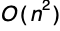의 비율로 증가하며, 여기서 은 팀원 수입니다. 더 큰 팀에서는 의사소통이 무너지기 시작하고 비효율적이 됩니다.

**[76]**

이를 위해서는 일반적인 *번다운(burndown)* 차트보다 *번업(burnup)* 차트가 더 낫습니다. 번업 차트를 사용하면 추가된 기능들이 어떻게 목표 지점을 이동시키는지 명확히 볼 수 있습니다.

**[77]**

팀은 외부적으로는 한목소리를 냅니다. 내부적으로는 활발하고 격렬한 토론을 강력히 권장합니다. 훌륭한 개발자들은 자신의 일에 열정적인 경향이 있습니다.

**[78]**

앤디는 금요일에 데일리 스크럼 스탠드업을 진행하는 팀들을 만난 적이 있습니다.

**[79]**

[https://en.wikipedia.org/wiki/Cargo_cult](https://en.wikipedia.org/wiki/Cargo_cult) 참고.

**[80]**

우리는 이것을 여러분이 생각하는 것보다 훨씬 더 많이 직접 목격했습니다.

**[81]**

[https://netflix.github.io/chaosmonkey](https://netflix.github.io/chaosmonkey)

**[82]**

테스트 커버리지와 결함 간의 상관관계에 대한 흥미로운 연구는 *Mythical Unit Test Coverage* [ADSS18]을 참고하세요.

**[83]**

항상 Topic 3, *소프트웨어 엔트로피(Software Entropy)*를 기억하세요. 항상.

**[84]**

[http://www.extremeprogramming.org](http://www.extremeprogramming.org)

> *장기적으로 볼 때, 우리는 삶을 형성하고 우리 자신을 형성한다. 이 과정은 우리가 죽을 때까지 결코 끝나지 않는다. 그리고 우리가 내리는 선택은 궁극적으로 우리 자신의 책임이다.*
>
> — 엘리너 루즈벨트

# 10장
: 후기(Postface)

초판이 나오기 전 20년 동안, 우리는 컴퓨터가 주변적인 호기심의 대상에서 비즈니스를 위한 현대의 필수품으로 진화하는 과정의 일부였습니다. 그 후 20년 동안 소프트웨어는 단순한 비즈니스 기계를 넘어 성장했고, 진정으로 세상을 장악했습니다. 하지만 그것이 우리에게 진정으로 무엇을 의미할까요?

프레드 브룩스는 『맨먼스 미신(The Mythical Man-Month: Essays on Software Engineering)』 [Bro96]에서 "프로그래머는 시인과 마찬가지로 순수한 생각의 재료(thought-stuff)에서 아주 조금만 떨어져서 일한다. 그는 상상력의 발휘를 통해 공중으로부터 공중에 성을 쌓는다"라고 말했습니다. 우리는 빈 페이지로 시작해서, 우리가 상상할 수 있는 거의 모든 것을 창조할 수 있습니다. 그리고 우리가 창조하는 것들은 세상을 바꿀 수 있습니다.

사람들이 혁명을 계획하는 데 도움을 주는 트위터부터, 미끄러지는 것을 막기 위해 작동하는 자동차 안의 프로세서, 그리고 성가신 일상의 세부 사항들을 더 이상 기억할 필요가 없게 해주는 스마트폰까지, 우리의 프로그램은 어디에나 있습니다. 우리의 상상력은 어디에나 있습니다.

우리 개발자들은 믿을 수 없을 정도로 특권을 누리고 있습니다. 우리는 진정으로 미래를 건설하고 있습니다. 그것은 엄청난 힘입니다. 그리고 그 힘에는 엄청난 책임이 따릅니다.

우리는 얼마나 자주 멈춰서 그것에 대해 생각하나요? 우리는 얼마나 자주 우리끼리, 그리고 더 일반적인 대중과 이것이 무엇을 의미하는지 논의하나요?

임베디드 기기는 노트북, 데스크톱, 데이터 센터에서 사용되는 것보다 자릿수가 다를 정도로 훨씬 더 많은 컴퓨터를 사용합니다. 이러한 임베디드 컴퓨터는 발전소에서 자동차, 의료 장비에 이르기까지 종종 생명이 걸린(life-critical) 시스템을 제어합니다. 심지어 단순한 중앙 난방 제어 시스템이나 가전제품조차도 잘못 설계되거나 구현되면 사람을 죽일 수 있습니다. 이러한 기기를 개발할 때, 여러분은 실로 엄청난 책임을 떠안게 됩니다.

많은 비임베디드 시스템 역시 큰 선과 큰 해악을 모두 행할 수 있습니다. 소셜 미디어는 평화로운 혁명을 촉진할 수도 있고 추악한 증오를 부추길 수도 있습니다. 빅데이터는 쇼핑을 더 쉽게 만들 수도 있고, 여러분이 가지고 있다고 생각할 만한 사생활의 흔적을 모두 파괴할 수도 있습니다. 은행 시스템은 사람들의 삶을 바꾸는 대출 결정을 내립니다. 그리고 거의 모든 시스템이 사용자를 염탐하는 데 사용될 수 있습니다.

우리는 유토피아적 미래의 가능성에 대한 힌트와, 악몽 같은 디스토피아로 이어지는 의도치 않은 결과의 사례들을 보아왔습니다. 두 결과 사이의 차이는 여러분이 생각하는 것보다 더 미묘할 수 있습니다. 그리고 그 모든 것이 여러분의 손에 달려 있습니다.

## 도덕적 나침반

이 예기치 못한 힘의 대가는 경계심(vigilance)입니다. 우리의 행동은 사람들에게 직접적인 영향을 미칩니다. 더 이상 차고 속 8비트 CPU 위의 취미 프로그램이나, 데이터 센터 메인프레임 위의 고립된 배치 비즈니스 프로세스, 혹은 그저 데스크톱 PC가 아닙니다. 우리의 소프트웨어는 현대 일상생활의 바로 그 직물을 짜고 있습니다.

우리는 우리가 전달하는 모든 코드 조각에 대해 스스로에게 두 가지 질문을 던질 의무가 있습니다.

1. 나는 사용자를 보호했는가?
2. 나 자신이 이것을 사용할 것인가?

먼저, 여러분은 "내가 이 코드의 사용자들을 해악으로부터 보호하기 위해 최선을 다했는가?"라고 물어야 합니다. 그 단순한 아기 모니터에 지속적인 보안 패치를 적용할 조치를 마련했나요? 자동 중앙 난방 온도 조절기가 *어떻게* 고장 나더라도 고객이 여전히 수동 제어를 할 수 있도록 보장했나요? 필요한 데이터만 저장하고 개인적인 모든 것을 암호화하고 있나요?

완벽한 사람은 없습니다. 누구나 가끔씩 놓치는 것이 있습니다. 하지만 여러분이 모든 결과를 나열해 보려고 노력했고, 그것들로부터 사용자를 보호하기 위해 확실히 조치를 취했다고 진실하게 말할 수 없다면, 상황이 나빠졌을 때 여러분에게도 일부 책임이 있습니다.

::: {.callout-tip appearance="simple" icon=false}
**Tip 98: 첫째, 해를 끼치지 마라**
:::

둘째, 황금률과 관련된 판단이 있습니다. 내가 이 소프트웨어의 사용자가 된다면 행복할까요? 내 세부 정보가 공유되기를 원하나요? 내 동선이 소매점에 넘겨지기를 원하나요? 이 자율주행차에 의해 운전되는 것이 행복할까요? 나는 이 일을 하는 것이 편안한가요?

일부 기발한 아이디어들은 윤리적 행동의 경계를 넘나들기 시작하며, 만약 여러분이 그 프로젝트에 참여하고 있다면, 여러분은 스폰서만큼이나 책임이 있습니다. 아무리 많은 분리 단계를 합리화하더라도, 한 가지 규칙은 변함없이 진실입니다.

::: {.callout-tip appearance="simple" icon=false}
**Tip 99: 악당들을 돕지 마라(Don't Enable Scumbags)**
:::

## 여러분이 원하는 미래를 상상하라

그것은 여러분에게 달려 있습니다. 향후 20년과 그 이후를 건설하는 순수한 생각의 재료를 제공하는 것은 바로 여러분의 상상력, 여러분의 희망, 여러분의 관심사입니다.

여러분은 여러분 자신과 후손들을 위해 미래를 건설하고 있습니다. 여러분의 의무는 우리 모두가 살고 싶어 할 만한 미래를 만드는 것입니다. 여러분이 이 이상에 반하는 일을 하고 있을 때를 인식하고, "아니오!"라고 말할 용기를 가지세요. 우리가 *가질 수 있는* 미래를 마음속에 그리고, 그것을 창조할 용기를 가지세요. 매일 공중에 성을 쌓으세요.

우리 모두는 놀라운 삶을 살고 있습니다.

::: {.callout-tip appearance="simple" icon=false}
**Tip 100: 그것은 당신의 삶이다. 나누어라. 축하하라. 만들어라. 그리고 즐겨라!**
:::

# 부록
1: 참고 문헌

**[ADSS18]**

**[And10]**

**[Arm07]**

**[BR89]**

**[Bro96]**

**[CN91]**

**[Con68]**

**[de 98]**

**[DL13]**

**[Fow00]**

**[Fow04]**

**[Fow19]**

**[GHJV95]**

**[Hol92]**

**[Hun08]**

**[Joi94]**

**[Knu11]**

**[Knu98]**

**[Knu98a]**

**[Knu98b]**

**[KP99]**

**[Mey97]**

**[Mul18]**

**[SF13]**

**[Str35]**

**[SW11]**

**[Tal10]**

**[WH82]**

**[YC79]**

**[You95]**

> *나는 답할 수 없는 질문을 갖는 편이 질문할 수 없는 답을 갖는 것보다 낫다.*
>
> — 리처드 파인만

# 부록
2: 연습 문제의 가능한 해답

**해답 1** (연습 문제 1에서)

우리 생각에는 `Split2` 클래스가 더 직교적입니다. 줄을 나누는 자신의 작업에 집중하고, 줄이 어디에서 오는지와 같은 세부 사항은 무시합니다. 이는 코드를 개발하기 쉽게 만들 뿐만 아니라 더 유연하게 만듭니다. `Split2`는 파일에서 읽은 줄, 다른 루틴에서 생성된 줄, 또는 환경을 통해 전달된 줄을 나눌 수 있습니다.

**해답 2** (연습 문제 2에서)

단언부터 시작합시다. 여러분은 거의 모든 언어에서 훌륭하고 직교적인 코드를 작성할 수 있습니다. 동시에 모든 언어에는 유혹이 있습니다. 결합도를 높이고 직교성을 떨어뜨릴 수 있는 기능들입니다.

객체지향(OO) 언어에서는 다중 상속, 예외, 연산자 오버로딩, (서브클래싱을 통한) 부모 메서드 오버라이딩 같은 기능들이 불분명한 방식으로 결합도를 높일 충분한 기회를 제공합니다. 클래스가 코드와 데이터를 결합하기 때문에 발생하는 일종의 결합도도 있습니다. 이것은 보통 좋은 것입니다(결합도가 좋을 때, 우리는 그것을 응집도(cohesion)라고 부릅니다). 하지만 클래스를 충분히 집중시키지 않으면 꽤 추한 인터페이스로 이어질 수 있습니다.

함수형 언어에서는 작고 결합도가 낮은 함수들을 많이 작성하고, 문제를 해결하기 위해 그것들을 다양한 방식으로 결합하도록 장려됩니다. 이론상으로는 좋게 들립니다. 실제로도 종종 그렇습니다. 하지만 여기서도 발생할 수 있는 결합도의 형태가 있습니다. 이러한 함수들은 일반적으로 데이터를 변환하는데, 이는 한 함수의 결과가 다른 함수의 입력이 될 수 있음을 의미합니다. 주의하지 않으면, 함수가 생성하는 데이터 형식을 변경했을 때 변환 스트림 아래쪽 어딘가에서 실패가 발생할 수 있습니다. 훌륭한 타입 시스템을 가진 언어는 이를 완화하는 데 도움이 될 수 있습니다.

**해답 3** (연습 문제 3에서)

로테크(Low-tech)가 구원해 줄 것입니다! 화이트보드에 마커로 자동차, 전화기, 집 같은 만화를 몇 개 그려보세요. 대단한 예술일 필요는 없습니다. 졸라맨(stick-figure) 윤곽선이면 충분합니다. 클릭 가능한 영역에 대상 페이지의 내용을 설명하는 포스트잇을 붙이세요. 회의가 진행됨에 따라 그림과 포스트잇의 배치를 다듬을 수 있습니다.

**해답 4** (연습 문제 4에서)

언어를 확장 가능하게 만들고 싶기 때문에, 파서를 테이블 주도(table driven)로 만들 것입니다. 테이블의 각 항목에는 명령어 문자, 인자가 필요한지 여부를 나타내는 플래그, 그리고 그 특정 명령어를 처리하기 위해 호출할 루틴의 이름이 포함됩니다.

*다운로드: [lang/turtle.c](http://media.pragprog.com/titles/tpp20/code/lang/turtle.c)*

```
typedef struct {
  char  cmd;              /* the command letter */
  int hasArg;             /* does it take an argument */
  void (*func)(int, int); /* routine to call */
} Command;

static Command cmds[] = {
  { 'P',  ARG,     doSelectPen },
  { 'U',  NO_ARG,  doPenUp },
  { 'D',  NO_ARG,  doPenDown },
  { 'N',  ARG,     doPenDir },
  { 'E',  ARG,     doPenDir },
  { 'S',  ARG,     doPenDir },
  { 'W',  ARG,     doPenDir }
};
```

메인 프로그램은 꽤 간단합니다. 한 줄을 읽고, 명령어를 찾고, 필요하면 인자를 가져온 다음, 핸들러 함수를 호출합니다.

*다운로드: [lang/turtle.c](http://media.pragprog.com/titles/tpp20/code/lang/turtle.c)*

```
while (fgets(buff, sizeof(buff), stdin)) {

  Command *cmd = findCommand(*buff);

  if (cmd) {
    int   arg = 0;

    if (cmd->hasArg && !getArg(buff+1, &arg)) {
      fprintf(stderr, "'%c' needs an argument\n", *buff);
      continue;
    }

    cmd->func(*buff, arg);
  }
}
```

명령어를 찾는 함수는 테이블을 선형 탐색하여 일치하는 항목이나 NULL을 반환합니다.

*다운로드: [lang/turtle.c](http://media.pragprog.com/titles/tpp20/code/lang/turtle.c)*

```
Command *findCommand(int cmd) {
  int i;

  for (i = 0; i < ARRAY_SIZE(cmds); i++) {
    if (cmds[i].cmd == cmd)
      return cmds + i;
  }

  fprintf(stderr, "Unknown command '%c'\n", cmd);
  return 0;
}
```

마지막으로, 숫자 인자를 읽는 것은 `sscanf`를 사용하면 꽤 간단합니다.

*다운로드: [lang/turtle.c](http://media.pragprog.com/titles/tpp20/code/lang/turtle.c)*

```
int getArg(const char *buff, int *result) {
  return sscanf(buff, "%d", result) == 1;
}
```

**해답 5** (연습 문제 5에서)

사실, 여러분은 이전 연습 문제에서 이미 이 문제를 풀었습니다. 외부 언어를 위한 인터프리터를 작성한 곳에 내부 인터프리터가 포함될 것이기 때문입니다. 우리 예제 코드의 경우, 이것이 바로 `doXxx` 함수들입니다.

**해답 6** (연습 문제 6에서)

BNF를 사용하면 시간 명세는 다음과 같을 수 있습니다.

| *time* | ::= | *hour* *ampm* `\|` *hour* `:` *minute* *ampm* `\|` *hour* `:` *minute* |
| --- | --- | --- |
| *ampm* | ::= | `am \| pm` |
| *hour* | ::= | *digit* \| *digit* *digit* |
| *minute* | ::= | *digit* *digit* |
| *digit* | ::= | `0 \| 1 \| 2 \| 3 \| 4 \| 5 \| 6 \| 7 \| 8 \| 9` |

*hour*와 *minute*에 대한 더 나은 정의는 시(hour)가 00에서 23까지만 가능하고, 분(minute)은 00에서 59까지만 가능하다는 점을 고려할 것입니다.

| *hour* | ::= | *h-tens* *digit* \| *digit* |
| --- | --- | --- |
| *minute* | ::= | *m-tens* *digit* |
| *h-tens* | ::= | `0 \| 1` |
| *m-tens* | ::= | `0 \| 1 \| 2 \| 3 \| 4 \| 5` |
| *digit* | ::= | `0 \| 1 \| 2 \| 3 \| 4 \| 5 \| 6 \| 7 \| 8 \| 9` |

**해답 7** (연습 문제 7에서)

Pegjs 자바스크립트 라이브러리를 사용하여 작성한 파서는 다음과 같습니다.

*다운로드: [lang/peg_parser/time_parser.pegjs](http://media.pragprog.com/titles/tpp20/code/lang/peg_parser/time_parser.pegjs)*

```
time
  = h:hour offset:ampm              { return h + offset }
  / h:hour ":" m:minute offset:ampm { return h + m + offset }
  / h:hour ":" m:minute             { return h + m }

ampm
  = "am" { return 0 }
  / "pm" { return 12*60 }

hour
  = h:two_hour_digits { return h*60 }
  / h:digit           { return h*60 }

minute
  = d1:[0-5] d2:[0-9] { return parseInt(d1+d2, 10); }

digit
  = digit:[0-9] { return parseInt(digit, 10); }

two_hour_digits
  = d1:[01] d2:[0-9 ] { return parseInt(d1+d2, 10); }
  / d1:[2]  d2:[0-3]  { return parseInt(d1+d2, 10); }
```

테스트는 그것이 어떻게 사용되는지 보여줍니다.

*다운로드: [lang/peg_parser/test_time_parser.js](http://media.pragprog.com/titles/tpp20/code/lang/peg_parser/test_time_parser.js)*

```
let test = require('tape');
let time_parser = require('./time_parser.js');

// time    ::= hour ampm            |
//             hour : minute ampm   |
//             hour : minute
//
//  ampm   ::= am | pm
//
//  hour   ::= digit | digit digit
//
//  minute ::= digit digit
//
//  digit  ::= 0 |1 | 2 | 3 | 4 | 5 | 6 | 7 | 8 | 9


const h  = (val) => val*60;
const m  = (val) => val;
const am = (val) => val;
const pm = (val) => val + h(12);

let tests = {

  "1am": h(1),
  "1pm": pm(h(1)),

  "2:30": h(2) + m(30),
  "14:30": pm(h(2)) + m(30),
  "2:30pm": pm(h(2)) + m(30),

}

test('time parsing', function (t) {
    for (const string in tests) {
      let result = time_parser.parse(string)
      t.equal(result, tests[string], string);
    }
    t.end()
});
```

**해답 8** (연습 문제 8에서)

루비(Ruby)로 작성한 가능한 해답은 다음과 같습니다.

*다운로드: [lang/re_parser/time_parser.rb](http://media.pragprog.com/titles/tpp20/code/lang/re_parser/time_parser.rb)*

```
TIME_RE = %r{
(?<digit>[0-9]){0}
(?<h_ten>[0-1]){0}
(?<m_ten>[0-6]){0}
(?<ampm> am | pm){0}
(?<hour>   (\g<h_ten> \g<digit>) | \g<digit>){0}
(?<minute> \g<m_ten>  \g<digit>){0}

\A(
    ( \g<hour> \g<ampm> )
  | ( \g<hour> : \g<minute> \g<ampm> )
  | ( \g<hour> : \g<minute> )
)\Z

}x

def parse_time(string)
  result = TIME_RE.match(string)
  if result
    result[:hour].to_i * 60 +
    (result[:minute] || "0").to_i +
    (result[:ampm] == "pm" ? 12*60 : 0)
  end
end
```

(이 코드는 정규 표현식의 시작 부분에 이름 붙은 패턴을 정의한 다음, 실제 매칭에서 그것들을 하위 패턴으로 참조하는 트릭을 사용합니다.)

**해답 9** (연습 문제 9에서)

우리의 해답은 몇 가지 가정에 기반해야 합니다.

- 저장 장치에는 전송해야 할 정보가 들어 있다.
- 사람이 걷는 속도를 알고 있다.
- 기계들 사이의 거리를 알고 있다.
- 저장 장치로 정보를 전송하고 저장 장치에서 정보를 읽어오는 데 걸리는 시간은 계산하지 않는다.
- 데이터를 저장하는 오버헤드는 통신선을 통해 데이터를 보내는 오버헤드와 대략 같다.

**해답 10** (연습 문제 10에서)

이전 해답의 단서 조항을 전제로 하면: 1TB 테이프는 8×2^40^, 즉 2^43^비트를 포함하므로, 1Gbps 회선은 동등한 양의 정보를 전송하기 위해 약 9,000초, 즉 대략 2시간 반 동안 데이터를 펌핑해야 할 것입니다. 사람이 시속 3.5마일의 일정한 속도로 걷는다면, 통신선이 우리의 배달부보다 뛰어난 성능을 발휘하려면 두 기계가 거의 9마일 떨어져 있어야 합니다. 그렇지 않으면 사람이 이깁니다.

**해답 14** (연습 문제 14에서)

자바(Java)로 함수 시그니처를 보여드리고, 주석으로 사전 조건과 사후 조건을 표시하겠습니다.

먼저, 클래스에 대한 불변식(invariant)입니다.

```
/**
  * @invariant getSpeed() > 0
  *        implies isFull()              // Don't run empty
  *
  * @invariant getSpeed() >= 0 &&
  *        getSpeed() < 10               // Range check
  */
```

다음으로, 사전 조건과 사후 조건입니다.

```
/**
  * @pre Math.abs(getSpeed() - x) <= 1 // Only change by one
  * @pre x >= 0 && x < 10              // Range check
  * @post getSpeed() == x              // Honor requested speed
  */
public void setSpeed(final int x)

/**
  * @pre !isFull()                     // Don't fill it twice
  * @post isFull()                     // Ensure it was done
  */
void fill()

/**
  * @pre isFull()                      // Don't empty it twice
  * @post !isFull()                    // Ensure it was done
  */
void empty()
```

**해답 15** (연습 문제 15에서)

이 수열에는 21개의 항이 있습니다. 만약 20이라고 답했다면, 여러분은 방금 울타리 기둥 오류(fencepost error, 기둥을 세어야 할지 기둥 사이의 간격을 세어야 할지 모르는 것)를 경험한 것입니다.

**해답 16** (연습 문제 16에서)

- 1752년 9월은 19일밖에 없었습니다. 이것은 그레고리력 개혁의 일환으로 달력을 동기화하기 위해 행해졌습니다.
- 디렉터리가 다른 프로세스에 의해 제거되었을 수도 있고, 읽을 권한이 없을 수도 있으며, 드라이브가 마운트되지 않았을 수도 있습니다… 무슨 말인지 아실 겁니다.
- 우리는 교묘하게 `a`와 `b`의 타입을 명시하지 않았습니다. 연산자 오버로딩이 `+`, `=`, 또는 `!=`를 예상치 못한 동작을 하도록 정의했을 수 있습니다. 또한 `a`와 `b`가 같은 변수의 별칭(alias)이어서 두 번째 할당이 첫 번째에 저장된 값을 덮어쓸 수도 있습니다. 또한 프로그램이 동시성(concurrent) 프로그램이고 잘못 작성되었다면, 덧셈이 일어날 때쯤 `a`가 업데이트되었을 수도 있습니다.
- 비유클리드 기하학에서는 삼각형 내각의 합이 180°가 되지 않습니다. 구의 표면에 그려진 삼각형을 생각해 보세요.
- 윤분(leap minutes)은 61초나 62초일 수 있습니다.
- 언어에 따라, 수치 오버플로우(numeric overflow)로 인해 `a+1`의 결과가 음수가 될 수 있습니다.

**해답 17** (연습 문제 17에서)

대부분의 C 및 C++ 구현체에서는 포인터가 실제로 유효한 메모리를 가리키고 있는지 확인하는 방법이 없습니다. 흔한 실수는 메모리 블록을 할당 해제하고 프로그램의 뒷부분에서 그 메모리를 참조하는 것입니다. 그때쯤이면 가리키던 메모리는 이미 다른 용도로 재할당되었을 가능성이 큽니다. 포인터를 `NULL`로 설정함으로써 프로그래머는 이러한 불량 참조를 방지하기를 희망합니다. 대부분의 경우 `NULL` 포인터를 역참조하면 런타임 오류가 발생합니다.

**해답 18** (연습 문제 18에서)

참조를 `NULL`로 설정하면, 참조된 객체를 가리키는 포인터의 수가 1 감소합니다. 이 카운트가 0에 도달하면, 그 객체는 가비지 컬렉션(garbage collection)의 대상이 됩니다. 참조를 `NULL`로 설정하는 것은 프로그래머가 시간이 지남에 따라 메모리 사용량이 증가하지 않도록 보장해야 하는 오래 실행되는 프로그램에서 중요할 수 있습니다.

**해답 19** (연습 문제 19에서)

간단한 구현은 다음과 같을 수 있습니다.

*다운로드: [event/strings_ex_1.rb](http://media.pragprog.com/titles/tpp20/code/event/strings_ex_1.rb)*

```
class FSM
  def initialize(transitions, initial_state)
    @transitions = transitions
    @state       = initial_state
  end
  def accept(event)
    @state, action = TRANSITIONS[@state][event] || TRANSITIONS[@state][:default]
  end
end
```

(이 새로운 FSM 클래스를 사용하는 업데이트된 코드를 얻으려면 이 파일을 다운로드하세요.)

**해답 20** (연습 문제 20에서)

- …5분 이내에 세 번의 *네트워크 인터페이스 다운* 이벤트: 이것은 상태 머신(state machine)을 사용하여 구현할 *수* 있지만, 처음에 보이는 것보다 더 까다로울 것입니다. 1분, 4분, 7분, 8분에 이벤트를 받는다면 네 번째 이벤트에서 경고를 트리거해야 하는데, 이는 상태 머신이 스스로를 리셋할 수 있어야 함을 의미합니다. 이러한 이유로 이벤트 스트림(event streams)이 선택할 만한 기술로 보입니다. 들어오는 이벤트 3개씩의 그룹을 반환할 수 있는 `size`와 `offset` 파라미터를 가진 `buffer`라는 리액티브 함수가 있습니다. 그런 다음 그룹 내 첫 번째와 마지막 이벤트의 타임스탬프를 보고 알람을 트리거해야 할지 결정할 수 있습니다.
- …일몰 후, 계단 아래쪽에서 움직임이 감지된 후 계단 위쪽에서 움직임이 감지됨…: 이것은 아마도 pubsub과 상태 머신의 조합을 사용하여 구현할 수 있을 것입니다. pubsub을 사용하여 임의의 수의 상태 머신에 이벤트를 전파한 다음, 상태 머신이 무엇을 할지 결정하게 할 수 있습니다.
- …주문이 완료되었음을 다양한 보고 시스템에 알림: 이것은 아마도 pubsub을 사용하여 처리하는 것이 가장 좋을 것입니다. 스트림을 사용하고 싶을 수도 있지만, 그러려면 알림을 받는 시스템들도 스트림 기반이어야 합니다.
- …세 개의 백엔드 서비스와 응답을 기다림: 이것은 사용자 데이터를 가져오기 위해 스트림을 사용했던 우리의 예제와 유사합니다.

**해답 21** (연습 문제 21에서)

1. 주문에 배송비와 판매세가 추가됨: 기존의 코드에서는 배송비를 계산하는 함수와 세금을 계산하는 함수가 따로 있을 가능성이 높습니다. 하지만 여기서는 변환(transformations)에 대해 생각하고 있으므로, 항목만 있는 주문을 새로운 종류의 것, 즉 배송할 수 있는 주문으로 변환합니다.
```
basic order → finalized order
```
2. 애플리케이션이 지정된 파일에서 설정 정보를 로드함:
```
file name → configuration structure
```
3. 누군가 웹 애플리케이션에 로그인함:
```
user credentials → session
```

**해답 22** (연습 문제 22에서)

고수준 변환:

```
field contents as string
    → [validate & convert]
        → {:ok, value} | {:error, reason}
```

은 다음과 같이 세분화될 수 있습니다.

```
field contents as string
    → [convert string to integer]
    → [check value >= 18]
    → [check value <= 150]
        → {:ok, value} | {:error, reason}
```

이는 여러분이 오류 처리 파이프라인을 가지고 있다고 가정합니다.

**해답 23** (연습 문제 23에서)

두 번째 질문에 먼저 답하겠습니다. 우리는 첫 번째 코드 조각을 선호합니다.

두 번째 코드 덩어리에서는 각 단계가 우리가 호출할 다음 함수를 구현하는 객체를 반환합니다. `content_of`가 반환하는 객체는 반드시 `find_matching_lines`를 구현해야 하며, 그 다음도 마찬가지입니다.

이는 `content_of`가 반환하는 객체가 우리 코드와 결합되어 있음을 의미합니다. 요구사항이 변경되어 `#` 문자로 시작하는 줄을 무시해야 한다고 상상해 보세요. 변환 스타일에서는 다음과 같이 쉬울 것입니다.

```
const content     = File.read(file_name);
const no_comments = remove_comments(content)
const lines       = find_matching_lines(no_comments, pattern)
const result      = truncate_lines(lines)
```

심지어 `remove_comments`와 `find_matching_lines`의 순서를 바꾸더라도 여전히 작동할 것입니다.

하지만 체인 스타일에서는 이것이 더 어려울 것입니다. `remove_comments` 메서드는 어디에 있어야 할까요? `content_of`가 반환하는 객체에 있어야 할까요, 아니면 `find_matching_lines`가 반환하는 객체에 있어야 할까요? 그리고 그 객체를 변경하면 다른 어떤 코드가 망가질까요? 이러한 결합도 때문에 메서드 체이닝 스타일은 때때로 *열차 사고(train wreck)*라고 불립니다.

**해답 24** (연습 문제 24에서)

***이미지 처리.***

병렬 프로세스들 사이에서 작업 부하를 단순히 스케줄링하는 것이라면, 공유 작업 큐(shared work queue)로도 충분할 수 있습니다. 만약 피드백이 관련되어 있다면—즉, 머신 비전 애플리케이션이나 복잡한 3D 이미지 워프(image-warp) 변환에서처럼 한 처리된 청크의 결과가 다른 청크에 영향을 미친다면—칠판 시스템(blackboard system)을 고려해 볼 수 있습니다.

**그룹 일정 관리(Group calendaring)**

이것은 꽤 잘 맞을 수 있습니다. 예정된 회의와 가용 시간을 칠판에 게시할 수 있습니다. 자율적으로 기능하는 엔티티들이 있고, 결정으로부터의 피드백이 중요하며, 참여자들이 들어오고 나갈 수 있습니다.

누가 검색하느냐에 따라 이런 종류의 칠판 시스템을 분할하는 것을 고려해 볼 수도 있습니다. 주니어 직원은 바로 옆 사무실에만 관심이 있을 수 있고, 인사부는 전 세계 영어권 사무실만 원할 수 있으며, CEO는 전체를 다 보고 싶어 할 수 있습니다.

데이터 형식에 있어서도 약간의 유연성이 있습니다. 우리가 이해하지 못하는 형식이나 언어는 자유롭게 무시할 수 있습니다. 우리는 서로 회의를 하는 사무실들에 대해서만 다른 형식을 이해하면 되며, 모든 참여자에게 가능한 모든 형식의 완전한 추이적 폐포(transitive closure)를 노출할 필요가 없습니다. 이는 결합도를 필요한 곳으로 줄여주며, 우리를 인위적으로 제약하지 않습니다.

**네트워크 모니터링 도구**

이것은 모기지/대출 신청 프로그램과 매우 유사합니다. 사용자가 보낸 장애 보고서와 자동으로 보고되는 통계가 모두 칠판에 게시됩니다. 인간이나 소프트웨어 에이전트가 칠판을 분석하여 네트워크 장애를 진단할 수 있습니다. 한 회선에서 두 번의 오류는 그저 우주선(cosmic rays) 때문일 수도 있지만, 20,000번의 오류라면 하드웨어 문제가 있는 것입니다. 탐정들이 살인 미스터리를 푸는 것과 마찬가지로, 여러 엔티티가 네트워크 문제를 해결하기 위해 아이디어를 분석하고 기여할 수 있습니다.

**해답 25** (연습 문제 25에서)

키-값 쌍 목록에서의 가정은 일반적으로 키가 고유하다는 것이며, 해시 라이브러리는 보통 해시 자체의 동작이나 중복 키에 대한 명시적 오류 메시지를 통해 이를 강제합니다. 그러나 배열은 일반적으로 그러한 제약 조건이 없으며, 여러분이 특별히 그렇지 않도록 코딩하지 않는 한 중복 키를 기꺼이 저장할 것입니다. 따라서 이 경우 `DepositAccount`와 일치하는 첫 번째로 발견된 키가 이기고, 나머지 일치하는 항목들은 무시됩니다. 항목의 순서는 보장되지 않으므로, 때로는 작동하고 때로는 작동하지 않습니다.

그리고 개발 머신과 프로덕션 머신의 차이는 어떨까요? 그것은 그저 우연의 일치일 뿐입니다.

**해답 26** (연습 문제 26에서)

순수하게 숫자 필드가 미국, 캐나다, 카리브해에서 작동한다는 사실은 우연의 일치입니다. ITU 명세에 따르면, 국제 전화 형식은 문자 `+` 기호로 시작합니다. `*` 문자도 일부 지역에서 사용되며, 더 흔하게는 앞자리 0(leading zeros)이 번호의 일부가 될 수 있습니다. 절대로 전화번호를 숫자 필드에 저장하지 마세요.

**해답 27** (연습 문제 27에서)

어디에 있느냐에 따라 다릅니다. 미국에서 부피 측정은 갤런(gallon)을 기반으로 하며, 이는 높이 6인치, 지름 7인치인 원통의 부피를 가장 가까운 세제곱인치로 반올림한 것입니다.

캐나다에서 레시피의 "한 컵(one cup)"은 다음 중 어느 것이든 의미할 수 있습니다.

- 영연방 쿼트(imperial quart)의 1/5, 또는 227ml
- 미국 쿼트의 1/4, 또는 236ml
- 미터법 테이블스푼 16개, 또는 240ml
- 1리터의 1/4, 또는 250ml

단, 전기밥솥에 대해 이야기하는 경우가 아니라면 말입니다. 그 경우 "한 컵"은 180ml입니다. 그것은 한 사람이 1년 동안 먹는 데 필요한 마른 쌀의 추정 부피였던 *고쿠(koku)*에서 유래했는데, 대략 180L 정도입니다. 밥솥 컵은 1 *고(gō)*로, 1고쿠의 1/1000입니다. 그러니 대략 한 사람이 한 끼에 먹는 쌀의 양입니다.^[85]^

**해답 28** (연습 문제 28에서)

분명히, 우리는 이 연습 문제에 대해 어떤 절대적인 답을 줄 수는 없습니다. 하지만 몇 가지 힌트는 드릴 수 있습니다.

결과가 매끄러운 곡선을 따르지 않는다면, 다른 활동이 프로세서의 성능을 일부 사용하고 있는지 확인해 보는 것이 좋습니다. 백그라운드 프로세스가 주기적으로 프로그램에서 사이클을 빼앗아 간다면 좋은 수치를 얻지 못할 것입니다. 메모리도 확인해 보는 것이 좋습니다. 애플리케이션이 스왑 공간을 사용하기 시작하면 성능이 급락할 것입니다.

우리 머신 중 하나에서 코드를 실행한 결과 그래프는 다음과 같습니다.


**해답 29** (연습 문제 29에서)

거기에 도달하는 데는 몇 가지 방법이 있습니다. 한 가지는 문제를 뒤집어 생각하는 것입니다. 배열에 요소가 단 하나만 있다면, 우리는 루프를 돌지 않습니다. 각 추가 반복은 우리가 검색할 수 있는 배열의 크기를 두 배로 늘립니다. 따라서 배열 크기에 대한 일반 공식은 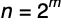이며, 여기서 은 반복 횟수입니다. 양변에 밑이 2인 로그를 취하면 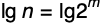을 얻고, 로그의 정의에 의해 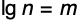이 됩니다.

**해답 30** (연습 문제 30에서)

아마도 중고등학교 수학 시간의 기억을 너무 많이 되살리는 것이겠지만, 밑이 인 로그를 밑이 인 로그로 변환하는 공식은 다음과 같습니다.

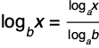

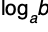는 상수이므로, 빅오(Big-O) 결과 내에서는 무시할 수 있습니다.

**해답 31** (연습 문제 31에서)

우리가 테스트할 수 있는 한 가지 속성은 창고에 충분한 품목이 있다면 주문이 성공한다는 것입니다. 우리는 무작위 수량의 품목에 대한 주문을 생성하고, 창고에 재고가 있었다면 `"OK"` 튜플이 반환되는지 검증할 수 있습니다.

**해답 32** (연습 문제 32에서)

이것은 속성 기반 테스트의 좋은 활용 예입니다. 단위 테스트는 여러분이 다른 수단으로 결과를 계산해 둔 개별 사례에 집중할 수 있고, 속성 테스트는 다음과 같은 것들에 집중할 수 있습니다.

- 두 상자가 겹치는가?
- 상자의 어떤 부분이라도 트럭의 너비나 길이를 초과하는가?
- 적재 밀도(상자들이 차지하는 면적을 트럭 적재함의 면적으로 나눈 값)가 1 이하인가?
- 요구사항의 일부라면, 적재 밀도가 최소 허용 밀도를 초과하는가?

**해답 33** (연습 문제 33에서)

1. 이 진술은 진짜 요구사항처럼 들립니다. 환경에 의해 애플리케이션에 부과된 제약 조건이 있을 수 있습니다.
2. 그 자체로 이 진술은 실제로 요구사항이 아닙니다. 하지만 *진짜로* 무엇이 요구되는지 알아내려면, 마법의 질문인 "왜요?"를 물어야 합니다. 이것이 기업 표준일 수도 있으며, 그 경우 실제 요구사항은 "모든 UI 요소는 메가코프 사용자 인터페이스 표준 V12.76을 준수해야 한다"와 같은 것이어야 합니다. 디자인 팀이 우연히 좋아하는 색상일 수도 있습니다. 그 경우, 디자인 팀이 또한 마음을 바꾸는 것을 좋아한다는 점을 생각하고 요구사항을 "모든 모달 창의 배경색은 설정 가능해야 한다. 출시 시 색상은 회색일 것이다"로 표현해야 합니다. 더 나은 것은 "애플리케이션의 모든 시각적 요소(색상, 글꼴, 언어)는 설정 가능해야 한다"라는 더 넓은 진술일 것입니다. 혹은 그저 사용자가 모달 창과 비모달 창을 구별할 수 있어야 한다는 뜻일 수도 있습니다. 그렇다면 더 많은 논의가 필요합니다.
3. 이 진술은 요구사항이 아니라 아키텍처입니다. 이런 것을 마주했을 때, 여러분은 사용자가 무슨 생각을 하고 있는지 알아내기 위해 깊이 파고들어야 합니다. 이것이 확장성 문제인가요? 아니면 성능? 비용? 보안? 그 답이 여러분의 설계에 정보를 줄 것입니다.
4. 근본적인 요구사항은 아마도 "시스템은 사용자가 필드에 유효하지 않은 입력을 하는 것을 방지하고, 이러한 입력이 이루어졌을 때 사용자에게 경고할 것이다"에 더 가까울 것입니다.
5. 이 진술은 아마도 어떤 하드웨어 한계에 기반한 엄격한 요구사항일 것입니다.

그리고 네 개의 점 문제에 대한 해답은 다음과 같습니다.

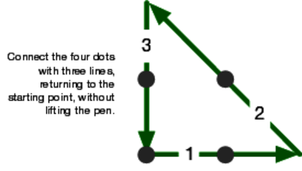

### 각주

**[85]**
