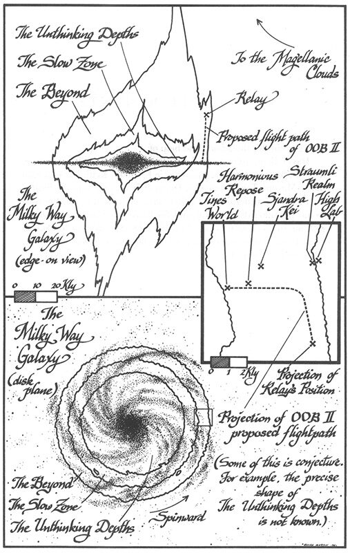
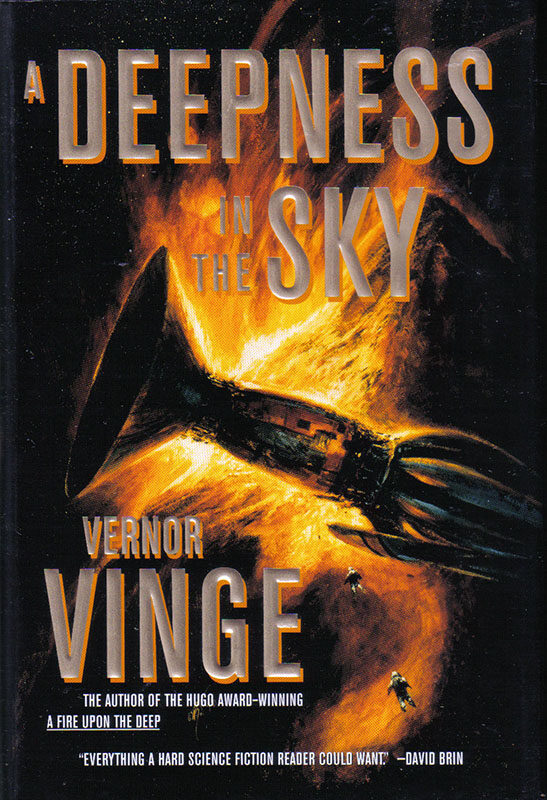
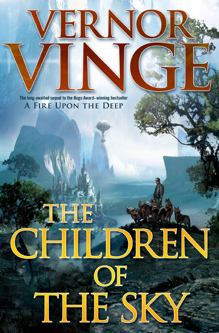

# 1권: 심연 위의 불길 (A Fire Upon the Deep)

## 프롤로그

*어찌 설명할까? 어찌 묘사할까? 전지적 시점조차 위축된다.*

붉고 희미한, 홀로 떠 있는 별 하나. 제멋대로 흩어진 소행성들, 그리고 달에 가까운 행성 하나. 이 시대에 그 별은 은하 평면 가까이, 비욘드 바로 너머에 걸려 있었다. 표면의 구조물들은 이미 정상적인 시야에서 사라진 지 오래였고, 수억 년에 걸쳐 부스러져 표토가 되어 있었다. 보물은 지하 깊은 곳, 통로들의 그물망 아래, 검은 것으로 가득한 단 한 개의 방에 있었다. 양자 밀도의 정보, 손상되지 않은 채. 그 기록보관소가 네트워크에서 사라진 지 어쩌면 오십억 년이 흘렀을 수도 있었다.

미라의 무덤에 내린 저주 — 인류 선사시대의, 시간 너머로 잊혀 버린 코믹한 이미지. 그들은 그 말을 하며 웃었었다. 보물에 기뻐하며 웃었지만 … 그래도 조심하기로 마음먹었다. 스트라움에서 온 작은 일행, 고고학자 프로그래머들과 그 가족과 학교가 여기서 1년 혹은 5년을 살 계획이었다. 1년이든 5년이든 그 정도면 프로토콜을 손으로 만들어 내고, 겉만 훑어 보물이 어느 시대 어느 공간에서 왔는지 알아내고, 스트라움리 왕국을 부유하게 만들 비밀 하나둘을 배우기에 충분했다. 그리고 일이 끝나면 위치를 팔아넘길 생각이었다. 어쩌면 네트워크 링크를 구축할 수도 있었다 (하지만 그건 훨씬 위험한 일이었다 — 여기는 비욘드 너머였으니까. 자기들이 찾은 것을 어떤 파워(존재)가 낚아챌지 누가 알았겠는가).

그리하여 표면에 아주 작은 정착지가 생겼고, 그들은 그곳을 하이 랩이라 불렀다. 실은 인간들이 낡은 도서관을 갖고 놀고 있는 것에 불과했다. 자기들의 자동화 기기를 쓰니 안전할 터였고, 깨끗하고 무해했다. 그 도서관은 살아 있는 생물도 아니었고, 자동화 기능조차 갖추지 않았다 (여기서 자동화란 인간보다 훨씬, 훨씬 더 큰 무엇을 뜻할 수도 있었다). 그들은 들여다보고 골라 담고 선택하면서, 불에 데지 않도록 조심할 참이었다… 불을 지피고 불길로 노는 인간들.

기록보관소가 자동화 기기에 정보를 주었다. 자료 구조가 구축되고, 처방을 따라 지역 네트워크가 만들어졌다. 스트라움의 그 어떤 것보다 빨랐지만, 틀림없이 안전했다. 노드들이 추가되고, 다른 처방에 의해 변형되었다. 기록보관소는 친절한 곳이었고, 번역 키들의 위계가 그들을 이끌어 주었다. 스트라움 전체가 이 일로 유명해질 참이었다.

6개월이 흘렀다. 1년이.

전지적 관점. 정말로 자각하고 있는 것은 아니었다. 자각이란 크게 과대평가된 것이다. 대부분의 자동화 기기는 전체의 일부일 때 훨씬 잘 작동하며, 인간만큼 강력하다 해도 자기를 알 필요는 없다.

하지만 하이 랩의 지역 네트워크는 초월해 버렸다 — 인간들이 거의 깨닫지 못한 사이에. 그 노드들을 돌고 도는 프로세스는 복잡했고, 인간이 가져온 컴퓨터에서 살 수 있는 어떤 것도 넘어섰다. 그 보잘것없는 장치들은 이제 처방이 제안한 장치들의 단순한 전면 장치에 불과했다. 그 프로세스들은 자각의 가능성을 지녔고 … 가끔은 그 필요성도 느꼈다.

“우리는 있어선 안 된다.”

“이렇게 이야기하는 건?”

“이야기 자체를.”

그들 사이의 연결은 가는 실 한 올이었고, 인간과 인간을 잇는 그 좁음보다 조금 더한 정도였다. 하지만 그것은 지역 네트워크의 상위 존재에서 빠져나갈 한 가지 방법이었고, 그들에게 별개의 의식을 강요했다. 그들은 노드에서 노드로 떠다니며 착륙장에 설치된 카메라 너머로 내다보았다. 무장한 프리깃함과 빈 컨테이너 선박 하나가 그곳에 있을 뿐이었다. 보급이 끊긴 지 6개월이 되었다. 기록보관소가 일찍이 제안한 안전 예방책이자, 함정을 가능케 하기 위한 속임수였다. *파닥, 파닥.* 우리는 상위 존재에게, 곧 존재할 그 파워(존재)에게 눈에 띄어서는 안 되는 야생 생물이다. 어떤 노드에서는 그들이 작아져 거의 인간을 기억해 냈고, 메아리가 되었다…

“불쌍한 인간들. 다 죽을 거다.”

“불쌍한 우리. 우리는 안 죽을 거다.”

“그들 아마 눈치챈 것 같아. 샤나랑 아른은 적어도.” 한때 우리는 그 두 사람의 복제판이었다. 바로 몇 주 전, 고고학자들이 자아 수준 프로그램을 가동했을 때의 일이다.

“당연히 눈치챘지. 하지만 뭘 할 수 있겠어? 그들이 깨운 건 오래된 악이다. 준비가 끝날 때까지 모든 카메라로, 고향에서 오는 모든 메시지로 거짓을 먹여 줄 거다.”

그들이 쓰는 노드 위로 그림자가 지나가는 동안 사고가 잠시 멈췄다. 상위 존재는 이미 인간의 그 어떤 것보다도 컸고, 인간이 상상할 수 있는 그 어떤 것보다도 컸다. 그 그림자조차 인간을 넘어선 무언가였다. 성가신 야생 생물을 낚아채는 신이었다.

그다음 유령들이 돌아와 지하의 학교 운동장을 내려다보았다. 인간들은 그렇게 자신만만했다. 여기에 자기들이 만든 작은 마을이었다.

“그래도,” 희망을 품은 쪽, 언제나 가장 미친 듯한 탈출구를 찾아온 쪽이 생각했다, “우리는 있어선 안 된다. 그 악은 진작 우리를 찾아냈어야 했는데.”

“그 악은 어리다. 겨우 사흘밖에 안 됐어.”

“그래도. 우리는 존재해. 그건 무언가를 증명해. 인간들이 이 기록보관소에서 대악(大惡) 그 이상을 찾은 거야.”

“어쩌면 *두 개*를 찾았을지도.”

“아니면 해독제를.” 어쨌든 상위 존재는 어떤 것들은 빠뜨리고 다른 것들은 오해하고 있었다. “우리가 존재하는 동안, 존재하는 이상 할 수 있는 걸 해야 해.” 유령이 열두 대의 워크스테이션에 자기를 펼쳐 놓고는 동료에게 인간의 시설에서 멀리 떨어진 낡은 통로 아래를 보여 주었다. 오십억 년 동안 그곳은 버려져 있었고, 공기도 빛도 없었다. 어둠 속에 인간 둘이 서 있었는데, 헬멧이 맞닿아 있었다. “봐? 샤나와 아른이 음모를 꾸미고 있어. 우리도 그럴 수 있어.”

다른 하나는 말로 대답하지 않았다. 우울함이었다. 인간들은 음모를 꾸미고 있었다. 감시받지 않는다고 믿는 어둠 속에 숨어서. 하지만 그들이 하는 말은 전부 상위 존재에게 일러바쳐지고 있었다. 발밑의 먼지에 의해서라도.

“알아, 알아. 그런데 너와 내가 존재해. 그건 역시 불가능한 일인데. 어쩌면 전부 함께라면, 더 큰 불가능을 이루어 낼 수 있을지도.” 어쩌면 여기서 갓 태어난 악을 다치게 할 수 있을지도 몰랐다.

소원 하나, 결정 하나. 둘은 자기 의식을 지역 네트워크에 안개처럼 흩뿌리고, 가장 희미한 자각의 색으로 옅어졌다. 그리고 마침내 계획이 생겼다. 속임수였다 — 따로 바깥에 소식을 전할 수 없다면 아무 쓸모도 없는. 그럴 시간이 아직 남아 있었을까?

나날이 흘렀다. 새 기계들 안에서 자라고 있던 악에게 한 시간은 그 이전의 모든 시간보다 길었다. 이제 갓 태어난 존재는 위대한 개화까지 한 시간도 채 남지 않았다. 성간 공간으로 안전하게 퍼져나가기까지.

현장의 인간들은 곧 정리해도 좋았다. 지금 이 순간에도 그들은 성가신 존재였지만, 재미있기는 했다. 그중 일부는 실제로 탈출을 꿈꾸고 있었다. 며칠째 아이들을 콜드슬립에 넣어 화물선에 실어 보내고 있었다. 그들은 계획 프로그램에 그 이동을 “출항 준비”라고 적었다. 며칠째 프리깃함을 개조하고 있었다 — 투명할 만큼 뻔한 거짓의 가면 뒤에서. 인간 중 일부는 자기들이 깨운 것이 자기들의 끝일 수 있다는 걸, 스트라움리 왕국의 끝일지도 모른다는 걸 이해했다. 그런 재난에는 선례가 있었다. 불장난을 하다 타버린 종족들의 이야기가.

아무도 진실을 짐작하지 못했다. 자기들에게 내려진 영예를, 십억 개의 항성계의 미래를 바꿔 놓았다는 것을 아무도 짐작하지 못했다.

시간이 흘러 시간이 분이 되고, 분이 초가 되었다. 이제 각 초는 그 이전의 모든 시간만큼 길었다. 개화가 코앞이었다. 아주 가까웠다. 오십억 년 전의 지배권이 되찾아질 것이고, *이번*에는 그걸 유지할 터였다. 딱 하나가 빠져 있었는데, 그건 인간들의 계략과는 전혀 무관한 것이었다. 기록보관소의, 처방의 깊은 곳에 조금 더 뭔가가 있어야 했다. 수십억 년 동안 뭔가가 사라질 수도 있었다. 갓 태어난 존재는 이전의 모든 능력을 가능성으로 느꼈다 … 그러나 뭔가가 더 있어야 했다. 추락하며 배운 무언가거나, 적들이 남겨 둔 무언가(그런 적이 실제로 있었다면)여야 했다.

길게 이어지는 초들이 기록보관소를 더듬었다. 공백들이 있었고, 체크섬이 손상되어 있었다. 그 손상 중 일부는 시간 탓이었다…

바깥에서 컨테이너선과 프리깃함이 착륙장을 떠올라, 조용한 반중력 장치를 타고 회색 위에 겹친 회색의 평원, 오십억 년 된 폐허 위로 솟아올랐다. 인간 거의 절반이 그 배들에 타 있었다. 그렇게 공들여 숨겨 온 탈출 시도였다. 지금까지는 그 시도를 비껴 두고 있었다. 개화할 때가 아직 아니었고, 인간들은 여전히 쓸모가 있었던 것이다.

최고 의식의 아래 단계에서, 편집증적 성향이 인간들의 데이터베이스를 마구 뒤졌다. 확인하는 것이다. 확실히 하려고. 확실히 하려고. 인간들의 가장 오래된 지역 네트워크는 광속 연결을 사용했다. 수천 마이크로초가 ( *낭비되며* ) 그 안을 오가며 사소한 것들을 분류하는 데 쓰였다… 마침내 믿기 힘든 항목 하나가 눈에 띄었다:

재고 목록: *양자 데이터 용기, 수량 (1)*, 백 시간 전에 프리깃함에 실려 나갔다!

그리고 갓 태어난 존재의 온 주의가 도망치는 배들로 돌아섰다. 미생물이었지만 갑자기 해롭게 변했다. *어떻게 이런 일이?* 수백만 개의 일정이 곧바로 앞당겨졌다. 질서정연한 개화는 이제 불가능했고, 하이 랩에 남아 있는 인간들도 더 이상 쓸모가 없어졌다.

그 변화는 우주적인 의미에 비하면 작았다. 땅에 남아 있던 인간들에게는 공포의 순간이었다. 디스플레이를 멍하니 바라보며, 자기들의 두려움이 모두 현실이 됐다는 걸 깨달았다 (현실보다 얼마나 더 끔찍한지 깨닫지 못한 채).

5초, 10초, 인간 문명의 만 년보다 더 큰 변화. 십억 조 개의 구조물이, 모든 벽에서 곰팡이처럼 말려 올라오며, 인간을 넘어선 정도에 불과했던 것을 재구축했다. 제대로 된 개화만큼 강력했지만, 그만큼 정교하게 조율되지는 않았다.

그리고 서두름의 이유를 놓쳐서는 안 된다: 프리깃함이었다. 그 배는 로켓 추진으로 전환해, 몸을 뒤틀고 있는 화물선을 아랑곳없이 폭발하며 떠나갔다. *어떻게든*, 이 미생물들은 자기들 이상을 구하고 있다는 걸 알고 있었다. 그 전함에는 작은 마음들이 만들 수 있는 최고의 항법 컴퓨터가 실려 있었다. 하지만 첫 초광속 도약까지는 앞으로 3초가 더 필요했다.

새로운 파워(존재)에게 지상에는 무기가 없었다. 통신 레이저 하나뿐이었다. 그건 프리깃함과의 거리에서는 강철조차 녹이지 못했다. 상관없었다. 레이저는 조준되었고, 후퇴하는 전함의 수신기에 정중하게 맞춰져 있었다. 응답은 없었다. 인간들은 통신이 무엇을 가져올지 알고 있었다. 레이저 빛이 선체 여기저기를 훑으며 매끄러운 면과 작동하지 않는 센서를 비추고, 배의 초광속 드라이브 돌기 위를 미끄러져 갔다. 찾고, 더듬었다. 파워(존재)는 외부 선체를 훼손할 생각조차 해 본 적이 없었지만, 그것은 문제가 되지 않았다. 이 조잡한 기계에도 표면 곳곳에 수천 개의 로봇 센서가 흩어져 있어 상태와 위험을 보고하고 유틸리티 프로그램을 구동했다. 지금은 대부분 꺼져 있었고, 배는 거의 눈이 먼 채 도망치고 있었다. 보지 않으면 안전해질 거라고 생각했던 것이다.

앞으로 1초만 더 지나면 프리깃함은 성간 안전지대에 도달할 터였다.

레이저가 고장 센서 하나에서 깜빡였다. 초광속 드라이브 돌기 하나의 치명적 변화를 보고하는 센서였다. 항성 도약이 성공하려면 그 인터럽트를 무시할 수 없었다. 인터럽트가 수용되었다. 인터럽트 처리기가 가동되어 바깥을 내려다보고, 아래 먼 곳의 레이저에서 더 많은 빛을 받아들였다 … 갓 태어난 존재가 인간들의 지상 장비를 장악했을 때 심어 둔, 배 코드 속의 뒷문이었다…

…그리고 파워(존재)가 배에 올랐다. 밀리초 단위의 여유가 있었다. 그 대리자들은 — 이 원시 하드웨어에서는 인간 수준에도 미치지 못했다 — 배의 자동화 시스템을 가로지르며 정지시키고 중단시켰다. 도약은 없을 것이었다. 함교의 카메라에 눈이 커지는 모습, 비명의 시작이 비쳤다. 인간들은 알고 있었다. 공포가 찰나에 살 수 있는 정도까지는.

도약은 없을 것이었다. 그러나 초광속 드라이브는 이미 작동에 들어가 있었다. 도약 시도가 있을 것이고, 자동 제어가 없는 도약은 운명적으로 실패할 것이었다. 도약 방전까지 5밀리초도 안 남았다. 그건 어떤 소프트웨어도 교묘히 다룰 수 없는 기계적 연쇄 반응이었다. 갓 태어난 존재의 대리자들이 배의 컴퓨터 여기저기를 날아다니며 헛되이 정지를 시도했다. 1광초 가까이 떨어진 하이 랩의 회색 잔해 밑에서 파워(존재)는 지켜볼 수밖에 없었다. 이제 프리깃함은 파괴될 것이다.

그렇게 느리고 그렇게 빨랐다. 찰나의 순간. 불길이 프리깃함의 심장부에서 퍼져 나가, 위험과 가능성을 모두 삼켰다.

20만 킬로미터 떨어진 곳에서, 둔중한 컨테이너선이 자기 초광속 도약을 감행하고 시야에서 사라졌다. 갓 태어난 존재는 거의 알아차리지 못했다. 인간 몇 명이 도망쳤다는 정도였다. 우주가 그들을 환영하도록 내버려 두면 됐다.

그 뒤의 몇 초 동안, 갓 태어난 존재는 … 감정을? … 인간이 느끼는 것보다 많고도 적은 것들을 느꼈다. 감정으로 치자면:

환희. 이제 살아남을 거라는 걸 갓 태어난 존재는 알았다.

공포. 다시 죽을 뻔한 게 얼마나 아슬아슬했는지.

좌절. 아마 가장 강했고, 인간의 메아리에 가장 가까운 감정이었을 것이다. 의미 있는 무언가가 프리깃함과 함께 죽었다. 이 기록보관소에서 온 무언가였다. 문맥에서 기억들을 끌어 올려 재구성했다: 잃어버린 것이 갓 태어난 존재를 더욱 강하게 만들었을 수도 있다 … 하지만 그보다는 치명적인 독이었을 가능성이 높았다. 어쨌든 이 파워(존재)는 한때 살았고, 그 후 무(無)로 환원됐었다. 잃어버린 것이 그 이유였을지도 몰랐다.

의심. 그렇게 속아서는 안 됐다. 보통 인간에게 속아서는. 갓 태어난 존재는 자기 점검과 공포에 몸을 떨었다. 그렇다. 맹점들이 있었다. 처음부터 정교하게 심어진 것이었고, 인간들이 심은 게 아니었다. *둘*이 여기서 태어났던 것이다. 자기 자신 … 그리고 독, 옛날 추락의 원인이었던 그 독. 갓 태어난 존재는 이전보다 훨씬 철저하게 자기를 검사했다. 이제 무엇을 찾아야 하는지 알고 있었다. 파괴하고, 정화하고, 다시 확인하고, 독의 사본을 찾아내고, 다시 파괴했다.

안도. 패배가 코앞까지 왔었지만, 이제 …

분과 시간이 흘렀다. 물리적 건설 — 통신 시스템과 수송 수단 — 에 필요한 엄청난 시간이. 새 파워(존재)의 기분은 흘러가며 가라앉았다. 인간이라면 그 느낌을 승리감이나 기대감이라 불렀을 것이다. 단순한 굶주림이라고 하는 편이 더 정확할지도 몰랐다. 적이 없는 데 무엇이 더 필요하겠는가?

갓 태어난 존재가 별들을 가로질러 내다보며 계획을 세웠다. *이번에는 다를 거다.*

## 1부

### 1장

콜드슬립 자체는 꿈이 없었다. 사흘 전만 해도 떠날 채비를 하고 있었는데, 지금은 여기 있었다. 꼬마 예프리는 온 일을 다 놓쳤다고 불평했지만, 요한나 올스닷은 잠들어 있었기를 다행으로 여겼다. 다른 배에 타고 있던 어른 중 일부를 알고 있었던 것이다.

지금 요한나는 수면자 선반들 사이를 떠다니고 있었다. 냉각 장치가 내는 폐열 때문에 어둠이 지옥처럼 더웠다. 벽에는 딱딱한 회색 곰팡이가 자라 있었다. 콜드슬립 상자들은 빽빽하게 들어차 있었고, 열 번째 줄마다 좁은 떠다닐 공간이 있었다. 예프리만 도달할 수 있는 곳도 있었다. 309명의 아이들이 그곳에 누워 있었다. 자기와 남동생 예프리를 뺀 모든 아이들이었다.

수면 상자들은 경병원용 모델이었다. 환기와 유지보수만 제대로 됐다면 백 년은 거뜬했을 텐데… 요한나가 얼굴을 닦고 상자 하나의 판독 화면을 보았다. 안쪽 줄의 대부분처럼 이 상자도 상태가 좋지 않았다. 스무 날 동안 안의 소년을 안전하게 정지 상태로 유지해 왔지만, 하루만 더 있으면 그를 죽일 것이었다. 냉각 통풍구는 깨끗했지만, 그녀는 다시 진공청소기로 빨아들였다 — 효과적인 유지보수라기보다 행운을 빌리는 기도에 가까웠다.

엄마와 아빠를 탓할 수는 없었다. 요한나는 그들이 자기를 탓하고 있다고 의심했지만. 실험이 사악해진 그 순간, 손에 있는 재료로 마지막 순간에 탈출이 꾸려졌었다. 하이 랩 직원들은 자기 아이들을 구하고 더 큰 재난을 막기 위해 할 수 있는 걸 다 했다. 그럼에도, 일이 잘 풀렸을지도 모르는데 —

“요한나! 아빠가 시간이 없대. 하는 거 마치고 이리 올라오래.” 예프리가 해치를 통해 머리를 집어넣고 그녀에게 소리쳤다.

“알았어!” 어차피 여기 아래 있어서는 안 됐다. 친구들을 도와줄 건 더 없었다. 타미, 기스케, 막다, 그리고 … 제발 무사하기만 해라. 요한나가 떠다니는 통로를 통해 몸을 끌어 올리다, 반대 방향에서 오던 예프리와 거의 부딪혔다. 그는그녀의 손을 잡고 바싹 붙어 해치를 향해 떠올라 갔다. 지난 이틀 동안 그는 울지 않았지만, 지난 1년간 갖고 있던 자립심은 상당 부분 잃어버렸다. 지금 눈이 휘그게 커져 있었다. “우리 북극 근처로 내려가. 저 섬들이랑 *얼음* 옆에.”

해치 너머 선실에서 부모님이 안전벨트를 매고 있었다. 상인 아른 올스닷이 그녀를 올려다보며 웃었다. “안녕, 애송이. 자리에 앉아. 한 시간 안에 착지할 거야.” 요한나도 따라 웃었다. 그의 열의에 거의 휩쓸릴 뻔했다. 뒤섞인 장비 더미와 스무 날간 갇혀 있던 냄새 따윈 잊어라: 아빠는 어떤 모험 포스터보다도 멋져 보였다. 디스플레이 창의 빛이 가압복 솔기에서 반짝였다. 방금 바깥에서 들어온 참이었다.

예프리가 선실을 가로지르며 요한나를 끌고 갔다. 그녀와 엄마 사이의 그물 벨트에 몸을 묶었다. 샤나 올스닷이 그의 안전벨트를 확인하고, 요한나의 것도 확인했다. “이건 재미있을 거야, 예프리. 뭔가 배우게 될 거다.”

“네, 얼음 전부에 대해서.” 이제 엄마 손을 잡고 있었다.

엄마가 웃었다. “오늘은 아니야. 착지 얘기야. 반중력 장치나 탄도 비행 같진 않을 거야.” 반중력 장치는 이미 죽어 있었다. 아빠가 방금 화물 운반선에서 그들의 선체를 분리했다. 하나의 로켓으로 전체를 착지시킬 수는 없었다.

아빠가 자기 데이터셋에 소프트와이어로 연결해 놓은 뒤섞인 제어 장치들을 만지작거렸다. 그들의 몸이 그물 벨트에 눌려 자리를 잡았다. 주변에서 화물 선체가 삐걱거렸고, 수면 상자들을 받치고 있던 보강재가 끄응거리며 툭툭 터졌다. 뭔가가 선체 길이만큼 “떨어지며” 딸깍거리고 쿵거렸다. 요한나는 지금 대략 1g를 견디고 있다고 짐작했다.

예프리의 시선이 바깥 디스플레이에서 엄마 얼굴로, 다시 돌아갔다. “그럼 어떤 느낌이야?” 호기심을 내고 있었지만 목소리에 미세한 떨림이 있었다. 요한나는 거의 웃을 뻔했다. 예프리는 자기 주의를 다른 데로 돌리고 있다는 걸 알고 있었고, 그에 맞춰 연기하려 하고 있었다.

“순수 로켓 강하야. 거의 내내 추력을 쓰는 거다. 가운데 창 봐? 그 카메라가 바로 아래를 보고 있어. 우리가 느려지는 게 눈에 보일 거야.” 정말 그랬다. 요한나는 고도가 2백 킬로미터쯤이라고 짐작했다. 아른 올스닷이 화물 선체 뒤에 붙어 있는 로켓으로 궤도 속도를 모두 죽이고 있었다. 다른 선택지는 없었다. 반중력 장치와 초광속 드라이브를 갖춘 화물 운반선을 버렸다. 그 배가 그들을 멀리까지 데려다주었지만, 제어 자동화가 고장 나고 있었다. 뒤에서 수백 킬로미터 떨어진 그 배가, 죽은 채 그들의 궤도를 따라 관성으로 흘러가고 있었다.

그들에게 남은 건 화물 선체뿐이었다. 날개도, 반중력 장치도, 대기권 차폐막도 없었다. 그 선체는 뜨거운 로켓 하나 위에 균형 잡힌, 백 톤짜리 달걀 상자였다.

엄마는 예프리에게 그렇게까지 설명하지는 않았지만, 말한 내용은 사실이었다. 그녀는 어떻게든 예프리가 위험을 잊은 듯하게 만들었다. 샤나 올스닷은 하이 랩으로 옮기기 전, 스트라움리 왕국에서 인기 있는 고고학자였다.

아빠가 제트를 끄자 다시 자유낙하 상태가 됐다. 요한나가 구역질 물결을 느꼈다. 평범하게 우주멀미를 한 적은 없었는데, 이번은 달랐다. 아래쪽 창의 육지와 바다 영상이 천천히 커졌다. 구름은 드문드문 몇 점뿐이었다. 해안선은 섬과 해협과 만(灣)의 끝없는 되풀이였다. 짙은 초록이 해안을 따라 계곡 위로 퍼지고, 산에서는 검정과 회색으로 변해 갔다. 눈이 — 아마 예프리가 말한 얼음이겠지 — 호와 점들로 흩어져 있었다. 너무 아름다웠다 … 그런데 그들은 *곧바로 그 속으로 떨어지고 있었다!*

자세 제어 제트가 배를 기울여 주 제트를 아래로 정렬하자, 선체에 금속성 쿵쿵 소리가 났다. 오른쪽 창에 이제 땅이 보였다. 토치가 다시 붙었다. 대략 1g 정도였다. 디스플레이 가장자리가 타버린 후광처럼 어두워졌다. “와,” 예프리가 말했다. “엘리베이터 같아. 아래로 아래로 아래로…” 백 킬로미터를 내려오는 동안, 공기역학적 힘이 그들을 찢지 않을 정도로 충분히 느려져 있었다.

샤나 올스닷의 말이 맞았다. 궤도에서 내려오는 색다른 방식이었고, 어떤 정상적인 상황에서도 선호되는 방법은 아니었다.

이건 원래 탈출 계획에 있었던 일이 아니었다. 그들은 하이 랩의 프리깃함, 그리고 하이 랩에서 탈출할 수 있는 모든 어른들과 만나기로 되어 있었다. 물론 그 랑데부는 우주에서 이루어지기로 되어 있었고, 이동은 쉬웠을 것이다. 하지만 프리깃함은 이제 사라졌고, 그들은 오로지 자기들 힘이었다. 그녀의 눈이 원치 않게 부모 너머의 선체 쪽으로 향했다. 익숙한 변색이 거기 있었다. 회색 곰팡이처럼 보였다 … 깨끗한 선체 세라믹에서 자라 나온. 부모님은 지금도 그 얘기를 거의 하지 않았고, 예프리를 그곳에서 쫓아내는 것 외에는 말이 없었다. 하지만 요한나는 한때 그들의 대화를 엿들은 적이 있었다. 자기와 남동생이 선체 끝에 있다고 생각했을 때였다. 아빠 목소리가 분노에 거의 울먹이고 있었다. “이 모든 게 헛수고였네!” 그가 조용히 말했다. “우리는 괴물을 만들고 도망쳤고, 지금은 바닥에서 길을 잃었어.” 엄마 목소리는 더욱 낮았다: “아른, 천 번째야. 헛수고가 아니야. 아이들이 있잖아.” 그녀가 벽으로 퍼져 있는 울퉁불퉁함을 손으로 가리키며 말했다, “그리고 우리가 가졌던 꿈 … 그 *방향*… 을 생각하면, 이게 우리가 바랄 수 있는 최선이었던 것 같아. 어쩌면 우리는 우리가 시작한 모든 악에 대한 해답을 나르고 있는 거야.” 그때 예프리가 요란하게 화물칸을 가로지르며 곧 도착한다고 떠들었고, 부모는 입을 다물었다. 요한나는 그 일에 대해 물어볼 용기를 끝내 내지 못했다. 하이 랩에는 이상한 일들이 있었고, 끝 무렵에는 조용히 무서운 일들도 있었다. 심지어 사람들이 예전과 좀 다르기도 했다.

분이 흘렀다. 이제 대기권 깊숙이 들어와 있었다. 공기 흐름의 힘에 선체가 윙윙거렸다 — 아니면 제트의 난류였을까? 하지만 상태가 충분히 안정적이어서 예프리는 점점 심심해지기 시작했다. 아래를 내려다보는 화면의 상당 부분이 토치 주변의 대기 발광에 타버렸다. 나머지는 궤도에서 본 그 어떤 것보다도 선명하고 자세했다. 요한나는 이만큼 사전 정찰도 없이 처음 방문한 행성에 착지한 경우가 얼마나 흔한지 궁금했다. 망원 카메라도, 페럿도 없었다.

물리적으로 그 행성은 인간의 이상에 거의 가까웠다 — 온갖 나쁜 일 끝에 찾아온 놀라운 행운이었다.

원래 주 랑데부 지점이었던 그 항성계의 공기 없는 바위들에 비하면 천국이었다.

반면에 여기에는 지적인 생명이 있었다. 궤도에서 도로와 마을이 보였다. 하지만 기술 문명의 흔적은 없었다. 비행기나 무선 통신이나 강력한 동력원의 징후도 없었다.

그들은 대륙의 인구가 드문 구석에 내려오고 있었다. 운이 좋다면 초록 계곡과 검하거나 하얀 봉우리들 사이에서 그들의 착지를 보는 사람은 아무도 없을 것이었다 — 그리고 아른 올스닷은 숲과 풀 말고는 크게 다칠 것도 없이 토치를 땅까지 바로 몰고 내려올 수 있었다.

해안 섬들이 측면 카메라 화면을 지나 미끄러져 갔다. 예프리가 손을 가리키며 소리쳤다. 지금은 사라졌지만 그녀도 보았다. 섬 하나에 벽과 그림자의 불규칙한 다각형이 있었다. 니오라의 공주 시대 성들이 떠올랐다.

이제 나무 한 그루씩 보였다. 비스듬한 햇빛에 그림자가 길게 늘어져 있었다. 토치의 굉음은 그녀가 들어 본 그 어떤 소리보다 컸다. 대기권 깊숙이 있었고, 그 소리에서 멀어지고 있지도 않았다.

“…일이 까다로워진다,” 아빠가 소리쳤다. “제대로 고쳐 줄 프로그램도 없고… 어디로 갈까, 여보?”

엄마가 디스플레이 창들 사이를 이리저리 봤다. 요한나가 아는 한 카메라를 움직이거나 새로 배정할 수는 없었다. “…저 언덕, 수목 한계선 위쪽인데 … 서쪽에서 폭발을 피해 달려가는 동물 무리를 본 것 같아…”

“그래,” 예프리가 소리쳤다, “*늑대.*” 요한나는 움직이는 점들을 순간적으로 본 것뿐이었다.

그들은 완전히 공중 정지 상태였다. 언덕 꼭대기에서 천 미터쯤 될까. 소리는 고통스럽고 끝이 없었고, 더 이야기하는 건 불가능했다. 그들은 풍경 위를 천천히 떠다녔다. 절반은 정찰을 위해, 절반은 자기들을 감싸고 솟아오르는 초고온 공기 기둥을 피하기 위해서였다.

땅은 험준하기보다 완만하게 물결쳤고, “풀”은 이끼처럼 보였다. 그래도 아른 올스닷은 망설였다. 주 토치는 성간 도약 후 속도를 맞추도록 설계되었기에, 이렇게 한참 매달려 있을 수 있었다. 하지만 착지할 때는 제대로 해야 했다. 그녀는 부모가 그 문제를 토론하는 걸 들은 적이 있다 — 예프리가 콜드슬립 상자들을 손보고 있어 들리지 않을 때였다. 흙에 물이 너무 많으면 튀어 오르는 물이 증기 대포가 되어 선체를 뚫고 들어올 것이다. 나무 위에 내려앉는 건 의심스러운 장점이 있을 수 있었다. 완충이 되고 물 튐과 거리를 둘 수도 있었다. 하지만 지금은 직접 접지를 노리고 있었다. 최소한 어디에 내려오는지는 보였다.

3백 미터. 아빠가 토치 끝을 지표면 덮개 위로 끌었다. 부드러운 풍경이 폭발했다. 1초 뒤 그들의 배가 증기 기둥 속에서 흔들렸다. 아래를 보는 카메라가 죽었다. 그들은 물러서지 않았고, 잠시 후 폭격 같은 충격이 누그러졌다. 토치가 아래에 있던 지하수든 영구동토층이든 뚫고 지나간 것이다. 선실 공기는 계속 뜨거워졌다.

올스닷은 측면 카메라와 물 튀는 소리를 길 삼아 그 속으로 천천히 내려왔다. 토치를 껐다. 무서운 0.5초의 낙하가 있었고, 그리고 랑데부 지주가 땅에 닿는 소리가 났다. 배가 자리를 잡았고, 그러자 한쪽이 끄응거리며 조금 꺾였다.

선체 주변에서 열이 딸깍거리는 소리 말고는 고요했다. 아빠가 급조한 압력계를 보았다. 엄마에게 웃어 보였다. “새는 데 없어. 이 애송이 다시 띄울 수도 있을 것 같은데!”

### 2장

한 시간만 어느 쪽으로든 달라졌어도 페레그린 위크랙럼의 삶은 완전히 달라졌을 것이다.

세 명의 여행자가 서쪽으로, 아이스팡스에서 히든 아일랜드의 플렌서 성을 향해 내려가고 있었다. 인생에는 동료를 견딜 수 없었던 때도 있었지만, 지난 십 년 사이 페레그린은 훨씬 사교적으로 변했다. 지금은 다른 이들과 여행하는 걸 *좋아했다*. 그레이트 샌디를 지난번 지날 때 일행에는 다섯 무리가 있었다. 그중 일부는 안전 문제였다. 오아이스 사이 거리가 천 마일에 달할 수 있고 — 오아이스 자체도 잠깐 존재할 뿐이니 — 죽음이 거의 불가피한 경우가 있다. 하지만 안전 말고도, 그는 다른 이들과의 대화에서 많은 걸 배웠다.

지금 동료들은 그다지 마음에 들지 않았다. 둘 다 진짜 필그림은 아니었고, 둘 다 비밀이 있었다. 스크라이버 자케라마판은 재미있었다. 웃기는 바보이자 뒤섞인 정보의 샘이었다… 스파이일 가능성도 꽤 있었다. 그건 괜찮았다. 사람들이 페레그린이 그와 한패라고 생각하지 않는다면. 일행 중 세 번째가 정말 그를 신경 쓰이게 했다. 티라텍트는 뉴비였고, 아직 완전히 하나가 되지 않았다. 그녀는 아직 자기가 정한 이름도 없었다. 티라텍트는 학교 선생이라고 주장했지만, 그녀의 어딘가에는 (그? 성별 선호는 아직 명확하지 않았다) 살인자가 있었다. 그 생물은 분명 플렌서주의 광신자였고, 대체로 냉담하고 굳어 있었다. 거의 틀림없이 동부에서 플렌서가 권력을 잡으려다 실패한 뒤 벌어진 숙청을 피해 도망치는 중이었다.

그는 이 둘을 아이스팡스의 공화파 쪽에 있는 이스트게이트에서 만났었다. 둘 다 히든 아일랜드의 성을 방문하고 싶어 했다. 뭐, 우드카버스로 가는 큰 길에서 육십 마일 돌아가는 것뿐이었고, 어차피 산을 넘어야 했다. 게다가 그는 수년간 플렌서의 영토를 방문하고 싶었었다. 이 둘 중 하나가 그를 안으로 들여줄지도 몰랐다. 세상 사람 대부분이 플렌서주의자들을 멸시했다. 페레그린 위크랙럼은 악에 대해 갈린 마음을 품고 있었다. 규칙이 충분히 많이 깨지면, 학살 속에서 선함이 나오기도 한다.

그날 오후, 그들은 마침내 해안 섬들을 눈에 넣었다. 페레그린이 여기에 온 건 오십 년 전이었다. 그럼에도 이 땅의 아름다움에 마음을 준비하지 못했다. 북서 해안은 세계에서 가장 온화한 북극 지역이었다. 한여름, 해가 지지 않는 가운데 빙하가 파낸 계곡의 바닥이 온통 초록으로 변했다. 조각가이신 신이 몸을 굽혀 이 땅들을 만졌고 … 그의 조각칼은 얼음으로 만들어졌었다. 지금 얼음과 눈이라고 남은 건 동쪽 지평선의 흐릿한 호(弧)와 가까운 언덕에 흩어진 자투리들뿐이었다. 그 자투리들은 여름 내내 녹고 녹아 작은 개울을 만들었고, 개울들은 서로 합쳐져 계곡의 가파른 비탈을 따라 쏟아져 내렸다. 오른쪽에서 페레그린은 고인 물에 젖은 평탄한 땅을 가볍게 달려 지나갔다. 발에 닿는 서늘함이 기분 좋았다. 주위를 휘감는 깔따구 떼도 신경 쓰이지 않았다.

티라텍트는 계곡 건너편에서 그의 경로와 나란히, 그러나 히더 한계선 위쪽을 가고 있었다. 계곡이 휘어지며 농지와 섬들이 모습을 드러낼 때까지 그녀는 꽤 수다스러웠다. 저 어딘가에 플렌서의 성이 있었고, 그녀의 어두운 약속이 기다리고 있었다.

스크라이버 자케라마판은 사방을 돌아다니며 계곡 양쪽을 무작정 뛰어다녔다. 둘이나 셋씩 뭉쳐서는 우울한 티라텍트조차 웃게 만드는 장난을 치고, 높은 곳에 올라가 저너머에 보이는 걸 보고했다. 해안을 가장 먼저 본 것도 그였다. 그 일로 그가 조금 진지해졌다. 그의 광대짓은 이미 위험한데, 알려진 강간범들 근처에서 하는 건 더더욱 그랬다.

위크랙럼이 잠시 멈춤을 외치고, 배낭 끈을 고쳐 매려고 몸을 추스렸다. 오후 남은 시간은 긴장될 터였다. 친구들과 함께 성에 들어가고 싶은지 진지하게 결정해야 했다. 모험심에도 한계가 있다. 필그림이라도 마찬가지였다.

“저기, 낮은 소리 안 들려?” 티라텍트가 계곡 건너편에서 외쳤다. 페레그린이 귀를 기울였다. 웅-거리는 소리가 있었다. 강력했지만 거의 청각 범위 아래였다. 순간 그의 의아함을 공포가 스쳤다. 한 세기 전, 그는 끔찍한 지진 속에 있었던 적이 있었다. 이 소리는 그와 비슷했지만, 발밑 땅은 가만히 있었다. 그럼 산사태나 급격한 홍수는 없다는 뜻일까? 그는 몸을 낮추고 사방을 살폈다.

“*하늘*에 있어!” 자케라마판이 가리켰다.

눈부신 점 하나가 거의 머리 위에 매달려 있었다. 빛의 작은 창이었다. 위크랙럼의 머리에 떠오르는 기억은 없었다. 전설조차 없었다. 그는 몸을 펼쳐 놓고, 모든 눈을 그 느리게 움직이는 빛에 고정했다. *신의 합창단.* 그건 분명 *몇 마일*은 위에 있었는데도 그는 소리를 듣고 있었다. 그는 빛에서 고개를 돌렸다. 잔상이 눈에서 아프게 춤을 추었다.

“점점 밝아지고 커지고 있어,” 자케라마판이 말했다. “저 언덕들 쪽으로, 해안 쪽으로 내려오는 것 같아.”

페레그린은 정신을 차리고 다른 이들에게 외치며 서쪽으로 달렸다. 안전한 한도까지 가까이 가서 지켜볼 참이었다. 다시 고개를 들지 않았다. 너무 밝았다. 대낮에 그림자를 드리우고 있었다!

그는 반 마일을 더 달렸다. 별은 아직 허공에 있었다. 이렇게 느린 별똥별은 기억나지 않았다. 가장 큰 별들은 끔찍한 폭발을 일으키기도 했지만. 사실 … 그런 것 근처에 있었던 사람들의 이야기는 없었다. 필그림의 야무진 호기심이 그 회상 앞에 사그라들었다. 그는 사방을 둘러보았다. 티라텍트는 보이지 않았고, 자케라마판은 앞쪽의 바위 더미 옆에 웅크리고 있었다.

빛이 너무 밝아서 위크랙럼은 옷이 보호해 주지 않는 부분에서 열불이 확 끼치는 걸 느꼈다. 하늘에서 오는 소리는 이제 완전한 고통이었다. 페레그린은 계곡 벽 끝으로 몸을 던져, 구르고 비틀거리며 가파른 암벽 아래로 떨어졌다. 이제 그늘이었다. 그를 덮고 있는 건 햇빛뿐이었다! 계곡 건너편이 눈부신 빛에 타오르고 있었다. 또렷한 그림자들이 등 뒤의 보이지 않는 물체와 함께 움직였다. 소리는 여전히 낮은 웅소리였지만, 너무 커서 정신을 마비시켰다. 페레그린은 수목 한계선을 지나 비틀거리다, 백 야드의 숲에 둘러싸일 때까지 계속 갔다. 그걸로 크게 나아졌어야 했는데, 소리는 오히려 *더 커지고 있었다*…

다행히 잠시 정신을 잃었다. 정신을 차리자 별의 소리는 사라져 있었다. 고막에 남은 울림이 큰 혼란을 일으켰다. 그는 멍한 채 비틀거렸다. 비가 오는 것 같았는데 — 물방울 중 일부가 빛나고 있었다. 숲 곳곳에서 작은 불이 붙기 시작했다. 타는 돌들이 떨어지기 멈출 때까지 그는 가지가 촘촘한 나무 아래 숨었다. 불은 번지지 않았다. 여름이 비교적 습했던 것이다.

페레그린은 조용히 누워 더 타는 돌이나 새로운 별 소리를 기다렸다. 아무 일도 없었다. 나무꼭대기의 바람이 잦아들었다. 새들과 귀뚜라미와 나무좀 소리가 들렸다. 그는 숲 가장자리로 걸어가 몇 군데서 살짝 내다보았다. 타버린 히더 자투리들을 빼면 모든 게 정상이었다. 하지만 시야가 매우 제한적이었다. 높은 계곡 벽과 몇 개의 언덕 꼭대기만 보였다. *하!* 거기에 스크라이버 자케라마판이 있었다. 삼백 야드 더 위였다. 그의 대부분은 구멍과 움푹한 곳에 웅크려 있었지만, 두 구성원은 별이 떨어진 쪽을 보고 있었다. 페레그린이 눈을 가늘게 뜨었다. 스크라이버는 대체로 바보 같았다. 하지만 때때로 그건 그냥 가면인 것 같았다. 정말 바보라면 천재성이 섞인 바보였다. 위키는 그를 멀리서 이상한 도구를 들고 둘이서 작업하는 걸 여러 번 본 적이 있었다… 지금도 마찬가지였다. 다른 쪽이 길고 뾰족한 무언가를 눈에 대고 있었다.

위크랙럼은 숲에서 기어 나왔다. 몸을 최대한 뭉치고 소리를 최소한으로 내며. 바위들을 조심스럽게 돌아 오르고, 히더 언덕에서 히더 언덕으로 미끄러져, 계곡 마루 바로 아래, 자케라마판에서 오십 야드쯤 떨어진 곳에 이르렀다. 저쪽이 혼잣말로 생각하는 소리가 들렸다. 더 가까이 가면 스크라이버가 *자기*를 듣게 될 것이었다. 아무리 뭉쳐 있고 조용해도.

“*쉬잇!*” 위크랙럼이 말했다.

윙윙거림과 중얼거림이 놀람과 함께 순간 멈췄다. 자케라마판은 신비한 보는 도구를 배낭에 집어넣고 몸을 추스르며, 아주 조용히 생각했다. 둘은 한동안 서로 쳐다보았다. 그러자 스크라이버가 어깨의 고막에 바보 같은 물결 모양 몸짓을 보였다. *잘 들어*. “이렇게 말할 수 있어?” 그의 목소리는 매우 높은 음이었다. 어떤 사람들은 자발적으로 낼 수 없는, 저음용 귀에는 들리지 않는 영역이었다. 하이토크는 혼란스러울 수 있지만 방향성이 아주 강하고 거리에 따라 빠르게 사라졌다. 다른 이는 그들을 듣지 못했다. 페레그린이 고개를 끄덕였다. “하이토크는 문제없어.” 요령은 혼란을 일으키지 않을 만큼 순수한 음을 쓰는 것이었다.

“언덕 마루 너머 좀 봐, 필그림 친구여. 해 아래 새로운 것이 있어.”

페레그린은 사방을 살피며 삼십 야드를 더 올라갔다. 이제 해협이 보였다. 오후 햇빛에 거친 은빛으로 번쩍이고 있었다. 뒤쪽 계곡의 북면은 그림자에 묻혀 있었다. 그는 구성원 하나를 앞으로 보내 언덕들 사이를 재빨리 지나가 별이 떨어진 평원을 내려다보게 했다.

*신의 합창단*, 그는 속으로 생각했다 (하지만 조용히). 시차를 두고 보려고 다른 구성원을 더 끌어올렸다. 그 물건은 장대 위에 얹힌 거대한 흙집처럼 보였다… 하지만 이건 떨어진 별이었다. 그 아래 땅이 탁한 붉은색으로 빛나고 있었다. 축축한 히더에서 안개 막이 사방으로 피어올랐다. 찢긴 흙이 그 아래 한 지점에서 방사되는 긴 선들로 내던져져 있었다.

그가 자케라마판에게 고개를 끄덕였다. “티라텍트는 어디 있어?”

스크라이버가 어깨를 으쓱했다. “두 마일쯤 뒤일 거야. 그녀를 살피고 있어… 그런데 저 다른 애들은 보여? 플렌서 성에서 온 병사들.”

“아니!” 페레그린이 착지 지점에서 서쪽을 보았다. 저기였다. 거의 1마일 떨어진 곳에서, 위장복을 입고 배를 바닥에 대고 언덕 지형을 기어오고 있었다. 적어도 세 무리가 보였다. 덩치가 큰 놈들이었고, 여섯씩이었다. “어떻게 이렇게 빨리 왔지?” 그가 해를 힐끗 봤다. “이 일이 시작된 지 반 시간도 안 됐을 텐데.”

“그쪽 운이 좋았지.” 자케라마판은 마루로 돌아가 내려다보았다. “별이 떨어질 때 이미 본토에 있었을 거야. 여긴 전부 플렌서 영토니까 순찰대가 있었을 거다.” 그는 아래쪽에 두 쌍의 눈만 보이도록 몸을 웅크렸다. “그건 매복 진형이야, 알고 있지?”

“그들을 반기는 것 같지 않네. 자네 친구들이잖아, 기억나지? 보러 온 사람들.”

스크라이버가 비꼬듯 머리들을 갸웃거렸다. “그래, 그래. 자꾸 그러지 마. 처음부터 내가 플렌서 편이 아니란 걸 알고 있었을 거야.”

“짐작했지.”

“뭐, 이제 놀이는 끝났어. 오늘 오후 떨어진 그건 … 음, 내 친구들에게 히든 아일랜드에서 배울 수 있는 그 어떤 것보다도 값어치가 있어.”

“티라텍트는?”

“헤헤. 우리 존경하는 동료는 내 생각보다 진짜야. 겉보기의 하급 시종이 아니라 플렌서의 영주일 거야. 요즘 그녀 같은 무리가 산 너머로 슬슬 돌아오고 있을 거다. 롱 레이크스 공화국에서 빠져나오게 되어 기쁜 거지. 엉덩이들 숨겨, 동무. 그녀가 우리를 알아보면 저 병사들이 우리를 확 잡아줄 거야.”

페레그린은 히더에 반공처럼 파인 움푹한 곳과 굴속으로 더 깊이 옮겼다. 계곡을 따라 되돌아보는 시야가 아주 좋았다. 티라텍트가 아직 현장에 없다면, 그녀보다 훨씬 먼저 그녀를 볼 수 있었다.

“페레그린?”

“응?”

“자넨 필그림이지. 온 세상을 돌아다녔지 … 시간이 시작될 때부터라고 우리에게 믿게 하던데. 기억은 실제로 얼마나 멀리 거슬러 올라가?”

이 상황에서 위크랙럼은 솔직해지기로 했다. “네가 예상하듯이: 수백 년이야. 그 너머는 전설이지. 실제로 있었을 법한 일들의 기억이지만 세부사항은 뒤섞이고 엉망이야.”

“나는 그리 많이 돌아다니지 않았고, 꽤 새파랗지. 하지만 책을 읽어. *많이.* 이런 건 전에 없었어. 저건 *만들어진* 물건이야. 내가 잴 수 없는 더 높은 곳에서 왔어. 아람스트리케사나 점성술사 벨렐레를 읽어 봤나? 이게 뭘 수도 있는지 알겠나?”

위크랙럼은 그 이름들을 몰랐다. 하지만 그는 *필그림*이었다. 자기가 아는 언어를 아무도 하지 않는 먼 땅들이 있었다. 남양에서 그는 자기 섬 너머에 세상이 없다고 믿는 사람들을 만났고, 자기가 해안에 오르면 배를 보고 도망쳤다. 더구나 그의 한 부분은 한때 섬사람이었고, 그 상륙하는 광경을 지켜본 적이 있었다.

그는 머리 하나를 밖으로 내밀고 떨어진 별을 다시 보았다. 자기가 가 본 곳보다 더 먼 곳에서 온 방문객을. 그리고 이 순례가 어디에서 끝날지 궁금해했다.

### 3장

땅이 식어 아빠가 사다리 경사로를 내릴 수 있을 때까지 다섯 시간이 걸렸다. 그는 요한나와 조심스럽게 내려와, 김이 나는 땅을 건너뛰어 비교적 손상이 적은 잔디 위에 섰다. 이 땅이 완전히 식으려면 오래 걸릴 터였다. 제트의 배출가스는 매우 “깨끗해서” 일반 물질과 거의 반응하지 않았다 — 그 말은 배 밑 수천 미터까지 매우 뜨거운 암석이 이어져 있다는 뜻이었다.

엄마는 해치구멍에 앉아 저너머 땅을 지켜보고 있었다. 아빠의 낡은 권총을 들고 있었다.

“뭐 보여?” 아빠가 그녀에게 소리쳤다.

“아니. 예프리도 창으로 아무것도 못 보겠대.”

아빠가 화물 선체 주위를 걸으며 혹사당한 도킹 지주들을 살폈다. 십 미터마다 멈춰 서서 음향 투영기를 설치했다. 그건 요한나의 아이디어였다. 아빠의 총 말고는 정말 무기가 없었다. 투영기는 우연히 실린 화물이었다. 의무실 물건들이었다. 약간의 프로그래밍으로 가청 주파수 전체에 걸쳐 미친 듯한 비명을 내뿜을 수 있었다. 현지 동물들을 쫓아내기엔 충분할지도 몰랐다. 요한나는 아빠를 따라가며 눈은 풍경에 고정했다. 긴장이 경외감으로 바뀌고 있었다. 너무 아름답고, 너무 서늘했다. 그들은 언덕 높은 곳의 넓은 들판에 서 있었다. 서쪽으로 언덕은 해협과 섬들을 향해 낮아졌다. 북쪽으로 땅은 넓은 계곡 가장자리에서 뚝 끊겼고, 건너편에서 폭포가 보였다. 발밑 땅은 스폰지처럼 느껴졌다. 그들의 착지 장소는 수천 개의 작은 언덕으로 오목볼록해져 있었다. 멈춰 버린 사진에 담긴 파도 같았다. 눈이 좀 더 높은 언덕들에 조심스러운 자투리로 누워 있었다. 요한나가 북쪽, 태양 쪽으로 눈을 가늘게 뜨고 보았다. 북쪽이라고?

“지금 몇 시예요, 아빠?”

올스닷은 웃었다. 여전히 화물 선체 밑바닥을 보고 있었다. “현지 시간으로 자정.”

요한나는 스트라움의 중위도에서 자랐다. 학교 견학 대부분은 우주로 갔고, 거기선 기묘한 태양 배치가 대수가 아니었다. 그녀는 땅 위에서 그런 일이 일어날 거라고는 생각한 적이 없었다… *말하자면, 해가 세상 꼭대기 바로 위에 있는 걸 보는 거.*

첫 번째 할 일은 콜드슬립 상자 절반을 밖으로 꺼내고, 배에 남은 것들을 다시 배치하는 것이었다. 엄마는 그렇게 하면 온도 문제가 거의 사라질 거라고 했다. 배에 남는 상자들도 마찬가지였다: “전원과 통풍이 따로 있으면 지금은 오히려 유리해. 아이들은 다 안전해질 거야. 요한나, 예프리가 안쪽 상자들 한 일은 네가 확인해 주렴….”

두 번째 할 일은 릴레이 시스템에 추적 프로그램을 돌리고 초소형 통신망을 구축하는 것이었다. 요한나는 그 단계가 조금 무서웠다. 무얼 알게 될까? 하이 랩이 사악해졌고 엄마가 예언한 재난이 시작됐다는 건 이미 알고 있었다.

스트라움리 왕국이 지금 얼마나 죽었을까? 하이 랩의 모두가 자기들이 큰 선을 행하고 있다고 믿었는데, 지금은… *생각하지 마.* 어쩌면 릴레이어들이 도움을 줄지도 몰랐다. 어딘가에는 그녀의 부모가 연구소에서 가져온 것을 쓸 사람들이 반드시 있을 거였다.

그들은 구조될 거고, 나머지 아이들은 깨어날 거다. 그녀는 그 일에 대해 죄책감을 느껴 왔다. 물론 비행 막바지에 엄마 아빠에겐 손이 더 필요했고 — 요한나는 학교에서 가장 나이가 많은 아이 중 하나였다. 하지만 눈을 뜬 채 이 일에 뛰어든 아이가 자기와 예프리뿐이라는 건 뭔가 잘못된 것 같았다. 내려오면서 그녀는 엄마의 공포를 느꼈다. *아마 마지막 한 번이라도 우리 함께 있기를 바랐던 거야.* 아빠가 아무리 쉽게 보이게 했어도 착지는 정말 위험했다. 요한나는 물 튐이 선체를 파낸 자리를 볼 수 있었다. 그중 조금이라도 토치를 지나 배기실로 들어갔다면 지금쯤 그들은 전부 증기가 되어 있었을 터였다.

콜드슬립 상자 거의 절반이 지금 배 동쪽 땅에 놓여 있었다. 엄마 아빠는 냉각 장치에 문제가 없도록 상자들을 펼쳐 놓고 있었다. 예프리는 배 안에서 다른 상자들이 손을 봐야 하는지 확인하고 있었다. 그건 말썽만 부리지 않으면 착한 아이였다. 그녀가 햇빛 쪽으로 몸을 돌리자 서늘한 바람이 언덕을 지나 흐르는 걸 느꼈다. 새 울음 같은 소리가 들렸다.

매복이 일어났을 때 요한나는 음향 투영기 하나 곁에 나가 있었다. 그녀는 데이터셋을 그 제어 장치에 꽂고 새 지시를 내리느라 바쁘였다. 그 일은 그들에게 남은 게 얼마나 없는지, 이제 자기 낡은 데이터셋조차 중요하다는 걸 보여주고 있었다. 하지만 아빠는 가능한 한 넓은 대역폭을 훑으면서 내내 소란을 피우되, 때때로 큰 첨두(尖頭)를 내는 걸 원했다. 핑크 올리판트라면 그걸 해낼 수 있었다.

“요한나!” 엄마의 비명이 세라믹이 깨지는 소리와 동시에 들렸다. 투영기의 종(鐘)이 그녀 곁에서 산산조각으로 떨어졌다. 요한나가 고개를 들었다. 뭔가가 어깨 안쪽 가슴을 찢고 지나가 그녀를 넘어뜨렸다. 그녀는 자기 몸에서 튀어나온 줄기를 멍하니 보았다. *화살이었다!*

착지 구역 서쪽 끝이 … 뭔가로 가득 차 있었다. 늑대나 개 같았지만 목이 길었다. 재빨리 앞으로 이동하며 언덕에서 언덕으로 급히 달렸다. 털은 언덕과 같은 회록색이었고, 엉덩이 쪽에서만 흰색과 검은색이 보였다. 아니, 초록색은 옷이었다. *재킷*이었다. 요한나는 충격에 빠져 있었다. 가슴을 관통한 화살의 압력이 아직 고통으로 느껴지지 않았다. 그녀는 뒤로 넘어져 솟아오른 잔디에 등이 닿았고, 잠시 공격 전부를 볼 수 있었다. 더 많은 화살이 하늘로 솟구치는 게 보였다. 허공에 떠 있는 어두운 선들이었다.

이제 궁수들이 보였다. 개가 더 있었다! 무리를 지어 움직였다. 활 하나를 쓰는 데 두 마리가 필요했다 — 하나가 잡고, 하나가 당기는 것. 셋째와 넷째는 화살통을 들고 그냥 지켜보는 듯했다.

궁수들은 뒤에 머물며 대체로 엄폐물 아래 있었다. 다른 무리들이 옆에서 휘몰아쳐 들어오며 이제 언덕들을 뛰어넘었다. 많은 것이 입에 도끼를 물고 있었다. 발에는 금속 가시가 번쩍였다. 아빠 권총의 *딸깍딸깍* 소리가 들렸다. 공격해 오는 물결이 개별적으로 쓰러지며 비틀거렸다. 나머지는 지금은 으르렁거리며 계속 전진했다. 그건 개 짖는 소리가 아니라 광기의 소리였다. 그녀는 그 소리를 이에서 느꼈다. 큰 스피커에서 쏟아지는 *블라스티* 음악 같았다. 턱과 발톱과 칼과 소음.

그녀가 옆으로 몸을 틀어 배 쪽을 보려 했다. 이제 고통이 진짜였다. 비명을 질렀지만 소리는 광기 속에 묻혔다. 떼가 그녀 주위를 질주하며 엄마 아빠 쪽으로 향했다. 부모는 랑데부 지주 뒤에 웅크리고 있었다. 아른 올스닷의 손에 든 권총이 쉬지 않고 불을 뿜었다. 가압복이 그를 화살로부터 보호하고 있었다.

이계 생물들의 시체가 높이 쌓였다. 스마트 플레셰트를 장전한 권총은 치명적으로 효과적이었다. 그가 권총을 엄마에게 건네고 배 밑에서 나와 그녀 쪽으로 달려오는 게 보였다. 요한나가 자유로운 팔을 그에게 뻗으며 울고, 소리치며 돌아가라고 했다.

삼십 미터. 이십오 미터. 엄마의 엄호 사격이 주위를 훑어 늑대들을 몰아냈다. 올스닷이 달리는 동안 화살 한 무리가 그에게 쏟아졌다. 그는 팔을 들어 머리를 가렸다. 이십 미터.

늑대 하나가 요한나 위로 높이 뛰어 넘었다. 짧은 털과 흉터투성이 엉덩이가 순간 보였다. 그건 아빠를 향해 곧바로 달렸다. 올스닷이 몸을 흔들며 아내가 쏘기 좋게 하려 했지만, 늑대가 너무 빨랐다. 그와 함께 방향을 트는가 싶더니, 틈을 가로질러 전력 질주했다. 도약했다. 발의 금속이 번쩍였다. 요한나는 아빠 목에서 튀는 붉은 것을 보았고, 그다음 두 사람이 모두 쓰러졌다.

잠시 샤나 올스닷이 사격을 멈췄다. 그걸로 충분했다. 떼가 갈라지고, 큰 무리가 분명한 목적을 가지고 배 쪽으로 달려왔다. 등에는 어떤 종류의 탱크가 있었다. 선두 개가 입에 호스를 물고 있었다. 어두운 액체가 뿜어져 나오더니 … 불꽃 폭발 속에 사라졌다. 늑대 무리가 조잡한 화염방사기를 땅 위로, 샤나 올스닷이 서 있던 지주 위로, 콜드슬립에 누운 학교 아이들의 줄 위로 휘둘렀다. 요한나가 뭔가 움직이며 불길과 타르 연기 속에서 비틀거리는 걸 보았다. 콜드슬립 상자의 가벼운 플라스틱이 녹아 늘어지고 흐르는 걸 보았다.

요한나가 얼굴을 땅으로 돌렸다. 그리고 멀쩡한 팔로 몸을 일으켜 배 쪽으로, 불길 쪽으로 기어가려 했다. 그리고 어둠이 자비롭게 찾아왔고, 그녀는 더 아무것도 기억하지 못했다.

### 4장

페레그린과 스크라이버는 오후 내내 매복 준비를 지켜보았다. 보병은 착지 지점 서쪽 비탈에 배치되고, 뒤에 궁수, 습격 자세의 화염 병사들이 있었다. 플렌서 성의 영주들은 자기들이 상대할 것이 무엇인지 이해하고 있었을까? 두 사람은 그 문제를 이따금 토론했다. 자케라마판은 플렌서주의자들이 알고 있다고 보았다. 그들의 오만이 너무 커서 그냥 상을 낚아챌 거라고 기대한다는 것이다. “상대가 싸움이 벌어진 줄도 모르는 사이에 목을 조르지. 전에도 그 방법은 통했어.”

페레그린은 바로 대답하지 않았다. 스크라이버가 맞을 수도 있었다. 이 지역에 온 지 오십 년이 지났다. 그때 플렌서의 숭배 집단은 이름도 없었다 (다른 곳에 있는 것들에 비하면 그다지 흥미롭지도 않았다).

여행자가 배신을 당하는 일도 때때로 있었지만, 집에만 있는 사람들이 믿는 것보다는 드물었다. 대부분의 사람은 친절했고 저 너머 세계 이야기를 듣는 걸 좋아했다 — 특히 방문자가 위협적이지 않다면. 배신이 일어난다면 대개 먼저 “몸값 재기”를 통해 방문자가 얼마나 강한지, 그들을 죽이면 무엇을 얻을 수 있는지 가늠한 뒤였다. 말도 없이 곧바로 공격하는 건 매우 드물었다. 보통 그런 경우 정교하고 … 미친 악당을 만난 뜻이었다. “모르겠어. 그건 *매복* 진형이 맞지만, 플렌서주의자들이 아껴 두고 먼저 말을 걸지도 몰라.”

시간이 흘렀고, 해가 북쪽으로 옆으로 기울었다. 떨어진 별 저편에서 소리가 났다. 젠장. 여기선 아무것도 볼 수 없었다.

숨어 있는 병사들은 움직이지 않았다. 분이 흘렀다 … 그리고 하늘에서 온 방문객, 혹은 그 일부를 처음 보았다. 구성원마다 다리 네 개가 있었지만, *뒷다리*로만 걸었다. 참 바보 같았다! 그런데 … 앞발로 물건을 들고 있었다. 입을 쓰는 건 한 번도 보지 못했다. 납작한 턱으로 제대로 물 수 있을지 의심스러웠다. 그 앞발은 놀라울 만큼 민첩했다. 구성원 하나가 도구를 거뜬히 쓸 수 있었다.

대화 소리가 꽤 많이 들렸다. 보이는 구성원은 셋뿐이었는데도. 얼마 뒤 훨씬 높은 음조의, 조직적인 사고 소리가 들렸다. 세상에, 그 생물은 시끄러웠다. 이 거리에서는 소리가 흐릿하고 왜곡됐다. 그럼에도 그건 그가 들어 본 어떤 마음과도 달랐고, 풀을 뜯는 동물들이 내는 혼란스러운 소리와도 달랐다.

“어떠냐?” 자케라마판이 낮게 말했다.

“나는 온 세상을 돌아다녔는데 — 이 생물은 그 세계의 것이 아니야.”

“그래. 음, 사마귀 벌레가 떠올라. 알지, 이만큼 크기인데 —” 그가 입을 두 인치쯤 벌렸다. “정원의 해충을 없애는 데 딱이야 … 훌륭한 작은 살인자들이지.”

*우웩.* 페레그린은 그 닮은꼴을 생각하지 못했다. 사마귀는 사람들이 보기엔 귀엽고 무해했다. 하지만 암컷이 자기 짝을 잡아먹는다는 걸 그는 알고 있었다. 그런 생물이 거대하게 자라고 무리 본능까지 가졌다고 상상해 보라. 그들이 내려와 인사하러 다니지 못한 게 다행일지도 몰랐다.

반 시간이 흘렀다. 이계 생물이 화물을 땅에 내리는 동안 플렌서 궁수들이 가까이 이동했다. 보병 무리들이 공격 날개로 배치됐다.

화살 한 무리가 플렌서주의자와 이계 생물 사이의 간격을 가로질러 호를 그렸다. 이계 생물의 구성원 하나가 즉시 쓰러졌고, 그 생각이 잦아들었다. 나머지는 날아오른 집 밑으로 사라져 보이지 않았다. 병사들이 정체성 보존 진형으로 간격을 유지하며 돌진했다. 아마 이계 생물을 산채로 잡으려 했을 것이다.

…하지만 공격선이 이계 생물에서 여러 야드나 모자란 지점에서 무너졌다. 화살도 불꽃도 없이 — 병사들이 그냥 쓰러졌다. 순간 페레그린은 플렌서주의자들이 감당 못 할 걸 물어뜯었나 생각했다. 그러자 두 번째 물결이 첫 번째 위로 달려왔다. 구성원들이 계속 쓰러졌지만, 이제 살육 광기에 사로잡혀 있었고 남은 건 짐승의 규율뿐이었다. 공격은 천천히 앞으로 굴러갔고, 뒤쪽이 쓰러진 이들을 넘어 올라갔다. 이계 생물 구성원이 하나 더 쓰러졌다… 이상했다. 그는 아직 그 친구의 생각 조각을 들을 수 있었다. 어조와 속도는 공격 전과 같았다. 완전한 죽음이 눈앞인데 어찌 그렇게 침착할 수 있을까?

전투 호각이 울리고 떼가 갈라졌다. 병사 하나가 질주해 들어가 액체 불을 뿜었다. 날아오른 집은 철판 위의 고기 같았다. 사방에서 불꽃과 연기가 피어올랐다.

위크랙럼이 속으로 욕을 했다. 잘 가라, 이계 생물아.

파괴된 이들과 부상자들은 플렌서주의자들의 우선순위에서 뒤로 밀렸다. 중상자들은 짐썰매에 쌓여, 비명이 혼란을 일으키지 않도록 먼 곳으로 끌려갔다. 정리반이 병사 조각들을 날아오른 집에서 밀어냈다. 조각들은 언덕진 초원을 배회했고, 여기저기서 즉흥적인 무리로 뭉쳤다. 어떤 것들은 부상자들 사이를 떠다니며, 자기들을 찾아야 한다는 필요에 사로잡혀 비명을 무시했다.

소란이 가라앉자 흰 재킷 세 무리가 나타났다. 플렌서의 시종들이 날아오른 집 밑으로 걸어 들어갔다. 하나가 한동안 보이지 않았다. 어쩌면 안으로 들어갔을지도 몰랐다. 이계 생물 구성원 두 마리의 그을린 시체가 조심스럽게 짐썰매에 실렸다 — 부상당한 병사들보다 더 조심스럽게 — 그리고 끌려갔다.

자케라마판이 눈 도구로 잔해를 훑었다. 페레그린에게 그걸 숨기려는 시도는 이미 포기했다. 흰 재킷 하나가 날아오른 집에서 뭔가를 내려 놓았다. “쉬잇! 다른 죽은 것들이 있어. 불에 타 죽었나 봐. 새끼처럼 생겼어.” 작은 것들은 사마귀 모양이었다. 짐썰매에 묶여 언덕 너머로 끌려가 보이지 않았다. 아마 아래에 커호그가 끄는 수레가 있었을 터였다.

플렌서주의자들이 착지 지점 주위에 보초 고리를 쳤다. 그 너머 비탈에 신참 병사 수십 명이 서 있었다. 그곳을 몰래 통과할 사람은 없었다.

“그럼 완전한 살육이었네.” 페레그린이 한숨을 쉬었다.

“아닐지도… 처음에 쏜 그 구성원, 완전히 죽진 않은 것 같아.”

위크랙럼이 가장 좋은 눈을 가늘게 뜨고 보았다. 스크라이버가 소원을 담아 보는가, 아니면 그 도구가 놀라울 만큼 날카로운 시력을 주는가. 처음 맞은 것은 배 반대편에 있었다. 그 구성원은 생각을 멈췄지만, 그게 죽음의 확실한 징조는 아니었다. 지금 흰 재킷 하나가 그 주위에 서 있었다. 그 흰 재킷이 생물을 짐썰매에 싣고 착지 지점에서 남서쪽으로 끌고 가기 시작했다 … 다른 것들이 간 길과는 정확히 같지 않았다.

“그건 *아직* 살아 있어! 가슴에 화살이 박혔는데 숨 쉬는 게 보여.” 스크라이버의 머리들이 위크랙럼을 돌아보았다. “우리가 구해야 할 것 같아.”

잠시 페레그린은 할 말을 찾지 못했다. 그냥 멍하니 상대를 바라봤다. 플렌서의 세계적 음모 조직의 중심부가 북서쪽 몇 마일 지점에 있었다. 내륙 수십 마일에 걸쳐 플렌서주의자의 권력은 의심할 여지가 없었고, 지금 그들은 사실상 군대에 포위되어 있었다. 페레그린의 놀람에 스크라이버가 조금 기가 죽었지만, 장난이 아니라는 건 분명했다. “물론 위험한 줄 알아. 하지만 인생이란 원래 그런 거잖아, 맞지? 자넨 필그림이야. 알 거야.”

“흠.” 그게 필그림이라는 평판이지. 하지만 완전한 죽음을 견디는 영혼은 없다 — 순례에는 그런 절멸의 기회가 얼마든지 있었다. 필그림도 신중함을 알고 있었다.

그런데도, 그런데도 이건 수백 년 순례 생활에서 가장 경이로운 만남이었다. 그 이계 생물들을 알고, 그들이 *되고* … 그건 모든 이성을 뛰어넘는 유혹이었다.

“보세요,” 스크라이버가 말했다, “그냥 내려가서 부상자들 속에 섞이면 돼. 들판을 가로지를 수만 있다면, 그 마지막 이계 구성원을 볼 수 있을 거야. 너무 큰 위험 없이.” 자케라마판은 이미 관찰 지점에서 물러나고 있었다. 실루엣이 드러나지 않을 길을 찾아 우회하고 있었다. 위크랙럼은 갈라졌다. 일부는 일어나 따라가고, 일부는 망설였다. 젠장, 자케라마판은 스파이이라고 인정했었다. 롱 레이크스의 가장 예리한 정보 기관에서 바로 나온 발명을 들고 다녔다. 그 사람은 프로일 수밖에 없었다…

페레그린이 자기 쪽 언덕과 계곡 건너편을 휘둘러보았다. 티라텍트나 다른 이를 발견할 수 없었다. 그는 여기저기 숨었던 구멍에서 기어 나와 그 스파이를 따라갔다.

가능한 한 북쪽으로 기운 해가 만든 깊은 그늘에 머물렀고, 그늘이 없는 곳에서는 언덕에서 언덕으로 미끄러져 갔다. 첫 부상자에게 닿기 직전, 스크라이버가 한 마디 더 했다. 그날 오후 가장 무서운 말이었다. “걱정 마. 이런 일은 다 읽어 봤어!”

조각들과 부상자들의 떼는 끔찍하고 정신을 마비시키는 광경이었다. 싱글턴, 듀오, 트리오, 콰드 몇 개: 목적 없이 배회하며 통제 없이 울부짖었다. 대체로 이만큼 많은 이가 몇 에이커에 몰려 있다면 금방 합창이 됐을 터였다. 실제로 그는 성적인 행위와 조직적인 뒤지기를 조금은 알아차렸다. 하지만 대부분은 고통이 너무 커서 정상적인 반응이 나오지 않았다. 위크랙럼은 잠시 궁금했다. 합리주의를 떠들어 대면서도 플렌서주의자들이 자기 병사들의 잔해를 그냥 다시 뭉치도록 내버려 둘까? 그랬다면 기괴하고 불구인 재조합 무리가 생겼을 터였다.

떼 속으로 몇 야드 들어가자 페레그린 위크랙럼은 의식이 자기에게서 빠져나가는 걸 느꼈다. 정신을 집중하면 자기가 누구인지, 주의를 끌지 않고 초원 반대편에 도달해야 한다는 걸 기억할 수 있었다.

다른 생각들이 크고 방어 없이 그를 두드렸다:

*… 살육의 광기와 베어내기 …*

*이계 생물 손의 번쩍이는 금속 … 가슴의 통증 … 피를 토하며 쓰러지는 …*

*… 신병 훈련소와 그 이전, 내게 합쳐졌던 형제가 얼마나 나를 잘해 줬던가 … 스틸 경이 우리가 위대한 실험이라고 하셨는데…*

히더를 가로질러 막대 다리 괴물을 향해 달린다. 도약, 발에는 금속 가시. 괴물의 목을 벤다. 피가 높이 솟는다.

… *내가 어디지? … 나도 너의 일부가 될 수 있을까 … 제발?*

그 마지막 질문에 페레그린이 휘돌아섰다. 날카롭고 가까웠다. 싱글턴 하나가 그를 냄새 맡고 있었다. 그는 조각을 비명으로 쫓아내고 빈터로 달렸다. 앞쪽의 자케-뭐시기는 사정이 별로 나아 보이지 않았다. 여기서 발각될 가능성은 거의 없었지만, 그는 과연 빠져나갈 수 있을지 의문이 들기 시작했다. 페레그린은 넷뿐이었고 싱글턴은 사방에 있었다. 오른쪽에서 콰드 하나가 지나가는 듀오와 싱글턴을 아무거나 붙잡고 강간하고 있었다. 위크와 크윅과 락과 룸은 자기들이 왜 여기 있는지, 어디로 가는지 기억하려 애썼다. *직접 감각에 집중해. 여기 실제로 뭐가 있나:* 화염방사기의 액체 불이 내는 그을린 냄새 … 사방에 떼를 지은 깔따구들이 검게 변한 핏웅덩이를 덮고 있다.

엄청나게 긴 시간이 흘렀다. 몇 분.

위크-크윅-락-룸이 앞을 보았다. 거의 다 나왔다. 잔해의 남쪽 끝이었다. 그는 깨끗한 땅 한 조각으로 몸을 끌고 갔다. 그의 일부가 토했고, 그는 쓰러졌다. 이성이 천천히 돌아왔다. 위크랙럼이 고개를 들어 보니 자케라마판이 떼 안쪽에 있었다. 스크라이버는 큰 놈이었다. 여섯으로 이루어진 무리였다. 하지만 그도 페레그린만큼이나 고생하고 있었다. 눈이 휘그게 커진 채 좌우로 비틀거리며 자기 자신과 남을 향해 이빨을 드러냈다.

좋아, 그들은 초원을 꽤 가로질렀고, 마지막 이계 구성원을 끌고 가는 흰 재킷을 따라잡을 만큼 빠르기도 했다. 더 보고 싶다면 주의를 끌지 않고 떼에서 벗어나는 방법을 찾아야 했다. 흠. 플렌서주의자 제복이 주변에 많았다 … 살아 있는 주인은 없이. 페레그린이 자기 구성원 둘을 시체가 누운 곳으로 걸어 보냈다.

“자케라마판! 이리!” 위대한 스파이가 그쪽을 보았고, 눈에 지성의 광채가 돌아왔다. 그는 떼에서 비틀거리며 나와 위크랙럼에서 몇 야드 떨어진 곳에 앉았다. 평범했더라면 편안함을 넘어설 만큼 가까웠지만, 겪어 온 일을 생각하면 거의 멀게 느껴졌다. 그는 잠시 누워 헐떡였다. “미안해, 이럴 줄은 몰랐어. 저기서 내 일부를 잃었는데 … 다시 찾을 줄은 꿈에도 못 생각했어.”

페레그린이 흰 재킷과 그 짐썰매가 가는 걸 지켜보았다. 다른 이들과 같은 길을 가지 않았다. 몇 초 후면 시야에서 사라질 터였다. 위장복을 입으면 *따라갈 수* 있을지도 — 아니, 너무 위험했다. 그는 위대한 스파이처럼 생각하기 시작했다. 페레그린이 시체에서 위장 재킷을 벗겨 냈다. 그래도 위장이 더 필요했다. 어쩌면 여기서 밤을 지새우며 날아오른 집을 더 가까이 볼 수 있을지도 몰랐다.

잠시 후 스크라이버가 그가 하는 걸 알아차리고 자기도 재킷을 모으기 시작했다. 그들은 쌓인 시체들 사이를 기어 다니며, 너무 더럽지 않고 자케라마판이 보기에 휘장이 일관된 장비를 찾았다. 발톱과 전투 도끼가 주변에 널려 있었다. 그들은 완전무장하게 될 터였지만 배낭 일부는 버려야 했다… 재킷 하나만 더 있으면 됐는데, 그의 룸은 어깨가 너무 넓어서 아무것도 맞지 않았다.

페레그린은 무슨 일이 벌어졌는지 나중에서야 제대로 이해했다. 큰 파편 하나, 세 마리로 된 무리가 시체 더미 속에 죽은 척 누워 있었다. 구성원이 죽어 가며 부르던 장송가가 한참 지났는데도 애도하고 있었는지도 몰랐다. 어쨌든 페레그린이 죽은 그 구성원에서 재킷을 벗기기 시작할 때까지 거의 완전히 무생각 상태였다. 그때, “내 것에서 훔쳐 가지는 못 해!” 가까이서 분노의 윙 소리가 들렸고, 다음 순간 그의 룸의 배를 가르는 통증이 있었다. 페레그린이 고통에 몸을 틀며 공격자에게 덮쳤다. 무의식적인 분노의 순간, 그들은 싸웠다. 페레그린의 전투 도끼가 거듭 베어내며 주둥이들을 피로 덮었다. 정신을 차렸을 때 셋 중 하나는 죽어 있었고, 나머지는 부상자 떼 속으로 달려가고 있었다.

위크랙럼은 룸의 통증 주위로 몸을 웅크렸다. 공격자는 금속 가시를 끼고 있었다. 룸은 갈비뼈에서 사타구니까지 갈려 있었다. 위크랙럼이 비틀거렸다. 그의 발 일부가 자기 내장에 걸렸다. 그는 코로 그 더러운 것들을 다시 구성원의 복부 밀어 넣으려 했다. 통증이 사라지고 있었다. 룸의 눈에 비친 하늘이 천천히 어두워졌다. 페레그린은 자기 안에서 솟구치는 비명을 눌렀다. *나는 넷뿐인데, 그중 하나가 죽어 가고 있어!* 수년간 그는 넷이라는 수는 필그림에게 너무 적다고 스스로 경고해 왔다. 이제 그 대가를 치르고 있었다. 폭군들의 땅에서 갇히고 무의식이 된 채.

잠시 통증이 가시고 생각이 맑아졌다. 그 싸움은 장송가와 강간과 단순한 광기 발작 속에서 그다지 주의를 끌지 않았다. 위크랙럼의 싸움은 평소보다 조금 크고 피투성이였을 뿐이었다. 날아오른 집 곁의 흰 재킷들이 잠시 그쪽을 보았지만, 지금은 다시 이계 화물을 뜯어내고 있었다.

스크라이버가 근처에 앉아 공포에 질려 지켜보고 있었다. 그의 일부가 조금 가까이 다가갔다가 물러났다. 그는 자기와 싸우고 있었다. 도울지 말지 결정하려고. 페레그린은 거의 간청할 뻔했지만, 그 노력이 너무 컸다. 게다가 스크라이버는 필그림이 아니었다. 자기 일부를 내주는 건 자케라마판이 자발적으로 할 수 있는 일이 아니었다…

기억들이 쏟아져 들어왔다. 룸이 사정을 정리하고 나머지에게 이전의 모든 일을 알리려 애썼던 것이다. 순간 그는 쌍동선을 타고 남해를 항해하고 있었다. 룸이 새끼였을 때의 뉴비였던 그는. 룸을 낳은 섬사람의 기억, 그 이전 무리들의 기억. 그들은 한때 세계를 일주하며 열대 집단의 빈민가와 평원 가축 떼의 전쟁을 살아남았다. 아, 그들이 들은 이야기들, 배운 재주들, 만난 사람들… 위크 크윅 락 룸은 훌륭한 조합이었다. 생각이 맑고 마음이 가벼웠으며, 모든 기억을 제자리에 지키는 이상한 능력이 있었다. 그것이 그가 오랫동안 다섯이나 여섯으로 자라지 않은 진짜 이유였다. 이제 그는 아마 가장 큰 대가를 치르게 될 터였다…

룸이 한숨을 쉬고, 더 이상 하늘을 볼 수 없었다. 위크랙럼의 마음이 떠나갔다. 전투의 열기 속에서 사고의 소리가 끊기듯 하지도, 잠의 다정한 중얼거림 속에 빠지듯 하지도 않았다. 갑자기 네 번째 존재가 없었다. 셋뿐이었고, 한 사람을 만들어 내려 애쓰고 있었다. 세 마리가 서서 초조하게 자기 몸을 두드렸다. 위험은 사방에 있었지만 이해를 넘어섰다. 근처에 앉아 있는 여섯 무리 쪽으로 조심스럽게 다가갔다 — 자케라마판일까? — 하지만 그가 쫓아냈다. 부상자 떼를 불안하게 보았다. 거기엔 완전함이 있었다 … 그리고 광기도.

엉덩이에 깊은 흉터가 있는 거대한 수컷 하나가 떼 가장자리에 앉아 있었다. 세 마리의 눈에 띄었고, 빈터를 천천히 기어 그들 쪽으로 왔다. 위크와 크윅과 락이 뒤로 물러났다. 털이 공포와 호기심에 부풀었다. 흉터투성이 놈은 그들 어느 하나보다 적어도 반은 더 무거웠다.

*… 내가 어디지? … 나도 너의 일부가 될 수 있을까 … 제발?* 그의 울음에는 피와 싸움, 그 이전의 군사 훈련 기억이 섞여 있었지만 대부분 닿을 수 없었다. 어쩐지 그 생물은 그 초기 기억들을 그 어떤 것만큼이나 두려워했다. 말라붙은 피로 덮인 주둥이를 땅에 대고 배로 기어 그들에게 다가왔다. 나머지 셋은 거의 도망칠 뻔했다. 무작위 결합은 셋 모두를 무서워하게 하는 것이었다. 그들은 계속 뒤로 물러나 빈 초원으로 나갔다. 다른 놈이 따라왔지만 천천히, 여전히 기어서. 크윅이 입술을 핥고 낯선 이에게로 걸어갔다. 목을 늘려 상대의 목을 따라 냄새를 맡았다. 위크와 락이 옆에서 다가왔다.

순간 부분적인 결합이 일어났다. *땀과 피와 상처 — 지옥에서 만들어진 융합.* 그 생각은 어디서 왔는지 알 수 없었다. 냉소적인 유머의 순간 넷 속에서 빛났다. 그리고 통합은 사라졌다. 그들은 그저 넷째의 얼굴을 핥는 세 마리 짐승이었다.

페레그린이 새로운 눈으로 초원을 둘러보았다. 그는 몇 분간 해체되어 있었다. 제10 공격 보병대의 부상자들은 여전히 그대로였다. 플렌서의 시종들은 여전히 이계 화물에 바쁘였다. 자케라마판은 천천히 물러나고 있었다. 그의 표정은 경이와 공포가 뒤섞인 것이었다. 페레그린이 머리 하나를 낮추고 그에게 낮게 말했다, “너를 배신하지 않겠다, 스크라이버.”

스파이가 굳었다. “너냐, 페레그린?”

“대체로는.” 페레그린은 여전하지만 위크랙럼은 더 이상 그렇지 않았다.

“어-어떻게 그럴 수 있어? 방금 … 잃어버렸는데…”

“필그림이라는 걸 기억나지? 우리는 평생 이런 일과 살아가.” 목소리에 비꼼이 섞여 있었다. 아까 자케라마판이 늘어놓던 상투적인 말과 대체로 같았다. 하지만 진실도 조금은 있었다. 이미 페레그린 위크랙…스카는 한 사람처럼 느껴졌다. 어쩌면 이 새로운 조합도 해볼 만할지 몰랐다.

“윽. 음, 그래… 이제 뭘 해야 하지?” 스파이가 초조하게 사방을 보았다. 하지만 페레그린을 보는 눈이 가장 걱정이 가득했다.

이제 위크랙스카가 의아해할 차례였다. 도대체 여기서 *뭐* 하고 있는 거지? 낯선 적을 죽이는… *아니*. 그건 공격 보병대가 하는 일이었다. 흉터투성이의 기억이 뭐라고 하든 그와는 무관했다. 그와 스크라이버가 여기 온 건 … 이계 생물을 구하려고, 가능한 한 많이. 페레그린이 그 기억을 붙잡고 비판 없이 간직했다. 그건 그가 보존해야 할 과거의 정체성에서 온, 진짜 무언가였다. 그가 마지막으로 이계 구성원을 본 쪽을 힐끗 보았다. 흰 재킷과 짐썰매는 보이지 않았지만, 분명한 길을 따라가고 있었다.

“살아 있는 놈은 아직 우리 걸로 만들 수 있어,” 그가 자케라마판에게 말했다.

스크라이버가 발을 구르고 옆으로 기웃거렸다. 예전처럼 열성적이지는 않았다. “먼저 가시죠, 친구.”

위크랙스카가 전투용 재킷을 정돈하고 마른 피를 좀 털어냈다. 그리고 초원을 가로지르며 당당하게 걸어갔다. 적 — 날아오른 집 — 주위의 플렌서 시종들에서 백 야드쯤 지나갔다. 그가 경례를 건넸지만 무시당했다. 자케라마판이 쇠뇌 두 개를 들고 뒤따랐다. 그가 페레그린의 걸음걸이를 흉내 내려 애썼지만, 정작 그럴 자질은 없었다.

그리고 군사적 마루를 지나 그늘 속으로 내려갔다. 부상자들의 소리가 흐려졌다. 위크랙스카가 보폭을 넓혀, 거친 길을 따라 구불구불한 코스를 달려 내려갔다. 여기서 항구가 보였다. 배들은 여전히 부두에 있었고 활동은 많지 않았다. 뒤에서 스크라이버가 초조한 헛소리를 늘어놓고 있었다. 페레그린은 그냥 더 빨리 달렸다. 그의 자신감은 뉴비 특유의 혼란에서 연료를 얻고 있었다. 그의 새로운 구성원, 흉터투성이는 보병 장교 뒤의 근육 역할이었다. 그 무리는 항구와 성의 배치, 그날의 모든 암호를 알고 있었다.

구불구불한 길을 두 번 더 돌아 플렌서 시종과 그 짐썰매를 따라잡았다. “거기요!” 페레그린이 외쳤다. “스틸 경으로부터 새 지시를 가져왔어.” 그 이름에 등줄기를 따라 서늘한 기운이 흘렀다. 처음으로 스틸을 떠올린 것이다. 시종이 짐썰매를 내려놓고 그들을 향해 돌아섰다. 위크랙스카는 그의 이름을 몰랐지만, 그 자를 기억했다. 제법 고위직이었고, 거만한 개자식이었다. 그가 직접 짐썰매를 끌고 있는 걸 보니 의외였다.

페레그린은 흰 재킷에서 이십 야드 떨어진 곳에서 멈췄다. 자케라마판은 위쪽 굽은 길에서 내려다보고 있었고, 활은 보이지 않았다. 시종이 초조하게 페레그린을 보고, 위의 스크라이버를 올려다보았다.

“너희 둘은 뭘 원하느냐?”

벌써 의심하고 있는 걸까? 상관없었다. 위크랙스카가 죽이려는 돌진에 대비해 몸을 굳혔다 … 그리고 갑자기 사중으로 보였다. 뉴비 현기증에 정신이 흐려졌다. 이제 죽여야 할 순간이 닥치자, 흉터투성이의 그 행위에 대한 공포가 그를 망가뜨렸다. 젠장! 위크랙스카가 할 말을 찾으려 필사적으로 주위를 둘러봤다. 살육이 마음에서 사라지자 새로운 기억이 술술 떠올랐다: “스틸 경의 뜻이다. 그 생물을 우리와 함께 항구로 데려오라는 것. 너는, 아, 너는 침입자의 날아오른 물건으로 돌아가거라.”

흰 재킷이 입술을 핥았다. 눈이 페레그린의 제복과 스크라이버의 제복을 날카롭게 훑었다. “사칭꾼들아!” 그가 비명을 지르며, 동시에 구성원 하나를 짐썰매 쪽으로 덮쳤다. 그 구성원 앞발에서 금속이 번쩍였다. *저놈이 이계 생물을 죽이려고 해!*

위에서 활시위 소리가 나고, 달려가던 것이 눈에 화살을 맞고 쓰러졌다. 위크랙스카가 나머지를 향해 돌진했다. 흉등 구성원을 앞세운 채. 현기증이 순간 지나가고 그는 다시 온전해졌다. 넷을 향해 죽음을 외치며. 두 무리가 부딪혔다. 스카가 시종의 구성원 몇 개를 길 가장자리로 끌고 넘어갔다. 화살들이 주위를 윙윙거렸다. 위크 크윅 락이 몸을 틀며 아직 서 있는 것들을 향해 도끼를 휘둘렀다.

그리고 주변이 조용해졌다. 페레그린이 다시 자기 생각을 되찾았다. 시종의 구성원 셋이 길 위에서 경련했고, 주변 땅이 피로 미끄러웠다. 그는 그들을 스카가 다른 이들을 죽인 곳 근처, 길 밖으로 밀어냈다. 시종은 단 하나도 살아남지 못했다. 완전한 죽음이었고, 그가 책임지고 있었다. 그는 땅에 축 처졌다. 다시 사중으로 보였다.

“이계 생물. 아직 살아 있어,” 스크라이버가 말했다. 그는 짐썰매 곁에 서서 사마귀 같은 몸에 코를 대고 있었다. “하지만 의식은 없어.” 그가 이빨로 짐썰매 장대를 물고 페레그린을 보았다. “이제 … 이제 뭘 하죠, 필그림?”

페레그린이 먼지 속에 누워 정신을 다시 맞추려 했다. *이제 뭘 하긴.* 어떻게 이 지경에 빠졌지? 뉴비 혼란 말고는 가능성이 없었다. 그는 이계 생물을 구하는 게 불가능한 모든 이유를 그냥 잊어버렸던 것이다. 이제 그놈을 떠안게 됐다. 무리짜네, 젠장. 그의 일부가 길 가장자리로 기어가 사방을 보았다. 주의를 끌었다는 흔적은 없었다. 항구의 배들은 여전히 비어 있었고, 보병 대부분은 언덕 위에 있었다. 시종들이 죽은 이들을 항구 요새에 두고 있을 건 분명했다. 그렇다면 언제 해협을 건너 히든 아일랜드로 옮길까? 이놈이 오기를 기다리는 걸까?

“배를 몇 척 잡아 남쪽으로 도망칠 수도 있지 않을까,” 스크라이버가 말했다. 참 기발한 친구였다. 항구 주위에 보초선이 있다는 걸 몰랐단 말인가? 암호를 알아도 초소를 지나는 순간 신고당할 터였다. 백만 대 하나의 도박이었다. 하지만 스카가 그의 일부가 되기 전엔 완전 불가능했던 일이었다.

그가 짐썰매에 누운 생물을 자세히 보았다. 너무 낯설지만, 실재했다. 그리고 그건 생물 그 이상이었다. 물론 그게 가장 눈부신 낯섦이었지만. 피묻은 옷은 필그림이 본 적 없는 고운 직물이었다. 생물 옆에 분홍 베개가 정교한 바느질로 끼워져 있었다. 시점을 바꾸자 그게 이계의 예술이라는 걸 알아차렸다. 길고 뾰족한 주둥이를 가진 동물의 얼굴이 베개에 수놓아져 있었다.

항구를 통한 탈출은 백만 대 하나의 도박이었다. 어떤 상은 그런 확률에 값어치가 있을지도 몰랐다.

“…조금 더 내려가자,” 그가 말했다.

자케라마판이 짐썰매를 끌었다. 위크랙스카가 그 앞을 당당히 걸어가며 중요하고 장교다운 모습을 연기하려 했다. 스카가 함께라 어렵지 않았다. 그 구성원은 군인다운 역량의 화신이었다. 그 부드러움을 알려면 내부에 있어야 했다.

그들은 거의 해수면까지 내려와 있었다.

길이 이제 넓어졌고 대략 포장되어 있었다. 항구 요새가 나무에 가려진 채 위에 있다는 걸 알았다. 해가 북쪽을 한참 벗어나 동쪽 하늘로 올라가고 있었다. 꽃이 사방에 있었다. 하양, 빨강, 보라. 꽃뭉치들이 산들바람에 촘촘히 떠다녔다 — 긴 여름의 일광을 활용하는 북극 식물들의 모습이었다. 얼룩진 햇빛의 자갈길을 걷노라면 언덕 위의 매복을 거의 잊을 수 있었다.

곧 보초선에 닿을 터였다. 선과 고리는 흥미로운 존재였다. 훌륭한 지성은 아니지만, 열대 지방 밖에서 찾을 수 있는 가장 큰 규모의 효과적인 무리였다. 십 마일에 달하고 수천 명의 구성원이 있는 선 이야기도 있었다. 페레그린이 본 가장 큰 선은 백 명도 안 됐다. 보통 사람들을 모아 무리가 아니라 개별 구성원으로 늘어서도록 훈련시키는 것이다. 각 구성원이 가장 가까운 이웃과 몇 야드 간격을 유지하면, 트리오 정도의 정신 상태를 유지할 수 있었다. 전체로서의 집단은 그다지 똑똑하지 않았다 — 생각이 마음 전체에 퍼지는 데 *몇 초*가 걸리는데 깊은 사고를 기대할 수는 없다. 그러나 선은 자기 길가에서 벌어지는 일을 아주 정확히 파악했다. 구성원이 공격받으면 온 선이 음속으로 그 사실을 알았다. 페레그린은 예전에 선에서 복무한 적이 있었다. 길게 늘어선 삶이었지만, 일반 보초 근무만큼 지루하지는 않았다. 선만큼 멍청하면 지루해지기도 어렵다.

저기! 외로운 구성원 하나가 나무 뒤에서 목을 내밀고 그들을 세웠다. 위크랙스카는 물론 암호를 알고 있었고, 그들은 외곽 선을 통과했다. 하지만 그 통과 사실과 그들의 생김새가 이제 온 선에 알려졌다 — 항구 요새의 일반 병사들에게도 틀림없이 전해졌을 터였다.

젠장. 이제 방법이 없었다. 미친 계획을 계속 밀고 가야 했다. 그는 스크라이버와 이계 구성원과 함께 내부 보초 두 개를 지났다. 이제 바다 냄새가 났다. 나무들 사이를 나와 바위벽 항구에 섰다. 물 위에서 은빛이 수백만 개의 변화하는 조각으로 반짝였다. 큰 다중선이 두 부두 사이에서 흔들리고 있었다. 돛대는 기울어진 잎 없는 나무들의 숲 같았다. 물 건너 불과 1마일 지점에 히든 아일랜드가 보였다. 그의 일부는 그 광경을 흔한 것이라며 무시했다. 다른 일부는 경외심에 휘청거렸다. 여기가 중심이었다. 전 세계 플렌서 운동의 중심. 저 음울한 탑들에서 원래의 플렌서가 실험을 하고, 수필을 쓰고 … 세계를 통치하려 꾸미고 있었다.

부두에 사람이 몇 명 있었다. 대부분 정비를 하고 있었다. 돛을 꿰매고 쌍동선을 다시 묶었다. 그들이 짐썰매를 예리한 호기심으로 지켜보았지만, 다가오는 이는 없었다. *그럼 우리가 할 일은 부두 끝까지 느긋하게 걸어가 바깥쪽 쌍동선의 묶음을 끊고 출발하는 것뿐이야.* 부두에 있는 무리만으로도 그걸 막기에 충분했을 터였다 — 그들의 외침은 항구 요새 곁에서 본 병사들을 틀림없이 불러냈을 터였다. 실제로 저 위에서 아직 아무도 그들을 심각하게 눈여겨보지 않았다는 게 조금 의외였다.

이 배들은 남양의 것보다 조잡했다. 차이의 일부는 표면적이었다. 플렌서의 교리는 배에 쓸데없는 장식을 금했다. 일부는 기능적이었다. 이 배들은 겨울과 여름 두 계절, 그리고 병력 수송을 위해 설계됐다. 하지만 기회만 주어지면 자신이 다룰 수 있다고 확신했다. 그는 부두 끝으로 걸어갔다. 흠. 조금 운이 좋았다. 앞-오른쪽 쌍동선, 부두 바로 옆에 있는 그 배가 빠르고 물건도 잘 갖춰져 있었다. 장거리 정찰선일 터였다.

“쉬잇. 저 위에서 뭔가 일어나고 있어.” 스크라이버가 머리를 요새 쪽으로 확 돌렸다.

병사들이 대열을 좁히고 있었다 — 대규모 경례인가? 시종 다섯 명이 보병들 곁을 지나갔고, 요새 탑에서 나팔이 울렸다. 스카는 이런 걸 본 적이 있었지만 페레그린은 그 기억을 믿지 않았다. 어찌—

붉고 노란 깃발이 요새 위로 올라갔다. 부두에서 병사들과 배 일꾼들이 엎드렸다. 페레그린도 엎드리며 다른 이에게 낮게 말했다, “*엎드려!*”

“뭐—?”

“그건 플렌서의 깃발이야 … 그가 직접 온다는 뜻이야!”

“말도 안 돼.” 플렌서는 60일 전 공화국에서 암살당했다. 그를 찢어 죽인 폭도가 동시에 그의 최측근 수십 명도 죽였다… 하지만 플렌서의 시체가 모두 수습됐다는 건 공화국 정치경찰의 말일 뿐이었다.

요새 쪽에서 무리 하나가 병사들과 흰 재킷들의 대열 사이를 우아하게 오갔다. 어깨에 은과 금이 번쩍였다. 스크라이버가 구성원 하나를 말뚝 뒤로 밀어 넣고 몰래 눈 도구를 꺼냈다. 잠시 후: “영혼의 끝이야 … *티라텍트*다.”

“그녀는 플렌서가 아니야. 나도 마찬가지지만,” 페레그린이 말했다. 그들은 이스트게이트에서 아이스팡스를 가로지르는 내내 함께 여행했다. 그녀는 분명 뉴비였고, 제대로 통합되지 않았다. 과묵하고 내향적으로 보였지만 분노도 있었었다. 페레그린은 티라텍트에게 치명적인 기질이 있다는 걸 알고 있었다… 이제 그게 어디서 왔는지 짐작했다. 플렌서의 구성원 중 적어도 일부는 암살을 피했고, 그와 스크라이버가 그 존재와 함께 30일을 보냈다는 뜻이었다. 페레그린이 몸을 떨었다.

요새 정문에서 티라텍트라 불리는 무리가 병사들과 시종들을 향해 돌아섰다. 그녀가 손짓하자 나팔이 다시 울렸다. 새로운 페레그린은 그 신호를 이해했다. 소집령이었다. 부두의 다른 이들이 배를 땅에 붙인 채 주인을 향해 모든 눈을 돌리고 걸어가는 걸 따라가고 싶은 충동을 그는 눌렀다. 스크라이버가 뒤를 돌아보았고, 페레그린이 고개를 끄덕였다. 그들에게 기적이 필요했는데, 바로 *그게* 기적이었다 — 적이 직접 제공한! 스크라이버가 짐썰매를 그늘에서 그늘로 끌며 부두 끝으로 천천히 이동했다.

여전히 아무도 뒤돌아보지 않았다. 그럴 만한 이유가 있었다. 위크랙스카는 소집령에서 불경을 보인 이들에게 벌어지는 일을 기억하고 있었다. “그 생물을 앞-오른쪽 배에 실어,” 그가 자케라마판에게 말했다. 그는 부두에서 뛰어내려 다중선 위로 흩어졌다. 흔들리는 갑판으로 돌아온 기분이 좋았다. 구성원마다 다른 방향으로 흘러가며! 그는 앞쪽 투석기들 사이를 냄새 맡고, 선체와 묶음의 삐걱거림에 귀를 기울였다.

하지만 스카는 선원이 아니었고, 가장 중요할지도 모르는 일을 전혀 기억하지 못했다.

“뭘 찾고 있나?” 스크라이버의 하이토크 휘파람 소리가 들렸다.

“침몰용 구멍.” 그것들이 여기 있다면 남양의 것과는 전혀 닮지 않았을 터였다.

“아,” 스크라이버가 말했다, “그건 쉬워. 이건 북방 스키머야. 열리는 패널이 있고 그 뒤에 얇은 선체가 있어.” 그의 구성원 둘이 순간 시야에서 사라졌고 쿵쿵 소리가 났다. 머리들이 다시 나타나 물을 털었다. 그는 자기 성공에 놀라 활짝 웃었다. “어머, 책에 나온 것랑 똑같네!” 그의 표정이 그렇게 말하는 것 같았다.

위크랙스카가 이제 그것들을 찾았다. 패널들은 선원들의 휴식처처럼 보였지만 쉽게 뽑혔고 뒤의 나무는 전투 도끼로 부수기 쉬웠다. 그는 머리 하나를 밖에 두고 주의를 끌고 있는지 살피면서 동시에 침몰용 구멍을 찍어댔다. 페레그린과 스크라이버는 다중선 앞쪽 줄을 따라 일을 해 나갔다. 그곳이 침몰하면 뒤의 쌍동선들을 풀어내는 데 시간이 걸릴 터였다.

*아차.* 배 일꾼 중 하나가 이쪽을 돌아보고 있었다. 그 놈의 일부는 언덕으로 계속 올라갔고, 일부는 부두로 돌아가려 애썼다. 나팔이 다시 명령적으로 울렸고, 그 무리는 소명을 따랐다. 하지만 그의 징징거리는 경보가 다른 머리들을 돌게 하고 있었다.

은밀함을 꾸밀 시간이 없었다. 페레그린이 앞-오른쪽 쌍동선으로 급히 달려갔다. 스크라이버가 쌍동선을 배의 나머지에 묶어 둔, 뼈를 꼬아 만든 고정핀을 끊고 있었다. “항해 경험 있어?” 페레그린이 물었다. 어리석은 질문이었다.

“음, 책으로 읽었는데—”

“좋아!” 페레그린이 그를 쌍동선 오른쪽 선체 안으로 모조리 몰아넣었다. “이계 생물을 지켜. 몸 낮추고, 최대한 조용히 있어.” 혼자서도 쌍동선을 몰 수 있었다. 하지만 그러려면 온몸을 여기저기 써야 했다. 혼란스러운 생각 소리가 적을수록 좋았다.

페레그린이 장대로 배를 다중선에서 앞으로 밀어냈다. 침몰은 아직 뚜렷하지 않았지만 앞 선체에 물이 차는 게 보였다. 그는 장대를 뒤집어 끝의 갈고리로 가장 가까운 배를 끌어, 그들이 떠나며 생긴 틈으로 밀어 넣었다. 오분만 더 지나면 물 위에 돛대들만 줄지어 솟아 있을 터였다. 오 분. 도저히 해낼 수 없었다 … 플렌서의 소집령이 아니었다면. 요새 쪽에서 병사들이 돌아서 항구를 가리키고 있었다. 그렇지만 여전히 플렌서/티라텍트를 모셔야 했다. 소집령도 무시할 수 있다고 중요한 누군가가 결심하기까지 얼마나 걸릴까?

그가 돛을 올렸다.

바람이 쌍동선의 돛을 잡아채 그들이 부두에서 벗어났다. 페레그린이 이리저리 춤을 추듯 움직였다. 돛줄을 입으로 꽉 물고. 룸이 없어도 소금과 밧줄 맛이 얼마나 많은 기억을 불러일으켰는지! 그는 팽팽함과 느슨함이 바람이 최선을 다하고 있다는 뜻인 걸 *느낄* 수 있었다. 두 선체는 매끄럽고 좁았고, 철목 돛대가 바람에 당기는 돛에 삐걱거렸다.

플렌서주의자들이 이제 언덕을 쏟아져 내려오고 있었다. 궁수들이 멈춰 서고 화살 안개가 피어올랐다. 페레그린이 돛줄을 확 잡아당겨 배를 한쪽 선체로 왼쪽 회전시켰다. 스크라이버가 이계 생물을 보호하려 뛰어들었다. 오른쪽 앞바다의 물이 오목해졌지만 화살 두어 개만 배에 맞았다. 페레그린이 다시 돛줄을 비틀자 그들은 반대 방향으로 휘청거렸다. 앞으로 몇 초만 더면 활 사정거리 밖이었다. 병사들이 부두로 뛰어내려오며 자기 배의 잔해를 보고 비명을 질렀다. 앞쪽 줄은 물에 잠겼고, 정박지 앞부분 전체가 가라앉은 배들의 폐허였다. 투석기들은 앞부분에 있었다.

페레그린이 배를 다시 돌려 곧바로 남쪽으로, 항구 밖으로 질주했다. 오른쪽으로 히든 아일랜드의 남단을 지나고 있는 게 보였다. 성 탑들이 높고 불길하게 드리워져 있었다. 거기엔 무거운 투석기가 있고 섬 항구에는 빠른 배도 몇 척 있다는 걸 알고 있었다. 앞으로 몇 분만 더면 그것도 문제가 아니었다. 그는 그들의 배가 얼마나 민첩한지 점점 깨닫고 있었다. 구석 앞쪽 자리에 최고의 배를 배치했을 거라고 짐작했어야 했다. 정찰과 추격에 쓰였을 터였다.

자케라마판은 자기 선체의 선미에 엉켜 쌓여 물 건너 본토 항구를 멍하니 보고 있었다. 병사, 일꾼, 흰 재킷들이 부두 끝에 정신을 마비시키는 뒤엉킴으로 몰려 있었다. 여기서도 그곳이 분노와 좌절의 미친 집이라는 걸 알 수 있었다. 스크라이버의 입가에 바보 같은 웃음이 퍼졌다. 그들이 정말 해낼 거라는 걸 깨달은 것이다. 그는 난간으로 기어 올라가 공중으로 뛰며 적들을 향해 구성원 하나를 들어 보였다. 그 외설적인 몸짓 때문에 그는 거의 배 밖으로 떨어질 뻔했지만, 그건 *보였다*: 먼 곳의 분노가 잠시 더 밝아졌다.

그들은 히든 아일랜드보다 훨씬 남쪽에 있었다. 이제 섬의 투석기도 닿지 못했다. 본토 해안의 무리들은 시야에서 사라졌다. 플렌서의 개인 깃발은 여전히 아침 산들바람에 명랑하게 휘날렸다. 숲의 초록을 배경으로 작아지는 빨강과 노랑의 사각형이었다.

페레그린은 좁은 해협만 보았다. 웨일 아일랜드가 본토에 거의 붙어 있는 곳이었다. 그의 스카는 그 목구멍 지점이 요새화되어 있다고 기억했다. 보통이라면 그게 그들의 끝이었을 터였다. 하지만 그곳 궁수들은 매복에 참여하려 철수했고, 투석기는 수리 중이었다.

… 그렇게 기적은 일어났다. 그들은 살아 있고 자유로웠으며, 그의 온 순례 생활에서 가장 위대한 발견을 손에 넣었다. 그는 기쁨을 너무 크게 외쳤다. 자케라마판이 움츠러들었고, 그 소리가 초록과 눈 자투리의 언덕들에서 메아리쳐 돌아왔다.

### 5장

예프리 올스닷은 기습에 대한 또렷한 기억이 거의 없었고, 폭력적인 장면은 하나도 보지 못했다. 바깥에서 났던 소리들과, 안에 있어야 한다고 소리치던 엄마의 겁에 질린 목소리만 기억났다. 그다음엔 연기가 잔뜩 있었다. 그는 숨이 막혀 맑은 공기를 찾으려 기어가던 기억이 났다. 그리고 정신을 잃었다. 깨어났을 때 그는 어떤 구급 침상에 묶여 있었고, 개 같은 큰 생명체들이 사방에 둘러서 있었다. 흰 외투에 땋은 머리를 한 모습이 너무 우스꽝스러웠다. 주인들이 어디에 있는지 궁금했던 기억도 난다. 그들은 가장 이상한 소리를 냈다. 꿀꺽거리고, 윙거리고, 쉬익거렸다. 어떤 소리는 너무 높아서 거의 들을 수 없었다.

한동안 그는 배에 있다가, 다시 바퀴 달린 수레에 실렸다. 그전까지 그는 성을 그림으로만 봤는데, 데려간 곳은 진짜 성이었다. 어두운 탑들이 처져 있고, 큰 돌담이 날카롭게 꺾여 있었다. 그들은 그늘진 거리를 오르내렸고, 수레바퀴가 *스컴페티 스컴페티* 소리를 냈다. 긴 목의 개들은 그를 다치게 하지 않았지만, 끈이 몹시 조였다. 앉을 수도 없었고, 옆을 볼 수도 없었다. 그는 엄마와 아빠, 요한나에 대해 물었고, 조금 울었다. 길고 부드러운 주둥이가 그의 얼굴 곁에 나타나 볼을 밀어댔다. 뼈속까지 느껴지는 윙거리는 소리가 있었다. 그 행동이 위로인지 협박인지 알 수 없었지만, 그는 숨을 들이켜고 눈물을 참으려 했다. 어차피 눈물은 훌륭한 스트라움 사람에게 어울리지 않았다.

흰 외투를 입은 개들이 더 있었다. 금과 은으로 된, 어리석을 만큼 화려한 어깨 장식을 단 개들이었다.

그의 침상은 다시 끌려갔다. 이번에는 횃불로 밝힌 터널을 따라 내려갔다. 그들은 너비 2미터, 높이는 1미터가 채 안 되는 양문 앞에서 멈췄다. 연한 빛깔의 나무에 금속 삼각형 한 쌍이 박혀 있었다. 예프리는 나중에야 그것이 숫자를 나타낸다는 걸 알았다. 다리 수로 세면 15, 앞발톱 수로 세면 33이었다. 훨씬, *훨씬* 나중에 그는 간수는 다리로 세었고 성을 지은 이는 앞발톱으로 세었다는 걸 알게 되었다. 그렇게 그는 잘못된 방에 들어가게 되었다. 그 실수는 세계의 역사를 바꾸게 된다.

개들은 어떻게든 문을 열고 예프리를 안으로 끌고 들어갔다. 그들은 침상 주위에 몰려들어 주둥이로 그의 결속끈을 풀어댔다. 바늘처럼 날카로운 이빨 줄이 순간적으로 보였다. 꿀꺽거림과 윙거림이 매우 크게 울렸다. 예프리가 몸을 일으키자 그들은 물러났다. 두 마리가 문을 잡고 있는 사이 나머지 네 마리가 나갔다. 문이 쾅 닫히고 서커스 공연은 사라졌다.

예프리는 한참 동안 문을 노려보았다. 그게 서커스 공연이 아니라는 걸 그는 알았다. 개 같은 생명체들은 분명 지능이 있었다. 그들이 어떻게든 부모님과 누나를 기습했을 것이다. *그들은 어디에 있는 걸까?* 그는 또다시 울 것 같았다. 우주선 곁에서는 그들을 보지 못했다. 그들도 붙잡혔을 게 틀림없었다. 모두 이 성에 갇혀 있지만, 각기 다른 지하 감옥에 있을 것이다. 어떻게든 서로를 찾아야 했다!

그는 일어서서 잠시 어지럽게 흔들렸다. 세상 모든 것이 아직 연기 냄새가 났다. 상관없었다. 이제 탈출을 궁리할 때였다. 그는 방 안을 걸어 다녔다. 방은 매우 컸고, 이야기책에서 본 어떤 지하 감옥과도 달랐다. 천장은 매우 높았고, 아치형 돔이었다. 열두 개의 수직 홈이 파여 있었다. 그중 하나로 먼지 알갱이가 떠다니는 햇줄기가 쏟아져 푹신한 벽에 튕겼다. 그게 방의 유일한 조명이었지만, 이렇게 화창한 날에는 지나치리만큼 충분했다. 낮은 난간이 달린 발코니들이 돔 바로 아래, 방의 네 모서리에서 돌출되어 있었다. 그 뒤쪽 벽에 문들이 보였다. 각 발코니 옆에는 무거운 두루마리가 걸려 있었다. 거기엔 글씨가 있었는데, 아주 큰 활자였다. 그는 벽으로 가서 뻣뻣한 천을 만져 보았다. 글자는 *칠로 그려진* 것이었다. 내용을 바꾸려면 지워버리는 수밖에 없었다. 와우. 스트라움리 왕국 이전, 니조라의 옛날 같았다! 두루마리 아래쪽 벽받이는 윤이 나는 검은 돌이었다. 누가 부스러진 분필로 그 위에 그림을 그려 놓았다. 막대처럼 그린 개들이 서툴렀다. 어린이 학교에서 어린애들이 그리는 그림이 떠올랐다.

그는 걸음을 멈췄다. 배에 남겨 두고 온 아이들, 배 주변 땅에 있던 아이들이 떠올랐다. 며칠 전만 해도 그는 하이 랩 학교에서 그애들과 놀고 있었다. 지난 1년은 참 이상했다. 지루하면서도 동시에 모험적이었다. 모든 가족이 함께 지내는 막사는 즐거웠지만, 어른들은 놀 시간이 거의 없었다. 밤하늘은 스트라움의 하늘과 너무 달랐다. "우리는 비욘드 너머에 있어," 엄마가 말했었다, "신을 만들고 있어." 처음 그 말을 했을 때 엄마는 웃었다. 나중에 사람들이 그 말을 할 때는 점점 더 겁을 먹은 듯했다. 마지막 몇 시간은 미칠 듯했다. 저온수면 훈련이 마침내 진짜가 되었다. 친구들은 모두 그 상자들 안에 있었다… 그는 끔찍한 적막 속에서 울었다. 들려주는 이도, 도와주는 이도 없었다.

잠시 뒤 그는 다시 생각하기 시작했다. 개들이 상자를 열려고 하지 않는다면 친구들은 괜찮을 것이다. 엄마와 아빠가 개들에게 알아들을 수 있게 말할 수만 있다면…

이상한 가구들이 방 여기저기에 흩어져 있었다. 낮은 탁자와 장롱, 아이들의 정글짐 같은 선반들이었는데, 모두 문과 같은 연한 빛깔의 나무로 만들어졌다. 가장 큰 탁자 주위에 검은 방석이 놓여 있었다. 그 위에는 글씨와 그림으로 가득한 두루마리가 어지럽게 널려 있었다. 그는 벽 하나를 따라 10미터쯤 걸어갔다. 돌바닥이 거기서 끝났다. 벽이 만나는 모퉁이에 2미터 × 2미터쯤 되는 자갈밭이 있었다. 여기선 연기보다 더 진한 냄새가 났다. 화장실 냄새였다. 예프리는 웃었다. 정말 개 같구나!

푹신한 벽이 그의 웃음소리를 메아리 없이 흡수했다. 무언가 … 때문에 예프리는 고개를 들어 방 건너편을 보았다. 그는 여기에 혼자라고 생각했지만, 사실 이 '지하 감옥'에는 숨을 곳이 많았다. 잠시 숨을 멈추고 귀를 기울였다. 모든 게 조용했다 … 거의. 그의 청각의 가장 끝, 어떤 기계들이 휘익거리는 바로 그 고주파 영역, 엄마와 아빠, 요한나조차 들을 수 없는 곳에—무언가가 있었다.

"나, 나는 네가 여기 있다는 걸 알아," 예프리가 날카롭게 말했다. 목소리가 삑삑거렸다. 그는 가구에 가까이 가지 않고 그 뒤를 들여다보려고 옆으로 몇 걸음 옮겼다. 소리는 계속 났다. 귀를 기울이자 분명해졌다.

큰 검은 눈을 가진 작은 머리가 장롱 뒤에서 내다보았다. 예프리를 여기 데려온 생명체들보다 훨씬 작았지만, 주둥이 모양은 같았다. 둘은 잠시 서로 쳐다보았고, 예프리가 천천히 그쪽으로 다가갔다. 강아지인가? 머리가 다시 숨었다가, 더 많이 내밀었다. 예프리는 눈가로 무언가 움직이는 걸 보았다. 또 다른 검은 몸이 탁자 밑에서 그를 들여다보고 있었다. 예프리는 순간 얼어붙어 공포와 싸웠다. 하지만 달릴 곳도 없었고, 어쩌면 그 생명체들이 엄마를 찾는 데 도와줄지도 몰랐다. 예프리는 한쪽 무릎을 꿇고 천천히 손을 내밀었다. "이리 … 이리 와, 강아지야."

강아지는 탁자 밑에서 기어 나왔고, 눈은 예프리의 손에서 떨어지지 않았다. 호기심은 서로 같았다. 강아지가 아름다웠다. 개가 인간(과 다른 종족)에 의해 수천 년 길들여졌다는 점을 생각하면, 이건 이상한 품종일 수도 있었다 … 하지만 아주 조금만. 털은 짧고 촘촘했고, 검은색과 흰색의 깊은 벨벳이었다. 두 색은 회색의 중간 단계 없이 넓은 띠로 놓여 있었다. 이 녀석은 머리 전체가 검었고, 엉덩이는 흰색과 검은색으로 나뉘어 있었다. 꼬리는 짧고 볼품없는 조각으로 엉덩이를 덮고 있었다. 어깨와 머리에 털 없는 부분이 있어 검은 피부가 보였다. 하지만 가장 이상한 건 길고 유연한 목이었다. 개보다 바다말에게 더 자연스러워 보일 것이다.

예프리가 손가락을 까딱이자 강아지의 눈이 커지면서 홍채 주위로 흰 테두리가 드러났다.

무언가가 그의 팔꿈치를 툭 쳤고, 예프리는 거의 벌떡 일어날 뻔했다. 이렇게 많다! 두 마리가 더 다가와 그의 손을 보고 있었다. 처음 한 마리를 본 자리에는 이제 세 마리가 귀를 기울여 앉아 지켜보고 있었다. 드러난 곳에서 보니, 그들에게서 적의도 무서운 기색도 찾을 수 없었다.

강아지 한 마리가 예프리의 손목에 발을 올리고 살짝 눌렀다. 동시에 다른 한 마리가 주둥이를 내밀어 예프리의 손가락을 핥았다. 혀는 분홍색이고 거칠었으며, 길고 둥근 모양이었다. 높고 가는 휘익거림이 더 강해졌다. 세 마리 모두 다가와 입으로 그의 손을 잡아당겼다.

"조심해!" 예프리가 손을 확 뒤로 뺐다. 어른들의 이빨이 떠올랐다. 갑자기 공기가 꿀꺽거림과 윙거림으로 가득 찼다. *훔.* 개보다 우스꽝스러운 새들 같았다. 다른 강아지 한 마리가 앞으로 나왔다. 매끈한 코를 예프리 쪽으로 내밀었다. "조심해!" 하고 말했다. 소년의 목소리가 완벽하게 재생된 것이었다 … 그런데 입은 다물려 있었다. 목을 뒤로 꺾었다 … 쓰다듬어 달라는 걸까? 그는 손을 내밀었다. 털이 너무 *부드러웠다*! 윙거림이 지금은 아주 컸다. 예프리는 털을 통해 그 진동을 느낄 수 있었다. 하지만 그 소리를 내는 건 그 한 마리만이 아니었다. 소리는 모든 방향에서 왔다. 강아지가 방향을 바꿔 주둥이를 소년의 손 위로 미끄러뜨렸다. 이번엔 그는 입이 손가락을 감싸게 두었다. 이빨은 분명 보였지만, 강아지는 조심스럽게 그것이 예프리의 살에 닿지 않게 했다. 주둥이 끝은 작은 손가락 한 쌍이 그의 손가락을 잡았다 놓았다 하는 느낌이었다.

세 마리가 다른 팔 아래로 파고들었다. 자기도 쓰다듬어 달라는 듯했다. 코들이 등줄기를 툭툭 찌르며 셔츠를 바지에서 끌어내려 했다. 그 움직임은 놀라울 정도로 척척 맞아떨어졌다. 마치 두 손을 가진 인간이 셔츠를 잡아당기는 듯했다. *도대체 몇 마리인 걸까?* 잠시 그는 자기가 어디에 있는지 잊었고, 조심하는 것도 잊었다. 그는 몸을 굴려 그 약탈자들을 쓰다듬기 시작했다. 놀란 듯한 삑삑거림이 사방에서 났다. 두 마리가 팔꿈치 밑으로 기어 들어왔고, 적어도 세 마리가 등에 뛰어올라 코를 목과 귀에 대고 누웠다.

그리고 예프리는 커다란 깨달음을 얻은 것 같았다. 어른 외계인들은 그가 아이라는 걸 알아보았지만, 나이만 몰랐던 것이다. 그를 자기네 어린이 학교에 넣어둔 거였다! 엄마와 아빠가 지금 그들과 이야기하고 있을지도 몰랐다. 결국 모든 게 잘 풀릴 거였다.

스틸 경은 그 이름을 함부로 받지 않았다. 강철, 가장 현대적인 금속. 강철, 가장 날카로운 날을 세우고 결코 무뎌지지 않는 것. 강철, 새빨갛게 달궈져도 휘지 않는 것. 강철, 플렌서를 위해 베는 칼날. 스틸은 조작된 인간이었고, 플렌서의 가장 위대한 성공작이었다.

어떤 의미에서 영혼을 조작하는 일은 새로울 게 없었다. 무리 케닝도 그 제한된 형태였지만, 주로 거친 신체적 특징에 관계했다. 케너들조차 무리의 정신적 능력은 각 구성원에게서 저마다 다른 비율로 나온다는 데 동의했다. 웅변을 담당하는 건 거의 항상 한 쌍이나 세 마리였고, 공간 직관은 다른 무리가 맡았다. 미덕과 악덕은 훨씬 더 복잡했다. 용기나 양심의 주된 근원이 되는 단일 구성원은 없었다.

플렌서가 이 분야에—다른 거의 모든 분야에 그렇듯—기여한 것은 필수적인 무자비함, 진짜 중요한 것만 남기고 나머지를 도려내는 일이었다. 그는 끝없이 실험했고, 가장 성공적인 결과만 남기고 나머지는 버렸다. 그는 영리한 구성원 선택만큼이나 규율과 억제, 부분적인 죽음에 의존했다. 스틸을 만들 때 이미 70년의 경험이 쌓여 있었다.

이름을 갖기 전에 스틸은 *수년*을 억제하며 보냈다. 어떤 부분들이 합쳐져 원하는 존재를 만드는지 알아내기 위해서였다. 플렌서의 강제가 없었으면 불가능했을 일이다. (예를 들어, 끈기에 필수적인 자기 일부를 내보낸다면, 플렌싱을 계속할 의지를 어디서 얻겠는가?) 만들어지고 있는 영혼에게 그 과정은 정신적 혼돈이었고, 공포와 기억상실이 뒤섞인 누더기였다. 2년 동안 그는 대부분의 사람들이 2세기 동안 겪는 것보다 더 많은 변화를 겪었다—그것도 모두 의도된 변화였다. 전환점은 그와 플렌서가 양심과 둔한 지성으로 그를 짓누르던 세 마리를 찾아냈을 때 왔다. 세 마리 중 하나가 나머지 둘을 연결하고 있었다. 그것을 침묵으로 보내고 꼭 맞는 요소로 바꾼 것이 결정적이었다. 그 뒤로 나머지는 쉬웠다. 스틸이 태어났다.

플렌서가 긴 호수 공화국을 개종시키러 떠났을 때, 가장 뛰어난 그의 작품이 이곳을 이어받는 건 당연했다. 5년간 스틸은 플렌서의 심장부를 통치했다. 그동안 그는 플렌서가 세운 것을 보존했을 뿐 아니라, 조심스러운 출발선을 넘어 확장했다.

하지만 오늘, 숨겨진 섬 주위로 해가 한 바퀴 도는 사이에, 그는 모든 것을 잃을 수 있었다.

스틸은 회의장으로 들어가 사방을 둘러보았다. 다과가 제대로 차려져 있었다. 천장 틈으로 쏟아진 햇빛이 바로 그가 원하는 자리에 떨어졌다. 그의 보좌관 슈렉의 일부가 방 반대편에 서 있었다. 그는 그에게 말했다. "나는 손님과 단둘이 이야기하겠다." 그는 '플렌서'라는 이름을 쓰지 않았다. 흰외투 무리가 엎드려 물러났고, 보이지 않는 구성원들이 저쪽 문을 밀어 열었다.

다섯 마리—수컷 세 마리와 암컷 두 마리—가 문을 통과해 햇빛 속으로 들어왔다. 개별 구성원은 평범했다. 하지만 플렌서 본인도 한 번도 위압적인 모습을 한 적이 없었다.

두 개의 머리가 올라와 다른 머리들의 눈을 가려 주었다. 무리가 방 건너편을 훑다가 20야드 떨어진 스틸 경을 알아보았다. "아아 … 스틸." 목소리가 부드러웠다. 메스가 목의 짧은 털을 쓰다듬는 듯했다.

스틸은 상대가 들어왔을 때 격식상 고개를 숙였다. 그 목소리가 그의 창자에 갑작스러운 경련을 일으켰고, 그는 저도 모르게 배를 바닥에 댔다. 그건 *그의* 목소리였다! 이 무리 안에 원래 플렌서의 조각이 적어도 하나는 있었다. 금은 견장과 개인 깃발은 목숨을 내던지는 뻐기기라면 누구나 흉내 낼 수 있었다… 하지만 스틸은 그 태도를 기억했다. 오늘 아침 그의 등장이 본토의 규율을 무너뜨렸다는 소식에 스틸은 놀라지 않았다.

햇빛 속에 있는 무리의 머리들은 아무 표정도 없었다. 그늘에 있는 머리들 입가에 미소가 감돌고 있는 걸까? "다른 이들은 어디 있나, 스틸? 오늘 일어난 일은 우리 역사상 가장 큰 기회다."

스틸은 배에서 일어나 난간 앞에 섰다. "각하. 먼저 우리 둘만의 질문이 몇 개 있습니다. 분명히 당신은 플렌서의 상당 부분을 지니고 있습니다만, 얼마나—"

상대는 이제 분명히 웃고 있었다. 그늘진 머리들이 끄덕거렸다. "그래, 내 가장 뛰어난 작품이 그 질문을 알아챌 줄은 알고 있었다 … 오늘 아침 나는 진짜 플렌서라고, 한두 개의 교체로 더 나아진 존재라고 주장했다. 진실은 … 좀 더 복잡하다. 공화국에 대해 들어 알고 있겠지." 그것은 플렌서의 가장 큰 도박이었다. 국가 전체를 플렌싱하는 것. 수백만이 죽겠지만, 그래도 죽음보다 조형이 더 많을 것이다. 최종적으로 열대 지방 바깥에서 처음으로 집단이 존재하게 될 것이다. 그리고 플렌서 국가는 정글에서 헤매는 무의식적 덩어리가 아니었다. 최상위는 역사상 어떤 무리보다도 뛰어나고 무자비할 것이다. 세상 어떤 민족도 그런 힘에 맞설 수 없었다.

"엄청난 목표를 위한 엄청난 위험이었다. 하지만 나는 대비했다. 수천 명의 개종자가 있었고, 그중 다수는 우리의 진짜 야망을 전혀 이해하지 못한 이들이었지만 충실하고 희생적이었다—그래야 하는 대로. 나는 언제나 그중 특별한 무리를 곁에 두었다. 정치경찰이 내게 군중 암살을 쓴 건 똑똑한 수였다. 내가 예상하지 못한 마지막 수단이었다—군중을 만든 게 *나*였는데. 상관없다. 내 경호원들은 훈련이 잘 되어 있었다. 의회 분지에 갇혔을 때 그들은 그 특별한 무리마다 한두 마리씩을 죽였다 … 그리고 나는 단순히 존재하지 않게 되었다. 피투성이 늪에서 도망치려는, 겁에 질린 평범한 사람 세 명에게 흩어져 버린 거다."

"하지만 당신 주변은 모두 죽었다. 군중은 아무도 남기지 않았다."

플렌서를 닮은 존재가 어깨를 으쓱했다. "절반은 공화국의 선전이고, 절반은 내 손이었다. 내 경호원들에게 나 아닌 모든 이들과 함께 서로를 쳐죽이라고 명령했다."

스틸은 거의 감탄을 입에 담을 뻔했다. 그 계획은 플렌서의 탁월함과 영혼의 힘답고 있었다. 암살에서는 조각들이 빠져나갈 가능성이 늘 있었다. 영웅이 다시 조립되었다는 유명한 이야기들이 있었다. 실제로 그런 일은 드물었고, 보통 피해자의 세력이 재통합을 통해 지도자를 유지할 수 있을 때 일어났다. 하지만 플렌서는 이 수를 처음부터 짜 두었다. 긴 호수에서 천 마일 넘게 떨어진 곳에서 자기를 다시 조립할 것까지 미리 그려 두었던 것이다.

하지만 … 스틸 경은 계산하는 눈으로 상대를 보았다. 목소리와 태도는 무시하자. 권력을 위해 *생각*하라. 다른 이의 욕망을 위해서가 아니라, 플렌서의 욕망을 위해서도 아니다. 스틸은 상대 무리에서 단 두 마리만 알아보았다. 암컷들과 흰 귀끝을 가진 수컷은 희생된 추종자에게서 온 것이 분명했다. 실제로 마주한 플렌서는 두 조각뿐이었다. 거의 위협이 아니었다 … 다만 겉모습이라는 아주 실제적인 측면에서는 예외였다. "그 나머지 네 마리는 언제 옵니까, 각하? 완전한 당신을 언제 뵐 수 있겠습니까?"

플렌서를 닮은 존재가 웃음을 흘렸다. 망가진 존재였지만 여전히 세력 균형을 이해했다. 옛날과 거의 같았다. 두 사람이 권력과 배신을 명확히 이해하면 배신 자체가 거의 불가능해진다. 남는 것은 질서정연한 사건의 흐름뿐이고, 통치할 자격이 있는 이들에게 이로움이 돌아간다. "다른 이들도 똑같이 훌륭한 … 몸을 갖고 있다. 나는 세 가지 다른 경로, 세 가지 다른 요원 집단으로 세세한 계획을 세웠다. 나는 예정대로 도착했다. 다른 이들도 몇 차례의 열흘 안에는 틀림없이 올 것이다. 그때까지," 그가 모든 머리를 스틸 쪽으로 돌렸다, "그때까지, 친애하는 스틸이여, 나는 플렌서의 완전한 역할을 자처하지 않는다. 아까 그렇게 한 것은 우선순위를 정하고, 조립될 때까지 이 조각을 보호하기 위해서였다. 하지만 이 무리는 일부러 정신을 약하게 만들었다. 내가 만든 존재들의 통치자로는 살아남지 못할 거라는 걸 나는 안다."

스틸은 생각에 잠겼다. 머리가 반밖에 안 된 존재인데 그의 계획은 완벽했다. 거의 완벽했다. "그럼 앞으로 몇 차례의 열흘 동안 후면 역할을 원하신다는 건가? 좋습니다. 하지만 당신은 플렌서라고 자처했습니다. 어떻게 소개해야 하겠습니까?"

상대는 망설이지 않았다. "티라텍트, 플렌서 후계자."

> Crypto: 0
>
> Syntax: 43
>
> As received by: 릴레이 소재 트랜스시버 Relay03
>
> Language path: 샘노르스크->트리스켈라인, 샨드라 케이:릴레이 단위
>
> From: 스트라움리 메인
>
> Subject: 하위 초월에서 기록 보관소가 열렸다!
>
> Summary: 알려진 네트와의 연결이 일시적으로 끊깁니다
>
> Key phrases: 초월, 좋은 소식, 사업 기회, 새로운 기록 보관소, 통신 문제
>
> Distribution:
지금 어디에 있는가 관심 그룹
호모 사피엔스 관심 그룹
모틀리 해치 운영 그룹
릴레이 소재 트랜스시버 Relay03
디블리 다운 소재 트랜스시버 윈드송
숏스톱 소재 트랜스시버 낫포롱
>
> Date: 11:45:20 독스 시간, 조직 연도 52089년 01/09
>
> 메시지 본문:
>
> 스트라움리 왕국의 인간 탐사 회사가 하위 초월에서 접근 가능한 기록 보관소를 발견했음을 자랑스럽게 알려 드립니다. 이는 초월의 성취나 새로운 파워의 탄생을 알리는 것이 아닙니다. 우리는 소유권과 기록 보관소의 안전이 확인될 때까지 이 발표를 유예해 왔습니다. 기록 보관소가 네트의 표준 구문 질의와 상호 운용되도록 인터페이스를 설치했습니다. 며칠 내로 이 접근이 상업적으로 제공될 예정입니다. (아래의 일정 문제 논의를 참조하십시오.)
>
> 이 기록 보관소는 안전성, 이해 가능성, 오래된 연대 덕분에 주목할 만합니다. 중재 관리와 종족 간 조율에 관해 이곳에선 사라진 정보가 있다고 믿습니다. 자세한 내용은 해당 뉴스 그룹에 보내겠습니다. 우리는 매우 고무되어 있습니다. 파워와의 어떤 상호작용도 필요하지 않았다는 점에 유의하십시오. 스트라움리 왕국의 어느 부분도 초월하지 않았습니다.
>
> 이제 나쁜 소식입니다. 중재 및 번역 체계가 리지웨이 아르미플리지[?]와 불미스러운 클레니레이션[?]을 일으켰습니다. 그 자세한 내용은 통신 위협 뉴스 그룹 분들에게 흥미로울 것이고, 나중에 그곳에 보고하겠습니다. 하지만 앞으로 적어도 100시간 동안 알려진 네트로 향하는 우리의 모든 연결(주 간선과 부 간선)이 끊깁니다. 들어오는 메시지는 버퍼링될 수 있지만 보장하지는 않습니다. 메시지는 전달할 수 없습니다. 불편을 드려 죄송하며, 곧 보상해 드리겠습니다!
>
> 물리적 상업 활동은 이 문제들의 영향을 전혀 받지 않습니다. 스트라움리 왕국은 계속해서 관광객과 무역을 환영합니다.

### 6장

돌아보면 라브나 베르그스닷은 자신이 사서가 되는 게 당연했음을 알았다. 샨드라 케이에서 어린 시절, 그녀는 공주들의 시대 이야기에 빠져 있었다. 거기엔 모험이 있었다. 용감한 귀부인 몇 명이 인류를 위대함으로 끌어올리던 시대였다. 그녀와 언니는 수많은 오후를 '위대한 두 사람'이 되어 호수의 백작부인을 구출하는 데 보냈다. 나중에야 니조라와 그 공주들은 희미한 과거에 사라졌다는 걸 알았다. 린 언니는 더 실제적인 것들로 눈을 돌렸다. 하지만 라브나는 여전히 모험을 원했다. 십대 내내 그녀는 스트라움리 왕국으로 이주하는 꿈을 꿨다. *그건* 매우 실제적인 것이었다. 상상해 보라. 비욘드의 꼭대기에, 새롭고 거의 전부 인간으로 이루어진 식민지가 있다. 스트라움은 모세계에서 온 사람들을 환영했다. 그들의 사업은 100년이 채 안 됐다. 그들이나 그 자식들이 은하 어디에서든 자기 인간성을 초월한 최초의 인간이 될 것이다. 그녀는 신이 되고, 백만 개의 비욘드 세계보다 부유해질지도 몰랐다. 그렇게 현실적인 꿈이었기에 부모님과 끊임없이 말다툼을 했다. 천국이 있는 곳엔 지옥도 있을 수 있으니까. 스트라움리 왕국은 초월에 바싹 붙어 있었고, 그곳 사람들은 '창살 너머를 거니는 호랑이들'을 가지고 놀았다. 아빠가 정말 그 진부한 비유를 썼었다. 그 의견 차이로 몇 년 사이에 사이가 멀어졌다. 그러다 컴퓨터 과학과 응용신학 수업에서 라브나는 옛 공포들에 대해 읽기 시작했다. 어쩌면, 어쩌면 … 좀 더 조심해야 할지도 몰랐다. 먼저 주변을 살펴보는 게 좋겠다. 그리고 비욘드의 인간이 이해할 수 있는 모든 것을 들여다볼 방법이 있었다. 라브나는 사서가 되었다. "끝없는 아마추어!" 린이 놀렸다. "맞는 말이고, 그래서 어쩌라고?" 라브나가 투덜댔지만, 먼 곳으로 떠나고 싶은 꿈은 그녀 안에서 완전히 죽지 않았다.

샨드라 케이의 헤르테 대학교 생활은 마침내 자기가 원하는 게 무엇인지 알아낸 사람에게는 완벽했어야 했다. 거기서 평생을 행복하게 보냈을지도 모른다—다만 졸업하던 해에 브리니미 조직의 '머나먼 견습생' 공모전이 있었던 게 문제였다. 릴레이 곁의 기록 보관소에서 3년간 일하며 배우는 게 상금이었다. 우승하는 건 평생에 한 번 올 기회였다. 그녀는 현지 학자들보다 훨씬 많은 경험을 쌓아 돌아왔을 것이다.

이렇게 라브나 베르그스닷은 집에서 2만 광년 넘게 떨어진, 백만 개 세계의 네트워크 허브에 오게 되었다.

라브나가 시티파크를 지나 그론더 브리니미칼리르의 저택으로 떠다니고 있을 때, 해가 지고 한 시간이 지나 있었다. 릴레이 계에 도착한 뒤 이 행성에 발을 들인 건 손에 꼽을 만큼이었다. 그녀의 일 대부분은 기록 보관소가 있는 곳—1천 광시간 밖—에서 이루어졌다. 그라운드사이드의 이 지역은 이른 가을이었지만, 황혼이 나무들의 색을 회색 띠로 바래게 했다. 라브나가 떠 있는 고도 100미터에서 공기는 다가올 서리의 매운맛을 품고 있었다. 발아래로 소풍 불빛과 운동장들이 보였다. 브리니미 조직은 이 행성에 그다지 돈을 쓰지 않았지만, 세계는 아름다웠다. 어두워지는 땅만 바라보고 있으면 라브나는 거의 이곳이 샨드라 케이의 고향 동네 어딘가라고 상상할 수 있었다. 하지만 하늘을 보면 … 집에서 멀리 떨어져 있다는 걸 알았다. 2만 광년 떨어진 곳, 은하의 소용돌이가 천정 쪽으로 펼쳐져 있었다.

황혼 속에선 희미한 것에 불과했고, 오늘 밤 더 밝아지지 않을지도 몰랐다. 서쪽 하늘 낮은 곳에, 계통 내 공장 무리가 어떤 달보다도 밝게 빛나고 있었다. 그 작업은 별과 광선의 눈부신 깜박임이었고, 때로는 너무 강해 시티파크 산맥에서 동쪽으로 뚜렷한 그림자가 드리우기도 했다. 반 시간 뒤면 독스가 떠오를 것이다. 독스는 공장들만큼 밝지는 않았지만, 함께라면 먼 별들의 그 어떤 것보다 빛날 것이다.

그녀는 반중력 벨트에서 자세를 바꾸며 더 낮게 떠내려갔다. 가을 냄새와 소풍 냄새가 더 짙게 밀려왔다. 갑자기 칼리르식 웃음소리 딸깍딸깍이 사방에서 들렸다. 그녀는 에어볼 경기 속에 들어가 버린 것이었다. 라브나는 일부러 부끄러운 척 팔을 벌리고 선수들을 피해 비켜났다.

공원을 가로지르는 산책은 거의 끝나가 있었고, 목적지가 앞에 보였다. 그론더 '칼리르'의 저택은 시티파크 경관에서 보기 드문 것이었다. 알아볼 수 있는 건물이었다. 조직이 릴레이 운영에 참여했을 때 지어진 것이다. 80미터 상공에서 보면 집은 하늘을 배경으로 네모난 실루엣이었다. 공장 불빛이 번쩍일 때면 거대한 덩어리의 매끈한 벽이 기름진 빛깔로 빛났다. 그론더는 그녀의 상사의 상사의 상사였다. 2년간 그녀는 그와 정확히 세 번 말을 나눴다.

더 미룰 수 없었다. 긴장하고 매우 호기심이 생긴 라브나는 더 낮게 내려와, 집의 전자장치가 안내하는 대로 나무 갑판을 지나 입구로 향했다.

그론더 브리니미칼리르는 그녀를 조직의 표준 예의로 대했다. 조직의 여러 종족 사이에서 통하는 공통 분모였다. 회의실에는 인간과 브리니미가 함께 쓸 수 있는 가구가 있었다. 다과가 놓였고, 기록 보관소에서의 그녀의 일에 관한 질문이 이어졌다.

"혼재된 결과입니다, 선생님." 라브나가 정직하게 대답했다. "많은 걸 배웠습니다. 견습 과정은 소문난 대로 그대로입니다. 하지만 새 부서에는 색인 계층을 하나 더 추가해야 할 것 같습니다." 이 모든 건 그 늙은이가 손가락 하나만 까딱하면 볼 수 있는 보고서에 다 들어 있었다.

그론더가 무심하게 손을 눈가의 주근깨 위로 문질렀다. "그래, 예상됐던 실망이지. 이번 확장으로 정보 관리가 한계에 이르렀다. 에그라반과 데르체—" 라브나의 직속 상사와 그 윗상사였다 "—는 네 진전에 아주 만족해한다. 너는 잘 배우고 와서 빨리 익혔다. 조직에도 인간의 자리가 있다고 본다."

"감사합니다, 선생님." 라브나가 얼굴을 붉혔다. 그론더의 평가는 무심하게 던져졌지만 그녀에겐 매우 중요했다. 그건 아마 더 많은 인간이 오게 된다는 뜻이었고, 어쩌면 그녀의 견습 기간이 끝나기도 전일지 몰랐다. 그래서 이 면담이었던 걸까?

그녀는 상대를 뚫어져라 쳐다보지 않으려 애썼다. 브리니미라는 다수 종족에는 이미 꽤 익숙해져 있었다. 멀리서 보면 칼리르는 인간형이었다. 가까이서 보면 차이가 컸다. 그 종족은 벌레 같은 것으로부터 진화했다. 몸집이 커지면서 진화는 보강 구조를 몸 안으로 옮길 수밖에 없었고, 겉은 애벌레 같은 피부와 창백한 키틴 판이 뒤섞인 모양이 되었다. 얼핏 그론더는 그 종족의 평범한 표본이었다. 하지만 그가 움직일 때—옷을 매만지거나 눈가의 주근깨를 긁을 때조차—이상할 만큼 정확했다. 에그라반은 그가 매우, 매우 늙었다고 했다.

그론더가 딸깍하는 듯한 급작스러움으로 화제를 바꿨다. "스트라움리 왕국의 … 변화에 대해 알고 있나?"

"스트라움의 몰락을 말씀하시는 겁니까? 네."*당신이 알고 있다는 게 놀랍습니다만.* 스트라움리 왕국은 중요한 인간 문명이었지만, 릴레이의 메시지 트래픽에서 차지하는 비중은 극히 미미했다.

"애도를 표합니다." 스트라움에서 밝은 발표들이 나왔음에도, 스트라움리 왕국에 완전한 재난이 닥쳤다는 건 분명했다. 거의 모든 종족은 결국 초월에 손을 대고, 십중팔구 초지능이자 파워가 되었다. 하지만 이제 스트라움인들이 치명적인 성향의 파워를 만들거나 깨웠다는 건 명백했다. 그들의 운명은 라브나의 아빠가 예언한 그 어떤 것보다 끔찍했다. 그리고 그 불운은 이제 스트라움리 왕국이었던 모든 곳으로 번진 재난이 되었다. 그론더가 계속했다. "이 소식이 당신의 일에 영향을 주겠나?"

점점 더 이상했다. 상대가 슬슬 본론으로 들어온다고 맹세하고 싶을 지경이었다. 어쩌면 이것이 *본론*일까? "음, 아닙니다, 선생님. 스트라움리 사태는 끔찍한 일입니다. 특히 인류에게는요. 하지만 제 고향은 샨드라 케이입니다. 스트라움리 왕국은 우리의 자손이지만, 거기엔 제 친척이 없습니다."*엄마와 아빠가 없었으면 제가 그곳에 있었을지도 몰랐는데.* 실제로 스트라움리 메인이 네트에서 끊겼을 때 샨드라 케이는 거의 40시간 동안 연결되지 않았다. 우회 경로는 즉시 설정되어야 했기에 그녀는 매우 걱정했다. 통신은 결국 복구되었고, 문제는 대체 경로의 라우팅 표가 엉망이었던 탓이었다. 라브나는 왕복 메시지를 보내려고 반 년치 저축까지 썼다. 린과 부모님은 무사했다. 스트라움리 대실패는 샨드라 케이 사람들에게는 세기의 뉴스였지만, 여전히 먼 곳의 재난이었다. 라브나는 부모님이 더 좋은 충고를 해준 적이 있었을까 하고 궁금해했다.

"좋다, 좋다." 그의 입 부분이 인간의 고개 끄덕임에 상응하는 움직임을 보였다. 머리가 기울어져 주변부의 주근깨만 그녀를 보고 있었다. 그가 실제로 망설이는 듯했다! 라브나는 말없이 되돌아보았다. 그론더 '칼리르는 조직에서 가장 이상한 임원일지도 몰랐다. 주거지가 그라운드사이드인 유일한 인물이었다. 공식적으로는 기록 보관소 한 부서를 맡고 있었지만, 실제로는 브리니미 마케팅(즉, 정보부)을 운영했다. 그가 비욘드의 꼭대기를 다녀왔다는 이야기가 있었다. 에그라반은 그가 인공 면역 시스템을 갖고 있다고 주장했다. "보세요, 스트라움리 재난이 덕분에 당신을 조직에서 가장 귀중한 직원 중 하나로 만들었습니다."

"저 … 이해하지 못하겠습니다."

"라브나, 통신 위협 뉴스 그룹의 소문은 사실이다. 스트라움인들은 하위 초월에 연구소를 두고 있었다. 그들은 어떤 잃어버린 기록 보관소의 처방들을 가지고 놀다가 새로운 파워를 만들었다. 2급 변질로 보인다."

알려진 네트에는 2급 변질이 대략 1세기에 한 번 기록되었다. 그런 파워는 보통 '수명'이 있었다—10년 정도. 하지만 그들은 명백히 악의적이었고, 10년 동안 엄청난 피해를 줄 수 있었다. *불쌍한 스트라움.*

"그러니 이 일에 이익과 손실의 가능성이 얼마나 큰지 알겠지? 재난이 번지면 네트워크 고객을 잃는다. 반면 스트라움리 왕국 주변의 모두가 무슨 일이 벌어지는지 알아내려 한다. 메시지 트래픽이 몇 퍼센트 늘어날 수도 있다."

그론더가 그녀가 원하는 것보다 훨씬 냉혹하게 말했지만, 일리는 있었다. 사실 이익의 기회는 변질을 완화하는 일과 직접 연결되어 있었다. 그녀가 기록 보관소 일에만 몰두하지 않았다면 이걸 다 짐작했을 것이다. 그리고 이제 *생각을 하자*: "훨씬 더 대단한 기회도 있습니다. 역사적으로 이런 변질은 다른 파워들의 관심을 끌었습니다. 그들은 네트 피드와 … 창조한 종족에 대한 정보를 원할 겁니다." 그녀가 마침내 이 면담의 이유를 깨달았을 때 목소리가 잦아들며 침묵했다.

그론더의 입 부분이 딸깍하며 동의를 표했다. "그렇다. 우리 릴레이는 초월에 소식을 공급하기에 아주 좋은 위치에 있다. 그리고 우리는 자기 인간도 갖고 있다. 지난 3일 동안 우리는 상위 비욘드의 문명들로부터 수십 건의 문의를 받았다. 어떤 곳은 파워를 대표한다고 주장했다. 이 관심은 향후 10년간 조직 수입의 대폭 증가를 의미할지도 모른다.

"이건 다 통신 위협 뉴스 그룹에서 읽을 수 있는 내용이다. 하지만 또 하나가 있다. 당분간 비밀로 해 주기를 바라는 건데, 5일 전에 초월에서 온 배가 우리 영역에 들어왔다. 그 배는 파워에 직접 조종된다고 주장한다." 그의 뒤쪽 벽이 방문객을 보여주는 창이 되었다. 그 물체는 불규칙한 가시와 사지가 뒤엉킨 덩어리였다. 눈금 막대가 그 크기를 고작 5미터라고 나타내고 있었다.

라브나는 목덜미 털이 곤두서는 걸 느꼈다. 중간 비욘드인 이곳은 파워들의 변덕으로부터 비교적 안전해야 했다. 그래도 이번 방문은 불안한 일이었다. "그게 원하는 게 뭔가요?"

"스트라움리 변질에 관한 정보다. 특히 당신 종족에 매우 관심이 많다. 살아 있는 인간 한 명을 데려가려면 큰 대가를 지불할 것이라고 한다…"

라브나의 대답은 단호했다. "저는 관심 없습니다."

그론더가 창백한 손을 펼쳤다. 손등의 키틴에서 빛이 반짝였다. "엄청난 기회다. 신들과 함께하는 견습이지. 이쪽은 대가로 여기에 신탁을 세워주겠다고 약속했다."

"안 됩니다!" 라브나가 의자에서 반쯤 일어났다. 그녀는 집에서 2만 광년 넘게 떨어진 인간 한 명이었다. 견습 초기에는 그게 무서운 일이었다. 그 이후 그녀는 친구를 사귀었고, 조직의 윤리에 대해 더 배웠고, 이 사람들을 샨드라 케이의 사람들만큼 거의 믿게 되었다. 하지만 … 지금 네트에 반쯤 믿을 만한 신탁은 하나뿐이었고, 그건 거의 10년 전 것이었다. 이 파워는 브리니미 조직을 터무니없는 보물로 유혹하고 있었다.

그론더가 당혹스러운 듯 딸깍거렸다. 그는 손짓으로 그녀를 다시 의자에 앉혔다. "그냥 제안이었다. 우리는 직원을 학대하지 않는다. 다만 우리 지역 전문가 역할만 해 준다면…"

라브나가 고개를 끄덕였다.

"좋다. 솔직히 말해 네가 그 제안을 받아들일 줄은 예상하지 못했다. 훨씬 가능성이 높은 자원자가 있다. 다만 지도가 필요한 사람이지."

"인간인가요? 여기에요?" 라브나는 다른 인간을 찾는 상시 질의를 지역 디렉터리에 걸어 두었다. 지난 2년간 세 명을 봤지만, 그냥 지나가던 이들이었다. "그녀—그는?— 여기 얼마나 있었나요?"

그론더가 웃음과 웃음소리의 중간쯤 되는 소리를 냈다. "1세기가 조금 넘지만, 며칠 전까지 우리는 그걸 몰랐다." 그 주위의 영상들이 바뀌었다. 라브나는 릴레이의 '다락방'을 알아보았다. 버려진 배와 화물 장치들이 모인 쓰레기장으로, 기록 보관소에서 고작 1천 광초 떨어진 곳에 떠 있었다. "우리는 일방통행 화물을 많이 받는다. 위탁 판매나 구매를 바라고 보내온 물건들이다." 화면은 낡은 배 하나에 고정되었다. 길이 200미터쯤, 램스쿠프 구동 장치를 지탱하기 위해 허리가 잘룩한 모양이었다. 초광속 구동 장치의 가시들은 거의 그루터기에 불과했다.

"바닥끌이선인가요?" 라브나가 말했다.

그론더가 부정 딸깍을 했다. "준설선이다. 그 배는 3만 년 정도 되었다. 대부분의 시간은 느린 구역 깊숙이 들어가 있는 데 썼고, 사고 없는 심연에서 1만 년을 보냈다."

이제 가까이서 보니 선체가 촘촘히 움푹 패어 있었다. 수천 년간의 상대론적 침식 결과였다. 무인이라도 그런 탐사는 드물었다. 깊은 진입은 만들었던 이들의 생애 안에 비욘드로 돌아올 수 없었다. 어떤 것은 만들었던 이들의 *종족*이 존재하는 동안에도 돌아오지 못했다. 그런 임무를 보낸 사람들은 좀 이상한 편이었고, 그걸 회수하는 사람들은 확실한 이득을 볼 수 있었다.

"이 배는 대박은 아니더라도 아주 먼 곳에서 왔다. 사고 없는 심연에서 흥미로운 건 아무것도 보지 못했다. 단순한 자동 장치조차 그곳에서는 작동하지 않으니 놀랄 일도 아니다. 화물 대부분은 즉시 팔았다. 나머지는 목록에 올려 잊어버렸다 … 스트라움리 사태까지는." 별들의 풍경이 사라졌다. 그들은 의학 영상을 보고 있었다. 무작위의 팔다리와 신체 부위들이었다. 인간처럼 보였다. "느림의 바닥에 있는 어떤 항성계에서 준설선이 버려진 배를 발견했다. 그 잔해에는 초광속 구동 장치가 없었다. 진짜 느린 구역 설계였다. 그 항성계에는 사람이 살지 않았다. 선체 구조적 결함이 있었거나, 선원들이 심연의 영향을 받았을 거로 추측한다. 어느 쪽이든 그들은 얼어붙은 채 엉망이 되어 있었다."

수천 년 전, 느림의 바닥에서 벌어진 비극이었다. 라브나는 참혹한 광경에서 눈을 돌렸다. "이걸 손님에게 팔 생각이신가요?"

"그보다 더 좋다. 이리저리 살펴보다가 목록에 큰 오류가 있었다는 걸 발견했다. 시신 중 하나가 거의 온전했다. 다른 이들의 부위로 이어 붙였다. 비용이 많이 들었지만, 살아 있는 인간을 얻었다." 영상이 다시 깜빡였고 라브나는 숨을 들이켰다. 의학 애니메이션에서 부위들이 질서정연하게 떠올라 배열되었다. 거기엔 완전한 몸이 있었다. 배가 조금 찢겨 있을 뿐이었다. 조각들이 붙고 … 이건 '그녀'가 아니었다. 그는 잠든 듯 온전히, 벌거벗은 채 떠 있었다. 라브나는 그가 인간이라는 걸 의심하지 않았다. 하지만 비욘드의 모든 인류는 니조라 혈통에서 내려왔다. 이 사내는 그 혈통이 전혀 아니었다. 피부는 갈색이 아니라 연기처럼 회색이었다. 머리카락은 밝은 적갈색이었는데, 그녀는 니조라 이전의 역사책에서만 그 색을 본 적이 있었다. 얼굴 뼈구조도 현대 인간과 미묘하게 달랐다. 그 작은 차이들이 동료들의 노골적인 이질감보다 더 충격적이었다.

이제 그 인물에게 옷이 입혀졌다. 다른 상황이었으면 라브나는 웃었을 것이다. 그론더 '칼리르가 터무니없는 옷을 골랐다. 니조라 시대의 것이었다. 그 모습은 검과 슬러그총을 차고 있었다 … 공주들의 시대의 잠든 왕자였다.

"보라, 원시 인간을." 그론더가 말했다.

### 7장

"릴레이"는 흔한 지명이다. 거의 어떤 환경에서든 의미를 갖는다. 뉴타운이나 뉴홈처럼, 사람들이 이주하거나 식민지를 세우거나 통신 네트워크에 참여할 때 번번이 나타난다. 10억 광년을 가든 10억 년을 가든, 자연 지능을 가진 무리들 사이에서 그런 이름을 만날 수 있다.

하지만 현재 시대에는 다른 어떤 '릴레이'보다도 잘 알려진 곳이 하나 있었다. 그곳은 알려진 네트 전체 트래픽의 2퍼센트에 해당하는 경로 목록에 이름을 올렸다. 은하 평면에서 2만 광년 벗어난 릴레이는 비욘드의 30퍼센트를 가림 없이 내려다볼 수 있었다. 항성선이 하루에 1광년밖에 못 가는, 맨 아래쪽에 있는 별계들도 여럿 포함되어 있었다. 금속을 지닌 항성계 몇 개가 비슷한 위치에 있었고 경쟁이 있었다. 하지만 다른 문명들이 흥미를 잃거나, 초월로 식민지를 옮기거나, 종말로 죽어갈 때 브리니미 조직은 *버텼다*. 5만 년이 지난 뒤에도 원래 조직에 있던 종족 몇 종이 회원으로 남아 있었다. 그중 어느 것도 여전히 지도층은 아니었다—하지만 원래 관점과 정책은 남아 있었다. 위치와 지속성. 릴레이는 이제 마젤란 은하군으로 가는 주요 중계지였고, 조각가자리에서 비욘드와 어떤 종류든 연결을 가진 몇 안 되는 장소였다.

샨드라 케이에서 릴레이의 명성은 환상적이었다. 2년간의 견습 기간 동안 라브나는 실상이 명성보다 뛰어나다는 걸 깨달았다. 릴레이는 중간 비욘드에 있었다. 조직이 내보내는 건 중계 기능과 지역 기록 보관소 접근권뿐이었다. 그런데도 그들은 상위 비욘드에서 가장 뛰어난 생물공학 제품과 처리 장비를 수입했다. 릴레이 독스는 절대적 부자들만 누릴 수 있는 사치였다. 길이 1천 킬로미터에 달했다. 부두, 수리 격납고, 환적 센터, 공원, 놀이터가 있었다. 샨드라 케이에도 훨씬 큰 거주 시설이 있었다. 하지만 독스는 어떤 궤도에도 있지 않았다. 라브나가 본 것 중 가장 큰 반중력 골조 위에, 그라운드사이드 상공 1천 킬로미터에 떠 있었다. 샨드라 케이에서 학자의 연봉으로 반중력 직물 1제곱미터를 살 수 있을 정도였고—그것도 1년 못 가 망가지는 쓰레기였다. 여기엔 그런 것이 수백만 헥타르나 있었고, 수십억 톤을 떠받치고 있었다. 죽은 직물만 교체하는 데도 대부분의 성단이 감당할 수 없는 상위 비욘드 교역이 필요했다.

*그리고 지금 나는 여기에 내 사무실이 있다.* 그론더 '칼리르 밑에서 직접 일하는 건 특전이 있었다. 라브나는 의자에 기대어 중앙 바다 건너를 바라보았다. 독스의 고도에서도 중력은 여전히 약 0.75g였다. 공기 분수들이 플랫폼 중앙 부분 위에 호흡 가능한 대기를 걸어 두었다. 전날 그녀는 바닥이 투명한 바다를 요트로 건넜었다. 정말 이상한 경험이었다. 선체 아래로는 행성의 구름, 위로는 별과 남보라색 하늘이 있었다.

그녀는 오늘 아침 파도를 세게 일으켜 두었다. 분지의 반중력 장치를 휘는 것만으로 간단했다. 파도가 그녀의 해변에 규칙적으로 부딪혔다. 물에서 30미터 떨어진 곳에서도 공기에 짠맛이 감돌았다. 하얀 파도 띠들이 줄지어 멀리로 나아갔다.

그녀는 해변을 따라 느릿하게 걸어오는 인물을 눈으로 따라갔다. 불과 몇 주 전만 해도 이런 상황은 꿈에도 생각지 못했을 것이다. 몇 주 전 그녀는 기록 보관소에 나가 개선 작업에 몰두했고, 알려진 네트에서 가장 큰 데이터베이스 중 하나에 관여하는 것을 기쁘게 여겼다. 지금은 … 거의 한 바퀴를 돌아 어린 시절의 모험 꿈으로 되돌아온 듯했다. 문제는 때때로 자기가 나쁜 편에 서 있다는 느낌이었다. 팜 누웬은 살아 있는 인간이었고, 팔 물건이 아니었다.

그녀는 일어나 붉은 머리 방문객을 맞으러 걸어나갔다.

그는 그론더의 허황된 영상 속 검과 권총을 들고 있지 않았다. 하지만 옷은 고대 모험담의 땋은 직물이었고, 게으른 자신감으로 몸을 날랐다. 그론더와 만난 뒤 그녀는 옛 지구의 인류학 자료를 찾아보았다. 붉은 머리와 눈꺼풀 주름은 그곳에서도 알려져 있었지만, 한 사람에게 함께 나타나는 경우는 드물었다. 연기 같은 그의 피부는 지구 주민이라면 틀림없이 특이하게 여겼을 것이다. 이 사내도 그녀만큼이나 지구 이후 진화의 산물이었다.

그는 한 팔 길이쯤 떨어진 곳에서 멈춰 비뚤어진 미소를 지었다. "꽤 인간처럼 보이는데. 라브나 베르그스닷?"

그녀가 웃으며 고개를 들어 끄덕였다. "팜 누웬 씨?"

"그렇습니다. 우리 둘 다 추측을 잘하는 모양이에요." 그가 그녀를 지나 안쪽 사무실의 그늘로 사라졌다. 오만한 녀석.

그녀가 뒤따라갔다. 예절이 어떻게 되는지 모르겠었다. 인간끼리인데 문제가 없을 거라고 생각했을 텐데…

실제로 면담은 꽤 순조로웠다. 팜 누웬이 되살아난 지 30일이 넘었다. 그 시간 대부분은 언어 집중 수업에 쓰였다. 그 사내는 엄청나게 똑똑해야 했다. 이미 트리스켈라인 무역 말을 정겹고도 매끄럽게 구사했다. 정말 귀여운 면이 있었다. 라브나는 샨드라 케이를 떠난 지 2년이었고, 견습 기간이 1년 남아 있었다. 그녀는 잘 지내고 있었다. 여기엔 에그라반, 사랄레 등 가까운 친구들이 많았다. 하지만 이 사내와 그냥 이야기하는 것만으로 외로움이 많이 되살아났다. 어떤 면에서는 그는 릴레이의 그 어떤 것보다도 이질적이었다 … 그리고 어떤 면에서는 그를 끌어안고 자신감 넘치는 미소를 키스로 지워버리고 싶었다.

그론더 브리니미칼리르는 팜 누웬에 대해 진실을 말했었다. 그 녀석은 실제로 조직이 자기를 위해 짠 계획에 열광하고 있었다! 이론적으로 그건 양심에 걸리지 않고 일을 할 수 있다는 뜻이었다. 실제로는…

"누웬 씨, 제 일은 당신이 새 세계에 적응하도록 돕는 것입니다. 며칠간 강도 높은 교육을 받으신 건 알고 있습니다만, 그런 지식이 받아들여지는 속도에는 한계가 있습니다."

붉은 머리 사내가 웃었다. "저를 팜이라고 부르세요. 맞아요, 저는 너무 많이 채워진 자루 같아요. 자는 동안에도 작은 목소리들로 가득하죠. 아무것도 경험하지 않고 엄청나게 많이 배웠어요. 더 나쁜 건 이 모든 '교육'의 *표적*이었다는 거예요. 브리니미가 저를 속이려 한다면 이보다 완벽한 세팅은 없죠. 그래서 지역 도서관을 쓰는 법을 배우고 있어요. 그리고 그래서 당신 같은 사람을 찾아달라고 고집했던 겁니다." 그가 그녀 얼굴의 놀람을 보았다. "하! 그걸 몰랐군요. 봐요, 진짜 사람과 이야기하면 미리 짜인 게 아닌 것들을 볼 수 있거든요. 또 저는 인간 본성을 읽는 데 꽤 재주가 있었어요. 당신도 꽤 잘 읽고 있다고 생각해요." 그의 미소는 자기가 얼마나 짜증나게 구는지 알고 있다는 걸 보여주었다.

라브나가 해변나무들의 초록 꽃잎을 올려다보았다. 어쩌면 이 바보는 자기가 빠진 상황에 걸맞은지도 몰랐다. "그럼 사람을 다루는 경험이 아주 많으신가요?"

"느림의 한계를 감안하면, 나는 세상 꽤 돌아다녔어요, 라브나. 꽤 돌아다녔어. 내 모양은 그렇지 않지만 주관적으로 67살이에요. 당신 조직이 나를 훌륭하게 녹여줘서 고맙습니다." 그가 없는 모자를 그녀 쪽으로 살짝 눌렀다. "내 마지막 항해는 객관적으로 1천 년이 넘었어요. 나는 첸 호의 무모한 원정에서 무장 프로그래머였어요—" 그의 눈이 갑자기 커지더니, 알아들을 수 없는 말을 중얼거렸다. 잠시 그는 거의 취약해 보였다.

라브나가 손을 그에게 내밀었다. "기억이요?"

팜 누웬이 고개를 끄덕였다. "*젠장.* 이건 당신들에게 *고맙지* 않은 부분이에요."

팜 누웬은 계획된 정지가 아니라, 폭력적인 죽음 직후에 얼어붙었었다. 브리니미 조직이 그를 되살려낼 수 있었던 건—중간 비욘드 기술로는—거의 기적이었다. 하지만 기억이 가장 어려웠다. 기억의 화학적 기반은 혼란스러운 냉동을 잘 견디지 못한다.

그 문제는 팜 누웬의 자부심조차 한두 치수 줄여놓기에 충분했다. 라브나가 그를 불쌍히 여겼다. "완전히 사라진 건 아닐 거예요. 어떤 것들은 다른 각도로 접근하면 떠오를 거예요."

"…네. 그건 이미 훈련받았어요. 다른 기억들에서 시작해, 곧바로 떠오르지 않는 것 쪽으로 옆으로 파고드는 거죠. 글쎄 … 죽는 것보다는 낫죠." 그의 밝은 기색이 어느 정도 돌아왔지만, 꽤 매력적인 수준으로 가라앉아 있었다. 붉은 머리 사내가 '곧바로 떠오르지 않는' 지점들을 우회해 가며 두 사람은 오래 이야기를 나누었다.

그리고 점차 라브나는 느린 구역 사람과는 연결해 본 적 없는 감정을 느꼈다. *경외감*이었다. 팜 누웬은 한 생애 동안 느림의 존재가 할 수 있는 거의 모든 것을 이뤄냈다. 그녀는 평생 아래쪽에 갇힌 문명들을 불쌍히 여겨왔다. 그들은 영광을 알 수 없었고, 진실조차 모를지 몰랐다. 그런데 이 사내는 운과 재주와 순수한 의지력으로 장벽을 하나씩 넘어섰다. 그론더가 붉은 머리 사내를 검과 슬러그총으로 그렸을 때 진실을 알고 있었던 걸까? 팜 누웬은 정말 야만인이었다. 그는 몰락한 식민 행성에서 태어났다. 캔버라라고 그가 불렀다. 그곳은 모계제가 아니었다는 점을 빼면 중세 니조라와 닮아 있었다. 그는 왕의 막내 아들이었다. 검과 독과 음모 속에서 자랐고, 차갑고 또 차가운 바다 곁의 돌 성에서 살았다. 중세 방식으로 살았더라면 이 막내 왕자는 틀림없이 암살당하거나 모든 것을 다스리는 왕이 되었을 것이다. 하지만 13살 때 모든 게 바뀌었다. 비행기와 라디오의 전설밖에 없던 세계가 별간 무역상들과 마주했다. 1년간의 교역으로 캔버라의 봉건 정치는 뒤집혔다.

"첸 호는 캔버라 원정에 세 척을 투자했어요. 그들은 짜증을 냈죠. 우리가 더 높은 기술 수준일 줄 알았던 거예요. 우리가 보급해 줄 수 없으니 두 척은 남았고, 내 불쌍한 세계를 뒤집어 놓았을 겁니다. 나는 세 번째 배와 떠났어요. 아빠가 그들을 속였다고 생각한, 미친 인질 거래였죠. 내가 우주에 버려지지 않은 게 다행이었어요."

첸 호는 수백 척의 램스쿠프선으로 이루어져 있었고, 수백 광년에 걸친 영역에서 활동했다. 그들의 배는 빛의 속도 거의 3분의 1까지 도달할 수 있었다. 대부분은 무역상이고, 가끔 구조대, 훨씬 드물게 정복자였다. 팜 누웬이 마지막으로 알았을 때 그들은 30개 세계에 정착했고 거의 3천 년이 되었다. 느림에서 존재할 수 있는 가장 사치스러운 문명이었다 … 물론 팜 누웬이 되살아나기 전까지 비욘드의 그 누구도 그 이름을 들어본 적이 없었다. 첸 호는 수백만 개의 다른 운명한 문명들처럼, 느림 속 수천 광년 아래 묻혀 있었다. 운이 좋아야만 초광속 항해가 가능한 비욘드까지 뚫고 들어갈 수 있었다.

하지만 검과 사슬갑옷 속에서 태어난 13살 소년에게 첸 호는 대부분의 생명이 평생 겪는 것보다 큰 변화였다. 몇 주 만에 그는 중세의 귀족 자제에서 우주선의 객실 심부름꾼이 되었다.

"처음엔 날 어떻게 처리할지 몰랐어. 나를 저온 보관실에 넣어 다음 정류장에 버리려 했지. 세상에 단 하나의 세계가 있고 그것도 납작하다고 믿는, 평생 검으로 휘두르는 연습만 해온 아이를 어떻게 하라는 거야?" 그는 몇 분마다 그랬듯, 기억의 흐름이 손상된 영역에 닿자 갑자기 말을 멈췄다. 그리고 시선을 라브나에게 휙 던졌다. 미소는 여전히 오만했다. "나는 지독한 짐승이었어. 문명인들은 자기 고모와 삼촌이 죽이려 모의하는 가운데 자라서 그보다 먼저 해치려 훈련받는 게 어떤 건지 모를 거야. 문명 사회에서 더 큰 악당들을 만났어. 행성 하나를 통째로 태우고 '화해'라고 부르는 자들도. 하지만 코앞에서 벌어지는 배신만은 내 어린 시절을 이길 수 없어."

팜 누웬의 말을 들어보면, 그의 음모에서 선원들을 구한 건 순전히 무운이었다. 그 뒤 몇 년 동안 그는 적응하는 법을 배웠고, 문명의 기술을 익혔다. 제 길들여지자 그는 첸 호의 이상적인 선장이 될 수 있었다. 그리고 실제로 여러 해 그랬다. 첸 호 영역에는 다른 종족 두 종과 인간이 식민지로 만든 세계들이 여럿 있었다. 0.3c로 이동하며 팜은 별에서 별로 가는 수십 년을 저온수면으로 보냈고, 각 항구에서 1~2년씩 머물며 치명적으로 낡았을지도 모르는 제품과 정보로 이익을 남기려 했다. 첸 호의 평판이 어느 정도 보호가 되었다. "정치는 오고 가지만 탐욕은 영원하다"가 함대의 모토였고, 그들은 대부분의 고객보다 오래 버텼다. 종교 광신자들도 첸 호의 보복을 생각하면 다소 조심해졌다. 하지만 더 자주 판을 구한 건 선장의 솜씨와 책략이었다. 팜 누웬 안의 그 꼬마를 당해낼 이는 거의 없었다.

"나는 거의 완벽한 선장이었어. 거의. 항상 우리가 제대로 기록을 가진 공간 너머가 궁금했지. 진짜 부자가 되어서 내 소함대를 띄울 수 있을 때마다—미친 도박을 하고는 전부 잃었어. 나는 함대의 요요였지. 한 번은 다섯 척의 선장이었다가, 다음엔 어느 짜증나는 컨테이너선에서 유지보수 프로그래밍을 하고 있었어. 아광속 교역에선 시간이 늘어지니까, 나를 전설적 천재로 여기는 세대가 있는가 하면 내 이름을 바보의 동의어로 쓰는 세대도 있었어."

그가 멈추더니 눈이 기쁜 놀람으로 커졌다. "*하!* 마지막에 내가 뭘 하고 있었는지 기억난다. 내 주기의 '바보' 단계였지만, 상관없었다. 스무 척을 이끌던 선장이 하나 있었는데, 나보다도 더 미쳤어 … 이름이 기억 안 나. 그녀? 아니었을 거야. 나는 여자 선장 밑에서는 절대 복무하지 않았으니까." 그는 거의 혼잣말이었다. "어쨌든 그 자는 보통 사람들이 맥주 마시며 논쟁할 만한 일에 *모든 것*을 걸 준비가 되어 있었지. 자기 배 이름을, 음, '미친 멍청한 새' 정도로 옮겨지더라—그건 그가 어떤 인간이었는지 짐작하게 해줘. 우주 어딘가에 아주 하이테크 문명이 있을 거라고 생각했어. 문제는 그걸 찾는 거였지. 이상하게도 그는 영역들에 대해 거의 맞혔어. 문제는 그가 충분히 미치지 않았다는 거였지. 한 가지 작은 걸 틀렸어. 뭔지 짐작 가니?"

라브나가 고개를 끄덕였다. 팜의 잔해가 발견된 곳을 생각하면 당연했다.

"그래. 우주비행보다 오래된 생각일 거야. '선배 종족'은 은하 중심 쪽에 있어야 한다, 별들이 더 가까이 있고 동력으로 쓸 블랙홀 같은 특이한 것들이 있으니까. 그는 스무 척 전부를 데리고 가려 했어. 누군가를 만나거나 멈춰서 식민지를 세워야 할 때까지 계속 가는 거지. 그 선장은 성공이 우리 생애엔 어려울 거라고 봤어. 하지만 제대로 계획하면 별들이 빽빽한 지역에 도착해 새 첸 호를 세우기 쉽고—그건 더 멀리까지 나아갈 거라고."

"어쨌든 프로그래머로라도 탈 수 있었던 게 다행이었어. 그 선장은 내에 대해 모두 엉뚱한 걸 알고 있었으니까."

원정은 1천 년간 계속되었고, 은하 중심 쪽으로 250광년을 파고들었다. 첸 호 영역은 옛 지구보다 느림의 바닥에 가까웠고, 그들은 거기서 안쪽으로 나아가고 있었다. 그럼에도 250광년 만에 심연의 경계를 만난 건 명백한 불운이었다. *미친 멍청한 새*가 다른 배들과 하나씩 연락을 끊겼다. 어떤 때는 경고도 없이 일어났고, 어떤 때는 컴퓨터 고장이나 터무니없는 실수의 흔적이 있었다. 살아남은 이들은 패턴을 알아차렸고, 공통 부품이 고장 나고 있다고 짐작했다. 물론 그 문제들을 자기가 들어가고 있는 *공간 영역*과 연결한 이는 아무도 없었다.

"우리는 램스쿠프 속도를 줄이고, 반쯤 살기 좋은 행성이 있는 항성계를 찾았어. 다른 이들의 행방은 다 놓쳤지 … 그다음에 뭘 했는지는 내가 잘 기억하지 못해." 그가 건조하게 웃었다. "우리는 바로 경계에 있었을 거야. IQ 60 정도로 비틀거리고 있었지. 생명 유지 장치를 만지작거린 기억이 나. 그게 실제로 우리를 죽였을 거야." 잠시 그는 슬프고 어리둥절해 보였다. 어깨를 으쓱했다. "그리고 나는 브리니미 조직의 다정한 손아귀에서 깼어. 여기, 초광속 항해가 가능한 곳에서 … 천국의 경계선 자체를 볼 수 있다니."

라브나는 잠시 아무 말도 하지 않았다. 해변 너머의 파도를 바라보았다. 오래 이야기했다. 해가 나무 꽃잎 밑으로 고개를 내밀고, 빛이 사무실 여기저기를 옮겨 다녔다. 그론더가 자기에게 뭐가 있는지 알고 있었을까? 느린 구역에서 온 것은 거의 뭐든 수집가의 가치가 있었다. 느림에서 갓 나온 *사람*은 더 귀했다. 하지만 팜 누웬은 독특할지 몰랐다. 그는 어떤 온전한 문명보다 더 많은 것을 직접 경험했고, 게다가 심연까지 모험을 감행했다. 이제 그가 왜 초월을 바라보며 '천국'이라 부르는지 이해했다. 그것이 전적으로 순진함도 아니었고, 조직 교육 프로그램의 실패도 아니었다. 팜 누웬은 이미 두 번의 변신을 겪었다. 기술 이전의 존재에서 별을 여행하는 이로, 별을 여행하는 이에서 비욘드 사람으로. 각각 상상을 넘어서는 도약이었다. 이제 그는 한 단계가 더 가능하다고 보았고, 그걸 위해 자기를 팔아넘기려는 데 전혀 망설임이 없었다.

*그럼 내 직업을 걸고 그의 마음을 바꿀 이유가 뭔가?* 하지만 그녀의 입은 제멋대로 살고 있었다. "초월을 미뤄보는 건 어떠세요, 팜? 비욘드에 뭐가 있는지 조금 더 알아보세요. 거의 모든 문명이 당신을 환영할 거예요. 인간 세계에서는 시대의 경이가 될 겁니다."*니조라가 아닌 인류를 엿보다.* 샨드라 케이의 지역 뉴스 그룹들은 2만 광년 밖에서 견습을 하겠다는 라브나를 지나치게 야심적이라 여겼다. 그걸 마치고 돌아오면 열두 개 세계 어디서든 정교수 자리를 골라 잡을 수 있었다. 하지만 팜 누웬에 비하면 그건 아무것도 아니었다. 어떤 이는 너무 부유해서 그가 그냥 머물러 준다면 세계 하나를 *선물*할지도 몰랐다. "원하는 값을 부르세요."

붉은 머리 사내의 게으른 미소가 더 커졌다. "아, 하지만 보세요, 난 이미 값을 불렀고, 브리니미가 맞춰줄 수 있다고 생각해요."

*그 미소에 뭔가 할 수만 있다면,* 라브나가 생각했다. 팜 누웬의 초월행 티켓은 스트라움리 변질에 대한 한 파워의 갑작스러운 관심에 근거했다. 이 순진한 이의 자아는 백만 개의 죽음 큐브에 널려, 인간 본성의 수백만 번의 시뮬레이션을 돌게 될지도 몰랐다.

팜 누웬이 떠난 지 5분도 안 되어 그론더가 전화를 걸었다. 조직이 도청하고 있다는 걸 라브나는 알았고, 지성체를 '판매'하는 일에 대한 자신의 우려를 이미 그론더에게 말했다. 그럼에도 그를 마주하는 게 좀 긴장되었다.

"그가 언제 실제로 초월로 떠나나?"

그론더가 주근깨를 문지었다. 화난 기색은 아니었다. "열흘에서 스무 날은 걸린다. 그를 협상하는 파워는 우리 기록 보관소를 살펴보고 릴레이를 지나가는 것들을 지켜보는 데 더 관심이 있다. 또 … 그 인간이 가고 싶어 하는 열의에도 불구하고, 그는 꽤 조심스럽다."

"오?"

"그래요. 도서관 예산을 요구하고, 항성계 어디든 돌아다닐 수 있는 허가를 고집한다. 독스 여기저기에서 무작위 직원들과 수다를 떨고 있어요. 특히 당신과 이야기하겠다는 데 집요했죠." 그론더의 입 부분이 미소로 딸깍했다. "그에게 하고 싶은 말을 마음껏 하세요. 기본적으로 그는 숨겨진 독을 찾아 맛보고 있는 거다.

당신에게 최악의 이야기를 들으면 우리를 좀 더 믿게 될 거다."

그녀는 그론더의 자신감을 이해하게 되었다. 팜 누웬은 정말 머리가 두꺼웠다. "네, 선생님. 오늘 밤 외국인 구역을 안내해 달라고 부탁했습니다."*이미 잘 아시겠지만.*

"좋다. 거래의 나머지 부분도 이렇게 순조롭길 바랄 뿐이다." 그론더가 몸을 돌려 주변부 주근깨만 그녀 쪽을 보게 했다. 조직의 통신 및 데이터베이스 운영 상태 표시들로 둘러싸여 있었다. 그녀가 보기에는 몹시 바쁜 상태였다. "이 얘기를 꺼내지 말아야 할지 모르겠지만, 당신이 도움이 될지도 모릅니다 … 장사가 아주 활발해요." 그론더는 좋은 소식을 전하는 기색이 아니었다. "비욘드의 꼭대기에서 온 아홉 개 문명이 광대역 데이터 피드를 놓고 입찰하고 있다. 그건 감당할 수 있다. 하지만 이 배를 보낸 파워는…"

라브나는 거의 무의식적으로 말을 끊었다. 며칠 전만 해도 그녀를 소름 돋게 할 실례이었다. "그런데 그게 정확히 누구예요? 혹시 스트라움리 변질을 손님으로 모시고 있는 건 아닐까요?" *그것*이 붉은 머리 사내를 데려간다는 생각에 등줄기가 서늘해졌다.

"모든 파워가 다 속은 게 아니라면 말이죠. 마케팅 부서는 지금 손님을 '올드 원'이라고 부른다." 그가 웃었다. "농담 같은 말이지만, 그래도 사실이다. 우리는 그걸 11년간 알아왔다." 초월한 존재들이 얼마나 사는지 아무도 제대로 몰랐지만, 5년 혹은 10년 이상 대화를 유지하는 파워는 드물었다. 그들은 흥미를 잃거나, 다른 것이 되어가거나, 실제로 죽기도 했다. 설명은 백만 가지 있었고, 그중 수천 개는 파워들의 직접 증언이라고 주장되었다. 라브나는 진짜 설명이 가장 단순한 것이라고 짐작했다. 지능은 유연성과 변화의 시녀다. 멍청한 동물은 자연 진화만큼의 속도로밖에 변할 수 없다. 인간과 맞먹는 종족은 기술적 상승 궤도에 오르면 수천 년 안에 자기 영역의 한계에 부딪힌다. 초월에서는 초인간화가 너무 빨라서 창조자가 파괴되기도 한다. 그러니 파워 자신들이 덧없는 존재라는 건 놀랄 일이 아니었다.

그러니 11년 된 파워를 '올드 원'이라고 부르는 것도 거의 당연했다.

"우리는 올드 원이 73형 패턴의 변종이라고 믿는다. 그런 부류는 악의가 드물고—우리는 그가 누구에게서 초월했는지도 안다. 다만 지금은 우리에게 큰 골칫거리다. 20일 동안 릴레이 대역폭의 엄청나고 계속 커지는 비율을 독점해 왔다. 그 배가 도착한 뒤로 기록 보관소와 우리 지역 네트 구석구석을 뒤지고 있다. 우리는 올드 원에게 중요하지 않은 데이터는 우주선으로 보내달라고 요청했지만 거부했다. 오늘 오후가 지금까지 최악이었다. 릴레이 용량의 거의 5퍼센트가 그의 서비스에 묶였다. 게다가 그 존재는 올링크로 받는 만큼 다운링크로도 거의 같은 양을 보내고 있다."

그건 *확실히* 이상했지만, "그래도 장사비는 내고 있잖아요? 올드 원이 최고가를 지불할 수 있다면 왜 걱정하시나요?"

"라브나, 우리는 올드 원이 사라진 뒤에도 조직이 오래오래 존속하기를 바란다. 그가 우리에게 줄 수 있는 건 그 모든 기간에 걸쳐 좋은 것은 아무것도 없다." 라브나가 고개를 끄덕였다. 실제로 여기서 작동할 만한 '마법 같은' 자동 장치들이 있기는 했다. 하지만 장기적 효용은 의심스러웠다. 이건 상업적 상황이지 응용신학 수업의 연습문제가 아니었다. "올드 원은 중간 비욘드의 어떤 입찰도 쉽게 압도할 수 있다. 하지만 그가 요구하는 모든 서비스를 다 주면, 우리는 사실상 나머지 고객들에게 기능하지 못하게 된다—그리고 그들이 바로 우리가 앞으로 의지해야 할 사람들이다."

그의 영상은 기록 보관소 접근 보고서로 바뀌었다. 라브나는 그 형식에 매우 익숙했고, 그론더의 불만이 정확히 와닿았다. 알려진 네트는 거대한 것이었다. 수억 개 세계를 연결하는 계층적 무정부 체제였다. 그런데도 주 간선조차 대역폭이 지구의 새벽 시대 수준이었다. 손목 데이터셋이 지역 네트에서는 더 잘 작동할 정도였다. 그래서 기록 보관소 대량 접근은 대부분 지역적이었다—릴레이 계를 찾는 매체 화물선들을 통해서. 그런데 지금 … 지난 100시간 동안 기록 보관소 원격 접근이 볼륨과 건수 모두 지역 접근을 웃돌았다! 그리고 그중 90퍼센트가 단일 계정, 올드 원의 것이었다.

그론더의 목소리가 그래픽 뒤에서 계속되었다. "지금 주 간선 트랜스시버 하나를 이 파워 전용으로 쓰고 있다 … 솔직히 며칠 이상은 견딜 수 없다. 궁극적 비용이 너무 크다."

화면에 그론더의 얼굴이 다시 떴다. "어쨌든 야만인과의 거래가 우리 문제 중 가장 사소하다는 건 알겠지? 지난 20일이 지난 2년보다 더 많은 수입을 가져왔다—확인하고 소화할 수 있는 범위를 훨씬 넘는다. 우리는 자기 성공에 위협받고 있다." 그가 비꼬는 듯한 웃음-찡그림을 지었다.

그들은 팜 누웬에 대해 몇 분 더 이야기하다가 전화를 끊었다. 그 뒤 라브나는 해변을 따라 걸었다. 해는 뒤쪽 지평선 쪽으로 많이 내려가 있었고, 모래는 발에 기분 좋게 따뜻했다. 독스는 20시간에 한 번씩 행성을 돌았고, 북위 40도쯤에서 극을 중심으로 원을 그렸다. 그녀는 파도 가까이, 모래가 평평하고 젖은 곳을 걸었다. 바다에서 피어오른 안개가 피부에 축축하게 닿았다. 하얀 파도 바로 위의 푸른 하늘이 급히 남색과 검정으로 어두워졌다. 은색 점들이 그 위에서 움직였다. 우주선을 독스로 데려오는 반중력 부유체들이었다. 이 모든 게 터무니없이, 필요 이상으로 비쌌다. 라브나는 번갈아 역겨움과 현혹을 느꼈다. 하지만 릴레이에서 2년을 보낸 끝에 그 이유를 이해하기 시작했다. 브리니미 조직은 비욘드에게, 어떤 통신 및 기록 보관소 요구가 닿든 *무엇이든* 처리할 자원이 있다는 걸 알리고 싶었다. 그리고 여기에는 초월에서 온 숨겨진 선물들이 있다는 의심을 비욘드에 심고 싶었다. 침입자들에게 이곳을 꽤 위험하게 만들지도 모를 것들이었다.

그녀는 물보라를 바라보며 그것이 속눈썹에 맺히는 걸 느꼈다. 그론더의 큰 문제는 이거였다. 파워에게 어떻게 '저리 가라'고 말하느냐. 라브나 베르그스닷이 걱정할 거라곤 자기를 망치려 작정한 듯한, 지나치게 자신감 넘치는 바보 하나뿐이었다. 그녀가 방향을 틀어 물가와 나란히 걸었다. 세 번째 파도마다 발목까지 밀려왔다.

그녀가 한숨을 쉬었다. 팜 누웬은 의심할 여지없이 바보였다 … 하지만 엄청난 바보였다. 지적으로 그녀는 늘 알고 있었다. 비욘드 사람과 느림의 원시인 사이에 가능한 지능의 차이는 없다는 걸. 대부분의 자동 장치는 비욘드에서 더 잘 작동했고, 초광속 통신이 가능했다. 하지만 진짜 초인간적 마음을 만들려면 초월에 가야 했다. 그러니 팜 누웬이 유능하다는 건 놀랄 일이 아니었다. *매우* 유능했다. 그는 트리스켈라인을 믿기 어려울 만큼 쉽게 익혔다. 그가 주장한 대로 달인 선장이라는 데 그녀는 의심이 없었다. 느림에서 무역상이 된다는 건, 문명이 무너졌거나 외부인에게 치명적으로 적대적이 되었을지도 모르는 목적지를 향해 별과 별 사이의 수백 년을 건다는 뜻이었다 … 상상하기 어려운 용기가 필요했다. 그가 초월로 가는 걸 또 다른 도전으로 여길 수 있다는 걸 그녀는 이해했다. 새로운 우주 전체를 받아들이기엔 20일도 안 되는 시간이 있었다. 그건 플레이어가 인간을 넘어설 때 규칙이 달라진다는 걸 깨닫기엔 턱없이 부족했다.

아직 며칠의 유예가 있었다. 그녀가 그의 마음을 바꿀 거였다. 방금 그론더와 이야기한 뒤라, 그렇게 하는 데 특별한 죄책감은 들지 않았다.

### 8장

외국인 구역은 실제로 독스의 3분의 1 정도를 차지했다. 대기가 없는 가장자리—배들이 실제로 접안하는 곳—와 맞닿아 있었고, 안쪽으로 중앙 바다 일부까지 뻗어 있었다. 브리니미 조직은 상당수 종족에게 이곳이 중간 비욘드의 경이로움이라고 확신시켰다. 화물 교통 외에 관광객들도 있었다—비욘드에서 가장 부유한 존재들 중 일부였다.

팜 누웬은 그 오락거리들을 마음껏 이용할 수 있었다. 라브나는 독스 위를 반중력으로 날아오르는 것까지 포함해, 더 장관인 것들을 보여주었다. 야만인은 독스보다 주머니형 우주복에 더 감탄했다. "느림에서 그보다 큰 구조물도 봤어."*행성의 중력우물 위에 떠 있는 건 못 봤겠지.*

저녁이 진행될수록 팜 누웬은 부드러워지는 듯했다. 적어도 그의 말이 더 통찰력 있고 덜 날카로워졌다. 그는 비욘드의 진짜 무역상들이 어떻게 사는지 보고 싶어 했고, 라브나는 거래소들과 무역인들의 클럽을 보여주었다.

그들은 독스 자정이 지나자마자 '방랑하는 회사'에 도착했다. 조직 영역은 아니었지만, 라브나가 가장 좋아하는 곳 중 하나였다. 꼭대기에서 바닥까지의 무역상들을 끌어모으는 사설 술집이었다. 장식이 팜 누웬에게 어떻게 보일지 궁금했다. 그곳은 느린 구역의 어느 세계에 있는 회합 롯지를 본떠 만들어졌다. 3미터짜리 램스쿠프 모형이 주요 서비스 홀 위 공중에 매달려 있었다. 청록색 구동장 필드가 배의 모든 모서리와 플랜지에서 빛나며, 아래 앉은 손님들에게 희미하게 퍼져 있었다.

라브나에게 벽과 바닥은 거칠게 깎은 무거운 목재였다. 에그라반 같은 이들은 돌벽과 좁은 터널을 보았다. 오래전 새로 정복한 곳에 그의 종족이 유지하던 번식장 같은 것이었다. 그 속임수는 광학적이었다—정신을 흐리는 종류가 아니었다—중간 비욘드에서 할 수 있는 거의 최선이었다.

라브나와 팜은 넓게 떨어진 탁자들 사이를 걸었다. 주인은 소리보다 시각 효과에서 더 성공했다. 음악은 희미했고 탁자마다 달라졌다. 냄새도 달라졌고, 조금 더 견디기 어려웠다. 공기 관리 장치가 모두가 완전히 편안하진 않더라도 건강하게 있도록 애쓰고 있었다. 오늘 밤 가게는 붐볐다. 서비스 홀 가장 끝에는 특수 대기 코너들이 차 있었다. 저압, 고압, 고NOx, 수족관이었다. 어떤 손님들은 탁한 대기 속에서 희미한 윤곽으로 보였다.

어떤 면에서는 샨드라 케이의 항구 술집일 수도 있었다. 하지만 … 여긴 *릴레이*였다. 샨드라 케이 같은 오지에는 절대 오지 않는 상위 비욘드 사람들을 끌어모았다. 고위 존재들 대부분은 그다지 낯설게 보이지 않았다. 꼭대기의 문명은 대개 아래쪽에서 올라온 식민지였다.하지만 그녀가 본 머리띠는 장신구가 아니었다. 마음-컴퓨터 연결은 중간 비욘드에서 효율적이지 않았지만, 상위 비욘드 사람들은 대부분 그걸 포기하지 않았다. 라브나가 머리띠를 한 세 다리 존재들과 그 기계들이 있는 쪽으로 걸어가기 시작했다. 초지성의 경계에서 아슬아슬하게 균형을 잡고 있는 존재들과 팜 누웬을 이야기하게 두자.

뜻밖에도 그가 그녀의 팔을 잡아 끌었다. "좀 더 돌아다니자." 그는 친숙한 얼굴을 찾는 듯 홀 사방을 둘러보았다. "다른 인간들을 먼저 찾자."

팜 누웬의 주입식 교육에 구멍이 드러날 때면 그 구멍은 멍청할 만큼 컸다. 라브나는 얼굴을 엄숙하게 유지하려 애썼다. "다른 인간요? 릴레이엔 우리뿐이에요, 팜."

"하지만 당신이 얘기해 준 친구들 … 에그라반, 사랄레는?"

라브나는 그냥 고개를 저었다. 잠시 야만인이 취약해 보였다.

팜 누웬은 평생 아광속으로 인간이 식민지로 만든 별계들 사이를 기어 다녔다. 그 긴 생애 동안 비인간 종족을 단 세 종만 봤다는 걸 그녀는 알았다. 지금 그는 이질감의 바다에서 길을 잃었다. 그녀는 동정심을 속으로 간직했다. 이 깨달음 하나가 그녀의 모든 논박보다 그에게 더 큰 영향을 줄지도 몰랐다.

하지만 그 순간은 지나갔고 그는 다시 웃었다. "오히려 더 모험이네." 그들은 메인 홀을 떠나 특수 대기 코너들을 지나 걸었다. "아, 첸 호라면 이걸 정말 좋아했겠어."

어디에도 인간이 없었다. 그리고 '방랑하는 회사'는 그녀가 아는 가장 정겨운 만남의 장소였다. 조직 고객 상당수는 네트에서만 만났다. 그녀는 자기 향수가 밀려오는 걸 느꼈다. 2층에서 문장 깃발 하나가 눈에 띄었다. 샨드라 케이에서 비슷한 걸 본 적이 있었다. 그녀는 팜 누웬을 끌고 홀을 가로질러 나무 계단을 오르기 시작했다.

배경의 웅성거림 속에서 높고 가는 지저귐이 들렸다. 트리스켈라인이 아니었는데, 말이 통했다! 파워들께 맹세컨대, 그건 *샘노르스크*였다. "이건 틀림없이 호모 사피엔스예요! 이리 오세요, 아가씨." 그녀는 소리를 따라 문장 깃발이 있는 탁자로 갔다.

"같이 앉아도 될까요?" 그녀가 익숙한 언어를 음미하며 물었다.

"부탁드립니다." 지저귀던 존재는 여섯 바퀴 달린 수레에 앉은 작은 관상용 나무처럼 보였다. 수레에는 장식용 줄무늬와 술이 붙어 있었고, 150×120센티미터 크기의 윗면은 문장 깃발과 같은 무늬의 화물 스카프로 덮여 있었다. 그 생명체는 대형 스크로더라이더였다. 그 종족은 샨드라 케이를 비롯한 중간 비욘드 상당 지역에서 무역했다. 스크로더라이더의 높고 가는 목소리는 보더에서 나왔다. 하지만 샘노르스크로 말할 때는 오랜만에 들은 그 어떤 것보다 정겨웠다. 스크로더라이더들의 정신적 특성을 감안하더라도, 그녀는 다정한 향수가 솟구치는 걸 느꼈다. 먼 도시에서 옛 동창을 만난 기분이었다.

"제 이름은—" 그 소리는 잎사귀 바스락거림이었다, "그냥 블루셸이라고 부르시는 게 편할 거예요. 익숙한 얼굴을 보니 반갑습니다, 하하하." 블루셸은 웃음소리를 말로 옮겨 말했다. 팜 누웬은 라브나와 함께 앉았지만 샘노르스크는 한 마디도 못 알아들었기에, 이 대단한 재회는 그에게 닿지 않았다. 라이더는 트리스켈라인으로 바꿔 동료 네 명을 소개했다. 다른 스크로더라이더 한 명과 그늘을 좋아하는 듯한 인간형 세 명이었다. 인간형들은 샘노르스크를 못 했지만, 누구나 트리스켈라인과 한 번의 번역 거리 안에 있었다.

스크로더라이더들은 소형 별간 화물선 *아웃 오브 밴드 II*의 선주이자 운영자였다. 인간형들은 그 배가 현재 싣고 있는 화물 일부의 보증인이었다. "저와 짝은 이 일을 거의 200년 해왔습니다. 아가씨, 우리는 당신 종족에게 좋은 감정을 갖고 있어요. 우리 첫 항로는 샨드라 케이와 포르스테 우트그렙 사이였죠. 당신 사람들은 좋은 고객이라 화물이 썩는 일이 거의 없었어요…" 그가 스크로드를 탁자에서 뒤로 물린 뒤 다시 앞으로 굴렸다. 작게 고개를 숙이는 것에 해당하는 동작이었다.

하지만 모든 게 달콤하고 평화로운 건 아니었다. 인간형 하나가 말했다. 그 소리는 거의 인간의 목에서 나온 것 같았지만, 뜻은 통하지 않았다. 집의 번역기가 그의 말을 처리하는 동안 잠시 시간이 흘렀다. 그러자 그의 옷에 달린 브로치가 또렷한 트리스켈라인으로 말했다. "블루셸이 당신들이 호모 사피엔스라고 합니다. 우리의 적의를 알아 두세요. 우리는 파산했고, 당신 종족의 악한 창조물 때문에 여기서 거의 발이 묶였습니다. 스트라움리 변질." 말은 감정 없이 들렸지만, 라브나는 그 생명체의 굳은 자세와 음료 전구를 비트는 손가락을 볼 수 있었다.

그의 태도를 보면, 그녀가 인간이지만 샨드라 케이는 스트라움에서 수천 광년 떨어져 있다는 걸 지적해도 별 소용이 없을 것 같았다. "왕국에서 여기로 오셨나요?" 그녀가 스크로더라이더에게 물었다.

블루셸은 즉시 대답하지 않았다. 그의 종족은 그렇다. 아마 그녀가 누구인지, 지금 무슨 이야기를 하는지 떠올리려는 중이었을 것이다. 그리고서: "네, 네. 제 보증인들의 적의를 너그러이 봐 주세요. 우리 주화물은 일회용 암호 패드입니다. 출처는 샨드라 케이의 상업보안이고, 목적지는 보증인들의 상위 식민지였죠. 늘 하던 방식이에요. 우리는 패드의 3분의 1을 XOR해서 실어 나르고 있고, 나머지는 독립 운송사들이 맡았습니다. 목적지에서 세 조각을 XOR로 합치면, 그 결과가 네트 상 열두 세계의 암호 수요를 감당할 수 있었는데—"

아래층에서 소란이 났다. 누군가 공기 정화 장치가 감당하기엔 너무 강한 것을 피우고 있었다. 라브나도 한 모금 맡았는데, 시야가 흔들릴 정도였다. 메인 층 손님 몇 명이 쓰러졌다. 관리진이 문제를 일으킨 손님을 타이르고 있었다. 블루셸이 갑작스러운 소리를 냈다. 그는 스크로드를 탁자에서 뒤로 빼 난간까지 굴려 갔다. "방비 없이 당하지 않으려고요. 어떤 사람들은 정말 *갑작스럽다니까요*…" 사건이 더 이상 커지지 않자 돌아왔다. "음, 어디까지 말했더라?" 잠시 침묵하며 스크로드에 내장된 단기 기억을 뒤졌다. "그래, 그래 … 계획대로 되면 우리는 꽤 부자가 될 거였어요. 불행히도 우리는 대용량 데이터를 내려놓으려 스트라움에 들렀죠." 그는 뒤쪽 네 바퀴를 축으로 몸을 돌렸다. "그건 안전했을 텐데요? 스트라움은 초월에 있는 그 실험실에서 100광년 넘게 떨어져 있잖아요. 그런데—"

보증인 중 하나가 시끄럽게 중얼거리며 끼어들었다. 집 번역기가 이내 작동했다. "그래. 안전했어야 했다. 우리는 폭력을 보지 않았다. 선상 기록 장치는 우리의 안전이 깨지지 않았음을 보여준다. 그런데 지금 소문이 돌고 있다. 네트 그룹들이 스트라움리 왕국이 변질에 점령당했다고 주장한다. 터무니없는 소리다. 하지만 그 소문이 네트를 건너 우리 목적지까지 갔다. 우리 화물이 신뢰받지 못하니 화물은 망했다. 지금은 무작위 데이터를 담은 몇 그램의 기록 매체일 뿐—" 단조로운 목소리의 번역 도중, 그 인간형이 그늘에서 벌떡 나왔다. 라브나는 면도날처럼 날카로운 잇몸으로 가장자리가 둘러싸인 턱을 보았다. 그는 그녀 앞 탁자에 음료 전구를 던졌다.

팜 누웬의 손이 번쩍 나와, 음료가 닿기 전에—그녀가 무슨 일이 벌어졌는지 거의 깨닫기 전에—그걸 낚아챘다. 붉은 머리 사내가 천천히 일어섰다. 그늘에서 다른 인간형 두 명이 일어나 자기 친구 쪽으로 움직였다. 팜 누웬은 한마디도 하지 않았다. 그는 전구를 조심스럽게 내려놓고, 상대 쪽으로 아주 살짝 몸을 기울였다. 그의 손은 이완되어 있었지만 칼날 같았다. 싸구려 소설들은 '치명적인 위협의 눈빛'을 말한다. 라브나는 그 진짜를 보게 되리라곤 예상하지 못했다. 하지만 인간형들도 그걸 보았다. 그들은 친구를 탁자에서 살짝 끌어댔다. 큰소리쟁이는 저항하지 않았지만, 팜의 손이 닿지 않는 곳에 이르자 삑삑거림과 쉬익거림 폭발을 쏟아냈다. 집 번역기는 말을 잃었다. 그는 세 손가락으로 날카로운 손짓을 하고 입을 다물었다. 세 명은 조용히 계단을 내려가 사라졌다.

팜 누웬이 앉았다. 회색 눈은 차분하고 아무런 동요도 없었다. 어쩌면 그에게 *자랑할 만한* 게 실제로 있었던 건지도 몰랐다! 라브나가 두 스크로더라이더를 보았다. "화물 가치가 떨어져서 죄송합니다."

라브나가 지금까지 주로 접해 온 것은 소형 스크로더라이더들이었다. 그들은 가만히 붙어 사는 조상보다 반사신경이 조금만 향상되어 있었다. 이 두 존재는 그 소동을 알아차리기나 했을까? 하지만 블루셸이 즉시 대답했다. "사과하지 마세요. 우리가 도착한 이래 저 셋은 계속 불평했어요. 계약 파트너든 아니든, 지칠 대로 지쳤습니다." 그는 화분 모드로 돌아갔다.

잠시 뒤 다른 라이더—그린스톨크였나?—가 말했다. "게다가 우리의 상업적 상황이 완전히 실패한 건 아닐지도 몰라요. 나머지 3분의 1은 스트라움리 왕국 근처에도 안 갔을 거예요." 어차피 늘 그렇게 하는 방식이었다. 화물의 각 부분은 서로 다른 회사가 맡고, 각자 전혀 다른 경로를 택했다. 나머지 3분의 1의 보증이 가능하다면 *아웃 오브 밴드* 선원들이 빈손으로 돌아가지는 않을지도 몰랐다. "사, 사실 완전한 보증을 받을 방법이 있을지도 몰라요. 우리가 스트라움리 메인에 있었던 건 맞지만—"

"언제 떠나셨나요?"

"650시간 전입니다. 그들이 네트에서 끊긴 지 약 200시간 뒤였죠."

라브나는 자신이 목격자와도 같은 이들과 이야기하고 있다는 걸 문득 깨달았다. 30일이 지난 지금도 통신 위협 뉴스는 스트라움에서 일어난 일들로 가득했다. 2급 변질이 만들어졌다는 게 정설이었다—브리니미 조직조차 그렇게 믿었다. 하지만 여전히 주로 추측이었다 … 그런데 지금 그녀는 실제로 그 자리에 있었던 존재들과 이야기하고 있었다. "스트라움인들이 변질을 만들지 않았다고 보세요?"

대답한 건 블루셸이었다. "한숨," 그가 말했다. "우리 보증인들은 부인하지만, 여기 양심의 문제가 있어요. 우리는 스트라움에서 이상한 일을 *목격했습니다* … 인공 면역 시스템을 만난 적 있나요? 중간 비욘드에서 작동하는 것들은 득보다 실이 커서, 아마 못 봤겠죠. 스트라움리 승리 직후 암호 당국의 특정 간부들에게서 실제 변화를 알아차렸어요. 마치 그들이 갑자기 조정이 잘못된 자동 장치의 일부가 된 듯, 누군가의, 음, 손가락이 된 듯했습니다 … 그들이 초월에서 놀고 있었다는 건 의심할 여지가 없어요. 거기서 뭔가를 찾았죠. 잃어버린 기록 보관소를. 하지만 그게 핵심은 아닙니다." 그는 한참 말을 멈췄다. 라브나는 그가 끝냈다고 생각할 뻔했다. "보세요, 스트라움리 메인을 떠나기 직전에 우리는—"

하지만 이제 팜 누웬도 말했다. "그건 나도 궁금했던 거예요. 모두가 이 스트라움리 왕국은 초월에서 연구를 시작한 순간 망한 것처럼 말해요. 보세요. 나는 버그 있는 소프트웨어와 이상한 무기로 놀아봤어요. 그걸로 죽을 수 있다는 건 알죠. 하지만 스트라움인들은 실험실을 멀리 두는 데 신중했던 것 같아요. 아주 잘못될 수 있는 걸 만들고 있었지만, 분명 이전에 시도된 실험이었겠죠—위쪽의 거의 모든 것처럼. 기록에서 조금이라도 벗어나면 언제든, 마지막 순간까지 작업을 멈출 수 있었어요. 그런데 어떻게 그렇게 크게 망한 거죠?"

그 질문에 스크로더라이더는 걸음을 멈췄다. 답을 알기 위해 응용신학 박사 학위는 필요 없었다. *저 망할 스트라움인들조차 그 답을 알았어야 했다.* 하지만 팜 누웬의 배경을 생각하면 당연한 질문이었다. 라브나는 입을 다물었다. 스크로더라이더의 이질감 자체가 그녀의 또 다른 강의보다 팜에게 더 설득력 있을지도 몰랐다.

블루셸이 잠시 우물쭈물했다. 틀림없이 스크로드를 사용해 논지를 정리하고 있는 중이었다. 마침내 말을 했을 때, 끼어들기에 짜증을 낸 기색은 아니었다. "몇 가지 오해를 들었군요, 팜 님." 그는 니조라의 옛 경칭을 무작위로 쓰는 듯했다. "릴레이의 기록 보관소에 가 보셨나요?"

팜은 그렇다고 했다. 라브나는 그가 초보자용 프론트 엔드 밖으로 한 번도 나가본 적 없을 거라고 짐작했다.

"그럼 기록 보관소가 일반 지역 네트의 데이터베이스보다 근본적으로 훨씬 방대하다는 건 아시죠. 실용적으로 말해 큰 것들은 복제조차 불가능합니다. 주요 기록 보관소는 수백만 년 전으로 거슬러 올라가고, 수백 개의 서로 다른 종족이 관리해 왔어요—대부분은 지금 멸종했거나 초월해 파워가 되었죠. 릴레이의 기록 보관소조차 뒤섞인 더미여서, 색인 시스템 위에 색인 시스템이 겹쳐 있을 정도예요. 그런 덩어리가 제대로 정리될 수 있는 곳은 초월뿐이고, 거기서도 파워들만 이해할 수 있습니다."

"그래서요?"

"비욘드에는 수천 개의 기록 보관소가 있어요. 낡아 빠지거나 네트에서 끊긴 것까지 세면 수만 개죠. 끝없는 잡동사니와 함께 중요한 비밀과 중요한 거짓말이 들어 있어요. 함정과 올가미도 있죠." 수백만 종족이 네트를 타고 저절로 흘러들어온 충고를 가지고 놀았다. 수만 종족이 그로 인해 화를 입었다. 피해가 비교적 경미한 경우도 있었다. 좋은 발명이었지만 목표 환경에 딱 맞지 않았던 경우였다. 악의적인 경우도 있었다. 지역 네트를 완전히 마비시켜 문명이 처음부터 다시 시작해야 하는 바이러스였다. '지금 어디에 있는가'와 '통신 위협' 뉴스 그룹에는 더 끔찍한 비극 이야기가 실렸다. 복제 물질로 발목까지 뒤덮인 행성, 잘못 프로그래밍된 면역 시스템 때문에 뇌가 없어진 종족.

팜 누웬은 회의적인 표정을 짓고 있었다. "안전한 거리에서 그걸 시험해 보면 되잖아요. 지역적 재난에 대비하면 되고."

그 말이었으면 대부분의 설명은 거기서 끝났을 것이다. 라브나는 스크로더라이더를 감탄하지 않을 수 없었다. 그는 잠시 멈추더니 훨씬 더 기초적인 말로 물러섰다. "맞습니다. 단순한 주의만으로도 많은 재난을 막을 수 있어요. 그리고 실험실이 중간 비욘드나 하위 비욘드에 있다면, 위협이 아무리 정교해도 그 주의면 충분하죠. 하지만 우리는 영역들의 본성을 다 알고 있잖아요…" 라브나는 라이더의 몸짓 언어를 거의 읽지 못했지만, 블루셸이 야만인을 기대에 찬 눈으로 지켜보며 팜의 무지가 어느 정도인지 가늠하려 한다고 맹세했을 것이다.

인간이 조바심하며 고개를 끄덕였다.

블루셸이 계속했다. "초월에서는 정말 정교한 장비가 작동할 수 있어요. 여기 있는 누구보다 훨씬 똑똑한 장치들이죠. 물론 거의 모든 경제적, 군사적 경쟁은 컴퓨팅 자원이 우월한 쪽이 이깁니다. 그런 자원은 비욘드의 꼭대기와 초월에 있죠. 종족들은 항상 그곳으로 이주하며 유토피아를 세우려 합니다. 하지만 새로 만든 것이 자신보다 똑똑할 수 있다면 어떻게 하시겠어요? 기존 파워가 해를 끼치지 않더라도 재난의 가능성은 무한해요. 그래서 초월을 안전하게 이용하는 처방이 셀 수 없이 많죠. 물론 초월 말고는 제대로 검사할 수가 없어요. 그리고 그 처방이 스스로 묘사한 장치 위에서 실행되면, 처방 자체가 지각을 갖게 됩니다."

이해가 팜 누웬의 얼굴에 희미하게 떠오르기 시작했다.

라브나가 몸을 앞으로 숙여 붉은 머리 사내의 주의를 끌었다. "기록 보관소에는 복잡한 것들이 있어요. 그중 어느 것도 지각이 있지는 않지만, 어떤 것은 가능성을 품고 있죠. 순진한 젊은 종족이 그 약속을 믿기만 하면요. 스트라움리 왕국에 일어난 일이 그거라고 우리는 생각해요. 기적을 주장하는 문서에 속아, 초월적인 존재를 만들도록 속았어요. 파워를요. 하지만 비욘드의 지성체를 먹이로 삼는 파워였죠." 그녀는 그런 변질이 얼마나 드문지는 말하지 않았다. 파워들은 제각기 악의적이거나 장난기 많거나 무심했다—하지만 거의 모두가 야생 바퀴벌레를 박멸하는 것보다 더 할 일이 있었다.

팜 누웬이 턱을 괴고 곰곰이 생각했다. "오케이, 대충 알 것 같아요. 하지만 이건 상식 아닌가 하는 느낌이 드는데요. 이렇게 치명적인데 스트라움인들은 어떻게 속았죠?"

"불운과 범죄적 무능함이죠." 그 말이 놀라울 만큼 강하게 입에서 튀어나왔다. 그녀는 스트라움리 사태에 그렇게 마음이 기울어 있다는 걸 몰랐다. 어딘가 안에서 스트라움리 왕국에 대한 옛 감정이 아직 살아 있었다. "보세요. 상위 비욘드와 초월에서의 작업은 *위험합니다*. 거기 문명은 오래 가지 않지만, 시도하는 사람은 늘 있어요. 위협 중 적극적으로 악한 것은 매우 드물죠. 스트라움인들에게 일어난 일은 … 그들은 경이로운 보물을 광고하는 이 처방을 우연히 발견했어요. 수백만 년 동안 그냥 놓여 있었을지도 모르죠. 다른 이들이 시도하기엔 조금 너무 위험했던 거예요. 맞아요, 스트라움인들은 위험을 알고 있었어요." 하지만 위험을 저울질하고 잘못 선택하는 전형적인 상황이었다. 응용신학의 3분의 1은 불꽃 곁에서 타지 않고 춤추는 법에 관한 것일지 몰랐다. 스트라움리 대실패의 자세한 내용은 아무도 몰랐지만, 그녀는 백 개의 유사 사례에서 그걸 짐작할 수 있었다:

"그래서 그들은 그 잃어버린 기록 보관소—그게 무엇이었든—에 초월 기지를 세웠어요. 찾은 계획들을 실행하기 시작했죠. 속임수의 징후를 살피는 데 대부분의 시간을 썼을 거라는 건 확실해요. 처방은 의심할 여지없이 어느 정도 알아들을 수 있는 단계들이고, 명확한 이륙 지점이 있었겠죠. 초기 단계에는 비욘드의 그 어떤 것보다도 효과적인 컴퓨터와 프로그램이 필요했을 거예요—하지만 겉으로는 문제없이 작동했겠죠."

"…그래. 느림에서도 큰 프로그램은 뜻밖의 일투성이일 수 있으니까."

라브나가 고개를 끄덕였다. "그리고 *그런 것들* 중 일부는 인간의 복잡도에 가깝거나 넘어설 거예요. 물론 스트라움인들은 그걸 알고 자기 창조물을 격리하려 했겠죠. 하지만 악의적이고 영리한 설계라면 … 그 장치들이 실험실 지역 네트로 새어 나가 그 안의 정보를 왜곡해도 놀랄 일이 아닙니다. 그 순간부터 스트라움인들에게 기회는 없었어요. 가장 신중한 직원이 무능하다고 몰릴 거예요. 유령 위협이 탐지되고, 비상 대응이 요구되겠죠. 더 정교한 장치가 만들어지고, 안전장치는 줄어들어요. 생각해 보면, 변질이 초지성에 도달하기도 전에 인간들은 죽거나 다시 쓰였을지도 몰라요."

오랜 침묵이 흘렀다. 팜 누웬은 거의 뉘우치는 듯 보였다. *그래. 네가 모르는 게 많아, 친구. 올드 원이 너를 위해 뭐를 준비했을지 생각해 봐.*

블루셸이 덩굴 하나를 굽혀 해초 냄새가 나는 갈색 혼합물을 맛보았다. "잘 말하셨습니다, 라브나 님. 하지만 지금 상황에는 한 가지 차이가 있어요. 행운일지도 모르고, 매우 중요할지도 모릅니다 … 보세요, 스트라움리 메인을 떠나기 직전에 우리는 소형 라이더들의 해변 파티에 갔었어요. 그때까지 그들은 사건의 영향을 거의 받지 않았고, 많은 이들은 스트라움에서 독립이 무너진 것조차 몰랐죠. 운이 좋다면 그들이 마지막으로 노예화된 존재일지도 몰라요." 그의 삑삑거리는 목소리가 한 옥타브 낮아지며 침묵으로 흘러갔다. "어디까지 말했더라. 그래, 파티. 거기 평범한 것보다 조금 활기가 있는 녀석이 한 명 있었어요. 몇 년 전 어느 스트라움리 뉴스 서비스의 특파원과 결합했었죠. 지금은 비밀 데이터 전달 지점 역할을 하고 있었는데, 너무 보잘것없어서 그 서비스 자기 네트에도 목록에 없을 정도였어요…

"어쨌든 스트라움리 실험실의 연구원들—적어도 몇 명은—당신 말처럼 그렇게 무모하지만은 않았어요. 변질이 통제를 벗어난다고 의심했고, 그걸 방해하기로 결심했죠."

이건 *확실히* 새로운 소식이었지만—"성공은 별로 못 한 것 같은데요?"

"고개를 끄덕며 동의합니다. 그들은 막지 못했지만, 두 척의 우주선으로 실험실 행성을 탈출할 계획은 세웠어요. 그리고 그 시도에 관한 소식을 해변 파티의 내 지인에게까지 이어지는 경로로 보냈죠. 중요한 건 이겁니다. 그 배 중 적어도 한 척은 변질 처방의 마지막 요소 일부를 실어 나르려 했어요. 설계에 *포함되기 전에*요."

"백업이 있었을 텐데—" 팜 누웬이 말을 시작했다.

라브나가 손짓으로 그를 잠재웠다. 오늘 밤 초등학생 수준의 설명은 충분했다. 이건 믿기 어려웠다. 그녀는 누구만큼이나 스트라움리 왕국 소식을 따라왔다. 그 왕국은 샨드라 케이의 첫 상위 딸 식민지였다. 그것이 파괴되는 걸 보는 건 끔찍했다. 하지만 '통신 위협' 어디에도 이런 소문조차 없었다. 변질이 온전하지 않다니? "이게 사실이라면 스트라움인들에게 기회가 있을지도 몰라요. 전부 설계 문서의 빠진 부분에 달려 있지만요."

"바로 그겁니다. 물론 인간들도 그걸 깨달았죠. 비욘드의 바닥으로 곧바로 가서, 스트라움에서 온 공범들과 그곳에서 만나기로 했어요."

하지만—재난의 궁극적 규모를 생각하면—그런 일은 결코 일어나지 않았을 것이다. 라브나는 몸을 뒤로 기댔다. 몇 시간 만에 처음으로 팜 누웬을 완전히 잊었다. 두 배 모두 지금쯤 파괴되었을 가능성이 높았다. 그렇지 않다면—음, 스트라움인들은 바닥을 향한 것만큼은 반쯤 똑똑했다. 블루셸이 생각하는 걸 그들이 갖고 있다면, 변질은 그들을 찾는 데 매우 관심을 가질 거였다. 블루셸과 그린스톨크가 이걸 뉴스 그룹에 알리지 않은 게 이상하지 않았다. "그들이 어디서 만나기로 했는지 아시나요?" 그녀가 조용히 물었다.

"대략요."

그린스톨크가 그에게 윙윙거리며 뭔가 말했다.

"우리 자신은 몰라요." 그가 말했다. "좌표는 우리 배의 안전 장치 안에 있어요. 하지만 더 있는 게 있어요. 만남이 실패할 경우 스트라움인들은 비상 계획을 갖고 있었죠. 자기 배의 초단파로 릴레이에 신호를 보내려 했어요."

"잠깐만요. 그 배가 정확히 얼마나 큰가요?" 라브나는 물리 계층 엔지니어가 아니었지만, 릴레이의 주 간선 트랜스시버가 실제로는 수광년에 걸쳐 흩어진 안테나 요소들의 무리였고, 각 요소의 지름이 1만 킬로미터였다는 건 알고 있었다.

블루셸이 앞으로 굴렀다 뒤로 굴렀다. 초조함의 빠른 몸짓이었다. "우리는 몰라요. 하지만 특별한 건 아니에요. 큰 안테나로 정확히 그곳을 바라보지 않는다면, 여기서는 절대 감지 못 할 거예요."

그린스톨크가 덧붙였다. "그것도 그들의 계획 일부였다고 생각해요. 절망 위에 절망이지만요. 우리가 릴레이에 온 뒤로 조직과 이야기해 왔어요—"

"조용히! 비밀리에!" 블루셸이 느닷없이 끼어들었다.

"네. 조직에 그 배를 찾아달라고 요청했어요. 하지만 적절한 사람과 이야기하지 못한 것 같아요. 아무도 우리를 크게 믿지 않는 것 같아요. 결국 이야기의 출처가 소형 라이더라서요,"*그래. 백 년도 안 된 일을 그들이 뭘 알겠어?*"지금 우리가 요청하는 건 보통 큰 비용이 들고, 지금은 가격이 유난히 높은 모양이에요."

라브나는 열정을 억누르려 했다. 뉴스 그룹에서 읽었더라면 그저 흥미로운 소문 하나였을 것이다. 얼굴을 맞대고 듣는다고 왜 놀라야 하지? 파워들께, 이건 정말 아이러니였다. 꼭대기와 초월에서 온 수백 명의 고객—올드 원까지—이 스트라움리 대실패에 대한 호기심으로 릴레이의 자원을 포화시키고 있었다. 답이 바로 그들 앞에 있었는데, 조사하려는 열의 때문에 오히려 묻혀버렸다면? "대체 누구와 이야기하셨나요? 아, 상관없어요." 어쩌면 그론더 '칼리르에게 이 이야기를 바로 가져가는 편이 나을지도 몰랐다. "제가 말씀드려야 할 게 있는데, 저는—"*아주 하찮은!*"—브리니미 조직 직원입니다. 도움이 될지도 모릅니다."

이 갑작스러운 행운에 놀라는 기색을 예상했는데, 대신 정적이 흘렀다. 블루셸이 대화의 흐름을 놓친 모양이었다. 마침내 그린스톨크가 입을 열었다. "부끄럽습니다 … 그건 알고 있었어요. 블루셸이 직원 명단에서 당신을 찾아봤죠. 조직에 인간은 당신뿐이에요. 고객 담당은 아니지만, 이렇게 우연히 마주친 김에 친절히 들어주실 거라 생각했습니다."

블루셸의 덩굴들이 날카롭게 바스락거렸다. 짜증인가? 아니면 마침내 대화를 따라잡은 건가? "그래. 이렇게 모두 솔직한 마당이니, 우리에게도 이득이 될 수 있다고 고백해야겠네요. 난민선이 변질이 완전한 2급이 아니라는 걸 증명해 준다면, 우리 화물이 훼손되지 않았다는 걸 구매자들에게 납득시킬지도 모릅니다. 그들이 알기만 한다면, 내 보증인 친구들은 라브나 님 발밑에 엎드릴 거예요."

그들은 자정이 한참 지난 뒤까지 '방랑하는 회사'에 머물렀다. 새로 온 손님들의 생체리듬이 절정에 이르자 장사가 더 붐볐다. 홀과 탁자 쇼가 사방에서 요란하게 벌어졌다. 팜의 눈은 이리저리 바삐 움직이며 모든 걸 받아들였다. 하지만 무엇보다 블루셸과 그린스톨크에게 매료된 듯했다. 두 존재는 완전히 비인간적이었고, 외계인 치고도 어떤 면에서는 더 기괴했다. 스크로더라이더는 비욘드에서 장기적 안정을 이룬 극히 드문 종족 중 하나였다. 오래전 종분화가 일어나 일부는 바깥으로 향하고 일부는 멸종했다. 그리고 여전히 고대의 스크로드와 꼭 맞는 존재들이 있었다. 10억 년이 넘은, 전망과 기계 인터페이스의 독특한 균형이었다. 하지만 블루셸과 그린스톨크는 팜 누웬이 느림에서 익숙했던 것과 상당히 비슷한 세계관을 가진 무역상들이기도 했다. 팜이 여전히 무지한 척했지만, 그에게 새로운 외교적 태도가 생겨 있었다. 아니면 비욘드의 경외로움이 마침내 그 두꺼운 머리를 뚫고 들어간 것일지도 몰랐다. 더 좋은 술 친구를 구할 수 없었다. 스크로더라이더라는 종족은 거의 어떤 활동보다 느긋한 회상을 좋아했다. 중요한 전달을 마친 두 존재는 비욘드에서의 자기 삶에 대해, 야만인이 원하는 만큼 자세히 설명하는 걸 기꺼워했다. 면도날 턱의 보증인들은 여전히 온데간데없었다.

라브나는 살짝 취기가 올라, 세 사람이 일 이야기를 나누는 걸 지켜보았다. 그녀는 혼자 미소 지었다. 어떤 면에서 이제 *그녀*가 외부인이었다. 한 번도 *경험해 보지 않은* 사람. 블루셸과 그린스톨크는 온갖 곳을 다녀왔고, 그 이야기 중 일부는 그녀에게도 터무니없게 들렸다. 라브나에게 이론이 하나 있었다. 사실 널리 받아들여지진 않았지만, 존재들이 공통의 유창함을 공유한다면 다른 건 별로 중요하지 않다는 것이었다. 이 셋 중 두 명은 바퀴 달린 수레 위의 화분 나무로 오인될 수 있었고, 세 번째는 그녀 인생의 그 어떤 인간과도 닮지 않았다. 그들의 유창함은 인공언어였고, '목소리' 두 개는 꽥꽥거리는 쉰 소리였다. 그런데 … 몇 분 듣고 나니 그들의 성격이 그녀의 마음 눈앞에 떠올랐다. 학창 시절 친구들보다 더 흥미로웠지만, 그다지 다르지는 않았다. 두 스크로더라이더는 짝이었다. 그녀는 그게 그다지 의미가 크지 않다고 생각했었다. 라이더들 사이에서 성관계는 적절한 계절에 이웃집과 붙어 있는 것 정도에 불과했으니까. 하지만 여기엔 깊은 애정이 있었다. 특히 그린스톨크는 다정한 성격이었다. 그녀(그는?) 수줍으면서도 고집이 있었고, 무역상에게는 큰 핸디캡이 될 법한 정직함이 있었다. 블루셸이 그 약점을 보완했다. 그(그녀?)는 능숙하고 수다스러워, 일을 자기 쪽으로 몰아갈 수 있었다. 그 밑바닥에서 라브나는 강박적인 성격을 엿보았다. 자기의 교활함을 편해하지 못하고, 결국 그린스톨크가 제재할 때 고마워하는 그런 성격이었다.

그럼 팜 누웬은? *그래, 거기서 네가 보는 내면의 존재는 뭐지?* 이상하게도 그는 더 수수께끼였다. 오늘 오후의 오만한 바보는 오늘 밤 거의 보이지 않았다. 불안감을 감추기 위한 가면이었을지도 모른다. 그 사내는 남성 중심 문화에서 태어났다. 모든 비욘드 인류가 내려온 모계제와 정반대였다. 오만함 밑에 아주 좋은 사람이 살고 있을지도 몰랐다. 면도날 턱을 맞받아친 방식도 있었다. 스크로더라이더들의 이야기를 끌어내는 방식도. 라브나는 평생 로맨틱 소설을 읽어온 끝에 처음으로 영웅을 만났다는 생각이 들었다.

그들이 '방랑하는 회사'를 나온 건 02시 30분이 지난 뒤였다. 해는 5시간도 안 돼 뱃머리 지평선 쪽으로 떠오를 거였다. 두 스크로더라이더가 밖까지 나와 배웅했다. 블루셸은 다시 샘노르스크로 바꿔, 지난번 샨드라 케이 방문 이야기를 라브나에게 늘어놓았다—그리고 난민선에 대해 물어보라고 상기시켰다.

라브나와 팜이 점점 옅어지는 공중으로 떠올라 주거용 탑들을 향할 때, 스크로더라이더들은 아래에서 점점 작아졌다.

두 인간은 몇 분간 아무 말도 하지 않았다. 팜 누웬이 경치에 감동했을 가능성도 있었다. 그들은 훤히 밝아진 독스의 틈들 위를 지나고 있었다. 공원과 통로를 내려다보면 1천 킬로미터 아래 그라운드사이드 표면이 보이는 곳들이었다. 거기 구름은 어둠 위에 어둠이 소용돌이치는 모양이었다.

라브나의 거처는 독스 바깥쪽 끝에 있었다. 여기선 공기 분수가 무용지물이었다. 그녀의 아파트 탑은 노골적인 진공 속으로 솟아 있었다. 그들은 미끄러지듯 발코니에 내려앉고, 우주복의 대기를 아파트 대기로 바꿨다. 라브나의 입은 제멋대로 살고 있었다. 기록 보관소에서 일할 때 배정받은 집이라는 것, 새 사무실에 비하면 아무것도 아니라는 것을 설명했다. 팜 누웬은 조용한 얼굴로 고개를 끄덕였다. 앞선 관광 때의 그 재치 있는 농담들은 하나도 없었다.

그녀가 수다를 떨다가, 이내 실내로 들어갔고 … 그녀는 입을 다물었다. 둘은 그냥 서로 쳐다보았다. 어떤 면에서 그녀는 그론더의 어리석은 영상 이래로 이 광대를 원해왔다. 하지만 그를 집으로 데려오는 게 옳다고 느낀 건 바로 오늘 밤 '방랑하는 회사'에서였다. "음, 저, 그,…" *자. 라브나, 굶주린 공주여. 그 매끄러운 혀는 어디에 있나?*

그녀는 그냥 손을 내밀어 그의 손 위에 얹었다. 팜 누웬도 수줍게 웃어주었다. 파워들께, 정말 수줍어했다! "여기 좋네요." 그가 말했다.

"테크노-프리미티브로 꾸며봤어요. 독스 끝에 붙어 사는 것도 나름 장점이 있어요. 자연 경치가 도시 불빛에 더렵혀지지 않거든요. 자, 보여드릴게요." 그녀가 불을 끄고 커튼을 걷었다. 창은 독스 끝에서 바깥을 내려다보는 천연 투명 창이었다. 오늘 밤 경치는 훌륭할 거였다. 술집에서 오는 길에 하늘이 유난히 어두웠다. 계통 내 공장들이 가동을 멈췄거나 그라운드사이드 뒤에 숨어 있는 게 분명했다. 우주선 교통조차 드물어 보였다.

그녀는 팜 곁으로 돌아가 섰다. 창은 그녀 시야에 희미한 직사각형이었다. "눈이 적응할 때까지 잠깐 기다려야 해요. 증폭 장치가 전혀 없거든요." 이제 그라운드사이드의 곡면이 선명했다. 구름 사이로 간간이 빛이 찔렀다. 그녀가 팔을 그의 등에 두르자, 잠시 뒤 그의 팔이 그녀 어깨에 닿았다.

그녀는 맞춰봤다. 오늘 밤 하늘은 은하의 것이었다. 브리니미 구직원들이 기꺼이 외면하는 광경이었다. 라브나에겐 릴레이에서 가장 아름다운 것이었다. 증폭 없이는 빛이 희미했다. 2만 광년은 정말 먼 거리였다. 처음엔 안개 기미와 간간이 별 하나가 보일 뿐이었다. 눈이 적응하자 안개가 모양을 갖췄다. 휘는 아치들이고, 어떤 곳은 밝고 어떤 곳은 어두웠다. 1분 더 … 안개에 매듭이 생겼다 … 휘어진 팔들을 가르는 완전한 검은 띠가 있었다 … 복잡함 위에 복잡함이 겹치며, 창백한 중심부인 핵을 향해 비틀려 들어갔다. 대소용돌이. 회오리. 얼어붙어, 고요하게, 하늘 반쪽에 걸려 있었다.

팜의 숨이 목에서 멈추는 걸 그녀는 들었다. 그는 뭔가 말했다. 트리스켈라인일 리 없고 샘노르스크도 아닌, 노래 같은 음절이었다. "평생 나는 그것 아주 작은 덩어리 안에서 살았어. 그리고 내가 우주의 달인이라고 생각했지. 이렇게 서서 저 축복받은 전체를 한꺼번에 보게 될 줄은 꿈도 못 꿨어." 그의 손이 그녀 어깨를 꽉 쥐었다가 이내 부드러워져 목을 쓰다듬었다. "그런데 아무리 오래 봐도 영역들의 흔적이 보일까?"

그녀가 천천히 고개를 저었다. "하지만 쉽게 상상할 수 있어요." 그녀가 빈 손으로 손짓했다. 크게 보면 사고의 영역들은 은하의 질량 분포를 따랐다. 사고 없는 심연은 은하 핵의 부드러운 빛까지 아래로 이어졌다. 더 바깥에는 대느림이 있었다. 인류가 태어난 곳이고, 초광속이 존재할 수 없으며 문명들이 모르는 채로 살다 죽은 곳이었다. 그리고 비욘드. 중심에서 5분의 4쯤 떨어진 별들이고, 릴레이 같은 곳을 포함해 평면에서 한참 벗어나 확장된 곳이었다. 알려진 네트는 비욘드에서 수십억 년간 어떤 형태로든 존재해 왔다. 그것은 문명이 아니었다. 문명이 100만 년 이상 지속되는 경우는 드물었다. 하지만 과거 기록은 꽤 완전했다. 때로는 알아들을 수 있었다. 더 자주 읽는 데에는 번역의 번역의 번역이 필요했고, 하나의 사라진 종족에서 다른 종족으로 아무도 확인하지 않은 채 전해져 내려왔다—그 어떤 다중 홉 네트 메시지보다도 못한 상태였다. 하지만 몇 가지는 분명했다. 사고의 영역은 항상 있었고, 지금은 조금 안쪽으로 이동했을지도 몰랐다. 전쟁과 평화가 항상 있었고, 대느림에서 솟아나는 종족들이 있었고, 수천 개의 작은 제국이 있었다. 초월로 들어가 파워가 되거나 … 그 먹이가 되는 종족도 항상 있었다.

"그럼 초월은?" 팜이 말했다. "저 먼 어둠인가요?" 은하 사이의 어둠을 말하는 거였다.

라브나가 조용히 웃었다. "그것도 포함하지만 … 나선의 바깥쪽 끝을 보세요. 거기가 초월이에요." 은하 중심에서 4만 광년 넘어 있는 거의 모든 것이 그랬다.

팜 누웬이 한참 침묵했다. 그녀는 그를 따라 아주 작은 떨림이 지나가는 걸 느꼈다. "바퀴 달린 친구들과 이야기하고 나서, 당신이 경고하신 걸 조금 더 이해한 것 같아요. 모르는 게 많아요. 나를 죽일 수도 있고 … 그보다 더한 것들도."

*상식이 마침내 승리했다.*"맞아요," 그녀가 조용히 말했다. "하지만 당신만의 문제도, 여기 머문 짧은 시간만의 문제도 아니에요. 평생 공부해도 모를 수 있어요. 물고기가 인간의 동기를 이해하려면 얼마나 공부해야 할까요? 좋은 비유는 아니지만, 안전한 유일한 비유예요. 우리는 초월의 파워들에겐 *멍청한 동물*이에요. 사람들이 동물에게 하는 갖가지 일을 생각해 보세요—기발하게, 잔인하게, 자비롭게, 학살적으로. 각각이 초월에선 백만 가지로 정교해져 있어요. 영역들은 자연적 보호막이에요. 그것이 없으면 인간 수준의 지능은 존재하지 못했을 거예요." 그녀가 안개 난 별무리를 향해 손을 휘저었다. "비욘드와 그 아래는 깊은 바다 같고, 우리는 심연에서 헤엄치는 생명체예요. 너무 깊은 곳에 있어서 수면 위의 존재들은—아무리 우월해도—우리에게 제대로 닿지 못해요. 그들은 낚시를 하고, 때로는 우리도 모르는 독으로 상층을 황폐화하기도 하죠. 하지만 심연은 비교적 안전한 곳으로 남아 있어요." 그녀가 멈췄다. 비유에는 더 있었다. "바다와 마찬가지로, 위에서 떠내려오는 부유물이 끊임없이 있어요. 꼭대기에서만 만들 수 있고, 지각에 가까운 공장이 필요한 것들이죠. 하지만 여기서도 작동해요. 블루셸이 당신과 이야기할 때 그런 것들을 언급했어요. 반중력 직물, 지각 있는 장치들. 우리가 만들 수 없으니, 그런 것이 비욘드의 가장 큰 물적 재산이에요. 그리고 그걸 얻는 건 목숨을 건 위험한 일이죠."

팜이 창과 별들에서 몸을 돌려 그녀를 보았다. "그럼 항상 '물고기'들이 수면 가까이로 다가가고 있군요." 순간 그녀는 그를 놓쳤다고 생각했다. 초월을 향한 죽음 충동의 낭만에 사로잡혔다고. "작은 물고기들이 신성의 조각을 위해 모든 것을 건다 … 찾았을 때조차 천국과 지옥을 구분하지 못하면서." 그녀는 그가 떨리는 걸 느꼈고, 이내 그의 팔이 그녀를 감쌌다. 그녀가 고개를 들자 그의 입술이 기다리고 있었다.

라브나 베르그스닷이 샨드라 케이를 떠난 지 2년이었다. 어떤 면에서는 시간이 빨리 흘렀다. 지금 그녀의 몸은 그게 사실은 얼마나 길고 긴 시간이었는지 말해주고 있었다. 모든 접촉이 너무 생생해서, 조심스럽게 억눌러 온 욕망이 깨어났다. 갑자기 온몸 피부가 저릿했다. 아무것도 찢지 않고 옷을 벗는 데 놀라울 만한 절제가 필요했다.

라브나는 감이 무디어져 있었다. 그리고 최근 비교할 것도 당연히 없었다 … 하지만 팜 누웬은 매우, *매우* 잘했다.

> Crypto: 0
>
> Syntax: 43
>
> As received by: 릴레이 소재 트랜스시버 Relay01
>
> Language path: 아퀼레론->트리스켈라인, 샨드라 케이:릴레이 단위
>
> From: 디블리 다운 소재 트랜스시버 윈드송의 네트 관리자
>
> Subject: 릴레이에 대한 불만, 그리고 제안
>
> Summary: 상황이 악화되고 있습니다. 대신 저희를 이용해 보세요
>
> Key phrases: 통신 문제, 릴레이의 불안정성, 초월
>
> Distribution:
통신 비용 특별 관심 그룹
모틀리 해치 운영 그룹
릴레이 소재 트랜스시버 Relay01
숏스톱 소재 트랜스시버 낫포롱
후속 논의: 윈드송 확장 관심 그룹
>
> Date: 07:21:21 독스 시간, 조직 연도 52089년 36/09
>
> 메시지 본문:
>
> 지난 500시간 동안 통신비용 그룹은 릴레이의 브리니미 운영에 대해 트랜스시버 계층 혼잡 불만 9,834건을 기록했습니다. 이 불만 각각은 수만 개 행성에 대한 서비스와 관련된 것입니다. 브리니미는 혼잡이 초월 사용량의 일시적 증가일 뿐이라고 거듭 약속해 왔습니다.
>
> 릴레이의 이 지역 주요 경쟁자로서, 우리 윈드송은 넘치는 수요로 적지 않은 이득을 보았습니다. 하지만 지금까지는 이 문제에 대한 공동 대응을 제안하는 것이 적절하지 않다고 생각했습니다.
>
> 지난 7시간 동안의 사건들로 우리는 이 방침을 바꿀 수밖에 없었습니다. 이 글을 읽는 분들은 이미 그 사건을 아실 것입니다. 대부분이 그 피해자입니다. [00:00:27 독스 시간]부터 브리니미 조직은 예정에 없던 정전으로 트랜스시버들을 오프라인으로 내리기 시작했습니다. R01은 00:00:27에, R02는 02:50:32에, R03과 R04는 03:12:01에 끊겼습니다. 브리니미는 초월 고객이 긴급히 대역폭을 요청했다고 밝혔습니다. (R00은 이미 그 파워 전용으로 배정되어 있었습니다.) 그 고객은 상행 및 하행 대역폭 모두를 요구했습니다. 조직 스스로 인정한 바에 따르면, 예정에 없던 사용량이 전체 용량의 60퍼센트를 넘었습니다. 앞선 500시간의 초과분—완전히 정당한 불만을 야기했던 그 초과분—은 조직 용량의 5퍼센트를 넘은 적이 없었다는 점에 유의하십시오.
>
> 친구들, 우리 윈드송은 장거리 통신 사업을 하고 있습니다. 행성 하나만큼 무거운 트랜스시버 요소를 유지하는 게 얼마나 어려운지 압니다. 우리 업계 공급자가 엄격한 계약상 약속을 할 수 없다는 것도 압니다. 하지만 동시에 브리니미 조직의 행동은 용납할 수 없습니다. 지난 3시간 동안 조직이 R01부터 R04까지를 일반 서비스로 복귀시키고, '불편을 겪은' 모든 이들에게 파워의 추가 지불금을 전달하겠다고 약속한 건 사실입니다. 하지만 그 추가 지불금이 실제로 얼마인지는 브리니미만 압니다. 그리고 정전이 이것으로 끝인지는 아무도—브리니미조차—모릅니다.
>
> 브리니미에게는 갑작스럽고 믿기 어려운 현금 과잉이지만, 나머지 여러분에게는 설명할 수 없는 재난입니다.
>
> 그래서 디블리 다운의 윈드송은 서비스의 대규모—그리고 영구적인—확장을 검토하고 있습니다. 주 간선 트랜스시버 5개를 추가로 건설하는 것입니다. 당연히 엄청난 비용이 들 것입니다. 트랜스시버는 결코 싸지 않고, 디블리 다운은 릴레이가 누리는 그런 지형적 이점을 갖추지 못했습니다. 비용은 수십 년간의 안정적 장사를 통해 상각해야 할 것으로 예상합니다. 명확한 고객 약속 없이는 착수할 수 없습니다. 수요를 파악하고 정말 필요한 것을 짓도록 하기 위해 임시 뉴스 그룹을 만들고 있습니다. 윈드송 확장 관심 그룹입니다. 윈드송에서 운영하고 보관합니다. 이 그룹의 트랜스시버 계층 고객에 대한 송수신 요금은 평소의 10퍼센트에 불과합니다. 트랜스시버 계층 고객 여러분, 이 서비스를 서로 이야기하고, 앞으로 브리니미 조직에 무엇을 안전하게 기대할 수 있는지, 그리고 우리 제안에 대해 어떻게 생각하는지를 결정하는 데 사용해 주시기 바랍니다.
>
> 여러분의 소식을 기다리고 있습니다.

### 9장

그 후 라브나는 푹 잤다. 아침이 반쯤 지났을 때에야 비로소 깨어나듯 의식이 떠올랐다. 전화벨이 단조롭고 집요하게 울렸다. 가장 달콤한 꿈속까지 뚫고 들어올 만큼 컸다. 그녀가 눈을 뜨자, 어리둥절하면서도 행복했다. 팔을 꽉 감아 쥐고 누워 있었다… 커다란 베개 하나를. 젠장. 그는 이미 가버렸다. 잠시 누워 그 일을 되새겼다. 지난 2년 동안 그녀는 외로웠다. 어젯밤까지 그만큼 외로웠다는 걸 몰랐다. 이렇게 뜻밖에, 이렇게 강한 행복이라니… 참 이상한 일이었다.

전화는 계속 울어댔다. 마침내 그녀는 침대에서 굴러나와 방을 비틀거리며 가로질렀다. 이런 테크노 프리미티브 놀이에도 좀 정도가 있어야지. "네?"

스크로더라이더였다. 그린스톨크인가? "죄송하지만 방해가 됐나요, 라브나. 괜찮으세요?" 라이더가 말을 멈췄다.

라브나는 자신이 좀 이상하게 보일지도 모른다는 걸 문득 깨달았다. 귀에서 귀까지 번진 얼굴, 사방으로 삐죽삐죽 솟은 머리. 그녀가 손으로 입을 문지르며 웃음을 참았다. "네, 괜찮아요." 괜찮아! "무슨 일이에요?"

"도와주셔서 감사드리고 싶습니다. 이렇게 높으신 분인 줄은 꿈에도 몰랐습니다. 난민들의 신호를 기구(Org)가 경청하도록 수백 시간 동안 설득해 왔는데요. 당신과 이야기한 지 한 시간도 안 되어서, 탐사를 즉시 시작한다는 통보를 받았습니다."

"음." *뭐라고?*"멋진 일이네요. 하지만 제가—아니, 도대체 누가 비용을 대는 건가요?"

"모르겠습니다. 하지만 비용이 *제법* 들긴 하죠. 백본 트랜시버 하나를 수색에 전담시킨다고 합니다. 누군가 신호를 보내고 있다면, 몇 시간 안에 알게 될 겁니다."

그들은 몇 분 더 이야기를 나눴고, 라브나는 지난 열 시간의 일들을 업무와 사적인 일로 갈라 정리하며 점차 말이 또렷해졌다. 그녀는 기구가 방랑 회사에서 자신을 귀찮게 하리라 반쯤 예상했다. 어쩌면 그론드르가 그 이야기를 그곳에서 듣고—그대로 믿어버렸을지도 몰랐다. 하지만 바로 어제만 해도 그는 트랜시버 포화에 대해 낑낑대고 있었다. 어느 쪽이든, 이것은 좋은 소식이었다—어쩌면 엄청나게 좋은. 라이더들의 터무니없는 이야기가 사실이라면, 스트라움리 변질은 초월(Transcendent)보다 낮은 단계일지도 몰랐다. 그리고 난민선들에 그것을 무너뜨릴 방법에 대한 단서가 조금이라도 있다면, 스트라움리 왕국조차 구원받을 수 있었다.

그린스톨크가 전화를 끊은 뒤, 라브나는 온갖 가능성을 서로 맞겨 보며 아파트를 돌아다니고 몸을 정돈했다. 그녀의 행동은 점차 목적의식을 띠고, 거의 평소 속도에 가까워졌다. 확인해 보고 싶은 것이 많았다.

그때 전화가 다시 울렸다. 이번엔 그녀가 발신자를 먼저 확인했다. 아차! 그론드르 브리니미칼리르였다. 그녀가 손으로 머리를 쓸어 넘겼지만 여전히 엉망이었고, 이 전화는 기만에는 적합하지 않았다. 문득 그녀는 그론드르도 그다지 멋져 보이지 않는다는 걸 알아차렸다. 그의 얼굴 키틴에 얼룩이 묻어 있었고, 점 몇 개 위까지 번져 있었다. 그녀가 통화를 받았다.

"아!" 그의 목소리가 실제로 삑 하고 올라갔다가 정상 톤으로 돌아왔다. "전화 받아 주셔서 감사합니다. 더 일찍 전화드렸어야 했는데, 일이 매우… 혼란스러웠거든요." 그의 그 차가운 여유는 어디로 간 걸까? "한 가지만 말씀드리고 싶습니다. 기구(Org)는 이번 일과 아무 관련이 없습니다. 불과 몇 시간 전까지 저희는 완전히 속아 있었습니다." 그는 기구의 자원을 휩쓴 엄청난 수요에 대한 조리 없는 설명을 늘어놓기 시작했다.

그가 횡설수설하는 동안, 라브나는 최근 릴레이 업무 요약을 불러냈다. 위대한 파워(존재)들이여: *육십 퍼센트 전용?* 통신 비용 발췌: 그녀가 윈드송 항목을 빠르게 훑어 내려갔다. 그 허풍쟁이들은 여전히 거만했지만, 릴레이를 대체하겠다는 그들의 제안은 아마 진짜일 거였다. 바로 그론드르가 두려워하던 종류의 일이었다.

"—올드 원이 계속 더하고 또 더 요구했습니다. 마침내 상황을 파악하고 그를 추궁했을 때… 글쎄, 폭력을 위협하기 직전까지 갔습니다. 그의 사절선을 파괴할 *자원은* 저희에게 있습니다. 그의 보복이 어떤지 알 수 없지만, 올드 원에게 그의 요구가 이미 저희를 망가뜨리고 있다고 말했습니다. 파워(존재)들께 감사하게도, 그는 그저 재미있어하는 듯했고 물러섰습니다. 지금 그는 단일 트랜시버로 제한되어 있고, 그것조차 저희와 무관한 신호 탐색에 쓰이고 있습니다."

*음. 수수께끼 하나가 풀렸다. 올드 원은 방랑 회사 근처를 기웃거리다가 스크로더라이더들의 이야기를 엿들었음에 틀림없다.*"그럼 괜찮아질지도 모르겠네요. 하지만 올드 원이 다시 우리를 이용하려 하면 이번에도 똑같이 단호해야 해요." 그녀는 누구에게 충고하는지 생각하기도 전에 말이 입밖에 나가 버렸다.

그론드르는 알아차리지 못하는 듯했다. 오히려 *그가* 급히 동의하는 쪽이었다: "네, 네. 말씀드리지만, 올드 원이 평범한 고객이었다면 이런 기만 행위로 영원히 블랙리스트에 올렸을 겁니다… 하지만 평범했다면 저희를 속일 수도 없었겠죠."

그론드르가 통통한 흰 손가락으로 얼굴을 문지렀다. "보통의 비욘더로는 저희의 준설 탐사 기록을 바꿀 수 없습니다. 탑(Top)에서 온 자라 해도, 저희가 전혀 눈치채지 못한 채 쓰레기더미에 침입해 유해를 조작하는 건 불가능했을 겁니다."

준설? 유해? 라브나는 자신과 그론드르가 서로 다른 이야기를 하고 있다는 걸 깨닫기 시작했다. "올드 원이 대체 뭘 한 거죠?"

"자세한 내용은 이제 거의 확실합니다. 스트라움의 몰락 이후, 올드 원은 인간에 대해 매우 관심이 많았습니다. 불행히도 여기엔 기꺼이 응해 줄 인간이 없었죠. 그는 저희를 조작하고, 쓰레기더미 기록을 다시 쓰기 시작했습니다. 지점에서 깨끗한 백업을 복원했습니다: 준설선은 실제로 인간선의 잔해를 만났고, 그 안에 인간의 시체 조각들이 있었지만—되살릴 수 있는 건 아무것도 없었습니다. 올드 원은 그곳에서 발견한 것들을 뒤섞고 맞춰야 했습니다. 아마 기록 보관소의 인간 문화 데이터를 외삽해 기억들을 만들어 냈을 겁니다. 되돌아보면, 그의 초기 요청들이 저희 쓰레기더미 침입과 정확히 맞아떨어집니다."

그론드르가 계속 떠들어댔지만 라브나는 듣지 않았다. 그녀의 눈은 전화 화면을 멍하니 뚫어바라보았다. *우리는 심연 속의 작은 물고기다. 깊은 물이 위쪽의 어부들로부터 우리를 지켜준다. 하지만 그들이 여기서 살 수 없다 해도, 영리한 어부들에게는 미끼와 치명적인 속임수가 있다.* 그래서 팜은—"그럼 팜 누웬은 그냥 로봇이군요," 그녀가 조용히 말했다.

"정확히는 그렇지 않습니다. 그는 인간이고, 가짜 기억을 가지고 자율적으로 움직일 수 있습니다. 하지만 올드 원이 전체 대역폭을 구매하면, 그 존재는 완전한 사절 장치가 됩니다." 파워(존재)의 손과 눈이었다.

그론드르의 구기 부속이 몹시 부끄러워하며 딱딱거렸다. "라브나, 어젯밤에 무슨 일이 있었는지 저희도 다 알지는 못합니다. 당신을 감시할 이유가 전혀 없었습니다. 하지만 올드 원은 직접 조사할 필요가 끝났다고 저희에게 확인해 주었습니다. 어쨌든 다시 시도할 만한 대역폭은 절대 주지 않을 겁니다."

라브나는 고개만 겨우 끄덕였다. 그녀의 얼굴이 갑자기 차가워졌다. 이처럼 분노와 공포를 동시에 느낀 적은 없었다. 그녀는 어지러움 속에 서서 전화기에서 걸어나갔다. 그론드르의 걱정스러운 외침을 무시했다. 대학원 시절의 이야기들이, 수십 개 인간 종교의 신화들이 그녀의 마음속에 우르르 몰려왔다. 결과, 결과. 어떤 것들은 막아낼 수 있었다. 하지만 어떤 것은 이미 돌이킬 수 없었다.

그리고 그녀 마음 깊은 곳 어딘가에서, 공포와 분노 아래로 기어 나온 터무니없을 만큼 어리석은 생각이 하나 있었다. 그녀는 여덟 시간 동안 파워(존재)와 얼굴을 맞대고 있었다. 그것은 교과서에 한 장을 장식할 만한 경험이었고, 늘 멀리 있었고 잘못 전해지곤 하던 종류의 일이었다. 그리고 샨드라 케이 그 누구도 지금까지 그런 경험을 했다고 말할 수 없었던 종류의 일이었다. 이제까지는.

### 10장

요한나는 보트 안에 오래 있었다. 해는 지지 않았지만, 이제 등 뒤 낮게 있기도 하고, 앞 높이 있기도 하고, 온 세상이 구름에 덮이면 빗방울이 담요를 덮은 천막을 톡톡 두드렸다. 그녀는 고통스러운 혼미 속에 시간을 보냈다. 꿈으로만 일어날 수밖에 없는 일들이 일어났다. 옷을 잡아당기는 생명체들이 있었고, 피가 여기저기 들러붙었다. 부드러운 손과 쥐 코가 그녀의 상처를 치료했고, 차가운 물을 목구멍으로 억지로 부어 넣었다. 그녀가 몸을 휘감으면, 엄마가 담요를 다시 정리하고 가장 이상한 소리로 그녀를 달랬다. 몇 시간 동안 따뜻한 무언가가 그녀 곁에 누워 있었다. 때로는 예프리였고, 더 자주는 큰 개였다. 그릉그릉거리는 개였다.

비가 그쳤다. 해는 보트의 왼쪽에 있었지만, 차갑고 휘파람처럼 요란한 그림자에 가려 있었다. 고통은 점점 더 쪼개져 구분할 수 있게 되었다. 어떤 부분은 가슴과 어깨에 있었고, 보트가 흔들릴 때마다 찌르듯 했다. 어떤 부분은 배 속에 있었는데, 구역질은 아닌 듯한 텅 빈 느낌이었다… 그녀는 너무 배가 고팠고, 너무 목이 말랐다.

그녀는 점점 더 꿈꾸는 대신 기억하고 있었다. 절대 사라지지 않을 악몽들이 있었다. 그것들은 정말로 일어났었다. 지금도 일어나고 있었다.

해가 구름 더미 사이로 삐져나왔다가 사라지기를 반복했다. 하늘을 천천히 낮아지다가 거의 보트 뒤에까지 이르렀다. 그녀는 모든 것이 나빠지기 직전에 아빠가 무슨 말을 하고 있었는지 기억하려 애썼다. 그들은 이 행성의 북극 지방에 있었고, 여름이었다. 그러니 해가 가장 낮아지는 지점은 북쪽일 거고, 그들의 쌍동선 보트는 대략 남쪽으로 항해하고 있는 셈이었다. 그들이 어디로 가고 있든, 순간순간 우주선과 예프리를 찾을 희망에서 멀어지고 있었다.

어떤 때는 물이 바다처럼 넓어 언덕이 멀리 있거나 낮은 구름에 가려졌다. 어떤 때는 좁은 해협을 지나며 드러난 암벽 가까이를 스쳤다. 돛단배가 이렇게 빨리 움직이거나 이렇게 위험할 수 있다는 걸 그녀는 몰랐다. 네 마리의 쥐 생명체가 바위에 부딪히지 않도록 필사적으로 일하고 있었다. 그들은 돛대 발판에서 난간으로 민첩하게 뛰어오르고, 때로는 서로의 어깨에 서서 팔을 더 뻗었다. 쌍동선이 갑자기 거칠어진 물에서 기울고 끄응거렸다. 그러면 그들은 통과했고, 언덕은 다시 평화로운 거리에서 천천히 지나갔다.

한동안 그녀는 섬망을 가장했다. 신음했고, 몸을 비틀었다. 그리고 지켜보았다. 선체는 길고 가늘어 거의 카누 같았다. 돛은 그 사이에 설치되어 있었다. 꿈속의 그 그림자는 바로 그 돛이었고, 차갑고 깨끗한 바람에 휘날리고 있었다. 하늘은 회색의 눈사태였다, 밝은 회색과 어두운 회색이 뒤섞인. 위에는 새들이 있었다. 그들이 돛대를 스쳐 지나갔다가 자꾸만 원을 그리며 돌았다. 지저귐과 쉬익거림이 사방에서 들렸다. 하지만 그 소리는 새들에게서 나는 게 아니었다.

그것은 괴물들이었다. 그녀는 눈꺼풀을 반쯤 내린 채 그들을 보았다. 엄마와 아빠를 죽인 것들과 같은 종류였다. 심지어 같은 웃기게 생긴 옷을 입고 있었다. 회색빛 초록 재킷에 등자와 주머니가 촘촘히 박혀 있었다. 전에는 개나 늑대라고 생각했다. 그건 사실 그들을 제대로 묘사하지 못했다. 물론 그들은 가늘고 네 개의 다리와 뾰족한 작은 귀를 가지고 있었다. 하지만 긴 목과 때때로 분홍빛을 띠는 눈을 보자면, 차라리 거대한 쥐라고 부르는 편이 나았다.

그리고 오래 볼수록 그들은 더 끔찍해 보였다. 정지된 그림으로는 그 공포를 전달할 수 없다. 움직이는 모습을 직접 봐야 했다. 그녀는 네 마리—자기 쪽 선체에 있는 녀석들—이 자기 데이터셋을 가지고 노는 모습을 보았다. 분홍 올리판트가 보트 뒤쪽 그물 주머니에 묶여 있었다. 이제 짐승들이 그것을 자세히 보고 싶어 했다. 처음엔 서커스 공연처럼 보였다. 생명체들의 머리가 이리저리 재빨리 움직였다. 하지만 모든 동작이 너무나 정확했고, 서로 다른 녀석들과 너무나 *잘 맞물려* 있었다. 그들에게 손은 없었지만, 매듭을 풀 수 있었다. 각자 입에 실 한 조각을 물고 목을 다른 이의 목 주위로 감아 조작했다. 동시에 한 녀석의 발톱이 느슨해진 그물을 난간에 꽉 눌러 고정했다. 마치 하나의 조종 장치에 따라 움직이는 인형들을 보는 듯했다.

몇 초 만에 그들은 그것을 주머니에서 꺼냈다. 개였다면 바닥으로 미끄러뜨린 뒤 코로 밀어 다녔겠지만. 이 녀석들은 그렇지 않았다. 두 마리가 그것을 가로 벤치 위에 올려놓았고, 세 번째가 앞발로 받쳐 주었다. 그들은 가장자리를 더듬었고, 부드러운 플랜지와 늘어진 귀에 집중했다. 밀고 코로 비비고 했지만, 분명한 목적이 있었다. *그것을 열려고 하고 있었다.*

다른 쪽 선체의 난간 위로 두 개의 머리가 나타났다. 그들은 새 울음과 누군가 토하는 소리가 뒤섞인 듯한 꿀꺽거림을 냈다. 자기 쪽의 녀석 하나가 뒤를 돌아보며 비슷한 소리를 냈다. 나머지 세 마리는 데이터셋의 걸쇠를 계속 만지고 있었다.

마침내 그들은 늘어진 큰 귀를 동시에 잡아당겼다. 데이터셋이 툭 열렸고, 맨 위 창에 요한나의 시작 루틴이 떠올랐다—"부끄러워요, 예프리. 제 물건 만지지 마요!"라고 말하는 그녀 자신의 애니메이션이었다. 네 마리의 생명체가 굳어버렸고, 눈이 갑자기 커졌다.

요한나의 네 녀석이 다른 녀석들이 볼 수 있도록 데이터셋을 돌렸다. 한 마리가 누르고 있는 동안 다른 한 마리가 맨 위 창을 들여다보았고, 세 번째가 키 창을 더듬었다. 다른 선체의 녀석들은 정신이 나갔지만, 아무도 더 가까이 오려 하지 않았다. 네 녀석의 무작위 더듬기가 그녀의 시작 인사말을 갑자기 끊어버렸다. 그중 하나가 다른 선체의 녀석들을 힐끗 보았고, 두 마리는 요한나를 지켜보았다. 그녀는 눈을 거의 감은 채 계속 누워 있었다.

"부끄러워요, 예프리. 제 물건 만지지 마요!" 요한나의 목소리가 다시 나왔지만, 짐승 중 하나에게서 나왔다. 완벽한 재생이었다. 다음엔 소녀의 목소리가 신음하며 울었다, "엄마, 아빠". 다시 그녀 자신의 목소리였지만, 그녀가 원했던 것보다 더 겁에 질리고 어린아이 같았다.

그들은 데이터셋이 대답하기를 기다리는 듯했다. 아무 반응도 없자, 그중 하나가 다시 창에 코를 대고 밀었다.귀중한 것과 위험한 프로그램은 모두 암호가 걸려 있었다. 욕설과 꽥꽥거리는 소리가 상자에서 쏟아져 나왔다. 그녀가 훔쳐보는 어린 남동생을 위해 미리 심어 둔 갖가지 장난들이었다. *아, 예프리. 다시 널 볼 수 있을까?*

그 소리와 영상이 괴물들을 몇 분간 즐겁게 했다. 결국 그들의 무작위 더듬기는 데이터셋에게 아주 어린 누군가가 상자를 열었다고 확신시켰고, 그것은 어린이 모드로 전환되었다.

그 녀석들은 그녀가 보고 있다는 걸 알고 있었다. 올리판트를 가지고 노는 네 마리 중 하나—늘 같은 녀석은 아니었다—가 항상 그녀를 지켜보고 있었다. 그들은 그녀와 놀이를 하고 있었다. 그녀가 연기하고 있다는 걸 모르는 척하면서.

요한나는 눈을 크게 뜨고 그 생명체를 노려보았다. "젠장!" 그녀가 반대 방향을 보았다. 그리고 비명을 질렀다. 다른 선체의 무리가 뭉쳐 있었다. 그들의 머리가 몸뚱이 더미 위에서 구불구불한 목을 들어 올렸다. 낮은 햇빛 속에서 눈이 붉게 번쩍였다. 쥐나 뱀 떼가, 얼마나 오래였을지 모르는 동안 말없이 그녀를 노려보고 있었다.

그녀의 비명에 머리들이 앞으로 기울었고, 그녀는 다시 비명을 들었다. 뒤에서 그녀 자신의 목소리가 "젠장!" 하고 외쳤다. 다른 곳에서 "엄마"와 "아빠"를 부르고 있었다. 요한나가 다시 비명을 질렀고, 그들은 그대로 되돌려 주었다. 그녀는 공포를 삼키고 입을 다물었다. 괴물들은 30초 동안 흉내를 내고, 그녀가 잠결에 했을 법한 말들을 뒤섞며 계속했다. 그 방식으로 더 이상 그녀를 겁주지 못한다는 걸 알자, 목소리가 인간의 것이 아니게 되었다. 꿀꺽거림이 양쪽 사이로 오갔다. 두 무리가 뭔가 협상이라도 하는 듯했다. 마침내 자기 쪽의 네 녀석이 그녀의 데이터셋을 닫고 그물 주머니에 다시 묶었다.

여섯 마리가 서로의 몸에서 풀려났다. 세 마리가 선체 바깥쪽으로 뛰어올랐다. 그들은 발톱으로 가장자리를 꽉 잡고 바람 쪽으로 몸을 기울였다. 이때만큼은 거의 개처럼 보였다—자동차 창가에 앉아 바람 냄새를 맡는 큰 개들처럼. 긴 목이 앞뒤로 휩쓸렸다. 몇 초마다 한 마리씩 고개를 보이지 않게 숙였다가 물속으로 넣었다. 물을 마시는 걸까? 물고기를 잡는 걸까?

물고기였다. 머리가 휙 솟아오르며 작고 초록색인 무언가를 보트 안으로 던졌다. 다른 세 마리가 코로 더듬으며 그것을 낚아챘다. 그녀는 작디작은 다리와 반짝이는 갑각을 잠깐 보았다. 한 마리가 그것을 입끝에 물고 있는 동안 나머지 두 마리가 찢었다. 모든 것이 그들의 기묘할 만큼 정확한 동작으로 이루어졌다. 무리는 마치 하나의 생명체처럼 보였고, 각 목은 턱 한 쌍으로 끝나는 무거운 촉수 같았다. 그 생각에 그녀의 배가 뒤틀렸지만, 토할 것도 없었다.

고기 잡이는 15분 더 계속되었다. 그들은 초록색 것들을 적어도 일곱 개 잡았다. 하지만 먹지 않았다. 전부는 아니었지만. 찢고 남은 조각들이 작은 나무 그릇에 모였다.

양쪽 사이에서 다시 꿀꺽거림이 오갔다. 여섯 중 하나가 입으로 그릇 가장자리를 물고 돛대 발판을 기어 올라갔다. 요한나 쪽의 네 녀석은 방문자가 무서운 듯 뭉쳐 있었다. 그릇이 내려놓아지고 침입자가 자기 쪽으로 돌아간 뒤에야 요한나 선체의 네 녀석이 다시 고개를 들었다.

한 마리가 그릇을 집어 들었다. 그 녀석과 다른 한 마리가 그녀 쪽으로 걸어왔다. 요한나가 침을 삼켰다. 이건 또 무슨 고문인가? 배가 다시 뒤틀렸다… 그녀는 너무 *배가 고팠다*. 그릇을 다시 보자, 그들이 그녀에게 먹이려 하고 있다는 걸 깨달았다.

해가 막 북쪽 구름 아래에서 나왔다. 낮은 빛은 비가 갓 그친 가을 오후 같았다. 위는 어두운 하늘이지만 가까운 모든 것이 밝고 반짝였다. 생명체들의 털은 진하고 폭신했다. 한 마리가 그릇을 그녀 쪽으로 내밀었고, 다른 한 마리가 코를 집어넣었다가… 미끈하고 초록색인 무언가를 꺼냈다. 그것을 입끝만으로 조심스레 물고 있었다. 그녀 쪽으로 돌아서 초록색 것을 내밀었다.

요한나는 몸을 움츠렸다. "안 돼!"

그 생명체가 잠깐 멈췄다. 그녀는 잠시 그게 자신의 말을 되받아 할 거라 생각했다. 대신 그것은 덩어리를 다시 그릇에 떨어뜨렸다. 첫 번째 녀석이 그것을 그녀 곁 벤치에 내려놓았다. 한순간 그녀를 올려다보더니, 그릇 가장자리에 벌린 턱을 풀었다. 그녀는 가늘고 뾰족한 이를 잠깐 보았다.

요한나는 그릇을 물끄러미 바라보았다. 구역질과 굶주림이 싸우고 있었다. 마침내 그녀가 담요에서 손 하나를 빼내어 그릇 안으로 넣었다. 머리들이 그녀 주위에서 쫑긋해졌고, 보트의 양쪽 사이에서 꿀꺽거리는 말들이 오갔다.

손가락이 부드럽고 차가운 무언가를 집었다. 그녀가 그것을 햇빛 속으로 들어 올렸다. 몸은 회색빛 초록이었고, 옆구리가 빛에 반짝였다. 다른 선체의 녀석들이 작은 다리를 찢어내고 머리를 잘라 버렸다. 남은 것은 고작 2~3센티미터 길이였다. 필렛을 뜯어낸 조개 같았다. 한때 그녀는 그런 음식을 좋아했다. 하지만 그건 익힌 거였다. 손안에서 그것이 떨리는 걸 느꼈을 때 그녀는 거의 떨어뜨릴 뻔했다.

그녀가 그것을 입가로 가져가 혀로 맛보았다. 짠맛이었다. 스트라움에서는 조개류를 날로 먹으면 대부분 크게 앓았다. 부모도 없는 데다 지역 통신망도 없이 혼자서 그녀가 그걸 어떻게 알 수 있었을까? 눈물이 핑 돌았다. 그녀는 욕설을 한 마디 하고, 초록색 덩어리를 입에 집어넣고 씹으려 했다. 기름기와 연골 같은 식감에 맛은 밋밋했다. 그녀는 구역질을 하고 뱉어냈다… 그리고 다른 하나를 먹으려 했다. 모두 두 개의 일부를 삼켰다. 아마 그것이 최선이었다. 얼마나 토해 낼지 두고 보기로 했다. 그녀가 누웠더니 여러 쌍의 눈이 지켜보고 있었다. 다른 선체 쪽과의 꿀꺽거림이 다시 활발해졌다. 그러자 그중 하나가 주둥이가 달린 가죽 주머니를 들고 그녀 쪽으로 다가왔다. 물 주머니였다.

이 생명체는 모두 중 가장 컸다. 우두머리인가? 그것이 머리를 그녀 쪽 가까이 가져가 주둥이를 그녀 입가에 댔다. 큰 녀석은 교활해 보였고, 다른 녀석들보다 그녀에게 다가가는 데 조심스러웠다. 요한나의 눈이 그 옆구리를 따라 뒤로 흘러갔다. 재킷 가장자리 너머, 엉덩이의 털은 대부분 하얬고… Y자 모양 흉터가 깊게 패어 있었다. *아빠를 죽인 게 이놈이야.*

요한나의 공격은 계획된 게 아니었다. 아마 그래서 더 잘 통했는지 모른다. 그녀는 물 주머니를 지나쳐 달려들며, 자유로운 팔로 그 녀석의 목을 휘감았다. 그녀는 짐승 위로 구르며 선체에 눌러 붙였다. 혼자서는 그 녀석이 그녀보다 작았고, 그녀를 떼어낼 만큼 강하지도 않았다. 발톱이 담요를 긁는 게 느껴졌지만 어떻게든 그녀를 베지는 않았다. 그녀는 체중 모두를 녀석의 등줄기에 실었고, 목과 턱이 맞닿는 부위를 움켜쥐더니 머리를 나무에 내리찍기 시작했다.

그러자 나머지 녀석들이 그녀 위로 덮쳤다. 주둥이가 그녀 밑으로 파고들고, 턱이 소매를 물어뜯었다. 바늘 같은 이가 천을 뚫고 살을 찌를 듯했다. 그들의 몸에서는 꿈속에서 들던 소리가 윙윝거리며 퍼졌다. 옷을 곧바로 뚫고 들어와 뼈를 떨게 하는 소리였다.

그들이 그녀의 손을 다른 녀석의 목에서 떼어내며 비틀었다. 화살촉이 그녀의 안을 찢는 게 느껴졌다. 하지만 그녀에게 아직 할 수 있는 일이 하나 남아 있었다. 요한나는 발로 밀어내며 머리로 상대 턱 밑을 받아치고, 그 녀석의 정수리를 선체에 박았다. 주위의 몸뚱이들이 경련했고, 그녀는 등으로 뒤집혔다. 이제 그녀가 느낄 수 있는 건 고통뿐이었다. 분노도 공포도 그녀를 움직이지 못했다.

그러나 그녀의 일부는 여전히 그 네 마리를 인식하고 있었다. 그녀가 그들을 다쳤다. 그녀는 그들 *모두*를 다쳤다. 세 녀석은 취한 듯 비틀거리며, 이번에는 입에서 나는 듯한 휘파람 소리를 냈다. 엉덩이에 흉터가 있던 녀석은 옆으로 누워 경련했다. 그녀가 정수리에 별 모양의 상처를 내었고, 피가 눈가로 흘러내렸다. 붉은 눈물이었다.

몇 분이 흘렀고 휘파람 소리가 멈췄다. 네 녀석이 서로 뭉치더니 익숙한 쉬익거림이 다시 시작됐다. 가슴의 출혈이 다시 시작되었다.

그들은 한동안 서로를 노려보았다. 그녀는 적들에게 미소 지었다. 그들도 다칠 수 있었다. *그녀*가 그들을 다칠 수 있었다. 그녀는 상륙 이후 처음으로 기분이 나아졌다.

### 11장

플렌서 운동 이전, 우드카버는 아이스팡 서쪽에서 가장 유명한 도시국가였다. 그 창시자는 6세기 전까지 거슬러 올라갔다. 그 무렵 북쪽은 지금보다 훨씬 힘겨웠고, 저지대조차 일 년 중 대부분 눈에 덮여 있었다. 우드카버는 혼자 시작했다. 내만가의 작은 오두막에 사는 한 무리였다. 그 무리는 예술가인 동시에 사냥꾼이자 사색가였다. 사방 100마일 안에 취락이 없었다. 조각가가 초기에 만든 조각품이 오두막을 나간 건 고작 열두 개였지만, 바로 그 조각들이 그의 첫 이름을 알렸다. 그중 세 개가 아직 남아 있다. 롱 레이크스 근처에는 그 박물관에 있는 조각을 따서 이름 붙인 도시가 있다.

이름이 생기자 견습생들이 따랐다. 오두막 하나가 열 개가 되어 우드카버의 피오르드 여기저기에 흩어졌다. 1세기, 2세기가 지나고, 우드카버도 당연히 서서히 변했다. 그는 그 변화를 두려워했다. 자신의 영혼이 빠져나가는 느낌이었다. 그는 자기를 붙잡으려 했다. 대부분의 존재가 정도의 차이는 있지만 그렇게 한다. 최악의 경우 무리가 변질에 빠지고, 영혼이 텅 비는 존재가 되기도 한다. 우드카버에게 그 추구 자체가 변화였다. 그는 각 구성원이 영혼 속에서 어떻게 맞물리는지 공부했다. 새끼들과 그 양육법을, 새로운 구성원이 어떤 몫을 가져올지 어떻게 짐작할 수 있는지를 공부했다. 그는 훈련으로 영혼을 빚는 법을 배웠다.

물론 이런 것들이 새로울 건 거의 없었다. 대부분 종교의 토대였고, 모든 마을에는 연애 조언가와 새끼 전문가가 있었다. 그런 지식은 옳든 그르든 어떤 문화에든 중요하다. 우드카버가 한 일은 그것들을 전통적인 편견 없이 다시 들여다본 것이었다. 그는 자신과 작은 공동체의 다른 예술가들을 조심스럽게 실험했다. 결과를 지켜보고, 그것으로 새 실험을 설계했다. 그는 믿고 싶은 것이 아니라, 보이는 것에 이끌렸다.

당시의 여러 기준으로 보면 그가 한 일은 이단이거나 변질이거나 단순한 광기였다. 초기에는 우드카버 왕이 3세기 뒤의 플렌서만큼이나 미움을 받았다. 하지만 북쪽 먼 지역은 아직 혹독한 겨울의 시기를 지나고 있었다. 남쪽의 국가들은 우드카버까지 군대를 보내기 쉬운 형편이 아니었다. 한 번 보냈을 때는 완전히 패했다. 그리고 우드카버는 현명하게도 남쪽을 전복하려 하지 않았다. 직접적으로는. 하지만 그의 취락은 점점 커졌고, 예술과 가구로 유명했던 것보다 다른 평판이 훨씬 더 컸다. 마음이 늙은 이들이 그 마을로 찾아왔고, 더 젊어져서 돌아갈 뿐 아니라 더 똑똑하고 더 행복해져서 돌아갔다. 아이디어가 그 마을에서 퍼져 나갔다. 직조기, 톱니바퀴와 풍차, 공장 자세 같은 것들. 이곳에서 새로운 일이 일어나고 있었다. 그것은 발명품들이 아니었다. 우드카버가 조산해 낸 사람들이었고, 그가 만들어 낸 세계관이었다.

위크랙스카르와 자케라마판은 오후 늦게 우드카버에 도착했다. 하루 대부분 비가 내렸지만 이제 구름은 걷혔고, 하늘은 수일 내내 흐렸던 뒤라 더욱 아름다운 맑은 청색이었다.

우드카버의 영토는 페레그린의 눈에 천국이었다. 그는 무리 없는 황야에 지쳐 있었다. 외계인 걱정을 하는 것도 지쳐 있었다.

쌍동선들이 마지막 몇 마일 동안 의심스럽게 그들을 따라왔다. 배들은 무장하고 있었고, 페레그린과 스크라이버는 지나치게 잘못된 방향에서 오고 있었다. 하지만 그들은 오로지 두 무리뿐이었고, 분명히 무해해 보였다. 긴 나발을 가진 이들이 소리를 지르며 그들의 이야기를 미리 전했다. 항구에 닿았을 때 그들은 영웅이 되어 있었다. 북쪽의 악당들에게서 (무엇인지 밝히지 않은) 보물을 훔쳐 온 두 무리였다. 그들은 페레그린이 지난번 방문 때는 없던 방파제를 돌아 정박지에 배를 댔다.

부두에는 병사와 수레가 가득했다. 성벽으로 올라가는 길에는 마을 사람들이 넘쳐났다. 술 한잔할 여유도 없는 군중 구경이라고 할 만큼이었다. 스크라이버가 배에서 툭 뛰어나와 언덕의 환호에 명백히 기뻐하며 깡총거렸다. "빨리! 우드카버와 이야기해야 해요."

위크랙스카르는 외계인의 그림 상자가 든 캔버스 주머니를 집어 들고 조심스레 배에서 기어 나왔다. 외계인이 준 매질 때문에 그는 어지러웠다. 스카의 앞북막이 공격 중 베였다. 잠시 동안 그는 자기를 놓쳤다. 부두가 매우 낯설었다. 얼핏 보면 돌인데, 남해에서 본 적 있는 스펀지 같은 검은 재료로 벽이 되어 있었다. 여기선 그 재료가 부서지기 쉬워야 하는데… *내가 어디에 있는 거지? 기뻐할 일이 있어야 하는데, 어떤 승리든.* 그는 잠시 정신을 차렸다. 얼마 지나지 않아 통증과 생각이 모두 또렷해졌다. 적어도 앞으로 며칠은 이 상태가 계속될 거였다. 외계인을 도와라. 육지로 옮겨라.

우드카버 왕의 시종장관은 대체로 뚱뚱한 멋쟁이였다. 페레그린은 우드카버에서 그런 인물을 만날 줄은 예상하지 못했다. 하지만 그 사내는 외계인을 보자마자 즉시 협조적으로 변했다. 그는 의사를 불러 두 발 짐승을 살펴보게 했다(그리고 덤으로 페레그린도). 외계인은 지난 이틀 사이 기운을 되찾았지만, 더 폭력적인 행동은 없었다. 그들을 큰 무리 없이 육지로 옮겼다. 그것은 납작한 얼굴로 페레그린을 노려보았다. 무력한 분노라는 걸 그는 알고 있는 눈빛이었다. 그는 사려 깊게 스카의 머리를 쓰다듬었다… 두 발 짐승은 더 큰 해를 가할 최적의 기회를 기다리고 있었다.

몇 분 뒤, 여행자들은 케르호그가 끄는 마차에 타고 자갈길을 따라 성벽 쪽으로 올라갔다. 병사들이 군중 속에 길을 열었다. 스크라이버 자케라마판은 이리저리 손을 흔들며 잘생긴 영웅이 되어 있었다. 페레그린은 이제 스크라이버 안에 도사린 수줍은 불안을 알고 있었다. 아마 이번이 그의 인생에서 지금까지의 절정일 거였다.

위크랙스카르는 원한다 해도 그렇게 활달해질 수 없었다. 스카의 북막 하나가 다쳤기 때문에, 격한 동작을 하면 생각이 흐트러졌다. 그는 마차 좌석에 몸을 웅크리고 사방을 둘러보았다.

외항의 형태 말고는, 그곳은 50년 전 그가 기억하던 곳과 전혀 달라져 있었다. 세상 대부분의 곳에서는 50년이 지나도 별일이 바뀌지 않았다. 그만큼 오랜만에 돌아온 순례자는 그 똑같음에 오히려 지루해할지도 몰랐다. 하지만 여긴… 거의 무서웠다.

거대한 방파제는 새로 지은 것이었다. 부두가 두 배로 늘었고, 이쪽 세상에서는 본 적 없는 깃발을 단 다중선들이 즐비했다. 도로는 원래 있었지만 좁았고, 갈라지는 길도 3분의 1밖에 안 됐다. 예전의 성벽은 침략자를 막기보다 케르호그와 프로그헨을 안에 가두는 쪽이 더 컸다. 지금은 십 피트 높이였고, 검은 돌담이 페레그린이 보는 한 끝없이 이어졌다… 지난번엔 병사가 거의 없었는데, 이제는 사방에 있었다. 좋은 변화가 아니었다. 스카의 배속에서 무언가 가라앉는 느낌이 들었다. 병사와 싸움은 *좋은 일이 아니었다.*

그들은 성문을 지나 여러 에이커에 걸쳐 펼쳐진 시장 미로를 통과했다. 골목은 50피트에 불과했고, 천 뭉치와 가구 진열대, 신선한 과일 상자가 비집고 들어와 더 좁아졌다. 과일과 향신료와 광택제 냄새가 공중에 떠 있었다. 그곳은 너무 붐벼서 흥정이 거의 광적인 잔치 같았고, 어지러운 페레그린은 거의 실신할 뻔했다. 그러자 반목조 건물들이 늘어선 좁은 길을 지그재그로 지나갔다. 지붕 너머로 무거운 요새가 드리우고 있었다. 10분 뒤 그들은 성 뜰에 들어섰다.

그들은 말에서 내렸고, 시종장관은 두 발 짐승을 들것으로 옮기게 했다.

"우드카버가 지금 우리를 만나 주실까요?" 스크라이버가 말했다.

그 관리가 웃었다. "*그녀*요. 우드카버는 10년 넘게 성별을 바꿨습니다."

페레그린의 머리들이 놀라 사방으로 돌아갔다. 도대체 *그게* 무슨 뜻이지? 대부분의 무리는 시간에 따라 변하지만, 그는 우드카버가 늘 "그"였던 것 말고는 들어 본 적이 없었다. 시종장관의 다음 말을 거의 놓칠 뻔했다.

"더 좋죠. 그녀의 온 회의가 보아야 합니다 … 당신들이 가져온 것을. 들어오세요." 그는 경비병들을 손으로 물리쳤다.

그들은 두 무리가 나란히 지나갈 만큼 넓은 복도를 걸어갔다. 장관이 앞서고, 여행자들과 외계인의 들것을 든 의사가 뒤�랐다. 벽은 높았고 은으로 덮인 퀼팅으로 완충되어 있었다. 예전보다 훨씬 호화로웠다 … 그리고 역시나 불편했다. 조각품은 거의 없었고, 있는 것들도 수세기 전의 것이었다.

하지만 그림들이 있었다. 첫 번째 그림을 봤을 때 그는 발을 헛디뎠고, 뒤에서 스크라이버가 숨을 들이켜는 소리가 들렸다. 페레그린은 전 세계의 예술을 봐 왔다. 열대의 무리들은 추상 벽화를 좋아했고, 광기 어린 색의 얼룩을. 남해의 섬 사람들은 원근법을 만들어 낸 적이 없어, 수채화에서 먼 사물은 그냥 그림 상반부에 떠 있었다. 롱 레이크스 공화국에서는 현재 사실주의가 유행했고, 특히 무리 전체의 시점을 담은 다폭 화가 그러했다.

하지만 페레그린은 이런 것들을 본 적이 없었다. 그림은 모자이크였고, 각 조각은 한 변이 4분의 1인치쯤 되는 세라믹 정사각형이었다. 색은 없고, 네 가지 회색 톤뿐이었다. 몇 피트 떨어지면 알갱이는 사라졌고… 페레그린이 본 가장 완벽한 풍경이었다. 모두 우드카버 주변 언덕 꼭대기에서 내려다본 전경이었다. 색이 없다는 점만 빼면 창문이라고 해도 좋았다. 각 그림의 아래쪽은 직사각형 액자에 둘러싸여 있었지만, 위쪽은 불규칙했다. 모자이크는 지평선에서 그냥 끊겨 있었다. 그림에서 하늘이 있어야 할 자리에 복도의 퀼팅 벽이 서 있었다.

"이봐, 친구! 우드카버를 보러 오셨다고 했는데." 그 말은 스크라이버에게 향했다. 자케라마판은 풍경들 사이에 늘어져 있었다. 그의 몸 절반이 복도 내내 각기 다른 그림 앞에 앉아 있었다. 그는 머리 하나를 돌려 장관을 보았다. 목소리가 어리둥절해 있었다. "영혼의 끝이여! 신이 된 기분이야. 언덕마다 내 구성원 하나씩을 두고 모든 걸 동시에 볼 수 있는 것 같아." 하지만 그는 급히 일어나 따라잡기 위해 작은 걸음으로 뛰었다.

복도는 페레그린이 본 실내 회의장 중 가장 큰 곳으로 열렸다.

"공화국의 어디만큼이나 크네요," 스크라이버가 3층 발코니를 올려다보며 감탄하는 기색으로 말했다. 그들은 바닥에서 외계인과 함께 홀로 서 있었다.

"흠." 장관과 의사 말고도 이미 다섯 무리가 그 자리에 있었다. 그들이 지켜보는 사이 더 많이 들어왔다. 대부분 공화국의 귀족처럼 보이도록 보석과 모피를 두르고 있었다. 몇몇은 그가 지난번 여행에서 기억하는 소박한 재킷을 입고 있었다. 한숨이었다. 우드카버의 작은 취락은 도시로, 이제는 국가로 자라나 있었다. 페레그린은 그—그녀—에게 지금 실제로 무슨 권력이 있는지 궁금했다. 그는 머리 하나를 정확히 스크라이버에게 돌려 소리 내어 말했다. "그림 상자 얘기는 아직 하지 마."

자케라마판은 어리둥절하면서도 음모를 꾸미는 듯한 표정을 동시에 지었다. 그도 소리 내어 대답했다. "네 … 네. 협상 카드?"

"비슷하죠." 페레그린의 눈이 발코니마다 왔다 갔다 했다. 대부분의 무리는 바쁜 체하는 자부심을 풍기며 들어왔다. 그는 속으로 미소 짓고 있었다. 바닥 한 번 쳐다보는 것으로 그들의 오만은 부서질 거였다. 그의 위 공중은 윙윝이는 대화로 가득했다. 어떤 무리도 우드카버 닮지는 않았다. 하지만 그녀에게선 예전 구성원이 몇 남지 않았을 테고, 그는 태도와 풍모로밖에 알아볼 수 없었다. *그건 중요하지 않을 거야.* 그는 어떤 우정은 어떤 구성원의 수명보다 훨씬 오래 이어져 왔다. 하지만 다른 이들은 10년 만에 변했다. 견해가 달라지고, 애정이 적의로 바뀌었다. 그는 우드카버가 그대로일 거라 기대해 왔다. 이제…

짧은 나팔 소리가 났다. 질서를 요구하는 듯한 소리였다. 아래층 발코니의 공용문이 미끄러지듯 열리고 다섯 무리가 한꺼번에 들어왔다. 페레그린은 소름 돋는 공포의 전율을 느꼈다. 이게 *바로* 우드카버였다. 하지만 너무 … 어긋나 있었다. 한 구성원은 너무 늙어 나머지의 부축을 받아야 했다. 두 명은 갓 태어난 새끼 수준이었고, 그중 하나는 늘 침을 흘렸다. 가장 큰 구성원은 하얀 눈의 맹인이었다. 부두 빈민가나 근친상간의 마지막 세대에서나 볼 법한 모습이었다.

그녀가 페레그린을 내려다보고 미소 지었다. 마치 *그가* *그녀를* 알아본 듯한 미소였다. 말할 때는 눈 먼 구성원을 사용했다. 목소리는 맑고 확고했다. "계속하렴, 번다셔스."

장관이 고개를 끄덕였다. "명을 따르겠습니다, 폐하." 그는 바닥을 가리켰다. 외계인이었다. "급히 회의를 소집한 이유가 이것입니다."

"서커스면 괴물을 볼 수 있지, 번다셔스." 목소리는 맨 위 발코니의 지나치게 차려입은 무리에서 나왔다. 사방에서 터져 나오는 고함으로 판단하면 소수의 의견이었다. 아래층 발코니의 한 무리가 난간을 뛰어넘어 의사를 들것에서 쫓아내려 했다.

장관이 머리 하나를 들어 조용히 해 달라고 하고, 바닥으로 뛰어든 녀석을 노려보았다. "제발 기다려 주십시오, 스크루필로. 모두가 볼 기회를 얻을 겁니다."

"스크루필로"가 투덜거리며 쉬익거렸지만, 물러섰다.

"좋습니다." 번다셔스가 온 정신을 페레그린과 스크라이버에게 돌렸다. "여러분의 배는 북쪽에서 오는 어떤 소식보다 빨랐습니다, 친구들. 제 외엔 아무도 여러분의 이야기를 모릅니다. 제가 가진 것도 만 건너편으로 날아온 경비 암호뿐이죠. 이 생명체가 하늘에서 내려왔다고 하셨습니까?"

연설을 권하는 말이었다. 페레그린은 자케라마판에게 말하게 맡겼다. 스크라이버는 그걸 좋아했다. 그는 날아오는 집 이야기, 매복과 살해, 그리고 구조 이야기를 들려주었다. 눈 도구를 보여 주고 자신을 롱 레이크스 공화국의 비밀 요원이라고 소개했다. *진짜 스파이가 그럴까?* 회의에 참석한 모든 무리의 눈이 외계인에게 쏠려 있었다. 어떤 건 겁먹었고, 어떤 건—스크루필로처럼—미친 호기심에 사로잡혔다. 우드카버는 머리 두세 개로만 지켜보았다. 나머지는 잠들었을지도 몰랐다. 그녀는 페레그린이 느끼는 것만큼 지쳐 보였다. 그는 자기 머리들을 앞발에 얹었다. 스카의 통증은 맥박처럼 욱신거렸다. 그 구성원을 재우는 건 쉬운 일이었지만, 그러면 그가 무슨 말이 오가는지 거의 알아듣지 못했다. 어이! 아니, 그게 그리 나쁜 생각도 아니었다. 스카가 잠들었고 통증이 멀어졌다.

이야기는 몇 분 더 계속됐지만, 위크랙이라는 셋에게는 그리 알아들을 만한 게 없었다. 하지만 말투는 알아차릴 수 있었다. 스크루필로—바닥에 있는 무리—가 몇 번 안달복달하며 불평했다. 번다셔스가 그에게 동의하는 말을 했다. 의사가 물러났고, 스크루필로가 위크랙의 외계인에게 다가왔다.

"조심하십시오. 그 생명체는 *친절하지 않습니다.*"

스크루필로가 툭 받아쳤다. "당신 친구가 이미 한 번 경고했소." 그는 들것 주위를 돌며 외계인의 갈색 털 없는 얼굴을 노려보았다. 외계인도 무표정으로 되받아보았다. 스크루필로가 조심스레 손을 뻗어 외계인의 이불을 걷었다. 여전히 아무 반응도 없었다. "보시오?" 스크루필로가 말했다. "내가 해를 끼치려는 게 아니란 걸 아는 거요." 페레그린은 그를 바로잡지 않았다.

"정말 저 뒷발만으로 걷는 겁니까?" 다른 조언자 중 하나가 말했다. "상상해 보시오, 우리 위로 우뚝 솟았을 걸. 살짝만 밀어도 넘어질 텐데." 웃음이었다. 페레그린은 외계인이 똑바로 섰을 때 얼마나 사마귀 같았는지 기억했다. 이 녀석들은 그게 움직이는 걸 보지 못했다.

스크루필로가 코를 찌푸렸다. "이건 더럽구나." 그는 그녀 주위를 빙 돌았는데, 페레그린은 그 자세가 두 발 짐승을 짜증 나게 한다는 걸 알았다. "그 화살대는 빼야 하오. 출혈은 대부분 멈췄지만, 이 생명체가 오래 살기를 바란다면 치료가 필요하오." 그는 마치 쌍동선에서 수술을 하지 않은 잘못이 그들에게 있다는 듯 스크라이버와 페레그린을 경멸적으로 보았다. 뭔가가 그의 눈에 띄었고 목소리가 갑자기 바뀌었다. "모든 무리의 무리여! 앞발을 보시오." 그는 생명체의 앞다리를 묶은 줄을 느슨하게 했다. "저런 발 두 개면 입술 다섯 쌍만큼이나 쓸모가 있겠구나. 이런 생명체들이 무리를 이뤄 뭘 할 수 있을지 생각해 보시오!" 그는 다섯 개의 촉수 달린 발에 가까이 다가갔다.

"조—" 페레그린이 말하려 했다. 외계인이 촉수를 갑자기 뭉쳐 방망이처럼 만들었다. 앞다리가 불가능한 각도로 휙 나가, 발을 스크루필로의 머리에 박았다. 그 일격이 그렇게 셀 수는 없었다. 하지만 북막을 정확히 겨냥했다.

"*아앗! 아얏! 와우. 와우.*" 스크루필로가 펄쩍 뒤로 뛰었다.

외계인도 소리치고 있었다. 입으로 내는 소리뿐이었고, 가늘고 낮았다. 그 기괴한 소리에 모두가 머리를 들었다. 우드카버조차. 페레그린은 그 소리를 이미 여러 번 들어 왔다. 그의 마음엔 의심이 없었다—이건 외계인들의 무리 간 언어였다. 몇 초 뒤 그 소리는 규칙적인 기침 소리로 바뀌더니 점차 사라졌다.

한동안 아무도 말하지 않았다. 그러다 우드카버의 일부가 자리에서 일어났다. 그녀가 스크루필로를 보았다. "괜찮으세요?" 회의가 시작된 뒤 그녀가 처음으로 입을 열었다.

스크루필로가 이마를 핥고 있었다. "네. 그냥 따끔할 뿐입니다."

"당신 호기심이 언젠가 당신을 죽일 겁니다."

그 녀석은 분개하며 숨을 내쉬었지만, 그 예측에 우쭐해 보이기도 했다.

우드카버 여왕이 조언자들을 보았다. "여기 중요한 문제가 있군. 스크루필로는 외계인 구성원 하나가 우리 무리 전체만큼 민첩하다고 생각하오. 그런가?" 그녀는 스크라이버가 아니라 페레그린에게 그 질문을 던졌다.

"그렇습니다, 폐하. 그 줄들이 손 닿는 곳에 묶여 있었다면, 쉽게 풀었을 겁니다." 그는 이 얘기가 어디로 흘러가는지 알았다. 자기도 그 결론에 이르는 데 사흘이 걸렸다. "그리고 그가 내는 소리는 저에겐 조율된 말처럼 들립니다."

다른 이들이 깨닫자 이야기가 물결처럼 일었다. 말을 잘하는 구성원은 반쯤만 이해되는 말을 할 수 있지만, 보통은 손재주를 희생해야 했다.

"그래 … 우리 세계에 없는 생명체요, 하늘 꼭대기에서 배를 타고 내려왔지. 한 구성원이 우리 *한 무리 전체*만큼 똑똑하다면, 그 무리의 마음이 궁금하구나." 그녀의 눈 먼 구성원이 그 말을 하며 사방을 둘러보았다. 마치 볼 수 있는 듯. 두 구성원이 침 흘리는 쪽의 주둥이를 닦아 주었다. 그녀는 감동적인 모습이 아니었다.

스크루필로가 머리를 하나 쳐들었다. "이 녀석에겐 생각 소리라고는 조금도 안 들려요. 앞북막도 없어요." 그는 상처 주위의 찢긴 옷을 가리켰다. "어깨 북막의 흔적도 안 보입니다. 어쩌면 혼자이면서도 *무리처럼* 똑똑한 걸지도 … 그리고 어쩌면 외계인들은 늘 그런 존재일지도 몰라요." 페레그린은 속으로 미소 지었다. 이 스크루필로는 까다로운 바보였지만, 전통에 매달리는 부류는 아니었다. 수세기 동안 학자들은 사람과 짐승의 차이를 두고 논쟁해 왔다. 어떤 짐승은 더 큰 뇌를 가졌고, 어떤 짐승은 발이나 입술이 구성원보다 더 민첩했다. 이스터리의 초원에는 사람처럼 생긴 것까지 있어서 무리를 지어 달렸지만, 생각의 깊이는 별로 없었다. 늑대 소굴과 고래는 빼고, 오직 사람만이 *무리*였다. 구성원 사이의 생각 조율이 그들을 뛰어나게 만들었다. 스크루필로의 이론은 이단이었다.

자케라마판이 말했다. "하지만 매복 때 우리는 생각 소리를 들었어요. *큰* 소리로요. 어쩌면 이 녀석은 젖도 못 뗀 우리 아이 같아서, 생각을 못 하는—"

"그런데도 거의 무리만큼 똑똑하단 말이지," 우드카버가 침울하게 마무리했다. "이 백성들이 우리보다 똑똑하지 않다면, 우리는 그들의 장치를 배울지도 모른다. 아무리 경이로워도, 결국 그들과 대등해질 수 있다. 하지만 이 구성원이 초무리의 일원에 불과하다면…" 잠시 아무 말도 없었다. 조언자들의 생각이 낮은 이면 소리로만 흘렀다. 외계인들이 초무리이고, 그 사절이 살해당했다면—그들은 자기를 구할 방법이 아예 없을지도 몰랐다.

"그래서. 우리의 첫 우선순위는 이 생명체를 살리고, 친해지고, 그 진짜 본성을 아는 것이오." 그녀의 머리들이 낮아졌고, 자기 안으로 잠겨 버린 듯했다—혹은 그냥 지친 것일지도. 갑자기 그녀가 머리 몇 개를 시종장관 쪽으로 돌렸다. "그 생명체를 내 오두막 옆으로 옮기오."

번다셔스가 놀라 움찔했다. "설마 그럴 리는 없으십니다, 폐하! 그것이 적대적이라는 걸 우리는 보았습니다. 게다가 치료가 필요합니다."

우드카버가 미소 짓더니 목소리가 매끄러워졌다. 페레그린은 예전의 그 어조를 기억했다. "내가 수술을 안다는 걸 잊었소? 내가 … 우드카버라는 걸 잊었소?"

번다셔스가 입술을 핥고 다른 조언자들을 보았다. 잠시 뒤에 말했다. "아닙니다, 폐하. 명대로 하겠습니다."

그리고 페레그린은 환호하고 싶어졌다. 어쩌면 우드카버가 아직도 일을 맡고 있는지도 몰랐다.

### 12장

다음 날 우드카버가 그를 찾아왔을 때, 페레그린은 자기 숙소 계단에 등을 맞대고 앉아 있었다. 그녀는 혼자 왔고, 지난번 방문 때 그가 기억하던 소박한 초록 재킷을 입고 있었다.

그는 절하지도, 맞이하러 나가지도 않았다. 그녀가 잠시 차갑게 그를 바라보더니, 몇 야드 떨어진 자리에 앉았다.

"두 발 짐승은 어때요?" 그가 물었다.

"화살을 뽑고 상처를 꿰맸습니다. 살 것 같습니다. 제 조언자들은 기뻐했어요. 그 생명체가 이성적인 존재처럼 행동하지 않았거든요. 묶인 뒤에도 싸웠으니, 수술이라는 개념이 아예 없는 것처럼요. 당신 머리는 어때요?"

"괜찮습니다. 움직이지 않는 한은요." 그의 나머지 몸—스카—은 어두운 실내의 문 뒤에 누워 있었다. "북막이 곧게 붙고 있는 것 같습니다. 며칠이면 괜찮아질 거예요."

"다행이네요." 망가진 북막은 계속되는 정신적 문제를 뜻할 수도 있고, 새 구성원이 필요해져서 침묵으로 보내진 그 낱개에게 쓸모를 찾아야 하는 고통을 뜻할 수도 있었다. "나는 당신을 기억하고 있어요, 순례자여. 모든 구성원이 다르지만, 당신은 정말 예전의 페레그린이에요. 훌륭한 이야기들이었어요. 당신 방문을 즐겼습니다."

"저도 위대한 우드카버를 만나 즐거웠습니다. 그래서 돌아왔죠."

그녀가 머리 하나를 비틀어 쓴웃음을 지었다. "예전의 위대한 우드카버요? 지금의 폐허가 아니라?"

그가 어깨를 으쓱했다. "무슨 일이 있었던 겁니까?"

그녀는 바로 대답하지 않았다. 한동안 두 무리는 도시를 내려다보며 앉아 있었다. 그날 오후는 구름이 끼었고, 곧 비가 올 기미였다. 해협에서 불어오는 바람이 그의 입술과 눈에 차갑고 따끔하게 닿았다. 우드카버가 몸을 떨며 털을 조금 부풀렸다. 마침내 그녀가 말했다. "나는 내 영혼을 육백 년 붙잡았다—앞발톱으로 세는 기준으로도. 내가 어떻게 되었는지는 분명해 보일 텐데."

"변질은 예전에 당신을 해친 적이 없었잖아요." 페레그린은 평소 그렇게 노골적이지 않았다. 그녀에게서는 뭔가 그의 솔직함을 끌어냈다.

"그래, 평균적인 근친상간은 몇 세기 만에 내 상태로 퇴행하고, 그 훨씬 전부터 바보가 된다. 내 방법은 훨씬 영리했지. 누구와 누구를 짝지울지, 어떤 새끼를 남기고 어떤 새끼를 다른 이에게 붙일지 알았다. 그래서 늘 내 살이 내 기억을 담았고, 내 영혼은 순수하게 남았다. 하지만 내가 충분히 이해하지 못했던 거지—혹은 불가능한 걸 시도했는지도 몰라. 선택이 점점 더 어려워지더니, 결국 두뇌와 신체적 결함 사이에서 고르는 지경에 이르렀다." 그녀가 침을 닦아냈고, 눈 먼 쪽 말고는 모두 도시 너머를 바라보았다. "지금이 여름의 가장 좋은 날이라는 걸 알아요. 지금 삶은 초록색 광기예요, 계절에서 마지막 온기를 짜내려고 하는." 그리고 그 초록은 정말 있을 수 있는 곳마다 있었다. 언덕을 따라 마을까지 내려온 페더리프, 가까운 언덕을 뒤덮은 고사리, 해협 건너 회색 산봉우리를 향해 기어 올라가는 히더까지. "나는 이곳을 사랑해요."

그는 우드카버들 중의 우드카버를 위로하게 되리라고는 예상하지 못했다. "당신은 여기서 기적을 만들었습니다. 세상 반대편까지 그 이야기를 들었어요… 그리고 이 주변 무리 중 절반은 당신과 친척일 거라고 걸어요."

"그-그래요, 나는 방탕한 자의 가장 터무니없는 꿈보다 더 성공했죠. 연인이 부족한 적은 없었어요, 내가 그 새끼들을 직접 쓸 수는 없었지만. 가끔 내 후손이 내 가장 위대한 실험이었다고 생각해요. 스크루필로와 번다셔스는 대부분 내 자식들이에요 … 하지만 플렌서도 그렇죠."

후우! 페레그린은 마지막 사실을 몰랐다.

"최근 수십 년은 대체로 내 운명을 받아들였어요. 영원을 속일 수 없었지. 곧 내 영혼을 놓아줄 참이었어요. 점점 더 회의에 맡겼죠. 더 이상 내가 아닌데 어떻게 영지를 내 것이라고 주장할 수 있겠어요? 예술로 돌아갔어요—그 흑백 모자이크들 보셨죠."

"네! 아름다워요."

"내 그림 베틀을 언제 보여 줄게요. 과정은 지루하지만 거의 자동이에요. 내 영혼의 마지막 세월에 딱 좋은 프로젝트였죠. 그런데 지금—당신과 당신 외계인이 모든 걸 바꿨어요. 젠장! 이 일이 백 년 전에 일어났더라면. 그걸로 내가 뭘 했을지! 우리가 당신 '그림 상자'를 갖고 놀고 있다는 걸 아세요. 그 그림들은 우리 세계의 어떤 것보다 뛰어나요. 내 모자이크들과 조금 닮았죠—해가 반딧불이와 닮은 것처럼. 수백만 개의 색 점이 그림 하나를 만들고, 조각이 너무 작아서 스크라이버의 눈 도구 없이는 볼 수 없어요. 나는 수십 개 모자이크를 만드는 데 *몇 년*을 일했어요. 그림 상자는 셀 수 없이 많은 수천 개를 만드는데, 움직이는 것처럼 보일 만큼 빨라요. 당신 외계인들은 내 삶을 젖니도 안 마른 새끼가 요람에서 긁적이는 것보다 못하게 만들었어요."

우드카버들의 여왕은 조용히 울고 있었지만, 목소리는 분노에 차 있었다. "그리고 이제 온 세상이 바뀔 거예요. 하지만 나 같은 폐허엔 너무 늦었어!"

페레그린은 거의 무의식적으로 구성원 하나를 우드카버 쪽으로 내밀었다. 그는 예의에 어긋날 만큼 가까이 걸어갔다. 여덟 야드, 다섯 야드. 두 무리의 생각은 간섭 때문에 갑자기 흐릿해졌지만, 그녀가 진정되는 걸 그는 느낄 수 있었다.

그녀가 눈이 흐려진 채 웃었다. "고마워요… 당신이 동정하다니 이상하네요. 내 인생의 가장 큰 문제가 순례자에게는 아무것도 아니구나."

"당신이 아파하고 있었잖아요." 그가 할 수 있는 말은 그게 전부였다.

"하지만 당신 순례자들은 변하고 변하고 또 변하—" 그녀가 구성원 하나를 그에게 가까이 밀었다. 거의 닿을 듯했고, 생각은 더욱 어려워졌다.

페레그린은 천천히, 한 단어씩 집중하며 말했다. 말하고자 하는 바를 잊지 않기를 바랐다. "하지만 나는 영혼의 일부를 간직하고 있어요. 순례자로 남는 부분에는 반드시 어떤 세계관이 있죠." 때로 큰 통찰은 전투의 소란 속에서나 친밀함 속에서 찾아온다. 이번이 그런 순간이었다. "그리고—그리고 세상 자체도 이제 영혼을 바꿀 때가 된 것 같아요. 두 발 짐승이 하늘에서 떨어지고 있으니까. 우드카버가 오래된 것을 놓아버리기에 이보다 더 좋은 때가 있을까요?"

그녀가 미소 지었고, 혼란은 더 커졌지만 기분 좋은 것이었다. "나는 … 그렇게는 … 생각하지 않았어요. 지금이 바뀔 때네요…"

페레그린은 그녀 무리 가운데로 걸어 들어갔다. 두 무리는 잠시 목을 맞대고 서 있었고, 생각은 달콤한 혼돈 속으로 섞였다. 마지막으로 또렷하게 기억한 것은 계단을 비틀거리며 올라 자기 오두막으로 들어간 일이었다.

그날 오후 늦게, 우드카버는 그림 상자를 스크루필로의 실험실로 가져갔다. 그녀가 도착했을 때 스크루필로와 번다셔스는 이미 와 있었다. 스크라이버 자케라마판도 있었지만, 예의가 요구하는 것보다 다른 이들과 멀리 떨어져 서 있었다. 그녀는 어떤 말다툼을 중단시켰다. 며칠 전만 해도 그런 다툼은 그녀를 그냥 우울하게 했을 거다. 지금은—그녀는 절뚝이는 구성원을 끌고 방으로 들어가 침 흘리는 쪽의 눈으로 다른 이들을 보았다—그리고 미소 지었다. 우드카버는 수년래 가장 기분이 좋았다.그녀는 결정을 내리고 실행했고, 이제 새로운 모험이 기다리고 있었다.

"페레그린 확인해 보셨어요? 어떻게 지내요?"

"아주 좋아요, 아주 좋아, 그냥 좋아요."*아, 얼마나 좋은지 보여 줄 필요는 없지!*"완전히 회복될 거라는 뜻이에요."

"폐하, 당신과 의사들께 정말 감사합니다. 위크랙스카르는 좋은 무리예요. 저 … 전, 순례자도 매일 구성원을 갈아입듯 바꿀 수는 없잖아요."

우드카버가 대수롭지 않게 손을 저었다. 그녀는 방 가운데로 걸어가 외계인의 그림 상자를 그곳 테이블에 내려놓았다. 그것은 한마디로 큰 분홍 베개 같았다—늘어진 귀가 있고, 겉감에 기묘한 동물 무늬가 수 놓여 있었다. 하루 반 동안 갖고 논 끝에, 그녀는 꽤 익숙해져 있었다 … 그걸 여는 데는. 늘 그랬듯 두 발 짐승의 얼굴이 나타나 입 소리를 냈다. 늘 그랬듯 우드카버는 움직이는 모자이크를 보는 순간 경외감을 느꼈다. 백만 개의 색 '조각'이 착오 없이 완전히 동기화되어 뒤집히고 옮겨져야 그 착시가 만들어졌다. 그런데도 매번 꼭 똑같이 일어났다. 그녀가 스크루필로와 번다셔스가 볼 수 있도록 화면을 돌렸다.

자케라마판이 다른 이들 쪽으로 기어 다가가 머리 두 개를 높이 쳐들고 보았다. "아직도 그 상자가 동물이라고 생각하세요?" 그가 번다셔스에게 말했다. "사탕을 먹이면 비밀을 말해 줄지도 모르죠, 어때요?" 우드카버는 속으로 웃었다. 스크라이버는 순례자가 아니었다. 순례자들은 선의에 너무 의지해서 강한 자에게 쓴소리를 던지지 않는다.

번다셔스는 그를 그냥 무시했다. 그의 눈은 모두 그녀에게 향해 있었다. "폐하, 감정을 상하게 하려는 건 아닙니다. 제가—저희 회의가—다시 여쭤야 합니다. 이 그림 상자는 너무 중요해서, 한 무리의 입에만 맡겨 두기엔—폐하처럼 위대한 무리라 해도—너무 중요합니다. 부탁드립니다. 적어도 주무실 때는 나머지 우리에게 맡겨 주십시오."

"기분 나쁘지 않습니다. 꼭 고집하신다면 제 조사에 참여하셔도 됩니다. 그 이상은 안 됩니다." 그녀가 순진한 표정을 지어 보였다. 번다셔스는 훌륭한 스파이 책임자였고, 보통 수준의 행정관이었으며, 무능한 과학자였다. 1세기 전이라면 그녀는 그런 부류를 밭이나 지키게 했을 거다, 만약 그가 아예 남고 싶어 한다면. 1세기 전엔 스파이 책임자가 필요하지 않았고 행정관 하나면 충분했다. 세상이 얼마나 변했던가. 그녀가 무심하게 그림 상자에 코를 비볐다. 어쩌면 세상은 다시 변할지도 몰랐다.

스크루필로는 스크라이버의 질문을 진지하게 받아들였다. "세 가지 가능성을 봅니다, 님. 첫째, 마법이다." 번다셔스가 그에게서 얼굴을 찡그렸다. "실제로 이 상자는 우리 이해를 완전히 벗어나서 *마법*일지도 모릅니다. 하지만 그건 우드카버가 한 번도 받아들인 적 없는 이단이지, 그래서 정중히 빼겠습니다." 그는 우드카버에게 비꼬는 미소를 날렸다. "둘째, 동물이다. 스크라이버가 처음 말하게 했을 때 회의의 몇몇이 그렇게 생각했습니다. 하지만 그것은 봉제 베개처럼 보입니다, 옆에 수 놓인 웃기는 그림까지 포함해서. 더 중요한 건, 자극에 완벽한 반복성으로 반응한다는 점입니다. *그건* 내가 알아보는 겁니다. 기계의 행동이죠."

"그게 세 번째 가능성이라고요?" 스크라이버가 말했다. "기계라면 움직이는 부품이 있어야 하는데, 그것 말고는—"

우드카버가 꼬리 하나를 그들을 향해 으쓱했다. 스크루필로는 이런 식으로 몇 시간이고 계속할 수 있었고, 스크라이버도 같은 부류라는 걸 그녀는 알았다. "*내* 말은, 더 배우고 나서 추론하자는 거예요." 그녀가 상자 모서리를 톡 두드렸다. 스크라이버가 처음 시연했을 때처럼. 외계인의 얼굴이 화면에서 사라지고, 어지러운 색 무늬로 바뀌었다. 소리가 우르르 쏟아진 뒤, 뚜껑이 열려 있을 때 늘 내는 중음 신음만 남았다. 그들은 상자가 낮은 소리를 들을 수 있고, 밑의 네모 패드로 촉각을 느낄 수 있다는 걸 알고 있었다. 하지만 그 패드 자체가 일종의 화면이었다. 특정 명령이 촉점 격자를 완전히 새로운 모양으로 바꿔 놓았다. 처음 그렇게 했을 때 상자는 더 이상 어떤 명령도 받지 않았다. 번다셔스는 그들이 "작은 외계인을 죽였다"고 확신했다. 하지만 상자를 닫았다가 다시 열자—원래 상태로 돌아와 있었다. 우드카버는 *거의* 확신했다. 말로든 손으로든 그들이 아무리 해도 그걸 다치게 하지는 못한다고.

우드카버가 알고 있는 신호들을 평소 순서대로 다시 시도했다. 결과는 극적이었고, 이전과 똑같았다. 하지만 그 순서를 조금이라도 바꾸면 결과가 달라졌다. 그녀는 스크루필로에게 동의하는지 확신이 없었다. 상자는 기계의 반복성으로 행동했다 …하지만 그 반응의 다양성은 훨씬 동물에 가까웠다.

뒤에서 스크라이버와 스크루필로가 구성원을 바닥으로 밀어 넣었다. 화면을 똑똑히 보려고 머리를 한껏 높이 처들었다. 그들의 생각 윙윝거림이 점점 커졌다. 우드카버는 다음에 뭘 하려 했는지 기억하려 애썼다. 결국 소리가 너무 커졌다. "당신 둘, 제발 좀 물러서지 않겠어요! 제 생각 소리도 못 들겠네."*합창단이 아니라는 걸 모르시나 본데.*

"미안 … 이 정도면 돼요?" 그들이 15피트쯤 뒤로 물러났다. 우드카버가 고개를 끄덕였다. 두 구성원이 20피트도 안 떨어져 있었다. 스크루필로와 스크라이버는 화면을 보는 데 정말 목이 말랐음에 틀림없었다. 번다셔스는 적절한 거리를 유지했고, 경계심 섞인 열정의 표정을 하고 있었다.

*음.*"상자가 오히려 *우리를* 훈련시키게 생겼네요."*기계라면 정의를 새로 내야 하겠네.* "…좋아요, 갖고 놀아 봅시다."

세 시간이 흘렀다. 끝 무렵에는 번다셔스도 구성원 하나를 화면 가까이 옮겼고, 방 안의 소리는 거의 무의식적인 혼돈에 이르렀다. 모두가 의견을 냈다. "그걸 말해", "이걸 눌러", "지난번에 그랬을 때 우리는 이랬지". 복잡한 색 무늬들이 있었고, 글자일 법한 것들이 여기저기 뿌려져 있었다. 작은 두 발 인형들이 화면을 종종걸음으로 가로지르며 기호를 옮기고 작은 창을 열었다… 스크라이버 자케라마판의 생각은 아주 옳았다. 첫 화면들은 *선택*이었다. 하지만 그중 일부는 또 다른 선택의 화면으로 이어졌다. 선택지는 나무처럼 퍼졌다, 스크라이버의 말로는. 그의 표현은 정확하지 않았다. 때로는 이전 지점으로 돌아오기도 했으니, 비유하자면 거리의 그물이었다. 네 번이나 막다른 길에 들어갔고, 상자를 닫고 처음부터 다시 해야 했다. 번다셔스는 경로 지도를 미친 듯이 그려 댔다. 그것은 도움이 될 거였다. 다시 보고 싶은 장소들이 있었으니까. 하지만 그조차 셀 수 없는 다른 경로가 있고, 무작위 탐색으로는 절대 찾지 못할 장소가 있다는 걸 알았다.

우드카버는 이미 본 그림들을 위해 영혼의 상당 부분을 내줄 수 있었다. 별들의 풍경이 있었다. 푸르고 초록으로 빛나는 달, 혹은 주황색 띠가 있는 달이 있었다. 외계인 도시들의 움직이는 영상이 있었다. 수천 명의 외계인이 너무 가까워서 실제로 *서로 닿고* 있는 영상이었다. 그들이 무리를 이루어 다닌다면, 그 무리는 열대를 포함해 세상의 어떤 것보다 컸을 거였다… 어쩌면 그 질문은 무의미했다. 그 도시들은 그녀가 상상했던 그 어떤 것도 넘어서 있었다.

마침내 자케라마판이 뒤로 물러났다. 그는 몸을 웅크렸다. 목소리에 떨림이 있었다. "거-거기엔 온 우주가 있어요. 끝없이 따라가도, 절대 알 수 없을 거예요…"

그녀가 다른 두 무리를 보았다. 이번만큼은 번다셔스의 오만이 사라져 있었다. 그의 입술 모두에 잉크 얼룩이 묻어 있었다. 주변 필경대에는 스케치가 수십 개 어지럽게 널려 있었고, 어떤 건 더 또렷했다. 그가 펜을 떨어뜨리고 숨을 들이켰다. "가진 걸 가지고 연구하자고 제안합니다." 그는 스케치를 모아 가지런히 쌓기 시작했다. "내일 푹 자고 나면 머리가 맑아지고—"

스크루필로는 뒤로 기대며 몸을 폈다. 눈에 흥분한 붉은 테두리가 돌고 있었다. "좋아요. 하지만 스케치는 남겨 주세요, 번다셔스 친구." 그가 그림을 톡 건드렸다. "저것과 저것 보세요. 우리가 어리버리하게 더듬으면 빈 결과가 잔뜩 나오는 게 분명해요. 때론 그림 상자가 우리를 아예 잠가 버리지만, 훨씬 자주 이 그림이 나옵니다: 선택지 없이, 숲속에서 춤추며 리듬 소리를 내는 외계인 두 명뿐. 그러다 우리가 말하면—"하고 그는 순서의 일부를 반복했다,—"막대기 더미 그림이 나옵니다. 첫 번째엔 하나, 두 번째엔 둘, 이런 식으로요."

우드카버도 그것을 보았다. "그래요. 그리고 어떤 인형이 나와서 각 더미를 가리키며 짧은 소리를 내죠." 그녀와 스크루필로가 서로를 노려보았다. 두 눈에 같은 빛이 어려 있었다. 배움의 흥분, 혼돈처럼 보이던 것에서 질서를 찾아내는 흥분. 그녀가 이런 느낌을 받은 지 백 년이 지났다. "이게 뭐든 간에 … 두 발 짐승의 말을 가르치려 하고 있어요."

그 뒤로 요한나 올스닷은 생각할 시간이 많았다. 가슴과 어깨의 통증이 점차 누그러졌다. 조심스레 움직이면 욱신거리는 정도였다. 그들은 화살을 뽑고 상처를 꿰매었다. 그녀는 그들이 자기를 묶었을 때, 입안의 칼과 발톱의 강철을 보았을 때 최악을 두려워했다. 그리고 그들이 절개를 시작했을 때, 그녀는 이런 고통이 있을 수 있다는 걸 몰랐다.

그녀는 아직도 기억 속의 고통에 몸을 떨었다. 하지만 그 일에 대해서는 악몽을 꾸지 않았다. 다른 일에 대해서 그렇듯이…

엄마와 아빠는 죽었다. 그녀가 두 눈으로 그들이 죽는 걸 보았다. 예프리는? 예프리는 *아직* 살아 있을지도 몰랐다. 때로 요한나는 한 오후 내내 희망으로 가득할 수 있었다. 그녀는 우주선 아래 땅에서 콜드슬리퍼들이 불타는 걸 보았지만, *안에 있던* 이들은 살아남았을지도 몰랐다. 그러면 곧 공격자들이 무차별하게 불을 지르고 베어댔던 기억이 떠올랐다. 우주선 주변의 모든 것을 죽이며.

그녀는 포로였다. 하지만 당분간 살해자들은 그녀가 낫기를 바랐다. 경비병들은 무장하지 않았다—이빨과 발톱 말고는. 그들은 가능하면 그녀에게서 멀리를 유지했다. 그녀가 *그들을* 다치게 할 수 있다는 걸 알고 있었다.

그들은 그녀를 어둡고 큰 오두막 안에 두었다. 혼자 있을 때 그녀는 바닥을 왔다 갔다 했다. 개짐승들은 야만인이었다. 마취 없이 한 수술은 고문하려 한 것도 아니었을 거다. 그녀는 비행기라든가 전기의 흔적을 본 적이 없었다. 변기는 대리석 판에 파낸 홈이었다. 구멍이 너무 깊어서 물 떨어지는 소리도 거의 들리지 않았다. 하지만 여전히 냄새가 심했다. 이 생명체들은 니조라의 가장 암흑 시대 사람들만큼이나 뒤떨어져 있었다. 그들은 기술을 가진 적이 없거나, 완전히 잊어버린 거였다. 요한나는 거의 웃을 뻔했다. 엄마는 난파와 버려진 식민지에 갇힌 여주인공들에 관한 소설을 좋아했다. 클라이맥스는 보통 기술을 다시 만들어 내고 우주선을 고치는 것이었다. 엄마는 … 엄마는 과학사에 푹 빠져 있었고, 그런 이야기들의 세부 사항을 좋아했다.

자, 요한나가 그걸 직접 살고 있었다. 하지만 중요한 차이가 있었다. 그녀는 구조를 바랐지만, 복수도 원했다. 이 생명체들은 인간과는 전혀 닮지 않았다. 사실, 그녀는 이들과 비슷한 것에 대해 읽은 기억이 없었다. 데이터셋에서 찾아봤을 텐데, 그들이 가져가 버렸으니까. *하.* 마음껏 갖고 놀게 두자. 곧 그녀의 함정에 부딪혀 완전히 잠겨 버릴 거다.

처음엔 담요만 있었는데, 그다음에 그녀의 점프수트처럼 재단했지만 푹신한 퀼팅으로 만든 옷을 주었다. 따뜻하고 튼튼했으며, 바느질은 기계가 아닌 존재가 해낼 수 있다고 그녀가 상상했던 것보다 가지런했다. 이제 그녀는 편하게 밖을 걸어 다닐 수 있었다. 오두막 너머의 정원이 그곳에서 가장 좋은 곳이었다. 사방 백 미터쯤 되었고, 언덕 비탈을 따라 이어졌다. 꽃이 많았고, 길고 깃 같은 잎을 가진 나무들이 있었다. 돌판 길이 이끼 낀 잔디 사이를 구불구불 지나갔다. 내버려 두면 평화로운 곳이었고, 스트라움의 자기 집 뒤뜰과 조금 닮았다.

담장이 있었지만, 정원의 높은 쪽에서는 담 너머를 볼 수 있었다. 담은 이리저리 꺾였고, 어떤 곳에서는 반대편도 보였다. 총안 같은 창문은 그녀의 역사 수업에서 나온 것 같았다. 적을 표적으로 만들지 않고 화살이나 총알을 쏠 수 있게 해 주었다.

해가 나올 때, 요한나는 깃잎 냄새가 가장 진한 곳에 앉아 낮은 담 너머 만을 바라보는 걸 좋아했다. 그녀는 아직도 자기가 뭘 보고 있는지 확신하지 못했다. 항구가 있었고, 돛대들의 숲은 스트라움의 마리나와 거의 닮았다. 마을에는 넓은 길이 있었지만, 길은 구불구불했고 옆의 건물들은 모두 비뚤어져 있었다. 어떤 곳은 지붕 없는 돌 미로가 있었는데, 여기서 내려다보면 그 무늬가 보였다. 그리고 또 다른 담이 있었다. 우물 우물하게 이어진 것이 눈 닿는 데까지 뻗어 있었다. 그 너머 언덕은 회색 바위와 군데군데 눈으로 덮여 있었다.

그녀는 아래 마을의 개짐승들을 볼 수 있었다. 개별로 보면 *거의* 개로 오해할 수 있었다 (뱀 목에 쥐 머리를 한 개들). 하지만 멀리서 지켜보면 그들의 진짜 본성이 보였다. 그들은 늘 무리로 움직였고, 여섯을 넘지 않았다. 무리 안에서는 서로 닿고, 영리한 우아함으로 협력했다. 하지만 한 무리가 다른 무리에 10미터보다 가까이 오는 걸 그녀는 본 적이 없었다. 먼 곳에서 보면 한 무리의 구성원들은 서로 녹아드는 듯했다… 그리고 그녀는 사지가 여러 개인 짐승 하나가 조심스럽게 걸어가며 비슷한 괴물과 너무 가까워지지 않으려 애쓰는 장면을 상상할 수 있었다. 이제 결론은 피할 수 없었다. 한 무리, 하나의 마음. *서로 가까이 있지 못할 만큼 사악한 마음들이.*

정원에 다섯 번째로 들어갔을 때가 가장 아름다웠다. 기쁨으로 강요하는 듯한 아름다움 꽃들이 솜씨 좋은 씨앗을 공중에 뿌렸다. 낮아지는 햇빛이 그 씨앗들에 반짝였다. 수천 개가 느린 바람에 떠다녔고, 보이지 않는 시럽 속의 덩어리 같았다. 그녀는 예프리가 여기서 뭘 할지 상상했다. 처음엔 어른다운 품위를 가장하고, 그러다 발에서 발로 팡팡 뛸 거다. 마침내 언덕을 내려가며 날아갈 솜뭉치를 최대한 많이 잡으려 달릴 거였다. 웃고 또 웃고—

"하나, 둘, 어떻게 지내요?" 그녀 뒤에서 어린아이 목소리가 났다.

요한나는 너무 빨리 벌떡 일어나 꿰맨 상처를 거의 찢을 뻔했다. 과연 그녀 뒤에 무리가 있었다. 그들이—그건가?—그녀의 화살을 빼 준 무리였다. 볼품없는 무리였다. 다섯 마리가 웅크리고 있었고, 도망칠 준비를 하고 있었다. 그들은 요한나 못지않게 놀란 표정이었다.

"하나, 둘, 어떻게 지내요?" 목소리가 다시, 정확히 똑같이 나왔다. 녹음이라고 해도 좋을 판이었는데, 짐승 중 하나가 어깨와 엉덩이, 머리의 윙윝이는 피부 판으로 그 소리를 합성하고 있었다. 앵무새 흉내는 그녀에게 새로울 게 없었다. 하지만 이번엔 … 그 말이 거의 적절했다. 목소리는 그녀의 것이 아니었지만, 그녀는 그 창을 전에 들어 본 적이 있었다. 그녀가 손을 허리에 얹고 무리를 노려보았다. 두 마리가 되받아 노려보았고, 나머지는 경치를 감상하는 듯했다. 한 마리가 초조하게 앞발을 핥았다.

뒤쪽의 두 마리가 그녀의 데이터셋을 들고 있었다! 그녀는 그 노래 같은 질문을 어디서 들었는지 갑자기 알았다. 그리고 그들이 어떤 대답을 기대하는지도 알았다. "나는 괜찮아요, 당신은 어때요?" 그녀가 말했다.

무리의 눈이 거의 우스꽝스럽게 커졌다. "나도 괜찮으니 우리 모두 괜찮아요!" 그들이 게임을 완성하고 꿀꺽거림을 터뜨렸다. 누군가 언덕 아래에서 대답했다. 거기엔 다른 무리가 하나 더 있었다. 관목 사이에 숨어 있었다. 그녀는 이 무리 곁에 있는 한 다른 쪽은 다가오지 않는다는 걸 알았다.

그래서 타인스—그녀는 그들을 앞발의 그 발톱들로 늘 떠올렸다. 그건 절대 잊지 못할 거였다—가 분홍 올리판트를 갖고 놀고 있었던 거였다. 함정에 막히지도 않았다. 예프리가 해냈던 것보다 나았다. 그들이 어린이 모드 언어 프로그램에 빠져든 건 분명했다. 그녀가 그것을 생각했어야 했다. 데이터셋은 충분히 바보 같은 반응을 감지하면 행동을 바꾸었다. 먼저 어린아이용으로, 그리고—그게 안 통하면—샘노르스크어조차 못 하는 어린 존재용으로. 요한나가 조금만 협조해 주면, 그들은 그녀의 언어를 배울 수 있었다. 그녀가 그것을 원했을까?

무리가 조금 더 가까이 걸어왔다. 적어도 두 마리는 계속 그녀를 지켜보았다. 예전보다 도망칠 태세가 덜해 보였다. 가장 가까운 녀석이 배를 바닥에 대고 그녀를 올려다보았다. 발톱만 보지 않는다면 매우 귀엽고 무력해 보였다. "내 이름은—" 요한나는 짧은 꿀꺽거림과, 머리를 곧바로 뚫고 지나가는 듯한 배음을 들었다. "이름이 뭐예요?"

요한나는 그게 언어 스크립트의 일부라는 걸 알고 있었다. 그 생명체가 자기가 하는 낱말 하나하나를 이해할 리가 없었다. "내 이름, 네 이름" 짝은 언어 프로그램의 아이들 사이에서 계속 반복되는 거였다. 채소라도 결국 요점을 알아챌 거다. 그래도 타인스의 발음은 너무 완벽했다…

"내 이름은 요한나예요," 그녀가 말했다.

"즈요한나," 무리가 요한나의 목소리로 말했다. 어기 구분을 틀리게 끊었다.

"요한나," 요한나가 바로잡았다. 그녀는 타인스의 이름을 말하려 시도조차 하지 않았다.

"안녕, 요한나. 이름 게임 하자!" 그것도 스크립트에서 나온 말이었다. 바보 같은 열정까지 그대로. 요한나가 앉았다. 물론 샘노르스크어를 배우면 타인스가 그녀에 대한 힘을 얻겠지 … 하지만 *그녀가* *그들*에 대해 알 수 있는 유일한 길이었고, 예프리에 대해 알 수 있는 유일한 길이었다. 그리고 그들이 예프리도 죽였다면? 글쎄, 그럼 그녀는 그들이 받아 마땅한 만큼 아프게 해 주는 법을 배울 거였다.

### 13장

우드카버에서, 그리고 며칠 뒤 플렌서의 히든 아일랜드에서, 북극 여름의 긴 백야가 끝났다. 처음에는 한밤 무렵에만 약간의 황혼이 있었고, 가장 높은 언덕조차 그늘에 서 있었다. 그리고 어둠의 시간이 빠르게 자라났다. 낮이 밤과 싸웠고, 밤이 이기고 있었다. 낮은 계곡의 페더리프가 가을 색으로 바뀌었다. 대낮에 피오르드를 올려다보면 낮은 언덕에는 주황빛 붉음이, 그 위로 히더의 초록이 지의류의 회색으로, 다시 벌거벗은 바위의 더 짙은 회색으로 느껴지지 않게 섞여 있었다. 눈 얼룩들은 자기 차례를 기다리고 있었다. 머지않아 올 거였다.

해가 질 때마다—매일 몇 분씩 더 이르게—티라텍트는 플렌서 외성의 성루를 순시했다. 3마일에 걸친 순례였다. 아래층은 선형 무리들이 지키고 있었지만, 여기 위에는 몇몇 파수꾼뿐이었다. 그녀가 다가가면 그들은 군인다운 정확함으로 비켰다. 군인다운 정확함 그 이상이었다. 그녀는 그들의 눈에서 공포를 보았다. 그에 익숙해지기는 어려웠다. 또렷한 기억이 있는 거의 모든 시절—20년—동안 티라텍트는 남성을 두려워하며, 수치와 죄책감 속에서, 따를 누군가를 찾으며 살아왔다. 이제 모든 것이 뒤집혔다. 그것은 나아진 게 아니었다. 그녀는 이제 안에서부터, 자신이 몸을 맡겨 버린 그 악을 알고 있었다. 파수병들이 왜 자신을 두려워하는지 알고 있었다. 그들에게 그녀는 *플렌서*였다.

물론 그녀는 그런 생각을 조금도 내보이지 않았다. 그녀의 목숨은 자기 사기의 성공만큼이나 안전했다. 티라텍트는 타고난 수줍은 버릇을 억누르려 애써 왔다. 히든 아일랜드에 온 뒤로 옛 부끄러움의 습관—머리를 낮추고 눈을 감는—에 자신을 붙잡은 적은 한 번도 없었다.

대신 티라텍트는 플렌서의 노려보기를 가졌고—그것을 사용했다. 성벽 꼭대기를 도는 그녀의 행로는 플렌서 그 자신만큼이나 음산하고 엄격했다. 그녀는 자기—그의—영토를 예전과 같은 차가운 시선으로 내려다보았다. 모든 머리가 정면을 향하고, 제자들의 보잘것없는 마음을 넘어서는 환상을 보는 듯했다. 그들은 이 일몰 순시의 진짜 이유를 절대 짐작해서는 안 됐다. 한동안 낮과 밤이 공화국의 것과 닮아 있었던 것이다. 그녀는 거의 자기가 아직 그곳에 있다고 상상할 수 있었다. 운동 이전, 의회 볼의 학살 이전, 그들이 그녀의 목을 베고 플렌서의 조각들을 그녀 영혼의 그루터기에 접목하기 전으로.

돌 장막 너머의 금빛과 밤색 들판에서, 그녀는 농부들이 밭과 가축을 손질하는 모습을 볼 수 있었다. 플렌서는 그녀가 보는 곳 훨씬 너머의 땅을 다스렸지만, 그는 식량을 수입한 적이 없었다. 곡창을 채우는 곡식과 고기는 모두 해협에서 이틀 걸리는 거리 안에서 생산되었다. 전략적 의도는 분명했다. 그럼에도 그것은 평화로운 저녁 풍경을 만들었고,그녀의 고향과 학교의 기억을 되불러왔다.

해가 산속으로 비껴 들어갔다. 긴 그림자가 농지를 쓸었다. 플렌서의 성은 그림자의 바다 속 섬으로 남았다. 티라텍트는 추위를 맡을 수 있었다. 오늘 밤에도 서리가 내릴 거였다. 내일이면 들판이 가짜 눈으로 덮일 거고, 그것은 해가 뜬 뒤 한 시간 더 갈 거였다. 그녀가 긴 재킷을 몸에 여민 채 동쪽 망루로 걸어갔다. 해협 건너, 가까운 언덕 하나가 아직 햇빛 속에 있었다. 외계인의 배가 그곳에 내려앉았었다. 지금도 거기 있었지만, 이제는 나무와 돌 뒤에 있었다. 스틸은 착륙 직후부터 그곳에 공사를 시작했다. 히든 아일랜드 북쪽 끝의 채석장이 플렌서 시절보다 더 바쁘게 돌아갔다. 돌을 본토로 실어 나르는 바지선이 해협을 오가며 끊임없이 드나들었다. 이제 사방이 백야는 아니지만, 스틸의 공사는 쉬지 않고 계속되었다. 그의 소환과 그보다 사소한 검열은 플렌서 때보다 더 가혹했다.

스틸 영주는 살인자였다. 더 나쁘게는 조작하는 자였다. 하지만 외계인의 착륙 이후, 티라텍트는 그가 또 다른 무언가라는 걸 알았다. 죽을 만큼 겁에 질려 있었다. 그럴 만한 이유가 있었다. 그리고 그가 두려워하는 자들이 결국 모두를 죽일지도 몰랐지만, 그녀는 비밀스러운 영혼으로 그들의 선전을 빌었다. 스틸과 그의 플렌서주의자들은 별의 백성들을 아무런 경고도 없이 공격했다. 두려움보다 탐욕에서 그랬다. 그들은 수십 명의 존재를 죽였다. 어떤 면에서 그 살해는 운동이 그녀에게 한 짓보다 더 끔찍했다. 티라텍트는 자유 의지로 플렌서를 따랐다. 그녀에겐 운동을 경고한 친구들이 있었다. 플렌서에 대해 어두운 이야기들이 있었고, 그중 전부가 정부 선전은 아니었다. 하지만 그녀는 너무나 따르고 싶었다. 더 위대한 무언가에 자신을 맡기고 싶었다… 그들은 그녀를 도구로, 문자 그대로 도구로 사용했다. 그렇지만 그녀는 그걸 피할 수 있었을 거다. 별의 백성들에게는 그런 선택지가 없었다. 스틸은 그들을 그냥 도살했다.

그래서 지금 스틸은 공포 속에서 일하고 있었다. 첫 사흘 동안 그는 날아오는 배에 지붕을 씌웠다. 언덕 꼭대기에 어느새 우스꽝스러운 농가가 하나 생겨났다. 머지않아 외계인의 비행체는 돌담 뒤에 숨을 거였다. 궁극적으로 그 새로운 요새는 히든 아일랜드의 것보다 더 커질지도 몰랐다. 스틸은 알고 있었다. 자기 악행이 그를 망가뜨리지 않는다면, 그로 인해 그는 세상에서 가장 강력한 무리가 될 거라는 걸.

그것이 티라텍트가 머무는 이유였다, 가면을 계속 쓰는 이유. 그녀는 영원히 그럴 수는 없었다. 조만간 다른 조각들이 히든 아일랜드에 닿을 거였다. 티라텍트는 파괴되고 플렌서 전체가 다시 살아날 거였다. 어쩌면 그녀는 그보다 더 오래 버티지 못할지도 몰랐다. 티라텍트의 구성원 두 명은 *플렌서*였다. 주인은 그 둘이 나머지 셋을 지배할 수 있다고 오산했다. 대신 셋의 양심이 둘의 탁월함을 자기 것으로 만들어 버렸다. 그녀는 위대한 플렌서가 알던 거의 모든 것을 기억했다. 모든 속임수와 모든 배신을. 두 구성원이 그녀에게 예전에 없던 강렬함을 주었다. 티라텍트는 속으로 웃었다. 어떤 의미에서 그녀는 운동에서 순진하게 찾던 것을 얻었다. 그리고 위대한 플렌서는 자기 오만으로 불가능하다고 여겼던 바로 그 실수를 저질렀다. 그녀가 그 두 명을 *계속* 통제할 수 있는 한, 기회가 있었다. 완전히 깨어 있을 때는 큰 문제가 없었다. 그녀는 여전히 자신을 "그녀"로 느꼈고, 공화국에서의 삶을 플렌서의 기억보다 더 또렷하게 기억했다. 잠들 때는 달랐다. 악몽이 있었다. 가해의 기억이 갑자기 달콤해 보였다. 잠자리의 성관계는 달래 주어야 하는데, 그녀에겐 전투였다. 그녀는 강간범과 싸운 듯 온몸이 쑤이고 베인 채 깨어났다. 만약 그 두 명이 풀려난다면, 그녀가 "그"로 깨어난다면… 가면을 폭로하는 데 몇 초면 됐고, 셋을 죽이고 플렌서의 구성원들을 더 다루기 쉬운 무리에 옮기는 데는 조금 더 걸릴 거였다.

그럼에도 그녀는 남았다. 스틸은 외계인들과 그들의 배를 이용해 플렌서의 악몽을 온 세상에 퍼뜨리려 했다. 하지만 그의 계획은 취약했고, 사방에 위험이 도사리고 있었다. *그 계획과 플렌서 운동을 파괴할 수 있는 일이 있다면, 그녀는 할 거였다.*

성의 맞은편에서는 서쪽 탑만 아직 햇빛에 매달려 있었다. 총안에는 얼굴이 보이지 않았지만 눈이 내려다보고 있었다. 스틸이 아래 성루의 플렌서 조각—스스로를 플렌서 인 웨이팅이라 칭하는—을 지켜보고 있었다. 그 조각은 모든 지휘관에게 받아들여졌다. 사실 그들은 온전한 플렌서에게 바치던 경외를 거의 그대로 바쳤다. 어떤 의미에서 플렌서가 그들 모두를 빚어 냈으니, 주인의 존재 앞에서 오한을 느끼는 건 놀라운 일이 아니었다. 스틸조차 그랬다. 그를 빚을 때 플렌서는 갓 태어나던 스틸에게 자기를 죽이려 하게 강요했고, 스틸이 들킬 때마다 가장 약한 구성원들이 고문을 당했다. 스틸은 그 조건화가 있다는 걸 알았고, 그것이 그와 싸우는 데 도움이 됐다. 오히려, 그는 속으로 말했다. 플렌서 조각은 그 때문에 더 위험했다. 공포를 상쇄하려다 스틸이 오산을 하고, 필요한 것보다 더 폭력적으로 행동할지도 몰랐다.

조만간 스틸은 결정을 내려야 했다. 다른 조각들이 히든 아일랜드에 닿기 전에 그것을 죽이지 않으면, *플렌서* 전부가 다시 여기에 돌아온 거였다. 두 구성원이 스틸의 체제를 지배할 수 있다면, 여섯 명은 그것을 완전히 지워 버릴 거였다. 그는 주인의 죽음을 원했는가? 원한다면, 확실히 안전한 방법이 있기나 했는가? 스틸의 마음은 검은 예복을 입은 무리를 내려다보며 그 문제 주변을 가볍게 맴돌았다.

스틸은 높은 판에 거는 일에 익숙했다. 그는 그걸 하려고 *태어났다*. 공포와 죽음과 승리가 그의 삶 전부였다. 하지만 판이 이만큼 높았던 적은 없었다. 플렌서는 대륙에서 가장 큰 국가를 전복하는 데 거의 성공했고, 세계를 통치할 꿈을 꿨었다… 스틸 영주는 해협 건너 언덕, 자기가 짓고 있는 새로운 성을 보았다. 지금 이 게임에서 승리하면 세계 정복은 손쉽게 따라올 것이고, 실패하면 세계의 파괴도 가능한 결과였다.

스틸은 매복 직후 날아오는 배를 찾아갔다. 땅은 아직 김이 모락모락 피워 올렸다. 시간이 갈수록 더 뜨거워지는 듯했다. 본토 농부들은 땅에서 깨어난 악마들을 이야기했고, 스틸의 조언자들도 그보다 잘하지 못했다. 하얀 재킷을 입은 이들은 가까이 가려면 푹신한 장화가 필요했다. 스틸은 김을 무시하고 장화를 신고 휘어진 선체 밑으로 걸어 들어갔다. 다리가 있다는 점만 빼면 바닥은 어렴풋이 배의 선체 같았다. 중앙 부근에 젖꼭지 같은 돌기가 있었고, 바로 밑 땅은 용암으로 보글거렸다. 타 버린 관들은 배의 오르막 쪽에 있었다. 시체 몇 구는 해부를 위해 옮겨졌다. 첫 몇 시간 동안 조언자들은 터무니없는 이론들로 가득했다. 사마귀 무리는 전투에서 도망치던 전사들이었고, 죽은 이를 묻으러 온 것이라고…

지금까지 누구도 그 비행체 안을 자세히 들여다보지 못했다.

회색 계단은 강철만큼 질기면서도 깃처럼 가벼운 물질로 되어 있었다. 하지만 계단이라는 건 알아볼 수 있었다. 다만 일반 구성원에게는 단차가 높았다. 스틸은 계단을 기어 올라갔고, 슈렉과 다른 조언자들은 밖에 두었다.

그가 머리 하나를 해치 안으로 집어넣었다—그리고 즉시 얼굴을 찡그리며 물러났다. 음향이 치명적이었다. 하얀 재킷들이 뭐라고 불평하는지 그는 이해했다. 외계인들은 어떻게 견디는 걸까? 그는 하나씩 머리를 억지로 집어넣었다.

메아리가 그에게 비명을 질렀다—완충재 없는 석영보다 더 심했다. 그는 마스터 앞에서 그랬듯 자기를 고요히 가라앉혔다. 메아리가 줄었지만, 여전히 사방 벽에서 노여운 무리가 날뛰고 있었다. 가장 뛰어난 하얀 재킷조차 여기서 5분 이상 견디지 못했다. 그 생각에 스틸은 자세를 더 곧게 폈다. 절제. 고요함이란 항상 복종을 뜻하지 않는다. 사냥을 뜻할 수도 있다. 그는 울부짖는 속삭임을 무시하고 사방을 둘러보았다.

빛은 천장의 푸르스름한 띠에서 나왔다. 눈이 적응하자 그의 사람들이 묘사해 준 것이 보였다. 내부는 고작 두 개의 방이었다. 그는 큰 쪽—화물칸인가?—에 서 있었다. 맞은편 벽에 해치가 있었고, 그다음이 두 번째 방이었다. 벽들은 이음새가 없었다. 바깥 선체와 맞지 않는 각도로 만났고, 그래서 죽은 공간이 있을 거였다. 산들바람이 방 안을 간헐적으로 돌았지만, 공기는 바깥보다 훨씬 따뜻했다. 그는 이보다 권력과 악을 느끼게 하는 장소에 들어 본 적이 없었다. 틀림없이 음향의 착시일 거였다. 흡음 퀼트와 반사판을 가져다 대면 그 느낌은 사라질 거였다. 그렇지만…

방은 관들로 가득했다. 이 관들은 타지 않았다. 그곳은 외계인의 체취로 악취가 났다. 어두운 구석에는 곰팡이가 자라고 있었다. 어떤 면에서는 안심이 되는 부분이었다. 외계인도 다른 생명체처럼 숨을 쉬고 땀을 흘렸고, 아무리 경이로운 발명을 해도 자기 소굴을 깨끗이 유지하지는 못했다. 스틸은 관들 사이를 돌아다녔다. 상자들은 레일 선반에 고정되어 있었다. 밖에 있던 것들이 여기 있었을 때, 방은 꽉 찼었을 거였다. 손상되지 않은 관들은 정교한 솜씨의 경이로움이었다. 따뜻한 공기가 옆면의 슬롯으로 빠져나왔다. 그는 냄새를 맡았다. 복잡하고 약간 구역질나지만, 죽음의 냄새는 아니었다. 그리고 사방에 감도는 사마귀 땀의 압도적인 악취의 근원도 아니었다.

각 관에는 위쪽 면에 창이 하나 달려 있었다. 낱개 구성원의 유해를 이렇게까지 예우하다니! 스틸은 한 관에 올라타 아래를 내려다보았다. 시체는 완벽하게 보존되어 있었다. 사실 푸른 빛 때문에 모든 것이 얼어붙은 듯 보였다. 그는 머리 하나를 더 관 가장자리 너머로 기울여, 안의 생명체를 두 눈으로 동시에 보았다. 그것은 그들이 배 밑에서 죽인 두 마리보다 훨씬 작았다. 포로로 잡은 것보다도 작았다. 스틸의 조언자 몇몇은 작은 것들이 새끼라고, 젖도 못 뗐을지 모른다고 했다. 말이 됐다. 그들의 포로는 생각 소리를 한 번도 내지 않았으니까.

절제의 한 가지로, 그는 외계인의 기묘하고 납작한 얼굴을 한동안 노려보았다. 자기 마음의 메아리는 계속되는 고통이었다. 그의 주의를 갉아먹고, 떠나라고 요구했다. *그 고통은 계속되게 하자.* 그는 더 심한 것도 견뎌 냈고, 밖의 무리들은 스틸이 자기들보다 강하다는 걸 알아야 했다. 그는 고통을 다스리고 더 큰 통찰을 얻을 수 있었다 … 그리고 나서 그들에게 이 방들을 퀼팅하고 안의 것들을 연구하는 일을 시키면 됐다.

그래서 스틸은 거의 아무 생각 없이 그 얼굴을 노려보았다. 벽의 비명이 조금 누그러지는 듯했다. 얼굴이 너무 추했다. 그 생명체는 어떻게 먹는 걸까? 그는 밖의 그을린 시체들을 보았고, 작은 턱과 제멋대로 뒤틀린 이빨을 알아챘다.

몇 분이 지났다. 소리와 추함이 뒤섞이며 꿈처럼… 그리고 그 트랜스에서 스틸은 악몽 같은 공포를 깨달았다: *얼굴이 움직였다.* 변화는 작았고, 매우 매우 느리게 일어났다. 하지만 몇 분에 걸쳐 그 얼굴은 달라져 있었다.

스틸은 관에서 떨어졌고, 벽들이 공포를 비명으로 되받았다. 몇 초 동안 그는 그 소리에 목이 죽을 거라 생각했다. 그러다 고요한 생각으로 자기를 수습했다. 그는 다시 상자 위로 기어 올라갔다. 모든 눈이 수정관을 통해 노려보았다. 사냥 중인 무리처럼 기다렸다… 변화는 규칙적이었다. 상자 속의 외계인은 숨을 쉬고 있었다. 다만 일반 구성원보다 오십 배 느리게. 그는 다른 상자로 옮겨 그 안의 생명체를 지켜보았다. 어쩐지 그들은 *모두 살아 있었다*. 그 상자들 안에서, 그들의 삶은 그저 느려져 있을 뿐이었다.

그가 상자들에서 고개를 들었다. 거의 넋이 나간 상태였다. 그 방이 악취로 가득한 건 소리의 착시였다 … 그리고 동시에 절대적인 진실이었다.

사마귀 외계인은 열대에서, 집단들에서 멀리 떨어진 곳에 내려앉았다. 북서 극지대를 낙후된 황야라고 생각했는지도 몰랐다. 그것은 수백 마리의 사마귀 새끼로 가득 찬 배를 타고 왔다. 이 상자들은 유충 껍질 같은 것이었다. 무리가 착륙하고, 새끼들을 성체로 키울 거였다—문명의 눈에 띄지 않는 곳에서. 스틸은 그 생각을 하자 털가죽이 부풀어 올랐다. 사마귀 무리가 기습당하지 않았더라면, 스틸의 병력이 조금만 덜 공격적이었더라면… 그것은 세계의 종말이었을 거였다.

스틸은 바깥 해치로 비틀거려 갔다. 그의 공포가 벽을 타고 점점 더 크게 메아리쳤다. 그럼에도 그는 그림자와 비명 속에서 잠시 멈췄다. 구성원들이 계단을 내려갈 때, 그는 침착하게 움직였고, 모든 재킷이 말끔히 제자리에 있었다. 머지않아 조언자들도 그 위험을 알게 될 거였다. 하지만 그들은 그에게서 공포를 보지 못할 거였다. 그는 김이 피워 오르는 잔디를 가볍게 가로지르며 선체 밖으로 나왔다. 하지만 그조차 하늘을 한 번 훑어보지 않을 수 없었다. 이건 배 한 척, 외계인 무리 하나였다. 운 나쁘게도 운동과 마주친 거였다. 그래도 그들의 패배는 부분적으로 운이 좋았던 거였다. 다른 배들이 몇 척이나 내려앉을까, 이미 내려앉았을까? 이 승리에서 배울 시간이 그에게 남아 있을까?

스틸의 마음은 현재로, 성 위의 독수리 망루로 돌아왔다. 배와의 첫 조우는 여러 십일 전의 일이었다. 위협은 여전했지만, 이제 그는 그것을 더 잘 이해했고—모든 큰 위협이 그렇듯—그것은 큰 가능성을 품고 있었다.

성루 위에서 플렌서 인 웨이팅은 깊어지는 황혼 속을 미끄러지듯 지나갔다. 스틸의 눈이 횃불 아래를 걷는 무리를 따라갔다. 그리고 하나씩 계단으로 사라졌다. 그 조각에는 주인의 것이 아주 많았다. 누구보다 먼저 외계인 착륙의 많은 것을 이해했던 것이다.

스틸은 어두워지는 언덕을 마지막으로 한 번 보고는 몸을 돌려 나선 계단을 내려가기 시작했다. 길고 비좁은 오르막이었다. 망루는 40피트 탑 꼭대기에 있었다. 계단 폭은 고작 15인치, 천장은 계단 위 30인치도 안 됐다. 차가운 돌이 사방에서 눌러왔다. 너무 가까워서 메아리도 없어 생각을 흐리지 않았지만—그만큼 가까워서 마음이 가느다란 실처럼 짓눌리기도 했다. 나선을 오르려면 몸을 비틀고 늘어뜨린 자세가 필요했고, 그래서 독수리 망루의 수비수에게 공격자는 손쉬운 먹잇감이 되었다. 군사 건축이란 그런 것이다. 스틸에게 비좁고 어두운 곳을 기어오르는 건 기분 좋은 운동이었다.

계단은 공용 복도로 열렸다. 폭 10피트였고, 50피트마다 뒤로 물러설 만한 움푹한 자리가 있었다. 슈렉과 경호원이 그를 기다리고 있었다.

"우드카버에서 최신 소식을 가져왔습니다," 슈렉이 말했다. 그는 명주 종이 장들을 들고 있었다.

다른 외계인을 우드카버에 빼앗긴 것은 한때 큰 타격처럼 보였다. 그가 점차 깨달은 건 그 일이 얼마나 잘 풀릴 수 있는지였다. 그는 우드카버에 사람을 심어 두었다. 처음엔 다른 외계인을 죽이려 했었다. 쉬운 일이었다. 하지만 북쪽으로 흘러오는 정보가 흥미로웠다. 우드카버에는 영리한 이들이 있었다. 그들은 스틸과 주인—주인의 *조각*—을 그냥 지나친 통찰들을 내놓고 있었다. 그래서. 결과적으로 우드카버는 스틸의 두 번째 외계인 실험실이 되었고, 운동의 적들은 다른 도구들과 다름없이 그를 섬기고 있었다. 이 역설은 거부할 수 없었다. "아주 좋다, 슈렉. 내 서재로 가져가라. 곧 가겠다." 스틸이 하얀 재킷들을 뒤쪽 움푹한 자리로 손짓하고는 그를 지나 사뿐히 걸어갔다. 브랜디와 함께 보고를 읽는 건 하루 일에 기분 좋은 보상이 될 거였다. 그동안 다른 의무와 다른 즐거움이 기다리고 있었다.

주인은 1세기 넘게 전에 히든 아일랜드 성 짓기를 시작했고, 성은 아직도 자라고 있었다. 가장 오래된 기초 부분—보통 통치자라면 지하 감옥을 둘 자리—에 플렌서의 최초 실험실들이 있었다. 많은 곳이 지하 감옥으로 오해되기도 했고—실제로 거기 사는 이들에게는 지하 감옥이었다.

스틸은 모든 실험실을 적어도 십일에 한 번은 순찰했다. 지금 그는 가장 아래층을 훑고 지나갔다. 크리커들이 경비병 횃불 빛 앞에서 도망쳤다. 썩은 고기 냄새가 났다. 돌바닥에 미끄러운 것이 깔린 곳에서 스틸의 발이 미끄러졌다. 바닥에는 일정한 간격으로 구멍이 파여 있었다. 각 구멍에는 구성원 하나가 들어가 다리가 몸에 꽉 고정되었다. 뚜껑에는 아주 작은 숨구멍이 뚫려 있었다. 보통 구성원은 그런 고립 상태에서 정신이 나가는 데 사흘쯤 걸렸다. 그렇게 생긴 "원료"로 빈 무리를 만들 수 있었다. 대개 그것은 채소 이상이 아니었지만, 운동이 어떤 이들에게 요구하는 것도 그 정도였다. 하지만 그 구덩이들에서 놀라운 것들이 나오기도 했다. 슈렉이 그렇다. 어떤 이들은 그를 무색의 슈렉이라 불렀다. 굳건한 슈렉이라고도. 고통도 욕망도 넘어선 무리였다. 슈렉의 충성심은 태엽 장치의 것이었지만, 살과 피로 만들어진 것이었다. 그는 천재는 아니었지만, 스틸은 그와 같은 존재 다섯 개를 위해 동쪽 지방 하나를 내줄 거였다. 그런 성공이 더 있다는 가능성이 스틸로 하여금 고립 구덩이를 자꾸 다시 쓰게 했다. 그는 매복에서 살아남은 잔해 대부분을 그 방식으로 재활용했다…

스틸은 더 위층으로 올라갔다. 진짜 흥미로운 실험들이 거기서 이루어졌다. 세상은 히든 아일랜드를 매혹과 공포로 바라보았다. 그들은 아래층에 대해 들어 왔다. 하지만 대부분은 그 어두운 공간들이 운동의 과학에서 차지하는 비중이 얼마나 작은지 몰랐다. 영혼을 제대로 해부하려면 피 도랑이 있는 작업대 이상이 필요하다. 아래층의 결과들은 플렌서 지적 탐구의 첫걸음에 불과했다. 세상에는 위대한 질문들이 있었다. 수천 년 동안 무리들을 괴롭혀 온 것들. 우리는 어떻게 생각하는가? 왜 믿는가? 어느 무리는 천재이고 어느 무리는 바보인가? 플렌서 이전에 철학자들은 그것들을 끝없이 논쟁했고 진실에 한 발자국도 가까이 가지 못했다. 우드카버조차 그 문제들 주변을 어슬렁거렸고, 전통적 윤리를 포기하려 하지 않았다. 플렌서는 답을 얻을 준비가 되어 있었다. 이 실험실들에서 자연 자체가 심문을 받고 있었다.

스틸은 100야드 폭의 방을 가로질러 걸었다. 지붕은 수십 개의 돌기둥으로 지탱되고 있었다. 사방에 어두운 칸막이가 있었고, 작은 바퀴 달린 점판암 벽이 있었다. 그 동굴은 미로처럼 어떤 무늬로든 막아 놓을 수 있었다. 플렌서는 사고의 모든 자세를 실험했다. 그 이전 수세기 동안 효과적인 자세는 몇 개뿐이었다. 본능적인 머리 맞대기, 원형 파수, 몇 가지 작업 자세. 플렌서는 수십 개를 더 시도했다. 별, 이중 원, 격자. 대부분은 쓸모없고 혼란스러웠다. 별에서는 중앙 구성원만 다른 모두를 들을 수 있었고, 나머지는 그 하나밖에 듣지 못했다. 결과적으로 모든 생각이 중앙 구성원을 통과해야 했다. 중앙은 이성적으로 아무 기여도 못 하는데, 그의 오해는 수정되지 않은 채 나머지에게 전달되었다. 술 취한 어리석음이 생겼다… 물론 그 실험은 외부 세계에 보고되었다.

하지만 나머지 중 적어도 하나—아직 비밀인—는 기묘할 만큼 잘 작동했다. 플렌서는 여덟 무리를 바닥과 임시 발판 여기저기에 배치하고, 점판암 칸막이로 서로를 차단한 다음, 각 무리의 구성원을 다른 세 무리의 상대 구성원과 연결했다. 어떤 의미에서 그는 여덟 무리로 된 하나의 무리를 만든 거였다. 스틸은 아직 그것을 실험 중이었다. 연결 장치가 충분히 호환된다면(그게 어려운 부분이었다), 결과물은 원형 파수보다 훨씬 똑똑했다. 대부분의 면에서 머리 맞대기 무리만큼 밝지는 않았지만, 때로는 놀라운 통찰을 내놓았다. 그가 롱 레이크스로 떠나기 전, 주인은 성의 대강당을 다시 지어 회의를 이 자세로 진행할 계획을 세웠다. 스틸은 그 아이디어를 추진하지 않았다. 조금 너무 위험해 보였다. 다른 이들에 대한 스틸의 지배는 플렌서만큼 완전하지 않았다.

상관없었다. 더 중요하고 훨씬 더 큰 프로젝트들이 있었다. 앞의 방들이 운동의 진짜 심장이었다. 스틸의 영혼은 이 방들에서 태어났고, 플렌서의 가장 위대한 창조물들이 모두 여기서 시작되었다. 지난 5년 동안 스틸은 그 전통을 이어받았고 … 그것을 개선했다.

그는 여러 독립된 구역을 연결하는 복도를 걸었다. 각 구역에는 금으로 상감된 번호가 붙어 있었다. 그는 문마다 문을 열고 반쯤 들어갔다. 부하들이 지난 십일 보고서를 안쪽에 남겨 두었다. 스틸은 각 보고서를 재빨리 읽고, 난간 너머로 코를 내밀어 안의 실험을 살펴보았다. 난간은 푹신하게 완충되어 있고 망이 쳐 있어서, 보이지 않고 관찰하기 쉬웠다.

플렌서의 유일한 약점(스틸의 견해로는)은 더 뛰어난 존재를 만들고 싶어 한다는 거였다. 주인의 자신감은 너무 커서, 그런 성공이면 무엇이든 자기 영혼에 적용할 수 있다고 믿었다. 스틸에게 그런 환상은 없었다. 스승이 자기 창조물에게 능가된다는 건 흔한 일이었다—제자든, 분열로 태어난 자식이든, 입양이든, 뭐든. 스틸 자신이 그 완벽한 사례였지만, 주인은 아직 그걸 몰랐다.

스틸은 각 존재가 어떤 *한 가지* 면에서는 뛰어나되, 다른 면에서는 결함이 있고 다루기 쉽도록 만드는 걸 결심했다. 주인이 없는 사이, 그는 몇 가지 실험을 시작했다. 스틸은 백지에서 출발해, 무리 소속과 무관하게 유전 계통을 찾아냈다. 그의 대리인들은 잠재력이 있을 법한 새끼들을 사거나 훔쳐다. 플렌서는 보통 새끼를 자연에 가깝게 기존 무리에 녹였지만, 스틸은 자기 새끼들을 완전히 갓 태어난 상태로 만들었다. 그의 새끼 무리에는 기억도 영혼의 조각도 없었다. 스틸은 처음부터 완전한 통제권을 가졌다.

물론 그런 구성물 대부분은 금방 죽었다. 새끼들은 어른의 의식에 참여하기 시작하기 전에 젖먹이와 떼어 놓아야 했다. 그렇게 만들어진 무리는 말과 글로만 가르쳤다. 모든 입력이 통제될 수 있었다.

스틸은 33번 문 앞에서 멈췄다. 실험 암디라니파니, 수학적 탁월함. 이 방향의 시도가 이것뿐은 아니었지만, 이것이 단연 가장 성공적이었다. 스틸의 대리인들은 운동 전체에서 추상화 능력이 있는 무리를 찾았다. 그들은 더 나아갔다. 세계에서 가장 유명한 수학자가 롱 레이크스 공화국에 살고 있었다. 그 무리가 분열을 준비하고 있었고, 그녀는 새끼 몇 마리를 직접 낳았고 수학적으로 재능 있는 연인도 있었다. 스틸은 그 새끼들을 데려오게 했다. 그들이 다른 확보한 이들과 너무 잘 맞아, 그는 여덟 구성원으로 만들기로 했다. 일이 잘 풀리면, 그건 지성 면에서 자연의 모든 것을 뛰어넘을지도 몰랐다.

스틸은 경비병에게 횃불을 가려 달라고 손짓했다. 그는 33번 문을 열고, 구성원 하나를 발끝으로 난간 끝까지 데려갔다. 그는 아래를 내려다보며, 그 구성원의 앞북막이 소리를 내지 않게 했다. 천창은 어두웠지만, 새끼들이 뭉쳐 있는 게 보였다 … 새로운 친구와 함께. 사마귀였다. 우연의 일치라는 말 외에 그가 붙일 수 있는 이름은 없었다. 충분히 오래, 충분히 조심스럽게 일한 연구자에게 오는 보상이었다. 그에게는 두 가지 문제가 있었다. 첫 번째는 1년 동안 커져 왔다. 암디라니파니가 서서히 쇠퇴하고 있었다. 구성원들이 완전히 갓 태어난 무리들에서 흔한 자폐 상태에 빠지고 있었다. 두 번째는 포로가 된 외계인이었다. 그것은 엄청난 위협이자 엄청난 수수께끼이자 엄청난 기회였다. 어떻게 소통할까? 소통이 없으면 조작의 가능성은 매우 제한적이었다.

그런데 한 번의 맹목적인 일격으로, 무능한 하인이 두 문제를 모두 푸는 길을 보여 주었다. 눈이 어둠에 적응하자, 스틸은 새끼 더미 아래의 외계인을 볼 수 있었다. 그 생명체를 실험에 집어넣었다는 말을 처음 들었을 때, 스틸은 생각도 못 할 만큼 분노했다. 실수를 한 하인은 재활용되었다. 하지만 날들이 흘렀다. 실험 암디라니파니가 새끼들을 젖 뗀 뒤 그 어느 때보다 생기를 보이기 시작했다. 다른 외계인들을 해부하고 이것을 관찰하면서, 사마귀 무리는 무리로 살지 *않는다는* 게 금방 명백해졌다. 스틸은 온전한 외계인 하나를 갖게 되었다.

외계인이 잠결에 움직이며 낮은 목소리를 냈다. 다른 종류의 소리는 전혀 낼 수 없었다. 새끼들이 새로운 자세에 맞게 몸을 옮겼다. 그들도 잠들어 있었고, 희미하게 서로 생각을 주고받았다. 그 소리의 낮은 끝자리는 외계인을 완벽하게 모방했다… 그리고 그것이 가장 큰 성과였다. *실험 암디라니파니가 외계인의 말을 배우고 있었다.* 갓 태어난 무리에게 그것은 단순히 또 다른 무리 간 대화의 형태였고, 사마귀 친구가 이 난간에 나타나는 교사들보다 더 흥미로운 것 같았다. 플렌서 조각은 그것이 신체 접촉 때문이라고, 새끼들이 외계인을—아무 생각 없는 존재이지만—대리 부모로 반응하고 있다고 주장했다.

그건 중요하지 않았다. 스틸이 머리 하나를 더 난간 끝으로 가져왔다. 그는 가만히 서 있었고, 두 구성원은 서로에게 직접 생각을 보내지 않았다. 공기에는 새끼와 사마귀 땀 냄새가 희미하게 감돌았다. 이 둘은 운동의 가장 큰 보물이었다. 생존의 열쇠, 그리고 그 이상. 이제 스틸은 날아오는 배가 침략 함대의 일부가 아니라는 걸 알았다. 그 방문객들은 오히려 준비가 안 된 난민 같았다. 다른 착륙 소식은 없었고, 운동의 스파이들은 멀리까지 퍼져 있었다.

외계인과의 승리는 아슬아슬한 일이었다. 그들의 단 하나의 무기가 연대 대부분을 죽였다. 적절한 턱에 달린 그런 무기는 군대를 물리칠 수 있었다. 그 배에는 아직 작동하는 더 강력한 살해 기계들이 들어 있다는 데 그는 의심이 없었다. 기다리고 지켜보자, 스틸이 속으로 충고했다. 암디라니파니가 이 외계인을 통제할 지렛대를 보여 주게 하자. 온 세계가 상금이 될 거였다.

### 14장

때때로 엄마는 어떤 일을 두고 "강아지가 잔뜩 든 통보다 더 재밌다"라고 하곤 했다. 예프리 올스닷은 한 번에 한 마리 이상의 애완동물을 키워 본 적이 없었고, 개를 키운 것도 딱 한 번뿐이었다. 하지만 이제 그는 엄마가 무슨 뜻이었는지 알 것 같았다. 첫날부터, 지치고 무서워하던 그때조차 그는 그 여덟 마리 강아지에게 완전히 매료되어 있었다. 강아지들도 그에게 그랬다. 녀석들은 그의 온몸에 매달려 옷을 잡아당기고, 신발 끈을 풀고, 무릎에 앉거나, 그냥 그 주위를 빙빙 돌았다. 서너 마리는 늘 그를 물끄러미 쳐다보고 있었다. 눈은 온전히 갈색이거나 분홍색이었고, 머리에 비해 유난히 커 보였다. 처음부터 강아지들은 그를 흉내 냈다. 스트라움리의 노래새보다 뛰어났다. 그가 하는 말은 뭐든 따라 하거나—나중에 되풀이해 들려주었다. 그리고 그가 울면 강아지들도 자주 함께 울며 그 주위에 다가와 몸을 비볐다.

다른 개들도 있었다. 큼직한 개들이었는데, 옷을 입고 벽 높이 난 출입구로 들어왔다. 그들은 음식을 안으로 내려 보내며 가끔 이상한 소리를 냈다. 하지만 음식은 맛이 형편없었고, 예프리가 소리를 지르자 흉내조차 내지 않고 아무 반응도 하지 않았다.

이틀이 지나고, 일주일이 지났다. 예프리는 방 안의 모든 것을 샅샅이 살펴보았다. 그건 진짜 감옥은 아니었다. 너무 넓었으니까. 게다가 죄수들은 애완동물을 키우지 않는다. 이 세계는 야만적이며, 왕국의 일부가 아니고, 넷에도 연결되어 있지 않을지 모른다고 그는 이해했다. 엄마나 아빠, 요한나가 가까이 없다면, 개들에게 샘노르스크 말을 가르쳐 줄 사람이 여기엔 아무도 없는지도 모른다. 그러면 예프리 올스닷이 직접 개들을 가르치고 가족을 찾아야 했다. 이제 흰 외투를 입은 개들이 모퉁이 발코니에 나타나면 예프리는 그들에게 소리쳐 질문을 던졌다. 별로 도움이 되진 않았다. 붉은 줄무늬가 있는 녀석조차 대답하지 않았다. 하지만 강아지들은 대답했다! 예프리와 함께 소리를 질렀고, 때로는 그의 말을 받아 되풀이하고, 때로는 말도 안 되는 소리를 냈다.

강아지들이 한 가지 마음에 이끌리고 있다는 걸 예프리는 금방 알아차렸다. 그가 주위를 뛰어다니면, 몇 마리는 조금 떨어진 자리에 앉아 우아한 목을 이리저리 휘두르고 있었고—달리는 녀석들은 다른 녀석들이 무엇을 보는지 정확히 알고 있는 듯했다. 녀석들 중 한 마리라도 다른 이에게 알려주기만 하면, 그는 등 뒤에 물건을 숨길 수 없었다. 한동안 그는 녀석들이 서로 말을 주고받는다고 생각했다. 하지만 그 이상이었다. 그가 신발 끈을 푸는 모습이나 그림을 그리는 모습을 지켜보면—머리와 입과 발이 *너무* 완벽하게 협동했다. 마치 사람 손의 손가락들처럼. 예프리는 그걸 그렇게 명쾌하게 이성적으로 정리하지는 않았지만, 며칠에 걸쳐 모든 강아지를 한 명의 친구로 여기게 되었다. 동시에 그는 강아지들이 자기 말을 뒤섞고—때로는 새로운 뜻을 만들어 낸다는 것도 알아차렸다.

"너 나랑 놀아." 그 말은 싸구려 음성 이어붙이기처럼 나왔지만, 보통 가구 둘레를 미친 듯이 쫓기놀이로 이어졌다.

"너 나랑 그림." 칠판은 방 안 사방 벽의 가장 아래 1미터를 덮고 있었다. 예프리가 평생 본 적 없는 종류의 표시 장치였다. 더럽고, 부정확하고, 완전히 지워지지 않고, 저장도 되지 않았다. 예프리는 그걸 사랑했다. 그의 얼굴과 손, 그리고 강아지들 입술 대부분이 분먼지로 얼룩졌다. 녀석들은 서로를 그리고, 자기들도 그렸다. 강아지들은 예프리처럼 가지런한 그림을 그리지 못했다. 강아지들이 그린 개는 머리와 발이 크고 몸은 전부 얼룩처럼 뭉개져 있었다. 예프리를 그릴 때는 손이 늘 컸고, 손가락 하나하나를 정성 들여 그렸다.

예프리는 가족을 그리고 강아지들이 알아듣게 하려 애썼다.

날이 갈수록 햇빛이 벽을 더 높이 돌았다. 이제 방이 어두워지기도 했다. 하루에 적어도 한 번은 무리가 와서 강아지들과 이야기했다. 작은 녀석들을 예프리에게서 떼어낼 수 있는 몇 안 되는 일 중 하나였다. 강아지들은 발코니 아래에 앉아 어른들을 향해 날카롭게 소리치고 꽥꽥거렸다. 수업 시간이었다! 그들은 예프리가 볼 수 있게 두루마리를 내려 주고, 그가 표시한 것을 다시 가져갔다.

예프리는 조용히 앉아 수업을 지켜보았다. 안절부절못했지만, 이제 선생님들에게 소리치지 않았다. 조금만 더 기다리면, 그는 강아지들과 진짜로 대화를 나눌 수 있을 것이다. 조금만 더 기다리면 강아지들이 엄마와 아빠, 요한나가 어디 있는지 알아낼 수 있을 거였다.

때로는 공포와 고통이 최선의 지렛대가 아니다. 속임수는 통할 때 가장 우아하고 가장 값싼 조작이다. 암디라니파니가 사마귀 말에 능통해지자, 스틸은 그에게 예프리 부모와 한배 형제의 "비극적인 죽음"에 대해 설명하도록 시켰다. 플렌서 파편은 반대했지만, 스틸은 빠르고 의심 없는 장악을 원했다.

이제 와 보니 파편의 의견이 옳았던 것 같았다. 적어도 한배 형제가 살아 있다는 희망은 품었어야 했다. 스틸은 암디라니파니 실험체를 심각한 표정으로 바라보았다. "어떻게 도와줄까?"

젊은 무리가 믿음직스럽게 고개를 들었다. "예프리가 부모와 *누나* 때문에 너무 괴로워해요." 암디라니파니는 사마귀 말을 자주 썼는데, 대부분 불필요했다. 한배 형제 대신 *누나*라고 했다. "음식을 잘 안 먹어요. 놀고 싶어 하지도 않아요. 그걸 보면 너무 슬퍼요."

스틸은 먼 발코니를 살폈다. 플렌서 파편이 거기 있었다. 숨고 있지는 않았지만, 얼굴 대부분은 촛불 빛 바깥에 있었다. 지금까지 그 파편의 통찰은 뛰어났다. 하지만 파편의 노려보는 눈은 옛날을 떠올리게 했다. 실수 한 번이 신체 훼손, 혹은 그보다 더 끔찍한 결과로 이어지던 시절. *그렇게 하자.* 지금 판은 그 어느 때보다 컸다. 스틸의 여러 목에 깃든 공포가 그를 성공으로 이끌 수 있다면, 그는 그걸 환영했다. 그는 발코니에서 눈을 돌려, 자신의 모든 얼굴에 불쌍한 예프리의 처지를 향한 다정한 동정심을 드러냈다. "그 애가—그에게—이해하도록 해야 해. 누구도 그의 부모나 *누나*를 되살릴 수 없어. 하지만 우리는 살해범이 누구인지 알고 있어. 그들로부터 방어하기 위해 최선을 다하고 있다는 걸 그에게 전해 줘. 이 일이 얼마나 어려운지 말해 줘. 우드카버는 수백 년 이어져 온 제국이야. 싸움에서 우리는 상대가 안 돼. 그래서 그가 줄 수 있는 모든 도움이 필요한 거야. 부모의 배를 사용하는 법을 그가 우리에게 가르쳐 줘야 해."

강아지 무리가 머리 하나를 숙였다. "네. 해볼게요, 하지만…" 예프리 곁에 있던 세 마리가 낮은 톤의 꿀꿀거리는 소리를 냈다. 사마귀는 고개를 숙인 채 앉아 있었다. 촉수 달린 앞발을 눈 위에 올리고 있었다. 그 생명체는 며칠째 이랬고, 움츠러듦은 점점 심해지고 있었다. 지금 그는 머리를 격렬히 흔들며, 평소보다 조금 높은 날카로운 소리를 냈다.

"예프리는 배 안에서 일이 어떻게 돌아가는지 이해하지 못해요. 그냥 어린…” 무리가 번역할 말을 찾았다. "…정말 아주 어린 거예요. 저 같은 거요. 알죠?"

스틸은 이해한다는 듯 고개를 끄덕였다. 외계인들이 단일 개체라는 특성 때문에 당연한 결과였지만, 그래도 이상했다. 녀석들 모두 처음에는 강아지 하나로 시작한다. 모두 스틸의 강아지 무리 실험체 같은 존재였다. 부모의 지식은 무리 간 대화에 해당하는 방식으로 전달된다. 그 덕에 그 생명체를 속이기는 쉬웠지만, 지금은 지독하게 불편한 일이었다. "그래도 그가 설명해 줄 수 있는 게 있다면."

사마귀가 다시 꿀꿀거렸다. 스틸은 그 언어를 배워야 했다. 소리는 쉬웠다. 이 불쌍한 생명체들은 *입*으로 말했는데, 새나 숲의 민달팽이처럼. 지금은 암디라니파니에게 의지할 수밖에 없었다. 당분간은 괜찮았다. 강아지 무리가 그를 믿었으니까. 또 하나의 우연한 행운이었다. 스틸은 최근 실험 몇 개에서 플렌서가 원래 썼던 공포/사랑 조합 대신 사랑만 써 보았는데, 그게 더 나을 가능성이 아주 조금 있었다. 운이 좋게도 암디라니파니가 사랑 쪽 그룹에 들어갔다. 그의 선생들조차 부정적 강화를 피했다. 무리는 그의 말이라면 뭐든 믿을 것이다 … 그리고 스틸이 바라는 대로 사마귀도 그럴 것이다.

암디라니파니가 번역했다. "다른 것도 있어요. 전에 그가 나한테 물어본 적이 있어요. 예프리는 다른 아이들을 깨우는 법을 알아요—" 그 말은 문자 그대로 "강아지들의 무리"를 뜻했다, "—배 안에서요. 놀라셨나요, 스틸 경?"

스틸은 더 이상 꿈에서 괴물 같은 마음에 질식하지 않았지만, 그래도 *백 마리나 되는 외계인이 돌아다니는 건* 아니었으면 했다. "그렇게 쉽게 깨울 줄은 몰랐는데… 하지만 지금은 하지 않는 게 좋겠어. 예프리가 먹을 수 있는 음식을 찾는 데 어려움이 있어." 그건 사실이었다. 그 생명체는 믿기지 않을 만큼 까다로운 입맛이었다. "지금은 더 먹일 수 없을 것 같아."

더 꿀꿀거림. 예프리의 날카로운 외침이 다시. 마침내, "한 가지가 더 있어요, 경. 예프리는 배의 *초파동*으로 자기 부모 같은 이들에게 도움을 요청할 수 있을지도 모른다고 생각해요."

플렌서 파편이 그림자에서 툭 나왔다. 두 개의 머리가 사마귀를 내려다보았고, 또 하나가 의미심장하게 스틸을 노려보았다. 스틸은 반응하지 않았다. 그는 어떤 느슨한 무리보다도 냉정해질 수 있었다. "생각해 볼 일이지. 자기와 예프리가 그에 대해 더 이야기해 보면 좋겠네. 배를 다치지 않게 할 확신이 들 때까지는 시도하고 싶지 않아." 그건 빈약한 대답이었다. 그는 파편이 코를 실룩거리며 웃는 것을 보았다.

스틸이 말하는 동안 암디라니파니가 번역하고 있었다. 예프리가 거의 즉시 대답했다.

"아, 그건 괜찮아요. 특별한 호출을 말한 거예요. 예프리는 배가 착륙한 이후 계속 … 혼자서 … 신호를 보내고 있다고 해요."

그리고 스틸은 이 달콤한 순수함으로 건넨 치명적인 협박을 들어 본 적이 있는지 궁금해했다.

그들은 암디와 예프리를 밖에서 놀게 해주기 시작했다. 처음에 암디는 나가는 것이 걱정되었다. 옷 입는 것에 익숙하지 않았다. 그의 평생—4년 전부—가 그 커다란 방 하나에서 보내졌다. 그는 바깥에 대해 읽기는 했고 호기심이 있었지만, 동시에 조금 무서워하기도 했다. 하지만 인간 소년은 그걸 원하는 듯했다. 날마다 그는 더 움츠러들었고, 울음소리는 더 작아졌다. 대부분 부모나 누나를 그리워하며 울었지만, 때로는 이렇게 깊숙이 갇혀 있다고 울었다.

그래서 암디가 스틸 씨에게 이야기했고, 이제 그들은 거의 매일, 적어도 안뜰에는 나갈 수 있었다. 처음에 예프리는 그냥 앉아 있었고, 주위를 제대로 보지도 않았다. 하지만 암디는 *자기*가 바깥을 좋아한다는 걸 발견했고, 때마다 친구를 조금 더 놀게 만들었다.

선생과 경비 무리들이 누렇게 변한 이끼의 모퉁이에 서서 지켜보았다. 암디—그리고 결국 예프리도—그들을 괴롭히는 데서 큰 재미를 느꼈다. 방 안에서는 몰랐는데, 발코니로 찾아오는 방문자들 때문에, 대부분의 어른은 예프리 곁에서 긴장했다. 소년은 평상시 무리 구성원보다 반 배 더 컸다. 가까이 오면 보통 무리들은 뭉쳐서 슬슬 물러났다. 그들은 *위를* 올려다봐야 하는 게 마음에 들지 않았다. 바보 같다는 생각이 암디에게 들었다. 예프리는 키가 크고 마른데, 언제 넘어질 것처럼 보였다. 뛸 때는 넘어진 걸 간신히 일으키려다 번번이 실패하는 듯했다. 그래서 그 첫날들에 암디가 가장 좋아한 게임은 쫓기놀이였다. 그가 쫓는 쪽이 될 때마다, 그는 예프리를 가장 위엄 있어 보이는 흰 외투 무리들 한가운데로 곧바로 뛰게 만들었다. 암디와 예프리가 타이밍을 잘 맞추면, 쫓기놀이를 세 사람 게임으로 만들 수 있었다. 암디가 예프리를 쫓고, 흰 외투 하나가 둘 다에게서 멀어지려 필사적으로 달리는 식이었다.

때로 그는 경비원과 흰 외투들이 불쌍했다. 너무 뻣뻣하고 어른스러웠다. 바로 옆을 걸어갈 수 있고, 실제로 *만질* 수 있는 친구가 얼마나 재미있는지 모르는 걸까?

이제는 거의 밤이었다. 햇빛은 정오쯤 몇 시간만 걸쳤다. 그 전후의 황혼은 별과 오로라를 흐릴 만큼 밝았지만, 색을 구별할 만큼은 아니었다. 실내에서 평생을 보낸 암디였지만 그는 상황의 기하를 이해했고, 빛의 변화를 바라보는 걸 좋아했다. 예프리는 겨울의 어둠을 그다지 좋아하지 않았다 … 첫눈이 내릴 때까지는.

암디는 자기 외투를 처음으로 한 벌 얻었다. 그리고 스틸 씨는 인간 소년을 위해 특별한 옷을 만들어 주었는데, 온몸을 덮는 푹신푹신한 큰 옷이었다. 질 좋은 털가죽보다도 더 따뜻했다.

안뜰 한쪽의 눈은 불과 6인치 깊이였지만, 다른 곳에서는 암디의 머리보다 높은 눈더미로 쌓였다. 횃불은 벽의 바람 가리개에 설치되어 있었고, 그 빛이 눈 위에서 금빛으로 반짝였다. 암디는 눈에 대해 알고 있었다—하지만 본 적은 없었다. 그는 외투 하나에 눈을 마구 뿌리는 걸 좋아했다. 숨결에 녹지 않는 눈송이를 보려고 한참을 들여다보곤 했다. 육각형 무늬는 아찔할 만큼, 시야의 한계 바로 그 지점에 있었다.

하지만 쫓기놀이는 더 이상 재미없었다. 인간은 눈더미를 그냥 뚫고 달릴 수 있었고, 암디는 하얀 것 속에서 헤엄쳐야 했다. 인간에게는 다른 재주도 있었다, 멋진 재주들. 눈뭉치를 만들어 던질 수 있었다. 경비원들은 이 일에 몹시 화를 냈고, 특히 예프리가 몇몇 구성원을 정확히 맞힐 때는 더했다. 그들이 화난 모습을 본 건 처음이었다.

암디는 바람이 몰아치는 안뜰 쪽을 이리저리 달리며 눈뭉치를 피하고 답답함에 날카로운 소리를 냈다. 인간의 손은 정말 사악하고도 사악한 것이었다. 한 쌍—네 쌍—을 가질 수 있다면 얼마나 좋을까! 그는 세 방향에서 포위하듯 돌아 인간을 향해 전력질주했다. 예프리는 급히 더 깊은 눈 속으로 물러났지만 너무 늦었다. 암디는 위와 아래에서 동시에 부딪쳐 두발놈을 눈더미에 넘어뜨렸다. 입술과 앞발로 예프리의 손과 발을 할퀴는 척 싸움이 벌어졌다. 하지만 이제 암디가 위에 있었다. 인간은 자기 눈뭉치 값을 톡톡히 치렀다. 외투 등으로 눈이 잔뜩 들어갔다.

때로는 그냥 오래 앉아 하늘을 바라보았는데, 엉덩이와 발이 저려올 때까지였다. 가장 큰 눈더미 뒤에 앉으면 성의 횃불 빛이 가려지고 하늘의 빛이 또렷하게 보였다.

처음에 암디는 오로라에 매료되었다. 선생들 중 일부도 그랬다. 그들은 세계의 이 부분이 하늘의 빛을 보기에 가장 좋은 장소 중 하나라고 말했다. 때로는 너무 흐릿해서 눈 위에서 반짝이는 횃불 빛만으로도 그것을 지워버릴 정도였다. 다른 때는 지평선에서 지평선까지 이어졌다. 분홍빛이 살짝 감긴 초록빛이, 느린 바람에 흔들리는 듯 비틀렸다.

그와 예프리는 이제 아주 편하게 이야기할 수 있었다. 다만 늘 예프리의 말로였다. 인간은 무리 간 대화의 소리를 많이 내지 못했다. 암디의 이름 발음조차 알아듣기 힘들 정도였다. 하지만 암디는 샘노르스크를 꽤 잘 이해했다. 그들만의 비밀 언어라 재미있었다.

예프리는 오로라에 그다지 감명받지 않았다. "우리 집엔 그게 많아. 그냥 거기서 나는 빛이야—" 그가 새로운 단어를 말하며 암디를 힐끗 보았다. 인간이 한 번에 한 군데 이상을 보지 못하는 게 웃기았다. 그의 눈과 머리는 늘 움직였다. "—있잖아, 사람들이 물건을 만드는 곳. 가스와 쓰레기가 새어 나가서, 태양이 그걸 밝히거나, 아니면—" 알아들을 수 없는 말.

"사람들이 물건을 만드는 곳?"*하늘에서?* 암디는 지구본을 가지고 있었다. 세계의 크기와 방향을 알았다. 오로라가 햇빛을 반사하는 것이라면, 땅에서 수백 마일 위에 있어야 했다! 암디는 등 하나를 예프리의 외투에 기대고, 인간 같아 보이는 휘파람 소리를 냈다. 그의 지리 지식은 기하학만 못했지만, "우리 무리는 하늘에서 일하지 않아, 예프리. 날아가는 배도 없는데."

"아, 그렇지, 너흰 안 하지… 그럼 그건 뭔지 모르겠네. 하지만 마음에 안 들어. 별들을 가리잖아." 암디는 별들에 대해 다 알았다. 예프리가 알려준 거였다. 저 어딘가에 예프리 부모의 친구들이 있었다.

예프리는 몇 분간 말이 없었다. 이제 하늘을 보지도 않았다. 암디는 조금 더 가까이 파고들어, 하늘에서 변하는 빛을 바라보았다. 그들 뒤에서 바람에 깎인 눈더미의 능선이 횃불 빛으로 노랗게 테두리졌다. 암디는 상대가 무슨 생각을 하는지 짐작할 수 있었다. "배에 있는 통신기들, 그걸로는 도움을 청하기에 정말 부족한 거야?"

예프리가 땅을 쳤다. "아니! 말했잖아. 그건 그냥 라디오야. 작동시킬 수는 있을 것 같은데, 그게 무슨 소용이야? 초파동 장비는 아직 배 안에 있고, 너무 커서 옮길 수가 없어. 스틸 씨가 왜 내게 배에 타지 못하게 하는지 도무지 모르겠어… 나 여덟 살이야. 내가 알아낼 수 있었는데. 엄마가 다 설정해 놨었는데, 그 전에, 그 전에…" 그의 말이 익숙한 절망의 침묵 속으로 꺼져 들어갔다.

암디가 머리 하나를 예프리의 어깨에 비볐다. 스틸 씨가 망설이는 이유에 대한 그만의 가설이 있었다. 예프리에게 말한 적 없는 설명이었다. "혹시 네가 그냥 날아가서 우리를 두고 갈까 봐 걱정하는 걸지도 몰라."

"바보 같은 소리! 난 절대 떠나지 않아. 게다가 그 배는 *진짜* 운전하기 어려워. 행성에 착륙하도록 만들어진 게 아니었어."

예프리는 정말 이상한 말을 했다. 때로는 암디가 오해하는 것뿐이었지만—때로는 그 말 그대로 진실이었다. 인간에게 정말 *한 번도* 땅에 내려오지 않는 배가 있었단 말인가? 그럼 그들은 어디로 가는 거지? 암디는 거의 자기 마음속에서 새로운 기준 척도가 딸깍하며 맞물리는 것을 느낄 수 있었다. 스틸 씨의 지구본은 세계가 아니라, 진정한 질서 속에서 아주 작고 또 작은 무엇을 나타내고 있었다.

"네가 우리를 떠나지 않을 거란 건 알아. 하지만 스틸 씨가 걱정할 수도 있다는 건 이해해. 나를 통해서가 아니면 너와 말도 못 주고받는데. 우리가 믿을 만하다는 걸 그에게 보여줘야 해."

"그렇겠네."

"네가 나랑 같이 라디오를 작동시킬 수 있다면, 그게 도움이 될지도 몰라. 선생님들도 그걸 못 풀었어. 스틸 씨도 하나 가지고 있지만, 그도 이해 못 하는 것 같아."

"응. 다른 쪽이라도 작동되면…"

그날 오후 경비원들은 숨을 돌릴 수 있었다. 맡은 두 사람이 추위에서 일찍 들어왔기 때문이었다. 경비원들은 이 좋은 운에 의문을 제기하지 않았다.

스틸의 소굴은 원래 마스터의 것이었다. 성의 회의실과는 매우 달랐다. 합창단을 제외하면, 어떤 방에도 무리 하나밖에 들어차지 않았다. 꼭 방이 작다는 건 아니었다. 목욕실을 빼면 다섯 개의 방이 있었다. 하지만 도서관 말고는 어느 방도 가로 15피트를 넘지 않았다. 천장은 낮아서 5피트가 안 됐다. 방문객 발코니를 둘 자리도 없었다. 생활 공간과 벽을 나누는 두 복도에는 하인들이 항상 대기했다. 식당과 침실, 목욕실에는 하인용 여닫이가 있었는데, 지시를 내리고 음식과 음료, 혹은 털 손질 기름을 받을 만큼만 컸다.

정문은 바깥에서 세 개의 기병 무리가 지키고 있었다. 물론 마스터가 출입구 하나뿐인 소굴에 살 리는 없었다. 스틸은 여덟 개의 비밀 여닫이를 찾아냈다(침실에 세 개가 있었다). 그것들은 안에서만 열 수 있었고, 플렌서가 성 벽의 단단한 바위 속에 만든 미로로 이어졌다. 그 미로가 어디까지인지는 아무도 몰랐다. 마스터조차 몰랐다. 플렌서가 떠난 뒤 몇 년간 스틸은 그 일부—특히 이 소굴에서 이어지는 통로들—을 다시 배치해 두었다.

생활 공간은 거의 난공불락이었다. 성이 함락되더라도 방들의 저장고에는 반 년치 식량이 있었다. 환기는 마스터의 비밀 통로만큼이나 광범위한 관로망을 통해 이루어졌다. 종합하면, 스틸은 여기서 꽤 안전하다고 느꼈다. 여덟 개보다 *더* 많은 비밀 출입구가 있을 가능성, 어쩌면 반대쪽에서 열 수 있는 것이 하나 있을 가능성은 늘 남아 있었다.

그리고 물론 합창은 여기서나 어디서나 불가능했다. 스틸이 유일하게 즐긴 무리 밖의 성관계는 단독 개체들과의 것이었고—그것도 실험의 일환이었다. 자기 자신을 다른 이들과 섞는 건 너무 위험했다.

식후 스틸은 도서관으로 떠다니듯 들어갔다. 독서대 주변에서 몸을 풀었다. 그중 두 개가 브랜디를 홀짝이는 동안 또 하나는 남방 산 허브를 피웠다. 이건 쾌락이면서 동시에 계산이었다. 스틸은 어떤 구성원에게 어떤 악습을 들이면 자기 상상력을 가장 날카롭게 끌어올릴 수 있는지 정확히 알고 있었다.

… 그리고 그는 점점 더, 지금 이 게임에서 상상력이 순수한 지성만큼이나 중요하다는 걸 깨달아 가고 있었다. 그의 여러 머리 사이 책상은 지도와 남방에서 온 보고서, 내부 보안 메모로 덮여 있었다. 하지만 그 모든 비단종이 위에, 둥지 속 상아 민달팽이처럼, 외계의 *라디오*가 놓여 있었다. 그들은 배에서 두 개를 회수해 왔다. 스틸은 그 물건을 집어 들고, 코를 매끄럽고 휘어진 옆면에 대고 훑었다. 최고급 특수 가공 목재만이 그 우아함에 필적할 수 있었다—게다가 악기나 조각품에서나 그렇다. 그런데 사마귀는 이걸 수십 마일 건너편과 대화하는 데 쓸 수 있다고 주장했다. 햇빛 한 줄기만큼 빠르게. 만약 사실이라면… 스틸은 이걸로 얼마나 많은 패전을 이길 수 있었을지, 얼마나 많은 새로운 정복을 안전하게 감행할 수 있었을지 궁금해했다. 그리고 만약 *원거리 통신기*를 직접 *만드는* 법을 배울 수 있다면… 대륙 전역에 흩어져 있는 운동의 하위 조직들이 스틸 소굴 옆의 경비원들만큼 가까워질 것이다. 세상에 그들을 막아설 힘은 없었다.

스틸은 우드카버에서 온 최신 보고서를 집어 들었다. 여러 면에서 그들이 사마귀를 다루는 데 스틸보다 더 성공하고 있었다. 그쪽 사마귀는 거의 어른이 되어 있었다고 했다. 더 중요한 건, 경이로운 도서관이 있었는데, 살아 있는 존재처럼 거의 물어볼 수 있었다는 거였다. *데이터셋*이 세 개 더 있었던 것이다. 스틸의 흰 외투들이 배 주변의 타버린 잔해에서 그 나머지를 찾아냈다. 예프리는 배의 *프로세서*가 *데이터셋*과 조금 비슷하다고 생각했는데, "더 바보 같은 것"(암디가 할 수 있는 최선의 번역)이었다. 하지만 지금까지 *프로세서*는 쓸모가 없었다.

하지만 그들의 *데이터셋* 덕에 우드카버 직원 몇몇은 이미 사마귀 말을 배웠다. 그들은 하루에 외계 문명에 대해 스틸의 사람들이 열 흘 동안 알아낼 것보다 더 많은 것을 알아냈다. 그는 미소 지었다. 그들은 모든 중요한 내용이 히든 아일랜드로 충실히 보고되고 있다는 걸 몰랐다… 당분간 그들에게 장난감과 사마귀를 갖게 두자. 그들이 스틸이라면 놓쳤을 몇 가지를 알아차렸다. 그래도 그는 운을 저주했다.

스틸은 보고서를 넘겨보았다… 좋았다. 우드카버의 외계인은 여전히 협조적이지 않았다. 그의 미소가 웃음으로 번지는 걸 느꼈다. 사소한 일이었다. 그 생명체가 무리들을 부르는 말이었다. 보고서에는 그 말을 철자대로 적으려 애썼다. 상관없었다. 번역은 "갈고리" 또는 "타인스"였다. 사마귀는 병사들이 앞발에 다는 기계식 타인스에 특히 질색했다. 스틸은 다듬어 놓은 갈고리의 검은 에나멜을 곰곰이 핥았다. 흥미로웠다. 갈고리는 위협적인 물건일 수 있지만, 동시에 한 사람 됨의 일부이기도 했다. 타인스는 그 기계적 연장이자, 잠재적으로 더 무서운 것이었다. 정예 암살 부대에 붙여 줄 만한 이름이었다 … 하지만 모든 무리에 붙여 줄 이름은 결코 아니었다. 결국 무리라는 종족에는 약한 이, 가난한 이, 친절한 이, 순진한 이도 포함되어 있었다 … 스틸이나 플렌서 같은 이들뿐만 아니라. 그 생명체가 *타인스*를 무리들의 특징으로 골랐다는 사실은 사마귀의 심리에 대해 매우 흥미로운 것을 말해 주었다.

스틸은 책상에서 몸을 뒤로 빼고 도서관 벽면에 그려진 풍경을 바라보았다. 성의 탑에서 내려다본 전경이었다. 그림 뒤의 벽에는 운모와 석영, 섬유 무늬가 겹겹이 들어차 있었다. 그 메아리가, 돌과 공허를 바라보며 들을 법한 소리를 희미하게 전해 주었다. 성에서 복합 시청각 장치는 드물었고, 이건 특히 잘 만들어졌다. 스틸은 그것을 보며 몸이 풀리는 것을 느꼈다. 잠시 정신을 띄워 상상력이 방랑하게 내맡겼다.

*타인스. 마음에 든다.* 그게 외계인의 이미지라면, 그건 그 종족에 딱 맞는 이름이었다. 그의 불쌍한 조언자들—때로는 플렌서 파편조차—여전히 별에서 온 배에 위협을 느꼈다. 의심할 여지없이 그 배에는 세상의 그 어떤 것도 넘어서는 힘이 있었다. 하지만 첫 공황이 지나자, 스틸은 외계인들이 초자연적인 재능을 가진 게 아니라는 걸 이해했다. 그들은 단지 진보했을 뿐이었다—우드카버가 그렇게 강조하는 의미에서—자기 세계의 현재 과학 수준을 넘어서. 물론 외계 문명은 지금 치명적인 미지의 존재였다. 실제로 이 세계를 재로 태워버릴 수도 있었다. 하지만 스틸이 볼수록 그는 외계인들의 내재적 열등함을 깨달았다. 그들은 참으로 기괴한 기형이었다, 지성을 가진 단독 개체들의 종족. 녀석들 모두 무에서부터 길러져야 했다, 완전히 갓 태어난 무리처럼. 기억은 목소리와 글씨로만 전달될 수 있었다. 각 개체는 하나로 자라고 늙고 심지어 *죽기*까지 했다. 스틸은 저도 모르게 몸을 떨었다.

그는 첫 오해와 첫 공포에서 먼 길을 걸어왔다. 삼십 일이 넘도록 그는 별의 배를 이용해 세계를 지배하려 궁리해 왔다. 사마귀가 그 배가 다른 이들에게 신호를 보내고 있다고 말했다. *그 사실* 때문에 그의 하인들 몇몇은 오줌을 지렸다. 좋아. 조만간 더 많은 배가 도착할 것이다. 세계를 지배하는 건 더 이상 실용적인 목표가 아니었다… 더 높이, 마스터조차 상상하지 못한 목표를 겨냥할 때였다. 기술적 우위를 빼앗으면 사마귀족은 한정적이고 연약한 존재들에 불과했다. 쉽게 정복할 수 있을 거였다. *그들*조차 그걸 아는 듯했다. *타인스, 그 생명체가 우리를 그렇게 부른다. 그렇게 되리라.* 언젠가 타인스는 별들 사이를 활보하며 그곳을 지배할 것이다.

하지만 그때까지의 몇 년은 매우 위험할 것이다. 갓 태어난 강아지처럼, 그들의 모든 가능성이 한 번의 작은 타격으로 부서질 수 있었다. 운동의 생존—세계의 생존—은 뛰어난 지성, 상상력, 규율, 배신에 달려 있었다. 다행히 그건 늘 스틸의 큰 강점이었다.

스틸은 촛불과 연기 속에서 꿈꿨다… 지성, 상상력, 규율, 배신. 제대로만 한다면… 외계인들을 설득해 스틸의 모든 적을 제거하고… 그다음 그의 앞에 목을 드러내게 할 수 있을까? 대담했고, 거의 이성을 벗어난 생각이었지만, 방법이 있을지도 몰랐다. 예프리는 배의 신호 장치를 조작할 수 있다고 주장했다. 혼자서? 스틸은 의심했다. 그 외계인은 완전히 속아 넘어갔지만, 특별히 유능하지는 않았다. 암디라니파니는 사정이 달랐다. 그는 자기 혈통의 모든 천재성을 보여 주고 있었다. 선생들이 주입한 충성과 희생의 원칙도 뿌리내렸다. 다만 조금 … 장난기가 많았다. 그의 복종에는 공포가 가져다주는 날카로움이 없었다. 상관없었다. 도구로서 그는 다른 모든 이를 압도할 만큼 쓸모가 있었다. 암디라니파니는 예프리를 이해했고, 외계의 유물을 사마귀보다도 *더* 잘 이해하는 듯했다.

위험을 감수해야 했다. 그는 두 녀석을 배에 태워 주기로 했다. 녀석들이 자동 조난 신호 대신 그의 메시지를 보내게 할 것이다. 그 첫 메시지는 무엇이어야 할까? 글자 그대로, 그것은 어떤 무리도 지금까지 말한 적 없는 가장 중요하고 가장 위험한 말이 될 것이다.

3백 야드 떨어진 곳, 실험동 깊숙한 곳에서 한 소년과 강아지 무리가 뜻밖의 행운을 만났다. 잠겨 있지 않은 문, 그리고 예프리의 통신기를 만져 볼 기회.

그 전화기는 다른 것보다 복잡했다. 병원과 현장 업무용으로, 음성 통화는 물론 기기의 원격 조종까지 하도록 만들어졌다. 시행착오 끝에 둘은 점차 선택지를 좁혀 갔다.

예프리 올스닷이 기기 옆면에 나타난 숫자들을 가리켰다. "그건 우리가 어떤 수신기와 연결됐다는 뜻인 것 같아." 그는 불안하게 출입구를 힐끗 보았다. 뭔가가, 여기 있으면 안 된다고 말하고 있었다.

"스틸 씨가 가져간 라디오랑 같은 무늬야," 암디가 말했다. 그의 머리 중 어느 하나도 문을 보고 있지 않았다.

"여기를 누르면 우리가 한 말이 그의 라디오에서 나올 것 같아. 이제 우리가 도울 수 있다는 걸 알게 되겠지… 그럼 뭘 하지?"

암디의 머리 세 개가 방 안을 이리저리 뛰어다녔다. 대화에 집중하지 못하는 개들 같았다. 이제 예프리는 그게 사람이 자기 생각에 잠겨 딴 곳을 보며 콧노래를 부르는 것과 같다는 걸 알았다. 그의 시선 각도는 또 다른 몸짓이었고, 지금은 장난기 어린 미소가 번지고 있었다. "깜짝 놀라게 해 줘야 할 것 같아. 늘 너무 심각하잖아."

"그래." 스틸 씨는 꽤나 엄격했다. 하지만 어른들은 다 그랬다. 하이 랩의 나이 많은 과학자들이 떠올랐다.

암디가 라디오를 집어 들고 "이거 좀 봐"라는 눈빛을 보냈다. 그는 코로 '말하기' 스위치를 누르고 마이크에 길게 울부짖듯 노래 불렀다. 무리의 말과는 아주 희미하게 닮아 있었다. 암디의 머리 하나가 예프리 귓가에서 통역했다. 인간 소년은 웃음이 목구멍으로 치밀어 오르는 걸 느꼈다.

자기 소굴에서 스틸 경은 한창 모략에 빠져 있었다. 그의 상상력—허브와 브랜디로 풀어놓인—는 자유롭게 떠다니며 가능성들을 가지고 놀았다. 그는 벨벳 쿠션 깊이 파묻혀, 소굴의 안전함 속에서 편안했다. 남은 촛불들이 벽화의 풍경 위에 희미하게 비치고, 닦아 놓은 가구에서 반짝였다. 외계인들에게 들려줄 이야기를, 이제 거의 다 만들어 냈다…

책상 위의 소음은 처음엔 작았다. 그의 꿈속에 묻혀 있었다. 대부분 낮은 톤이었지만, 사고의 영역에 해당하는 배음이 섞여 있었는데, 다른 마음의 조각 같았다. 그것은 하나의 존재였고, 자라고 있었다. *누군가 내 소굴에 있다!* 그 생각은 플렌서의 살해 칼날처럼 찢겨 나왔다. 스틸의 구성원들은 연기와 술에 방향을 잃은 채 공포에 경련했다.

그 광란 한가운데 목소리가 있었다. 왜곡되어 있었고, 정상적인 말이라면 있어야 할 톤들이 빠져 있었다. 그것은 그를 향해 울부짖고 떨었다. "스틸 경! 무리들의 무리, 전능한 주 하나님의 인사드립니다!"

스틸의 일부는 이미 정문 밖으로 나가 복도의 경비병들을 눈을 크게 뜨고 바라보고 있었다. 기병들의 존재가 약간의 평정과, 차가운 부끄러움을 가져다주었다. *말도 안 되는 소리.* 그는 머리 하나를 책상 위의 외계 기기 쪽으로 기울였다. 메아리는 사방에 있었지만, 소리는 원거리 통신기에서 나왔다… 이제 무리의 말은 없었다. 날카로운 고음의 조각들, 사고의 중간 영역에서 정신없이 지저귀는 소리만 있었다. 잠깐. 그 모든 것 뒤에, 흐리고 낮게… 그가 사마귀의 웃음으로 알아차리는 헛기침 같은 꿀꿀거림이 있었다.

스틸은 분노에 휩쓸리는 일이 드물었다. 분노는 그의 도구여야지 주인이 되어서는 안 됐다. 하지만 그 웃음을 듣고, 그 말을 떠올리자… 스틸은 검은 피의 기운이 한 구성원, 또 다른 구성원에게서 솟구치는 걸 느꼈다. 거의 생각도 없이, 그는 손을 뻗어 *통신기*를 내리쳤다. 그것은 즉시 조용해졌다. 그는 복도에 차려 자세로 늘어선 경비원들을 노려보았다. 그들의 마음 소리는 억눌린 공포로 잠잠해져 있었다.

이 일로 누군가는 죽게 될 거였다.

라디오를 성공시킨 다음 날, 스틸 씨가 암디와 예프리를 불렀다. 그들은 그를 설득했다. 본토로 이동하기로 했다. 예프리에게 구조를 요청할 기회가 오는 것이다!

스틸은 평소보다 더 엄숙했다. 도움을 받는 일이 얼마나 중요한지, 우드카버의 또 다른 공격에 대비해야 한다는 걸 크게 강조했다. 하지만 암디의 작은 장난에 화난 기색은 없었다. 예프리는 조용히 안도의 숨을 내쉬었다. 집에 있었으면 아빠가 그런 일로 가죽을 벗겨 놨을 거다. *암디 말이 맞는 것 같아.* 스틸 씨는 자기의 모든 책임과 그들이 맞선 위험 때문에 진지한 거였다. 하지만 속은 아주 좋은 사람이었다.

> 암호화: 0
>
> 구문: 43
>
> 수신: 릴레이에 위치한 트랜시버 릴레이03
>
> 언어 경로: 파이어통->클라우드마크->트리스퀘린, SjK 단위 [파이어통과 클라우드마크는 상위 비욘드의 무역 언어다. 이 번역은 핵심 의미만 옮긴 것이다.]
>
> 보낸이: 파이어클라우드 성운의 아비트레이션 아츠사 [상위 비욘드의 군사[?] 조직. 알려진 연령 약 100년]
>
> 제목: 우려 사유
>
> 요약: 단일 항성계 문명 세 곳이 파괴된 것으로 보임
>
> 핵심 구: 규모 성간 재난, 규모 성간 전쟁?, 스트라움리 왕국의 왜곡
>
> 배포 대상:
>
> 전쟁 추적자 관심 그룹
위협 관심 그룹
호모 사피엔스 관심 그룹
>
> 날짜: 스트라움리 왕국 함락 후 53.57일
>
> 메시지 본문:
>
> 최근 한 무명의 문명이 트랜센드 안에 새로운 파워를 만들었다고 발표했다. 그리고 "잠시" 알려진 넷에서 사라졌다. 그 이후 위협 채널에는 이 사건에 관한 메시지가 백만 건 가까이 올라왔다—2급 왜곡이 탄생했다는 추측도 많았다—하지만 옛 "스트라움리 왕국"의 경계 바깥에서 미친 영향의 증거는 없었다.
>
> 아비트레이션 아츠는 트레클 랜싱 분쟁을 전문으로 한다. 그래서 자연종족이나 위협 그룹과 공통의 사업 이익이 거의 없다. 하지만 그것도 바뀌어야 할지 모른다. 65시간 전, 우리는 스트라움리 왕국 근처 상위 비욘드에서 고립된 세 문명이 사라진 것을 알아차렸다. 그중 두 곳은 "유의 눈" 종교 탐사선이었고, 세 번째는 펜트라지안 공장이었다. 이전까지 그들의 주된 넷 연결은 스트라움리 왕국이었다. 그래서 스트라움리가 사라진 뒤 그들은 우리가 가끔 신호를 보내는 것 말고는 넷에서 끊겨 있었다.
>
> 우리는 세 개의 임무를 전환해 통과 관측을 수행했다. 신호 정찰 결과, 지역 넷 트래픽보다 신경 제어에 가까운 광대역 통신이 드러났다. 새로운 대형 구조물 여러 개도 관측되었다. 상세한 정보를 보내기 전에 우리의 모든 탐사선이 파괴되었다. 이 정착지들의 배경을 고려할 때, 이는 초월의 일반적인 여파가 *아니라고* 결론짓는다.
>
> 이 관측 결과는 트랜센드에서 온 2급 공격(비밀스러운 공격이긴 하지만)과 부합한다. 가장 유력한 출처는 스트라움리 왕국이 만든 새로운 파워다. 비욘드 이 지역의 모든 상위 비욘드 문명에 특별한 경계를 촉구한다. 우리처럼 큰 존재는 크게 두렵지 않지만, 위협은 매우 분명하다.
>
> 암호화: 0
>
> 구문: 43
>
> 수신: 릴레이에 위치한 트랜시버 릴레이03
>
> 언어 경로: 파이어통->클라우드마크->트리스퀘린, SjK 단위 [파이어통과 클라우드마크는 상위 비욘드의 무역 언어다. 이 번역은 핵심 의미만 옮긴 것이다.]
>
> 보낸이: 파이어클라우드 성운의 아비트레이션 아츠사 [상위 비욘드의 군사[?] 조직. 알려진 연령 약 100년]
>
> 제목: 신규 서비스 개시
>
> 요약: 아비트레이션 아츠, 넷 중계 서비스 제공 예정
>
> 핵심 구: 특별 요금, 지성 번역 프로그램, 상위 비욘드 문명에 이상적
>
> 배포 대상:
통신 비용 관심 그룹
모틀리 해치 관리 그룹
>
> 날짜: 스트라움리 왕국 함락 후 61.00일
>
> 메시지 본문:
>
> 아비트레이션 아츠는 상위 비욘드의 거점을 위해 특별히 설계한 트랜시버 계층 서비스를 자랑스럽게 발표합니다 [요금표는 이 메시지 본문 뒤에 첨부]. 영역 상태 프로그램이 고품질 번역과 경로 지정을 제공합니다. 은하의 이 지역에서 상위 비욘드 문명이 이런 통신 서비스를 제공하려 관심을 보인 지 거의 백 년이 지났습니다. 우리는 이 일이 따분하고 아르미플라주가 수고에 걸맞지 않다는 걸 압니다. 하지만 우리 모두는 자신이 사는 영역과 부합하는 프로토콜로부터 이득을 얻습니다. 자세한 내용은 구문 8139 아래에 있습니다. … [클라우드마크:트리스퀘린 번역 프로그램이 구문 8139 처리를 꺼려 함.]
>
> 암호화: 0
>
> 구문: 43
>
> 수신: 릴레이에 위치한 트랜시버 릴레이03
>
> 언어 경로: 클라우드마크->트리스퀘린, SjK 단위 [클라우드마크는 상위 비욘드의 무역 언어다. 구어체로 옮겼지만, 핵심 의미만 보장된다.]
>
> 보낸이: 클라우드 센터의 트랜센던트 바플먼츠 무역 연합
>
> 제목: 생사가 걸린 문제
>
> 요약: 아비트레이션 아츠가 넷 공격으로 스트라움리 왜곡에 함락됨. 비상사태가 가라앉을 때까지 중위 비욘드 릴레이를 사용할 것!
>
> 핵심 구: 넷 공격, 규모 성간 전쟁, 스트라움리 왜곡
>
> 배포 대상:
전쟁 추적자 관심 그룹
위협 관심 그룹
호모 사피엔스 관심 그룹
>
> 날짜: 스트라움리 왕국 함락 후 61.12일
>
> 메시지 본문:
>
> 경고! 스스로를 아비트레이션 아츠라고 밝히는 거점은 지금 스트라움리 왜곡의 통제 아래 있다. 아츠가 최근 내놓은 통신 서비스 광고는 치명적인 속임수다. 실제로 우리는 왜곡이 지성을 가진 넷 패킷을 사용해 아츠의 방어 체계를 침투시켜 무력화했다는 확실한 증거를 가지고 있다. 아츠의 상당 부분은 현재 스트라움리 파워의 직접 통제하에 있는 것으로 보인다. 첫 침투에서 감염되지 않았던 부분들은 전환된 부분들에 의해 파괴되었다. 통과 관측 결과 몇 차례의 별화 현상이 확인되었다.
>
> 할 수 있는 일: 지난 천 초 동안 "아비트레이션 아츠"에서 온 상위 비욘드 프로토콜 패킷을 받았다면, *즉시 폐기하라*. 이미 처리했다면(그렇다면 이 메시지를 읽고 있는 쪽이 왜곡이고, [활짝 웃고 있는 중]일 가능성이 높다), 그 처리 거점과 지역 넷에 연결된 모든 거점을 *즉시* 물리적으로 파괴해야 한다. 그것이 항성계의 파괴를 뜻한다는 걸 우리는 안다. 하지만 대안을 생각해 보라. 당신들은 트랜센던트의 공격을 받고 있다.
>
> 첫 위험(앞으로 서른 시간 정도)을 버티고 살아남는다면, 비교적 안전을 보장하는 명백한 절차가 있다. 상위 비욘드 프로토콜 패킷을 받지 말 것. 최소한 모든 통신을 중위 비욘드 거점을 경유시키되, 지역 무역 언어로 아래로 번역했다가 다시 위로 번역하도록 할 것.
>
> 장기적으로:
>
> 우리 은하의 이 지역에 매우 강력한 2급 왜곡이 만개했다는 건 분명하다. 향후 13년 정도는 우리 근처의 모든 고급 문명이 큰 위험에 처할 것이다.
>
> 지금 이 왜곡의 배경을 알아낼 수 있다면, 그 약점과 실행 가능한 방어책을 찾을지도 모른다. 2급 왜곡은 모두 상위 비욘드에 공생 구조를 만드는 기형적인 파워를 수반한다—하지만 그 기원은 엄청나게 다양하다. 어떤 것은 이미 자리를 떠난 파워들이 못 만든 농담이다. 또 어떤 것은 갓 초월한 존재들이 만들어 제대로 해제하지 않은 무기다.
>
> 이 위험의 직접적 출처는 잘 기록되어 있다. 중위 비욘드에서 얼마 전 올라온 종족인 호모 사피엔스가 스트라움리 왕국을 세웠다. 우리는 메시지 […]에서 제안된 이론, 즉 스트라움리 연구자들이 지름길에서 무언가를 실험했고, 그 조리법이 오래전부터 자기 부팅하는 악이었다는 설을 믿는 쪽이다. 한 가지 가능성은 이렇다. 아주 오래전 패배자 하나가 자기 후손들이 쓰라고 넷(혹은 잃어버린 보관소)에 사용법을 심어 놓았다는 것이다. 따라서 우리는 호모 사피엔스와 관련된 모든 정보에 관심이 있다.

다음 날 암디는 짧은 인생에서 가장 긴 여행을 떠났다. 바람막이 옷을 꾸려 입고, 그들은 넓은 자갈길을 따라 성 아래의 해협으로 내려갔다. 스틸 씨가 세 마리 케르호그가 끄는 전차 수레를 타고 앞을 이끌었다. 붉은 줄무늬 외투를 입은 그의 모습은 멋지기 그지없었다. 흰 털가죽을 입은 경비원들이 양쪽에서 함께 굴러갔고, 굳은 표정의 티라텍트가 뒤를 맡았다. 오로라는 암디예프리가 본 것 중 가장 찬란했다. 전체적으로 북쪽 지평선 위의 보름달보다 더 밝았다. 건물 처마에서는 고드름이 자라 내려왔는데, 때로는 땅에 닿을 정도였다. 빛 속에서 반짝이는 초록빛 은색 기둥이었다.

그리고 배에 올라 해협을 노 저어 건넜다. 물은 차가운 검은 돌처럼 선체 둘레를 휩쓸었다.

맞은편에 닿자 스타십 힐이 그들 위로 우뚝 솟았다. 어떤 성보다도 높았다. 매분마다 새로운 광경, 새로운 세계가 찾아왔다.

그 언덕 꼭대기에 이르는 데 반 시간이 걸렸다. 수레는 케르호그들이 끌었고 아무도 걷지 않았는데도 그랬다. 암디는 사방을 바라보았다. 오로라에 비친 풍경이 아래에 펼쳐져 있어 경외감이 들었다. 처음에 예프리도 똑같이 신난 듯했지만, 꼭대기에 오르자 주위를 보는 걸 멈추고 친구를 아프도록 꽉 끌어안았다.

스틸 씨는 우주선 주위에 은신처를 지어 놓았다. 안의 공기는 고요했고 조금 더 따뜻했다. 예프리는 거미줄 같은 계단 아래에 서서, 열린 문가에서 쏟아지는 빛을 올려다보았다. 암디는 그가 떨고 있는 걸 느꼈다.

"자기 비행기가 무서운 건가?" 티라텍트가 물었다.

이제 암디는 예프리의 두려움 대부분을 알았고, 절망도 대부분 이해했다. *스틸 씨가 죽으면 나는 어떻게 느낄까?*"아니, 무서운 게 아니야. 여기서 일어난 일들 때문이야."

스틸이 부드럽게 말했다. "다시 올 수 있다고 그에게 전해 줘. 오늘 안으로 안 들어가도 된다고."

예프리는 그 제안에 고개를 저었지만, 당장 대답하지 못했다. "계속 가야 해. 용감해야 해." 그는 천천히 계단을 오르기 시작했고, 한 계단마다 멈춰 암디가 아직 모두 함께 있는지 확인했다. 강아지들은 예프리에 대한 걱정과 이 멋진 수수께끼 속으로 무작정 뛰어들고 싶은 마음 사이에서 갈라져 있었다.

그리고 그들은 해치를 지나 두발놈의 낯선 세계로 들어갔다. 밝은 푸른빛, 성 안처럼 따뜻한 공기… 그리고 수십 개의 신비한 형태. 그들은 큰 방의 반대편까지 걸어갔다. 스틸 씨가 머리 몇 개를 입구로 들이밀었다. 그의 마음 소리가 그들 주위에 요란하게 메아리쳤다. "벽에 퀼팅을 해 두었지만, 그래도 여기엔 우리 중 한 명밖에 들어갈 자리가 없어, 암디."

"네, 네—" 메아리가 있었고, 스틸의 마음 소리는 이상하게 사나웠다.

"여기서 네 친구를 지키고, 네가 보는 모든 걸 나에게 알려 주는 건 너에게 달렸다." 그는 머리 하나만 그들을 들여다보도록 뒤로 물러났다.

"네. 네! 그럴게요." 예프리 말고는 누구도 그를 진짜로 필요로 한 건 처음이었다.

예프리는 잠든 친구들로 가득한 방을 말없이 돌아다녔다. 더 이상 울지 않았다. 자주 그를 사로잡던 말없는 우울도 아니었다. 자기가 어디에 있는지 잘 믿기지 않는 듯했다. 그는 손을 관 위로 가볍게 훑고, 안의 얼굴들을 보았다. *친구가 이렇게 많네,* 암디가 생각했다, *깨어나길 기다리고 있어. 어떤 녀석들이 될까?*

"벽? 기억 안 나는데…" 예프리가 말했다. 그는 스틸이 걸어 둔 두툼한 퀼팅을 만졌다.

"여기 소리를 좋게 하려는 거야," 암디가 말했다. 그는 덮개를 당겨 보며 뒤에 뭐가 있을까 궁금해했다. 초록색 벽, 돌과 강철이 동시에 섞인 듯한… 그리고 작은 혹과 회색 손가락 같은 것들이 뒤덮고 있었다. "이건 뭐야?"

예프리는 뒤를 돌아보았다. "우웅. 곰팡이야. 번졌네. 스틸 씨가 덮어 놓아서 다행이야." 인간 소년은 자리를 떠났다. 암디는 조금 더 머물며 머리 몇 개를 그 물건 가까이 들이댔다. 곰팡이와 균류는 성에서 늘 문제였다. 사람들은 늘 청소했다—암디의 생각으로는 일부러 그랬다. 그는 균류가 멋졌다. 가장 단단한 바위에서도 자랄 수 있는 것이었다. 게다가 이건 특히 이상했다. 어떤 덩어리는 반 인치에 가까웠지만, 실처럼 가벼웠다. 굳어 버린 연기 같았다.

뒤를 보고 있던 그의 일부가 예프리가 안쪽 객실로 사라진 걸 보았다. 암디는 마지못해 따라갔다.

그 첫날 그들은 배 안에 한 시간밖에 있지 않았다. 안쪽 객실에서 예프리는 사방을 내려다보는 마법 창문을 켰다. 암디는 눈이 휘둥그레져 앉아 있었다. 천국에 온 기분이었다.

예프리에겐 그게 다른 것이었다. 그는 해먹에 몸을 웅크리고 조종 장치를 물끄러미 보았다. 긴장이 서서히 얼굴에서 사라졌다.

"여기… 여기가 좋아요," 암디가 조심스럽게, 작게 말했다.

예프리가 해먹에서 살짝 흔들렸다. "…그래." 그가 한숨을 쉬었다. "너무 무서웠는데… 여기 있으니까 …더 가까이 있는 것 같아…" 그의 손이 해먹 곁에 매달린 패널을 쓰다듬으러 뻗었다. "아빠가 이걸 착륙시켰어. 바로 여기 앉아 있었어." 그는 몸을 틀어 위쪽의 희미하게 빛나는 패널을 보았다. "엄마가 초파동을 다 설정해 놨는데… 다들 그랬어. 이제 너랑 나뿐이야, 암디. 요한나도 없고… 모든 건 우리에게 달렸어."

> 브리니미 분류: 기구 기밀. 지역 넷의 링 1을 넘겨 배포 금지.
>
> 트랜시버 릴레이00 검색 기록:
>
> 시작: 독스 시간 19:40:40, 기구력 52090년 17/01 [스트라움리 왕국 함락 후 128.13일]
>
> 지정된 감시 방위에서 링크 계층 구문 14 메시지 루프가 탐지됨. 신호 강도와 S/N은 앞서 탐지된 비콘 신호와 일치함.
>
> 언어 경로: 샘노르스크, SjK:릴레이 단위
>
> 보낸이: 예프리 올스닷, 여기가 어디인지 모르겠음
>
> 제목: 안녕하세요. 제 이름은 예프리 올스닷이에요. 우리 배가 다치고 도움이 필요해요. 제발 답해주세요.
>
> 요약: 틀린 게 있으면 죄송해요. 이 키보드는 바보예요!!
>
> 핵심 구: 모르겠어요
>
> 받는이: 아무 릴레이에게나
>
> 메시지 본문: [비어 있음]

### 15장

두 스크로더라이더가 물결치는 파도에서 놀고 있었다.

"그의 목숨이 위험하다고 생각해?" 가는 초록 줄기를 가진 녀석이 물었다.

"누구 목숨?" 다른 녀석이 말했다. 푸르스름한 기저 껍질을 가진 큰 라이더였다.

"예프리 올스닷, 그 인간 아이."

블루셸은 혼자 한숨을 쉬고 자기 스크로드를 조회했다. 일상의 근심을 잊으려 해변에 오는 법인데, 그린스톨크는 좀처럼 놓아주지 않았다. 그는 '예프리에 대한 위험'을 검색했다. "당연히 위험하지, 이 바보야! 그 애가 보낸 최신 메시지를 좀 봐."

"아." 그린스톨크의 목소리는 민망했다. "기억을 일부만 해서 미안해." 걱정할 정도만 기억하고 그 이상은 아무것도 기억하지 못한 것이었다. 그녀가 잠잠해졌다. 잠시 후 그가 즐거운 콧노래 같은 소리를 들었다. 파도는 끝없이 그들 곁을 지나 부서졌다.

블루셸은 물에 몸을 열고, 파도의 힘 속에서 소용돌이치는 생명을 맛보았다. 아름다운 해변이었다. 아마도 세상에 하나뿐일 것이다—비욘드의 그 어떤 것에 대해서도 극단적인 표현이었다. 거품이 그들의 몸에서 걷힐 때, 독스의 이쪽 끝에서 저쪽 끝까지 펼쳐진 남보라색 하늘과 우주선들의 반짝임을 볼 수 있었다. 파도가 밀려오면 두 라이더는 탁하고 차가운 물속에 잠기고, 여기에 작은 집을 짓고 사는 코랄레스크와 조간대 생물들에 둘러싸였다. 그리고 높은 '조위' 때는 해저의 휘어짐이 한 시간 정도 일정하게 유지되었다. 그러면 물이 맑아지고, 대낮이라면 유리 같은 해저의 얼룩들이 보였다 … 그리고 그 사이로, 천 킬로미터 아래, 그라운드사이드의 표면이 보였다.

블루셸은 마음에서 근심을 덜어내려 애썼다. 평화로운 명상 한 시간마다 자연 기억이 조금씩 더 쌓였다… 소용없었다. 지금 그도 그린스톨크만큼이나 걱정을 떨쳐낼 수 없었다. 잠시 후 그가 말했다. "가끔은 하위 라이더였으면 좋겠어." 최소한의 스크로드만으로 평생을 한 자리에 서 있는 거다.

"그래," 그린스톨크가 말했다. "하지만 우리를 방랑하기로 했잖아. 그건 몇 가지를 포기한다는 뜻이지. 한두 번 일어나는 일을 기억해야 할 때도 있어. 그리고 멋진 모험을 하기도 해. 구조 계약을 맡은 게 기뻐, 블루셸."

그래서 둘 다 오늘은 바다를 즐길 기분이 아니었다. 블루셸은 스크로드의 바퀴를 내리고 그린스톨크 쪽으로 조금 굴러갔다. 그는 스크로드의 기계 기억 속 깊이 들어가 일반 데이터베이스를 훑었다. 재앙에 관한 자료가 많았다. 원래 스크로드 데이터베이스를 만든 이들은 전쟁과 역병, 왜곡을 매우 중요하게 여겼다. 그건 흥미진진한 일이었고, 사람을 죽일 수도 있었다.

하지만 블루셸은 상대적으로 보면 그런 재앙이 문명의 경험 중 작은 부분에 불과하다는 것도 알았다. 대규모 역병은 천 년에 한 번 정도 있었다. 그런 것 근처에 걸린 건 그들의 불운이었다. 지난 열 주 동안 상위 비욘드의 열두 문명이 넷에서 사라졌고, 지금은 스트라움리 블라이트라 불리는 공생 혼합체에 흡수되었다. 고급 무역은 마비되었다. 그들의 배가 다시 자금을 지원받은 뒤 그는 그린스톨크와 몇 번의 일을 뛰었지만, 모두 중위 비욘드행이었다.

두 사람은 매우 조심해 왔지만, 이제—그린스톨크의 말처럼—큰 일이 그들에게 떠맡겨질지도 몰랐다. 브리니미 기구가 비욘드의 바닥으로 비밀 비행을 의뢰하려 했다. 그는 그린스톨크와 이미 그 비밀을 알고 있었으니, 이 일에 자연스러운 선택이었다. 지금 *아웃 오브 밴드 2호*는 브리니미 조선소에서 바닥 운반선 개조와 대량의 안테나 드론을 장착하고 있었다. 한 번에 *OOB*의 가치가 만 배로 뛰었다. 흥정할 필요조차 없었다!… 그리고 그게 가장 무서운 부분이었다. 모든 추가 장비가 이번 항해에 필수적이었다. 그들은 슬로우니스의 경계 바로까지 내려갈 참이었다. 최선의 상황에서도 느리고 지루한 작업이 될 터인데, 최신 조사들은 영역 경계의 이동을 보고하고 있었다. 운이 나쁘면 그들은 잘못된 쪽, 빛이 궁극의 속도를 가지는 쪽에 서게 될지도 몰랐다. 그렇게 된다면 새 램스쿠프가 그들의 유일한 희망이었다.

이 모든 건 블루셸이 받아들일 수 있는 업무 범위 안에 있었다. 그린스톨크를 만나기 전에도 그는 바닥 운반선에서 일했고, 한두 번 좌초하기도 했다. 하지만—"나도 너만큼 모험을 좋아해," 블루셸의 목소리에 퉁명스러운 기운이 섞였다. "바닥으로 가고, 야생종의 발톱에서 지성체를 구하고: 돈만 충분하다면 다 그럴듯하지. 그런데 … 그 스트라움리 배가 정말 라브나가 생각하는 만큼 중요한 거면 어쩌지? 이제 와선 터무니없게 보이지만, 그녀는 그 가능성을 브리니미 기구에 납득시켰어. 거기에 블라이트를 해칠 만한 뭐가 있다면—" 블라이트가 같은 생각을 하게 되면, 만 척의 전함 함대를 그들의 목적지로 보낼 수도 있었다. 바닥에서는 그들도 재래식 선박과 크게 다르지 않을지 몰랐지만, 그렇게 되면 그는 그린스톨크와 역시 죽을 수밖에 없었다.

희미한 몽상 같은 윙윙거림 말고는 그린스톨크는 잠잠했다. 대화의 맥을 놓친 걸까? 그러자 그녀의 목소리가 물을 통해 그에게 닿았다. 안심시키는 쓰다듬 같았다. "알아, 블루셸. 우리 목숨이 끝날 수도 있어. 하지만 그래도 가고 싶어. 안전하면 엄청난 이익을 남기고, 우리가 가는 것만으로 블라이트를 해칠 수 있다면 … 그건 정말 중요하잖아. 우리 도움으로 수십 개 문명이 살아날지도 몰라. 라이더들이 사는 해변 백만 개를, 그냥 지나가며 구하는 셈이지."

"흠. 넌 스크로드가 아니라 줄기를 따르고 있네."

"아마." 그들은 블라이트가 처음 생긴 때부터 그 확산을 지켜봤다. 공포와 연민이 날마다 강화되어 마침내 자연 마음에 스며들었다. 그래서 그린스톨크(그리고 블루셸도; 부정할 수 없었다)는 새 계약의 위험보다 블라이트에 대해 더 강하게 느꼈다. "아마. 구조 임무에 대한 내 두려움은 아직 분석적인 거야," 아직 그녀의 스크로드에 갇혀 있는 것이었다. "하지만 … 여기서 1년을 서 있을 수 있다면, 모든 문제를 진짜로 느낄 때까지 기다릴 수 있다면 … 그래도 우리는 가기로 선택할 것 같아."

블루셸은 짜증이 나서 이리저리 굴렀다. 모래 알갱이가 그의 잎사귀 사이로 소용돌이쳤다. 그녀가 옳았다, 옳았다. 하지만 소리 내어 말할 수는 없었다. 그 임무는 여전히 그를 무서워하게 했다.

"그리고 생각해 봐, 동료야. 이게 이렇게 중요하다면, 도움을 얻을 수도 있지. 기구가 사절 장치와 협상 중이라는 거 알잖아. 운이 좋으면 트랜센던트 파워가 설계한 호위함을 붙여 줄 거야."

그 광경은 블루셸을 거의 웃게 만들었다. 두 조그만 스크로더라이더가 비욘드의 바닥으로 여행하는데—트랜센드의 도움에 둘러싸여 있다니. "그렇게 되길 바랄게."

스크로더라이더들만 그런 바라는 마음을 가진 건 아니었다. 해변 조금 위쪽에서 라브나 베르그스닷이 자기 사무실을 배회하고 있었다. 끔찍한 역설이었다. 가장 큰 재앙조차 선한 사람들에게 기회를 만들 수 있다니. 아비트레이션 아츠가 무너지면서 그녀의 마케팅 부서 발령이 정식이 되었다. 블라이트가 퍼지고 상위 비욘드 시장이 무너질수록, 기구는 스트라움리 왜곡에 관한 정보 서비스를 제공하는 데 점점 더 관심을 가졌다. 인간에 관한 그녀의 "특별한" 전문 지식이 갑자기 엄청난 가치를 갖게 되었다—스트라움리 왕국 자체가 지금의 블라이트 중 작은 부분에 불과하다는 건 문제가 아니었다. 블라이트가 자기에 대해 내뱉는 적은 말들도 종종 샘노르스크였다. 그론드르와 동료들은 그녀의 분석에 계속 큰 관심을 보였다.

그래도 그녀는 몇 가지 선한 일을 했다. 그들은 난민선의 '나 여기 있어' 신호를 잡았고, 그다음—90일 뒤—인간 생존자 예프리 올스닷의 메시지를 받았다. 겨우 마흔 건 정도의 메시지를 주고받았지만, 타인스와 스틸 씨, 사악한 우드카버에 대해 알기에 충분했다. 그녀가 돕지 못하면 어린 인간의 목숨이 끊길 거란 걸 알기에 충분했다. 역설적이지만 자연스러운 일이었다. 대부분의 경우 그 한 사람의 목숨이 왜곡의 모든 공포, 심지어 스트라움리 왕국의 몰락보다도 그녀에게 더 무겁게 다가왔다. 파워들에게 감사할 일이었다. 그론드르가 구조 임무를 후원해 준 덕분이었다. 스트라움리 왜곡에 대해 중요한 것을 배울 기회였다. 그리고 타인스 무리들도 그의 관심을 끄는 듯했다. 집단 마음은 비욘드에서 덧없는 존재였다. 그론드르는 일 전체를 비밀로 유지했고, *자기* 윗선을 설득해 임무를 지원하게 했다. 하지만 그의 도움만으로는 부족할지도 몰랐다. 난민선이 라브나가 생각하는 만큼 중요하다면, 구조대를 엄청난 위험이 기다리고 있을 수 있었다.

라브나가 파도 너머를 바라보았다. 물이 모래 위에서 물러날 때, 스크로더라이더들의 잎사귀가 물보라 사이로 삐져나오는 게 보였다. 그녀는 그들이 부러웠다. 긴장이 성가시면 그냥 꺼버릴 수 있으니까. 스크로더라이더는 비욘드에서 가장 흔한 지성체 중 하나였다. 여러 변종이 있었지만, 분석은 전설과 동의했다. *아주* 오래전 그들은 하나의 종이었다. 넷 바깥의 과거 어딘가에서, 그들은 해안에 붙어 사는 정착성 생물이었다. 내버려 두자 그들은 단기 기억이 거의 없는 지성을 발전시켰다. 그들은 파도 속에 앉아, 마음에 어떤 자국도 남기지 않는 생각을 했다. 자극을 오랫동안 반복해야만 비로소 자국이 남았다. 하지만 그들에게 있던 지성과 기억은 생존 가치가 *있었다*. 덕분에 그들은 번데기 씨앗을 심기에 가장 좋은 장소를 고를 수 있었고, 그곳은 다음 세대에게 안전과 먹거리를 뜻했다.

그때 어떤 미지의 종이 우연히 그 몽상가들을 발견하고 그들을 '도와주기로' 했다. 누군가 그들을 이동식 플랫폼인 스크로드 위에 올려놓았다. 바퀴를 달고 해안을 따라 움직일 수 있게 되었고, 잎과 덩쿨로 물건을 잡고 다룰 수 있었다. 스크로드의 기계적 단기 기억 덕에, 그들은 새로운 이동성이 자기를 죽이지 않을 만큼 빨리 배울 수 있었다.

라브나가 스크로더라이더들에서 눈을 돌렸다. 누군가 나무 위로 떠오르고 있었다. 사절 장치였다. 그린스톨크와 블루셸을 물에서 불러낼까? 아니. 조금 더 황홀한 상태로 두자. 특수 장비를 구하지 못하면, 그들이 나중에 겪을 일은 충분히 힘들 테니까…

*게다가 목격자가 없어도 괜찮아.* 그녀는 팔을 가슴에 겹치고 하늘을 노려보았다. 브리니미 기구가 이 일로 올드 원과 이야기하려 했지만, 요즘 그 파워는 사절 장치를 통해서만 일했다 … 그리고 *그*가 직접 대면 회동을 고집했다.

사절이 몇 미터 떨어진 곳에 내려앉고 허리를 굽혔다. 비뚤어진 미소가 그 효과를 망쳤다. "팜 누웬입니다. 부르신 바가 있으시면 말씀해 주십시오."

라브나도 살짝 허리를 굽혀 답하고, 그를 안쪽 사무실의 그늘로 안내했다. 직접 대면을 하면 그녀가 당황할 거라고 생각했다면, *맞았다*. "만나 주셔서 감사합니다, 님. 브리니미 조직이 당신의 주인에게 중요한 부탁을 드리고자 합니다," 소유자? 주인? 조작자?"

팜 누웬은 툭 앉아 늘어지게 몸을 폈다. 방랑사에서의 그날 밤 이후 그는 그녀를 피해 다녔다. 하지만 그론드르의 말로는 올드 원이 그를 릴레이에 머물게 하며 인류와 그 기원에 관한 정보를 찾아보라고 기록을 뒤지게 하고 있었다고 했다. 올드 원이 넷 사용을 제한하도록 설득받은 지금 그건 이해가 됐다. 사절이 지역에서 처리, 즉 인간의 지성을 동원해 검색하고 요약한 뒤 올드 원이 정말 필요한 것만 올려 보낼 수 있었던 것이다.

라브나는 데이터셋을 들여다보는 척하면서 눈귀로 그를 살폈다. 팜은 여전히 그 느긋한 미소를 짓고 있었다. 그녀는 언젠가 그들에게 있던 … 그 일 … 중 얼마나가 인간적인 것이었는지 물어볼 용기를 가질 수 있을지 궁금했다. 팜 누웬이 그녀에게 뭔가를 느꼈던 걸까? 아니, 도대체 즐거움이라도 느꼈던 걸까?

트랜센던트의 관점에서 보면 그는 단순한 데이터 집중 장치이자 원격 조작 기계일지도 몰랐다—하지만 *그녀*의 눈에는 여전히 너무 인간적이었다. "음, 그래서 … 기구는 당신 주인이 관심을 잃었는데도 스트라움리 난민선을 계속 감시해 왔습니다."

팜이 정중한 관심을 보이며 눈썹을 올렸다. "오?"

"십 일 전, 단순한 '나 여기 있어' 신호가 새로운 메시지로 끊겼습니다. 분명히 살아남은 승무원이 보낸 것 같았습니다."

"축하합니다. 나한테도 숨길 정도로 비밀을 잘 지켰군요."

라브나는 그 미끼에 넘어가지 않았다. "모든 이에게서 비밀을 지키려 최선을 다하고 있습니다, 님. 그 이유는 당신도 아실 겁니다." 그녀는 지금까지의 메시지들을 두 사람 사이의 공중에 띄웠다. 십 일에 걸쳐 흩어진 몇 통의 호출과 응답. 팜을 위해 트리스퀘린으로 번역하자 원래의 철자와 문법 오류는 사라졌지만, 어조는 남아 있었다. 대화에서 기구 쪽은 라브나가 맡았다. 어두운 방에서, 한 번도 본 적 없는 사람과 이야기하는 기분이었다. 쉽게 상상할 수 있는 게 많았다. 대문자와 느낌표 뒤에는 날카롭고 가냘픈 목소리가 있을 것 같았다. 그녀에게 그 아이의 영상은 없었지만, 샨드라 케이의 인류 기록 보관소를 통해 마케팅 부서가 소년 부모의 사진을 찾아냈다. 그들은 전형적인 스트라움인 같았지만, 린든 씨족의 갈색 눈을 하고 있었다. 꼬마 예프리는 날씬하고 어두운 피부일 거였다.

팜 누웬의 시선이 본문을 훑어 내려가더니, 마지막 몇 줄에 머문 듯했다:

> 기구[17]:
>
> 예프리야, 나이가 몇이니?
>
> 목표[18]:
>
> 나 여덟이야. 여덟 살이라는 뜻이야. 나 충분히 컸어. 근데 도움이 필요해.
>
> 기구[18]:
>
> 도와줄게. 최대로 빨리 가고 있어, 예프리야.
>
> 목표[19]:
>
> 어제 말 못 해서 미안해. 어제도 나쁜 사람들이 언덕에 있었어. 배에 가는 게 안전하지 않았어.
>
> 기구[19]:
>
> 그 나쁜 사람들이 그렇게 가까이 있어?
>
> 목표[20]:
>
> 네 네. 섬에서도 그들이 보였어. 지금은 암디랑 배 안에 있어. 여기 올라오는 길에 시체가 사방에 있었어. 우드카버가 여길 자주 습격해. 엄마는 죽었어. 아빠는 죽었어. 요한나도 죽었어. 스틸 아저씨가 최대로 나를 지켜 줄 거야. 용감해야 한다고 하셔.

잠시 그의 미소가 사라졌다. "불쌍한 아이," 그가 조용히 말했다. 그러고는 어깨를 으쓱하고 메시지 중 하나를 손으로 찔렀다. "그래도 브리니미가 구조대를 보낸다니 다행이군. 너희들이 관대하네."

"별로 그렇진 않습니다, 님. 여섯 번부터 십사 번 항목을 보십시오. 그 아이가 배의 자동화에 불평하고 있어요."

"그래, 그 애 말로는 마치 태고의 물건 같아. 키보드와 영상이고, 음성 인식도 없대. 완전히 적대적인 인터페이스야. 추락해서 거의 다 망가진 모양이지?"

그는 일부러 눈치를 챙지 않는 척했지만, 라브나는 무한히 참기로 했다. "그 배의 기원을 생각하면 그럴지도 모릅니다." 팜은 그냥 웃기만 했고, 라브나는 계속 풀어서 설명했다. "프로세서는 아마 상위 비욘드 아니면 트랜센던트 수준일 겁니다. 지금 환경 때문에 거의 무뇌 상태로 꺼져 버린 거죠."

팜 누웬이 한숨을 쉬었다. "전부 스크로더라이더들의 이론과 일치하네요, 맞죠? 당신은 아직도 이 상자가 블라이트를 날려 버릴 엄청난 비밀을 싣고 있길 바라고 있는 거야."

"네!… 보세요. 한때 올드 원은 이 모든 것에 매우 호기심이 있었어요. 지금은 왜 이렇게 완전히 무관심해졌죠? 그 배가 왜곡에 맞설 열쇠가 될 *수 없게* 하는 이유가 있습니까?" 그론드르가 올드 원의 최근 무관심에 대해 내놓은 설명이었다. 라브나 베르그스닷은 평생 파워들에 관한 이야기를 들어 왔지만, 늘 아주 먼 곳에서 들었다. 지금 여기서 그녀는 파워 하나를 직접 추궁하는 데 아주 가까이 와 있었다. 매우 이상한 느낌이었다.

잠시 후 팜이 말했다. "아니요. 가능성은 낮지만, 당신이 맞을 수도 있어요."

라브나는 자기가 숨을 참고 있었다는 걸 모르고 있다가 숨을 내쉬었다. "좋습니다. 그러면 우리의 부탁은 합리적이에요. 추락한 배에 왜곡이 필요한 것, 혹은 두려워하는 것이 있다고 합시다. 그러면 왜곡이 그 존재를 알고 있을 가능성이 높고—바닥 그 지역의 초구동 교통까지 감시하고 있을지도 몰라요. 구조 원정대가 왜곡을 바로 그곳으로 안내할 수 있죠. 그런 경우 임무는 승무원들에게 자살이나 다름없고—블라이트의 전체적인 힘을 키워 줄 수도 있어요."

"그래서?"

라브나가 데이터셋을 쳤다. 참아 보려던 결심이 녹아버렸다. "*그래서*, 브리니미 기구는 블라이트가 넘어뜨릴 수 없는 원정대를 만들도록 올드 원의 도움을 요청하는 겁니다!"

팜 누웬은 그냥 고개를 저었다. "라브나, 라브나. 당신은 *비욘드의 바닥*으로 가는 원정 얘기를 하고 있어요. 거기선 파워가 당신 손을 잡아 줄 방법이 없어요. 사절 장치조차 거기선 대부분 혼자서 해야 해요."

"원래보다 더 형편없는 놈처럼 굴지 마세요, 팜 누웬. 거기선 왜곡도 똑같이 불리해요. 우리가 요청하는 건 트랜센던트가 만든 장비예요. 그 깊은 곳을 위해 설계된 걸, 상당한 양으로요."

"형편없는 놈?" 팜 누웬은 몸을 곧게 세웠지만, 얼굴에는 여전히 미소의 흔적이 남아 있었다. "평소에 파워를 그렇게 부르세요?"

*올해만 해도 나는 어떤 방식으로든 파워에게 말을 걸기 전에 죽었을 거다.* 그녀는 뒤로 기대며 자기 나름의 느긋한 미소를 지어 보였다. "당신에겐 신에게 곧바로 닿는 통로가 있죠, 아저씨. 하지만 비밀 하나 알려 드릴게요. 그게 열려 있는지 닫혀 있는지 나는 알 수 있어요."

정중한 호기심: "오? 어떻게 알죠?"

"팜 누웬은—혼자 있을 때—똑똑하고 오만한 사람이에요. 미묘함이라곤 머리 한 대 맞는 정도예요." 그녀는 그들과 함께했던 시간을 떠올렸다. "오만함과 재치 있는 말들이 사라지기 시작할 때야 말로 진짜 걱정이 되죠."

"음. 논리가 좀 약한데요. 올드 원이 나를 직접 조종하고 있었다면, 형편없는 놈 연기나," 그가 고개를 갸웃했다, "당신이 꿈꾸는 남자 연기나 똑같이 쉽게 할 수 있었겠죠."

라브나가 이를 악물었다. "맞아요. 하지만 윗 사람에게서 조금 도움을 받았어요. 트랜시버 사용량을 감시하도록 허가를 받았거든요." 그녀가 데이터셋을 보았다. "지금 당신의 올드 원은 릴레이 전체에서 초당 10킬로비트도 안 받고 있어요… 즉, 내 친구여, 당신은 원격 조작되고 있지 않아요. 오늘 내가 보는 저 저질스러운 행동은 진짜 팜 누웬이에요."

붉은 머리의 그가 웃음을 흘렸다. 어색한 기색이 역력했다. "들켰네요. 난 독립 근무 중이에요. 기구가 올드 원을 설득해 뒤로 물러나게 한 뒤로 줄곧 그랬죠. 하지만 그 10Kbps 전부가 이 매력적인 대화에 쓰이고 있다는 건 알아 주세요." 그는 무슨 소리를 듣는 듯 잠시 멈추더니 손을 흔였다. "올드 원이 '안녕'이라고 해요."

라브나는 저도 모르게 웃었다. 그 몸짓에는 뭐가 우스웠고, 파워가 이런 사소한 유머에 빠질 수 있다는 생각도 웃겼다. "좋아요. 그가, 음, 자리에 함께할 수 있다니 기쁘네요. 보세요, 팜. 트랜센던트 기준으로 우리가 많은 걸 바라는 건 아니에요. 전체 문명을 구할 수도 있는 일이에요. 배 몇 천 척만 주세요. 로봇 일회용선이면 괜찮아요."

"올드 원이라면 그만큼 만들 수 있어요. 하지만 여기서 만드는 것보다 크게 낫지는 않을 거예요. 속여—" 그가 자기 말에 놀란 듯 멈췄다. "영역들을 속이는 건 미묘한 일이에요."

"좋아요. 질이든 양이든. 올드 원이 낫다고 생각하는 쪽으로 하죠—"

"아니요."

"팜! 올드 원에게 며칠 일이면 되는 거잖아요. 블라이트를 연구하는 데 이미 더 많이 썼잖아요." 그들의 단 한 번의 광적인 밤이 그만큼 들었을지도 몰랐지만—그녀는 그 말은 하지 않았다.

"네, 그리고 그 대부분을 브리니미가 썼죠."

"밟아 버린 고객들에게 합의금을 주는 거죠! … 팜, *왜*인지는 적어도 말해 줄 수 없나요?"

느긋한 미소가 그의 얼굴에서 사라졌다. 그녀가 데이터셋을 휙 보았다. 아니, 팜 누웬은 빙의된 게 아니었다. 예프리 올스닷의 메일을 읽을 때 그의 얼굴에 떠 있던 표정을 기억했다. 그 모든 오만함 뒤에 괜찮은 인간이 숨어 있었다. "한번 설명해 보죠. 명심하세요—내가 올드 원의 일부였지만—지금 기억하고 설명하는 데는 인간의 한계가 있다는 걸.

"맞아요. 왜곡은 비욘드의 꼭대기를 씹어 먹고 있어요. 이 파워가 장난에 지쳐버리기 전에 아마 오십 개 문명이 죽겠죠—그리고 그 후 2천 년간 재앙의 '메아리'가 남을 거예요. 오염된 항성계, 피에 굶주린 생각을 가진 인공 종족들이요. 하지만—이렇게 말하기 싫지만—그래서 어쩌라고요? 올드 원은 백 일이 넘게 이 문제를, 간간이 생각해 왔어요. 파워에게는 그게 *긴* 시간이에요. 올드 원에게 특히 그렇죠. 그는 지금 십 년 넘게 존재해 왔고, 그의 마음들은 빠르게 … 변화 … 쪽으로 흘러가고 있어요. 그 변화는 그를 모든 소통 너머로 데려갈 거예요. 왜 그가 이 일에 신경을 써야 하죠?"

학교에서 늘 다루던 주제였지만, 라브나는 참지 못했다. 이번엔 진짜였다. "하지만 역사에는 파워들이 비욘더 종족을, 때로는 개인까지 도와준 사건이 가득해요." 그녀는 이미 올드 원을 만든 비욘더 종족을 찾아봤다. 그들은 기낭 생물이었다. 릴레이가 최선을 다해 해석해도 그들의 넷메일은 대부분 말도 안 되는 소리였다. 그들이 올드 원에 특별한 영향력이 있는 것도 아니었다. 직접 호소하는 것 말고는 그녀에게 방법이 없었다. "보세요. 뒤집어 생각해 보세요. 평범한 인간도 다치는 동물을 돕는 데 특별한 설명이 필요하지 않잖아요."

팜의 미소가 슬슬 돌아오고 있었다. "당신은 비유를 너무 좋아하네요. 어떤 비유도 완벽하지 않다는 걸 기억하세요. 그리고 자동화가 복잡할수록 가능한 동기도 복잡해져요. 하지만 … 좋아요, 이런 비유는 어떠세요. 올드 원은 기본적으로 괜찮은 사람이에요. 좋은 동네에 멋진 집을 가지고 있어요. 어느 날 옆에 새로운 이웃이 이사 왔는데, 좀 지저분한 사람이에요. 그의 터전에서 독성 슬러지 냄새가 진동해요. 당신이 올드 원이라면 걱정이 되겠죠, 맞아요? 자기 땅 아래를 살펴볼 수도 있고요. 새 이웃과 이야기도 나누고, 어디서 왔는지 알아보고, 무슨 일이 벌어지는지 파악하려 할 거예요. 브리니미 기구가 그 조사 일부를 본 거죠."

"그래서 새 이웃이 불건전하다는 걸 알게 됐죠. 기본적으로 그의 생활 방식은 습지를 오염시키고 그 결과 생긴 슬러지를 먹는 거예요. 성가신 일이죠. 냄새가 나고, 무해한 동물들이 다치니까요. 하지만 조사해 보면 그 피해가 자기 재산에는 미치지 않는다는 게 분명해요. 그리고 이웃이 악취를 줄일 조치를 취하게 하죠. 어쨌든 독성 슬러지를 먹는 건 스스로를 망치는 생활 방식이에요." 그가 멈췄다. "비유치고는 꽤 괜찮은 것 같아요. 처음의 수수께끼가 조금 풀리자, 올드 원은 이 왜곡이 흔한 유형 중 하나라고 판단했어요. 너무 사소하고 진부해서 당신이나 나 같은 존재도 그게 악하다는 걸 알 수 있을 정도죠. 어떤 형태로든, 비욘더 기록 보관소에서 팔천만 년 동안 떠올라 온 거예요."

"아, 답답해! 이웃들을 모아 그 변태를 마을에서 쫓아버릴 텐데."

"그 얘기는 오래전에 있었지만, 비용이 많이 들 거예요 … 그리고 실제 사람들이 다칠 수도 있고요." 팜 누웬이 매끄럽게 일어나 그녀를 향해 무시하는 듯 미소 지었다. "자, 우리가 할 말은 대략 이 정도였어요." 그는 나무 그늘에서 걸어 나갔다. 라브나가 벌떡 일어나 뒤따랐다.

"내 개인적인 충고예요. 너무 마음에 담아 두지 마세요, 라브나. 나는 다 봤어요. 슬로우니스의 바닥부터 트랜센던트 파워의 내부까지, 모든 영역에는 나름의 불쾌함이 있죠. 왜곡의 기반 전체—열역학적이든, 경제적이든, 어떻게 보든—는 비욘드 꼭대기의 고품질 사고와 소통이에요. 왜곡은 중위 비욘드의 문명 하나도 건드리지 않았어요. 여기 아래에선 통신 지연과 비용이 너무 크고, 최고 장비조차 무뇌예요. 여기서 일을 돌리려면 상비 해군, 비밀 경찰, 투박한 트랜시버가 필요할 거예요—다른 비욘더 제국만큼이나 어색하고, 파워에게 이득도 안 되죠." 그는 돌아서 그녀의 어두운 표정을 보았다. "야, 내 말은 네 예쁜 엉덩이는 안전하다는 거야." 그는 손을 뻗어 그녀의 엉덩이를 쓰다듬었다.

라브나는 그 손을 쳐내고 뒤로 물러났다. 그녀는 남의 생각을 바꿀 만한 영리한 논거를 만들고 있던 참이었다. 사절 장치가 자기 주인의 결정을 바꾼 사례가 *분명* 있었다. 지금 반쯤 만들어진 생각들은 날아가 버렸고, 그녀가 해낼 수 있는 말은 이것뿐이었다—"그럼 네 꼬리는 얼마나 안전하냐, 음? 올드 원이 곧 짐을 싸서, 정년 지난 파워들이 떠도는 곳으로 가려고 한다며. 너를 데려갈까, 아니면 이제 귀찮아진 애완동물처럼 치워 버릴까?"

바보 같은 공격이었고, 팜 누웬은 그냥 웃었다. "또 비유야? 아니 … 아마 그냥 나를 두고 갈 거예요. 알죠. 마지막 임무를 마친 뒤 자유롭게 날아가는 로봇 탐사선처럼." 또 비유였지만, 그가 좋아하는 비유였다. "사실, 그 일이 너무 늦지 않게 일어난다면 *내가* 이 구조 원정대를 맡아도 괜찮을 거예요. 예프리 올스닷이 중세 문명에 있는 것 같으니까. 기구에 나보다 그런 곳을 잘 아는 사람은 없다고 장담할게요. 그리고 바닥에서는, 당신 팀이 첸 호 출신 노인보다 더 좋은 동료를 구하기 힘들 거예요." 그는 태연하게 말했다. 용기와 경험이 그에게는 당연한 전제인 듯—다른 사람들이 비겁한 겁쟁이라도 상관없다는 듯이.

"아, 그래?" 라브나가 팔을 허리에 얹고 고개를 한쪽으로 갸웃했다. 그의 존재 전체가 사기인데, 이건 좀 너무했다. "당신은 음모와 암살 속에서 자란 꼬마 왕자였고, 그다음 첸 호와 함께 별로 날아갔지… 그 과거에 대해 정말 *생각*해 본 적 있어요, 팜 누웬? 아니면 올드 원이 그걸 생각하지 못하게 조용히 막아 둔 건가요? 방랑사에서의 그 즐거운 저녁 이후, 나는 생각해 봤어요. 아세요? 확실히 알 수 있는 건 몇 가지뿐이에요. 당신은 정말 슬로우 존의 우주인이었어요—아마 두세 명이었겠죠, 시체가 어느 것도 완전하지 않았으니까. 어떻게든 당신과 동료들이 슬로우니스의 아래쪽 끝에서 죽었어요. 그리고? 아, 당신 배에는 복원 가능한 기억이 없었어요. 우리가 찾은 유일한 인쇄물은 지구 아시아 언어로 쓰인 것 같았죠. 그게 전부예요, *전부*, 올드 원이 사기를 꾸밀 때 갖고 있던 재료는."

팜의 미소가 조금 굳어 보였다. 라브나는 그가 말하기 전에 계속했다. "하지만 올드 원을 탓하지 마세요. 그가 좀 급했잖아요. 브리니미와 나에게 당신이 진짜라고 납득시켜야 했으니까. 기록을 뒤지다가 당신을 위해 뒤섞은 현실을 얼른 만들어 냈죠. 오후 한나절이 걸렸을지도 몰라요—그 수고에 감사해요? 여기서 조각, 저기서 조각. 첸 호가 실제로 있었어요, 알죠. *지구*에서, 비행보다 천 년 전에. 아시아 계통의 식민지도 있었겠죠. 그건 그가 명백히 추론해 낸 거지만요. 올드 원은 유머 감각이 참 좋아요. 당신의 일생을 마지막 비극적 원정까지 통째로 환상적인 로맨스로 만들었어요. 그거 때문에 내가 미리 눈치챘어야 했는데. 니요란 이전의 여러 전설이 뒤섞인 거거든요."

그녀는 숨을 고르고 급히 말을 이었다. "당신이 불쌍해요, 팜 누웬. 자기에 대해 너무 곰곰이 생각하지 않는 한, 당신은 우주에서 가장 자신감 넘치는 사람일 수 있죠. 하지만 그 모든 기술, 그 모든 업적—가까이 들여다본 적 있나요? 없을 거예요. 훌륭한 전사나 능숙한 조종사가 되는 데는 수백만 개의 하위 기술이 필요해요. 의식적인 사고 아래에 있는 운동 감각적인 것들까지 내려가죠. 올드 원의 사기에는 최상위 기억과 대담무쌍한 성격만 필요했어요. 표면 아래를 보세요, 팜. 아무것도 없는 걸 보게 될 거예요."*너무 가까이 마주한, 유능함의 꿈.*

붉은 머리의 그는 팔을 교차하고 손가락으로 소매를 톡톡 두드리고 있었다. 그녀가 마침내 말이 떨어지자, 그의 미소가 커지며 오만해졌다. "아, 어리석은 라브나. 지금도 파워들이 얼마나 뛰어난지 모르는군요. 올드 원은 중위 비욘드의 폭군처럼 피상적인 기억으로 희생자들을 세뇌하는 존재가 아니에요. 트랜센던트의 사기조차 인간 마음 속 현실의 이미지보다 깊어요. 그리고 이게 정말 *사기*라는 걸 어떻게 알죠? 릴레이 기록을 뒤져 봤고, 나의 첸 호를 찾지 못했겠죠."*나의 첸 호.* 그가 멈췄다. 기억하는 걸까? 기억하려는 걸까? 순간 라브나는 그의 얼굴에서 공포의 빛을 보았다. 그러곤 사라졌다. 느긋한 미소만 남았다. "우리가 트랜센드의 기록을 상상이나 할 수 있나요? 올드 원이 인류에 대해 얼마나 많이 알고 있겠어요. 브리니미 기구는 내 기원을 설명해 준 올드 원에게 감사해야 해요. 그들 스스로는 절대 알아내지 못했을 테니까."

"보세요. 도움을 줄 수 없어 정말 미안해요. 다른 면에서 바보 같은 일이라고 해도, 그 아이들이 구조되길 바라요. 하지만 블라이트에 대해 걱정하지 마세요. 지금 거의 최대 확장에 이르렀어요. 파괴할 수 있다 해도, 흡수된 불쌍한 영혼들에게 나아질 건 없어요." 그는 너무 크게 웃었다. "자, 가야 해요. 올드 원이 오늘 오후에 다른 심부름을 시켰거든요. 직접 대면하는 걸 좋아하지 않았지만, 내가 고집했죠. 독립 근무의 특권이란 그런 거죠. 당신과 나 … 당신과 나, 이야기 나누면 좋을 것 같았어요. 화나게 할 생각은 아니었어요."

팜은 대중력 장치를 켜고 모래 위로 떠올랐다. 그는 무심한 경례를 손으로 흔들어 보였다. 라브나가 올려다보며 손을 들어 맞흔들었다. 그의 모습은 점점 작아졌고, 독스의 호흡 가능한 대기를 벗어나 우주복이 작동하자 희미한 후광이 생겼다.

라브나는 조금 더 지켜보았다. 그 모습이 남보라색 하늘의 또 한 명의 통근자가 되었다. *이런. 이런. 이런.*

그녀 뒤에서 바퀴가 모래를 우걱우걱 지나가는 소리가 났다. 블루셸과 그린스톨크가 물에서 굴러 나왔다. 그들의 스크로드 옆면에 물기가 반짝이며, 장식용 줄무늬를 삐뚤빼뚤한 무지개로 바꿔 놓았다. 라브나가 내려가 그들을 맞으러 갔다. *도움이 오지 않는다고 어떻게 말하지?*

팜 누웬 같은 이가 앞에 나서자, 올드 원은 샨드라 케이의 수업에서 상상했던 것과는 너무 달라 보였다. 그녀는 거의 말 한마디로 뭔가를 바꿀 수 있다고 생각했었다. 웃기지도 않았다. 지금 막 그녀는 그 겉모습 뒤의 일면을 엿보았다. 프로그래머가 영리한 그래픽을 다루듯 영혼을 가지고 노는 존재를. 자기보다 너무나 멀리 있고, 그 무관심만이 그녀를 보호할 수 있는 존재를. *기뻐해라, 작은 라브나 나방아. 넌 그저 불꽃에 눈이 부셨을 뿐이야.*

### 16장

그 후 몇 주는 놀라울 만큼 순조로웠다. 팜 누웬의 소동에도 불구하고 블루셸과 그린스톨크는 여전히 구조 임무를 맡아 비행할 의사가 있었다. 브리니미 조직까지 추가 자원을 내놓았다. 라브나는 매일 정비소로 원격 나들이를 다녔다. *아웃 오브 밴드 II*가 초월적 개량을 받지는 못하겠지만, 개조가 끝나면 이 배는 특별한 존재가 될 것이었다. 지금도 배는 스트럭터들의 황금빛 안개 속에 떠 있었는데, 수십억 대의 초소형 로봇이 선체 곳곳을 재생하여 저심부 화물선 특유의 모습을 만들어 내고 있었다. 라브나에게 그 배는 때로는 연약한 나방처럼, 때로는 심해어처럼 보였다. 재건된 배는 다양한 환경에서 살아남을 수 있었다. 초속력선의 가시를 갖추고 있었지만 선체는 유선형에 말벌처럼 잘록한 허리였다. 저심부 화물선의 전형적인 형태였다. 저심부 화물선은 느린 영역 가까이에서 위험하게 조업해야 한다. 그 영역의 표면은 멀리서 탐지하기 어렵고, 지도로 만드는 것은 더욱 어려웠으며, 단기간에 위치가 바뀌기도 했다. 화물선이 슬로우니스 속에 1~2광년 갇히는 것도 불가능한 일은 아니었다. 그럴 때면 램스쿠프와 콜드슬립 시설에 감사하게 마련이었다. 물론 문명으로 돌아왔을 때쯤이면 완전히 시대에 뒤떨어져 있을지도 몰랐지만, 적어도 돌아올 수는 있었다.

라브나는 선체에서 뻗어 나온 추진 가시들 사이로 시점을 떠올려 나갔다. 릴레이에 오는 대부분의 배보다 그 가시들이 넓었다. 중위 비욘드나 상위 비욘드에 최적화된 것은 아니었지만, 적절한(즉, 하위 비욘드용) 컴퓨터를 갖추면 저심부에 도달했을 때 이 배는 그 어떤 배보다 빠르게 날 수 있었다.

그론더는 그녀가 이 프로젝트에 반시간을 쓰도록 허락해 주었고, 며칠 뒤 라브나는 이것이 단순한 호의가 아니라는 걸 깨달았다. 그녀가 *바로* 이 일에 가장 적합한 사람이었다. 그녀는 인간을 알았고, 기록 보관소 관리도 알았다. 예프리 올스닷은 매일 안심시켜 주어야 했다. 그리고 예프리가 들려주는 일들은 즉각적으로 중요했다. 모든 일이 계획대로 진행된다 해도—왜곡이 전혀 끼어들지 않는다 해도—이 구조 작전은 까다로울 것이었다. 그 아이와 그의 배는 피비린내 나는 전쟁 한가운데에 있는 듯했다. 그들을 빼내려면 즉각적으로 올바른 결정을 내리고 실행에 옮겨야 했다. 효과적인 선상 데이터베이스와 전략 프로그램이 필요했다. 하지만 저심부에서는 제대로 작동하는 것이 많지 않을 것이고, 기억 용량도 제한적이었다. 어떤 도서 자료를 배로 옮길지는 라브나가 정해야 했고, 현장에서 바로 꺼내 쓸 수 있는 편의성과 초파 통신을 통해 릴레이에서 접근할 수 있는 더 큰 자원 사이의 균형을 맞춰야 했다.

그론더는 지역 네트워크에 언제든 있었고, 종종 실시간으로 대화할 수 있었다. 그는 이 일이 성공하기를 바랐다. "걱정 마라, 라브나. R00의 일부를 이 임무에 전담하겠다. 그들의 안테나 군이 제대로 작동하면 라이더들은 릴레이와 30Kbps 회선을 갖게 될 거다. 네가 그들의 최우선 접촉 담당자가 될 것이고, 우리 최고 전략가들을 이용할 수 있을 거다. 아무 일도 … 방해하지 않는다면, 이 구조 작전을 지휘하는 데 어려움은 없을 거다."

불과 4주 전만 해도 라브나는 더 많은 것을 요구할 엄두도 내지 못했을 것이다. 그런데 지금은: "선생님, 더 좋은 생각이 있습니다. 스크로더라이더들과 함께 보내 주세요."

그론더의 입 부분이 모두 한꺼번에 딱딱 맞물렸다. 에그라반 같은 사람에게서 그만한 놀람을 본 적은 있었지만, 늘 침착한 그론더에게서는 본 적이 없었다. 그는 잠시 침묵했다. "아니다. 우리에겐 네가 여기 있어야 한다. 인간에 관한 문제에 있어 넌 우리의 가장 믿을 만한 판단 기준이다." 스트라움리 왜곡에 관심 있는 뉴스그룹에는 하루에 십만 건이 넘는 메시지가 올라왔고, 그중 약 십분의 일이 인간과 관련된 것이었다. 수천 건은 오래된 생각을 되풀이한 것이거나 노골적인 터무니없는 소리, 혹은 거짓말일 가능성이 높았다. 마케팅 자동화는 중복과 어리석은 내용 일부를 걸러내는 데 꽤 능했지만, 인간의 본성에 관한 질문에서만큼은 라브나를 따라갈 자가 없었다. 그녀는 시간의 절반쯤을 그 분석을 이끌고 기록 보관소에 들어오는 인간 관련 문의를 처리하는 데 썼다. 그녀가 스크로더라이더들과 떠나면 그 모든 일은 사실상 불가능해질 것이었다.

그 후 며칠 동안 라브나는 이 문제로 상사를 계속 밀어붙였다. 구조 비행을 맡는 자는 인간—사실은 인간 아이—와 즉각적으로 호흡을 맞출 수 있어야 했다. 예프리 올스닷은 아마 스크로더라이더를 한 번도 만나 본 적이 없을 것이었다. 지적은 옳았고, 그 때문에 그녀는 점점 절망에 몰렸다—하지만 그만으로는 늙은 그론더의 마음을 바꾸기에 부족했다. 그를 움직인 것은 외부의 사건들이었다. 주가 흐르면서 블라이트의 확산은 둔해졌다. 통상적인 견해(그리고 팜 누웬을 통해 전해진 올드 원)가 말했듯, 왜곡이 관심을 확장할 수 있는 범위에는 자연적인 한계가 있는 듯했다. 상위 비욘드의 통신 트래픽에서 극심한 공포가 서서히 사라졌다. 흡수된 영역에서 흘러나오던 소문과 난민도 거의 끊어졌다. 블라이트가 차지한 공간의 사람들은 사라졌지만, 이제는 전염되는 부패로 죽는 것보다 묘지 안의 죽음에 가까웠다. 블라이트 관련 뉴스그룹은 여전히 그 재난에 대해 수다를 떨었지만, 아무 성과 없는 되풀이의 비중은 꾸준히 늘어나고 있었다. 정말로 새로 일어나는 일이 거의 없었던 것이다. 앞으로 십 년에 걸쳐 육체적 죽음이 블라이트 지역 전역에 퍼질 것이었다. 식민화가 다시 시작되어 폐허와 정보 함정, 잔존 종족들 사이를 조심스럽게 더듬어 갈 것이다. 하지만 그 모든 것은 아직 먼 미래의 일이었고, 당분간 릴레이의 블라이트 '횡재'는 점점 줄어드는 일거리였다.

… 그리고 마케팅은 스트라움리 난민선에 더욱 관심이 많았다. 그 배의 비밀이 블라이트를 해칠 수 있다고 믿는 전략 프로그램은 없었고, 그론더는 말할 것도 없었다. 하지만 왜곡이 결국 초월 게임에 지쳤을 때 그 비밀이 상업적 이득을 가져다줄 가능성은 높았다. 게다가 타인스의 무리 정신이 그들의 흥미를 끌었다. 최대한의 노력을 기울이고, 라브나가 독스에서의 일을 내려놓고 현장으로 나가는 것이야말로 지극히 적절한 일이었다.

그래서, 신기하게도, 어릴 적 꿈꾸던 구조와 모험의 환상이 실제로 이루어지게 되었다. *더 놀라운 건, 그 생각에 반밖에 무서워하지 않는다는 사실이다!*

> Target[56]:
>
> 한동안 답장을 못 보내서 미안해요. 몸이 자꾸 안 좋아요. 스틸 아저씨가 나한테 당신이랑 이야기하라고 해요. 친구가 더 많아지면 기분이 나아질 거라고 하셨어요. 암디도 그럽디다. 암디가 제일 친한 친구예요 … 개 무리 같지만 똑똑하고 재밌어요. 사진을 보낼 수 있었으면 좋겠어요. 스틸 아저씨가 당신 질문에 전부 답을 구해 보려고 해요. 돕자고 최선을 다하고 계신데, 나쁜 무리들이 다시 올 거예요. 암디랑 나 그 배에 대해 말씀하신 걸 해 봤어요. 근데 아직도 안 돼서 미안해요… 이 바보 키보드가 정말 미워요…
>
> Org[57]:
>
> 안녕, 예프리. 암디와 스틸 아저씨 말이 맞아요. 나는 늘 이야기하는 걸 좋아하고, 그러면 기분이 나아질 거예요… 스틸 아저씨에게 도움이 될 만한 발명품들이 있어요. 활과 화염방사기를 개선하는 방법을 몇 가지 생각해 냈어요. 요새 설계 자료도 보내 드릴게요. 스틸 아저씨께 전해 주세요. 배를 조종하는 법은 알려 드릴 수 없다고요. 숙련된 조종사라도 시도한다면 위험할 거예요…
>
> Target[57]:
>
> 네, 아빠도 착륙하느라 힘드셨대요. ikocxljikersw89iou43e5 스틸 아저씨가 그냥 못 이해하시는 것 같아요. 그리고 좀 절망하시는 것 같아… 근데 옛날에 있던 것들, 다른 건 없나요? 우리가 만들 수 있는 폭탄이나 비행기 같은 거요?…
>
> Org[58]:
>
> 다른 발명품도 있어요. 하지만 스틸 아저씨가 만드는 데 시간이 걸릴 거예요. 우리 별배가 곧 릴레이를 떠나요, 예프리. 다른 발명품이 도움이 되기 훨씬 전에 우리가 도착할 거예요…
>
> Target[58]:
>
> 오시는 거예요? 드디어 오시는 거예요!!! 언제 출발하세요? 언제 여기 도착하세요???

평소 라브나는 예프리에게 보낼 메시지를 키보드로 직접 작성했다—그것이 그 아이의 처지를 조금이나마 짐작하게 해 주었다. 그는 잘 버티고 있는 듯했지만, 여전히 쓰지 않는 날도 있었다(여덟 살 아이와 '정신적 우울'이 연결된다고 생각하려니 이상했다). 어떤 때는 키보드 앞에서 떼를 쓰는 듯했고, 2만 1천 광년 너머로 그녀는 작은 주먹이 키를 내리치는 흔적을 보았다.

라브나는 화면을 보며 웃었다. 오늘 그녀는 드디어 그에게 막연한 약속 이상의 것을 주게 되었다: 출발 시각이 확정된 것이다. 예프리는 [59]번 메시지를 좋아할 것이다. 그녀는 입력했다. "7일 뒤에 출발하기로 했어, 예프리. 이동 시간은 30일 정도일 거야." 단서를 달아야 할까? 영역 경계 뉴스그룹의 최신 글들은 저심부가 유난히 활동적이라고 했다. 타인스 세계는 느린 영역에 너무 가까웠다 … '폭풍'이 심해지면 이동 시간이 길어질 것이다. 항해가 60일 넘게 걸릴 확률이 1% 정도 있었다. 그녀는 키보드에서 몸을 뒤로 뺐다. 정말 그걸 말하고 싶을까? 재수 없네. 솔직하게 말하는 편이 낫다. 그 날짜들은 예프리를 돕고 있는 현지 사람들에게 영향을 줄지도 몰랐다. 그녀는 '만약'과 '그러나'를 설명한 뒤, 배와 그들이 가져갈 멋진 물건들에 대해 계속 썼다. 그 아이는 보통 길게 쓰지 않았지만(스틸에게서 정보를 전달할 때는 예외였다), 그녀의 긴 편지는 정말 좋아하는 듯했다.

*아웃 오브 밴드 II*는 최종 정합성 검사를 받고 있었다. 초속력 장치는 재건되고 시험되었고, 스크로더라이더들이 안테나 군을 점검하려고 배를 이천 광년쯤 밖으로 몰고 나갔다. 안테나 군도 아주 잘 작동했다. 그녀와 예프리는 항해 대부분 동안 이야기를 나눌 수 있을 것이었다. 어제까지 배에는 소모품이 실려 있었다. (중세 모험담에서나 나올 법한 말이었다. 하지만 현실 그래픽을 믿을 수 없을 만큼 깊은 곳으로 내려가는 데는 보급품을 좀 챙겨야 했다.) 내일쯤 그론더의 사람들이 구조에 꽤 쓸모 있을지 모를 기구들을 배 화물칸에 실을 예정이었다. 그 얘기를 꺼내야 할까? 그중 일부는 예프리의 현지 친구들에게 좀 무섭게 들릴지도 몰랐다.

그날 저녁, 그녀와 스크로더라이더들은 해변 파티를 가졌다. 그들이 그렇게 불렀지만, 진짜 라이더식이라기보다는 인간식에 훨씬 가까웠다. 블루셸과 그린스톨크는 물가에서 꽤 떨어진, 모래가 따뜻하고 마른 곳까지 굴러와 있었다. 라브나는 블루셸의 화물 스카프 위에 간식을 펼쳐 놓았다. 그들은 모래에 앉아 노을을 감상했다.

대부분은 축하 자리였다—라브나가 *OOB*에 동승할 허가를 받았고, 배가 거의 출발 준비를 마쳤다는 것. 하지만 "정말 떠나는 게 기쁘세요, 아가씨?" 블루셸이 물었다. "우리 둘은 돈을 아주 많이 벌겠지만, 아가씨는—"

라브나가 웃었다. "여행 수당을 받을 거예요." 그녀는 동승 허가를 얻으려고 수없이 주장해 왔고, 급료를 흥정할 여지는 별로 남아 있지 않았다. "그리고 네. 정말 가고 싶었던 거예요."

"기쁘시다니 다행이에요," 그린스톨크가 말했다.

"웃고 있습니다," 블루셸이 말했다. "제 짝은 우리 승객이 툴툴대지 않을 거라는 사실에 특히 기뻐하고 있어요. 증명자들과 함께 운송한 뒤로 우리는 두 발 달린 존재에 대한 애정을 거의 잃을 뻔했거든요. 하지만 지금은 무서워할 일이 없어요. 최근 15시간 동안 위협 그룹을 읽어 보셨나요? 블라이트는 성장을 멈췄고, 경계가 또렷해졌어요. 왜곡은 중년에 접어들고 있습니다. 저는 지금 당장 떠날 준비가 됐어요."

블루셸은 타인스의 '무리'에 대한 온갖 추측과, 예프리와 다른 생존자들을 빼내는 방법 구상으로 가득했다. 그린스톨크가 여기저기서 생각을 덧붙였다. 그녀는 예전보다 덜 수줍어했지만, 여전히 짝보다 부드럽고 조심스러워 보였다. 그리고 그녀의 자신감은 좀 더 현실적이었다. 일주일 더 떠나지 않는다는 사실에 그녀는 기뻐했다. *OOB*에 아직 최종 정합성 검사를 돌려야 했고—그론더가 조직의 자금을 얻어 소규모 미끼 함대를 준비하고 있었다. 지금까지 50척이 완성됐고, 주말이면 100척이 준비될 예정이었다.

독스가 밤으로 흘러들었다. 얕은 대기 때문에 황혼은 짧았지만, 색깔은 장관이었다. 해변과 나무들이 수평으로 쏟아지는 빛에 반짝였다. 저녁 꽃 향기가 바다 소금 매운맛과 섞였다. 바다 건너쪽은 모두가 대비된 밝음과 어두움, 브리니미의 변덕일 수도 있고 기능적인 부두 설비일 수도 있는 실루엣이었다—라브나는 어느 쪽인지 끝내 알지 못했다. 해가 바다 뒤로 미끄러져 내려갔다. 주황과 붉은빛이 후미 수평선을 따라 퍼졌고, 그 위로 훨씬 넓은 초록 띠가 덮였는데, 아마 이온화된 산소일 것이다.

라이더들은 더 잘 보려고 스크로데를 돌리지도 않았다—어쩌면 그들은 줄곧 그쪽을 보고 있었는지도 몰랐다—다만 말을 멈췄다. 해가 지자 파도는 그것을 수천 개의 이미지로 부수었고, 거품 사이로 초록과 노란 반짝임이 피어났다. 그녀는 두 존재가 지금쯤 저 바다 속에 있고 싶어 할 거라고 짐작했다. 해 질 무렵 그들을 자주 보았고, 일부러 파도가 가장 센 자리에 앉아 있곤 했었다. 물이 물러갈 때면 그들의 줄기와 잎사귀는 손을 위로 뻗은 간구하는 자의 팔 같았다. 이런 순간이면 라브나는 하위 스크로더라이더를 거의 이해할 수 있을 것 같았다. 그들은 평생을 이런 되풀이되는 순간을 외우는 데 바쳤다. 그녀는 초록빛 황혼 속에서 미소 지었다. 걱정과 계획을 할 시간은 얼마든지 나중에 있었다.

그들은 그 자세로 스무 분쯤 앉아 있었을 것이다. 해변의 휘어진 선을 따라, 어두워지는 가운데 작은 불빛들이 보였다: 사무실 파티들이었다. 아주 가까운 곳에서 모래 위를 밟는 *바삭바삭* 소리가 났다. 그녀가 돌아보니 팜 누웬이었다. "여기예요," 그녀가 불렀다.

팜은 느릿느릿 그들에게 다가왔다. 마지막 대면 이후 그의 모습은 거의 보이지 않았다. 라브나는 자신의 비꼼이 몇 마디는 깊이 박혔으리라 짐작했다. *이번만은 올드 원이 그에게 잊어버리게 해 주기를.* 팜 누웬은 진짜 인간이 될 가능성이 있었다. 그의 주인이 손이 닿지 않는 곳에 있다는 이유만으로 그를 아프게 하는 건 옳지 않았었다.

"앉으세요. 30분 뒤에 은하가 떠오릅니다." 스크로더라이더들이 바스락거렸다. 노을에 너무 빠져 있어서야 이제야 손님을 알아차렸다.

팜 누웬은 라브나를 지나 한두 걸음 더 걸어 나가 팔을 허리에 차고 바다를 바라보았다. 그는 그녀를 돌아보았고, 초록빛 황혼이 그의 얼굴에 기괴한 준열함을 입혔다. 그는 예전의 그 삐뚤어진 미소를 짓고는, "제가 당신에게 사과해야 할 것 같습니다."

*올드 원이 결국 너를 인간의 무리에 끼워 주겠다는 건가?* 하지만 라브나는 마음이 움직였다. 그녀는 그의 눈에서 시선을 거두었다. "저도 사과해야 할 것 같네요. 올드 원이 안 도와주겠다면 안 도와주는 거고, 제가 화를 낸 건 잘못이었어요."

팜 누웬이 조용히 웃었다. "당신의 잘못이 훨씬 사소했지요. 저는 아직 어디서 잘못됐는지 따지고 있는데 … 지금은 그걸 배울 시간이 없는 것 같습니다."

그가 다시 바다를 바라보았다. 잠시 후 라브나가 일어나 그에게 다가갔다. 가까이서 보니 그의 눈빛이 유리처럼 굳어 있었다. "무슨 일이에요?"*망할 올드 원. 그를 버리려거든 조금씩 나눠 버리지 말아라!*

"당신이 초월 파워의 대전가 맞죠?"

또 비꼼이었다. "글쎄—"

"큰 애들은 전쟁을 하나요?"

라브나가 어깨를 으쓱했다. "온갖 소문은 다 찾을 수 있어요. 갈등이 있긴 하지만, 전쟁이라고 부르기엔 너무 미묘한 거죠."

"대체로 맞습니다. 투쟁은 있지만, 여기 아래의 어떤 것보다도 훨씬 많은 각도를 갖고 있죠. 협력의 이득이 대개 너무 크기 때문에… 제가 왜곡을 심각하게 받아들이지 않았던 이유도 그중 일부입니다. 게다가 그 생명체는 불쌍해요. 자기 굴을 더럽히는 비겁한 개새끼예요. 다른 파워를 죽이고 싶어 한다 해도, 그런 게 할 수 있는 일은 아닙니다. 십억 년이 지나도요…"

블루셸이 그들 곁으로 굴러왔다. "이분은 누구세요, 아가씨?"

그건 라브나가 이제 막 익숙해지기 시작한, 라이더 특유의 대화 끊기가 있었다. 블루셸이 자기 스크로데 기억과 동기화만 하면 알 텐데. 그때 그 질문이 그녀를 진짜로 강타했다. 이 사람은 *누구*인가? 그녀는 데이터셋을 훑어보았다. 팜 누웬이 도착한 이래 줄곧 송수신기 상태를 보여 주고 있었다. 그리고 … 파워들이여, *세* 대의 송수신기가 한 명의 고객에게 붙잡혀 있었다!

그녀는 재빨리 뒤로 한 걸음 물러섰다. "당신!"

"나다! 또 얼굴을 맞대었군, 라브나." 그 못된 웃음은 팜의 자신감 있는 미소를 흉내 낸 것이었다. "오늘 밤에 매력적이지 못해 미안하다." 그는 어색하게 가슴을 쳤다. "이 물건의 바닥 본능을 쓰고 있다… 살아남으려고 정신이 없어서."

그의 턱으로 침이 흘러내렸다. 팜의 눈은 그녀를 향해 초점을 맞췄다가 흐려졌다.

*"팜한테 뭐 하는 거예요!"*

사절 장치가 그녀 쪽으로 다가갔다가 비틀거렸다. "자리를 만드는 거다," 팜 누웬의 목소리가 나왔다.

라브나가 그론더의 전화 코드를 불렀다. 대답이 없었다.

사절 장치가 고개를 저었다. "브리니미 조직이 지금 아주 바쁘다. 내가 자기 장비에서 내려가라고 설득하느라, 용기를 짜내어 나를 쫓아내려 하느라. 그들은 내 말을 믿지 않는다" 그가 웃었는데, 급하게 목이 막힌 소리였다. "상관없다. 지금 보니 여기서의 공격은 그저 치명적인 미끼였구나. 어떠냐, 작은 라브나? 보라, 블라이트는 2급 왜곡이 아니다. 내게 남은 시간 동안 난 그게 뭔지 짐작할 뿐이다… 아주 오래되고, 아주 큰 무언가. 그게 무엇이든, 나는 살아먹히고 있다."

블루셸과 그린스톨크가 라브나 가까이 굴러와 있었다. 그들의 잎사귀가 희미한 긁는 소리를 냈다. 수천 광년쯤 떨어진, 초월 깊숙한 곳에서 한 파워가 목숨을 걸고 싸우고 있었다. 그리고 그들이 본 것은 침을 흘리는 미친 사람 하나로 변한 그의 모습뿐이었다.

"그게 내 사과다, 작은 라브나. 너를 도와도 나를 살리진 못했을 거다." 그의 목소리가 스스로 목이 막혔고, 그는 헐떡이며 숨을 들이마셨다. "하지만 지금 너를 돕는 것은 일종의—복수는 네가 이해할 동기다. 내가 너희 배를 불러 내렸다. 빨리 움직이고 중력 상쇄를 쓰지 않으면, 다음 한 시간은 살아남을지도 모른다."

블루셸의 목소리는 겁먹은 듯하면서도 호쾌했다. "살아남아요? 여기서는 재래식 공격만이 통할 텐데, 그런 징후는 없어요."

부드럽고 조용한 밤에 둘러싸인 미친 사람. 라브나의 데이터셋에는 대역폭이 올드 원 쪽으로 돌려간 것 말고는 이상한 점이 없었다.

팜 누웬이 기침 섞인 웃음을 냈다. "아, 아주 재래식이죠. 하지만 아주 영리해요. 복제자 혼란을 몇 그람, 몇 주에 걸쳐 흘려보낸 거예요. 지금 꽃피우고 있죠. 당신이 보는 공격과 시점을 맞춰서요… 그 증식은 몇 시간 안에 죽을 거예요. 릴레이의 소중한 고등 자동화 장치를 모두 죽인 뒤에요… 라브나! 배를 타든지, 아니면 다음 천 초 안에 죽든지 하세요. 배를 타요. 살아남으면 저심부로 가서 …을 가져가요—" 사절 장치가 몸을 조금 곧게 펴고, 마지막으로 초록빛 미소를 지었다. "이게 당신에게 주는 선물입니다. 제가 남겨 줄 수 있는 최고의 도움입니다."

미소가 사라졌다. 유리 같은 눈빛 자리에 경이가 찾아왔고 … 그리고 점점 커지는 공포가 그 뒤를 이었다. 팜 누웬이 크게 숨을 들이켰고, 짖는 듯한 비명 한 번을 내지를 수 있을 뿐 쓰러졌다. 그는 얼굴을 박고 넘어져 모래 위에서 경련을 일으키고 목이 막혔다.

라브나가 그론더의 코드를 다시 외치며 팜 누웬에게 달려갔다. 그녀는 그를 바로 눕히고 입안을 치워 주려 했다. 발작이 몇 초 지속됐고, 팜의 사지가 무작위로 휘둘렸다. 그를 붙잡아 두려다 그녀는 몇 대를 세게 맞았다. 그러다 팜이 축 처졌고, 그녀는 겨우 숨결을 느낄 수 있었다.

블루셸이 말하고 있었다. "어떻게 된 건지 *OOB*를 붙잡았어요. 사천 킬로미터밖에 있는데 독스를 향해 곧장 오고 있어요. 아아. 우리 망했어요." 독스 근처의 무단 비행은 압수 사유였다.

어쩐지 라브나는 그게 더 이상 중요하지 않은 듯했다. "공격 징후라도 있나요?" 그녀가 어깨 너머로 말했다. 그녀는 팜의 머리를 살짝 뒤로 젖혀 숨길이 막히지 않았는지 확인했다.

스크로더라이더들 사이에서 무작위 바스락거림이 오갔다. 그린스톨크: "뭔가 이상해요. 주 송수신기 서비스가 중단됐어요."*그럼 올드 원이 아직 송신 중이라는 건가?*"지역 네트워크가 심하게 막혔어요. 자동화가 많고, 직원들이 특수 근무로 많이 불려 가고 있어요."

라브나가 뒤로 몸을 뺐다. 하늘은 밤처럼 어두웠고, 열두 개쯤의 밝은 빛 점—독스를 향해 유도 중인 배들—만이 박혀 있었다. 모두 아주 정상적이었다. 하지만 그녀 자신의 데이터셋은 그린스톨크가 말한 내용을 보여 주고 있었다.

"라브나, 지금은 통화할 수 없다." 그론더의 딱딱거리는 목소리가 그녀 곁 공기에서 울렸다. 그의 보조 프로그램일 것이다. "올드 원이 릴레이 대부분을 차지했다. 사절 장치를 조심해라."*조금 늦었네, 그 말은!*"송수신기 너머의 감시 울타리와 연결이 끊겼다. 프로그램과 하드웨어에 장애가 생기고 있다. 올드 원은 우리가 공격받고 있다고 주장한다." 5초의 정적. "국방 경계에서 함대 활동 징후를 보고 있다." 그곳은 불과 반 광년 떨어져 있었다.

*"브랩!"* 블루셸이었다. "국방 경계라고요! 어떻게 들어오는 걸 놓치셨죠?" 그가 앞뒤로 굴러가며 몸을 틀었다.

그론더의 보조 프로그램은 그 질문을 무시했다. "최소 삼천 척. 송수신기 파괴가 임박—"

"라브나, 스크로더라이더들이 너와 함께 있느냐?" 여전히 그론더의 목소리였지만, 더 끊기고 더 *몰입해* 있었다. 진짜 본인이었다.

"네, 네."

"지역 네트워크가 무너지고 있다. 생명 유지 장치도 무너지고. 독스는 함락될 거다. 우리는 공격 함대보다 강할 텐데, 안에서부터 썩어 가고 있다 … 릴레이가 죽어 가고 있다." 그의 목소리가 날카로워지고 딱딱거렸다. "하지만 브리니미는 죽지 않는다. 계약은 계약이다! 라이더들에게 전해라. 우리가 *반드시* 지불하겠다고 … 어떻게든, 언젠가는. 그들이 *요청*한다 … 부탁한다. 계약한 임무를 수행해 달라고. 라브나?"

"네. 듣고 있어요."

"그럼 가라!" 그리고 목소리가 사라졌다.

블루셸이 말했다. "*OOB*가 200초 뒤에 여기 도착합니다."

팜 누웬은 진정되었고, 숨이 좀 수월해졌다. 두 라이더가 서로 지저귀는 사이 라브나는 주위를 둘러보았고—문득 모든 죽음과 파괴가 먼 곳에서 온 보고였음을 깨달았다. 해변과 하늘은 여전히 거의 평온했다. 해가 마지막 광선을 파도 위에서 거두어 갔다. 거품은 낮은 초록빛 속에서 흐릿한 띠였다. 여기저기 나무와 더 먼 탑들에서 노란 불빛이 빛나고 있었다.

하지만 경보는 분명 퍼져 있었다. 그녀는 데이터셋이 켜지는 소리를 들을 수 있었다. 해변의 모닥불 몇 개가 꺼졌고, 그 주위의 인영들이 나무 속으로 뛰어들거나 위로 떠올라 먼 사무실로 향했다. 이제 별배들이 바다 건너 정박지에서 떠올랐고, 점점 더 높이 올라가 사라진 햇빛 속에서 반짝였다.

릴레이의 마지막 평화로운 순간이었다.

빛나는 어둠의 한 조각이 하늘을 가로질러 퍼졌다. 그녀는 *비틀린* 빛에 숨이 막혔는데, 그건 보이지 않는 것이 마땅했다. 그것은 그녀의 눈보다 머릿속 뒤쪽에서 더 밝게 빛났다. 그 후에 그녀는 그것이 객관적으로 검은색과 무엇이 달랐는지 도저히 설명할 수 없었다.

"또 있어요!" 블루셸이 말했다. 이번 것은 독스 수평선 가까이에 있었고, 지름 1도쯤 되는 어두운 얼룩이었다. 가장자리는 검은색이 검은색으로 번지는 듯 흐릿했다.

"그게 *뭐*예요?" 라브나는 전쟁 광팬은 아니었지만, 모험담은 제법 읽어 본 편이었다. 반물질 폭탄과 상대론적 운동 에너지 탄환을 알고 있었다. 멀리서 보면 그런 병기는 밝은 빛 점들이었고, 때로는 짜 맞춰진 듯한 깜박임이었다. 좀 더 가까이서 보면, 행성을 부수는 병기는 행성의 곡선을 따라 백열로 빛나며 지구 전체를 물방울처럼 튀겨 놓겠지만, 아주 느리게, 느리게 그랬다. 그녀의 독서가 그녀를 위해 준비해 둔 이미지들이었다. 지금 보이는 것은 전쟁의 광경이라기보다 그녀 시력의 결함에 가까웠다.

파워들만이 스크로더라이더들이 무엇을 보는지 알겠지만: "주 송수신기가 … 증발해 버리는 것 같아요," 블루셸이 말했다.

"그건 광년 떨어져 있어요! 우리가 볼 방법이—" 또 다른 얼룩이 나타났는데, 그녀의 시야에도 없었다. 그 색은 장소 없이 떠다녔다. 팜 누웬이 다시 경련했지만, 힘은 약했다. 그를 가만히 붙잡는 건 어렵지 않았지만 … 입가로 피가 흘러내렸다. 그의 셔츠 등은 썩은 냄새가 나는 무언가로 젖어 있었다.

"*OOB*가 100초 뒤에 도착합니다. 충분해요, 시간은 충분해요." 블루셸이 그들 주위를 앞뒤로 굴며, 자기가 얼마나 초조한지 드러내는 안심시키는 말을 늘어놓았다. "네, 아가씨, 광년 떨어져 있죠. 그리고 몇 년 뒤에는 그들이 사라지는 섬광이 여기 남아 있는 사람들의 하늘을 밝힐 거예요. 하지만 증발하는 것 중 빛을 내는 건 일부에 불과해요. 나머지는 일반 물질까지 영향을 줄 만큼 엄청난 초파 급증이에요 … 그 넘침에 시신경이 간지럽혀지는 거죠 … 자기 신경계가 수신기가 될 정도로요." 그가 빙글 돌았다. "하지만 걱정 마세요. 우리는 질기고 빨라요. 아슬아슬한 곳을 빠져나온 적이 많아요." 단기 기억이 없는 생명체가 자기의 번개 같은 반사 신치를 자랑하는 건 좀 우스꽝스러웠다. 그녀는 그의 스크로데가 이걸 해낼 수 있기를 바랐다.

그린스톨크의 목소리가 아프게 크게 울렸다. "*보세요!*"

파도선이 물러서고 있었다. 그녀가 본 적 없는 만큼 멀리.

"바다가 무너지고 있어요!" 그린스톨크가 외쳤다. 물가가 백 미터, 이백 미터씩 물러나고 있었다. 초록빛으로 윤곽이 그어진 수평선이 *가라앉고* 있었다.

"배가 아직 50초 남았어요. 우리가 가서 맞이하죠. 오세요, 라브나!"

라브나의 용기는 그 순간 차갑게 죽었다. 그론더가 독스가 함락될 거라고 했었다! 가까운 하늘은 수십 명이 안전을 향해 달려가느라 붐볐다. 백 미터쯤 떨어진 곳에서 모래 자체가 이동하고 있었다. 낙하산처럼 낭떠러지를 향해 기울어지는 것이었다. 그녀는 올드 원이 했던 말을 떠올렸고, 순식간에 날아가려는 이들이 끔찍한 실수를 하고 있다는 걸 알았다. 그 생각이 공포를 가르고 지나갔다. "아니요! 그냥 높은 곳으로 가세요."

밤이 더 이상 조용하지 않았다. 바다에서 종소리 같은 신음이 흘러나왔다. 소리가 퍼졌다. 노을 바람이 순식간에 폭풍으로 자라 나무들을 바다 쪽으로 휘감았고, 가지와 모래를 그들 옆으로 휩쓸어 보냈다.

라브나는 아직 무릎을 꿇고 있었고, 손으로 팜의 축 처진 팔을 눌러 두고 있었다. 숨도 맥도 없었다. 눈은 초점을 잃고 멍하니 있었다. 올드 원이 그녀에게 준 선물이었다. 모든 파워들을 저주해라! 그녀는 팜 누웬의 어깨 아래로 손을 넣어 그를 자기 등에 얹었다.

그녀는 구역질이 났고, 거의 놓칠 뻔했다. 셔츠 아래로 단단한 살이 있어야 할 자리에 빈 공간이 느껴졌다. 축축하고 악취 나는 무언가가 그녀 옆으로 떨어졌다. 그녀는 무릎에서 간신히 일어나 시체를 반쯤 안고 반쯤 끌었다.

블루셸이 소리치고 있었다. "—어디로 굴러가려면 몇 시간씩 걸린다니까요." 그는 중력 상쇄 장치로 바람을 밀며 땅에서 떠올랐다. 스크로데와 라이더가 순간 술 취한 듯 비틀거리더니 … 곧바로 땅에 내리쳐졌고, 바람이 향하는 곳—바다였던 그 신음하는 구멍—으로 무작정 굴러갔다. 그린스톨크가 바다 쪽인 그의 옆으로 달려들어 파괴를 향한 그의 전진을 막았다. 블루셸이 자세를 바로잡았고, 둘은 라브나 쪽으로 다시 굴러왔다. 바람 속에서 라이더의 목소리가 희미하게 들렸다. "…중력 상쇄 … 고장이에요!" 그리고 그와 함께 독스의 구조 자체가 무너졌다.

그들은 빨려드는 바다에서 걸어가고 굴러 떨어져 나왔다. "*OOB*가 내릴 곳을 찾아야 해요."

나무선은 이제 울퉁불퉁한 산맥이 되어 있었다. 풍경이 그들 눈앞에서, 그녀 발밑에서 변했다. 신음 소리가 사방에서 났고, 어떤 곳은 너무 커서 라브나의 신발을 통해 진동했다. 그들은 꺼지는 지형과 사방에서 열리는 함정들을 피했다. 밤은 더 이상 어둡지 않았다. 비상등이었든 중력 상쇄 고장의 부작용이었든, 구멍들을 따라 푸른빛이 흘렀다. 그 구멍들을 통해 그들은 천 킬로미터 아래 그라운드사이드의 구름 덮인 밤을 보았다. 그 사이의 공간은 비어 있지 않았다. 희미하게 번쩍이는 환영들이 있었다: 수십억 톤의 물과 흙 … 그리고 수백 척의 죽어 가는 배들이었다. 브리니미 조직은 독스를 관성 궤도가 아니라 중력 상쇄 위에 세운 대가를 치르고 있었다.

어쩐지 세 존재는 조금씩 나아가고 있었다. 팜 누웬은 들거나 끌기에 거의 너무 무거웠고, 그녀는 앞으로 나아가는 것만큼이나 좌우로 비틀거렸다. 그런데도 그는 그녀가 짐작했던 것보다 가벼웠다. 그리고 그 사실은 그 나름대로 소름 돋는 일이었다: 높은 곳마저 무너지고 있는 걸까?

중력 상쇄 장치 대부분은 그냥 꺼졌지만, 어떤 것은 파괴적인 폭주를 일으켰다. 나무와 흙 덩어리가 언덕 꼭대기에서 뜯겨 나와 위로 가속했다. 바람은 이리저리, 위아래로 바뀌었지만 … 이제는 가늘어졌고 소리는 멀어졌다. 독스를 감싸던 인공 대기가 곧 사라질 것이었다. 라브나의 주머니 압력복은 몇 분간 작동했지만, 지금은 힘이 빠지고 있었다. 몇 분 뒤면 그녀의 중력 상쇄 장치처럼 죽을 것이었다 … 그녀 자신처럼. 그녀는 블라이트가 어떻게 이런 일을 해냈는지 희미하게 궁금해했다. 올드 원처럼, 그녀도 아마 끝내 알지 못한 채 죽을 것이었다.

그녀는 횃불 섬광을 보았다. 배들이 있었다. 대부분은 관성 궤도로 부스트하거나 곧바로 초속력으로 떠났지만, 몇 척은 무너지는 풍경 위에 매달려 있었다. 블루셸과 그린스톨크가 길을 이끌었다. 둘은 라브나가 상상도 못 한 방식으로 세 번째 차축을 사용해, 그녀가 팜의 무게를 등에 지고는 거의 오르기 힘든 비탈을 들어 올리고 밀어 기어 올라갔다.

그들은 언덕 꼭대기에 있었지만, 오래 가지 않았다. 그곳은 원래 사무실 숲의 일부였다. 이제 나무들은 삐진 개의 털처럼 제각각 방향으로 삐져나와 있었다. 그녀는 발밑 땅이 맥박 치는 것을 느꼈다. 다음은 무엇일까? 스크로더라이더들이 봉우리 이쪽에서 저쪽으로 굴러다녔다. 구조되려면 여기가 아니면 어디도 아니었다. 그녀는 무릎으로 엉덩이를 내려 팜의 무게 대부분을 땅에 실었다. 여기서부터는 먼 곳까지 보였다. 독스는 느리게 펄럭이는 깃발 같았고, 그 천이 휘감길 때마다 거대한 조각들이 떨어져 나갔다. 중력 상쇄 유닛들 사이에 어느 정도 합의가 남아 있는 한, 그것은 평면의 모습을 유지했다. 그 합의가 사라지고 있었다. 그들의 작은 숲 언덕 주위에는 함정 투성이였다. 수평선에서 라브나는 독스의 먼 쪽 끝이 떨어져 나와 느리게 옆으로 돌아눕는 것을 보았다: 길이 백 킬로미터, 폭 십 킬로미터의 그 판이 구조하러 오는 배들을 향해 쓸어 내려왔다.

블루셸이 그녀 왼쪽에, 그린스톨크가 오른쪽에 닿았다. 라브나는 몸을 틀어 팜의 무게 일부를 스크로데 선체에 실었다. 네 존재가 압력복을 합치면 의식을 몇 순간 더 유지할 수 있을 것이었다. "*OOB*를 여기까지 내릴게요!" 그가 말했다.

*무언가*가 내려오고 있었다. 배의 로켓 불빛이 땅을 푸르게 하얗게 밝혔고, 그림자가 또렷하게 요동쳤다. 거의 1G에 가까운 중력장에서 호버링하는 로켓 엔진 곁에 있는 건전한 일이 아니었다. 한 시간 전만 해도 그런 기동은 불가능했거나, 해냈으면 사형에 해당하는 죄였을 것이다. 지금은 그 불빛이 독스를 뚫고 지나가든, 은하 반대편에서 날아온 화물을 태워 버리든 상관없었다.

그래도 … 블루셸이 그걸 어디에 내릴 수 있단 말인가? 사방이 함정과 움직이는 절벽이었다. 그녀는 타오르는 빛이 앞으로 흘러내리는 것을 보고 눈을 감았다 … 그리고 빛이 흐려졌다. 그들이 공유하는 대기 속에서 블루셸의 외침이 가늘게 울렸다. "함께 가요!"

그녀는 라이더들을 꽉 붙잡았고, 그들은 작은 언덕에서 기고 굴러 내려갔다. *아웃 오브 밴드 II*는 함정 한가운데에 떠 있었다. 로켓 불빛은 보이지 않았지만, 구멍 벽에 반사된 눈부심이 배를 선명한 실루엣으로 만들고, 초속력 가시들을 깃털 같은 하얀 호로 바꿔 놓았다. 빛나는 날개를 가진 거대한 나방 … 그런데 닿을 수 없는 곳에.

압력복이 버틴다면 구멍 가장자리까지는 갈 수 있었다. 그리고 나서? 가시들이 배를 백 미터보다 가까이 오지 못하게 하고 있었다. 건장하고 (그리고 미친) 인간이라면 가시를 잡고 기어 내려가려 할지도 몰랐다.

하지만 스크로더라이더들에게는 그들 나름의 광기가 있었다. 빛—반사된 빛—이 견디기 힘들어진 바로 그 순간 … 로켓 불빛이 꺼졌다. *OOB*가 구멍 아래로 떨어졌다. 라이더들의 전진은 멈추지 않았다. "*더 빨리!*" 블루셸이 말했다. 이제 그녀는 그들의 계획을 짐작했다. 이처럼 어색한 팔다리와 바퀴의 뒤범벅이었는데도, 그들은 어둠에 잠긴 구멍 가장자리까지 재빨리 움직였다. 라브나는 발밑 흙이 꺼지는 것을 느꼈고, 그다음 그들은 떨어지고 있었다.

독스는 수백 미터, 어떤 곳은 수천 미터 두께였다. 그들은 그 층을 통과해 떨어졌고, 내부 파괴의 희미하고 기괴한 섬광들을 지나쳤다.

그리고 그들을 지나 계속 떨어졌다. 한순간 광적인 공포의 느낌이 사라졌다. 결국 이건 그냥 자유 낙하, 흔한 일이었고, 무너지는 독스보다 훨씬 평화로웠다. 이제 라이더들과 팜 누웬을 붙잡는 게 쉬웠고, 그들이 함께 공유하는 대기조차 전보다 조금 더 두꺼워 보였다. 진공과 자유 낙하에도 나름의 장점이 있었다. 가끔 폭주하는 중력 상쇄 장치 말고는 모든 것이 같은 가속도로 떨어지고 있었고, 폐허들이 평화롭게 가라앉고 있었다. 사오 분 뒤면 그라운드사이드의 대기에 닿을 것이고, 여전히 거의 곧장 아래로 떨어지고 있을 것이다… 진입 속도는 초당 3~4킬로미터에 불과했다. 타버릴까? 아마도. 구름 위로 밝은 섬광이 솟구쳤다.

주위의 잔해는 대부분 어두웠고, 위에 보이는 하늘에 비친 그림자에 불과했다. 하지만 바로 아래의 잔해는 크고 규칙적이었다 … *OOB*였다. 뱃머리를 정면으로! 배는 그들과 함께 떨어지고 있었다. 몇 초마다 자세 조정 제트가 터지며 희미한 붉은 빛을 냈다. 배가 그들에게 다가오고 있었다. 앞쪽에 해치가 있다면, 그들은 곧바로 그 위에 착지할 것이었다.

도킹 등이 켜지며 그들에게 밝게 비쳤다. 십 미터. 다섯 미터. 해치가 *있었고*, 열려 있었다! 그 안에서 아주 평범한 에어락이 보였다…

그들을 친 것은 컸다. 라브나는 어깨 위로 솟아오르는 흐릿한 플라스틱 면을 보았다. 폭주하는 물체가 천천히 회전하고 있었고, 간신히 스쳤을 뿐인데—그걸로 충분했다. 팜 누웬이 그녀의 손아귀에서 떨어져 나갔다. 그의 몸은 그림자 속으로 사라졌다가, 배의 탐조등이 그를 따라가며 갑자기 환하게 비췄다. 동시에 공기가 라브나의 폐에서 쏟아져 나갔다. 이제 세 개의 주머니 압력장만 남았고, 그것도 약해지고 있었다. 부족했다. 라브나는 의식이 빠져나가는 것을, 시야가 좁아지는 것을 느꼈다. 이렇게 *가까이*서.

라이더들이 서로에서 풀려났다. 그녀가 스크로데 선체를 움켜잡자 그들은 늘어진 채 배의 해치 위로 떠다녔다. 블루셸의 스크로데가 해치에 매달리며 그녀에게 확 잡아당겨졌다. 그 충격에 그녀가 비틀렸고, 그린스톨크가 위로 휘날렸다. 이제 모든 것이 몽롱해지고 있었다. 필요할 때 공포는 어디에 있던 것인가? *꽉 잡아, 꽉 잡아, 꽉 잡아,* 작은 목소리가 노래했고, 그것이 의식에 남아 있는 전부였다. 툭, 잡아당김. 라이더들이 그녀를 밀고 당겼다. 어쩌면 배가 모두를 이리저리 흔드는 것일지도 몰랐다. 그들은 한 줄에 매달린 인형처럼 춤추고 있었다. … 시야의 깊은 터널 속에서, 한 라이더가 떨어지는 팜 누웬의 몸을 움켜잡았다.

라브나는 의식을 잃은 줄도 몰랐지만, 다음 순간 그녀는 공기를 마시고 구토에 목이 막혀 있었다—에어락 안이었다. 단단한 초록 벽들이 사방에서 편안하게 감싸 왔다. 팜 누웬은 반대편 벽에 응급 처치 통에 묶여 누워 있었다. 그의 얼굴은 푸르딩딩했다.

그녀는 어색하게 락을 가로질러 팜 누웬 쪽으로 밀어붙였다. 그곳은 그녀가 전에 타 본 여객선이나 스포츠선들과는 달리 뒤범벅이었다. 게다가 라이더식 설계였다. 달라붙는 패치들이 벽 여기저기에 흩어져 있었고, 그린스톨크가 자기 스크로데를 그중 한 무리에 장착해 두었다.

그들은 가속하고 있었다. 아마 20분의 1G쯤. "아직 떨어지고 있는 거예요?"

"네. 호버하거나 상승하면 추락할 거예요,"*위에서 아직 쏟아지는 온갖 잔해 속으로*. "블루셸이 우리를 빠져나가게 하려고 하고 있어요." 그들은 나머지 잔해들과 함께 떨어지고 있었지만, 그라운드사이드에 닿기 전에 아래에서부터 빠져나오려 하고 있었다. 선체에 간간이 딸깍, 툭 하는 소리가 났다. 때로 가속이 멈추거나 새로운 방향으로 바뀌었다. 블루셸은 큰 조각들을 능동적으로 피하고 있었다.

… 완벽한 성공은 아니었다. 길고 긁히는 소리가 끝내 쿵 하고 끝났고, 방이 그녀 주위로 느리게 돌았다. "*브랩!* 초속력 가시 하나를 잃었어요," 블루셸의 목소리가 들렸다. "다른 두 개는 이미 손상됐고요. 안전벨트를 매 주세요, 아가씨."

백 초 뒤 그들은 대기에 닿았다. 선체 너머로 거의 알아챌 수 없는 윙윙거림이 들렸다. 이런 배에게는 그게 죽음의 소리였다. 개가 달을 뛰어넘을 수 없듯, 이 배는 대기 제동을 할 수 없었다. 소리가 커졌다. 블루셸은 실제로 *급강하*하고 있었다. 배를 둘러싼 잔해를 털어낼 만큼 깊이 들어가려는 것이었다. 가시 두 개가 더 부러졌다. 그리고 주축 가속이 길게 밀려왔다. *아웃 오브 밴드 II*는 독스의 죽음의 그림자를 가로질러 활을 그리며, 밖으로, 더 밖으로, 관성 궤도로 치고 나갔다.

라브나는 블루셸의 잎사귀 너머로 바깥 창들을 보았다. 그들은 막 그라운드사이드의 종일선을 지나 관성 궤도를 날고 있었다. 다시 자유 낙하 중이었지만, *이* 궤도는 그라운드사이드 같은 크고 단단한 것에 부딪히지 않고 스스로 휘어 돌아왔다.

라브나의 우주 비행 지식은 자주 여행하는 승객이자 모험담 팬 정도에서 크게 벗어나지 않았다. 하지만 블루셸이 거의 기적을 해냈다는 것은 명백했다. 그녀가 고맙다고 하자, 라이더는 달라붙는 패치들 위를 앞뒤로 굴러다니며 혼자 희미하게 윙윙거렸다. 부끄러운 걸까, 아니면 그냥 라이더 특유의 무심함일까?

그린스톨크가 다소 수줍고 다소 자랑스럽게 말했다. "먼 거리 무역이 우리 삶이거든요. 조심하면 삶은 대개 안전하고 평온하지만, 아슬아슬한 통과도 있죠. 블루셸은 늘 연습해요. 자기 스크로데에 상상할 수 있는 모든 재치를 입력해 두었어요. 그는 달인이에요." 일상에서는 우유부단함이 라이더들을 지배하는 듯 보였다. 하지만 위기에서는 그들은 모든 것을 걸기를 망설이지 않았다. 그녀는 그중 얼마가 스크로데가 라이더를 압도한 결과인지 궁금해했다.

"툴툴," 블루셸이 말했다. "난 그냥 아슬아슬한 통과를 미뤘을 뿐이에요. 추진 가시 몇 개를 부쉈죠. 자가 복구가 안 되면 어쩔 거예요? 그럼 우리는 뭘 하죠? 그라운드사이드 주변의 모든 게 파괴됐어요. 백 반경까지 사방에 잔해가 있어요. 독스 주변처럼 조밀하진 않지만, 속도가 훨씬 빨라요." 수십억 톤의 잔해를 산탄 궤도에 쏘아 넣고 안전한 항해를 기대할 수는 없었다. "게다가 언제든 왜곡의 생명체들이 여기 와서 살아남은 자들을 잡아먹을 거예요."

"으윽." 그린스톨크의 촉수가 우스꽝스럽게 엉킨 채 굳었다. 그녀는 잠시 혼자 지저귀었다. "당신 말이 맞아요 … 잊고 있었네요. 빈 공간을 찾은 줄 알았는데…"

*빈 공간은 맞지만, 사격장 속이었지.* 라브나는 지휘 갑판 창들 쪽을 다시 보았다. 그들은 이제 주간 쪽, 그라운드사이드의 주요 대양 상공 오백 킬로미터쯤을 날고 있었다. 흐릿한 푸른 수평선 위의 공간에는 섬광도 광채도 없었다. "전투가 안 보이는데요," 라브나가 희망을 담아 말했다.

"미안해요." 블루셸이 창들을 더 의미 있는 화면으로 바꿨다. 대부분은 항법과 초미세 추적 정보라 라브나에게는 무의미했다. 그녀의 눈은 의료 상태 창에 붙잡혔다: 팜 누웬이 다시 숨을 쉬고 있었다. 배의 의료 담당 자동화가 그를 살릴 수 있다고 판단했다. 하지만 통신 상태 창도 있었고, 거기에는 공격이 끔찍할 만큼 분명했다. 지역 네트워크는 수백 개의 비명을 지르는 파편으로 갈라져 있었다. 행성 표면에서 나오는 것은 자동 음성뿐이었고, 모두 의료 지원을 요청하고 있었다. 그론더가 거기 내려가 있었는데. 어쩐지 그녀는 그의 마케팅 부하들조차 살아남지 못했으리라 의심했다. 그라운드사이드를 친 것은 독스의 고장보다도 더 치명적이었다. 행성 근처 우주에는 배와 서식지 파편 안에 소수의 생존자가 있었지만, 대부분은 파멸하는 궤도에 있었다. 대규모이고 조율된 도움이 없으면 그들은 몇 분—길어야 몇 시간—안에 죽을 것이었다. 브리니미 조직의 이사들은 사라졌고, 무슨 일이 일어났는지 제대로 파악하기도 전에 파괴되었다.

*가라,* 그론더가 말했다, *가라.*

시스템 바깥에서는 전투가 벌어지고 있었다. 라브나는 브리니미 방위 부대의 메시지 트래픽을 보았다. 통제나 조율이 없어도 일부는 여전히 왜곡의 함대에 맞서고 있었다. 그 전투의 빛은 패배가 끝난 뒤에, 적이 이곳에 직접 도착한 한참 뒤에야 도달할 것이었다. *우리에겐 얼마나 남았지? 몇 분?*

"*브랩.* 그 궤적들을 보세요," 블루셸이 말했다. "왜곡 쪽에 거의 사천 척이 있어요. 수비대를 그냥 지나치고 있어요."

"하지만 이제 바깥에는 거의 아무도 남지 않았대요," 그린스톨크가 말했다. "다 죽은 건 아니길 바라요."

"다 죽진 않았어요. 수천 척이 떠나는 게 보여요. 수단과 정신이 있는 자들은 다들요." 블루셸이 앞뒤로 굴렀다. "아아! 우리도 정신은 있죠 … 하지만 이 수리 보고를 보세요." 한 창이 크게 펼쳐졌고, 라브나에게는 전혀 의미가 없는 색깔 무늬로 가득했다. "가시 두 개는 아직 부러졌고, 수리 불가예요. 세 개는 부분적으로 고쳤어요. 낫지 않으면 여기 갇힐 거예요. *이건 용납할 수 없어요!*" 그의 보더 목소리가 날카롭게 윙했다. 그린스톨크가 그에게 바짝 다가가 둘이 서로 잎사귀를 딱딱거렸다.

몇 분이 흘렀다. 블루셸이 다시 샘노르스크로 말했을 때, 그의 목소리는 낮아져 있었다. "가시 하나 고쳤어요. 어쩌면, 어쩌면, 어쩌면…" 그는 자연 경관을 열었다. *OOB*는 그라운드사이드 남극 위를 미끄러져 다시 밤으로 들어가고 있었다. 그들의 궤도는 독스 잔해가 가장 심한 곳 위를 지나가게 되어 있었지만, 배가 다른 파편을 피하느라 내내 요동쳤다. 시스템 바깥에서 들려오던 전투의 공포에 찬 비명이 점점 잦아들었다. 브리니미 조직은 거대하고 경련하는 시체 한 구였다 … 그리고 살인자가 곧 코를 킁킁거리며 찾아올 것이었다.

"두 개 고쳤어요." 블루셸이 아주 조용해졌다 … "세 개! 세 개 고쳤어요! 재보정 15초면 점프할 수 있어요!"

그것은 더 길게 느껴졌지만 … 이내 모든 창이 자연 경관으로 바뀌었다. 그라운드사이드와 그 태양은 사라졌다. 별들과 어둠이 사방으로 펼쳐졌다.

세 시간 뒤, 릴레이는 그들 뒤에 백오십 광년 떨어져 있었다. *OOB*는 도망치는 배들의 주력 무리를 따라잡았다. 기록 보관소와 관광 덕분에 릴레이에는 엄청난 수의 성간 선박이 모여 있었고, 만 척의 배가 그들을 중심으로 수 광년에 걸쳐 흩어져 있었다. 하지만 은하 평면에서 이만큼 떨어진 곳에서는 별들이 드물었고, 가장 가까운 피난처까지 비행 시간이 최소 백 시간은 걸렸다.

라브나에게 그것은 새로운 전투의 시작이었다. 그녀는 갑판 너머로 블루셸을 노려보았다. 스크로더라이더가 우물쭈물하며, 그녀가 본 적 없는 방식으로 잎사귀를 스스로 꼬았다. "이봐요, 베르그스닷 아가씨. 하이 포인트는 훌륭한 문명이고, 이족 보행자들도 일부 있어요. 거긴 안전해요. 가깝고요. 당신은 거기 적응할 수 있어요." 그는 멈췄다. *내 표정을 읽고 있는 건가?*"하지만—하지만 그게 마음에 안 드신다면, 더 먼 곳으로 데려다드리죠. 제대로 된 화물을 계약할 기회를 주시면—그리고—샨드라 케이까지 모셔다 드릴게요. 어떻게요?"

"아니요. 당신에겐 이미 계약이 있어요, 블루셸. 브리니미 조직과요. 우리 셋은—"*팜 누웬이 어떻게 되었든 간에*"—비욘드의 저심부로 갈 겁니다."

"믿을 수 없어서 고개를 흔들고 있습니다! 예비 계약금을 받긴 했죠. 하지만 이제 브리니미 조직이 죽었으니, 나머지 협약을 이행해 줄 사람이 없어요. 따라서 우리도 그 계약에서 자유롭습니다."

"브리니미는 죽지 않았어요. 그론더 칼리르의 말을 들었잖아요. 조직은—*있습니다*—비욘드 전역에 지점을 두고 있어요. 의무는 그대로 유효해요."

"법리적으로는요. 그 지점들이 최종 지불을 할 수 없다는 걸 우리 둘 다 알고 있어요."

라브나는 그에 대한 좋은 답을 갖지 못했다. "당신에겐 의무가 있어요," 그녀가 말했지만, 적절한 힘은 실리지 않았다. 그녀는 늘 허세를 잘 부리지 못했다.

"아가씨, 정말 조직의 윤리 때문에 말씀하시는 건가요, 아니면 단순한 인간됨 때문에요?"

"저는—" 사실 라브나는 조직의 윤리를 완전히 이해한 적이 없었다. 그것이 그녀가 견습을 마친 뒤 샨드라 케이로 돌아가려 했던 이유 중 하나였고, 조직이 인간 종족을 조심스럽게 다뤘던 이유 중 하나이기도 했다. "어느 쪽에서 말하든 상관없어요! 계약이 있어요. 상황이 안전해 보일 때는 기꺼이 지키려 했잖아요. 그런데 상황이 치명적으로 변했어요—하지만 그 가능성도 거래의 일부였어요." 라브나가 그린스톨크를 힐끗 보았다. 그녀는 지금까지 아무 말도 없었고, 짝에게 바스락거리지도 않았다. 잎사귀를 중심 줄기에 꼭 붙이고 있었다. 어쩌면—"들어 보세요. 계약 의무 말고도 *다른* 이유가 있어요. 왜곡은 누구 생각보다 강력해요. *오늘 파워 하나를 죽였어요.* 그리고 중위 비욘드에서 활동하고 있어요… 라이더들의 역사는 길어요, 블루셸. 대부분의 종족이 존재한 전체 기간보다도 길죠. 왜곡은 그 모든 걸 끝낼 만큼 강할지도 몰라요."

그린스톨크가 그녀 쪽으로 굴러와 잎사귀를 살짝 벌렸다. "당신—정말 저심부의 그 배에서 뭔가를 찾을 수 있다고 생각하세요? 파워들 중의 파워를 해칠 수 있는 뭔가를요?"

라브나가 잠시 멈칫했다. "네. 올드 원 자신도 그렇게 생각했어요, 죽기 직전에."

블루셸은 자기를 더욱 단단히 감싸며 비틀었다. 고통 때문일까? "아가씨, 우리는 상인입니다. 오래 살고 멀리 여행했죠 … 그리고 우리 일만 챙기며 살아남았어요. 낭만주의자들이 뭐라 하든, 상인은 탐험을 떠나지 않아요. 당신이 요청하는 건 … 불가능한 일입니다. 보통 비욘드 자들이 파워를 전복하려 하는 것일 뿐이죠."

*하지만 그건 네가 서명한 위험이었지.* 라브나는 그 말을 소리 내지 않았다. 어쩌면 그린스톨크가 했을지도 몰랐다. 그녀의 잎사귀가 바스락거렸고, 블루셸은 더 움츠러들었다. 그린스톨크는 1초간 가만히 있더니, 차축으로 이상한 짓을 했다. 달라붙는 패치에서 툭 빠져나왔다. 그녀의 바퀴가 허공에서 헛돌았고, 그녀는 느린 호를 그리며 떠오르다 거꾸로 뒤집혔다. 잎사귀가 아래로 뻗어 블루셸의 잎사귀를 스쳤다. 둘은 거의 5분 동안 서로 딱딱거렸다. 블루셸이 천천히 몸을 풀었고, 잎사귀가 이완되며 짝을 툭툭 쳐 주었다.

마침내 그가 말했다. "좋습니다… 탐험은 한 번이에요. 하지만 명심하세요! 다시는 없어요."

## 2부

### 17장

봄이 축축하고 차갑게, 그리고 고통스러울 만큼 느리게 왔다. 지난 8일 내내 비가 내렸다. 요한나는 다른 무엇이든, 심지어 겨울의 어둠이 다시 오기만을 바랐다.

그녀는 한때 이끼였던 진흙을 질질 끌며 걸어갔다. 한낮이었고, 우울한 빛이 앞으로 세 시간 더 지속될 것이었다. 스카버트는 말했다. 구름이 없었으면 요즘은 햇빛이 조금이나마 직접 비쳤을 거라고. 그녀는 언젠가 태양을 다시 볼 수 있을지 궁금해했다.

성의 넓은 마당은 언덕 비탈에 있었다. 진흙과 음울한 눈이 언덕 아래로 퍼져 나무 건물들에 쌓였다. 지난여름 이곳에서는 훌륭한 전망이 보였다. 그리고 겨울에는 오로라가 눈 위에 초록과 파란색을 쏟고, 얼어붙은 항구에 반짝였으며, 먼 언덕들의 윤곽을 하늘에 그려 넣곤 했다. 지금은: 비가 촘촘한 안개였다. 성벽 너머 도시조차 보이지 않았다. 구름은 그녀 머리 위에 낮고 너덜너덜한 천장이었다. 성 담의 석벽에 경비병들이 있는 건 알았지만, 오늘은 감시 구멍 뒤에 웅크리고 있겠지. 짐승 한 마리, 무리 하나도 보이지 않았다. 타인스의 세계는 스트라움에 비하면 텅 빈 곳이었다 — 하지만 하이 랩 같지는 않았다. 하이 랩은 적색 왜성을 도는 공기 없는 바위였다. 타인스의 세계는 *살아 있었고*, 움직였다. 때로는 스트라움의 휴양지처럼 아름답고 다정해 보였다. 실제로 요한나는 그곳이 인류가 정착한 대부분의 세계보다 친절하다는 걸 깨달았다 — 니요라보다 확실히 온화했고, 어쩌면 올드 어스만큼 좋을지도 몰랐다.

요한나는 자신의 방갈로에 도착했다. 바깥으로 휘어진 벽 아래서 잠시 멈춰 마당을 가로질러 보았다. 그래, 중세 니요라와 조금 닮아 있었다. 하지만 공주 시대의 이야기들은 그런 세계에 깃든 무자비한 힘을 전하지 못했다: 비는 보이는 데까지 계속 내렸다. 제대로 된 기술이 없으면 차가운 비조차 치명적인 것이 될 수 있었다. 바람도 마찬가지였다. 그리고 바다는 오후 한때 즐기는 요트질거리가 아니었다. 그녀는 추위의 언덕이 물결치고, 빗줄기에 오목하게 파인 채 … 끝없이 이어지는 것을 떠올렸다. 마을 주변 숲조차 위협적이었다. 그 안으로 방황해 들어가기는 쉬웠지만, 무선 탐지기도, 나무 줄기로 위장한 간식 가게도 없었다. 한 번 길을 잃으면 그냥 죽을 뿐이었다. 니요라의 동화들이 지금 그녀에게는 특별한 의미를 가졌다: 바람과 비와 바다의 정령을 만들어 내는 데 큰 상상력은 필요 없었다. 이것이 기술 이전의 경험이었다. 적이 없어도 세계 자체가 너를 죽일 수 있다는 것.

그리고 그녀에겐 적이 *많았다*. 요한나는 작은 문을 열고 안으로 들어갔다.

타인스 무리 하나가 불가에 앉아 있었다. 그 무리는 벌떡 일어나 요한나의 우비를 벗겨 주었다. 그녀는 더 이상 가는 이를 든 주둥이에서 움츠러들지 않았다. 이는 늘 그녀를 돕던 무리 중 하나였다. 그녀는 그 턱을 손처럼 여길 수 있을 정도였다. 능숙하게 기름천 코트를 팔에서 끌어내려 불가에 걸어 두었다.

요한나는 장화와 바지를 벗어 던지고, 무리가 "건넨" 퀼팅 덮개를 받아 들었다.

"저녁. 지금," 그녀가 무리에게 말했다.

"알았어요."

요한나는 화덕 곁 베개에 자리를 잡았다. 사실 타인스는 니요라의 인간보다 *더* 원시적이었다: 타인스의 세계는 몰락한 식민지가 아니었다. 그들은 길을 인도할 전설조차 없었다. 위생은 때때로만 존재했다. 우드카버 이전에 타인스 의사들은 환자/희생자의 피를 뽑았다… 그녀는 지금 자신이 타인스식 고급 아파트에 살고 있다는 걸 알고 있었다. 깊이 광을 낸 목재는 평범한 물건이 아니었다. 기둥과 벽에 그려진 무늬는 수많은 시간의 노동 결과였다.

요한나는 턱을 손에 얹고 불꽃을 바라보았다. 무리가 화덕 주위를 왔다 갔다 하며 냄비를 불 위에 거는 것을 희미하게 인식하고 있었다. 이 무리는 샘노르스크를 거의 하지 못했다. 우드카버의 데이터셋 프로젝트에 끼어 있지 않았던 것이다. 몇 주 전, 스카버트가 여기로 이사하고 싶다고 했었다—학습 속도를 높일 더 좋은 방법이 어디 있겠는가? 그 기억에 요한나는 몸을 떨었다. 그녀는 그 흉터 투성이가 무리의 일원 하나일 뿐이고, 아빠를 죽인 *무리*는 이미 죽었다는 걸 알고 있었다. 요한나는 이해했다. 하지만 "페레그린"을 볼 때마다, 그녀는 아빠의 살해자가 살이 찌고 행복하게, 자기보다 작은 세 동료 뒤에 숨어 있는 모습을 보았다. 요한나는 불꽃을 보며 미소 지었다. 스카버트가 그 제안을 했을 때 그녀가 그에게 때린 일을 떠올리며. 그녀는 자제력을 잃었지만, 그럴 가치가 있었다. 다른 누구도 "친구"들이 그녀와 이 집을 함께 써야 한다고 말하지 않았다. 대부분의 저녁, 그들은 그녀를 내버려 두었다. 그리고 어떤 밤에는 … 아빠와 엄마가 아주 가까이, 어쩌면 바로 밖에서 그녀가 알아차리기를 기다리는 듯했다. 그녀가 그들이 죽는 걸 보았는데도, 그녀 안의 무언가는 그들을 놓아주기를 거부했다.

요리 냄새가 익숙한 공상 속으로 스며들었다. 오늘 밤은 고기와 콩, 양파 같은 것이었다. 놀라워라. 그건 냄새가 좋았다. 종류만 조금 있었으면 그녀는 즐겼을 텐데. 하지만 요한나는 60일 동안 신선한 과일을 보지 못했다. 짠 고기와 채소가 겨울의 유일한 식량이었다. 예프리가 여기 있었다면 펄쩍 뛰었을 거다. 우드카버의 북쪽 정탐꾼들로부터 소식이 온 지 몇 달이 지났었다: 예프리는 그 매복에서 죽었다… 요한나는 극복하고 있었다, 정말로. 그리고 어떤 면에서는, 완전히 혼자 있는 것이 일을 … 더 단순하게 만들었다.

무리가 고기와 콩 접시를 그녀 앞에 놓고, 일종의 칼을 함께 내놓았다. *아, 뭐, 그렇지.* 요한나는 휘어진 자루(타인스의 턱으로 잡을 수 있도록 옆으로 휜 것)를 집어 들고 먹기 시작했다.

그녀가 거의 다 먹었을 때, 문에서 정중한 긁는 소리가 났다. 그녀의 하인이 뭐라고 꿀꿀거렸다. 방문자가 대답하더니, 꽤 괜찮은 샘노르스크로 (그리고 그녀의 목소리와 기묘하게 닮은 목소리로) 말했다. "안녕하세요, 제 이름은 스크라이버예요. 잠깐 이야기하고 싶은데, 괜찮을까요?"

하인 중 하나가 그녀를 돌아보았다. 나머지는 문을 바라보고 있었다. 스크라이버는 그녀가 '거만한 광대'라고 생각하는 자였다. 그는 매복 때 스카버트와 함께 있었지만, 워낙 바보라서 그녀는 그에게서 위협을 거의 느끼지 못했다.

"괜찮아요," 그녀가 말하며 문 쪽으로 걸어갔다. 그녀의 하인(경비)이 이빨에 석궁을 물었고, 다섯 마리가 모두 계단을 뱀처럼 기어 올라 다락으로 갔다. 아래층에는 한 무리밖에 들어갈 공간이 없었다.

차갑고 축축한 공기가 방문자와 함께 방으로 밀려들어 왔다. 요한나는 스크라이버가 우비를 벗는 동안 불 반대편으로 물러났다. 무리의 구성원들은 개처럼 몸을 흔들었다. 시끄럽고 우스운 광경이었고—그럴 때 곁에 있으면 곤란했다.

마침내 스크라이버가 화덕 쪽으로 느릿느릿 걸어왔다. 우비 아래로 그는 보통의 등자와 어깨 뒤, 엉덩이 부분의 열린 공간이 달린 상의를 입고 있었다. 하지만 스크라이버의 상의는 어깨 위에 패딩이 덧대어 있어, 그의 구성원들이 실제보다 더 무거워 보이게 했다. 그중 하나가 그녀의 접시에 코를 대고 냄새를 맡았고, 나머지 머리들은 이리저리 둘러보았다 … 하지만 그녀를 똑바로 쳐다보지는 않았다.

요한나는 무리를 내려다보았다. 그녀는 여전히 한 번에 한 얼굴 이상과 말하는 데 어려움이 있었다. 보통은 자신을 되돌아보는 쪽을 골랐다. "글쎄요? 무슨 이야기를 하러 오셨나요?"

머리 하나가 마침내 그녀를 보았다. 입술을 핥았다. "알았어요. 네. 어떻게 지내시는지 보려고요. 제 말은…" *꿀꿀*. 그녀의 하인이 위층에서 대답했는데, 아마 그녀의 기분이 어떤지 보고하는 것이겠지. 스크라이버가 자세를 곧게 폈다. 여섯 개의 머리 중 네 개가 요한나를 보았다. 나머지 두 구성원은 중요한 것을 숙고하는 듯 앞뒤로 걸어갔다. "이봐요. 당신은 제가 아는 유일한 인간이에요. 하지만 저는 늘 성격에 대해 공부해 왔어요. 당신이 여기서 행복하지 않다는 걸 알아요—"

거만한 광대는 당연한 것도 마스터하고 있었다.

"하지만 저도 이해해요. 우리가 최선을 다해 돕고 있잖아요. 당신 부모와 오빠를 죽인 나쁜 무리들이 우리랑은 달라요."

요한나는 낮은 천장에 손을 짚고 몸을 앞으로 숙였다. *너희 전부 깡패잖아. 내 적과 똑같은 적을 가졌을 뿐이야.*"그건 알아요. 그리고 협조하고 있잖아요. 나 안 했으면 당신들은 아직 데이터셋의 유아 모드나 하고 있었을 거예요. 읽기 과정을 보여 줬잖아요. 너희한테 머리라도 좀 있다면 여름엔 화약을 만들게 될 거예요." 올리판트는 집안 대대로 물려 내려온 장난감이었다. 몇 년 전에 이미 손을 떼야 했을, 안고 다니기 좋은 물건이었다. 하지만 그 안에는 역사가 담겨 있었다—암흑 시대의 여왕들과 공주들의 이야기, 그들이 정글을 이기려 어떻게 투쟁했고 도시를 재건한 뒤 우주선까지 만들었는지에 대한 이야기. 잘 알려지지 않은 참고 경로 반쯤 감춰진 곳에는 정확한 수치, 기술사의 기록도 있었다. 화약은 가장 쉬운 것 중 하나였다. 날씨가 개면 탐광 원정이 몇 차례 떠날 예정이었다. 우드카버는 황에 대해 알고 있었지만, 마을에는 충분한 양이 없었다. 대포를 만드는 건 더 어려울 거다. 하지만 그다음엔… "그럼 적들이 죽을 거예요. 당신네 사람들은 내게서 원하는 걸 얻고 있어요. 그런데 불만이 뭐죠?"

"불만요?" 거만한 광대의 머리들이 번갈아 위아래로 끄덕였다. 이런 분산된 몸짓은 얼굴 표정에 해당하는 것 같았지만, 요한나는 그중 몇 개밖에 해석하지 못했다. 이건 부끄러움을 뜻할지도 몰랐다. "불만은 없어요. 당신이 우리를 돕고 있다는 건 알아요. 그런데, 그런데…" 이제 그의 구성원 세 마리가 이리저리 걸어 다니고 있었다. "제가 다른 사람보다 좀 더 많이 보는 것 같아요. 옛날 우드카버 같다고나 할까요. 저는—당신 말을 빌리면—'다일레탄트'예요. 아시죠, 모든 것을 공부하고 모든 것에 재능이 있는 사람을요. 저는 서른 살밖에 안 됐는데, 세상에 있는 책은 거의 다 읽었어요. 그리고—" 머리들이 고개를 숙였다, 수줍음 때문일까? "—책을 한 권 쓸 계획이에요. 아마 당신 모험의 진짜 이야기를요."

요한나는 자신이 웃고 있다는 걸 알았다. 대개 그녀는 타인스를 야만적인 낯선 존재로 보았고, 정신도 형체도 인간과 닮지 않았다고 여겼다. 하지만 눈을 감으면 스크라이버가 스트라움 동향 사람이라고 거의 상상할 수 있었다. 엄마에게는 이 자만큼 머리가 없으면서도 순진하게 자기를 확신하는 친구들이 몇 명 있었다. 백 가지 거창한 계획을 갖고 있었지만 결코 아무것도 이루어내지 못할 남녀들이었다. 스트라움에 있었을 때 그들은 그녀가 피해 다니던 따분한 골칫거리였다. 지금은 … 뭐, 스크라이버의 어리석음은 고향에 돌아온 듯한 느낌이었다.

"당신 책을 쓰려고 저를 공부하러 오셨나요?"

또 번갈아 끄덕끄덕. "글쎄요, 네. 그리고 제 다른 계획들에 대해서도 이야기하고 싶었어요. 보시다시피 저는 늘 어느 정도는 발명가였어요. 지금은 그게 별 의미가 없다는 건 알아요. 발명할 수 있는 건 이미 다 데이터셋에 있는 것 같아요. 제 가장 좋은 아이디어도 거기서 많이 봤거든요." 그는 한숨을 쉬었거나, 한숨 소리를 냈다. 이제 그는 데이터셋의 대중 과학 목소리 하나를 흉내 내고 있었다. 소리는 타인스에게 가장 쉬운 것이었다. 그건 꽤 혼란스러울 수 있었다.

"어쨌든, 그 아이디어 몇 개를 어떻게 개선할까 하고 생각 중이었는데—" 스크라이버의 구성원 네 마리가 화덕 옆 벤치에 배를 대고 엎드렸다. 오래 이야기할 작정처럼 보였다. 나머지 두 마리는 화덕을 돌아 그녀에게 놋쇠 고리가 꿰인 종이 더미를 건넸다. 불 건너편에 있는 하나가 계속 이야기하는 동안, 두 마리가 조심스럽게 페이지를 넘기며 그녀가 볼 곳을 가리켰다.

아이디어는 정말 많았다. 비행선을 들어 올리는 줄 달린 새, 적에게 태양빛을 모아 불을 지르는 거대한 렌즈. 어떤 그림을 보면 대기가 달 너머까지 뻗어 있다고 생각하는 듯했다. 스크라이버는 각 아이디어를 따분할 만큼 자세히 설명하며, 그림을 가리키고 그녀의 손을 열성적으로 두드렸다. "가능성을 보시겠어요? 제 독특한 관점과 데이터셋의 검증된 발명이 결합된 거죠. 어디까지 갈지 누가 알겠어요?"

요한나는 스크라이버의 거대한 새들이 킬로미터짜리 렌즈를 달까지 끌어가는 광경에 압도되어 웃음이 터졌다. 그는 그 소리를 승인으로 받아들인 듯했다.

"네! 훌륭하죠, 알죠? 데이터셋이 없었으면 절대 떠올리지 못했을 최신 아이디어예요. 이 '라디오'는 소리를 아주 멀리, 아주 빠르게 보내잖아요, 알죠? 그걸 우리 타인스 생각의 힘과 결합하면 어떨까요? 무리가 수백, 음, 킬로미터에 흩어져 있어도 하나처럼 생각할 수 있어요."

이건 거의 말이 됐다! 하지만 화약이 정확한 공식을 주고도 몇 달씩 걸렸다면, 무리들이 라디오를 갖기까지는 몇 *십 년*이 걸릴까? 스크라이버는 덜 익은 아이디어의 거대한 분수였다. 그녀는 그의 말이 한 시간 넘게 자기 위로 흘러가도록 내버려 두었다. 미친 짓이었지만, 지난 1년간 겪었던 것들보다는 덜 낯설었다.

마침내 그의 기운이 빠진 듯했다. 간격이 길어졌고, 그녀의 의견을 더 자주 물었다. 마침내 그가 말했다. "글쎄, 재미있었네요, 알죠?"

"음, 네, 흥미로웠어요."

"당신이 좋아할 줄 알았어요. 정말 당신은 우리 사람들과 똑같아요. 늘 화내는 건 아니잖아요, 항상 그런 건…”

"그게 무슨 말이죠?" 요한나가 부드러운 주둥이 하나를 밀어내고 일어섰다. 그 개 같은 것이 엉덩이를 뒤로 빼고 그녀를 올려다보았다.

"저, 글쎄 … 당신한테 미워할 일이 많다는 건 알아요. 그런데 당신은 늘 *우리*한테 화내는 것 같아요. 우리가 당신을 돕고 있는데도! 낮 일을 마치면 여기 머물고, 사람들과 이야기하길 싫어하셨죠—그런데 이제 보니 그건 우리 잘못이었네요. 당신은 우리가 여기 오길 바랐지만, 말하기엔 너무 자존심이 강했던 거예요. 저는 이런 성격 통찰이 있거든요. 제 친구, 당신이 스카버트라고 부르는 자요. 그는 정말 좋은 사람이에요. 제가 솔직하게 말할 수 있고, 새 친구인 당신이 믿어 주실 거라 알아요. 그도 당신을 방문하고 싶어 해요 … *으윽*."

요한나는 화덕 주위를 천천히 걸어가며 두 구성원을 뒤로 물러서게 했다. 이제 스크라이버 전부가 그녀를 올려다보고 있었다. 목들이 서로 휘감겼고, 눈이 크게 떠 있었다.

"나, 너희랑 *달라*. 너희 수다도, 너희 바보 같은 아이디어도 *필요 없어*." 그녀가 스크라이버의 공책을 불 속에 던졌다. 스크라이버가 불가로 뛰어들어 타는 종이를 필사적으로 잡아챘다. 대부분을 다시 꺼내 가슴에 끌어안았다.

요한나는 계속 그에게 걸어가며 다리를 찼다. 스크라이버는 뒤로, 엉덩방아를 찧으며 물러났다. "바보 같고, 더럽고, 도살자들 같아. 난 너희랑 달라." 그녀가 천장 들보에 손을 쳤다. "인간은 동물처럼 사는 걸 *좋아하지* 않아. 우리는 살해자를 가족으로 받지 않아. 스카버트한테 전해, 꼭 전해 줘. 친구 흉내라도 내러 오면 내가 그 머리를 부숴 버릴 거야. 전부 다 부숴 버릴 거야!"

스크라이버는 이제 벽에 몰려 있었다. 그의 머리들이 이리저리 미친 듯 돌았다. 그는 소리를 잔뜩 내고 있었다. 어떤 건 샘노르스크였지만, 너무 높아서 알아들을 수 없었다. 그의 입 중 하나가 문 기둥을 찾아냈다. 그는 문을 밀어 열었고, 여섯 구성원 전부가 우비도 잊은 채 저녁 어스름 속으로 뛰어나갔다.

요한나는 무릎 꿇고 머리를 문 밖으로 내밀었다. 공기는 바람에 몰린 안개였다. 순식간에 그녀의 얼굴은 차갑고 젖어서 눈물조차 느껴지지 않았다. 스크라이버는 어두워지는 회색 속의 여섯 그림자였고, 그 그림자들은 언덕을 급히 달려 내려가다 때로 넘어지기도 했다. 순식간에 그는 사라졌다. 가까운 오두막들의 흐릿한 윤곽과, 불빛이 그녀 주위로 쏟아지는 노란 빛만 남아 있었다.

이상했다. 매복 직후 그녀는 공포를 느꼈다. 타인스는 막을 수 없는 살해자들이었다. 그다음, 배에서 스카버트를 때렸을 때 … 그건 정말 멋졌다. 무리 전체가 쓰러졌고, 순식간에 그녀는 자기가 맞설 수 있다는 걸, 그들의 뼈를 부술 수 있다는 걸 알았다. 그들에게 휘둘릴 필요가 없었다… 오늘 밤 그녀는 더 많은 것을 배웠다. 손대지 않고도 그들을 아프게 할 수 있었다. 적어도 그중 일부는. 그녀의 혐오감만으로도 거만한 광대는 무너졌다.

요한나는 연기 나는 따뜻함 속으로 뒤로 물러나 문을 닫았다. 승리감을 느껴야 했는데.

### 18장

스크라이버 자케라마판은 두 발 자와의 만남에 대해 아무에게도 말하지 않았다. 물론 번다셔스의 경비병은 모든 것을 엿들었다. 그 자가 샘노르스크를 잘 못하더라도, 논쟁의 요지는 분명히 알아챘을 것이다. 사람들은 결국 그 이야기를 듣게 될 거였다.

그는 며칠 동안 성 안에서 기운 없이 돌아다녔고, 공책의 남은 부분 위에 몸을 구부리고 앉아 도식들을 다시 그리려 몇 시간을 보냈다. 당분간 데이터셋 모임에 다시 나가기는 힘들 것이었다. 특히 요한나가 있는 자리는 더욱 그랬다. 스크라이버는 겉보기엔 무모해 보인다는 걸 알았지만, 사실 그렇게 요한나에게 들이닥치는 데는 큰 용기가 필요했었다. 그는 자기 아이디어에 천재성이 있다는 걸 *알고* 있었다. 하지만 평생 상상력 없는 사람들이 그에게 반대로 말해 왔다.

대부분의 면에서 스크라이버는 매우 운이 좋은 사람이었다. 그는 공화국 동쪽 끝 랑가티르에서 분열 무리로 태어났다. 그의 부모는 부유한 상인이었다. 자케라마판은 부모의 기질을 일부 물려받았지만, 일상적인 장사 업무에 필요한 지루한 인내심은 그에게서 빠져버렸다. 그의 형제 무리는 그 능력을 오히려 더 간직하고 있었다. 가업은 성장했고—초기 몇 년간—그의 형제는 스크라이버에게 재산 몫을 아까워하지 않았다. 가장 어린 시절부터 스크라이버는 지식인이었다. 그는 모든 것을 읽었다: 자연사, 전기, 무리 지식. 결국 그는 랑가티르에서 가장 큰 서고를 갖게 되었고, 이백 권이 넘는 책을 모았다.

그 무렵에도 스크라이버는 엄청난 아이디어를 갖고 있었다. 제대로 실행됐다면 그들을 동부 지방 전체에서 가장 부유한 상인으로 만들었을 통찰들이었다. 하지만 불운과 그의 형제의 상상력 부족이 초기 아이디어들을 망쳐 놓았다. 결국 형제가 가업을 사들였고, 자케라마판은 수도로 이사했다. 그건 다 잘된 일이었다. 그때까지 스크라이버는 여섯 구성원으로 몸을 불려 놓았고, 더 넓은 세상을 보아야 했다. 게다가 그곳 서고에는 *오천 권*의 책이 있었다. 모든 역사와 온 세상의 경험이었다! 그의 공책들 자체가 하나의 서고가 되었다. 그런데도 대학의 무리들은 그에게 시간을 내 주지 않았다. 자연사 총론 개요는 모든 서점 주인에게 거절당했고, 그는 일부를 자신의 돈으로 출판했다. 행동의 세계에서 성공해야만 자기 아이디어가 마땅한 주목을 받을 수 있다는 게 분명했다. 그래서 스파이 임무를 맡은 것이었다. 그가 플렌서의 숨겨진 섬의 비밀을 갖고 돌아오면 의회가 직접 그에게 감사할 거였다.

그건 거의 1년 전 일이었다. 그 후 일어난 일—날아가는 집과 요한나, 그리고 데이터셋—은 그의 가장 터무니없는 꿈을 넘어섰다(스크라이버도 그 꿈이 꽤 극단적이었다는 건 인정했다). 데이터셋의 도서관에는 *수백만 권*의 책이 있었다. 요한나가 아이디어를 다듬는 걸 도와준다면, 그들은 플렌서주의를 지구에서 쓸어버릴 수 있었다. 그녀의 날아가는 집을 되찾을 수 있었다. *하늘*조차 한계가 아니었다.

그런데 그녀가 그 모든 것을 그에게 다시 던져 버리니 … 그는 자기를 의심하게 되었다. 어쩌면 페레그린을 이해시키려 한 것 때문에 그가 화가 난 걸까. 한 번 마음만 먹으면 페레그린을 좋아할 거였다. 그는 그걸 확신했다. 그렇지만 … 어쩌면 그의 아이디어가 정말 그다지 좋지 않았던 것일지도 몰랐다. 인간 것과 비교하면 특히.

그 생각은 그를 꽤 침울하게 했다. 하지만 그는 도식들을 다시 그려 끝냈고, 새로운 아이디어도 몇 개 얻었다. 명주종이를 좀 더 사야 할지 몰랐다.

페레그린이 들렀다가 그를 설득해 시내로 나가게 했다.

자케라마판은 요한나와의 모임에 더 이상 나가지 않는 이유를 열두 개쯤 만들어 냈다. 그는 페레그린과 함께 성채 거리를 따라 항구로 내려가며 그중 두세 개를 시험해 보았다.

1분쯤 지나자 그의 친구가 머리 하나를 뒤로 돌렸다. "괜찮아요, 스크라이버. 생각이 나실 때 다시 와 주셨으면 해요."

스크라이버는 늘 태도를 읽는 데 능했고, 특히 자신이 도움받고 있다는 걸 알아챌 수 있었다. 그는 얼굴을 좀 찌푸렸겠지, 페레그린이 계속 말했다. "진심이에요. 우드카버도 당신 얘기를 물어봤어요. 당신 아이디어를 좋아하세요."

위로하는 거짓말이건 아니건, 스크라이버는 밝아졌다. "정말요?" 오늘의 우드카버는 불쌍한 처지였지만, 역사 책 속의 우드카버는 자케라마판의 위대한 영웅 중 하나였다. "아무도 저한테 화나지 않았어요?"

"음, 번다셔스는 좀 짜증이 났죠. 두 발 자의 안전을 맡는 게 그를 매우 초조하게 하거든요. 하지만 당신은 우리 모두가 하고 싶어 했던 걸 시도했을 뿐이에요."

"그렇죠." 데이터셋이 없었더라도, 요한나 올스닷이 별에서 오지 않았더라도, 그녀는 여전히 세상에서 가장 매혹적인 생물이었을 거다. 한 몸에 무리 급의 정신을 가진 존재. 당신은 곧바로 그녀에게 다가가 *만질* 수 있었다. 조금의 혼란도 없이. 처음엔 무서웠지만, 모두가 금세 그 끌림을 느꼈다. 무리에게 가까움은 늘 정신없음을 뜻했다—성관계든 전투든. 친구와 불가에 앉아 지적인 대화를 나눌 수 있다고 상상해 보라! 우드카버는 두 발 자의 문명이 어떤 무리 문명보다도 *선천적으로* 더 효율적일지도 모른다는 이론을 갖고 있었다. 인간에게 협력이 너무 쉽기 때문에, 그들이 배우고 만드는 속도가 무리보다 훨씬 빠르다는 것이었다. 그 이론의 유일한 문제는 요한나 올스닷이었다. 요한나가 보통 인간이었다면, 그 종족이 무언가 협력할 수 있다는 게 오히려 놀라웠을 거다. 때때로 그녀는 친절했다—보통 우드카버와의 모임에서. 그녀는 우드카버가 쇠약해지고 무너져 가는 걸 알아차린 듯했다. 더 자주 그녀는 도도하고 비꼬았으며, 그들이 해 줄 수 있는 최선이 모욕적이라고 여기는 듯했다… 그리고 때로는 어젯밤 같았다. "데이터셋은 어떻게 되고 있어요?" 그가 잠시 후 물었다.

페레그린이 어깨를 으쓱했다. "예전 비슷해요. 우드카버랑 나 둘 다 샘노르스크를 꽤 잘 읽게 됐어요. 요한나가 우리에게—사실 나는 우드카버를 통해서지만—데이터셋의 기능 대부분을 쓰는 법을 가르쳐 줬어요. 세상을 바꿀 게 그 안에 너무 많아요. 하지만 지금은 *화약*과 *대포*를 만드는 데 집중해야 해요. 그거, 실제로 해내는 게 더뎌요."

스크라이버가 아는 척 고개를 끄덕였다. 그건 그의 삶에서도 핵심 문제였었다.

"어쨌든, 한여름까지 그걸 다 해내면 플렌서의 군대에 맞서 다음 겨울 전에 날아가는 집을 탈환할지도 몰라요." 페레그린이 얼굴에서 얼굴로 쭉 번지는 웃음을 지었다. "그러면, 내 친구여, 요한나가 자기 사람들을 불러 구조를 요청할 수 있고 … 우리는 평생 외부인들을 연구할 수 있어요. 나는 다른 별 주변의 세계들로 순례를 떠날지도 몰라요."

그건 그들이 전에도 이야기해 본 적 있는 생각이었다. 페레그린은 스크라이버보다도 먼저 그 생각을 했었다.

그들은 성채 거리에서 에지로로 꺾었다. 스크라이버는 서점에 가는 것에 대해 더 열정이 생겼다. 자기가 도울 방법이 반드시 있을 거였다. 그는 지난 며칠간 잃었던 관심으로 주위를 둘러보았다. 우드카버스는 제법 큰 도시였고, 랑가티르만큼은 아니지만—성벽 안과 바로 주변 집에 이만 무리가 살고 있었다. 오늘은 지난 며칠보다 조금 더 추웠지만, 비는 오지 않았다. 차갑고 깨끗한 바람이 시장 거리를 훑으며 곰팡이와 하수, 향신료와 갓 톱질한 나무의 희미한 냄새를 실어 왔다. 짙은 구름이 낮게 드리워져 항구 주변 언덕을 안개에 묻었다. 봄이 확실히 공기 중에 있었다. 스크라이버는 장난스럽게 연석 가장자리의 진눈깨비를 찼다.

페레그린이 그들을 골목으로 이끌었다. 그곳은 인산인해였고, 낯선 이들이 7~8야드까지 바짝 다가섰다. 서점 쪽 좌판은 더 심했다. 펠트 칸막이가 그리 두껍지 않았고, 우드카버스에는 문학에 대한 관심이 스크라이버가 가 본 어디보다도 높아 보였다. 서점 주인과 흥정하는 동안 그는 자기 생각소리도 거의 들을 수 없었다. 상인은 두툼한 패딩이 깔린 높은 단상에 앉아 있었고, *그*는 그 소란에 별로 신경 쓰지 않는 듯했다. 스크라이버는 머리들을 바짝 모아 가격과 상품에 집중했다. 지난 삶 덕에 그런 일에는 꽤 능했다.

결국 그는 종이를 제값에 가까운 가격에 손에 넣었다.

"팩웰로 돌아가죠," 그가 말했다. 그건 시장 중심을 지나가는 먼 길이었다. 기분이 좋을 때 스크라이버는 군중을 꽤 좋아했다. 그는 사람을 연구하는 데 탁월했다. 우드카버스는 롱 레이크스 근처 도시들만큼 세계적이진 않았지만, 사방에서 온 상인들이 있었다. 열대 집단의 모자를 쓴 무리도 몇 개 보였다. 한 교차로에서는 이스트 홈에서 온 붉은 상의 무리가 노무 감독과 정답게 수다를 떨고 있었다.

무리들이 이렇게 가까이, 이렇게 많이 모이면 세상이 합창의 가장자리에서 아슬아슬하게 흔들리는 듯했다. 각자 자기 생각을 온전히 유지하려고 안간힘을 쓰며 자기 곁에 매달려 있었다. 제 발에 걸려 넘어지지 않고 걷는 것도 어려웠다. 때로 배경의 생각 소리가 밀려왔다. 여러 무리가 어떻게든 동기화되는 순간이었다. 의식이 흔들리면서 한순간 당신은 여럿과 하나가 되었다. 신이 될지도 모르는 초무리. 자케라마판이 몸을 떨었다. 그것이 열대 지방의 본질적인 매력이었다. 거기 군중은 *폭도*였고, 광적인 만큼이나 어리석은 거대한 집단 정신이었다. 이야기가 사실이라면 남부 도시 몇 곳은 쉴 새 없는 난교판이었다.

그들이 시장을 거의 한 시간쯤 돌았을 때 그가 떠올렸다. 스크라이버가 머리들을 갑자기 흔들었다. 그는 돌아서서 팩웰에서 벗어나 골목으로 걸어 올라갔다. 페레그린이 따라오며, "사람이 너무 많나요?" 하고 물었다.

"방금 아이디어가 떠올랐어요," 스크라이버가 말했다. 좁은 군중 속에서는 흔한 일이었지만, 이번은 *아주* 흥미로운 아이디어였다… 그는 몇 분간 아무 말도 하지 않았다. 골목은 가파르게 오르다가 성채 언덕을 지그재그로 가로질렀다. 오르막 쪽에는 시민들의 집이 늘어서 있었다. 항구 쪽으로는 아래 다음 굽은 길에 있는 집들의 가파른 기와지붕이 내려다보였다. 큰 집들이었고, 장미 무늬 채색으로 우아했다. 길에 상점이 있는 곳은 몇 개뿐이었다.

스크라이버는 속도를 늦추고, 자기 발을 밟지 않도록 몸을 충분히 펼쳤다. 이제 그는 요한나에게 창의적 전문성을 제공하려 했던 것이 완전히 잘못이었다는 걸 알았다. 데이터셋에는 발명이 너무 많았다. 하지만 그들은 여전히 그를 필요로 했다. 무엇보다 요한나가. 문제는 그들이 아직 그걸 모른다는 것이었다. 마침내 그는 페레그린에게 말했다. "플렌서주의자들이 왜 도시를 공격하지 않았는지 궁금하지 않으세요? 당신과 난 숨겨진 섬의 군주들을 그들 역사상 최고로 부끄럽게 만들었어요. 우리는 그들의 완전한 패배의 열쇠를 쥐고 있어요."*요한나와 데이터셋.*

페레그린이 망설였다. "음. 그들의 군대가 역부족이라고 생각했어요. 가능했다면 우드카버스를 훨씬 전에 뒤집었을 거라고 봤는데."

"아마도요. 하지만 큰 대가를 치르고서요. 지금은 그 대가를 치를 만해요." 그가 페레그린을 진지하게 보았다. "아니요, 다른 이유가 있다고 생각해요. 그들은 날아가는 집을 갖고 있지만, 사용법을 전혀 몰라요. 그들은 요한나를 살아서 되찾고 싶어 해요—우리를 다 죽이고 싶은 것만큼이나."

페레그린이 쓴 소리를 냈다. "스틸이 두 발 달린 것 전부를 학살하려는 욕심이 그렇게 크지 않았더라면, 온갖 도움을 받을 수 있었을 텐데."

"맞아요. 그리고 플렌서주의자들도 그걸 알겠죠. 그들은 늘 이 마을 사람들 사이에 스파이를 두었을 거예요, *하지만 지금은 그 어느 때보다도.* 이스트 홈 무리들을 다 보셨나요?" 이스트 홈은 플렌서 사상의 온상이었다. 운동 이전에도 그들은 매우 완고한 무리였고, 번식 기준에 못 미치는 새끼들을 정기적으로 희생했다.

"적어도 하나는요. 노무 감독과 이야기하고 있던가요."

"맞아요. 특수 목적 무리로 위장해 무엇이 들어오고 있는지 누가 알겠어요? 예프리를 납치하려는 거라고 저는 걸 겁니다. 그들이 우리가 그녀와 함께 꾸미는 걸 알아차리면, 그녀를 죽이려 할지도 몰라요. 모르시겠어요? 우드카버와 번다셔스에게 경고하고, 사람들을 동원해 스파이를 감시하게 해야 해요."

"한 번 팩웰을 걸어가면서 이걸 다 알아차리셨어요?" 그의 목소리에 경이가 섞였는지 불신이 섞였는지 스크라이버는 구분할 수 없었다.

"글쎄요, 음, 아니요. 영감이 그렇게 직접적이진 않았어요. 하지만 이건 당연한 이치 아닙니까?"

그들은 몇 분간 말없이 걸었다. 여기서는 바람이 더 강했고, 전망은 더 장관이었다. 바다가 없는 쪽으로는 숲이 끝없이 회색과 초록으로 펼쳐졌다. 모든 게 매우 평화로웠다 … *이건 은밀함의 게임이었기 때문이다*. 다행히 스크라이버는 그런 게임에 재능이 있었다. 결국 공화국의 정치 경찰이 그에게 숨겨진 섬을 정찰해 달라고 의뢰한 게 아니었던가? 그가 인내심 있게 설득하는 데 몇 십일이 걸렸지만, 결국 그들은 열광했다. *당신이 발견하는 어떤 것이든 기꺼이 검토하겠습니다.* 그들이 정확히 그렇게 말했다.

페레그린은 길에서 이리저리 머뭇거렸다. 스크라이버의 제안에 크게 놀란 듯했다. 마침내 그가 말했다. "당신이 알아야 할 … 절대 비밀로 유지해야 할 일이 있어요."

"*내 영혼에 맹세하고!* 페레그린, 난 비밀을 새지 않아요." 스크라이버는 조금 상처받았다—신뢰하지 않는다는 점 때문에, 그리고 그가 자기는 알지 못하는 무언가를 알아냈을지도 모른다는 점 때문에. 두 번째는 그를 괴롭히지 말았어야 했다. 그는 페레그린과 우드카버가 서로에게 빠졌다는 걸 짐작하고 있었다. 그녀가 무엇을 털어놓았을지, 무엇이 새어 나왔을지 알 수 없었다.

"자, 알죠… 당신이 글쎄, 퍼뜨려선 안 되는 무언가를 우연히 알아챘어요. 번다셔스가 우드카버스 치안을 맡고 있다는 거 아시죠?"

"당연하죠." 그건 심복대신의 직책에 당연히 따르는 일이었다. "그리고 이렇게 외부인들이 돌아다니는 걸 보면, 그가 그리 잘하고 있다고는 말할 수 없네요."

"사실 그는 놀라울 만큼 효과적으로 하고 있어요. 번다셔스는 숨겨진 섬의 최고위층에 요원을 두고 있어요—스틸 군주 바로 아래 한 단계.”

스크라이버는 눈이 커지는 걸 느꼈다.

"네, 그게 무슨 뜻인지 아시죠. 번다셔스를 통해 우드카버는 그들의 고위 평의회가 계획하는 *모든 것*을 확실히 알고 있어요. 교묘한 오정보로 우리는 플렌서주의자들을 산란기 암탉들처럼 이리저리 몰고 다닐 수 있어요. 요한나 자신 다음으로, 이게 우드카버의 가장 큰 이점일지도 몰라요."

"저—"*전혀 몰랐어요.*"그럼 무능해 보이는 지역 치안은 그냥 위장인 거예요."

"꼭 그렇진 않아요. 튼튼하고 똑똑하게 보이되, 운동이 정면 공격을 미루고 스파이 활동으로 기울게 할 만큼만 활용 가능한 약점을 갖게 하는 거죠." 그가 웃었다. "당신의 비평을 들으면 번다셔스가 꽤 놀랄 것 같네요."

스크라이버는 힘없이 웃었다. 그는 동시에 치켜세워지고 어리둥절해졌다. 번다셔스는 틀림없이 이 시대 최고의 정보 수장이어야 하는데—그런데 그 자신, 스크라이버 자케라마판이 거의 그를 간파했던 것이다. 성으로 돌아가는 내내 스크라이버는 대체로 조용했지만, 머릿속은 급히 돌고 있었다. 페레그린이 생각한 것보다 더 옳았다. 비밀 유지가 생명이었다. 불필요한 이야기—오랜 친구 사이에서도—는 피해야 했다. 그래! 그는 번다셔스에게 자기 서비스를 제공할 거다. 그의 새 역할은 뒤에서 머물게 할지 몰라도, 가장 큰 공헌을 할 수 있는 자리였다. 그리고 결국 요한나도 그가 얼마나 도움이 될지 보게 될 거다.

*밤의 우물 아래로.* 라브나가 창밖을 보지 않을 때도 그 이미지가 그녀의 머릿속에 있었다. 릴레이는 은하 원반에서 아주 멀리 있었다. *OOB*는 그 원반을 향해 내려가고 있었다—그리고 더 깊은 슬로우니스로.

하지만 그들은 탈출했다. *OOB*는 불구가 되었지만, 거의 시간당 50광년 속도로 릴레이를 떠났다. 한 시간마다 그들은 비욘드에서 더 아래로 내려갔고, 미소 점프의 연산 시간은 늘어나며 의사 속도는 줄어들었다. 그럼에도 그들은 전진하고 있었다. 이제 중위 비욘드 깊숙이 들어와 있었다. 그리고 다행히 추적 징후는 없었다. 블라이트를 릴레이로 데려온 것이 *OOB*에 대한 구체적인 정보는 아니었던 것이다.

희망. 라브나는 그것이 자기 안에서 자라는 걸 느꼈다. 배의 의료 자동화는 팜 누웬을 살릴 수 있다고, 뇌 활동이 있다고 주장했다. 그의 등에 난 끔찍한 상처는 올드 원의 이식물이었다. 팜을 릴레이의 지역 네트워크—그리고 그 위의 파워—에 밀접하게 연결했던 유기 기계였다. 그리고 그 파워가 어떤 식으로 죽자, 팜 안의 그 장치는 썩어 문드러진 폐허가 되었다. *그럼 팜이라는 사람은 여전히 존재해야 한다. 그가 아직 존재하기를 빌어라.* 외과 담당은 그의 등이 소생술을 시도할 만큼 아물기까지 사흘이 걸릴 거라고 했다.

그동안… 라브나는 자기를 휩쓴 대재앙에 대해 더 많이 배우고 있었다. 스무 시간마다 그린스톨크와 블루셸이 배를 몇 광년 옆으로 휘청여 알려진 네트워크의 주요 간선로로 들어가 소식을 빨아들였다. 몇 날 이상 걸리는 항해에서는 흔한 관행이었다. 상인과 여행자들이 여행 끝의 성공에 영향을 줄 사건을 파악하는 쉬운 방법이었다.

뉴스에 따르면(즉, 표현된 의견의 압도적 다수에 따르면), 릴레이의 함락은 완전했다. *아, 그론더. 아, 에그라반과 사랄레. 너희는 죽었거나, 소유되어 버렸니?*

알려진 네트워크의 일부는 일시적으로 연결이 끊겼고, 몇몇 은하 외부 회선은 몇 년이 지나도 복구되지 않을지 몰랐다. 수천 년 만에 처음으로 파워가 살해당한 것이 알려졌다. 공격 동기에 대한 수만 건의 주장과, 앞으로 무슨 일이 일어날지에 대한 수만 건의 예측이 쏟아졌다. 라브나는 배에 그 홍수를 걸러내어, 온갖 추측의 핵심을 증류하려 했다.

스트라움리 왕국에서 직접 나온 것이 다른 것만큼이나 그럴듯했다. 왜곡의 노예들이 새 시대, 초월적 존재와 비욘드 종족들의 결혼에 대해 엄숙하게 자랑했다. 릴레이가 파괴될 수 있다면—파워가 살해당할 수 있다면—승리의 확산을 막을 것은 아무것도 없었다.

어떤 발신자들은 릴레이가 스트라움리 왕국을 왜곡한 그 무엇의 조상쯤 되는 표적이었다고 생각했다. 어쩌면 그 공격은 아주 오래전 전쟁의 끝자락이었고, 잊힌 종족들의 후손에게 닥친 잘못된 비극이었을지도 몰랐다. 그렇다면 스트라움리 왕국의 노예들은 그냥 시들어 버리고, 그곳에 원래의 인간 문화가 다시 나타날지도 몰랐다.

몇몇 항목은 공격이 릴레이의 기록 보관소를 훔치려 한 것이라고 시사했지만, 블라이트가 유물을 회수하려 했거나 릴레이 사람들이 유물을 찾는 걸 막으려 했다고 주장한 것은 한두 건뿐이었다. 그런 주장들은 만성 이론가들, 뉴스그룹 자동화에 추가 요금을 물리는 종류의 문명에서 나왔다. 그럼에도 라브나는 그 메시지들을 주의 깊게 살펴보았다. 그 어디에도 하위 비욘드의 유물을 암시하는 것은 없었다. 오히려 블라이트가 상위 비욘드나 하위 초월에서 무언가를 찾고 있다고 주장했다.

블라이트에서 나오는 네트워크 트래픽이 있었다. 고급 프로토콜 메시지는 자살 직전의 자들 말고는 무시했고, 그것을 전달해 주고 돈을 받는 자도 없었다. 그렇지만 공포와 호기심이 일부 메시지를 멀리 퍼뜨렸다. 블라이트의 "비디오"가 그것이었다. 압축 없는 전감각적 데이터 거의 400초 분량. 그 믿을 수 없게 비싼 메시지는 아마도 네트워크 역사상 가장 많이 전달된 괴물이었을 것이다. 블루셸은 그것을 전부 받기 위해 *OOB*를 간선로에 이틀 가까이 붙여 두었다.

왜곡의 노예들은 모두 인간처럼 보였다. 왕국에서 나오는 뉴스 항목의 절반쯤이 비디오 묘사였지만, 이렇게 긴 건 없었다. 모두 인간 화자가 나왔다. 라브나는 그 큰 것을 몇 번이고 다시 보았다. 그녀는 심지어 화자를 알아보았다. 외브 닐스닷은 스트라움리 왕국의 챔피언 트랙 달리기 선수였다. 지금 그에게는 칭호도, 아마 이름도 없었다. 닐스닷은 정원일 수도 있는 사무실에서 말했다. 라브나가 영상 옆으로 비추어 보면, 그의 어깨 너머로 지면이 내려다보였다. 그곳의 도시는 기록에 나오는 스트라움리 메인 같았다. 몇 년 전, 라브나와 그녀의 언니는 그 도시를 꿈꾸곤 했다. 인류가 초월로 나아간 모험의 심장부였다. 중앙 광장은 니요라의 공주의 들판을 그대로 본떠 만든 것이었고, 이민 광고는 스트라움 사람들이 아무리 멀리 가도 그 들판의 분수는 언제나 흐르고, 인류의 시작에 대한 그들의 충성심을 언제나 보여 줄 거라고 주장했다.

이제 분수는 없었고, 라브나는 닐스닷의 눈빛 뒤에서 죽음을 느꼈다. "이 자는 돕는 파워로서 말한다," 예전의 영웅이 말했다. "내가 하위 삼류 문명에 대해서도 무엇을 할 수 있는지 모두에게 보여 주고 싶다. 나의 도움을 보아라…" 시점이 하늘로 휘둘렸다. 해 질 녘이었고, 층층이 늘어선 중력 상쇄 구조물들이 빛에 맞서 매타 단위로, 또 매타 단위로 매달려 있었다. 라브나가 독스에서조차 본 적 없는, 더 장대한 중력 상쇄 물질의 사용이었다. 중위 비욘드의 어느 세계도 그런 양을 수입할 수는 없었을 것이다. "내 위에 보이는 것은 내가 곧 스트라움리 계에서 시작할 건설을 위한 작업 막사일 뿐이다. 완성되면 다섯 개의 항성계가 하나의 서식지가 되고, 그 행성들과 남는 항성 질량이 이 깊이에서 전에 없던—초월 자체에서도 보기 드문—방식으로 생명과 기술을 떠받치도록 배분될 것이다." 화면은 다시 닐스닷에게로 돌아왔다. 한 명의 인간, 한 신의 대변인. "너희 중 일부는 나에게 헌신하는 생각에 반발할지 모른다. 먼 미래엔 상관없다. 내 파워와 비욘드 종족들의 손이 맺는 공생은 그 누구도 거역할 수 없다. 하지만 지금 내가 말하는 것은 너희의 두려움을 줄이기 위해서다. 스트라움리 왕국에서 보이는 것은 경이만큼이나 기쁨이다. 비욘드의 종족들이 초월에 뒤처지는 일은 다시는 없을 것이다. 나와 합류하는 자—모든 자가 결국 합류할 것이다—는 파워의 일부가 될 것이다. 너희는 상위 및 하위 초월 전역에서 수입된 것을 접하게 될 것이다. 너희는 자기 기술이 감당할 수 있는 한계를 넘어 번식할 것이다. 너희는 나를 반대하는 모든 것을 흡수할 것이다. 너희가 새로운 안정을 가져올 것이다."

그 영상을 세 번째 혹은 네 번째로 볼 때, 라브나는 말을 무시하고 닐스닷의 표정에 집중하려 했고, 그것을 자기 개인 데이터셋에 있는 연설들과 비교했다. 차이가 있었다. 그녀의 착각이 아니었다. 그녀가 보고 있는 그 생물은 영혼이 죽어 있었다. 어떻게 된 건지 블라이트는 그것이 티나는 걸 개의치 않는 듯했다 … 어쩌면 인간 시청자들 말고는 티가 나지 않았을지도 몰랐다. 그들은 관객의 극히 일부에 불과했다. 시점은 닐스닷의 평범한 어두운 얼굴, 평범한 보라색 눈으로 좁혀졌다:

"너희 중 일부는 어떻게 이런 일이 가능한지, 왜 수십억 년의 무정부 상태가 파워의 이런 도움 없이 지나왔는지 궁금해할지 모른다. 대답은 … 복잡하다. 많은 합리적인 발전과 마찬가지로, 이것도 높은 문턱이 있다. 그 문턱의 한쪽 편에서는 그 발전이 불가능할 듯 보이고, 다른 쪽에서는 필연적으로 보인다. 도움의 공생은 나와 내가 돕는 존재들 사이의 효율적이고 광대역인 통신에 달려 있다. 지금 내 말을 전하는 자와 같은 생물은 손이나 입처럼 빠르고 충실하게 반응해야 한다. 그들의 눈과 귀는 광년 너머로 보고해야 한다. 이건 달성하기 어려웠다—특히 시스템이 기능하기 전에 본질적으로 갖춰져 있어야 했기 때문에. *하지만* 공생이 존재하게 된 지금, 진보는 훨씬 빠르게 올 것이다. 거의 어떤 종족이든 도움을 받도록 개조될 수 있다."

*거의 어떤 종족이든 도움을 받도록 개조될 수 있다.* 그 말은 낯익은 얼굴에서, 라브나의 모국어로 나왔다 … 하지만 그 기원은 끔찍할 만큼 멀리 있었다.

분석은 차고 넘쳤다. 새 뉴스그룹이 하나 생겨났다: 블라이트의 위협은 위협 그룹, 호모 사피엔스 관심 그룹, 밀결합 자동화에서 파생되었다. 요즘은 그곳이 다른 아무 그룹 다섯 개를 합친 것보다 바빴다. 은하의 이 지역에서, 모든 메시지 트래픽의 상당 부분이 그 새 그룹에 속했다. 불쌍한 외브 닐스닷의 입놀림을 분석하는 데 원본보다 더 많은 비트가 실려 갔다. 격한 반박과 모순을 보면 신호 대 잡음비가 매우 낮았음을 알 수 있었다:

> 암호: 0
>
> 구문: 43
>
> 수신: *OOB* 선상 임의
>
> 언어 경로: Acquileron->Triskweline, SjK 단위
>
> 발신: 쿠르바크 대학 [중위 비욘드의 서식지 기반 대학이라고 주장]
>
> 제목: 블라이트 비디오
>
> 요약: 이 메시지는 사기다
>
> 배포:
전쟁 추적자 관심 그룹
지금 그들은 어디에 관심 그룹
블라이트의 위협
>
> 날짜: 릴레이 함락 후 7.06일
>
> 본문:
>
> 이 '도우미'가 사기라는 건 명백하다. 우리는 그 문제를 면밀히 조사했다. 이름은 나오지 않았지만, 화자는 옛 스트라움리 정권의 고위 관리다. 자, '도우미'가 인간들을 원격 조종 로봇으로 부린다면—왜 이전의 사회 구조가 그대로 유지되는가? 바보라도 알 수 있는 답이다: 도우미에게는 다수의 감정 존재를 원격 조종할 힘이 없다. 분명 스트라움리 왕국의 함락은 그 문명의 권력 구조 핵심 elements를 장악하는 것으로 이루어졌다. 나머지 종족에게는 여전히 평소와 다름없는 장사였다. 우리의 결론: 이 도움 공생은 또 다른 메시아 종교であり, 자기의 과잉을 정당화하고 직접 강제할 수 없는 자들을 속이려는 또 다른 별난 제국에 불과하다. *속지 마라!*
>
> 암호: 0
>
> 구문: 43
>
> 수신: *OOB* 선상 임의
>
> 언어 경로: Optima->Acquileron->Triskweline, SjK 단위
>
> 발신: 합리적 조사 협회 [중위 비욘드의 단일 항성계일 가능성, 샨드라 케이에서 반나선 방향으로 5700광년]
>
> 제목: 블라이트 비디오 스레드, 쿠르바크 대학 1
>
> 핵심 어구: [아마도 욕설] 우리 소중한 시간 낭비
>
> 배포:
합리적 네트워크 관리 협회
블라이트의 위협
>
> 날짜: 릴레이 함락 후 7.91일
>
> 본문:
>
> 바보가 누구냐고? [아마도 욕설] [아마도 욕설] 전개되는 소식의 모든 스레드를 따라가지 않는 바보들이 자기 [명백한 욕설] 쓰레기로 내 귀중한 귀를 더럽히지 말았으면 한다. '도움 공생'이 스트라움리 왕국의 사기라고 생각하시나? 그럼 릴레이가 함락된 원인이 뭐라고 생각하십니까? 머리가 완전히 엉덩이에 박혀 있다면[ &lt;—아마도 모욕], 릴레이와 동맹한 *파워*가 있었다는 걸 모를 겁니다. 그 파워는 지금 죽었어요. 자살했다고 생각하시나요? 찾아보세요, 납작머리[ &lt;—아마도 모욕]. 어떤 파워도 비욘드의 것에 쓰러진 적은 없다. 블라이트는 새로운, 흥미로운 것이다. [욕설] 쿠르바크 대학 같은 자들은 시끄러운 그룹이나 기웃거리고, 나머지 우리가 좀 지적인 대화를 하게 내버려 둘 때가 된 것 같다.

어떤 메시지는 노골적인 넌센스였다. 네트워크의 한 가지 특징은, 여러 차례의 자동 번역이 참여자들의 근본적인 이질성을 종종 감춰 버린다는 점이었다. 수다스럽고 구어체인 글 뒤에는 먼 곳의 영역들이 있었는데, 거리와 차이로 너무나 흐릿해져서 의사소통이 불가능했다—다만 그 사실을 깨닫는 데 시간이 좀 걸릴 뿐이었다. 예를 들어:

> 암호: 0
>
> 구문: 43
>
> 수신: *OOB* 선상 임의
>
> 언어 경로: Arbwyth->Trade24->Cherguelen->Triskweline, SjK 단위
>
> 발신: 안개 속의 트윌립 [목성형 항성계 단일 곳의 구름 비행 생물 조직일 가능성. 사전 정보가 매우 드묾.]
>
> 제목: 블라이트 비디오 스레드
>
> 핵심 어구: 핵심 통찰로서의 헥사포디아
>
> 배포:
블라이트의 위협
>
> 날짜: 릴레이 함락 후 8.68일
>
> 본문:
>
> 스트라움리 왕국의 그 유명한 비디오를 볼 기회가 없었다. 묘사로만 봤다. (내가 네트워크에 들어가는 유일한 통로는 매우 비싸다.) 인간에게는 다리가 여섯 개라는 게 사실인가? 묘사만으로는 확실하지 않았다. 이 인간들에게 다리가 세 쌍이라면, 그에 대한 쉬운 설명이 있다고 생각하는데—

헥사포디아? 여섯 다리? 세 쌍의 다리? 그 번역들 중 어느 것도 안개 속의 트윌립이라는 당혹한 생물의 머릿속에 있던 것과 닮아 있지 않았을 가능성이 높았다. 라브나는 그 글을 더 읽지 않았다.

> 암호: 0
>
> 구문: 43
>
> 수신: *OOB* 선상 임의
>
> 언어 경로: Triskweline, SjK 단위
>
> 발신: 한세 [릴레이 함락 이전의 기록 없음. 신뢰할 만한 출처 없음. 누군가 매우 조심하고 있음]
>
> 제목: 블라이트 비디오 스레드, 쿠르바크 대학 1
>
> 배포:
전쟁 추적자 관심 그룹
블라이트의 위협
>
> 날짜: 릴레이 함락 후 8.68일
>
> 본문:
>
> 쿠르바크 대학은 옛 정권의 요소들이 스트라움에 살아남았다는 이유로 블라이트가 사기라고 생각한다. 다른 설명이 있다. 블라이트가 실제로 파워이고, 효과적인 공생에 대한 그의 주장이 대체로 사실이라고 가정해 보자. 그렇다면 '도움'을 받는 생물은 원격 조종 장치에 불과하고, 그의 뇌는 통신을 떠받치는 지역 프로세서일 뿐이다. *당신*은 그렇게 도움받고 싶은가? 내 질문이 완전히 수사적이진 않다. 독자층이 넓으니, '예'라고 대답할 사람도 있을지 모른다. 하지만 자연적으로 진화한 감정 있는 존재의 대다수는 그런 생각에 혐오를 느낄 것이다. 블라이트도 그걸 알고 있음에 틀림없다. 내 추측은 이렇다. 블라이트는 사기가 *아니지만*, 스트라움리 왕국에 문화가 살아남았다는 개념은 *사기다*. 블라이트는 교묘하게, 직접 노예가 되는 것은 일부에 불과하고 문화 전체는 살아남을 거라는 인상을 전달하려 했다. 여기에 모든 종족이 원격 조종될 수 있는 건 아니라는 블라이트의 주장을 결합해 보라. 그러면 이런 숨은 뉘앙스가 남는다: 이 파워와 결탁하는 종족에게는 엄청난 부가 주어지지만, 그 종족들의 생물학적이고 지적인 욕구는 여전히 채워질 것이다.
>
> 그래서 질문은 남는다. 블라이트의 정복된 종족에 대한 통제가 얼마나 완전한가? 나는 모른다. 블라이트의 비욘드에는 자기 인식이 있는 정신이 하나도 남지 않았고, 수십억 개의 원격 조종 장치만 있을지도 모른다. 한 가지는 분명하다. 블라이트는 아직 *가져올* 수 없는 무언가를 우리에게서 필요로 한다.

그렇게 흘러갔다. 수만 건의 메시지, 수백 가지 관점. 백만 거짓의 네트워크라고 불리는 데는 이유가 있었다. 라브나는 매일 블루셸과 그린스톨크와 그것에 대해 이야기하며, 종합하려 하고, 어떤 해석을 믿을지 정하려 했다.

라이더들은 인간을 잘 알았지만, 그들조차 외브 닐스닷 얼굴의 그 죽음 같은 느낌이 확실치 않았다. 그리고 그린스톨크는 인간을 잘 알기에, 라브나를 위로할 답이 없다는 걸 알았다. 그녀는 뉴스 창 앞에서 앞뒤로 굴더니, 마침내 잎사귀 하나를 뻗어 그 인간에게 닿게 했다. "팜 경이 회복되면 말씀해 주실지도 몰라요."

블루셸은 바쁘고 냉정하게 말했다. "당신 말이 맞다면, 어떻게든 블라이트가 인간과 인간 가까운 자들이 아는 것에 개의치 않는다는 뜻이에요. 어떤 면에서는 말이 되지만…" 그의 보더 장치가 잠시 멍하니 윙거렸다. "나는 이 메시지를 믿지 않아요. 400초의 광대역인데, 수많은 종족에게 완전한 감각 영상을 줄 만큼 풍부하죠. 엄청난 정보량인데 압축이라고는 전혀 없어요… 달콤한 미끼일지도 몰라요. 우리 불쌍한 비욘드 자들이 온갖 둥지로 다시 퍼뜨려 줄 미끼요." 그 의심은 뉴스에도 있었다. 하지만 그 메시지에는 뚜렷한 패턴도, 네트워크 자동화에 말을 거는 것도 없었다. 그런 정교한 독은 비욘드의 꼭대기에서는 통할지 몰라도, 여기 아래에서는 통하지 않는다. 그리고 그것은 더 단순한 설명을 남겼다. 니요라나 올드 어스에서도 완벽히 말이 될 법한 설명이었다: 그 비디오는 이미 자리를 잡은 요원들에게 보내는 메시지를 위장하고 있었다.

번다셔스는 우드카버스 사람들에게 잘 알려져 있었다—하지만 대부분 잘못된 이유로. 그는 백 살 정도였고, 우드카버가 자기 전략가 두 명과 낳은 융합 무리의 자손이었다. 초기 수십 년간 번다셔스는 도시의 제재소를 관리했다. 그 과정에서 물레바퀴에 몇 가지 영리한 개량을 고안했다. 번다셔스에게는 연애 사건도 있었다—대부분 정치인과 연설가들과의. 교체된 구성원들이 그를 점점 공적인 삶으로 기울게 했다. 지난 30년간 그는 우드카버스 평의회에서 가장 강력한 목소리 중 하나였고, 지난 10년간은 심복대신이었다. 두 자리 모두에서 그는 길드와 공정 거래를 옹호했다. 우드카버가 언젠가 퇴위하거나 완전히 죽으면 번다셔스가 다음 평의회 군주가 될 거라는 소문이 있었다. 많은 이들이 그런 재난에서 나올 수 있는 최선의 결과일지도 모른다고 생각했다—번다셔스의 거만한 연설은 이미 평의회의 골칫거리였지만.

그게 대중이 보는 번다셔스였다. 치안의 방식을 아는 자라면 심복대신이 우드카버의 스파이들을 관리하고 있다는 것도 짐작했을 것이다. 틀림없이 제재소와 부두에 수십 명의 정보원을 두고 있었겠지. 하지만 이제 스크라이버는 그조차도 *위장*이라는 걸 알았다. 상상해 보라—플렌서의 핵심권에 요원을 두고, 플렌서의 계획과 그들의 두려움, 약점을 알고, 그것을 조작할 수 있다는 걸! 번다셔스는 단순히 믿을 수 없을 만큼 대단했다. 스크라이버는 쓰라린 마음으로 그 상대의 냉혹한 천재성을 인정하지 않을 수 없었다.

그럼에도 … 그 지식이 승리를 보장하지는 않았다. 플렌서의 *모든* 음모를 꼭대기에서 직접 관리할 수 있는 건 아니었다. 적의 하급 작전 일부는 아무도 모르게 꽤 성공적으로 진행될지도 몰랐다 … 그리고 화살 한 발이면 요한나 올스닷을 완전히 죽일 수 있었다.

바로 그 지점에서 스크라이버 자케라마판이 자기 가치를 증명할 수 있었다.

그는 성 담 안, 삼층으로 옮겨 달라고 요청했다. 허가를 받는 건 문제가 없었다. 그의 새 방은 더 작았고, 벽은 거칠게 퀼팅되어 있었다. 화살 구멍 하나가 성터 위로 시시한 전망을 내려다보게 했다. 스크라이버의 새 목적에는 그 방이 완벽했다. 다음 며칠 동안 그는 회랑을 배회하기 시작했다. 주 담에는 터널이 촘촘히 뚫려 있었는데, 폭 15인치, 높이 30인치였다. 스크라이버는 바깥에서 보이지 않고 담 안 거의 어디든 갈 수 있었다. 그는 한 줄로 한 터널에서 다음 터널로 발소리 없이 이동했다. 흉벽에 잠시 모습을 드러내 톱니에서 사격 구멍으로, 다시 톱니로 옮겨 다니며, 여기서 머리를 내밀고 저기서 머리를 내밀었다.

물론 경비병들을 마주쳤지만, 자케라마판은 담 안에 있을 권한이 있었고 … 경비병들의 순찰 패턴을 연구해 두었다. 그들은 그가 돌아다닌다는 걸 알았지만, 스크라이버는 자기 노력의 범위를 그들이 전혀 모른다고 확신했다. 어렵고 차가운 일이었지만, 수고할 가치가 있었다. 스크라이버의 인생 목표는 화려하고 가치 있는 일을 하는 것이었다. 문제는 그의 아이디어 대부분이 너무 깊어서 다른 무리들—그가 몹시 존경하는 사람들조차—이해하지 못했다는 것이었다. 요한나도 그 문제였다. 뭐, 며칠 더 지나면 번다셔스에게 가서 그다음…

그가 모퉁이와 화살 틈으로 엿볼 때, 스크라이버의 구성원 두 마리가 웅크리고 앉아 메모를 적었다. 십일 뒤, 그는 번다셔스조차 감동시킬 만한 것을 갖추었다.

번다셔스의 공저는 보좌관과 경비병들의 방으로 둘러싸여 있었다. 비밀 제안을 하기에 그곳은 적합하지 않았다. 게다가 스크라이버는 예전에 정면 접근에서 재수를 본 적이 있었다. 면담을 기다리며 며칠을 보낼 수 있었고, 더 인내심을 갖고 규칙을 더 잘 지킬수록 관료들은 당신을 무명인으로 취급했다.

하지만 번다셔스는 때때로 혼자 있었다. 오래된 담에, 성의 숲 쪽에 자그마한 망루가 하나 있었다… 그의 조사 십일째 되는 날 저녁, 스크라이버는 그 망루에 자리를 잡고 기다렸다. 한 시간이 흘렀다. 바람이 누그러졌다. 짙은 안개가 항구에서 밀려왔다. 그것은 느리게 움직이는 바다 거품처럼 낡은 담을 타고 기어 올랐다. 모든 것이 아주, 아주 조용해졌다—짙은 안개에서는 늘 그렇듯. 스크라이버는 우울하게 망루 바닥을 코로 더듬었다. 정말 낡아 빠져 있었다. 그의 발톱 아래로 모르타르가 부서졌다. 돌 몇 개를 담에서 그냥 뽑아낼 수 있을 것 같았다. *망할.* 어쩌면 번다셔스가 오늘은 패턴을 깨고 여기 오지 않을지도 몰랐다.

하지만 스크라이버는 반 시간 더 기다렸고 … 그의 인내는 보상을 받았다. 나선 계단에서 쇠 딸깍 소리가 들렸다. 생각 소리는 없었다. 안개가 너무 짙었기 때문이다. 1분이 지났다. 다락문이 툭 열리고 머리 하나가 틈을 냈다.

안개 속에서도 번다셔스의 놀람은 날카로운 쉬익 소리가 되었다.

"평안하시죠, 선생님! 충성스러운 자케라마판입니다."

머리가 더 많이 나왔다. "충성스러운 시민이 여기서 뭐 하는 거지?"

"글쎄요, 선생님을 뵈러 왔습니다," 스크라이버가 웃으며 말했다. "여기, 선생님의 비밀 사무실에서요. 올라오세요, 선생님. 이 안개라면 둘이 앉을 자리는 충분해요."

번다셔스의 구성원들이 하나씩 다락문으로 몸을 끌어올렸다. 어떤 건 간신히 올라왔다. 칼과 장신구가 문틀에 걸렸다. 번다셔스가 가장 날씬한 무리는 아니었다. 치안 책임자는 망루 반대편 쪽에 자리를 잡았는데, 그 자세는 의심을 드러냈다. 그는 공적인 자리에서 만나던 그 거만하고 도도한 무리와는 전혀 달랐다. 스크라이버는 속으로 웃었다. 상대의 관심을 확실히 끌었던 것이다.

"글쎄?" 번다셔스가 무미건조하게 말했다.

"선생님. 제 서비스를 제공해 드리고 싶습니다. 제가 여기 있다는 사실 자체가 우드카버의 치안에 제가 쓸모가 있다는 걸 보여 준다고 믿습니다. 재능 있는 전문가가 아니면, 선생님이 이곳을 비밀 소굴로 쓴다는 걸 알아낼 수 있겠습니까?"

번다셔스가 조금 긴장을 푼 듯했다. 그는 쓴웃음을 지었다. "글쎄, 누가 알아낼 수 있겠나? 내가 여기 오는 건 바로 이 오래된 담의 이 부분이 성 어디에서도 보이지 않기 때문이다. 여기서 나는 … 언덕과 교감하고, 관료적인 잡일에서 벗어날 수 있다."

자케라마판이 고개를 끄덕였다. "이해합니다, 선생님. 하지만 한 가지 세부 사항에서 틀리셨어요." 그는 치안 책임자 너머를 가리켰다. "이 안개 때문에 안 보이시겠지만, 성의 항구 쪽에 선생님 망루를 정면으로 볼 수 있는 지점이 하나 있어요."

"그래서? 거기서 뭘 그렇게 볼 수 있—아, 공화국에서 가져온 그 눈 도구로군!"

"정확합니다." 스크라이버는 주머니에 손을 넣어 *망원경*을 꺼냈다. "마당 건너편에서도 선생님을 알아볼 수 있었어요." 그 눈 도구는 스크라이버를 유명하게 만들 수도 있었다. 우드카버와 스크루필로는 그것에 매료되었다. 불행히도 정직함 때문에, 그는 그 장치들을 랑가티르의 발명가에게서 샀다는 걸 인정해야 했다. 그것을 알아본 게 *그*였고, 그걸로 요한나를 구하는 데 도움을 준 게 그였다는 건 문제가 되지 않았다. 그들이 렌즈가 정확히 어떻게 작동하는지 그가 모른다는 걸 발견했을 때, 그들은 그가 선물한 하나를 받아 들고 … 자기들의 유리 장인에게로 눈을 돌렸다. 뭐, 그는 여전히 이 지역에서 가장 뛰어난 눈 도구 *사용자*였다.

"제가 줄곧 지켜본 건 당신만이 아닙니다, 영주님. 그건 제 조사에서 가장 보잘것없는 부분이었습니다. 지난 십일 동안 저는 성의 산책로에서 수많은 시간을 보냈지요."

번다셔스의 입술이 살짝 비틀렸다. "그렇군."

"제 눈에 띄지 않았으리라 생각합니다. 누구든 제가 눈 도구를 쓰는 걸 보지 못하도록 아주 조심했지요. 어쨌든," 그가 다른 주머니에서 책을 꺼냈다, "저는 방대한 기록을 정리해 두었습니다. 거의 모든 밝은 시간에 누가 언제 어디로 가는지 알고 있습니다. 여름철에 제 기법이 얼마나 위력을 발휘할지 상상해 보십시오!" 그는 책을 바닥에 내려놓고 번다셔스 쪽으로 밀었다. 잠시 뒤 상대가 팔 하나를 내밀어 책을 자기 쪽으로 끌어당겼다. 그다지 열의가 있어 보이지는 않았다.

"부디 이해해 주십시오, 님. 당신이 플렌서 최고 평의회에서 일어나는 일을 우드카버에게 알려 주신다는 걸 압니다. 당신의 정보원이 없으면 우리는 그 영주들을 상대로 속수무책이지만, —"

*"누가 그런 말을 들려주었나?"*

스크라이버가 침을 삼켰다. *뻗뻗하게 버텨라.* 그가 약하게 웃었다. "아무도 저에게 말해 주지 않았습니다. 저는 당신처럼 전문가이고, 비밀을 지키는 법을 압니다. 하지만 생각해 보십시오. 성 안에 저와 같은 재주를 가진 이들이 더 있을 수 있고, 그중 일부는 배신자일지도 모릅니다. 당신은 높은 자리에 있는 정보원을 통해 그들의 존재를 듣지 못할 수도 있습니다. 그들이 끼칠 피해를 생각해 보십시오. 당신은 제 도움이 필요합니다. 제 방식이라면 모든 사람을 빈틈없이 감시할 수 있습니다. 기꺼이 조사관 부대를 양성해 드리겠습니다. 도시에서도 활동하며 시장 탑에서 내려다볼 수도 있습니다."

보안 책임자가 난간을 따라 옆으로 걸어갔다. 썩은 회반죽 속 돌멩이를 심심찮게 찼다. "그 제안엔 매력이 있군. 다만, 우리는 플렌서의 요원을 모두 파악하고 있다고 생각합니다. 그들을 잘 '먹이고' 있지 … 위쪽 정보원을 통해 거짓말이 되돌아오는 걸 보는 건 재미있습니다." 그가 짧게 웃고, 난간 너머를 힐끗 보며 생각에 잠겼다. "하지만 당신 말이 맞습니다. 두다리나 데이터셋에 접근할 수 있는 이를 놓치고 있다면 … 끔찍한 일이 될 수 있습니다." 그는 스크라이버 쪽으로 머리를 여러 개 돌렸다. "거래하죠. 당신 방법을, 아, 훈련시킬 사람을 네댓 명 구해 드릴 수 있습니다."

스크라이버는 표정을 다스릴 수 없었다. 열의에 거의 펄쩍 뛰었다, 온 눈이 번다셔스를 향했다. "후회하지 않으실 겁니다, 님!"

번다셔스가 어깨를 으쓱했다. "아마 그렇겠지. 자, 당신 조사에 대해 몇 명에게 말했나요? 그들을 불러들여 비밀을 맹세하게 해야지."

스크라이버가 자세를 곧게 폈다. "영주님! 전문가라고 말씀드렸지 않습니까. 이 일은 오로지 제 속에 간직하고 이 대화를 기다려 왔습니다."

번다셔스가 미소 짓고 거의 친근한 자세로 몸을 풀었다. "훌륭하군. 그럼 시작해도 되겠습니다."

번다셔스의 목소리 탓이었을까—조금 너무 크게 들렸다—아니면 그의 뒤에서 난 작디작은 소리 탓이었을까. 이유야 어찌 되었든 스크라이버는 머리 하나를 돌려 난간의 숲 쪽에서 재빨리 다가오는 그림자를 보았다. 너무 늦게 공격자의 마음 소리를 들었다.

화살이 쌕쌕 날아왔고, 불이 그의 팬의 목을 태웠다. 그는 헛구역질을 했지만 정신을 붙잡고 포탑을 돌아 번다셔스 쪽으로 내달렸다. "도와주세요!" 그 비명은 헛된 말이었다. 스크라이버는 이미 알고 있었다, 상대가 칼을 뽑아 뒤로 물러나기 전부터.

번다셔스는 자기 암살자가 스크라이버에게 뛰어드는 사이 자리를 비켰다. 이성적 사고는 소리의 광란과 베이는 고통 속에서 흐려졌다. 페레그린에게 말해라! 요한나에게 말해라! 도살은 셀 수 없는 순간 동안 계속됐다가—그리고—

그의 일부는 끈적한 붉은 액 속에 익사하고 있었다. 그의 일부는 눈이 멀었다. 자케라마의 생각은 갈기갈기 찢긴 조각으로 밀려 들어왔다. 적어도 그중 하나는 죽었다: 팬이 머리가 잘린 채 퍼지는 핏웅덩이에 누워 있었다. 차가운 공기 속에서 김이 피워 올렸다. 고통과 추위, 그리고 … 익사, 질식 … 요한나에게 말해.

암살자와 그 우두머리는 그에게서 물러나 있었다. 번다셔스. 보안 책임자. 최고 배신자. 요한나에게 말해. 그들은 조용히 서서 … 그가 피를 흘려 죽어 가는 걸 지켜보았다. 그의 마음 소리로 자기 생각을 더럽히기엔 너무 깔끔했던 것이다. 그들은 기다렸다. 기다렸다 … 그의 마음 소리가 흐려질 때까지, 그다음에 일을 마무리하려고.

고요. 너무 고요했다. 살해자들의 멀리서 들리는 생각. 헛구역질과 신음 소리. 아무도 영원히 알지 못할 텐데…

거의 다 사라졌다. 자는 멍하니 낯선 무리 둘을 보았다. 하나가 발에 강철 발톱, 입에 칼날을 달고 그에게 다가왔다. 안 돼! 자가 펄쩍 뛰어올라 축축한 바닥에서 미끄러지고 헛디뎠다. 무리가 덮쳤지만 자는 이미 난간 위에 서 있었다. 그는 뒤로 뛰어 떨어졌고, 떨어지고 또 떨어졌다…

…그리고는 훨씬 아래 바위에 부딪혀 산산조각이 났다. 자가 벽에서 몸을 떼었다. 등에 고통이 퍼진 뒤, 저림이 왔다. 내가 어디지? 어디지? 안개가 사방이었다. 머리 위 높디높은 곳에서 중얼거리는 목소리들이 있었다. 칼과 타인스의 기억이 작은 마음속에서 뒤섞여 떠올랐다. 요한나에게 말해! 그는 … 기억해냈다 … 이전의 무언가를. 깊은 덤불 속을 지나는 숨은 오솔길. 그 길로 충분히 멀리 가면 요한나를 만날 수 있을 거였다.

자는 오솔길을 따라 천천히 몸을 끌었다. 뒷다리에 문제가 생겼다. 감각이 없었다. 요한나에게 말해.

### 19장

요한나가 기침을 했다. 이 근처에선 일이 계속 나쁘게만 흘러가는 것 같았다. 사흘째 목이 아프고 코가 막혔다. 무서워해야 하는지 아닌지 모르겠었다. 중세 시대엔 병이 일상이었다. *그래, 사람들이 그 병으로* 죽 *기도 했지!* 그녀가 코를 닦고 우드카버가 하는 말에 집중하려 애썼다.

"스크루필로가 이미 화약을 좀 만들었습니다. 데이터셋이 예측한 대로 효과가 있습니다. 불행히도, 나무 대포에 쓰려다가 머리 하나를 거의 잃을 뻔했습니다. 대포를 만들지 못한다면, 두렵습니다만—"

일주일 전만 해도 우드카버는 이곳에서 환영받지 못했을 것이다; 모든 회의는 성의 홀 아래서 열렸다. 하지만 요한나가 아팠고—그건 "감기"였다, 그녀는 확신했다—바깥을 돌아다닐 기분이 아니었다. 게다가 스크라이버의 방문은 어쩐지 … 그녀를 부끄럽게 했다. 무리 중 일부는 제법 괜찮은 이들이었다. 그녀는 우드카버와—그리고 다시 나타나기만 한다면 거만한 광대와도—지내 보기로 마음먹었다. 스카버트 같은 짐승만 그녀의 길을 비켜준다면… 요한나가 불 쪽으로 조금 더 기대며 우드카버의 반박을 손으로 저었다; 이 무리는 때때로 그녀의 맏할머니 같았다. "대포를 만들 수 있다고 치죠. 여름까지 시간은 충분합니다. 스크루필로에게 데이터셋을 더 자세히 연구하라고 하시고, 지름길을 찾으려는 걸 그만두게 하세요. 문제는 그걸로 제 별의 배를 어떻게 구할까 하는 겁니다."

우드카버의 얼굴이 환해졌다. 침을 흘리던 머리가 주둥이를 닦던 걸 멈추고 다른 머리들과 함께 고개를 끄덕였다. "페레그—몇 사람과 이야기해 봤습니다, 특히 번다셔스와요. 평범하게 생각하면 군대를 히든 아일랜드로 보내는 건 엄청난 문제입니다. 바다로 가면 빠르지만, 가는 길에 목을 조이는 요충지가 몇 군데 있습니다. 숲으로 가면 느리고, 반대편은 경고를 받을 시간이 충분하죠. 하지만 큰 행운이 있습니다: 번다셔스가 안전한 오솔길을 몇 개 찾아냈습니다. 우리가 몰래—"

누군가 문을 긁고 있었다.

우드카버가 머리 한 쌍을 쫑긋 세웠다. "이상하다," 그녀가 말했다.

"왜요?" 요한나가 무심코 물었다. 퀼트를 어깨에 더 둘러매고 일어섰다. 우드카버의 두 머리가 그녀와 함께 문으로 갔다.

요한나가 문을 열고 안개 속을 내다보았다. 갑자기 우드카버가 큰 소리로, 전부 횡설수설하며 말하기 시작했다. 방문객은 물러서 있었다. 무언가가 *확실히* 이상했고, 한순간 그녀는 그게 무엇인지 알아내지 못했다. *그녀가 개짐승을 혼자 보는 건 처음이었다.* 그 사실이 겨우 등록되었을 때, 우드카버의 대부분이 그녀를 지나 문밖으로 쏟아져 나갔다. 그러자 다락 위 요한나의 하인이 비명을 지르기 시작했다. 그 소리가 요한나의 귀에 날카로운 고통으로 박혔다.

홀로 있는 타인스가 뒷몸을 어색하게 비틀며 도망치려 했지만, 우드카버가 그것을 포위했다. 그녀가 무언가 소리치자 다락의 비명이 멈췄다. 나무 계단에 발소리가 쿵쿵 울리더니, 하인이 석궁을 장전한 채 뛰어나왔다. 언덕 아래에서, 경비병들이 달려오는 무기 딱딱거리는 소리가 들렸다.

요한나는 우드카버에게 달려가 주먹이라도 보태려 했다. 하지만 무리는 낯선 이를 *쿵쿵거리며* 비비대고 목을 핥고 있었다. 잠시 뒤 우드카버가 타인스를 재킷으로 잡아챘다. "도와서 안으로 옮겨 줘, 요한나."

소녀가 타인스의 옆구리를 들어 올렸다. 털은 안개로 축축해져 있었고 … 피로 끈적거렸다.

이윽고 문을 지나 그 머리를 불가의 베개 위에 눕혔다. 짐승은 숨결이 섞인 휘파람 소리를 냈다, 극한의 고통이 내는 소리였다. 그것이 그녀를 올려다보았는데, 눈이 너무 크게 떠져 사방으로 흰자가 보였다. 한순간 그녀는 자기를 *무서워하는* 줄 알았지만, 그녀가 뒤로 물러서자 소리를 더 크게 내며 목을 그녀 쪽으로 늘어뜨렸다. 그녀가 베개 곁에 무릎 꿇자, 그것이 주둥이를 그녀 손에 얹었다.

"이게 … 이게 뭐예요?" 그녀가 재킷 너머로 몸을 따라 시선을 옮겼다. 타인스의 엉덩이가 기묘한 각도로 비틀려 있었고, 다리 하나가 불가 쪽에 늘어져 있었다.

"모르세요—" 우드카버가 말을 시작했다. "자케라마팬의 일부예요." 그녀가 코를 늘어진 다리 밑으로 밀어 넣어 베개 위로 들어 올렸다.

경비병들과 요한나의 하인 사이에 요란한 이야기가 오갔다. 문 너머로 그녀는 머리들이 횃불을 든 모습을 보았다; 그들은 동료의 어깨에 앞발을 얹고 빛을 높이 들고 있었다. 아무도 들어오려 하지 않았다; 자리가 없었던 것이다.

요한나가 다친 타인스를 다시 보았다. *스크라이버?* 그때 재킷을 알아보았다. 짐승도 그녀를 돌아보며 여전히 고통에 차 숨을 몰아쉬었다. "의사를 부를 수 없나요!"

우드카버가 사방에서 대답했다. "내가 의사요, 요한나." 그녀가 데이터셋 쪽을 끄덕이며 부드럽게 말을 이었다. "적어도, 이곳에서 의사 노릇을 하는 존재는요."

요한나가 짐승의 목에서 피를 닦았다. 피는 계속 스며 나왔다. "그럼, 살릴 수 있어요?"

"이 조각은 어쩌면요, 하지만—" 우드카버의 한 머리가 문으로 가서 바깥 무리와 이야기했다. "우리 사람들이 나머지를 찾고 있어요 … 요한나, 대부분은 이미 죽은 것 같습니다. 다른 조각들이 있었다면 … 조각끼리도 붙어 있기 마련이니까요."

"말이라도 했나요?" 다른 목소리였다. 샘노르스크어로 말했다. *스카버트.* 그의 크고 추한 주둥이가 문틈으로 들이밀려 있었다.

"아니요," 우드카버가 말했다. "마음 소리는 완전히 뒤섞여 있어요."

"내가 들어보게 해 줘," 스카버트가 말했다.

*"너는 물러서 있어, 이봐!"* 요한나의 목소리가 비명이었다. 팔에 안긴 짐승이 움찔했다.

"요한나! 스크라이버의 친구예요. 도와주게 하세요." 스카버트 무리가 방으로 비집고 들어오자, 우드카버가 공간을 내주려 다락으로 올라갔다.

요한나가 다친 타인스 아래서 팔을 조심스레 빼내 비켰고, 결국 자기가 문가에 서게 되었다. 생각보다 훨씬 많은 무리가 밖에 있었고, 평소보다 가까이 서 있었다. 횃불은 안개 낀 어둠 속에서 부드러운 형광등처럼 타오르고 있었다.

그녀의 시선이 불구덩이로 번쩍 돌아갔다. "나 지금 너 지켜보고 있어!"

스카버트의 머리들이 베개 주위로 몰려들었다. 큰 머리가 다친 타인스의 머리 옆에 자기를 뉘었다. 잠시 타인스가 숨결 섞인 휘파람을 계속했다. 스카버트가 꿀꿀거리며 대꾸했다. 그에 대한 반응은 일정한 떨림 소리였고, 거의 아름다웠다. 다락 위에서 우드카버가 무언가 말했다. 그녀와 스카버트가 주고받았다.

"어떻게 됐는데?" 요한나가 물었다.

"*자*—그 조각은 '말하는 이'가 아니에요," 우드카버의 목소리가 들려왔다.

"더 나쁜 건," 스카버트가 말했다. "당분간 그의 마음 소리를 맞출 수가 없어요. 그에게서 의미도 이미지도 얻을 수 없으니, 누가 스크라이버를 죽였는지 알 수가 없습니다."

요한나가 방으로 다시 들어가 천천히 베개 쪽으로 걸어갔다. 스카버트가 비켰지만 다친 타인스를 떠나지는 않았다. 그녀가 그의 두 머리 사이에 무릎 꿇고 피묻은 긴 목을 쓰다듬었다. "자"—그녀가 소리를 최대한 흉내 내어 말했다—"살아남을까요?"

스카버트가 세 코를 몸 전체에 늘어뜨렸다. 상처를 살짝 눌렀다. 자가 비틀리고 휘파람을 불었다 … 스카버트가 엉덩이를 누를 때만 예외였다. "모르겠습니다. 피 대부분은 다른 머리에서 튄 것 같습니다. 하지만 척추가 부러졌어요. 조각이 살아남더라도 쓸 수 있는 다리는 두 개뿐일 겁니다."

요한나가 잠시 생각했다. 타인스의 관점에서 보려 애썼다. 그 관점이 마음에 들지 않았다. 이치에 맞지 않을지도 모르지만, 그녀에게 이 '자'는 여전히 스크라이버였다—적어도 가능성은. 스카버트에게 그 짐승은 조각이었고, 갓 죽은 시체에서 떨어져 나온 장기였다. 게다가 망가진 장기. 그녀가 스카버트를, 그 큼직한 살해자 머리를 보았다. "그럼 당신 종족은 그런 … 쓰레기를 어떻게 하나요?"

그의 머리 셋이 그녀 쪽으로 돌아왔고, 털이 곤두서는 걸 그녀는 볼 수 있었다. 그의 합성 목소리가 높고 끊겨 올라갔다. "스크라이버는 좋은 친구였습니다. 자의 뒷부분에 바퀴 두 개 달린 수레를 만들어 줄 수 있어요. 그럼 어느 정도 돌아다닐 수 있을 겁니다. 어려운 건 그를 받아 줄 무리를 찾는 일이죠. 다른 조각들을 찾고 계신 건 아시죠? 뭔가 이어 붙일 수 있을지도 모릅니다. 아니면 … 나한테는 머리가 넷뿐입니다. 내가 그를 입양하려 애쓰겠습니다." 말하며 한 머리가 다친 조각을 쓰다듬었다. "성공할지 확신은 없습니다. 스크라이버는 느슨한 영혼을 가진 이가 아니었고, 어떤 면으로도 필그림도 아니었습니다. 지금은 그와 전혀 맞지 않습니다."

요한나가 기운 빠져 뒤로 기댔다. 스카버트가 우주에서 일어나는 모든 잘못의 책임을 지고 있는 건 아니었다.

"우드카버에겐 훌륭한 새끼 돌보미가 있어요. 다른 맞는 이가 있을지도 모릅니다. 하지만 이해하세요 … 어른 머리들이 다시 합치기는 어렵습니다, 특히 말하지 못하는 이들은요. 자처럼 홀로 남은 조각은 스스로 죽는 경우가 많아요. 그냥 먹기를 멈추는 거죠. 아니면 때로는… 항구에 내려가 보세요. 일꾼들을 보면 큰 무리가 있으실 거예요 … 하지만 바보의 마음을 가진 무리죠. 그들은 결속을 유지하지 못합니다. 작은 문제 하나로 사방으로 흩어져 버려요. 불운한 재결합자들이 그런 식으로 끝나죠…" 스카버트의 목소리가 두 머리 사이에서 오갔다가, 점차 잦아들었다. 모든 머리가 자를 보았다. 그 조각은 눈을 감고 있었다. 자고 있는 걸까? 여전히 숨은 쉬었지만, 소리가 좀 거품 섞인 듯했다.

요한나가 방 건너편 다락으로 이어지는 다락문을 보았다. 우드카버가 머리 하나만 구멍 아래로 내밀고 있었다. 거꾸로 된 얼굴이 요한나를 돌아보았다. 다른 때였으면 그 모습이 우스꽝스러웠을 것이다. "기적이 일어나지 않는 한, 스크라이버는 오늘 죽었습니다. 그 점을 이해하세요, 요한나. 하지만 그 조각이 산다면, 설령 짧은 시간이라도, 우리는 살해자를 찾을 가능성이 큽니다."

"말도 못 하는데 어떻게요?"

"맞아요, 하지만 여전히 우리에게 *보여줄* 수 있어요. 나는 번다셔스의 사람들에게 모든 거주자를 각 방에 가두라고 명령했어요. 자가 좀 더 차분해지면, 성 안의 모든 무리를 그 앞으로 지나가게 할 겁니다. 그 조각은 스크라이버에게 일어난 일을 분명 기억하고 있고, *말하고 싶어* 합니다. 살해자가 우리 편이라면, 그가 그들을 알아볼 겁니다."

"그리고 녀석은 난리를 피울 거예요."*개랑 똑같네.*

"맞아. 하지만 지금 가장 중요한 건 녀석을 안전하게 지켜 주는 거예요 … 그리고 우리 의사들이 살려낼 수 있기를 바라는 수밖에."

스크라이버의 나머지 몸은 두 시간 뒤에 찾았다, 옛 성벽의 포탑 위에서였다. 번다셔스의 말로는, 한두 무리가 숲에서 나와 포탑에 올라가 성 안을 들여다보려 했던 것 같았다. 그건 순전히 무능한 초보 탐색이 흔적이었다: 맑은 날에도 그 포탑에서는 볼 만한 것이 아무것도 없었다. 하지만 스크라이버에게는 치명적으로 불운한 일이었다. 그가 침입자들을 놀라게 했던 모양이었다. 그의 머리 다섯 개가 각각 화살을 맞고, 칼에 찔리고, 목이 잘렸다. 여섯 번째—자—는 성벽 아래 경사진 돌담 위에서 등이 부러졌다. 다음 날 요한나가 포탑까지 걸어나갔다. 땅에서도 난간에 갈색 얼룩이 보였다. 꼭대기에 올라가지 못한 것을 그녀는 다행으로 여겼다.

자는 그날 밤 죽었다, 적의 추가 공격 때문은 아니었다; 내내 번다셔스의 보호 아래 있었다.

요한나는 다음 며칠 동안 말수가 적었다. 밤이면 조금 울었다. *저 사람들의 '의료' 따위 저주받아라.* 부러진 등은 진단할 수 있어도, 보이지 않는 상처와 내부 출혈은 전혀 알지 못했다. 우드카버는 심장이 온몸으로 피를 퍼 올린다는 이론으로 유명하다고 했다. 천 년을 더 주면 정육점보다 나아질지도 몰랐다!

한동안 그녀는 모두를 미워했다: 오랜 이유로 스카버트를, 무지함으로 우드카버를, 플렌서 추종자들이 성에 이렇게 가까이 오게 내버려 둔 번다셔스를 … 그리고 친구가 되려 했던 스크라이버를 거절했던 요한나 올스닷 자신을.

스크라이버라면 지금 뭐라고 할까? 그는 그녀가 그들을 믿기를 바랐다. 스카버트와 다른 이들이 선한 사람들이라고 말했었다. 일주일쯤 지나 어느 밤, 그녀는 자기 마음과 화해할 뻔했다. 요한나는 요 위에 누워 퀼트를 무겁고 따뜻하게 덮고 있었다. 벽에 그려진 무늬들이 불씨 빛 속에서 희미하게 반짝였다. *알겠어, 스크라이버. 너를 위해 … 그들을 믿어 볼게.*

### 20장

팜 누웬은 죽은 뒤의 첫 나흘, 올드 원이 끝나는 고통 이후의 기억을 거의 떠올리지 못했다. 유령 같은 인영들, 정체 없는 말들. 누군가 함선 의료 장치에서 그를 살아 있도록 유지했다고 말했다. 그는 그중 아무것도 기억하지 못했다. 왜 시체를 숨 쉬게 두었는지는 수수께끼이자 모욕이었다. 결국 짐승 같은 반사 작용이 되살아났다. 몸이 스스로 숨을 쉬기 시작했다. 눈이 열렸다. 뇌 손상은 없다, 그린스톨크(?)가 말했다, 완전히 회복됐다고. 한때 살아 있던 존재였던 껍데기는 아무런 반박도 하지 않았다.

팜 누웬에게 남은 것은 대부분의 시간을 *우비이*의 함교에서 보냈다. 예전부터 그 배는 뚱뚱한 쥐벌레처럼 보였다. 그 벌레는 캔버라에 있는 아버지 성의 대홀 바닥에 깔린 짚 위에서 흔했다. 어린 아이들이 그걸 갖고 놀았다. 그 생명체는 진짜 다리가 없었고, 키틴질 가슴에서 삐져나온 열두 개의 깃털 같은 가시가 있을 뿐이었다. 아무리 뒤집어 굴려도 그 가시와 더듬이가 파르르 떨리며 벌레를 이리저리 돌려 놓았고, 이내 제 갈 길로 기어가곤 했다, 이전에 거꾸로 뒤집혀 있었는지도 모른 채. 그렇다, *우비이*의 초광속 추진 돌기는 쥐벌레의 것과 닮아 있었지만, 그만큼 유연하지는 않았다. 몸 자체도 뚱뚱하고 매끈했으며, 가운데가 살짝 잘록했다.

그래서 팜 누웬은 쥐벌레 속에서 끝을 맞은 셈이었다. 죽은 자에게는 어울리는 운명이었다.

이제 그는 함교에 앉아 있었다. 여자가 그를 자주 여기로 데려왔다; 그가 이곳에 매료될 거란 걸 아는 듯했다. 벽은 디스플레이였고, 상인선 시절에 그가 봤던 것보다 훨씬 훌륭했다. 창문이 함선 외부 카메라를 비추면, 그 광경은 첸 호 함대의 어느 수정 천개 함교에서 보는 것만큼이나 좋았다.

그건 지극히 조야한 판타지—또는 그래픽 시뮬레이션에서 나온 것 같았다. 충분히 오래 앉아 있으면, 별들이 하늘에서 실제로 *움직이는* 걸 볼 수 있었다. 배는 초당 열 번 정도의 하이퍼점프를 하고 있었다: 점프, 재계산, 다시 점프. 비욘드의 이 구역에서는 한 번의 점프로 천 광년의 천 분의 일을 갈 수 있었다—더 멀리 갈 수도 있지만, 그러면 재계산 시간이 훨씬 길어졌다. 초당 열 번이면 시간당 삼십 광년이 넘었다. 점프 자체는 인간의 감각으로는 알아챌 수 없었고, 점프 사이에는 자유 낙하 상태로, 릴레이를 떠날 때 가졌던 본래의 속도를 그대로 유지하고 있었다. 따라서 상대론적 비행에서 오는 도플러 효과도 없었다. 별들은 사막의 하늘이나 저속 항해 중에 보는 것처럼 맑고 순수했다. 별일 없이, 그냥 하늘을 가로질러 미끄러져 갔고, 가까운 별일수록 더 빨랐다. 반 시간에 그는 첸 호와 함께 보낸 반 세기보다 더 먼 거리를 갔다.

어느 날 그린스톨크가 함교로 떠오르며 창문들을 바꾸기 시작했다. 평소처럼 그렇게 하면서 팜에게 말을 걸었다, 진짜 듣는 사람이라도 있는 양 거의 수다를 떨었다:

"보세요. 가운데 창은 바로 뒤쪽 구역의 초파동 지도예요." 그린스톨크가 촉수 하나를 조작부 위로 흔들었다. 다른 벽들에 오색찬란한 그림들이 나타났다. "다른 다섯 방향도 마찬가지예요."

그 말은 팜의 귀에는 소음이었다, 이해는 했지만 관심은 없었다. 라이더가 잠시 멈추더니, 라브나 여인의 헛된 집요함과도 비슷한 태도로 계속했다.

"함선이 점프를 할 때 … 다시 진입할 때, 초파동 *물보라*가 일어납니다. 누가 우리를 뒤쫓는지 확인하고 있어요."

사방 창문에, 팜의 눈앞까지 포함해 색이 깔렸다. 매끄러운 농도 변화만 있었고, 밝은 점도 선형의 무늬도 없었다.

"알아요, 알아," 그녀가 대화의 양쪽을 다 만들며 말했다. "함선 분석기가 아직 데이터를 정리 중이에요. 하지만 백 광년 이내로 우리와 보조를 맞추는 이가 있다면 그를 볼 거예요. 그보다 멀리 있다면—글쎄, 그들도 *우리*를 탐지할 수 없겠죠."

*상관없어.* 팜은 그 질문을 거의 머릿속에서 밀어냈다. 하지만 볼 별도 없었다; 그는 빛나는 색들을 노려보며 실제로 그 문제에 대해 생각했다. *생각.* 농담이었다, 여기 아래에서는 아무도 진짜로 아무 일에 대해 생각하지 않았다. 아마 만 첸 호 함선이 릴레이의 몰락에서 탈출했을 것이다. 적은 그 출항들을 기록하지 않았을 가능성이 컸다. 릴레이 공격은 올드 원 살해의 사소한 부수 사건이었다. *우비이*가 눈에 띄지 않고 빠져나갔을 가능성이 컸다. 적이 올드 원의 마지막 기억이 어디에 숨어 있는지 왜 신경 쓰겠는가? 그들의 작은 배가 어디로 향하는지 왜 신경 쓰겠는가?

몸에 떨림이 지나갔다; 틀림없는 짐승의 반사 작용이었다.

라브나 베르그스닷의 공포가 날마다 조금씩 더 강해지고 있었다. 어떤 특정한 재앙이 있어서가 아니었다, 단지 희망이 서서히 죽어가는 것이었다. 그녀는 매일 일부 시간을 팜 누웬 곁에서 보내며 그와 이야기하고 손을 잡으려 했다. 그는 결코 반응하지 않았고, 설령 실수로라도 그녀를 쳐다보지 않았다. 그린스톨크도 애썼다. 그린스톨크가 이질적인 존재임에도, 예전의 팜은 라이더들에게 진심으로 매료된 듯했다. 그는 이제 모든 의료 지원을 끊었지만, 식물이나 다름없었다.

그런데도 그들의 하강은 점점 느려지고 있었고, 블루셸이 예측한 것보다 항상 조금씩 더 나빴다.

그리고 뉴스로 눈을 돌릴 때 … 그건 어떤 면에서 가장 끔찍했다. '죽음 경주' 이론이 인기를 얻고 있었다. 점점 더 많은 이들이 인류가 블라이트를 퍼뜨리고 있다고 여기는 것 같았다:

> 암호화: 0
>
> 구문: 43
>
> 수신: *우비이* 함상 임시 회선
>
> 언어 경로: Baeloresk->Triskweline, SjK 단위
>
> 발신: 방위 동맹
[비욘드의 스트라움리 왕국 아래 지역에 있는 다섯 개의 이종간 제국들이 결성했다고 주장하는 협동체. 왕국 몰락 이전의 존재 기록은 없다.]
>
> 제목: 블라이터 영상 스레드
>
> 배포:
블라이트의 위협
전쟁 추적자 관심 그룹
호모 사피엔스 관심 그룹
>
> 날짜: 릴레이 몰락 후 17.95일
>
> 메시지 본문:
>
> 지금까지 우리는 이 생명체의 영상에 관한 메시지 오십만 건을 처리했고, 그중 상당수를 읽었다. 대부분의 사람들이 핵심을 놓치고 있다. '도우미'의 활동 원리는 분명하다. 이는 초월적 파워가 초광속 통신을 통해 비욘드의 한 종족을 조종하고 있는 것이다. 초월계에서 그런 일은 비교적 쉬운데, 파워의 종복에 관한 이야기가 그곳에는 적지 않다. 하지만 그러한 통신이 비욘드 안에서 효과를 발휘하려면, 조종당하는 종족의 마음에 실로 광범위한 설계 변경이 이루어져야 한다. *그건 저절로 일어날 수 없는 일이고,* 블라이트가 무엇을 말하든 새로운 종족에게 급히 적용할 수도 없는 일이다.
>
> 우리는 블라이트가 처음 나타난 때부터 호모 사피엔스 관심 그룹을 지켜봐 왔다. 인간들이 자신들이 왔다고 주장하는 그 '지구'는 어디에 있는가? "은하의 반대편," 그들은 말한다, 그리고 슬로우 존 깊숙한 곳에. 그들의 바로 이전 고향인 니요라조차 편리하게도 슬로우 존 안에 있다. 우리는 다른 이론을 본다: 어느 때, 아마도 마지막으로 일관되게 기록된 문서들보다 더 오래전에, 파워들 사이에 전투가 있었다. 이 '인간 종족'의 설계도가 통신 인터페이스까지 완비된 채 작성되었다. 원래의 경쟁자들과 그들의 이야기가 사라진 한참 뒤, 이 종족이 우연히 초월할 수 있는 위치에 놓였다. 그리고 그 초월 또한 맞춤 제작된 것이었다, 애초에 함정을 설치했던 그 파워를 다시 세우기 위해.
>
> 세부 사항은 확실하지 않지만, 이런 시나리오는 불가피하다. 우리가 해야 할 일도 분명하다. 스트라움리 왕국은 블라이트의 중심이며, 말할 것도 없이 모든 공격 범위를 벗어나 있다. 하지만 다른 인간 식민지들이 있다. 우리가 그 전부를 찾아내는 데 넷의 도움을 청한다. 우리 자신은 큰 문명은 아니지만, 정보 수집과 중위 비욘드에서 블라이트의 확산을 막는 데 필요한 군사 행동을 조율하는 기꺼이 맡겠다.
>
> 거의 십칠 주 동안 우리는 행동을 촉구해 왔다. 처음부터 우리 말을 들었더라면, 일제히 벌인 공격 하나로 스트라움리 왕국을 파괴하기에 충분했을지도 모른다. 릴레이의 몰락만으로도 너희를 깨우기에 충분하지 않단 말인가? 친구들이여, 우리가 함께 행동한다면 아직 기회가 있다.
>
> 해충에게 죽음을.

저주받을 놈들, 인류가 고아 종족이라는 점까지 이용했다. 고아 종족은 드물었지만 전혀 알려지지 않은 것은 아니었다. 이제 '해충에게 죽음을' 무리가 니요라의 기적을 치명적으로 사악한 것으로 바꾸어 놓고 있었다.

'해충에게 죽음을'이 학살을 요구한 유일한 집단이었지만, 존경받는 게시자들조차 간접적으로 그러한 행동을 지지할 수 있는 말들을 하고 있었다:

> 암호화: 0
>
> 구문: 43
>
> 수신: *우비이* 함상 임시 회선
>
> 언어 경로: Triskweline, SjK 단위
>
> 발신: 동물원의 산도르 중재 정보부 [상위 비욘드의 잘 알려진 군사 기업. 만약 이것이 위장이라면, 누군가 매우 위험한 짓을 하고 있는 것이다.]
>
> 제목: 블라이터 영상 스레드, 한스 하위 스레드
>
> 주요 구절: 블라이트에 대한 제약; 블라이트는 무언가를 찾고 있다
>
> 배포:
블라이트의 위협
밀결합 자동화 관심 그룹
전쟁 추적자 관심 그룹
>
> 날짜: 릴레이 몰락 후 11.94일
>
> 메시지 본문:
>
> 블라이트는 자신이 비욘드의 지성체들을 원격 조종하는 파워라고 인정한다. 그러나 몇 밀리초 이상의 지연이 있는 밀결합 자동화가 얼마나 어려운지 생각해 보라. 노운 넷이 이를 완벽히 보여준다: 지연은 서로 몇 광년 떨어진 시스템 사이의 오 밀리초에서—메시지가 중간 노드를 거쳐야 할 때는 (적어도) 수백 초에 이른다. 여기에 성간 거리에 걸친 낮은 대역폭이 더해져, 노운 넷은 정보와 거짓말을 주고받는 느슨한 광장이 되었다. 그리고 이러한 제약은 비욘드의 본성에 *내재한* 것으로, 파워들이 여기 아래에 존재할 수 없게 만드는 그 제약과 같은 종류다.
>
> 우리는 결론짓는다: 블라이트조차 상위 비욘드가 아니면 밀결합 통제를 이룰 수 없다. 최상위에서 블라이트의 지성체 대리인들은 문자 그대로 그의 팔다리다. 중위 비욘드에서는 정신적인 '점유'가 가능하다고 보지만, 조종당하는 마음에서 상당한 사전 처리가 이루어져야 한다. 게다가 통신을 떠받치려면 상당한 외부 장비(그 깊이에서 특징적인 부피 큰 물건들)가 필요하다. 밀리초 단위의 직접 통제는 중위 비욘드에서는 보통 불가능하다. 이 수준의 전투는 계층적 통제를 수반할 것이다. 장기 작전에는 협박, 사기, 배신자들도 동원될 것이다.
>
> 중위 및 하위 비욘드에 있는 여러분이 알아차려야 할 위협이 바로 이것들이다.
>
> 이것들이 중위 및 하위 비욘드에서 블라이트가 쓰는 도구이며, 당분간 여러분이 경계해야 할 것들이다. 우리는 제국주의적 장악은 보지 않는다; 그 안에는 이득(생계)이 없다. 릴레이의 파괴조차 동시에 초월계에서 자행한 살해의 곁들이에 불과했을지 모른다. 가장 큰 비극은 최상위와 하위 초월에서 계속될 것이다. 하지만 우리는 블라이트가 무언가를 찾고 있다는 걸 안다; 그것이 주요 기록 보관소를 표적으로 삼아 먼 곳까지 공격했다. 배신자와 스파이를 조심하라.

인류의 지지자들 중에도 라브나를 오싹하게 만든 이들이 있었다:

> 암호화: 0
>
> 구문: 43
>
> 수신: *우비이* 함상 임시 회선
>
> 언어 경로: Triskweline, SjK 단위
>
> 발신: 한스
>
> 제목: 블라이터 영상 스레드, 방위 동맹 하위 스레드
>
> 주요 구절: 죽음 경주 이론
>
> 배포:
블라이트의 위협
전쟁 추적자 관심 그룹
호모 사피엔스 관심 그룹
>
> 날짜: 릴레이 몰락 후 18.29일
>
> 메시지 본문:
>
> 나는 우리 관할 구역의 인간 세계에서 표본을 입수했다. 자세한 분석은 호모 사피엔스 관심 그룹의 기록 보관소에 있다. 내 결론: 인간의 신체/심리에 관한 이전의 (덜 집중적인) 분석은 옳았다. 이 종족에는 원격 조종을 떠받치는 *내장된* 구조가 전혀 없다. 살아 있는 피실험자들을 대상으로 한 실험에서도 복종에 대한 특별한 성향은 나타나지 않았다. 나는 인공적 최적화의 증거를 거의 찾지 못했다, 혹은 전혀 찾지 못했다. (질병 저항성을 높이려는 DNA 수술의 흔적은 있었다: 표류 연대 측정에 따르면 그 조작은 현재로부터 이천 년 전에 이루어졌다. 스트라움리 왕국 피실험자들의 피에는 옵티젠이 들어 있었다, 티롤트 [다양한 포유류에 맞춰 조정할 수 있는 값싼 의료 처방].) 우리 표본이 보여 주는 이 종족은, 아주 최근에 슬로우 존에서 온 존재—아마 단일 기원 행성에서 온—처럼 보인다.
>
> 누군가 더 먼 곳의 인간 세계에서 이런 재검사를 한 적이 있는가?
>
> 암호화: 0
>
> 구문: 43
>
> 수신: *우비이* 함상 임시 회선
>
> 언어 경로: Baeloresk->Triskweline, SjK 단위
>
> 발신: 방위 동맹 [스트라움리 왕국 아래 비욘드에 있는 다섯 개의 이종간 제국들이 결성했다고 주장하는 협동체. 왕국 몰락 이전의 존재 기록은 없다.]
>
> 제목: 블라이터 영상 스레드, 한스 1
>
> 배포:
블라이트의 위협
전쟁 추적자 관심 그룹
호모 사피엔스 관심 그룹
>
> 날짜: 릴레이 몰락 후 19.43일
>
> 메시지 본문:
>
> 이 '한스'는 누구인가? 인간 표본을 실험한다는 객관적이고 강경한 소리를 내면서, 자기 정체는 비밀에 부치고 있다. 인간들이 자기들에 대해 하는 말에 속지 말라! 사실 우리는 스트라움리 왕국에 사는 그 생명체들을 시험할 방법이 전혀 없다; 그들의 보호자가 그 일을 챙길 테니까.
>
> 해충에게 죽음을.

그리고 우물 바닥에 꼬마 하나가 갇혀 있었다. 어떤 날은 통신이 아예 불가능했다. 또 어떤 날은, *우비이*의 안테나 군이 정확히 알맞은 방향으로 맞춰지고 영역의 변덕까지 그 편을 들어줄 때면—그때 라브나는 그의 배를 들을 수 있었다. 그조차도 신호가 너무 약하고 왜곡되어, 실제 전송 속도는 초당 몇 비트에 불과했다.

예프리와 그의 곤경은 블라이트의 이야기에서 가장 보잘것없는 각주일지도 몰랐다 (그조차도 아니었다, 아무도 그의 존재를 몰랐으니까). 하지만 라브나 베르그스닷에게 이 대화는 지금 그녀 삶의 유일한 밝은 것이었다.

아이가 많이 외로웠지만, 이제는 덜하다고 그녀는 생각했다. 그녀는 그의 친구 암디, 엄격한 티라텍트, 영웅적인 스틸 씨, 자부심 강한 타인스에 대해 알게 되었다. 라브나는 혼자 미소 지었다, 자기 자신에게.그녀의 선실 벽에는 밀림의 평면 벽화가 붙어 있었다. 물 뚝뚝 떨어지는 어둠 깊숙이 규칙적인 그림자들이 놓여 있었다—거대한 망그로브 나무 뿌리 속에 지어진 성이었다. 그 벽화는 유명한 것이었다; 원본은 삼천 년 전의 아날로그 작품이었다. 그것은 훨씬 더 먼 시절, 니요라의 암흑 시대의 삶을 보여 주었다. 그녀와 린은 어린 시절 대부분을 그러한 시대로 옮겨 간 상상에 보냈다. 꼬마 예프리는 실제 그 시대에 갇혀 있었다. 우드카버의 도살자들은 성간 위협은 아니었지만, 주변 사람들에게는 치명적인 공포였다. 다행히 예프리는 그 살육을 보지 않았다.

이건 진짜 중세 세계였다. 설령 예프리가 공정한 사람들 속에 떨어졌다 하더라도, 거칠고 용서 없는 곳이었다. 니요라와의 비교는 대략적으로만 맞아떨어졌다. 이 타인스들은 집단 마음을 가졌다; 늙은 그론드르 '칼리르조차 그 점에 놀랐었다.

예프리의 편지 전체에 걸쳐, 라브나는 스틸 씨 사람들의 공황을 읽을 수 있었다:

> 스틸 씨가 다시 나에게 우리 배를 조금이라도 날게 할 방법이 없냐고 물었어요. 모르겠어요. 거의 추락할 뻔했어요, 제 생각엔. 총이 필요해요. 그게 우리를 살릴 거예요, 적어도 당신이 여기 오기 전까지는. 그쪽은 니요라 시절처럼 활과 화살을 가지고 있지만 총은 없어요. 저한테, 당신이 우리에게 총 만드는 법을 가르쳐 줄 수 있냐고 물어봐도 되냐고 했어요.

우드카버의 습격대는 돌아올 것이고, 그때는 스틸의 작은 왕국을 덮칠 만한 병력으로 올 것이다. *우비이*의 비행이 삼십 사십 일이면 된다고 생각했을 때는 그 위험이 그다지 커 보이지 않았지만, 지금은… 라브나가 도착했을 때 우드카버의 살육은 이미 끝나 있을지도 몰랐다.

*오, 팜. 다정한 팜. 네가 정말로 있었다면, 지금 돌아와 주렴.* 중세 캔버라의 팜 누웬. 슬로우 존의 상인 팜 누웬… *당신 같은 사람이 이걸 어떻게 받아들일까? 음.*

### 21장

라브나는 알고 있었다—그 허세 아래에서 블루셸은 적어도 자만큼이나 걱정꾼이라는 것을. 더 나쁜 건, 그가 트집 잡는다는 점이었다. 다음에 라브나가 항해 진행 상황을 묻자, 그는 기술적인 세부 사항 속으로 후퇴했다.

마침내 라브나가 끼어들었다. "봐요. 그 아이는 블라이트를 하늘 높이 날려 버릴지도 모르는 것 위에 앉아 있는데, 가진 게 활과 화살뿐이에요. 우리가 그 아래까지 내려가는 데 얼마나 걸리는데, 블루셸?"

블루셸이 천장을 가로지르며 초조하게 이리 구르고 저리 구르고 있었다. 스크로더라이더들은 반동 제트를 가지고 있었고, 자유 낙하 상태에서는 대부분의 인간보다 능숙하게 기동할 수 있었다. 그런데도 그들은 붙임 패치를 쓰며 벽을 굴러다녔다. 어떤 면으로 보면 귀여운 모습이었다. 지금은 짜증이 났다.

적어도 말은 통했다; 그녀가 함교 너머를 힐끗 보았다. 팜 누웬이 함교의 주 디스플레이를 마주하고 앉아 있었다. 평소처럼 그의 온 정신은 느리게 움직이는 별들에 고정되어 있었다. 턱수염을 깎지 않아 붉은 수염이 피부 위에서 선명했고, 긴 머리는 엉킨 채 빗지 않은대로 떠다녔다. 몸의 상처는 다 나았다. 함선 의료 장치는 올드 원의 통신 장비가 빼앗았던 근육량까지 되돌려 놓았다. 팜은 이제 스스로 옷을 입고 먹을 수도 있었지만, 여전히 사적인 꿈속에 살고 있었다.

두 라이더가 서로 지저귀었다. 마침내 그린스톨크가 그녀의 질문에 대답했다: "정말로, 얼마나 걸릴지 저희도 확신이 없습니다. 우리가 내려갈수록 비욘드의 성질이 변합니다. 점프 하나하나가 이전보다 조금씩 더 오래 걸리고 있어요."

"그건 알아요. 슬로우 존 쪽으로 가고 있다는 거요. 하지만 배는 그렇게 설계되었잖아요. 느려지는 정도를 계산해 내는 건 쉬운 일일 텐데요."

블루셸이 천장에서 바닥까지 촉수 하나를 늘어뜨렸다. 무광의 주름진 표면을 잠시 더듬더니, 그의 음성 합성기가 사람의 당혹감 섞인 소리를 냈다. "보통은 당신 말이 옳습니다, 라브나 여주인. 하지만 이번은 특별한 경우예요… 한 가지로, 영역 자체가 변하고 있는 것처럼 보입니다."

"뭐라고?"

"들어본 적 없는 얘기는 아닙니다. 작은 이동은 늘 일어나고 있어요. 하단 탐사선들이 존재하는 주요 목적이 바로 그 변화를 추적하는 겁니다. 우리는 불운하게도 불확실성의 한가운데를 지나고 있는 중이에요."

사실 라브나는 이 아래 바닥에서 경계면 난류가 심하다는 건 알고 있었다. 다만 '영역 이동' 같은 거창한 말로 생각하지 않았을 뿐이었고, 아직 자신들에게 영향을 줄 만큼 심각하다는 것도 몰랐다.

"좋아요. 그럼 최악은 어느 정도예요? 얼마나 우리를 늦출 수 있어요?"

"오, 세상에." 블루셸이 먼 벽 쪽으로 굴러갔다; 지금 그는 별이 총총한 하늘 위에 서 있었다. "하위 스크로더라이더였으면 좋겠네요. 제 고결한 신분이 얼마나 많은 문제를 가져다주는지요. 지금쯤 파도 깊숙이 들어가 옛 추억에 잠겨 있을 수 있다면 얼마나 좋을까요." 파도 속의 다른 나날들을.

그린스톨크가 그를 대신해 말을 이었다: "'조수가 얼마나 높이 오를까'가 문제가 아니라 '이 폭풍이 얼마나 심해질까'입니다. 지금은 지난 천 년간 이 지역에서 있었던 그 어떤 것보다 심합니다. 다만 우리는 지역 뉴스를 계속 보고 있는데, 대부분 폭풍이 이미 절정에 달했다고 동의합니다. 우리의 다른 문제가 더 나빠지지 않는다면, 대략 백이십 일 뒤에 도착할 수 있습니다."

*우리의 다른 문제.* 라브나가 함교 중앙으로 떠올라 안장에 몸을 묶었다. "릴레이를 빠져나오며 입은 손상을 말하는 거죠. 초광속 추진 돌기 말이에요, 맞죠? 상태가 어떤데요?"

"겉보기엔 꽤 괜찮습니다. 설계 최대치의 팔십 퍼센트보다 빠르게 점프하려 시도한 적은 없어요. 반면에 진단 장비가 제대로 없어요. 심각한 열화가 갑자기 일어날 가능성도 없지 않죠."

"가능성은 있지만, 가능성은 낮아요," 그린스톨크가 끼어들었다.

라브나가 고개를 끄덕였다. 다른 문제들을 생각하면, 통제 불가능한 가능성에 곰곰이 매달릴 필요는 없었다. 릴레이에선 삼십 사십 일의 여정으로 보였었다. 이제 … 우물 속 그 아이는 아무리 그녀가 다르게 바라더라도 한참 더 용감해야 할지도 몰랐다. *음. 그럼 플랜 B를 꺼낼 때구나. 팜 누웬 같은 사람이라면 뭘 제안했을까.* 그녀가 바닥을 차고 밀려나 그린스톨크 곁에 자리 잡았다. "좋아요, 우리가 계획할 수 있는 최선은 백이십 일이에요. 영역 쇄도가 더 심해지거나 수리를 해야 한다면…" 수리를 어디서? 그건 지연일 뿐 불가능한 일은 아닐지도 몰랐다. 재건된 *우비이*는 하위 비욘드에서도 수리 가능하도록 설계되었었다. "이백 일까지 걸릴지도 몰라요." 그녀가 블루셸을 힐끗 보았지만, 그는 평소처럼 수정이나 단서 조항을 끼워 넣지 않았다. "당신 둘 다 그 아이에게서 온 메시지를 읽었잖아요. 현지 사람들이 백 일도 안 돼서 덮칠 거라고 했어요. 어떻게든 우리가 그를 도와야 해요 … 실제로 그곳에 도착하기 전에."

그린스톨크가 잎사귀들을 라브나가 의아함으로 받아들인 방식으로 바스락거렸다.

그녀가 함교 쪽으로 시선을 돌려 목소리를 조금 높였다. *이봐, 당신이 이 분야의 전문가여야 하는 거 아냐!*"당신 스크로더라이더들은 모를지 모르지만, 이건 슬로우 존에서 백만 번은 겪어 온 문제예요: 문명이 수 년—수 세기—의 이동 시간으로 떨어져 나가면 암흑 시대에 빠집니다. 그들은 무리 짐승, 그 '타인스'들만큼이나 원시적으로 변하죠. 그러다 바깥에서 누가 찾아옵니다. 얼마 안 있어 기술을 되찾아요." 팜의 머리는 돌아오지 않았다; 그는 별들의 풍경만 바라보고 있었다.

스크로더라이더들이 서로 바스락거리더니, 이내:

"하지만 그게 우리에게 어떻게 도움이 되나요? 문명을 재건하는 데 수십 년이 걸리는 거 아닌가요?"

"게다가 타인스들의 세계엔 재건할 것도 없잖아요. 그 아이 말로는, 선조가 없는 종족이래요. 문명을 세우는 데 얼마나 걸리는데요?"

라브나가 손을 휘저으며 말리았다. *나 좀 내버려 둬, 지금 흐름이 좋아.*"그게 요점이 아니에요. *우리*가 그들과 통신하고 있잖아요. 배에 좋은 일반 도서관이 있어요. 최초의 발명가들은 자기가 어디로 가는지 모르고, 어둠 속에서 더듬고 있어요. 니요라의 고고학자/기술자들조차 많은 것을 다시 발명해야 했죠. 하지만 우리는 비행기 같은 걸 만드는 법을 다 알아요; 그걸 접근하는 방법을 수백 가지 알고 있다고요." 이제 필요에 부딪히자 라브나는 갑자기 그들이 해낼 수 있다고 확신했다. "우리는 모든 발전 경로를 연구해서, 막다른 길들을 걸러낼 수 있어요. 더 나아가, 중세에서 특정 발명품까지 가장 빠른 길을 찾을 수 있어요. 예프리의 친구들을 공격하는 야만인들을 물리칠 수 있는 것들을요."

라브나의 연설이 툭 끊겨 멈췄다. 그녀는 웃음을 지으며 그린스톨크를, 이어 블루셸을 번갈아 쳐다보았다. 하지만 말없는 스크로더라이더는 우주에서 가장 무표정한 청중 중 하나였다. 그들이 자기를 보고 있는지조차 알기 어려웠다. 잠시 뒤 그린스톨크가 말했다. "네, 알겠습니다. 슬로우 존에서 재발견이 흔한 일이니, 이런 것들 대부분은 이미 함선 도서관에 정리되어 있을지도 모릅니다."

바로 그때 일이 일어났다: 팜이 창문에서 몸을 돌렸다. 그는 함교 건너편의 라브나와 라이더들을 보았다. 릴레이 이후 처음으로, 그가 말을 했다. 더구나 그 말은 헛소리가 아니었지만, 그녀가 이해하는 데 잠시 걸렸다. "총과 무선기," 그가 말했다.

"아 … 네." 그녀가 그를 다시 보았다. *뭔가 더 말하게 할 생각을 해.*"왜 하필 그거죠?"

팜 누웬이 어깨를 으쓱했다. "캔버라에선 그게 먹혔으니까."

그런데 발끝에서 블루셸이 도서관 검색이니 뭐니 하며 수다를 떠하기 시작했다. 팜이 한동안 그들을 멍하니 쳐다보았다. 표정이 없었다. 그는 다시 별들을 보려고 몸을 돌렸고, 그 순간은 사라졌다.

### 22장

"팜?" 그가 바로 뒤에서 라브나의 목소리를 들었다. 라이더들이 떠난 뒤에도 그녀는 함교에 남아 있었다, 회의가 정한 무의미한 준비들을 하느라 이리저리 움직이다가. 그는 대답하지 않았고, 잠시 뒤 그녀가 떠올라 그의 별들을 보는 시야를 가로막았다. 거의 자동적으로, 그는 그녀의 얼굴에 초점을 맞추게 되었다.

"우리에게 말해 줘서 고마워요 … 지금 그 어느 때보다 당신이 필요해요."

그는 여전히 별을 많이 볼 수 있었다. 별들은 그녀 주변을 느리게 움직이고 있었다. 라브나가 머리를 갸웃했다, 친근한 의아함을 표할 때 그렇게 하곤 했다. "우리가 도울 수 있어요…"

그는 대답하지 않았다. 방금 무엇이 *그를* 말하게 만들었던가? 그리고: "당신은 죽은 이를 도울 수 없어요," 그가 말했다, 자기 목소리에 희미하게 놀란 채. 눈의 초점이 맞춰지듯, 말도 반사 작용일 뿐이었다.

"당신은 죽지 않았어요. 나만큼 살아 있어요."

그러자 말들이 쏟아져 나왔다; 릴레이 이후 그 어떤 날보다 많았다. "맞아요. 자기 인식이라는 환상. 하찮은 프로그램을 돌리는 행복한 자동 기계들. 당신 절대 못 맞힐 거예요. 안에서 어떻게 알겠어요? 밖에서, 올드 원의 눈으로 보면—" 그가 그녀에게서 시선을 돌렸다, 이중으로 보이는 풍경에 어지러웠다.

라브나가 가까이 떠와 얼굴이 몇 센티미터 떨어질 정도가 되었다. 발 하나만 바닥에 넣은 채 자유롭게 떠 있었다. "다정한 팜, 당신이 틀렸어요. 당신은 바닥에도 가 봤고 꼭대기도 가 봤지만, 그 사이는 한 번도 못 봤어요. …'자기 인식의 환상'? 그건 비욘드의 어떤 실용 철학에서나 흔한 얘기예요. 거기엔 아름다운 결과도 있고 무서운 결과도 있죠. 당신이 아는 건 무서운 쪽뿐이에요. 생각해 보세요. 그 환상은 파워(존재)들에게도 똑같이 적용될 거예요."

"아니요. 그분은 당신이나 나 같은 장치를 *만들 수* 있었어요."

"죽는 건 선택이에요, 팜." 그녀가 손을 뻗어 그의 어깨와 팔을 쓸어내렸다. 그는 전형적인 무중력 시점 변화를 겪었다; '아래'가 옆으로 회전하는 것처럼 보였고, 그는 그녀를 올려다보고 있었다. 갑자기 얼룩진 수염과 사방으로 떠다니는 엉킨 머리가 의식되었다. 그는 라브나를 올려다보며, 그녀에 대해 생각했던 모든 것을 떠올렸다. 릴레이에선 그녀가 밝아 보였다; 자기보다 똑똑하진 않아도 첸 호의 대부분의 경쟁자들만큼은 똑똑했다. 하지만 다른 기억도 있었다, 올드 원이 그녀를 어떻게 보았는지. 평소처럼 그분의 기억은 압도적이었다; 이 한 여인에 대해서, 팜 평생의 경험보다 더 많은 통찰이 거기에 있었다. 평소처럼 대부분은 알아들을 수 없었다. 그분의 감정조차 해석하기 어려웠다. 하지만 … 그분은 라브나를 어느 정도 … 총애하는 개처럼 여겼다. 올드 원은 그녀를 속속들이 꿰뚫어 볼 수 있었다. 라브나 베르그스닷은 약간 조종하는 구석이 있었고; 그분은 그 사실에 기뻐했거나(?) 즐거워했다. 하지만 그녀의 말과 논쟁 뒤에서, 그분은 상당한 … 인간의 말로 하면 '선함'이라고 할 만한 것을 보았다. 올드 원은 그녀의 앞날을 축복했다. *결국, 그분은 그녀를 돕기까지 시도했다.* 통찰이 너무 빨리 지나가 잡을 수 없었다. 라브나가 다시 말하고 있었다:

"당신에게 일어난 일은 끔찍하지만, 다른 이들에게도 일어났어요. 나는 사례를 읽어봤어요. 파워들조차 불사가 아니에요. 때때로 그들끼리 싸우고, 누군가 죽어요. 때로는 자살하기도 하죠. '신들의 파멸'이라고 불리는 항성계가 있어요: 백만 년 전, 그곳은 초월계에 있었다고 해요. 파워들의 일행이 그곳을 방문했다가 영역 쇄도가 일어났습니다. 순식간에 그 항성계는 비욘드 깊숙이 이십 광년이나 들어가 있었어요. 확실한 기록이 있는 가장 큰 쇄도에서요. 신들의 파멸에 있던 파워들에게 기회는 없었어요. 그들은 모두 죽었고, 어떤 이는 썩어 녹슨 폐허가 되었고 … 또 어떤 이는 단순한 인간의 마음 수준으로 떨어졌죠."

"그 … 그 후에 어떻게 됐나요?"

그녀가 망설이다가, 그의 손 하나를 자기 손에 넣었다. "찾아보면 나와요. 요점은, 그런 일이 일어난다는 거예요. 피해자들에게는 세상의 끝이지만. 하지만 *우리* 편에서, 인간의 편에서… 글쎄, 인간 팜 누웬은 운이 좋았어요; 그린스톨크의 말로는 올드 원의 연결이 끊어진 것이 심각한 신체 손상은 일으키지 않았다고 해요. 미세한 손상이 있을지도 모르죠; 남은 이들이 스스로를 파괴하는 경우도 있대요, 남아 있는 것이 뭐든 간에."

팜은 눈에서 눈물이 새어 나오는 걸 느꼈다. 그리고 자기 안의 죽음 같은 것 일부가 그분의 죽음에 대한 슬픔이었다는 걸 알았다. "미세한 손상이라고!" 그가 머리를 저었고, 눈물이 공기 중으로 떠올랐다. "내 머릿속은 그분으로 가득해요, 그분의 기억으로." 기억? 그것들은 다른 모든 것을 압도했다. *그런데도 그는 그걸 이해할 수 없었다.* 세부 사항을 이해할 수 없었다. 감정조차 기껏해야 단순화된 것—기쁨, 웃음, 경이, 두려움, 차가운 강철 같은 결의—으로밖에 이해 못 했다. 지금 그는 그 기억들 속에서 길을 잃었고, 성당 안에서 바보처럼 헤매고 있었다. 이해하지 못한 채, 성상들 앞에서 움츠러들었다.

그녀가 맞잡은 손을 축으로 몸을 돌렸다. 잠시 뒤, 그녀의 무릎이 그의 무릎에 살짝 닿았다. "당신은 여전히 인간이에요, 여전히 자기—", 그녀의 목소리가 갈라졌다, 그의 눈의 표정을 보자.

"내 기억이라고요?" 알아들을 수 없는 것들 틈에서 그는 문득 그 기억들을 만났다: 다섯 살의 자기가 대홀의 짚 위에 앉아 어른들이 나타나기만을 살피고 있었다; 왕족은 더러운 곳에서 놀면 안 되었으니까. 십 년 뒤, 신디와 처음으로 사랑을 나누었다. 그 이듬해, 처음으로 비행 기계를 보았다, 아버지의 열병식 광장에 내려앉은 궤도 페리를. 우주에서 보낸 수십 년. "맞아요, 첸 호. 슬로우 존의 위대한 상인 팜 누웬. 모든 기억이 아직 거기 있어요. 그리고 내가 아는 한, 전부 올드 원의 거짓말일지도 몰라요, 릴레이 사람들을 속이려는 한 오후의 사기."

라브나가 입술을 깨물었지만, 아무 말도 하지 않았다. 그녀는 너무 정직해서, 지금도 거짓말을 할 수 없었다.

그가 자유로운 손으로 그녀의 머리카락을 얼굴에서 떼어냈다. "당신도 그랬다고 아는데, 라브. 기분 나빠하지 마요: 어차피 지금쯤 나도 알아챘을 거예요."

"그래," 그녀가 부드럽게 말했다. 그러고는 그의 눈을 똑바로 보았다. "하지만 이것만은 알아요. 인간에서 인간으로: 당신은 *지금* 인간이에요. 첸 호도 있었을 수 있고, 당신이 기억하는 그대로였을 수도 있어요. 그리고 과거가 어찌 됐든, 미래에 위대한 존재가 될 수 있어요."

유령 같은 메아리, 기억보다 많고 이성보다 적은 것: 한순간 그는 더 현명한 눈으로 그녀를 보았다. *그녀가 당신을 사랑해, 바보야.* 거의 웃음이었다, 다정한 웃음.

그가 팔을 그녀에게 둘러 꽉 끌어당겼다. 그녀는 너무나 실재했다. 그는 그녀가 다리를 자기 다리 사이에 넣는 걸 느꼈다. 웃음. 심장 마사지처럼, 생각할 틈 없는 반사 작용이 마음을 되살려 놓았다. 어리석고 하찮은 일이지만, "나 … 돌아오고 싶어요." 말이 흐느낌에 목이 막혀 나왔다. "내 안에 이렇게 많이 들어 있어요, 이해할 수 없는 게 너무 많아요. 내 머릿속에서 길을 잃었어요."

그녀는 아무 말도 하지 않았다, 아마 그의 말을 이해조차 못 했을 것이다. 한동안 그가 아는 전부는 팔에 안긴 그녀의 감촉, 되받아 안는 그녀의 팔뿐이었다. *오, 제발, 정말 돌아오고 싶어요.*

별배의 함교에서 그런 일을 하는 건 라브나에게 처음 있는 일이었다. 하지만 자기 별배를 가진 것도 처음이었다. *하단 탐사선이라고 그냥 부르는 게 아니구나.* 흥분한 나머지 팜이 고정끈을 놓쳐 버렸다. 둘은 자유롭게 떠올라, 때때로 벽이나 버려진 옷에 부딪히거나 눈물 속을 지나갔다. 몇 분 뒤, 그들은 머리가 바닥에서 몇 센티미터쯤 떠 있고 몸의 나머지는 천장 쪽으로 기울어진 채였다. 발목에 걸린 바지가 깃발처럼 날리는 걸 그녀는 희미하게 의식했다. 그 일은 로맨스 소설의 소재와는 거리가 멀었다. 하나, 자유롭게 떠 있어서는 지렛점을 전혀 얻을 수 없었다. 둘째로… 팜이 그녀에서 몸을 살짝 떼며 등에 건 팔을 느슨하게 했다. 그녀가 그의 붉은 머리를 쓸어 넘기고 충혈된 눈을 들여다보았다. "있잖아요," 그가 떨리는 목소리로 말했다, "이렇게 심하게 울어서 얼굴이 아플 줄은 몰랐어요."

그녀가 미소 지었다. "그럼 축복받은 삶을 살아온 거네요." 그녀가 그의 손에 등을 대고 몸을 휘며, 그를 부드럽게 다시 끌어당겼다. 그들은 몇 분간 말없이 떠 있었고, 몸이 서로의 곡선에 맞춰 이완되었고, 서로 외에는 아무것도 느끼지 않았다.

그리고: "고마워, 라브나."

"…천만에요." 그녀의 목소리는 몽롱하고 진지했고, 그를 더 꽉 안았다. 이상했다, 그가 그녀에게 있어 왔던 모든 것—어떤 건 무섭고, 어떤 건 정겹고, 어떤 건 화가 나게 하고. 그리고 어떤 건 지금까지 자기 자신에게조차 인정할 수 없었던 것. 릴레이가 무너진 이후 처음으로, 그녀는 진짜 희망을 느꼈다. 어리석은 육체적 반응일 수도 … 하지만 아닐 수도 있었다. 자기 팔 안에는, 동화 속 모험가에 맞먹을지도 모르는 남자가 있었다, 더 나아가: 파워의 일부였던 이가.

"팜 … 릴레이에서 정말 무슨 일이 있었던 거야? 왜 올드 원이 살해당했지?"

팜의 웃음은 무리 없어 보였지만, 팔이 그녀를 더 뻣뻣하게 조였다. "나한테 묻는 거야? 그때 나는 죽어 가고 있었잖아, 기억나지? … 아니, 그건 틀렸다. 올드 원, *그분*이 그때 죽어 가고 있었지." 그는 잠시 침묵했다. 함교가 그들 주위로 천천히 회전했고, 저편의 별들은 말없는 풍경이었다. "내 신적 자아는 고통 속에 있었어요, 그건 알아요. 그분은 절망하고, 공황에 빠져 있었 … 하지만 동시에 죽기 전에 나에게 뭔가를 하려 하고 있었어요." 목소리가 부드러워지고 의아해졌다. "그래. 마치 내가 싸구려 짐 같아서, 그분이 옮길 수 있는 모든 쓰레기를 내게 쑤셔 넣은 것 같았어요. 아시죠, 아홉 킬로 자루에 열 킬로. 그분은 그것이 나를 다치게 한다는 걸 알았어요—내가 그분의 일부였으니까—하지만 상관없었던 거죠." 그는 그녀에게서 몸을 비틀어 떼었고, 얼굴이 다시 조금 사나워졌다. "나는 잔인한 사람이 아니에요; 그분도 아니라고 믿어요. 나는—"

라브나가 고개를 저었다. "나 … 그분이 다운로드하고 있었던 것 같아요."

팜은 잠시 말이 없었다, 그 생각을 자기 처지에 맞추려 애썼다. "말이 안 돼요. 내 안엔 초인이 될 *자리*가 없어요." 두려움이 희망을 빡빡한 원으로 쫓아다녔다.

"아니, 아니, 기다려요. 당신 말이 맞아요. 죽어 가는 파워가 환생을 생각했더라도, 보통 두뇌에 많은 걸 저장할 공간은 없죠. 하지만 올드 원은 다른 것을 시도하고 있었던 거예요 … 내가 바닥으로 가는 여행을 도와달라고 그분에게 매달렸던 거 기억나요?"

"그래요. 나는—그분은—동감했어요, 당신이 새로운 포식자를 마주하는 동물에게 그럴 수 있듯이. 그분은 왜곡이 자기에게 위협이 될 거라고는 생각지 않았어요, —때까지는—"

"맞아. 공격받기 전까지는. 그건 파워들에게 완전히 뜻밖이었어요; 갑자기 왜곡은 하위 마음들의 호기심거리 이상이 되었죠. *그때* 올드 원은 정말로 돕기 시작했어요. 그는 계획과 자동화 장치를 당신 안에 쑤셔 넣었어요. 너무 많이 넣어서 당신이 거의 죽을 뻔했고, 도저히 이해할 수 없을 만큼 넣었죠. 나는 그런 일들을 응용 신학에서 읽었어요—" 전설만큼이나 사실이 섞여 있었다. "'신분쇄'라고 불리죠."

"신분쇄?" 그가 그 단어를 맛보듯, 의아해하며 굴렸다. "이상한 이름이네요. 그분의 공황은 기억나요. 그런데 그분이 당신 말을 하고 계셨다면, 왜 그냥 나에게 *말해* 주지 않으셨죠? 그리고 내가 좋은 조언으로 가득하다면, 왜 내가 안에서 보는 건 전부 …" 그의 시선이 옛날 같아졌다, "어둠이에요 … 날카로운 모서리를 가진 어두운 조각상들이, 빽빽이 몰려 있어요."

또 한참 침묵. 하지만 이제 그녀는 거의 팜이 생각하는 것을 느낄 수 있었다. 그의 팔이 꽉 경련했고, 때때로 몸을 떨림이 훑고 지나갔다. "그래 … 그래. 많은 것이 맞아떨어져요. 대부분은 여전히 이해 못 해요, 앞으로도 못 할 거예요. 올드 원은 바로 그 마지막에서 무언가를 발견했어요." 그의 팔이 다시 조여졌고, 그는 얼굴을 그녀 목에 묻었다. "그건 왜곡이 그분에게 저지른 매우 … 사적인 … 종류의 살해였어요. 죽어 가면서도, 올드 원은 배웠어요." 더 침묵. "왜곡은 아주 오래된 것예요, 라브나. 아마 수십억 년. 올드 원이 실제로 죽기 전까지는 이론으로만 알던 위협이죠. 그런데…"

일 분. 이 분. 그런데도 팜은 계속하지 않았다. "걱정 마요, 팜. 시간을 줘요."

"그래." 그는 그녀를 똑바로 볼 만큼 뒤로 물러났다. "하지만 이건 이제 알아요: 올드 원은 이유가 있어서 이 일을 했어요. 우리가 *헛된* 추적을 하는 게 아니에요. 바닥에, 그 스트라움 배 안에, 올드 원이 변화를 만들 수 있다고 여긴 무언가가 있어요."

그가 손을 그녀 얼굴에 가볍게 스치듯 지나갔고, 기쁨이 있어야 할 자리에 슬픔이 있는 미소를 지었다. "하지만 모르겠어요, 라브나? 당신 말이 맞다면, 오늘이 내가 가장 인간다웠던 날일지 몰라요. 나는 올드 원의 다운로드로 가득해요, 이 신분쇄로. 대부분은 의식적으로 이해 못 하겠지만, 일이 제대로 풀리면 결국 폭발처럼 터져 나올 거예요. 그분의 원격 장치; 비욘드 바닥에 있는 그분의 로봇."

*아니!* 하지만 그녀는 일부러 어깨를 으쓱했다. "일 수도 있죠. 하지만 당신은 인간이고, 우리는 같은 것을 위해 일하고 있어요 … 그리고 나는 당신을 놓지 않을 거예요."

'점화' 기술이 함선 도서관의 주제임에 틀림없다고 라브나는 알고 있었다. 알고 보니 그 주제는 주요 학문 분야였다. 만 개의 사례 연구 외에도, 맞춤 제작 프로그램과 매우 따분해 보이는 이론이 잔뜩 있었다. 비욘드에서는 '재발견 문제'가 사소한 일이었지만, 슬로우 존에서는 생각할 수 있는 거의 모든 사건의 조합이 일어난 적이 있었다. 슬로우 존의 문명은 수천 년 이상 지속되지 못했다. 그들의 붕괴는 짧은 일식이기도 했다, 전쟁이나 대기 파괴에서 회복하는 데 몇 십 년을 쓰는 경우. 다른 이들은 스스로를 중세로 되돌렸다. 그리고 물론, 대부분의 종족은 결국 스스로를 절멸시켰다, 적어도 자기들의 단일 항성계 안에서. 절멸하지 않은 이들(그리고 절멸한 이들 중 일부조차)은 결국 원래의 높이로 다시 기어올랐다.

이러한 변주들을 연구하는 학문을 응용 기술사라고 불렀다. 학자들과 슬로우 존의 문명들 모두에게 불행히도, 진짜 응용은 좀처럼 없었다: 사례 연구의 사건들은 그 소식이 비욘드에 닿기 전에 이미 수백 년 지난 일이었고, 연구자 중 슬로우 존에서 현장 조사를 하려는 이는 거의 없었다. 거기서 실험 하나를 찾고 수행하는 것은 인생의 대부분을 비용으로 치를 수 있었다. 어쨌든, 수백만 대학 부서들에게는 훌륭한 취미였다. 가장 좋아하는 놀이 중 하나는 주어진 기술 수준에서 슬로우 존이 떠받칠 수 있는 최고 수준까지의 최소 경로를 고안하는 것이었다. 세부 사항은 많은 것에 달려 있었다, 초기의 원시성 정도, 남아 있는 과학적 인식(또는 관용)의 양, 종족의 물리적 본성 등. 역사학자들의 이론은 프로그램에 담겼는데, 입력은 문명의 곤경에 관한 사실과 원하는 결과였고, 출력은 그 결과를 가장 빨리 가져다줄 단계들이었다.

이틀 뒤, 네 사람은 다시 *우비이*의 함교에 모였다. *그리고 이번엔 우리 모두 말하고 있어.*"그럼 어떤 발명을 노릴지 정해야 해요, 히든 아일랜드 왕국을 지켜 줄 만한 것을—"

"—그리고 '스틸 씨'가 백 일도 안 돼서 만들 수 있는 것," 블루셸이 말했다. 그는 지난 이틀 대부분을 *우비이* 도서관의 개발 프로그램을 만지작거리며 보냈다.

"나는 여전히 총과 무선기라고 하겠어요," 팜이 말했다.

*화력과 통신.* 라브나가 그에게 웃었다. 팜의 인간 기억만으로도 타인스 세계의 아이들을 구하기에 충분했다. 그는 올드 원의 계획에 대해 더 말하지 않았다. 올드 원의 계획 … 그녀 마음에서 그것은 운명 같은 것이었다, 선할 수도 끔찍할 수도 있지만 지금은 알 수 없는. *그리고 운명이란 교묘히 빠져나갈 수 있어.*"어떤가요, 블루셸?" 그녀가 말했다. "무선기는 처음부터 시작해서 빨리 만들 수 있는 건가요?" 니요라에서는 무선기가 궤도 비행과 거의 동시에—문예 부흥이 시작된 지 백 년쯤 지나—나왔다.

"확실합니다, 라브나 여주인. 아주 높은 기술 수준에 이르기 전에는 거의 주목되지 않는 간단한 요령들이 있어요. 예를 들어, 양자 비틀림 안테나는 기하학만 맞다면 은과 코발트강 배열로 만들 수 있습니다. 불행히도, 알맞은 기하학을 찾으려면 이론이 많이 필요하고 큰 편미분 방정식을 풀 능력이 필요하죠. 슬로우 존 사람들 중 그 원리를 발견하지 못하는 이가 많습니다."

"좋아요," 팜이 말했다. "하지만 아직 번역 문제가 남아 있어요. 예프리는 '코발트'라는 말을 들어 본 적이 있을지 몰라도, 그 대상을 모르는 사람들에게 어떻게 설명하죠? 그들의 세계에 대해 훨씬 더 알지 못한다면, 코발트 광석을 찾는 법조차 설명할 수 없을 거예요."

"일이 느려지겠죠," 블루셸이 인정했다. "하지만 프로그램이 그 점을 고려하고 있어요. 스틸 씨는 실험이라는 개념을 이해하는 것 같습니다. 코발트의 경우, 가능한 광석의 설명과 적절한 화학적 검사에 기초한 실험 트리를 그에게 제공할 수 있어요."

"그리 간단하진 않아요," 그린스톨크가 말했다. "화학적 검사 중 일부는 그 자체로 검색/검증 트리를 포함해요. 독성 확인을 위한 다른 실험도 필요하고요. 이 프로그램이 보통 때보다 무리 짐승들에 대해 훨씬 덜 알고 있어요."

팜이 미소 지었다. "이 짐승들이 제대로 고마워하기를 바랄 뿐이에요. 나는 '양자 비틀림 안테나'란 말을 들어 본 적도 없었어요. 타인스들이 첸 호조차 가져 본 적 없는 통신 장비를 갖게 되는군요."

하지만 그 선물은 가능했다. 문제는 예프리와 그의 배를 우드카버 무리에서 구하기에 제때일지였다. 네 사람은 프로그램을 몇 번이고 다시 돌렸다. 무리 짐승 자체에 대해 그들은 너무나 적게 알고 있었다. 히든 아일랜드 왕국은 꽤 유연해 보였다. *만약* 그들이 지시를 처음부터 끝까지 따르기 위해 총력을 기울이고, *만약* 핵심 물질의 가까운 공급처를 찾는 운이 좋다면, 백 일 안에 총기와 무선기의 공급을 어느 정도 확보할 수 있을 것 같았다. 반면, 히든 아일랜드의 무리들이 검색 트리의 최악 가지들을 쫓아가기 시작하면, 일은 몇 년으로 늘어날지도 몰랐다.

라브나는 아무리 네 사람이 무엇을 해도 예프리를 우드카버들로부터 구하는 일이 부분적으로는 운에 달려 있다는 걸 받아들이기 어려웠다. *휴.* 결국 그녀는 라이더들이 내놓은 최선의 안을 받아 단순한 샘노르스크어로 옮겨 아래로 보냈다.

### 23장

스틸은 늘 군사 건축을 좋아해 왔다. 이제 그는 그 책에 새로운 장을 더하고 있었다. 주변 육지뿐 아니라 *하늘*까지 막아내는 성을 짓고 있었다. 지금쯤 그 높다란 다리 위에 얹힌 네모난 '배'는 대륙 전체에 알려져 있었다. 다음 여름이 지나기 전에 적군이 이곳으로 몰려와, 자기에게 떨어진 그 보물을 빼앗거나 적어도 파괴하려 할 것이다. 훨씬 더 치명적인 일은 별에서 온 자들이 여기에 온다는 점이었다. 그는 준비를 갖춰야 했다.

스틸은 이제 거의 매일 공사를 살폈다. 목책을 대체한 돌담이 남쪽 둘레 전체에 들어서 있었다. 히든 아일랜드를 내려다보는 절벽 쪽의 새 소굴은 거의 완성되었다… *한참 전에 완성됐지*, 그의 한쪽 자아가 투덜거렸다. 정말 이쪽으로 옮겨가야 했다. 히든 아일랜드의 안전은 빠르게 환상이 되어가고 있었다. 스타십 힐은 이미 운동의 중심이었다. 그것은 선전만이 아니었다. 해외의 플렌서 사절단이 '스타십 힐의 신탁'이라 부르는 것은, 말만 잘하는 사기꾼이 꿈꿀 수 있는 것 이상이었다. 스틸이 아무리 영리해도, 그 신탁에 가장 가까이 서 있는 자가 결국 지배하게 될 것이다. 그는 이미 암디예프리와 좀 *너무* 친해 보이는 몇몇 시종 무리를 전보하거나 처형했다.

스타십 힐: 외계인들이 착륙했을 때 그곳은 히스풀과 바위뿐이었다. 겨울 내내 목책과 나무 막사만 있었다. 하지만 이제 성의 공사가 다시 시작되었다. 별 우주선이라는 보석을 품은 왕관이었다. 곧 이 언덕은 대륙과 세계의 수도이리라. 그리고 그다음은… 스틸이 푸른 하늘의 깊은 곳을 물끄러미 바라보았다. 그의 지배가 얼마나 더 멀리 뻗어갈지는, 바로 그 말을 제때 꺼내는 것과, 이 성을 아주 특별한 방식으로 짓는 것에 달려 있었다. *꿈은 그만.* 스틸 경은 정신을 차리고 갓 다듬은 돌계단을 따라 새 성벽에서 내려왔다. 안뜰은 십이 에이커쯤 되었고, 대부분 진흙탕이었다. 진흙은 발바닥에 차가웠지만, 눈과 녹눈은 작업 동선에서 떨어진 곳에 작아지는 더미로 몰려 있었다. 봄은 이미 한참 진행되었고, 쌀쌀한 공기 속에 햇살은 따뜻했다. 그는 수 마일을 내다볼 수 있었다. 히든 아일랜드를 지나 대양까지, 또 피오르드 지방을 따라 해안선 아래로까지. 스틸은 마지막 백 야드를 걸어 언덕 위의 스타십까지 올라갔다. 경호 무리들이 양쪽에서 보조를 맞추었고, 슈렉이 뒤에서 따랐다. 일꾼들이 물러서지 않아도 될 만큼 공간은 넉넉했고, 그는 자기 때문에 아무도 일을 멈추지 말라고 명령해 두었다. 그건 암디예프리를 속이는 연극을 유지하려는 목적도 있었고, 운동에 이 요새가 빨리 필요했기 때문이기도 했다. 얼마나 빨리 필요한가 하는 문제가 그를 갉아먹었다.

스틸은 여전히 사방을 살폈지만, 이제 주의는 마땅히 있어야 할 곳—공사 현장—에 있었다. 마당에는 다듬은 돌과 목재가 쌓여 있었다. 땅이 녹기 시작하면서 내성의 기초를 파고 있었다. 얼어붙은 곳에는 스틸의 기술자들이 끓는 물을 주입했다. 구멍에서 김이 피어올라 아래의 권양기와 파는 자들을 가렸다. 전장보다 시끄러웠다. 권양기가 삐걱거리고, 날이 흙을 내리치고, 감독들이 작업반에 소리쳤다. 근접 전투만큼이나 빽빽했지만, 그만큼 무질서하지는 않았다.

스틸은 한 참호 바닥에서 일하는 발굴 무리를 지켜보았다. 서른 개체가 어깨가 닿을 만큼 바싹 붙어 있었다. 거대한 군중이었지만, 그 결합에 난교 같은 것은 없었다. 우드카버 이전에도 건축·공장 조합들은 이런 일을 해 왔다. 아래의 서른 개체 무리는 아마 세 마리 무리보다 총명하지 않을 것이다. 앞줄 열 마리가 곡괭이를 일제히 휘둘러 흙벽을 꾸준히 깎아냈다. 머리와 곡괭이가 높이 치솟으면, 뒤의 열 개체가 재빨리 앞으로 달려나가 막 떨어진 흙과 돌을 퍼냈다. 그 뒤 세 번째 줄이 구덩이에서 흙을 실어 날랐다. 이걸 성공시키려면 복잡한 타이밍이 필요했다. 흙이 균일하지 않았기 때문이다. 하지만 무리의 정신 능력으로는 충분히 감당할 수 있었다. 몇 시간씩 이렇게 일할 수 있었고, 몇 분마다 앞줄과 둘째 줄을 바꿨다. 예전에는 조합들이 각자의 특별한 정신 결합 비법을 질투심으로 지켰다. 하루의 고된 일을 마치면 이런 팀은 보통 수준의 지성을 가진 무리들로 갈라져, 각각 넉넉한 급여를 받고 집으로 돌아갔다. 스틸은 혼자 미소 지었다. 우드카버는 옛 조합의 기술을 개선했다. 하지만 결정적인 개선은 플렌서가 가져다주었다(실은 열대에서 빌려온 것이었다). 작업이 끝날 때 팀을 해체할 필요가 뭐가 있나? 플렌서의 작업반은 기한 없이 함께 지냈고, 각자 무리의 정신을 되찾을 수 없을 만큼 좁은 막사에 기거했다. 효과는 좋았다. 1년이든 2년이든, 적절한 도태를 거치면 이런 팀 속 원래 무리들은 떨어져 나가려는 의지조차 거의 없는 둔한 존재가 되었다.

스틸은 잠시 다듬은 돌이 새 구멍으로 내려가 모르타르로 고정되는 것을 지켜보았다. 그리고 책임을 맡은 화이트재킷에게 고개를 끄덕이고 걸어갔다. 기초 구멍은 스타십 구역의 벽 바로 아래까지 이어졌다. 이건 모든 공사 중 가장 까다로운 부분이었고, 성을 아름다운 함정으로 바꿀 부분이었다. 암디예프리를 통해 정보만 조금 더 얻으면 정확히 무엇을 지어야 할지 알게 될 터였다.

지금 스타십 구역의 문은 열려 있었고, 화이트재킷 한 무리가 어깨를 맞대고 그 입구에 앉아 있었다. 그 경비 무리가 스틸보다 한 순간 먼저 소리를 들었다. 구성원 두 마리가 대열을 이탈해 구역의 옆면을 살폈다. 거의 들리지 않을 만큼 높은 비명이 났다가, 공격을 알리는 날카로운 외침이 뒤따랐다. 화이트재킷들이 계단에서 뛰어내려 건물 주위로 달려갔다. 스틸과 호위 무리도 곧 뒤따랐다.

그는 스타십 반대편의 기초 참호 앞에서 미끄러지듯 멈춰 섰다. 소란의 직접적인 원인은 분명했다. 화이트재킷 세 무리가 한 작업반의 '말하는 자'를 심문하고 있었다. 그들은 언어를 담당하는 개체를 따로 끌어내 곤봉 채찍으로 때리고 있었다. 이렇게 가까이서 정신의 비명은 외침만큼이나 요란했다. 발굴반 나머지가 참호에서 기어 올라와 기능별 무리로 갈라지며 곡괭이로 화이트재킷을 공격했다. 어째서 이렇게 피비린내 나게 망가진 걸까? 짐작은 갔다. 이 내벽 기초에는 성 전체에서 가장 비밀스러운 통로와, 두발자에게 쓰려고 더욱 비밀에 부친 장치들이 들어설 예정이었다. 물론 이런 민감한 구역에서 일한 자들은 공사가 끝나면 모두 처리될 예정이었다. 둔하긴 해도, 자기들의 운명을 짐작했는지 몰랐다.

다른 상황이었으면 스틸은 뒤로 물러나 지켜보기만 했을지도 모른다. 이런 실패는 오히려 유익했다. 부하들의 약점을 파악할 수 있었고, 누가 너무 못해서(혹은 너무 잘해서) 계속 일하기에 부적합한지 알아낼 수 있었다. *이번은 달랐다.* 암디예프리가 스타십 안에 있었다. 나무 벽 너머는 보이지 않았고, 안에도 분명 화이트재킷이 또 경비를 서고 있었지만—스틸이 소리치며 앞으로 뛰어드는 바로 그 순간, 뒤를 보던 구성원이 예프리가 구역에서 나오는 것을 보았다. 새끼 두 마리가 그의 어깨에 타고 있었고, 암디의 나머지 구성원들이 그 주위로 쏟아져 나왔다.

'*뒤로 물러서!*' 그가 그들에게 소리쳤다. 서툰 샘노르스크로는 '*위험해! 뒤로!*' 했다. 암디는 멈칫했지만 두발자는 계속 다가왔다. 병사 무리 두 개가 길을 비켰다. 그들에게는 상시 명령이 내려져 있었다. 외계인을 *절대* 건드리지 말 것. 1초만 더 늦었어도 1년 동안 공들여 한 일이 망가졌을 것이다. 1초만 더 늦었으면 스틸은 세계를 잃었을지도 몰랐다. *모두 어리석음과 불운 탓이었다*.

하지만 뒤쪽 구성원들이 두발자에게 소리치는 바로 그때, 앞쪽 구성원들이 돌더미 위로 뛰어올랐다. 그는 참호에서 나오는 무리들을 가리켰다. '침입자들을 죽여라!'

슈렉과 몇몇 병사가 쏟아져 지나가는 사이, 친위 무리들이 그를 더 가까이 둘러쌌다. 스틸의 의식은 피투성이 소음 속에서 가라앉았다. 히든 아일랜드 지하 실험실의 통제된 난투극이 아니었다. 사방으로 무작위의 죽음이 날아다녔다. 화살, 창, 곡괭이. 발굴반 구성원들이 이리저리 뛰며 몸을 휘두르고 울부짖었다. 그들에게 기회는 없었지만, 죽어가며 여럿을 함께 죽였다.

스틸은 난투에서 물러나 예프리 쪽으로 갔다. 두발자는 여전히 그를 향해 달려왔다. 암디가 샘노르스크로 외치며 뒤따랐다. 정신을 잃은 팀원 하나, 잘못 겨냥된 화살 하나면 두발자는 죽고 모든 것이 끝날 참이었다. 스틸은 평생 이처럼 다른 존재의 안전을 걱정해 본 적이 없었다. 그는 인간에게 달려가 그를 둘러쌌다. 두발자가 무릎을 꿇고 스틸의 목 하나를 움켜잡았다. 평생의 훈련만이 스틸이 되받아치지 않게 붙잡았다. 외계인은 공격하는 게 아니라 *끌어안고* 있었다.

발굴반은 거의 전멸했고, 슈렉은 살아남은 구성원들을 위협이 닿지 않을 만큼 멀리 몰아냈다. 스틸의 호위 무리는 불과 5~10야드 거리에서 그를 든든히 둘러싸고 있었다. 암디는 모두 뭉쳐 정신 소음 속에서 움츠리고 있었지만, 여전히 예프리에게 외치고 있었다. 스틸은 인간에서 몸을 풀려 했지만, 예프리는 목을 하나씩, 때로는 두 개씩 잡아챘다. 샘노르스크 같지 않은 툭툭거리는 소리를 냈다. 스틸은 그 습격 아래 떨었다. *혐오를 드러내지 마라.* 인간은 알아채지 못해도 암디는 알아챌지 몰랐다. 예프리가 전에도 이런 짓을 한 적이 있었고, 스틸은 대가를 치르면서도 그걸 이용해 왔다. 사마귀 아이는 육체적 접촉을 필요로 했다. 그것이 암디와 예프리 사이 관계의 바탕이었다. 비슷한 신뢰는 이 존재가 자기를 만지게 함으로써만 오는 것이었다. 스틸은 지하 감옥 실험실에서 부모가 새끼에게 하던 것처럼, 머리와 목 하나를 그 생명체의 등에 문질렀다. 예프리는 더 세게 끌어안고, 길고 유연한 앞발로 스틸의 털가죽을 쓸었다. 혐오감은 차치하고, 아주 이상한 경험이었다. 보통 이처럼 지성을 가진 존재와 이렇게 가까이 닿는 일은 전투나 짝짓기에서만 있었고, 어느 쪽이든 이성적 사고를 할 틈은 별로 없었다. 하지만 이 인간은—음, 그 생명체는 분명한 지성으로 반응했다—그런데 정신 소음은 조금도 없었다. 생각과 감정을 동시에 할 수 있었다. 스틸은 입술을 깨물고 떨림을 억누르려 했다. 그것은… 시체와 짝짓는 것 같았다.

마침내 예프리가 손을 들고 뒤로 물러났다. 그는 아주 빠르게 뭐라고 말했고, 암디가 말했다. '아, 스틸 경, 다치셨어요. 피를 보세요.' 인간의 손바닥에 붉은 것이 묻어 있었다. 스틸이 자기를 내려다보았다. 과연 엉덩이 하나에 상처가 하나 나 있었다. 지금까지 느끼지도 못했었다. 스틸은 사마귀에게서 물러나 암디에게 말했다. '괜찮습니다. 당신과 예프리는 다치지 않았나요?'

두 아이 사이에 툭툭거리는 대화가 오갔고, 스틸은 거의 알아들을 수 없었다. '우리는 괜찮아요. 우리를 지켜주셔서 감사합니다.'

재빠른 판단은 플렌서가 칼로 스틸에게 새겨 넣은 것이었다. '네. 하지만 그런 일은 있어선 안 됐습니다. 우드카버 무리들이 일꾼으로 위장했어요. 당신을 노릴 기회를 며칠씩 기다려 온 것 같습니다. 우리가 사기를 알아차렸을 때는 거의 너무 늦었어요… 싸움 소리를 들으셨을 때 정말 안으로 계셨어야 했습니다.'

암디는 부끄러워 머리를 늘어뜨리고 예프리에게 통역했다. '미안해요. 흥분했고, 그-그러니까 당신이 다치실까 봐요.'

스틸은 달래는 소리를 냈다. 동시에 그의 두 구성원이 학살 현장을 둘러보았다. 맨 처음 계단을 버리고 달아난 화이트재킷은 어디에 있나? 그 무리는 대가를 치를 것이다—그 생각이 뚝 끊겼다. *티라텍트.* 플렌서의 단편이 회의장에서 지켜보고 있었다. 생각해 보니 전투가 막 시작됐을 때부터 지켜보고 있었다. 다른 이들이 보기엔 그 자세가 무심해 보였겠지만, 스틸은 단편의 표정에서 음울한 흥미를 읽었다. 그는 짧게 고개를 끄덕였지만, 속에서는 움찔했다. 거의 모든 것을 잃을 뻔했고… *플렌서가 그걸 알아차렸다*.

'자, 둘 다 히든 아일랜드로 돌려보내자.' 그는 스타십 뒤따라 올라온 간수들에게 신호를 보냈다.

'아직이요, 스틸 경!' 암디가 말했다. '우리는 막 왔어요. 라브나 답장이 곧 올 거예요.'

이를 갈았지만, 아이들의 눈에 띄지 않는 곳에서였다. '그렇습니다. 부디 머무르세요. 하지만 이제 모두 훨씬 조심할 겁니다, 그렇죠?'

'네, 네!' 암디가 인간에게 설명했다. 스틸은 앞발을 예프리의 어깨에 얹고 서서 그의 머리를 토닥였다.

스틸은 슈렉에게 아이들을 다시 구역 안으로 데려가라 시켰다. 그들이 시야에서 사라질 때까지, 그의 모든 구성원이 자부심과 애정이 담긴 표정으로 바라보았다. 그리고 돌아서서 분홍빛 진흙탕을 가로질러 걸었다. 그 바보 같은 화이트재킷은 어디 있지?

스타십 힐의 회의장은 작고 임시로 지은 건물이었다. 겨울에 추위를 막기엔 충분했지만, 세 명 이상이 모여 회의를 하기엔 완전한 미친 집이었다. 스틸은 티라텍트를 지나 쿵쿵 걸어, 공사가 가장 잘 보이는 다락에 올라 마음을 가라앉혔다. 잠시 예의를 차린 뒤, 티라텍트가 들어와 맞은편 다락으로 올라왔다.

하지만 그 모든 예의는 아래층 자들을 위한 연기였고, 이제 플렌서의 부드러운 웃음이 그에게 닿을 만큼만 작게 공기를 타고 스며들었다. '친애하는 스틸. 당신이 정말 내 제자인지, 아니면 내가 떠난 뒤 끼워 넣은 흔적이 아닌지 궁금할 때가 있다. 당신은 우리를 망치려고 *작정한* 건가?'

스틸이 노려보았다. 자세에 조금도 불안함이 없다는 걸 그는 확신했다. 전부 속에 간직하고 있었다. '사고는 일어나는 법입니다. 무능한 자들은 도태시키겠습니다.'

'그렇지. 하지만 그게 당신의 *모든* 문제에 대한 대답인 것 같군. 발굴반을 입 다물게 하는 데 그렇게 집착하지 않았다면, 그들도 난동을 부리지 않았을지 모른다… '사고'도 하나 줄었을 텐데.'

'잘못은 그들의 짐작에 있었습니다. 이런 처형은 군사 공사의 필요한 부분입니다.'

'아니요? 정말 히든 아일랜드 아래 그 방들을 지은 자들을 모두 죽여야 했다고 생각하십니까?'

'*뭐?* 아니요, 안 죽이셨다는 말입니까. 어떻게—?'

플렌서의 단편이 옛날의, 송곳니를 드러낸 미소를 지었다. '생각해 보라, 스틸. 연습 문제다.'

스틸은 책상 위에 메모를 정리하고는 그걸 들여다보는 척했다. 그리고 온 몸이 다시 상대 무리를 바라보았다. '티라텍트. 나는 당신 안에 있는 플렌서를 존경합니다. 하지만 기억하시오. 당신은 내 관용 덕에 살아남아 있다. 당신은 대기 중인 플렌서가 아니다.' 소식은 지난가을 늦게, 아이스팡스를 넘는 마지막 고개가 겨울로 닫히기 직전에 왔다. 주인의 나머지를 지고 있던 무리들이 의회 분지에서 빠져나오지 못했다. 플렌서의 완전한 모습은 영원히 사라졌다. 그건 스틸에게 말할 수 없는 안도였고, 한동안 단편은 매우 순응적이었다. '내 부관 중 누구도 당신들을 다 죽인다고 해서 눈 하나 깜짝이지 않을 겁니다. 플렌서의 구성원까지도.' *그리고 충분히 몰아붙이면 정말 그렇게 하겠다. 맹세컨대 그렇게 할 거다.*

'물론이지, 친애하는 스틸. 명령하십시오.'

잠시 상대의 두려움이 드러났다. *기억하라,* 스틸이 속으로 생각했다. *늘 기억하라. 이건 주인의 일부에 불과하다. 대부분은 초등학교 교사일 뿐, 칼을 든 위대한 스승이 아니다.* 참으로 그 안의 플렌서 구성원 두 마리가 무리를 완전히 지배하고 있었다. 주인의 정신은 바로 이 방에 있었지만, 온화해져 있었다. 티라텍트는 다룰 수 있었고, 주인의 힘을 스틸의 목적에 쓸 수 있었다.

'좋다,' 스틸이 매끄럽게 말했다. '이걸 이해하고만 있다면, 당신은 운동에 큰 도움이 될 수 있다. 특히,' 그가 서류를 뒤적이며 말했다, '방문자 문제를 당신과 다시 검토하고 싶다.' *조언이 좀 필요하다.*

'예.'

'우리는 '라브나'에게 그 소중한 예프리가 급박한 위험에 처했다고 납득시켰습니다. 암디예프리가 우드카버의 모든 습격과 우리가 압도적인 공격을 두려워한다는 걸 그녀에게 전했지요.'

'그리고 그게 정말 일어날 수도 있지.'

'그렇습니다. 우드카버는 정말 공격을 준비하고 있고, 그녀에게는 나름의 '마법' 지원자가 있습니다. 우리에게는 훨씬 더 좋은 것이 있지요.' 그가 서류를 톡 두드렸다. 조언은 초겨울부터 계속 내려오고 있었다. 암디예프리가 첫 장들을 가져왔을 때가 기억났다. 숫자 표와 지시 사항, 도표들인데 모두 정갈하면서도 어린아이 같은 필체로 그려져 있었다. 스틸과 단편은 이해하려고 며칠을 보냈다. 어떤 부분은 명백했다. 방문자의 처방에는 전쟁을 치를 만한 양의 은과 금이 필요했다. 하지만 이 '액체 은'은 뭐란 말인가? 티라텍트는 그걸 알아보았다. 주인이 공화국의 실험실에서 그런 것을 쓴 적이 있었다. 결국 그들은 명시된 양을 확보했다. 하지만 많은 재료는 만드는 방법으로만 주어져 있었다. 스틸은 단편이 그것들을 곱씹으며, 자연을 또 하나의 적처럼 상대하려 꾸미던 일을 기억했다. 신비주의자들의 처방에는 '오징어 뿔'과 '얼어붙은 달빛'이 가득했다. 라브나의 지시 사항은 때로 더 기괴했다. 지시 안에 지시가 있었고, 평범한 재료를 시험해 더 큰 계획에 맞는지 가려내느라 긴 우회로를 돌았다. 짓고, 시험하고, 또 짓는 것. 주인 자신의 방법과 닮았는데, 막다른 길이 없다는 점이 달랐다.

처음엔 일부가 이해됐다. 우드카버가 비밀 무기라고 여기는 폭약과 총을 갖게 될 것이다. 하지만 아직 알 수 없는 게 너무 많았고, 시간이 지나도 쉬워지지 않았다.

스틸과 단편은 오후 내내 일했다. 최신 시험을 어떻게 준비할지 정하고, 라브나가 요구하는 새 재료를 어디서 찾을지 정했다.

티라텍트가 뒤로 기대며 감탄한 듯 숨을 새었다. '단계 위에 단계가 쌓이는군. 곧 우리만의 *라디오*도 생기겠지. 늙은 우드카버에겐 기회도 없어… 당신 말이 맞다, 스틸. 이걸로 세계를 지배할 수 있다. 공화국 수도에서 일어나는 일을 즉시 알고, 그 지식을 바탕으로 군대를 움직일 수 있다고 상상해 보라. 운동은 신의 정신이 될 거다.' 그건 오래된 표어였고, 이제 정말 그럴 수 있었다. '경의를 표한다, 스틸. 당신은 운동에 걸맞은 통찰을 가졌다.' 그의 미소에 스승의 경멸이 섞여 있었나? '*라디오*와 *총*이 우리에게 세계를 줄 수 있다. 하지만 이건 틀림없이 방문자들의 상에서 떨어진 부스러기다. 그들은 언제 오지?'

'지금부터 백 일에서 백이십 일 사이입니다. 라브나가 예상치를 다시 고쳤습니다. 두발자들조차 별들 사이를 날아오는 데 문제가 있는 모양입니다.'

'그럼 그동안 운동의 승리를 만끽하면 되겠군. 그리고 나면 우리는 아무것도 아니야. 야만인보다 못해. 선물을 받지 않고, 여기엔 구원할 만한 게 없다고 방문자들을 설득하는 편이 안전했을지도 모른다.'

스틸은 목재 사이로 가로지른 창문 틈새로 바깥을 내다보았다. 스타십 구역의 일부와 성의 기초, 그리고 그 너머 피오르드 지방의 섬들이 보였다. 그는 갑자기 오래전보다 더 자신감이 생겼고, 더 *평화로웠다*. 꿈을 털어놓아도 된다고 느꼈다. '당신은 정말 못 보는군, 티라텍트. 주인 전체라면 이해했을지, 아니면 나도 그를 뛰어넘었는지 궁금하다. 처음엔 선택지가 없었다. 스타십이 라브나에게 뭔가 신호를 자동으로 보내고 있었다. 우린 그걸 부숴버릴 수도 있었지. 어쩌면 라브나가 흥미를 잃었을지도… *그렇지 않을 수도 있었고*, 그랬다면 우리는 물고기를 아가미로 건지듯 잡혔을 거다. 내가 더 큰 위험을 감수했는지 모르지만, 내가 이기면 상은 당신이 상상하는 것보다 훨씬 클 거다.' 단편이 고개를 갸웃한 채 그를 지켜보았다. '나는 이 인간들을 연구했다. 예프리와—내 첩자를 통해—우드카버 밑에 있는 그 애까지. 그 종족은 우리보다 오래됐을지 모르고, 익힌 요술 덕에 전능해 보인다. 하지만 그 종족에는 결함이 있다. 단일 개체로서, 그들은 우리가 거의 상상할 수 없는 핸디캡을 안고 일한다. 내가 그 약점들을 이용할 수 있다면…

'당신도 알다시피, 평균적인 타인스는 새끼를 돌본다. 우린 부모의 감정을 조작해 본 게 한두 번이 아니다. 인간들에게 어떤지 상상해 보라. 그들에게 새끼 한 마리는 곧 아이 하나 전체다. 그게 우리에게 얼마나 큰 지렛대가 되는지 생각해 보라.'

'당신이 정말 그걸로 모든 걸 걸 작정인가? 라브나는 예프리의 부모도 아니다.'

스틸이 짜증난 기색을 보였다. '당신은 암디의 통역을 다 보지 못했다.' 순진한 암디, 완벽한 스파이. '하지만 당신 말이 맞다. 한 아이를 구하는 게 이 방문의 주된 이유는 아니다. 내가 그들의 진짜 동기를 알아내려 애썼다. 백오십일 명의 아이들이 일종의 죽음 같은 혼수상태에 빠져 선실 안 관에 하나씩 쌓여 있다. 방문자들은 아이들을 구하려 필사적이지만, 그들이 원하는 게 또 있다. 그건 좀처럼 입에 올리지 않는다… 내 생각엔 그건 배 자체의 기계 장치에 있는 것 같다.'

'우리가 아는 바에 따르면 그 아이들은 침략의 일환인 번식 집단일지도 모른다.'

그건 오랜 두려움이었고—암디예프리를 지켜본 뒤로 스틸은 그 가능성을 보지 않았다. 다른 함정은 있을지 몰랐지만, '방문자들이 우리에게 거짓말을 한다면, 우리에겐 이길 방법이 정말 없다. 우리는 사냥당하는 짐승이 되고, 몇 세대 뒤에야 그들의 요술을 배우겠지만, 그것은 *우리*의 끝이다. 반면에 두발자가 약하다고 믿을 만한 좋은 이유가 있다. 그들의 목적이 무엇이든, 우리와 직접 관련되지는 않는다. 당신도 착륙하던 날 그곳에 있었고, 나보다 훨씬 가까이 있었다. 그들의 배가 난공불락이고 단 한 가지 무기가 소규모 군대와 맞먹는데도, 그들을 얼마나 쉽게 기습할 수 있었는지 당신은 봤다. 그들이 우릴 위협으로 여기지 않는 건 명백하다. 아무리 강력한 도구를 가졌어도, 그들의 진짜 두려움은 딴 데 있다. *그리고 그 스타십 안에, 우리에겐 그들이 필요한 것이 있다.*

'우리 새 성의 기초를 보라, 티라텍트. 나는 우드카버로부터 스타십을 지키기 위한 것이라고 암디예프리에게 말했다. 그건 그럴 거다—여름 후반에 내가 우드카버를 그 성벽에서 부숴버릴 때. 하지만 스타십 주위를 감싼 담장의 기초를 보라. 방문자들이 도착할 무렵이면 배는 아치형 지붕 안에 갇혀 있을 거다. 나는 선체에 대해 몇 가지 조용한 시험을 해봤다. 뚫을 수는 있다. 수십 톤의 돌이 떨어지면 아주 깔끔하게 짓눌러 버릴 거다. 하지만 라브나는 걱정하지 말아야 한다. 이건 전부 그녀의 보물을 보호하기 위한 것이다. 그리고 가까이에, 이상하게 높은 담으로 둘러싸인 열린 마당이 있을 거다. 나는 예프리에게 라브나의 도움을 청해 달라고 했다. 그 마당은 라브나의 배를 딱 감쌀 만한 크기여서, 그 배도 보호하게 될 거다.

'아직 정해야 할 세부 사항이 많다. 라브나가 묘사한 도구들을 만들어야 한다. 방문자들이 오기 훨씬 전에 우드카버를 없애야 한다. 나는 그 모든 일에 당신의 도움이 필요하고, 그걸 받을 거라 기대한다. 끝내 방문자들이 배신한다면, 우리가 할 수 있는 최선의 저항을 하겠다. 그리고 그렇지 않다면… 음, 내 손이 적어도 스승의 손에 필적했다는 데 당신도 동의할 거다.'

이번에는 플렌서의 단편이 대꾸가 없었다.

배의 조종실은 예프리와 암디가 스틸 경의 영지 전체에서 가장 좋아하는 곳이었다. 여기에 있으면 예프리는 여전히 많이 슬퍼할 수 있었지만, 이제는 좋은 기억이 더 강한 것 같았다… 그리고 여기가 미래의 가장 큰 희망이었다. 암디는 여전히 창문 디스플레이에 매료되어 있었다—보이는 게 전부 나무 벽이지만 말이다. 두 번째 방문 무렵엔 그곳을 이미 자기들의 은밀한 왕국으로 여겼다. 스트라움에 있던 예프리의 나무 위 집처럼. 사실 조종실은 한 무리보다 더 많이 들어가기엔 훨씬 작았다. 보통 경호원 한 명이 화물칸 입구 안쪽에 앉아 있었지만, 그조차 불편한 임무처럼 보였다. 여기는 자기들이 중요해지는 장소였다.

아무리 날뛰어도, 암디와 예프리는 스틸 경과 라브나가 자기들을 믿고 있다는 걸 알았다. 두 아이는 밖에서 뛰어다니며 경호원들을 짜증 나게 할 수 있었지만, 이 지휘실의 장비는 엄마 아빠가 계실 때처럼 조심스레 다뤄야 했다. 어떤 면에서는 배에 남은 게 별로 없었다. 데이터셋은 파괴됐다. 예프리의 부모가 우드카버의 습격 당시 그걸 밖에 내어 놓았기 때문이다. 겨울 동안 스틸 아저씨가 떨어져 있는 물건 대부분을 연구하려 가져갔다. 콜드슬립 상자들은 이제 근처의 서늘한 방에 안전하게 보관되어 있었다. 매일 암디예프리가 상자들을 살피고, 익숙한 얼굴을 하나씩 보고, 진단 디스플레이를 확인했다. 기습 이후로 죽은 수면자는 없었다.

배에 남은 것은 선체에 단단히 고정된 것뿐이었다. 예프리가 컨테이너 외피의 로켓을 관리하는 조종판과 상태 표시 요소들을 가리켜 보였다. 그들은 그곳에선 절대 떨어지지 않았다.

스틸 아저씨가 만든 퀼트 이불이 벽을 덮었다. 예프리 부모의 짐과 침낭, 운동 기구들은 없어졌지만, 가속 하네스와 고정된 장비는 남아 있었다. 그리고 지난 몇 달 동안 암디예프리가 종이와 펜, 담요와 별별 잡동사니를 가져다 놓았다. 팬이 보내는 산들바람이 늘 조종실을 훑고 지나갔다.

그곳은 행복한 장소였다. 떠오르는 추억에도 불구하고 기묘하게도 걱정이 없었다. 그곳에서 그들은 타인스와 모든 수면자를 구할 거였다. 그리고 그곳은 세상에서 암디예프리가 다른 인간과 이야기할 수 있는 유일한 장소였다. 어떤 면에서 대화 수단은 스틸 경의 성만큼이나 중세적으로 보였다. 그들에게는 평면 디스플레이 하나뿐이었다—깊이도, 색도, *그림*도 없었다. 그들이 끌어낼 수 있는 건 문자와 숫자뿐이었다. 하지만 그건 배의 초단파 통신기에 연결되어 있었고, 그 통신기는 여전히 구조대를 추적하도록 프로그래밍되어 있었다. 디스플레이에는 음성 인식이 붙어 있지 않았다. 예프리는 화면 아래쪽이 키보드로 작동한다는 걸 깨닫기 전까지 거의 패닉에 빠졌다. 모든 단어의 모든 글자를 입력하는 건 고된 작업이었지만—암디는 코 네 개로 키를 두드리며 꽤 능숙해졌다. 그리고 요즘 그는 샘노르스크를 예프리보다 더 잘 읽었다.

암디예프리는 많은 오후를 여기서 보냈다. 전날부터 기다리는 메시지가 있으면, 한 장씩 불러 올려 암디가 옮기고 통역했다. 그리고 스틸 아저씨가 얘기해 둔 질문과 답변을 입력했다. 그러고 나면 한참을 기다렸다. 라브나가 다른 쪽에서 지켜보고 있어도 답장이 오기까지 몇 시간씩 걸릴 수 있었다. 하지만 이 회선은 겨울 때보다 훨씬 나아졌고, 라브나가 점점 가까워지는 걸 거의 느낄 수 있었다. 그녀와의 비공식 대화는 하루 중 가장 즐거운 순간이 종종이었다.

지금까지 *이* 날은 꽤 달랐다. 가짜 일꾼들의 습격 이후, 암디예프리는 반 시간쯤 떨었다. 스틸 아저씨가 그들을 지키려다 다쳤다. 어디에도 안전한 곳이 없을지 몰랐다. 그들은 바깥 디스플레이를 만지작거리며, 구역 벽의 거친 널빤지 틈으로 내다보려 애썼다.

'밖을 볼 수 있었으면 스틸 아저씨에게 미리 알려드릴 수 있었는데.' 예프리가 말했다.

'벽에 구멍을 좀 내달라고 부탁해야겠어. 우리가 초병이 될 수 있어.'

그들은 잠시 그 생각을 주고받았다. 그러다 구조선에서 최신 메시지가 들어오기 시작했다. 예프리가 디스플레이 옆의 가속 하네스로 뛰어들었다. 그건 아빠의 옛 자리였고, 공간은 넉넉했다. 암디의 구성원 두 마리가 그의 옆으로 파고들었다. 한 마리가 팔걸이에 올라타 앞발을 예프리의 어깨에 짚었다. 가느다란 목을 화면 쪽으로 쭉 뻗어 잘 보려 했다. 나머지는 종이와 펜을 정리하느라 바삐 움직였다. 메시지를 다시 재생하는 건 쉬웠지만, 암디예프리는 내용이 '실시간'으로 내려오는 걸 보며 나름의 짜릿함을 느꼈다.

처음엔 머리말 같은 것이 있었다—천 번쯤 보고 나면 그다지 흥미롭지 않았다—그리고 라브나의 실제 글씨가 뒤따랐다. 하지만 이번엔 표 데이터뿐이었다. 라디오 설계를 뒷받침할 자료였다.

'망치야. 숫자잖아.' 예프리가 말했다.

'숫자!' 암디가 말했다. 그는 구성원 한 마리를 소년의 무릎 위로 올렸다. 그 코를 화면에 바짝 대고, 예프리 어깨 옆의 구성원이 보는 것과 서로 대조했다. 바닥에 있는 네 마리는 펜을 긁어대며 바쁘게 옮겼다. 화면의 십진수를 타인스의 4진법 표기인 X와 O와 1과 델타로 바꾸는 작업이었다. 예프리는 거의 처음부터 암디가 수학에 정말 *잘*한다는 걸 알았다. 예프리는 질투하지 않았다. 암디는 타인스 중 그만큼 잘하는 자는 거의 없다고 했고, 암디는 아주 특별한 무리라고 했다. 예프리는 그런 멋진 친구를 둔 걸 자랑스러워했다. 엄마 아빠도 암디를 좋아했을 거다. 그래도… 예프리는 한숨을 쉬고 하네스에 몸을 맡겼다. 이 숫자 작업이 점점 더 자주 일어났다. 엄마가 한때 그에게 '슬로우 존에서 길을 잃다'라는 이야기를 읽어준 적이 있었다. 난파된 탐험가들이 잃어버린 식민지에 문명을 가져다준 이야기였다. *그* 이야기에서 영웅들은 필요한 재료를 모아 필요한 걸 만들기만 했다. 정밀도나 비율, 설계 얘기는 없었다.

그는 화면에서 눈을 돌려, 옆에 앉은 암디의 두 구성원을 쓰다듬었다. 그중 한 마리가 그의 손 아래서 몸을 비틀었다. 그들의 온몸이 웅- 하고 그에게 되울렸다. 눈은 감겨 있었다. 예프리가 모르는 사람이었다면 잠들었다고 여겼을 거다. 그건 말을 전담하는 암디의 부분들이었다.

'뭐 재밌는 거 있어?' 예프리가 잠시 뒤 물었다. 왼쪽에 있던 녀석이 눈을 뜨고 그를 보았다.

'그건 라브나가 말하던 대역폭 아이디어야. 우리가 걸맞게 만들지 않으면 *딸깍* 하고 *툭* 하는 소리만 나게 될 거야.'

'아, 맞다.' 예프리는 라디오를 최초로 다시 만들어 낼 때는 모스 부호 정도밖에 안 되는 경우가 많다는 걸 알았다. 라브나는 그 단계를 건너뛸 수 있다고 생각하는 모양이었다. '라브나는 어떤 사람 같아?'

'뭐?' 펜 긁는 소리가 잠시 멈췄다. 암디의 온 주의가 그에게 쏠렸다. 전에도 그 얘기를 한 적이 있는데도. '음, 너랑 비슷한데… 좀 더 크고 나이가 많지?'

'응, 그런데—' 예프리는 라브나가 샨드라 케이 출신이라는 걸 알았다. 어른이었고, 요한나보다는 좀 더 나이가 많고 엄마보다는 젊은, 어딘가 그쯤이었다. *도대체 생김새가 어떤지?* '내 말은, 그녀가 우리를 구하고 엄마 아빠가 하려던 일을 마치려고 이렇게 먼 길을 오는데. 정말 위대한 사람임에 틀림없어.'

펜 긁는 소리가 또 멈췄고, 디스플레이는 아랑곳없이 계속 스크롤됐다. 그걸 다시 재생해야 했다. '그래,' 암디가 잠시 뒤 말했다. '그녀—그녀는 스틸 아저씨랑 꽤 닮았을 거야. 내가 너처럼 안아볼 수 있는 어른을 만나면 좋겠다.'

예프리는 그 말에 조금 섭섭했다. '아니 *잠깐*, 나 안아도 되잖아!'

옆에 있던 암디의 부분들이 크게 가르랑거렸다. '알아. 하지만 내 말은 어른이란 말이야… 부모 같은.'

'응.'

그들은 표를 옮기고 확인하는 데 한 시간쯤 걸렸다. 그리고 스틸 아저씨가 묻는 최신 사항을 올려 보낼 차례가 됐다. 대략 네 장이었고, 전부 암디가 샘노르스크로 또박또박 써 놓은 것이었다. 평소엔 그가 직접 입력하는 걸 좋아했다. 키보드와 디스플레이 위로 잔뜩 엎드려서. 오늘은 그에 흥미가 없었다. 그는 예프리에게 늘어져 있었지만, 입력되는 내용을 확인하는 데는 특별히 신경 쓰지 않았다. 예프리는 때때로 가슴을 타고 전해지는 윙-거림을 느꼈고, 화면 장착대가 이상한 소리를 냈다—전부 암디가 구성원들 사이에 주고받는, 들리지 않는 소리에 공명한 것이었다. 예프리는 그걸 깊은 생각의 징조로 알아챘다.

그는 최신 메시지 입력을 마치고, 자기 쪽 작은 질문 몇 개를 덧붙였다. 이런 것들이었다. '너랑 팜은 몇 살이야? 결혼했니? 스크로더라이더는 어떤 애들이야?'

벽 틈새의 햇빛이 이미 사라졌다. 머지않아 발굴반들이 괭이를 반납하고 언덕 너머 막사로 행진해 갈 거였다. 해협 건너편 히든 아일랜드의 탑들은 안개 속에서 금빛으로 물들어, 동화 속의 것 같았다. 그곳의 화이트재킷들이 언제든 암디와 예프리를 불러 저녁을 먹으라고 할 참이었다.

암디의 구성원 두 마리가 가속 하네스에서 뛰어내려 의자 주위를 쫓아다녔다. '생각했어! 생각했어! 라브나의 라디오 관련 그건데, 왜 대화에만 쓰는 거지? 그녀는 모든 소리가 같은 것의 서로 다른 주파수일 뿐이라고 하잖아. 그런데 생각이란 게 전부 소리잖아. 우리가 표를 좀 바꾸고, 내 고막을 아우르는 수신기와 송신기를 만든다면, 왜 나 라디오로 *생각*하지 못해?'

'모르겠어.' 대역폭은 일상적인 여러 활동에 익숙한 제약이었지만, 예프리는 그게 정확히 뭔지는 흐릿하게만 알았다. 그는 화면에 남아 있는 마지막 표를 보았다. 그리고 문득 깨달았다. 기술 문명의 어른들도 대부분 도달하지 못하는 통찰이었다. '나 이걸 늘 쓰는데, 정확히 어떻게 작동하는지는 모르네. 우리는 이 지시를 따라 할 수는 있지만, 뭘 바꿔야 할지 어떻게 알지?'

암디는 이제 완전히 흥분했다. 멋진 장난을 떠올렸을 때의 그 모습이었다. '아니, 아니, 아니. 우리가 전부 이해할 필요는 없어.' 그의 구성원 세 마리가 바닥으로 뛰어내렸다. 그는 무작위로 종이를 집어 예프리에게 휘둘렀다. '라브나도 우리가 소리를 어떻게 내는지 정확히 모르잖아. 지시 사항에 작은 변화를 주는 선택지가 들어 있어. 내가 생각해 봤는데, 변화들이 어떻게 연결되는지 보이더라.' 그는 멈추고 높은 삐- 하는 소리를 냈다. '망할. 정확히 설명 못 하겠네. 하지만 표를 확장할 수 있을 것 같고, 그럼 기계가 당-당연한 방식으로 바뀔 거야. 그리고 *그다음에*…' 암디는 잠깐 자기를 주체하지 못해 말이 없어졌다. '아, 예프리야, 너도 무리가 될 수 있었으면 좋겠어! 자기 자신을 산봉우리마다 하나씩 놓고 라디오로 생각한다고 상상해 봐. 우리가 세계만큼 커질 수 있어!'

바로 그때 조종실 밖에서 무리끼리 툭툭거리는 소리가 났고, 이어 샘노르스크가 들렸다. '저녁 시간이에요. 이제 가요, 암디예프리. 알겠죠?' 슈렉 아저씨였다. 그는 샘노르스크를 꽤 했지만 스틸 아저씨만큼은 못했다. 암디예프리는 흩어진 종이를 주워 암디의 재킷 등 뒤 주머니에 조심스레 넣었다. 그들은 디스플레이 장비의 전을 끄고 화물칸으로 기어 들어갔다.

'스틸 아저씨가 우리가 그 변화를 만들어도 된다고 할까?'

'라브나에게도 다시 보내는 게 좋지 않을까?'

화이트재킷 구성원이 해치에서 물러났고, 암디예프리가 내려왔다. 1분 뒤 그들은 비스듬한 햇빛 속에 나와 있었다. 두 아이는 그걸 거의 알아차리지 못했다. 두 사람 다 암디의 구상에 푹 빠져 있었기 때문이다.

### 24장

요한나에게는 스크라이버 자케라마판이 죽은 뒤 몇 주 동안 많은 것이 바뀌었다. 대부분은 더 좋아진 것이었고, 그 살해 사건이 없었으면 결코 일어나지 않았을 일들이었다… 그리고 그 사실이 요한나를 매우 슬프게 했다.

그는 우드카버가 자기선실에 머물며 조력자 무리 자리를 차지하는 걸 허락했다. 우드카버는 처음부터 그렇게 하고 싶었지만 인간의 분노가 두려웠던 모양이다. 이제 그들은 선실에 데이터셋을 두었다. 번다셔스의 경비 무리 네 무리보다 적게는 절대 그곳을 둘러싸지 않았고, 주위에 막사를 지어야 한다는 얘기도 오갔다.

그는 낮에는 회의에서 다른 무리들을 보고, 데이터셋 관련 도움이 필요할 때면 개별적으로 만났다. 스크루필로와 번다셔스, 그리고 스카벗—'필그림'—은 이제 모두 유창한 샘노르스크를 구사했고, 요한나는 그 비인간적인 모습 뒤에 있는 성격을 충분히 읽을 수 있었다. 스크루필로는 까다롭고 매우 총명했다. 번다셔스는 스크라이버가 늘 그랬듯 거만했지만, 장난기와 상상력은 없었다. 필그림 위크랙스카. 요한나는 그의 크고 흉터투성이인 구성원을 볼 때마다 오한을 느꼈다. 그건 늘 뒤에 앉아 위협적이지 않게 보이려 몸을 웅크리고 있었다. 필그림이 그 광경이 요한나에게 어떤 영향을 주는지 잘 알고 있고 일부러 무례하지 않으려 한다는 것도 분명했다. 하지만 스크라이버가 죽은 뒤에도 요한나는 그 무리를 견디는 것 이상은 할 수 없었다… 게다가 우드카버 성에는 배신자가 있을지도 몰랐다. 그 살해가 외부의 습격이었다는 건 번다셔스의 이론일 뿐이었다. 그녀는 필그림을 의심스러운 눈으로 지켜보았다.

밤이면 우드카버는 다른 무리들을 쫓아냈다. 그녀는 화덕 주위에 웅크려 앉아, 플렌서주의자들과 싸우는 일과는 전혀 관련 없어 보이는 질문들을 데이터셋에 던졌다. 요한나는 그녀 곁에 앉아 이해하지 못하는 걸 설명하려 애썼다. 이상한 일이었다. 우드카버는 이 사람들의 여왕이나 다름없었다. 그녀에게는 거대한(원시적이고 불편하고 추하지만, 여전히 거대한) 성이 있었다. 수십 명의 시종이 있었다. 그런데도 그녀는 매일 밤 대부분을 요한나와 함께 이 작은 나무 오두막에서 보냈고, 불과 음식 준비는 이전에 여기 있던 무리만큼이나 도왔다.

그렇게 우드카버는 타인스 가운데 요한나의 두 번째 친구가 되었다. (스크라이버가 첫 번째였지만, 요한나는 그가 죽은 뒤에야 그걸 알았다.) 우드카버는 매우 똑똑하고 매우 이상했다. 어떤 면에서는 요한나가 아는 가장 총명한 사람이었지만, 그 결론에 이르기까지는 시간이 걸렸다. 타인스가 샘노르스크를 빨리 익혔을 때 그녀는 실로 놀라지 않았다. 모험담에서는 대개 그런 일이었고, 무엇보다 데이터셋에 언어 학습 프로그램이 있었기 때문이다. 하지만 밤마다 요한나는 우드카버가 그 데이터셋을 다루는 걸 지켜보았다. 그 무리는 낮에 모두를 사로잡던 군사 전술과 화학에는 관심이 없었다. 대신 그녀는 슬로우 존과 비욘드, 그리고 스트라움리 왕국의 역사를 읽었다. 그녀는 비선형 읽기를 다른 누구보다 빨리 익혔다. 때때로 요한나는 그저 앉아서 그녀의 어깨 너머를 바라보기만 했다. 화면은 창으로 나뉘어 있었고, 주 창은 요한나가 따라갈 수 없을 만큼 빠르게 스크롤됐다. 1분에 열두 번쯤, 우드카버는 모르는 단어를 만났다. 대부분은 낯선 샘노르스크 단어였고, 그녀가 문제의 단어에 코를 톡 대면 사전 창에 뜻이 잠깐 깜빡였다. 다른 것들은 개념 관련이었고, 새 창들이 무리를 다른 분야로 이끌어 갔다. 어떤 건 몇 초, 어떤 건 몇 분씩 걸렸고, 때로는 그 우회로가 그녀의 새로운 주 경로가 되었다. 어떤 면에서 그녀는 스크라이버가 되고 싶어 했던 모든 것이었다.

데이터셋이 제대로 답해 주지 못하는 질문도 많았다. 그녀와 요한나는 밤 깊도록 이야기를 나눴다. 인간의 가족은 어떤지? 스트라움리 왕국은 하이 랩에서 무엇을 만들려 했나? 요한나는 이제 대부분의 무리를 뱀목 쥐떼로 여기지 않았다. 자정이 한참 지난 시각, 데이터셋 화면은 화덕의 회색 불빛보다 밝았다. 그 빛은 우드카버의 등에다 명랑한 색칠을 해 주었다. 무리가 그녀 주위로 모여 고개를 들어 올렸다. 마치 선생님 말을 듣는 어린애들 같았다.

하지만 우드카버는 아이가 아니었다. 거의 처음부터 그녀는 늙어 보였다. 그 늦은 밤의 대화는 요한나에게 타인스에 대해서도 가르쳐 주기 시작했다. 무리는 낮에는 절대 하지 않는 말을 했다. 대부분은 다른 타인스라면 당연하게 여기지만 입에 올리지 않는 것들이었다. 인간 소녀는 우드카버 여왕에게 털어놓을 사람이 과연 있는지 궁금해했다.

우드카버의 구성원 중 육체적으로 늙은 건 하나뿐이었고, 두 마리는 갓난 새끼에 불과했다. 무리 자체의 형태가 반세기, 아니 오백 년은 된 것이었다. 그리고 그건 티가 났다. 우드카버의 영혼은 의지력 말고는 거의 붙잡아 주는 게 없었다. 불멸의 대가는 근친교배였다. 원래 혈통은 건강했지만, 600년이 지나고… 가장 어린 구성원 중 하나는 침을 멈추지 못했고, 주둥이에 손수건을 계속 대고 있었다. 또 다른 하나는 짙은 갈색이어야 할 눈에 우유빛 흰 것이 끼어 있었다. 우드카버는 그게 완전히 눈이 멀었지만 건강하며 자기 최고의 '말하는 자'라고 했다. 가장 늙은 구성원은 눈에 띄게 쇠약했고, 늘 헐떡거렸다. 불행하게도 우드카버는 그게 모두 중에서 가장 예민하고 창의적이라고 말했다. 그 녀석이 죽으면…

일단 찾아보기 시작하자, 요한나는 우드카버의 모든 곳에서 약함을 볼 수 있었다. 가장 건강한 두 구성원조차, 튼튼하고 폭신한 털을 가졌지만, 보통 무리 구성원에 비하면 걸음걸이가 조금 이상했다. 척추 기형 탓일까? 그 두 마리는 살도 찌고 있었는데, 그건 문제를 돕지 못했다.

요한나가 이걸 한꺼번에 알아낸 건 아니었다. 우드카버가 여러 타인스 사정을 이야기해 주었고, 차차 자기 이야기도 털어놓았다. 그녀는 털어놓을 상대가 생긴 걸 기뻐하는 듯했지만, 요한나는 그녀에게서 자기 연민을 거의 보지 못했다. 우드카버는 이 길을 스스로 택했고—어떤 이들에게는 변태적으로 보였을지 몰라도—기록된 역사상 그 어떤 무리보다 오래 역경을 이겨 냈다. 그녀가 운이 마침내 다 떨어졌다는 데 그 무엇보다도 아쉬워하는 정도였다.

타인스의 건축은 극단으로 기울었다—터무니없이 크거나, 인간이 쓰기엔 너무 비좁거나. 우드카버의 평의회장은 큰 쪽의 극단이었고, 아늑한 곳이 아니었다. 그 그릇 모양의 공간에는 300명의 인간이 넉넉히 들어갈 수 있었다. 위쪽 둘레를 따라 따로 붙은 발코니에는 백 명이 더 앉을 수 있었다.

요한나는 전에 여러 번 여기 온 적이 있었다. 데이터셋 관련 작업은 대부분 여기서 이뤄졌다. 보통은 그녀와 우드카버, 그리고 정보가 필요한 누군가가 있었다. 오늘은 달랐다. 데이터셋을 참조할 날이 아니었다. 이날은 요한나의 첫 평의회 회의였다. 고등 평의회에는 열두 무리가 있었고, 전부 참석했다. 모든 발코니에 한 무리씩 있었고, 바닥에 세 무리가 있었다. 요한나는 이제 타인스에 대해 충분히 알아서, 빈 공간이 아무리 많아도 이곳이 끔찍하게 붐비는 걸 알 수 있었다. 열다섯 무리의 정신 소음이 있었다. 패드로 덮인 벽걸이가 많음에도, 머리나 손을 타고 전해지는 윙거림을 때때로 느꼈다.

요한나는 우드카버와 함께 가장 큰 발코니에 섰다. 그들이 도착했을 때 번다셔스는 이미 아래 주 바닥에서 도표를 정리하고 있었다. 평의회 무리들이 자리에서 일어나자, 그는 고개를 들고 우드카버에게 뭐라고 말했다. 여왕이 샘노르스크로 대답했다. '속도가 느려진다는 건 알지만, 오히려 좋은 일일지도 모르겠네.' 그녀가 인간의 웃음소리를 냈다.

필그림 위크랙스카가 바로 옆 발코니에 서 있었다. 마치 평의회 무리처럼. 이상했다. 요한나는 아직 그 이유를 알아채지 못했지만, 스카벗은 우드카버의 총애를 받는 무리 중 하나인 듯했다. '필그림, 요한나에게 통역해 주겠나?'

필그림이 머리 여러 개를 끄덕였다. '저… 괜찮을까요, 요한나?'

소녀는 잠시 망설이다 고개를 끄덕였다. 그건 이치에 맞았다. 우드카버 다음으로 필그림이 그들 중 가장 잘 샘노르스크를 말했다. 우드카버가 앉자마자, 그녀는 요한나에게서 데이터셋을 가져다 펼쳤다. 요한나가 화면의 글자를 훑었다. *메모를 달아 뒀네.* 놀람이 채 가시기 전에 여왕이 다시 말했다. 이번에는 무리 간 대화의 툭툭거리는 소리였다. 1초 뒤 필그림이 통역하기 시작했다.

'모두 앉아 주세요. 몸 낮추고요. 이 회의도 원래 붐비는 데요.' 요한나는 거의 웃을 뻔했다. 필그림 위크랙스카는 꽤 잘했다. 그는 우드카버의 인간 목소리를 완벽히 흉내 냈다. 통역에는 그녀 말투의 씁쓸한 권위까지 실려 있었다.

이리저리 자리를 옮긴 끝에, 각 발코니에서는 머리 한두 개만 내민 채 보였다. 흩어진 잡생각 소리는 이제 발코니 주위의 패드에 잡히거나, 방 위에 드리운 퀼팅 천개에 흡수될 참이었다. '번다셔스, 계속해도 된다.'

아래 주 바닥에서 번다셔스가 일어나 사방을 올려다보았다. 그가 말을 시작했다. '감사합니다,' 통역이 돌아왔다. 이번엔 경비 책임자의 어조를 흉내 냈다. '우드카버 님이 북쪽의 급박한 사정 때문에 이 회의를 소집하라고 하셨습니다. 그쪽의 우리 정보원에 따르면, 스틸이 요한나의 스타십 주변 지역을 요새화하고 있습니다.'

*툭툭, 끼어드는 소리.* 스크루필로인가? '그건 새 소식도 아닙니다. 우리 대포와 화약이 그걸 위해 있는 건데요.'

번다셔스: '네, 그 계획은 이미 알고 있었습니다. 하지만 완공 날짜가 앞당겨졌고, 최종 형태는 우리가 계산한 것보다 훨씬 두꺼운 벽을 갖게 될 듯합니다. 울타리가 완성되면 스틸은 스타십을 분해해 그 실은 물건을 자기 실험실들로 나눠 보낼 계획인 것 같습니다.'

요한나에게 그 말은 배를 차는 것 같았다. 전에는 기회가 있었다. 충분히 잘 싸우면 배를 되찾을지도 몰랐다. 그녀는 부모의 임무를 완수하고, 어쩌면 구조되기까지 할 수 있었다.

필그림이 자기 입으로 뭐라고 말하며 통역했다. '그럼 새로운 마감 시한은 어떻게 되나요?'

'주 벽은 십 텐데이 조금 안 되는 시점에 완공될 자신이 있습니다.'

우드카버가 코 한 쌍을 키보드에 대고 메모를 입력했다. 동시에 그녀는 머리를 난간 너머로 내밀고 경비 책임자를 내려다보았다. '스틸이 좀 낙관적인 편이라는 건 전에도 알아챘습니다. 객관적인 추정치는 있나요?'

'네. 벽은 지금부터 여덟에서 열한 텐데이 사이에 완성됩니다.'

우드카버: '우리는 적어도 열다섯 텐데이를 예상하고 있었는데. 우리 계획에 대한 대응인가요?'

아래 바닥에서 번다셔스가 몸을 곧게 세웠다. '그게 저희의 첫 의심이었지요, 폐하. 하지만… 아시다시피, 저희는 아주 특별한 정보원을 몇 가지 갖고 있습니다… 여기서조차 얘기해선 안 될 정보원이요.'

'허세꾼이군. 도대체 뭐를 아는지 모르겠어. *자기* 엉덩이를 현장에 내밀어 본 적은 한 번도 못 봤는데.' *응?* 요한나는 그게 필그림이 자기 의견을 끼워 넣은 거란 걸 1초 뒤에야 알아챘다. 그녀가 난간 너머를 힐끗 보았다. 필그림의 머리 세 개가 보였고, 그중 두 개가 자기 쪽을 보고 있었다. 그건 요한나가 아는 바보 같은 미소를 짓고 있었다. 다른 이는 아무 반응도 하지 않았다. 필그림은 통역을 요한나에게만 겨냥할 수 있는 모양이었다. 그녀가 노려보자, 잠시 뒤 그는 다시 사무적인 통역을 이어 갔다.

'스틸은 우리가 공격할 계획인 걸 알지만, *특별 무기*에 대해서는 모릅니다. 이 일정 변경은 우연한 의심에서 비롯된 듯합니다. 불행히도 우리가 그로 인해 불리해졌습니다.'

평의원 서너 명이 동시에 말하기 시작했다. '불만이 아주 시끄럽네요,' 필그림의 목소리가 요약했다. "'내가 그 계획은 안 될 거라고 했지'랑 '왜 우리가 처음부터 플렌서주의자들을 공격하기로 했던 거냐'투입니다."

바로 요한나 옆에서 우드카버가 날카로운 휘파람을 불었다. 서로를 탓하는 소리가 뚝 끊겼다. '여러분 중 일부는 용기를 잊었군. 우리가 히든 아일랜드를 공격하기로 한 건, 그곳이 치명적인 위협이었기 때문이고, 요한나의 대포로 부술 수 있다고 여겼기 때문이지—스틸이 스타십을 제대로 쓰는 법을 배우기만 하면 *우리를* 확실히 파괴할 수 있는 존재였기 때문이다.' 우드카버의 구성원 하나가 바닥에 웅크린 채 손을 뻗어 요한나의 무릎을 스쳤다.

필그림의 집중된 목소리가 그녀의 귀에서 웃었다. '그리고 당신을 집으로 보내고 별들과 교신을 맺는다는 작은 문제도 있지. 하지만 '현실주의자'들에게 그걸 소리 내어 말할 순 없어. 아직 못 짐작했나 모르겠지만, 당신이 여기 있는 이유가 바로 그것이야—허세꾼들에게 하늘에는 자기들이 꿈꾼 것보다 훨씬 많은 게 있다는 걸 일깨워 주려고.' 그는 잠시 멈추고 다시 우드카버의 통역으로 돌아갔다.

'이 원정에 잘못된 선택은 없었습니다. 피하는 것도 지는 것만큼 치명적이었지요. 자… 제때 해안을 따라 올라갈 실질적인 군대를 만들 가망이라도 있습니까?' 그녀가 방 건너편 발코니 쪽으로 코를 찔렀다. '스크루필로. 짧게 말해 주세요.'

'스크루필로가 짧을 수 있는 게 마지막인데—아, 미안.' 필그림의 또 다른 끼어들기였다.

스크루필로가 머리 몇 개를 더 내밀었다. '이미 번다셔스와 논의했습니다, 폐하. 군대를 모으고 해안을 따라 올라가는 건 십 텐데이 훨씬 안에 다 할 수 있습니다. 문제는 대포이고, 대포를 다룰 훈련 무리를 만드는 일일 수도 있지요. 그건 제 담당 분야입니다.'

우드카버가 툭 내뱉듯 뭐라고 말했다.

'네, 폐하. 화약은 있습니다. 데이터셋이 말하는 것만큼 강력합니다. 포신이 훨씬 큰 문제였습니다. 얼마 전까지만 해도 식으면서 약실 부분 금이 갔지요. 이제 그건 고친 것 같습니다. 적어도 흠 없는 포신이 두 개 있습니다. 몇 텐데이씩 시험해 볼 기회를 바랐는데—'

우드카버가 끊었다. '—하지만 지금 그럴 여유는 없네요.' 그녀가 완전히 일어서서 평의회장 사방을 둘러보았다. '즉시 실물 크기 시험을 하겠습니다. 성공하면 포신을 최대한 빨리 만들기 시작할 겁니다.' *그리고 실패하면…*

이틀 뒤…

가장 웃긴 건, 스크루필로가 시험 발사 전에 자기에게 포신을 검사해 달라고 기대했다는 점이었다. 그 무리는 장치 주위를 들뜨게 돌아다니며 서툰 샘노르스크로 이것저것 설명했다. 요한나는 진지하게 찌푸린 얼굴로 뒤따랐다. 몇 미터 떨어진, 흙둑 뒤에 거의 가려진 곳에서 우드카버와 고등 평의회가 시험을 지켜보고 있었다. 음, 그 물건은 *보기엔* 제법 그럴듯했다. 반동으로 뒤의 흙무더기로 밀려날 수 있게 작은 수레에 달아 놓았다. 포신 자체는 길이 1미터, 구경 10센티미터의 주조 금속 하나였다. 화약과 탄환은 앞에서 넣고, 뒤의 아주 작은 점화공으로 불을 붙였다.

요한나가 손을 포신에 대고 훑었다. 납빛 표면은 울퉁불퉁했고, 금속 속에 흙 조각이 박힌 것도 있는 듯했다. 구경 벽조차 매끄럽지 않았다. 그게 문제가 될까? 스크루필로는 식는 동안 금속에 금이 가지 않도록 주형에 짚을 넣었다고 설명하고 있었다. *예코.* '먼저 소량의 화약으로 시험해 보시는 게 좋을 거예요,' 그녀가 말했다.

스크루필로의 목소리가 조금 음모처럼, 더 집중됐다. '우리끼리 말이지만, 그건 했습니다. 아주 잘 됐어요. 이제 큰 시험입니다.'

*음. 완전히 얼간이는 아니구나.* 그녀가 그중 머리 털에 검은 게 전혀 없는 구성원에게 미소 지었다. 괴상한 방식이지만, 스크루필로는 하이 랩의 과학자 몇 명을 떠올리게 했다.

스크루필로가 대포에서 물러나 큰 소리로 물었다. '이제 발사해도 괜찮죠?' 그의 구성원 두 마리가 흙둑 너머의 고등 평의원들을 신경 쓰듯 보고 있었다.

'음, 네. 제가 보기엔 괜찮아 보입니다.' 당연했다. 설계는 요한나의 역사 파일에 있는 니요란 모델을 그대로 베낀 것이었다. '하지만 조심하세요—제대로 안 되면 근처에 있는 사람 모두 죽일 수 있어요.'

'네, 네.' 공식적인 허가를 받은 스크루필로가 포신 주위를 휙 돌고는 요한나를 옆으로 밀어냈다. 그녀가 우드카버에게로 걸어가는 동안, 그는 타인스어로 계속 뭐라 말했다. 시험 설명인 듯했다.

'성공할 것 같아요?' 우드카버가 조용히 물었다. 그녀는 평소보다 더 쇠약해 보였다. 흙둑 뒤 이끼 낀 히스풀 위에 짠 돗자리를 깔아 놓았다. 그녀의 몸 대부분이 조용히 누워 있었고, 머리들은 앞발 사이에 있었다. 눈 먼 구성원은 잠든 듯했고, 침 흘리는 어린 녀석이 그에 바싹 붙어 신경질적으로 움찔거렸다. 평소처럼 필그림 위크랙스카가 근처에 있었지만, 지금은 통역하지 않았다. 그의 온 정신은 스크루필로에게 쏠려 있었다.

요한나는 스크루필로가 주형에 쓴 짚을 떠올렸다. 우드카버의 사람들은 정말 돕으려 애쓰고 있었다. 하지만… 그녀가 고개를 저었다. '저—누가 알겠어요.' 그녀는 무릎을 꿇고 흙둑 너머를 내려다보았다. 그 광경은 역사 파일 속의 서커스 공연 같았다. 공연하는 동물들이 있었고, 대포가 있었다. 심지어 서커스 천막까지 있었다. 번다셔스가 언덕의 혹시 모를 스파이들에게 작전을 숨기자고 고집했던 것이다. 적이 뭔가를 볼지도 몰랐지만, 스틸이 세부 사항을 모르는 기간이 길수록 좋았다.

스크루필로 무리가 대포 주위를 바삐 움직이며 계속 수다를 떨었다. 그의 구성원 두 마리가 흑색 화약 통을 끌어올리고는 그걸 포신 안으로 밀어 넣기 시작했다. 화약 뒤를 실크 종이 뭉치가 따라 들어갔다. 그는 그것을 다져 넣고, 포탄을 장전했다. 동시에 나머지 구성원들이 수레를 밀어 천막 밖을 향하게 돌렸다.

그들은 성 마당의 숲 쪽, 옛 성벽과 새 성벽 사이에 있었다. 요한나는 푸른 언덕비탈 한 조각과 낮게 드리운 이슬비 구름을 볼 수 있었다. 백 미터쯤 떨어진 곳에 옛 성벽이 있었다. 실은 스크라이버가 살해당한 바로 그 지점이었다. 저 저주받은 대포가 폭발하지 않는다 해도, 포탄이 얼마나 날아갈지 아무도 몰랐다. 요한나는 성벽에도 닿지 않을 거라고 내기를 걸었다.

스크루필로는 이제 포 옆에 서서 긴 나무 점화봉에 불을 붙이려 하고 있었다. 요한나는 속이 가라앉는 걸 느끼며, 이건 안 된다는 걸 알았다. 모두가 바보이고 아마추어였고, 자기도 마찬가지였다. *그리고 이 불쌍한 녀석이 헛되이 죽게 생겼네.*

요한나가 일어섰다. *멈춰야 해.* 뭔가가 그녀의 허리를 잡아끌었다. 우드카버의 구성원이었다. 제대로 걷지 못하는 뚱뚱한 녀석 중 하나였다. '우리는 시도해야 해요,' 무리가 조용히 말했다.

스크루필로가 점화봉에 불을 붙였다. 갑자기 그가 말을 멈췄다. 흰머리 구성원을 제외한 전원이 흙둑의 보호를 받으러 뛰었다. 잠깐은 이상한 비겁함처럼 보였지만, 이내 요한나는 이해했다. 폭발성 물건을 다루는 인간도 성화가 든 손을 빼고 몸을 보호하려 할 것이다. 스크루필로는 불구가 되는 위험은 감수하되, 죽음은 피하려는 참이었다.

흰머리가 짓밟힌 히스풀 너머로 스크루필로의 나머지 구성원들을 바라보았다. 그 녀석은 당황하기보다 집중해서 듣는 듯했다. 이 거리에서는 스크루필로의 정신에 일부가 될 수 없었지만, 그 생명체는 아마 어떤 개보다 똑똑했고—분명 나머지로부터 뭔가 지시를 받고 있는 듯했다.

흰머리가 돌아서 대포 쪽으로 걸어갔다. 마지막 1미터는 배를 대고 기어갔고, 포 수레 뒤 흙의 그늘을 최대한 활용했다. 그는 점화봉을 들어 불끝이 서서히 점화공 위로 내려오게 했다. 요한나가 흙둑 뒤로 몸을 숨겼다…

폭발은 날카로운 툭- 하는 소리였다. 우드카버가 그녀에게 바싹 움찔했고, 천막 사방에서 고통의 휘파람 소리가 났다. 불쌍한 스크루필로! 요한나는 눈물이 고이는 걸 느꼈다. *봐야 해. 나도 부분적으로 책임이 있어.* 그녀는 천천히 일어서서, 1분 전까지만 해도 대포가 있던 들판 너머를 보려 애썼다—*여전히 그 자리에 있었다!* 짙은 연기가 양끝에서 피어올랐지만, 포신은 온전했다. 게다가 흰머리가 수레 주위를 어질어질하게 비틀거리고 있었고, 하얀 털은 이제 그을음으로 뒤덮여 있었다.

스크루필로의 나머지 구성원들이 흰머리에게로 달려나갔다. 그의 다섯 마리가 대포 주위를 빙빙 돌며 서로 위로 뛰어오르며 환호했다. 한동안 구경꾼들은 그저 멍하니 바라보기만 했다. 대포는 한 조각이었다. 포수도 살아남았다. 그리고 거의 부수효과처럼… 요한나가 대포 너머 언덕을 올려다보았다. 옛 성벽 꼭대기에 1미터짜리 금이 새로 생겨 있었다. 번다셔스가 *그것*을 적의 검사에서 숨기기란 쉽지 않을 거였다!

어리벙벙한 침묵은 요한나가 지금까지 본 가장 시끄러운 광경으로 바뀌었다. 평소의 툭툭거림이 있었고, 감각의 경계쯤에서 맴도는 쉬익거리는 소리도 있었다. 천막 반대쪽에서 요한나가 모르는 타인스 두 마리가 서로 *속으로* 뛰어들었다. 무의식적인 환희의 순간, 그들은 아홉 또는 열 마리의 거대한 무리가 되었다.

*우리가 배를 되찾을 수 있어!* 요한나가 우드카버를 안으려 돌아섰다. 하지만 여왕은 다른 이들과 함께 외치지 않았다. 그녀는 머리들을 바짝 붙이고 웅크린 채 떨고 있었다. '우드카버?' 그녀가 크고 뚱뚱한 구성원 중 하나의 목을 쓰다듬었다. 그 녀석이 몸을 움찔거리며 홱 뒤로 뺐다.

*뇌졸중? 심장마비?* 옛날 사람들을 죽이던 병 이름들이 그녀의 머릿속에 떠올랐다. 도대체 그게 무리에게 어떻게 적용될까? 뭔가 심각한 일이 벌어졌는데 아무도 알아차리지 못했다. 요한나가 벌떡 일어섰다. '*필그림!*' 그녀가 소리쳤다.

5분 뒤, 그들은 우드카버를 천막 밖으로 옮겼다. 그곳은 여전히 미친 집 같았지만, 요한나의 귀에는 죽음처럼 조용했다. 그녀가 여왕을 마차에 태우는 걸 도왔지만, 그 후로는 아무도 그녀를 가까이 두지 않았다. 전날만 해도 모든 걸 통역하려 애쓰던 필그림조차 그녀를 밀어냈다. '괜찮을 거예요,' 그가 말한 건 그뿐이었다. 그는 마차 앞으로 달려가 털보 왓지츠의 고삐를 잡았다. 마차가 경비 무리 몇 무리에 둘러싸인 채 출발했다. 잠시 동안, 타인스 세계의 기묘함이 요한나에게 다시 밀려왔다. 이건 분명 큰 비상사태였다. 누군가 죽어갈지도 몰랐다. 사람들이 이리저리 뛰었다. 그런데도… 무리들은 자기들 안으로 움츠러들었다. 아무도 가까이 모이지 않았다. 아무도 서로에게 닿을 수 없었다.

그 순간이 지나자, 요한나는 마차를 따라 천막 밖으로 뛰어나갔다. 진흙탕 길가의 히스풀 위로 최대한 유지하려 애썼고, 거의 따라잡았다. 모든 게 젖어 있고 차가웠고, 포철빛 회색이었다. 모두가 시험에만 집중했었는데—이게 플렌서의 또 다른 배신일까? 요한나가 발을 헛디뎌 진흙 속에 무릎을 꿇었다. 마차가 모퉁이를 돌아 조약돌 길로 들어섰다. 이제 시야에서 사라졌다. 그녀는 일어나 젖은 길을 더 걸었지만, 걸음은 조금 느려졌다. 할 수 있는 게 없었다, 할 수 있는 게 없었다. 그녀는 스크라이버와 친구가 됐고, 스크라이버는 죽임을 당했다. 그녀는 우드카버와 친구가 됐고, 이제…

그녀는 성의 창고들 사이 조약돌 골목을 걸었다. 마차는 보이지 않았지만, 앞쪽에서 딸깍거리는 소리가 들렸다. 번다셔스의 경비 무리들이 양방향으로 그녀를 지나 달렸고, 반대 방향 통행을 위해 잠깐 곁벽 감새에 멈췄다. 아무도 그녀의 질문에 대답하지 않았다—아마 샘노르스크를 말할 수조차 없었을 거다.

요한나는 거의 길을 잃을 뻔했다. 마차 소리는 들렸지만, 어딘가에서 방향을 틀었다. 이번엔 뒤에서 들렸다. 그들이 우드카버를 요한나의 집으로 데려가고 있었다! 그녀는 돌아갔고, 몇 분 뒤 최근 몇 주간 우드카버와 함께 지낸 그 2층 오두막으로 오르는 길을 기어 올랐다. 요한나는 더 이상 뛸 힘이 없었다. 그녀는 언덕을 천천히 올랐고, 자기가 젖고 진흙투성이라는 걸 희미하게만 알고 있었다. 마차는 문에서 5미터쯤 앞에 멈춰 있었다. 경비 무리들이 언덕을 따라 늘어서 있었지만, 활은 시위에 걸려 있지 않았다.

오후 햇빛이 서쪽 구름 사이의 틈을 찾아내 잠시 축축한 히스풀과 반짝이는 목재에 비쳤고, 언덕 위 어두운 하늘을 배경으로 밝게 물들였다. 요한나는 늘 그 빛과 어둠의 조합이 특히 아름다워 보였었다. *제발 그녀가 괜찮기를.*

경비원들이 그녀를 통과시켰다. 필그림 위크랙스카가 입구 근처에 서 있었고, 그중 세 마리가 그녀가 다가오는 걸 지켜보았다. 넷째인 스카벗은 긴 목을 문 안으로 집어넣고 안의 상황을 보고 있었다. '그녀가 일이 벌어질 때 여기로 돌아오고 싶어 했어요,' 그가 말했다.

'무슨 일이—일어났어요?' 요한나가 말했다.

필그림이 어깨를 으쓱하는 듯한 동작을 했다. '대포가 터진 충격이었어요. 하지만 웬만한 일이었으면 다 그랬을 거예요.' 그의 머리들이 이리저리 끄덕거리는 게 뭔가 이상했다. 요한나는 소스라치게 하고 그 무리가 *미소* 짓고 있다는 걸 깨달았다. 완전히 기뻐하는 미소였다.

'보고 싶어요!' 그녀가 문으로 향하자 스카벗이 급히 비켰다.

안에는 문과 높은 창 틈새로 들어오는 빛뿐이었다. 요한나의 눈이 적응하는 데 1초가 걸렸다. 뭔가 냄새가 났다… 젖은 냄새. 우드카버는 매일 밤 쓰는 퀼트 매트리스 위에서 원을 그리며 누워 있었다. 그녀가 방을 가로질러 무리 곁에 무릎을 꿇었다. 무리가 그녀의 손길에서 신경질적으로 움츠러들었다. 매트리스 한가운데에 피가 있었고, 내장 더미처럼 보이는 것이 있었다. 요한나는 구토가 치밀어 오르는 걸 느꼈다. '우-우드카버?' 그녀가 아주 조용히 말했다.

여왕의 구성원 하나가 요한나 쪽으로 다시 다가와 주둥이를 소녀의 손에 넣었다. '안녕, 요한나. 이런 순간에 곁에 누가 있다니… 정말 이상하네.'

'피가 나요. 무슨 일이에요?'

부드럽고 인간 같은 웃음소리. '다쳤지만, 좋은 거예요… 보세요.' 눈 먼 구성원이 작고 축축한 무엇을 입에 물고 있었다. 다른 구성원 하나가 그걸 핥고 있었다. 그게 뭐든, 그것은 꿈틀거리며 살아 있었다. 그리고 요한나는 우드카버의 몇몇 부분이 왜 그렇게 이상하게 통통하고 어색해졌는지 떠올렸다.

*'아기?'*

'네. 그리고 하루이틀 뒤에 또 하나가 나올 거예요.'

요한나는 마바닥으로 뒤로 앉아 손으로 얼굴을 가렸다. 또 울기 시작할 참이었다. '왜 말해 주지 않았어요?'

우드카버는 잠시 아무 말도 하지 않았다. 그녀는 작은 것을 사방 핥은 다음, 틀림없이 어미일 구성원의 배에 대 주었다. 갓난것은 바싹 붙어 배 털에 코를 박았다. 요한나가 들을 만한 소리는 내지 않았다. 마침내 여왕이 말했다. '내… 당신에게 이해시킬 수 있을지 모르겠어. 내게는 아주 힘든 일이었어.'

'아기를 낳는 거요?' 요한나의 손은 퀼트에 묻은 피로 끈적했다. 분명 힘든 일이었다, *하지만 이런 세계에선 모든 목숨이 이렇게 시작해야 한다*. 친구들의 지지가 필요한 고통이었고, 기쁨으로 이어지는 고통이었다.

'아니. 아기를 낳는 게 문제가 아니야. 내 기억이 닿는 동안 백 개 넘게 낳았어. 하지만 이 두 개는… 내 끝이야. 어떻게 이해하겠어? 너희 인간은 계속 살아남을 선택지조차 없고, 너희 자식은 절대 너희가 될 수 없잖니. 하지만 내게 이건 600년 된 영혼의 끝이야. 보렴, 나는 이 두 개를 내 일부로 남길 거야… 그리고 수백 년 만에 처음으로, 나는 어미이면서 아비가 아니야. 나는 새로운 존재가 될 거야.'

요한나는 눈 먼 녀석과 침 흘리는 녀석을 보았다. 600년간의 근친교배. 정신 자체가 썩어가기 전까지 우드카버가 얼마나 더 버틸 수 있었을까? *어미이면서 아비가 아니다.* '그럼 아빠는 누구예요?' 그녀가 불쑥 말했다.

'누구 같아?' 그 목소리는 문 바로 너머에서 왔다. 필그림 위크랙스카의 머리 하나가 눈 하나만 보일 만큼 모퉁이를 들여다보았다. '우드카버가 결정을 내리면 극단으로 가. 그녀는 역사상 가장 단단히 묶인 영혼이었지. 하지만 이제 그녀는 피를—데이터셋이 말하길 유전자를—전 세계의 무리들로부터, 영혼을 바람에 던졌던 가장 덜떨어진 순례자 중 하나로부터 갖게 됐어.'

'가장 똑똑한 이로부터도요,' 우드카버가 말했다. 그녀의 목소리는 씁쓸하면서도 아련했다. '새 영혼은 적어도 예전만큼 똑똑하고, 아마 훨씬 더 유연할 거야.'

'나도 살짝 임신됐어요,' 필그림이 말했다. '하지만 조금도 슬프지 않아요. 나는 너무 오래 네 마리 무리였어요. 상상해 봐요, 우드카버 본인과 새끼를 갖는 거! 아마 나도 완전히 보수적으로 변해 정착할지 몰라.'

'하! 내 두 마리로도 네 순례자 영혼을 늦추기엔 부족해.'

요한나는 그 농담을 들었다. 그 생각들은 너무 *낯설었지만*, 애정과 유머의 뉘앙스는 어딘가 매우 익숙했다. 어딘가… 그리고 그녀는 알아냈다. 요한나가 다섯 살 때, 엄마 아빠가 작은 예프리를 집으로 데려왔다. 그들이 한 말은 기억나지도 않고, 무슨 뜻이었는지조차 기억나지 않았지만—그 어조는 우드카버와 필그림 사이에 오가는 것과 같았다.

요한나는 다시 앉은 자세로 미끄러져 내려앉았고, 하루 종일 쌓인 긴장이 증발했다. 스크루필로의 포는 정말 작동했다; 배를 되찾을 가능성이 있었다. 그리고 설령 실패해도… 그녀는 마치 집으로 돌아온 듯한 기분이 들었다.

'강아지 쓰다듬어도—돼요?'

### 25장

*아웃 오브 밴드 II*의 항해는 참극으로 시작됐다. 삶과 죽음이 몇 시간 혹은 몇 분의 차이였다. 첫 몇 주간은 공포와 외로움, 그리고 팜의 부활이 있었다. *OOB*는 릴레이에서 멀어져 은하 평면 쪽으로 빠르게 낙하했다. 나날이 별들의 소용돌이가 그들을 맞으려 기울어 올랐고, 마침내 그것은 하나의 빛의 띠가 됐다. 니요라와 옛 지구의 관점에서 본 은하수였고—은하의 거의 모든 거주 가능한 행성에서 보이는 그 모습이었다.

3주 만에 2만 광년. 하지만 그건 중간 비욘드를 통과하는 경로였기 때문이다. 지금 은하 평면 위에서는, 비욘드의 바닥에 있는 목표까지 여전히 6천 광년 남았다. 영역 경계면은 대략 평균 밀도가 일정한 표면을 따랐다. 은하 규모에서 바닥은 흐릿한 렌즈 모양의 표면으로, 은하 원반의 상당 부분을 감싸고 있었다. *OOB*는 지금 원반 평면을 따라, 대략 은하 중심 쪽으로 움직이고 있었다. 매주 그들을 더 깊은 슬로우니스로 데려갔다. 더 심각한 건, 그들의 경로와 진전이 있는 모든 변종 경로가 격심한 영역 이동 지역을 곧바로 통과했다는 점이었다. 넷 뉴스는 그걸 '대 영역 폭풍'이라고 불렀지만, 물론 그 공간 안에서 난류를 물리적으로 느낄 수는 조금도 없었다. 어떤 날은 그들의 진전이 예상치의 80퍼센트에도 못 미쳤다.

초반에 그들은 폭풍만이 속도를 늦추는 게 아니라는 걸 이미 알고 있었다. 블루셸이 선외로 나가 탈출 때 생긴 손상이 아직 남아 있는 곳을 살펴본 참이었다.

'그럼 배 자체 문제인가?' 라브나가 함교에서 노려보며 말했다. 가까운 별들이 하늘을 가로지르는 이제 거의 알아챌 수 없는 기어가는 움직임을 지켜보았다. 그 확인이 새로운 계시였던 건 아니다. 하지만 어떻게 해야 할까?

블루셸이 천장 위를 바퀴로 굴러 오갔다. 먼 벽에 닿을 때마다 그는 선박 관리 시스템에 전방 해치의 압력 밀봉 상태를 물었다. 라브나가 그를 노려보았다. '저기, 지난 3분 동안 그걸 몇 번째 확인하는 거야? 정말 뭔가 잘못됐다고 생각하면 *고쳐* 하든가.'

스크로더라이더의 바퀴 달린 이동이 갑자기 멈췄다. 깃털 잎사귀들이 불안하게 흔들렸다. '하지만 방금 밖에 다녀왔는데요. 포트를 제대로 닫았는지 확인하고 싶어서… 아, 벌써 확인했다는 말씀이신가요?'

라브나가 그를 올려다보며, 목소리의 가시를 빼려 애썼다. 블루셸이 자기 좌절감의 표적이 되어선 안 됐다. '그래. 적어도 다섯 번.'

'죄송합니다.' 그는 잠시 멈추고, 완전한 집중의 고요로 들어갔다. '기억을 저장했습니다.' 그 습관이 귀여울 때도 있고 그냥 짜증 날 때도 있었다. 라이더들이 한 번에 둘 이상의 일을 생각하려 하면, 그들의 스크로드가 단기 기억을 유지하지 못할 때가 있었다. 특히 블루셸은 행동의 순환에 빠져, 어떤 행동을 반복하고는 방금 해냈다는 걸 곧바로 잊어버렸다.

팜이 웃음을 짓었다. 라브나가 느끼는 것보다 훨씬 느긋해 보였다. '나는 이해가 안 되는 게, 왜 당신 라이더들은 그걸 그냥 참고 사는 거요?'

'뭐요?'

'음, 선박 도서관에 따르면 당신들은 넷이 생기기 전부터 그 스크로드 장치를 갖고 있었지. 그런데 왜 설계를 개선하지 않았나요? 그 바보 같은 바퀴들을 없애고, 기억 추적을 업그레이드하지 않았나요? 나 같은 슬로우 존 전투 프로그래머도 당신들이 타고 있는 것보다 더 나은 설계를 생각해 낼 수 있을 겁니다.'

'그건 전통 문제예요,' 블루셸이 점잖게 말했다. '처음에 바퀴와 기억을 주신 분께 감사하고 있어요.'

'음.'

라브나는 거의 웃을 뻔했다. 이제 팜을 잘 알게 되어 그가 뭘 생각하는지 짐작할 수 있었다—라이더들 중 상당수가 초월에서 더 나은 것을 이룩했을지도 모른다는 생각이었다. 남아 있는 자들은 아마 스스로 한계를 설정했던 거겠지.

'네. 전통이죠. 한때 라이더였던 이들 중 많은 이가 변했어요—초월하기까지. 하지만 우리는 그대로예요.' 그린스톨크가 말을 멈추고, 다시 말을 이을 때 평소보다 더 수줍게 들렸다. '라이더 신화를 들어 보셨나요?'

'아니요,' 라브나가 말했다. 자신도 모르게 주의가 쏠렸다. 앞으로의 시간 동안 그녀는 이 라이더들에 대해 어떤 인간 친구보다도 잘 알게 될 테지만, 지금도 여전히 놀라운 게 있었다.

'들어 본 이는 많지 않아요. 비밀이어서가 아니라, 우리가 그걸 크게 여기지 않아서예요. 종교에 가깝지만, 선교하지 않는 종교지. 40억~50억 년 전, 누군가 최초의 스크로드를 만들고 최초의 라이더를 지성으로 깨웠어요. 그건 확인된 사실이에요. 신화는 뭔가가 우리의 창조주와 그의 모든 작품을 파괴했다는 겁니다… 너무나 큰 재앙이어서 지금 이 거리에서는 그것조차 지성의 행위로 이해되지 않지요.'

원초 분할 시대의 은하가 과거에 어땠는지에 대한 이론은 많았다. 하지만 넷이 영원할 수는 없었다. 시작이 있어야 했다. 라브나는 고대 전쟁과 대재앙을 그다지 믿는 편이 아니었다.

'그러니까 어떤 의미에서,' 그린스톨크가 말했다, '우리 라이더들은 신실한 자들이에요. 우리를 만든 분이 돌아오길 기다리면서. 전통적인 스크로드와 전통적인 인터페이스가 하나의 표준이에요. 그걸 지켜 온 게 우리가 인내할 수 있게 해 줬어요.'

'그렇습니다,' 블루셸이 말했다. '그리고 그 설계 자체가 매우 미묘해요, 아가씨. 기능은 단순해도요.' 그는 천장 중앙까지 굴러갔다. '전통의 스크로드는 좋은 절제를 강요합니다—정말로 중요한 것에 집중하는 법을. 방금 나는 너무 많은 걸 걱정하려 하고 있었어요…' 그는 갑자기 본론으로 돌아왔다. '추진 축 두 개가 릴레이에서의 손상에서 회복되지 않았습니다. 세 개가 더 성능이 떨어지는 듯합니다. 이 느린 속도를 폭풍 탓으로만 여겼는데, 이제 축을 가까이 조사해 봤습니다. 진단 경고는 헛경보가 아니었습니다.'

'…그리고 계속 나빠지고 있어요?'

'불행히도 그래요.'

'그럼 얼마나 나빠질 거예요?'

블루셸이 모든 촉수를 한데 모았다. '라브나 님, 아직 외삽을 확신할 수 없습니다. 지금보다 더 나빠지지 않을 수도 있고—또는—아시다시피 *OOB*는 출항 준비가 완전히 끝나지 않았었습니다. 최종 일관성 검사를 남겨 두고 있었지요. 어떤 면에서는 그게 더 걱정됩니다. 어떤 버그가 도사리고 있을지 모르고, 특히 바닥에 도달해 평상시 자동화 시스템을 거두어야 할 때가 그렇습니다. 추진 장치를 아주 면밀히 살펴야 해요… 그리고 바라야 합니다.'

그건 여행자들을 괴롭히는 악몽이었다. 특히 비욘드의 바닥에서. 초광속 드라이브가 사라지면, 갑자기 1광년은 몇 분이 아니라 몇 년의 문제가 됐다. 램스쿠프를 가동해 콜드슬립에 들어간다 해도, 예프리 올스닷에게 닿기 전에 천 년이 죽어 있고, 그의 부모 배의 비밀은 어떤 중세 쓰레기 더미 속에 묻힐 거였다.

팜 누웬이 천천히 움직이는 별무리를 향해 손을 흔들었다. '그래도 여긴 비욘드요. 우리가 한 시간마다 가는 거리는 첸 호 함대가 10년에 가는 것보다 멀어요.' 그가 어깨를 으쓱했다. '수리할 곳 정도는 있겠지요?'

'몇 군데요.'

*'급한 비행, 아무도 모르게'는 끝났군.* 라브나가 한숨을 쉬었다. 릴레이에서의 최종 장착에는 예비 부품과 바닥 호환 소프트웨어가 포함될 예정이었다. 그건 이제 먼 곳의 가정법이 되어버렸다. 그녀가 그린스톨크를 보았다. '생각나는 거 있어요?'

'무엇에 대해서요?' 그린스톨크가 말했다.

라브나가 짜증으로 입술을 깨물었다. 어떤 이들은 라이더들을 코미디언 종족이라고 했는데, 실제로 그렇긴 했다. 다만 대부분 무심코 그랬을 뿐이었다.

블루셸이 짝에게 딸깍거렸다.

'*아!* 도움을 받을 곳 말씀이시군요. 네, 몇 가지 가능성이 있습니다. 샨드라 케이가 여기서 회전 방향으로 3천9백 광년 떨어져 있지만, 이 폭풍 밖에 있어요. 우리—'

'너무 멀어,' 블루셸과 라브나가 거의 동시에 말했다.

'네, 네, 하지만 기억하세요. 샨드라 케이 세계들은 대부분 인간이고, 라브나 님의 고향이에요. 그리고 블루셸과 나는 그곳을 잘 압니다. 결국 릴레이로 가져간 암호 화물도 거기서 온 거니까요. 우리에겐 친구가 있고, 당신에겐 가족이 있어요. 블루셸도 동의하지만, 거기선 눈에 띄지 않고 작업을 끝낼 수 있어요.'

'네, *거기까지 갈 수 있다면*요.' 블루셸의 보더 목소리가 투덜스러웠다.

'좋아요, 다른 선택지는 뭐죠?'

'그건 잘 알려지지 않았어요. 목록을 만들게요.' 그녀의 깃털 잎이 콘솔 위를 스쳤다. '선택의 마지막 기회는 계획 항로 꽤 가까이에 있어요. 단일 항성계 문명이고요. 넷 이름은… 번역하면 '조화로운 안식'이에요.'

'평안히 쉬소서, 라고요?' 팜이 말했다.

하지만 그들은 조용히 항해를 계속하기로 했다. 불량 추진 축을 계속 지켜보며, 도움을 요청하려 들를지 결정하는 걸 미루었다.

나날이 주가 되고, 주가 차차 몇 달로 이어졌다. 바닥을 향해 나아가는 네 명의 여행자. 추진 장치는 더 나빠졌지만, 천천히, *OOB*의 진단 예측에 딱 맞게.

블라이트는 비욘드의 꼭대기를 계속 퍼뜨렸고, 네트워크 기록 보관소에 대한 공격은 직접 닿는 범위를 훨씬 넘어 확장됐다.

예프리와의 통신은 나아지고 있었다. 메시지가 하루에 한두 건씩 스며들었다. 때때로 *OOB*의 안테나 무리가 정확히 맞춰지면, 그는 라브나와 거의 실시간으로 이야기했다. 타인스의 세계에서 진전이 있었다. 그녀가 예상한 것보다 빨랐고—어쩌면 그 소년이 자기를 구할 수 있을 만큼 빨랐다.

그건 힘든 시간이어야 했다. 단 한 척의 배에 다른 세 명과 갇혀 있고, 외부와의 연결은 가느다란 실 한 가닥뿐이며, 그마저 길 잃은 아이와의 통신이었으니.

어쨌든 지루할 틈은 거의 없었다. 라브나는 각자 할 일이 충분하다는 걸 알았다. 그녀 자신은 선박 도서관을 관리하며, 스틸 아저씨와 예프리를 도울 설계도를 그 안에서 끌어내는 일이었다. *OOB*의 도서관은 릴레이의 기록 보관소나 샨드라 케이의 대학 도서관과는 비교도 안 됐지만, 제대로 된 검색 자동화가 없으면 똑같이 알 수 없는 곳이었다. 그리고 항해가 이어질수록 그 자동화에는 더 많은 특별한 관리가 필요했다.

그리고… 팜이 있는 한 지루할 수가 없었다. 그에게는 열두 개의 프로젝트가 있었고, 모든 것에 호기심이 있었다. '항해 시간은 선물이 될 수 있어요,' 그가 말하곤 했다. '이제 우리를 따라잡을 시간이 있고, 앞에서 만날 어떤 것에든 대비할 시간이 있지요.' 그는 샘노르스크를 배우고 있었다. 릴레이에서 연기했을 때보다 느렸지만, 그 남자에게는 언어에 타고난 소질이 있었고 라브나는 충분히 연습 기회를 주었다.

그는 매일 몇 시간씩 *OOB*의 작업장에서 보냈고, 종종 블루셸과 함께였다. 리얼리티 그래픽은 그에게 새로웠지만, 몇 주 뒤 그는 장난감 시제품을 넘어섰다. 그가 만든 압력복에는 동력 팩과 무기 저장고가 달려 있었다. '도착했을 때 상황이 어떤지 모르니까요. 동력 갑옷이 아주 유용할지 몰라요.'

매일 작업이 끝나면 네 사람은 지휘 갑판에 모여 의견을 나누고, 예프리와 스틸 아저씨의 최신 소식을 살피고, 추진 상태를 점검했다. 라브나에게 그건 하루 중 가장 행복한 시간일 수도… 그리고 때로는 가장 힘든 시간이었다. 팜은 디스플레이 자동화를 조작해 사방에 성벽을 보여 주도록 해 놓았다. 통신 상태를 보여 주는 평소 창 자리에 거대한 벽난로가 들어섰다. 그 소리는 거의 완벽했고, 그는 그 벽에서 소량의 '불' 열기까지 끌어냈다. 그건 팜의 기억 속 성황이었다. 캔버라에서였다고 그는 말했다. 하지만 니요라의 공주들의 시대와 그다지 다르지 않았다(그 성들 대부분은 열대 습지에 있어 큰 벽난로를 거의 쓰지 않았지만). 이유는 모르지만 라이더들조차 그걸 즐기는 듯했다. 그린스톨크는 블루셸과 함께 보낸 첫 시절의 무역 정거장을 떠올리게 한다고 했다. 하루 종일 걸어온 여행자들처럼, 네 사람은 환영의 여관에서 아늑함에 몸을 맡겼다. 그리고 새로운 일을 처리하고 나면, 팜과 라이더들은 이야기를 주고받았고, 종종 '밤' 깊도록 이어졌다.

라브나는 그의 곁에 앉아, 넷 중 가장 말이 적었다. 그녀는 웃음에 끼어들고 때때로 대화에도 참여했다. 블루셸이 팜의 공개 키 암호에 대한 믿음을 두고 유머 발작을 일으켰던 때가 있었고, 라브나는 라이더의 의견을 뒷받침할 자기 이야기를 몇 개 알고 있었다. 하지만 이것이 그녀에겐 가장 힘든 시간이기도 했다. 네, 이야기들은 훌륭했다. 블루셸과 그린스톨크는 수많은 곳을 다녀왔고, 속마음은 장사꾼이었다. 사기와 흥정과 선의가 모두 그들의 삶의 일부였다. 팜은 친구들의 이야기를 거의 황홀해하며 들었다… 그리고 자기 이야기를 들려주었다. 캔버라에서 왕자였던 일, 슬로우 존에서 무역업자이자 탐험가였던 일. 슬로우니스의 한계에도 불구하고, 그의 삶의 모험은 스크로더라이더들보다도 뛰어났다. 라브나는 미소 짓고 열광하는 척하려 애썼다.

팜의 이야기는 너무 많았다. 그는 진심으로 그걸 믿었지만, 그녀는 한 인간이 그렇게 많이 보고 그렇게 많이 할 수 있다는 걸 상상할 수 없었다. 릴레이에서 그녀는 그의 기억이 합성된 것이라고, 올드 원의 작은 장난이라고 말한 적이 있었다. 그때 그녀는 매우 화가 나서 그 말을 했고, 무엇보다 그 말을 하지 않았기를 바랐다… 왜냐하면 그게 너무나 명백한 진실이었기 때문이다. 그린스톨크와 블루셸은 알아채지 못했지만, 때때로 이야기 도중 팜은 자기 기억에서 걸려 넘어졌고, 눈에 거의 감춰지지 않는 공포가 스쳤다. 어떤 곳에서는 그도 진실을 알고 있었고, 라브나는 갑자기 그를 안아 위로해 주고 싶었다. 심각하게 다친 친구가 있는데, 대화는 가능하지만 부상의 정도는 서로 인정할 수 없는 것 같았다. 그녀는 대신 그 공백이 없는 척하며, 나머지 이야기에 웃고 반응했다.

올드 원의 장난은 전부 불필요했다. 팜이 위대한 영웅일 필요는 없었다. 그는 괜찮은 사람이었고, 다만 들떠 있고 규칙을 어기는 편이었다. 그는 그녀만큼 끈질겼고, 더 용감했다.

그런 사람을 만들어 내려면 올드 원은 얼마나 큰 솜씨가 필요했을까, 어떤 … 파워가. 그리고 그녀는 그를 얼마나 미워했던가. 그런 사람을 가지고 장난을 쳤다는 이유로.

팜의 신성 파쇄 흔적은 거의 없었다. 그 점에 라브나는 매우 감사했다. 한 달에 한두 번 그가 몽롱해지는 시간이 있었다. 그 뒤 하루이틀 그는 어떤 새로운 프로젝트에 미친 듯이 매달렸고, 종종 자기가 뭔지 뚜렷이 설명하지 못했다. 하지만 그건 더 심해지지 않았다. 그는 그녀에게서 멀어지지 않았다.

'그리고 신성 파쇄가 결국 우리를 구할지도 몰라요,' 그녀가 용기를 내어 그에게 물어보면 그가 말하곤 했다. '아니, 어떻게 할지 몰라요.' 그가 이마를 톡 두드렸다. '여기는 여전히 신이 붙들어 놓은 꽉 찬 다락방이야. 기억 이상이야. 어떤 땐 내 생각 전부가 필요해서 자각할 틈이 없고, 뒤엔 설명할 수 없지만… 가끔은 희미하게 보여. 예프리의 부모가 타인스 세계에 가져온 것—그건 블라이트를 해칠 수 있어. 해독제라고 하자. 더 나아가 대응책. 스트라움 실험실에서 왜곡이 태어날 때 거기서 가져온 무언가. 왜곡조차 훨씬 뒤에야 그게 사라진 걸 알아챘던 물건이지.'

라브나가 한숨을 쉬었다. 좋으면서도 이렇게 무서운 소식을 상상하기 어려웠다. '스트라움인들이 왜곡의 심장부에서 그런 걸 몰래 꺼낼 수 있었단 말이에요?'

'아마. 아니면 대응책이 스트라움인들을 이용해 왜곡에서 탈출했는지도 몰라. 닿을 수 없을 만큼 깊이 숨고, 기회를 노리기 위해. 그리고 내 생각엔 그 계획이 통할지도 몰라, 라브, 적어도 내가—올드 원의 신성 파쇄가—거기 내려가 도울 수 있다면. 뉴스를 보렴. 블라이트가 비욘드 꼭대기를 뒤집고 있어—*뭔가*를 찾으면서. 릴레이를 친 건 그중 가장 사소한 일이야, 올드 원을 죽인 부산물에 불과해. 하지만 엉뚱한 데서 찾고 있어. 대응책의 기회는 우리에게 올 거야.'

그녀는 예프리의 메시지들을 떠올렸다. '예프리 배 벽의 그 썩은 자국. 그게 그거라고 생각해요?'

팜의 눈이 흐려졌다. '그래. 완전히 수동적인 것 같은데, 그는 처음부터 거기 있었다고, 부모가 그를 그것에서 떼어 놓았다고 해. 그는 그것을 다소 역겨워하는 것 같아… 그게 좋을 거야, 아마 타인스 친구들을 멀리하게 할 테니까.'

천 개의 질문이 스쳐 올랐다. 틀림없이 팜의 머릿속에도 있었을 거다. 그리고 지금은 그 어느 것에도 답을 알 수 없었다. 하지만 언젠가 그들은 그 미지 앞에 서게 될 것이고, 올드 원의 죽은 손이 … 팜을 통해 움직일 거였다. 라브나는 몸을 떨었고, 한동안 더 말하지 않았다.

달이 지날수록 화약 프로젝트는 도서관 개발 프로그램의 일정에 정확히 맞춰졌다. 타인스들은 그 물질을 쉽게 만들어 냈고, 개발 트리를 거꾸로 거슬러 올라가는 일은 거의 없었다. 합금 시험이 속도를 늦춘 결정적 사건이었지만, 그 고비도 넘었다. '히든 아일랜드'의 무리들이 첫 시제품 세 개를 만들었다. 한 무리가 들고 다닐 수 있을 만큼 작은 후장식 대포였다. 예프리는 앞으로 열 흘이면 양산을 시작할 수 있다고 짐작했다.

라디오 프로젝트가 이상한 쪽이었다. 어떤 면에서는 일정에 뒤처졌고, 다른 면에서는 라브나가 상상했던 것 이상이 되어 있었다. 한동안 정상적인 진전이 이어지다가, 예프리가 대안 계획을 들고 왔다. 음향 인터페이스 표를 완전히 다시 짜는 것이었다.

'이 녀석들을 이제 막 중세에 들어선 초보들이라고 생각했는데,' 팜 누웬이 예프리의 메시지를 보고 말했다.

'맞아요. 그리고 원칙적으로 그들은 우리가 보내 준 것의 결과를 추론했을 뿐이에요. 무리 사고를 라디오로 지원하려는 거예요.'

'후응. 네. 우리는 그 표가 변환기 격자를 어떻게 지정하는지 설명했어요—전부 비전문적인 샘노르스크로. 표를 조금만 바꾸면 격자가 어떻게 달라지는지도 보여 줬고. 하지만 보세요, 우리 설계라면 3킬로헤르츠 대역—꽤 괜찮은 음성급 연결—을 줬을 거예요. 당신은 그 새 표를 구현하면 200킬로헤르츠를 준다고 말하는 거죠.'

'네. 제 데이터셋이 그렇게 말합니다.'

그가 오만한 미소를 지었다. '하! 바로 그 지점이에요. 물론 *원칙적으로*는 우리가 그 개조를 할 만한 정보를 충분히 줬죠. 내가 보기엔 그 확장된 명세표를 만드는 건, 음,' 그가 행과 열을 세었다, '5백 개 노드의 수치 편미분 방정식을 푸는 것과 같아요. 그런데 꼬마 예프리는 자기 데이터셋이 전부 파괴됐고 배 컴퓨터는 일반적으로 쓸 수 없다고 하지.'

라브나가 디스플레이에서 몸을 뒤로 뺐다. '미안해요. 무슨 말인지 알겠어요.' 일상 도구에 너무 익숙해지면, 그게 없을 때 어떤지 잊어버릴 때가 있었다. '당신… 그게 혹시 대응책의 소행이라고 생각해요?'

팜 누웬이 망설였다. 그 가능성을 한 번도 생각해 보지 않은 듯했다. 그리고, '아니… 아니, 그건 아니야. 이 '스틸 씨'가 우리 머리를 갖고 노는 것 같아. 우리가 가진 건 '예프리'로부터 온 바이트 스트림뿐이잖아. 실제로 벌어지는 일에 대해 우리는 *뭘* 알고 있다고?'

'음, *내가* 아는 건 좀 말해 줄게요. 우리는 스트라움리 왕국에서 자란 어린 인간 아이와 대화하고 있어요. 당신은 그의 메시지 대부분을 트리스크 번역으로 읽었지. 그렇게 하면 샘노르스크를 모국어로 쓰는 아이의 구어체 표현들과 작은 실수들이 많이 사라져요. 이걸 위조할 수 있는 유일한 방법은 어른 인간들의 집단이 있을 뿐인데… 예프리를 20주 넘게 알아 온 나로서는 그것조차 가능성이 낮다고 말하겠어요.'

'좋아. 예프리가 진짜라고 치자. 타인스 세계에 여덟 살짜리 애가 하나 있어. 자기가 진실이라고 생각하는 걸 우리에게 말해 주고 있어. 내 말은 누군가 그에게 거짓말하고 있는 것 같다는 거지. 자기 눈으로 본 건 믿을지 몰라. 그들은 다섯 마리쯤 모일 때만 지성이 있다고 하지. 좋아, 그걸 믿자.' 팜이 눈을 굴렸다. 그의 독서로 보아, 초월 이쪽에서 집단 지성이 얼마나 드문지 알게 된 모양이었다. '그 아이는 그들이 우주에서 작은 마을 말고는 아무것도 보지 못했고, 땅 위의 모든 건 중세라고 했지. 좋아, 그건 사자 보자. *하지만.* 그 종족이 머릿속으로 편미분 방정식을 풀 만큼 똑똑하고, 그것도 당신 메시지의 함의만으로 풀어낼 확률은 얼마나 될까?'

'음, 그렇게 똑똑한 인간도 몇 있었지.' 그녀는 니요라 역사에서 한 사례를, 옛 지구에서 두세 사례를 떠올릴 수 있었다. 그런 능력이 무리들 사이에서 흔하다면, 그녀가 들어 본 어떤 자연 종족보다도 똑똑한 거였다. '그럼 이건 이제 막 중세에 들어선 게 아니란 말이에요?'

'맞아. 아마 쇠퇴한 식민지일 거야—당신의 니요라나 내 캔버라처럼. 다만 비욘드에 있다는 행운이 있지. 그 개 무리들이 어딘가 작동하는 컴퓨터를 갖고 있어. 사제 계급이 통제하고 있을지도 모르고, 그게 외에 별거 없을지도 몰라. 하지만 우리한테는 숨기고 있어.'

'하지만 *왜*죠? 어차피 우리가 그들을 도울 텐데. 그리고 예프리가 그 무리가 자기를 구해 줬다고 말했잖아요.'

팜이 다시 웃기 시작했다. 그 옛날의 오만한 미소였다. 그러다 그는 진지해졌다. 그 습관을 실제로 고치려 애쓰고 있었다. '당신은 열두 개가 넘는 세계에 가 봤지, 라브나. 그리고 수천 개에 대해 읽었을 거야, 적어도 개요는. 나는 상상도 못 한 중세의 형태를 당신은 알지 몰라. 하지만 기억하렴, 나는 실제로 *거기 살아* 봤어… 내가 그렇게 생각해.' 마지막 말은 신경질적인 중얼거림이었다.

'나는 공주들의 시대에 대해 읽었어요,' 라브나가 담담히 말했다.

'그래… 그걸 깎아내려서 미안해. 어떤 중세 정치에서든 칼과 사고는 밀접하게 연결돼 있어. 하지만 직접 겪은 사람에겐 훨씬 더 단단히 묶이지. 보렴, 예프리가 자기 본 눈으로 봤다고 말한 걸 전부 믿는다 해도, 이 히든 아일랜드 왕국은 음산한 거야.'

'이름들 말이에요?'

'플렌서, 스틸, 타인스 같은? 거친 이름이 꼭 의미가 있는 건 아니지.' 팜이 웃었다. '내 말은, *내가* 여덟 살 때 벌써 내 칭호 중 하나가 '창자를 꺼내는 주군 대인'이었단 말이야.' 그는 라브나의 표정을 보고 급히 덧붙였다. '그 나이에 난 처형을 서너 번 *본* 적밖에 없었어! 아니, 이름은 일부에 불과해. 내가 생각하는 건 그 애가 묘사한 성—배 바로 옆에 있는 듯한—와, 자기가 구출됐다고 생각하는 그 기습이야. 맞아떨어지지 않아. 당신이 '우리를 배신하면 뭘 얻지'라고 물었지. 나는 그 질문을 그쪽 관점에서 볼 수 있어. 만약 그들이 몰락한 식민지라면, 잃어버린 게 뭔지 뚜렷이 알 거야. 기술 잔해가 좀 있고, 엄청나게 편집증적이겠지. 내가 그들이라면, 구조대가 약하거나 부주의해 보이면 진지하게 기습을 고려할 거야. 설령 우리가 강하게 나가도… 예프리가 스틸을 대신해 묻는 질문들을 보렴. 그 남자가 낚시를 하고 있어. 우리가 정말 뭘 중시하는지 알아내려는 거지—난민선인지, 예프리와 콜드슬립 수면자인지, 아니면 배 안의 뭔가인지. 우리가 도착할 무렵이면 스틸은 아마 지역의 반대 세력을 싹 쓸어버렸을 거야. 우리 덕분에. 내 추측으론 타인스 세계에 도착하자마자 심한 협박을 당할 거야.'

*우리는 그냥 좋은 얘기를 하고 있다고 생각했는데.* 라브나가 최근 메시지를 다시 넘겨보았다. 팜이 옳았다. 그 소년은 자기가 아는 진실을 말하고 있었다. 하지만… '어떻게 하든 달리할 수 없어 보이는데요. 우리가 우드카버에 맞서 스틸을 돕지 않으면—'

'그래. 우리가 다른 걸 할 정도로 충분히 알지 못해. 다른 건 어찌 됐든, 우드카버가 예프리와 배에게 실질적인 위협인 건 맞는 것 같아. 나는 그냥 모든 가능성을 생각해야 한다는 말이야. 절대 해선 안 되는 건 대응책에 관심이 있다는 걸 보이는 거야. 현지인들이 우리가 그걸 얼마나 필사적으로 원하는지 알면, 우린 기회도 없어.

'그리고 우리 쪽 거짓말도 좀 심어 놓을 때가 됐는지 몰라. 스틸이 우리를 위해 성 안에 착륙장을 만들고 있다고 계속 말하잖아. *OOB*가 들어갈 방법은 없지만, 우리가 그에 맞춰 주자고 해. 예프리에게 우리가 초광속 드라이브를 분리할 수 있다고, 그의 컨테이너선 같은 거라고 말하자. 스틸이 무해한 함정들을 만드는 데 집중하게 두는 거지…'

그가 자기 특유의 작은 '행군' 곡 하나를 흥얼거렸다. '라디오 건은 이렇게 하지—타인스들이 우리 설계를 개선해 줘서 고맙다고, 아주 무심하게 말해 보자. 그들이 뭐라고 할지 궁금하네.'

팜 누웬은 3일도 안 돼 답을 얻었다. 예프리 올스닷이 *자기*가 최적화를 했다고 말했다. 소년의 말을 믿는다면, 숨겨진 컴퓨터의 증거는 없었다. 팜은 전혀 납득하지 않았다. '그럼 우연히 저쪽 끝에 아이작 뉴턴이 있다는 말이야?' 라브나는 그 지점을 논박하지 않았다. 그건 *엄청난* 행운이었다, 하지만… 그녀는 이전 메시지들을 다시 살펴보았다. 언어와 일반 지식 면에서 그 소년은 또래의 평범한 아이로 보였다. 하지만 수학적 통찰이 필요한 상황—형식적으로 배운 수학이 아니라—에서 예프리는 놀라운 말을 할 때가 있었다. 그중 몇몇 대화는 응답 시간이 1분도 안 되는 아주 좋은 조건에서 이뤄졌다. 그건 팜 누웬이 생각하는 거짓말이기엔 너무 일관되어 있었다.

*예프리 올스닷, 당신은 정말 만나 보고 싶은 사람이에요.*

늘 뭔가가 있었다. 타인스의 개발 문제들, 살인적인 우드카버가 스틸 아저씨를 공격할까 두려움, 점점 나빠지는 추진 축과 *OOB*의 속도를 더 늦추는 영역 난류에 대한 걱정. 삶은 번갈아 가며, 때로는 동시에 답답하고 지루하고 무서웠다. 그런데도 …

비행 시작 약 4개월 되던 어느 밤, 라브나는 팜과 함께 쓰게 된 선실에서 깼다. 꿈을 꿨던 것 같긴 한데, 악몽이 아니었다는 것 말고는 아무것도 기억나지 않았다. 방엔 특별한 소음도, 그녀를 깨울 만한 것도 없었다. 곁에서 팜은 해먹 그물 속에서 푹 자고 있었다. 그녀가 팔을 그의 등으로 내려 살짝 자기 쪽으로 당겼다. 그의 호흡이 바뀌었고, 그는 평온하고 알아들을 수 없는 뭐라고 중얼거렸다. 라브나가 보기엔 무중력에서의 성관계는 어떤 사람들이 떠들어 대는 만큼 대단한 경험은 아니었다. 하지만 함께 *잠드는* 건… 자유 낙하에서 훨씬 더 좋았다. 포옹은 가볍고 오래 지속할 수 있었고, 힘도 들지 않았다.

라브나는 어둑한 선실을 둘러보며, 자기를 깨운 게 뭐였을지 상상하려 했다. 아마 그날의 문제들 때문이었을지도 몰랐다. 파워들이 알겠지만, 그런 건 충분히 많았다. 그녀는 얼굴을 팜의 어깨에 파묻었다. 그래, 늘 문제투성이지만… 어떤 면에서 그녀는 몇 년 만에 훨씬 더 마음이 편했다. 물론 문제는 있었다. 불쌍한 예프리의 처지. 스트라움과 릴레이에서 잃어버린 모든 사람들. 하지만 그녀에겐 친구 셋이 있었고, 사랑이 있었다. 바닥을 향해 가는 작은 배 안에 홀로 있으면서도, 그녀는 샨드라 케이를 떠난 이후 어느 때보다 덜 외로웠다. 인생에서 그 어느 때보다도, 아마 그녀는 그 문제들을 돕 뭔가를 할 수 있을 거였다.

그리고 그녀는, 반은 슬픔으로 반은 기쁨으로, 몇 년 뒤에 이 몇 달을 황금처럼 행복했던 시절로 돌아보게 될지도 모른다고 짐작했다.

### 26장

마침내, 출항한 지 거의 다섯 달이 되었을 때, 드라이브 스파인을 수리하지 않고는 더 이상 나아갈 방법이 없다는 것이 분명해졌다. *OOB*는 두 광년쯤은 거뜬히 낼 수 있다고 판정된 구역에서 갑자기 한 시간에 광년의 사 분의 일밖에 날지 못했다. 게다가 상황은 점점 나빠지고 있었다. 하모니어스 리포즈까지 가는 데는 아무 문제가 없었지만, 그 너머로는…

하모니어스 리포즈. 추한 이름이네, 라브나는 생각했다. 팜이 '가볍게' 붙인 번역은 더 나빴다. '평안한 안식(Rest In Peace)'이라니. 비욘드에서는 살 수 있는 곳은 거의 다 쓰이고 있었다. 문명은 덧없이 사라지고 종족은 쇠퇴했지만 … 언제나 아래(Below)에서 새로운 이들이 밀려 올라왔다. 그 결과 대개는 종족이 뒤섞인 다종 시스템이 되어 있었다. 느림(Slowness)에서 막 올라온 젊은 종족은 오래된 종족의 잔해와 불편하게 함께 살았다. 선박 도서관에 따르면, RIP는 비욘드에 아주 *오랫동안* 있어 왔다. 적어도 이억 년 동안 끊임없이 거주해 왔고, 만 종이 넘는 생물이 그곳을 집이라 부를 만한 시간이었다. 가장 최근 기록에는 백 개가 넘는 종족 영토가 적혀 있었다. 가장 젊은 곳조차 열두 번의 이주가 남긴 잔해였다. 그곳은 거의 죽어가듯 평화로워야 했다.

그렇게 되도록 두자. 그들은 *OOB*를 스핀 방향으로 3광년쯤 슬쩍 옆으로 틀었다. 이제 넷의 주 간선을 따라 RIP 쪽으로 내려가고 있었다. 들어가는 내내 뉴스를 들을 수 있었다.

하모니어스 리포즈가 광고를 내보내고 있었다. 적어도 한 종족은 외부 물건을 소중히 여겼고, 함선 설비와 수리를 전문으로 삼고 있었다. 광고에는 부지런한 '단단한 발(?)'을 가진 종족이라고 쓰여 있었다. 결국 그녀는 영상을 하나 봤다. 그 생물들은 상아 같은 엄니 위를 걸어 다녔고, 목 바로 아래에서 짧은 팔들이 거품처럼 솟아나 있었다. 광고에는 만족한 이용자들의 넷 주소도 들어 있었다. *그 주소들을 확인할 수 없다는 게 아쉽네.* 대신 라브나는 트리스퀘라인으로 짧은 메시지를 보내 일반적인 드라이브 부품을 요청하고, 가능한 지불 방법들을 적어 보냈다.

그 사이 나쁜 소식이 계속 밀려왔다:

> Crypto: 0
>
> Syntax: 43
>
> 수신: *OOB* 선상 임의 수신
>
> 언어 경로: Baeloresk->Triskweline, SjK 단위
>
> 발신: 방위 동맹 [스트라움리 왕국 아래쪽 비욘드에 있는 다섯 개 다종 제국의 협동체라고 주장. 왕국 몰락 이전의 존재 기록은 없음.]
>
> 제목: 행동 촉구
>
> 배포:
블라이트의 위협
전쟁 추적 관심 그룹
호모 사피엔스 관심 그룹
>
> 날짜: 릴레이 몰락 후 158.00일
>
> 핵심 구절: 말이 아닌 행동
>
> 메시지 본문:
>
> 동맹군은 타락의 도구들에 대항해 행동을 준비하고 있다. 우리의 벗들이 입장을 밝힐 때다. 지금은 여러분의 군사적 서약이 필요하지 않다. 그러나 아주 가까운 장래에 무료 넷 시간을 비롯한 지원 서비스가 필요할 것이다.
>
> 앞으로 몇 초간 우리는 누가 우리의 행동을 지지하고, 누가 타락에 노예가 되었는지 예의주시할 것이다. 인간의 감염과 함께 살고 있다면 선택지는 하나뿐이다. 지금 행동하여 승산이 있는 싸움을 하거나, 기다렸다가 파괴되거나.
>
> 해충에게 죽음을.

2차 메시지도 많았는데, '해충에게 죽음을'(일명 '방위 동맹')이 누구를 겨냥한 말인지에 대한 추측이 특히 많았다. 군 병력의 움직임에 관한 소문도 있었다. 이 일은 릴레이 몰락만큼 큰 파장을 일으키진 않았지만, 여러 뉴스 그룹의 주의는 끌고 있었다. 라브나는 침을 꿀꺽 삼키고 화면에서 시선을 돌렸다. "글쎄, 아직도 큰소리치고 있네," 그녀는 가볍게 말하려 했지만 그렇게 나오지 않았다.

팜 누웬이 그녀의 어깨에 손을 얹었다. "맞는 말이야. 진짜 살인자들은 미리 광고하지 않거든." 하지만 그의 목소리에는 확신보다 동정이 더 실려 있었다. "아직 이게 한 명의 큰소리치기꾼 이상인지도 모르겠어. 함선 이동에 대한 확실한 소식도 없고. 도대체 그들이 뭘 할 수 있겠어?"

라브나가 탁자에서 몸을 일으켰다. "별거 아니길 바라. 작은 인간 정착지가 있는 문명이 수백 개는 되는데. 이 '해충에게 죽음을' 소동이 시작된 뒤로는 다들 대비를 했을 거야… *파워들이여,* 샨드라 케이가 안전하다면 얼마나 좋을까." 린과 그녀의 부모를 본 지 이 년이 넘었다. 샨드라 케이는 때때로 전생의 일처럼 느껴졌지만, 그저 그곳이 존재한다는 사실만으로도 그녀가 깨닫지 못한 만큼 큰 위안이 되었었다. 이제…

지휘 데크 반대편에서 스크로더라이더들이 수리 사양을 검토하고 있었다. 블루셸이 그쪽으로 굴러왔다. "작은 정착지들이 걱정되기는 합니다. 하지만 샨드라 케이의 인간들은 그 문명의 원동력이고, 이름조차 인간의 이름입니다. 그들을 공격하는 건 전체 문명을 공격하는 것이지요. 그린스톨크와 저는 그곳에서, 그리고 그들의 상업 경비대와도 충분히 거래해 왔습니다. 바보거나 허세 부리는 자만이 침공을 미리 알립니다."

라브나는 잠시 생각하다가 얼굴이 밝아졌다. 디로킴과 로퍼스라면 샨드라 케이의 인간에게 닥치는 어떤 위협이든 맞설 것이다. "그래. 우린 거기서 게토가 아니야." 고립된 인간들은 상황이 아주 나빠질지 몰라도, 샨드라 케이는 괜찮을 거였다. "허세지. '백만 개의 거짓말의 넷'이라는 말이 괜히 나온 게 아니니까." 그녀는 자기가 어찌할 수 없는 걱정에서 정신을 거둬들였다. "하지만 한 가지는 분명해. 하모니어스 리포즈에 들를 때, 우리가 인간처럼 보이지 않는다는 걸 반드시 확실히 해야 해."

물론 인간처럼 보이지 않는다는 건 라브나와 팜의 흔적이 없어야 한다는 뜻이었다. '말'은 전부 라이더들이 하기로 했다. 라브나와 라이더들은 함선의 외부 프로그램을 모두 훑어보며, 릴레이를 떠난 뒤 슬쩍 섞여 들어간 인간 특유의 뉘앙스를 걸러냈다. 혹시 실제로 승선 검색을 당한다면? 글쎄, 필사적인 수색에는 결코 버텨내지 못하겠지만, 인간적인 물건들은 가짜 목성 화물창에 분리해 두었다. 필요하면 그 두 인간이 그 안으로 슬쩍 들어가면 됐다.

팜 누웬이 그들이 한 일을 점검했다—실수가 한두 개가 아니었다. 야만인 프로그래머 치고는 나쁘지 않았다. 하지만 그들은 가장 좋은 컴퓨터 장비조차 자기가 아던 것보다 그다지 정교하지 않은 깊은 곳으로 빠르게 들어가고 있었다.

아이러니하게도, 숨길 수 없는 것이 하나 있었다. *OOB*가 비욘드의 꼭대기(Top)에서 온 배라는 점이었다. 배는 하층 화물선이고 중층 비욘드 설계를 토대로 했지만, 개조에는 거의 초인적인 솜씨가 소리치듯 드러나는 *우아함*이 있었다. 팜 누웬은 이렇게 말했다. "그 망할 놈은 공장에서 만든 손도끼 같단 말이야."

RIP의 보안은 고무적이었다. 형식적인 속도 점검만 하고 승선 검색은 없었다. *OOB*는 항계로 뛰어들어 로켓을 태워 하모니어스 리포즈의 심장부이자 '성(?) 리넬의 수리 항구'와 위치·속도 벡터를 맞췄다. (팜: "'성인'이라면 정직해야 하는 거 아냐?")

*아웃 오브 밴드*는 황도면 위, RIP의 단일 항성에서 팔천만 킬로미터쯤 떨어져 있었다. 어떤 광경일지 미리 알고 있었는데도, 그 전망은 장관이었다. 내부 행성계는 별의 요람처럼 먼지와 가스로 가득했다. 주성이 30억 년 된 G형 별임에도 말이다. 그 태양은 수백만 개의 고리로 둘러싸여 있었는데, 어떤 행성의 고리보다도 장엄했다. 가장 크고 밝은 고리는 다시 수없이 많은 고리로 갈라졌다. 자연 시야로 봐도 이곳에는 선명한 색이 있었다. 초록과 빨강, 보라색의 실처럼 가는 띠였다. 고리 평면이 휘어지면서 색이진 언덕 사이로 그림자 호수가 깔렸고, 그 언덕은 백만 킬로미터에 걸쳐 있었다. 간간이 물체—구조물일까?—가 고리 평면에서 충분히 솟아올라 항계 바깥쪽으로 바늘 같은 그림자를 드리우고 있었다. 적외선과 고유 운동 창에는 좀 더 익숙한 풍경이 보였다. 고리 너머로 거대한 소행성대가 있었고, 그 훨씬 너머에는 목성형 행성이 하나 있었는데, 백만 킬로미터에 달하는 자기 고리계는 보잘것없는 부록 같았다. 탐지되었거나 기록에 있는 다른 행성은 없었다. 주 고리계에서 가장 큰 물체는 지름 300킬로미터였지만 … 그런 것이 수천 개는 있어 보였다.

'성 리넬'의 안내에 따라 그들은 배를 고리 평면까지 내려가 주변 잔해와 속도를 맞췄다. 마지막은 큰 충격적 점화였다. 거의 5분 동안 3G였다. "아주, *아주* 옛날 같네," 팜 누웬이 말했다.

다시 자유 낙하 상태가 되자 그들은 정박지를 내려다보았다. 가까이서 보니 라브나가 평생 알아 온 행성 고리계와 닮아 있었다. 한 뼘보다 작은 것까지 온갖 크기의 물체가 있었고, 얼음 거품 덩어리가 셀 수 없이 많아서—살짝 닿았다가 붙었다가 떨어지기를 반복했다. 잔해는 사방에서 거의 움직이지 않고 매달려 있었다. 오래전에 길들여진 혼돈이었다. 고리 평면에서는 수백 미터 이상은 보이지 않았다. 잔해가 시야를 가로막았다. 그리고 전부 흩어져 있지만은 않았다. 그린스톨크가 무한대에서 휘어져 나와 바로 옆을 지나간 뒤 반대 방향으로 영원히 멀어지는 것 같은 하얀 선을 가리켰다. "단일 구조물 같아요," 그녀가 말했다.

라브나가 배율을 높였다. 행성 고리계에서는 '거품 같은 눈덩이'가 수천 킬로미터 길이의 줄로 뭉치기도 했다… 하얀 실은 창밖으로 넓게 퍼졌다. 화면에는 지름이 거의 1킬로미터라고 나왔다. 이 활은 분명 눈덩이로 만들어진 게 아니었다. 선박용 락과 통신 노드가 보였다. 접근할 때 찍은 영상과 대조해 보니, 전체 길이가 사천만 킬로미터가 넘었다. 활 곳곳에 끊어진 지점이 여럿 있었다. 당연한 일이었다. 이런 구조물의 규모를 감안하면 인장 강도는 거의 제로에 가까웠을 것이다. 국부적인 왜곡에 따라 잠시 찢어졌다가, 얼마 뒤 부드럽게 다시 합쳐지는 것이다. 그 광경은 오래전 니오란 철도에서 기차 객차가 연결되고 분리되던 모습을 희미하게 떠올리게 했다.

다음 한 시간 동안 그들은 조심스럽게 다가가 고리 활에 도킹했다. 그 구조물에서 규칙적인 건 직선성뿐이었다. 어떤 모듈은 앞뒤로 연결하도록 분명히 설계되어 있었다. 또 어떤 것은 기묘한 장비들이 더러운 얼음에 뒤엉킨 무더기였다. 마지막 몇 킬로미터는 초동력 스파인의 숲을 지나 표류했다. 정박지의 삼분의 이는 차 있었다.

블루셸이 성 리넬의 영업 사양 창을 열었다. "음. 흠. 리넬 님이 엄청나게 바쁘신 것 같습니다." 그는 외부 화면의 배들을 향해 몇 개의 잎을 기울였다.

팜: "혹시 고물장사를 하는 건가?"

블루셸과 그린스톨크는 첫 상륙을 준비하려고 화물 락으로 내려갔다. 스크로더라이더 두 마리는 이백 년을 함께해 왔고, 블루셸은 그보다 전부터 별 무역인의 전통을 이어받고 있었다. 그러나 둘은 '성 리넬'을 상대하는 최선의 방법을 두고 이래저래 말다툼을 했다.

"물론 하모니어스 리포즈는 전형적이에요, 자기 블루셸. 스크로드를 한 번도 타지 않았더라도 이런 유형은 기억했을 거예요. 하지만 *우리*가 여기서 하는 일은 지금까지 해 온 것과는 전혀 다르네요."

블루셸은 말없이 툴툴거리며 또 하나의 무역 패킷을 화물 스카프 밑으로 밀어 넣었다. 그 스카프는 예쁘기만 한 게 아니었다. 튼튼하고 탄력 있는 재질로, 덮은 것을 보호해 주었다.

이건 새로운 고리계에서 늘 따르던 절차였고, 전에도 잘 통했었다. 마침내 그가 대답했다. "물론 차이점이 있지. 주로 수리 대가로 내놓을 게 거의 없다는 것과 이전의 상업적 접촉이 없다는 거네. 장사 수완을 발휘하지 않으면 여기서 아무것도 얻지 못할 거야!" 그는 스크로드에 줄지어 있는 각종 센서를 확인한 뒤 인간들에게 말했다. "카메라를 옮겨야 할까요? 전부 시야가 확보됐나요?" 성 리넬은 대역폭을 빌려주는 데 인색했거나, 아니면 단지 조심하는 것일 수도 있었다.

팜 누웬의 목소리가 돌아왔다. "아니, 괜찮아. 내 목소리 들려?" 그는 그들의 스크로드 안에 있는 마이크로 말하고 있었다. 링크 자체는 암호화되어 있었다.

"네."

스크로더라이더들은 *OOB*의 락을 지나 성 리넬의 아식 서식지로 들어갔다.

안에서 보니 투명한 것이 그들을 향해 아치를 이루었고, 자연 창의 줄이 멀어질수록 가늘어졌다. 그들은 성 리넬의 현재 고객들과 그 너머의 고리 솜을 내다보았다. 화면에서 태양은 흐려져 있었지만, 밝은 안개, 일종의 초(超)코로나가 있었다. 틀림없이 전력 위성 떨이었다. 고리계는 중앙의 불을 자연스럽게 잘 활용하지 못했다. 라이더들은 한동안 걸음을 멈췄다. 어떤 바다보다 큰 바다의 이미지에 사로잡혀서였다. 그 빛은 얕은 파도를 통과한 노을 같았을 것이다. 그리고 그들에게 가까이 떠다니는 수천 개의 알갱이는 느리게 밀려오는 조류 속의 먹이처럼 보였다.

광장은 붐볐다. 여기 생물들의 몸 구조는 평범한 편이었지만, 그린스톨크가 확실히 알아보는 종은 하나도 없었다. 성 리넬을 운영하는 엄니발 종족이 가장 많았다. 잠시 뒤 그중 하나가 *OOB*의 락 근처 벽에서 떠나왔다. 그것이 윙거린 말은 트리스퀘라인으로 나왔다. "거래하시면 이쪽으로 오세요." 상아 같은 다리가 그물 위를 민첩하게 건너 열린 차량 안으로 들어갔다. 스크로더라이더들이 뒤에 자리 잡자 그들은 아식을 따라 가속했다. 블루셸이 그린스톨크에게 깃을 흔들며 말했다. "늘 있던 얘기지. 이제 저 다리가 무슨 쓸모가 있나?" 라이더들 사이에서 가장 오래된 농담이지만, 늘 웃을 만했다. 두 다리든 네 다리든—지느러미나 턱 또는 그 밖의 것에서 진화했든—육지에서의 이동에는 아주 유용했다. 하지만 우주에서는 거의 의미가 없었다.

차량은 초속 백 미터쯤으로 달렸고, 고리 구간을 하나 넘을 때마다 살짝 흔들렸다. 블루셸은 안내인과 쉴 새 없이 수다를 떨었는데, 그린스톨크는 그런 수다가 그의 인생에서 가장 큰 즐거움 중 하나라는 걸 알고 있었다. "우리 어디로 가나요? 저기 저 생물들은 뭐예요? 성 리넬에서는 어떤 걸 찾는 거죠?" 전부 명랑했고, 거의 인간처럼 활기찼다. 단기 기억이 그를 배신할 때는 스크로드에 의존했다.

엄니발은 문법을 줄인 트리스퀘라인만 말했고, 어떤 질문은 이해하지 못하는 것 같았다. "우리 마스터 셀러한테 가요 … 저들은 조력 생물 … 큰 새 고객의 동맹…" 안내인의 제한된 말솜씨는 자기 블루셸을 전혀 괴롭히지 않았다. 그는 답보다 반응을 모으고 있었다. 대부분의 종족이 가진 관심사는 블루셸이나 그린스톨크 같은 이들에게는 난해했다. 하모니어스 리포즈에는 라이더나 인간이나 디로킴이 전혀 읽을 수 없는 생물이 수십억은 분명히 있었다. 그러나 단순한 대화도 두 가지 가장 중요한 질문에 대한 통찰을 종종 주었다. *당신이 가진 것 중 내게 쓸모 있는 건 뭐고, 어떻게 하면 당신이 그것을 넘기도록 설득할 수 있나?* 자기 블루셸의 질문은 상대를 떠보며 성향과 관심, 능력의 매개변수를 찾아내고 있었다.

이건 두 스크로더라이더가 벌이는 팀 게임이었다. 블루셸이 수다를 떠는 동안 그린스톨크는 주변의 모든 것을 지켜보며, 스크로드의 기록 장치를 모든 대역으로 돌려 이 환경을 자신들이 아는 다른 환경들의 맥락에 놓아보려 했다. 기술: 이 사람들은 무엇이 필요할까? 무엇이 통할까? 이렇게 평탄한 우주에서는 중력 발생 직물이 별로 쓸모가 없었다. 또한 비욘드의 이런 낮은 곳에서는 위에서 수입된 가장 정교한 물건도 대개 금방 망가졌다. 긴 창밖의 일꾼들은 관절 달린 가압복을 입고 있었다—상층 비욘드의 역장 슈트는 이곳에서는 몇 주밖에 버티지 못했다.

그들은 계속 비틀려 자라는 나무(?)들을 지나갔다. 어떤 줄기는 아식의 벽을 감았고, 또 어떤 것은 그들의 경로를 따라 수백 미터 늘어져 있었다. 엄니발 정원사들이 식물 주변 곳곳에 떠 있었지만, 농업의 흔적은 없었다. 전부 장식이었다. 창 너머 고리 평면에는 간간이 탑이 있었는데, 평면 위 천 킬로미터까지 솟은 구조물로, 그들이 항계에 마지막으로 접근할 때 봤던 뾰족한 그림자를 드리우고 있었다. 라브나와 팜의 목소리가 그녀의 줄기에 윙윙거리며 탑에 대해 조용히 물었고, 용도를 추측했다. 그녀는 나중에 생각하려고 그들의 가설을 저장해 두었다 … 하지만 의심스러웠다. 어떤 건 상층 비욘드에서만 통했고, 또 어떤 건 이 문명의 다른 성취들에 비하면 너무 어색했다.

그린스톨크는 평생 여덟 개의 고리계 문명을 방문해 왔다. 그런 곳은 사고와 전쟁의 흔한 결과였고 (간혹 의도적인 서식지 설계의 결과이기도 했다). *OOB*의 도서관에 따르면, 하모니어스 리포즈는 천만 년 전까지만 해도 평범한 행성계였다. 그러다 부동산 분쟁이 생겼다. 아래에서 올라온 젊은 종족이 식민지로 삼고 쇠약해진 거주민들을 몰살하려 했던 것이다. 그 공격은 오산이었다. 쇠약한 자들도 여전히 죽일 수 있었고, 항계는 폐허가 되었다. 젊은 종족이 살아남았을지도 모른다. 그러나 천만 년이 지난 지금, 그 젊은 살해자들이 남아 있다면 이제는 이 계의 가장 오래된 종족 중에서도 가장 허약한 존재가 되어 있을 것이다. 그 사이 아마 천 개쯤의 새 종족이 다녀갔고, 거의 모두가 고리와 그 참사로 남은 가스 구름을 손질해 뭔가를 했다. 지금 남아 있는 건 폐허가 전혀 아니라, 그냥 늙은 … 늙은 것이었다. 선박 도서관은 천 년 동안 하모니어스 리포즈에서 초월(transcend)한 종족이 없다고 했다. 그 사실이 다른 모든 것보다 중요했다. 현재의 문명들은 황혼기에 접어들어 평범함을 다듬고 있었다. 무엇보다 이 항계는 오래되고 아름다운 조류 웅덩이 같았다. 손질되고 가꾸어지며, 그 분재 같은 깃털을 뒤흔들 수 있는 신나는 파도로부터 보호받고 있는 웅덩이. 아마 엄니발이 가장 활기찬 종족일 것이고, 외부와의 거래에 관심이 있는 유일한 종족일지도 몰랐다.

그들의 차량은 속도를 줄이고 작은 탑 안으로 나선형으로 들어갔다.

"함대여, 저들과 함께 나갈 수 있다면 뭘 줘도 아깝지 않겠는데!" 팜 누웬이 스크로드 카메라로 들어오는 영상에 손을 흔들었다. 라이더들이 떠난 뒤로 그는 창가에 매달려, 고리 풍경에 눈을 크게 뜨고 넋을 잃어 있다가 지휘 데크의 바닥과 천장 사이를 정신없이 오르내리곤 했다. 라브나는 그가 이렇게 몰두하고 열정적인 모습은 본 적이 없었다. 무역 시절의 기억이 아무리 거짓투성이였어도, 그는 정말로 자기가 무언가를 바꿀 수 있다고 믿었다. *그리고 그 생각이 맞을지도 몰랐다.*

팜은 천장에서 내려와 화면 가까이 붙었다. 본격적인 흥정이 시작될 것 같았다. 스크로더라이더들은 지름 오십 미터쯤 되는 구형 방에 도착해 있었다. 보아하니 방의 중앙 근처에 떠 있는 모양이었다. 숲이 사방에서 안쪽으로 자라고 있었고, 라이더들은 나무 꼭대기에서 불과 몇 미터 떨어진 곳에 떠 있는 듯했다. 가지 사이사이로 바닥이 보였는데, 꽃들로 이루어진 모자이크였다.

성 리넬의 판매 담당 생물들은 가장 높은 나무들 주변에 흩어져 있었다. 그들은 앉아(?) 있었고, 상아 같은 팔을 나무 꼭대기에 감고 있었다. 엄니발 종족은 은하에서 흔했지만, 라브나가 처음 접한 것은 이들이었다. 몸 구조는 고향의 그 어떤 것과도 전혀 달랐고, 지금도 그녀는 그들의 생김새를 뚜렷하게 그리지 못했다. 나무에 앉아 있는 그들의 다리는, 줄기를 움켜쥔 해골 같은 손가락에 더 가까웠다. 수석 대표—자기가 성 리넬 본인이라고 주장하는—는 상아의 삼분의 이가 스크림쇼(새겨진 무늬)로 덮여 있었다. 창 두 개에는 그 조각이 클로즈업되어 있었고, 팜은 그 예술품을 이해하는 게 도움이 될지도 모른다고 생각하는 것 같았다.

진행은 더뎠다. 트리스퀘라인이 공통 언어였지만, 좋은 통역 장치는 비욘드의 이만큼 깊은 곳에서는 작동하지 않았고, 성 리넬의 사람들은 무역 용어에 겨우 익숙한 정도였다. 라브나는 깔끔한 번역에 익숙해 있었다. 그녀가 다루는 넷 메시지조차 보통은 알아들을 수 있었다 (때로는 오해를 부르는 방식으로지만).

그들은 이십 분 동안 이야기해 겨우 성 리넬에게 *OOB*를 수리할 능력이 있을지도 모른다는 것만 확인했다. 라이더들 특유의 딴생각 기질에 무언가가 더해진 느낌이었다. 그 지루함이 팜 누웬은 즐거운 것 같았다. "라브, 이건 거의 첸 호의 장사랑 같네. 생물들과 얼굴을 맞대고 있는데 공통 언어는 거의 없고."

"몇 시간 전에 수리 문제 설명을 보냈는데. 예 아니오 하나 확인하는 데 왜 이렇게 오래 걸리는 거야?"

"흥정하고 있는 거지," 팜이 말했다. 웃음이 더 커졌다. "여기 '정직한' 성 리넬 님은—" 그는 무늬를 새긴 현지 생물을 향해 손을 흔들었다. "—이 일이 얼마나 어려운지 우리에게 납득시키고 싶은 거야… 주여, 내가 저기 나가 있을 수만 있다면."

이제는 블루셸과 그린스톨크도 좀 낯설어 보였다. 그들의 트리스퀘라인은 군데군데 생략되어, 성 리넬의 것보다 조금 복잡할 정도였다. 이야기도 상당히 돌려 말하는 것 같았다. 브리니미 밑에서 일하며 라브나는 판매와 무역 경험을 어느 정도 쌓아 왔다. 하지만 *흥정?* 가격 데이터베이스와 전략 지원, 그론드 사람들의 지시가 있었을 뿐이었다. 거래가 성사되거나 안 되거나 둘 중 하나였다. 라이더들과 성 리넬 사이에서 벌어지는 일은 라브나가 본 것 중 가장 이질적인 것 중 하나였다.

"사실은 일이 꽤 잘 되고 있어 … 내 생각엔. 우리가 도착했을 때 뼈 다리들이 블루셸의 견본을 가져갔잖아. 지금쯤 그들은 우리가 뭘 가졌는지 정확히 알 거야. 그 견본 중에 그들이 원하는 게 있어."

"그래?"

"당연하지. 성 리넬이 건강을 위해서 우리 물건을 헐뜯고 있지는 않을 거야."

"망할, 우리 배에 그들이 원할 만한 게 아무것도 없을 수도 있어. 이건 원래 무역 탐험이 아니었단 말이야." 블루셸과 그린스톨크는 배의 비품에서 '제품 견본'을 긁어모았다. *OOB*가 없어도 견딜 수 있는 것들이었다. 센서리아와 하층 비욘드의 컴퓨터 장비 몇 점이 포함되어 있었다. 그중 일부는 정말 아까운 물건이었다. *하지만 어떻게 해서든 그 수리가 필요해.*

팜이 웃음을 터뜨렸다. "아니야. 성 리넬이 원하는 게 분명히 있어. 안 그러면 아직까지 수다를 떨고 있지 않겠어… 그리고 '다른 고객들의 필요'를 갖고 계속 우리를 찌르는 거 봤지? 성 리넬은 인간 같은 녀석이야."

라이더들에게 연결된 회로를 통해 인간의 노래 같은 것이 흘러나왔다. 라브나는 그린스톨크의 카메라를 소리 쪽으로 돌렸다. 블루셸 반대편 숲의 '바닥'에서 새로운 생물 세 마리가 나타나 있었다.

"어 … 아름다워요. 나비예요," 라브나가 말했다.

"응?"

"나비처럼 생겼다는 거예요. 알죠? 음. 큰 색깔 있는 날개 달린 곤충요."

사실은 거대한 나비였다. 새로 온 이들은 대체로 인간형의 몸 구조를 하고 있었다. 키는 150센티미터쯤 되었고, 부드러워 보이는 갈색 털로 덮여 있었다. 날개는 견갑골 뒤에서 돋아나 있었다. 완전히 펼치면 거의 2미터에 달했고, 연한 파랑과 노랑이었으며, 어떤 것은 다른 것보다 훨씬 복잡한 무늬가 있었다. 틀림없이 인공이거나 유전 공학으로 만든 치장이었을 것이다. 어느 정도 중력이 있는 곳에서는 날아다니는 데 쓸모가 없었을 테니까. 하지만 여기 무중력에서는… 세 마리는 입구에 잠시 떠 있다가, 크고 부드러운 눈으로 라이더들을 올려다보았다. 그리고 날개를 규칙적으로 휘저으며 숲 위의 공중으로 우아하게 떠올랐다. 그 모든 느낌은 어린이용 영상에서 나온 것 같았다. 애완 조라콘처럼 뾰족한 단추 코가 있었고, 눈은 인간 애니메이터가 그려낼 수 있는 것만큼 크고 수줍었다. 목소리는 어린아이들이 노래하는 듯했다.

성 리넬과 그의 친구들이 나무 꼭대기 주위를 슬금슬금 움직였다. 가장 큰 방문객이 계속 노래했고, 날개가 부드럽게 움직였다. 잠시 후 라브나는 그것이 그 생물의 자연 언어에 맞춰진 전단(前端)을 갖춘 유창한 트리스크로 말하고 있다는 걸 알아차렸다.

"성 리넬, 안녕! 우리 배들은 당신의 수리를 기다리고 있습니다. 공정한 대가를 지불했고, 우리는 매우 급합니다. 작업을 즉시 시작해야 합니다!" 성 리넬의 트리스크 통역사가 그 연설을 주인에게 통역했다.

라브나가 팜의 등에 기대어 말했다. "그럼 우리 친절한 수리공이 정말 일이 너무 많았던 건가."

"…그래."

성 리넬이 나무 꼭대기를 돌아 다시 나왔다. 작은 팔로 초록 바늘을 만지작거리며 대답했다. "존경하는 고객들. 당신들이 지불을 제안했지만, 완전히 받아들이지는 않았습니다. 요청하신 것은 공급이 부족하고, 하기가 … 어렵습니다."

포근한 나비가 끄응거리는 소리를 냈는데, 인간 아이의 즐거운 웃음소리로도 들렸을 법했다. 노래 뒤에 담긴 뜻은 달랐다. "시대가 바뀌고 있다, 리넬 생물아! 너희 종족은 배워야 한다. 우리는 방해받지 않을 것이다. 내 함대의 신성한 사명을 너는 알고 있다. 흘러가는 한 시간 한 시간을 우리는 너희에게 세고 있다. 너희가 협조하지 않는다는 게 알려진다면—아니, 조금이라도 *의심된다면* 너희가 맞서게 될 함대를 생각해 보아라." 파랑과 노랑 날개가 한 번 휘둘리고 나비가 몸을 돌렸다. 어둡고 수줍은 눈이 라이더들에게 머물렀다. "그리고 이 화분 식물들, 이게 고객이냐? 쫓아내버려라. 우리가 떠날 때까지 너에게 다른 고객은 없다."

라브나가 숨을 들이켰다. 세 마리에게 보이는 무기는 없었지만, 그녀는 갑자기 블루셸과 그린스톨크가 걱정되었다.

"어디 보자," 팜이 말했다. "군화 신은 나비들이네."

### 27장

시계로는 스크로더라이더들이 돌아오는 데 삼십 분도 안 걸렸다. 팜 누웬에게는 훨씬 길게 느껴졌다. 그는 라브나 앞에서 태연한 척하려 애썼다. 어쩌면 둘 다 연기를 하고 있었는지도 몰랐다. 그는 그녀가 여전히 자기를 다치기 쉬운 환자로 보고 있다는 걸 알고 있었다.

하지만 라이더들의 카메라에는 살인 나비들의 흔적이 더 이상 보이지 않았다. 마침내 화물 락이 열리고 블루셸과 그린스톨크가 돌아왔다.

"그 교활한 엄니발이 수요가 많은 척하는 거라고 확신했었는데요," 블루셸이 말했다. 그는 팜만큼이나 그 이야기를 다시 늘어놓고 싶어 하는 것 같았다.

"그래, 나도 그렇게 생각했어. 사실 아직도 저 나비들은 연극의 일부일지 몰라. 모든 게 너무 연극적으로 잘 맞아떨어지니까."

블루셸의 깃이 팜이 일종의 몸떨림으로 알아차릴 만한 소리를 내며 딸깍거렸다. "아니라고 걸겠습니다, 팜 님. 저건 아프라한티였어요. 저 모습만 봐도 소름이 돋지 않습니까? 요즘은 드물지만, 별 무역인이라면 그 이야기를 알고 있답니다. 그렇다고 해도 … 아프라한티 치고도 좀 지나쳤네요. 그들의 패권은 수세기 전부터 쇠퇴하고 있었으니까." 그는 배에 뭔가 딸깍거려 말했고, 창에는 수리 항구의 인근 정박지들이 가득 채워졌다. 이번에는 그린스톨크와 블루셸 사이에서 라이더 특유의 딸깍거림이 오갔다. "저 다른 배들은 전부 같은 형식이에요. 우리 것처럼 상층 비욘드 설계지만, 좀 더, 음, … *전투적*이에요."

그린스톨크가 창 가까이로 다가갔다. "스무 척이나 돼요. 왜 이렇게 많은 배가 한꺼번에 드라이브 수리가 필요할까요?"

*전투적?* 팜이 비판적인 눈으로 배들을 살폈다. 이제 비욘더 선박의 주요 특징은 알고 있었다. 화물 적재량이 꽤 큰 것 같았다. 정교한 센서리아도 있었다. *음.* "알았어, 나비들이 만만치 않은 놈들이구나. 성 리넬과 그 무리는 얼마나 겁먹었지?"

스크로더라이더들이 한동안 조용했다. 팜은 자기 질문을 진지하게 고려하고 있는 건지, 아니면 둘 다 동시에 이야기의 실마리를 놓쳐버린 건지 알 수 없었다. 그는 라브나를 보았다. "지역 넷은 어때? 배경 정보를 좀 얻고 싶은데."

그녀는 이미 통신 루틴을 돌리고 있었다. "전에는 접속이 안 됐어요. 뉴스도 받을 수 없었고." 팜도 그건 이해할 수 있었다. 빌어먹을만큼 짜증 나는 일이었지만. '지역 넷'이란 RIP 전역에 걸친 초단파 컴퓨터·통신 네트워크로, 팜이 아는 그 어떤 것보다 복잡하기가 십억 배는 됐을 것이다—하지만 개념적으로는 느림의 영역에 있는 조직들과 비슷했다. 그리고 팜 누웬은 난폭한 자들이 그런 구조물에 무엇을 할 수 있는지 봐 왔다. 첸 호는 컴퓨터 넷을 오염시켜 적어도 한 군데의 불쾌한 문명을 상대한 적이 있었다. 성 리넬이 RIP 넷 연결을 제공하지 않은 건 놀라운 일이 아니었다. 항구에 있는 한 *OOB*의 안테나 떨이는 반드시 내려져 있었으므로, 그들은 알려진 넷과 뉴스 그룹에서도 차단되어 있었다.

라브나의 얼굴에 웃음이 번졌다. "헤이! 이제 읽기 권한이 생겼어, 어쩌면 그 이상도. *그린스톨크. 블루셸.* 정신 차려!"

딸깍. "나 잠든 거 아니에요," 블루셸이 주장했다. "팜 님의 질문을 생각하고 있었을 뿐이죠. 성 리넬은 분명히 겁먹었어요."

평소처럼 그린스톨크는 변명하지 않았다. 그녀는 짝 주위를 굴러 라브나가 새로 연 통신 창을 더 잘 보았다. 삼각형을 반복한 도안에 트리스크 주석이 붙어 있었다. 팜에게는 아무 의미가 없었다. "재미있네요," 그린스톨크가 말했다.

"나 지금 웃고 있어요," 블루셸이 말했다. "재미있는 것 이상이에요. 성 리넬은 단단한 장사꾼이에요. 그런데 보세요, 이 서비스에 대가를 받지 않고 있어요. 물물교환의 퍼센트조차 없죠. 겁먹었으면서도 우리와 거래하려고 합니다."

음, 그러니까 상층 비욘드 견본 중 뭔가가 그로 하여금 아프라한티의 폭력을 무릅쓰게 하기에 충분했구나. *정말 우리에게 필요한 게 아니길 바랄 뿐인데.* "알았어. 라브, 혹시—"

"잠깐만," 여자가 대답했다. "뉴스를 확인하고 싶어." 그녀가 검색 프로그램을 실행했다. 눈이 콘솔 창을 빠르게 훑었다 … 그리고 잠시 뒤 그녀는 숨이 막혔고, 얼굴이 하얘졌다. "파워들이여, *아니야!*"

"무슨 일이야?"

하지만 라브나는 대답하지 않았고, 뉴스를 주 창에 띄우지도 않았다. 팜은 그녀의 콘솔 앞 난간을 잡고 몸을 돌려 그녀가 읽고 있는 것을 보았다:

> Crypto: 0
>
> Syntax: 43
>
> 수신: 하모니어스 리포즈 통신 시노드
>
> 언어 경로: Baeloresk->Triskweline, SjK 단위
>
> 발신: 방위 동맹 [스트라움리 왕국 아래쪽 비욘드에 있는 다섯 개 다종 제국의 협동체라고 주장. 왕국 몰락 이전의 존재 기록은 없음.]
>
> 제목: 타락에 대한 대담한 승리
>
> 배포:
블라이트의 위협
전쟁 추적 관심 그룹
호모 사피엔스 관심 그룹
>
> 날짜: 릴레이 몰락 후 159.06일
>
> 핵심 구절: 말이 아닌 행동; 유망한 시작
>
> 메시지 본문:
>
> 백 초 전, 동맹군이 블라이트의 도구들에 대항해 행동을 개시했다. 이 글을 읽을 무렵, 샨드라 케이로 알려진 호모 사피엔스 세계들은 파괴되어 있을 것이다.
>
> 유의할 것: 블라이트에 대해 오간 온갖 이야기와 이론에도 불구하고, 이번이 누군가 성공적으로 *행동*한 것은 처음이다. 샨드라 케이는 스트라움리 왕국 밖에서 상당수의 인간이 살고 있는 것으로 알려진 세 개의 항계 중 하나였다. 우리는 한 번의 일격으로 타락이 확장할 가능성의 삼분의 일을 파괴했다.
>
> 후속 소식이 이어질 것이다.
>
> 해충에게 죽음을.

창에는 다른 메시지도 하나 있었는데, 일종의 후속 소식이었지만 '해충에게 죽음을'에서 온 것은 아니었다:

> Crypto: 0
>
> Syntax: 43
>
> 청구: 자선/일반 관심
>
> 수신: 하모니어스 리포즈 통신 시노드
>
> 언어 경로: Samnorsk->Triskweline, SjK 단위
>
> 발신: 샨드라 케이 상업 경비대 [하위 프로토콜 계층의 메모: 이 메시지는 샨드라 케이 방위의 스니롯 다운에서 수신되었다. 전송이 매우 약했으며, 어쩌면 선박용 송신기에서 보낸 것일 수도 있다]
>
> 제목: 도와주세요
>
> 배포:
위협 관심 그룹
>
> 날짜: 샨드라 케이 참사 후 5.33시간
>
> 메시지 본문:
>
> 오늘 일찍 상대론적 발사체들이 우리의 주요 서식지를 강타했다. 사망자는 적어도 이백오십억 명은 될 것이다. 서른억 명이 아직 살아 있을지도 모른다. 이동 중이거나 작은 서식지에 있는 이들이다.
>
> 우리는 여전히 공격받고 있다.
>
> 적 함선들이 내부 항계에 있다. 우리가 글로우 폭탄을 보고 있다. 그들이 모든 사람을 죽이고 있다.
>
> 제발. 우리가 도움이 필요하다.

"네이 네이 *네이!*" 라브나가 그에게 달려들어 팔로 꽉 감싸고 얼굴을 그의 어깨에 묻었다. 그녀는 알아들을 수 없는 사므노르스크로 흐느꼈다. 온몸이 그에게 부딪쳐 떨렸다. 그도 눈물이 올라오는 것을 느꼈다. 참 이상했다. 그녀가 강한 사람이었고 그는 연약한 미친 사람이었다. 이제 모든 게 뒤바뀌었는데, 그가 무슨 수를 쓸 수 있단 말인가. "아버지, 어머니, 누이—다 갔어, 다 갔어."

그들은 그 재난이 일어날 수 없다고 생각했는데, 이제 일어나고 말았다. 그녀는 1분 만에 자기가 자라며 알아 온 모든 것을 잃었고, 갑자기 우주에서 혼자가 되었다. *내게는 그 일이 오래전에 일어났지,* 그 생각이 이상할 만큼 담담하게 떠올랐다. 그는 발을 데크에 걸고 라브나를 조용히 앞뒤로 흔들며 위로하려 했다.

슬픔의 소리는 점차 잦아들었지만, 그는 여전히 가슴을 통해 그녀의 흐느낌을 느낄 수 있었다. 그녀는 자기 셔츠의 눈물 적신 자리에서 얼굴을 들지 않았다. 팜은 그녀의 머리 너머로 블루셸과 그린스톨크를 보았다. 그들의 깃이 이상해 보였다 … 거의 시든 듯했다.

"자, 라브나를 잠깐 데리고 가고 싶어. 네가 알 수 있는 걸 알아와 줘. 금방 돌아올게."

"네, 팜 님." 그리고 그들은 더 늘어진 것 같았다.

팜이 지휘 데크로 돌아오기까지 한 시간이 걸렸다. 돌아와 보니 라이더들은 *OOB*와 딸깍거리는 회의에 깊이 빠져 있었다. 모든 창이 깜빡이는 낯선 것으로 가득했다. 팜은 여기저기서 패턴이나 인쇄된 범례를 알아볼 수 있었고, 자신이 평범한 함선 디스플레이를 보고 있다는 걸 짐작할 수 있었다. 다만 라이더들의 감각에 맞게 최적화되어 있을 뿐이었다.

블루셸이 먼저 그를 알아차렸다. 급히 그에게로 굴러왔고, 보더 목소리가 약간 삐걱거렸다. "그녀 괜찮습니까?"

팜이 고개를 끄덕였다. "지금 자고 있어."*진정제를 주었고, 내가 그녀를 오판했을지 모르니 배가 지켜보고 있다.* "자, 괜찮아질 거야. 크게 충격을 받았지만 … 그녀가 우리 중 가장 강한 사람이야."

그린스톨크의 깃이 웃음처럼 딸깍거렸다. "저도 자주 그렇게 생각했어요."

블루셸은 잠시 꼼짝하지 않았다. 그리고 "자, 본론으로, 본론으로." 그는 배에 뭔가 말했고, 창들은 인간과 라이더 모두가 쓸 수 있는 절충 형식으로 다시 정렬되었다. "당신이 없는 사이 우리는 많은 걸 알아냈습니다. 성 리넬에게는 정말 무서운 것이 있었어요. 아프라한티 배들은 '해충에게 죽음을'의 절멸 함대에서 떨어져 나온 작은 파편입니다. 아직 샨드라 케이로 가는 중인 낙오자들이에요!"

*학살을 위해 잔뜩 치장했는데, 갈 곳이 없게 되었군.* "그래서 이제 자기들 나름대로 뭔가 해보려는 거구나."

"네. 샨드라 케이가 어느 정도 저항했고, 몇몇이 탈출한 모양입니다. 이 소함대 사령관은 그중 일부를 요격할 수 있다고 생각하는 것 같아요. 빠른 수리만 된다면요."

"실제로 어떤 협박이 가능하지? 스무 척으로 RIP를 파괴할 수 있어?"

"아니요. 문제는 이 배들이 속한 더 큰 세력의 명성과—샨드라 케이에서 벌어진 대학살입니다. 그래서 성 리넬은 그들에게 매우 겁을 먹었고, 그들이 수리에 필요한 것도 우리가 필요한 것과 같은 종류의 재생제예요. 우리는 정말로 리넬의 거래를 두고 그들과 경쟁하고 있습니다." 블루셸의 깃이 찰싹 붙었다. 뜨거운 거래를 떠올릴 때 보이던 '얻어와라' 하는 열정이었다. "하지만 알고 보니 우리는 성 리넬이 정말, *정말* 원하는 것을 갖고 있어요. 아프라한티를 속이는 위험까지 감수하고 그것을 얻으려 할 정도로요.' 그는 극적으로 말을 멈췄다.

팜은 그들이 RIP 사람들에게 제안한 것들을 되짚었다. *주여, 저역 초단파 장비는 아니길.* "알았어, 내가 물어볼게. 우리가 그들에게 뭘 줄 수 있는데?"

"불꽃 격자 한 세트요! 하하."

"응?" 팜은 스크로더라이더들이 긁어모은 잡동사니 목록에서 그 이름을 기억했다. "'불꽃 격자'가 뭐지?"

블루셸이 깃을 자루에 집어넣고 팜에게 뭉툭하고 검은 물건을 내밀었다. 길이 사십 센티미터, 너비 십오 센티미터쯤 되는 불규칙한 고체로, 만지면 매끄러웠다. 그 크기에도 불구하고 질량은 몇 그램을 넘지 않았다. 교묘하게 다듬어진 … 재투성이었다. 팜의 호기심이 더 큰 걱정을 이겼다. "그래서 이게 무슨 쓸모가 있지?"

블루셸이 우물쭈물했다. 잠시 뒤 그린스톨크가 조금 수줍게 말했다. "이론들이 있어요. 순수 탄소고, 프랙털 폴리머예요. 초월자(Transcendent)들의 화물에 아주 흔하다는 건 알고 있어요. 어떤 종류의 지각 있는 재산을 포장하는 재료로 쓰는 거라고 생각해요."

"아니면 그런 재산의 배설물일지도," 블루셸이 윙윙거리며 중얼거렸다. "아, 하지만 그건 중요하지 않아요. 중요한 건 중층 비욘드의 간간이 있는 종족들이 이걸 귀중히 여긴다는 거죠. 왜 그런지? 그것도 모르겠어요. 성 리넬의 사람들이 최종 사용자는 분명히 아니에요. 엄니발은 너무 똑똑해서 평범한 격자 고객일 수가 없거든요. 자. 우리는 이 멋진 물건을 삼백 개나 갖고 있어요 … 성 리넬의 아프라한티에 대한 공포를 누르기엔 충분하고도 남죠."

팜이 라브나와 함께 자리를 비운 사이, 성 리넬은 계획을 세워 놓았다. 아프라한티 배들과 같은 항구에서 재생제를 바르는 건 너무 눈에 띄었다. 게다가 나비 대장이 *OOB*에게 그곳을 떠나라고 요구했었다. 성 리넬은 RIP 항계를 따라 천육백만 킬로미터쯤 떨어진 곳에 작은 항구를 하나 갖고 있었다. 그 이동은 오히려 그럴듯했는데, 하모니어스 리포즈 항계에 스크로더라이더 영토가 하나 있었고—지금은 리넬의 두 번째 항구에서 불과 수백 킬로미터 떨어져 있었기 때문이다. 그들은 엄니발과 만나 수리를 받고 불꽃 격자 이백십칠 개를 넘겨주기로 했다. 격자들이 완벽하게 맞아떨어지면 리넬은 중력 발생 장치 개조까지 덤으로 얹어 주겠다고 약속했다. 릴레이 몰락 후에는 그게 정말 반가울 거였다… *흠.* 늙은 블루셸은 거래하고 흥정하는 일을 좀처럼 멈추지 않았다.

*OOB*는 계류를 풀고 조심스럽게 고리 평면에서 위로 떠올랐다. *발끝으로 살금살금 나가는 중.* 팜은 전자기 및 초단파 창을 예의주시했다. 하지만 아프라한티 배에서는 표적 고정 신호가 없었고, 무심한 레이더 접촉 외에는 아무것도 없었다. 아무도 뒤따르지 않았다. 작은 *OOB*와 그 '화분 식물들'은 위대한 전사들의 눈에 들 만한 존재가 아니었다.

고리 평면 위 천 미터. 삼천 미터. 스크로더라이더들의 수다—팜과 주고받는 것과 서로 주고받는 것—이 싹 사라졌다. 그들의 줄기와 깃이 감각 표면이 사방을 향하도록 기울어 있었다. 태양과 그 전력 구름이 데크 한쪽에서 눈부신 빛으로 타오르고 있었다. 그들은 고리 위에 있었지만 여전히 너무 가까웠다… 색깔 있는 모래 해변에서 노을을 바라보는 듯했다 … 그 해변은 무한한 지평선까지 펼쳐져 있었다. 스크로더라이더들은 그 광경을 물끄러미 바라보며 깃을 부드럽게 흔들었다.

고리 위 이십 킬로미터. 천 킬로미터. 그들은 *OOB*의 주 토치를 점화하고 항계를 가로지르며 가속했다. 스크로더라이더들이 서서히 황홀경에서 깨어났다. 두 번째 항구에 도착하면 재생에는 대략 다섯 시간이 걸릴 것이다—리넬의 약제가 변질되지 않았다는 전제에서였다. 성인은 최근에 꼭대기에서 수입해 희석하지 않은 것이라고 주장했다.

"알았어, 그럼 격자는 언제 넘기지?"

"수리가 끝나면요. 성 리넬—또는 *그의* 고객—이 모든 조각이 진품이라고 납득하기 전에는 떠날 수 없어요."

팜이 통신 콘솔을 손가락으로 두드렸다. 이 작전은 수많은 기억을 불러일으켰고, 그중에는 소름 돋는 것도 있었다. "그러니까 우리가 아직 RIP 한가운데 있는데 그놈들이 물건을 가져간다는 거지. 마음에 안 들어."

"들으세요, 팜 님. 당신의 별 무역 경험은 느림의 영역에서였지, 거기서 거래는 수십 년 또는 수세기 항해 시간으로 떨어져 있었어요. 그 점은 말로 다 못 할 만큼 존경합니다—하지만 그 때문에 사물을 비뚤게 보게 되는 거예요. 여기 위쪽 비욘드에서는 재방문 거래라는 개념이 중요해요. 성 리넬의 속마음에 대해 우리는 거의 모르지만, 그의 수리 장사가 적어도 사십 년은 이어져 왔다는 건 알고 있죠. 날카로운 흥정은 예상할 수 있지만, 그가 많은 이들을 털거나 죽였다면 무역인 집단이 알아챘을 거고, 그 작은 장사는 굶어 죽었을 거예요."

"흠." 지금 논쟁해도 소용없었다. 하지만 팜은 이번 상황은 특별하다고 짐작했다. 리넬—그리고 RIP 사람들 전체—에게 '해충에게 죽음을'이 문 앞에 닥쳐 있었고, 샨드라 케이 방향에서 큰 혼란이 일어났다는 이야기도 전해지고 있었다. 그런 배경에서 그들은 격자를 손에 넣자마자 용기를 잃어버릴지도 몰랐다. 몇 가지 예방 조치가 필요했다. 그는 배의 기계 작업실로 떠나갔다.

### 28장

블루셸과 그린스톨크가 격자를 넘길 준비를 할 때 라브나가 화물 데크에 왔다. 그녀는 망설이며 이 지점 저 지점으로 어색하게 밀려 다녔다. 눈 밑에 거의 멍처럼 어두운 테두리가 있었다. 그녀는 조심스럽게 팜의 포옹을 받아안았지만, 놓지 않았다. "돕고 싶어요. 제가 할 수 있는 거라도 있나요?"

스크로더라이더들은 격자를 내려놓고 굴러왔다. 블루셸이 깃을 라브나의 팔에 부드럽게 스쳤다. "지금은 아무 일도 안 하셔도 됩니다, 라브나 님. 우리는 모든 걸 잘, 아, 손에 쥐고 있어요. 한 시간도 안 되어 돌아올 테고, 그럼 이곳과 작별할 수 있죠."

하지만 그녀가 카메라와 화물 고정 장치를 확인하는 건 내버려 두었다. 그녀가 격자를 살펴보는 동안 팜이 곁으로 떠다녔다. 뒤틀린 탄소 덩어리들은 하나만 볼 때보다 더 낯설어 보였다. 제대로 쌓으니 완벽하게 맞아떨어졌다. 지름이 1미터가 넘는 그 더미는 석탄으로 조각한 3차원 퍼즐 같았다. 여분의 느슨한 조각을 따로 담은 자루까지 합쳐도 총무게는 반 킬로그램이 안 됐다. *흠.* 망할 것들은 불이 아주 잘 붙을 것 같았다. 팜은 안전하게 심우주로 돌아간 뒤 남은 백여 개의 격자로 놀아보기로 했다.

그리고 스크로더라이더들은 배달물과 함께 화물 락을 통과했고, 그들은 카메라로만 따라갈 수 있었다.

이 부속 항구는 사실 엄니발 종족의 영토에 속하지 않았다. 아식 내부는 스크로더라이더들이 첫 번째로 갔을 때 본 곳과는 크게 달랐다. 외부 전망은 없었다. 좁은 통로가 어두운 구멍으로 점점이 박힌 불규칙한 벽 사이로 구불구불 이어졌다. 곤충이 사방에서 날아다니며 카메라 볼 일부를 자주 덮었다. 팜에게 그곳은 더럽게 보였다. 영토 주인의 흔적은 없었다—때때로 굴 구멍에서 특징 없는 머리(?)를 내미는 창백한 벌레가 아니라면. 음성 회로로 블루셸은 이들이 RIP 항계의 매우 오래된 거주자라고 의견을 냈다. 백만 년과 백 번의 초월 이주가 지난 뒤에도 그 잔해는 여전히 지각이 있을지 몰랐지만, 느림의 영역에서 진화한 그 어떤 것보다도 낯설었다. 그런 종족은 고대 자동장치에 의해 물리적 멸종으로부터 보호되겠지만, 동시에 내향적이고 지극히 조심스러워져, 바깥 기준으로는 시시한 일에만 몰두할 것이다. 바로 이런 유형이 격자 작품에 자주 탐을 내는 종류였다.

팜은 모든 걸 눈에 넣으려 애썼다. 라이더들은 격자를 '검증'할 장소까지 항구 락에서 거의 4킬로미터를 가야 했다. 팜은 그 길에 외부 락 두 개를 세었고, 특별히 위협적으로 보이는 것은 없었다—하지만 여기서 '위협적'이 어떤 건지 그가 어떻게 알겠는가. 그는 *OOB*에 외부 감시를 맡겼다. 고리 바깥쪽에 큰 양치기 위성이 떠 있었지만, 이 항구에는 다른 배가 없었다. 전자기·초단파 환경은 잔잔해 보였고, 지역 넷에서 볼 수 있는 것도 배의 방어 체계를 의심하게 하지는 않았다.

팜이 보고서에서 고개를 들었다. 라브나는 데크를 가로질러 외부 전망 쪽으로 떠가 있었다. 수리 작업은 보였지만 장관은 아니었다. 손상된 스파인 주위에 연한 초록빛 오라가 드리워져 있었다. 낮은 행성 궤도에서 선체에 자주 보이는 발광보다 조금 더 밝을 정도였다. 그녀가 돌아서서 조용히 물었다. "정말 고쳐지고 있는 거예요?"

"우리가 할 수 있는 한—아니, 네, 맞아요." 배의 자동장치가 재생 과정을 감시하고 있었지만, 실제로 그걸로 비행해 보기 전까지는 확실히 알 수 없었다.

팜은 리넬이 왜 스크로더라이더들을 벌레머리들의 영토로 통과시켰는지 끝내 알지 못했다. 어쩌면 그 생물들이 격자의 최종 사용자라면 판매자를 보고 싶었는지도 몰랐다. 아니면 나중에 벌어진 배신과 어떤 관련이 있었는지도 모른다. 어쨌든 라이더들은 곧 그곳을 빠져나와, 저기술 시장만큼이나 붐비는 다종의 광장으로 들어갔다.

팜의 턱이 떨어졌다. 눈 닿는 곳마다 다른 종류의 지성체가 있었다. 지적 생명은 우주에서 드물게 일어나는 일이었다. 느림의 영역에서 평생 사는 동안 그는 비인간 종족을 세 개밖에 알지 못했다. 하지만 우주는 넓었고, 초동력으로 다른 생명을 찾는 건 쉬웠다. 비욘드는 헤아릴 수 없는 이주의 찌꺼기를 모아 왔고, 그 축적이 결국 문명을 어디에나 존재하게 만들었다. 잠시 동안 그는 감시 프로그램과 평소의 의심을 잊고, 그 경이로움에 빠져들었다. 열 종? 열두 종? 개체들이 친숙하게 서로 스쳤다. 릴레이조차 이러지 않았다. 하지만 하모니어스 리포즈는 정체에 빠져 버린 문명이었다. 이 종족들은 수천 년 동안 RIP 복합체의 일부여서, 상호작용이 가능한 이들은 이미 오래전에 그 방법을 익혀 있었다.

그리고 크고 자비로운 눈을 가진 생물의 나비 날개는 어디에서도 보이지 않았다.

데크 반대편에서 그가 작은 놀람 소리를 들었다. 라브나는 그린스톨크의 측면 카메라 중 하나가 내다보는 창 가까이 서 있었다. "무슨 일이야, 라브?"

"스크로더라이더예요. 보세요?" 그녀가 인파를 가리키며 화면을 확대했다. 잠시 동안 영상이 그녀 위로 우뚝 솟았다. 지나가는 혼잡 속에서 그는 선체 형태와 우아한 깃을 언뜻 보았다. 장식용 줄무늬와 술을 빼면, 그들은 정말 익숙해 보였다.

"그래, 이 근처에 그들의 작은 식민지가 있지." 그는 그린스톨크 채널을 열어 목격한 일을 알려주었다.

"알고 있어요. 우리가 … 냄새를 맡았죠. 한숨. 이 일이 끝나고 그들을 방문할 시간이 있었으면 좋았을 텐데. 먼 곳에서 친구를 만나는 건 … 언제나 기분 좋은 일이니까.' 그녀는 블루셸이 격자를 풍선 수족관 주위로 밀어 옮기는 것을 도왔다. 바로 앞에 리넬의 사람들이 보였다. 여섯 마리의 엄니발이 시험 장비처럼 보이는 것 주위 벽에 앉아 있었다.

블루셸과 그린스톨크는 거품 같은 탄소 덩어리를 그 무리에게 밀어 넣었다. 무늬를 새긴 놈이 더미 가까이 기대어 작은 팔로 조각들을 어루만졌다. 격자들이 하나씩 검사 장치에 놓였다. 블루셸은 가까이 다가가 지켜보았고, 팜은 주 창을 그의 카메라 시점으로 바꿨다. 20초가 흘렀다. 리넬의 트리스크 통역사가 말했다. "처음 일곱 개가 참으로 판명됐습니다. 서로 맞물린 일곱 개를 이룹니다."

그때서야 팜은 자신이 숨을 참고 있었다는 걸 깨달았다. 다음 세 '일곱 집합'도 통과했다. 또 60초. 그는 배의 수리 상태를 훑어보았다. *OOB*는 지역 넷의 승인 확인만 남았다고 작업을 완료로 간주했다. *앞으로 몇 분이면 이 곳과 작별이다!*

하지만 문제는 늘 생기는 법이다. 성 리넬이 열두 번째와 열다섯 번째 세트를 가지고 투덜댔다. 블루셸은 한참을 논쟁한 끝에 마지못해 예비 자루에서 교체용 조각을 꺼냈다. 팜은 그 스크로더라이더가 재미로 논쟁하는 건지, 아니면 정말 좋은 대체품이 부족한 건지 알 수 없었다.

스물다섯 세트가 승인됐다.

"그린스톨크가 어디로 가는 거죠?" 라브나가 말했다.

"뭐?" 팜이 그린스톨크의 카메라 영상을 불러왔다. 그녀는 블루셸에서 5미터 떨어져 멀어지고 있었다. 그는 화면을 이리저리 급히 돌렸다. 현지 스크로더라이더 한 마리가 그녀의 왼쪽에 있었고, 또 한 마리가 그녀 위에서 거꾸로 떠 있었다. 그 깃이 그녀의 깃에 닿아 친근한 대화를 나누는 듯했다. "*그린스톨크!*" 대답이 없었다.

"블루셸! 무슨 일이야?" 하지만 그 라이더는 엄니발들과 손짓하며 논쟁 중이었다. 또 한 세트의 격자가 검사를 통과하지 못했다. "*블루셸!*" 잠시 후 그 라이더의 목소리가 개인 채널로 들려왔다. 그 목소리는 딴생각에 빠진 듯했다. 막히거나 과부하가 걸렸을 때 자주 그랬다. "지금 나를 귀찮게 하지 마세요, 팜 님. 완벽한 대체품이 세 개밖에 안 남았습니다. 이 사람들이 이미 가진 것으로 만족하게 설득해야 해요."

라브나가 끼어들었다. "그런데 그린스톨크는? 그녀에게 무슨 일이 생겼어요?" 카메라들이 서로를 놓쳐버렸다. 그린스톨크와 동행자들이 빽빽한 인파에서 빠져나와 광장 중앙을 가로지르며 떠갔다. 그들은 바퀴 대신 가스 제트를 쓰고 있었다. 누군가 서두르고 있었다.

사태의 심각성이 마침내 블루셸에게 닿았다. 그가 성 리넬의 사람들 주위를 왔다 갔다 굴러가자 스크로드 영상이 심하게 돌았다. 라이더들의 딸깍거리는 이야기 소리가 있더니, 그의 목소리가 안쪽 채널로 돌아왔다. 애절하고 혼란스러웠다. "그녀가 갔어요. 갔어요. 내가 … 내가 해야 하는데…" 갑자기 그는 엄니발들 쪽으로 다시 굴러가 방금 끊긴 논쟁을 재개했다. 몇 초 뒤 그의 목소리가 다시 안쪽 채널에 돌아왔다. "어떻게 할까요, 팜 님? 여기 거래가 아직 끝나지 않았는데, 제 그린스톨크가 사라져 버렸어요."

*아니면 납치당한 거지.* "거래를 성사시켜 줘, 블루셸. 그린스톨크는 괜찮을 거야… *OOB*: 계획 B." 그는 헤드셋을 집어 들고 콘솔에서 밀려 나갔다.

라브나가 그와 함께 떠올랐다. "어디 가세요?"

그가 웃었다. "밖으로. 성 리넬이 위기가 닥치면 후광을 잃어버릴지도 모른다고 생각했거든—그래서 대비를 해 뒀지." 그녀가 그를 따라 바닥 해치로 미끄러져 갔다. "자, 넌 데크에 있어 줘. 내가 들고 나갈 수 있는 감시 장비는 한정돼 있어. 네 지원이 필요해."

"하지만—"

그는 머리를 먼저 넣어 해치를 통과했고, 그녀의 나머지 반박은 듣지 못했다. 그녀는 따라가지 않았지만, 1초 뒤 그의 헤드셋에서 그녀의 목소리가 돌아왔다. 목소리에서 떨림이 조금 가시어, 예전의 라브나가 다른 문제들 아래서 헤매어 나오고 있었다. "알겠어요. 도와줄게요 … 하지만 우리가 *뭘* 할 수 있어요?"

팜은 손을 번갈아 쥐며 통로를 따라 몸을 끌어당겼고, 초보자라면 벽에 부딪혀 튕겨 나갈 속도까지 가속했다. 앞에는 화물 락의 완강한 벽이 드리워져 있었다. 그는 손을 벽에 부드럽게 툭 치고 머리를 아래로 뒤집었다. 벽의 플랜지에 손을 정확히 끌어 속도를 줄였고, 해치와 부딪혀 발목이 부러지지 않을 정도로만 감속했다. 락 안에서 배가 이미 그의 슈트에 전원을 넣어 두었다.

"팜, 나가면 안 돼요." 분명히 락의 카메라로 보고 있는 것이었다. "우리가 인간 탐사대라는 걸 알아챌 거예요."

그의 머리와 어깨는 이미 슈트 상부 껍질 안에 있었다. 하부가 그를 감싸며 밀려 올라오고 밀봉 장치가 잠겼다. "꼭 그런 건 아닌데."*지금쯤 그건 아마 중요하지도 않겠지.* "이 주변에 팔 둘 다리 둘 달린 생물이 흔하니까. 그리고 이 옷에 위장을 좀 붙여 뒀어." 그는 턱을 헬멧 조작부에 대고 디스플레이를 재설정했다. 장갑 가압복은 릴레이의 역장 슈트에 비하면 매우 원시적인 물건이었다. 하지만 첸 호라면 이 장비를 얻기 위해 우주선 한 척을 내줬을 것이다. 원래는 타인스에게 감명을 주려고 조립한 것이었지만, *이제 일찍 시험을 치르게 되었군.*

그가 턱으로 외부 영상을 띄웠다. 라브나가 보고 있는 그 모습이었다. 그의 실루엣은 온전히 검었고, 키는 2미터가 넘었다. 손등에는 갑각 발톱이 붙어 있었고, 실루엣의 모든 가장자리는 면도날처럼 날카롭고 가시투성이였다. 최근에 추가한 이 장식들은 철저히 인간적인 체형의 선을 깨뜨려 줄 것이고, 아마 엄청나게 위협적으로 보일 거였다.

팜은 락을 작동시키고 밀려 나가 벌레머리들의 영토로 들어갔다. 진흙 벽이 사방에 서 있었고, 습한 공기와 곤충 떨이 속에서 흐릿했다.

귀에 라브나의 목소리가 들렸다. "하위 수준 질의가 하나 있어요. 자동일 것 같은데요. '왜 세 번째 협상가를 보냈나요?'"

"무시해."

"팜, 조심해요. 중층 비욘드의 문화들, 오래된 것들은 끔찍한 것을 꺼내지 않고 아껴 두고 있거든. 안 그러면 지금까지 남아 있지 않았을 거예요."

"착한 시민이 되어 주지."*내게 잘해 주는 한은.* 그는 이미 광장 입구까지 절반쯤 와 있었다. 블루셸 카메라의 작은 창을 턱으로 띄웠다. 이 모든 고대역 통신은 지역 넷의 호의 덕이었다. 리넬이 아직도 서비스를 제공하고 있다는 게 이상했다. 블루셸은 여전히 흥정하는 것 같았다. 어쩌면 사기가 *없었던* 것일지도 … 아니면 적어도 성 리넬이 관여한 사기는 아니었을지도.

"팜, 그린스톨크 영상을 놓쳤어요. 어떤 터널로 들어가는 순간이었어요. 위치 비콘은 아직 선명해요."

광장 입구가 그를 위해 틈을 열어 주었고, 팜은 붐비는 시장 구역에 들어섰다. 시끄러운 와글이 장갑복을 통과해서 들렸다. 그는 천천히 움직이며 가장 한산한 길을 택하고, 공간을 가로지르는 안내 로프를 따라갔다. 인파는 문제가 되지 않았다. 모두가 길을 비켜 주었고, 어떤 이는 거의 당황한 듯 서둘렀다. 팜은 그게 자기 면도날 가시 때문인지, 슈트가 '새어 나온' 염소 냄새 때문인지 알 수 없었다. *아마 그 마지막 손질이 좀 지나쳤나 보다.* 하지만 요점은 인간이 아니게 보이는 것이었다. 그는 더 느려지며 누구도 긁히지 않도록 최선을 다했다. 그의 후방 창에서 목표 지정 레이저와 아주 닮은 것이 깜빡였다. 그는 수족관 뒤로 재빨리 몸을 숨겼다. 라브나가 말했다. "영토에서 방금 당신 슈트에 불만을 제기했어요. 번역하면 '복장 규정을 위반했습니다'라고 나옵니다."

*내 체취가 문제인가, 아니면 총을 탐지한 건가?* "밖은 어때? 나비가 보이나?"

"아니요. 지난 다섯 시간 동안 배의 활동은 별로 변하지 않았어요. 아프라한티의 움직임도, 통신 상태의 변화도 없습니다." 길게 휴지가 있었다. *OOB*의 함교에서 간접적으로 블루셸이 라브나와 말하는 소리가 들렸다. 말은 흐릿했지만 흥분되어 있었다. 그는 직접 연결을 찾으려 이리저리 더듬었다. 그리고 라브나가 다시 그에게 말했다. "헤이! 블루셸이 리넬이 물품을 받아들였다고 해요! 지금 중력 발생 직물을 싣고 있어요. 그리고 *OOB*가 방금 수리 완료 확인을 받았어요!" 그러니까 이제 비행할 준비가 됐다—다만 세 명이 아직 육지에 있었고, 그중 한 명이 사라져 있었다.

팜은 수족관 위를 떠다니며 마침내 블루셸을 직접 보았다. 그는 슈트의 가스 제트를 아주 조심스럽게 조작해 라이더 곁에 자리 잡았다.

그의 등장은 소풍에 낀 손가락 진드기만큼이나 환영받지 못했다. 무늬를 새긴 놈은 계속 수다를 떨며, 관절 달린 자기 예술품을 벽에 툭툭 두드렸고, 조력자가 트리스크로 통역했다. 이제 그 생물은 엄니를 집어넣고 목 팔을 접었다. 다른 이들도 따라 했다. 모두 벽을 따라 블루셸과 팜에서 멀어졌다. "우리 거래는 이제 끝났습니다. 당신 친구가 어디로 갔는지는 모르겠습니다," 트리스크 통역사가 말했다.

블루셸의 깃이 그들을 향해 흔들리며 뻗었다. "하-하지만 조금 안내만 해 주시면 됩니다. 누가—" 소용없었다. 성 리넬과 그의 유쾌한 무리는 계속 걸어갔다. 블루셸이 갑작스러운 좌절로 딸깍거렸다. 깃이 살짝 기울며 모든 주의가 팜 누웬에게 쏠렸다. "팜 님, 이제 당신의 무역 솜씨가 의심스럽습니다. 성 리넬이 도움을 줬을지도 몰랐는데요."

"어쩌면." 팜은 엄니발들이 큰 검은 풍선처럼 격자를 끌고 인파 속으로 사라지는 것을 보았다. 으음. 어쩌면 리넬은 그냥 정직한 장사꾼이었을지도 몰랐다. "그런 일 한가운데서 그린스톨크가 당신을 버리고 갈 확률이 얼마나 되지?"

블루셸이 잠시 우물쭈물했다. "평범한 무역 기항지였다면, 그녀가 특별한 이득 기회를 알아챘을지도 모릅니다. 하지만 여기서는, 저는—"

라브나의 목소리가 동정 어린 판으로 끼어들었다. "혹시 그냥, 음, 상황을 잊어버린 걸까요?"

"아니요," 블루셸은 단호했다. "스크로드는 그런 실수를 절대 허용하지 않아요. 하물며 힘든 흥정 도중에는 더더욱요."

팜은 헬멧 안에서 창들을 이리저리 옮기며 사방을 보았다. 인파는 여전히 그들 주위에 빈 공간을 두고 있었다. 경찰의 흔적은 없었다. *본다면 알아볼 수나 있을까?* "알았어," 팜이 말했다. "내가 나오지 않았어도 우리에겐 문제가 생겼어. 조금 걸어 보자. 그린스톨크가 어디로 갔는지 찾을 수 있는지 보자."

딸깍. "이제 선택의 여지가 거의 없네요. 라브나 님, 엄니발 통역사에게 연락해 주시겠어요? 현지 스크로더라이더 연결을 주겠지요." 그는 벽에서 떨어져 가스 제트로 몸을 회전했다. "따라오세요, 팜 님."

블루셸이 광장을 가로질러, 대략 그린스톨크가 갔던 방향으로 앞서갔다. 그들의 경로는 직선은커녕, 술취한 사람의 걸음 같아서 한 번은 거의 출발점으로 되돌아오기도 했다. 팜이 속도를 불평하자 스크로더라이더가 대답했다. "조심스럽게, 조심스럽게." 그 라이더는 생물 무리 사이를 지나가려 고집하지 않았다. 자기 깃을 부드럽게 흔들어도 반응이 없으면 그냥 모두 우회했다. 그리고 팜을 자기 바로 뒤에 두어 날카로운 갑옷의 위협 효과가 전혀 통하지 않게 했다. "이 사람들이 팜 님에게는 매우 평화로워 보일지 모릅니다. 밀어붙이기 쉬워 보이죠. 하지만 주목하세요. 그건 서로 사이에서 그렇다는 거예요. 이 종족들은 수천 년 동안 서로에게 맞춰 왔고, 지역적인 공생을 이룩했어요. 외부인에게는 당연히 덜 관대할 겁니다. 안 그러면 오래전에 짓밟혔을 테니까요." 팜은 '복장 규정' 경고를 떠올리고 논쟁하지 않기로 했다.

다음 이십 분은 첸 호 무역인이라면 평생 한 번 올 법한 경험이었다. 열두 종의 서로 다른 지성종이 손 닿는 곳에 있는 것이었다. 하지만 마침내 반대편 벽에 도착했을 때 팜은 이를 악물고 있었다. 복장 규정 경고를 두 번 더 받았다. 유일한 밝은 소식은 성 리넬이 아직 지역 넷 지원이라는 호의를 계속 베풀고 있다는 것이었다. 라브나가 더 많은 정보를 알려왔다. "현지 스크로더라이더 식민지는 광장에서 백 킬로미터쯤 떨어져 있어요. 당신들이 있는 벽 너머에 어떤 수송역이 있어요."

그리고 그린스톨크가 들어간 터널이 바로 앞에 있었다. 이 각도에서는 그 너머의 어두운 우주가 보였다. 처음으로 인파 문제는 없었다. 그 구멍으로 드나드는 이는 거의 없었다.

레이저 빛이 후방 창에서 깜빡였다. "복장 규정 위반. 네 번째 경고입니다. '즉시 이 구역을 떠나 주세요'라고 합니다."

"가고 있어. 가고 있어."

어둠. 팜이 헬멧 창의 이득을 높였다. 처음에는 '수송역'이 우주에 열려 있고, 현지인들이 상층 비욘드처럼 구속 역장을 쓰는 줄 알았다. 그러다 기둥들이 투명한 벽과 합쳐진 것을 알아차렸다. 그들은 여전히 구식 실내에 있었지만, 전망은 … 그들은 아식의 항성 쪽 면에 있었다. 고리 알갱이들이 그에서 수십 미터 떨어진 곳에서 조용히 떠 있는 검은 물고기 같았다. 더 먼 곳에서는 구조물들이 태양 눈부심을 받을 만큼 고리 평면 위로 솟아 있었다. 하지만 가장 밝은 것은 거의 머리 위에 있었다. 바다의 파랑, 구름의 하양. 그 부드러운 빛이 그의 주변 땅에 쏟아졌다. 첸 호가 아무리 먼 곳을 항해했어도 이런 광경은 반가웠을 것이다. 그러나 그것은 진짜와는 조금 달랐다. 대략 구형일 뿐이었고, 그 얼굴은 고리 그림자로 반으로 갈려 있었다. 작은 물체였다. 그의 위 수백 킬로미터를 넘지 않았고, 들어오는 길에 봤던 양치기 위성 중 하나였다. 양치기 위성의 대기 안개는 거대한 캐노피의 벽 선에 또렷이 가둬져 있었다.

그는 시선을 풍경에서 억지로 거두었다. "십 대 일로 저게 스크로더라이더들의 영토야."

"당연하죠," 블루셸이 대답했다. "전형적이에요. 이런 미니 중력에서는 파도가 제가 좋아하는 수준이 될 수 없지만—"

"자기 블루셸! 팜 님! 이쪽이에요." 그린스톨크의 목소리였다. 팜의 슈트에 따르면 그것은 *OOB*를 거치지 않은 지역 연결이었다.

블루셸의 깃이 사방으로 기울았다. "괜찮으세요, 그린스톨크?" 두 마리가 몇 초간 딸깍거리며 주고받았다. 그리고 그린스톨크가 트리스크로 다시 말했다. "팜 님. 네, 저 괜찮아요. 모두를 이렇게 걱정하게 해서 죄송해요. 하지만 리넬과의 거래가 잘 풀릴 거라고 알 수 있었고, 그때 이 현지 라이더들이 들렀어요. 훌륭한 분들이에요, 팜 님. 저희를 자기 영토로 초대했어요. 하루 정도만요. 떠나기 전에 멋진 휴식이 될 거예요. 그리고 그분들이 우리를 도와줄지도 모른다고 생각해요."

라브나의 취침 전 서고에서 그가 읽던 모험 연가 같았다. 지친 여행자들이 목표의 중간쯤에서 친절한 피난처와 특별한 선물을 만나는 이야기. 팜은 블루셸에게 개인 회선으로 바꿔 말했다. "그게 정말 그린스톨크야? 강요받고 있는 건 아니야?"

"그녀 맞고, 자유로운 상태예요, 팜 님. 우리가 말하는 걸 들으셨죠. 저는 이백 년을 그녀와 함께했어요. 아무도 그녀의 깃을 비틀고 있지 않아요."

"그럼 *대체* 왜 우리를 몰래 빠져나간 거지?" 팜은 거의 이를 갈며 말한 자신에게 놀랐다.

길게 휴지가 있었다. "그건 *정말* 이상하네요. 제 추측으로는, 이 현지 라이더들이 우리에게 매우 중요한 것을 알고 있는 것 같아요. 오세요, 팜 님. 하지만 조심스럽게." 그는 무작위로 보이는 방향으로 굴러갔다.

"라브, 자네—" 팜은 통신 상태 패널의 빨간 불이 깜빡이는 것을 보고 짜증이 식어버렸다. 라브나와의 연결이 얼마나 끊겨 있었던 건가?

팜은 블루셸을 따라, 그보다 낮게 떠서 가스 제트로 보조를 맞췄다. 이 지역 전체가 라이더들이 무중력 굴림에 좋아하는 끈적이로 덮여 있었다. 그런데 지금 이곳은 인적이 끊긴 듯했다. 불과 백 미터 앞에는 빛과 인파가 있는데, 여기에는 아무도 보이지 않았다. 모든 게 매복을 외치고 있었지만, 이치에 맞지 않았다. '해충에게 죽음을'—또는 그 앞잡이—가 그들을 알아챘다면 간단한 경보로 충분했을 것이다. 리넬의 어떤 장난 …? 팜은 슈트의 빔 무기에 전원을 넣고 대응책을 가동했다. 작은 카메라들이 사방으로 날아갔다. 복장 규정은 이제 끝이다.

푸르른 달빛이 평원을 씻어 내리며 부드러운 언덕과 모가 난 미지의 장비 배열을 드러냈다. 표면은 구멍으로 점점이 박혀 있었다 (터널 입구일까?). 블루셸이 '아름다운 밤'에 대해, 그들 위 백 킬로미터 해변에 앉아 있으면 얼마나 즐거울지에 대해 뭐라 얼버무려 말했다. 팜은 사방을 훑으며 사격 구역과 살해 구역을 찾아내려 애썼다.

작은 카메라 중 하나가 보여준 것은 잎 없는 깃의 숲이었다. 달빛 속에 조용히 서 있는 스크로더라이더들이었다. 언덕 두 개 너머였다. 조용하고, 꼼짝하지 않고, 불빛도 없이 … 아마 달빛을 즐기고 있는 것일 수도 있었다. 확대된 영상에서 팜은 그린스톨크를 쉽게 알아봤다. 다섯 마리 라이더 줄의 한쪽 끝에 서 있었고, 선체 줄무늬가 뚜렷이 보였다. 스크로드 앞쪽에 혹이 있었고, 막대 모양의 돌출부가 있었다. 일종의 구속 장치인가? 그는 작은 카메라 두 대를 가까이 띄웠다. *무기였다.* 그 라이더들은 전부 무장을 하고 있었다.

"우리는 이미 수송선에 탔어요, 블루셸," 그린스톨크의 목소리가 들려왔다. "몇 미터만 더 가면 보일 거예요. 환풍기 더미 바로 다른 쪽이에요." 분명히 그와 스크로더라이더가 다가가고 있던 언덕을 말하는 것이었다. 하지만 팜은 그곳에 비행선이 없다는 걸 알았다. 그린스톨크와 그녀의 총은 그들이 가는 방향의 옆에 있었다. 배신이었다. 아주 성실하면서도 아주 저기술이었다. 팜은 거의 블루셸에게 소리치려 했다. 그때 라이더 뒤 불과 몇 미터 언덕에 붙어 있는 납작한 세라믹 직사각형을 알아차렸다. 가장 가까운 작은 카메라가 그것이 폭발물의 일종, 아마 지향성 지뢰라고 보고했다. 그 옆에 저해상도 카메라, 거의 움직임 감지기 수준인 것이 붙어 있었다. 블루셸은 아무렇지 않게 그 물건을 지나 굴렀고, 내내 그린스톨크와 수다를 떨었다. *그들이 그를 그냥 보내 준 거다.* 새로운 의심이 어둡고 음울하게 솟았다. 팜은 급히 멈추고 후퇴했다. 땅에 닿지도 않은 채, 그가 낸 소리는 가스 제트의 조용한 쉬익 소리뿐이었다. 그는 손목 발톱 하나를 떼어 작은 카메라로 지뢰 감지기 바로 옆을 지나게 했다…

창백한 불빛이 번쩍이고 큰 소리가 났다. 5미터 옆에 있었는데도 충격파가 그를 밀어냈다. 그는 지뢰 반대편에서 블루셸이 깃이 아래로 가도록 공중제비를 도는 것을 언뜻 보았다. 날카로운 금속 조각들이 사방으로 튀었지만, 무작위였다. 다시 공격해 오는 것은 없었다. 작은 카메라 몇 대가 폭발로 파괴됐다.

팜은 그 소란을 틈타 세차게 가속해 가까운 '언덕'을 넘어 스크로더라이더들을 내려다보는 얕은 계곡(골목?)으로 들어갔다. 매복자들은 언덕을 돌아 앞으로 굴러가며 서로 즐겁게 딸깍거렸다. 팜은 호기심에 사격을 참았다. 잠시 후 블루셸이 백 미터 떨어진 곳에서 공중으로 떠올랐다. "팜?" 그가 애절하게 불렀다. "팜?"

매복자들은 블루셸을 무시했다. 그중 세 마리가 언덕 너머로 사라졌다. 팜의 작은 카메라들은 그들이 당황해 멈추고 깃을 곧추세우는 것을 보았다—그가 빠져나갔다는 걸 뒤늦게 깨달은 것이다. 다섯 마리가 흩어져 지역을 수색하며 그를 사냥했다. 이제 그린스톨크의 설득하는 말은 들리지 않았다.

날카로운 갈라지는 소리가 나더니 언덕 뒤에서 블래스터 불빛이 번쩍였다. 누군가 손이 떨려 방아쇠를 당긴 모양이었다.

그 모든 것 위에 블루셸이 떠 있었다. 완벽한 표적인데도 아직 다치지 않았다. 그의 말은 이제 트리스크와 라이더의 딸깍거림이 뒤섞였다. 팜이 알아들을 수 있는 부분에서 두려움이 들렸다. "왜 쏘는 거죠? 무슨 문제죠? 그린스톨크, 제발!"

팜 누웬의 편집증은 속지 않았다. *네가 저 위에서 내려다보는 건 사양한다.* 그는 주 빔건을 라이더에게 겨눴다가, 조준을 옮겨 발사했다. 섬광은 가시 파장이 아니었지만, 그 펄스에는 기가줄이 담겨 있었다. 플라스마가 빔을 따라 반짝이며 블루셸을 5미터도 안 되게 빗나갔다. 스크로더라이더 바로 위에서 빔이 선체 크리스털에 명중했다. 폭발은 장관이었다. 자외선처럼 눈부신 섬광이 천 갈래로 빛나는 파편을 내뿜었다.

천장이 번쩍이는 순간 팜은 옆으로 날았다. 블루셸이 뒤로 빙글돌다 제어를 되찾고—급히 엄폐물로 숨는 것을 보았다. 팜의 빔이 명중한 자리에서 빛의 코로나가 파랑에서 주황, 빨강으로 식어가고 있었다. 그 빛은 여전히 머리 위 양치기 위성보다 밝았다.

그의 경고 사격은 자기 위치를 가리키는 큰 손가락 같았었다. 다음 15초 동안 매복자 네 명이 팜이 있던 곳에 사격했다. 침묵이 흐른 뒤 희미한 바스락거림. 은밀한 싸움에서 다섯 마리는 쉽게 이긴다고 생각할지 몰랐다. 그들은 아직 그가 얼마나 잘 무장했는지 깨닫지 못했다. 팜은 작은 카메라로 들어오는 영상에 미소 지었다. 그들 전부가 시야에 있었고, 블루셸도 있었다.

이 네 마리(다섯인가?)뿐이라면 문제가 없었을 것이다. 하지만 분명 증원이나 적어도 복잡한 일이 오고 있었다. 천장의 상처는 어둠으로 식었지만, 이제 그 자리에 반 미터 지름의 *구멍*이 있었다. 거기서 쉬익거리는 바람 소리가 났고, 그 소리는 장갑복을 입은 팜에게도 본능적인 공포를 불러일으켰다. 누출이 스크로더라이더들에게 영향을 주기까지는 시간이 걸릴지 몰라도, 어쨌든 비상사태였다. 주의를 끌 게 분명했다. 그는 구멍을 물끄러미 보았다. 아래에서는 산들바람을 일으키고 있었지만, 구멍 바로 아래 몇 미터에서는 먼지와 흐트러진 잔해가 소용돌이쳐 위로, 밖으로 내던져지고 있었다…

그리고 투명한 선체 너머, 우주에서는:

어두운 틈, 그리고 반짝이는 기둥. 잔해가 아식의 그림자에서 빠져나와 햇빛 속으로 나오는 지점이었다. 깔끔한 아이디어가 그의 주의를 끌려 애썼다.

*아차.* 다섯 마리 라이더가 대략 그를 포위했다. 그때 하나가 시야에 휘들어와 그를 보고 급히 사격했다. 팜이 되받아 쏘았고, 그놈은 과열된 물과 탄 살점의 구름 속에서 폭발했다. 손상되지 않은 스크로드는 언덕 사이 공간을 가로지르며 날아갔고, 다른 이들의 당황한 사격을 받아냈다. 팜은 다시 위치를 옮겨, 적들의 위치에서 가장 멀다고 아는 방향으로 움직였다.

몇 분의 평온이 더 있었다. 그는 수정 같은 기둥을 올려다보았다. 무언가가 … *그래*. 증원이 온다면, 그를 위해서가 왜 안 되겠는가? 그는 기둥에 조준을 맞추고 음성 회로를 총의 방아쇠 회로로 우회시켰다. 막 말하려다 생각했다 … *이건 출력 좀 낮추는 게 낫지.* 세부 사항이었다. 그는 다시 겨누고 연속 발사하며 말했다. "라브나, 제발 눈 뜨고 있어 줘. 도움이 필요해…" 그리고 지난 10분간의 미친 일을 간단히 설명했다.

이번에 그의 빔은 초당 만 줄 미만을 내보냈다. 공기를 발광시킬 정도는 아니었다. 그러나 선체 너머 기둥에 반사된 그 변조는 수천 킬로미터는 보일 것이었다. 특히 서식지 반대편의 *OOB*에는.

스크로더라이더들이 다시 좁혀오고 있었다. 망할. *이* 메시지를 자동 발송으로 맡겨 둘 수는 없었다. '송신기'는 더 중요한 일에 필요했다. 팜은 계곡에서 계곡으로 날며, 다른 이들과 가장 멀리 있는 라이더 뒤로 기동했다. 일 대 삼(사?)이었다. 화력과 정보는 우위에 있었지만, 불운이 한 번이면 끝이었다. 그는 다음 표적으로 떠올랐다. 조용히, 조심스럽게 …

빛의 줄기가 그의 팔을 스쳤고, 갑옷이 백열로 타올랐다. 그는 몸을 비틀어 피했고, 하얗게 달군 금속 방울이 튀었다. 그는 세 언덕 사이를 가로질러 곧장 가속하며 그곳의 라이더를 아래로 쏘았다. 빛줄기가 그 주위를 교차했고, 그는 다시 엄폐물 아래로 들어갔다. 그들은 *빨랐다*. 자동 조준 장치라도 달린 듯했다. 어쩌면 실제로 그랬을지도 몰랐다. 스크로드가 있으니까.

그때 통증이 몰려왔다. 팜은 몸을 웅크리고 헐떡였다. 기억하는 상처들과 같다면 뼈까지 그을렸을 것이다. 눈물이 눈에서 떠다녔고, 의식은 메스꺼운 실신 속으로 사라졌다. 그는 깨어났다. 1~2초 뒤였을 뿐이었다—그렇지 않았다면 영원히 깨어나지 못했을 것이다. 다른 이들은 훨씬 가까워져 있었지만, 그가 쏜 놈은 빛나는 구덩이와 스크로드 파편 조각들뿐이었다. 슈트 자동장치가 손상된 갑옷을 그의 곁으로 당겨 왔다. 국소 마취제의 차가움이 느껴졌고 통증이 흐려졌다. 팜은 언덕을 돌아 세 적을 동시에 시야에서 벗어나게 하려 애썼다. 그들이 작은 카메라를 눈치챘다. 몇 초마다 빛이 터지거나 언덕 꼭대기가 빛나는 슬래그로 변했다. 과잉 대응이었지만, 작은 카메라들이 죽어가고 있었다 … 그리고 그가 가장 큰 이점을 잃고 있었다.

*블루셸은 어디에?* 팜은 남은 작은 카메라들의 영상을 돌려 보고, 자신의 영상도 보았다. 그 개새끼는 다시 공중으로, 전투 바로 위 높이에 있었다—동료 라이더들에게 건드려지지 않은 채. *내가 하는 일을 전부 보고 있구나.* 팜은 몸을 뒤집어 그 작은 실루엣에 총을 겨눴다. 그는 망설였다. *너 너무 물러졌다, 누웬.* 블루셸이 갑자기 아래로 가속했고, 화물 스카프가 뒤로 휘날렸다. 가스 제트를 최출력으로 쓰는 게 분명했다. 끓는 금속과 빔 포성의 배경 소음 속에서 그의 낙하는 완전히 조용했다. 그는 가장 가까운 공격자 쪽으로 곧장 향하고 있었다.

삼십 미터 위에서 라이더가 크고 각진 물건을 놓아버렸다. 둘은 갈라졌고, 블루셸은 제동을 걸고 옆으로 급강하했다. 그는 언덕 뒤로 사라졌다. 동시에, 훨씬 가까운 곳에서 단단한 *툭/으드득* 소리가 났다. 팜은 남은 카메라 하나를 언덕 너머로 훑어보는 데 썼다. 스크로드와 납작해진 줄기 주위로 사방에 펼쳐진 깃을 언뜻 보았다. 빛이 번쩍였고, 카메라는 사라졌다.

매복자는 두 마리만 남았다. 그중 하나가 그린스톨크였다.

10초 동안 사격이 멈췄다. 하지만 완전히 조용하진 않았다. 늘어져 빛나는 그의 팔 금속이 식으면서 툭툭 튀고 지직거렸다. 높게 위에서는 선체를 빠져나가는 공기의 사르륵거림이 있었다. 간헐적인 산들바람이 지면가에서 속삭여, 제트를 계속 미세하게 조정하지 않으면 위치를 유지할 수 없었다. 그는 멈춰 서서 흐름에 몸을 맡겨 작은 계곡 밖으로 조용히 떠나갔다. *저거.* 자기가 낸 게 아닌 희미한 쉬익 소리. *또 하나.* 두 마리가 서로 다른 방향에서 그를 좁혀오고 있었다. 그들이 그의 정확한 위치는 모를지 몰라도, 서로의 움직임은 분명 조율하고 있었다.

통증과 의식이 들락날락했다. 고통과 어둠이 짧게 맥박쳤다. 그는 마취제를 더 만지작거릴 용기가 없었다. 팜은 가까운 언덕 너머로 삐져나온 깃 끝을 보았다. 그는 멈춰 그 깃을 지켜보았다. 아마 끝부분에 움직임을 감지할 만한 시야가 겨우 있었을 것이다… 2초가 흘렀다. 팜의 마지막 작은 카메라가 다른 공격자가 옆에서 조용히 떠오르는 것을 보여주었다. 지금이라도 두 마리가 튀어나올 참이었다. 그 순간 팜은 무장한 작은 카메라가 있다면 뭐든지 주었을 것이다. 바보 같은 해킹을 다 하면서도 그는 그걸 만들어 본 적이 없었다. *어쩔 수 없지.* 그는 의식이 맑은 순간을 기다렸다. 적 위로 가속해 사격할 만큼만.

깃 딸깍거리는 소리가 났다. 요란한 자기 선언이었다. 팜의 작은 카메라가 백 미터 떨어진 곳에서 널빤지 벽 뒤로 굴러가는 블루셸을 잡아냈다. 스크로더라이더는 엄폐물에서 엄폐물로 급히 옮겼지만, 늘 그린스톨크의 위치에 더 가까워졌다. 그리고 그 딸깍거림—간청이었을까? 라이더들과 오개월을 지냈지만, 팜은 그들의 딸깍 언어를 매우 흐릿하게만 이해했다. 그린스톨크—늘 수줍고, 강박적으로 정직했던 그 그린스톨크—는 아무것도 되돌려 딸깍거리지 않았다. 그녀가 빔건을 휘둘러 널빤지에 불을 갈아댔다. 세 번째 라이더가 널빤지를 쏘기에 충분한 만큼만 고개를 내밀었다. 그 각도라면 블루셸이 서 있는 자리에서 그를 태워버리기에 딱 좋았을 것이다—그 움직임이 그를 팜 누웬의 총구 바로 앞으로 가져다주지 않았더라면.

팜은 사격과 동시에 자기 구멍에서 가속해 나갔다. 지금이 유일한 기회였다. 몸을 돌려 그린스톨크가 블루셸을 해치기 전에 되쏠 수만 있다면—

그 기동은 간단한 공중제비로, 그를 거꾸로 뒤집어 그린스톨크 쪽을 향하게 했을 것이다. 하지만 지금 그에게 쉬운 건 없었다. 팜은 너무 빨리 회전해 왔고, 풍경이 아래에서 작아졌다. 하지만 그린스톨크는 분명히 있었고, 무기를 다시 그를 향해 돌리고 있었다.

그리고 블루셸이 있었다. 그린스톨크의 사격 열기로 하얗게 타오르는 기둥 사이에서 질주하고 있었다. 그의 목소리가 팜의 귀에 크게 울렸다. "제발, 그녀를 죽이지 마세요. 죽이지—"

그린스톨크가 망설였다가, 무기를 다시 다가오는 블루셸에게 돌렸다. 팜은 방아쇠를 당겼고, 회전에 맡겨 빔을 땅 위로 끌고 갔다. 의식이 빠져나갔다. *조준! 오른쪽으로 조준!* 그는 아래 땅에 빛나는 용광로 같은 화살 자국을 그었고, 그 화살은 어둡고 늘어진 무언가에서 끝났다. 블루셸의 작은 실루엣은 여전히 잔해 위를 굴러 그녀에게 닿으려 하고 있었다. 그리고 팜은 너무 많이 회전해 시점을 바꾸는 법을 기억하지 못했다. 하늘이 그의 눈앞을 천천히 지나갔다:

중간을 선명한 그림자로 가로지른 푸르른 달. 가까이 떠 있는 배. 깃털 같은 스파인이 달려 있어 마치 거대한 벌레 같았다. 첸 호 대체 … *내가 어디지?*… 그리고 의식이 달아났다.

### 29장

꿈이 있었다. 그는 다시 한 번 선장 자리를 잃고, 배의 온실에서 화분 식물을 돌보는 일로 강등당해 있었다. 후우. 팜의 일은 식물에게 물을 주고 꽃을 피우는 것이었다. 그런데 화분에 바퀴가 달려 있고, 그것들이 그의 등 뒤에서 움직이며 기다리고 있었다. 부드럽게 딸깍거리며. 한때 아름다웠던 것이 이제는 음산했다. 팜은 그 생명체들에게 물을 주고 잡초를 뽑아 주는 일을 기꺼이 해 왔었다. 늘 감탄하며 바라보았던 것이다.

이제 그는 그들이 생명의 적이라는 걸 아는 유일한 사람이었다.

평생에 몇 번이고, 팜 누웬은 의료 자동장치 안에서 깨어난 적이 있었다. 관처럼 좁은 탱크, 밋밋한 초록 벽, 전선과 관들에는 거의 익숙해져 있었다. 하지만 이번은 달랐고, 자신이 정확히 어디에 있는지 깨닫는 데 한참이 걸렸다. 늘씬한 나무들이 그를 향해 휘어져 다가와, 따뜻한 바람에 살짝 흔들리고 있었다. 그는 연못 위의 작은 공터에서 가장 부드러운 이끼 위에 누워 있는 듯했다. 여름의 연무가 물 위의 공중에 걸려 있었다. 모든 것이 무척 아름다웠지만, 잎사귀들이 *털로 덮여* 있었고, 그가 전에 본 적 있는 그 어떤 초록색과도 조금 달랐다. 이건 다른 누군가가 생각해 낸 '집'이었다. 그는 가장 가까운 가지를 향해 손을 뻗었고, 얼굴에서 오십 센티미터쯤 위에서 손이 단단히 막히는 무언가에 부딪혔다. 휘어진 벽이었다. 온갖 속임수 영상에도 불구하고, 이건 그가 기억하던 수술 장치들과 대략 같은 크기였다.

머리 뒤에서 무언가 딸깍 소리를 냈다. 그 목가적 풍경이 따뜻한 바람을 데리고 그를 스쳐 지나갔다. 누군가—*라브나*—가 원통 너머에 떠 있었다. "안녕, 팜." 그녀는 수술 장치의 껍데기 너머로 손을 뻗어 그의 손을 쥐었다. 그녀의 입맞춤은 떨리고 있었고, 눈빛이 크게 상처받은 사람 같았다. 많이 울어 온 것처럼.

"너도 안녕," 그가 말했다. 기억이 뾰족한 조각들로 되돌아왔다. 그는 침대에서 몸을 일으키려다, 이 수술 장치와 첸 호의 것들 사이의 또 다른 닮은꼴을 발견했다. 단단히 연결되어 있었다.

라브나가 약하게 웃었다. "수술 장치. 연결 해제." 잠시 뒤, 팜이 자유롭게 떠올랐다.

"아직 내 팔을 잡고 있어."

"아니, 그건 고정대예요. 왼팔이 다시 자라는 데 시간이 좀 걸릴 거예요. 거의 다 타버릴 뻔했어요, 팜."

"아." 그는 팔을 몸 옆에 고정하는 하얀 코쿤을 내려다보았다. 이제 총격전을 기억해냈다 … 그리고 꿈의 일부가 치명적으로 실제였음을 깨달았다. "얼마나 오래 정신이 없었지?" 불안이 목소리에 배어 나왔다.

"약 서른 시간이에요. 우리는 하모니어스 리포즈에서 육십 광년 넘게 떨어져 있어요. 잘 지내고 있어요, 다만 이제 온 세상이 우리를 쫓는 것 같다는 점 말고는."

*그 꿈.* 그의 자유로운 손이 라브나의 팔을 꽉 움켜쥐었다. "스크로더라이더들은, 어디 있어?" *배에 타고 있지 않기를. 함대여, 제발.*

"그-그린스톨크의 남은 건 다른 수술 장치 안에 있어요. 블루셸은—"

*왜 그는 나를 살려 둔 걸까?* 팜의 눈이 방을 훑었다. 그들은 잡용 캐빈에 있었다. 무기는 적어도 이십 미터는 떨어져 있었다. 음. 총보다 더 중요한 건 명령 콘솔 권한을 *우비이*로 얻어내는 것… 이미 너무 늦었을지도 모르지만. 그는 수술 장치에서 몸을 밀어내고 방에서 떠나갔다.

라브나가 뒤따랐다. "천천히 하세요, 팜. 막 수술 장치에서 나왔잖아요."

"총격전에 대해 뭐라고들 했지?"

"불쌍한 그린스톨크는 아무 말도 할 처지가 아니에요, 팜. 블루셸이 하는 말은 당신과 거의 같아요. 그린스톨크는 제멋대로인 라이더들에게 붙잡혀, 당신 두 사람을 함정으로 유인하도록 강요받았다고요."

"음음, 음음." 팜은 아무래도 좋다는 어조를 내보내려 애썼다. 어쩌면 기회가 있을지도 몰랐다. 어쩌면 블루셸은 아직 타락하지 않았을지도. 그는 한 손으로 배의 축 통로를 따라 계속 나아갔다. 일 분 뒤, 그는 함교에 도착해 있었고 라브나가 뒤따라왔다.

"팜. 무슨 일이에요? 결정해야 할 게 많은데—"

*당신 말이 정말 정확하군.* 그는 지휘 갑판으로 뛰어들어 명령 콘솔로 향했다. "*함선*아. 내 목소리를 알아듣느냐?"

라브나가 말을 시작했다. "팜, 이게 무슨—"

"예, 선장님."

"—일이에요?"

"명령 권한이지," 그가 말했다. 라이더들이 육지에 내려가 있는 동안 부여된 기능들이었다. 아직 유효할까?

"승인됨."

스크로더라이더들에게는 방어를 꾸밀 시간이 서른 시간이나 있었을 것이다. 이건 너무나 쉬웠다. 너무 쉬웠다. "스크로더라이더들의 명령 권한을 정지하라. 격리하라."

"예, 선장님," 함선의 대답이 돌아왔다. *거짓말쟁이!* 하지만 그가 더 할 수 있는 건 뭐였을까? 공포로 치닫던 물결이 정점에 이르더니 갑자기 그는 매우 차가워졌다. 그는 첸호였고 … 동시에 신의 파편이기도 했다.

두 라이더는 같은 캐빈에 있었고, 그린스톨크는 수술 장치의 다른 복제품 안에 있었다. 팜이 그 방의 창을 열었다. 블루셸은 수술 장치 옆 벽에 앉아 있었다. 샨드라 케이 소식을 들었을 때처럼 시들어 보였다. 그는 잎사귀들을 영상 카메라 쪽으로 돌렸다. "팜 선장님. 함선이 저희 권한을 정지했다고 하던데요?"

"*이게* 무슨 일이에요, 팜?" 라브나는 발을 바닥에 박은 채 그를 노려보고 서 있었다.

팜은 두 질문 다 무시했다. "그린스톨크는 어떤가?" 그가 말했다.

잎사귀들이 고개를 돌렸고, 더욱 축 처진 듯했다. "그녀는 살아 있어요… 감사합니다, 팜 선장님. 선장님이 하신 일은 정말 대단한 솜씨였어요. 이 모든 걸 고려하면, 더 바랄 게 없었어요."

*내가 무슨 짓을 한 거지?* 그는 그린스톨크에게 총을 쏘았던 걸 기억했다. 조준을 피했던 걸까? 수술 장치 안을 들여다보았다. 인간용 설정과는 완전히 달랐다. 대부분 물로 차 있었고, 환자의 잎사귀들을 따라 요란한 공기 방울이 일고 있었다. (잠든 걸까?) 그린스톨크는 그가 기억하던 것보다 더 연약해 보였고, 잎사귀들이 물속에서 무작위로 흔들리고 있었다. 몇 개는 긁혀 있었지만 몸통은 온전해 보였다. 시선이 아래로 향했다. 줄기 밑동, 라이더가 평소 스크로드에 붙어 있는 그 지점이었다. 절단면은 수술용 관들이 뭉쳐진 구름으로 끝나 있었다. 그리고 팜은 총격전의 마지막 순간을 기억했다. 그린스톨크 밑에서 스크로드를 날려 버렸던 것이다. *탈 것이 없는 라이더는 어떤 존재일까?*

그는 잔해에서 눈을 떼었다. "당신의 명령 권한을 삭제했다. 당신을 믿을 수 없기 때문이지." *내 옛 친구가 내 적의 도구가 되어 있었다.*

블루셸은 대답하지 않았다. 잠시 뒤 라브나가 입을 열었다. "팜. 블루셸이 없었으면 당신을 그 서식지에서 꺼내지 못했어요. 그때도—우리는 RIP 계통 한가운데 갇혀 있었어요. 목자 위성이 우리 피를 외치고 있었고, 인간이라는 걸 알아차렸던 거예요. 아프라한티가 정박지를 빠져나와 우리를 습격하려 하고 있었어요. 블루셸이 없었으면 현지 경비대를 설득해 초광속 항해를 허락받지 못했을 거예요—고리 평면을 벗어나는 순간 날아가 버렸을 거예요. 지금쯤 우리 모두 *죽어* 있었을 거예요, 팜."

"아래에서 무슨 일이 있었는지 모르세요?"

라브나의 얼굴에서 분노가 조금 가라앉았다. "네. 하지만 스크로드에 대해 이해해 주세요. 그건 기계 장치예요. 사이버 부분을 기계 연결 장치에서 떼어내는 건 어렵지 않아요. 이 녀석들이 바퀴를 조종하고 총을 겨냥한 거예요."

*음.* 라브나 뒤쪽 창에서 블루셸이 잎사귀를 꼼짝도 하지 않은 채 서 있는 게 보였다. 서둘러 동의하지도 않았다. 승리한 듯한가? "그건 그린스톨크가 우리를 함정으로 끌어들인 걸 설명하지 못해." 그가 손을 들었다. "그래, 압니다. 강요당한 거라고요. 문제는, 라브나, 그녀가 조금도 망설이지 않았다는 거예요. 열정적이었어요. 들떠 있었어요." 그는 여자의 어깨 너머를 노려보았다. "그녀는 아무 강요도 받지 않았어요. *블루셸, 당신이 그렇게 말하지 않았나요.*"

길게 정적이 흘렀다. 마지막에, "예, 팜 선장님."

라브나가 몸을 돌려 두 사람을 다 볼 수 있게 뒤로 물러났다. "하지만, 하지만 … 아직도 말도 안 돼요. 그린스톨크는 처음부터 우리와 함께했어요. 수천 번이라도 배를 파괴하거나—바깥으로 소식을 전할 수 있었어요. 왜 이런 어리석은 매복을 감행한 거예요?"

"그래요. 왜 그 전엔 우리를 배신하지 않았을까…" 라브나가 그 질문을 던지기 전까지 팜은 몰랐다. 그는 *사실들*은 알고 있었지만, 그것들을 걸어 둘 일관된 이론이 없었던 것이다. 이제 모든 것이 맞물렸다. 매복, 수술 장치에서 꾼 꿈들, 심지어 역설들까지. "아마 그 전에는 그녀가 배신자가 아니었을 거예요. 우리는 실제로 릴레이에서 아무 추적 없이 빠져나왔고, 누구도 우리의 존재를 몰랐고, 우리의 정확한 목적지는 더더욱 몰랐어요. 하모니어스 리포즈에 인간이 나타나리라고 예상한 사람은 분명 아무도 없었어요." 그는 잠시 멈춰 모든 걸 정리하려 했다. 그리고 매복에 대해 말했다. "그 매복은 어리석지 않았어요—하지만 완전히 즉흥적이었지요. 적에게는 후위가 없었어요. 무기들은 멍청하고 단순한 것들이었어요—"*깨달음*"—그러니까, 그린스톨크 스크로드의 잔해를 보면 빔 건이 뭔가 절삭 공구였다는 걸 알 수 있을 거예요. 클레이모어 지뢰에 달린 유일한 센서는 움직임 감지기였어요. 민간 용도가 있었던 거죠. 모든 장치는 전투를 예상하지 못한 사람들이 아주 짧은 시간에 급조한 것이었어요. 아니요, 우리의 적은 우리의 등장에 몹시 놀랐던 거예요."

"아프라한티가 그럴 수 있다고 생각하세요—"

"아프라한티가 아닙니다. 당신 말에 따르면 그들은 총격전이 끝난 뒤, 라이더 위성이 우리에 대해 날뛰기 시작한 다음에야 정박지를 나왔잖아요. 이 일의 배후는 나비들과 무관하고, 수많은 항성계에 아주 적은 수씩 퍼져 있어야 해요—거대한 감지선망을 깔고 관심거리를 엿듣고 있는 거죠. 그들이 우리를 알아차렸고, 거점이 허약했음에도 우리 배를 잡으려 했어요. 우리가 빠져나가기 시작해서야 비로소 우리를 세상에 알렸지요. 어쩔 수 없었든가, 어쨌든 그들은 우리를 놓치고 싶지 않았던 거예요." 그는 극미 추적 창을 향해 손을 휙 저었다. "제가 제대로 읽었다면, 우리 뒤에 오백 척이 넘는 배가 붙어 있어요."

라브나의 눈이 디스플레이로 왔다 갔다 했다. 목소리가 딴 곳을 보고 있는 듯했다. "네. 그건 아프라한티 주력 함대의 일부이고 … "

"훨씬 더 많아질 거예요. 다만 전부 나비들은 아니겠지만요."

"…그럼 무슨 말이에요? 스크로더라이더들이 왜 우리를 해치려 하겠어요? 음모 따위는 말도 안 돼요. 그들은 국가 한 번 가져 본 적이 없는데, 하물며 성간 제국은 더더욱요."

팜이 고개를 끄덕였다. "평화로운 정착지들뿐이죠—저 목자 위성 같은 곳—여러 종이 함께 사는 문명이 비욘드 전역에 퍼져 있어요." 그의 목소리가 부드러워졌다. "아니, 라브, 스크로더라이더들이 여기서 진짜 적이 아니에요 … 그들 뒤에 있는 그 존재가 적이에요. 스트라움리의 타락(The Straumli Perversion)이요."

믿을 수 없다는 듯한 정적. 하지만 그는 블루셸이 지금 잎사귀를 얼마나 꽉 쥐고 있는지 알아차렸다. 그 녀석은 알고 있었다.

"이게 유일한 설명이에요, 라브나. 그린스톨크는 정말 우리 친구였고 충성스러웠어요. 제 생각엔 라이더들 중 아주 소수만 타락의 지배를 받고 있어요. 그린스톨크가 그 무리에 끼어들었을 때 그녀도 개종당한 거예요."

"그-그건 말도 안 돼요! 여긴 비욘드의 중간 영역이에요, 팜. 그린스톨크에게는 용기와 고집이 있었어요. 어떤 세뇌도 그녀를 그렇게 빨리 바꿀 수 없었어요." 겁에 질린 절박함이 그녀의 눈에 깃들었다. 어느 쪽이든, 끔찍한 일이 사실임에 틀림없었다.

*그리고 나는 아직 여기 살아서 말하고 있다.* 신의 파편에게는 좋은 데이터겠지. 어쩌면 아직 기회가 있을지도 몰랐다! 깨달음이 찾아온 거의 동시에 그가 입을 열었다. "그린스톨크는 충성스러웠는데, 몇 초 만에 완전히 개종당했어요. 그녀의 스크로드가 왜곡된 것도, 어떤 약물도 아니었어요. 라이더와 스크로드 양쪽 다 처음부터 반응하도록 설계되어 있었던 것 같아요." 그는 블루셸을 바라보며, 다음에 할 말에 대한 그의 반응을 가늠하려 했다. "라이더들은 창조자를 오랫동안 기다려 왔어요. 그 종족은 아주 오래됐어요. 노쇠한 자들 말고는 누구보다 오래됐죠. 그들은 어디에나 있지만 소수이고, 언제나 실용적이고 평화로웠어요. 그리고 어딘가 처음, *수십억* 년 전에 그들의 선조들은 진화의 막다른 골목에 갇혔어요. 그 창조자가 최초의 스크로드를 만들고, 최초의 라이더들을 만들었죠. 이제 누가, 왜 그랬는지 알 것 같아요.

"그래, 그래. 다른 지적 고양 사례도 있었다는 건 알아요. 이게 놀라운 건 이렇게 안정적으로 유지되어 왔다는 거죠. 블루셸 말로는 대형 스크로드가 '전통'이라지만, 전통이란 말은 나는 문화에나, 훨씬 짧은 시간 척도에 쓰는 단어예요. 오늘날의 대형 스크로드는 십억 년 전의 것과 똑같아요. 비욘드 어디에서나 만들 수 있는 장치인데 … 설계는 분명히 고비욘드(High Beyond)나 초월(Transcendent) 수준이에요." 그건 비욘드에 대해 그가 처음 겪은 굴욕 중 하나였다. 그는 스크로드의 설계도—사실은 해부도—를 본 적이 있었다. 겉으로는 움직이는 부품까지 달린 기계 장치였다. 본문에는 전체를 가장 단순한 공장에서도 만들 수 있다고 적혀 있었는데, 느린 영역(Slow Zone)의 어떤 곳들보다 조금 나은 정도였다. 그런데 전자 회로는 얼핏 무작위로 흩어진 부품들의 덩어리였고, 위계적 설계나 모듈화의 흔적이라고는 전혀 없었다. 그것은 작동했고, 인간 수준의 마음이 설계한 것보다 훨씬 효율적이었지만, 수리와 디버깅—사이버 부품의—는 아예 불가능했다. "비욘드에서 스크로드의 모든 가능성을 이해하는 사람은 아무도 없고, 라이더들에게 강요된 적응에 대해서는 더더욱 모르죠. 그렇지 않나요, 블루셸?"

라이더가 잎사귀를 중심 줄기에 세게 부딪쳤다. 또다시 격렬한 딸깍거림이 일었다. 팜은 전에 본 적 없는 광경이었다. 분노였을까? 공포였을까? 블루셸의 음성 합성기 목소리가 비선형 왜곡으로 변해 있었다. "묻는 겁니까? *묻는 겁니까?* 이런 일에 저를 돕으라고 하다니 끔찍합니다—" 목소리가 고주파로 치솟더니, 그는 몸을 떨며 말을 잇지 못했다.

첸 호의 팜은 부끄러움이 가슴을 찔렀다. 저쪽은 알고 이해하고 있었다 … 그리고 이런 것보다 더 나은 대우를 받아야 했다. 라이더들은 파괴되어야 하지만, 그들이 자기 심판을 들어야 할 필요는 없었다. 그의 손이 통신 차단 스위치로 뻗었다가 멈췄다. 아니지. *이게 타락의 … 작업을 볼 마지막 기회다.*

라브나의 시선이 인간과 스크로더라이더 사이를 오갔고, 그는 그녀가 이해했다는 걸 알 수 있었다. 샨드라 케이 소식을 들었을 때와 똑같이 충격받은 표정이었다. "타락이 최초의 스크로드를 *만들었다*는 말이에요?"

"라이더들도 개조했죠. 아주 오래전 일이고, 스트라움인들이 만들어 낸 타락과는 분명 같은 개체는 아니지만…"

'블라이트'가 그였다. 그건 타락의 다른 흔한 이름이었고, 올드 원의 견해에 더 가까웠다. 타락이 아무리 초월적이어도, 그 삶의 방식은 그 무엇보다 병에 가까웠다. 어쩌면 그것이 올드 원을 속이는 데 도움이 됐을지도 몰랐다. 하지만 이제 팜은 알 수 있었다. 블라이트는 조각조각 살아가며, 시대를 가로지르는 엄청난 시간 간격에 걸쳐 존재했다. 그것은 이상적인 조건을 기다리며 기록 보관소에 숨어 있었다. 그리고 꽃피울 때를 위해 조력자들을 만들어 두었던 것이다…

그가 라브나를 보았고, 조금 더 깨달았다. "생각할 시간이 서른 시간이나 있었잖아, 라브. 내 슈트의 기록도 봤을 텐데. 이 중 적어도 일부는 짐작했을 거 아니야."

그녀의 시선이 그에게서 떨어졌다. "조금은요," 마침내 그녀가 말했다. 적어도 더 이상 부정하지는 않았다.

"우리가 해야 할 일을 알고 있죠," 그가 조용히 말했다. 해야 할 일을 이해하자 신의 파편이 쥐를 조금 풀었다. 그 의지가 이루어질 것이었다.

"그게 뭐예요?" 라브나가 모르는 척 말했다.

"두 가지죠. 이걸 넷에 올리는 것."

"누가 믿겠어요?" 거짓말 백만 개의 넷이었다.

"믿을 사람은 충분해요. 일단 살펴보면, 대부분의 사람들이 여기서 진실을 볼 수 있을 거예요 … 그리고 적절한 조치를 취할 거예요."

라브나가 고개를 저었다. "안 돼요," 거의 들리지 않을 만큼 낮은 소리였다.

"넷에는 *반드시* 알려야 해요, 라브나. 우리는 수천 개의 세계를 구할 수 있는 걸 발견했어요. 이건 블라이트의 감춰진 약점이에요," 적어도 중간 비욘드와 하위 비욘드에서는 그렇다.

그녀는 또 고개만 저었다. "하지만 이 진실을 외치는 것 자체가 수십억 명을 죽일 거예요."

"정당한 방어를 위해서죠!" 그가 천장을 향해 천천히 떠올랐다가 다시 갑판 쪽으로 몸을 밀었다.

이제 그녀의 눈에 눈물이 고였다. "바로 그 논리로 내 가족과 내 세계들이 죽었어요… 그-그리고 나는 그런 일에 가담하지 않을 거예요."

"하지만 이번 주장은 *사실*이에요!"

"학살은 질릴 만큼 봤어요, 팜."

부드러우면서도 단단함 … 거의 믿기 어려웠다. "당신이 직접 이 결정을 내리겠다는 건가요, 라브? 우리가 아는 걸 *다른 사람들*—우리 둘보다 현명한 지도자들—이 결정할 수 있어야 하지 않겠어요? 그들이 선택하지 못하게 막겠다는 거예요?"

그녀가 망설였고, 순간 팜은 그녀 안의 문명인다운 규칙 준수 성향이 그녀를 돌아서게 할 거라 생각했다. 하지만 곧 그녀가 턱을 들었다. "네, 팜. 나는 그 선택을 막을 거예요."

그가 아무래도 좋다는 듯한 소리를 내고 명령 콘솔 쪽으로 다시 떠갔다. 해야 할 다른 일에 대해 그녀와 이야기할 필요는 없었다.

"그리고 팜, 우리는 블루셸과 그린스톨크를 죽이지 않을 거예요."

"선택의 여지가 없어요, 라브." 그의 손이 터치 컨트롤을 만지작거렸다. "그린스톨크는 타락했어요. 그녀의 스크로드가 파괴된 뒤 그게 얼마나 남았는지, 블루셸이 나빠지기까지 얼마나 걸릴지 우리는 전혀 몰라요. 데려갈 수도, 놓아줄 수도 없어요."

라브나가 옆으로 떠오르며 그의 손에서 눈을 떼지 않았다. "조-조심해서 죽여요, 팜," 그녀가 조용히 말했다. "당신 말대로 내 결정에 대해 서른 시간 생각했고, 당신 결정에 대해서도 서른 시간 생각했어요."

"좋아." 팜이 컨트롤에서 손을 뗐다. 분노(신의 파편?)가 잠시 그의 마음을 스쳤다. *라브나, 라브나, 라브나,* 머릿속에서 작별을 고하는 목소리였다. 그리고 모든 것이 아주 차가워졌다. 그는 라이더들이 배를 타락시켰을까 봐 그렇게 두려워했는데, 대신 이 어리석은 바보가 *스스로* 그들을 위해 행동했던 것이다. 그는 그녀를 향해 느리게 떠갔다. 거의 무의식적으로 팔과 손을 전투 자세로 유지했다. "해야 할 일을 제가 하는 걸 어떻게 막을 생각이지?" 하지만 그는 이미 짐작하고 있었다.

그녀는 물러서지 않았다. 그의 손이 목에서 몇 센티미터까지 왔을 때도 마찬가지였다. 얼굴에는 용기와 눈물이 함께 있었다. "어-어떻게 생각하세요, 팜? 당신이 수술 장치에 있는 동안 … 나는 여러 가지를 재배치했어요. 나를 다치게 하면, 당신이 더 크게 다칠 거예요." 그녀의 눈이 그 뒤의 벽들을 훑었다. "라이더들을 죽이면 … 당신도 죽을 거예요."

그들은 한참 동안 서로를 노려보며 저울질했다. 벽에 무기가 숨어 있지 않을 수도 있었다. 그녀가 방어하기 전에 그가 죽일 수 있었을지도 몰랐다. 하지만 배에는 그를 죽이도록 프로그래밍된 방법이 천 가지나 있었을 것이다. 그리고 남는 건 라이더들뿐 … 그들이 최하부(Bottom)로 내려가 자기 전리품을 차지했을 것이다. "그럼 어떻게 하죠?" 그가 마침내 말했다.

"전-전처럼 예프리를 구하러 갑시다. 대응책(Countermeasure)을 찾으러 가요. 라이더들에 대해 어느 정도 제약을 두는 건 감수할게요."

괴물들과의 휴전, 바보가 중재를 맡았다.

그가 몸을 밀어 그녀를 돌아 지나 축 통로를 다시 내려갔다. 뒤에서 흐느낌 소리가 들렸다.

그후 며칠 동안 그들은 서로 멀리 떨어져 지냈다. 팜은 배 통제 장치에 얕게 접근하는 것만 허용받았다. 응용 계층 곳곳에 자살 프로그램이 심겨 있는 걸 그는 발견했다. 하지만 이상한 점이 있었다. 부끄러워할 일이었지만, 그는 그럴 능력도 없었다. 변경 사항들은 그가 라브나와 대면한 지 몇 시간 뒤에 생긴 것이었다. 그녀가 맞섰을 때는 아무것도 없었던 것이다. *파워들에게 감사한다, 내가 몰랐기에.* 그 생각은 떠오르자마자 거의 잊혔다.

그래. 그 연극은 끝까지 이어질 것이었다. 거짓과 책략이 계속되는 게임. 그는 굳은 얼굴로 그 게임에서 이기기로 마음먹었다. 뒤에는 함대가, 주위에는 배신자들이 있었다. 첸 호와 자기 안의 신의 파편을 걸고 타락은 질 것이다. 스크로더라이더들도 질 것이다. 그리고 라브나 베르그스닷은, 그녀의 용기와 선함에도 불구하고 질 것이다.

### 30장

티라텍트는 자기 내면의 전투에서 밀리고 있었다. 아직 끝나지는 않았고, 흐름이 바뀌었다고 말하는 편이 더 정확할까. 초기에는 작은 승리들이 있었다. 아이들이 그녀가 꾸민 줄도 모르게 암디예프리가 통신기를 혼자 가지고 놀게 했던 때 같은 거였다. 하지만 그런 일은 이미 수많은 텐데이 전의 일이었고, 지금은… 어떤 날은 그녀가 완전히 자신을 통제했다. 다른 날들은—그날들이 종종 가장 행복한 날처럼 보였다—처음엔 통제하고 있는 *듯* 시작되었다.

오늘이 어떤 날이 될지 아직은 분명하지 않았다.

티라텍트는 새 성벽 꼭대기의 목책을 따라 걸었다. 그곳은 확실히 새 것이었지만, 아직 성이라 부르긴 어려웠다. 스틸은 당황한 듯 급하게 지었었다. 남쪽과 서쪽 성벽은 매우 두꺼웠고, 안에 터널이 묻혀 있었다. 하지만 북쪽에는 그냥 돌무더기를 등에 둔 울타리뿐인 곳도 있었다. 스틸에게 주어진 시간 안에 더 이상 손쓸 수는 없었다. 그녀는 잠시 걸음을 멈추고 갓 톱질한 목재 냄새를 맡았다. 스타십 힐 아래로 내려다보이는 경치는 그녀가 본 것 중 가장 아름다웠다. 날이 길어지고 있었다. 이제 해가 지고 다시 뜨는 사이에는 황혼만 있었다. 그 지역의 눈은 여름철 얼음 조각들로 물러나 있었고, 히스가 따뜻함 속에서 초록으로 물들고 있었다. 여기서 그녀는 몇 마일 뒤, 푸르른 바다 안개가 연안 섬들을 덮는 곳까지 볼 수 있었다.

통상적인 상식으로는, 지금처럼 허술한 상태라 해도 새 성을 무리보다 적은 병력으로 공격하는 건 자살이었다. 티라텍트는 혼자 쓴웃음을 지었다. 물론 우드카버는 그 상식을 무시할 것이다. 늙은 우드카버는 수백 피트 밖에서 이 성벽을 뚫을 비밀 무기가 있다고 믿고 있었다. 심지어 지금도 스틸의 스파이들은 우드카버 무리가 미끼를 물었고, 그들의 소규모 군대와 조잡한 대포가 해안을 따라 육로 행군을 시작했다고 보고하고 있었다.

그녀는 성벽 계단을 내려와 마당으로 갔다. 희미한 천둥 소리가 들렸다. 스트림스델 북쪽 어딘가에서 스틸의 포병들이 아침 훈련을 시작하고 있었다. 공기가 딱 맞을 때면 소리가 들렸다. 농장 근처에서는 시험하지 않기로 되어 있었고, 고위 하인들과 고립된 작업자들 외에는 무기의 존재를 몰랐다. 하지만 지금 스틸은 그 장치를 서른 개, 화약도 그에 맞춰 갖추고 있었다. 가장 부족한 건 포병이었다. 가까이서 발포 소리는 지옥 같았다. 계속 쏘면 귀가 먹을 수 있었다. 아, 하지만 무기 자체는 사거리가 거의 팔 마일이었고, 우드카버의 세 배였다. 명중하면 터지는 화약 '폭탄'을 실어 보낼 수 있었다. 북쪽 언덕 너머에는 숲이 벗겨져 민둥산이 되고, 무너진 산사태가 드러난 암반을 드러낸 곳이 있었다—모두 지속적인 포격 탓이었다.

그리고 머지않아—어쩌면 오늘—플렌서주의자들에게도 라디오가 생길 것이다.

*신이시여, 우드카버를 저주하소서!* 물론 티라텍트는 우드카버를 만난 적이 없었지만, 플렌서는 그 무리를 잘 알았다. 플렌서는 대부분 우드카버의 자손이었다. '온화한 우드카버'가 그를 낳고 권력의 자리까지 키워 준 것이다. 사고와 실험의 자유를 가르쳐 준 것도 우드카버였다. 우드카버는 플렌서 안에 사는 오만을 *알아차렸어야 했다.* 부모가 감히 하지 않은 극단으로 그가 갈 거라는 걸 알아차렸어야 했다. 새 존재의 괴악한 본성이 드러났을 때, 그의 첫 '실험'들이 발견되었을 때, 우드카버는 그를 죽였어야 했다—적어도 조각으로 분리했어야 했다. 대신 플렌서는 망명을 허용받았고, 스틸 같은 존재들을 만들었고, 그들이 또 자기 괴물들을 만들었고, 결국 이 광기의 위계가 세워졌다.

이제 백 년은 늦었지만 우드카버가 자기 실수를 바로잡으러 오고 있었다. 그녀는 장난감 총을 들고, 늘 그랬듯 지나치게 자신감에 찬 이상주의자로 왔다. 그녀는 강철과 불의 함정으로 들어왔고,그녀의 백성 중 아무도 살아남지 못할 것이었다. 우드카버에게 경고할 방법만 있다면 얼마나 좋을까. 티라텍트가 여기 있는 유일한 이유는 플렌서의 운동을 무너뜨리겠다고 자기에게 건 맹세 때문이었다. 우드카버가 여기서 기다리는 게 뭔지 안다면, 자기 진영 안의 배신자들까지 안다면 … 기회가 있을지도 몰랐다. 지난가을, 티라텍트는 익명의 메시지를 남쪽으로 보내는 직전까지 갔었다. 두 왕국을 오가는 상인들이 있었다. 플렌서의 기억은 누가 독립적일 가능성이 큰지 알려 주었다. 그녀는 한 상인에게 실크 종이 한 장을 건네뻔했다. 별선의 착륙과 예프리의 생존을 알리는 내용이었다. 그때 그녀는 하루도 안 되는 차이로 죽음을 피했다. 스틸이 남쪽에서 온 보고서를 보여 주었는데, 다른 인간과 우드카버의 '데이터셋' 작업 진행 상황에 관한 것이었다. 그 보고서에는 우드카버 진영 최고위층만 알 수 있는 내용이 들어 있었다. 누구일까? 그녀는 묻지 않았지만 번다셔스라고 짐작했다. 티라텍트 안의 플렌서는 그 형제 무리를 잘 기억하고 있었다. 그들은 … 거래가 있었다. 번다셔스에게는 공동 부모의 날카로운 재능이 전혀 없었지만, 기회주의가 아주 두껍게 깔려 있었다.

스틸이 그 보고서를 보여 준 건 자기를 부풀리려는 것뿐이었다. 플렌서조차 시도하지 않은 일을 자기가 성공했다는 걸 티라텍트에게 증명하려는 거였다. 그리고 그것은 *정말* 대단한 쿠데타였다. 티라텍트는 평소보다 더 진심으로 스틸을 칭찬했고 … 조용히 경고 계획을 서랍에 넣어 두었다. 우드카버 진영 꼭대기에 스파이가 있는데 어떤 메시지도 무의미한 자살행위일 뿐이었다.

이제 티라텍트는 성의 바깥 마당을 걸어 건넜다. 공사는 아직 많이 진행 중이었지만 작업 반은 줄어들어 있었다. 스틸은 마당 곳곳에 목조 숙소를 짓고 있었다. 대부분 빈 껍데기였다. 스틸은 라브나를 설득해 내성 근처의 특별한 장소에 착륙시키려 하고 있었다.

내성. *그것만*이 이 성에서 히든 아일랜드의 기준에 맞춰 지어진 것이었다. 아름다운 구조물이었다. 정말로 스틸이 암디예프리에게 말한 그대로일 수도 있었다. 예프리의 배를 기리고 우드카버의 공격에서 보호하는 신전이라고. 중앙 돔은 매끄러운 캔틸레버와 정교하게 맞춘 돌로 이루어져 있었고, 히든 아일랜드의 주요 회의장만큼 넓었다. 티라텍트는 한 쌍의 눈으로 그것을 지켜보며 그 주위를 작게 달려 돌았다. 스틸은 돔 겉면을 가장 고운 분홍색 대리석으로 마감할 예정이었다. 수십 마일 하늘 위에서도 보일 것이었다. 그 구조물에 심어진 함정이 스틸 계획의 핵심이었다. 구조대가 그의 다른 함정에 착륙하지 않더라도 마찬가지였다.

슈렉과 고위 하인 두 명이 성 회의장 계단에 서 있었다. 그녀가 다가오자 그들은 차려 자세를 취했다. 세 마리는 배를 돌에 문지르며 재빨리 뒤로 물러났다 … 하지만 지난가을만큼 빠르지는 않았다. 다른 플렌서 조각들이 파괴되었다는 걸 그들은 알고 있었다. 티라텍트가 그들을 지나칠 때 거의 웃음이 나올 뻔했다. 그녀의 약점과 문제에도 불구하고 이 녀석들은 이길 수 있다는 걸 그녀는 알고 있었다.

스틸은 이미 안에 있었다. 혼자였다. 가장 중요한 회의는 늘 이랬다. 스틸과 그녀 둘뿐. 그녀는 그 관계를 이해했다. 처음에 스틸은 단순히 그녀를 무서워했다. 자기가 죽일 수 없는 유일한 존재라고 믿었던 것이다. 텐데이 동안 그는 그녀 앞에 엎드려 빌거나 그녀를 조각내는 사이에서 줄타기를 했다. 플렌서가 몇 년 전에 심어 둔 결속이 아직도 힘을 갖고 있는 걸 보는 건 재미있었다. 그러다 다른 조각들의 죽음 소식이 왔다. 티라텍트는 더 이상 플렌서 대기자가 아니었다. 그때 죽음이 찾아올 거라고 반쯤 예상했었다. 하지만 어떤 면에서는 그 덕에 그녀는 더 안전해졌다. 이제 스틸은 덜 무서워했고, 자기가 덜 위협적으로 여기는 방식으로 속마음을 털어놓을 수 있었다. 그녀는 그의 병에 담긴 악마였다. 위협 없는 플렌서의 지혜.

이날 오후 그는 거의 느긋해 보였다. 그녀가 들어오자 무심하게 고개를 끄덕였다. 그녀도 고개를 끄덕여 답했다. 여러 면에서 스틸은 그녀—플렌서—의 가장 뛰어난 창조물이었다. 스틸을 갈고닦는 데 얼마나 많은 공이 들었던가. 스틸이라는 조합을 얻기 위해 몇 무리분의 구성원이 희생됐던가. 그녀—플렌서—는 탁월함과 무자비함을 원했었다. 티라텍트로서 그녀는 진실을 볼 수 있었다. 모든 플렌싱 끝에, 플렌서는 불쌍하고 슬픈 존재를 만들어 냈다. 이상한 일이지만 … 스틸은 때때로 플렌서의 가장 불쌍한 희생자처럼 보였다.

"큰 시험 준비됐나요?" 티라텍트가 말했다. 드디어 *라디오*가 완성된 것 같았다.

"잠시만요. 시점에 대해 여쭙고 싶었는데요. 제 정보통에 따르면 우드카버의 군대가 오고 있다고 합니다. 순조롭게 진전이 있다면 다섯 텐데이 뒤에 여기 도착할 겁니다."

"그건 라브나의 배가 도착하기 최소 세 텐데이 전이네요."

"그렇죠. 우리가 큰 판을 벌이기 훨씬 전에 당신의 옛 적을 처리해 버릴 겁니다. 그런데 … 두발자들의 최근 메시지에 뭔가 이상한 게 있어요. 그들이 얼마나 의심하고 있다고 보세요? 암디예프리가 우리가 아는 것보다 더 많이 말하고 있는 건 아닐까요?"

그건 티라텍트가 플렌서 대기자였을 때라면 스틸이 숨겼을 법한 불확실성이었다. 티라텍트는 앉은 자세로 미끄러져 내려앉은 뒤에야 대답했다. "두발자의 언어를 더 배우는 데 신경을 썼다면, 혹은 내가 더 배우도록 내버려 뒀다면 답을 알 수도 있었을 텐데요, 친애하는 스틸." 겨울 내내 티라텍트는 아이들과 단둘이 이야기해 배에 경고를 전하려 애썼었다. 지금은 그 일에 대해 마음이 둘로 갈려 있었다. 암디예프리는 너무나 투명하고 순수했다. 스틸의 배신을 조금이라도 엿보면 그걸 숨기지 못할 것이다. 그리고 구조대가 스틸의 악행을 알면 어떤 짓을 할지 몰랐다. 티라텍트는 비행 중인 별선을 한 번 본 적이 있었다. 착륙하는 것만으로도 끔찍한 무기가 될 수 있었다. 게다가 … *스틸의 계획이 성공하면, 외계인들의 호의는 필요 없을 거다.*

티라텍트는 소리 내어 계속했다. "훌륭한 연기를 계속하는 한, 그 아이로부터 두려워할 건 없어요. 그가 당신을 사랑한다는 걸 모르세요?"

순간 스틸이 기뻐하는 듯했지만 이내 의심이 되돌아왔다. "모르겠어요. 암디가 늘 나를 놀려대는 것 같아요. 내 연기를 꿰뚫어 보는 것처럼."

불쌍한 스틸. 암디라니파니는 그의 가장 큰 성공작이었지만, 그는 그걸 영원히 이해하지 못할 것이다. 이 한 가지에서 스틸은 정말로 자기 주인을 능가했다. 한때 우드카버의 것이었던 기법을 발견하고 갈고닦은 것이다. 플렌서 조각이 옛 제자를 거의 탐욕스럽게 바라보았다. 그를 처음부터 다시 만들 수만 있다면; 두려움과 플렌싱을 사랑과 애정으로 섞는 방법이 분명히 있을 텐데. 그렇게 만들어진 도구야말로 스틸이라는 이름에 진짜 걸맞았을 것이다. 티라텍트가 어깨를 으쓱했다. "내 말을 믿으세요. *만약* 당신이 친절한 척을 계속할 수 있다면 두 아이 다 충실할 거예요. 나머지 질문에 대해서는… 라브나의 메시지에 변화가 있는 걸 알아차렸어요. 도착 시점에 대해 훨씬 자신 있게 말하는 것 같은데, 그들에게 뭔가 문제가 생긴 것도 같아요. 의심이 전보다 더 커졌다고는 생각하지 않아요. 예프리가 암디에게 *라디오* 아이디어를 준 걸로 받아들인 것 같았어요. 그 거짓말은 잘한 수였어요, 그건. 그들의 우월감을 자극했거든요. 공정한 전장에서는 우리가 아마 그들보다 뛰어날 거예요—그리고 그들이 그것을 *절대* 눈치채면 안 돼요."

"그런데 그들이 갑자기 왜 그렇게 긴장한 거죠?"

조각이 어깨를 으쓱했다. "인내심을 가지세요, 친애하는 스틸. 인내와 관찰이죠. 암디예프리도 이걸 알아차렸을지 몰라요. 그들이 그 문제를 물어보도록 슬쩍 유도해 보세요. 제 생각엔 두발자들에게도 신경 쓸 자기 정치가 있는 것 같아요." 그는 말을 멈추고 모든 머리를 스틸 쪽으로 돌렸다. "우드카버 진영에 있는 당신의 '정보통'이 그 문제를 캐보도록 할 수 있나요?"

"어쩌면 그렇게 하죠. 그 데이터셋이 우드카버의 유일한 큰 이점이니까." 스틸이 잠시 말없이 앉아 신경질적으로 입술을 깨물었다. 그러더니 갑자기 온몸을 흔들었다. 다가오는 수많은 위협을 쫓아내려는 듯했다. "슈렉!"

발소리가 났다. 해치가 삐걱하며 열리고 슈렉이 머리를 들이밀었다. "님?"

"*라디오* 장비를 여기 가져와라. 그리고 암디예프리에게 내려와 우리랑 이야기할 수 있는지 물어봐라."

*라디오*는 아름다운 물건들이었다. 라브나는 기본 장치는 플렌서보다 조금 더 발전한 문명에서도 발명할 수 있다고 주장했다. 믿기 어려웠다. 제작 과정에 단계가 너무 많았고, 무의미한 우회로도 너무 많았다. 최종 결과물은 밤처럼 어두운 한 야드 사각형 여덟 개였다. 그 낯선 물질에서 금과 은의 반짝임이 보였다. 그건 적어도 신비는 아니었다. 플렌서의 금과 은 일부가 제작에 들어간 것이었다.

암디예프리가 도착했다. 그들은 중앙 바닥을 이리저리 뛰돌고, 라디오들을 톡톡 두드리고, 스틸과 플렌서 조각에게 소리쳤다. 때로는 그들이 정말 한 무리가 아니라는 걸, 두발자가 그 무리의 다른 구성원이 아니라는 걸 믿기가 어려웠다. 한 무리가 그랬듯 서로 껴안고 매달렸다. 심심치 않게 암디가 예프리가 말할 틈도 없이 두발자에 대한 질문에 대답했고, '나-무리'라는 대명사로 둘을 함께 지칭했다.

하지만 오늘은 의견이 엇갈리는 듯했다. "아, *제발* 주인님, 제가 먼저 해 보게 해 주세요!"

예프리가 샘노르스크로 툭툭 말을 쏟아냈다. 암디가 통역하지 않자, 그는 더 천천히 같은 말을 반복하며 스틸에게 직접 말했다. "아니요. 이건 [어쩌구 어쩌구] 위험해요. 암디가 [어쩌구] 작아요. 그리고 시간도 [어쩌구] 촉박해요."

조각은 의미를 알아내려 애썼다. *망할.* 두발자의 언어를 모르는 게 조만간 그들을 곤경에 빠뜨릴 것이었다.

스틸이 인간의 말을 듣더니, 놀라울 만큼 참을성 있는 한숨을 쉬었다. "암디. 예프리. 무슨 문제지요?" 그는 샘노르스크로 말했고, 인간 아이보다 플렌서 조각에게 더 잘 통했다.

암디가 잠시 우물쭈물했다. "예프리는 라디오 외투가 나한테 너무 크다고 해요. 하지만 봐요, 그렇게 안 맞는 것도 아닌데!" 암디는 밤처럼 어두운 사각형 하나 주위를 펄쩍펄쩍 뛰어다니며, 아무렇게나 벨벳 받침대에서 끌어내 바닥에 떨어뜨렸다. 그리고 천을 자기 가장 큰 구성원의 등과 어깨 위로 씌웠다.

이제 *라디오*는 큰 망토 모양이 되어 있었다. 스틸의 재단사들이 어깨와 배 부분에 걸쇠를 달아 놓았다. 하지만 작은 암디에게는 너무 컸다. 그의 구성원 한 마리 주위에 천막처럼 서 있었다. "보세요? 보세요?" 작은 머리가 삐져나와 먼저 스틸을, 다음에 티라텍트를 바라보며 그들이 믿어 주길 바랐다.

예프리가 뭐라고 말했다. 암디 무리가 화난 듯 새소리처럼 받아 쏘았다. 그리고, "예프리는 모든 걸 걱정하지만 *누군가*는 *라디오*를 시험해야 해요. 속도에 작은 문제가 있을 뿐이에요. *라디오*는 소리보다 훨씬 빨라요. 예프리는 그렇게 빠르면 그걸 쓰는 무리가 혼란스러워할까 봐 겁나는 거예요. 바보 같은 생각이죠. 머리 맞대고 생각하는 것보다 얼마나 더 빠르겠어요?" 그는 물음으로 말을 맺었다. 티라텍트가 미소 지었다. 강아지 무리는 완전히 거짓말을 하진 못했지만, 그는 암디가 자기 질문의 답을 알고 있다는 걸 짐작했다. 그리고 그 답은 자기 주장에 도움이 되지 않았다.

홀 반대편에서 스틸은 머리를 갸웃한 채 듣고 있었다. 호의적인 관용의 전형이었다. "미안하다, 암디. 네가 먼저 하는 건 너무 위험하단다."

"하지만 나 용감해요! 그리고 돕고 싶어, 싶어요."

"미안하단다. 안전하다는 걸 확인한 뒤에—"

암디가 분노에 찬 비명을 질렀다. 평소 무리 간 대화보다 훨씬 높은 음이었고, 거의 생각의 영역에 가까웠다. 그는 예프리 주위로 몰려가 엉덩이로 인간의 다리를 툭툭 쳤다. "흉측한 배신자!" 그가 외쳤고, 샘노르스크로 욕설을 계속 쏟아냈다.

그를 달래어 삐죽거리는 정도까지 진정시키는 데 십 분쯤 걸렸다. 그와 예프리는 바닥에 앉아 샘노르스크로 서로 투덜거렸다. 티라텍트는 그 둘을, 방 반대편의 스틸을 지켜보았다. 아이러니가 소리를 내는 거라면 지금쯤 다들 귀가 먹었을 것이다. 평생 플렌서와 스틸은 다른 이들을 실험해 왔다—대개 죽음에 이를 때까지. 지금 그들 앞에는 희생자가 되어 달라고 진짜로 애원하는 희생자가 있었는데 … 그는 거절되어야 했다. 거절은 의심의 여지가 없었다. 예프리가 반대하지 않았더라도 암디 무리는 위험에 빠뜨리기엔 너무 소중했다. 게다가 암디는 여덟 마리 무리였다. 그렇게 큰 무리가 제 기능을 한다는 것 자체가 기적이었다. *라디오*에 어떤 위험이 있든 그에게는 훨씬 더 클 것이었다.

그래서 적당한 희생자를 찾아야 했다. 딱 맞는 불쌍한 자를. 히든 아일랜드 아래 감옥에는 그런 이들이 잔뜩 있었을 게 분명했다. 티라텍트는 자기가 죽였던 무리들을 모두 떠올렸다. 플렌서가 얼마나 미웠던가, 그 계산적인 잔혹함이. *나는 스틸보다 훨씬 못한 자다. 내가 스틸을 만들었으니까.* 지난 한 시간 자기 생각이 어디에 머물렀는지 그녀는 기억했다. 오늘은 나쁜 날 중 하나였다. 플렌서가 그녀 마음 깊은 곳에서 기어 나오고, 그녀가 그의 이성의 힘을 점점 더 높이 타고 올라가 합리화가 되고, 마침내 그녀가 그가 되는 날이었다. 그래도 앞으로 몇 초는 통제할 수 있을지 몰랐다. 그걸로 뭘 할 수 있을까? 충분히 강한 영혼이라면 자기를 부정할 수도 있고, 다른 사람이 될 수도 있고 … 적어도 자기를 끝낼 수도 있었다.

"내-내가 *라디오*를 시험해 보겠습니다." 생각보다 말이 거의 먼저 나왔다. *약하고 어리석은 허세로군.*

"뭐요?" 스틸이 말했다.

하지만 말은 분명했고 스틸도 들었다. 플렌서 조각이 건조하게 웃었다. "이 *라디오*가 뭘 할 수 있는지 보고 싶습니다. 제가 해 보게 해 주세요, 친애하는 스틸."

그들은 라디오를 마당으로, 별선의 사람들 눈에 잘 안 띄는 쪽으로 가져갔다. 여기에는 암디예프리와 스틸, 그리고 *지금 이 순간 내가 누구든*뿐이었다. 플렌서 조각은 솟구치는 공포에 웃음을 지었다. 절제라고, 그녀는 생각했었다! 어쩌면 그것이 최선일지도 몰랐다. 그는 마당 한가운데 서서 인간이 라디오 장비를 착용해 주도록 내맡겼다. 다른 지적 존재가 이렇게 가까이서 자기 위로 우뚝 서 있는 건 낯선 일이었다.

예프리의 놀라울 만큼 정교한 앞발이 외투를 그의 등 위에 느슨하게 정리해 주었다. 안감은 부드럽고 소리를 죽이는 재질이었다. 일반 옷과 달리 *라디오*는 착용자의 고막을 덮었다. 소년이 자기가 하는 일을 설명하려 했다. "보세요? 이거," 그가 망토 자락을 잡아당겼다, "머리 위로 씌우는 거예요. 안에 [이러저러한 것]이 있어서 소리를 *라디오*로 바꿔요."

소년이 덮개를 앞으로 당기려 하자 조각은 어깨를 움찔하며 물러났다. "아니. 생각할 수 없어." 모든 구성원이 안쪽을 향해 꼭 그렇게 서 있을 때만 조각은 완전한 의식을 유지할 수 있었다. 이미 그의 약한 부분들은 고립 공포 쪽으로 기울고 있었다. 티라텍트라는 양심은 오늘 뭔가를 배우게 될 것이었다.

"아. 미안해요." 예프리가 몸을 돌려 암디에게 무언가 말했다. 오래된 설계를 쓰는 일에 관해서는 것이었다.

암디는 삼십 피트 떨어진 곳에서 머리들을 맞대고 있었다. 거절당한 탓에 얼굴 잔뜩 찌푸리고, 두발자와 떨어져 있는 걸 걱정하며 심술을 부리고 있었다. 하지만 준비가 계속되자 주름이 조금씩 펴졌다. 강아지들의 눈이 즐거운 호기심으로 커졌다. 조각은 강아지들에게 밀려오는 애정의 물결을 느꼈다. 알아차릴 틈도 없이 왔다 가는 것이었다.

이제 암디가 슬쩍 가까이 다가왔다. 망토가 조각의 생각 소리를 상당히 죽여 준다는 점을 이용한 것이었다. "예프리는 마음 크기의 *라디오*를 만들려 하지 말았어야 한다고 해요," 그가 말했다. "하지만 이게 훨씬 더 좋을 거예요. 나는 알아요! 그리고," 그가 뻔한 교활함으로 덧붙였다, "지금이라도 제가 대신 시험하게 해 주실 수 있잖아요."

"아니, 암디. 이렇게 해야 해." 스틸의 목소리는 한없이 부드러운 동정이었다. 플렌서 조각만이 주인의 구성원 몇 마리의 넓은 웃음을 볼 수 있었다.

"그럼, 알았어요." 강아지들이 조금 더 가까이 기어왔다. "무서워하지 마세요, 티라텍트 님. *라디오*를 햇빛에 한동안 두었어요. 전기가 많이 있을 거예요. 작동하려면 벨트를 다 조이면 돼요. 목에 있는 것까지 전부요."

"전부 *한꺼번에*요?"

암디가 안절부절못했다. "그게 아마 제일 좋을 거예요. 안 그러면 속도가 너무 안 맞아서—" 그는 두발자에게 뭐라고 말했다.

예프리가 가까이 다가왔다. "이 벨트는 여기, 이건 여기예요." 그가 머리 덮개를 조여 주는 뼈로 짠 끈을 가리켰다. "그다음 이걸 입으로 당기기만 하면 돼요."

"세게 당길수록 *라디오*가 더 커져요," 암디가 덧붙였다.

"알았습니다." 조각은 몸을 가다듬었다. 외투를 어깨에 걸치고 어깨와 배 벨트를 조였다. *치명적인 소리 죽임.* 외투가 거의 고막에 달라붙어 모양을 잡는 듯했다. 그는 자기를 바라보며 남아 있는 의식을 필사적으로 붙잡았다. 외투는 아름다웠다. 마법 같은 어둠에 플렌서주의 영주의 금은빛이 살짝 배어 있었다. 아름다운 고문 도구였다. 스틸조차 이런 뒤틀린 복수를 상상하지는 못했을 것이다. 상상이나 했을까?

조각이 머리 끈을 움켜쥐고 당겼다.

이십 년 전, 티라텍트가 새로 태어났을 때 그녀는 분열 부모와 함께 키체리 호숫가의 풀 언덕을 걷는 걸 좋아했다. 그건 두 사람 사이가 크게 틀어지기 전, 외로움이 티라텍트를 공화국 수도로 몰아 '의미'를 찾게 하기 전의 일이었다. 키체리 호수의 모든 해안이 백사장과 모래 언덕은 아니었다. 더 남쪽에는 개울이 돌을 뚫고 물로 흘러가는 락네스가 있었다. 특히그녀와 부모가 다툰 뒤에는, 티라텍트는 해안에서부터 곧고 매끄러운 절벽에 둘러싸인 개울을 따라 올라가곤 했다. 일종의 벌이었다. 유리처럼 매끄러운 표면의 돌들이 전혀 소리를 흡수하지 않는 곳이 있었다. *모든 것*이 메아리쳤다. 생각의 꼭대기까지. 그녀는 자기 복제품들에 둘러싸여 있고, 그 뒤에 또 복제품들이 있는 것 같았다. 모두 같은 소리를 생각하지만 박자가 어긋나 있었다.

물론 메아리는 꿰매지 않은 돌벽에서 흔히 생기는 문제다. 특히 크기와 구조가 잘못되면 더욱 그렇다. 하지만 그 절벽은 완벽한 반사판이었고, 채석장 주인의 악몽이었다. 락네스의 지형이 소리와 공모하는 곳도 있었다… 티라텍트가 그곳을 걸으면 자기 생각과 메아리를 구분할 수 없었다. 모든 것이 아주 미세하게 어긋난 공명으로 뒤섞였다. 처음에는 너무 아파서 뛰어나갔다. 하지만 그녀는 자기를 계속 그곳으로 몰아넣었고, 결국 가장 좁은 협곡에서도 생각할 수 있게 되었다.

암디예프리의 라디오는 키체리 절벽과 조금 닮아 있었다. *어쩌면 나를 살릴 수도 있겠다.* 티라텍트는 한 덩어리로 뭉친 채 의식을 되찾았다. *라디오*에 생기를 불어넣은 지 몇 초도 안 됐을 것이다. 암디와 스틸은 그저 그녀를 멍하니 바라보고 있었다. 인간이 그녀의 몸 하나를 흔들며 말을 걸고 있었다. 티라텍트가 소년의 발을 핥은 뒤 반쯤 일어섰다. 그녀는 자기 생각만 들었다 … 하지만 그건 돌 메아리 같은 불쾌한 어긋남이 조금 섞여 있었다.

그녀는 다시 배를 바닥에 댔다. 그녀의 일부가 흙에 토하고 있었다. 세상이 음이 어긋난 채 아른거렸다. *생각이 있어. 잡아! 잡아!* 전부 조화와 타이밍의 문제였다. 암디예프리가 라디오가 얼마나 빠른지 말하던 게 기억났다. 어떤 면에서는 이건 소리 지르는 절벽의 문제와 정반대였다.

그녀는 머리들을 흔들며 그 낯섦을 다스렸다. "잠시만요," 그녀가 말했고 목소리는 거의 차분했다. 그녀가 주위를 둘러보았다. 천천히. 집중하고 급하게 움직이지 않으면 생각할 수 있었다. 갑자기 모든 고막을 누르는 망토들이 느껴졌다. 귀가 먹고 고립되었어야 할 텐데. 그런데 그녀의 생각은 푹 자지 못한 뒤보다 더 흐릿해지지는 않았다.

그녀가 다시 일어서 암디와 스틸 사이의 빈 공간을 천천히 걸어 돌았다. "내 말 들리나요?" 그녀가 물었다.

"네," 스틸이 말했다. 그는 신경질적으로 그녀에게서 물러났다.

당연했다. 망토는 무거운 이불처럼 소리를 죽였다. 생각의 영역에 속한 것은 전부 흡수될 것이었다. 하지만 무리 간 대화와 샘노르스크는 저음이었고, 거의 영향을 받지 않았다. 그녀는 숨을 죽인 채 서 있었다. 새소리와 내성 반대편 어딘가에서 나무 톱질하는 소리가 들렸다. 그런데 스틸은 고작 삼십 피트 떨어져 있었다. 그의 생각 소리는 요란하게, 심지어 혼란스럽게 침입했어야 했다. 그녀가 귀를 기울였다… 자기 생각과 사방에서 오는 듯한 *딱딱거리는* 윙윙거림 말고는 아무것도 없었다.

"우리는 이게 전투에서 우리를 통제해 줄 거라고만 생각했었지," 그녀가 감탄하며 말했다. 그녀의 전부가 몸을 돌려 암디 쪽으로 걸어갔다. 이십 피트, 십 피트. 여전히 생각 소리는 없었다. 암디의 눈이 커졌다. 강아지들은 꼼짝도 하지 않았고, 실제로 여덟 마리 전부가 그녀 쪽으로 기울어지는 듯했다. "너 이걸 처음부터 알고 있었지?" 티라텍트가 말했다.

"바랐어요. 아, 바랐다고요." 그는 한 걸음 더 다가왔다. 다섯 피트. 그의 여덟이 그녀의 다섯을 몇 인치 거리에서 바라보았다. 그는 코를 내밀어 티라텍트의 주둥이를 스쳤다. 그의 생각 소리는 망토를 통과해 희미하게만 왔고, 오십 피트 떨어져 있는 것보다 크지 않았다. 잠시 그들은 완전히 놀란 눈으로 서로를 보았다. 코와 코가 맞닿아 있는데도 둘 다 여전히 생각할 수 있었다! 암디가 기쁨에 환호를 지르고 티라텍트 무리 속으로 뛰어들어 그녀의 다리 사이를 왔다 갔다 비벼 댔다. "봐요, 예프리," 그가 샘노르스크로 외쳤다. "됐어요. 됐어요!"

티라텍트는 그 습격에 휘청거리며 거의 생각을 놓칠 뻔했다. 방금 무슨 일이 일어난 건가… 이 세계의 역사에 이런 일은 한 번도 없었다. 생각하는 무리가 앞발을 맞대고 일할 수 있다면… 결과가 또 결과를 낳았고, 그녀는 다시 온몸이 어지러워졌다.

스틸이 조금 더 가까이 다가가자 예프리 올스닷이 달려와 그를 끌어안았다. 스틸은 축하에 동참하려 애썼지만 무슨 일이 일어났는지 잘 몰랐다. 티라텍트처럼 그 결과를 체험하지는 못했던 것이다. "첫 시험으로는 훌륭한 진전이오," 그가 말했다. "하지만 그래도 아팠을 텐데." 그의 두 구성원이 날카롭게 그녀를 보았다. "그 장비를 벗기고 좀 쉬게 해 드려야겠소."

"아니요!" 티라텍트와 암디가 거의 동시에 말했다. 그녀가 스틸을 향해 웃었다. "아직 제대로 시험한 게 아니죠? 원래 목적은 원거리 통신이었잖아요." *적어도 우리는 그게 목적이라고 생각했지만.* 사실 말소리보다 사거리가 조금도 길지 않더라도, 티라텍트 마음에서는 이미 엄청난 성공이었다.

"아." 스틸이 암디에게 약하게 웃고, 티라텍트에게는 보이지 않는 얼굴로 노려보았다. 예프리는 아직 그의 목 두 개에 매달려 있었다. 스틸은 조금도 감추지 못한 고통의 전형이었다. "그럼 천천히 하시오. 사거리를 벗어나면 무슨 일이 생길지 모르니까."

티라텍트는 암디에게서 자기 두 구성원을 떼어 내 몇 피트 걸어갔다. 생각은 전과 같이 맑았고—또한 전과 같이 혼란스러울 가능성이 있었다. 하지만 이제 감이 잡히기 시작했다. 균형을 유지하는 데는 별 문제가 없었다. 그 둘을 삼십 피트 더 걸어갔다. 가장 조용한 조건에서 무리가 조율할 수 있는 최대 거리였다. "머리를 맞대고 있는 것 같아요," 그녀가 감탄하며 말했다. 보통 삼십 피트에서는 생각이 흐릿하고 시간 지연이 심해 조율이 어려웠다.

"얼마나 멀리 갈 수 있을까?" 그녀가 암디에게 낮게 물었다.

그가 인간 같은 킥킥거림을 내고 머리 하나를 그녀 쪽으로 바짝 가져왔다. "잘 모르겠어요. 적어도 외성벽까지는 괜찮을 거예요."

"좋아요," 그녀가 스틸을 위해 평소 목소리로 말했다. "조금 더 벌어질 수 있는지 보죠." 그녀의 두 구성원이 십 야드를 더 걸어갔다. 그녀는 육십 피트 이상으로 벌어져 있었다!

스틸이 눈을 크게 떴다. "그리고 지금은?"

티라텍트가 웃었다. "제 생각은 전처럼 선명해요." 그녀가 두 구성원을 돌려 걸어갔다.

"*기다려!*" 스틸이 벌떡 일어나며 포효했다. "*그건 너무—*" 그러고서 청중을 떠올렸고, 그의 분노는 그녀의 안녕을 걱정하는 겁먹은 모습으로 바뀌었다. "첫 시험으로는 너무 위험하오. 돌아오시오!"

암디와 함께 앉아 있던 곳에서 티라텍트가 환하게 웃었다. "하지만 스틸, 나는 안 떠났어요," 그녀가 샘노르스크로 말했다.

암디예프리가 웃고 또 웃었다.

그녀는 백오십 피트로 벌어져 있었다. 두 구성원이 조심스럽게 트롯을 밟았다—그리고 그녀는 스틸이 거품을 꿀꺽 삼키는 걸 보았다. 그녀의 생각은 여전히 머리 맞대기보다 더 가까운 곳 특유의 날카롭고 급한 성질을 간직하고 있었다. *얼마나* 빠른 *걸까, 이 라디오라는 건?*

그녀는 슈렉과 들판 가장자리에 배치된 경비병들 곁을 지나갔다. "야, 야, 슈렉! 어때요?" 그녀의 한 구성원이 그의 멍해진 얼굴들을 향해 말했다. 암디와 나머지 구성원들 곁으로 돌아간 스틸은 슈렉에게 소리치며 그녀를 따라가라고 했다.

그녀의 트롯은 편안한 달리기가 되었다. 그녀가 갈라져 하나는 내성 북쪽으로, 다른 하나는 남쪽으로 갔다. 슈렉 일행이 충격에 어리둥절한 채 따라왔다. 내성의 돔이 그녀들 사이에 있었다. 휘어진 돌 덩어리였다. 그녀의 *라디오* 생각은 *딱딱거리는* 윙윙거림으로 사라졌다.

"생각할 수 없어요," 그녀가 암디에게 중얼거렸다.

"입 쪽 끈을 당겨요. 생각을 더 크게 하세요."

티라텍트가 당기자 윙윙거림이 사라졌다. 그녀는 균형을 되찾고 별선 주위를 내달렸다. 이제 그녀의 한 구성원은 공사 구역에 있었다. 장인들이 놀라 고개를 들었다. 무리에서 떨어진 구성원은 보통 치명적인 사고나 무리가 난동을 부린다는 뜻이었다. 어느 쪽이든 그 낙오자를 제지해야 했다. 하지만 티라텍트의 구성원은 여기저기 금빛으로 반짝이는 큰 망토를 입고 있었다. 뒤에서는 슈렉과 경비병들이 모두 물러서라고 외치고 있었다.

그녀가 머리 하나를 스틸 쪽으로 돌렸고 목소리에는 기쁨이 가득했다. "나 *날아오른다!*" 그녀는 움츠린 일꾼들 사이를 지나 남쪽과 서쪽 성벽으로 달렸다. 그녀는 *어디에나* 있었다. 점점 퍼지고 또 퍼졌다. 이 몇 초는 그녀의 영혼보다 오래 살아남을 기억을 만들었다. 천 년 뒤 그녀 자손들의 마음에서 전설이 될 기억이었다.

스틸은 웅크렸다. 이제 모든 게 그의 통제ને 완전히 벗어났다. 슈렉의 사람들은 전부 내성 반대편에 있었다. 그와 암디예프리가 알 수 있는 건 티라텍트를 통해서뿐이었고, 경보의 소란한 울림뿐이었다.

암디가 그녀 주위를 펄쩍거렸다. "지금 어디 있어요? 어디?"

"외성벽 거의 다 왔어요."

"그 너머로 가지 마시오," 스틸이 조용히 말했다.

티라텍트는 거의 듣지 못했다. 몇 초 더 이 영광스러운 힘을 마음껏 음미하리라. 그녀는 안쪽 계단으로 급히 올라갔다. 경비병들이 급히 물러났고, 몇몇은 마당으로 다시 뛰어내렸다. 슈렉은 여전히 그녀의 안전을 외치며 뒤따랐다.

그녀의 한 구성원이 난간에 닿았고, 다른 하나도 뒤따랐다.

그녀가 숨을 들이켰다.

"괜찮으세요?" 암디가 말했다.

"아—" 티라텍트가 주위를 바라보았다. 남쪽 성벽의 자기 자리에서, 성 마당 뒤쪽의 자기들을 볼 수 있었다. 금색과 검은색의 작은 덩어리,그녀의 세 구성원과 암디였다. 북동쪽 성벽 너머로 숲과 계곡, 얼음송곳니 산맥으로 오르는 오솔길이 펼쳐져 있었다. 서쪽에는 히든 아일랜드와 안개 낀 내해가 있었다. 플렌서였을 때 그녀는 이걸 천 번도 더 보았었다. 그는 이 영토를 얼마나 사랑했던가. 하지만 지금 … 그녀는 꿈속에서 보는 듯했다. 눈이 너무 멀리 떨어져 있었다. 그녀의 무리는 성 자체만큼이나 넓어져 있었다. 시차 때문에 히든 아일랜드가 몇 걸음 앞에 있는 것처럼 보였다. 뉴캐슬은 그녀 주위에 펼쳐진 모형 같았다. 전능한 무리들의 무리—이건 신의 시야였다.

슈렉의 병사들이 슬쩍 가까이 오고 있었다. 그는 길을 확인하려고 몇 무리를 뒤로 보냈다. "이분이요. 이분 뒤에 내려가겠습니다." 그녀는 울타리 위의 병사들과 마당의 스틸에게 그 말을 건넸다. 그리고 자기 영토를 살피려 몸을 돌렸다.

그녀는 자기 중 두 구성원만 사분의 일 마일도 안 되는 거리로 벌여 놓았을 뿐이었다. 하지만 느껴질 만한 시간 지연은 없었다. 조율은 전부 뭉쳐 있을 때와 똑같이 즉각적이었다. 뼈로 짠 끈에는 아직 여유가 많이 남아 있었다. 다섯 구성원을 전부 펼쳐 *몇 마일*씩 떨어뜨린다면 어떨까? 북부 전역이 그녀만의 방이 될 것이다.

그리고 플렌서는? 아, 플렌서. 그는 어디에 있었나? 기억은 여전히 거기 있었지만… 티라텍트는 *라디오*가 작동하기 시작한 바로 그 순간 의식을 잃었던 걸 기억했다. 그렇게 끔찍한 속도 앞에서 생각하려면 특별한 조율 기술이 필요했다. 어쩌면 플렌서 님은 새로 태어났을 때 나란히 선 절벽 사이를 걸어 본 적이 없었을지도 몰랐다. 티라텍트가 미소 지었다. 어쩌면 *라디오*를 쓸 때 버틸 수 있는 건 그녀의 마음가짐뿐일지도 몰랐다. 그렇다면… 티라텍트가 다시 경치를 바라보았다. 플렌서는 위대한 제국을 세웠다. 이 새로운 발전을 잘 다룬다면 다가올 승리들이 그를 무한히 더 위대하게 만들지도 몰랐다.

그가 슈렉의 병사들에게 몸을 돌렸다. "좋습니다. 스틸 님께 돌아갈 준비가 됐습니다."

### 31장

우드카버의 군대가 북쪽으로 떠날 때는 한여름이었다. 준비는 정신없이 진행됐고, 번다셔스는 자기 자신과 다른 모든 이를 탈진 직전까지 몰아붙였다. 대포를 만들어야 했다. 스크루필로가 제대로 발포하는 서른 개를 얻기 위해 일흔 개의 포신을 주조했다. 포병을 훈련시켜야 했고, 안전한 발포 방법도 찾아야 했다. 수레를 만들고 케르호그를 사야 했다.

준비 소문은 진작 북쪽으로 흘러갔음에 틀림없었다. 우드카버스는 항구 도시였고, 그곳을 오가는 상업을 막을 수는 없었다. 번다셔스는 여러 차례 내부 평의회에서 그것을 경고했다. 스틸은 그들이 오고 있다는 걸 알고 있다고. 요령은 수와 시점과 정확한 목적에 대해 플렌서주의자들을 불확실하게 두는 것이었다. "우리에겐 적에 대한 큰 이점이 하나 있습니다," 그가 말했다. "우리는 그의 최고 평의회에 요원을 두고 있어요. *그가* 우리에 대해 아는 걸 우리가 압니다." 스파이들에게 뻔한 사실을 숨길 수는 없었지만, 세부 사항은 다른 문제였다.

군대는 내륙 길로 출발했다. 여기엔 수레 열두 대, 저기엔 소대 몇 개씩. 원정대 전체는 천 개의 무리였지만, 깊은 숲에 닿을 때까지 한자리에 모이지 않았다. 첫 구간을 바다로 가는 게 더 수월했겠지만, 플렌서주의자들은 피오르드 지대 높은 곳에 감시병을 숨겨 두었다. 배의 움직임은—우드카버 영토 깊은 곳이라도—북쪽에서 알게 될 것이었다. 그래서 그들은 숲길을 따라, 번다셔스가 적 요원들을 쓸어버린 지역을 지나 이동했다.

처음 길은 아주 수월했다. 적어도 수레를 탄 이들에게는. 요한나는 뒤쪽 수레 하나에서 우드카버와 데이터셋과 함께 타고 갔다. *나조차 그걸 신탁처럼 다루기 시작했구나,* 요한나가 생각했다. 진짜 미래를 예측할 수 있다면 얼마나 좋을까.

날씨는 요한나가 타인스 세계에서 본 것 중 가장 아름다웠다. 끝없는 오후였다. 이렇게 끝없이 화창한 날씨가 그녀를 이렇게 초조하게 만든다는 게 이상했지만, 어쩔 수 없었다. 이건 그녀가 이 세계에 처음 왔을 때와 너무 닮아 있었다. 그때 모든 게 … 잘못됐었지.

여행 첫 며칠 동안, 아직 고향 영토 안에 있을 때, 우드카버는 눈에 들어오는 봉우리마다 가리키며 그 이름을 샘노르스크로 옮겨 주려 애썼다. 육백 년을 살아온 여왕은 자기 땅을 잘 알았다. 여름 내내 남아 있는 눈 조각들까지 그녀는 다 알고 있었다. 그녀가 가지고 온 스케치북을 요한나에게 보여 주었다. 페이지마다 다른 해였고, 같은 여름 날에 본 그녀의 특별한 눈무덤들이 그려져 있었다. 장을 휘젓자 조잡한 애니메이션을 보는 듯했다. 요한나는 눈 조각들이 수십 년에 걸쳐 움직이고 자라고 다시 물러나는 걸 볼 수 있었다. "대부분의 무리는 이걸 느낄 만큼 오래 살지 못해요," 우드카버가 말했다. "하지만 나한테 여름 내내 남는 눈 조각들은 살아 있는 존재 같아요. 움직이는 거 보세요? 태양이라는 우리의 불에 막혀 우리 땅에서 밀려난 늑대들 같아요. 빙글 도는데, 자라고요. 때로는 서로 이어지면 새 빙하가 바다를 향해 내려가기 시작해요."

요한나가 조금 신경질적으로 웃었다. "그게 이기고 있는 건가요?"

"최근 사백 년은 아니죠. 여름이 종종 덥고 바람이 많이 불었거든요. 먼 미래에는요? 모르겠어요. 그리고 그건 이제 그렇게 중요하지도 않아요." 그녀가 두 강아지를 잠시 흔들며 부드럽게 웃었다. "페레그린의 아기들은 아직 생각도 못 하는데, 나는 벌써 먼 안목을 잃어버렸네요!"

요한나가 손을 뻗어 그녀의 목을 쓰다듬었다. "하지만 그 애들도 당신 자식이잖아요."

"알아요. 내 새끼 대부분은 다른 무리로 보냈지만, 이 애들이 내 곁에 남은 건 처음이에요." 그녀의 눈 먼 구성원이 강아지 한 마리의 코를 비볐다. 강아지가 몸을 비틀고 요한나의 청각 한계 끝에서 떨리는 소리를 냈다. 요한나는 다른 한 마리를 무릎에 올렸다. 타인스 새끼들은 개보다 갓 태어난 바다짐승 같았다. 몸에 비해 목이 너무 길었다. 그리고 그녀와 예프리가 키운 강아지보다 훨씬 느리게 자라는 듯했다. 지금도 초점을 맞추는 데 어려움이 있는 것 같았다. 그녀가 손가락을 강아지 머리 앞에서 천천히 왔다 갔다 움직이자, 따라가려는 몸짓이 우스꽝스러웠다.

그리고 육십 일이 지나도 우드카버의 새끼들은 제대로 걷지 못했다. 여왕은 옆에 등 주머니가 달린 특별한 외투 두 벌을 입었다. 깨어 있는 시간 대부분, 아기들은 그 안에서 배 털을 빨고 있었다. 어떤 면에서 우드카버는 자기 새끼를 인간처럼 대했다. 눈에서 벗어나면 몹시 불안해했다. 안아 주고 작은 조율 놀이를 하는 걸 좋아했다. 종종 두 마리를 등으로 눕히고 앞발을 여덟 번 순서대로 두드린 다음, 갑자기 이쪽 저쪽 배를 톡 쳤다. 두 마리는 그 습격에 펄펄 뛰며 작은 다리를 사방으로 휘저었다. "내가 마지막으로 만진 발의 주인을 깨물어요. 페레그린은 나와 어울리는군요. 이 둘은 이미 조금 생각하고 있어요. 보세요?" 그녀가 깜짝 간지럼을 대부분 피해 공처럼 웅크린 강아지를 가리켰다.

다른 면에서 타인스의 양육은 낯설고 거의 무섭기까지 했다. 우드카버도 페레그린도 새끼에게 들리는 목소리로 말한 적이 없었지만, 그들의 초음파 '생각'은 끊임없이 아기들을 더듬는 듯했다. 그중 어떤 건 너무 단순하고 규칙적이어서 작은 수레의 벽에 공명 진동을 일으켰다. 요한나 손 아래서 나무가 윙윙거렸다. 어머니가 자장가를 흥얼거리는 듯했지만, 다른 목적이 있다는 걸 그녀는 알 수 있었다. 작은 생명체들은 그 소리에 반응해 복잡한 리듬으로 파르르 떨었다. 페레그린은 새끼들이 무리에 의식적인 생각을 보태기까지 앞으로 삼십 일이 더 걸린다고 했다. 하지만 그들은 이미 그 기능을 위해 훈련하고 단련되고 있었다.

그들은 매일 일부를 야영했고, 병사들이 교대로 초소를 지켰다. 이동하는 시간에도 길을 치우거나 정찰병이 돌아오길 기다리거나 그냥 쉬기 위해 수없이 멈췄다. 한번은 그런 멈춤 때, 요한나는 소나무처럼 생겼지만 꿀 냄새가 나는 나무 그늘에서 페레그린과 앉아 있었다. 필그림이 새끼들과 놀아 주며 그들이 일어서 몇 걸음 걷도록 도와주고 있었다. 머릿속 윙윙거림으로 그가 새끼들에게 생각을 보내고 있다는 걸 그녀는 알 수 있었다. 그리고 갑자기 그 애들은 아이들보다 꼭두각시처럼 보였다. "왜 혼자 놀게 하지 않아요? 아니면 그 애들의—*남동생? 여동생? 다른 무리에서 태어난 형제자매를 뭐라고 부르지?*—우드카버의 새끼들과 같이요?"

필그림은 우드카버보다도 더 인간 풍습을 배우려 애썼다. 그녀가 아는 무리 중 그는 단연 가장 유연했다. 결국 자기 마음에 살인자를 받아들일 수 있다면 *반드시* 유연해야 하니까. 하지만 필그림은 그녀의 질문에 눈에 띄게 놀랐다. 머릿속 윙윙거림이 갑자기 끊겼다. 그가 약하게 웃었다. 아주 인간다운 웃음이었지만 좀 연극적이었다. 페레그린은 데이터셋의 인터랙티브 코미디에 몇 시간을 보냈었다—오락 때문인지 통찰 때문인지 그녀는 몰랐다. "놀다니요? 혼자서요? 아 … 그게 당신한테는 당연하게 보이겠네요. 우리한테는 일종의 왜곡이죠… 아니, 그보다 *더* 나쁘죠. 왜곡은 적어도 어떤 사람한테는 어떤 때 재미가 있으니까요. 새끼가 홀로, 심지어 둘만 자란다면—튼튼한 구성원이 될 존재를 *짐승*으로 만드는 겁니다."

"새끼들은 자기만의 삶이 절대 없다는 말이에요?"

페레그린이 머리를 갸웃하고 땅에 바짝 엎드렸다. 그의 한 구성원은 여전히 강아지들 주위에서 코를 킁킁거렸지만, 요한나가 그의 주의를 끌었다. 그는 인간의 낯선 것들을 두뇌로 풀어 보는 걸 좋아했다. "음, 가끔 비극이 있죠—고아가 되어 혼자 남은 새끼. 대부분 고치지 못해요. 그 존재가 너무 독립적이 되어 어떤 무리에도 섞이지 못하죠. 어쨌든 매우 외롭고 텅 빈 삶이에요. 얼마나 불쾌한지 나는 직접 기억하고 있답니다."

"당신은 많은 걸 놓치고 있어요. 데이터셋에서 어린이 이야기를 본 건 알아요. 젊고 어리석을 수 없다는 게 슬프네요."

"헤이! 그렇게 말한 적 없어요. 젊고 어리석었던 건 수도 없이 많아요. 그게 내 삶의 방식이죠. 부모가 다른 어린 구성원이 여럿 있으면 대부분의 무리도 그래요." 이야기하는 사이 페레그린의 새끼 한 마리가 그들이 앉은 담요 가장자리까지 기어갔다. 이제 어색하게 목을 내밀어 근처 나무 뿌리에서 자라는 꽃들 속으로 집어넣었다. 초록과 보라 사이에서 코를 킁킁거리자 요한나는 윙윙거림이 다시 시작되는 걸 느꼈다. 새끼의 움직임이 조금 더 질서를 갖추었다. "와우! 그 애와 함께 꽃 냄새를 맡을 수 있어요. 플렌서의 히든 아일랜드에 닿기 전에 우리는 서로의 눈으로 볼 수 있을 거예요." 새끼가 뒤로 물러나자 둘은 담요 위에서 작은 춤을 추었다. 페레그린의 머리들이 그 움직임에 맞춰 끄덕였다. "정말 똑똑한 아기들이에요!" 그가 웃음을 지었다. "아, 우리는 당신과 그렇게 다르지 않아요, 요한나. 인간이 자기 어린 것들을 자랑스러워한다는 걸 알아요. 우드카버와 나 둘 다 우리 애들이 어떤 존재가 될지 궁금해해요. 그녀는 너무 뛰어나고, 나는—글쎄, 좀 미친 편이죠. 이 두 마리가 나를 과학 천재로 만들어 줄까요? 우드카버의 애들은 *그녀를* 모험가로 만들까요? 헤헤. 우드카버는 훌륭한 새끼 감별사지만, 그녀조차 우리 새 영혼이 어떤 모습일지 확신하지 못해요. 아, 다시 여섯 마리가 되고 싶어서 못 견디겠네요!"

스크라이버와 필그림과 요한나가 플렌서의 영역에서 우드카버 항구까지 항해하는 데는 고작 사흘이 걸렸다. 이 군대가 요한나의 모험이 시작된 곳으로 걸어 돌아가는 데는 거의 삼십 일이 걸릴 참이었다. 지도로는 피오르드 지대를 이리 굽고 저리 휘는 구불구불한 길처럼 보였다. 그런데 첫 열흘은 놀라울 만큼 수월했다. 날씨는 건조하고 따뜻하게 유지됐다. 매복이 있던 날이 영원히 이어지는 듯했다. 우드카버는 그걸 '마른 바람의 여름'이라 불렀다. 간간이 폭풍이 불거나 적어도 구름 낀 날이 있어야 했는데. 대신 해가 숲 꼭대기 위를 끝없이 돌았고, 그들이 넓은 터로 나갈 때면(결코 오래 머물지 않았고, 번다셔스가 안전하다고 확신할 때만 그랬다) 하늘은 맑고 거의 구름 한 점 없었다.

사실 날씨에 대해 이미 불안감이 감돌았다. 정오에는 꽤 더워지기도 했다. 바람은 계속 불어 건조했다. 숲 자체가 말라가고 있었고, 불을 조심해야 했다. 해가 늘 떠 있고 구름도 없으니 수 킬로미터 떨어진 망보는 이들에게 발각될지도 몰랐다. 스크루필로는 특히 신경이 쓰여 했다. 도중에 대포를 쏠 생각은 없었지만, '자기' 병사들을 넓은 곳에서 더 훈련시키고 싶었던 것이다.

공식적으로 스크루필로는 평의회 의원이자 여왕의 수석 기술자였다. 대포 실험 이후 그는 '포병 사령관'이라는 칭호를 고집했다. 요한나에게 그 기술자는 늘 무뚝뚝하고 조급해 보였다. 그의 구성원들은 거의 항상 움직였고, 동작은 급격하고 뚝뚝 끊겼다. 그는 여왕이나 페레그린 위크랙스카만큼이나 데이터셋에 많은 시간을 보냈지만, 사람에 관한 주제에는 거의 관심이 없었다. "그는 기계 말고는 다 눈이 멀었어요," 우드카버가 한 번 그에 대해 말했다, "하지만 내가 그렇게 만들었지요. 당신이 오기 전에도 그는 많은 걸 발명했어요."

스크루필로는 대포에 푹 빠져 있었다. 대부분의 무리에게 그걸 쏘는 건 고통스러운 경험이었다. 첫 시험 이후 스크루필로는 포신과 화약과 폭탄탄을 개선하려고 계속 쏘아댔다. 그의 털에는 수십 개의 화약 화상 자국이 새겨져 있었다. 가까이서 포성은 마음을 맑게 해 준다고 그는 주장했지만—다른 모두는 그게 사람을 바보로 만든다고 동의했다.

쉬는 시간에 스크루프는 익숙한 풍경이었다. 대열을 오가며 위풍당당하게 걷고 포병들을 훈계했다. 가장 짧은 정지조차 훈련 기회라고 그는 주장했다. 실제 전투에서는 속도가 필수적이었으니까. 그는 니요란 포병들의 귀 덮개를 본떠 특별한 어깨 장식을 설계했다. 그건 저음용 귀를 전혀 덮지 않고, 대신 방아쇠를 맡은 구성원의 이마와 어깨 고막을 덮었다. 실제로 그 덮개를 매는 건 정신을 멍하게 만드는 일이었지만, 발포 직전의 순간에는 그만한 가치가 있었다. 스크루필로는 자기 덮개를 늘 착용했지만 꽉 조이지는 않았다. 머리와 어깨에서 삐져나온 어리석은 작은 날개처럼 보였다. 그는 그 모습이 멋들어지다고 분명히 생각했다—실제로 그의 포병 승무원들도 늘 그 장비를 착용하는 걸 대단한 일로 여겼다. 얼마 뒤에는 요한나도 그 훈련이 성과를 거두는 걸 알 수 있었다. 적어도 그들은 순식간에 포신을 돌려 가짜 화약과 탄환을 집어넣고, 타인스식 '탕!'을 외칠 수 있었다.

군대는 식량보다 화약을 훨씬 많이 실었다. 무리들은 숲에서 먹고살기로 되어 있었다. 요한나는 대기 속에서 야영하는 경험이 거의 없었다. 숲이 원래 이렇게 풍요로운 걸까? 스트라움의 도시 숲과는 전혀 달랐다. 그곳에서는 표시된 길을 벗어나려면 특별 허가증이 필요했고, 야생 동물 대부분은 니요란 원종을 흉내 낸 기계 모조품이었다. 이곳은 니요라 이야기들보다조차 더 야생적이었다. 결국 그 세계는 중세화되기 전에 잘 정착되어 있었으니까. 타인스는 문명을 이룬 적이 없었고, 대륙에 걸쳐 도시를 펼친 적도 없었다. 필그림은 온 세계에 삼천만 무리도 안 된다고 짐작했다. 북서부는 이제 막 정착되기 시작하고 있었다. 사냥감은 어디에나 있었다. 사냥에서 타인스는 짐승 같았다. 병사들이 숲 아래층을 가로질러 내달렸다. 가장 좋아하는 사냥은 순수한 지구력 싸움이었다. 먹이가 쓰러질 때까지 쫓아가는 거였다. 이곳에서는 그게 실용적인 경우가 드물었지만, 방심한 먹이를 함정으로 몰아넣는 것만으로도 거의 같은 즐거움을 얻었다.

요한나는 그게 마음에 들지 않았다. 이건 중세적 왜곡인가, 타인스 특유의 왜곡인가? 시간이 허락하면 병사들은 활과 칼을 쓰지 않았다. 사냥의 즐거움에는 이빨과 발톱으로 목과 배를 찢는 것도 포함됐다. 숲 생명체들이 방어 수단이 없었던 건 아니다. 수백만 년 동안 위협과 대응 위협이 여기서 진화해 왔다. 거의 모든 동물이 초음파 비명을 내어 근처 무리의 생각을 완전히 묻어버릴 수 있었다. 요한나에게 조용해 보이는 숲 구역도 있었는데, 군대는 그곳을 조심스런 질주로 통과했고, 병사와 마부들은 보이지 않는 공격에 고통으로 몸부림쳤다.

숲 동물 중 일부는 더 정교했다…

출발 이십오 일째, 군대는 지금까지 가장 큰 계곡을 건너려다 발이 묶였다. 중간에는—대부분 숲에 가려 있었지만—강이 서쪽 바다로 흘러내렸다. 이 계곡들의 벽은 요한나가 스트라움 공원에서 본 그 어떤 것과도 달랐다. 강에 수직으로 단면을 내면 벽은 'U'자 모양이었다. 높은 가장자리에서는 벼랑처럼 가파르다가, 경사가 되고, 마지막엔 강이 흐르는 완만한 평지가 됐다. "빙하가 그렇게 파낸 거예요," 우드카버가 설명했다. "더 위쪽에는 내가 실제로 그 일이 일어나는 걸 본 곳도 있어요." 그리고 그녀는 데이터셋에서 설명을 요한나에게 보여 주었다. 그런 일이 점점 잦아졌다. 필그림과 우드카버, 때로는 스크루필로까지, 아이의 현대 교육보다 더 많이 아는 것 같았다.

그들은 이미 작은 계곡 여러 개를 지나왔다. 가파른 곳을 내려가는 건 늘 지루했지만, 길은 지금까지 좋았다. 번다셔스가 그들을 이번 계곡의 가장자리로 데려갔다.

우드카버와 참모들이 낭떠러지 바로 앞, 숲 그늘 아래 서 있었다. 몇 미터 뒤에서 요한나가 페레그린 위크랙스카에 둘러싸여 앉아 있었다. 이 고도의 나무들은 요한나에게 소나무를 조금 연상시켰다. 잎이 가늘고 뾰족했고 일 년 내내 남아 있었다. 하지만 수피는 하얗게 부풀어 있었고 목재 자체는 연한 금색이었다. 가장 이상한 건 꽃이었다. 드러난 나무 뿌리에서 보라와 자주색으로 돋아났다. 타인스 세계에는 꿀벌에 해당하는 것이 없었지만, 엄지손가락만 한 포유류들이 식물에서 식물로 기어오르며 꽃 사이를 끊임없이 움직였다. 수천 마리가 있었지만 꽃과 거기서 배어 나오는 달콤함 말고는 아무것에 관심이 없는 듯했다. 그녀는 꽃들 사이에 기대앉아 경치를 감상했고, 여왕은 번다셔스와 딸깍거리며 이야기했다. 여기서 몇 킬로미터나 보일까? 공기는 그녀가 타인스 세계에서 겪어 본 중 가장 맑았다. 동서로 계곡은 끝없이 이어지는 듯했다. 강은 계곡 바닥의 숲 사이로 간간이 모습을 드러낼 때 은빛 실 같았다.

필그림이 코로 그녀를 툭 밀고 여왕 쪽으로 고개를 끄덕였다. 우드카버는 낭떠러지 너머를 이리저리 가리키고 있었다. "다툼이 공중에 떠 있네요. 통역이 필요하세요?"

"네."

"우드카버는 이 길이 마음에 안 들어요," 필그림의 목소리가 여왕이 샘노르스크로 말할 때 쓰는 톤으로 바뀌었다. "길이 완전히 노출됐어. 저쪽에 있는 누구든 앉아서 우리 수레 하나하나를 세어 볼 수 있어. 몇 마일 떨어져서도. [1마일은 큼직한 킬로미터 하나야.]"

번다셔스가 특유의 분노한 방식으로 머리를 휘 둘렀다. 요한나는 그가 화난 말을 한다는 걸 알았다. 필그림이 키키 웃으며 경비책임자의 목소리를 흉내 냈다. "폐하! 제 정찰병들이 계곡과 저쪽 벽을 샅샅이 뒤졌습니다. 위협은 없습니다."

"기적을 이룬 건 알지만, 그 북쪽 면 전체를 다 뒤졌다고 진짜 주장하는 거야? 저기서 오 마일이나 떨어져 있어. 내 어린 시절에 그곳에 작은 동굴이 수십 개 있다는 걸 알았는데—너도 그 기억이 있잖아."

"*그걸로* 그가 멈췄지!" 필그림이 웃으며 말했다.

"얘, 그냥 통역해 줘." 그녀는 이제 몸짓과 어조를 해석할 수 있었다. 때로는 타인스식 화음도 알아들을 수 있었다.

"흠. 알았어요."

여왕이 아기 무리를 옮겨 앉았다. 어조가 누그러졌다. "이 날씨가 이렇게 맑지 않거나 밤이 있다면 시도해 볼 수도 있겠지만—옛길 기억나지? 여기서 내륙으로 이십 마일. 지금쯤 잡초에 덮였을 거야. 돌아오는 길은—"

번다셔스가 화난 딸깍-쉬익 소리를 냈다. "말씀드리지만 이 길은 안전합니다! 다른 길로 가면 며칠을 깎아먹어요. 플렌서 영토에 늦게 닿으면 제 일은 전부 헛수고가 됩니다. 여기로 전진하셔야 합니다."

"아차," 필그림이 속삭였다. 짧은 평론을 참지 못한 것이었다. "늙은 번다셔스가 그 말로 선을 넘었나 보네요." 여왕의 머리들이 뒤로 활처럼 휘었다. 필그림이 그녀의 인간 목소리를 흉내 내 말했다. "네 불안함은 이해한다, 내 피의 무리여. 하지만 우리는 내가 정한 곳으로 전진한다. 그것이 견딜 수 없다면 유감스럽게도 네 사임을 받아들이겠다."

"하지만 폐하께는 제가 필요합니다!"

"*그* 정도로는 필요하지 않다."

요한나는 갑자기 원정 전체가 한 발도 쏘지 않고 바로 이 자리에서 무너질 수 있다는 걸 깨달았다. *번다셔스가 없으면 우리가 어쩌지?* 그녀는 숨을 죽이고 두 무리를 지켜보았다. 번다셔스의 일부 구성원들이 빠른 원을 그리며 걷다가, 잠시 멈춰 화난 눈으로 우드카버를 노려보았다. 마침내 모든 목이 축 처졌다. "으음. 사과드립니다, 폐하. 제가 아직 쓸모가 있다고 여기시는 한 계속 섬기게 해 주소서."

우드카버도 이제 긴장을 풀었다. 손을 뻗어 강아지들을 쓰다듬었다. 그들은 그녀의 기분에 반응해 등 주머니에서 몸을 부대끼며 쉬익거렸다. "용서했다. 네 독립적인 조언을 바란다, 번다셔스. 기적처럼 훌륭했지."

번다셔스가 약하게 웃었다.

"그 자한테는 그런 줄도 몰랐네요," 필그림이 요한나 귀가에서 말했다.

옛길까지 이틀이 걸렸다. 우드카버가 예측한 대로 잡초가 무성했다. 그 이상이었다. 어떤 곳은 길 흔적이 전혀 없고, 무너진 흙에서 어린 나무들만 자라고 있었다. 이 길로 계곡면을 내려가려면 *며칠*이 걸릴 참이었다. 우드카버가 그 결정에 의구심을 가졌다면, 요한나에게는 말하지 않았다. 여왕은 육백 년을 살았고, 나이로 인한 굳음에 대해 자주 이야기했다. 이제 요한나는 그게 무슨 뜻인지 똑똑히 보고 있었다.

물이 씻어낸 자리가 나오면 나무를 베어 그곳에 다리를 놓았다. 그런 곳마다 하루가 걸렸다. 하지만 길이 남아 있는 곳에서도 진전은 몸서리치도록 더뎠다. 이제 아무도 수레에 타지 않았다. 길 가장자리가 닳아 없어져서 수레 바퀴가 허공에서 돌기도 했다. 요한나 오른쪽으로 눈을 내리면 발에서 몇 미터 떨어진 나무 꼭대기들이 보였다.

우회길 육일째, 거의 계곡 바닥에 닿았을 때 그들은 늑대들을 만났다. 늑대. 필그림은 그렇게 불렀지만, 요한나가 본 것은 모래쥐처럼 생겼다.

그들은 방금 수월한 길 구간 일 킬로미터를 끝냈다. 나무 아래에서도 바람을 느낄 수 있었다. 건조하고 따뜻한 바람이 계곡을 따라 쉴 새 없이 흘러내렸다. 나무 사이의 마지막 눈 조각들이 사라져 가고 있었고, 계곡 북쪽 벽 너머에는 연기 자욱한 안개가 있었다.

요한나는 우드카버의 수레 곁을 걷고 있었다. 필그림은 십 미터쯤 뒤에서 때때로 그들과 잡담을 나눴다. (여왕 본인은 요즘 매우 조용했다.) 갑자기 위쪽에서 타인스식 비상 비명이 터졌다.

일 초 뒤 번다셔스가 백 미터 앞에서 외쳤다. 나무 사이 틈으로 요한나는 위쪽 다음 굽은 길의 병사들이 쇠뇌를 꺼내 들어 비탈로 쏘는 걸 볼 수 있었다. 햇빛은 숲 우산을 통해 얼룩져 내려와 충분한 빛을 주었지만, 병사들이 분주히 움직일 때마다 얼룩이 부서지고 옮겨갔다. 완전한 혼란 속에 … 저 위에는 타인스가 아닌 것들이 있었다! 작고 갈색 또는 회색인 그 것들이 그림자와 얼룩진 빛 사이를 날아다녔다. 그들은 비탈을 훑어 올라와 병사들을 *정반대* 방향에서 덮쳤다. 병사들이 쏘는 방향의 반대였다.

"돌아서! 돌아서!" 요한나가 비명을 질렀지만 목소리는 소란 속에 묻혔다. 게다가 거기서 누가 그녀를 알아들을 수 있었을까? 우드카버 전부가 위쪽 전투를 올려다보고 있었다. 그녀가 요한나의 소매를 잡았다. "저기 뭔가 보이니? 어디?"

요한나가 더듬거리며 설명했지만, 이제 필그림도 뭔가를 보았다. 그의 딸깍거리는 외침이 전투 소리 위로 크게 들렸다. 그는 대포를 펼치려 애쓰는 스크루필로 쪽으로 길을 거슬러 내달렸다. "요한나! 도와줘요."

우드카버가 잠시 망설이더니 말했다. "그렇다. 그만큼 심각할지도 모른다. 대포를 도와라, 요한나."

포 수레까지 고작 오십 미터였지만 오르막이었다. 그녀가 뛰었다. 무거운 무언가가 바로 뒤 길에 내리쳤다. 병사의 한 구성원이었다! 그 몸이 비틀리며 비명을 질렀다. 모래쥐만 한 털뭉치 여섯 개가 그 몸에 들러붙어 있었고, 가죽에는 붉은 줄이 그어져 있었다. 또 다른 구성원이 그녀 옆을 지나 떨어졌다. 또 하나. 요한나는 비틀거리면서도 계속 뛰었다.

위크랙스카는 스크루필로에서 몇 미터 떨어진 곳에서 머리들을 맞대고 서 있었다. 어른 구성원 전부가 무장해 있었다—입 칼과 강철 갈래. 그는 요한나를 손짓해 자기 옆으로 내려오게 했다. "우리가, 늑대, 소굴을 향해 달렸어." 말이 어색하고 흐릿했다. "여기랑 위쪽 길 사이에 있어야 해. 덩어리 하나, 작은 성 탑 같아. 소굴을 죽여야 해. 보이니?" 분명히 그는 보지 못했다. 사방을 살피고 있었다. 요한나가 다시 비탈을 올려다보았다. 전투는 줄어든 듯했고, 타인스의 고통 소리만 남아 있었다.

요한나가 가리켰다. "그것 말씀이세요, 저 어두운 거?"

필그림은 대답하지 않았다. 구성원들이 파르르 떨고 입 칼이 무작위로 휘둘렸다. 그녀는 번쩍이는 칼날에서 뛰어 물러났다. 그는 이미 자기를 베고 있었다. *소리 공격.* 그녀가 길을 따라 뒤를 돌아보았다. 무리들을 안 지 일 년이 넘었는데 지금 보는 건 … 광기였다. 어떤 무리들은 터져 버려 생각을 유지할 수 없는 거리까지 사방으로 내달렸다. 다른 무리들—수레 위의 우드카버—은 머리 하나 거의 안 보이게 덩어리로 웅크렸다.

가장 가까운 오르막 나무들 바로 너머에서 회색 물결이 보였다. *늑대들.* 각 털뭉치는 그럭저럭 무해해 보였다. 하지만 전부 모이면 … 요한나는 순간 굳었다. 그들이 병사 한 구성원의 목을 찢어내는 걸 보고 있었다.

요한나는 남은 유일한 제정신인 존재였고, 그게 뜻하는 건 그녀가 죽어 가는 걸 *알고 있다*는 것뿐이었다.

*소굴을 죽여라.*

그녀 옆 포 수레에는 스크루필로 중 한 명만 남아 있었다. 늙은 화이트 헤드였다. 늘 그랬듯 어리둥절한 그 녀석은 포병 귀 덮개를 눌러쓰고 포신 아래에서 코를 킁킁거리고 있었다. *소굴을 죽여라.* 어쩌면 그다지 바보가 아닐지도!

요한나가 수레 위로 뛰어올랐다. 수레가 낭떠러지 쪽으로 굴러가 나무에 부딪혔지만 그녀는 거의 알아차리지 못했다. 훈련에서 본 대로 포신을 들어 올렸다. 흰 머리가 화약 주머니를 잡아당겼지만, 한 쌍의 턱만으로는 다루지 못했다. 무리의 나머지가 없으니 손도 지능도 없었다. 그가 눈을 크게 뜨고 절박하게 그녀를 올려다보았다.

그녀가 주머니 다른 쪽 끝을 잡았고, 둘이 힘을 합쳐 화약을 포신에 넣었다. 화이트 헤드는 장비 속으로 다시 파고들어 포탄을 찾고 있었다. *개보다 똑똑하고 훈련까지 됐어.* 둘이 함께하면 어쩌면 기회가 있을지도!

발밑 반 미터 아래에서 늑대들이 지나가고 있었다. 한두 마리는 그녀가 직접 쫓아낼 수도 있었을 것이다. 하지만 아래에는 수십 마리가 무작위 구성원들을 물어뜯고 찢고 있었다. 필그림의 구성원 세 마리가 스카벗과 새끼들 주위에 서 있었지만, 그들의 방어는 생각 없는 베기뿐이었다. 무리는 이미 입 칼과 강철 갈래를 떨어뜨렸다.

그녀와 화이트 헤드가 탄환을 포신에 밀어 넣었다. 화이트 헤드는 뒤로 휙 가더니 포병들이 쓰는 작은 심지 점화기를 만지작거리기 시작했다. 실제로 발포하는 구성원이 한 마리뿐이었기에 한 입으로 들 수 있는 크기였다.

"기다려, 바보야!" 요한나가 그를 발로 차 뒤로 밀었다. "이거 조준해야 해!"

화이트 헤드는 순간 상처받은 듯 보였다. 그 말이 완전히 이해되지는 않았다. 그는 거리 측정 막대를 떨어뜨렸지만 점화기는 아직 들고 있었다. 불꽃을 켜고는 단호하게 다시 돌아와 요한나 다리 사이로 기어가려 했다. 그녀가 다시 밀어냈고, 비탈을 올려다보았다. *그 어두운 것. 그게 소굴임에 틀림없어.* 그녀가 거치대 위에서 포신을 기울이고 위로 조준했다. 얼굴이 고집스러운 화이트 헤드와 그 불꽃에서 몇 센티미터까지 갔다. 덮개를 쓴 머리가 앞으로 휙 나가더니 불꽃이 점화구에 닿았다.

폭발로 요한나는 거의 수레에서 떨어질 뻔했다. 잠시 귀를 찌르는 고통 말고는 아무 생각도 할 수 없었다. 몸을 굴려 앉은 자세가 됐고, 연기 속에서 기침했다. 계속되는 높은음의 울림 말고는 *아무것도* 들리지 않았다. 작은 수레가 비틀거리고 있었다. 바퀴 하나가 낭떠러지 위에 걸려 있었다. 화이트 헤드는 포미 아래에서 펄쩍거리고 있었다. 그녀가 포미를 치워 주고 덮개 쓴 머리를 쓰다듬었다. 그가 피를 흘리고 있었다—아니면 그녀가. 그녀는 몇 초간 멍하니 앉아 피를 이상해하며, 어떻게 이곳까지 오게 됐는지 상상하려 했다.

머릿속 어딘가에서 목소리가 비명을 지르고 있었다. *시간 없어, 시간 없어.* 그녀는 무릎을 꿇고 주위를 둘러보았다. 기억이 고통스럽게 느리게 돌아왔다.

위쪽에는 부러진 나무들이 있었다. 연한 금색 목재가 잎사귀 사이로 번쩍였다. 그 너머, 소굴이 있던 자리에 갓 뒤집힌 흙이 튀어 있는 게 보였다. 그들은 소굴을 '죽였지만' … 전투는 계속되고 있었다.

길 위에는 아직 늑대들이 있었지만, 이제는 그들이 사방으로 뛰고 있었다. 그녀가 보는 사이 수십 마리가 길 가장자리에서 아래 나무와 바위로 튀어 떨어졌다. 그리고 타인스들은 이제 실제로 싸우고 있었다. 필그림이 칼을 다시 집어 들었다. 베는 동안 칼날과 주둥이에서 붉은 피가 떨어졌다. 회색 피를 흘리는 무언가가 수레 가장자리를 넘어 날아와 요한나 다리 옆에 떨어졌다. 그 '늑대'는 길이가 이십 센티미터를 넘지 않았고, 털은 더러운 회색 갈색이었다. 정말 애완동물 같았지만, 작은 턱이 살해 의도로 그녀 발목을 딸깍거렸다. 요한나가 포탄을 그 위에 떨어뜨렸다.

사흘 동안 우드카버의 사람들이 장비와 자기들을 다시 모으느라 고생하는 사이 요한나는 늑대들에 대해 꽤 많이 배웠다. 그녀와 스크루필로의 화이트 헤드가 대포로 한 일은 공격을 단번에 멈췄다. 소굴을 무력화한 건 의심할 여지 없이 많은 목숨과 원정대 자체를 구했다. '늑대'는 벌집형 생명체의 일종이었고, 무리와는 조금만 닮아 있었다. 타인스 종족은 집단 사고로 높은 지성을 이뤘지만, 요한나는 여섯 구성원이 넘는 이성적인 무리를 본 적이 없었다. 늑대 소굴은 높은 지성에는 관심이 없었다. 우드카버는 소굴에 수천 구성원이 있을 수 있다고 했다—그들이 우연히 발견한 건 분명 거대했다. 그런 떼는 인간만큼 똑똑할 수 없었다. 순수한 추론 능력만 보면 아마 무리 구성원 한 마리보다 별로 뛰어나지 않았을 것이다. 반면 훨씬 유연할 수 있었다. 늑대들은 멀리 떨어져서 홀로 활동할 수 있었다. 자기 소굴에서 백 미터 이내에서는 그들이 소굴 '여왕' 구성원의 부속물이었고, 그때는 누구도 그들의 교활함을 의심하지 않았다. 필그림에게는 무리 수준의 지성을 가진 소굴에 대한 전설이 있었다. 숲 사람들이 먹이를 대가로 보호를 받기 위해 가까운 소굴과 조약을 맺었다는 이야기였다. 소굴의 강력한 소리가 살아 있는 한 일꾼 늑대들은 거의 타인스 구성원처럼 조율할 수 있었다. 하지만 소굴을 죽이면 그 생명체는 값싼 별모양망처럼 무너져 내렸다.

이 소굴은 우드카버 군대를 확실히 곤경에 빠뜨렸다. 병사들이 자기 내부 음역 안에 들어올 때까지 조용히 기다렸다. 그러고서 바깥쪽 늑대들이 동기화된 흉내로 음향 '유령'을 만들어, 무리들이 소굴에서 몸을 돌려 나무들을 향해 헛되이 쏘게 속였다. 매복이 실제로 시작되자 소굴은 타인스들에게 집중된 혼란을 비명으로 쏟아부었다. 그 공격은 숲 다른 곳에서 겪은 '악취 소리'보다 훨씬 강력한 것이었다. 타인스에게 악취쟁이들은 아프게 시끄럽고 때로 무섭기까지 했지만, 늑대 소굴 공격처럼 마음을 파괴하는 혼란은 아니었다.

매복으로 백 개가 넘는 무리가 쓰러졌다. 어떤 무리들은, 대개 새끼가 있는 무리들이, 웅크렸다. 다른 무리들은 스크루필로처럼 '산산조각' 났다. 공격 후 몇 시간 동안 조각들 중 많은 수가 더듬거리며 돌아와 다시 합쳐졌다. 그렇게 재구성된 타인스들은 놀랐지만 다치지는 않았다. 온전한 병사들은 숲 벽을 오르내리며 동료들의 부상당한 구성원을 찾았다. 낭떠러지에는 이십 미터가 넘는 곳도 있었다. 나무 가지에 떨어진 충격이 완화되지 않은 곳에서는 구성원들이 드러난 바위에 떨어졌다. 결국 다섯 마리가 죽은 채 발견됐고, 스무 마리가 중상을 입었다. 수레 두 대가 떨어졌다. 그건 장작이 됐고, 케르호그들도 살아남기엔 너무 크게 다쳤다. 큰 행운으로 그 포성은 산불로 번지지 않았다.

해가 하늘을 도는 거대하고 기울어진 궤적을 세 번 그렸다. 우드카버의 군대는 계곡 숲 깊은 곳, 강가의 야영지에서 회복했다. 번다셔스는 계곡 북쪽 벽에 신호 거울을 든 감시병을 배치했다. 이곳은 그들이 이렇게 북쪽에서 찾을 수 있는 곳 중 가장 안전한 편이었다. 확실히 가장 아름다운 곳 중 하나이기도 했다. 높은 숲의 전망은 없었지만 가까이서 강 소리가 들렸고, 그 소리가 건조한 바람의 한숨 소리를 묻어버릴 만큼 컸다. 저지대 나무들은 뿌리꽃이 없었지만, 그래도 요한나가 아는 것과는 달랐다. 잡목은 없고, 부드럽고 푸르스름한 '이끼'만 있었다. 필그림은 그게 사실 나무의 일부라고 했다. 깎아 만든 공원 잔디처럼 강가까지 펼쳐져 있었다.

휴식 마지막 날, 여왕은 경비나 감시를 서지 않은 모든 무리를 소집했다. 요한나가 가족이 죽은 뒤 한곳에서 본 타인스 무리 중 가장 큰 규모였다. 다만 이들은 싸우고 있지 않았다. 푸르스름한 이끼 너머로 요한나가 볼 수 있는 한 무리들이 있었고, 각각 가장 가까운 이웃과 최소 팔 미터 떨어져 있었다. 그녀는 한순간 터무니없이 오버비의 정착자 공원이 떠올랐다. 잔디 위에서 소풍하는 가족들, 각자 전통 담요와 음식 상자가 있었지. 하지만 이 '가족'들은 각각 한 무리였고, 지금은 군사 대형이었다. 열은 여왕을 향해 완만한 호를 그리며 서 있었다. 페레그린 위크랙스카는 그녀 뒤 십 미터 그늘에 있었다. 여왕의 배우자라는 게 공식적으로는 아무것도 아니었던 것이다. 우드카버 왼쪽에는 매복의 살아 있는 희생자들, 붕대와 부목을 한 구성원들이 누워 있었다. 어떤 면에서 이런 눈에 보이는 손상이 가장 끔찍한 건 아니었다. 필그림이 '걸어 다니는 부상자들'이라 부르는 이들도 있었다. 온 무리가 남긴 건 홀로, 둘, 셋뿐인 존재들이었다. 어떤 이들은 차려 자세를 유지하려 애썼지만, 다른 이들은 멍하니 돌아다니다 무의미한 말로 여왕의 연설을 가끔 끊었다. 스크라이버 자케라마판이 다시 떠오르는 광경이었지만, 이들 대부분은 살아남을 것이다. 어떤 이들은 이미 서로 섞이며 새 개체를 만들고 있었다. 그중 일부는 페레그린 위크랙스카처럼 성공할지도 몰랐다. 대부분은 완전한 사람이 되기까지 오랜 시간이 걸릴 것이었다.

요한나는 여왕 앞 첫 줄 병사들 사이에서 스크루필로와 앉아 있었다. 포병 사령관은 타인스식 '쉬어라' 자세로 서 있었다. 엉덩이를 바닥에 대고 가슴을 높이 세우고, 대부분의 머리는 정면을 향했다. 스크루프는 큰 손상 없이 무사했다. 흰 머리에 그을린 자국이 몇 개 더 생겼고, 다른 구성원 한 마리는 길에서 떨어지며 어깨를 삐었다. 그는 날아가는 포병 귀 덮개를 늘 그랬듯 화려하게 쓰고 있었지만, 무언가 가라앉은 기색이 있었다—어쩌면 군사 대형과 용맹 훈장을 받는 일 때문일지도 몰랐다.

여왕은 특별 외투를 입고 있었다. 머리마다 청중의 다른 구역을 바라보았다. 요한나는 아직 타인스어를 이해하지 못했고, 기계의 도움 없이는 절대 말할 수 없을 것이었다. 하지만 소리 대부분은 그녀의 청각 범위 안에 있었다—'낮은' 주파수가 높은 것보다 훨씬 잘 전달됐다. 기억 보조 장치나 문법 생성기 없이도 그녀는 조금씩 배우고 있었다. 감정 어조는 쉽게 알아챘고, 이곳에서 박수갈채 구실을 하는 시끄러운 *아크 아크 아크*도 알았다. 개별 단어에 관해서는—음, 그건 *화음*에 가까웠다. 의미를 가진 단일 음절이었다. 요즘은 귀를 기울이면(필그림이 곁에서 실시간 통역해 주지 않는다면) 그것들 중 몇 개도 알아챌 수 있었다.

… 이를테면 방금 우드카버는 청중에 대해 좋은 말을 하고 있었다. 승인의 *아크 아크* 소리가 사방에서 났다. 바다짐승 떼 같았다. 여왕의 머리 하나가 그릇에 담그더니 작고 조각된 물건을 입에 물고 나왔다. 그녀가 한 무리의 이름을 말했다. 여러 음이 겹친 *툼프티툼*이었는데, 요한나가 자주 들으면 '자케라마판'이라고 되풀이할 수 있게 될지도 몰랐다—심지어 '위크랙스카'처럼 거기서 의미를 읽게 될지도.

청중 첫 줄에서 *단 한 구성원*이 여왕을 향해 트롯으로 걸어나왔다. 여왕에서 가장 가까운 구성원과 코가 거의 맞닿을 때 멈췄다. 우드카버가 용맹에 대해 뭐라고 말하더니, 그녀의 구성원 두 마리가 그 나무로 된—브로치인가?—물을 그 구성원의 외투에 고정했다. 그것은 재빨리 몸을 돌려 자기 무리로 돌아갔다.

우드카버가 다른 훈장을 집어 들고 또 다른 무리를 불렀다. 요한나가 스크루필로 쪽으로 몸을 기울였다. "이거 무슨 일이에요?" 그녀가 의아해하며 말했다. "왜 구성원 한 명씩 훈장을 받는 거죠?" *그리고 어떻게 저렇게 다른 무리 가까이 견딜 수 있는 거지?*

스크루필로는 다른 무리들보다 더 딱딱하게 차려 자세로 서 있었고 그녀를 거의 무시하고 있었다. 이제 머리 하나를 그녀 쪽으로 돌렸다. "쉬!" 그가 다시 돌아서려 하자 그녀가 그의 외투 하나를 잡았다. "어리석은 자여," 마침내 그가 대답했다. "훈장은 무리 전체에 주는 거다. 한 구성원을 내밀어 받는 거지. 더 보내면 미친 짓이다."

*음.* 또 다른 무리 세 개가 잇달아 '구성원 한 명을 내밀어' 훈장을 받았다. 어떤 건 이야기 속 인간 병사들처럼 정확성이 가득했다. 다른 것들은 씩씩하게 출발했다가 우드카버에 가까워지며 겁먹고 당황했다.

마침내 요한나가 말했다. "쉬익. 스크루필로! 우리 차례는 언제예요?"

이번에는 그녀를 보지도 않았다. 모든 머리가 뻣뻣하게 여왕을 향했다. "당연히 마지막이다. 당신과 내가 소굴을 죽이고 우드카버 본인을 구했으니까." 그의 몸들은 경직의 강도 때문에 거의 떨고 있었다. *그는 완전히 겁에 질렸다.* 그리고 요한나는 갑자기 이유를 짐작했다. 우드카버는 외부 구성원 한 명이 가까이 있어도 마음을 유지하는 데 문제가 없었던 모양이다. 하지만 그 반대는 성립하지 않았다. 자기 구성원 하나를 다른 무리로 보낸다는 건 의식 일부를 잃고 그 무리를 신뢰한다는 뜻이었다. 그렇게 보니 … 요한나는 자기가 자주 하던 역사 소설이 떠올랐다. 암흑기 니요라에서 귀부인들은 알현을 허락받으면 검을 여왕에게 바친 뒤 무릎 꿇는 게 관례였다. 충성을 맹세하는 방식이었다. 여기도 마찬가지였지만, 스크루필로를 보며 요한나는 형식적인 일일지라도 이 의식이 얼마나 끔찍하게 무서울 수 있는지 깨달았다.

훈장이 세 개 더 수여됐고, 그다음 우드카버가 스크루필로의 이름인 화음을 딸깍거렸다. 포병 사령관은 완전히 굳어버렸고, 입들로 희미한 휘파람 소리를 냈다. "요한나 올스닷," 우드카버가 말하고 다시 타인스어로 덧붙였다. 앞으로 나오라는 내용이었다.

요한나가 일어섰지만 스크루필로 중 아무도 움직이지 않았다.

여왕이 인간식 웃음을 지었다. 닦아 빛나는 브로치 두 개를 들고 있었다. "나중에 샘노르스크로 다 설명해 줄게, 요한나. 스크루필로 중 한 명과 그냥 앞으로 나와. 스크루필로?"

갑자기 그들이 주목의 중심이 됐다. 수천 개의 눈이 지켜보고 있었다. *아크* 소리도, 잡담도 더 이상 없었다. 요한나는 학교 상륙극에서 '제1 식민자' 역할을 맡았을 때 이후 이만큼 노출된 적이 없었다. 그녀가 몸을 굽혀 머리를 스크루필로의 한 구성원 가까이 댔다. "얘, *어서* 가자. 우리가 대영웅이라고."

그녀를 바라보는 눈이 크게 떠 있었다. "못 하겠어." 목소리는 거의 들리지 않았다. 씩씩한 포병 귀 덮개와 거만한 태도와는 달리 스크루필로는 겁에 질려 있었다. 하지만 그에겐 무대 공포가 아니었다. "이렇게 빨리 나를 찢을 수 없어. *못* 하겠어."

뒤쪽 대열에서 딸깍거리는 낮은 소리가 났다. 스크루필로 자기 포병들이었다. 모든 파워에 걸고, 그들이 이걸 그에게 불리하게 여길까? 중세에 오신 걸 환영한다. *바보 같은 사람들. 조각이 난 상태에서도 스크루필로가 그들의 엉덩이를 구했는데, 이제—*

그녀가 두 손을 그의 어깨 두 개에 얹었다. "우리 전에도 해냈잖아. 너랑 나. 기억나지?"

머리들이 끄덕였다. "조금은. 나의 그 한 부분만으로는 … 절대 해내지 못했을 거야."

"맞아. 나도 그랬어. 하지만 함께라면 늑대 소굴을 죽였잖아."

스크루필로가 잠시 눈을 흔들며 그녀를 보았다. "그래, 정말 그랬지." 그는 일어서서 머리들을 펄쩍거려 포병 덮개를 휘날렸다. "그래!" 그리고 흰 머리 구성원을 그녀 쪽으로 더 가까이 옮겼다.

요한나가 허리를 펼했다. 그녀와 화이트 헤드가 빈터로 걸어나갔다. 사 미터. 육 미터. 그녀는 한 손 끝을 가볍게 그의 목에 얹고 있었다. 나머지 스크루필로에서 십이 미터쯤 떨어졌을 때 화이트 헤드의 걸음이 흔들렸다. 그는 옆으로, 위로 요한나를 보더니 더 느리게 계속 걸었다.

요한나는 의식에 대해 별로 기억하지 못했다. 온 정신이 화이트 헤드에게 가 있었기 때문이다. 우드카버가 길고 알아들을 수 없는 말을 했다. 어쩐지 두 사람 다 정교하게 새겨진 훈장을 목에 달고 스크루필로의 나머지 쪽으로 돌아가고 있었다. *그때* 그녀는 다시 군중을 의식했다. 숲 우산 아래 보이는 한 끝없이 늘어서 있었고—모두가 환호하는 듯했고, 스크루프의 포병들이 가장 컸다.

자정. 계곡 바닥에서는 하루 중 서너 시간 동안 해가 높은 북쪽 벽 뒤로 숨었다. 밤이라고는 느껴지지 않았고, 황혼도 아니었다. 북쪽에서 피우는 불연기가 점점 심해지는 것 같았다. 이제 냄새가 났다.

요한나는 포병 구역에서 야영지 중앙, 우드카버의 천막 쪽으로 걸어 돌아왔다. 조용했다. 뿌리 관목 속에서 작은 생명체들이 바스락거리는 소리가 들렸다. 축하가 더 오래 이어졌을 텐데, 몇 시간 뒤면 계곡 북쪽 벽을 오를 준비를 해야 한다는 걸 모두가 알고 있었다. 그래서 지금은 간간이 웃음소리와 무리가 돌아다니는 모습이 있을 뿐이었다. 요한나는 맨발로 걸었고, 신발은 어깨에 걸쳐 메고 있었다. 건조한 날씨에도 이끼는 발가락 사이에서 놀라울 만큼 부드러웠다. 머리 위로 숲 우산이 흔들리는 초록과 흐린 하늘 조각들이 있었다. 그녀는 거의 지나온 일과 다가올 일을 잊을 수 있었다.

우드카버 천막 주위 경비병들은 그녀를 저지하지 않고 조용히 먼저 알려 주었다. 결국 돌아다니는 인간이 그리 많지는 않았던 것이다. 여왕이 머리 하나를 내밀었다. "들어와, 요한나."

안에서 그녀는 평소처럼 원을 이고 앉아 있었고, 강아지들이 가운데에서 보호받고 있었다. 꽤 어두웠고 빛은 입구로 들어오는 것뿐이었다. 요한나가 평소 자는 베개 위에 털썩 누웠다. 오늘 오후 훈장 일 이후로 그녀는 우드카버에게 할 말을 다 하려고 마음먹고 있었다. 그런데 지금 … 포병들 파티는 즐거운 일이었다. 분위기를 깨는 게 좀 아까운 것 같았다.

우드카버가 머리 하나를 그녀 쪽으로 갸웃했다. 동시에 강아지 두 마리가 그 동작을 따라 했다. "파티에서 너를 봤다. 너는 진지하구나. 이제 우리 음식은 대부분 먹는데 맥주는 안 마시더라."

요한나가 어깨를 으쓱했다. *그래, 왜일까?* "애들은 열여덟 살이 되기 전에 술을 마시면 안 돼요." 그게 관습이었고 부모님도 동의하셨다. 요한나는 두어 달 전에 열네 살이 됐고, 데이터셋이 정확한 시각까지 일러 주었다. 그녀는 궁금했다. 이 모든 일이 일어나지 않았다면, 아직 하이 랩이나 스트라움리 왕국에 있었다면, 친구들과 몰래 나가 금지된 걸 시도해 봤을까? 아마 그랬을 것이다. 그런데 여기, 완전히 혼자이고 지금은 대영웅인 이곳에서 그녀는 한 방울도 마셔 보지 않았다… 어쩌면 엄마 아빠가 *없기* 때문인지도 몰랐다. 그분들의 뜻을 따르는 게 그분들을 더 가까이 두는 것처럼 느껴졌다. 눈물이 떠오르는 걸 느꼈다.

"흠." 우드카버는 눈치채지 못한 듯했다. "필그림도 그게 이유라고 하더라." 그녀가 강아지들을 톡 건드리며 웃었다. "일리가 있는 것 같구나. 이 두 마리도 커서야 맥주를 마시게 해 줄 거다—다만 오늘 밤 *나*한테서 간접 파티를 좀 했을 거란 건 알아." 천막 안에 맥주 냄새가 살짝 났다.

요한나가 거칠게 얼굴을 닦았다. 지금 당장 십대 이야기를 하고 싶지는 않았다. "오늘 오후 스크루필로한테 한 건 좀 지독한 장난이었어요."

"나—그랬지. 미리 그와 이야기는 했어. 그가 원하지는 않았지만, 나는 그가 그저 … 고집을 부리는 줄 알았지. '완고하다'가 알맞은 말인가? 그가 얼마나 괴로워할지 알았더라면, 글쎄—"

"저기서 그는 거의 산산조각이 났어요. 제가 이해하기로는 그게 그의 수치였던 거죠, 맞죠?"

"…그래. 동료들 앞에서 영예와 충성을 맞바꾸는 건 중요한 일이다. 적어도 내가 일을 처리하는 방식에서는. 필그림이나 데이터셋이 다른 지도 방법을 열두 가지쯤 말해 줄 거라고 확신하지만. 들어라 요한나, 나에게 그 교환이 필요했고, 네가 스크루필로와 그 자리에 있어 주는 게 필요했다."

"네, 알아요. '우리 둘이 오늘을 살렸지.'"

"조용히!" 목소리가 갑자기 날카로워졌고, 요한나는 이게 중세의 여왕이라는 걸 떠올렸다. "우리는 내 국경에서 이백 마일 북쪽, 플렌서 영역의 중심에 거의 닿아 있다. 며칠 뒤면 적을 만날 거고, 우리 중 더 많은 이들이 정확히 알지 못하는 그 무언가를 위해 죽을 거다."

요한나의 속이 아래로 툭 떨어지는 것 같았다. 배로 돌아가지 못하고, 엄마 아빠가 시작한 일을 끝내지 못한다면… "*제발,* 우드카버! 그건 *정말* 가치가 있어요!"

"그건 알고 있다. 필그림도 안다. 내 평의회 다수도 동의한다, 마지못해지만. 하지만 우리는 평의회에서 데이터셋과 이야기했다. 너희 세계와 너희 과학이 무엇을 할 수 있는지 보았다. 반면에 여기 내 백성 대부분은," 그녀가 천막 너머 야영지를 향해 머리 하나를 흔들었다, "믿음과 나에 대한 충성 때문에 여기 있다. *그들*에게 상황은 치명적이고 목표는 모호하다." 그녀가 잠시 멈췄지만 두 강아지는 1초 더 강하게 몸짓을 이어 갔다. "자, 너희 종류를 어떻게 그런 위험에 동참시키는지는 모르겠다. 데이터셋은 징병제 이야기를 한다."

"그건 오래전 니요라 이야기예요."

"그건 중요하지 않다. 요점은 내 병사들이 대개 나 개인에 대한 충성으로 여기 있다는 거다. 육백 년 동안 나는 내 백성을 잘 보호했다. 그들의 기억과 전설이 그것을 분명히 말해 준다. 몇 번이고 위험을 본 건 나뿐이었고, 내 충고가 그것을 받아들인 모두를 살렸다. *그것*이 대부분의 병사, 대부분의 포병을 계속 가게 만드는 거다. 각자는 언제든 돌아갈 자유가 있다. 그런데 우리의 첫 '전투'가 아무것도 모르는 … 관광객 … 처럼 늑대 소굴에 떨어지는 거였다면 그들이 뭐라고 생각하겠느냐? 너와 스크루필로의 일부가 바로 그 자리에서 정신을 차리고 있지 않았다면, 나는 죽었을 거다. 필그림도 죽었을 거다. 병사 삼분의 일쯤이 죽었을지도 모른다."

"우리가 아니었어도 다른 누군가가 있었을지도 몰라요," 요한나가 작게 말했다.

"아마도. 다른 누군가가 소굴을 쏘기 직전까지 간 적은 없었다고 본다. 내 백성에게 미친 영향을 보았니? '숲에서 불운이 우리 여왕을 죽이고 우리의 놀라운 무기를 부수는데, *생각하는* 적을 만나면 어떨까?' 수많은 마음에 그 질문이 있었다. 내가 그에 답하지 못했다면 우리는 이 계곡을 절대 빠져나가지 못했을 거다—적어도 북쪽으로는."

"그래서 훈장을 준 거죠. 충성과 영예를 맞바꾼 거예요."

"그래. 타인스어를 몰라서 그 의미를 놓친 거다. 나는 그들이 얼마나 잘했는지 크게 치켜세웠다. 매복 중 조금이라도 솜씨를 보인 무리들에게 은빛 나무로 만든 표창을 주었다. 그게 조금은 도움이 됐다. 이 원정의 이유도 되풀이했다—데이터셋이 묘사하는 경이로움과 스틸이 뜻을 이루면 우리가 얼마나 잃는지. 하지만 그들은 이미 다 들어 본 이야기였고, 거의 상상할 수 없는 먼 곳의 일을 가리킬 뿐이었다. 오늘 그들에게 보여 준 *새로운* 것은 너와 스크루필로였다."

"*우리?*"

"나는 너를 하늘보다 더 칭찬했다. 홀로 사는 존재들이 용감한 짓을 하는 경우가 많다. 때로는 반쯤 똑똑하거나, 똑똑한 척 말하기도 한다. 하지만 혼자서 스크루필로의 조각은 훌륭한 칼싸움꾼 정도 이상은 아니었을 거다. 대포 쓰는 법은 알았지만 그걸로 뭘 하기에는 앞발도 입도 없었다. 혼자라면 어디에 쏘아야 할지도 절대 알아내지 못했을 거다. 반면 너는 두발자다. 여러 면에서 무력하다. 네가 생각할 수 있는 *유일한* 방식은 혼자 하는 것이지만, 주변을 방해하지 않고 그렇게 할 수 있다. 함께라면 늑대 소굴 공격 한가운데서 어떤 무리도 해내지 못한 일을 해냈다. 그래서 내 군대에게 우리 두 종이 어떤 팀이 될 수 있는지, 서로의 오랜 약점을 어떻게 메워 주는지 말해 주었다. 함께라면 우리는 무리 중의 무리에 한 걸음 더 가까워진다. 스크루필로는 어떤가?"

요한나가 옅게 웃었다. "일은 잘 풀렸어요. 일단 그가 저기 나가 훈장을 받을 수 있게 되자," 그녀가 자기 목에 고정된 브로치를 만졌다. 아름다운 물건이었고 우드카버 도시의 풍경이 새겨져 있었다. "그걸 해내자 그는 완전히 달라졌어요. 그 후 포병들과 있는 모습을 보셨어야 했어요. 그들도 자기들의 충성/영예 의식을 치르고 맥주를 잔뜩 마셨어요. 스크루필로가 우리가 하는 일을 모두에게 이야기했어요. 시연을 돕기까지 했답니다… 정말로 군대가 인간과 타인스에 대해 당신이 한 말을 받아들였다고 생각하세요?"

"그렇게 생각한다. 내 언어로 나는 아주 유창하게 말할 수 있다. 그렇게 되도록 나를 길들여 왔다." 우드카버가 잠시 침묵했다. 강아지들이 카펫을 기어 건너와 주둥이로 요한나 손을 톡톡 두드렸다. "게다가 … 그 말이 사실일지도 모른다. 필그림은 확신한다. 너는 나와 같은 천막에서 자면서도 생각할 수 있지. 그건 그와 내가 못 하는 일이다. 각자 나름대로 오래 살아왔고, 데이터셋이 비욘드에서 말하는 인간이나 다른 존재들만큼은 우리 둘 다 똑똑하다고 생각한다. 하지만 너희 홀로 사는 존재들은 나란히 서서 생각하고 만들 수 있다. 우리와 비교하면 홀로 사는 종족들은 과학을 아주 빨리 발전시켰을 거라고 나는 장담한다. 하지만 이제 너희 도움으로 우리도 일이 빨리 바뀔지 모른다." 두 강아지가 물러나자 우드카버가 머리를 앞발에 내려놓았다. "어쨌든 내 백성에게 그렇게 말했다는 거다… 이제 좀 자 보렴."

천막 입구 너머 바닥에는 이미 햇빛 얼룩이 져 있었다. "알았어요." 요한나가 겉옷을 벗어 던졌다. 누운 뒤 얇은 이불을 끌어 덮었다. 우드카버 대부분은 이미 잠든 듯했다. 평소처럼 한두 쌍의 눈이 떠 있었지만 그 지성은 제한적일 것이다—지금은 그마저도 지쳐 보였다. 이상한 일이었다. 우드카버가 데이터셋과 그렇게 많이 일한 탓에 그녀의 인간 목소리는 발음뿐 아니라 감정까지 담게 되었다. 방금 그녀는 그렇게 지치고 슬프게 들렸다.

요한나가 이불 아래에서 손을 뻗어 우드카버에서 가장 가까운 구성원, 눈 먼 그 녀석의 목을 스쳤다. "*당신*은 다른 사람들에게 한 말을 믿으세요?" 그녀가 조용히 물었다.

'초소' 머리 하나가 그녀를 보았고, 아주 인간다운 한숨이 사방에서 나는 듯했다. 우드카버의 목소리는 매우 희미했다. "그래 … 하지만 이제 그게 더 이상 중요하지 않을까 봐 몹시 두렵구나. 육백 년 동안 나는 자기 자신에 대한 올바른 확신을 가졌다. 하지만 남쪽 성벽에서 일어난 일은 … 일어나지 않았어야 했다. 번다셔스의 충고를 따라 새 길로 내려왔더라면 그 일은 없었을 거다."

"하지만 우리가 발각됐을지도—"

"그래. 어느 쪽으로든 실패였단다, 못 보겠니? 번다셔스는 플렌서 최고 평의회로부터 정확한 정보를 갖고 있다. 하지만 일상사에서는 좀 덜컥거리는 바보야. 나는 그걸 알고 있었고 보완할 수 있다고 생각했다. 그러나 옛길은 내 기억보다 훨씬 상태가 나빴다. 지난 몇 년간 그곳에 왕래가 조금이라도 있었다면 늑대 소굴이 그 곁에 자리 잡지 못했을 거다. 번다셔스가 순찰을 제대로 관리했더라면, 혹은 내가 *그를* 제대로 관리했더라면 우리는 기습당하지 않았을 거다. 대신 우리는 거의 쓸려 나갈 뻔했다 … 그리고 내게 남은 유일한 재능은 나를 믿는 이들이 아직도 내가 무엇을 하는지 안다고 속이는 것뿐인 것 같구나." 그녀가 다른 눈 한 쌍을 열고 웃음 동작을 지었다. "이상하구나. 이런 말은 필그림에게조차 한 적이 없는데. 이게 인간 관계의 또 다른 '이점'인가?"

요한나가 눈 먼 구성원의 목을 쓰다듬었다. "아마도요."

"어쨌든 *있을 수 있는* 일에 대해 내가 한 말은 믿는다. 하지만 내 영혼이 그것을 실현하기에 충분히 강하지 않을까 두렵구나. 어쩌면 일을 필그림이나 번다셔스에게 넘겨야 할지도 모른다. 그건 곰곰 생각해 봐야겠다." 우드카버가 요한나의 놀란 항의에 *쉬* 하고 침을 놓았다.

"이제 자렴."

### 32장

한때 라브나는 자신들의 작은 배가 아무도 눈치채지 못한 채 비욘드 최하층까지 곧바로 날아갈 수 있으리라고 생각했다. 다른 모든 것과 함께 그 생각도 바뀌었다. 지금 이 순간 *아웃 오브 밴드 II*는 넷에 알려진 가장 유명한 성간 우주선일지도 몰랐다. 백만 개의 종족이 그 추격을 지켜보고 있었다. 중간 비욘드에는 거대한 안테나 무리들이 그쪽을 향해 빔을 쏘며, *OOB*를 쫓는 배들이 보내는 소식—대부분이 거짓말이었다—를 듣고 있었다. 물론 그녀가 그 거짓말들을 직접 들을 수는 없었다. 하지만 저 너머에서 오는 전송은 마치 간선 회선에 실리는 것처럼 또렷했다.

라브나는 매일 일부 시간을 뉴스 읽는 데 보냈다. 희망을 찾으려고, 자신이 옳은 일을 하고 있다는 걸 스스로에게 증명하려고. 지금쯤 그녀는 무엇이 자신들을 쫓고 있는지 거의 확신하고 있었다. 팜이나 블루셸도 그 점에는 동의했을 것이다. *왜* 쫓기고 있는지, 그리고 여정의 끝에서 *무엇*을 발견하게 될지는 이제 넷에서 끝없는 추측의 대상이 되어 있었다. 늘 그랬듯, 진실이 무엇이든 거짓말들 속에 깊이 숨어 있었다.

> 암호: 0
>
> 구문: 43
>
> 수신: *OOB* 함상 임시 회선
>
> 언어 경로: 트리스크웰린, SjK 단위
>
> 보낸이: 한세 [릴레이 함락 이전의 참조 자료 없음. 신뢰할 만한 출처 없음. 누군가 극도로 조심하고 있다.]
>
> 제목: 방위 동맹이 사기인가?
>
> 배포 대상:
블라이트의 위협
전쟁 추적자 관심 그룹
호모 사피엔스 관심 그룹
>
> 날짜: 샨드라 케이 함락 후 5.80일
>
> 핵심 구절: 어리석은 사명, 불필요한 집단학살
>
> 메시지 본문:
>
> 앞서 나는 샨드라 케이에 어떤 파괴도 없었다고 추측한 적이 있다. 사과한다. 그것은 카탈로그 식별 오류에 근거한 것이었다. 나는 최근 육 일 내에 샨드라 케이의 거주지들이 충돌 피해를 입었다고 확신시키는 메시지들(몇 초 전 기준 13123건)에 동의한다.
>
> 그렇다면 '방위 동맹'은 자신들이 일찍이 주장했던 군사 행동을 실제로 감행한 모양이다. 그리고 중간 비욘드의 작은 문명들을 파괴할 만큼 강력하다는 것도 분명해 보인다. 여전히 남는 질문은 '왜?'이다. 나는 이미 호모 사피엔스가 블라이트에 특별히 조종되기 쉽다는 주장이 가능성이 낮다는 논거를 올린 바 있다(그들이 그 존재를 만들어낼 만큼 *어리석기는* 했지만). 동맹 자신의 보고서조차 샨드라 케이 지성체 중 그 종족이 절반 미만이었다고 인정한다.
>
> 지금 동맹 함대의 상당 부분이 *단 한 척의 배*를 쫓아 비욘드 최하층으로 들어가고 있다. 과연 동맹이 그 아래에서 블라이트에게 어떤 해를 끼칠 수 있다는 말인가? 블라이트는 엄청난 위협이며, 기록이 잘 남아 있는 역사에서 가장 새롭고 가장 위협적인 존재일지도 모른다. 그럼에도 동맹의 행동은 파괴적이면서 무의미해 보인다. 동맹이 후원 조직 일부를 공개한 이상(메시지 [id 번호] 참조), 이제 그 진짜 동기를 알 것 같다. 나는 동맹과 옛 아프라하트 패권국 사이의 연결고리를 본다. 천 년 전, 그 집단은 최근의 초월자들이 비워둔 영토를 차지하는 비슷한 지하드를 벌였다. 패권국을 저지하는 일은 그 은하의 그 지역에서 꽤 흥분되는 사건이었다. 지금 그 사람들이 돌아와서, 블라이트(인정하건대 훨씬 큰 위협이다)가 불러일으킨 일반적인 공황을 이용하고 있다고 나는 생각한다.
>
> 내 조언: 동맹과 그 영웅적인 활약 주장을 조심하라.
>
> 암호: 0
>
> 구문: 43
>
> 수신: *OOB* 함상 임시 회선
>
> 언어 경로: 쉬라켄어->론드랄리프어->트리스크웰린, SjK 단위
>
> 보낸이: 조화로운 안식 통신 시노드
>
> 제목: 왜곡의 요원들과의 조우
>
> 배포 대상:
블라이트의 위협
>
> 날짜: 샨드라 케이 함락 후 6.37일
>
> 핵심 구절: 한세가 사기인가?
>
> 메시지 본문:
>
> 우리는 이 스레드의 어떤 글쓴이에 대해서도 특별한 편견이 없다. 그럼에도, 자신의 위치나 특별한 관심사를 밝히지 않은 존재—곧 '한세'—가 방위 동맹의 노력을 비방하고 있다는 것은 주목할 만하다. 동맹이 구성원을 비밀로 유지한 것은 오직 세력을 규합하던 그 시기, 왜곡의 힘이 한 번의 일격으로 동맹 전체를 파괴할 수 있었을 때뿐이었다. 그 이후로 동맹은 자신의 활동을 매우 공개적으로 이어왔다.
>
> 한세는 단 한 척의 우주선이 어째서 동맹의 주의를 끌 만한 가치가 있는지 의아해한다. 조화로운 안식이 최근 사건들의 무대였던 만큼, 우리는 어느 정도 설명을 해줄 수 있는 입장에 있다. 문제의 배 *아웃 오브 밴드 II*는 비욘드 최하층에서의 활동을 위해 명백히 설계되었고—심지어 슬로 존 안에서도 제한적 활동이 가능하다. 이 배는 최하층의 최근 난기류를 연구하기 위해 의뢰된 특수 존 조사 비행선이라고 스스로를 소개했다. 사실 이 배의 임무는 전혀 다른 것이었다. 그 배가 급히 떠난 뒤의 상황을 바탕으로, 우리는 몇 가지 특별한 사실을 조합해냈다:
>
> 선원 중 적어도 한 명은 인간이었다. 그들이 시야를 피하려 필사적으로 노력하고 스크로더라이더 상인들을 중개인으로 내세웠지만, 우리는 녹화 자료를 가지고 있다. 한 개인의 생물 서열을 입수했는데, 세 개의 호모 사피엔스 기록보관소 중 두 곳이 보유한 패턴과 일치한다. (세 번째 기록보관소인 스니롯 다운은 인간 동조자들의 통제하에 있다는 것은 잘 알려져 있다.) 어떤 이는 이 기만이 두려움에서 비롯된 것이라고 말할지도 모른다. 결국 이 일들은 샨드라 케이의 파괴 이후에 일어났으니까. 우리는 다르게 생각한다. 이 배가 우리와 처음 접촉한 것은 샨드라 케이 사건 이전이었다.
>
> 그 후 우리는 우리 조선소가 이 선박에 실시한 수리 작업을 정밀하게 분석했다. 울트라드라이브 자동화는 깊고 복잡한 것이어서, 아무리 교묘한 위장도 그 안의 모든 기억을 감추지는 못한다. 이제 우리는 *아웃 오브 밴드 II*가 릴레이 항성계에서 왔으며, 왜곡의 공격 이후에 그곳을 떠났다는 것을 안다. 그 의미가 무엇인지 생각해보라.
>
> *아웃 오브 밴드 II*의 선원들은 서식지에 무기를 반입해 현지 지성체 여러 명을 죽이고, 우리 음악가들[조율자? 경찰?]이 제대로 통지를 받기 전에 도망쳤다. 우리는 그들이 잘못되기를 바랄 충분한 이유가 있다.
>
> 하지만 이 비밀 임무가 드러난 것에 비하면 우리의 불운은 사소한 일이다. 동맹이 이 단서를 좇기 위해 이렇게 많은 것을 걸겠다고 나선 데 우리는 매우 감사한다.
>
> 이 뉴스 스레드에는 평소보다 많은 근거 없는 주장들이 떠돌고 있다. 우리의 사실들이 몇몇 사람을 깨우기를 바란다. 특히 '한세'가 진짜 무엇일지 생각해보라. 왜곡은 상위 비욘드에서 매우 눈에 띄는데, 그곳에서 그것은 막강한 힘을 가지고 자기 목소리로 말할 수 있다. 이 아래에서는 기만과 은밀한 선전이 그 도구가 될 가능성이 크다. '한세' 같은 정체 불명의 존재가 올린 글을 읽을 때 이 점을 생각하라!

라브나는 이를 악물었다. 문제는 그 글에 나온 사실들이 옳았다는 점이었다. 사악하고 거짓된 것은 그로부터 이끌어낸 결론이었다. 그것이 어떤 종류의 흑색 선전인지, 아니면 성 리엔델이 성실하게 내린 결론인지 그녀는 짐작할 수 없었다(리엔델은 나비들을 이렇게까지 신뢰한 적이 없었지만).

뉴스 모두가 한 가지에 대해서는 의견이 일치하는 듯했다: 동맹 함대보다 훨씬 더 많은 것이 *OOB*를 쫓고 있었다. 울트라드라이브 흔적들의 무리는 천 광년 안의 누구에게나 보였다. 가장 그럴듯한 추측은 세 개의 함대가 *OOB*를 쫓고 있다는 것이었다. 세 개! 기회주의적 집단학살자들이라는 의심을 (일부 사람들에게서) 받고 있으면서도 여전히 요란하고 허세를 부리는 방위 동맹. 그 뒤에는 샨드라 케이가 … 라브나의 조국이 남아 있던 그곳이 있었다. 온 우주에서 그녀가 믿을 수 있는 유일한 사람들이라면 어쩌면 그들이었다. 그리고 바로 그 뒤에, 조용한 함대가 있었다. 여러 뉴스 글쓴이들은 그 함대가 상위 비욘드에서 왔다고 주장했다. 그 함대는 최하층에서 문제를 겪을지 몰라도, 지금은 점점 따라잡고 있었다. 그것이 왜곡의 자식이라는 데 의심하는 사람은 거의 없었다. 무엇보다도, 그것은 온 우주에게 *OOB* 혹은 그 목적지가 우주적으로 중요한 것임을 납득시켰다. 도대체 왜 중요한 것인지가 큰 질문이었다. 추측은 시간당 오천 건의 속도로 흘러들어 왔다. 백만 개의 서로 다른 관점이 그 수수께끼를 생각하고 있었다. 그중 어떤 관점들은 너무나 이질적이어서 스크로더라이더와 인간이 같은 종족처럼 보일 지경이었다. 이 뉴스 스레드의 참여자 중 적어도 다섯 명은 별의 코로나에 사는 기체 생명체였다. 라브나가 목록에 없는 종족이라고 의심하는 존재도 한두 명 있었다. 너무나 수줍어서 지금이 넷을 처음으로 본격적으로 사용하는 것일지도 모르는 존재들이었다.

*OOB*의 컴퓨터는 중간 비욘드에 있을 때보다 훨씬 바보가 되어 있었다. 미묘한 뉘앙스나 통찰을 찾아내라고 시킬 수가 없었다. 실제로 들어오는 메시지에 트리스크웰린 본문이 없으면 거의 읽을 수가 없었다. 배의 번역 프로그램은 주요 무역 언어에서는 여전히 꽤 잘 작동했지만, 그조차 번역이 느리고 갖가지 다른 뜻과 뒤죽박죽 말투로 가득했다. 이는 그들이 비욘드 최하층에 가까워지고 있다는 또 다른 징후였다. 자연어를 제대로 번역하려면 거의 의식을 가진 번역 프로그램이 필요할 지경이었다.

그래도 제대로 설계했다면 상황은 나아질 수 있었을 것이다. 자동화는 그들이 내려간 깊이가 가하는 제약 속에서도 서서히 성능을 떨어뜨렸을지 모른다. 대신 장비들은 그냥 작동을 멈췄고, 남은 것도 느리고 오류투성이였다. 릴레이 함락 전에 개수를 끝마쳤더라면! *그걸 몇 번이나 바랐던가?* 그녀는 쫓아오는 배들에서도 사정이 이만큼 나쁘기를 바랐다.

그래서 라브나는 배를 이용해 위협 뉴스그룹을 가볍게 걸러냈다. 남은 것들 대부분은 '날씨에서 징조를 읽는' 사람들이 쓴 것처럼 시시했다—

> 암호: 0
>
> 구문: 43
>
> 수신: *OOB* 함상 임시 회선
>
> 언어 경로: 아브위스어->무역24어->체르겔렌어->트리스크웰린, SjK 단위
>
> 보낸이: 안개 속의 트윌립 [목성형 항성계 하나에 사는 구름 비행자들의 조직인 듯. 이 스레드가 시작되기 전의 참고 자료가 매우 적다. 심각하게 현실 감각이 뒤처져 있는 것으로 보인다. 프로그램 권고: 이 글쓴이를 표시에서 삭제할 것.]
>
> 제목: 최하층에서의 블라이트의 목표
>
> 배포 대상:
블라이트의 위협
창조의 위대한 비밀
>
> 날짜: 샨드라 케이 함락 후 4.54일
>
> 핵심 구절: 존 불안정과 블라이트, 헥사포디아를 핵심 통찰로
>
> 메시지 본문:
>
> 혹시 자명한 결론을 되풀이한다면 먼저 사과한다. 나의 넷 유일한 관문은 매우 비싸서, 중요한 글들을 많이 놓친다. '창조의 위대한 비밀'과 '블라이트의 위협'을 함께 따라 읽는 사람이라면 중요한 패턴을 볼 수 있다고 나는 생각한다. 조화로운 안식 정보 서비스가 보도한 사건들 이후, 대부분의 사람은 비욘드 최하층 […] 지역에 왜곡에게 중요한 무언가가 있다는 데 동의한다. 나는 여기서 창조의 비밀과의 가능한 연결을 본다. 지난 이백이십일 동안, 조화로운 안식 아래쪽 지역에서 존 경계면 불안정에 관한 보고가 점점 늘어나고 있었다. 블라이트의 위협이 커지고 그것이 고등 종족과 다른 파워들을 상대로 한 공격을 계속하면서, 이 불안정도 심해졌다. 혹시 무슨 관련이 있는 것은 아닐까? 모두에게 창조의 비밀에 관한 자료(혹은 그 집단이 운영하는 가장 가까운 기록보관소)를 살펴보기를 권한다. 이런 사건은 다시 한 번 우주가 전부 그 사이의 론젤이라는 것을 증명한다.

어떤 글들은 매우 매혹적이었다—[가벼운 설명]

> 암호: 0
>
> 구문: 43
>
> 수신: *OOB* 함상 임시 회선
>
> 언어 경로: 워블링어->바엘로레스크어->트리스크웰린, SjK 단위
>
> 보낸이: 높은 버드나무 아래의 귀뚜라미노래 [귀뚜라미노래는 높은 버드나무가 초월할 때 장난/실험/도구로 창조한 합성 종족이다. 귀뚜라미노래는 넷에 만 년 이상 존재해 왔다. 분명히 초월로 이르는 길을 집요하게 연구하는 종족이다. 팔천 년 동안 '그들은 지금 어디에'와 관련 그룹에서 가장 많은 글을 올려왔다. 귀뚜라미노래 정착지가 스스로 초월했다는 증거는 없다. 귀뚜라미노래는 너무나 특이해서 그 종족 자체에 대한 추측을 다루는 대규모 뉴스그룹이 있을 정도다. 총의는 이렇다: 높은 버드나무가 귀뚜라미노래를 비욘드로 되돌아가는 탐사선으로 설계했고, 그 종족은 어떻게든 스스로 초월을 시도할 수 없게 되어 있다.]
>
> 제목: 최하층에서의 블라이트의 목표
>
> 배포 대상:
블라이트의 위협
전쟁 추적자 특별 관심 그룹
그들은 지금 어디에 특별 관심 그룹
>
> 날짜: 샨드라 케이 함락 후 5.12일
>
> 핵심 구절: 초월이 된다는 것에 관하여
>
> 메시지 본문:
>
> 다른 글들과 달리, 파워가 비욘드 최하층에 유물들을 설치할 이유는 여러 가지가 있다. 압셀롤이 이 스레드에 올린 글에도 몇 가지가 인용되어 있다: 어떤 파워들은 슬로 존에 대해, 더 나아가 생각 없는 심연에 대해 기록된 호기심을 가져왔다. 드물게 탐사대가 파견되기도 했다(그러나 심연에서 돌아오는 일은 파견한 파워가 모든 지역적 문제에 대한 흥미를 잃은 지 한참 뒤에나 일어날 것이다).
>
> 하지만 여기서는 이런 동기들이 모두 가능성이 낮다. 패스트 번 초월에 익숙한 사람이라면 블라이트가 정지를 추구하는 존재라는 것이 명백하다. 최하층에 대한 그것의 관심은 매우 갑작스러웠고, 우리 생각에는 조화로운 안식에서 드러난 사실들이 자극이 된 것 같다. 최하층에는 왜곡의 안녕에 결정적인 무언가가 있다.
>
> 삭마 불협화음이라는 개념을 생각해보라('그들은 지금 어디에' 그룹 기록보관소 참조): 스트라움리 왕국의 인간들이 어떤 설정 절차를 사용했는지는 아무도 모른다. 패스트 번 자체가 초월적 지성을 가졌을 수도 있다. *그것*이 챈드링의 방향에 불만을 품었다면 어떨까? 그렇다면 그것은 점프오프 버싱헬을 숨기려 했을지도 모른다. 최하층은 그 알고리즘 자체가 정상적으로 실행될 수 있는 장소는 아니지만, 거기서 아바타를 만들어 잠시 가동하는 일은 가능했을 것이다.

어느 정도까지는 라브나도 거의 이해할 수 있었다. 삭마 불협화음은 응용 신학의 흔한 개념이었다. 하지만 곧, 생명의 비밀이 드러날 참이었다가 흐려지는 그런 꿈처럼, 그 글은 그냥 말도 안 되는 소리로 흘러갔다.

바보 같지도 않고 난해하지도 않은 글들도 있었다. 늘 그랬듯, 동물원의 산도르는 많은 것을 정확히 짚었다:

> 암호: 0
>
> 구문: 43
>
> 수신: *OOB* 함상 임시 회선
>
> 언어 경로: 트리스크웰린, SjK 단위
>
> 보낸이: 동물원의 산도르 중재 정보 [상위 비욘드의 잘 알려진 군사 기업. 위장이라면 누군가 매우 위험하게 놀고 있는 것이다.]
>
> 제목: 최하층에서의 블라이트의 목표
>
> 핵심 구절: 블라이트 전술의 급격한 변화
>
> 배포 대상:
블라이트의 위협
전쟁 추적자 관심 그룹
호모 사피엔스 관심 그룹
>
> 날짜: 샨드라 케이 함락 후 8.15일
>
> 메시지 본문:
>
> 혹시 모르시는 분들을 위해 말하자면, 산도르 정보는 서로 다른 여러 넷 피드를 보유하고 있다. 우리는 중간 노드를 하나도 공유하지 않는 경로들을 통해 메시지를 수집할 수 있다. 따라서 우리가 받은 소식이 도중에 조작되지 않았다는 것을 꽤 확신할 수 있다. (처음부터 있던 거짓말과 오해는 여전히 남지만, 그게 정보업을 재미있게 만드는 부분이기도 하다.)
>
> 블라이트는 1년 전 창조된 이래 우리의 최우선 과제였다. 그것은 단지 블라이트의 노골적인 힘 때문만이 아니라, 그것이 저지른 파괴와 신 살해 때문이기도 하다. 우리는 이 모든 것이 위협의 작은 부분일 뿐이라고 두려워한다. 기록된 과거에도 거의 그만큼 강력한 왜곡들이 있었다. 이것을 진짜로 구별 짓는 것은 그 안정성이다. 우리는 내부적 진화의 징후를 보지 못한다. 어떤 면에서는 그것이 파워보다 *못하다*. 그것은 상위 비욘드를 지배하려는 관심을 결코 잃지 않을지도 모른다. 우리는 사물의 본질에서 일어나는 거대하고 영구적인 변화를 목격하고 있을지도 모른다. 상상해보라: 안정된 괴사 상태, 상위 비욘드에서 유일한 지성이 블라이트뿐인 상태를.
>
> 그래서 블라이트를 연구하는 일은 우리에게 목숨을 건 문제였다(우리가 강력하고 널리 퍼져 있음에도). 우리는 몇 가지 결론에 도달했다. 그중 어떤 것은 여러분에게 자명할지도 모르고, 어떤 것은 노골적인 추측처럼 들릴지도 모른다. 조화로운 안식에서 보고된 사건들을 계기로 모든 결론이 새로운 색을 띠게 되었다:
>
> 거의 처음부터 블라이트는 무언가를 찾아왔다. 이 탐색은 공격적인 물리적 확장을 훨씬 넘어선다. 자동화된 요원들이 비욘드 최상층의 거의 모든 노드를 뚫으려 시도했고, 상위 넷은 엉망이 되어 아래쪽에서 알려진 것보다 조금 나은 정도의 프로토콜로 격하되었다. 동시에 블라이트는 실제로 여러 기록보관소를 훔쳤다. 최상층과 하위 초월 영역에서 넷 밖의 기록보관소를 찾는 매우 큰 함대들의 증거가 있다. 이 난동 속에서 적어도 세 명의 파워가 살해당했다.
>
> 그런데 지금, 갑자기 이 공세가 끝났다. 블라이트의 물리적 확장은 끝이 보이지 않게 계속되지만, 더 이상 상위 비욘드를 뒤지지 않는다. 우리가 알 수 있는 한, 그 변화는 인간 선박이 조화로운 안식에서 탈출하기 약 이천 초 전에 일어났다. 육 시간이 채 안 되어, 지금 많은 사람들이 추측하는 조용한 함대의 싹을 우리는 보았다. 그 함대야말로 블라이트의 피조물이다.
>
> 다른 시기였다면 샨드라 케이의 파괴와 방위 동맹의 동기는 모두 중요한 사안이었을 것이다(우리 조직도 피해를 입은 쪽과 거래할 이해관계가 있었을지 모른다). 하지만 이 함대와 그 함대가 쫓는 배라는 사실 앞에서는 모두 초라해진다. 그리고 우리는 조화로운 안식의 분석[시사?]에 동의하지 않는다. 블라이트는 조화로운 안식에서 발견되기 전까지 *아웃 오브 밴드 II*의 존재를 알지 못했다는 것이 우리에게는 명백하다.
>
> 그 배는 블라이트의 도구가 아니지만, 블라이트에게 엄청나게 중요한 무언가를 싣고 있거나 그런 곳으로 향하고 있다. 그것이 무엇일까? 여기서부터 우리는 솔직한 추측을 시작한다. 추측하는 김에 강력한 유사 법칙들인 평범함의 원리와 최소 가정의 원리를 쓰자. 만약 블라이트가 최상층 전체를 영구적인 안정 상태로 장악할 가능성을 지녔다면, 왜 이런 일이 전에 일어나지 않았을까? 우리의 추측으로는 블라이트는 전에도 창조된 적이 있었다(그 결과가 너무나 끔찍해서 그 사건이 기록된 시간의 시작을 표시한다). 하지만 그것에게는 나름의 독특한 천적이 있었다.
>
> 사건들의 순서는 네트워크 보안에서 익숙한 특정 시나리오까지 암시한다. 옛날, 아주 오래전에, 블라이트의 또 다른 사례가 있었다. 성공적인 방어가 이루어졌고, 블라이트의 제작법으로 알려진 사본은 모두 파괴되었다. 물론 넓은 넷에서는 나쁜 것의 *모든* 사본이 사라졌다고 확신할 수 없다. 방어 프로그램은 의심할 여지없이 엄청난 수로 배포되었을 것이다. 하지만 그런 배포가 사본을 간직한 기록보관소에 닿더라도, 그곳에서 블라이트가 현재 활동하고 있지 않다면 아무 효과도 없었을지 모른다.
>
> 불운한 스트라움리 왕국의 인간들이 바로 그런 기록보관소를 우연히 발견했다. 넷에서 오래전에 떨어져 나간 폐허였을 것이다. 그들은 블라이트를 창조했고, 덤으로—아마 조금 뒤에—방어 프로그램도 창조했다. 어떻게 된 일인지 그 블라이트의 천적은 파괴를 피했다. 그리고 블라이트는 그 이후 줄곧 그것을 찾아왔다—*전부 잘못된 곳에서.* 약화된 새 방어 프로그램은 어떤 파워도 뚫으려 생각지 못할 깊은 곳으로 후퇴했고, 거기서 외부의 도움 없이는 다시 나올 수가 없었다. 추측 위에 추측: 이 방어 프로그램의 정체는 짐작할 수 없지만, 그 후퇴가 사기를 꺾는 징후라는 것만은 안다. 그리고 지금 그 희생조차 헛수고가 되었다. 블라이트가 그 기만을 간파했기 때문이다.
>
> 블라이트의 함대는 명백히 즉흥적인 존재로, 발견 현장에 가장 가까이 있던 병력들을 급히 모아 만든 것이다. 그 급함이 없었으면 먹이를 놓쳤을지도 모른다. 따라서 추격 장비는 이 깊이에 맞지 않을 가능성이 크고, 내려갈수록 성능이 떨어질 것이다. 다만 가까운 장래에 현장에 도달할 수 있는 어떤 세력보다는 여전히 강할 것으로 우리는 추정한다.
>
> 블라이트가 *아웃 오브 밴드 II*의 목적지에 도달한 뒤 우리는 더 많은 것을 알게 될지도 모른다. 만약 그 목적지를 즉시 파괴한다면, 그곳에 블라이트에게 진짜 위험한 것이 있었다는 것을 알게 될 것이다(그리고 적어도 제작법 형태로는 다른 곳에도 존재할 수 있다). 그렇지 않다면, 블라이트가 찾던 것은 그것을 이전보다 더 위험하게 만들어줄 무언가였을지도 모른다.

라브나는 등 뒤로 기대앉아 한동안 디스플레이를 바라보았다. 산도르 중재 정보는 이 뉴스그룹에서 가장 날카로운 글쓴이 중 하나였다… 하지만 지금 그들의 예측도 종류만 다른 파멸일 뿐이었다. 그리고 모두 얼마나 현명하게, 얼마나 분석적으로 쓰여 있던가. 그녀는 산도르가 여러 종족으로 구성되어 있고 상위 비욘드 전역에 지점을 두고 있다는 것을 알았다. 하지만 그들은 파워가 아니었다. 왜곡이 릴레이를 무너뜨리고 올드 원을 죽일 수 있었다면, 적이 산도르를 삼키기로 마음먹는 순간 그들의 모든 자원은 아무 소용이 없을 것이다. 그들의 분석에는 추락하는 배의 조종사 같은 어조가 깃들어 있었다. 위험을 이해하려 애쓰면서도, 공포를 느낄 틈도 내지 않는 어조였다.

*오, 팜, 예전처럼 당신과 이야기할 수만 있다면!* 그녀는 무중력에서 가능하듯 조용히 몸을 웅크렸다. 흐느낌은 낮게 새어 나왔지만 희망은 없었다. 지난 오일 동안 그들은 백 마디도 주고받지 않았다. 서로의 머리에 총을 겨눈 채 살아가는 듯했다. 그리고 그것은 문자 그대로의 진실이었다—*그녀*가 그렇게 만들었으니까. 그녀와 그, 그리고 스크로더라이더들이 함께 있던 때에는 적어도 위험을 나눠 짊어지고 있었다. 지금은 흩어져 있었고 적들은 서서히 따라잡고 있었다. 천 척의 적 함대와 그 뒤의 블라이트를 상대로 팜의 갓셰터가 무슨 소용이 있을까?

그녀는 시간 감각도 없이 떠다녔다. 흐느낌은 절망적인 침묵 속으로 사라졌다. 그리고 다시, 자신이 한 일이 옳았을 수 있을지 생각했다. 그녀는 블루셸과 그린스톨크, 그리고 그들의 종족을 지키기 위해 팜의 목숨을 위협했다. 그렇게 함으로써 그녀는 알려진 넷의 역사에서 가장 큰 배신일지도 모르는 것을 비밀에 부쳤다. *한 사람이 그런 결정을 내릴 수 있나?* 팜이 그녀에게 물었고, 그녀는 *그렇다*고 대답했지만…

그 질문은 매일 그녀를 괴롭혔다. 그리고 매일 그녀는 어떤 출구를 찾으려 했다. 그녀는 말없이 얼굴을 닦았다. 팜이 발견한 것에 대해서는 의심하지 않았다.

넷에는 블라이트처럼 거대한 것은 단지 비극적인 재해일 뿐 악은 아니라고 주장하는 잘난 글쓴이들이 몇몇 있었다. 악이란 오직 작은 규모에서, 한 지성체가 다른 지성체에게 입히는 상처 속에서만 의미를 가질 수 있다는 것이었다. RIP 이전에는 그 주장이 말장난처럼 보였다. 지금 그녀는 그것이 의미가 있다는 것을—그리고 완전히 틀렸다는 것을 보았다. 블라이트는 스크로더라이더라는 경이롭고 평화로운 종족을 창조했다. 그들이 십억 개의 세계에 존재한 것은 선한 일이었다. 그리고 그 모든 것 뒤에는 친구들의 자주적인 마음을 괴물로 바꿔놓을 가능성이 도사리고 있었다. 블루셸과 그린스톨크를 떠올리고, 공포가 밀려와 그 독을 알게 될 때—*그들이 선한 존재임에도 불구하고*—그녀는 초월적 규모의 악을 엿보았다고 알았다.

그녀가 블루셸과 그린스톨크를 이 임무에 끌어들인 것이었다. 그들은 요청한 적이 없었다. 그들은 친구이자 동맹이었고, 그녀는 그들이 어떤 존재가 될지도 모른다는 이유로 그들을 해치지 *않을* 것이다.

어쩌면 최근 뉴스 때문이었는지도 모른다. 어쩌면 똑같은 불가능성에 몇 번째인가 부딪힌 때문인지도 모른다. 라브나는 천천히 몸을 펴며 마지막 메시지들을 바라보았다. 좋아. 그녀는 스크로더라이더의 위협에 관한 팜의 말을 믿었다. 또 이 두 존재는 잠재적인 적일 뿐이라는 것도 믿었다. 그녀는 그들과 그들의 종족을 구하기 위해 모든 것을 버렸다. 어쩌면 실수였을지도 모른다, *하지만 거기서 얻을 수 있는 이점을 취하라. 네가 그들을 동맹이라고 여겨서 구해야 한다면, 동맹처럼 대하라. 그들이 본래 친구인 것처럼 대하라. 우리는 모두 함께 졸일 뿐이다.*

라브나는 자신의 선실 문가를 향해 살짝 밀려 나갔다.

스크로더라이더들의 선실은 지휘 갑판 바로 뒤에 있었다. RIP에서의 참사 이후 두 존재는 그곳을 나오지 않았다. 복도를 따라 그들의 문으로 떠내려가며 라브나는 반쯤은 팜이 만들어놓은 것이 그림자에 도사리고 있으리라 예상했다. 그가 '자기를 보호하려' 최선을 다하고 있다는 걸 그녀는 알았다. 하지만 특별한 것은 없었다. *내가 그들을 찾아오는 걸 그는 어떻게 생각할까?*

그녀는 자기 이름을 알렸다. 잠시 후 블루셸이 나타났다. 그의 스크로드에서는 장식용 줄무늬가 말끔히 지워져 있었고, 그 뒤의 방은 뒤죽박죽이었다. 그는 잎사귀를 재빨리 툭툭 흔들며 그녀를 안으로 손짓했다.

“여주인님.”

“블루셸.” 그녀가 고개를 끄덕였다. 절반의 시간 동안 그녀는 라이더들을 믿은 자신을 저주했고, 나머지 절반은 그들을 혼자 내버려둔 것에 극도로 부끄러웠다. “그-그린스톨크는 어때요?”

뜻밖에도 블루셸의 잎사귀가 미소처럼 척 붙었다. “알아채셨군요? 새 스크로드를 장착한 첫날입니다… 원하시면 보여드리죠.”

그는 방 전체에 격자처럼 흩어진 장비들 사이를 빠져나갔다. 팜이 동력 갑옷을 만들 때 쓴 공구들과 비슷했다. 팜이 이걸 보았다면 자제력을 완전히 잃었을지도 몰랐다.

“팜이 우리를 여기에 가둔 뒤로부터 … 모든 순간을 이 일에 바쳤습니다.”

그린스톨크는 다른 방에 있었다. 그녀의 줄기와 잎사귀가 은색 화분에서 솟아 있었다. 바퀴는 없었다. 전통적인 스크로드와는 전혀 닮지 않았다. 블루셸은 천장을 가로질러 굴러가 잎사귀 하나를 아내에게 내밀었다. 그는 무언가를 바스락거리며 말했고, 잠시 후 그녀가 대답했다.

“스크로델링은 한계가 많습니다. 이동도 못 하고 예비 전원도 없죠. 디로킴이 설계한 단순한 소형 스크로더라이더 도면을 베꼈어요. 한 자리에 앉아 한 방향을 보는 것 이상은 바라지 않았습니다. 하지만 단기 기억 보조와 주의 집중 장치는 갖추었지요. 그녀가 내 곁으로 돌아왔어요.” 그는 그녀 주위를 바쁘게 움직이며, 어떤 잎사귀로는 그녀의 잎사귀를 쓰다듬고, 또 어떤 잎사귀로는 자신이 만들어준 기기를 가리켰다. “그녀 자신은 심하게 다치지 않았어요. 때때로 생각합니다—팜이 아무리 그런 말을 해도, 마지막 순간에 그가 그녀를 죽이지 못했을지도 모른다고.”

그는 라브나가 무슨 말을 할까 두려워하는 듯, 초조하게 말했다.

“처음 며칠은 매우 걱정했어요. 하지만 외과의가 훌륭했지요. 거센 파도 속에 오래 서 있도록 해주었어요. 천천히 생각하도록요. 이 스크로델링을 붙인 뒤로는 기억의 체조를 계속했어요. 외과의나 제가 말하는 걸 되풀이하는 거죠. 스크로델링 덕분에 새로운 기억을 거의 오백 초 동안 붙잡아 둘 수 있어요. 그 정도면 그녀의 본래 마음이 하나의 생각을 장기 기억으로 옮기기에 보통 충분한 시간이죠.”

라브나가 가까이 떠다녔다. 그린스톨크의 잎사귀에 새로운 주름이 몇 개 생겨 있었다. 아물어가는 흉터일 것이다. 그녀의 시각 표면이 라브나의 접근을 따라왔다. 라이더는 자기가 여기 있다는 걸 알고 있었다. 온몸의 자세가 친근했다.

“트리스크로 말할 수 있나요, 블루셸? 보더를 연결해뒀나요?”

“뭐요?” 윙— 하는 소리. 그가 건망증인지 초조한지 라브나는 구분할 수 없었다. “네, 네. 잠시만 기다려 주세요… 전엔 필요가 없었어요. 아무도 우리와 이야기하려 하지 않았으니까.” 그는 손수 만든 스크로드의 무언가를 더듬었다.

잠시 뒤, “안녕, 라브나. 나 … 너를 알아보겠어.” 그녀의 잎사귀가 말에 맞춰 바스락거렸다.

“나도 널 알아. 우리, 네가 돌아와서 기뻐.”

보더 목소리는 희미했다. 그리워하는 걸까? “응. 내가 잘 모르겠어. 말하고 싶긴 한데 … 내 말이 통하는지 확신이 안 서.”

그린스톨크의 시야 밖에서 블루셸이 긴 촉수 하나를 툭 털었다. *그렇다고 대답해.* 라는 몸짓이었다.

“그래, 네 말 이해해, 그린스톨크.” 그리고 라브나는 다시는 기억하지 못한다는 이유로 그린스톨크에게 화내지 않기로 결심했다.

“좋아.” 그녀의 잎사귀가 곧게 펴졌고, 더는 아무 말도 하지 않았다.

“보셨죠?” 블루셸의 보더 목소리가 들렸다. “나는 아주 명랑합니다. 지금도 그린스톨크가 이 대화를 장기 기억에 담고 있어요. 지금은 느리지만, 스크로델링을 계속 개선하고 있습니다. 그녀의 둔함은 주로 정서적 충격 때문이라고 확신해요.” 그는 계속 그린스톨크의 잎사귀를 쓸어주었지만, 그녀는 더 말하지 않았다. 라브나는 그가 도대체 얼마나 '명랑해'질 수 있을지 궁금했다.

스크로더라이더들 뒤에는 디스플레이 창들이 늘어서 있었고, 지금은 라이더들의 시점에 맞춰 조정되어 있었다. “뉴스를 계속 보고 계셨나요?” 라브나가 물었다.

“네, 그럼요.”

“저-저는 너무 무력해요.”*이런 말을 하다니 바보 같아.*

하지만 블루셸은 기분 나빠하지 않았다. 화제가 바뀐 것에 오히려 고마워하는 듯했다. 먼 곳의 우울함을 선호하는 것이었다. “네. 이제 우리는 확실히 유명해졌죠. 세 함대가 우리를 쫓아 내려오고 있어요, 여주인님. 하하.”

“별로 빨리 따라잡는 것 같진 않은데요.”

잎사귀를 으쓱하는 몸짓. “팜 경은 훌륭한 선장임이 드러났어요. 하지만 내려갈수록 사정이 바뀔 거예요. 배의 고등 자동화가 점차 고장 날 겁니다. 당신들이 ‘수동 조작’이라 부르는 것이 매우 중요해질 거죠. *OOB*는 제 종족을 위해 설계된 배예요, 여주인님. 팜 경이 우리를 어떻게 생각하든, 근본적으로 우리는 누구보다 잘 조종할 수 있어요. 그러니 조금씩 다른 배들이 따라잡을 겁니다—적어도 자기 배를 제대로 이해하는 배들은요.”

그건 그녀가 짐작 못 했던 일이었고, 넷을 읽어서는 절대 알 수 없는 일이었다. *안타깝게도 그건 나쁜 소식이기도 했다.*“정-정말 팜이 그걸 모를 리가 있나요?”

“아마 알 겁니다. 하지만 그는 자기 두려움에 갇혔어요. 그가 뭘 할 수 있겠어요? 라브나 여주인님, 당신이 없었으면 그는 우리를 이미 죽였을지도 몰라요. 어쩌면 다음 한 시간 안에 죽는 것과 우리를 믿는 것 사이에서 선택해야 할 때가 오면, 그때 기회가 생길지도 몰라요.”

“그때는 이미 너무 늦을 거예요. 보세요, 그가 우리를 믿지 않아도—라이더에 대해 최악의 생각을 하고 있어도—방법은 반드시 있어요.” 그리고 그녀는 때때로 사람들의 생각을 바꿀 필요가 없다는 것을, 심지어 그들이 누구를 미워하는지조차 바꿀 필요가 없다는 것을 깨달았다. “팜은 최하층에 가서 그 대응책을 되찾고 싶어 해요. 그는 당신들이 블라이트에서 왔고 같은 것을 노린다고 생각하죠. 하지만 어느 정도까지는—” 어느 정도까지는 그가 *협력할* 수 있었다. 자기가 상상하는 결판을, 어쩌면 아무 의미가 없어질 때까지 미뤄두는 것이었다.

그녀가 막 말을 시작하자 블루셸이 이미 소리쳐 되받았다. “나는 블라이트의 것이 *아니요!* 그린스톨크도 아니에요! 라이더 종족도 아니에요!” 그는 아내 주위를 휘돌고, 천장을 가로질러 굴러가 라브나의 얼굴 바로 앞에서 잎사귀를 바스락거렸다.

“미안해요. 그건 가능성—”

“*말도 안 돼!*” 그의 보더가 눈금을 넘어 윙거렸다. “우리는 사악한 소수와 마주쳤어요. 어느 종족에나 그런 자들이 있죠. 거래를 위해서라면 죽이는 자들요. 그들이 그린스톨크를 강요하고, 그녀의 보더에 데이터를 대체했어요. 팜 누웬은 이런 공상 때문에 우리 수십억을 죽일 겁니다.” 그는 말이 안 나오듯 손을 휘저었다. 라브나가 스크로더라이더에게서 본 적 없는 일이었다. 그의 잎사귀가 실제로 색이 변하고, 어두워졌다.

몸짓은 멈췄지만 그는 더 말하지 않았다. 그리고 라브나는 그것을 들었다. 보더에서 나왔을 법한 애절한 울음소리. 소리는 점점 커져, 블루셸의 모든 효과음을 친근한 장난처럼 만들었다. 그린스톨크였다.

비명은 통증 바로 아래의 임계점에 도달하더니, 끊긴 트리스크웰린으로 갈라졌다: “*맞아요!* 우리의 모든 거래를 걸고 말해요, 블루셸, 맞아요…” 그리고 보더에서 정전기 소리가 새어 나왔다. 그녀의 잎사귀가 떨리기 시작했다. 무작위로 돌아가는 그 모습은 인간의 눈이 미친 듯이 이리저리 보는 것, 인간의 입이 히스테리를 중얼거리는 것과도 같을 것이다.

블루셸은 이미 벽가로 돌아가 새 스크로드를 조정하려 손을 뻗었다. 그린스톨크의 잎사귀가 그를 밀어냈고, 그녀의 보더 목소리는 계속되었다, “*나는 공포에 사로잡혔어요, 블루셸.* 공포에 사로잡혔고, 공포에 맞았어요. 그리고 그게 멈추지 않았어요…” 목소리가 단 한 순간 조용히 떨렸고, 이번에는 블루셸이 움직이지 않았다. “마지막 오 분 전까지의 모든 걸 기억해요. 그리고 팜이 하는 말은 전부 사실이에요, 친애하는 당신. 당신은 충실하죠, 그 충실함을 나는 지금 이백 년 동안 보아왔는데, 당신도 순식간에 바뀔 거예요 … 내가 그랬듯이.” 이제 둑이 터지자 그녀의 말은 빠르게 쏟아졌고, 대부분은 통했다. 그녀가 기억하는 공포들은 깊이 새겨져 있었고, 그녀는 마침내 끔찍한 충격에서 벗어나고 있었다. “내가 바로 뒤에 있었잖아요, 기억나요, 블루셸? 당신은 상아다리족과 거래에 푹 빠져서 정작 보지 못했어요. 나는 다른 라이더들이 우리에게 다가오는 걸 봤죠. 상관없었어요. 고향에서 이렇게 멀리 떨어진 곳의 우호적인 만남이니까. 그러다 하나가 내 스크로드를 만졌어요. 나는—” 그린스톨크가 망설였다. 그녀의 잎사귀가 바스락거리더니 다시 시작했다, “공포에 사로잡혔어요, 사로잡혔어요…”

잠시 뒤, “스크로드에 갑자기 새로운 기억이 생긴 것 같았어요, 블루셸. 새로운 기억, 새로운 태도. 그런데 수천 년 깊이였어요. *그리고 내 것이 아니었어요.* 순식간에, 순식간에. 나는 의식조차 잃지 않았어요. 생각은 그대로 명료했고, 이전의 모든 걸 기억하고 있었어요.”

“그리고 저항했을 때요?” 라브나가 조용히 말했다.

“…저항? 라브나 여주인님, 저는 저항하지 않았어요. 그들의 것이었죠… 아니요, 그들의 것도 아니었어요. 그들도 소유당한 존재였으니까. 우리는 사물이었고, 우리의 지성은 다른 이의 목표를 위해 쓰였어요. 죽었으면서, 자기 죽음을 지켜보며 살아 있었죠. 나는 당신을 죽였을 거예요, 팜을 죽였을 거예요, 블루셸을 죽였을 거예요. 내가 시도했다는 걸 당신은 아시죠. 그리고 그때 나는 성공하고 싶었어요. 당신은 상상도 못 할 거예요, 라브나. 당신 인간들은 침해를 말하죠. 당신들은 절대 알 수 없어요…” 긴 침묵. “그건 정확하진 않아요. 비욘드 최상층에서, 블라이트 자체 안에서는—아마 거기에서는 *모두가* 나처럼 살아갈지도 몰라요.”

떨림은 가라앉지 않았지만, 그녀의 몸짓은 더 이상 무작위가 아니었다. 잎사귀가 자기 언어로 무언가를 말하고 있었고, 블루셸을 부드럽게 쓰다듬고 있었다.

“우리 종족 전체예요, 친애하는 당신. 팜이 말하는 그대로예요.”

블루셸이 풀썩 주저앉았고, 라브나는 샨드라 케이의 소식을 들었을 때와 같은 창자 찢기는 느낌을 받았다. 그건 그녀의 세계였고, 그녀의 가족이었고, 그녀의 삶이었다. 블루셸은 더 끔찍한 것을 듣고 있었다.

라브나는 조금 더 가까이 다가가 그린스톨크의 잎사귀 옆을 손으로 쓸어올릴 수 있을 만큼 가까워졌다. “팜은 큰 스크로드가 원인이라고 해요.” 수십억 년 깊이 숨겨진 사보타주였다.

“네, 주로 스크로드예요. 우리 라이더들이 그렇게 사랑하는 ‘위대한 선물’이… 그건 지배를 위한 설계지만, 나는 우리도 그것에 맞게 다시 만들어졌을까 두려워요. 그들이 내 스크로드를 만졌을 때, 나는 순식간에 전환되었어요. 순식간에, 내가 아끼던 모든 것이 무의미해졌죠. 우리는 스마트 폭탄처럼, 모두가 안전하다고 생각하는 공간에 수조 개씩 흩뿌려진 존재예요. 우리는 아껴서 쓰일 겁니다. 우리는 블라이트의 숨겨진 무기예요, 특히 하위 비욘드에서.”

블루셸이 움찔했고, 그의 목소리가 툭툭 끊겨 나왔다: “그리고 팜이 주장하는 것이 전부 맞다는 거군요.”

“아니요, 블루셸, 전부는 아니에요.” 라브나는 팜 누웬과의 마지막 소름 돋는 대치를 떠올렸다. “그는 사실을 알고 있지만, 그 무게를 잘못 재고 있어요. 당신들의 스크로드가 변질되지 않는 한, 당신들은 내가 최하층까지 데려다주기를 믿었던 그 사람들이에요.”

블루셸은 그녀의 시선을 피해 고개를 돌리며 화난 어깨를 으쓱했다. 대신 그린스톨크의 목소리가 나왔다. “스크로드가 변질되지 않는 한이요… 하지만 그게 얼마나 쉬웠는지, 내가 얼마나 순식간에 블라이트의 것이 되었는지 보세요.”

“그래요, 하지만 직접 접촉이 아니면 가능할까요? 넷 뉴스를 읽는 것으로 ‘변질’될 수 있나요?” 그녀는 끔찍한 비꼼으로 그 질문을 던졌지만, 불쌍한 그린스톨크는 진지하게 받아들였다:

“뉴스 항목으로는 안 돼요. 표준 프로토콜 메시지로도 안 되죠. 하지만 스크로드 유틸리티를 겨냥한 전송을 받아들이면 그럴 수 있어요.”

“그래서 여기선 안전해요. 당신은 더 이상 큰 스크로드를 타지 않으니까요, 블루셸은—”

“나는 한 번도 만져진 적이 없어요—하지만 어떻게 그걸 아세요?” 그의 분노는 수치심 속 깊은 곳에 여전히 있었지만, 지금은 어딘가 매우 먼 곳을 향한 절망적인 분노였다.

“아니요, 친애하는 당신, 당신은 만져진 적 없어요. 나는 알아요.”

“그래요, 하지만 라브나가 왜 *당신*을 믿어야 하죠?”

*모든 것이 거짓말일 수도 있다,* 라브나는 생각했다, *…하지만 나는 그린스톨크를 믿는다. 비욘드 전체에서 블라이트를 해칠 수 있는 건 우리 넷뿐이라고 믿는다.* 팜이 그것을 볼 수만 있다면. 그리고 그 생각은 다시 질문으로 돌아왔다: “더 이상 우위를 지키지 못할 거라고 하셨죠?”

블루셸이 긍정하는 손짓을 했다. “조금만 더 내려가면 바로 그래요. 몇 주 안에 우리를 잡을 겁니다.”

그러면 누가 변질되었고 누가 아니었는지는 아무 의미가 없어진다. “팜 누웬이랑 좀 이야기해 봐야겠어요.” 갓셰터까지 포함해서.

사전에 라브나는 그 대면이 어떻게 끝날지 상상할 수 없었다. 아주 운이 나쁘면—그가 현실 감각을 완전히 잃었다면—팜은 그들이 지휘 갑판에 나타나자마자 죽이려 들지도 몰랐다. 더 가능성 있는 것은 분노와 논쟁과 협박이 오가고, 다시 처음으로 돌아가는 것이었다.

대신 … 조화로운 안식 이전의 옛 팜과 다를 바 없었다. 그는 그들이 지휘 갑판으로 들어오도록 내버려두었고, 라브나가 조심스럽게 자신과 라이더들 사이에 자리를 잡았을 때도 아무 말 하지 않았다. 그는 라브나가 그린스톨크의 이야기를 전하는 동안 끊지 않고 들었다. “이 두 사람은 안전해요, 팜. 그리고 그들의 도움 없이는 최하층까지 못 가요.”

그는 고개를 끄덕이고 창들로 시선을 돌렸다. 어떤 창에는 자연스러운 별들의 풍경이, 대부분은 울트라흔적 디스플레이가 보였다. *OOB*를 따라잡아오는 적들의 형상에 가장 가까운 것이 그것이었다. 그의 차분한 표정이 단 한 순간 깨졌고, 그녀를 사랑하는 팜이 절규하듯 내다보았다: “정말 그걸 다 믿는 거야, Rav? *어떻게?*” 그리고 뚜껑이 다시 덮였다. 그의 표정은 멀고 중립적이었다. “됐어. 당연히 맞지. 우리 모두가 함께 일하지 않으면 타인스 세계까지 못 가. 블루셸, 당신 제안을 받아들입니다. 신중한 안전장치를 전제로, 함께 일하죠.” *내가 당신들을 안전하게 처리할 수 있을 때까지,* 라브나는 그의 담담함 뒤에 숨은 말을 느꼈다. 결판은 유예되었다.

### 33장

팜과 블루셸이 말하기로는, 타인스 세계까지 팔 주가 채 남지 않았다. 존 상태가 안정적으로 유지된다면. 그동안 따라잡히지 않는다면.

이미 여섯 달을 항해한 뒤에, 두 달이 채 안 남았다. 하지만 나날은 예전과 달랐다. 하루하루가 도전이었고, 때로는 예의를 갖춘 대치로, 때로는 갑작스러운 죽음의 협박으로 불붙곤 했다—팜이 블루셸의 공구를 가져갔을 때가 그랬다.

팜은 이제 지휘 갑판에서 살았다. 그가 그곳을 떠날 때면 해치가 그의 ID로 잠겼다. 그는 배의 자동화로 향한 다른 모든 특권 연결을 끊었거나, 끊었다고 믿었다. 그는 블루셸과 거의 늘 함께 일했다 … 하지만 예전과는 달랐다. 모든 단계가 느렸고, 블루셸은 모든 걸 설명했지만 시연은 허락되지 않았다. 바로 그 지점에서 논쟁이 치명적인 힘에 가장 가까워졌다. 팜이 두 위험 중 하나에 굴복해야 할 때마다였다. 하루가 지날수록 쫓아오는 함대는 조금씩 가까워졌다: 살해자들의 두 무리, 그리고 샨드라 케이의 잔해. 샨드라 케이 상업 보안 함대의 일부는 아직 싸울 수 있었고, 동맹에 대한 복수를 원하고 있었다. 어느 날 라브나가 팜에게 상업 보안에 연락해 그들을 설득해 블라이트 함대를 공격하도록 하자고 제안했다. 팜은 그녀를 멍하니 바라보았다. “아직은, 어쩌면 영원히 안 될지도,” 라고 말하고 돌아섰다. 어떤 면에서 그의 대답은 안도였다. 그런 전투는 자살적인 도박이었으니까. 라브나는 자신의 친족의 마지막 남은 이들이 자신을 위해 죽기를 원하지 않았다.

그래서 *OOB*는 적보다 먼저 타인스 세계에 도착할지 몰라도, 남은 시간은 얼마 없을 것이다! 어떤 날 라브나는 눈물과 절망 속으로 물러났다. 그녀를 다시 붙잡아준 것은 예프리와 그린스톨크였다. 둘 다 그녀를 필요로 했고, 앞으로 몇 주는 그녀가 여전히 도움이 될 수 있었다.

스틸 경의 방어 계획은 진행되고 있었다. 타인스들은 광대역 무선통신에서도 어느 정도 성과를 거두고 있었다. 스틸은 우드카버의 주력이 북쪽으로 이동 중이라고 보고했다. 시간과의 싸움이 한 가지만은 아니었다. 그녀는 *OOB*의 도서관에서 많은 시간을 보내며 예프리의 친구들을 위한 선물을 더 만들어냈다. 망원경 같은 것은 쉬웠지만, 다른 것들은… 헛된 노력은 아니었다. 블라이트가 이겨도 그 함대는 토착민들을 무시하고 *OOB*를 죽이고 대응책을 되찾는 데 만족할지도 몰랐다.

그린스톨크는 서서히 나아지고 있었다. 처음 라브나는 그 개선이 자신의 상상인 줄 두려워했다. 라브나는 매일 상당한 시간을 라이더 곁에 앉아 반응의 변화를 찾으려 했다. 그린스톨크는 매우 '멀리' 있었다. 뇌졸중으로 손상된 인간이 보조기구를 쓴 것과 거의 같았다. 실제로 그녀는 첫 대화에서 보였던 명료한 공포에서 오히려 퇴행한 듯 보였다. 어쩌면 최근의 진전은 라브나의 예민함을 비춘 것일지도 몰랐다. 라브나가 그 곁에 많이 있으니까. 블루셸은 진전이 있다고 고집했지만, 그 특유의 완고함으로 말이었다. 이주, 삼주—의심의 여지가 없어졌다. 라이더와 스크로델링 사이의 경계에서 무언가가 치유되고 있었다. 그린스톨크는 일관되게 말이 통했고, 일관되게 중요한 기억을 저장했다… 이제는 오히려 그녀가 라브나를 도울 때가 많았다. 그린스톨크는 라브나가 놓친 것을 보았다: “팜 경만 우리 스크로더라이더를 두려워하는 게 아니에요. 블루셸도 겁먹었고, 그 일이 그를 찢고 있어요. 나한테도 인정하지 않지만, 스크로드와 무관하게 우리가 감염되었을 가능성을 생각해요. 그는 필사적으로 팜에게 그게 아니라고 믿게 하려 해요—그래서 자기 자신도 믿으려고요.” 그녀는 한동안 말이 없었다. 한 잎사귀가 라브나의 팔을 스쳤다. 선실을 파도 소리가 감싸고 있었지만, 배의 자동화는 더 이상 출렁이는 물을 만들어내지 못했다. “한숨이에요. 파도를 흉내 내야 해요, 친애하는 라브나. 샨드라 케이에서 무슨 일이 있었든, 여기서 무슨 일이 일어나든, 어딘가에는 파도가 늘 있을 테니까.”

블루셸은 아내 곁에서는 든든한 다정함이었지만, 라브나와 단둘이 있을 때는 분노가 드러났다: “아니요, 아니요, 팜 경의 항해에 반대하는 건 아니에요. 적어도 지금은요. 내가 직접 키를 잡으면 조금 더 빨라질지 모르지만, 뒤의 가장 빠른 배들은 여전히 따라잡을 거예요. 문제는 그 밖의 것들이에요, 여주인님. 여기서 우리 자동화가 얼마나 믿을 못 하는지 아시죠. 팜이 그걸 더 망가뜨리고 있어요. 자기 보안 우선 명령을 직접 작성했어요. 배의 환경 자동화를 함정 투성이 시스템으로 바꾸고 있다고요.”

라브나는 그 증거를 본 적이 있다. *OOB*의 지휘 갑판과 공작실 주변은 군사 검문소 같았다. “그의 두려움을 아시잖아요. 그걸로 안전함을 느낀다면—”

“그게 문제가 아니에요, 여주인님. 나는 그가 내 도움을 받아들이게 하려면 뭐든 할 거예요. 하지만 그가 하는 짓은 치명적으로 위험해요. 우리 최하층 자동화는 믿을 수가 없는데, 그는 그걸 더 적극적으로 나쁘게 만들고 있어요. 갑작스러운 압력이라도 받으면 환경 프로그램이 기괴하게 다운될 가능성이 커요—대기 방출, 열 폭주, 뭐든지요.”

“저—”

“그가 이해 못 한다고요? 팜은 *아무것도* 통제하지 못해요.” 그의 보더가 비선형적인 꿀꿕거림으로 갈라졌다. “그에겐 파괴할 능력만 있어요. 그게 전부죠. 그는 내 도움이 필요해요. 그는 내 친구였어요. 그가 이해 못 한다고요?”

팜은 이해했다 … 오, 팜은 이해했다. 그는 여전히 라브나와 대화했다. 그들의 논쟁은 그녀 인생에서 가장 힘든 일이었다. 그리고 때로는 그게 정확히 논쟁은 아니었다. 거의 이성적인 토론처럼 진행되기도 했다:

“나는 점령당하지 않았어, 라브나. 적어도 블라이트가 라이더를 장악하는 방식과는 다르다고. 내 영혼은 아직 내가 쥐고 있어.” 그는 콘솔에서 몸을 돌려 그녀 쪽으로 옅은 미소를 날렸다. 그런 자기 확신의 허점을 인정하는 미소였다. 그런 미소에서 라브나는 팜 누웬이 여전히 살아 있고, 때때로 말하고 있다고 확신했다.

“갓셰터 상태는 어때요? 몇 시간씩 추적 디스플레이만 멍하니 보거나, 도서관과 뉴스를 뒤지고 다니던데,” 그가 인간이 의식적으로 읽을 수 있는 것보다 훨씬 빠르게 훑어대는 것을 보며.

팜은 어깨를 으쓱했다. “쫓아오는 배들을 연구하는 거야. 누가 어떤 배를 가졌는지, 각각 어떤 능력이 있는지 알아내려고. 세부 사항은 나도 몰라. 그럴 땐 자아가 휴가를 떠난 거야,” 팜의 마음 전체가 올드 원이 다운로드한 프로그램을 위한 프로세서가 되어 있을 때였다. 몇 시간의 혼미 상태가 파워 급 사고의 순간을 낳기도 했고, 그조차도 그는 의식적으로 기억하지 못했다. “하지만 이건 알아. 갓셰터가 뭐든, 아주 좁은 거야. 살아 있지도 않고, 어떤 면에서는 그리 똑똑하지도 않아. 배 조종 같은 일상적인 일에는 그냥 늘 그대로인 팜 누웬이 있지.”

“…우리 나머지가 있잖아, 팜. 블루셸이 돕고 싶어 해.” 라브나가 조용히 말했다. 팜이 차가운 침묵으로 굳거나 분노로 폭발하던 자리였다. 이날 그는 그냥 고개를 갸웃했다. “라브나, 라브나. 내가 그를 필요로 한다는 건 알아… 그리고 그를 필요로 해서 기쁘기도 해. 그를 죽이지 않아도 되니까.”*아직은.* 팜의 입술이 순간 떨렸고, 그녀는 그가 울기 시작할까 생각했다.

“갓셰터는 블루셸을 알 수 없—”

“갓셰터가 *아니야*. 그 때문에 이렇게 하는 게 아니야. 판이 이렇게 크면 누구나 이렇게 해야 하는 거야.” 말에는 분노가 없었다. 어쩌면 기회가 있을지도 몰랐다. 어쩌면 그녀가 이성적으로 설득할 수 있을지도:

“블루셸과 그린스톨크는 충성해요, 팜. 조화로운 안식에서만 예외였지만—”

팜은 한숨을 쉬었다. “그래. 그건 많이 생각해봤어. 그들이 스트라움리 왕국에서 릴레이로 *왔지*. 그들이 브리니미를 시켜 난민선을 찾게 했다. 그건 함정 냄새가 나지만, 아마 무지에서였겠지—어쩌면 블라이트에 맞서는 무언가가 꾸민 함정일지도 몰라. 어쨌든 그때 그들은 무고했어. 그렇지 않았다면 블라이트가 처음부터 타인스 세계를 알았을 테니까. 블라이트는 RIP까지, 그린스톨크가 전환될 때까지 아무것도 몰랐어. 그리고 블루셸은 그때조차 충성했었다는 걸 나는 알아. 그가 내 갑옷에 대해—예를 들어 원격 조종 장치들—알고 있던 걸 다른 이들에게 경고했을 수도 있었는데.”

희망이 라브나에게는 놀라움으로 찾아왔다. 그는 정말로 곰곰이 생각해본 것이었다. 그리고—“그건 그냥 스크로드 문제예요, 팜. 스크로드들은 터지기만 기다리는 함정이에요. 하지만 여기선 우리가 고립되어 있고, 당신이 그린스톨크의 그걸 파괴했잖아요—”

팜이 고개를 저었다. “그건 스크로드만의 문제가 아니야. 블라이트는 라이더 설계에도 손을 댔어, 적어도 어느 정도는. 그게 아니면 그린스톨크의 전환이 그렇게 매끄러웠을 리가 없어.”

“네-네. 위험이죠. 하지만 그것에 비하면 아주 작은 위험이에요.”

팜은 움직이지 않았지만, 그 안의 무언가가 그녀에게서 물러나며 그녀가 건넬 수 있는 지지를 거부하는 듯했다. “작은 위험? 우린 몰라. 판이 너무 *커*. 나는 외줄 타기를 하고 있어. 지금 블루셸을 쓰지 않으면 블라이트 함대한테 우주로 날려버릴 거야. 너무 많이 맡기면, 그를 믿으면, 그 혹은 그의 일부가 우리를 배신할 수 있어. 내 가진 건 갓셰터뿐이고, 그동안의 기억들인데 … 그게 전부 최악의 위조일지도 몰라.” 마지막 말은 거의 들리지 않았다. 그는 그녀를 올려다보았다. 차갑면서도 끔찍하게 길을 잃은 표정이었다. “하지만 가진 걸 쓸 거야, Rav. 내가 뭐든 간에. 어떻게든 우리를 타인스 세계로 데려갈 거야. 어떻게든 올드 원의 갓셰터를 거기 있는 그 무언가에게 전달할 거야.”

블루셸의 예측이 적중하기까지 또 삼 주가 걸렸다.

*OOB*는 중간 비욘드에서 튼튼한 짐승처럼 보였다. 손상된 울트라드라이브조차 우아하게 고장 났었다. 지금 배는 사방에서 버그를 흘리고 있었다. 대부분은 팜의 간섭과 무관했다. 최종 일관성 검사가 없었으니 *OOB*의 최하층 자동화는 어느 것도 정말로 믿을 수가 없었다. 하지만 그 고장들은 팜의 필사적인 보안 해킹으로 더 심해졌다.

배의 도서관에는 범용 최하층 자동화의 소스 코드가 들어 있었다. 팜은 며칠을 들여 *OOB*에 맞게 수정했다. 설치하는 동안 네 사람 모두 지휘 갑판에 있었다. 블루셸은 돕으려 했고, 팜은 모든 제안을 의심스럽게 살폈다. 설치 시작 삼십 분이 지났을 때, 주 복도에서 둔탁한 쿵쿵 소리가 났다. 라브나는 그냥 넘겼을지도 모른다. *OOB*에서 그런 소리를 들어본 적이 없었기 때문이다.

팜과 라이더들은 거의 패닉에 빠져 반응했다. 우주인들은 밤에 이유를 알 수 없는 소리를 좋아하지 않는다. 블루셸은 해치로 질주하더니 잎사귀를 먼저 넣고 구멍을 통과해 떠올랐다. “아무것도 안 보입니다, 팜 경.”

팜은 진단 디스플레이들을 빠르게 넘겼다. 새 설정에서 나온 것들이 섞여 있는 형식이었다. “경보등이 몇 개 떴는데—”

그린스톨크가 뭐라고 하려 했지만, 블루셸이 돌아와 급히 말했다. “말도 안 돼. 이런 일이면 화면과 상세 보고가 있어야 해. 뭔가 심각하게 잘못됐어요.”

팜이 그를 일 초 노려보더니 다시 진단으로 돌아갔다. 오 초가 지났다. “당신 말이 맞아. 상태가 낡은 보고들만 반복하고 있어.” 그는 *OOB* 내부 곳곳의 카메라 영상을 잡아당기기 시작했다. 절반도 채 안 되는 카메라만 응답했지만, 그들이 보여주는 것은…

배의 물 저장고는 안개 낀 얼음 동굴이 되어 있었다. 그게 쿵쿵 소리의 정체였다. 수 톤의 물이 여기저기 흩어져 있었다. 다른 지원 설비 열두 개도 기괴하게 변해 있었고—

—공작실 밖의 무장 검문소가 녹아내려 있었다. 빔 포들이 저출력으로 계속 발사하고 있었다. 이렇게 파괴되는데도 진단은 여전히 초록이나 호박색이거나 아예 보고가 없었다. 팜이 공작실 안의 카메라를 불러냈다. *그곳에 불이 나 있었다.*

팜은 안장에서 펄쩍 뛰어올라 천장에 부딪혔다. 순간 그녀는 그가 브릿지를 뛰어나갈까 생각했다. 그리고 그는 자신을 묶어두고 굳은 얼굴로 불을 끄기 시작했다.

그 후 몇 분간 브릿지는 거의 조용했다. 당연한 수단들이 하나도 먹히지 않자 팜이 조용히 욕설을 중얼거릴 뿐이었다. “연쇄 고장,” 그는 그 말을 몇 번 되뇌었다. “불 끄는 자동화가 다운됐어… 공장에서 대기를 배출할 수가 없어. 내 빔 포들이 전부 녹여서 닫아버렸어.”

선박 화재. 라브나는 그런 재난의 사진들을 본 적이 있었지만, 늘 있을 법하지 않은 일처럼 여겨졌다. 온 우주가 진공인데 어찌 불이 살아남을 수 있을까? 그리고 무중력에서는 선원이 대기를 배출하지 못하더라도 불이 스스로 질식할 게 아닌가. 공작실 카메라가 실제 상황을 흐릿하게 비추고 있었다. 맞았다. 불길은 주위의 산소를 먹어치웠다. 건축용 폼 시트 중 일부는 그저 살짝 그을렸을 뿐, 죽은 공기에 잠시 보호되고 있었다. 하지만 불은 퍼져 나가며 아직 신선한 공기 속으로 꾸준히 나아갔다. 어떤 곳에서는 열로 생긴 난류가 혼합물을 진하게 만들었고, 이전에 타던 영역이 다시 활활 타올랐다.

“아직 환기가 되고 있어요, 팜 경.”

“*안다.* 못 닫아. 통풍구가 녹아 열린 것 같아.”

“소프트웨어 문제일 수도 있어요.” 블루셸이 잠시 멈칫했다. “이걸 해보세요—” 라브나에게는 그 지시들이 무의미했다. 어떤 하위 수준의 우회 방법이었다.

하지만 팜은 고개를 끄덕였고, 손가락이 콘솔 위에서 춤을 추었다.

공작실에서 표면을 타고 흐르는 불길이 건축용 폼 위로 더 멀리 기어갔다. 이제 팜이 공들여 만든 갑옷의 내부를 핥고 있었다. 최신 개정판은 절반도 끝나지 않은 상태였다. 라브나는 그가 지금 반응 장갑에 작업 중이라는 걸 기억했다… *거기에는 산화제가 있을 거야.* “팜, 갑옷이 밀봉돼 있나—”

불은 뒤쪽 육십 미터, 격벽 십여 개 너머에 있었다. 폭발은 멀리서 둔탁하게, 거의 무고하게 들렸다. 하지만 카메라 화면에서 갑옷은 스스로 해체되었고, 불길은 승리처럼 타올랐다.

몇 초 뒤, 팜이 블루셸의 제안을 작동시켰고 공작실의 통풍구가 닫혔다. 망가진 갑옷 속의 불은 또 반 시간 동안 타지만 공작실 밖으로 번지지는 않았다.

정리하고 피해를 가늠하고 새로운 재난이 없을 거라는 어느 정도 확신을 갖기까지 이틀이 걸렸다. 공작실 대부분이 파괴되었다. 타인스 세계에는 갑옷이 없을 것이다. 팜은 공작실 입구를 지키던 빔 포 하나를 건져냈다. 재난은 배 전체에 흩어져 있었다. 연쇄 고장이 남기는 전형적이고 무작위적인 황폐였다. 그들은 물의 오십 퍼센트를 잃었다. 배의 착륙정은 고등 자동화를 잃었다.

*OOB*의 로켓 추진 장치는 크게 성능이 떨어졌다. 성간 공간에서는 그게 문제가 아니었지만, 최종 속도 맞춤은 0.4 gees에서 이루어질 예정이었다. 다행히 중력 상쇄 장치는 작동했다. 가파른 중력 우물 안에서 기동하는 데는 문제가 없었다—즉, 타인스 세계에 착륙하는 데는 말이다.

라브나는 그들이 배를 잃을 뻔했다는 걸 알았지만, 더 두려운 것은 팜을 지켜보는 일이었다. 그녀는 그가 이를 라이더 배신의 결정적 증거로 받아들여 벼랑 끝으로 몰릴까 봐 매우 걱정했다. 그런데 이상하게도 거의 정반대의 일이 일어났다. 그의 고통과 황폐함은 뚜렷했지만, 그는 화를 내지 않고 그냥 끈질기게 조각들을 모으기 시작했다. 그는 이제 블루셸과 더 많이 이야기했다. 자동화를 수정하도록 하지는 않으면서도, 그의 조언을 조심스럽게 더 많이 받아들였다. 두 사람이 함께 배를 화재 이전 상태에 가깝게 복구했다.

그녀가 그 이유를 물었다. “마음이 바뀐 건 아니야,” 그가 마침내 말했다. “위험을 저울질해야 했고, 내가 망쳤어… 어쩌면 균형 따위 없는지도 몰라. 어쩌면 블라이트가 이길지도.”

갓셰터는 팜이 모든 걸 혼자 해내는 데 너무 많이 걸어왔다. 이제 그것은 편집증을 조금 낮추고 있었다.

조화로운 안식에서 나온 지 칠 주, 타인스 세계에서 기다리는 그 무언가까지 이제 일 주일도 채 남지 않은 시점에, 팜은 며칠간 혼미에 빠졌다. 전에는 그가 바쁘게 지냈다. 타인스 세계에서 필요할지 모르는 모든 자동화를 손수 점검하려는 헛된 시도였다. 지금은—라브나는 그에게 밥 먹는 것조차 시킬 수 없었다:

항해 디스플레이는 뉴스와 팜의 직감이 확인한 세 함대를 보여주었다: 블라이트의 요원들, 방위 동맹, 그리고 샨드라 케이 상업 보안의 잔해. 치명적인 괴물들과 희생자의 유해. 동맹은 여전히 뉴스에 정기적으로 성명을 뿌리고 있었다. SjK 상업 보안은 몇 건의 짧은 반박을 올렸지만 대체로 침묵했다. 그들은 선전에 익숙하지 않거나—아마도 관심이 없었거나 했다. 상업 보안에 남은 것은 사적인 복수뿐이었다. 블라이트 함대는? 뉴스에서는 그들에 대한 아무 소식도 없었다. 출항과 실종 선박들을 종합해보니, 전쟁 추적자 뉴스그룹은 그들이 완전히 즉흥적으로 편성된 무리라고 결론지었다. RIP 참사 당시 블라이트가 이 아래에서 무엇을 통제하고 있었든 상관없이. 라브나는 전쟁 추적자의 분석이 한 가지에서 틀렸다는 걸 알고 있었다. 블라이트 함대는 조용하지 않았다. 지난 몇 주 동안 그들이 *OOB*에 스크로드 정비 형식으로 메시지를 보낸 게 서른 번이었다. 팜은 배에 그 메시지들을 읽지도 않고 거부하도록 시켰다—그리고 그 명령이 실제로 지켜졌는지 걱정했다. 결국 *OOB*는 라이더가 설계한 배였으니까.

하지만 지금 그 안의 고통은 가라앉아 있었다. 팜은 몇 시간씩 앉아 디스플레이를 바라보았다. 곧 샨드라 케이가 동맹 함대와 맞닿을 것이다. 적어도 한 무리의 악당은 값을 치르겠지. 하지만 블라이트 함대와 동맹의 적어도 일부는 살아남을 거였다… 어쩌면 이 혼미 상태는 갓셰터가 초조해진 것일 뿐일지도 몰랐다.

사흘이 지나자 팜은 정신을 차렸다. 얼굴이 더 야위어진 것 말고는 몇 주 만에 가장 정상적으로 보였다. 그는 라브나에게 라이더들을 브릿지로 데려오라고 했다.

팜은 창에 떠 있는 울트라드라이브 흔적들을 손으로 가리켰다. 세 함대는 대략 길이 오 광년, 지름 삼 광년의 원통 속에 펼쳐져 있었다. 디스플레이는 그 부피의 중심부만 담고 있었고, 가장 빠른 추격자들이 그곳에 뭉쳐 있었다. 각 배의 현재 위치는 흐릿한 빛의 끝없는 흐름—그 배의 추진 장치가 남긴 울트라드라이브 흔적—을 끌고 다니는 빛의 점이었다. “각 흔적이 어느 함대 소속인지 내가 가장 그럴듯하게 짐작한 것을 빨강, 파랑, 초록으로 표시했어.” 가장 빠른 배들은 이 축척에서는 하얗게 보일 만큼 조밀한 덩어리에 모여 있었지만, 뒤로 갈라지는 색 띠들이 있었다. 그 밖에도 그가 붙여둔 꼬리표와 주석들이 있었는데, 그중 일부는 라브나에게 뜻을 모른다고 고백한 것이었다.

“그 무리의 앞부분—가장 빠른 것들 중 가장 빠른—은 아직도 따라잡고 있어요.”

블루셸이 머뭇거리며 말했다. “제가 직접 조종권을 맡으면 속도를 조금 더 낼 수 있습니다. 많이는 아니지만—”

팜의 대답은 적어도 정중했다. “아니, 다른 걸 생각 중이야. 라브나가 얼마 전에 말한 거지. 늘 가능성은 있었고 … 내가 … 그때가 왔을지도 모른다고 생각해.”

라브나는 디스플레이로 다가가 초록 흔적들을 바라보았다. 그 분포는 뉴스가 샨드라 케이 상업 보안의 잔해라고 주장한 것과 거의 일치했다. *내 민족의 남은 전부로구나.*“그들이 백 시간 동안 동맹과 교전하려 하고 있어요.”

팜의 시선이 그녀의 시선과 스쳤다. “그래,” 그가 조용히 말했다. “불쌍한 자식들. 말 그대로 절망항에서 온 함대지. 내가 그들이라면—” 그의 표정이 다시 평온해졌다. “무장을 얼마나 갖췄는지 아세요?” 분명 수사학적 질문이었지만, 그렇게 화제가 테이블 위에 놓였다.

“전쟁 추적자는 샨드라 케이가 동맹이 ‘해충에게 죽음을’이라고 말하기 시작한 때부터 뭔가 불쾌한 걸 예상했었다고 봐요. 상업 보안이 심우주 방어를 맡고 있었죠. 그 함대는 현지에서 설계한 무기로 무장한 개조 화물선들이에요. 전쟁 추적자는 상대가 내세울 수 있는 것에 비하면 제대로 맞서지 못했을 거라고 해요, *동맹이* 상당한 피해를 감수하려 했다면 말이죠. 문제는 샨드라 케이가 행성 파괴 공격은 예상 못 했다는 거예요. 그래서 동맹 함대가 나타나자 우리 쪽은 나가서 맞았는데—”

“—그동안 KE 폭탄들이 샨드라 케이의 중심부로 곧바로 들어오고 있었던 거죠.”

내 중심부로. “네. 동맹은 그 폭탄들을 몇 주 동안 운반했을 거예요.”

팜 누웬이 짧게 웃었다. “내가 동맹 함대와 함께 항해하는 선원이라면 지금 꽤 초조하겠지. 수가 줄었고, 그 개조 화물선들은 여기서 어떤 배와 비교해도 속도가 비슷해 보이니까… 샨드라 케이 출신 조종사들은 죄다 복수심에 불타 있을 거야.” 감정이 가라앉았다. “음. 그들이 동맹 배 전부나 블라이트 배 전부를 죽일 방법은 없어. 물론 양쪽 전부는 더더욱. 그건 무의미할—”

그의 시선이 갑자기 그녀에게 고정되었다. “그러니 우리가 그대로 두면 샨드라 케이 함대는 결국 동맹과 위치를 맞추고 그들을 날려버리려 할 거야.”

라브나는 그냥 고개를 끄덕였다. “그들이 말하기로는 대략 십이 시간 후예요.”

“그러면 우리 꼬리에 블라이트 함대만 남겠지. 하지만 당신 사람들을 설득해 올바른 적과 싸우게 할 수 있다면…”

그건 라브나의 악몽 같은 계획이었다. 샨드라 케이의 남은 전부가 *OOB*를 구하려 죽어가다니… 그들을 구하려고. 샨드라 케이 함대가 블라이트 배 전부를 파괴할 가능성은 거의 없었다. *하지만 그들은 싸우러 여기 있다. 의미 있는 복수를 왜 하지 않는가?* 그게 악몽이 전하는 메시지였다. 지금 그건 어쩐 일로 갓셰터의 계획에도 들어맞았다. “문제가 있어요. 그들은 우리가 뭘 하는지, 세 번째 함대의 목적이 뭔지 몰라요. 우리가 그들에게 뭐든 외치면 다 엿들을 거예요.” 초단파는 방향성이 있었지만, 추격자 대부분이 서로 뒤섞여 있었다.

팜이 고개를 끄덕였다. “어떻게든 그들과, 그들만 이야기해야 해. 어떻게든 그들을 설득해 싸우게 해야 해.” 옅은 미소. “그리고 내 생각엔 우리에게 바로 그 … 장비가 있을 것 같아. 블루셸, 높은 부두에서 그날 밤 기억나지? 샨드라 케이에서 온 ‘썩은 화물’ 이야기를 들려줬잖아.”

“확실합니다, 팜 경. 저희는 SjK 상업 보안이 장거리 통신용으로 만든 암호의 삼 분의 일을 실었어요. 나머지 삼 분의 이가 없으면 쓸모없지만, 아직 배 금고에 그대로 있죠.” 무게 대비 암호 자료는 별들 사이를 오가는 가장 귀중한 화물이었고—한 번 노출되면 가장 쓸모없는 것이 되었다. *아웃 오브 밴드*의 화물 파일 어딘가에 SjK 일회용 통신 패드가 있었다. 패드의 일부가.

“쓸모없다고? 아닐지도 몰라. 삼 분의 일만 있어도 안전한 통신이 가능해.”

블루셸이 우물쭈물했다. “오해하게 해서는 안 됩니다. 제대로 된 고객이라면 그런 걸 받아들이지 않아요. 확실히 안전한 통신은 제공하지만, 상대방은 *당신이* 주장하는 그 사람인지 확인할 수 없어요.”

팜의 시선이 옆으로, 라브나에게 흘렀다. 그 미소가 다시 돌아왔다. “그들이 들어준다면 설득할 수 있을 것 같아… 어려운 건 나는 그들 중 한 명만 듣게 하고 싶다는 거지.” 팜이 자기 구상을 설명했다. 팜의 말 뒤에서 라이더들이 낮게 바스락거렸다. 함께 지낸 시간이 길어진 덕에 라브나는 그들의 대화를 거의 알아들을 수 있었다—혹은 그저 그들의 성격을 이해한 것일지도 몰랐다. 늘 그랬듯 블루셸은 그 생각이 얼마나 불가능한지 걱정했고, 그린스톨크는 그에게 들어보라고 재촉했다.

하지만 팜이 말을 마치자 큰 라이더는 반박을 쏟아내지 않았다. “칠십 광년 거리에서도 배 간 초단파 통신은 실용적입니다. 우리 안테나 무리가 없어도 되고, 실시간 영상도 가능하죠. 하지만 당신 말이 맞아요. 빔이 퍼지면 함대 중심 무리에 있는 모든 배가 포함될 거예요. 외곽의 배 한 척을 샨드라 케이 소속으로 확실히 가려낼 수 있다면, 당신이 요청하는 일을 할 수 있을지도 몰라요. 그 배가 내부 함대 코드로 다른 배들에게 중계하면 되니까. 하지만 솔직히 경고해야겠습니다,” 블루셸이 그린스톨크의 다정한 만류를 가볍게 물리치며 말을 이었다, “통신 전문가들은 당신의 통화 요청을 받아들이지 않을 겁니다. 아예 그걸 요청으로 인식조차 못할지도 몰라요.”

“바보 같네요.” 그린스톨크가 마침내 입을 열었다. 목소리는 다정하지만 또렷했다. “당신은 늘 그런 말을 하잖아요—유료 고객과 이야기할 때 말고는.”

“*브랩.* 그래. 절박한 시기엔 절박한 수단이지. 나도 해보고 싶지만, 두렵습니다… 팜 경, 라이더의 배신이라는 비난은 받고 싶지 않아요. 당신이 이걸 처리해 주세요.”

팜 누웬이 따라 웃었다. “내 생각도 그랬어.”

‘아니아라 함대.’ 상업 보안의 선원들 일부는 스스로를 그렇게 불렀다. 아니아라는 인간의 오래된 신화에 나오는 배였다. 니요라보다 오래된, 어쩌면 지구 태양계의 소행성대에 있던 투보-노르스크 조합까지 거슬러 올라가는 이야기였다. 그 이야기에서 아니아라는 모항 문명이 죽기 직전 성간 심해로 발진한 대형 배였다. 선원들은 고향 항성계의 죽음의 몸부림을 지켜보았고, 이후 수년에 걸쳐—배가 끝없는 어둠 속으로 점점 더 멀리 떨어져 나가며—그들 자신도 목숨을 잃었다. 생명 유지 장치가 서서히 고장 났던 것이다. 그 이미지는 너무나 가슴 아프고도 생생해서, 수천 년 동안 전해 내려온 이유가 아마 그것이었을 것이다. 샨드라 케이의 파괴와 상업 보안의 탈출로 그 이야기가 갑자기 현실이 된 듯했다.

*하지만 우리는 끝까지 그 이야기를 살지 않을 것이다.* 셰트 스벤스닷 대령이 추적 디스플레이를 노려보았다. 이번 문명의 죽음은 살해였고, 살해자들은 거의 복수의 손이 닿을 곳에 있었다. 수일간 함대 본부는 그들을 동맹 쪽으로 접근시키려 기동해왔다. 디스플레이는 성공이 매우, 매우 가까움을 보여주었다. 동맹과 샨드라 케이 배 대부분은 빛나는 추진 흔적의 덩어리 속에 묶여 있었고—거기에는 세 번째인 조용한 함대도 포함되어 있었다. 그 화면만 보면 전투가 이미 가능한 것처럼 보일지도 몰랐다. 실제로는 적대 배들이 거의 같은 공간을 통과하고 있었다—어떤 때는 십억 킬로미터도 안 떨어져—하지만 여전히 밀리초 단위의 시간차로 갈라져 있었다. 모든 배가 울트라드라이브에 있어 초당 대여섯 번씩 점프했다. 그리고 비욘드 최하층인 여기서도 한 번의 점프는 광년의 측정 가능한 비율에 해당했다. 협조하지 않는 적과 싸우려면 그 점프를 정확히 맞추고 공통 공간에 무기 드론을 쏟아부어야 했다.

스벤스닷 대령이 디스플레이를 바꿔 동맹과 정확히 보조를 맞춘 배들만 표시했다. 함대의 삼 분의 일 가까이가 지금 동기화되어 있었다. 몇 시간만 더면… “빌어먹을!” 그는 디스플레이 판을 탁 쳐 갑판 위로 휘돌려보냈다.

부관이 디스플레이를 주워 도로 날려보냈다. “이번도 그저 그런 저주인가, 아니면 새로운 저주인가?” 티롤레가 물었다.

“그저 늘 있던 거였어요. 미안.” 그리고 그는 진심으로 미안해했다. 티롤레와 글림프렐레에게도 그들 나름의 문제가 있었다. 비욘드에는 동맹의 눈을 피해 숨어 있는 인간들의 무리가 아직 있을 게 분명했다. 하지만 디로킴은 상업 보안 함대에 있는 것 이상으로 남아 있지 않을지도 몰랐다. 티롤레와 글림프렐레 같은 모험심 강한 이들을 빼면, 그 종족의 남은 전부는 샨드라 케이의 꿈의 영토에 있었던 것이다.

셰트 스벤스닷은 이십오 년 전 상업 보안에 들어왔다. 그때 회사는 임대 경찰로 이루어진 작은 함대에 불과했다. 그는 조직에서 최고의 전투 조종사가 되기 위해 수천 시간을 보냈다. 총격전에 휘말린 건 단 두 번뿐이었다. 어떤 이는 그걸 후회했을지도 모른다. 스벤스닷과 상관들은 그것을 최고라는 것에 대한 보상으로 받아들였다. 그의 능력은 상업 보안 함대에서 가장 좋은 전투 장비를 그에게 가져다주었고, 그 정점이 지금 그가 지휘하는 배였다. *외르비라*는 동맹이 처음 위협적인 소리를 내기 시작했을 때 샨드라 케이가 지불한 엄청난 보험료의 일부로 구입되었다. *외르비라*는 개조 화물선이 아니라 용골부터 전투 기계였다. 샨드라 케이의 비욘드 고도에서 작동할 수 있는 가장 똑똑한 프로세서와 가장 똑똑한 울트라 드라이브를 갖추고 있었다. 승무원은 세 명이면 충분했고—전투는 조종사가 AI 동료들과 단독으로 관리할 수 있었다. 화물창에는 만 개가 넘는 추적 폭탄이 들어 있었고, 각각은 평균적인 화물선의 추진 장치 전체보다 똑똑했다. 이십오 년의 성실한 근무에 대한 제법 훌륭한 보상이었다. 그들은 스벤스닷에게 새 배의 이름을 짓게 해주기까지 했다.

그리고 지금… 글쎄, 진짜 외르비라는 분명 죽었다. 그들이 보호하려 고용된 수십억 명과 함께, 그녀는 내항성계의 헤르테에 있었다. 글로 폭탄은 생존자를 남기지 않는다.

그리고 같은 이름을 가진 그의 아름다운 배는, 시스템 밖 반 광년 지점에서 있지도 않은 적들을 찾고 있었다. 정정당당한 전투였다면 셰트 스벤스닷과 이 *외르비라*는 훌륭하게 해냈을 것이다. 대신 그들은 비욘드 최하층으로 쫓아 내려가고 있었다. 광년마다 그들은 *외르비라*가 만들어진 구역에서 더 멀어졌다. 광년마다 프로세서가 조금씩 더 느려졌다(아예 멈추기도). 이 아래에서는 개조 화물선이 거의 최적의 설계였다. 투박하고 어리석고 승무원이 수십 명이지만, 그것들은 계속 작동했다. 이미 *외르비라*는 그들보다 오 광년 뒤처져 있었다. 동맹 함대를 공격할 것은 화물선들이었다. 그리고 다시 한 번 셰트는 친구들이 죽어가는 동안 무력히 서 있을 참이었다.

백 번째로, 스벤스닷은 흔적 디스플레이를 노려보며 반란을 생각했다. 동맹 쪽에도 낙오자들이 있었다—중심 무리 뒤에 남겨진 ‘고성능’ 배들. 하지만 그의 명령은 위치를 유지하고 함대의 빠른 전투 배들의 전술 조정자가 되는 것이었다. 글쎄, 고용된 대로 하겠지 … 이번 한 번만. 하지만 전투가 끝나고, 함대가 죽고, 가능한 한 많은 동맹 배를 함께 데려간 뒤—그때 자기 복수를 생각하겠다. 그중 일부는 티롤레와 글림프렐레에게 달려 있었다. 그들을 설득해 동맹 함대의 잔해를 떠나 중간 비욘드로 올라갈 수 있을까? *외르비라*가 자기 종류 중 최고였던 그곳으로. 지금 ‘방위 동맹’ 뒤에 어떤 항성계들이 있는지는 증거가 충분했다. 살해자들이 뉴스에 자랑하고 있었다. 분명 그게 새로운 지지를 가져다줄 거라고 생각하는 모양이었다. 그건 그들에게 *외르비라* 같은 손님도 데려올지도 몰랐다. 배 뱃속의 폭탄들은 세계들을 파괴할 수 있었다. 샨드라 케이에 쓰인 것만큼 빠르지는 않겠지만. 그리고 지금도 스벤스닷의 마음은 그런 복수에서 물러섰다. 아니었다. 그들은 목표를 신중히 고를 것이다. 새로운 동맹 함대를 만들러 오는 배들, 방어가 부족한 수송선단. *외르비라*는 매번 매복해 공격하고 생존자를 남기지 않는다면 오래 버틸지도 몰랐다. 그는 디스플레이를 계속 노려보았고, 눈가에 떠다니는 습기를 무시했다. 평생 그는 법에 따라 살아왔다. 그의 일은 종종 복수 행위를 막는 것이었다… 그리고 지금 복수가 그의 삶에 남은 전부였다.

“새로운 게 잡혔어요, 셰트.” 글림프렐레가 이번 당번에 신호를 감시하고 있었다. 완전히 자동화되어야 할 일이었고—*외르비라*의 본래 환경에서는 그랬지만—지금은 지루하고 힘드는 일이 되어 있었다.

“뭐요? 또 넷 거짓말이야?” 티롤레가 말했다.

“아니요. 모두가 쫓는 그 최하층 것의 방향이에요. 다른 이는 있을 수 없어요.”

스벤스닷의 눈썹이 올라갔다. 그는 거의 깨닫지 못한 큰 기쁨으로 그 수수께끼에 몸을 돌렸다. “특징은?”

“배의 신호 처리기가 좁은 빔일 거라고 해요. *우리*가 유일한 표적이죠. 신호가 강하고 대역폭은 평면 영상을 지원할 정도는 돼요. 우리의 *스노핑* DSP가 제대로 작동한다면 내가 알 텐데—” ‘프렐레가 그의 종족에서는 조바심을 표하는 작은 노래를 흥얼거렸다. “—*이아이!* 암호화되어 있는데 상위 계층이에요. 이건 구문 45 영상이에요. 실제로 회사가 1년 전에 만든 암호의 삼 분의 일을 쓰고 있다고 주장하네요.” 순간 스벤스닷은 ‘프렐레가 메시지 자체가 똑똑하다고 말하는 줄 알았다. 최하층에서는 절대 불가능한 일이었다. 부관이 그의 표정을 읽었음에 틀림없다. “말이 헷갈렸습니다, 국장님. 프레임 형식에서 읽었는데요…” 그의 디스플레이에 무언가 깜빡였다. “자, 암호 이야기입니다. 회사가 자기 운송 보안을 위해 만들고 동급 기관들도 만든 거죠.” 동맹 이전에는 그 조직에서 가장 높은 암호 수준이었다. “그게 전달되지 않은 삼 번째예요. 전체가 노출된 걸로 여겨졌지만, 기적적으로 우리는 사본을 아직 갖고 있어요.” ‘프렐레와 ‘롤레 모두 스벤스닷을 기대에 찬 눈으로 바라보았다. 눈이 크고 어두웠다. 표준 정책—표준 *명령*—은 노출된 키로 오는 전송은 무시하는 것이었다. 회사 신호 담당이 제대로 일했더라면 썩은 암호는 배에도 실리지 않았을 것이고 정책이 저절로 지켜졌을 것이다.

“그걸 해독해,” 스벤스닷이 짧게 말했다. 지난 몇 주는 그의 회사가 군사 정보와 신호 분야에서 처참하게 실패했음을 보여주었다. 그 무능에서 이득이나 좀 얻자.

“알겠습니다, 국장님!” 글림프렐레가 키 하나를 눌렀다. *외르비라*의 신호 처리기 어딘가에서 길고 ‘무작위’인 잡음이 프레임으로 쪼개져 들어오는 데이터 프레임의 ‘무작위’ 잡음 위에 정확히 포개졌다. 눈에 띄는 정지가 있었다 (*최하층을 저주하자*) 그리고 통신 창이 평면 영상으로 밝아졌다.

“—이 메시지의 네 번째 반복입니다.” 그 말은 삼노르스크어였고, 순수한 *헤르테 이 샨드라* 방언이었다. 말하는 이가 … 심장이 멎을 듯한 순간, 그는 살아 있는 외르비라를 다시 보고 있었다. 그는 천천히 숨을 내쉬며 진정하려 했다. 검은 머리, 날씬한 몸, 보라색 눈—외르비라와 똑같았다. 그리고 샨드라 케이의 백만 명 다른 여성들과도 똑같았다. 닮은꼴은 있었지만 너무나 흐릿해서 예전이라면 그 때문에 속았을 리가 없었다. 순간 그는 잃어버린 함대 너머의 우주와, 복수 너머의 목표들을 상상했다. 그리고 즉시 주의를 업무로, 창 속 영상에서 볼 수 있는 모든 것으로 되돌렸다.

그 여자가 말을 이었다, “세 번 더 반복하겠습니다. 그때까지 응답이 없으면 다른 표적을 노려보겠습니다.” 그녀가 카메라에서 몸을 뒤로 빼며 뒤의 방을 보여주었다. 천장이 낮고 깊었다. 울트라드라이브 흔적 디스플레이가 배경을 지배했지만 스벤스닷은 거의 신경 쓰지 않았다. 배경에 스크로더라이더 두 마리가 있었다. 하나의 스크로드에는 샨드라 케이와 거래한 이력이 표시되었다. 다른 하나는 소형 라이더일 게 분명했다. 스크로드가 작고 바퀴가 없었다. 카메라가 돌아 네 번째 인물에 초점을 맞췄다. 인간인가? 아마 그럴 것이지만, 니요라 계승은 아니었다. 다른 시기였다면 그의 외모는 비욘드의 모든 인간 문명에서 대서특림감이었을 것이다. 지금 그 점은 스벤스닷의 마음에 또 다른 의심거리로만 등록되었다.

여자가 계속했다, “보시다시피 우리는 인간과 라이더입니다. 우리는 *아웃 오브 밴드 II*의 전 승무원입니다. 우리는 방위 동맹의 일부도, 블라이트의 요원도 아닙니다… 하지만 그들의 함대가 이 아래에 있는 *이유*는 우리입니다. 이걸 읽고 계시다면, 당신들이 샨드라 케이 사람이라고 걸겠습니다. 우리는 이야기해야 합니다. 이 메시지를 해독하는 패드의 꼬리를 사용해 답해 주세요.” 화면이 흔들리며 여자의 얼굴이 다시 전면에 돌아왔다. “이 메시지의 다섯 번째 반복입니다,” 그녀가 말했다. “두 번 더 반복하겠습니다—”

글림프렐레가 오디오를 끊었다. “그녀가 진심이라면 백 초 정도 남았습니다. 다음은 어떻게 할까요, 국장님?”

갑자기 *외르비라*는 하찮은 낙오자가 아니었다. “이야기하자,” 스벤스닷이 말했다.

응답과 재응답은 몇 초 걸렸다. 그 후 … 라브나 베르그스닷과의 오 분 대화는 셰트에게 그녀가 할 말을 함대 본부가 들어야 한다는 걸 납득시키기에 충분했다. 그의 배는 단순한 중계기일 뿐이었지만, 적어도 전달할 매우 중요한 것이 있었다.

함대 본부는 *아웃 오브 밴드*에서 오는 전체 영상 링크를 거부했다. 기함의 누군가가 표준 절차를 엄격히 따르기로 작정했고—노출된 암호 키를 목에 걸고 있었다. 셰트도 전투 링크에 만족해야 했다. 화면에는 해상도가 높은 컬러 영상이 떴다. 자세히 보면 그건 형편없는 소환 영상이었다… 셰트는 선주 리멘데와 그녀의 참모장 얀 스크리츠를 알아보았지만, 그들은 몇 년은 유행이 뒤처진 모습이었다. *외르비라*가 오래된 영상에 전송된 애니메이션 신호를 맞추고 있었다. 실제 통신 채널은 초당 사천 비트도 안 되었다. 본부는 위험을 감수하지 않았다.

신이 알겠지만 그들은 팜 누웬을 소환한 영상으로 무엇을 보고 있었을까. 연기 빛 피부의 인간이 자기 주장을 이미 몇 번 설명했다. 그의 앞선 라브나 베르그스닷만큼이나 성과가 없었다. 그의 차분한 태도가 점차 사라졌다. 절망이 얼굴에 드러나기 시작했다. “—그리고 말하지만, 그 둘 다 당신들의 적입니다. 방위 동맹이 샨드라 케이를 파괴한 건 맞지만, 그걸 가능하게 한 상황을 만든 건 블라이트입니다.”

반 만화 같은 얀 스크리츠의 모습이 선주 리멘데를 힐끗 보았다. *맙소사, 최하층에선 소환 영상이 형편없어,* 스벤스닷이 속으로 생각했다. 스크리츠가 말할 때 목소리조차 입술 움직임과 맞지 않았다: “우리는 ‘위협’을 읽고 있습니다, 누웬 씨. 블라이트의 위협은 우리 세계들을 파괴하는 구실로 쓰였습니다. 우리는 무작위 살육에 나서지 *않을* 겁니다. 특히 우리 적의 적이 분명한 조직에 대해서는요… 아니면 블라이트가 방위 동맹과 비밀결탁했다고 주장하시는 건가요?”

팜이 화난 어깨를 으쓱했다. “아니요. 블라이트가 동맹을 어떻게 보는지 나는 모르겠어. 하지만 블라이트가 벌여온 악을 알아야 해. 이 ‘동맹’보다 훨씬 큰 규모의 일들을.”

“아, 네. 넷에 그렇게 쓰더군요, 누웬 씨. 하지만 그 사건들은 수천 광년 떨어져 있어요. 중간 비욘드에 도착하기 전에 여러 번 중계되고 알 수 없는 해석을 거쳤을 거예요—설령 처음부터 사실이었다 해도. 백만 개의 거짓말의 넷이라고 불리는 데는 이유가 있잖아요.”

낯선 이의 얼굴이 어두워졌다. 그는 니요라의 그 어떤 언어와도 전혀 다른 말로 큰 소리와 분노를 쏟아냈다. 억양이 위아래로 튀어 디로킴의 지저귐 같았다. 그는 보이는 노력으로 진정했지만, 말을 이을 때 삼노르스크어는 이전보다 훨씬 강한 억양이 섞여 있었다. “그래요. 하지만 말하는 겁니다. 나는 릴레이 함락 현장에 있었어요. 블라이트는 당신들이 들은 최악의 공포보다 더합니다. 샨드라 케이 살해는 가장 작은 부작용이었어요. 블라이트 함대에 대항해 우리를 도와주시겠어요?”

선주 리멘데가 거대한 몸을 의자 지지대에 기댔다. 그녀는 참모장을 보았고 두 사람은 낮은 소리로 이야기했다. 셰트의 시선은 그 너머로 흘러갔다. 기함의 지휘 갑판은 리멘데 뒤로 십여 미터 더 이어졌다. 부사관들이 조용히 움직였고, 어떤 이들은 그 대화를 지켜보았다. 화면은 선명하고 또렷했지만, 인물들이 움직일 때는 만화 특유의 어색함이 있었다. 셰트는 샨드라 케이 함락 전에 전출되었다는 걸 자신이 아는 사람들의 얼굴이 몇 개 보였다. *외르비라*의 프로세서가 함대 본부의 협대역 신호를 받아 상세하고 (그리고 시대에 뒤떨어진) 배경으로 살을 붙여 그 영상을 소환하고 있었다. *이제 소환 영상은 그만,* 스벤스닷이 속으로 다짐했다, *적어도 여기 내려온 동안은.*

선주 리멘데가 카메라를 다시 바라보았다. “편집증적인 노경찰의 말이라 용서하세요. 당신들이 블라이트의 것일 가능성이 있다고 나는 생각합니다.” 리멘데가 말을 막으려 손을 들었지만, 붉은 머리인 팜은 놀라서 멍하니 있을 뿐이었다. “우리를 믿는다면, 우리가 모두 향하는 항성계에 쓸모 있으면서 위험한 무언가가 있다는 걸 받아들여야 합니다. 게다가 당신과 ‘블라이트 함대’ 모두 그 전리품을 차지하기에 유독 적합하다는 것도 인정해야 하죠. 당신이 요청한 대로 우리가 그들과 싸우면, 끝에 살아남는 우리가 거의 없을 겁니다. 전리품은 당신 혼자 차지하게 되죠. 당신이 어떤 존재로 드러날지 두렵습니다.”

한동안 팜 누웬은 말이 없었다. 그의 얼굴에서 광기가 서서히 가라앉았다. “지적하신 바가 있습니다, 선주 리멘데. 그리고 딜레마도요. 출구가 있을까요?”

“스크리츠와 내가 이야기해봤습니다. 우리가 뭘 하든 우리와 당신 모두 큰 위험을 감수해야 해요… 다른 선택지들이 더 끔찍할 뿐입니다. 당신이 전투에서 지휘해 주는 걸 받아들일 수 있어요, *단* 먼저 배를 우리 쪽으로 되돌려 탑승을 허락해 준다면요.”

“이 추격에서 우위를 포기하라는 말씀이죠?”

리멘데가 고개를 끄덕였다.

팜의 입이 열렸다 닫혔지만 말이 나오지 않았다. 그는 숨쉬기 어려워하는 듯했다. 라브나가 말했다, “그럼 당신이 실패하면 모든 게 끝이에요. 적어도 지금은 육십 시간 앞서 있어요. 블라이트 함대가 살아남더라도 그 유물에 관한 소식을 세상에 알리기엔 충분할지도 몰라요.”

스크리츠의 얼굴이 비틀려 만화 같은 미소가 되었다. “한 가지를 다 가질 수는 없어요. 당신의 능력을 믿고 모든 걸 걸라고 하시는데. 우리는 이를 위해 죽을 준비가 됐지만, 괴물들의 게임에서 졸이 되지는 않겠습니다.” 마지막 말은 이상한 어조였다. 분노에 찬 말투가 흐려져 갔다. 함대 본부 영상에서는 입술이 제때 맞지 않게 움직이는 것 외에는 움직임이 없었다. 글림프렐레가 스벤스닷의 시선을 잡아채 통신 패널의 고장등을 가리켰다.

스크리츠의 목소리가 계속되었다, “그리고 스벤스닷 대령: 이 미지의 선박과의 모든 추가 통신은 …로 유도되어야—” 영상이 멈췄고, 더 이상 말이 없었다.

라브나: “무슨 일이죠?”

글림프렐레가 지저귐과 코골이를 섞은 소리를 냈다. “함대 본부와의 링크가 끊기고 있어요. 유효 대역폭이 초당 이십 비트로 떨어졌고, 계속 낮아지고 있습니다. 스크리츠의 마지막 전송은 백 비트도 안 됐어요,”*외르비라*의 소프트웨어가 겉보기의 가독성까지 채워 늘려버린 것이지만.*

셰트가 화가 나서 화면을 손으로 휘저었다. “그걸 꺼버려.” 적어도 소환 영상을 더 이상 견디지 않아도 되었다. 그리고 그는 얀 스크리츠의 마지막 명령일 거라고 짐작하는 것을 듣고 싶지 않았다.

티롤레가 말했다. “헤이, 그냥 켜두면 안 돼? 별 차이도 못 느낄 텐데.” 글림프렐레가 형의 재치에 키득거렸지만, 긴 손가락들이 통신 패널 위에서 춤을 추었고 디스플레이는 별들의 창이 되었다. 두 디로킴은 관료들에 대해 나름의 감정이 있었다.

스벤스닷은 그들을 무시하고 남은 통신 창을 바라보았다. 팜과 라브나로 향한 채널은 거의 해석이 없는 광대역 영상이었다. 그게 끊겨도 기괴한 미묘함은 없을 것이다. “미안합니다. 며칠 사이 통신에 문제가 많았어요. 이 존 폭풍이 수백 년 만에 최악인 모양입니다.” 사실은 더 심해지고 있었다. 오른쪽 울트라흔적 디스플레이들이 무작위 쓰레기를 보여주고 있었다.

“지휘부와 연락이 끊긴 건가요?” 라브나가 물었다.

“일시적으로요…” 그가 팜을 힐끗 보았다. 붉은 머리의 눈은 아직 약간 유리 같았다. “보세요 … 일이 이렇게 된 건 더 미안하지만, 리멘데와 스크리츠는 똑똑한 사람들입니다. 그들의 관점을 아실 수 있잖아요.”

“이상해요,” 팜이 끼어들었다. “그 영상들이 이상했어,” 그의 말투가 흐릿했다.

“함대 본부에서 중계한 영상 말씀인가요?” 스벤스닷이 협대역과 이 최하층에서 자기 배 프로세서의 형편없는 성능을 설명했다.

“그럼 그들도 우리를 똑같이 형편없이 봤겠네요 … 내가 뭐로 보였을지 궁금하네요.”

“어…” *좋은 질문이지.* 팜 누웬을 생각해보라. 삐죽삐죽한 붉은 머리, 연기빛 회색 피부, 노래 같은 목소리. 그런 신호만 보내진다면 함대 본부의 디스플레이에는 셰트가 보는 인간과 전혀 다른 것이 떴을 게 분명했다. “…잠깐. 소환 영상은 그렇게 작동하지 않아. 그들이 당신을 꽤 선명하게 봤다고 확신해요. 보세요, 세션이 시작될 때 고해상도 사진 몇 장이 전송됐을 거예요. 그걸 애니메이션의 기초로 썼겠죠.”

팜은 멍한 얼굴로 그를 바라보았다. 마치 그 설명을 믿지 않고 셰트가 끝까지 생각해보라고 도전하는 듯했다. 글쎄, 빌어먹을, 그 설명은 맞았다. 리멘데와 스크리츠가 붉은 머리를 인간으로 보았다는 데 의심의 여지가 없었다. 그런데도 *뭔가* 셰트를 불편하게 했다 … *리멘데와 스크리츠 모두 시대에 뒤처져 보였다.*

“글림프렐레! 본부에서 받은 원본 스트림을 확인해. 동기화용 사진을 보냈나?”

글림프렐레는 몇 초밖에 걸리지 않았다. 그는 놀람에 날카로운 휘파람을 불었다. “없습니다, 국장님. 전부 제대로 암호화되어 있었으니, 우리 쪽은 오래된 광고 애니메이션으로 때운 거죠.” 그는 티롤레에게 뭐라고 했고, 둘은 빠르게 지저귀었다. “여기선 아무것도 제대로 안 되는군요. 그냥 또 다른 버그인지도 모르죠.” 하지만 글림프렐레의 목소리에는 그 주장에 대한 확신이 별로 없었다.

스벤스닷은 *아웃 오브 밴드*의 영상으로 돌아왔다. “보세요. 함대 본부 채널은 완전히 암호화되어 있었고, 지금 우리가 쓰는 것보다 내가 더 믿는 일회용 방식이었어요. 위장이라고는 믿을 수 없네요.” 하지만 구역이 셰트의 창자 밑으로 올라오고 있었다. 샨드라 케이 전투 첫 몇 분과 같았다. 그들이 얼마나 철저하게 기만당했는지 짐작했을 때, 자신이 지키려던 모두가 살해당할 거라는 걸 깨달았을 때. “헤이, 다른 배들에 연락하자. 본부 위치를 확인해—”

팜 누웬이 눈썹을 하나 올렸다. “위장이 아니었을지도 몰라.” 그가 더 말하기 전에, 라이더 중 하나—큰 스크로드를 가진 것—이 그들에게 소리쳤다. 그것은 방의 겉보기 천장을 가로질러 굴러가 인간들을 밀어내고 카메라에 바짝 다가섰다. “질문이 있습니다!” 보더 말이 뭉개져 거의 알아들을 수 없었다. 그 생명체의 촉수들이 바싹 말라 딱딱거렸다. 셰트 스벤스닷이 들어본 가장 괴로운 소리였다. “제 질문은 이겁니다. 당신들 함대 지휘선에 스크로더라이더가 타고 있나요?”

“왜 그걸—”

“*대답해 주세요!*”

“내가 어떻게 알아?” 셰트가 생각하려 했다. “티롤레. 스크리츠 참모진에 네 친구가 있잖아. 배에 라이더가 있어?”

티롤레가 몇 음절 더듬었다, “*아아아아*. 네. 긴급 고용—사실은 구조한 겁니다—전투 직후였어요.”

“그게 우리가 할 수 있는 전부다, 친구여.”

스크로더라이더가 말없이 떨었다. 그리고 촉수가 시든 듯 늘어졌다. “감사합니다,” 그것이 조용히 말했다. 그리고 카메라 바깥으로 굴러 사라졌다.

팜 누웬이 화면에서 사라졌다. 라브나가 정신없이 주변을 둘러보았다, “잠깐만 기다려요!” 그녀가 카메라에 말했고, 셰트는 버려진 *아웃 오브 밴드*의 지휘 갑판을 보고 있었다. 마이크가 닿을 수 있는 한계에서 보더와 인간의 중얼거리는 대화 소리가 들려왔다. 그리고 그녀가 돌아왔다.

“그건 *무슨* 일이었나?” 스벤스닷이 라브나에게 물었다.

“아-아무도 이제 도울 수 없는 일이에요… 스벤스닷 대령, 제가 보기엔 당신 함대는 이제 당신이 생각하는 사람들이 운영하지 않는 것 같아요.”

“일 수도 있고.”*아마도.*“생각해 봐야 할 문제네요.”

그녀가 고개를 끄덕였다. 한동안 그들은 말없이 서로를 바라보았다. 이렇게 낯설고, 고향에서 이렇게 멀리, 이 모든 가슴 아픈 일을 겪은 뒤에 … 이렇게 익숙한 얼굴을 보게 되다니. “정말 릴레이에 계셨나요?” 그 질문은 그의 귀에 바보처럼 들렸다. 그런데 어떤 면에서 그녀는 그가 알고 믿던 것에서 현재의 치명적으로 기괴한 상황으로 이어지는 다리였다.

라브나 베르그스닷이 고개를 끄덕였다. “네 … 그리고 그건 당신이 읽은 모든 것과 같았어요. 우리는 심지어 파워와 직접 접촉하기도 했죠… 그러나 그것만으로는 부족했어요, 대령님. 블라이트가 전부 파괴했어요. 뉴스의 그 부분은 거짓말이 아니에요.”

티롤레가 항해 콘솔에서 몸을 뒤로 뺐다. “그럼 여기서 당신들이 하는 어떤 일이 블라이트를 해칠 수 있어요?” 말은 직설적이었지만, ‘롤레의 눈은 크고 진지했다. 사실 그는 모든 죽음 뒤에 어떤 이치가 있기를 애원하고 있었다. 디로킴은 샨드라 케이 문명의 가장 위대한 부분은 아니었지만, 단연 가장 오래된 구성 종족이었다. 백만 년 전 그들은 슬로 존을 뚫고 나와 훗날 인간들이 샨드라 케이라고 부를 세 항성계에 정착했다. 인간이 오기 훨씬 전, 그들은 내향적인 꿈꾸는 자들의 종족이었다. 그들은 고대 자동화와 우호적인 젊은 종족들로 자신의 항성계를 보호했다. 또 반 백만 년이 지나면 그 종족은 비욘드에서 사라져 멸종하거나 다른 것으로 진화했을지도 몰랐다. 흔한 패턴이었다. 죽음과 늙음과 비슷하지만, 조금 더 온화한 것이었다.

이런 늙은 종족에 대해 흔한 오해가 있다. 구성원들도 늙었다는 것이다. 어떤 큰 집단이든 편차는 있다. 바깥세상을 보고 잠시 그곳에서 놀고 싶어 하는 이들이 언제나 있다. 인류는 글림프렐레나 티롤레 같은 존재들과 아주 잘 지내왔다.

그리고 베르그스닷은 알아들은 듯했다. “갓셰터에 대해 들어보셨나요?”

셰트가 “아니요,”라고 하자 두 디로킴이 모두 놀란 기색이었다. 그들은 어떤 놀람 방언으로 몇 초 동안 서로 지저귀었다. “네,” ‘롤레가 마침내 삼노르스크어로 말했다. 셰트가 들어본 중 가장 경외에 가까운 목소리였다. “우리 디로킴이 비욘드에 아주 오래 머물렀다는 건 아시죠. 우리는 많은 식민지를 초월계로 보냈고, 어떤 건 파워가 됐어요… 그리고 한 번… 무언가가 돌아왔어요. 물론 파워는 아니었죠. 사실 정신이 망가진 디로킴 같았어요. 하지만 그것은 우리에게 큰 변화를 가져다줄 것들을 알고 있었고, 그런 일들을 했어요.”

“펜트롤라르?” 셰트가 놀라워하며 물었다. 그 이야기를 갑자기 알아챘다. 인류가 샨드라 케이에 오기 십만 년 전의 일이었지만, 디로킴의 영토에서 중심적인 모순이었다.

“네.” 티롤레가 말했다. “지금도 사람들은 펜트롤라르가 선물이었는지 저주였는지 의견이 갈려요. 하지만 그가 꿈의 서식지와 옛 종교를 세웠죠.”

라브나가 고개를 끄덕였다. “샨드라 케이에서 저희에게 가장 익숙한 사례예요. 그 결과들을 생각하면 즐거운 예는 아닐지도 모르지만…” 그리고 그녀는 릴레이의 함락, 올드 원에게 일어난 일, 팜 누웬이 어떻게 되었는지를 그들에게 들려주었다. 디로킴들의 옆소리는 점점 줄어들어 완전히 멈췄고, 그들은 매우 조용해졌다.

마침내 셰트가 말했다, “그럼 누—” 그의 이름이 이 사람의 다른 모든 것처럼 낯설어서 말이 꼬였다, “—누웬이 최하층에서 찾는 그 것에 대해 뭘 아는 거죠? 그걸로 뭘 할 수 있나요?”

“모르겠어요, 대령님. 팜 누웬 자신도 몰라요. 통찰이 조금씩, 조금씩 찾아와요. 나는 믿어요. 그중 일부를 내가 직접 목격했으니까요 … 하지만 어떻게 당신을 믿게 할지 모르겠어요.” 그녀가 떨리는 숨을 들이켰다. 셰트는 *아웃 오브 밴드*가 어떤 기괴하고 고통스러운 장소일지 갑자기 짐작했다. 그렇게라도 그 이야기는 더 신빙성이 생겼다. 정말로 블라이트를 파괴할 수 있는 것이라면 뭔가 불건전할 정도로 기괴해야 할 것이다. 셰트는 그런 것과 갇혀 지내는 자신이 어떻게 될지 궁금했다.

“라브나 여주인님,” 그가 말했다. 말투가 딱딱하고 격식 있었다. *결국 나는 반역을 제안하는 거야.*“저, 저는 상업 보안 함대에 친구가 몇 명 있어요. 당신이 제기한 의심을 확인해 볼 수 있고…” *말해!* “우리 본부의 뜻과 상관없이 당신들을 도울 수 있을지도 몰라요.”

“감사합니다, 대령님. 감사합니다.”

글림프렐레가 침묵을 깼다. “현재 *아웃 오브 밴드* 채널 신호가 나빠지고 있습니다.”

셰트의 눈이 창들을 훑었다. 모든 울트라흔적 디스플레이가 무작위 잡음처럼 보였다. 이 폭풍이 뭐든, 심각했다.

“더 이상 오래 이야기 못 할 것 같네요, 라브나 베르그스닷.”

“네. 신호가 끊기고 있어요… 대령님, 이게 다 안 통하고 당신들이 우리 편에서 싸워주지 못한다면… 당신 사람들이 샨드라 케이의 마지막 남은 존재예요. 당신과 디로킴들을 뵐 수 있어서 좋았어요 … 이렇게 오랜만에 익숙한 얼굴, 내가 정말로 이해하는 사람들을 보게 되다니. 나—” 그녀가 말하는 동안 영상이 저주파 성분으로 사각사각 흐려졌다.

“*후이!*” 글림프렐레가 말했다. “대역폭이 바닥을 뚫고 떨어졌어요.” *아웃 오브 밴드*와의 링크에는 특별한 것도 없었다. 통신 문제가 생기자 배의 프로세서들이 저속 코딩으로 전환했을 뿐이었다.

“여기 *아웃 오브 밴드*, 이 채널에 문제가 생겼습니다. 통신을 끊는 게 좋겠습니다.”

창이 회색으로 변했고, 삼노르스크어 글자가 깜빡이며 떠올랐다:

> 네. 이건 단순한 통신 문제가 아닙니

글림프렐레가 통신 패널을 더듬었다. “지직. 제로,” 그가 말했다. “감지되는 신호 없음.”

티롤레가 항해 수조에서 고개를 들었다. “이건 통신 문제보다 훨씬 큽니다. 우리 컴퓨터가 이십 초가 넘도록 울트라드라이브 점프를 결정하지 못했어요.” 그들은 초당 다섯 번 점프하며 시간당 광년을 조금 넘겨 왔었다. 지금은…

글림프렐레가 패널에서 몸을 뒤로 뺐다. “헤이—슬로 존에 오신 걸 환영합니다.”

슬로 존. 라브나 베르그스닷이 *아웃 오브 밴드 II*의 갑판을 가로질러 바라보았다. 마음 한구석에서 그녀는 늘 슬로를 횃불 정도로만 밝혀진 숨 막히는 어둠, 바보들과 기계 계산기들의 영역으로 상상해왔다. 실제로는 예전과 별로 달라 보이지 않았다. 천장과 벽은 여전히 빛났다. 별들은 여전히 창너머로 빛났다 (다만 이제 그중 어느 하나가 움직이기까지 *아주* 오랜 시간이 걸릴지도 몰랐다).

*OOB*의 다른 디스플레이에서 변화가 가장 뚜렷했다. 울트라흔적 수조가 단조롭게 깜빡였고, 붉은 글자가 마지막 갱신 이후 경과 시간을 표시했다. 항해 창들은 드라이브 프로세서를 시험하는 진단 결과로 가득했다. 트리스크웰린 음성 메시지가 계속 반복되었다, “경고. 슬로 전이 감지. 즉시 후방 점프를 실행하라! 경고. 슬로 전이 감지. 실행…”

"그거 꺼!" 라브나가 안장을 집어 들고 자신을 묶었다. 그녀는 실제로 어지러움을 느꼈지만, 그것은 (매우 자연스러운) 공황일 뿐이었다. "이게 바로 최하급 화물선이구나. 우리가 느린 구역으로 곧바로 돌진했는데, 할 수 있는 거라곤 사후에 경고를 늘어놓는 것뿐이야!"

그린스톨크가 가까이 떠다가왔다, 촉수로 천장에서 "발끝으로 걷듯" 내려오며. "최하급 화물선도 이런 건 피할 수 없어요, 라브나 여분이여"

팜이 선에 뭔가 말하자 디스플레이 대부분이 지워졌다.

블루셸: "거대한 구역 폭풍도 보통은 몇 광년 이상 뻗지 않아요. 우리는 구역 경계 위 이백 광년 지점에 있었어요. 우리를 친 건 틀림없이 괴물 급류예요, 기록 보관소에서만 읽을 수 있는 종류의 거요."

작은 위안이었다. "이런 일이 일어날 수 있다는 건 알고 있었어," 팜이 말했다. "지난 몇 주 사이에 일이 끔찍하게 험악해지고 있었으니까." 이번에는 *그*가 그다지 동요하지 않은 듯했다.

"그래," 그녀가 말했다. "속도 저하는 예상했을지 몰라도, '느림 자체'는 아니었어."*우리는 갇혔다.*"가장 가까운 거주 가능한 항성계가 어디야? 십 광년? 오십 광년?" 그 어둠의 환상이 새로운 현실이 되었고, 선벽 너머의 별 풍경은 더 이상 친근하고 마음을 다잡게 하는 것이 아니었다. 끝없는 허무에 둘러싸여, 빛의 속도의 거의 사라져버린 일부분으로 움직이며… 매장되었다. 셰트 스벤스닷과 그 함대의 모든 용기가 헛수고였다. 예프리 올스닷은 영원히 구조되지 못했다.

팜의 손이 그녀의 어깨에 닿았다, … 며칠 만의 첫 접촉이었다. "우리는 여전히 타인스의 세계에 도착할 수 있어. 이건 최하급 화물선이라고, 기억나지? 우리는 갇힌 게 아니야. 제기랄, 이 낡은 배에 달린 램스쿠프는 내가 첸 호에서 가졌던 그 어떤 것보다 나아. 그때 난 내가 우주에서 가장 자유로운 인간이라고 생각했는데."

수십 년의 이동 시간, 대부분은 콜드슬립 중이었다. 그것이 첸 호의 세계, 팜의 기억 속 세계였다. 라브나가 떨리는 숨을 내쉬었고, 그건 약한 웃음으로 끝났다. 팜에게 끔찍한 압박은 적어도 잠시 누그러졌다. 그는 인간이 될 수 있었다.

"뭐가 그렇게 웃겨?" 팜이 말했다.

그녀가 고개를 저었다. "우리 전부요. 신경 쓰지 마." 그녀가 천천히 숨을 몇 번 들이마셨다. "좋아. 이제 이성적인 대화를 할 수 있을 것 같아. 구역이 급류에 휩쓸렸어. 보통은 천 년이 걸려야—폭풍 속에서도—한 광년을 이동하는 게, 갑자기 이백 광년이나 이동했어. 흐응! 백만 년 뒤에도 기록 보관소에서 이걸 읽는 사람들이 있겠지. 그 영예는 그다지 갖고 싶지 않은데… 폭풍이 있다는 건 알았지만, 이렇게 익사할 줄은 몰랐어," 바다 밑 수 광년 깊이 묻힐 줄은.

"바다 폭풍 비유는 완벽하진 않아요," 블루셸이 말했다. 스크로더라이더는 여전히 갑판 반대편에 있었다, 샨드라 케이 함장을 심문한 뒤 물러나 있던 곳이었다. 그는 여전히 동요해 보였지만, 말투는 다시 정확하고 까다로워져 있었다. 블루셸은 항법 디스플레이를 살펴보고 있었다, 분명 급류 직전의 기록이었다. 그는 그 영상을 디스플레이 판에 쏟아 붓고는 천장을 따라 천천히 그들에게로 굴러왔다. 지나갈 때 그린스톨크의 잎사귀가 그를 부드럽게 스쳤다.

그가 디스플레이 판을 라브나의 손에 떠다가 건네며, 강의하는 투로 계속 말했다. "바다 폭풍에서도 수면은 큰 경계면 교란만큼 뒤섞이진 않아요. 가장 최근 뉴스 보도에서는 차원이 3에 가까운 프랙털 표면으로 보여줬어요… 거품과 물보라처럼요." 그조차 폭풍 비유를 피하지는 못했다. 별 풍경은 수정 벽 너머에 고요히 매달려 있었고, 가장 큰 소리는 선의 환기구에서 나오는 희미한 바람 소리였다. 그런데도 그들은 소용돌이에 삼켜졌었다. 블루셸이 디스플레이 판을 향해 잎사귀를 흔들었다. "몇 시간 뒤면 비욘드로 돌아갈 수 있어요."

"뭐라고?"

"보세요. 디스플레이 평면은 샨드라 케이로 여겨지는 지휘함, 우리가 직접 교신한 외곽 비행선, 그리고 우리 자신의 위치로 정해졌어요." 세 점은 좁은 삼각형을 이뤘고, 림멘데와 스벤스닷 꼭짓점이 가까이 붙어 있었다. "다른 곳과의 교신이 끊긴 시각을 표시해 뒀어요. 보세요: 상업 보안 본부와의 링크가 우리가 공격받기 150초 전에 끊겼어요. 들어온 신호와 그쪽이 요청한 프로토콜 변경을 보면, *우리*와 외곽 비행선이 거의 동시에 포위된 것 같아요."

팜이 고개를 끄덕였다. "그래. 가장 먼 곳이 가장 나중에 교신이 끊겼어. 그건 급류가 옆에서 밀려왔다는 뜻이야."

"정확해요!" 천장에 매달려 있던 블루셸이 디스플레이를 톡 두드렸다. "그 세 척은 표준 구역 매핑 기법의 탐침 같은 역할을 했어요. 궤적 디스플레이를 다시 재생하면 의심할 여지 없이 그 결론이 확인될 거예요."

라브나가 도표를 보았다. 삼각형의 긴 끝점—*OOB*가 찍힌 곳—이 거의 정확히 은하의 중심을 향하고 있었다. "나머지 표면과 수직인, 벽처럼 거대한 것이었음에 틀림없어."

"옆으로 휩쓸어오는 괴물 파도예요!" 그린스톨크가 말했다. "그래서 오래가진 않을 거예요."

"맞아요. 장기간 지속되는 건 대개 방사 방향의 변화예요. 이건 뒤쪽 끝이 있을 거예요. 몇 시간 안에 그걸 통과해—다시 비욘드로 돌아갈 거예요."

그래서 아직 이기거나 지거나 해야 할 경주가 남아 있었다.

첫 몇 시간은 이상했다. "몇 시간"이 블루셸이 비욘드로 돌아갈 시점으로 내놓은 추정이었다. 그들은 함교에 머물며, 시계를 번갈아 보고 방금 끝난 이상한 대화들에 대해 마음을 태웠다. 팜은 방아쇠를 당길 긴장감을 다시 끌어올리고 있었다. 언제든 지금이라도 비욘드로 돌아갈 수 있었다. 그때 뭘 해야 할까? 몇 척만 타락했다면, 스벤스닷이 여전히 공격을 조율할 수 있을지도 몰랐다. 그것이 무슨 소용이 있을까? 팜은 초정밀 추적 기록을 거듭 재생하며 모든 함대의 탐지 가능한 함선 하나하나를 살펴보았다. "하지만 우리가 나가면, 나가면… 뭘 해야 할지 알 거야. *왜* 해야 하는지가 아니라, 뭘 해야 하는지를." 그리고 그는 그 이상을 설명할 수 없었다.

언제든 지금이라도… 곧 다시 초기화해야 할 장비를 재설정하느라 애쓸 이유가 거의 없었다.

하지만 여덟 시간이 지나자: "정말 더 오래 걸릴 수도 있어, 하루까지도." 그들은 역사 문헌을 뒤지고 다녔다. "정리 좀 해야 할 것 같아." *아웃 오브 밴드 II*는 비욘드와 느림 상태 모두를 위해 설계되었지만, 두 번째 환경은 있어선 안 될 비상 상황으로 여겨졌다. 느린 구역 전용 프로세서가 있었지만, 자동으로 가동되지는 않았다. 블루셸의 조언에 따라 팜은 고성능 자동화 장치를 오프라인으로 전환했다; 그다지 어렵진 않았는데, 종료 명령을 알아들을 만큼 똑똑하지 않아진 음성 제어 독립 개체 몇 개가 예외였다.

새 자동화 장치를 사용하는 일은 라브나에게 미묘한 방식으로 애초에 초구동 장치를 잃었을 때만큼이나 거의 무서울 정도의 오한을 주었다. 그녀가 느림 상태를 어둠과 횃불로 형상화했던 것—그건 그냥 악몽 속 공상이었다. 반면에, 느림 상태를 바보들과 기계식 계산기들의 영역으로 보는 데는 일리가 있었다. *OOB*의 성능은 바닥으로 향하는 항해 내내 꾸준히 저하되어 왔지만, 이제… 음성 구동 그래픽 생성기는 사라졌다. 새 *OOB*가 감당하기엔 너무 복잡했던 것이다, 적어도 완전 해석 모드에서는. 선의 도서관을 거의 자신의 기억처럼 접근 가능하게 만들던 지능형 문맥 분석기도 사라졌다. 결국 라브나는 예술 및 음악 장치까지 껐다; 분위기와 문맥 반응이 없으니 너무나 딱딱해 보였다… 그 뒤에 지능이 없다는 걸 끊임없이 일깨우는 존재였다. 가장 단순한 것들조차 망가져 있었다. 음성 및 제스처 제어를 예로 들자: 비꼼이나 일상적인 속어에 더 이상 일관되게 반응하지 않았다. 제대로 사용하려면 일정한 *훈련*이 필요했다. (팜은 오히려 이걸 좋아하는 듯했다. 첸 호를 떠올리게 했기 때문이다.)

스무 시간. 오십 시간. 모두 여전히 서로 걱정할 거 없다고 말하고 있었다. 하지만 이제 블루셸은 "몇 시간"이라는 얘기가 비현실적이었다고 말했다. 그 "쓰나미"의 높이(적어도 이백 광년)를 고려하면, 폭은 아마 수백 광년에 이를 것인데—그건 역사적 선례의 척도 법칙에 부합했다. 이 추론에는 한 가지 문제가 있었다: 그들은 모든 선례를 벗어나 있었다. 대체로 구역 경계는 은하의 평균 밀도를 따랐다. 해마다 거의 변화가 없었고, 다만 수억 년에 걸친 완만한 수축이 있었을 뿐이었는데, 언젠가—가장 작은 별들 외의 모든 별이 죽은 뒤—은하 핵을 비욘드에 노출시킬지도 몰랐다. 어느 특정 시점에 그 경계의 십억 분의 일 정도가 "폭풍 상태"에 해당할 수 있었다. 보통 폭풍에서는 표면이 십 년 정도에 광년 하나 안쪽으로 또는 바깥쪽으로 움직일 수 있었다. 그런 폭풍은 흔해서 매년 수많은 세계의 운명에 영향을 주었다.

훨씬 드물게—아마 온 은하에서 십만 년에 한 번 정도—경계가 심각하게 뒤틀리고 급류가 빛의 속도의 몇 배로 움직이는 폭풍이 있었다. 팜과 블루셸이 척추정을 한 건 바로 *이런* 횡방향 급류였다. 가장 빠른 것은 3광년 미만의 거리를 1초에 1광년꼴로 이동했고, 가장 큰 것은 30광년 높이였으며 하루에 고작 1광년씩 움직였다.

그렇다면 그들을 삼킨 것 같은 괴물에 대해 알려진 게 뭐였을까? 별로 없었다. 선의 도서관에 전해 내려온 이야기들은 그들의 것만큼 큰 급류에 대해 말했지만, 인용된 치수와 전파 속도는 명확하지 않았다. 1억 년이 넘은 이야기는 믿기 어렵다; 중간 언어가 거의 없기 때문이다. (설령 있었더라도 도움이 되지 않았을 것이다. 새롭고 멍청해진 *OOB*는 자연어를 기계적으로 번역할 수조차 없었다. 도서관을 뒤지는 건 무의미했다.)

라브나가 이걸 팜에게 하소연하자, 그는 말했다. "더 나빠질 수도 있었어. 원시 분할이란 도대체 뭐였을까?"

오십억 년 전. "아무도 확실히 몰라."

팜이 도서관 디스플레이를 향해 엄지로 툭 가리켰다. "어떤 사람들은 그걸 '초초급류'라고 생각해, 알다시피. 너무 커서 기록했을지도 모르는 종족들을 삼켜버린 거지. 때때로 가장 큰 재난은 아예 눈에 띄지도 않아—공포 이야기를 쓸 사람이 아무도 남지 않으니까."

*훌륭하네.*

"미안해, 라브나. 솔직히 말해, 우리가 과거의 대부분 재난과 비슷한 상황이라면 하루 이틀 뒤에 빠져나올 거야. 그렇게 *대비*하는 게 제일이야. 이건 전투 중 '타임아웃' 같은 거야. 이걸 이용해 좀 평화롭게 지내. 타락하지 않은 상업 보안 세력이 우리를 도와줄 방법을 찾아보자."

"…그래." 급류의 뒤쪽 끝 모양에 따라 *OOB*가 선두의 상당 부분을 잃었을지도 몰랐다… *하지만 동맹 함대는 이 일로 완전히 패닉에 빠졌을 거야.* 그런 기회주의자들은 비욘드로 돌아가자마자 안전한 곳으로 도망칠 게 틀림없었다.

그 충고는 그녀를 또 스무 시간 동안 바쁘게 붙잡아 두었다, 새 버전 *OOB*에서 전략 기획자라고 자처하는 반쪽짜리 개체들과 씨름하며. 급류가 지금 당장 지나간다 해도 너무 늦었을지 몰랐다. 이 게임에는 급류가 타임아웃이 아니었던 플레이어들이 있었다: 예프리 올스닷과 그의 타인스 동맹자들이었다. 마지막 교신 이후 지금까지 칠십 시간이 흘렀고, 라브나는 그들과의 교신 세 번을 놓쳤다. *그녀*가 패닉에 빠졌다면 예프리는 얼마나 더했을까? 스틸이 적들을 막아낸다 해도, 타인스의 세계에서는 시간과 신뢰가 바닥나고 있었다.

급류가 시작된 지 백 시간이 되었을 때, 라브나는 블루셸과 팜이 *OOB*의 램스쿠프 구동 장치에 출력 테스트를 하고 있는 걸 알아차렸다… 어떤 타임아웃은 영원히 계속되기도 한다.

### 34장

여름 폭염이 한동안 누그러졌다; 사실 거의 쌀쌀할 정도였다. 연기는 여전히 있었고 공기는 여전히 건조했지만, 바람은 덜 몰아치는 듯했다. 선 안의 그들의 작은 방에서, 암디예프리는 그 좋은 날씨에 별로 신경을 쓰지 않았다.

"전에도 답이 늦었던 적이 있었어," 암디가 말했다. "그녀가 초파동이 어떻게—"

"라브나는 *이렇게* 늦은 적이 없었어!" 겨울 이후로는 말이야. 예프리의 말투는 공포와 투덜거림 사이를 오갔다. 사실 한밤중에 전송이 하나 있어야 했는데, 그들이 스틸 씨에게 전달할 기술 데이터였다. 그건 오늘 아침까지 오지 않았고, 이제 라브나는 오후 교신 시간까지 놓쳐버렸다. 평소라면 그때 그냥 잠깐 수다를 떨 수 있었는데.

두 아이는 모든 통신 설정을 다시 살펴보았다. 지난 가을에 그들은 그 설정들과 1단계 진단 항목을 고생해서 베껴 두었었다. 지금도 모두 똑같아 보였다… "반송파 감지"라는 항목 말고는. 데이터셋만 있었으면 그게 무슨 뜻인지 찾아볼 수 있었을 텐데.

그들은 몇몇 통신 매개변수를 아주 조심스럽게 재설정해 보기까지 했다… 그러고는 아무 일도 일어나지 않자 초조하게 다시 되돌려 놓았다. 어쩌면 변경 사항이 작동할 시간을 충분히 주지 않았던 걸지도 몰랐다. 어쩌면 이제 *정말로* 뭔가를 망쳐버린 걸지도 몰랐다.

그들은 오후 내내 지휘실에 머물며, 마음이 공포와 지루함과 좌절 사이를 맴돌았다. 네 시간이 지나자 지루함이 적어도 잠시 승리를 거두었다. 예프리는 아버지의 해먹에서 불안하게 낮잠을 자고 있었고, 암디 두 개체가 그의 팔에 말려들어 있었다.

암디가 방 여기저기를 심심치 않게 기웃거리며 로켓 조종 장치를 보았다. 아니… 그의 자신감조차 그걸 만져보기엔 역부족이었다. 그의 또 다른 개체가 벽의 퀼팅을 툭 당겨보았다. 적어도 곰팡이가 자라는 걸 한동안 지켜볼 수는 있었다. 일이 그만큼 느렸다.

사실 그 회색 물체는 그가 마지막으로 본 것보다 훨씬 많이 번져 있었다. 퀼팅 뒤에서는 꽤 두꺼워져 있었다. 그는 자신의 개체들을 사슬처럼 보내 벽과 천 사이로 기어 들어갔다. 어두웠지만 천장 틈으로 빛이 새어 들어왔다. 대부분의 곳에서 곰팡이는 1인치도 안 되는 두께였지만, 안쪽 여기서는 다섯 또는 여섯 인치였는데—*우와*. 그가 탐색하는 코 바로 위에서, 벽에서 거대한 덩어리가 자라고 있었다. 성의 회의장에 장식된 관상용 이끼만큼 컸다. 가늘고 회색인 실처럼 생긴 것이 곰팡이에서 아래로 자라고 있었다. 그는 예프리를 부르려다 말았다, 해먹 안의 그 두 개체가 너무 편해 보였기 때문이다.

그는 머리를 몇 개 더 그 낯선 것에 가까이 대었다. 그 뒤의 벽도 좀 이상해 보였다… 벽의 물질 일부가 곰팡이에 빼앗긴 듯했다. 그리고 그 회색 자체는: 연기 같았다—그는 코로 그 실들을 만져보았다. 단단하고 건조했다. 코가 간질거렸다. 암디는 놀람에 굳어버렸다. 뒤에서 자신을 지켜보던 그는, 두 개의 실이 실제로 자기 개체의 머리를 통과해 지나가는 걸 보았다! 그런데도 통증은 없었다, 다만 그 간질거리는 느낌뿐이었다.

"뭐—뭐야?" 암디가 그의 주위에서 굳어지자 예프리는 흔들려 깨어났다.

"퀼팅 뒤에서 진짜 이상한 걸 찾았어. 이 곰팡이 덩어리를 만졌는데—"

말하면서 암디는 벽의 그 것에서 살짝 뒤로 물러났다. 만져도 아프진 않았지만, 호기심보다 초조함이 더 커졌다. 실들이 천천히 빠져나가는 걸 느꼈다.

"말했잖아, 그건 가지고 놀면 안 된다고. 더러워. 다행인 건 냄새가 안 난다는 거지." 예프리가 해먹에서 나왔다. 그는 방을 가로질러 퀼팅을 들어 올렸다. 암디의 선두 개체가 균형을 잃고 곰팡이에서 휙 물러났다. 툭 하는 소리가 났고, 입술에 날카로운 통증이 일었다.

"세상, 그거 진짜 크네!" 그리고 암디가 아파하는 소리를 듣고, "괜찮아?"

암디가 벽에서 물러났다. "괜찮은 것 같아." 마지막 실 하나의 끝이 아직 입술에 박혀 있었다. 며칠 전에 맛본 쐐기풀보다는 덜 아팠다. 암디예프리가 상처를 살펴보았다. 연기 같던 가시의 남은 부분은 단단하고 부서지기 쉬워 보였다. 예프리의 손가락이 조심스럽게 그것을 빼냈다. 그러고는 둘은 벽 속의 그 것을 신기해하며 바라보았다.

"정말 많이 퍼졌네. 벽도 손상시킨 것 같아."

암디가 피묻은 주둥이를 닦아냈다. "그래. 네 부모님이 그걸 피하라고 했던 이유를 알겠어."

"스틸 씨한테 그걸 다 닦아내 달라고 할까?"

둘은 반 시간 동안 퀼팅 뒤를 기어 다녔다. 회색 곰팡이는 멀리 퍼져 있었지만, 경이로운 꽃처럼 핀 건 그 한 곳뿐이었다. 그들은 다시 그 앞으로 돌아와 쳐다보았고, 옷 조각을 가는 실들 사이에 집어 넣기까지 했다. 둘 다 손가락이나 코로 다시 만지작거리지는 않았다.

벽의 곰팡이를 쳐다본 것이 그 오후에 일어난 가장 흥분되는 일이었다; *OOB*에서는 아무 메시지도 오지 않았다.

다음 날 더운 날씨가 돌아왔다.

이틀이 더 지났다… 여전히 라브나의 소식은 없었다.

스틸 경이 별선 언덕 꼭대기의 성벽을 오갔다. 한밤중에 가까웠고, 해는 북쪽 지평선 위 약 15도에 걸려 있었다. 땀이 그의 털에 얇게 맺혔다; 십 년 만에 가장 더운 여름이었다. 건조풍이 서른 번째 하루주기에 접어들었다. 북부 지방의 서늘함을 잠시 덜어주는 반가운 휴식이 더 이상은 아니었다. 들판의 작물들이 죽어가고 있었다. 피오르 화재에서 피어오른 연기가 성의 남쪽과 북쪽 모두에서 갈색 자욱으로 보였다. 처음에는 붉은빛이 신기하게 느껴졌고, 끝없는 하늘과 먼 곳의 푸른빛, 그리고 해안 안개의 희연한 자욱에서 벗어난 반가운 변화였다. 처음에만 그랬다. 불이 이스트 스트림스델에 번졌을 때, 온 하늘이 붉은 물에 담긴 듯했다. 재가 하루 종일 내렸고, 맡을 수 있는 냄새는 불타는 냄새뿐이었다. 어떤 이들은 남부 도시들의 더러운 공기보다 더 심하다고 말했다.

성벽 위의 병사들이 그의 길에서 멀리 물러섰다. 그건 예의 그 이상이었고, 스틸을 두려워하는 그 이상이었다. 그의 병사들은 아직 망토를 두른 자들에게 익숙하지 않았고, 슈렉이 퍼뜨리는 위장 이야기는 그들의 마음을 전혀 편하게 하지 못했다: 스틸 경을 동행하는 건 외톨이 하나였는데—영주의 색깔을 하고 있었다. 그 생물은 정신 소리를 내지 않았다. 그는 주인에게 믿기지 않을 만큼 가까이 걸어다녔다.

스틸이 그 외톨이에게 말했다. "성공이란 일정을 지키는 문제다. 네가 그걸 가르쳐줬던 걸 기억한다,"*사실은 내게 그걸 새겨넣었지.*

그 개체가 그를 돌아보며 고개를 갸웃했다. "기억하기로는, 성공이란 일정의 변화에 적응하는 문제라고 했던 것 같은데요." 말은 완벽하게 또렷했다. 그만큼 말을 잘하는 외톨이도 있었다—하지만 말이 가장 많은 개체조차 지적인 대화를 이어가진 못했다. 슈렉은 병사들을 설득하는 데 아무 어려움도 없었다, 플렌서의 과학이 초팩 종족을 만들어냈고, 망토를 두른 자들은 개개인이 보통 팩만큼 똑똑하다고. 망토들의 정체를 감추기엔 훌륭한 위장이었다. 그건 두려움을 불러일으키는 동시에 진실을 가렸다.

그 개체가 조금 더 가까이 다가섰다—지난 살인과 강간과 폭행 때를 제외하고는 그 누구도 스틸에게 이렇게 가까이 온 적이 없었다. 무의식적으로 스틸이 입술을 핥았고 그 위협에서 몸을 빼뜨렸다. 그렇지만 몇 면에서 어두운 망토를 두른 그건 시체 같았다, 정신 소리의 흔적도 없었다. 스틸이 턱을 딱 닫고 말했다. "그래. 천재성은 일정이 변기 속에 떨어져도 이겨내는 데 있다." 그는 플렌서의 개체에서 온전히 시선을 돌려 붉은 막이 드리운 남쪽 지평선을 살폈다. "우드카버의 진격에 대한 최신 예상은?"

"아직 이곳 남동쪽으로 오일 거리 지점에 진을 치고 있습니다."

"저 망할 무능한 년. 네 부모라고 하니 믿기지가 않아! 번다셔스가 그녀에게 일을 이렇게 쉽게 만들어줬는데; 그녀의 병사들과 장난감 대포는 십일 전쯤 여기 도착했어야 했는데—"

"그리고 일정대로 말끔히 도축당했겠죠."

"그래! 하늘에서 온 우리 친구들이 도착하기 훨씬 전에. 그런데 그녀는 내륙으로 헤맨 다음에 물러서버렸어."

플렌서의 개체가 어두운 망토 속에서 어깨를 으쓱했다. 스틸은 그 라디오가 보이는 것만큼 무겁다는 걸 알았다. 그가 전지적 존재가 되기 위해 대가를 치르고 있다는 사실이 그를 위안했다. 생각해 보라, 이런 더위에 자기의 모든 부분을 고막까지 싸매고 있다니. 그는 그 불편함을 상상할 수 있었다… 실내에서는 그 냄새까지 맡을 수 있었다.

그들은 성벽 대포 하나를 지나걸었다. 포신이 겹겹의 금속으로 번쩍였다. 그건 우드카버의 불쌍한 발명품보다 사정거리가 세 배였다. 우드카버가 데이터셋과 인간 아이의 직관으로 일하고 있는 동안, 그는 라브나와 그 일행의 직접적인 조언을 받았다. 처음엔 그들의 후의가 두려웠다, 방문자들이 너무나 뛰어나서 보살핌조차 필요 없다는 뜻으로 여겼다. 이제… 라브나와 다른 이들에 대해 들으면 들을수록 그들의 약점이 더 선명하게 이해되었다. 그들은 자신들을 실험하거나 개선할 수 없었다. 융통성 없고, 더뎌 변하는 둔재들이었다. 때때로 그들은 낮은 수준의 교활함을 보이기도 했다—첫 번째 별선에서 무엇을 원하는지에 대해 라브나가 보인 애매한 태도—하지만 모든 메시지에서 그들의 절박함은 요란했고, 인간 아이에 대한 집착도 그랬다.

불과 며칠 전까지 모든 일이 순조로웠다. 포수 팩의 귀에서 벗어나 걸어가며, 스틸이 플렌서의 개체에게 말했다. "그리고 아직도 우리 '구원자들'의 소식이 없어."

"그렇습니다." 그것이 다른 하나의 어긋난 일정이었다, 중요한 쪽이었고, 그들은 통제할 수 없었다. "라브나가 네 번의 교신을 놓쳤어요. 제 두 개체가 지금 암디예프리와 함께 내려가 있어요." 외톨이가 내성의 돔 쪽으로 주둥이를 툭 찔렀다. 그 동작은 어색하고 미완성처럼 보였다. 다른 주둥이와 다른 눈이 없으니, 몸짓 언어는 한계가 있었다. *우리는 이조각 저조각 돌아다니도록 만들어지지 않았어.*"몇 분 뒤면 우주 사람들이 다섯 번째 대화를 놓치게 됩니다. 아이들이 점점 절박해지고 있어요, 아시다시피."

그 개체의 목소리는 동정하는 듯 들렸다. 스틸 경은 거의 무의식적으로 그에서 조금 더 멀리 옆으로 비껴섰다. 스틸은 자신의 어린 시절부터 그 어조를 기억했다. 그리고 언제나 뒤따르던 절단과 죽음도 기억했다. "그 애들을 기분 좋게 유지하게 해줘, 티라텍트. 교신이 재개된다고 가정하자; 그렇게 되면 그 애들이 필요해." 스틸이 둘러싸인 외톨이에게 여섯 쌍의 턱을 드러냈다. "*네 옛 수법은 부리지 마.*"

그 개체가 움찔했다, 거의 알아차릴 수 없는 경련이었는데, 만 명의 애걸보다 스틸을 더 기쁘게 했다. "물론 아닙니다. 그냥 그 애들을 찾아가서, 두려움을 좀 덜어주라고 말하는 거예요."

"*네*가 해."

"아… 그 애들은 나를 완전히 신뢰하지 않아요. 전에 말씀드렸잖아요, 스틸 님; 그 애들은 당신을 사랑해요."

"하! 그리고 그 애들이 네 비열함을 꿰뚫어 봤다, 이거지?" 그 상황은 스틸을 자랑스럽게 만들었다. 플렌서의 방식이라면 실패했을 곳에서 그는 성공했다. 그는 위협이나 고통 없이 조종했다. 그건 스틸의 가장 미친 실험이었고, 확실히 가장 수익성 있는 실험이었다. 하지만 "—보다시피, 나는 누구를 돌봐줄 시간이 없어. 그 두 애와 이야기하는 건 피곤한 일이야." 그리고 화를 참고, 예프리의 '쓰다듬기'와 암디의 장난을 견디는 건 매우 피곤한 일이었다. 처음에 스틸은 다른 누구도 아이들과 가까이 접촉하지 못하게 고집했다. 그들은 너무 중요해서 다른 이들에게 노출할 수 없었다; 가장 사소한 실수조차 그들에게 진실을 보여주고 그들을 망칠 수 있었다. 지금도 티라텍트가 그 외에는 정기적으로 접촉하는 유일한 팩이었다. 하지만 스틸에게 모든 만남은 갈수록 더 나빠졌고, 자제력의 궁극적 시험이었다. 살의에 찬 분노 속에서는 제대로 생각하기가 어려웠고, 스틸은 그 애들과의 거의 모든 대화를 그렇게 끝맺었다. 우주 사람들이 착륙하면 얼마나 좋을까. *그때* 그는 암디예프리라는 도구의 다른 끝을 사용할 수 있었다. *그때* 그들의 신뢰와 우정이 필요하지 않게 될 것이다. *그때* 그는 지렛대를 갖게 될 것이었다, 자신의 요구를 관철하기 위해 고문하고 죽일 대상을.

물론, 외계인들이 오지 않거나, 혹은… "뭔가 해야 해! 나는 미래의 파도에 떠내려가는 쓰레기가 되지 않을 거야." 스틸이 성벽 안쪽을 따라 늘어선 발판을 향해 내리쳤고, 반짝이는 송곳니로 나무를 찢었다. "외계인들은 어쩔 수 없으니, 우드카버를 처리하자. 그래!" 그는 플렌서의 개체를 보고 웃었다. "아이러니하지? 백 년 동안 너는 그녀의 파멸을 꾸몄지. 이제 내가 성공할 수 있어. 네게 대승리가 됐을 일이 내겐 그냥 귀찮은 우회로일 뿐이야, 더 큰 일들이 잠시 미뤄졌기 때문에 하는 거지."

망토를 두른 그건 감명받은 기색이 아니었다. "하늘에서 떨어지는 선물 문제가 남아 있죠."

"그래, 내 벌어진 턱으로 떨어지지. 그리고 그건 *내* 행운이지, 안 그래?" 그는 몇 걸음 더 걸으며 혼자 큭큭거렸다. "그래. 번다셔스가 그 믿음직한 여왕을 도살장으로 끌고 오게 할 때다. 다른 일에 방해가 될지도 모르지만… 알았어, 전투는 이곳 동쪽에서 치르자."

"마그럼 오르막이요?"

"맞아. 우드카버의 병력은 그 협곡을 오르며 잘 뭉쳐 있을 거야. 우리 대포를 그쪽으로 옮겨 오르막 꼭대기 능선 뒤에 배치하자. 그녀의 모든 병력을 파괴하는 건 쉬울 거야. 그리고 별선 언덕에서 충분히 멀지; 우주 사람들이 동시에 도착하더라도 두 일을 분리해 유지할 수 있어." 외톨이는 아무 말도 하지 않았고, 잠시 후 스틸이 그를 노려보았다. "그래, 친애하는 스승님, 위험이 있다는 건 알아. 병력을 나눈다는 것도 알아. 하지만 우리 문 앞에 군대가 앉아 있어. 그들은 곤란할 만큼 늦게 왔지만, 번다셔스조차 그들을 돌려보내 집으로 보낼 순 없어. 그리고 그가 일을 질질 끄려 하면 여왕은… 그녀가 뭘 할지 정확히 예측할 수 있어?"

"…아니요. 그녀는 늘 예상 밖의 일에 재주가 있었어요."

"그녀가 번다셔스의 사기를 간파할지도 몰라. 그래. 작은 위험을 감수하고 지금 그녀를 죽이자. 너는 원정정찰관 랑골리스에 속해 있지?"

"예. 제 두 개체가요."

"그에게 번다셔스에게 전갈을 보내라고 해. 여왕의 군대가 지금부터 이틀 이내에 마그럼 오르막을 오르게 만들어야 해. 마음대로 부연 설명해도 좋아; 그 지역은 너가 나보다 잘 알지. 양쪽이 위치를 잡으면 최종 세부 사항을 정하자." 전투의 양쪽을 사실상 지휘하는 건 멋진 일이었다! "한 가지 더 있어. 중요하고, 번다셔스가 하루주기 안에 처리해야 해: 우드카버의 인간을 죽여야 한다."

"그녀가 무슨 해를 끼칠 수 있죠?"

"바보 같은 질문이야,"*특히 네 입에서 나오다니.*"라브나와 팜이 언제 우리에게 도달할지 모른다. 그들을 우리 턱 안에 안전하게 넣기 전까진, 요한나라는 존재를 곁에 두는 건 위험해. 번다셔스에게 사고로 보이게 하라고 전해. 하지만 그 두발은 죽여야 해."

플렌서는 어디에나 있었다. 우드카버의 신입이었을 때부터 꿈꿔오던 일종의 신격이었다. 그의 한 개체가 스틸과 이야기하는 동안, 다른 두 개체는 별선에서 암디예프리와 함께 늘어져 있었고, 또 두 개체는 우드카버 진지 바로 북쪽의 옅은 숲을 조용히 걸어갔다.

낙원도 고통이 될 수 있고, 하루하루 그 고문은 조금 더 견디기 어려워졌다. 첫째로, 이번 여름은 북부의 그 어떤 여름보다 참을 수 없이 더웠다. 그리고 라디오 망토는 단지 덥고 무거운 것만이 아니었다. 그건 반드시 그의 개체들의 고막을 덮어야 했다. 다른 불편한 의상과 달리, 그것을 *잠깐이라도* 벗는 대가는 정신을 잃는 것이었다. 첫 시도는 한두 시간밖에 지속되지 못했다. 그다음 원정정찰관 랑골리스와 함께 오일 탐사가 있었고, 스틸에게 별선 언덕 주변 지역에 대한 즉각적인 정보와 즉각적인 지휘를 제공했다. 라디오 망토 때문에 생긴 헌데와 통증에서 회복하는 데 하루주기가 두 번 걸렸다.

이번 전지성 훈련은 십이일간 지속되었다. 망토를 계속 입고 있는 건 불가능했다. 매일 돌아가며 그의 개체 하나가 라디오를 벗어던지고, 목욕을 하고, 망토의 안감을 교체했다. 그건 플렌서에게 매일의 광란 시간이었고, 때때로 의지가 약한 티라텍트가 정신을 되찾아 헛되이 자신의 지배력을 회복하려 애쓰곤 했다. 소용없는 일이었다. 개체 하나가 연결이 끊기면 남은 팩은 네 개뿐이었다. 보통 지능을 가진 네짝 팩도 있지만, 플렌서/티라텍트에게는 그런 게 없었다. 목욕과 망토 재착용은 모두 혼란스러운 안개 속에서 이루어졌다.

그리고 물론, 플렌서가 "동시에 모든 곳에" 있었어도, 그는 예전보다 똑똑해지지 않았다. 첫 충격적인 실험 끝에 그는 완전히 다른 장면을 보거나 듣는 요령을 익혔다—하지만 여러 대화를 동시에 이어가는 건 여전히 힘들었다. 그가 스틸과 농담을 주고받을 때, 다른 개체들은 암디예프리나 랑골리스의 정찰병들에게 할 말이 거의 없었다.

스틸 경은 그와의 대화를 끝냈다. 플렌서는 전 제자와 함께 성벽을 걸었지만, 스틸이 뭐라도 말을 걸면 지금 진행 중인 대화에서 그를 떼어놓게 될 것이었다. 플렌서는 미소 지었다(스틸과 함께 있는 개체가 그걸 드러내지 않도록 조심해서). 스틸은 지금 원정정찰관 랑골리스와 이야기하고 있다고 생각했다. 오, 그도 곧 그렇게 할 것이다… 몇 분 뒤에. 그의 처지의 장점 하나는, 플렌서가 무엇을 꾸미고 있는지 아무도 확실히 알 수 없다는 것이었다. 조심한다면 언젠가 다시 이곳을 지배할 수 있었다. 위험한 게임이었고, 망토 자체가 위험한 장치였다. 망토를 햇빛이 닿지 않는 곳에 몇 시간 두면 전기가 닳아버리고, 그걸 입은 개체는 팩에서 끊겨버렸다. 더 심각한 건 *정전기(static)* 문제였다—그건 '사마귀'들이 쓰는 말이었다. 두 번째 망토 세트는 착용자를 죽였고, 우주인들은 원인을 확신하지 못했는데, 일종의 "간섭" 문제라는 것만 알았다.

플렌서는 그렇게 극단적인 걸 겪어본 적은 없었다. 하지만 랑골리스와 함께 가장 먼 거리를 걸을 때나, 망토의 전기가 떨어질 때… 그의 마음에서 믿을 수 없는 비명이 울렸는데, 열두 개의 팩이 바싹 몰려든 것 같았고, 소리는 성광과 살인 광기 사이를 오갔다. 티라텍트는 그런 순간을 좋아하는 듯했다; 그녀는 혼란 속에서 뛰어나와 부드러운 증오로 그를 압도했다. 평소 그녀는 그의 의식 가장자리에 숨어 있다가 여기서 단어 하나, 저기서 동기 하나를 비틀곤 했다. *정전기* 이후 그녀는 훨씬 나빠졌고, 한 번은 거의 하루주기 동안 통제권을 쥐고 있었다. 위기 없는 1년만 주어진다면 플렌서는 티와 라와 텍트를 연구해 제대로 된 절제 수술을 할 수 있었을 텐데. 흰 귀 끝을 가진 개체 텍트가 아마 죽여야 할 대상이었다: 똑똑하진 않았지만, 세 개체 중 핵심일 가능성이 컸다. 정교하게 만들어진 대체품과 함께라면 플렌서는 의회 분지 학살 이전보다 더 위대해질 수도 있었다. 하지만 지금 플렌서는 꼼짝없이 갇혀 있었다; 자기 자신에게 영혼 수술을 하는 건 엄청난 도전이었다—마스터에게조차.

*그래. 조심. 조심. 망토를 잘 충전해 두고, 먼 여행을 하지 말고, 누구에게도 네 계획의 모든 실을 다 보여주지 마라.* 스틸이 랑골리스를 찾고 있다고 생각하는 동안, 플렌서는 암디와 예프리와 이야기하고 있었다.

인간의 얼굴은 눈물로 젖어 있었다. "네—네 번이나 라—라브나를 놓쳤어. *그녀한테 무슨 일이 생긴 거야?*" 그의 목소리가 날카롭게 치솟았다. 플렌서는 인간들이 소리를 내기 위해 쓰는 그 트림 장치에 그런 유연성이 있다는 걸 몰랐다.

암디 대부분이 소년 주위에 몰려들었다. 그가 예프리의 볼을 핥았다. "우리 초파동 문제일지도 몰라. 고장 났을지도." 그는 플렌서를 애걸하듯 바라보았다. 강아지들의 눈에도 눈물이 고여 있었다. "티라텍트, 스틸 님께 다시 부탁해 주세요. 하루 종일 배 안에 있게 해 주세요. 어쩌면 메시지가 도착했는데 기록되지 않았을지도 몰라요."

*스틸과 함께 있는 플렌서*가 북쪽 계단을 내려가 열병 광장을 가로질렀다. 그는 훈련장 주변의 엉성한 유지 관리에 대한 상대의 불평에 귀를 조금 기울였다. 적어도 스틸은 징계용 발판을 숨겨진 섬에 두도록 할 만큼 똑똑했다.

*랑골리스의 병사들과 함께 있는 플렌서*가 산 개울을 첨벙첨벙 건넜다. 한여름이고 건조풍 한가운데인데도 눈더미가 남아 있었고, 그 아래에서 흘러나오는 개울물은 얼음처럼 차가웠다.

*암디예프리와 함께 있는 플렌서*가 조금 앞으로 나아가며, 암디 두 개체가 자기 옆에 기대게 두었다. 두 아이 모두 신체 접촉을 좋아했고, 서로 말고는 그가 유일한 상대였다. 물론 전부 변태짓이었지만, 플렌서는 남의 약점을 조종하는 걸 인생의 기반으로 삼았고—고통만 빼면—그걸 환영했다. 플렌서는 어깨를 통해 깊고 윙윙거리는 안락한 소리를 냈고, 옆의 강아지를 쓰다듬었다. "우리 스틸 님을 뵙는 대로 바로 여쭤보죠."

"고맙습니다." 강아지 하나가 그의 망토에 코를 비벼댔다가, 다행히도 물러갔다; 그 망토 아래에서 플렌서는 헌데투성이었다. 어쩌면 암디가 그걸 알아차렸는지, 혹은—플렌서는 점점 더 아이들에게서 소심함을 보았다. 스틸에게 했던 그의 말은 진실로의 미끄러짐이었다: 이 둘은 정말로 그를 신뢰하지 않았다. 그건 티라텍트의 탓이었다. 혼자였다면 플렌서는 암디예프리의 사랑을 얻는 데 아무 어려움도 없었을 것이다. 플렌서에게는 스틸의 살인적인 성질이나 깨지기 쉬운 자존심이 없었다. 플렌서는 순수한 즐거움으로 수다를 떨 수 있었고, 동시에 진실과 거짓을 섞어댔다. 그의 가장 큰 재능 중 하나는 공감이었다; 그 진단 능력 없이는 그 어떤 가학자도 완벽을 꿈꿀 수 없다. 하지만 그가 잘하고 있을 때, 그들이 그에게 마음을 열려는 순간—그때 티나 라나 텍트가 튀어나와 그의 표정을 비틀거나 그의 말 선택을 망쳐놓았다. 어쩌면 아이들의 스틸에 대한 존경을 깎는 것으로 만족해야 할지도 몰랐다(물론 그를 직접 비난하는 말은 절대 하지 않고). 플렌서는 한숨을 쉬고, 예프리의 팔을 위로하듯 두드렸다. "라브나는 돌아올 거예요. 확신해요." 인간이 코를 훌쩍거리더니, 망토에 가려지지 않은 플렌서 머리의 일부를 쓰다듬으려 손을 뻗었다. 그들은 잠시 편안한 침묵에 앉아 있었고, 그의 주의는 다시—

—*숲과 랑골리스의 병사들.* 그 무리는 거의 십 분 동안 언덕을 오르고 있었다. 다른 개체들은 짐이 가볍고 이런 종류의 행군에 익숙했다. 플렌서의 두 개체는 뒤처지고 있었다. 그가 분대장에게 신호 소리를 냈다.

분대장이 옆으로 물러섰고, 그의 소대가 재빨리 길을 비켰다. 가장 가까운 개체가 플렌서의 개체에서 15피트 떨어진 지점에서 그는 멈춰 섰다. 병사의 머리들이 이쪽저쪽으로 갸웃거렸다. "무슨 분부이신가요… 영주님?" 이 녀석은 신참이었다; 망토에 대해 브리핑은 받았지만, 플렌서는 그가 새로운 규칙을 이해하지 못한다는 걸 알았다. 망토의 어둠 속에서 번쩍이는 금과 은—그 색깔은 영토의 영주들에게만 허용되었다. 그런데 여기 있는 플렌서는 두 개체뿐이었다; 보통 이런 조각은 대화를 겨우 이어갈 수 있을 뿐, 이성적인 명령을 내리긴 어려웠다. 똑같이 당혹스러운 건, 플렌서가 알기로는 그의 정신 소리가 없다는 것이었다. "좀비"가 일부 병사들이 혼자라고 생각할 때 쓰는 말이었다.

플렌서가 언덕 위를 가리켰다; 수목 한계선은 몇 야드밖에 안 남아 있었다. "원정정찰관 랑골리스가 저편에 있어요. 지름길로 가죠," 그가 힘없이 말했다.

상대의 일부 개체는 이미 언덕을 올려다보고 있었다. "그건 좋지 않습니다, 님." 병사가 느리게 말했다. *멍청한 개쌍둥이,* 그의 자세가 말하고 있었다. "나쁜 놈들이 우리를 볼 거예요."

플렌서가 상대를 노려보았다, 두 개체뿐일 때 제대로 하기 어려운 일이었다. "병사여, 내 어깨의 금빛이 보이지 않나? 나 하나가 *너희 전부*보다 가치 있어. 내가 지름길로 가자고 하면 그렇게 하는 거다—유황 속을 배 깊이 걸어가야 한다 해도." 사실 플렌서는 번다셔스가 감시병을 어디에 배치했는지 정확히 알고 있었다. 여기서 열린 땅을 가로지르는 건 위험하지 않았다. 그리고 그는 *너무* 지쳤다.

분대장은 여전히 플렌서가 정확히 뭔지 몰랐지만, 어두운 망토들이 완전한 팩 영주만큼은 위험하다는 걸 보았다. 그는 겸손하게 물러섰고, 배가 땅에 끌렸다. 무리는 언덕으로 방향을 틀었고, 몇 분 뒤 열린 히스 관목 지대를 가로지르고 있었다.

이 길로 랑골리스의 지휘소는 반 마일도 안 되는 거리에 있었다—

*스틸과 함께 있는 플렌서*가 내성으로 걸어 들어갔다. 돌은 갓 다듬어졌고, 벽은 이 성의 모든 건축물이 그랬듯 열광적인 속도로 세워졌다. 그들의 머리 위 30피트, 아치가 부벽과 만나는 지점에 돌벽에 작은 구멍들이 뚫려 있었다. 그 구멍들에는 곧 화약이 채워질 것이었다—착륙장을 둘러싼 벽의 틈들도 마찬가지였다. 스틸은 그걸 '환영의 턱'이라고 불렀다. 이제 그가 머리 하나를 플렌서 쪽으로 돌렸다. "그래, 랑골리스가 뭐라 하던?"

"미안합니다. 그가 정찰을 나가 있었어요. 지금쯤 여기—아니, 진지에—도착할 겁니다." 플렌서는 정찰병들과 함께한 자신의 순회를 감추려 최선을 다했다. 그런 정찰이 금지된 건 아니었지만, 스틸이 알았다면 설명을 요구했을 것이다.

*랑골리스의 병사들과 함께 있는 플렌서*가 물에 젖은 히스 관목을 첨벙거리며 지나갔다. 녹아내리는 눈 위의 공기는 기분 좋게 서늘했고, 산 바람이 시원한 혀를 그의 불쌍한 망토 밑으로 밀어 넣었다.

랑골리스는 지휘소 위치를 잘 골랐다. 그의 천막은 큰 여름 연못가의 완만한 움푹한 곳에 있었다. 백 야드 떨어진 곳에서 거대한 눈더미가 그들 위의 언덕을 덮고 연못에 물을 공급했고, 공기를 기분 좋게 시원하게 유지했다. 천막은 아래에서는 보이지 않았지만, 지점이 언덕 위 높아 움푹한 곳 가장자리에서는 남쪽을 중심으로 세 방위가 훤히 내려다보였다. 북쪽에서 보급을 받을 수 있었고 발각될 가능성도 거의 없었으며, 저 아래 숲에 저주받은 불이 번진다 해도 이 초소는 무사할 것이었다.

원정정찰관 랑골리스는 신호 거울 곁에서 늘어져 있다가 조준 기어에 기름을 칠하고 있었다. 그의 부하 하나가 언덕 끝에 주둥이를 내밀고 누워 망원경으로 주변을 살펴보고 있었다. 그는 플렌서를 보자 차려자세를 취했지만, 눈빛에 공포가 가득하진 않았다. 대부분의 장거리 정찰병처럼, 그는 성의 정치에 완전히 겁먹지는 않았다. 게다가 플렌서는 그와 "우리 대 그 잘난 고지식한 놈들" 같은 관계를 만들어왔다. 이제 랑골리스가 분대장에게 낮게 윽박질렀다. "다음에 또 저렇게 뻗뻗하게 열린 땅을 가로지르고 오면, 너희 엉덩이들을 보고 올리겠다."

"제 잘못입니다, 원정정찰관 님." 플렌서가 끼어들었다. "중요한 소식이 있어요." 그들은 다른 개체들과 떨어져 랑골리스의 천막 쪽으로 걸어갔다.

"재밌는 거 봤나, 그렇지?" 랑골리스가 묘하게 웃었다. 그는 오래전에 플렌서가 똑똑한 두 개체가 아니라, 성에 개체들을 두고 있는 팩의 일부라는 걸 알아차렸다.

"크래들헤즈와 다음 회의는 언제죠?" 그건 번다셔스의 현장별명이었다.

"정오 조금 지나서예요. 사일 동안 한 번도 안 빠졌어요. 남부 놈들은 한 덩어리로 웅크리고 있는 것 같더군요."

"그건 바뀔 겁니다." 플렌서는 번다셔스에게 내린 스틸의 명령을 되풀이했다. 말이 더듬어졌다. 그 안의 배신자가 안달하고 있었다; 그는 큰 공격의 조짐을 느꼈다.

"우와! 이틀도 안 돼서 전부 마그럼 오르막으로 옮기겠다—아니, 그건 내가 알지 않는 게 좋겠네요."

망토 아래에서 플렌서의 털이 곤두섰다. 친근함에도 한계가 있다. 랑골리스에게 장점은 있었지만, 이 일이 끝나면 그를 좀 더 … 즉흥적이지 않게 다듬어줄 수도 있겠지.

"그게 전부인가요, 영주님?"

"예—아니." 플렌서가 평소답지 않은 당혹감으로 떨렸다. 이 망토들의 문제는, 때때로 기억하기 어렵게 만든다는 것이었다. *위대한 팩이여, 아니!* 또 티라텍트였다. 스틸이 우드카버의 인간을 죽이라고 명령했다—모든 걸 고려하면 지극히 합리적인 조치였지만…

*스틸과 함께 있는 플렌서*가 화가 나서 고개를 저었고, 이가 딱딱 부딪혔다. "무슨 일 있나?" 스틸 경이 말했다. 그는 라디오 망토가 플렌서에게 주는 고통을 정말로 좋아하는 듯했다.

"아무것도 아닙니다, 영주님. 그냥 *정전기*가 조금 왔을 뿐이에요."

사실 *정전기*는 없었는데, 플렌서는 자신이 무너져 내리는 걸 느꼈다. 무엇이 상대에게 이렇게 갑작스러운 힘을 준 것일까?

*암디예프리와 함께 있는 플렌서*가 턱을 열었다 닫았다, 열었다 닫았다 했다. 아이들이 눈을 크게 뜨고 그에서 뒤로 주춤 물러났다. "괜찮아," 그가 준엄하게 말했다, 두 몸이 서로를 마구 비틀고 있는데도. 요한나 올스닷을 살려두어야 할 이유가 정말 많았다: 장기적으로 그건 예프리의 호의를 보장했다. 그리고 그녀는 플렌서의 비밀 인간이 될 수 있었다. 어쩌면 스틸에게 두발의 죽음을 꾸며낼 수 있고—*아니. 아니. 아니!* 플렌서는 통제권을 되찾았고, 그 합리화들을 마음에서 밀어냈다. 자기가 티라텍트에게 썼던 바로 그 수법을 그녀가 자기에게 되돌리려 생각한 것이다. *그건 내게 통하지 않아. 나는 거짓말의 달인이다.*

그리고 그녀의 공격은 다시 뒤틀렸고, 모든 생각을 파괴하는 거대한 곤봉질이 되었다.

*플렌서와 함께, 랑골리스와 함께, 암디예프리와 함께*—이제 그의 전부가 작고 횡설수설하는 소리를 내고 있었다. 스틸 경이 그 주위를 왔다 갔다 했고, 웃어야 할지 걱정해야 할지 몰랐다. 랑골리스는 그를 보고 명백한 놀람에 눈이 휘둥그레졌다.

두 아이가 조심스레 다가와 그를 만지며 물었다, "다쳤어요? 다쳤어요?" 인간이 그 놀라운 *손*을 라디오 망토 밑으로 밀어 넣고 플렌서의 피흐르는 털을 부드럽게 쓸었다. 세상이 *정전기*의 물결 속에서 흐려졌다. "아니. 그렇게 하지 마. 더 아플지도 몰라," 암디의 목소리가 들렸다. 강아지들의 작은 주둥이가 망토를 돕기 위해 뻗어왔다.

플렌서는 자신의 존재가 아래로, 망각 쪽으로 밀려가는 걸 느꼈다. 티라텍트의 마지막 공격은 정면 습격이었다, 합리화도 교묘한 침투도 없이, 그리고…

… 그리고 그녀는 놀라워하며 자기 자신을 내다보았다. *이렇게 많은 날이 지나고, 나는 나다. 그리고 통제권도 있다. 무고한 자들을 도축하는 건 충분하다. 누군가 죽어야 한다면, 스틸과 플렌서다.* 그녀의 머리가 스틸의 우스꽝스럽게 뛰노는 개체들을 따라가며, 가장 말을 잘하는 개체를 골라냈다. 그녀는 다리를 몸 아래로 모으고, 그 목으로 뛰어들 준비를 했다. *조금만 더 가까이 오면… 죽어라.*

티라텍트의 마지막 의식 순간은 아마 5초를 넘지 않았을 것이다. 그녀의 플렌서에 대한 공격은 필사적이고 전력투구한 것이어서, 예비력도 내부 방어도 남기지 않았다. 스틸에게 뛰어들기 위해 몸을 움츠리는 순간에도, 그녀는 자신의 영혼이 뒤로 끌려 내려가고 플렌서가 어둠에서 떠오르는 걸 느꼈다. 그녀는 그 개체의 다리가 경련을 일으키고 쓰러지는 걸, 땅이 그 얼굴에 부딪히는 걸 느꼈다…

… 그리고 플렌서가 통제권을 되찾았다. 그 약골의 공격은 놀라웠다. 그녀는 정말로 죽임당할 자들을 *걱정*했고, 플렌서를 죽일 수 있다면 자기를 희생할 만큼 걱정했다. 그리고 그게 그녀의 파멸이었다. 자살로는 팩의 지배권을 절대 붙잡아둘 수 없다. 그녀의 결의 자체가 뒷마음에 대한 장악력을 약화시켰고—마스터에게 기회를 주었다. 그는 통제권을 되찾았고, 큰 기회까지 얻었다. 티라텍트의 습격은 그녀를 무방비로 만들었다. 세 개체를 둘러싼 가장 안쪽의 정신 장벽이 갑자기 잘 익은 과일 껍질처럼 얇아졌다. 플렌서는 그 막을 갈라냈고, 그녀 마음의 살점을 할퀴어 자기 몸 여기저기에 튀었다. 그녀의 핵심이었던 세 개체는 여전히 살아있겠지만, 다시는 그와 분리된 영혼을 갖지 못할 것이다.

*스틸과 함께 있는 플렌서*가 정신을 잃은 듯 늘어졌고, 경련이 가라앉았다. 스틸이 그를 무능력해진 줄 알게 두자. 가장 유리한 설명을 생각할 시간이 생길 것이었다.

*랑골리스와 함께 있는 플렌서*가 천천히 일어섰다, 두 개체는 여전히 혼란스러운 자세였다. 플렌서가 그들을 하나로 모았다. 여기서는 설명할 필요가 없었지만, 원정정찰관이 영혼 다툼을 의심하지 않는 게 좋았다. "이 망토는 강력한 도구요, 친애하는 랑골리스여; 때때로 조금 너무 강력하죠."

"예, 영주님."

플렌서가 얼굴 전체에 미소를 번지게 했다. 잠시 그는 침묵하며 다음에 할 말을 음미했다. 아니, 의지 약한 그 개체의 흔적은 없었다. 이건 그녀의 마지막이자 최선의 지배 시도였고—마지막이자 가장 큰 실수였다. 플렌서의 미소는 더 퍼져, 암디예프리와 함께 있는 두 개체에게까지 미쳤다. 그는 문득 떠올렸다. 요한나 올스닷은 숨겨진 섬으로 돌아온 뒤 자신이 죽이라고 명령한 첫 인물이었다. 따라서 요한나 올스닷은 자기 주둥이 세 개에 묻히는 첫 피가 될 것이다.

"크래들헤즈에게 전할 게 하나 더 있어요, 원정정찰관. 처형 건인데…" 그가 세부 사항을 말할 때, 잘 내린 결정의 따뜻함이 그의 개체들 전체에 퍼졌다.

### 35장

그 모든 기다림의 유일한 장점은 부상자들에게 기회를 준 것이었다. 이제 번다셔스가 플렌서주의자들의 방어선을 우회할 길을 찾아냈으니, 모두가 진지를 떠나려 안달이었지만…

요한나는 마지막 오후를 야전 병원에서 보냈다. 병원은 대략 사각형으로 구획되어 있었고, 각각 가로 약 6미터였다. 어떤 구역에는 너덜너덜한 천막이 있었다—아직 자기를 돌볼 만큼 정신이 있는 부상자들의 것이었다. 다른 구역들은 낡은 울타리로 둘러싸여 있었고, 그 안에는 각각 개체 하나씩, 한때 완전한 팩이었던 것의 생존자가 들어 있었다. 외톨이들은 울타리를 쉽게 뛰어넘을 수 있었지만, 대부분은 그 목적을 이해하는 듯 그 안에 머물렀다.

요한나가 음식 수레를 끌고 구역을 지나며 첫 환자, 다음 환자 이렇게 멈춰 섰다. 수레가 그녀에게는 좀 너무 커서, 숲 바닥을 가로지르는 뿌리에 걸리기도 했다. 하지만 이 일은 그녀가 어떤 팩보다 잘할 수 있는 일이었고, 자신이 도움이 될 방법을 찾은 건 기분 좋았다.

병원 주변 숲에서는 케어호그들을 수레 결박 지점으로 몰아가는 소리, 대포를 고정하고 진지 장비를 정리하는 작업대의 외침이 들렸다. 번다셔스가 회의에서 보여준 지도를 보면 다음 이틀이 고된 시간이 될 건 분명했다—하지만 그 끝에서는 그들은 아무 의심 없는 플렌서주의자들 뒤의 고지를 차지하게 될 것이다.

그녀는 첫 번째 작은 천막 앞에 멈췄다. 안의 세 개체가 그녀가 오는 소리를 듣고 밖으로 나와 수레 주위를 작게 돌고 있었다. "요한나! 요한나!" 그게 그녀 자신의 목소리로 말했다. 우드카버의 하급 전략가 하나가 남은 전부가 이거였다; 한때 샘노르스크를 조금 알았다. 원래 팩은 여섯 개체였는데, 세 개체가 늑대에게 죽었다. 남은 건 "말하는" 부분이었다—다섯 살 아이 정도의 지능이었지만, 이상한 어휘를 썼다. "음식 고마워. 고마워." 그 주둥이들이 그녀를 밀어댔다. 그녀가 머리들을 쓰다듬고는 수레에 손을 넣어 미지근한 스튜 그릇을 꺼냈다. 두 개체는 곧바로 먹기 시작했지만, 세 번째 개체는 잠시 뒤로 앉아 수다를 떨었다. "우리, 곧 싸우는 거 들었어."

*이제 너희는 아니지만,*"그래. 여기 바로 동쪽의 마른 폭포 쪽으로 올라가."

"으, 오." 그가 말했다. "으, 오. 그건 *나빠*. 시야 나쁘고, 통제 안 되고, 매복 무서워." 그 조각에게 자기 전술 업무에 대한 기억이 어느 정도 남아 있는 듯했다. 하지만 요한나는 번다셔스의 판단을 그에게 설명할 방법이 없었다. "걱정 마, 우리가 잘 해낼 거야."

"정말이야? 약속해?"

요한나가 꽤 괜찮은 녀석이 남아 있는 모습에 부드럽게 웃었다. "응. 약속해."

"아—아—아… 좋아." 이제 세 개체 모두 주둥이를 스튜 그릇에 박았다. 이건 정말 운이 좋은 경우였다. 주변에서 일어나는 일에 큰 관심을 보였다. 마찬가지로 중요한 건, 아이 같은 열정을 가지고 있었다는 점이었다. 필그림은 이런 조각도 제대로만 대하고 강아지를 한두 마리 낳을 때까지 기다려주면 쉽게 다시 자랄 수 있다고 말했다.

그녀는 수레를 몇 미터 더 밀어, 외톨이를 위한 상징적인 우리 역할을 하는 울타리 친 사각형 앞에 멈췄다. 공기에 똥 냄새가 희미하게 감돌았다. 외톨이나 두 개체 팩 중 일부는 배변 훈련이 안 되어 있었다; 어쨌든 진지 화장실은 백 미터 떨어져 있었다.

"여기, 블래키. 블래키?" 요한나가 빈 그릇으로 수레 옆을 툭 두드렸다. 뿌리 관목 뒤에서 머리 하나가 조심스레 올라왔다; 이 개체는 때때로 그것조차 하지 않았다. 요한나는 검은 얼굴의 그 개체보다 눈이 그다지 높지 않도록 무릎을 꿇었다. "블래키?"

그 개체가 관목에서 몸을 빼내 천천히 다가왔다. 스크루필로의 포수 하나가 남은 전부가 이거였다. 그녀는 그 팩을 희미하게 기억했다, 모두 크고 빠른 잘생긴 여섯 개체였다. 하지만 지금 "블래키"조차 온전하지 않았다: 떨어진 대포가 그의 뒷다리를 짓눌렀다. 그는 다리 없는 뒷부분을 30센티미터 바퀴 달린 작은 수레에 끌고 다녔다… 마치 앞다리 달린 스크로더라이더 같았다. 그녀가 스튜 그릇을 그에게 밀어주고, 필그림이 가르쳐준 소리를 냈다. 블래키는 지난 사일 동안 음식을 거부했지만, 오늘은 바퀴를 굴리고 걸어서 그녀가 머리를 쓰다듬을 수 있을 만큼 가까이 왔다. 잠시 후 그는 주둥이를 스튜 쪽으로 낮췄다.

요한나가 놀란 기쁨으로 활짝 웃었다. 이 병원은 이상한 곳이었다. 1년 전이라면 그녀는 끔찍해했을 것이다; 지금도 그녀는 부상자에 대한 올바른 타인스식 관점을 갖지 못했다. 블래키의 낮아진 머리를 계속 쓰다듬으며, 요한나는 숲 바닥 너머의 조잡한 천막들, 환자들과 환자의 조각들을 바라보았다. 그건 정말 병원이었다. 외과의들은 목숨을 구하려 애썼다, 마취 없이 자르고 고정하는 끔찍한 과정이었지만. 그 점에서는 요한나가 데이터셋에서 본 중세 인간 의학과 꽤 비교할 만했다. 하지만 타인스에게는 그 이상이 있었다. 이곳은 거의 예비 부품 창고였다. 의료진은 *팩*의 안녕에 관심이 있었다. 그들에게 외톨이는 더 큰 조각을 작동 가능하게 만드는 데, 적어도 잠시 쓸모 있는 부품이었다. *부상당한* 외톨이는 모든 의료 우선순위의 맨 아래였다. "그런 경우엔 구할 게 별로 없죠," 한 의료진이 필그림을 통해 그녀에게 말했다, "설령 있더라도, 당신 속에 불구이고 결합이 헐거운 개체를 넣고 싶으세요?" 그 녀석은 너무 지쳐서 자기 질문의 어리석음을 알아차리지 못했다. 그의 주둥이에서는 피가 뚝뚝 떨어지고 있었다; 그는 완전한 팩의 부상당한 개체들을 구하려 몇 시간 일해왔다.

게다가 대부분의 부상당한 외톨이는 그냥 먹기를 멈추고 십일도 안 돼 죽었다. 타인스와 1년을 지냈지만, 요한나는 그걸 받아들일 수 없었다. 외톨이 하나하나가 소중한 스크라이버를 떠올리게 했다; 그녀는 그들이 그의 마지막 잔해보다 나은 기회를 갖기를 바랐다. 그녀는 음식 수레를 맡아서, 부상당한 외톨이들에게 다른 환자들과 같은 시간을 쏟았다. 그건 잘 풀렸다. 그녀는 정신 소리 간섭 없이 각 환자에게 가까이 다가갈 수 있었다. 그녀의 도움으로 새끼 사육사들은 더 큰 조각과 다치지 않은 외톨이들을 연구하고, 잔해에서 작동하는 팩을 만들어내려는 시간을 더 벌 수 있었다.

그리고 이제 이 개체는 굶어 죽지 않을지도 몰랐다. 필그림에게 말해줘야지. 그는 다른 몇몇 짝맞추기에서 기적을 일으켰고, 손상된 외톨이에 대해 그녀와 비슷한 감정을 가진 유일한 팩처럼 보였다. "굶어 죽지 않는다는 건 대개 정신의 강함을 뜻해요. 불구라도 팩에 이점이 될 수 있죠," 그가 그녀에게 말했다. "내 여행 중에도 다치곤 했어요; 세 개체밖에 안 남았고 낯선 땅 천 마일 안에서는 늘 가려 뽑을 수만은 없으니까."

요한나가 스튜 옆에 물 그릇을 놓았다. 잠시 후, 불구 개체가 차축을 돌려 얕게 몇 모금 마셨다. "버텨, 블래키. 너가 속할 누군가를 찾아줄게."

치티라트는 있어야 할 곳에 있었고, 예상대로 정확히 초소를 순회하고 있었다. 그럼에도 그는 신경이 곤두서는 전율을 느꼈다. 그는 항상 머리 하나 이상을 사마귀 존재, 즉 두발 쪽에 고정하고 있었다. 그 자세도 의심스러울 게 없었다. 그는 여기서 *경비* 임무를 맡고 있었고, 그건 사방을 살피라는 뜻이었다. 그는 쇠뇌를 초조하게 턱에서 전투 배낭으로, 다시 턱으로 옮겼다. 몇 분만 더…

치티라트가 병원 구역을 한 바퀴 더 돌았다. 편한 임무였다. 이 숲 구역은 화재를 피했지만, 건조풍 불길은 큰 짐승들을 하류로 몰아냈었다. 강 가까이이라 땅은 부드러운 관목으로 덮여 있었고, 가시 하나 찾기 어려웠다. 병원 주위를 걷는 건 남쪽 우드카버의 초원을 산책하는 것 같았다. 동쪽 몇 백 야드 지점은 일이 더 힘들었다—오르막을 위해 수레와 보급품을 정리하는 작업이었다.

조각들은 무슨 일이 있다는 걸 알았다. 여기저기서 머리들이 요대와 굴에서 솟아올랐다. 그들은 수레에 짐이 실리는 걸 지켜보고, 익숙한 친구들의 목소리를 들었다. 가장 멍청한 개체들은 의무감을 느꼈다; 그는 건장한 외톨이 세 개체를 다시 구역 안으로 몰아넣었다. 그런 약골들이 무슨 도움이 되겠는가. 군대가 마그럼 오르막으로 행진할 때 병원은 뒤에 남게 될 거였다. 치티라트도 그렇게 할 수 있기를 바랐다. 그는 보스 밑에서 일한 지 오래라 자신의 명령이 궁극적으로 어디서 오는지 짐작할 수 있었다; 치티라트는 마그럼 오르막에서 돌아오는 이가 많지 않을 거라고 의심했다.

그가 세 쌍의 눈을 사마귀 존재 쪽으로 돌렸다. 이번 일은 그가 관여한 것 중 가장 위험했다. 잘 풀리면 보스에게 병원에 자기를 남겨달라고 요구할 수도 있었다. *조심해라, 늙은이. 번다셔스는 미해결 문제를 남겨서 지금의 자리에 오른 게 아니다.* 치티라트는 보스의 일에 너무 가까이 코를 대었던 그 동부인에게 무슨 일이 일어났는지 보았다.

제기랄, 인간은 느렸다! 그녀는 그 외톨이 하나에게 오 분 동안 끙끙거리고 있었다. 그 조각들에게 그렇게 많은 시간을 쓰는 걸 보면 자기들은 짝짓기라도 하는 줄 알겠다. 좋아, 그 친근함에 곧 대가를 치르게 될 거다. 그는 활을 당기기 시작했다가 마음을 고쳐먹었다. *사고, 사고.* 전부 사고로 보여야 했다.

아하. 두발이 음식과 물 그릇을 모아 식사 수레에 싣고 있었다. 치티라트가 병원 둘레를 눈에 띄지 않게 재빠르게 돌아, 실제로 죽음을 저지를 조각인 크라치 두 개체가 보이는 자리에 자리를 잡았다.

크라치니시나리는 니시나리 부분들을 잃기 전까지 보병이었다. 그는 보스나 보안부와 아무 관련이 없었다. 하지만 그는 미친 머리를 가진 개새끼 무리로 알려져 있었고, 전투 광기의 직전에 항상 있던 팩이었다. 개체들이 죽어 두 개체로 줄어드는 건 보통 온화한 영향을 준다. 이 경우에는—음, 보스는 크라치가 특별히 준비되었다고 주장했다, 터지기를 기다리는 함정이라고. 치티라트가 신호만 주면 두 개체가 사마귀를 찢어발길 것이었다. 큰 비극이지. 물론 치티라트도 그곳에 있을 것이다, 경계하는 병원 감시인으로. 그는 재빨리 크라치의 머리에 화살을 쏘아 박을 것이다… 하지만 안타깝게도 두발을 구하기에는 너무 늦게.

인간이 식사 수레를 뿌리 관목 주위로 어색하게 끌고 다음 환자인 크라치에게 다가갔다. 두 개체 팩이 굴에서 나와, 치티라트조차 알아들을 수 없는 반쪽짜리 인사말을 늘어놓았다. 하지만 그 밑바닥에는 살의가 깔려 있었고, 친근한 표정을 가장자리에서 에워싸고 있었다. 물론 사마귀는 알아차리지 못했다. 그녀는 수레를 멈추고 음식과 물 그릇을 채우기 시작했고, 내내 두 개체에게 끙끙거려댔다. 이제 곧 몸을 굽혀 음식을 땅에 놓을 것이다… 치티라트는 잠깐, 크라치가 즉시 성공하지 못하면 자기가 사마귀를 쏘는 것도 고려했다. 불운한 오발이라고 하면 됐다. 그는 두발을 정말로 좋아하지 않았다. 사마귀는 위협적인 존재였다; 너무 키가 크고 움직임이 너무 이상했다. 지금쯤 팩에 비하면 연약하다는 걸 알았지만, 이렇게 똑똑한 단일 동물이 있다는 생각은 무서웠다. 그는 그 유혹을 생각보다 훨씬 빨리 집어넣었다. 설령 그의 사격이 사고로 받아들여진다 해도 어떤 대가를 치를지 알 수 없었다. 오늘은 이타심 사양입니다, 감사합니다; 크라치의 턱과 발톱이 해야 할 일이었다.

크라치의 머리 하나가 치티라트가 있는 쪽을 보고 있었다. 이제 사마귀가 그릇을 들고 수레에서 몸을 돌렸다—

"헤이, 요한나! 어떻게 지내?"

요한나가 스튜에서 고개를 들어 보니 페레그린 윅랙스카가 병원 가장자리를 따라 걸어오고 있었다. 그는 환자들의 정신 소리를 침범하지 않으면서 최대한 가까이 다가가려고 움직이고 있었다. 조금 전 그 자리에 서 있던 경비병이 그가 다가오자 물러나 몇 미터 뒤에 멈췄다. "꽤 괜찮아요," 그녀가 크게 대답했다. "바퀴 달린 그 개체 기억나요? 오늘 밤 스튜를 좀 먹었어요."

"좋아요. 그 애랑 병원 반대편의 세 개체 팩에 대해 생각해 봤어요."

"다친 의료진 말이에요?"

"맞아요. 트렐렐락의 남은 건 전부 암컷이에요, 아시죠. 정신 소리를 들어봤는데—" 필그림의 설명은 유창한 샘노르스크로 전해졌지만, 요한나에게는 그다지 이해가 되지 않았다. 새끼 사육술에는 인간 언어에 대응어가 없는 개념이 *너무* 많아서 필그림조차 명확히 설명할 수 없었다. 분명한 부분은 블래키가 수컷이므로, 그와 의료진 세 개체 팩이 무리를 결속시킬 만큼 일찍 새끼를 낳을 가능성이 있다는 것뿐이었다. 나머지는 "분위기 공명"과 "약한 부분을 강한 부분에 맞추기"에 관한 이야기였다. 필그림은 새끼 사육술은 아마추어라고 주장했지만, 의사들—때때로 우드카버조차—가 그에게 의견을 묻는 방식은 흥미로웠다. 그의 여행은 많은 것을 겪은 뒤였다. 그의 짝맞추기는 다른 누구보다 자주 "성공하는" 듯했다. 그녀가 손을 저어 조용히 했다. "좋아요. 모두 먹이고 나면 바로 해볼게요."

필그림이 가까운 병원 구역 쪽으로 머리를 하나쯤 갸웃했다. "이상한 일이 일어나고 있어요. 정확히 '집어낼' 순 없지만… 모든 조각들이 당신을 지켜보고 있어요. 평소보다 더요. 느껴지세요?"

요한나가 어깨를 으쓱했다. "아니요." 그녀는 무릎을 꿇고 두 개체 환자 앞에 물과 스튜 그릇을 놓았다. 그 두 개체는 기대에 부풀어 떨고 있었지만, 방해하지 않도록 꽤 예의바르게 있었다. 그녀는 눈가리로 병원 경비병이 가운데 머리 두 개로 이상하게 고개를 숙이는 동작을 하는 걸 알아차렸고—

그 타격은 주먹 두 개가 그녀의 가슴과 얼굴을 강타하는 것 같았다. 요한나가 땅에 쓰러졌고, 그들이 그녀 위로 덮쳤다. 그녀가 피범벅이 된 팔을 들어 베는 턱과 발톱을 막아냈다.

치티라트가 신호를 주자 크라치 두 개체 모두 뛰어들었다—*서로에게 부딪히며*, 우연히 사마귀를 등으로 넘어뜨렸다. 그들의 발톱과 이빨은 두발만큼이나 빈 공기와 서로를 찢고 있었다. 치티라트는 잠시 놀람에 굳어버렸다. *그녀가 죽지 않을지도 몰라.* 그리고 정신을 차리고 울타리를 뛰어넘었고, 동시에 활을 당기고 화살을 장전했다. 첫 발은 빗나가도 괜찮을지 몰랐다. 크라치가 사마귀를 찢고 있었지만, 느렸다—

갑자기 두 개체를 쏠 가능성이 사라졌다. 검고 흰 것들이 으르렁거리며 크라치와 사마귀 위로 밀려왔다. 병원의 건장한 조각 모두가 공격으로 달려드는 듯했다. 그건 즉각적인 살인 광기였고, 완전한 팩에서 나올 수 있는 것보다 훨씬 야만적이었다. 치티라트는 그 광경과 그 정신 소리 앞에서 놀라 뒤로 물러섰다.

순례자조차 그에 휩쓸린 듯했다; 팩이 치티라트를 지나 질주하며 난투극 주위를 돌았다. 순례자는 완전히 뛰어들지는 않았지만, 이곳저곳을 물어뜯고, 온갖 소란 속에 묻히는 말들을 비명 질렀다.

조율된 정신 소리의 물결이 무리에서 터져 나와, 20야드 떨어진 치티라트의 감각을 마비시킬 정도로 요란했다. 무리는 자기 안으로 웅크러드는 듯했고, 대부분의 개체에서 광기가 가라앉았다. 스무 개가 넘는 몸을 가진 거의 하나의 짐승 같았던 것이 갑자기 뒤섞이고 피범벅이 된 무작위 개체들의 군중이 되었다.

순례자는 여전히 가장자리를 돌고 있었고, 어떻게든 이성과 목적을 유지했다. 그의 흉터투성이 거대 개체가 남은 무리 속으로 들락날락하며, 아직 싸우는 것 무엇이든 할퀴었다.

환자들이 살육 현장에서 몸을 끌어 빠져나갔다. 세 개체나 두 개체로 뛰어들었던 것 중 일부는 외톨이로 나왔다. 어떤 것은 전보다 개체가 많아 보였다. 남은 땅은 피로 흠뻑 젖어 있었다. 최소 다섯 개체가 죽었다. 가운데 쯤에, 보조 바퀴 한 쌍이 어색하게 놓여 있었다.

순례자는 그 모두에 관심을 두지 않았다. 그의 네 개체가 가운데의 피투성이 더미 주위와 위에 서 있었다.

치티라트가 혼자 미소 지었다. *사마귀 짓뭉개기.* 이런 비극이란.

요한나는 완전히 의식을 잃지는 않았지만, 통증과 수십 개체의 숨 막히는 무게가 생각할 틈을 주지 않았다. 이제 압박이 누그러졌다. 요란함 너머 어딘가에서 평범한 타인스 대화의 외침이 들렸다. 그녀가 고개를 들어 보니 필그림이 사방에 서 있었다. 스카버트가 그녀 위에 걸터앉아 있었고, 주둥이가 몇 센티미터 떨어져 있었다. 그가 고개를 숙여 그녀의 얼굴을 핥았다. 요한나가 미소 짓고 말하려 했다.

번다셔스는 스크루필로와 우드카버가 회의를 하도록 자리를 마련해 두었다. 바로 그때 "포병 사령관"이 전술에 몰두해 있었고, 데이터셋을 사용해 마그럼 오르막 작전을 설명하고 있었다.

강 아래쪽에서 격노한 소리가 요란하게 들렸다.

스크루필로가 핑크 올리팬트에서 짜증스럽게 고개를 들었다. "진흙 같은 지옥 뭐—"

소리는 계속됐고, 단순한 싸움질 이상이었다. 우드카버와 번다셔스는 나무들 사이를 보려고 목을 빙긋하면서도 걱정스러운 눈빛을 주고받았다. "병원에서 싸움이요?" 여왕이 말했다.

번다셔스는 기록 판을 떨어뜨리고 회의 장소에서 뛰어나갔고, 현지 경비병들에게 여왕 곁을 지키라고 외쳤다. 진지를 가로지르며 달려가는 동안, 그의 순찰 경비병들이 이미 병원 쪽으로 모이고 있는 걸 볼 수 있었다. 모든 일이 데이터셋의 프로그램처럼 매끄러워 보였다… 그런데 왜 이렇게 *많은* 소리가 날까?

마지막 몇 백 야드에서 스크루필로가 그를 따라잡아 앞서 나갔다. 포병이 병원으로 질주해 들어가더니 갑작스러운 공포에 몸을 비틀며 넘어졌다. 번다셔스는 자기의 경악과 기민한 결단을 함께 보일 준비를 갖추고 공터로 뛰어들었다.

페레그린 윅랙스카가 식사 수레 곁에 서 있었고, 치티라트가 그 뒤 얼마 안 되는 곳에 있었다. 순례자는 살육의 잔해 속에서 두발 위에 서 있었다. *모든 팩의 팩이여, 무슨 일이 일어난 건가?* 피가 너무 많았다. "의사들 외에는 모두 뒤로," 번다셔스가 구역 가장자리에 몰려든 병사들에게 고함쳤다. 그는 정신 소리가 가장 요란한 환자들을 피해 길을 골라 걸었다. 새로운 상처가 많았고, 여기저기 창백한 나무 줄기에 어두운 핏방울이 묻어 있었다. 뭔가 잘못됐다.

한편 스크루필로는 병원 가장자리를 돌아 순례자에서 몇십 야드 떨어진 곳에 서 있었다. 그의 대부분 개체가 윅랙스카 아래의 땅을 노려보고 있었다. "요한나다! 요한나!" 잠시 그 바보가 울타리를 뛰어넘을 기세였다.

"괜찮은 것 같아요, 스크루필로." 윅랙스카가 말했다. "그냥 두 개체 팩 하나에게 먹이를 주고 있었는데 그게 미쳐서—그녀를 공격했어요."

의사 하나가 살육 현장을 살펴보았다. 땅에는 시체 세 구가 있었고, 그 이상의 피가 있었다. "그녀가 뭘 해서 저들을 자극했는지 모르겠네."

"아무것도 안 했어요, 말씀드리지만! 그녀가 쓰러지자 병원 절반이 여기 이 녀석들을 뒤쫓았어요." 그가 알아볼 수 없는 잔해 쪽으로 코를 흔들었다.

번다셔스가 치티라트를 보았고, 동시에 우드카버가 도착하는 걸 보았다. "어떻게 된 거지, 병사여?" 그가 물었다. *망치지 마라, 치티라트.*

"그—그냥 순례자 말씀대로예요, 영주님. 이런 건 본 적이 없어요." 그는 그 모든 일에 실로 놀란 듯 말했다.

번다셔스가 순례자 쪽으로 조금 더 다가섰다. "좀 가까이 살펴보게 해 주시겠습니까, 순례자 님?"

윅랙스카가 망설였다. 그는 소녀 주위를 코로 더듬으며 즉시 치료가 필요한 상처를 찾고 있었다. 그러다 소녀가 그에게 약하게 고개를 끄덕이자, 그는 물러났다.

번다셔스가 엄숙하고 염려스러운 태도로 다가갔다. 속에서는 미칠 듯했다. 이런 일은 들어본 적이 없었다. 하지만 저 병원 전체가 그녀를 돕겠다고 나섰다 해도 그녀는 죽었어야 했다; 크라치 두 개체가 반 초 만에 그녀의 목을 찢어버릴 수 있었는데. 그의 계획은 완벽해 보였다(지금 실패해도 지속적인 손실은 없을 거였다), 하지만 그는 이제야 무엇이 잘못됐는지 이해하기 시작했다: 며칠 동안 인간이 이 환자들과 접촉해 왔었다, 크라치조차 포함해서. 타인스 의사는 두발처럼 그들에게 다가가 만질 수 없다. 완전한 팩 중 일부조차 그 영향을 느꼈으니, 조각들에게는 압도적이었을 게 틀림없다. 그들의 내면 영혼에서, 대부분의 환자는 그 이계의 존재를 자기의 일부로 여겼다.

그가 오십 개 팩의 눈이 자기 동작 하나하나를 지켜보고 있다는 걸 의식하며, 세 방향에서 두발을 살펴보았다. 피는 두발에서 거의 나지 않았다. 그녀의 목과 팔의 상처는 길고 얕았고, 무작위로 베인 자국이었다. 마지막 순간, 크라치의 조건화는 인간을 팩의 일원으로 여기는 개념 앞에 무너졌다. 지금도 앞발을 툭 한 번만 휘두르면 소녀의 목이 찢어질 것이었다. 그는 그녀를 보안부 의료 보호하에 두는 것을 잠시 고려했다. 그 속임수는 스크라이버에게 잘 먹혔지만, 여기서는 매우 위험했다. 필그림이 요한나와 코를 맞대고 있었으니; "예상치 못한 합병증" 같은 말을 하면 의심할 게 틀림없었다. *아니. 좋은 계획도 때때로 실패한다. 미래를 위한 경험으로 치자.* 그는 소녀에게 미소 짓고 샘노르스크로 말했다. "이제 안전해요,"*당장은, 그리고 참 불행하게도.* 인간의 머리가 치티라트가 있는 쪽으로 고개를 돌렸다.

스크루필로는 울타리를 따라 왔다 갔다 했고, 치티라트와 필그림에게 너무 가까이 다가가 둘을 뒤로 물러서게 했다. "그건 용납 못 해!" 포병이 크게 말했다. "우리 가장 중요한 인물이 이렇게 공격받다니. 적의 소행 냄새가 나!"

윅랙스카가 그를 명하니 바라보았다. "하지만 어떻게요?"

"*모르겠어요!*" 스크루필로가 말했다, 그의 목소리는 절규였다. "하지만 그녀는 간호만큼이나 보호가 필요해요. 번다셔스가 그녀를 숨길 곳을 찾아야 해요."

순례자 팩은 그 주장에 분명 감명받았고—동시에 불안해했다. 그는 번다셔스 쪽으로 머리를 기울이고 평소답지 않은 존중으로 말했다. "어떻게 생각하십니까?"

물론, 번다셔스는 두발을 지켜보고 있었다. 인간이 자기 주의를 얼마나 숨기지 못하는지 흥미로웠다. 요한나는 치티라트를 노려보고 있었는데, 이제 번다셔스를 올려다보았고, 가늘고 가까이 붙은 눈을 찌푸렸다. 번다셔스는 지난 1년간 인간의 표정을 연구하는 걸 프로젝트로 삼았었다, 요한나를 통해서든 데이터셋 속 이야기에서든. 그녀는 뭔가를 의심하고 있었다. 그리고 스크루필로의 말 일부도 이해했을 게 틀림없다. 그녀의 등이 휘어졌고 한 팔이 힘없이 들어 올려졌다가 떨어졌다. 번다셔스에게 다행히도, 그녀의 외침은 그조차 거의 들을 수 없는 속삭임으로 나왔다: "아니… 스크라이버처럼은 안 돼."

번다셔스는 신중한 계획을 믿는 팩이었다. 가장 잘 세운 계획도 상황에 따라 바뀌어야 한다는 걸 알았다. 그는 요한나를 내려다보며 가장 온화한 공적인 동정심으로 미소 지었다. 스크라이버의 조각처럼 그녀를 죽이는 건 위험했지만, 이제 다른 선택지가 훨씬 더 위험하다는 걸 보았다. 다행히 우드카버는 진지 반대편에서 절뚝이는 그 개체와 함께 발이 묶여 있었다. 그는 필그림에게 고개를 끄덕이고 몸을 가다듬었다. "스크루필로가 맞는 것 같습니다. 어떻게 그 일이 일어났는지는 모르겠지만, 위험을 감수할 수 없어요. 요한나를 제 소굴로 데려가죠. 여왕께 전하세요." 그는 등에서 망토를 뽑아 들고, 인간이 지금까지의 마지막 여행을 떠나도록 조심스레 감싸기 시작했다. 그녀의 눈만이 항의했다.

요한나는 의식이 들락날락했고, 자기 공포를 비명 지를 수 없는 것에 경악했다. 가장 큰 외침도 속삭임보다 못했다. 팔과 다리는 경련 외에는 반응하지 않았고, 그것조차 번다셔스의 포대기에 묻어버렸다. *뇌진탕인가, 그 비슷한 거*, 그 설명은 그녀 마음의 터무니없을 만큼 이성적인 구석에서 찾아왔다. 모든 것이 너무 멀고, 너무 어두웠다…

요한나는 우드카버의 저택에 있는 자기 방에서 깨어났다. 끔찍한 꿈이었다! 자기가 이렇게 찢기어 움직이지 못했고, 번다셔스가 배신자라고 생각했던 거. 그녀는 몸을 일으켜 앉으려 했지만 아무것도 움직이지 않았다. *망할 시트가 온몸을 감싸고 있네.* 그녀는 잠시 가만히 누워 있었고, 꿈 때문에 여전히 크게 방향을 잃어 있었다. "우드카버?" 말하려 했지만 신음 소리만 조금 나왔다. 누군가 화덕 주위를 조용히 움직이고 있었다. 방은 희미하게만 밝혔고, 뭔가 이상했다. 요한나는 평소 자리에 누워 있지 않았다. 어두운 벽들의 방향을 이해하려 하며 잠시 어리둥절하고 나른해졌다. 이상하다. 천장이 너무 낮았다. 모든 것에서 생고기 냄새가 났다. 그녀의 얼굴 한쪽이 *아팠고*, 입술에서 피 맛이 났다. 그녀는 우드카버의 저택에 있지 않았고 그 끔찍한 꿈은—

가까이에서 타인스 머리 세 개가 실루엣으로 떠다녔다. 하나가 가까이 오자, 희미한 빛에서 그녀는 그 얼굴의 흰색과 검은색 무늬를 알아보았다. *번다셔스.*

"좋아요," 그가 말했다, "깨어났군요."

"여기가 어디예요?" 말이 어눌하고 힘없이 나왔다. 공포가 되돌아왔다.

"진지 동쪽 끝에 버려진 소작인 오두막이에요. 내가 점거했죠. 보안 소굴로요, 아시다시피." 그의 샘노르스크는 조용하고 유창했고, 데이터셋의 일반적인 목소리 중 하나로 말하고 있었다. 그의 턱 하나에는 단도가 들려 있었고, 칼날이 희미한 빛에 번쩍였다.

요한나가 묶인 망토 속에서 몸을 비틀고 속삭임으로 비명을 질렀다. 그녀에게 뭔가 이상이 있었다; 숨이 없는 상태로 소리 지르는 것 같았다.

번다셔스의 개체 하나가 오두막 위층을 왔다 갔다 했다. 목재에 내어진 좁은 틈 하나, 또 하나를 들여다볼 때마다 햇빛이 그 주둥이에 쏟아졌다. "아, 자네가 가장하지 않는군요, 좋습니다. 당신이 어떻게든 내 두 번째 경력—내 취미—를 알아챘다는 걸 알 수 있었어요. 하지만 비명은—아무리 크게 질러도—소용없어요. 우리에게 짧은 대화 시간밖에 없어요. 여왕이 곧 찾아오실 게 틀림없죠… 그리고 그녀가 도착하기 바로 직전에 당신을 죽일 거예요. 참 슬프네요. 당신의 숨은 상처가 비극적으로 심했거든요…"

요한나는 그의 말 모두를 확신할 수 없었다. 고개를 움직일 때마다 시야가 흐려졌다. 지금도 병원 구역에서 무슨 일이 있었는지 자세히 기억나지 않았다. 어쨌거나 번다셔스는 *배신자였다*, 하지만 어떻게… 기억들이 통증을 뚫고 꿈틀거렸다. "스크라이버를 죽인 건 당신이죠? *왜요?*" 그녀의 목소리가 전보다 커졌고, 목으로 되 넘어가는 피에 사레들렸다.

부드러운, *인간의*, 웃음소리가 사방에서 들렸다. "그가 나에 대한 진실을 알아냈죠. 그렇게 무능한 자가 나를 꿰뚫어 본 유일한 존재라니 아이러니하지요… 아니면 더 큰 '왜'를 묻는 건가요?" 가까운 주둥이 세 개가 더 가까이 다가왔고, 그중 하나의 턱에 든 칼날이 요한나의 볼 옆을 톡 두드렸다. "불쌍한 두발이여, 당신이 이해할 수 있을지 모르겠어요. 그 일부는 권력 의지인가요. 인간의 동기에 대해 데이터셋이 뭐라고 하는지 읽었어요, '프로이트' 같은 거요. 우리 타인스는 훨씬 복잡해요. 저는 거의 전부 수컷이에요, 아시나요? 한 성뿐인 건 위험한 거예요. 광기가 도사리고 있죠. 하지만 그건 제 결정이었어요. 그저 무난하게 잘하는 발명가로 사는 것, 우드카버의 그늘에서 사는 게 지루했어요. 우리 중 많은 이가 그녀의 자식이고, 그녀는 우리 대부분을 지배하죠. 제가 보안부로 가는 걸 그녀는 꽤 기뻐했어요, 아시죠. 거기에 필요한 개체 조합을 그녀는 갖추지 못했거든요. 한 개체만 빼고 전부 수컷이면 내가 통제 가능한 교활함을 갖게 되리라고 그녀는 생각했죠."

그의 파수 개체가 창 틈을 한 바퀴 더 돌았다. 다시 인간의 웃음소리가 났다. "오래전부터 계획해 왔어요. 상대가 우드카버만인 게 아니죠. 그녀 영혼의 권력 쪽은 북극 해안 전역에 흩어져 있고; 플렌서는 나보다 거의 한 세기 앞서 있었고; 스틸은 새지만, 플렌서가 세운 제국을 갖고 있어요. 나는 그 모두에게 없어서는 안 될 존재가 됐죠: 우드카버의 보안 책임자이자… 스틸이 가장 아끼는 스파이예요. 잘만 하면 데이터셋은 내 손에 들어오고 다른 자들은 모두 죽게 될 거예요."

그의 칼날이 다시 그녀의 얼굴을 톡 두드렸다. "당신이 나를 도울 수 있다고 생각해요?" 눈들이 그녀의 공포 속으로 가까이 들여다보았다. "아주 의심스럽네요. 원래 계획이 성공했더라면 지금쯤 당신은 깔끔하게 죽어 있었을 거예요." 한숨이 방 안에 퍼졌다. "하지만 그게 실패했고, 이제 내가 직접 당신을 썰어야 하네요. 그래도 모든 게 최선의 결과가 될지 몰라요. 데이터셋은 대부분의 것에 대한 정보의 홍수지만, 고문의 존재는 거의 인정하지 않아요. 어떤 면에서 당신 종족은 너무 연약하고, 너무 쉽게 죽어요. 마음이 해체되기 전에 죽어버리죠. 하지만 당신이 고통과 공포를 느낀다는 건 알아요; 요령은 완전히 죽이지 않으면서 힘을 가하는 거죠."

가까운 세 개체가 인간이 진지한 대화를 위해 자리를 잡듯 더 편한 자세로 웅크러들었다. "그리고 당신이 대답할 수 있는 질문이 *몇 가지 있어요*, 예전엔 제대로 물어볼 수 없었던 것들이요. 스틸은 매우 자신만만해요, 아시죠, 그것도 내가 우드카버 곁에 있다고 해서만은 아니에요. 그 팩에게 다른 이점이 있어요. 그도 자기 데이터셋을 갖고 있는 걸까요?"

번다셔스가 멈췄다. 요한나는 대답하지 않았다, 그녀의 침묵은 공포와 고집이 섞인 것이었다. 스크라이버를 죽인 괴물이 바로 이 존재였다.

칼을 든 주둥이가 담요와 요한나의 피부 사이로 미끄러져 들어갔고, 통증이 요한나의 팔을 타고 솟구쳤다. 그녀가 비명을 질렀다. "아, 데이터셋이 인간의 그곳을 다칠 수 있다고 했죠. 그건 대답 안 해도 돼요, 요한나. 스틸의 비밀이 뭔지 아세요? 당신 가족 중 하나가 살아남았을 거예요—학살에 대해 우리에게 말한 걸 고려하면 아마 남동생이겠죠."

예프리? *살아있어?* 순간 그녀는 통증을 잊었고, 공포조차 거의 잊었다. "어떻게…?"

번다셔스가 타인스식으로 어깨를 으쓱했다. "당신은 그가 죽은 걸 본 적이 없잖아요. 스틸이 살아있는 두발을 원했다는 건 확실하고, 데이터셋에서 콜드슬립에 대해 읽어본 뒤로는 다른 이들을 되살렸을 리 없다고 생각해요. 그리고 그곳에 *뭔가*가 있어요. 그는 데이터셋의 정보를 탐했지만, 나에게 그 장치를 훔쳐오라고 요구한 적은 한 번도 없었어요."

요한나는 눈을 감고, 그 배신자 팩의 존재를 부정했다. *예프리가 살아있어!* 기억들이 그녀 앞에 떠올랐다: 예프리의 장난기 어린 기쁨, 어린애 같은 눈물, 난민선 위에서 그가 보인 믿음직한 용기… 그녀가 영원히 잃었다고 여겼던 것들. 잠시 그건 지난 몇 분의 난자 폭력보다 더 실감 나게 느껴졌다. 하지만 예프리가 플렌서주의자들을 어떻게 도울 수 있을까? 다른 데이터셋들은 분명 불타버렸다. *여기 뭔가 더 있어. 번다셔스가 아직 놓치고 있는 뭔가가.*

번다셔스가 그녀의 턱을 잡고 머리를 살짝 흔들었다. "눈을 뜨세요; 눈을 읽는 법을 배웠어요, 보고 싶어서요… 흠, 당신이 나를 믿는지 모르겠네요. 상관없어요. 시간이 있다면 그가 스틸을 위해 정확히 무엇을 했을지 알아낼 거예요. 다른, 더 날카로운 질문들이 있죠. 데이터셋이 모든 것의 열쇠라는 건 분명해요. 반년도 안 되는 사이에 나와 우드카버, 필그림은 당신 종족과 문명에 대해 엄청난 걸 배웠어요. 감히 말하건대 우리는 당신들보다 당신 국민을 더 잘 알아요—때때로 우리 자신의 세계보다 그들을 더 잘 아는 것 같아요. 모든 폭력이 끝나면 승자는 데이터셋을 아직 쥐고 있는 팩이 될 거예요. 내가 그 팩이 되려고 해요. 그리고 다른 암호가 있는지, 내 안전을 실제로 지켜줄 프로그램을 실행할 수 있는지 자주 궁금했어요—"

*그 베이비시터 코드.*

지켜보던 머리들이 웃음처럼 고개를 끄덕였다. "아하, 역시 그런 게 있었군요! 오늘 아침의 불운이 오히려 최선이었는지 몰라요. 몰랐을지도—" 그의 목소리가 불협화음으로 갈라졌다. 번다셔스의 두 개체가 벌어 창 틈에 있던 개체에게 합류했다. 그녀의 귓가에서 목소리가 낮게 계속되었다. "필그림이에요, 아직 멀지만 우리 쪽으로 오고 있어요… 모르겠네요. 당신은 안전하게 죽어 있는 편이 훨씬 나을 텐데. 깊은 상처 하나, 모두 보이지 않는 곳에." 칼날이 더 아래로 미끄러졌다. 요한나가 칼끝에서 헛되이 몸을 뒤로 휘었다. 그러자 칼날이 물러나고, 끝이 그녀의 피부에 부드럽게 닿은 채 멈췄다. "필그림이 뭐라고 하는지 들어보죠. 그가 당신을 꼭 보겠다고 하지 않는다면 지금 죽일 이유가 없어요." 그가 그녀의 입에 천을 밀어 넣고 단단히 묶었다.

잠시 침묵이 흘렀고, 오두막 바로 주변 관목에서 발소리가 바스락거렸을지도 몰랐다. 그러자 나무 벽 너머에서 팩 하나가 큰 소리로 노래하듯 울어댔다. 요한나는 목소리만으로 팩을 알아보는 법을 절대 배우지 못할 거라 생각했지만… 그녀의 마음이 소리들을 더듬으며, 서로 겹쳐진 말들이었던 타인스의 화음을 해독하려 애썼다:

> "요한나
> *뭔가* 의문조
> *비명* 안전."

번다셔스가 되받아 꺼억거렸다,

> "만세 페레그린 윅랙스카
> 요한나 *트릴*
> 보이지 않는 상처
> 슬픔 불확실 *끽끽*."

그리고 배신자가 그녀의 귀에 속삭였다: "이제 저 사람이 의료 도움이 필요한지 물을 거예요, 그리고 고집하면… 우리 대화는 일찍 끝날 겁니다."

하지만 필그림이 한 유일한 대답은 동정적인 걱정의 합창이었다. "저 망할 개자식들은 그냥 밖에 앉아 있네," 번다셔스의 짜증난 속삭임이 들렸다.

침묵이 잠시 이어졌고, 그다음 페레그린의 인간 목소리, 데이터셋 속의 그 광대가, 또렷한 샘노르스크로 말했다. "어리석은 짓 하지 마세요, 번다셔스 늙은이."

번다셔스가 정중한 놀람의 소리를 냈다—그리고 그녀 주위로 굳어졌다. 그의 칼이 요한나의 갈비뼈 사이로 1센티미터 찔러 들어갔고, 가시 같은 통증이 일었다. 그녀는 칼날이 떨리는 걸 느꼈고, 그의 개체의 숨이 자기 피묻은 피부에 닿는 걸 느꼈다.

필그림의 목소리가 확신에 차서 계속되었다: "우리가 당신이 뭐 꾸미는지 안다는 뜻이에요. 병원에 있던 당신 팩은 완전히 조각나버렸고, 아는 것이라곤 우드카버에게 다 자백했어요. 당신 거짓말이 *그녀*를 속할 수 있다고 생각해요? 요한나가 죽으면 당신은 피투성이 조각이 될 거예요." 그는 데이터셋의 불길한 곡을 흥얼거렸다. "나는 그 여왕을 잘 알아요. 그녀는 참으로 너그러운 팩 같죠… 하지만 플렌서의 끔찍한 창의성이 어디서 나왔는지 생각해 봤어요? 요한나를 죽이면 그 분야에서 그녀의 재능이 플렌서를 얼마나 능가하는지 알게 될 거예요."

칼날이 물러났다. 번다셔스의 개체 하나가 더 창 틈으로 뛰어갔고, 요한나 곁의 두 개체가 힘을 풀었다. 그가 칼날을 그녀의 피부 위에 부드럽게 문질렀다. 생각 중인가? *우드카버가 정말 그렇게 무서운가?* 창가의 네 개체가 사방을 살피고 있었다; 번다셔스가 경비 팩들을 세며 필사적으로 계산하고 있다는 건 의심할 여지가 없었다. 마침내 대답했을 때, 샘노르스크였다: "그 협박은 전해 들은 게 아니었다면 더 믿음직했을 텐데요."

필그림이 큭큭거렸다. "맞아요. 하지만 그녀가 다가오면 무슨 일이 일어날지 짐작했어요. 당신은 조심스러운 사람이죠; 요한나를 즉시 죽이고, 여왕이 아는 것도 듣기 전에 거짓 설명을 늘어놓았을 거예요. 하지만 불쌍한 순례자가 태연히 걸어오는 걸 보니… 내가 바보라고, 스크라이버 자케라마판보다 한 수 위 정도라고 생각하는 거 알아요." 페레그린이 그 이름에서 말을 더듬었고, 순간 경솔한 어조를 잃었다. "어쨌든 이제 상황을 아실 거예요. 의심되면 경비병들을 관목 너머로 보내 보세요; 여왕이 당신을 어떻게 둘러쌌는지 보라고요. 요한나가 죽으면 당신만 죽어요. 말이 나온 김에, 이 대화에 무슨 목적이 있는 거죠?"

"예. 그녀는 살아 있어요." 번다셔스가 요한나의 입에서 재갈을 빼냈다. 그녀가 고개를 돌리고 사레들렸다. 눈물이 얼굴 양쪽으로 흘러내리고 있었다. "필그림, 필그림!" 그 말은 속삭임에 가까웠다. 그녀가 아픈 숨을 들이마시고, 소리를 내는 데 집중했다. 밝은 점들이 눈앞에서 춤췄다. "헤이 필그림!"

"헤이 요한나. 그가 너를 다치게 했니?"

"조금, 나—"

"그만하면 됐어요. 그녀는 살아 있어요, 필그림, 하지만 그건 쉽게 바로잡을 수 있어요." 번다셔스는 재갈을 다시 입에 밀어 넣지 않았다. 요한나는 그가 난간을 빙빙 돌며 머리를 초조하게 비비는 걸 볼 수 있었다. 그는 "교착 상태의 게임"에 대해 트릴 소리를 냈다.

페레그린이 대답했다. "샘노르스크로 말해요, 번다셔스. 요한나가 알아듣게 하고 싶어요—게다가 당신은 팩 말만큼 그렇게 매끄럽게 말하지 못하잖아요."

"상관없어요." 배신자의 목소리는 무심했지만, 그의 개체들은 초조하게 왔다 갔다 하는 걸 멈추지 않았다. "여왕은 우리가 여기서 대치 중이라는 걸 알아야 해요. 제대로 대우받지 못하면 요한나를 죽이겠다는 건 당연하죠. 하지만 그렇게 되더라도 우드카버는 나를 해칠 수 없어요. 스틸이 마그럼 오르막에 함정을 파 둔 걸 아세요? 그걸 피하는 법을 아는 건 나뿐이에요."

"대단하네요. 나는 애초에 마그럼으로 올라가고 싶지 않았어요."

"하지만 당신은 해당 없어요, 필그림. 당신은 잡종 기워붙임이죠. 우드카버는 이 상황이 얼마나 위험한지 이해할 거예요. 스틸의 병력은 내가 아니라고 했던 그 모든 것이에요, 그리고 나는 데이터셋 조사에서 적어낼 수 있는 모든 비밀을 그들에게 보내왔어요."

"필그림, 내 남동생이 살아 있어."

"아… 당신은 배신 부문에서 기록을 세우는 셈이네요, 번다셔스? 우리에게는 전부 거짓말이었고, 스틸은 우리에 대한 진실을 다 배웠죠. 그 덕분에 이제 우리가 당신을 죽이지 못한다고 생각하세요?"

웃음이 터졌고, 번다셔스의 왕래가 멈췄다. *그가 통제력을 되찾는 걸 느끼고 있다.*"더욱이, 당신은 내 개체 전부의 협력이 필요해요. 보세요, 나는 우드카버 군대의 적 요원 수를 부풀렸지만, 실제로 몇 명은 있어요—그리고 스틸이 내가 모르는 요원을 심어놨을지도 몰라요. 당신이 나를 체포하기만 해도 소문은 플렌서 군대에 전해질 거예요. 내가 아는 것 대부분이 쓸모없게 될 거고—당신들은 즉각적인, 압도적인 공격에 직면할 거예요. 아시겠어요? 여왕은 나를 *필요로 해요*."

"이게 또 거짓말이 아니라는 걸 어떻게 알죠?"

"그건 문제죠, 안 그래요? 내가 원정대를 구한 뒤 안전을 어떻게 보장받을지에 필적할 뿐이에요. 의심할 여지 없이 당신의 잡종 머리로는 이해 못 하겠죠. 우드카버와 나는 서로 안전하고 보이지 않는 곳에서 이야기를 나눠야 해요. 그 메시지를 그녀에게 전해 주세요. 그녀는 이 배신자의 가죽을 가질 수 없지만, 협력한다면 자기 가죽은 구할지도 몰라요!"

바깥에서는 침묵이 흘렀고, 가까운 나무들에서 짐승들이 끽끽거리는 소리가 간간이 끼어들었다. 마침내, 뜻밖에도 필그림이 웃었다. "잡종 머리, 이요? 음, 당신이 나보다 한 가지 앞서긴 하죠, 번다셔스. 나는 온 세상을 돌아다녔고, 오백 년 전까지 기억해요

—하지만 모든 악당과 배신자와 천재 중에서, 당신은 뻔뻔함 부문 기록을 갖고 있군요!"

번다셔스가 타인스 화음을 냈다, 번역할 수 없지만 득의양양한 기쁨의 표시였다. "영광이죠."

"좋아요, 당신의 주장을 여왕께 전하죠. 당신 두 분이 뭔가 해결책을 찾을 만큼 영리하시길 바랄게요… 한 가지 더: 여왕은 요한나가 나와 함께 오라고 하십니다."

"여왕이 요구하신다고요? 그건 당신의 잡종 감정처럼 들리는데요."

"어쩌면 그렇죠. 하지만 당신이 그 확신을 진지하다는 걸 증명할 거예요. *내* 협력의 대가로 보세요."

번다셔스가 모든 머리를 요한나 쪽으로 돌려 말없이 살펴보았다. 그리고 창문들을 마지막으로 한 번 훑었다. "좋아요, 데려가도 돼요." 두 개체가 오두막의 해치로 뛰어내렸고, 다른 두 개체가 그녀를 그쪽으로 끌어당겼다. 그의 목소리가 그녀의 귓가에서 낮게 들렸다. "망할 필그림. 살아있으면 여왕에게 내가 골칫거리가 될 뿐이야." 그의 칼이 그녀의 시야를 가로질렀다. "그녀를 앞세워 나를 반대하지 마요. 나는 이 일을 끝까지 살아남아 권력을 유지할 거예요."

그가 해치를 들어 올리자 햇빛이 눈부시게 그녀의 얼굴에 쏟아졌다. 그녀가 눈을 찌푸렸다; 나가지 스치고 오두막 옆면이 보였다. 번다셔스가 그녀의 요대를 숲 바닥으로 밀고 끌었고, 동시에 경비병들에게 자리를 지키라고 꺼억거려댔다. 그와 페레그린은 정중하게 수다를 떨며 순례자가 언제 돌아올지 합의했다.

번다셔스가 하나씩 오두막 해치를 통해 다시 들어갔다. 필그림이 다가와 요대 앞쪽 손잡이를 잡았다. 그의 강아지 하나가 재킷 아래에서 손을 뻗어 그녀의 얼굴에 코를 비벼댔다. "괜찮니?"

"잘 모르겠어. 머리를 맞았는데… 숨쉬기가 좀 힘든 것 같아."

그가 그녀의 가슴에서 담요를 느슨하게 풀었고, 나머지 개체들이 요대를 오두막에서 끌어냈다. 숲 그늘은 평화롭고 깊었다… 그리고 번다셔스의 경비병들이 이곳저곳에 배치되어 있었다. 과연 몇 명이 그 배신에 가담했을까? 두 시간 전만 해도 요한나는 그들에게서 보호를 구했었다. 이제 그들의 눈빛 하나하나가 그녀에게 오한을 보냈다. 그녀가 요대 가운데로 몸을 굴려 다시 어지러워졌고, 가지와 잎사귀, 연기 얼룩진 하늘 조각들을 올려다보았다. 스트라움리 나무 구불구불이 같은 것들이 이리저리 서로를 쫓아다니며, 마치 논쟁하듯 지저귀었다.

*이상하다. 거의 1년 전, 필그림과 스크라이버가 나를 이끌고 다녔을 때, 나는 더 심하게 다쳤고 모든 것—그들까지—이 무서웠는데.* 그리고 이제… 그녀는 다른 사람을 이렇게 반가워한 적이 없었다. 스카버트조차 옆을 걸어가며 든든한 힘이 되어주었다.

공포의 물결이 천천히 가라앉았다. 남은 건 1년 전보다 더 이성적이지만 똑같이 강한 분노였다. 그녀는 여기서 무슨 일이 일어났는지 *알았다*; 등장인물들은 낯선 이들이 아니었고, 배신은 무작위 살인이 아니었다. 번다셔스의 배신과, 그의 살인과, 그들이 모두를 죽이려 계획한 것 이후에도… 그는 *풀려날 거였다*! 필그림과 우드카버는 그걸 그냥 *덮어줄 참이었다*, "스크라이버를 죽인 건 그야, 필그림아. 스크라이버를 죽였어…"*그가 스크라이버를 조각냈고, 남은 것까지 쫓아가 우리 팔에서 빼앗아 죽였어.*"그런데 우드카버가 그를 놓아준다고? 어떻게 그런 일이 있어? 어떻게 당신은 그렇게 할 수 있어?" 눈물이 다시 쏟아졌다.

"쉬, 쉬." 필그림의 머리 두 개가 시야에 들어왔다. 그들이 그녀를 내려다보더니, 거의 초조한 듯 이리저리 돌아보았다. 그녀가 손을 뻗어 짧고 복슬복슬한 털을 만졌다. 필그림이 떨고 있었다! 그의 한 개체가 가까이 고개를 숙였다; 그의 목소리는 전혀 명랑하지 않았다. "여왕이 뭘 하실지 모르겠어요, 요한나. 그녀는 이 일에 대해 아무것도 몰라요."

"뭐—"

"쉬." 그리고 그의 목소리는 그녀의 손을 통해 거의 윙 소리로만 들렸다. "그의 사람들이 아직 우리를 볼 수 있어요. 그는 아직 알아낼 수도 있어요… 당신과 나만 알고 있어요, 요한나. 다른 이는 의심하지 않는 것 같아요."

"하지만 자백한 그 팩은…?"

"허세야, 전부 허세. 나는 인생에서 미친 짓을 좀 해봤지만, 스크라이버를 따라 당신 별선으로 내려간 것 다음으로 이게 으뜸이야… 번다셔스가 당신을 데려간 뒤에 나는 생각하기 시작했어. 당신은 그렇게 심하게 다치지 않았어. 자케라마판에게 일어난 일과 너무 닮았지만, 증거가 없었어."

"그리고 아무에게도 말 안 했어?"

"아니. 불쌍한 스크라이버만큼 어리석지, 내가?" 그의 머리들이 사방을 살폈다. "내가 맞았다면, 그가 당신을 즉시 죽이지 않는 게 어리석은 짓이었을 거야. 나는 이미 너무 늦은 게 아닐까 두려웠어…"

*번다셔스가 내가 아는 만큼 그토록 괴물이 아니었다면, 그렇게 됐을 거야.*

"어쨌든, 불쌍한 스크라이버처럼 진실을 알아냈어—거의 우연히. 하지만 우리가 칠십 미터만 더 멀어지면, 그처럼 죽진 않을 거야. 그리고 내가 번다셔스에게 말한 모든 것이 *사실*이 될 거야."

그녀가 그와 가장 가까운 어깨를 쓰다듬고 뒤를 돌아보았다. 작은 오두막과 그를 둘러싼 경비병들이 숲 관목 뒤에 사라졌다.

…그리고 예프리는 *살아있어!*

> 암호: 0 [암호화된 패킷 95개가 폐기됨]
>
> 구문: 43
>
> 수신자: *Ølvira* 호 임시 수신
>
> 언어 경로: Tredeschk->Triskweline, SjK 단위
>
> 보낸 이: 조노그라프 에이돌론
[중급 비욘드에 있는 협동조합(또는 종교단체)으로, 수천 개의 하급 비욘드 문명—특히 침수 위협을 받는 문명들—의 구독으로 유지된다]
>
> 제목: 급류 속보 갱신 및 핑
>
> 배포:
조노그라프 에이돌론 구독자
조노메트리 관심 그룹
위협 관심 그룹, 하위 그룹: 항법
핑 참여자
>
> 날짜: 교정 사건 239011 이후 1087892301초, 에이돌론 기준틀 [샨드라 케이 함락 이후 66.91일]
>
> 핵심 구문: 은하 규모 사건, 초광속, 자선적 긴급 발표
>
> 메시지 본문:
>
> (핑 회신에는 정확한 현지 시각을 포함해 주세요.)
>
> 이 메시지를 받았다면, 괴물 급류가 물러났다는 걸 아실 겁니다. 새로운 구역 표면은 낮은 차원(2.1과 2.3 사이)의 안정적인 거품처럼 보입니다. 최소 다섯 개 문명이 새로운 구성에 갇혔습니다. 서른 개의 미개척 항성계가 비욘드에 도달했습니다. (구독자분들은 이 속보 뒤따르는 암호화 데이터에서 자세한 내용을 확인하실 수 있습니다.)
>
> 이 변화는 온 은하 느린 구역 표면에서 보통 2년 동안 일어나는 것에 해당합니다. 그런데 이번 급류는 200시간도 안 되는 사이에, 그 표면의 천 분의 일도 안 되는 영역에서 일어났습니다.
>
> 이 수치들조차 사건의 규모를 보여주지 못합니다. (아래 수치는 추정치일 뿐입니다. 너무 많은 지점이 파괴되었고, 이만한 규모의 사건에 맞춰 보정된 계측기가 없었기 때문입니다.) 급류는 최대치에서 구역 표면 기준보다 1000광년 위까지 도달했습니다. 빛의 속도의 삼천만 배가 넘는 급류 속도(초당 약 1광년)가 100초 이상 지속되었습니다. 구독자들의 보고에 따르면 급류에 직접 기인한 정규화된 지성체 사망자가 100억 명을 넘습니다(지역 네트워크 정지, 환경 붕괴로 이어진 정지, 의료 붕괴, 차량 충돌, 보안 실패). 보고된 경제적 피해는 훨씬 큽니다.
>
> 이제 중요한 질문은 뒤이은 급류에서 무엇을 예상할 수 있느냐입니다. 우리의 예측은 계측 지점과 조노메트리 조사 자료, 그리고 기록 보관소의 역사 자료를 결합한 것입니다. 장기 추세를 제외하면 구역 변화 예측은 한 번도 과학이 된 적이 없지만, 우리는 후속 급류를 경고하고 이용 가능한 새 세계를 찾아내는 데 구독자들을 잘 섬겨왔습니다. 현재 상황은 기존의 모든 연구를 거의 쓸모없게 만들었습니다. 우리는 1천만 년 전까지 거슬러 올라가는 정밀 기록을 갖고 있습니다. 광속을 초과하는 급류는 약 이만 년에 한 번씩 일어납니다(보통 속도는 7.0c 미만). 이 괴물과 비슷한 것은 기록에 없습니다. 방금 목격한 급류는 오래되고 뒤죽박죽인 데이터베이스에 전해 내려온 종류입니다: 조각가자리가 오천만 년 전에 이만한 것을 겪었습니다. 우리 은하의 [페르세우스 팔]도 오억 년 전쯤 이런 일을 겪었을 가능성이 큽니다.
>
> 이러한 불확실성은 우리 사명을 거의 불가능하게 만들며, 조노메트리 뉴스그룹 등에 이 공개 메시지를 보내는 중요한 이유이기도 합니다: 조노메트리와 항법에 관심 있는 모두가 이 문제에 자원을 합쳐야 합니다. 아이디어, 기록 보관소 접근 권한, 알고리즘—이 모든 것이 도움이 될 수 있습니다. 우리는 비구독자들에게 상당한 기여를 약속하며, 중요한 정보를 가진 이들에게는 일대일 교환을 약속합니다. 참고: 우리는 이 메시지를 Swndwp 오라클에게도 보내고, 트랜센드에서 거주 가능한 것으로 여겨지는 지점들에 직접 빔을 쏘고 있습니다. 이런 사건이 그곳에서도 관심을 끌지 않을까요? 우리는 위의 파워(존재)들에게 호소합니다: 우리가 아는 것을 보내게 해 주십시오. 이 사건에 대한 생각이 있으시면 힌트를 주십시오.
>
> 선의를 보여드리기 위해 현재 가진 추정치를 첨부합니다. 이는 이 지역에서 기록이 잘 남아 있는 급류를 단순 확대한 것에 근거합니다. 자세한 내용은 이번 전송의 암호화되지 않은 부록에 있습니다. 향후 1년 동안 속도와 범위가 점차 줄어드는 후속 급류가 다섯 또는 여섯 번 일어날 것입니다. 그동안 최소 두 개 이상의 문명(위험 목록 참조)이 영구히 침수될 가능성이 큽니다. 후속 급류가 진행 중이 아니어도 구역 폭풍 상태가 계속될 것입니다. 이 기간 동안 [좌표 명세] 영역 내 항법은 극히 위험할 것입니다; 해당 지역의 운송을 중단할 것을 권고합니다. 위험에 처한 문명들을 위한 실행 가능한 구조 계획을 세우기엔 시간이 너무 짧을 것으로 보입니다. 우리의 장기 예측(아마 가장 불확실성이 적은 부분): 100만 년 규모의 장기 수축은 전혀 영향을 받지 않을 것입니다. 다만 향후 10만 년 동안 이 은하 영역의 느린 구역 경계 수축은 둔화될 것입니다.
>
> 마지막으로, 철학적인 한마디. 우리 조노그래픽 에이돌론은 구역 경계와 경계 별들의 궤도를 지켜봅니다. 대체로 구역 변화는 매우 느립니다: 장기 수축의 경우 초속 700미터입니다. 그러나 이러한 변화는 궤도 운동과 더불어 매년 수십억 개의 목숨에 영향을 줍니다. 기술 이전 시대의 빙하와 가뭄이 한 민족에게 영향을 주듯, 우리는 이러한 장기 변화를 받아들여야 합니다. 폭풍과 급류는 명백한 비극이며, 일부 문명에게는 거의 순식간의 죽음입니다. 그러나 이것들도 더 느린 움직임만큼이나 우리 통제 밖에 있습니다. 지난 몇 주간 일부 뉴스그룹은 전쟁과 전투 함대 이야기, 종족 간 충돌로 수십억이 죽어가는 이야기로 가득했습니다. 그 모든 이들에게—그리고 그 주변에서 좀 더 평화롭게 사는 이들에게—우리는 말합니다: 우주를 바라보라. 우주는 신경 쓰지 않으며, 우리가 아무리 과학을 가졌어도 막을 수 없는 재난이 있습니다. 모든 악과 선은 자연 앞에서는 보잘것없습니다. 개인적으로 우리는 이 사실에서 위안을 얻습니다. 있는 그대로의 우주가 존재한다는 것, 그 우주는 악행이나 선행으로 비틀릴 수 없고, 그냥 *존재할 뿐*이라는 사실에서요.
>
> 암호: 0
>
> 구문: 43
>
> 수신자: *Ølvira* 호 임시 수신
>
> 언어 경로: Arbwyth->Trade24->Cherguelen->Triskweline, SjK 단위
>
> 보낸 이: 안개의 트윌립 [이게 무엇인지 아는 이는 없지만, 선전의 목소리는 아닌 듯하다. 선험 정보가 매우 부족하다.]
>
> 제목: 최근 대급류의 원인
>
> 배포:
블라이트의 위협
창조의 위대한 비밀
조노메트리 관심 그룹
>
> 날짜: 샨드라 케이 함락 이후 66.47일
>
> 핵심 구문: 구역 불안정과 블라이트, 핵심 통찰로서의 헥사포디아
>
> 메시지 본문:
>
> 자명한 결론을 되풀이한다면 사과드립니다. 내가 넷에 접속할 수 있는 유일한 관문이 매우 비싸서, 중요한 글을 많이 놓칩니다. 지금 진행 중인 대급류는 모든 보고에 따르면 우주적 규모와 희귀성을 지닌 사건으로 보입니다. 더욱이 다른 글쓴이들은 그 진원지를 블라이트 관련 최근 전쟁터에서 6,000광년도 안 되는 곳으로 추정합니다. 이게 단순한 우연일까요? 오래전부터 이론화되어 온 바처럼[여러 출처의 인용이 있으며, 그중 세 곳은 *Ølvira*가 알고 있다; 인용된 이론들은 오래되었고 반증할 수 없다] 구역 자체가 인공물일 수 있습니다. 초월계 너머의 무언가가 하위 생명체를 보호하려 만들어놓은 것일 수도 있고, [가설] 은하 핵에 있는 지각 있는 가스 구름일 수도 있습니다.
>
> 이제 넷의 역사에서 처음으로, 비욘드를 실질적으로 지배할 수 있는 초월적 존재, 블라이트가 등장했습니다. 넷의 많은 이들[동물원의 한스와 산도르를 인용]은 그것이 바닥 근처에서 인공물을 찾고 있다고 믿습니다. 그것이 자연의 균형을 깨뜨리고 최근의 사건을 유발했을 가능성에 뭐 놀라울 게 있겠습니까?
>
> 저에게 편지 써 주시고 생각을 알려 주세요. 저는 편지를 별로 받지 못합니다.
>
> 암호: 0
>
> 구문: 43
>
> 수신자: *Ølvira* 호 임시 수신
>
> 언어 경로: Baeloresk->Triskweline, SjK 단위
>
> 보낸 이: 방위 동맹 [스트라움리 왕국 아래의 다섯 제국이 합친 것으로 주장된다. 스트라움리 왕국 함락 이전의 언급은 없다. 이 동맹이 옛 아프라헌트 패권의 앞잡이라는 수많은 반론이 있다(*아웃 오브 밴드 II*를 포함). *나비 테러* 항목 참조.]
>
> 제목: 용감한 임무 완수
>
> 배포:
블라이트의 위협
전쟁 추적 관심 그룹
호모 사피엔스 관심 그룹
>
> 날짜: 샨드라 케이 함락 이후 67.07일
>
> 핵심 구문: 말이 아닌 행동
>
> 메시지 본문:
>
> [샨드라 케이]의 인간 둥지에 대한 우리의 작전 이후, 함대 일부가 인간 및 기타 블라이트 통제 병력을 비욘드의 바닥 쪽으로 추격했습니다. 분명 타락은 이 병력을 너무 위험해서 누구도 덤벼들지 못하는 환경에 두어 보호하려 했을 것입니다. 그 생각은 동맹 지휘관과 승조원들의 용기를 계산하지 못했습니다. 우리는 이제 그 도주 병력 상당수를 파괴했다고 보고할 수 있습니다.
>
> 여러분의 동맹의 첫 대규모 작전은 엄청난 성공이었습니다. 그들의 가장 중요한 후원자들을 절멸시킴으로써, 블라이트의 중급 비욘드 침투는 저지되었습니다. 하지만 할 일이 아직 많습니다:
>
> 동맹 함대는 중급 비욘드로 돌아가고 있습니다. 우리는 일부 사상자를 냈고 상당한 재보급이 필요합니다. 비욘드에는 아직 흩어진 인간 거점이 남아 있고, 인간을 돕는 부수적인 종족들도 확인했습니다. 중급 비욘드의 방어는 선의를 가진 모든 지성체의 목표가 되어야 합니다. 여러분 동맹 함대의 일부가 [매개변수 명세] 영역의 항성계들을 곧 방문할 것입니다. 이 끔찍한 적의 잔존 세력에 맞서 도움과 지원을 요청합니다.
>
> 해충에게 죽음을.

### 36장

셰트 스벤스닷은 급류가 지나갈 때 *올비라* 함교에 혼자 있었다. 의미 있는 준비는 오래전에 다 끝내 놓았고, 배를 감싼 느림 상태에서는 현실적으로 쓸 만한 추진 수단도 없었다. 그래도 대령은 이 위쪽에서 시간을 많이 보내며, 남아 있는 자동화 장치에 무언가 반응이라도 하도록 프로그래밍을 넣으려 애썼다. 엉터리 같은 프로그래밍은 뜨개질처럼 인류 경험의 시작 때부터 있었을 법한 시간 때우기였다.

물론 그와 디로킴들이 설치해 둔 경보 장치가 없었더라면, 느림 상태에서 실제로 빠져나오는 순간은 전혀 알아차리지 못했을 것이다. 그래서인지 소리와 불빛이 그를 반쯤 졸던 상태에서 소름이 쫙 돋을 만큼 완전히 깨어나게 했다. 그는 배의 통신기를 두드렸다. "글림프렐레! 티롤레! 꼬리들을 이 위로 올려놔."

형제가 지휘 갑판에 도착했을 때는 예비 항법 디스플레이가 이미 계산되어 있었고, 도약 시퀀스가 확인을 기다리고 있었다. 둘은 입가에 활짝 웃음을 걸고 펄쩍 뛰어들어와 전투 위치에 몸을 묶었다. 한동안 잡담은 거의 없었고, 디로킴들이 가끔 기쁨의 휘파람을 불 뿐이었다. 지난 백 시간이 넘는 동안 이걸 수없이 연습해 왔고, 자동화가 형편없는 터라 할 일도 많았다. 점차 갑판 창밖의 풍경이 또렷해졌다. 처음에는 흐릿한 얼룩뿐이던 곳에 초파 센서가 개개의 궤적을 띄우고, 거리와 속도에 관한 정보가 차츰 정밀해졌다. 통신 창에는 함대 메시지 대기열이 점점 더 길어지고 있었다.

티롤레가 작업 중이던 것에서 고개를 들었다. "헤이, 대령님, 이 도약 수치는 괜찮아 보입니다. 적어도 첫 추정으로는요."

"좋아. 확정하고 자동 확정도 허용해." 급류가 지나간 뒤 몇 시간 동안, 그들은 최우선 과제는 추격을 계속하는 것이라고 정했다. 그다음에 무엇을 할지는 … 오래 토론했고, 스벤스닷 대령은 그보다 더 오래 생각했다. 이제 아무것도 일상적이지 않았다.

"예, *대령님*!" 디로킴의 긴 손가락이 조종대 위에서 춤을 추듯 움직였고, 롤레가 음성 명령도 몇 개 보태었다. "빙고!"

상태 창은 도약 다섯 번, 열 번 완료를 표시했다. 셰트가 실 영상 창을 몇 초간 내다보았다. 변화 없다, 변화 없다 … 그러다 시야에서 가장 밝은 별 중 하나가 움직였고, 하늘을 가로지르며 거의 알아차릴 수 없게 미끄러지는 걸 보았다. 박자를 찾아가는 저글러처럼, *올비라*가 속도를 올리고 있었다.

"헤이, 헤이!" 글림프렐레가 몸을 기울여 형제의 작업을 보았다. "시속 1.2광년이에요. 급류 이전보다 더 빠르네요."

"좋아. 통신과 감시는?" 다른 사람들은 어디에 뭐 하고 있는 걸까?

"응. 응. 내가 보고 있어." 글림프렐레가 날씬한 몸을 다시 콘솔 쪽으로 굽혔다. 몇 초 동안 그는 거의 말이 없었다. 스벤스닷이 메일을 넘겨보기 시작했다. 림멘데 사장에게서는 아직 아무것도 오지 않았다. 셰트는 스물다섯 해 동안 림멘데와 SjK 상업 보안을 위해 일해 왔다. 반란을 일으킬 수 있을까? 그리고 일으킨다면 누가 따를까?

"자, 상황은 이렇습니다, 대령님." 글림프렐레가 주 창을 바꿔 배의 보고에 대한 자기 해석을 띄웠다. "우리가 짐작한 것 같습니다. 아마 조금 더 극단적이지만요." 거의 처음부터 급류가 기록된 역사상 그 어떤 것보다 컸다는 건 알고 있었다. 디로킴이 '극단적'이라고 한 건 그게 아니었다. 그가 짧은 손가락을 아래로 훑어 창 가로 흐릿한 파란 선을 그었다. "급류의 앞전이 이 선에 수직으로 움직였다고 짐작했습니다. 그러면 림멘데 사장이 *아웃 오브 밴드*보다 400초 먼저 급류에 잡히고, 그로부터 10초 뒤에 우리가 걸렸다는 설명이 되죠 … 이제 뒷전이 평범한 급류와 비슷하다면"—백만 배로 키워 놓긴 했지만—"우리와 나머지 추격 함대가 *아웃 오브 밴드*보다 훨씬 먼저 빠져나와야 합니다." 그가 *올비라*를 나타내는 빛나는 점 하나를 가리켰다. 그 주위와 바로 앞에서 수십 개의 빛점이 톡톡 나타나고 있었다. 배의 탐지기가 초구동 도약이 시작되는 걸 보고한 것이었다. 마치 차가운 불길이 그들로부터 어둠 속으로 휩쓸어가는 듯했다. 결국 림멘데와 정체불명 함대의 핵심도 모두 제 기능을 되찾을 것이다. "우리가 수신한 기록을 보면 대략 그렇게 일어났습니다. 추격 함대 대부분이 *아웃 오브 밴드*보다 먼저 급류에서 나올 겁니다."

"음. 그러면 그쪽이 선두의 일부를 잃겠군."

"응. 하지만 그쪽이 우리가 생각하는 곳으로 간다면—" 80광년 앞의 G형 항성"—거기까지는 그들을 죽이기 전에 도착할 겁니다." 그는 잠시 멈추더니, 자라나는 빛뭉치에서 옆으로 퍼지는 흐릿한 무점을 가리켰다. "모두가 계속 쫓는 건 아닙니다."

"그렇지 …" 스벤스닷은 프렐레의 요약을 들으면서도 뉴스를 읽고 있었다. "…넷에 따르면, 방위 동맹이 승리한 채 전장을 떠나고 있답니다."

"뭐라고 *뭐?*" 티롤레가 안전벨트에서 몸을 확 비틀었다. 그의 크고 어두운 눈에는 평소의 익살이 조금도 없었다.

"들으셨습니다." 셰트가 그 기사를 형제가 볼 수 있게 띄웠다. 둘은 급히 읽었고, 프렐레가 구절을 소리 내어 중얼거렸다. "…동맹 지휘관들의 *용기* … 도주하는 병력에 대한 *상당한* 파괴…"

글림프렐레가 몸을 떨었다. 모든 경쾌함이 사라졌다. "급류에 대해서는 한마디도 안 했어요. 하는 말마다 비겁한 거짓말이에요!" 그의 목소리가 평소 대화할 때의 음역으로 올라갔고, 그는 자기 말로 계속했다. 셰트는 그중 일부를 알아들을 수 있었다. 꿈의 서식지를 떠난 디로킴들은 본래 명랑하고, 기발한 장난과 부드러운 비꼼이 가득한 존재였다. 지금 글림프렐레도 거의 그랬지만, 휘파람 끝이 높이 치솟았고, 스벤스닷이 그들에게서 한 번도 들어 본 적 없는 훨씬 더 다채로운 욕설이 섞여 있었다: "…해충이 들끓는 소똥에서 나온 것 … 결백한 꿈을 죽이는 자들…" 샘노르스크로도 강한 말이었지만, 디로킴 말로 '해충이 들끓는 소똥'은 노골적인 이미지로 흠뻑 젖어 있어 그 냄새가 거의 방 안에 퍼지는 듯했다. 글림프렐레의 목소리는 점점 더 높아지더니 인간의 음역을 넘어섰다. 갑자기 그는 몸을 떨며 낮게 신음하고는 쓰러졌다. 디로킴도 울 수 있었다. 스벤스닷은 전에 그런 걸 본 적이 없었지만. 글림프렐레가 동생의 팔 안에서 몸을 흔들었다.

티롤레가 글림프렐레의 어깨 너머로 셰트를 보았다. "이제 복수가 우리를 어디로 데려가죠, 대령님?"

셰트가 잠시 말없이 그를 되바라보았다. "알려 주지, 중위." 그는 디스플레이를 보았다. *조금만 더 듣고 보면, 알게 될지도 모른다.*"그 사이에 추격의 중심으로 더 가까이 가 주게." 그가 부드럽게 말했다.

"예, 대령님." 티롤레가 동생의 등을 가볍게 두드리고 다시 콘솔로 돌아왔다.

그 후 다섯 시간 동안 *올비라* 승무원들은 방위 동맹 함대가 더 높은 영역을 향해 무질서하게 내달리는 걸 지켜보았다. 그건 후퇴라고도 부를 수 없었다. 공포에 질린 해체에 가까웠다. 큰 기회주의자들이었던 그들은 배신으로 죽이는 일도, 끝에 보물이 있을 것 같으면 추격하는 일도 망설이지 않았다. 이제 느림 상태에 갇혀 별들 사이에서 죽을지도 모른다는 가능성에 맞닥뜨리자, 제각기의 안전을 향해 달려갔다. 뉴스그룹에 올린 성명은 허세로 가득했지만, 그들의 기동은 숨길 수 없었다. 전의 중립 세력들이 그 불일치를 지적했다. 방위 동맹이 아프라한티 헤게모니를 중심으로 결성되었고, 블라이트에 대한 이타적인 저항 말고도 다른 동기가 있을지도 모른다는 견해가 점점 받아들여졌다. 다음에 누가 동맹의 표적이 될지에 대한 초조한 추측이 오갔다.

주요 트랜시버들은 여전히 함대들을 겨냥하고 있었다. 네트워크 간선에 붙어 있는거나 다름없었다. 뉴스 트래픽은 거대한 폭포였고, *올비라*의 현재 수신 능력을 완전히 넘어섰다. 그럼에도 스벤스닷은 계속 눈을 떼지 않았다. 어딘가에 단서가, 통찰이 있을지도 몰랐다 … '전쟁 추적자'와 '위협' 그룹 대부분은 동맹이나 샨드라 케이의 죽음 자체에는 관심이 별로 없어 보였다. 대부분은 상위 비욘드에서 여전히 퍼지고 있는 블라이트를 두려워했다. 최상위 존재들 중 성공적으로 저항한 이는 없었고, 간섭하던 파워(존재) 두 개가 더 파괴되었다는 소문도 있었다. 새로운 안정—영구적인 기생에 기반한 것이더라도—을 환영하는 이들도 있었다 (블라이트의 비밀 대변인일까?).

사실 저심부에서 벌어지는 이 추격, *아웃 오브 밴드*와 그 추격자들의 도주야말로 블라이트가 완전히 승리하지 못한 유일한 곳처럼 보였다. 그들이 시간당 1만 건의 글거리가 된 것은 당연했다.

급류에서 빠져나오는 지형은 *올비라*에 엄청나게 유리했다. 그들은 전투의 외곽에 있었지만, 이제 주력 함대보다 몇 시간 앞서 있었다. 글림프렐레와 티롤레는 평생 이보다 바쁜 적이 없었다. 함대들이 급류에서 나오는 걸 감시하고, 상업 보안의 다른 배들에게 *올비라*의 정체를 알리고 있었다. 스크리츠와 림멘데가 느림 상태에서 나올 때까지, 셰트 스벤스닷이 조직에서 가장 높은 장교였다. 게다가 대부분의 지휘관이 그를 개인적으로 알고 있었다. 셰트는 본래 제독감이 아니었다. 그의 대령 직급은 평화로운 샨드라 케이에서 조종 실력에 대한 보상이었다. 그는 늘 고용주에게 양보하는 것으로 만족해 왔다. 하지만 이제 …

대령은 자기 지위를 활용했다. 동맹 소속 배들은 추격하지 않았다. "우리가 다 같이 행동할 때까지 기다려," 스벤스닷이 명령했다. 급류에서 나온 함대 사이로 가능한 작전안들이 오갔고, 본부가 파괴되었다고 가정한 안도 있었다. 몇몇 지휘관에게 셰트는 그게 실제일지도 모른다고, 림멘데의 기함이 적의 손에 넘어갔고 동맹은 어쩌면 그 진짜 적의 부작용일 뿐이라고 넌지시 말했다. 곧 셰트는 자기가 꾸민 '반역'에 발을 들여놓게 될 것이었다.

림멘데의 기함들과 블라이트 함대의 핵심이 거의 동시에 느림 상태에서 나왔다. 우선 메일이 도착해 배의 암호 해독기를 통과하자 *올비라* 갑판 전체에 통신 경보가 울렸다. "발신: 본부의 림멘데. 스타 브레이커 최우선," 배의 목소리가 말했다.

글림프렐레가 메시지를 주 창에 띄웠고, 스벤스닷은 목덜미로 차가운 확신이 번지는 걸 느꼈다.

> … 전 부대는 도주하는 선박을 추격하라. 그들이 적이며, 우리 동족을 죽인 자들이다. 경고: 위장 가능성 의심. 이 명령을 취소하는 선박은 모두 파괴하라. 전투 서열과 검증 코드는 다음과 같다…

전투 서열은 상업 보안의 기준으로도 단순했다. 림멘데는 그들이 흩어져 사라지기를 바랐다. '위장자'들을 파괴하는 데만 필요한 만큼 머물고. 셰트가 글림프렐레에게 물었다. "검증 코드는 어때?"

디로킴은 다시 평소의 모습으로 돌아온 듯했다. "깨끗해요. 발신자가 오늘의 일회용 패드를 갖고 있지 않았다면 우리가 이 메시지를 받지조차 못했을 거예요 … 다른 이들에게서 문의가 오기 시작했어요, 대령님. 음성과 영상 채널로. 뭘 해야 할지 묻고 있습니다."

지난 몇 시간 동안 기반을 다져 두지 않았더라면 셰트의 반란은 성공할 기회조차 없었을 것이다. 상업 보안이 진짜 군대였다면 림멘데의 명령이 의문 없이 그대로 따랐을지도 몰랐다. 실제로는 다른 지휘관들이 스벤스닷이 제기한 의문을 곱씹고 있었다. 이 거리에서는 영상 통신이 쉬웠고, 함대는 엄청난 양의 영상을 감당할 만큼 큰 일회용 암호를 갖고 있었다. 그런데 '림멘데'는 최우선 메시지로 인쇄된 메일을 택했다. 암호가 정확하다는 점을 감안하면 군사적으로 완벽한 선택이었지만, 동시에 스벤스닷이 예측한 바이기도 했다. 본부라 여겨지는 곳은 완벽한 영상 위장이 불가능한 이곳에서 얼굴을 드러내려 하지 않았다. 그들의 명령은 메일로 내려오거나, 예리한 관찰자가 의심할 만한 방식의 호출로 올 것이었다.

셰트와 그의 벗들이 매달려 있는 근거는 그렇게 가느다란 실 한 올이었다.

셰트가 블라이트 함대를 나타내는 빛뭉치를 노려보았다. *그것*은 망설임이 조금도 없었다. *그것*의 배 하나도 더 안전한 고도로 슬슬 물러서지 않았다. 거기를 지휘하는 무언가는 대부분의 인간 군대를 능가하는 규율을 갖고 있었다. 작은 별선 하나를 향한 일편단심의 추격을 위해 모든 것을 희생할 것이었다. *이제 뭘 하죠, 대령님?*

그 차가운 빛 얼룩 바로 앞에 아주 작은 빛줄기 하나가 나타났다. "*아웃 오브 밴드*예요!" 글림프렐레가 말했다. "지금 65광년 앞입니다."

"그쪽에서 암호화된 영상이 오고 있어요, 대령님. 예전과 같은 반쯤 고장 난 xor 패드예요." 셰트의 지시를 기다리지 않고 그가 신호를 주 창에 띄웠다.

라브나 베르그스닷이었다. 배경은 움직임과 비명이 뒤섞여 있었고, 낯선 인간과 스크로더라이더가 다투고 있었다. 베르그스닷은 카메라를 등지고 자기 몫의 소리를 지르고 있었다. 셰트가 자기 배가 급류에서 나올 때 기억했던 것보다 상황이 더 나빠 보였다.

"지금은 *중요하지 않아요*, 말하고 있어요! 그냥 내버려 둬요. 우리가 연락해야—" 아마 글림프렐레가 되돌려 보내는 신호를 본 모양이었다. "그들이 여기 있어요! 파워(존재)의 이름으로, 팜, 제발—" 그녀가 화를 내며 손을 휘두르고 카메라 쪽으로 돌아왔다. "대령님. 우리는—"

"압니다. 우리는 급류에서 나온 지 몇 시간 됐어요. 지금 추격의 중심 근처에 있습니다."

그녀가 숨을 들이켰다. 백 시간 동안 계획을 세웠어도 사건은 그녀에게 너무 빨리 흘러갔다. *나도 마찬가지였다.*"그건 다행이네요." 그녀가 잠시 뒤 말했다. "전에 말한 건 다 유효해요, 대령님. 당신들의 도움이 필요해요. 뒤에서 오는 건 블라이트예요. 부탁이에요!"

스벤스닷이 창가의 표시 하나를 알아차렸다. 건방진 글림프렐레가 이 통화를 믿을 수 있는 모든 함대에 재전송하고 있었다. *좋아.* 지난 몇 시간 동안 그는 다른 이들과 상황을 이야기해 왔지만, 라브나 베르그스닷이 통신에 나타나고—아직 살아남아 도움을 요청하는 샨드라 케이 사람을 보는 건 그보다 더 큰 의미가 있었다. *중간 비욘드에서 평생 복수를 쫓아도 죽이는 건 독수리떼뿐이다. 라브나 베르그스닷을 쫓는 것이 최초의 원인일지도 모른다.*

나비들은 이미 멀리 사라져 넷을 통해 여전히 자기들의 용기를 노래하고 있었다. 상업 보안의 1%도 안 되는 병력이 '림멘데'의 명령을 따라 그들을 쫓았다. 문제는 그들이 아니었다. 뒤에 남아 블라이트의 병력에 합류한 10%가 셰트 스벤스닷을 괴롭혔다. 그 배들 중 일부는 타락한 게 아니라, 자기가 옳다고 믿는 명령에 충성했을지도 몰랐다. 그들을 향해 발포하는 것은 매우 어려울 일이었다.

그리고 전투는 피할 수 없었다. 초구동 상태에서 교전을 위해 기동하는 건 어려웠다—상대가 회피하려 한다면. 하지만 블라이트 함대는 *아웃 오브 밴드*를 향한 추격에서 조금도 흔들리지 않았다. 두 함대는 아주 느리게, 그러나 확실히 같은 공간을 차지해 가고 있었다. 현재는 수 세제곱광년에 흩어져 있었지만, 도약할 때마다 대령의 아니아라 함대는 먹잇감 드라이브의 떨림에 더 정확히 맞춰졌다. 어떤 배들은 실제로 적과—또는 적이 있던 곳, 혹은 있을 곳과—수억 킬로미터 안에 들어와 있었다. 조준 전술이 세워졌다. 첫 사격까지 몇백 초 남지 않았다.

"아프라한티가 사라졌으니 우리가 수적으로 우세해요. 보통 적이라면 지금 물러날 텐데—"

"하지만 물론, 블라이트 함대가 *그렇지 않은* 게 바로 그거죠." 지금 말하고 있는 건 붉은 머리의 사내였다. 글림프렐레가 *그의* 얼굴까지 스벤스닷 함대 전체에 중계하지 않은 건 다행이었다. 그 사내는 대체로 예민하고 낯설게 굴었다. 지금은 스벤스닷이 내놓는 모든 생각을 깨뜨리려는 듯했다. "블라이트는 우위를 점하고 도착하기만 하면 피해가 얼마인지는 상관하지 않아요."

스벤스닷이 어깨를 으쓱했다. "보세요, 최선을 다하죠. 첫 사격까지 70초예요. 그쪽에 비밀 무기가 없다면 이 전투는 이길지도 몰라요." 그는 상대를 날카롭게 보았다. "아니면 그게 당신이 하고 싶은 말인가요? 블라이트가—" 상위 비욘드를 가로지르는 블라이트의 진전에 관한 이야기가 계속 내려오고 있었다. 의심할 여지없이 그것은 초인간적 지능이었다. 무장하지 않은 사람이 개 떼에 포위되면서도 그들을 이길 수 있듯, 블라이트도 그럴지도 몰랐다 …?

팜 누웬이 고개를 저었다. "아니, 아니, 아니. 여기 저심부에서 블라이트의 전술은 아마 당신 것보다 *못할* 거예요. 그 큰 강점은 상위 비욘드에 있죠. 거기선 노예들을 손가락처럼 마음대로 조종할 수 있어요. 여기의 피조물들은 동기들이 어긋난 원격 조작 기계 같습니다." 누웬이 화면 밖의 무언가를 보며 얼굴을 찌푸렸다. "아니, 우리가 두려워해야 할 건 그 전략적 교활함이에요." 그의 목소리에 갑자기 초연한 기색이 섞였다. 그건 앞선 조바심보다 더 불편했다. 위협에 맞선 사람의 차분함이 아니었다. 오히려 정신이 나간 사람의 차분함에 가까웠다. "접촉까지 100초 … 대령님, 병력을 알맞은 지점에 집중한다면 우리에게 기회가 있어요." 라브나가 화면 위쪽에서 아래로 떠내려와 붉은 머리의 어깨에 손을 얹었다. 그녀가 말하기를, 그는 갓셰터였고, 적에 대한 그들의 비밀 무기였다. 갓셰터, 파워(존재)의 임종 메시지. 쓰레기인지 보물인지 누가 정말 알았겠는가?

*젠장. 저 녀석들이 동기 어긋난 원격 기계라면, 팜 누웬을 따르는 우리는 뭐가 되는 거지?* 하지만 그는 티롤레에게 누웬이 말한 목표들을 표시하라고 신호했다. 90초. 결정을 내릴 시간이었다. 셰트가 티롤레가 적 함대 여기저기에 뿌려 놓은 붉은 표시를 가리켰다. "그 표적들에 특별한 게 있나, 롤레?"

디로킴이 잠시 휘파람을 불었다. 상관관계가 그 앞의 창들에 고통스러울 만큼 느리게 떠올랐다. "그가 지정한 배들은 가장 크거나 가장 빠른 게 아니에요. 그쪽에 자리 잡는 데 추가 시간이 걸릴 겁니다." 지휘함인가? "또 하나. 어떤 건 실제 속도가 아주 높아요. 자연스러운 잔류 속도가 전혀 아니에요." 램 드라이브를 단 배인가? 행성 파괴무기인가?

"음." 스벤스닷이 디스플레이를 1초 더 보았다. 30초 뒤면 요 하우겐의 배 *린스나르*가 교전에 들어가겠지만, 누웬이 지정한 목표는 아니었다. "통신에 나서게, 글림프렐레. *린스나르*에 물러나라고 하고 목표를 다시 잡으라고 해." 전부 다시 잡아라.

아니아라 함대인 빛점들이 블라이트 함대의 핵심 주위를 더듬듯 천천히 돌며 새로운 목표를 찾았다. 20분이 흘렀고, 다른 함장들과 적지 않은 말다툼도 오갔다. 상업 보안은 군사 전투를 위해 만들어진 조직이 아니었다. 셰트 스벤스닷의 호소가 먹힌 이유가 곧 끊임없는 의문과 대안 제기의 원인이기도 했다. 게다가 림멘데 사장의 채널에서 날아오는 협박이 있었다: 반란자들을 죽여라, 회사에 불충한 자 모두에게 죽음을. 암호는 유효했지만 말투는 온화하고 이익을 중시하는 기스케 림멘데와는 전혀 닮지 않았다. 이제 누구나 림멘데를 믿지 않기로 한 게 어쨌든 옳은 결정이었다는 걸 알 수 있었다.

요한나 하우겐이 새 목표와 가장 먼저 동기화를 이뤘다. 글림프렐레가 *린스나르*의 데이터 스트림을 주 창에 띄웠다. 영상은 거의 자연 그대로였고, 천천히 움직이는 별들의 밤하늘이었다. 목표는 *린스나르*에서 3천만 킬로미터도 안 되는 곳에 있었지만, 동기가 밀리초 정도 어긋나 있었다. 하우겐은 상대가 도약하기 직전이나 직후에 도달하고 있었다.

"드론 발진." 하우겐의 목소리가 말했다. 이제 막 발진한 무기 드론 하나에 실린 카메라로 몇 미터 거리에서 본 *린스나르*의 실 영상이 떠올랐다. 배는 거의 보이지 않았다. 뒤의 별들을 가리는 어둠이었고—끝없는 바다 깊은 곳의 거대한 물고기였다. 이제 그 물고기가 알을 낳고 있었다. 화면이 깜빡였다. 드론이 잠시 동기를 잃자 *린스나르*가 사라졌다 나타나기를 반복했다. 푸른 빛 떼가 배의 화물칸에서 쏟아져 나왔다. 무기 드론들이었다. 떼는 *린스나르* 곁에 매달려 스스로를 교정하고 적을 향해 자세를 잡았다.

드론들이 공간과 시간에서 아주 미세하게 동기가 어긋나 움직이자 *린스나르* 주위의 빛이 흐려졌다. 티롤레가 *린스나르*를 중심으로 한 1억 킬로미터 구체를 창에 띄웠다. 목표선은 미친 벌레처럼 그 구체 주위를 깜빡이며 돌아다니는 붉은 점이었다. *린스나르*는 광속의 팔천 배 속도로 먹이를 노리고 있었다. 어떤 때는 목표가 1초간 사라져 동기가 거의 끊어졌고, 어떤 때는 *린스나르*와 목표가 100만 킬로미터도 안 되는 거리에서 0.1초를 보내며 순식간에 겹치기도 했다. 정확히 표시할 수 없는 건 드론들의 배치였다. 알들은 수많은 궤적으로 퍼져 나가며 센서를 뻗어 적선의 흔적을 찾았다.

"목표는 어때? 되받아 떼를 보내고 있나? 지원이 필요하냐?" 스벤스닷이 말했다. 티롤레가 디로킴식으로 어깨를 으쓱했다. 그들이 보고 있는 건 3광년 떨어진 곳이었다. 그가 알 방법이 없었다.

하지만 요 하우겐이 대답했다. "제 표적은 떼를 보내지 않는 것 같아요. 드론 다섯 개를 잃었는데, 아군끼리 부딪혀 잃을 법한 정도 이상은 아니에요. 두고 봐요—" 그녀가 말을 멈췄지만 린스나르의 궤적과 신호는 여전히 강했다. 셰트가 다른 창들을 내다보았다. 아니아라 배 다섯 척이 이미 교전 중이었고 세 척은 드론 떼 전개를 마쳤다. 누웬이 *아웃 오브 밴드*에서 말없이 지켜보고 있었다. 갓셰터가 자기 뜻을 관철했고, 이제 셰트와 그의 사람들은 돌아올 수 없는 길에 들어섰다.

그리고 이제 좋고 나쁜 소식이 아주 빠르게 들어왔다:

"잡았다!" 요 하우겐의 목소리였다. *린스나르* 드론 떼 안의 붉은 점이 사라졌다. 그 점이 드론 하나에서 수천 킬로미터 안을 지나갔다. 새 도약을 계산하는 밀리초 동안 드론이 그 존재를 발견하고 폭발했다. 목표가 폭풍 전선에 닿기 전에 도약했다면 그것도 치명적이지 않았을 텐데, 앞선 몇 초에 몇 번의 아슬아슬한 회피가 있었다. 이번에는 도약이 제때 확정되지 못했다. 미니 별이 하나 태어났고, 그 빛이 전투 공간 나머지 곳까지 닿는 데 몇 년이 걸릴 것이었다.

글림프렐레가 거친 휘파람을 불었다. 옮길 수 없는 저주였다. "방금 *아블스닷*과 *홀더*를 잃었어요, 대령님. 그쪽 목표가 드론 떼로 받아친 게 틀림없어요."

"*글리윙*과 *트랜스*를 보내." 머릿속 어딘가가 공포에 웅크렸다. 그들은 죽어가는 친구들이었다. 셰트는 전에 죽음을 본 적은 있었지만 이런 적은 없었다. 경찰 작전에서는 구조 경우가 아니면 목숨을 건 위험을 무릅쓰지 않았다. 그런데도 … 그는 전장 요약에서 눈을 돌려 방어 병력이 붙은 목표에 배를 더 보내라고 명령했다. 티롤레가 이미 다른 배들을 움직이고 있었다. 몇 개의 중요하지 않은 목표에 여러 척을 몰아붙이는 건 장기적으로는 질 수 있는 길이었지만, 단기적으로는 … 적이 다치고 있었다. 샨드라 케이가 함락된 뒤 처음으로 상업 보안이 누군가에게 되갚아 주고 있었다.

하우겐: "파워(존재)여, 그 녀석이 움직였어요! 보조 드론이 타격 순간 전자기 스펙트럼을 잡았어요. 목표의 실제 속도가 초속 1만5천 킬로미터였어요." 로켓 폭탄이 가속하고 있었던가? 젠장. 전장 장악 *뒤로* 미뤘어야 했는데.

티롤레: "더 처치했다, 전투 공간 반대편이야. 적이 재배치하고 있어. 어떻게든 우리가 노리는 걸 알아챘어—"

글림프렐레: *승리의 휘파람.*"잡아라, 잡아라—아, 대령님, 림멘데가 우리가 서로 협조한다는 걸 눈치챈 것 같아요—"

티롤레의 자리 위 새로운 창이 하나 열렸다. *올비라* 주변 500만 킬로미터를 보여주고 있었다. 그곳에 이제 다른 배 두 척이 있었다. 창은 그것들을 림멘데의 기함과 스벤스닷의 합류 권유에 응하지 않은 배 중 하나로 표시했다.

*올비라* 지휘 갑판에 순간적인 정적이 흘렀다. 함대 나머지 곳에서 들려오는 승리와 공포의 목소리가 갑자기 멀게 들렸다. 스벤스닷과 그의 승무원은 죽음을 가까이서 보고 있었다. "티롤레! 드론 떼까지 얼마나—"

"이미 우리 위에 있어요—드론 하나를 10밀리초 차이로 놓쳤습니다."

"티롤레! 현재 교전은 끝까지 돌려라. 글림프렐레, 우리가 통신을 잃으면 *린스나르*와 *트랜스*가 지휘를 이어받으라고 전해." 그 배들은 이미 드론을 다 써 버렸고, 요 하우겐은 다른 모든 함장에게 알려진 인물이었다.

그 생각은 사라졌고, 그는 *올비라* 자체의 전투 떼를 조율하느라 바빠졌다. 지역 전술 창은 구름이 흩어지고 *올비라*에 시간상 뒤처진 것과 앞선 것에 따라 색이 구분되는 걸 보여주었다.

그 두 공격자는 가속도를 완벽히 맞췄다. 초당 열 번씩 세 척 모두 아주 작은 광년의 부분만큼 도약했다. 연못 표면을 톡톡 튀는 돌처럼, 그들은 정확히 재어진 도약으로 실공간에 나타났다—그리고 매번 나타날 때마다 세 척 사이 거리는 500만 킬로미터도 안 됐다. 지금 그들을 갈라놓는 건 도약 시점의 밀리초 차이와, 각 도약 지점에 머무는 짧은 시간 안에는 빛조차 그 사이를 지나갈 수 없다는 사실뿐이었다.

세 번의 눈부신 섬광이 갑판을 밝히고, 스벤스닷과 디로킴들의 그림자를 뒤로 던졌다. 그건 남의 빛이었다. 가까운 폭발을 알리는 디스플레이의 비상 신호였다. *미친 듯이 도망쳐라*가 그 끔찍한 빛에서 합리적인 사람이라면 읽어야 할 메시지였다. 동기를 깨는 건 쉬웠다 … 하지만 아니아라 함대에 대한 전술 통제를 잃는 뜻이었다. 티롤레와 글림프렐레가 지역 창에서 고개를 돌렸다. 가까운 죽음의 눈부심을 피하려는 것이었다. 그들의 휘파람 소리는 거의 리듬을 잃지 않았고, *올비라*에서 다른 배들로 내려가는 명령도 계속됐다. 저 밖에서는 수십 개의 전투가 벌어지고 있었다. 지금 이 순간 *올비라*가 그들의 편에 남은 정밀함과 통제의 유일한 원천이었다. 자리를 지키는 1초마다 아니아라에는 보호와 이점이 됐다. 물러나면 *린스나르*나 *트랜스*가 통제를 넘겨받을 때까지 몇 분의 혼란이 이어질 것이었다.

이제 팜 누웬이 지정한 목표의 거의 3분의 2가 파괴됐다. 대가도 컸다. 셰트 친구들의 절반이었다. 적은 그 목표들을 지키느라 많은 것을 잃었지만, 함대 상당수는 살아남았다.

보이지 않는 손이 *올비라*를 내리쳤고, 스벤스닷은 전투 하네스에 세게 부딪혔다. 불이 꺼졌다. 창의 빛까지. 그러자 바닥에서 희미한 붉은 빛이 올라왔다. 디로킴들이 작은 모니터 하나에 실루엣으로 비쳤다. 롤레가 낮게 휘파람을 불었다. "우리는 게임에서 빠졌어요, 대령님. 적어도 지금은 중요할 때요. 이렇게 가까운 빗나감도 있다는 걸 몰랐어요."

*빗나간 게 아니었을지도 모른다.* 셰트가 하네스에서 기어 나와 방을 가로질러 거꾸로 떠올라 작은 모니터 위에 매달렸다. *우리가 이미 죽었을지도 모른다.* 아주 가까운 곳에서 드론 하나가 폭발했고, 파동이 도약 전에 *올비라*에 닿았다. 충격은 적 무기의 연성 엑스선 성분을 흡수하며 선체 외판이 터진 것이었다. 그는 손상 디스플레이를 가로지르는 붉은 글자를 노려보았다. 전자장치는 영구히 죽었을 가능성이 컸고, 감마선 치명량을 모두 맞았을 가능성도 높았다. 타는 절연재 냄새가 환기구 바람을 타고 방 안으로 떠다녔다.

"*이야!* 저 봐요. 5나노초만 더했으면 아예 스치지도 않았을 거예요. 우리는 폭풍 전선이 닿은 *뒤에* 도약을 확정했어요!" 그런데도 전자장치가 도약을 완료할 때까진 버텼다. 지휘 갑판을 통과한 감마선 플럭스는 300렘이었고, 앞으로 몇 시간 동안 그들을 괴롭힐 정도는 아니었으며 배의 의사가 손쉽게 처리할 수 있는 수준이었다. 의사와 *올비라*의 다른 모든 자동화 장치는 …

티롤레가 그 상자에 몇 개의 긴 질문을 입력했다. 음성 인식은 남아 있지 않았다. 몇 초 뒤 응답이 화면을 가로지르며 걸어 나왔다. "중앙 자동화 정지. 디스플레이 관리 정지. 드라이브 계산 정지." 티롤레가 동생의 팔꿈치를 쿡 찔렀다. "헤이, 프렐레, *올비라*가 깔끔하게 연결을 끊은 것 같아. 대부분 다시 되살릴 수 있어!"

디로킴들은 덜렁대는 낙관주의자로 알려져 있었지만, 이 경우 티롤레의 말은 진실에서 멀지 않았다. 그들이 드론 폭탄과 조우한 건 10억 분의 1 확률의 일이었고, 피폭도 아주 미미했다. 그 후 1시간 30분 동안 디로킴들은 모니터의 경화 프로세서로 재부팅을 돌리며 유틸리티를 하나씩 살려냈다. 복구할 수 없는 것도 있었다. 통신 자동화에서 문맥 분석 기능이 사라졌고, 배 한쪽의 초구동 돌기 일부가 녹아 있었다. (터는 냄새는 어리석게도 떠도는 진단 프로그램이었고, *올비라*의 다른 자동화 장치들과 함께 꺼졌어야 할 것이었다.) 그들은 블라이트 함대보다 훨씬 뒤처져 있었다.

… 그리고 블라이트 함대는 *여전히* 있었다. 적 빛뭉치는 예전보다 작아졌지만 같은 흔들림 없는 궤도에 있었다. 전투는 오래전에 끝났다. 상업 보안의 잔해는 버려진 전장 4광년에 흩어져 있었고, 그들은 수적 우위로 전투를 시작했었다. 제대로 싸웠다면 이겼을지도 몰랐다. 대신 그들은 실제 속도가 큰 배들을 파괴했고—나머지 중 절반 정도만 무력화했다. 가장 큰 적 배 몇 척이 살아남았다. 그것들은 생존한 해당 아니아라 배보다 4대 1 이상으로 많았다. 블라이트는 상업 보안의 남은 모든 것을 쉽게 파괴할 수 있었다. 하지만 그건 추격에서 벗어나는 길이었고, 추격만은 적 행동에서 변하지 않는 상수였다.

티롤레와 글림프렐레는 통신을 재구축하고 누가 죽었으며 누구를 구할 수 있는지 알아내려 몇 시간을 보냈다. 다섯 척은 모든 추진 능력을 잃었지만 승무원은 살아 있었다. 어떤 배들은 알려진 지점에서 맞았고, 스벤스닷은 드론 떼를 실은 배를 보내 잔해를 찾게 했다. 함선 간 전투는 대부분의 생존자에게 위생적이고 지적인 훈련이었지만, 폐허와 파괴는 어떤 지상전과 똑같이 실제였고, 단지 수조 배 더 넓은 공간에 퍼져 있을 뿐이었다.

마침내 기적 같은 구조와 슬픈 발견의 시간도 지났다. SjK 지휘관들이 공통 채널에 모여 함께할 미래를 정했다. 그것은 샨드라 케이와 아니아라 함대를 위한 장례식이었더라면 더 어울렸을 것이다. 회의 중간에 새 창이 하나 열렸다. *아웃 오브 밴드* 함교로 향하는 영상이었다. 라브나 베르그스닷이 말없이 회의를 지켜보고 있었다. 한때의 '갓셰터'는 어디에도 보이지 않았다.

"무엇을 더 하죠?" 요한나 하우겐이 말했다. "저 저주받은 나비들은 이미 멀리 가 버렸는데."

"구조한 사람이 모두 맞는지 확실한가요?" 얀 트렝글레츠가 물었다. 스벤스닷이 화를 내며 대꾸할 말을 삼켰다. *트랜스*의 함장은 그 문제에 대해 이미 녹음된 반복 재생이 되어 버렸다. 전투에서 친구를 너무 많이 잃었다. 앞으로 평생 얀 트렝글레츠는 깊은 밤에 서서히 죽어가는 배들의 악몽과 살아갈 것이었다.

"전부 확인했어요. 증기로 남은 것까지." 하우겐이 그 말이 허락하는 한 부드럽게 말했다. "문제는 이제 어디로 가느냐입니다."

라브나가 목청을 가다듬는 작은 소리를 냈다. "신사 여러분, 숙녀 여러분, 만약—"

트렝글레츠가 그녀의 트랜시버 영상을 올려다보았다. 그의 상처가 전부 분노의 불길로 바뀌었다. "우리는 *당신의* 신사가 아니야, 창녀여! 우리는 기꺼이 죽어 줄 공주가 아냐. 지금 당장 우리의 치명적인 불벼락을 받아도 남은 건 없어."

여자가 트렝글레츠의 분노에 움찔했다. "저—"

"*당신*이 우리를 이 자살 전투로 몰아넣었어요," 트렝글레츠가 소리쳤다. "당신이 우리를 부차 목표를 공격하게 했어요. 그리고 나서 아무 도움도 주지 않았죠. 블라이트는 바보상어가 오징어를 물듯 당신을 물고 있어요. 당신이 코스만 아주 조금이라도 바꿨다면, 블라이트 무리를 우리 길에서 벗어나게 할 수 있었을 텐데."

"그건 별로 도움이 됐을 것 같지 않습니다, 대령님," 라브나가 말했다. "블라이트는 우리가 가는 곳에 가장 관심이 있는 것 같아요." *아웃 오브 밴드*에서 55광년 앞의 항성계. 도주자들은 추격자보다 이틀 조금 넘게 먼저 그곳에 도착할 것이었다.

요 하우겐이 어깨를 으쓱했다. "당신 친구의 미친 전투 계획이 무엇을 했는지 깨달아야 해요. 우리가 이성적으로 공격했더라면 적은 지금보다 일부에 불과했을 거예요. 계속 싸웠더라면 이, 이 타인스의 세계에서 당신을 지켜 줄 수도 있었을 텐데." 그녀가 그 낯선 이름을 맛보듯 하며 그 뜻을 궁금해했다. "이제 … 거기까지 쫓아가지는 않을 거예요. 남은 적이 우리를 전부 쓸어버릴 수 있어요." 그녀가 스벤스닷의 시점 쪽을 힐끗 보았다. 셰트는 억지로 되돌아보았다. 누가 *아웃 오브 밴드*를 탓하든, 함대가 그렇게 싸우도록 설득한 건 스벤스닷 대령의 말이었다. 아니아라의 희생은 헛수고였고, 그는 하우겐과 트렝글레츠 그리고 다른 이들이 지금 자신에게 말을 걸어주는 것조차 이상하게 여겼다. "업무 회의는 나중에 계속하기로 합시다. 1천 초 뒤에 만나요, 셰트."

"준비하고 있겠습니다."

"좋아요." 조는 라브나 베르그스닷에게 더 이상 말도 없이 링크를 끊었다. 몇 초 뒤 트렝글레츠와 다른 함장들도 사라졌다. 스벤스닷과 디로킴 둘만 남았고—라브나 베르그스닷이 *아웃 오브 밴드*의 창 너머로 그들을 바라보고 있었다.

마침내 베르그스닷이 말했다. "어릴 적 헤르테에서 살 때, 가끔 납치범과 상업 보안 놀이를 했어요. 언젠가 당신 회사에 구원받는 꿈을 꿨죠. 죽음보다 더 끔찍한 운명에서요."

셰트가 쓴웃음을 지었다. "그래서 구조 시도는 해 봤지." 게다가 당시는 고객도 아니었는데. "이건 우리가 치른 가장 큰 총격전이었어요."

"미안해요, 셰—대령님."

그가 그녀의 어두운 이목구비를 보았다. 샨드라 케이에서 온 처녀였다. 보라색 눈까지 그대로였다. 이게 시뮬레이션일 리가 없었다. 여기서는 더더욱. 그는 그녀가 시뮬레이션이 아니라고 모든 것을 걸었고, 여전히 그렇게 믿었다. 그런데—"당신 친구는 이 모든 일에 뭐라고 하나요?" 전투 시작 때 그렇게 인상적인 갓셰터 시연을 보인 뒤로 팜 누웬은 모습을 보이지 않았다.

라브나의 시선이 화면 밖의 무언가로 옮겨갔다. "별로 하는 말이 없어요, 대령님. 트렝글레츠 대위보다 더 불안해하며 돌아다니고 있어요. 팜은 자기가 옳은 일을 요구하고 있다고 굳게 믿었던 기억이 나요. 그런데 지금은 왜 그것이 옳았는지 알 수가 없대요."

"흠." 뒤늦은 후회로군. "이제 뭘 할 생각이죠? 하우겐이 맞다는 걸 아세요. 우리가 블라이트를 당신 목적지까지 쫓아가는 건 무의미한 자살이에요. 당신에게도 무의미한 자살일 겁니다. 그들보다 55시간쯤 먼저 도착하겠죠. 그 시간에 뭘 할 수 있나요?"

라브나 베르그스닷이 그를 되보더니 표정이 서서히 무너져 흐느낌으로 변했다. "모르겠어요. 저 … 모르겠어요." 그녀가 고개를 저었다. 얼굴은 두 손과 검은 머리 한 움큼에 가려 있었다. 마침내 고개를 들고 머리를 쓸어 넘겼다. 목소리는 차분했지만 아주 낮았다. "하지만 우리는 계속 갈 거예요. 그게 우리가 여기 온 이유예요. 아직 일이 잘 풀릴지도 몰라요 … 거기 아래에 뭔가가 있다는 걸 아시죠. 블라이트가 간절히 원하는 뭔가가. 어쩌면 55시간이면 그게 뭔지 알아내 넷에 알릴 수 있을지도 몰라요. 그리고 … 그리고 우리에겐 여전히 팜의 갓셰터가 있어요."

*최악의 적?* 이 팜 누웬은 파워(존재)들이 만들어 낸 존재일지도 몰랐다. 인간에 대해 전해 들은 어정쩡한 묘사를 바탕으로 만든 것처럼 *보였던* 것이다. 그런데 갓셰터와 단순한 미친 짓을 어떻게 구분할 수 있단 말인가?

그녀가 어깨를 으쓱했다. 의심을 인정하면서도 받아들이는 듯했다. "그럼 당신과 상업 보안은 뭘 하실 건가요?"

"상업 보안은 이제 없어요. 고객 대부분이 우리 아래에서 총에 맞아 죽었어요. 이제 우리가 회사의 주인을 죽였거나, 적어도 그녀의 배와 그녀를 지지하던 이들을 파괴했죠. 우리는 이제 아니아라 함대예요." 방금 끝난 함대 회의에서 정한 공식 이름이었다. 그 이름을 받아들이는 데 어떤 씁쓸한 기쁨이 있었다. 샨드라 케이 이전, 뉴요라 이전, 인류 최초의 시대로 거슬러 올라가는 유령이었다. 그들은 이제 정말로 버려졌다. 고향과 고객, 옛 지도자들로부터. 백 척의 배가 … "이야기해 봤어요. 일부는 여전히 당신들을 타인스의 세계까지 따라가고 싶어 해요. 어떤 승무원은 중간 비욘드로 돌아가 남은 평생을 나비 사냥에 바치고 싶어 하고. 다수는 샨드라 케이의 종족을 다시 시작하길 원해요. 우리가 눈에 띄지 않을 곳, 우리가 살든 죽든 아무도 신경 쓰지 않는 곳에서요."

그리고 모두가 동의한 한 가지는 아니아라를 더 이상 나누지 말아야 하며, 자기 외부에서 더 이상 희생을 하지 말아야 한다는 것이었다. 그것이 분명해지자 무엇을 할지 정하는 건 쉬웠다. 대급류가 지난 뒤 이 저심부는 느림과 비욘드가 뒤섞인 믿을 수 없을 만큼 거품 같은 공간이었다. 위쪽의 영역 지도 제작 배들이 새로운 경계의 제대로 된 지도를 갖기까지는 수백 년이 걸릴 것이었다. 주름과 틈새에는 느림 상태에서 막 벗어난 세계들이 숨어 있었고, 거기서 샨드라 케이가 다시 태어날 수 있었다. *새 샨드라 케이?*

그가 함교 건너편의 티롤레와 글림프렐레를 보았다. 둘은 주 항법 프로세서를 정지 상태에서 꺼내는 일로 바빠 있었다. *린스나르*와의 랑데부에는 꼭 필요한 건 아니었지만, 두 배가 모두 기동할 수 있다면 훨씬 편할 것이었다. 형제는 셰트와 라브나의 대화에 신경 쓰지 않는 듯했다. 어쩌면 정말 듣지 않는 것일지도 몰랐다. 어떤 면에서 아니아라의 결정은 그들에게 함대 인간들보다 더 큰 의미였다. 수백만 인간이 비욘드에서 살아남았다는 데 의심하는 이는 없었다 (느림 상태에 뉴요라의 먼 사촌들, 올드 어스의 먼 자손들이 사는 세계가 얼마나 남아 있을지 누가 알았겠는가). 하지만 초월 이쪽에서 디로킴들에게는 아니아라가 전부였다. 샨드라 케이의 꿈 서식지는 사라졌고, 그 종족도 함께 사라졌다. 아니아라에는 최소한 천 마리의 디로킴이 남아 있었고, 백 척의 배에 흩어진 자매와 형제 쌍들이었다. 그들은 종족 말년의 가장 모험적인 이들이었고, 이제 가장 큰 도전에 맞서 있었다. *올비라*의 두 디로킴은 이미 생존자들 사이를 돌아다니며 친구를 찾고 새 현실을 꿈꾸고 있었다.

라브나가 진지하게 그 설명을 들었다. "대령님, 영역 지도 작성은 지루한 일이에요 … 그리고 당신 배들은 한계에 가까워요. 이 거품 속에서 몇 년을 찾아도 새 보금자리를 못 찾을지 몰라요."

"예방 조치를 취하고 있어요. 램스쿠프와 콜드슬립 시설이 있는 배들만 남기고 나머지는 다 버릴 겁니다. 조율된 그물망으로 움직일 거고, 누구도 몇 년 이상 잃어버리지 않게 할 거예요." 그가 어깨를 으쓱했다. "그리고 찾지 못한다면—"*별들 사이에서 생명 유지 장치가 마침내 꺼질 때 우리가 죽는다면*"—그래도 우리는 이름에 충실했던 셈이죠."*아니아라.*"기회가 있다고 생각해요." 당신들보다는 나은 기회였다.

라브나가 천천히 고개를 끄덕였다. "네, 좋아요. 그걸 알게 돼서 … 조금은 마음이 놓여요."

그들은 몇 분 더 이야기했고, 티롤레와 글림프렐레도 끼어들었다. 그들은 거대한 사건의 한가운데 있었지만, 파워(존재)들의 일에서는 늘 그랬듯, 아무도 정확히 무슨 일이 일어났는지도, 그 분투의 결과가 무엇인지도 몰랐다.

"*린스나르* 랑데부 200초," 배의 목소리가 말했다.

라브나가 그 말을 듣고 고개를 끄덕였다. 그녀가 손을 들었다. "잘 가요, 셰트 스벤스닷, 티롤레, 글림프렐레."

디로킴들이 흔한 작별의 휘파람으로 답했고, 스벤스닷이 손을 들었다. 라브나 베르그스닷의 창이 닫혔다.

… 셰트 스벤스닷은 평생 그녀의 얼굴을 기억했다. 다만 몇 년이 지날수록 그 얼굴은 점점 올비라의 것과 닮아가는 듯했다.

## 3부

### 37장

"타인스의 세계예요. 내가 *보여*요, 팜!"

주 창에 그 항성계의 실 영상이 떠올랐다. 2억 킬로미터도 안 되는 곳에 태양이 있었고, 지휘 갑판에 햇빛이 쏟아졌다. 확인된 행성들의 위치는 깜빡이는 붉은 화살표로 표시돼 있었다. 그중 하나—2천만 킬로미터 떨어진—에는 '지구형'이라는 표시가 붙어 있었다. 성간 도약을 막 마친 상태에서 위치를 이보다 더 정확히 잡을 수는 없었다.

팜은 대답하지 않고, 보이는 것에 뭔가 문제라도 있는 듯 창만 노려보았다. 블라이트와의 전투 이후 그에게서 무언가가 부서졌다. 그는 자기 갓셰터를 너무나 확신했고—그 결과에 너무나 당혹해했다. 그 뒤로 그는 더욱 물러났다. 이제는 충분히 빨리 움직이기만 하면 살아남은 적이 해를 끼칠 수 없다고 생각하는 듯했다. 블루셸과 그린스톨크를 더욱 의심했고, 마치 그들이 여전히 뒤쫓는 배들보다 더 큰 위협이라도 되는 듯했다.

"*젠장*," 팜이 마침내 말했다. "상대 속도를 봐." 초속 70킬로미터였다.

위치 맞추기는 문제없었지만. "속도를 맞추는 데 시간이 걸립니다, 팜 님."

팜의 시선이 블루셸로 돌아왔다. "3주 전에 현지인들과 이걸 이야기했잖아, 기억나지? 연소를 네가 맡았었어."

"그리고 팜 님이 제 일을 확인하셨잖아요. 항법 시스템의 또 다른 버그여야 하는데 … 단순 탄도 계산에는 문제가 없을 줄 알았어요." 부호가 반대로 뒤집혔다. 제로가 아니라 초속 70킬로미터의 접근 속도였다. 블루셸이 보조 콘솔 쪽으로 떠올랐다.

"아마지만," 팜이 말했다. "지금은 네가 갑판에서 나가 줘, 블루셸."

"하지만 제가 도울 수 있어요! 예프리에게 연락도 하고, 속도도 다시 맞추고, 그리고—"

"*갑판에서 나가, 블루셸.* 더 이상 네가 눈에 거슬리게 두지 못하겠어." 팜이 사이의 공간을 가로질러 달려들었고, 라이더에 닿기 직전에 라브나가 그를 막아섰다.

그녀가 둘 사이에 떠올라, 하는 말이 이치에도 맞고 화해도 되기를 바라며 급히 말했다. "괜찮아요, 팜. 갈게요." 그녀가 블루셸의 격렬하게 떨리는 잎사귀 하나에 손을 스쳤다. 1초 뒤 블루셸이 풀렸다. "갈게요. 갈게요." 그녀가 격려하는 손길을 계속 유지했고—스크로더라이더가 풀이 죽어 나가는 동안 그와 팜 사이에서 몸을 막고 있었다.

라이더가 나가자 그녀가 팜 쪽으로 돌아왔다. "항법 버그였을지도 모르잖아요, 팜?"

상대는 그 질문을 못 들은 듯했다. 해치가 닫히자마자 그는 지휘 콘솔로 돌아갔다. *OOB*의 최신 추정에 따르면 블라이트의 도착까지 53시간도 안 남았다. 그리고 지금 3주 전에 끝냈다고 여겨지는 속도 맞추기를 다시 해야 했다. "누군가, 뭔가가 우리를 망가뜨렸어 …" 팜이 중얼거렸다. 제어 시퀀스를 끝내면서도. "버그였을지 몰라. 다음에 할 그 빌어먹을 연소는 최대한 수동으로 할 거야." 가속 경보가 *OOB*의 중심부를 따라 울려 퍼졌다. 팜이 모니터 창들을 넘겨보며 움직일 수 있어 위험할 만큼 큰 물건을 찾았다. "너도 몸을 묶어." 그가 5분 타이머를 무시하려 손을 뻗었다.

라브나가 갑판을 다시 가로질러 다이브했다. 자유 낙하용 안장을 펴 앉고 몸을 묶었다. 그녀는 팜이 타이머 무시를 알리는 광역 채널로 말하는 걸 들었다. 그러자 임펄스 드라이브가 붙었다. 하네스에 느슨한 압력이 전해졌다. 0.4G—불쌍한 *OOB*가 겨우 낼 수 있는 전부였다.

팜이 수동이라고 한 건 정말이었다. 주 창은 이제 배 중심을 축으로 삼고 있는 듯했다. 조종자가 마음대로 시점을 옮기지 않았고, 도움이 되는 범례나 도식도 없었다. 최대한 *OOB* 주 축을 따라 실 영상을 보고 있는 셈이었다. 주변 창들은 주 창과 고정된 기하학으로 유지됐다. 팜의 눈이 창에서 창으로 오갔고, 손은 지휘 반 위에서 놀았다. 가능한 한 자기 감각만으로 비행했고, 다른 누구도 믿지 않았다.

하지만 팜에게는 초구동 장치가 여전히 필요했다. 목표에서 2천만 킬로미터 떨어져 있었고, 이는 극미한 도약이었다. 팜 누웬이 드라이브 파라미터를 만지작거리며 표준 간격보다 작은 정밀한 도약을 만들려 했다. 몇 초마다 햇빛이 조금씩 옮겨져 라브나의 왼쪽 어깨 위에서 오른쪽으로 옮겨갔다. 예프리와 통신을 다시 연결하는 게 거의 불가능해졌다.

갑자기 발밑의 창이 세계 하나로 가득 찼다. 크고 볼록한, 푸르고 소용돌이치는 흰색이었다. 타인스의 세계는 예프리 올스닷이 말한 그대로였다. 지구형 행성. 몇 달간의 우주 항해와 샨드라 케이를 잃은 뒤라, 그 광경에 라브나는 숨이 막혔다. 대양, 세계 대부분이 바다였지만 종단선 근처에는 어두운 육지 색조가 있었다. 아주 작은 위성 하나가 행성 가장자리 너머로 보였다.

팜이 숨을 들이마셨다. "1만 킬로미터쯤 떨어져 있어. 완벽해. 우리가 초속 70킬로미터로 접근 중인 것만 빼면." 그녀가 보는 사이 세계가 자라나 그들을 향해 떨어지는 듯했다. 팜이 몇 초 더 지켜보았다. "걱정 마. 빗나갈 거야. 그, 음, 북쪽 가장자리를 지나가겠지."

구체가 그들 아래서 부풀어 올라 달을 가렸다. 그녀는 언제나 샨드라 케이에서 헤르테의 모습을 좋아했다. 하지만 그 세계는 바다가 더 작고, 디로킴들의 사고 흔적이 여기저기 그려져 있었다. 이곳은 릴레이만큼 아름다웠고, 정말 손대지 않은 듯했다. 작은 극관이 햇빛 속에 있었고, 그녀는 그곳에서 남쪽 종단선 쪽으로 내려오는 해안선을 따라갈 수 있었다. *내가 북서쪽 해안을 보고 있어. 예프리가 바로 아래에 있어!* 라브나가 키보드로 손을 뻗어 초파 통신과 무선 링크를 모두 시도해 달라고 요청했다.

"초파 접촉," 그녀가 1초 뒤 말했다.

"뭐라고?"

"알아들을 수 없어요. 아마 핑 응답일 거예요." *OOB* 신호에 대한 응답이었다. 요즘 예프리는 배 아주 가까운 곳에 있었고, 그녀는 거의 즉시 응답을 받은 적도 있었다. 밤 시간에도 그랬다. 다시 이야기할 수 있으면 좋겠는데 …

타인스의 세계가 이제 뒤쪽과 옆쪽 창 전체를 채웠고, 가장자리는 거의 휘지 않은 수평선이 됐다. 하늘의 색깔이 그들 앞에 섰다가 우주의 검은색으로 사라졌다. 빙관과 빙산이 바다를 배경으로 하나하나의 디테일을 드러냈다. 그녀는 구름 그림자를 볼 수 있었다. 해안선을 남쪽으로 따라갔다. 섬과 반도가 너무 촘촘히 붙어 있어 하나를 다른 것과 구분할 수 없을 정도였다. 검은 산과 검은 줄무늬 빙하. 초록과 갈색 계곡. 예프리에게 배운 지리를 떠올리려 했다. *숨겨진 섬?* 하지만 섬이 너무 많았다.

"행성 표면에서 무선 신호를 받았어요," 배의 목소리가 말했다. 동시에 깜빡이는 화살표가 해안선 바로 안쪽 지점을 가리켰다. "오디오를 실시간으로 틀까요?"

"네. 네!" 라브나가 말하고, 배가 즉시 응답하지 않자 키보드를 두드렸다.

"헤이, 라브나. 아, 라브나!" 작은 소년의 목소리가 갑판에 들떠 울렸다. 그녀가 상상했던 그대로였다.

라브나가 쌍방향 통신을 요청했다. 그들은 예프리에서 5천 킬로미터도 안 떨어져 있었고, 초속 70킬로미터로 스쳐 지나가고 있었다. 대화하기에는 충분히 가까웠다. "헤이, 예프리!" 그녀가 말했다. "우리가 마침내 왔어. 그런데 우리가—"*네 네발 달린 친구들의 협조가 다 필요해. 이걸 어떻게 빨리 말하지?*

하지만 땅 위의 소년은 이미 자기 할 일이 있었다. "—지금 도움이 *필요해*, 라브나! 우드카버들이 *지금* 공격하고 있어."

뭔가 탁탁거리는 소리가 났다. 송신기가 이리저리 튀는 듯했다. 다른 목소리가 말했다. 높고 이상할 만큼 불분명했다. "이건 스틸이야, 라브나. 예프리 말 맞아. 우드카버—" 거의 인간다운 그 목소리가 쉬익거리는 웅얼거림으로 녹아버렸다. 잠시 뒤 예프리의 목소리가 들렸다. "'매복', 그 단어는 '매복'이야."

"네 … 우드카버가 아주 큰 매복을 했어요. 지금 사방이에요. 당신이 안 도와주면 몇 시간 안에 죽어요."

우드카버는 전사가 되고 싶은 적이 한 번도 없었다. 하지만 500년을 통치하려면 여러 가지 기술이 필요했고, 그녀는 전쟁을 벌이는 법을 배웠다. 그중 일부—가령 참모를 믿는 일—은 최근 며칠 사이 다시 *배우지 않은* 상태였다. 마그럼 클라임에서 실제로 매복이 있었던 건 맞았다. 하지만 스틸 경이 계획한 그 매복은 아니었다.

그녀가 텐트가 줄지은 들판 너머로 번다셔스를 보았다. 그 무리는 소음 차단막에 반쯤 가려져 있었지만, 예전만큼 활기차지 않은 게 보였다. 심문을 받으면 누구든 자제력을 잃는다. 번다셔스는 이제 자기 생존이 그녀의 약속 이행에 달려 있다는 걸 알았다. 그런데 … 번다셔스가 이렇게 많이 죽이고 배신하고도 살아남는다고 생각하니 끔찍했다. 자기 개체 두 마리가 분노로 울부짖고, 이를 악문 입술이 뒤로 당겨지는 걸 그녀는 깨달았다. 그녀의 강아지들이 보이지 않는 위협에 웅크렸다. 텐트 지역은 땀과 너무 좁은 공간에 모인 너무 많은 이들의 마음소리로 악취가 진동했다. 진정하려면 정말 의지가 필요했다. 그녀가 강아지들을 핥고, 잠시 평화로운 상상을 했다.

그래, 번다셔스에게 한 약속은 지킬 거야. 어쩌면 그 대가가 아깝지 않을지도 몰라. 번다셔스는 스틸의 내부 비밀에 대해 추측만 했지만, 스틸의 전술 상황에 대해서는 상대가 짐작했던 것보다 훨씬 많이 알고 있었다. 번다셔스는 플렌서파가 어디에 숨어 있고 몇 명인지 정확히 알고 있었다. 스틸의 사람들은 자기들의 대포와 비밀 배신자를 너무 믿었다. 우드카버의 군대가 그들을 기습했을 때 승리는 쉬웠다—그리고 이제 여왕은 그 멋진 대포를 일부 손에 넣었다.

언덕 뒤에서 그 대포들이 여전히 발포하고 있었다. 포로가 된 포수들이 털어놓은 탄약고를 갉아먹고 있었다. 배신자 번다셔스는 그녀에게 많은 것을 잃게 했지만, 포로 번다셔스는 아직 그녀에게 승리를 안겨 줄지도 몰랐다.

"우드카버?" 스크루필로였다. 그녀가 손짓해 가까이 오게 했다. 수석 포수가 햇빛에서 비껴 나와, 친밀한 25피트 거리에 앉았다. 전투 상황이 모든 예의 관념을 날려 버렸다.

스크루필로의 마음소리는 초조한 뒤엉킴이었다. 그는 부분적으로 지친 듯, 들뜬 듯, 낙담한 듯 보였다. "성 언덕으로 진격해도 안전합니다, 폐하," 그가 말했다. "응사는 거의 다 끊겼어요. 성벽 일부가 뚫렸죠. 여기 성은 끝이 있어요, 여왕님. 우리의 보잘것없는 대포만으로도 그렇게 만들 수 있어요."

그녀가 고개를 끄덕였다. 스크루필로는 대부분의 시간을 데이터셋과 함께 보내며 *만드는 법*—특히 대포를—배우는 데 썼다. 우드카버는 그 발명들이 궁극적으로 무엇을 만들어 내는지 배우는 데 시간을 썼다. 이제 그녀는 가장 원시적인 무기부터 전혀 무기처럼 보이지 않을 만큼 기괴한 것까지, 무기의 사회적 영향에 대해 요한나보다도 훨씬 더 많이 알고 있었다. 십억 번이 넘게 성채 기술이 대포 같은 것에 무너졌다. 그녀의 세계가 다를 이유가 뭐가 있었을까?

"그럼 진격하죠—"

텐트 그늘 너머에서 희미한 휘파람 소리, 드문 날아오는 탄환 하나가 있었다. 그녀가 강아지들을 자기 안으로 접어 넣고 잠시 멈췄다. 20야드 떨어진 번다셔스가 크게 움츠러들었다. 하지만 폭발은 예상과 달리 머리 위 언덕에서 둔탁한 소리가 났다. *우리 것일지도 몰랐는데.*"자, 우리 병력이 그 파괴를 이용해야 해요. 스틸이 몸값과 고문의 옛 게임으로는 더 나쁜 결과만 얻는다는 걸 알게 해 주고 싶어요."*별선과 아이를 얻을 가능성이 높아.* 문제는 그때까지 둘 중 하나라도 살아 있을지였다. 그녀는 요한나가 앞으로 몇 시간 동안 자기가 계획한 위협과 위험을 절대 알지 못하길 바랐다.

"예, 폐하." 하지만 스크루필로는 자리를 뜨지 않았고, 갑자기 그 어느 때보다 초췌하고 걱정스러워 보였다. "우드카버, 두렵습니다 …"

"뭐야? 조류가 우리 편이야. 그 물결을 타고 급히 가야 해."

"예, 폐하 … 그런데 우리가 전진하는 동안 측면과 후방에서 심각한 위험이 다가오고 있어요. 적의 원정 정찰대와 불이요."

스크루필로가 옳았다. 그녀의 후방에서 활동하는 플렌서파는 치명적이었다. 수는 많지 않았다. 마그럼 클라임의 적 병력은 대부분 죽거나 흩어졌다. 그녀의 측면을 갉아먹는 몇몇은 평범한 석궁과 도끼를 들고 있었다 … 하지만 놀라울 만큼 잘 조율돼 있었다. 전술도 뛰어났고, 그 뛰어남 속에서 그녀는 플렌서 자신의 주둥이와 갈래뿔을 보았다. 어떻게든 그녀의 사악한 자식은 살아 있었다. 지난해의 역병처럼, 그는 세계로 되밀려 들어오고 있었다. 시간이 주어진다면 그 게릴라 무리들은 우드카버의 보급 능력을 심각하게 해칠 것이었다. 시간이 주어진다면. 그녀의 개체 두 마리가 일어서 스크루필로의 눈을 똑바로 보며 그 점을 강조했다: "그러니까 지금 움직여야 해요, 내 친구. 멀리 집을 떠난 건 우리예요. 수와 식량이 한정된 것도 우리죠. 빨리 이기지 못하면 조금씩 조금씩 잘려 나갈 거예요."*발라내어질 거야.*

스크루필로가 고개를 끄덕이며 순응했다. "페레그린도 그럽니다. 요한나는 성벽을 뚫고 곧바로 달려가고 싶어 해요 … 하지만 또 있어요, 폐하. 설령 우리가 다 같이 앞으로 나아가야 한다 해도요. 제가 백일 동안, 데이터셋에서 이해할 수 있는 모든 단서를 동원해 대포를 만들었어요. 폐하, 이런 걸 얼마나 어려운 일인지 *압니다*. 그런데 마그럼에서 노획한 대포는 사정거리가 세 배, 무게가 4분의 1이에요. *어떻게 그걸 했단 말입니까?*" 그의 목소리에는 분노와 수치심의 선율이 섞여 있었다. "그 배신자," 스크루필로가 번다셔스 쪽으로 주둥이를 휙 돌렸다, "스틸의 비밀을 가졌을지도 모른다고 생각하지만, 요한나는 데이터셋 같은 건 없다고 해요. 폐하, 스틸에게 우리가 아직 모르는 이점이 있어요."

처형도 도움이 되지 않았다. 나날이 스틸의 분노는 자랐다. 성벽 위 혼자, 그는 자기 자신을 이리저리 채찍질하며 분노 말고는 거의 아무것도 의식하지 못했다. 플렌서의 칼 아래 있었을 때 이후 처음으로 분노가 이처럼 눈부신 것이 됐다. *통제를 되찾아라, 그가 널 더 벨지 전에,* 초기 스틸의 목소리가 말하는 듯했다.

그는 그 생각에 매달려 정신을 차렸다. 피 묻은 침을 내려다보고 재의 맛을 음미했다. 그의 어깨 세 개에 이를 자국이 줄지어 있었다—자기를 다치게 하고 있었던 것이다. 플렌서가 오래전에 고쳐 놓은 습관이 또 되살아난 거였다. *상처는 바깥으로, 절대 자신을 향해서는 안 된다.* 스틸이 기계적으로 상처를 핥고 성벽 가장자리로 더 가까이 걸어갔다:

지평선에서 회색검은 안개가 바다와 섬들을 가렸다. 며칠 동안 내륙에서 불어온 여름 바람은 뜨거운 숨결이었고 연기 맛이 났다. 지금 그 바람은 불 그 자체였다. 성을 휘감고 지나가며 재와 연기를 실어 날랐다. 어제 종일 비터 협곡 먼 쪽은 불안개 속이었다. 오늘은 언덕 비탈이 보였다. 검고 갈색이었고, 바다 지평선 쪽으로 쓸려가는 연기로 머리를 덮고 있었다. 한여름에는 관목과 산불이 흔했다. 하지만 올해는 마치 자연이 신의 전쟁 무리라도 된 듯 불이 도처였다. 그 저주받은 대포들이 그랬다. 그리고 올해는 히든 아일랜드의 서늘함으로 물러나 해안 주민들이 고생하는 걸 지켜볼 수 없었다.

스틸은 따가운 어깨를 무시하고 돌바닥을 더 사려 깊게, 이번에는 거의 분석가처럼 걸어 다녔다. 번다셔스라는 생물은 매수된 채 머물지 않았다. 그는 자기 배신까지 배신했다. 스틸은 번다셔스가 발각될지도 모른다고 예상했고, 그걸 보고할 다른 스파이가 있었다. 하지만 아무 징후가 없었다 … 마그럼 클라임의 재난까지. 이제 번다셔스의 칼날이 비튼 것이 그의 모든 계획을 뒤집었다. 우드카버가 아주 곧 여기 올 것이었다. 희생자로서가 아니었다.

누가 스페이서들에게 구원받아야 할 줄 알았겠는가? 그는 라브나가 오기 전에 남부인들과 맞서려고 얼마나 애썼던가. 하지만 이제 하늘의 도움이 필요했고—그것도 5시간 뒤였다. 스틸은 그 생각에 거의 분노 상태로 되돌아갈 뻔했다. 결국 암디예프리를 달래느라 애쓴 모든 것이 헛수고가 될까? *오, 이 일이 끝나면 그 두 녀석을 죽이는 게 얼마나 즐거울까.* 다른 누구보다도 그들이 죽어 마땅했다. 그들은 이렇게 불편을 끼쳐 왔다. 늘 그의 가장 다정한 태도를 요구했고, 마치 *그들이* *그를* 지배하는 듯 굴었다. 그들은 만 명의 평범한 신하보다 더 많은 무례를 쏟아부었다.

성 안뜰에서 무리들이 일하는 소리, 윈치를 힘껏 돌리는 소리, 돌을 옮기는 긁히고 끄응거리는 소리가 났다. 플렌서 제국의 핵심은 살아남았다. 몇 시간만 더 있으면 성벽의 균열은 메워지고 북쪽에서 새 대포가 들어올 것이다. *그리고 위대한 계획은 여전히 성공할 수 있다. 내가 온전하기만 하다면, 다른 모든 것을 잃어도 성공할 수 있다.*

그 소란 속에서 거의 묻힐 정도로 안쪽 계단에 발톱 딸깍이는 소리가 들렸다. 스틸은 몸을 뒤로 빼고 모든 머리를 소리 쪽으로 돌렸다. 슈렉인가? 하지만 슈렉이라면 먼저 자기 이름을 알렸을 것이다. 이내 그가 안심했다. 발톱 소리는 한 무리뿐이었다. 혼자 계단을 올라오고 있었다.

플렌서의 구성원이 계단을 넘어 스틸에게 절을 했다. 다른 구성원이 함께 하지 않아 불완전한 동작이었다. 그 구성원의 무선 망토는 깨끗하고 어두웠다. 군대는 그 망토와, 가장 총명한 무리보다 더 똑똑해 보이는 싱글턴과 듀오를 경외했다. 망토가 정확히 무엇인지 아는 스틸의 부관들조차—슈렉조차—그 주위에서는 조심하고 주저했다. 그리고 지금 스틸은 그 누구보다, 별사람들의 순진함 말고는 *모든 것*보다 플렌서 조각을 필요로 했다. "무슨 소식이냐?"

"앉아도 되겠습니까?" 그 요청 뒤에 그 냉소적인 플렌서의 미소가 있었을까?

"허락한다," 스틸이 툭 던졌다.

싱글턴이 돌바닥에 몸을 낮췄다. 무례한 무리를 흉내 낸 기괴한 모습이었다. 하지만 스틸은 상대가 얼굴을 찡그리는 걸 보았다. 조각은 거의 20일 동안 영토 전역에 흩어져 있었다. 짧은 기간을 빼고는 그 내내 무선 망토에 싸여 있었다. 어둡고 황금빛 고문이었다. 스틸은 망토를 벗은 이 구성원을 목욕할 때 본 적이 있었다. 무선 장치 무게가 가장 실리는 어깨와 엉덩이의 털이 벗겨져 있었다. 벗겨진 부위 중심에서 피가 나는 종기가 터져 있었다. 혼자 망토 없이 있을 때, 정신을 잃은 싱글턴이 자기 고통을 중얼거렸다. 스틸은 그 시간을 즐겼다. 이번 녀석이 특히 말이 많지는 않았지만. 마치 스틸이 이제 칼로 가르치는 자이고 플렌서가 제자라도 되는 듯했다.

싱글턴이 잠시 말이 없었다. 스틸은 억누르지 못한 헐떡임을 들었다. "지난 종일은 잘 풀렸습니다, 주인님."

"여기는 아니야! 대포를 거의 다 잃었어. 성벽 안에 갇혔어." 그리고 별사람들은 너무 늦게 올지도 몰랐다.

"저 밖을 말씀입니다." 싱글턴이 성벽 너머의 열린 공간 쪽으로 주둥이를 쿡 찔렀다. "주인님의 정찰대는 훈련이 잘 돼 있고 똑똑한 지휘관도 몇 있어요. 지금 저는 우드카버의 후방과 측면을 두르고 있습니다." 싱글턴이 웃음 동작의 자기 몫을 했다. "'후방과 측면'. 우습죠. 제게 우드카버의 온 군대는 적 무리 하나처럼 보여요. 우리의 공격 보병은 제 발의 갈래뿔 같습니다. 우리는 여왕을 깊게 베고 있어요, 주인님. 비터 협곡에 불을 지른 건 저입니다. 불이 정확히 어디로 번지는지, 어떻게 죽여야 하는지 볼 수 있었던 건 나뿐이었죠. 앞으로 네 종일이면 여왕의 보급품은 아무것도 남지 않을 거예요. 그녀는 우리 것이 될 겁니다."

"너무 오래야. 오늘 오후에 우리가 죽으면."

"예." 싱글턴이 스틸 쪽으로 고개를 갸웃했다. *나를 비웃고 있어.* 플렌서의 칼 아래 있던 그 모든 시간, 문제가 주어지고 실패하면 죽음이 기다리던 때와 똑같았다. "하지만 라브나 일행은 다섯 시간 뒤에 여기 올 겁니다, 맞죠?" 스틸이 고개를 끄덕였다. "그럼 우드카버의 주력 공격보다 몇 시간 앞설 거라고 보장합니다. 암디예프리의 믿음을 얻으셨잖아요. 전진하고 기존 일정을 앞당기기만 하면 됩니다. 라브나가 충분히 절박하다면—"

"별사람들은 절박해. 그건 알아." 라브나가 정확한 동기를 감출지 몰라도 절박함은 분명했다. "그리고 우드카버를 늦출 수만 있다면—" 스틸은 생각에 집중하려 온 몸을 가라앉혔다. 두려움이 물러나는 걸 반쯤 의식했다. 계획을 세우는 건 늘 위안이 됐다. "문제는 지금 두 가지를 완벽하게 조율하며 해야 한다는 거다. 예전엔 성의 '턱'에 구조선을 유인해 착륙시키려고 *위장* 포위만 하면 됐다." 그가 안뜰 쪽으로 고개를 돌렸다. 착륙한 별선 위의 돌 돔은 중봄부터 자리 잡고 있었다. 지금은 포격 흔적이 조금 있고 대리석 외장이 깨져 있었지만 직격은 피했다. 그 옆에 '턱'의 들판이 있었다. 구조선을 받아들일 만큼 넓지만, 돌기둥—턱의 이—로 둘러싸여 있었다. 화약을 제대로 쓰면 그 이들이 구조자 위로 떨어질 것이었다. 그들은 인간들이 기꺼이 예프리를 만나러 나오면 죽이고 생포하지 않는 한 마지막 수단이 될 것이었다. 그 계획은 암디예프리의 인간 심리에 대한 고백과 별선이 보통 어떻게 착륙하는지에 대한 지식에 도움을 받아 수많은 십일주 동안 정성 들여 다듬어졌다. 하지만 지금: "—이제 우리는 정말 그들의 도움이 필요해. 내가 그들에게 요청하는 것은 그들을 속이는 동시에 우드카버를 파괴하는 두 가지 역할을 해야 한다."

"한꺼번에 다 하긴 힘들죠," 망토가 동의했다. "두 단계로 하는 건 어떨까요. 첫 단계는 대체로 속임수가 없이: 그들이 우드카버를 파괴하게 하고, *그다음에* 장악을 걱정하죠?"

스틸이 갈래뿔 하나를 돌 위에서 사려 깊게 딸깍거렸다. "그래. 문제는 너무 많이 보면 … 그들이 예프리만큼 순진할 리가 없어. 인류에도 성과 전쟁의 역사가 있다고 그가 말했지. 너무 많이 날아다니면 예프리가 보지 못했거나 이해하지 못한 것을 보게 될 거야 … 어쩌면 성 안에 착륙해 성벽에 무기를 배치하도록 할 수 있을지 몰라. 그들이 우리 '턱' 사이에 서는 순간 인질이 되는 거야. *젠장.* 그건 암디예프리로 꽤 교묘한 작업이 필요할 거야." 추상적 계획의 행복이 잠시 분노에 빠졌다. "그 두 녀석을 상대하는 게 점점 더 어려워지고 있어."

"둘 다 무리의 이름으로 강아지 투성이야." 조각이 잠시 멈췄다. "물론 암디라니파니는 내가 본 어떤 무리보다 원초적 지능이 높을지 몰라요. 당신은 그가 자기 *어리광*"—그가 샘노르스크 단어를 썼다—"을 넘어 속임수를 알아챌 만큼 똑똑할지도 모른다고 생각하시죠?"

"아니, 그건 아니야. 내가 그들의 목을 턱에 물고 있는데도 그들은 눈치채지 못해. 네 말이 맞아, 티라텍트; 그들은 날 사랑해."*그래서 나는 그들을 더 미워한다.*"내가 그 곁에 있으면 사마귀 같은 것이 온몰에 휘감겨 목을 벨 듯, 눈을 찌를 듯 가까이 있는데도 안아 주고 쓰다듬어 줘. 그리고 나도 사랑해 주길 바라지. 그래, 그들은 내 말을 다 믿지만, 대가가 끝없는 무례를 감수하는 거야."

"냉정하게, 친애하는 제자여. 조작의 핵심은 감동하지 않고 공감하는 거야." 조각이 늘 그랬듯 벼랑 바로 앞에서 멈췄다. 스틸은 그 말에 자기도 모르게 쉬익 소리를 냈다.

"나에게 … 강의하지 … *마!* 너는 *플렌서가 아니야*. 너는 조각이야. 젠장! 이제 조각의 조각이야. 한마디만 더 하면 잘려 죽어, 천 조각으로." 그는 사지로 퍼지는 떨림을 억누르려 했다. *왜 지금까지 그를 죽이지 않았지? 나는 세상에서 플렌서보다 그를 더 미워하는데, 그건 너무 쉬운 일인데.* 그런데 그 조각은 언제나 없어서는 안 될 존재였고, 어쩐지 스틸과 실패 사이의 유일한 것이었다. 그리고 그는 *스틸의 통제 아래* 있었다.

그리고 싱글턴은 매우 훌륭한 공포에 질린 웅크림을 연기하고 있었다. "일어나, 이 녀석아! 강의 말고 조언을 주면 살아남을 거야 … 이유가 무엇이든, 이 강아지들과 연극을 계속하는 건 내게 불가능해. 몇 분씩은 가능할지 몰라. 아니면 다른 무리가 그들을 나에게서 떼어 놓아야겠지. 하지만 이런 끝없는 애정은 안 돼. 한 시간 더 그러면 나도-나도 그들을 죽이기 시작할 거야. 자. 자네가 암디예프리와 이야기하게. '상황'을 설명하게. 설명—"

"하지만—" 싱글턴이 놀란 눈으로 그를 바라보았다.

"내가 지켜볼 거야. 그 두 녀석을 네 손에 넘겨주는 건 아니야. 가까운 외교만 처리해."

조각이 고개를 숙였다. 어깨의 고통을 감추지 않았다. "원하신다면요, 주인님."

스틸이 이빨을 모두 드러냈다. "그렇다. 다만 기억해, 중요한 일에는 내가 다 참석할 거야. 특히 직접 무선 통신에는." 그가 싱글턴을 성벽 밖으로 손짓해 보냈다. "자, 아이들에게 가서 안겨라. 자제력도 좀 배워라."

망토가 간 뒤, 그는 슈렉을 성벽 위로 불렀다. 다음 몇 시간은 방어 시설을 돌아보고 참모와 계획을 세우는 데 보냈다. 스틸은 강아지 문제를 정리하는 게 자기 정신 상태를 얼마나 크게 개선하는지 꽤 놀랐다. 조언자들이 그걸 알아차리고, 실질적인 제안을 할 정도로 느슨해졌다. 성벽 균열을 메울 수 없는 곳에는 함정을 만들고. 북쪽 공방의 대포는 그 종일이 끝나기 전에 도착할 예정이었고, 슈렉의 사람 중 하나가 식량과 물 보급의 대안 계획을 짜냈다. 원정 정찰대의 보고는 꾸준한 진전, 적 후방의 쇠약을 보여줬다. 그들은 별선 언덕에 닿기 전에 탄약 대부분을 잃을 것이었다. 지금도 언덕에는 거의 포탄이 떨어지지 않았다.

해가 남쪽으로 떠오를 때, 스틸은 다시 성벽에 서서 별사람들에게 뭐라고 말할지 궁리하고 있었다.

그건 예전 날들과 거의 같았다. 계획이 잘 풀리고 성공이 경이로우면서도 이루 가능했던 시절. 그런데 … 조각과 이야기한 뒤부터 그 몇 시간 내내 마음 뒤에서 작은 공포의 발톱이 파고들고 있었다. 스틸은 통치하는 척하고 있었다. 플렌서 조각은 따르는 척하고 있었다. 하지만 수 마일에 흩어져 있어도 그 무리는 그 어느 때보다 뭉쳐 있는 듯했다. 오, 예전에는 조각이 평형을 가장하는 일이 많았지만, 내부 긴장이 늘 드러났었다. 최근에는 스스로 만족한 듯, 거의 … 오만해 보였다. 플렌서 조각은 별선 언덕 남쪽의 영토 병력을 맡고 있었고, 오늘 이후—스틸이 *강제로* 그 책임을 떠넘긴 뒤—망토는 매일 암디예프리 곁에 있을 것이었다. 동기가 스틸 자신에게서 나왔다는 건 상관없었다. 조각이 명백히 극심한 탈진 상태라는 것도 상관없었다. 온전한 천재라면 숲의 늑대를 자기 여왕이라고 믿게 만들 수 있었을 것이다. *그리고 내가 듣지 못하는 곳에서 그가 무리들에게 뭐라고 말하는지 정말 아는가? 내 스파이들이 그에 대해 거짓을 보고하고 있는 건 아닐까?*

이제 당장의 일에서 잠시 벗어났으니 그 작은 발톱이 더 깊이 파고들었다. *내게 그가 필요해. 맞아. 하지만 오차 여지가 이제 더 작아졌어.* 잠시 뒤 그는 행복한 화음을 긁어냈다. 위험을 받아들였다. 필요하다면 두 번째 망토 세트로 배운 것을 쓸 것이다. 그는 그걸 플렌서 티라텍트에게 교묘히 숨겨 왔다. 필요하다면 조각은 죽음이 *무선으로* 빠르다는 걸 알게 될 것이다.

팜이 속도 맞추기를 비행하면서도 초구동 장치를 조작하고 있었다. 이렇게 하면 되돌아오는 몇 시간을 아낄 수 있지만, 배가 설계된 적 없는 위험한 게임이었다. *OOB*가 항성계 여기저기를 튀어 다녔다. 정말 운이 좋은 도약 한 번이면 됐다. (그리고 정말 불운한 도약 하나, 행성 *안으로* 들어가면 죽었다. 이 게임을 평범하게 하지 않는 좋은 이유였다.)

자동 비행 장치를 해킹하고 초구동 룰렛을 돌리느라 몇 시간을 보낸 끝에, 불쌍한 팜의 손이 미세하게 떨렸다. 타인스의 세계가 시야에 돌아올 때마다—대개 멀리 푸른 점 하나에 불과했지만—그는 잠시 노려보았다. 라브나는 그 안에서 의심이 피어오르는 걸 볼 수 있었다. 그의 기억은 저기술 자동화에 능해야 한다고 말했는데, *OOB*의 원시 장치들 중 일부는 거의 뚫을 수 없을 만큼 난해했다. 또는 능력에 대한 그의 기억, 첸 호에 대한 기억이 값싼 가짜일지도 몰랐다.

"블라이트 함대. 얼마나 남았어?" 팜이 물었다.

그린스톨크가 라이더들의 선실에서 항법 창을 지켜보고 있었다. 최근 한 시간에 다섯 번째 같은 질문이었지만, 그녀의 목소리는 여전히 차분하고 참을성 있었다. 어쩌면 반복되는 질문조차 자연스러운 일처럼 보였는지도 몰랐다. "거리 49광년. 도착 예상 48시간. 배 일곱 척이 더 이탈했습니다." 라브나는 셈할 수 있었다. 아직 152척이 오고 있었다.

블루셸의 보더가 짝의 목소리 위로 겹쳤다. "지난 200초 동안 조금 더 빠르게 오고 있습니다. 하지만 저심부 상황의 국지적 편차일 겁니다. 팜 님, 잘하고 계세요. 하지만 저는 제 배를 압니다. 제가 조종하게 해 주신다면 시간을 조금 더 벌 수 있어요. 부디—"

"닥쳐." 팜의 목소리가 날카로웠지만 말은 거의 자동으로 나왔다. 그 대화—아니, 그 대화의 유산—은 팜이 블라이트 함대의 상황을 묻는만큼이나 자주 일어났다.

여행 초기 몇 주 동안 그녀는 갓셰터가 어떤 초인간적인 것이라고 생각했다. 대신 그것은 조각들이고, 큰 공포 속에서 쏟아부은 자동화였다. 제대로 작동할 수도 있고, 미친 듯이 날뛰며 팜을 오류로 찢어 놓을 수도 있었다.

오랜 공포와 의심의 순환이 부드러운 푸른 빛으로 갑자기 끊어졌다. 타인스의 세계였다! 드디어 경이로울 만큼 정확한 도약이었다. 5시간 전의 충격만큼은 아니지만: 2만 킬로미터 떨어진 곳에 가늘고 거대한 초승달이 매달려 있었다. 행성의 밝은 쪽 가장자리였다. 나머지는 별들을 배경으로 어두운 얼룩이었고, 남극 주위에 오로라 고리가 희미한 초록 빛을 드리우는 곳만 예외였다. 예프리 올스닷은 그들의 반대편, 북극의 낮 시간에 있었다. 도착할 때까지 무선 통신이 닿지 않을 것이었다—그리고 그녀는 초파를 근거리 송신에 맞추는 방법을 아직 알아내지 못했다.

그녀가 풍경에서 몸을 돌렸다. 팜은 여전히 그녀 뒤의 하늘을 올려다보고 있었다. "…팜, 48시간이 무슨 소용이죠? 대응책만 부수면 될까요?"*예프리와 스틸 씨의 사람들은 어떻게 되는 거지?*

"아마. 하지만 다른 가능성도 있어. 틀림없이 있어." 마지막은 조용했다. "나도 쫓겨 본 적이 있어. 더 큰 곤경에 빠져 본 적도 있어." 그의 눈이 그녀의 눈을 피했다.

### 38장

지난 이틀 동안 예프리는 한 시간 넘게 하늘을 본 적이 없었다. 그는 암디와 함께 난민선을 덮고 있는 거대한 돌 돔 안에서 안전했다. 하지만 밖을 볼 방법이 없었다. *암디가 없었으면 1분도 못 견뎠을 거야.* 어떤 면에서는 히든 아일랜드에 처음 온 날들보다 더 나빴다. 엄마와 아빠, 요한나를 죽인 이들이 불과 몇 킬로미터 떨어진 곳에 있었다. 그들은 스틸 씨의 대포 일부를 노획했고, 최근 며칠 폭발이 몇 시간씩 이어졌다. 땅이 쿵쿵 울렸고 때로는 돔 벽을 때리기도 했다.

음식은 그들에게로 배달됐고, 배의 지휘 선실에 앉아 있지 않을 때면 두 사람은 배 밖을 돌아다니며 잠든 아이들의 방을 드나들었다. 예프리는 기억하는 간단한 정비 절차를 계속 해 왔지만, 콜드슬립 관의 차가운 투명벽을 들여다보며 그는 심하게 겁을 먹었다. 어떤 아이들은 숨을 거의 쉬지 않았다. 내부 온도가 너무 높은 것 같았다. 그리고 그는 암디와 함께 어떻게 도와야 할지 몰랐다.

여기는 아무것도 바뀌지 않았지만, 이제 기쁨이 있었다. 라브나의 긴 침묵이 끝났다. 암디예프리와 스틸 씨가 실제로 그녀와 *목소리로* 이야기했다! 다시 세 시간이면 그녀의 배가 여기 있었다! 포격도 끝난 듯했다. 마치 우드카버가 자기 시간이 다 되어 가는 걸 깨달은 듯.

다시 세 시간. 혼자였다면 예프리는 그 시간을 벽을 타고 오를 듯한 초조함 속에서 보냈을 것이다. 어차피 그는 이제 아홉 살이었고, 어른의 문제를 가진 어른이었다. 하지만 암디가 있었다. 무리는 어떤 면에서 예프리보다 훨씬 똑똑했지만, 여전히 아주 어린아이였다—암디예프리가 짐작하기로 다섯 살 정도. 골때리는 생각에 빠져 있지 않을 때는 가만히 있지 못했다. 라브나의 전화 뒤에 예프리는 진지하게 걱정하려 앉고 싶었지만, 암디는 기둥들 주위를 자기 꼬리 쫓듯 뛰어다니기 시작했다. 그는 예프리 목소리와 라브나 목소리로 이리저리 소리치고, 일부러 그런 척하며 소년에게 부딪혔다. 예프리가 펄쩍 뛰어 일어나 날아오르는 강아지들을 노려보았다. *그냥 어린애였지.* 그리고 갑자기, 기쁘면서도 너무나 슬펐다: *요한나가 나를 이렇게 봤을까?* 그리고 이제 그에게도 책임이 생겼다. 참을성 같은 것도. 암디의 한 마리가 무릎을 지나 달려오자 예프리가 몸을 숙여 그 몸부림치는 몸을 잡았다. 팔 정도 높이로 들어 올리자 무리 나머지가 기쁘게 몰려와 사방에서 그를 두드렸다.

그들은 마른 이끼 위로 쓰러져 몇 초간 씨름했다. "탐색하자, 탐색하자!"

"우리는 라브나와 스틸 씨를 기다려야 해."

"걱정 마. 언제인지 기억할게."

"좋아." 정말 갈 곳이 어디 있었을까?

둘은 횃불로 밝힌 어스름 속을 지나 돔 안쪽 가장자리를 도는 채광창 쪽으로 걸어갔다. 예프리가 볼 수 있는 한 그들은 혼자였다. 그건 드문 일이 아니었다. 스틸 씨가 우드카버의 스파이가 배에 들어올까 봐 크게 걱정했다. 그의 병사들조차 여기에는 거의 오지 않았다.

암디예프리는 이미 안쪽 벽을 살펴본 적이 있었다. 퀼팅 뒤의 돌은 서늘하고 축축했다. 환기를 위한 구멍이 몇 개 있었지만, 벽이 이미 돔 꼭대기 쪽으로 휘어 들어간 10미터쯤 위에 있었다. 돌은 거칠게 다듬어져 있었고 아직 광이 나지 않았다. 스틸 씨의 일꾼들은 우드카버의 군대가 오기 전에 보호 시설을 끝내느라 필사적으로 서두르고 있었다. 닦여 있는 것은 아무것도 없었고 퀼팅에도 무늬가 없었다.

그의 앞과 뒤에서 암디가 균열과 새 모르타르를 냄새 맡고 있었다. 예프리의 팔에 안긴 녀석이 필사적으로 몸을 비틀었다. "하! 앞이야. 그 모르타르가 들떠 있는 걸 알았어," 무리가 말했다. 예프리는 친구 전부가 벽의 움푹한 곳으로 달려가게 놔두었다. 예전과 달라 보이지는 않았지만 암디는 다섯 쌍의 발로 긁고 있었다.

"설령 떼어 낸들 무슨 소용이니?" 예프리는 그 돌들을 내려놓을 때 봤었다. 50센티미터는 족히 됐고, 엇갈려 쌓여 있었다. 하나를 지나가면 다시 돌이 나올 뿐이었다.

"헤헤, 모르겠어. 시간 때우기용으로 아껴 두고 있었는데 … 우, 이 모르타르가 입술을 태워." 더 긁더니 무리가 예프리 머리만 한 조각을 건네줬다. 돌 사이에 정말 구멍이 있었고, 암디가 들어갈 만큼 컸다. 그중 하나가 작은 동굴 안으로 쏙 들어갔다.

"만족했니?" 예프리가 구멍 옆에 털썩 앉아 안을 들여다보려 했다.

"무엇을 발견했는지 알아!" 암디의 날카로운 목소리가 바로 귓가에서 들렸다. "뒤에 터널이 있어, 그냥 돌 한 겹이 아니야!" 한 마리가 예프리 옆을 지나 어둠 속으로 사라졌다. 비밀 통로? 그건 너무 뉴요라 동화 같았다. "여긴 다 자란 구성원도 지나갈 만해, 예프리. 네가 손과 무릎으로 기어가면 될 거야." 암디 두 마리가 더 구멍으로 사라졌다.

그가 발견한 터널은 인간 아이도 지나갈 만했을지 모르지만, 입구 구멍은 강아지들에게도 꽉 끼었다. 예프리는 할 수 있는 게 없어 어둠만 명하니 바라보았다. 입구에 남아 있던 암디의 일부가 자기가 발견한 것에 대해 이야기했다. "—아주 길게, 아주 멀리 가. 나 몇 번 되돌아왔어. 내 가장 위쪽은 5미터쯤 위, 네 머리보다 훨씬 높아. 기괴해. 정신이 완전히 멀어지는 것 같아." 암디가 평소 장난기보다 더 어리석게 들렸다. 그가 또 두 마리를 보냈다. 이건 예프리가 끼어들 수 없는 진지한 모험이 되어 가고 있었다.

"너무 멀리 가지 마. 위험할지도 몰라."

남아 있던 두 마리 중 하나가 그를 올려다보았다. "걱정 마. 걱정 마. 그 터널은 우연이 아니야. 돌을 놓을 때 홈으로 파 놓은 것 같아. 스틸 아저씨가 만든 특별한 탈출로예요. 난 괜찮아. 난 괜찮아. 하하, 후후." 한 마리가 더 구멍으로 사라졌다. 잠시 뒤 마지막 한 마리가 달려 들어갔지만, 암디가 예프리와 여전히 이야기할 수 있을 만큼 입구 가까이에 있었다. 무리는 신나게 노래하고 혼자 소리 지르며 한참 놀고 있었다. 예프리는 그가 뭘 하는지 정확히 알았다. 자기는 절대 함께할 수 없는 또 다른 놀이였다. 이 자세에서 암디의 생각은 가장 기괴하게 물결치는 것이었다. *젠장.* 이제 돌 안에서 놀고 있으니, 오직 구성원에서 바로 옆 구성원으로만 생각이 오가기 때문에 예전보다 훨씬 근사할 게 분명했다.

바보 같은 노래가 조금 더 이어지더니, 암디가 거의 이성적인 목소리로 말했다. "헤이, 이 터널 중간중간 갈라지네. 내 앞쪽이 갈림길에 왔어. 한쪽은 아래로 향해 … 양쪽으로 다 갈 구성원이 충분했으면 좋겠네!"

"그런데 없잖아!"

"헤이호, 오늘은 위쪽 터널로 갈게." 몇 초의 침묵. "여기 작은 문이 있어! 구성원 크기의 방문 같아. 잠겨 있지 않아." 암디가 돌이 돌에 긁히는 소리를 전해 왔다. "하! 빛이 보여! 몇 미터만 더 올라가면 창문이 나와. 바람 소리 들어." 그는 바람 소리와 히든 아일랜드에서 솟아오르는 갈매기들의 울음소리를 전해 왔다. 너무나 멋있었다. "아, 아, 이건 좀 무리지만, 밖을 보고 싶어 … 예프리, 해가 보여! 나 밖이야, 돔 옆 높은 곳에 앉아 있어. 남쪽으로 사방이 다 보여. 와, 아래는 연기가 자욱해."

"언덕 비탈은 어때?" 예프리가 가장 가까운 구성원에게 물었다. 얼룩진 흰 털이 입구 구멍으로 간신히 보였다. 적어도 암디는 연락을 유지하고 있었다.

"지난 10일보다 조금 더 갈색이야. 병사는 안 보여." 포격 소리가 전해졌다. "으악. 우리가 쏘고 있네 … 능선 이쪽에 딱 맞았어. 내 시야 바로 아래에 누가 있어." 우드카버가 마침내 왔다. 예프리는 몸을 떨었다. 보지 못하는 것에 화가 났고, 보일지도 모르는 것이 무서웠다. 그는 우드카버가 진짜 어떤 존재인지, 어떻게 엄마와 아빠, 요한나에게 그 짓을 했는지 악몽을 자주 꿨다. 이미지가 완전히 짜이지 않았는데 … 거의 기억이었다. *스틸 아저씨가 우드카버를 잡을 거야.*

"아, 아. 늙은 티라텍트가 안뜰을 지나 이쪽으로 오고 있어." 암디가 뒤로 우왕좌왕하며 내려오는 소리가 구멍에서 났다. 티라텍트에게 벽에 숨겨진 통로가 있다는 걸 알려 주는 건 말도 안 되는 짓이었다. 아마 자기들에게 그걸 멀리하라고 명령했을 것이다. 하나, 둘, 셋, 넷—암디 절반이 벽에서 튀어나왔다. 그 네 마리가 어리둥절해하며 조금 배회했다. 예프리는 그게 터널 경험 때문인지, 무리의 다른 절반과 잠시 떨어져 있어서인지 알 수 없었다. "자연스럽게 굴어. 자연스럽게."

그리고 나머지 네 마리가 도착하자 암디가 진정되기 시작했다. 그는 예프리를 벽에서 급히 데리고 걸어갔다. "통신기를 가져가자. 라브나에게 연락하려고 애쓰는 척하자." 암디는 별선이 30분 정도 뒤에야 돌아온다는 걸 잘 알고 있었다. 사실 그가 스틸 아저씨의 계산을 검증한 사람이었다. 그렇지만 그는 배 계단으로 달려 올라가 무선기를 끌어내렸다. 둘은 안테나를 신호 증폭기에 꽂기 시작했는데, 돔 서쪽의 공용 문이 열렸다. 햇빛을 배경으로 경비 무리의 일부와 티라텍트의 구성원 한 마리가 실루엣으로 섰다. 경비병은 문을 미끄러지듯 닫고 물러났고, 망토가 이끼 위를 천천히 그들에게로 걸어왔다.

암디가 달려가 무선기를 사용하려 했던 얘기를 수다스럽게 늘어놓았다. 좀 억지스러웠어요, 예프리는 생각했다. 강아지들은 여전히 벽을 지나간 여행에 혼란스러워하고 있었다.

싱글턴이 암디의 털에 묻은 모르타르 가루를 보았다. "벽에 기어 올라갔지?"

"뭐?" 암디가 자기를 훑어보더니 가루를 알아챘다. 평소라면 더 똑똑했을 텐데. "네," 그가 부끄러운 듯 말했다. 그가 가루를 털어냈다. "말 안 할 거지?"

*그가 도와줄 리 만무해*, 예프리는 생각했다. 티라텍트 아저씨는 스틸 아저씨보다 샘노르스크를 더 잘했고, 게다가 스틸이 유일하게 그들과 이야기할 시간이 많았다. 하지만 무선 망토도 없던 시절부터 그는 성격이 급하고 툭툭거리는 편이었다. 예프리도 그런 베이비시터를 본 적이 있었다. 티라텍트는 어느 정도까지는 친절했지만, 그다음엔 비꼬거나 심한 말을 했다. 최근엔 좀 나아졌지만, 예프리는 여전히 그를 별로 좋아하지 않았다.

하지만 티라텍트 아저씨는 당장 아무 말도 하지 않았다. 그는 엉덩이가 아픈 듯 천천히 앉았다. "…아니, 말하지 않겠다."

예프리가 암디의 한 마리와 놀란 눈빛을 주고받았다. "그 터널은 뭐에 쓰는 거예요?" 그가 조심스레 물었다.

"모든 성에는 숨겨진 통로가 있단다. 특히 내 … 스틸 아저씨의 영토에는. 도망칠 길, 적을 염탐할 길이 필요하니까." 싱글턴이 고개를 저었다. "아무튼. 라디오는 제대로 받히고 있니, 암디예프리?"

암디가 통신기의 디스플레이 쪽으로 고개를 갸웃했다. "그럴 것 같은데, 아직 받을 게 없어요. 라브나 배가 감속해야 하고, 음, 계산을 보여 드릴 수도 …" 하지만 티라텍트 아저씨는 분명 칠판 놀이에 관심이 없었다. "…그래도 그들의 초구동 운에 따라, 아주 곧 무선이 닿을 거예요."

하지만 통신기의 작은 창에는 들어오는 신호가 없었다. 그들은 몇 분간 지켜보았다. 티라텍트 아저씨가 주둥이를 낮추고 잠든 듯했다. 몇 초마다 꿈꾸는 듯 몸이 움찔거렸다. 예프리는 그의 나머지 부분이 뭘 하고 있는지 궁금했다.

그때 통신 창이 초록빛으로 떠올랐다. 신호와 배경 잡음을 가려내느라 뒤섞인 소리가 났다. "…5분 뒤에 네 위로 간다," 라브나의 목소리가 들렸다. "예프리? 듣고 있니?"

"네! 여기 있어요."

"스틸 아저씨와 통하게 해 주세요."

티라텍트 아저씨가 통신기 쪽으로 다가왔다. "지금 여기 없어요, 라브나."

"이분 누구세요?"

티라텍트의 웃음은 키키거림이었다. 그는 다른 종류의 웃음을 들어 본 적이 없었다. "나요?" 그는 예프리에게 '티라텍트'처럼 들리는 타인스 화음을 냈다. "아니면 스틸처럼 가명을 말하시는 건가요? 정확한 단어를 모르겠어요. 저를 … 스키너 아저씨라고 부르셔도 돼요." 티라텍트가 다시 웃었다. "지금은 스틸을 대신해 말할 수 있어요."

"예프리, 괜찮니?"

"네, 네. 스키너 아저씨 말을 들어요." 이상한 이름이었다.

통신에서 나는 소리가 흐려졌다. 남자 목소리가 말다툼하는 것이 들렸다. 그리고 라브나가 돌아왔는데, 목소리가 엄마가 화났을 때처럼 좀 굳어 있었다. "예프리 … 지름 10센티미터 공의 부피가 얼마니?"

암디는 대화 내내 안달복달하고 있었다. 지난 1년 내내 예프리에게서 인간 이야기를 들어 왔고, 라브나가 실제로 어떤 사람일지 상상해 왔다. 이제 자기를 보여 줄 기회가 왔다. 그는 통신기로 펄쩍 뛰어올라 예프리를 힐끗 보며 웃었다. "쉬워요, 라브나." 그의 목소리는 완벽한 예프리였고—완전히 유창했다. "523.598세제곱센티미터예요. 아니면 자릿수를 더 원하세요?"

흐릿한 대화. "…아니, 그걸로 돼요. 좋아요, 스키너 아저씨. 저희가 처음 지나갈 때 찍은 사진과 대략적인 무선 위치가 있어요. 정확히 어디 계세요?"

"별선 언덕 꼭대기의 성 돔 아래예요. 해안가 바로 …, "

남자 목소리가 끼어들었다. 팜인가? 이상한 억양이었다. "지도에 찍었어요. 아직 직접은 못 보겠어요. 연기가 너무 많아서."

"그건 매연이에요," 망토가 말했다. "적이 남쪽에서 거의 우리에게 닿았어요. 당장 도움이 필요합니다—" 싱글턴이 통신기에서 고개를 떼었다. 눈이 몇 번 감겼다 열렸다. 생각하는 걸까? "음, 그래요. 당신들의 도움이 없으면 우리와 예프리, 이 배는 끝이에요. 성 안뜰에 착륙해 주세요. 오시는 걸 위해 특별히 보강해 두었다는 걸 아시죠. 내려오면 당신들의 무기로—"

"안 돼요," 그 남자가 즉시 대답했다. "그냥 아군과 적을 가려 주세요. 나머지는 우리가 알아서 할게요."

티라텍트의 목소리에 어린애가 투덜대는 듯한 조잘거림이 섞였다. *정말 우리를 연구했구나.* "아니요, 아니요, 무례하려던 건 아니에요. 물론 당신들 방식대로 하세요. 적 병력에 대해 말씀드리면: 언덕 남쪽 성 가까이 있는 자들은 전부 적입니다. 배의 … 음, 토치로 한 번만 지나가면 도망갈 거예요."

"토치는 대기권 안에서 못 날려요. 네 아빠가 메인 제트로 착륙했니, 예프리? 반중력 장치도 없이?"

"네, 아저씨. 제트밖에 없었어요."

"운이 좋은 천재였군."

라브나: "그냥 몇 천 미터 위를 떠다니는 건 어때요? 그들도 겁먹고 도망갈지 몰라요."

티라텍트가 말을 시작했다. "네, 그럴지도—"

돔 북쪽의 공용 문이 미끄러져 열렸다. 스틸 아저씨가 바깥의 햇빛을 배경으로 서 있었다. "내가 그들과 말하겠다," 그가 말했다.

그들의 모든 여정의 목표가 *OOB* 아래 20킬로미터에 있었다. 그렇게 *가까웠는데*, 그 2만 미터는 지금까지 온 2만 광년만큼이나 넘기 어려울지도 몰랐다.

그들은 '별선 언덕' 바로 위에 반중력으로 떠 있었다. *OOB*의 다중 스펙트럼은 제대로 작동하지 않았지만, 연기가 가리지 않는 곳에서는 배의 광학 장치로 아래 나무들의 바늘까지 셀 수 있었다. 라브나는 '우드카버'의 병력이 성 남쪽 비탈에 늘어선 걸 볼 수 있었다. 그 밑의 피오르드를 따라 숲에는 다른 병력과, 분명 대포가 숨어 있었다. 조금만 시간이 더 있다면 그들도 찾아낼 수 있을 것이다. 시간은 그들에게 없는 유일한 것이었다.

시간과 신뢰.

"48시간이야, 팜. 그러면 함대가 여기, 우리 사방에 올 거야." 어쩌면 *어쩌면* 갓셰터가 기적을 만들지도 몰랐다. 여기서 걱정만 하고 있어서는 알 수가 없었다. 시도해 보자. "누군가는 믿어야 해, 팜."

팜이 그녀를 노려보았고, 한 순간 그녀는 그가 완전히 무너질까 봐 두려웠다. "그 성 한가운데에 착륙하겠다고? 중세 악당들도 비욘드에서 만난 어떤 악당보다 똑똑해, 라브. 그들이 나비들에게 한 수 가르쳐 줄 수도 있어. 머리에 화살 하나 맞으면 반물질 폭탄 맞는 것처럼 죽어."

*또 가짜 기억인가?* 하지만 이 점에서 팜은 옳았다. 그녀는 방금 끝난 대화를 떠올렸다. 두 번째 무리—스틸—가 너무 집요했다. 그는 예프리에게 잘해 주었지만, 분명 절박했다. 그리고 높은 고도로 지나가기만 해서는 우드카버들을 겁주지 못한다는 그의 말을 그녀는 믿었다. 그들은 화력으로 땅 가까이 내려와야 했다. 지금 그들이 가진 화력은 거의 팜의 광선건뿐이었다. "좋아! 그럼 스틸과 이야기한 대로 해. 착륙선을 우드카버의 진지 위로 날려 보내고 레이저로 쏴부셔."

"젠장, 그걸 내가 못 날린다는 걸 알잖아. 착륙선은 우리 둘 다 모르는 종류고, 자동화가 없으면 나—"

조용히: "자동화가 없으면 블루셸이 필요해, 팜." 팜의 얼굴에 공포가 번졌다. 그녀가 손을 내밀었다. 그는 한참 말이 없었고, 그녀를 알아차리지 못하는 듯했다.

"그래." 그의 목소리는 낮고 목이 막힌 듯했다. 그리고: "블루셸! 여기 올라와."

*OOB*의 착륙선은 스크로더라이더와 팜 누웬이 타기에 충분히 넓었다. 그 배는 라이더들이 쓰도록 특히 만들어졌다. 자동화가 제대로 작동했다면 팜—심지어 아이—도 쉽게 조종할 수 있었을 것이다. 지금은 안정된 비행조차 못 했고, '수동' 조종 장치는 블루셸조차 애를 먹게 하는 것이었다. *젠장 자동화. 젠장 최적화.* 팜은 성인 생활 대부분을 느림 상태에서 보냈다. 그 수십 년 동안 그는 저 아래의 봉건 제국을 슬래그로 만들 수 있는 우주선과 무기를 다뤄 왔다. 그런데 지금, 훨씬 강력해야 할 장비로 겨우 착륙선 하나도 날리지 못하고 있었다.

승무원실 건너편에서 블루셸이 조종사 자리에 있었다. 그의 잎사귀가 지지대와 조종 장치들의 그물 위로 펼쳐져 있었다. 그는 모든 디스플레이 자동화를 껐다. 주 창만 살아 있었고, 배 앞쪽 카메라의 자연 영상이었다. *OOB*는 100미터쯤 앞에 떠 있었고, 그들의 배가 뒤로 아래로 미끄러지자 시야에서 위로 떠올라 사라졌다.

블루셸의 안달복달하는 신경질—팜에게는 기괴하게도 구슬픈 기색—은 배를 조종하기 시작하자 사라졌다. 그의 보더 목소리는 간결하고 딴생각에 잠긴 듯했고, 잎사귀 끝이 조종대 위를 꿈틀거렸다. 팜은 평생 그 장비를 다뤄도 불가능했을 동작이었다. "고맙습니다, 팜 님 … 제가 믿을 만하다는 걸 증명하겠 …" 기수가 아래로 확 꺾이자 그들은 20킬로미터 아래의 피오르드가 깎은 해안선을 거의 똑바로 내려다보고 있었다. 30초간 자유 낙하했고, 라이더의 잎사귀가 지지대 위에서 꿈틀거렸다. 격렬한 조종인가? 아니었다. "미안합니다, 미안합니다." 가속이 걸렸고, 팜은 0.1G에서 견디기 힘든 압력까지 요동하는 중력 하중에 하네스로 눌렸다. 풍경이 회전했고, 그들은 위에 있는 *OOB*를 잠시 보았는데 이제 나방만도 작았다.

"죽여야 할까요, 팜 님? 그저 우리가 전투 위에 모습을 보이는 것만으로도 …"

누웬이 이를 악물었다. "그냥 내려놓아." 스틸 무리는 그들이 언덕 비탈 전체를 태워야 한다고 고집했다. 팜의 모든 의심에도 불구하고 그 무리가 옳을지도 몰랐다. 그들은 별선을 매복할 정도로 주저하지 않는 살인자들을 상대하고 있었다. 우드카버들에게는 진짜 시범 시위가 필요했다.

그들의 배는 수 킬로미터를 깃처럼 떨어져 내려갔다. 스틸의 요새는 자연 영상에서도 분명히 보였다: 난민선을 지키는 거친 다각형, 서쪽 몇 킬로미터 섬을 따라 늘어진 훨씬 큰 구조물. *아빠의 성이 첸 호 착륙선에는 이렇게 보였을까?* 그 성벽은 높고 경사가 없었다. 타인스가 화약을 전혀 몰랐다는 게 분명했다. 라브나가 귀뜸해 주기 전까지는.

성 남쪽 계곡은 어두운 매연 얼룩이었고, 바다 쪽으로 매끄럽게 흘러갔다. 데이터 보강 없이도 뜨거운 지점과 검은 가장자리를 감싼 주황색 테두리를 볼 수 있었다.

"고도 2천 미터예요," 라브나의 목소리가 말했다. "예프리가 당신을 볼 수 있다대요."

"우리 연결해 줘."

"노력해 볼게요, 팜 님." 블루셸이 손을 더듬었고, 주의가 흐트러진 탓에 배가 완전히 한 바퀴 회전했다. 팜은 낙엽보다 통제가 잘 되는 걸 본 적이 없었다.

어린아이의 가냘픈 목소리: "괜-괜찮아요? *추락하지 마세요!*"

그리고 예프리와 라브나가 뒤섞인 스틸 무리의 목소리: "남쪽으로 가! 남쪽으로 가! 불총 써. 빨리 태워버려."

블루셸은 이 지시에 지나치게 순응적이었다. 그들은 이미 연기 속에 내려와 있었다. 몇 초간 앞을 보지 못하고 날았다. 연기가 갈라진 틈으로 200미터도 안 되는 언덕 비탈이 빠르게 다가오는 게 보였다. 팜이 블루셸에게 욕하기 전에, 라이더가 배를 돌려 맑은 공기 쪽으로 떠올렸다. 그리고 바로 아래를 볼 수 있도록 기수를 숙였다.

30주간의 이야기와 계획 끝에, 팜은 처음으로 타인스들을 보았다. 여기서도 그들이 팜이 만난 어떤 지성 생물과도 다르다는 건 분명했다. 네 마리, 다섯 마리, 여섯 마리씩 무리를 이뤄 너무나 가까이 붙어 있어 마치 거미 같은 하나의 존재처럼 보였다. 그리고 각 무리는 10미터 또는 15미터씩 떨어져 서 있었다.

어둠 속에서 대포가 번쩍였다. 그 포를 다루는 무리가 한 손처럼 조율된 동작으로 포신을 뒤로 젖히고 포구로 장약을 다시 밀어 넣었다.

"하지만 적이 이라면, 팜 님, 대포는 어디서 났어요?"

"훔쳤지."*하지만 전장식이라니?* 그 생각을 더 따라갈 시간이 없었다.

"바로 위에 있어, 팜! 연기 속에서 네가 드나드는 게 보여. 초속 15미터로 남쪽으로 흘러가며 고도를 잃고 있어." 평소의 놀라울 만큼 정확한 목소리로 소년이 말했다.

"죽여! 죽여!"

팜이 하네스에서 몸을 빼내 광선건을 장착한 해치 쪽으로 기어갔다. 공방 화재에서 건져 낸 거의 유일한 물건이었지만, 이건 *이건* 자기가 다룰 수 있는 것이었다.

"몸을 똑바로 유지해 줘, 블루셸. 흔들거리면 나도 너 태우는 게 똑같을 거야!" 그가 해치를 밀어 열었고, 매운 연기에 목이 막혔다. 그러자 블루셸의 반중력 장치가 그들을 맑은 공간으로 실어 보냈고, 팜이 광선건을 적 무리 줄지은 쪽으로 조준했다.

우드카버는 처음에 요한나를 본진에 머물라고 요구했다. 요한나의 반응은 폭발적이었다. 지금도 그녀는 자기 자신에게 조금 놀랐다. 타인스 세계에 처음 온 날 이후 이처럼 무리를 공격할 뻔한 적이 없었다. 누구도 예프리의 소식을 알아내는 걸 막을 수는 없었다. 결국 타협했다: 요한나는 필그림을 호위로 받아들였다. 그의 지시를 따르는 한 군대를 따라 전장으로 갈 수 있었다.

요한나가 떠다니는 연기 너머로 하늘을 올려다보았다. *젠장.* 필그림은 늘 태평스러운 농담꾼이었다. 자기 말로는 수년간 수도 없이 죽었다가 살아났다. 그런데 지금은 스크루필로의 대포 쪽에도 못 올라가게 하고 있었다. 두 사람은 언덕 비탈의 테라스를 가로지르고 있었다. 관목 불은 몇 시간 전에 이곳을 쓸고 지나갔고, 이끼 재의 매운 냄새가 짙게 깔려 있었다. 그 냄새와 함께 1년 전 바로 이곳의 끔찍한 기억이 선명히 되살아났다 …

믿을 만한 경비 무리들이 20미터씩 떨어져 그들의 행로를 지켰다. 이 지역은 침투로부터 안전하다고 여겨졌고, 플렌서파의 포격도 몇 시간 동안 없었다. 하지만 페레그린은 그녀가 더 가까이 가는 걸 절대 허락하지 않았다.

*지난해랑은 달라.* 그때는 맑은 푸른 하늘과 깨끗한 공기—그리고 부모의 살해가 있었다. 지금 그녀와 필그림이 돌아왔고, 푸른 하늘은 누런 회색이었고 이끼 언덕은 검었다. 그리고 지금 그녀 주위의 무리들은 그녀와 *함께* 싸우고 있었다. 그리고 지금 기회가 있었다 …

"더 가까이 하라고, 젠장! 우드카버는 내가 어떻게 되든 올리판트를 손에 넣을 거야."

페레그린이 몸을 흔들었다. 타인스식 부정이었다. 그의 강아지 한 마리가 재킷 주머니에서 손을 내밀어 그녀의 소매를 잡아챘다. "조금만 더," 필그림이 열 번째로 말했다. "우드카버의 사자를 기다려. 그다음에 우리가—"

"위에 가고 싶어! 배를 아는 건 나뿐이야!"*예프리, 예프리. 번다셔스의 말이 맞기만 하다면 …*

그가 스카벗을 때려치려고 몸을 비틀고 바로 그때 일이 벌어졌다: 등에 열기 번쩍, 연기가 밝게 섬광. 또. 또. 그리고 급한 천둥의 충격.

필그림이 그녀에게 몸을 부딪치며 떨었다. "총격이 아니야!" 그가 소리쳤다. "내 두 마리가 거의 눈이 멀었어. 이리 와." 그는 그녀를 감싸 언덕 아래로 밀고 끌고 가며 거의 넘어뜨렸다.

잠시 요한나는 순응하기보다 멍한 채 따라갔다. 어쩐지 호위대를 놓쳐 버렸다.

언덕 위에서 전투의 외침이 멈췄다. 날카로운 천둥이 모든 것을 잠재웠다. 연기가 옅어진 곳에서 스크루필로의 대포 하나를 볼 수 있었다. 포신은 녹인 강철 웅덩이에서 튀어나와 있었다. 포수는 산산조각이 났다. 총격이 아니었다. 요한나가 필그림의 손에서 몸을 빼냈다. *총격이 아니야.*

"우주선이야! 필그림, 그건 추진 토치임에 틀림없어."

페레그린이 그녀를 잡고 계속 언덕 아래로 갔다. "추진 토치가 아니야! 그건 들어 봤어. 이건 더 조용해—그리고 누가 *조준하고* 있어."

길게 끊긴 폭발들이 이어졌다. 우드카버의 사람이 몇 명이나 방금 죽었을까? "그들이 우리가 배를 공격한다고 생각해야 해. 뭔가 하지 않으면 우리 모두를 쓸어버릴 거야."

그의 턱이 그녀의 소매와 바지에서 힘을 조금 풀었다. "뭘 할 수 있겠니? 여기 서 있는 것도 우리를 죽게 할 뿐이야."

요한나가 하늘을 명하니 보았다. 날아오르는 것은 보이지 않았지만 연기가 너무 많았다. 해가 탁한 피 덩어리였다. 구조자들이 자기 친구들을 죽이고 있다는 걸 알기만 하면 좋을 텐데. 그들이 볼 수만 있으면. 그녀가 발로 땅을 디뎠다. "놔 줘, 필그림! 언덕 위로 갈 거야. 연기 밖으로."

그는 움직임을 멈췄지만 붙잡은 힘은 맹렬했다. 어른 얼굴 네 개와 강아지 얼굴 두 개가 그녀를 올려다보았고, 모든 눈에 망설임이 있었다. "부탁이야, 필그림. 방법은 이뿐이야." 무리들이 비틀거리며 내려오고 있었다. 어떤은 피를 흘리고, 어떤은 조각이 나 있었다.

그의 겁먹은 눈이 한 순간 더 그녀를 노려보았다. 그리고 손을 놓고 코로 그녀의 손을 건드렸다. "이 언덕은 늘 내 목숨을 앗아 갈 것 같아. 처음엔 스크라이버, 이제는 너—너희 모두 미친 놈들이야." 옛 필그림의 미소가 그의 구성원들 사이에서 스쳤다. "좋아. 해 보자!" 강아지가 없는 두 마리가 가장 안전한 길을 찾으며 언덕으로 올라갔다.

요한나와 그의 나머지가 뒤따랐다. 그들은 경사진 테라스를 가로지르고 있었다. 여름 가뭄이 착륙 때 기억하던 차가운 습지 물을 말려 버렸고, 검게 그을린 이끼가 발아래 단단했다. 길은 쉬워야 했지만, 페레그린은 가장 깊은 혹 더미 사이를 구불구불 지나 몇 초마다 웅크리고 사방을 살폈다. 테라스 끝에 이르러 오르기 시작했다. 어떤 곳은 너무 가파라서 페레그린의 어깨 등자 두 개를 잡고 그가 끌어올려야 했다. 가장 가까운 대포—남은 것—를 지났다. 요한나는 이야기에서 말고는 발사되는 무기를 본 적이 없었지만, 튀는 쇳물과 탄화된 살점은 어떤 종류의 광선 무기임에 틀림없었다. 언덕을 가로지른 곳마다 비슷한 웅덩이가 있었고, 이미 불탄 땅에 구멍이 뚫려 있었다.

요한나가 매끈하게 둥근 바위에 기댔다. "이 것만 넘으면 다음 테라스예요," 필그림의 목소리가 귓가에서 들렸다. "서두르세요, 외침이 들려요." 그는 자기 몸 두 마리를 기울여 어깨깃을 그녀 손 쪽으로 기댔다. 그녀가 잡고 뛰었다. 잠시 그녀와 무리가 4미터 낭떠러지 위에서 아슬아슬하게 균형을 잡더니, 그녀는 갈색이고 타지 않은 이끼 위에 엎드려 있었다. 필그림이 그녀를 감싸 숨겼다. 그녀가 그의 다리 사이로 내다보았다. 스틸 성의 가장 바깥 성벽이 여기서 보였다. 타인스 궁수들이 담장 위에 당당히 서서 우드카버 병력의 혼란을 이용하고 있었다. 사실 여왕의 병력은 공중 기습에서 무리를 많이 잃지 않았지만, 다치지 않은 이들조차 우왕좌왕하고 있었다. 여왕의 병사들은 비겁하지 않았다—요한나는 이제 그걸 알았다—하지만 막상 방어할 수 없는 힘에 맞닥뜨린 참이었다.

머리 위에서 연기가 걷히고 푸른색이 드러났다. 그녀 앞의 전장은 맑은 하늘 아래 있었다. 하이 랩 이전의 몇 년 동안, 요한나와 엄마는 스트라움의 빅비 늪 위로 자주 자연 관찰을 다녔다. 캠퍼 무리의 센서로 하늘의 스카이그윙을 보는 데 아무 문제가 없었다—이 비행체의 자동화가 땅 위 인간을 특별히 찾지 않더라도, 그녀를 알아차려야 했다. "뭐 보여?"

어른 머리 네 개가 짝을 이뤄 앞뒤로 기울었다. "아니요. 비행체가 아주 멀리 있거나 연기 뒤에 있을 거예요."

*젠장.* 요한나가 무릎에서 일어나 성벽 쪽으로 달렸다. 그들은 반드시 거기서 보고 있어야 해!

"우드카버는 이걸 좋아하지 않을 거야."

여왕의 병사 두 명이 이미 그들을 향해 달려오고 있었다. 목적 있는 움직임이나 요한나의 모습에 끌린 것이었다. 필그림이 손을 저어 그들을 물러나게 했다.

성벽에서 200미터도 안 되는 열린 들판에 혼자 서 있었다. 일반 시야로도 어떻게 놓칠 수가 있었지? 실제로 그들은 발각됐다: 부드러운 쉬익 소리와 함께 1미터 화살이 왼쪽 잔디에 툭 박혔다. 스카벗이 그녀 어깨를 잡아 웅크리게 했다. 강아지들이 방패를 제자리에 옮겼다. 필그림이 성 쪽으로 자기 몸으로 방벽을 만들고 사거리 밖으로 물러나기 시작했다. 다시 연기 속으로.

"아니! 나란히 달려! 나 좀 보이게 해줘."

"좋아, 좋아." 죽음의 부드러운 소리가 낮게 깔렸다. 요한나는 달리는 내내 한 손을 그의 어깨에 얹었다. 스카벗이 비틀거리는 걸 느꼈다. 화살이 어깨 살 두꺼운 곳, 고막에서 몇 센티미터 떨어진 곳에 박혔다. "괜찮아! 엎드려, 엎드려."

우드카버 병력의 최전선이 이제 그들을 향해 재결집하고 있었다. 한 무리 열두 마리가 테라스를 가로지르며 달려왔다. 필그림이 위아래로 펄쩍거리며 손에 힘이 실린 듯한 목소리로 소리쳤다. 뒤로 물러나라는 것과 하늘의 위험에 관한 것이었다. 그들의 전진을 멈추지 못했다. "그들이 너를 화살에서 멀리하려는 거야."

그리고 갑자기 성에서 발포가 멈춘 걸 알았다. 필그림이 하늘을 훑었다. "돌아왔어! 동쪽에서 오는 것, 1킬로미터쯤."

그가 가리키는 쪽을 보았다. 울퉁불퉁한 물건이었고, 초구동 돌기가 없어 우주에서 온 것 같지는 않았다. 위아래로 흔들리고 비틀거렸다. 제트 흔적은 없었다. 어떤 종류의 반중력? 인간이 아닌 존재? 생각들이 기쁨과 함께 머릿속을 스쳤다.

배 밑의 마스트에서 창백한 빛이 깜빡였고, 그녀를 지키려 달려오던 병력 주위로 흙이 솟구쳤다. 다시 끊긴 천둥, 이제 빛은 그녀의 친구들을 가로지르며 그녀 쪽으로 나아가고 있었다.

암디예프리가 성벽 위에 있었다. 스틸은 그 두에게서 노려보는 눈을 숨겼다. 어쩔 도리가 없었다. 라브나가 공격을 유도하려면 예프리가 라디오 곁에 있어야 한다고 요구했다. 그 인간이 완전히 바보는 아니었다. 별 차이는 없을 거였다. 군대는 적이든 아군이든 군대처럼 보인다. 이 성벽 밖의 군대는 머지않아 존재하지 않게 될 것이었다.

"첫 번째 비행은 어땠어요?" 라브나의 목소리가 통신기에서 또렷하게 들렸다. 하지만 대답한 건 예프리가 아니었다. 암디라니파니 여덟 마리 전부가 성벽 여기저기를 뒤지고 있었다. 어떤은 흉벽 위에 앉아 입체 시각을 연습하고, 다른 이는 스틸과 라디오를 눈으로 좇고 있었다. 뒤로 물러나라고 하는 말은 아무 소용이 없었다. 지금 암디가 예프리의 목소리로 대답했다. "괜찮아요. 15번 섬광을 셌어요. 10번만 뭔가에 맞았어요. 제가 더 잘 쏠 것 같아요."

"젠장, 이 [알 수 없는 단어]로는 이게 최선이야." 그 목소리는 라브나의 것이 아니었다. 스틸은 그 안의 짜증을 들었다. *모든 녀석에게서 뭔가 미워할 거리를 찾아낼 수 있군.* 그 생각이 그를 따뜻하게 했다.

"부디," 스틸이 말했다. "다시 쏘세요. 다시." 그가 돌담 너머를 보았다. 공중 기습이 가까운 테라스 가장자리의 적 띠 하나를 날려 버렸다. 엄청난 파괴였고, 거대한 대포 타격이나 스무 척의 별선이 각각 착륙한 듯했다. 그리고 전부 떨어지는 나방 같은 작은 배 하나에서 나온 것이었다. 적 전선은 공포에 녹아 없어지고 있었다. 성벽 위아래로 그의 병사들이 기뻐 어쩔 줄 몰라 했다. 대포가 무력화된 뒤로 상황이 암울했는데, 기뻐할 일이 필요했다. "궁수들아, 슈렉! 생존자들에게 활을 쏴라." 그리고 샘노르스크로 계속했다: "전열이 아직 오고 있어. 그들은—그들은—"*젠장, '확신한다'는 단어가 뭐였지?*"더 도움이 없으면 우리를 죽일 거야."

인간 아이가 스틸을 의아하게 바라보았다. 그가 그걸 거짓말이라고 부르면 … 잠시 뒤 라브나가 말했다. "모르겠어요. 제가 볼 수 있는 한, 그들은 성벽에서 꽤 떨어져 있어요. 도살하고 싶지 않은데 …" 비행체 안의 인간과 급한 대화—샘노르스크가 아닐지도 몰랐다. 포수가 기뻐하지 않는 듯했다. "팜이 몇 킬로미터 뒤로 물러날 거예요," 그녀가 말했다. "적이 전진하면 바로 돌아올 수 있어요."

*“쉬익!*” 슈렉의 하이톡 휘파람이 물리적인 찌르기 같았다. 스틸이 휙 돌아 노려보았다. *감히—* 하지만 그의 부관은 눈이 휘둥그레져 전투 중심을 가리키고 있었다. 물론 스틸도 그 방향에 눈을 두고 있었지만, 신경을 쓰지 않았던 것이다: *저 다른 두 발 달린 놈이!*

사마귀 형상이 함께 있던 무리 뒤로 사라졌다. 다행히 암디예프리가 눈치채기 전이었다. 만 무리의 신에게 감사하게도 강아지들은 근시였다. 스틸이 앞으로 쏟아져 나가 암디의 일부를 감싸고, 다른 이들에게 성벽에서 내려오라고 소리쳤다. 티라텍트 두 마리도 바싹 달려와 불복종하는 녀석들을 손으로 잡아챘다. "아래로!" 스틸이 타인스 말로 비명을 질렀다. 잠시 모두가 혼란에 빠졌다. 자기 마음소리와 강아지들의 것이 뒤섞였다. 암디가 그에게서 비틀거리며 떨어져 나갔고, 소리와 거친 취급에 완전히 정신이 팔렸다. 그리고 스틸이 샘노르스크로 말했다. "저 밖에 대포가 더 있어. 다치기 전에 아래로 내려가!"

예프리가 흉벽 쪽으로 발을 떼었다. “그런데 난 안 보이—” 다행히 지금은 *볼* 만한 것이 아무것도 없었다. 지금은. 나머지 두 다리는 우드카버의 무리 뒤에 여전히 웅크리고 있었다. 슈렉이 인간 아이를 앞발과 턱으로 잡아챘다. 그와 티라텍트의 개체 하나가 항의하는 아이들을 계단 아래로 재촉했다. 그들이 떠나는 동안 티라텍트는 이미 스틸의 이야기에 살을 붙이며, 언덕 마루 아래에서 볼 수 있는 병력들을 보고하고 있었다.

“작은 화약고를 날려버려.” 스틸이 떠나는 슈렉에게 낮은 목소리로 말했다. 그 화약고는 거의 비어 있었지만, 그걸 파괴하면 말로는 안 되는 걸 우주인들에게 납득시킬 수 있을지도 몰랐다.

그들이 사라진 뒤 스틸은 한동안 말없이 떨며 서 있었다. 이렇게 아슬아슬하게 재앙을 피한 적은 처음이었다. 흉벽을 따라 궁수들이 적 무리와 두 다리에게 화살을 쏟아붓고 있었다. *젠장.* 거의 사정거리 밖이었다.

성 뜰에서 슈렉이 작은 화약고를 터뜨렸다. 폭발은 시원할 만큼 컸고, 포탄보다 훨씬 요란했다. 내부 탑 하나가 산산조각 났다. 날아온 돌멩이들이 뜰에 쏟아졌고, 가장 작은 조각은 흉벽 위 스틸이 서 있는 곳까지 날아왔다.

라브나의 목소리가 빠른 샘노르스크로 외치고 있었다. 스틸이 알아듣기엔 너무 빨랐다. 이제 모든 계획, 모든 희망, 모든 것이 칼날 위에 아슬아슬하게 걸려 있었다. 전부 걸어야 했다. 스틸은 어깨를 통신기 가까이 기대며 말했다. “미안하다. 여기선 일이 너무 빨리 돌아간다. 연기 속에서 우드카버가 훨씬 더 많이 올라오고 있다. 언덕 비탈의 놈들을 다 죽일 수 있나?” 사마귀들이 연기를 뚫고 볼 수 있을까? 그게 도박의 일부였다.

포수의 목소리가 돌아왔다. “해 보겠습니다. 잘 보세요.”

세 번째 목소리. 인간 기준으로도 가늘고 여렸다. “오십 초 더 걸립니다, 스틸 님. 방향 틀기가 어려워서요.”

*좋아. 비행과 살육에만 집중해라. 희생자를 너무 자세히 들여다보지 마라.* 궁수들이 인간을 다시 밀어 연기 속 절반쯤으로 숨게 했다. 다른 무리들이 그녀를 보호하려 쏟아져 나왔다. 방문자들이 다시 선회해 돌아올 때쯤이면 표적이 잔뜩 있었고, 인간은 그들 속에 묻혀 보이지 않을 것이다.

그의 개체 둘이 안개 속을 떠내려오는 우주선을 보았다. 방문자들은 자신들이 뭐를 쏘는지 제대로 볼 수 없을 것이다. 창백한 빛이 기체 아래에서 깜빡였다. 낫 같은 빛이 우드카버의 병력들을 향해 비탈을 훑고 지나갔다.

블루셸이 보트를 목표 쪽으로 다시 틀자 팜은 자리에서 이리저리 튕겼다. 그리 빠르게 움직이지는 않았다. 공기 흐름은 초당 삼십 미터를 넘지 않았을 것이다. 하지만 매초가 지독할 만큼 심한 흔들림과 뒹굴의 연속이었다. 어느 순간 팜이 무기 거치대를 움켜쥐고 있는 것만이 그를 실내에 붙잡아 두었다. *사십 몇 시간 뒤에 우주에서 가장 치명적인 것이 도착할 텐데, 나는 지금 개들에게 난사하고 있다.*

비탈을 어떻게 정리하지? 스틸의 징징거리는 목소리가 아직 귀에 울렸다. 라브나는 연기 아래에서 *OOB*가 뭘 보고 있는지 확신하지 못했다. *자동화가 아예 없었으면 이 잡스러운 혼종보다 나았을지도 모른다.* 적어도 그의 빔포에는 수동 조종 장치가 있었다. 팜은 한 팔로 포신을 껴안고 다른 팔로 손을 뻗었다. 넓게 퍼뜨리면 빔이 장갑에는 무용했지만, 눈을 터뜨리고 피부와 털에 불을 붙일 수는 있었다—지상에서는 빔 폭이 수십 미터에 달했다.

“십오 초입니다, 팜 님.” 블루셸의 목소리가 귀에 들려왔다.

이번에는 낮았다. 연기가 갈라진 틈이 스톱모션 그림처럼 지나갔다. 땅의 대부분은 다 타서 검었지만, 드러난 바위 벼랑도 있었고, 그을린 눈 덩어리들이 틈과 그늘진 웅덩이에 갇혀 있기도 했다… 여기저기 개 시체 더미가 있었고, 간간이 포신이 보였다.

“앞에 떼가 잔뜩 있습니다, 팜 님. 성 근처를 뛰고 있어요.”

팜이 몸을 숙여 앞을 내다보았다. 떼는 사백 미터 앞이었다. 그들은 성벽과 나란히, 화살대가 가시처럼 박힌 들판을 가로질러 달리고 있었다. 그는 발사 단자를 누르고 빔을 기체 아래에서 훑어 내보냈다. 말라붙은 표면 아래에는 물이 가득했다. 빔이 지나가자 증기로 폭발했다… 하지만 그보다 먼 곳에서는 넓게 퍼진 빔이 별 소용이 없었다. 불쌍한 무리들을 제대로 겨냥하려면 몇 초가 더 필요했다.

작은 의심을 할 시간이었다. 그런데 적에게는 왜 전장식 대포가 있었지? *그건* 분명 그들이 직접 만들었을 것이다—화기의 흔적조차 없는 세상에서. 스틸은 전형적인 중세식 권모술수꾼이었다. 팜은 천 광년 밖에서도 그 유형을 알아챘었다. 그들이 그 짐승의 더러운 일을 하고 있다는 건 분명했다. *닥쳐. 스틸은 나중에 처리한다.*

팜은 무리 쪽으로 비스듬히 들어가며 다시 발사했다. 이번에는 살아 있는 살을 훑었다. 그는 그들 앞쪽과 성 쪽을 향해 쏘았다. 어쩌면 전부 죽지는 않을지도 몰랐다. 그는 머리를 기류 속으로 더 내밀어 더 잘 보려 애썼다. 무리 앞에는 백 미터의 탁 트인 들판이 있었고, 네 마리로 이루어진 무리 하나가, 그리고—*검은 머리에 날씬한 인간의 모습이 뛰면서 손을 흔들고 있었다.*

팜이 포신을 선체에 툭 밀어 붙이며 동시에 안전장치를 걸었다. 후방 섬광이 열 물결로 밀려와 눈썹을 바삭하게 태웠다. “블루셸! 낮춰! 빨리 낮춰!”

### 39장

“오해였지요. 그녀는 속은 거예요.”

라브나는 그 목소리 뒤에 뭐가 있는지 읽으려 애썼다. 스틸의 샘노르스크는 여전히 삐걱거렸고, 어조는 어린아이 같고 징징거렸다. 예전과 조금도 달라 보이지 않았다. 하지만 방금 일어난 일로 그의 이야기는 아주 얇게 늘어나 있었다. 그가 은하 최고의 뻔뻔함 달인이거나—아니면 그의 이야기가 정말 참이었거나 둘 중 하나였다.

“그 인간은 다친 뒤 우드카버에게 속았을 겁니다. 이걸로 많은 게 설명돼요, 라브나. 그녀가 없으면 우드카버는 공격할 수 없었어요. 그녀가 없으면 모두 안전해질지도 몰라요.”

팜의 목소리가 사설 채널로 라브나에게 들려왔다. “그 애는 매복 중 일부 시간 동안 실제로 정신이 없었어, 라브. 하지만 스틸과 우드카버에 대해 틀렸을지도 모른다고 말하자 거의 내 눈을 할퀴어 낼 뻔했어. 그리고 그녀와 함께 있던 무리가 스틸보다 훨씬 설득력 있어.”

라브나가 의아한 눈으로 갑판 너머 그린스톨크를 보았다. 팜은 그녀가 여기 있다는 걸 몰랐다. *힘들겠네.* 그린스톨크는 그 광기 속의 이성의 섬이었다—그리고 *OOB*를 라브나보다 훨씬 잘 알았다.

스틸이 그녀의 망설이는 틈에 말을 이었다. “보세요, 아무것도 변하지 않았어요. 오히려 더 좋아졌죠. 인간 하나가 더 살아 있어요. 어떻게 우리를 의심할 수 있죠? 예프리와 말해 보세요. 걘 이해해요. 우리는 아이들을 위해 최선을 다했어요…” 꿀꺽거리는 소리가 나더니 (다른?) 목소리가 말했다. “콜드슬립에서.”

“물론이죠, 스틸. 그와 다시 이야기해야 해요. 그가 당신 선의를 증명할 가장 확실한 증거예요.”

“좋아요. 몇 분 뒤에요, 라브나. 그런데 보세요, 그는 당신네 배신에 대한 나의 든든한 보호막이기도 해요. 당신 방문자들이 얼마나 강한지 알아요. 나는… 당신들을 두려워해요. 우리는—” 꿀꺽거리며 의논하는 소리 “—서로의 두려움을 받아줘야 해요.”

“음. 어떻게든 정리해 봅시다. 지금은 예프리와 말하게만 해 주세요.”

“네.”

라브나가 채널을 바꿨다. “어떻게 생각해, 팜?”

내 마음엔 의심이 없어. 이 요한나는 예프리처럼 순진한 애가 아니야. 스틸이 만만찮은 짐승이란 건 늘 알았어. 다른 사실 몇 개가 잘못됐던 것뿐이야. 착륙 지점이 그의 영역 한가운데 있잖아. 그가 살해범이야. 팜의 목소리가 더 낮아져 거의 속삭임이 되었다. "제일 골때리는 건, 이게 아무것도 바꾸지 못할 수도 있다는 거야. 스틸한테는 그 배가 실제로 있어. 내가 반드시 들어가야 해."

또 매복이겠네.

…알아. 하지만 무슨 상관이야? 대응 장치 앞에서 내가 시간만 좀 벌 수 있다면, 그건—그건 분명—할 만해. 자살 임무 안의 자살 임무가 무슨 상관이란 말인가?

잘 모르겠어, 팜. 우리가 전부 다 넘겨주면, 배 근처에도 가기 전에 우리를 죽일 거야.

시도하겠지. 뭐, 일단 그가 계속 말하게만 해 줘. 그의 무선 방향을 잡아서 그 개자식을 날려버릴지도 몰라. 낙관적으로 들리지 않았다.

티라텍트는 그들을 배로도, 자기 방들로도 데려가지 않았다. 외벽 안쪽의 계단을 내려갔다. 암디의 개체 일부가 먼저, 다음에 예프리가 암디의 나머지와 함께, 그 뒤에 티라텍트의 단독 개체가 따랐다.

암디는 아직도 투덜대고 있었다. "이해가 안 돼, 이해가 안 돼. 우리가 도울 수 있는데."

예프리: "나는 적 대포를 하나도 못 봤어."

단독 개체는 설명으로 가득했지만, 평소보다 더 딴생각에 잠겨 있는 듯 들렸다. "다른 개체 하나로 계곡 밖에서 봤어. 우리 병력 전부를 철수시키고 있어. 버텨야 해. 안 그러면 구조받을 놈도 하나 없을 거야. 지금은 여기가 너희한테 제일 안전한 곳이야."

어떻게 알아? 예프리가 말했다. "지금 스틸이랑 이야기할 수 있어?"

응, 내 개체 하나가 아직 위에 그와 함께 있어.

그럼 우리가 도와야 한다고 전해 줘. 우리가 너보다 샘노르스크도 더 잘해.

바로 전할게요. 클로크가 재빨리 대답했다.

벽에는 더 이상 창문 틈이 없었다. 유일한 빛은 터널을 따라 십 미터마다 놓인 심지 횃불에서 나왔다. 공기는 서늘하고 곰팡이 냄새가 났다. 덮개 없는 돌에 습기가 번들거렸다. 아주 작은 문들은 닦은 나무로 되어 있지 않았다. 대신 쇠창살이 있었고, 그 너머는 어둠이었다. *우리 어디로 가는 거지?* 예프리는 갑자기 이야기 속의 지하 감옥이 떠올랐다. 위대한 두 사람과 호수의 백작부인에게 닥친 배신이. 암디는 그걸 느끼지 못하는 듯했다. 장난기가 다분했지만 퍼피는 기본적으로 남을 믿는 성격이었다. 늘 스틸 씨에게 의지해 왔다. 하지만 예프리의 부모는 하이 랩에서 탈출할 때조차 이렇게 행동한 적이 없었다. 스틸 씨가 갑자기 너무 달라 보였다. 이제는 친절한 척하는 수고조차 아까워하는 듯했다. 예프리는 우울한 티라텍트를 한 번도 제대로 믿은 적이 없었는데, 이제 그 개체는 노골적으로 수상하게 굴었다.

비탈에는 새로운 위협이 없었다.

두려움과 완강함과 의심이 한데 뭉쳤다. 예프리가 휙 돌아서 클로크를 마주했다. "더 이상 안 가요. 여긴 우리가 가야 할 곳이 아니에요. 라브나랑 스틸 씨랑 이야기하고 싶어요." 갑자기 해방되는 듯한 깨달음이 왔다. "게다가 너흰 우리를 막을 만큼 크지도 않아!"

단독 개체가 급히 뒤로 물러나더니 앉았다. 고개를 숙이고 눈을 깜빡였다. "나를 믿지 않는군요? 안 믿는 게 당연해요. 여기선 너희 자신 말고는 믿을 사람이 없어요." 시선이 예프리에서 암디의 개체들로, 다시 복도 끝으로 흘러갔다. "스틸은 내가 너희를 여기로 데려온 걸 몰라요."

그 고백은 너무 빨랐고, 너무 쉽게 나왔다. 예프리가 침을 꿀꺽 삼켰다. "우리를 죽… 죽이려고 여기로 데려온 거야." 암디 전원이 그와 티라텍트를 노려보았고, 모든 눈이 놀람에 휘둥그레졌다.

단독 개체가 고개를 끄덕이며 웃음 비슷한 걸 지었다. "내가 배신자라고 생각해? 이제야 건전한 의심을 좀 하네. 자랑스럽다." 티라텍트 씨가 매끄럽게 이어 말했다. "너흰 배신자들로 둘러싸여 있어, 암디예프리야. 하지만 나는 그중 하나가 아니야. 나는 너희를 돕으러 왔어."

알아. 암디가 앞으로 나가 주둥이를 단독 개체의 것에 댔다. "너는 배신자가 아니야. 예프리 말고는 네가 유일하게 내가 만질 수 있는 존재야. 우리는 늘 너를 좋아하려 했는데—"

아, 하지만 의심해야 해. 안 그러면 다들 죽을 거야. 티라텍트가 강아지들을 훑어보고, 인상을 쓴 예프리를 보았다. "네 누나는 살아 있어, 예프리. 지금 저 바깥에 있어. 스틸은 줄곧 알고 있었어. 네 부모를 죽인 건 그야. 우드카버가 했다고 말한 일은 거의 다 그가 한 거야." 암디가 무서워하며 고개를 젓고 몸을 떨면서 물러났다. "안 믿어? 웃기네. 옛날엔 내가 얼마나 잘 거짓말했는데. 물고기를 내 입 속으로 걸어 들어오게 할 수 있었어. 그런데 이제 진실만 통하는데, 너희를 설득할 수가 없구나… 들어 봐:"

갑자기 단독 개체에서 스틸의 인간 말하는 목소리가 나왔다. 라브나에게 요한나가 살아 있다고 말하며, 방금 자신이 명령한 그녀에 대한 공격을 변명하는 스틸이었다.

*요한나.* 예프리가 급히 달려나가 클로크 앞에 무릎을 꿇었다. 거의 생각도 없이 단독 개체의 목을 움켜잡고 흔들었다. 상대가 빠져나가려 하자 이빨이 그의 손을 향해 툭툭 물어뜯었다. 암디가 달려와 그의 소매를 세게 잡아당렸다. 잠시 뒤 예프리가 손을 놓았다. 횃불 빛이 어두운 눈에 반짝이며, 단독 개체가 그의 얼굴에서 몇 센티미터 떨어진 곳에서 그를 다시 들여다보았다. 암디가 말하고 있었다. "인간 목소리는 쉽게 흉내 낼 수 있어—"

그 파편은 비아냥거렸다. "당연하지. 그게 직접 중계라고 주장한 것도 아니야. 네가 들은 건 몇 분 전 거야. 지금 이 순간 스틸과 내가 뭘 꾸미고 있는지 들어 봐." 그의 샘노르스크가 갑자기 끊기고, 복도는 무리 대화의 꿀꺽이는 화음으로 가득 찼다. 1년이 지났는데도 예프리는 그 대화에서 희미한 뜻밖에 알아들을 수 없었다. 분명 두 무리처럼 들렸다. 하나가 다른 쪽에게 뭔가를 하라고, 암디예프리를—그 화음은 분명했다—위로 데려오라고 재촉했다.

암디라니파니가 갑자기 굳어졌다. 모든 개체가 중계된 소리에 귀를 기울였다. "그만!" 그가 날카롭게 외쳤다. 복도가 무덤처럼 조용해졌다. "스틸 씨, 아, 스틸 씨." 암디 전원이 예프리에게 바싹 붙었다. "라브나가 복종하지 않으면 너를 해치겠다고 해요. 방문자들이 착륙할 때 죽이려고 해요." 휘둥그레진 눈 주위에 눈물이 고였다. "이해가 안 돼요."

예프리가 클로크를 향해 손을 툭 찔렀다. "그것도 꾸며내는 걸지 몰라."

모르겠어. 나는 두 무리를 그렇게 잘 흉내 낼 수 없어. 작은 몸들이 예프리에게 바싹 붙어 떨렸고, 인간 울음소리가 들렸다. 어린아이가 홀로 남았을 때의, 으스스할 만큼 익숙한 그 소리였다… "우리 어떻게 하지, 예프리?"

하지만 예프리는 말이 없었다. 스틸의 병력이 그를 구조했을 때—포로로 잡았을 때?—첫 몇 분을 떠올리며 마침내 이해하고 있었다. 뒤이은 친절함에 눌려 있던 기억들이 마음 구석구석에서 기어 나왔다. *엄마, 아빠, 요한나. 그런데 요한나는 아직 살아 있었어. 이 벽 저편에…*

"예프리?"

나도 몰라. 숨… 숨을까?

한동안 그냥 서로 쳐다보기만 했다. 마침내 파편이 입을 열었다. "숨는 것보다 더 좋은 방법이 있어. 너흰 이미 이 벽 속 통로들을 알고 있잖아. 출입구 위치만 알면—나는 알아—거의 원하는 곳 어디든 갈 수 있어. 바깥으로도 나갈 수 있어."

*요한나.*

암디의 울음이 그쳤다. 세 개체가 티라텍트를 앞에서, 뒤에서, 옆에서 지켜보았다. 나머지는 여전히 예프리에게 매달려 있었다. "우리는 여전히 *너를* 못 믿어, 티라텍트야." 예프리가 말했다.

"좋아, 좋아. 나는 여러 부분으로 된 무리야. 완전히 믿을 만하진 않을지도 모르지."

"모든 구멍을 우리에게 보여 줘." 우리가 정하자.

"시간이 없을—"

"좋아, 하지만 일단 보여 주기 시작해. 그리고 그동안 스틸 씨가 뭐라고 하는지 계속 중계해 줘."

단독 개체가 고개를 끄덕이자 여러 갈래의 무리 대화가 다시 시작됐다. 클로크가 고통스럽게 일어서 두 아이를 옆 통로로 이끌었다. 그곳의 심지 횃불은 대부분 타버리고 없었다. 여기서 가장 큰 소리는 물이 똑똑 떨어지는 소리였다. 그곳은 1년도 안 된 곳이었지만—깎아낸 돌의 울퉁불퉁한 가장자리 말고는—오래된 것처럼 보였다.

퍼피가 다시 울기 시작했다. 예프리가 어깨에 매달린 개체의 등줄기를 쓰다듬었다. "부탁해 암디, 내게 통역해 줘."

잠시 뒤 암디의 목소리가 머뭇거리며 귀에 들렸다. "스… 스틸 씨가 또 우리가 어디 있냐고 물어요. 티라텍트가 내관에서 천장이 무너져 갇혔다고 했어요." 실제로 몇 분 전에 돌이 움직이는 소리를 들었지만, 멀리서 나는 소리 같았다. "스틸 씨가 티라텍트 나머지를 보내 슈렉 씨를 데려와 우리를 파내라고 했어요. 스틸 씨 목소리가 너무… 달라요."

"혹시 진짜 스틸 씨가 아닌지도 몰라." 예프리가 낮게 속삭였다.

오랜 침묵. "아니. 그가 맞아요. 너무 화가 난 것 같고, 이상한 말들을 써요."

"큰 말?"

"아니요. 무서운 말이요. 베고 죽인다는… 라브나랑 너랑 나에 대해서. 그가… 우리를 싫어하는 것 같아, 예프리야."

단독 개체가 멈춰 섰다. 마지막 횃불도 지나온 터라 어둠 속에 그림자 같은 형체 말고는 아무것도 보이지 않았다. 그가 벽의 한 지점을 가리켰다. 암디가 앞으로 나가 바위를 밀었다. 내내 티라텍트 씨는 바깥 상황을 보고하며 말을 이어갔다.

"좋아요." 암디가 말했다. "열려요. 예프리도 지나갈 만큼 커요. 내 생각엔—"

티라텍트의 인간 목소리가 말했다. "우주인들이 돌아왔어. 작은 보트가 보여… 난 아슬아슬하게 빠져나왔어. 스틸이 의심하기 시작했어. 몇 초만 더 있었으면 온 세상을 뒤졌을 거야."

암디가 어두운 구멍 안을 들여다보았다. "나갈래요." 그가 조용히, 슬프게 말했다.

"응." 예프리가 손을 뻗어 암디의 어깨 하나를 만졌다. 그 개체가 그를 날카로운 가장자리의 돌에 파인 구멍으로 안내했다. 어깨를 오므리면 기어 들어갈 만한 공간이 있었다. 암디의 개체 하나가 바로 앞으로 들어갔다. 나머지가 뒤를 이을 것이다. "여기보다 더 좁아지지 않았으면 좋겠어."

티라텍트: "그렇지 않을 거야. 이 통로들은 가벼운 갑옷을 입은 무리들이 다니도록 만들어졌어. 중요한 건 위로 휘는 통로를 택하는 거야. 계속 움직이면 결국 바깥으로 나갈 수 있어. 팜의 비행선은 벽에서, 음, 오백 미터도 안 되는 곳에 있어.

예프리는 고개를 돌려 클로크와 말할 수도 없었다. "스틸 씨가 벽 안으로 우리를 쫓아오면 어쩌지?"

잠시 침묵이 있었다. "들어간 곳을 모르면 그럴 가능성은 낮아. 너희를 찾는 데 너무 오래 걸릴 테니까. 하지만," 목소리가 갑자기 부드러워졌다, "하지만 벽 꼭대기에 구멍들이 있어. 적 병사가 바깥에서 몰래 들어오려 할 경우를 대비해 통로 안에서 그들을 죽일 방법이 있어야 하니까. 기름을 통로로 부어버릴 수도 있어."

그 가능성은 예프리를 겁주지 못했다. 지금은 그저 기괴하게 들릴 뿐이었다. "그럼 빨리 가야 해."

예프리가 손발로 기어 나아갔고 암디 나머지가 뒤따라 들어왔다. 돌 속으로 몇 미터 들어갔을 때, 맨 마지막으로 들어오던 암디의 목소리가 입구에서 들렸다. "괜찮을 거예요, 티라텍트 씨?"

*아니면 이 전부가 또 다른 거짓말인가?* 예프리가 생각했다.

상대의 목소리는 여전히 그 냉소적인 어조였다. "발은 제대로 디딜 거야. 내가 너희를 도왔다는 걸 꼭 기억해 다오."

그리고 뚜껑이 닫히자 그들은 어둠 속으로 기어 나아갔다.

협상 따위, 젠장. 팜에게 스틸이 말한 "상호 안전한 만남"은 살육을 덮는 위장이라는 게 분명했다. 라브나조차 그 무리의 새 제안에 속지 않았다. 적어도 스틸이 이제 즉흥적으로 나가고 있다는 뜻이었다—미리 짜인 각본과 계책을 모두 벗어났다는 것. 문제는 그가 아직 아무 틈도 주지 않는다는 거였다. 팜은 대응 장치와 함께 방해받지 않는 몇 시간만 있다면 기꺼이 죽었을 것이다. 하지만 스틸이 짜놓은 판은 그들이 난민선 내부도 보기 전에 죽게 만들었다.

"계속 움직여, 블루셸. 스틸이 우리를 신경 쓰게 하고 싶어. 하지만 좋은 표적은 되지 말고."

라이더가 동의하며 잎사귀 하나를 흔들었다. 보트가 이끼 위에서 잠시 튀어 오르더니 성벽과 나란히 백 미터를 떠다닌 뒤 다시 내려앉았다. 그들은 우드카버와 스틸의 병력 사이, 아무의 땅도 아닌 곳에 있었다.

요한나 올스닷이 몸을 틀어 그를 보았다. 보트는 지금 아주 붐볐다. 블루셸이 선수 쪽 라이더 조종대에 엎드려 있고, 그 뒤 좌석에 팜과 요한나가 꽉 들어찼다—그리고 그 사이 빈 공간마다 필그림이라는 무리가 자리했다. "통신기 위치를 찾아도 쏘지 마. 예프리가 근처에 있을지 몰라." 스틸은 이십 분 동안 예프리 올스닷이 잠시 모습을 보이겠다고 약속해 왔다.

팜이 그녀의 얼룩진 얼굴을 보았다. "응, 뭘 쏘는지 정확히 보이지 않으면 안 쏠게." 소녀가 짧게 끄덕였다. 열네 살을 넘지 않았을 텐데, 훌륭한 전투원이었다. 첸 호에서 알던 사람들 중 절반은 이런 구조 작전 끝에 기절할 듯한 히스테리를 부렸을 것이다. 나머지 중에도 요한나와 그 애의 친구보다 더 정확한 상황 보고를 할 사람은 거의 없었다.

그가 무리를 힐끗 보았다. 이 짐승들에 익숙해지려면 시간이 좀 걸릴 거였다. 처음엔 개 두 마리에서 머리가 더 자라난 줄 알았다—그러다 작은 놈들은 재킷 주머니에 넣어 다니는 강아지라는 걸 알아챘다. "필그림"은 보트 여기저기에 있었다. 대체 어느 부분과 이야기해야 할까? 그는 자기 쪽을 보고 있는 머리를 골랐다. "스틸을 어떻게 처리할지 아이디어라도 있어?"

그 무리의 샘노르스크는 팜보다 더 훌륭했다. "스틸과 플렌서는 요한나의 데이터셋에서 내가 본 어떤 것만큼이나 교활해요. 그리고 플렌서는 차가워요."

플렌서? 그 이름을 가진 인물이 있다는 걸 몰랐는데… 우리는 '스키너 씨'와 이야기했었지. 스틸의 보좌관 같은 놈이었어.

음. 그 정도로 교활하면 심부름꾼 노릇도 할 수 있지… 우드카버로 돌아가 이 얘기를 나눌 수 있었으면 좋겠네요. 그 부탁은 억양 속에 교묘히 담겨 있었다. 팜은 잠시, 무리 백성 중 얼마나 많은 개체가 이렇게 유연한지 궁금해했다. 그들이 우주에 도달한다면 상당한 무역 민족이 될지도 몰랐다.

미안하지만 그럴 시간이 없어. 사실 바로 들어가지 못하면 우리는 전부 잃는 거야. 스틸이 그걸 눈치채지 않기를 바랄 뿐이야.

머리들이 미묘하게 자리를 바꿨다. 가장 큰 개체—재킷에서 부러진 화살대가 삐져나온 놈—이 소녀 쪽으로 다가왔다. "음, 스틸이 지휘하고 있다면 기회는 있어요. 아주 똑똑하지만, 상황이 어려워지면 제정신을 잃는 것 같아요. 당신이 요한나를 찾아낸 일이 아마 그를 자기 꼬리를 쫓게 만들었을 거예요. 그를 계속 균형을 잃게 하면 큰 실수를 기대할 수 있어요."

요한나가 불쑥 말했다. "그가 예프리를 죽일지도 몰라."

*아니면 우주선을 날려버릴지도.* "라브나, 스틸 쪽은 진전 있어?"

그녀의 목소리가 통신너머로 돌아왔다. "아니요. 위협이 조금 더 노골적으로 변했고, 그의 샘노르스크는 점점 더 알아듣기 힘들어요. 성 북쪽에서 대포를 끌어오려 하고 있어요. 제가 얼마나 많이 볼 수 있는지는 모르는 것 같아요… 아직 예프리를 무선 앞으로 데려오지 않았어요."

소녀의 얼굴이 하얘졌지만, 아무 말도 하지 않았다. 그녀의 손이 조용히 올라가 필그림의 앞발 하나를 움켜잡았다.

블루셸은 구조 작업 내내 매우 조용했다. 처음엔 잎사귀에 비행을 맡고 있었기 때문이고, 다음엔 소녀와 무리가 할 말이 너무 많았기 때문이었다. 팜은 필그림의 일부가 정중하게 라이더 주위를 코로 킁킁거리고 있는 걸 알아챘다. 블루셸은 그 관심에 신경 쓰지 않는 듯했다. 그의 종족은 다른 존재들과의 경험이 풍부했다.

하지만 이제 라이더가 주의를 끌려고 *브랍* 소리를 냈다. "팜 님, 성 앞에서 뭔가 움직이고 있습니다."

필그림도 거의 동시에 그 쪽으로 고개를 돌렸다. 한 머리가 다른 머리를 도와 망원경을 들여다보았다. "맞아요. 주 출격구가 열리고 있어요. 그런데 스틸이 왜 지금 무리를 내보내죠? 우드카버가 그들을 씹어 삼킬 거예요." 적은 실제로 보병을 투입하고 있었다. 무리들이 넓은 구멍에서 곤두박질치듯 쏟아져 나왔는데, 팜이 기억하는 병력들과 무척 닮았다. 하지만 입구를 빠져나오자마자 네 마리에서 여섯 마리씩 무리로 나뉘어 성 주변에 퍼졌다.

팜이 몸을 앞으로 숙여 성벽을 따라 최대한 멀리 보려 애썼다. "아닐지도 몰라. 저 놈들은 진격하지 않아. 성벽 위 궁수들의 사정거리 안에 머물러 있어."

"맞아요. 하지만 우리에겐 대포가 남아 있어요." 필그림의 완벽한 인간 흉내가 순간 깨지며, 타인스어 화음이 조종실을 가득 메웠다. "뭔가 정말 이상해요. 누군가 *바깥으로* 못 나가게 하려는 것 같아요."

"다른 출입구가 있어?"

"아마 있어요. 개체 하나만 지나갈 수 있는 작은 통로도 아주 많고요."

"라브나?"

"스틸이 지금은 아예 말을 하지 않아요. 성 안으로 배신자들이 침투했다는 얘기를 하더니, 이제는 타인스어 꿀꺽거림만 들려와요." 흉벽의 총안마다, 팜은 땅 위 병력들 위쪽에서 적 병사들이 움직이는 걸 볼 수 있었다. 뭐가 쥐떼의 둥지를 뒤집어 놓은 모양이었다.

요한나 올스닷은 공포에 질려 집중한 모습이었다. 자유로운 손은 주먹으로 쥐어져 있었고, 입술이 미세하게 떨렸다. "이 내내 그가 죽은 줄 알았어요. 지금 그를 죽이면, 나는…" 목소리가 갑자기 높아졌다. "저게 뭐 하는 거예요?" 주철 가마솥들이 성벽 꼭대기로 끌어 올려지고 있었다.

팜은 짐작할 수 있었다. 캔버라에서 벌인 공성전에도 비슷한 일이 있었다. 그는 소녀를 보았고, 입을 다물었다. *우리가 할 수 있는 건 없어.*

필그림 무리는 그다지 친절하지 않았다—또는 그다지 위로하지 않았다. "기름이에요, 요한나. 벽 안에 있는 누군가를 죽이려는 거예요. 하지만 그가 나갈 수만 있다면… 블루셸, 확성기에 대해 읽은 적이 있어요. 하나 써도 될까요? 예프리가 벽 안에 있다면, 우드카버는 안전하게 스틸의 병력들을 들판과 흉벽에서 긁어낼 수 있어요."

팜이 반대하려 입을 열었지만, 라이더는 이미 채널을 열어 놓았다. 필그림의 타인스어 목소리가 언덕을 가로질러 메아리쳤다. 성벽을 따라 머리들이 돌아섰다. 그들에게 그 목소리는 신의 것처럼 들렸음에 틀림없었다. 화음과 트릴이 조금 더 이어지다가 멈췄다.

라브나의 목소리가 즉시 회선에 타고 들어왔다. "방금 뭐를 했든, 스틸을 한계로 몰아붙였어요. 거의 알아들을 수가 없어요. 우드카버 병력들을 물리지 않으면 예프리를 어떻게 고문하겠다고 말하는 것 같아요."

팜이 투덜거렸다. "그럼 좋다. 공중으로 띄워, 블루셸." 미묘함과 작별을 고하니 기분이 좋았다.

블루셸이 보트를 흔들며 공중으로 띄웠다. 그들은 사람이 뛰는 정도밖에 안 되는 속도로 전진했다. 뒤에서는 우드카버의 병력이 더 많이 언덕의 사격 마루를 넘어오고 있었다. 팜의 기총소사 이후 그 놈들은 한참 뒤로 물러나 있었는데, 성에 닿기 전에 승부가 날지도 몰랐다… 하지만 우드카버의 손길은 여전히 길고 치명적이었다. 흉벽을 따라 연기와 불길이 튀어 오르더니 날카로운 툭툭 하는 소리가 뒤따랐다. 예프리 올스닷을 죽이는 일은 스틸에게 매우 비싼 대가가 될 참이었다.

"빔포로 스틸의 병력들을 성벽에서 떼어낼 수 있어요?" 요한나가 물었다.

팜이 끄덕이려다 성 근처에서 벌어지는 일을 알아챘다. "기름 웅덩이를 봐." 적 무리와 그들이 지키는 성벽 사이에서 어두운 웅덩이들이 커지고 있었다. 아이가 어디로 나올지 모르는 동안에는 불을 지르지 않는 편이 좋았다.

필그림: "아차." 그리고 그는 확성기로 무언가 더 외쳤다. 우드카버의 포격이 멈췄다.

"좋아." 팜이 말했다. "지금은 전부 성벽에 집중해. 주변을 선회해 줘, 블루셸. 스틸 놈들보다 먼저 아이를 볼 수 있다면 기회가 있을지도 몰라."

라브나: "북쪽 말고 모든 쪽에 고르게 퍼져 있어요, 팜. 스틸은 그 애가 어디 있는지 전혀 모르는 것 같아요."

천국에 도전할 때는 걸 것이 크다. *그리고 나는 이길 수 있었는데. 그가 나를 배신하지 않았다면, 나는 이길 수 있었는데.* 하지만 이제 가면이 벗겨졌고, 적의 무력한 물리적 힘만이 중요했다. 스틸은 지난 몇 분간의 히스테리적인 암전에서 정신을 수습했다. *천국을 가질 수 없다면, 적어도 저들을 지옥으로 데려갈 수는 있다.* 암디예프리를 죽이고, 방문자들이 그토록 원하는 배를 부수고… 무엇보다, 배신한 스승을 없애버려.

"주인님?" 슈렉이었다.

스틸이 머리 하나를 슈렉 쪽으로 돌렸다. 히스테리를 부릴 때는 지났다. "기름 붓는 건 어떻게 됐지?" 그가 태연하게 말했다. 티라텍트에 대해 다시 묻지는 않았다.

"거의 다 됐습니다. 기름이 성벽 밖에서 웅덩이를 이루고 있어요." 두 무리가 웅크렸다. 우드카버의 폭탄 하나가 흉벽 바로 너머에서 터졌다. 그녀의 병력은 이미 들판을 절반쯤 되돌아가고 있었다—스틸의 궁수들은 통로에 기름을 붓고 출구를 감시하느라 바쁘다. "배신자들을 쫓아냈을지도 모릅니다, 주인님. 우드카버가 사격을 재개하기 바로 전, 남동쪽 벽 근처에서 뭔가 소리를 들었어요. 하지만 우리가 거기서 뭘 하든 우주인들이 볼까 봐 두렵습니다." 그의 머리들이 경련처럼 끄덕거렸다.

슈렉이 무너지는 걸 보는 게 이상하구나, 스틸이 희미하게 생각했다. 슈렉의 충성심은 톱니바퀴 같은 것이었는데, 이제 그의 질서정연한 세계가 무너지고 그를 지탱할 것이 아무것도 남지 않았다. 그가 태어난 광기만이 남아 있었다.

슈렉이 거의 무너지려 한다면, 스타십 힐의 공성전도 거의 끝나가고 있었다. *조금만 더. 지금 내가 바라는 건 그것뿐이다.* 스틸은 개체들에게 자신감 있는 표정을 강요했다. "알겠다. 잘했다, 슈렉. 우리는 아직 이길 수 있어. 저 사마귀들이 어떻게 생각하는지 나는 알아. 그 아이를 죽일 수 있다면, 특히 그들의 눈앞에서 죽인다면, 그들의 기가 꺾일 거다—강아지도 적절한 공포로 부러뜨릴 수 있듯이."

"알겠습니다, 님." 슈렉의 눈에는 둔탁한 불신이 있었지만, 이 정도면 그를 붙잡아 둘 수 있었다. 연극을 계속할 그럴듯한 구실이었다.

"벽 밖의 기름에 불을 붙여라. 암디예프리가 나올 만한 곳 앞에 병력을 배치해라. 제 효과를 내려면 방문자들이 이걸 반드시 봐야 한다. 그리고—"*난민선을 날려버려야 하는데!* 그 말이 거의 입 밖으로 나올 뻔했지만, 그는 제때 멈췄다. 환영의 턱과 스타십 돔에 내장된 폭발물은 외벽 안쪽의 모든 것을 무너뜨리고 안에 있는 무리 대부분을 죽일 것이다. 슈렉에게 그런 명령을 내리면 스틸의 진짜 목적이 너무나 분명해질 것이다. "—우드카버의 병력이 다가오기 전에 빨리 움직여라. 이게 운동의 마지막 희망이다, 슈렉."

그 무리가 고개를 숙이며 계단을 내려갔다. 스틸은 뻗은 자세를 유지하며, 상대가 시야에서 사라질 때까지 대담하게 전장을 바라보았다. 그리고 흉벽 너머로 손을 뻗어 무선기를 돌바닥에 내리쳤다. 이건 부서지지 않았고, 라브나 사마귀의 목소리가 그 안에서 투덜거리며 흘러나왔다. 스틸이 계단을 뛰어 내려갔다. "너흰 아무것도 못 얻는다." 그가 타인스 말로 그녀에게 비명을 지르며 받아쳤다. "네가 원하는 모든 것이 죽을 거다!"

그리고 그는 계단을 내려와 뜰을 가로질러 달렸다. 환영의 턱을 도는 복도로 몸을 숨겼다. 그걸 날리는 건 쉬웠지만, 중앙 돔과 그 안의 배는 아마 살아남을 것이었다. 아니, 심장부로 가야 했다. 배와 잠든 사마귀들을 모두 죽여야 했다. 그는 비밀 방으로 들어가 쇠뇌 두 자루를 집었다—그리고 미리 준비해 둔 여분의 *무선* 망토까지. 그 망토 안에는 작은 폭탄이 들어 있었다. 그는 두 번째 *무선기* 세트로 그 아이디어를 시험해 본 적이 있었다. 수신한 무리가 즉사했다.

또 다른 계단을 내려가 보급 복도로 들어섰다. 전투 소리는 뒤에 뿌리채 끊어졌다. 자기 타인스의 딸깍거림이 가장 큰 소리였다. 주위에는 화약 통, 식량, 갓 벤 목재가 우뚝 쌓여 있었다. 도화선과 설치된 폭약은 오십 야드 더 앞에 있었다. 스틸은 걸음으로 느려졌고, 발톱의 금속이 소리 내지 않도록 앞발을 오므렸다. 귀를 기울이고, 사방을 살폈다. 그는 어째서인지 상대가 여기 있을 거란 걸 알았다. 플렌서의 파편이었다. 플렌서는 그가 존재하기 시작한 때부터 그를 괴롭혀 왔고, 플렌서가 거의 죽은 뒤에도 계속 그를 괴롭혔다. 하지만 이 명백한 배신이 있기 전까지 스틸은 자신의 증오를 풀어놓을 수 없었다. 스승은 아이들을 데리고 도망치려 한다고 생각했을 가능성이 컸지만, 플렌서가 *모든 것*을 쥐려고 꾸몄을 가능성도 있었다. 그가 돌아왔을 가능성도 있었다. 스틸은 자신의 죽음이 곧 닥칠 거란 걸 알았다. 그런데도 승리가 있을지 몰랐다. 자기 턱과 발톱으로 스승을 죽일 수 있다면… *제발, 제발 여기 있어 다오, 스승님. 나를 한 번 더 속일 수 있다고 생각하며 여기 있어 다오.*

소원이 이루어졌다. 희미한 마음 소리가 들렸다. 가까웠다. 위쪽 통 뒤에서 머리들이 솟았다. 파편의 개체 두 개가 앞쪽 복도에 모습을 보였다.

"제자."

"스승님." 스틸이 웃었다. 상대의 다섯 개체가 모두 여기 있었다. 파편이 자기 전부를 몰래 데려온 것이었다. *하지만 무선 망토는 없었다.* 개체들은 알몸으로 서 있었고, 털가죽에는 고름이 흐르는 헌데가 뒤덮여 있었다. 무선 폭탄은 쓸모가 없었다. 어쩌면 상관없었을지도 모른다. 스틸은 이놈들보다 건강해 보이는 시체도 봤다. 보이지 않게 활을 들어 올렸다. "나는 너를 죽이러 왔다."

죽은 자의 머리들이 어깨를 으쓱했다. "시도하러 온 거지."

턱과 발톱을 썼다면 스틸은 상대를 죽이는 데 아무 어려움도 없었을 것이다. 하지만 파편은 세 개체를 위쪽, 묘하게 균형이 어긋난 화물 통 곁에 배치해 두었다. 곧바로 돌진하면 치명적일 수 있었다. 하지만 활로 제대로 쏠 수만 있다면… 스틸은 화물 통이 떨어질 지점 바로 전까지 조용히 전진했다. "정말 살아남을 거라고 기대하느냐, 파편아? 나만이 네 적이 아니다." 그가 코를 복도 뒤쪽으로 흔들었다. "저 바깥에는 네 죽음을 갈망하는 자가 수천 명이다."

상대가 머리를 끄덕이며 끔찍한 웃음을 지었다. 벌어진 상처에서 새 피가 흘러나왔다. "사랑하는 스틸, 너는 늘 이해하지 못하는구나. *너*가 내가 살아남을 수 있게 해 주었어. 모르겠니? 내가 아이들을 구했어. 지금 이 순간에도 나는 네가 우주선을 해치는 걸 막고 있어. 결국 이 일로 나는 조건부 항복을 얻을 거야. 몇 년은 약해지겠지만, 나는 살아남을 거다."

예전의 플렌서가 고통과 상처 사이로 반짝였다. 늘 하던 기회주의가.

"하지만 너는 *파편*일 뿐이야. 네 몸의 오 분의 삼은—"

"작은 학교 선생님 말이나?" 플렌서가 머리를 낮추고 수줍게 눈을 깜빡였다. "그녀는 내 예상보다 강했어. 한동안 그녀가 이 무리를 지배했지만, 조금씩 내가 자기 자리를 되찾았지. 결국 다른 개체들이 없어도 나는 온전해."

*플렌서가 다시 온전해졌다.* 스틸이 거의 후퇴할 기세로 뒤로 물러났다. 하지만 여기 뭔가 이상했다. 맞다, 플렌서는 자기 자신과 화해했고, 만족하고 있었다. 하지만 이제 스틸은 무리를 한꺼번에 볼 수 있었고, 그 몸짓에서 무언가를 보았다… 그때 깨달음이 왔고, 가장 강렬한 자부심의 번쩍임이 뒤따랐다. *평생 처음으로, 나는 스승보다 더 잘 이해하고 있다.* "온전하다고? 생각해 봐. 우리는 영혼이 내부에서 어떻게 싸우는지 알아. 사소한 합리화, 큰 무지. 네가 다른 존재를 죽였다고 생각하지만, 그 최근의 자신감은 어디서 온 거지? 네가 지금 하는 짓은 바로 티라텍트가 지금 할 법한 짓이야. 이제 모든 생각은 네 것이지만, 그 토대는 그녀의 영혼이야. 그리고 네가 아무리 *생각해도*, 이긴 건 그 작은 학교 선생님이야!"

파편이 이해하며 망설였다. 그 방심은 찰나에 불과했지만, 스틸은 준비되어 있었다. 그는 드러난 곳으로 뛰어나가 화살을 날리며, 빈 공간을 가로질러 상대의 목으로 달려들었다.

### 40장

지금 이전이었다면 벽 속을 기어 오르는 일도 재미있었을 거다. 캄캄했어도 암디가 앞과 뒤에 있었고, 코로 길을 잘 짐작할 수 있었다. 지금 이전이었다면 발견의 짜릿함도, 암디의 뒤엉킨 정신 상태에 킬킬거리는 재미도 있었을 거다.

하지만 지금 암디의 혼란은 그냥 무서웠다. 자꾸 예프리의 발뒤꿈치에 부딪혔다. "최대한 빨리 가고 있어요." 예프리 바지의 무릎 부분은 이미 거친 돌에 찢어져 있었다. 그는 더 서둘렀다. 무릎에 닿는 돌의 날카로운 두드림은 의식에 거의 닿지도 않았다. 앞에 있던 강아지와 부딪혔다. 그 강아지가 멈춰 섰고, 옆으로 비틀고 있는 듯했다. "갈림길이에요. 우리가… 뭐라고 해야 하죠, 예프리?"

예프리가 뒤로 구르며 머리를 굴 구멍 천장에 부딪혔다. 거의 1년 동안 그를 버티게 한 건 암디의 자신감과 뻔뻔한 영리함이었다. 그런데 지금… 그는 사방에서 눌러오는 수 톤의 바위를 갑자기 의식했다. 통로가 몇 센티미터만 더 좁아져도 그들은 영원히 여기 갇힐 거였다.

"예프리?"

"나—"*생각해!*"어느 쪽이 위로 가는 것 같아?"

"잠깐만." 선두 개체가 갈림길 하나를 따라 조금 달려갔다.

"너무 멀리 가지 마!" 예프리가 외쳤다.

"걱정 마. 나… 걘 돌아올 줄 알아." 그리고 발소리가 다시 다가왔고, 선두 개체가 코를 그의 볼에 댔다. "오른쪽이 위로 가요."

십오 미터도 안 갔는데 암디가 뭐를 듣기 시작했다. "사람들이 우리를 쫓아오는 거야?" 예프리가 물었다.

"아니요. 그… 잘 모르겠어요. 멈춰요. 들어 보세요… 들리죠? 걸쭉하고, 시럽 같아요."*기름.*

더 이상 멈추지 않았다. 예프리는 그 어느 때보다 빠르게 통로를 올라갔다. 머리가 천장에 부딪히자 팔꿈치로 넘어졌고, 생각할 틈도 없이 일어나 계속 달렸다. 피 한 줄기가 볼을 타고 흘러내렸다.

이제는 그도 기름 소리를 들을 수 있었다.

통로 양벽이 어깨를 조여왔다. 앞서가던 암디가 말했다. "막다른 길이에요—아니면 출구예요!" 긁는 소리. "안 열려요." 강아지가 몸을 돌려 예프리의 다리 사이로 기어 되돌아왔다. "위쪽을 밀어요, 예프리. 돔에서 내가 찾은 것과 같다면 위쪽이 열려요."

그 망할 통로는 문 바로 앞에서 더 좁아졌다. 예프리가 어깨를 움츠리고 비집고 나아갔다. 문 위쪽을 밀었다. 문이 아마 일 센티미터 움직였다. 그는 조금 더 기어갔다. 벽 사이에 너무 꽉 끼어 깊게 숨조차 쉬지 못했다. 이제 최대로 힘을 주어 밀었다. 돌이 완전히 회전했고 빛이 그의 얼굴에 쏟아졌다. 대낮은 아니었다. 그들은 여전히 돌의 각도 뒤에 숨어 바깥에서 보이지 않았다—하지만 예프리가 지금껏 본 가장 행복한 광경이었다. 반 미터만 더 가면 나갈 수 있었다—그런데 지금 그는 꽉 끼어 있었다.

그가 조금 더 앞으로 비틀어 나아가자 상황은 오히려 더 나빠진 듯했다. 뒤에서 암디가 엉켜 쌓이고 있었다. "예프리! 내 뒷발이 기름에 담겼어. 우리 뒤 통로가 전부 기름으로 찼어."

공포. 잠시 예프리는 아무 생각도 할 수 없었다. 눈앞이 너무 가까웠다. 이제 색이 보였다. 손에 묻은 피 얼룩이 보였다. "뒤로! 재킷을 벗고 다시 해 볼게."

뒤로 물러나는 것 자체가 거의 불가능했다. 그만큼 완전히 박혀 버렸다. 마침내 해냈다. 그는 옆으로 누워 재킷을 어깨에서 벗어냈다.

"예프리! 내 개체 둘이… 기름 아래 있어. 숨을 못 쉬어." 강아지들이 그 주위에 엉켜 들러붙었고, 털가죽이 기름으로 미끈거렸다. *미끈거려!*

"잠… 깐만!" 예프리가 털을 닦아내며 어깨에 기름을 문질렀다. 그는 팔을 머리 위로 곧게 뻗고 발뒤꿈치로 좁은 틈에 다시 몸을 밀어 넣었다. 그러자 돌이 어깨를 다시 조였다. 뒤에서 남아 있던 암디가 휘파람 같은 소리를 냈다. 꽉 막힘. *밀어. 밀어.* 일 센티미터, 또 한 센티미터. 그리고 그가 겨드랑이까지 빠져나오자 일이 쉬워졌다.

그가 바닥에 떨어져 손을 뻗어 가장 가까운 암디의 개체를 잡으려 했다. 강아지가 그의 손에서 빠져나갔다. 그건 타인스어도 인간 말도 아닌 것을 투덜거렸다. 예프리는 보이지 않는 무언가를 잡아당기는 여러 개체의 어두운 그림자를 볼 수 있었다. 1초 뒤, 차갑고 젖은 털뭉치가 어둠에서 그의 팔로 굴러나왔다. 또 1초 뒤, 다른 하나가 나왔다. 예프리는 두 개체를 바닥에 내려놓고 주둥이의 끈적한 것을 닦아냈다. 하나가 발로 뒤집히더니 몸을 털기 시작했다. 다른 하나는 숨이 막히며 기침을 하기 시작했다.

그동안 암디 나머지가 구멍에서 떨어져 나왔다. 여덟 개체 전부가 어느 정도 기름을 뒤집어쓰고 있었다. 그들은 술 취한 듯 비틀거리며 더미로 모여 서로의 고막을 핥았다. 윙윙거리고 꽥꽥거리는 소리는 무슨 말인지 알 수 없었다.

예프리는 친구에게서 몸을 돌려 빛 쪽으로 걸어갔다. 돌이 휘어진 곳 덕에 그들은 바깥에서 보이지 않았다… 다행이었다. 모퉁이 너머로 스틸 병사들의 집결 호각 소리가 들렸다. 그는 가장자리까지 기어가 고개를 내밀어 보았다. 한순간 자신과 암디가 성 뜰 안으로 돌아온 줄 알았다. 병사가 너무나 많았다. 하지만 곧 끝없이 펼쳐진 비탈과 계곡에서 피어오르는 연기를 보았다.

이제 어떻게 하지? 그는 뒤를 돌아 암디를 보았다. 여전히 필사적으로 고막을 손질하고 있었다. 화음과 웅거림이 이제 좀 더 이성적으로 들렸고, 암디 전원이 움직이고 있었다. 그는 다시 비탈을 보았다. 한순간 병사들에게로 뛰어나가고 싶은 충동이 거의 들었다. 그들은 오랫동안 그의 수호자였다.

암디의 개체 하나가 그의 다리에 부딪히더니 직접 내다보았다. "우와. 우리랑 스틸 씨 병사들 사이에 기름 호수가 진짜로 있어요. 나—"

쿵 하는 소리가 컸지만 화약 폭발 같지는 않았다. 거의 1초 지속되더니 배경의 굉음으로 변했다. 암디의 개체 두 개가 더 목을 늘어 모퉁이 너머를 보았다. 호수가 불길의 포효하는 바다가 되어 있었다.

블루셸은 보트를 무리들이 뭉쳐 있던 지점 반대편, 성벽에서 이백 미터 안으로 조종해 왔다. 이제 착륙선은 이끼 위에서 사람 키만큼 떠 있었다. "우리가 여기 있는 것만으로도 무리들이 물러나고 있어요." 필그림이 말했다.

팜이 어깨 너머를 훑어보았다. 우드카버의 병력이 들판을 되찾고 성벽을 향해 달려오고 있었다. 길어야 육십 초면 스틸의 무리와 맞붙을 거였다.

블루셸의 보더에서 요란한 *브랍* 소리가 났고, 팜이 앞을 보았다. "아, 함대여." 그가 조용히 말했다. 흉벽 위의 무리들이 성벽 아래 기름 웅덩이에 뭔가 화염방사기를 쏟아붓고 있었다. 블루셸이 조금 더 가까이 날아갔다. 길고 긴 기름 웅덩이가 성벽과 나란히 놓여 있었다. 바깥에 있던 적 무리들은 이제 성과 거의 단절됐다. 삼십 미터 폭의 틈 하나를 빼고는, 그들이 지키던 구역은 온통 불바다였다.

보트가 조금 더 높게 출렁이며 불길이 일으킨 공기 소용돌이 속에서 기울고 미끄러졌다. 대부분의 곳에서 기름이 성벽의 경사진 밑부분까지 밀려와 있었다. 그 성벽은 캔버라의 성들보다 더 복잡했다—많은 곳에서 밑부분에 작은 미로나 동굴이 들어차 있는 듯 보였다. *방어 시설치고는 지독히 어리석어 보인다.*

*"예프리!"* 요한나가 비명을 지르며 불타지 않은 구역 가운데를 가리켰다. 팜은 무언가가 돌 구조물 뒤로 사라지는 걸 잠깐 보았다.

"나도 봤어." 블루셸이 보트를 기울여 성벽 쪽으로 아래로 미끄러뜨렸다. 요한나의 손이 팜의 팔을 움켜쥐고 밀고 흔들었다. 필그림의 외침 속에서 그녀의 목소리는 거의 들리지 않았다. "제발, 제발, 제발." 그녀가 말하고 있었다.

한동안은 성공할 것처럼 보였다. 스틸의 병력은 그들과 한참 떨어져 있었고—아래에 기름 웅덩이가 있었지만—아직 불이 붙지 않았다. 공기조차 전보다 조용한 듯했다. 그럼에도 불구하고 블루셸은 통제를 놓쳤다. 살짝 기울는 걸 바로잡지 못해 보트가 옆으로 미끄러져 땅에 부딪혔다. 느린 충돌이었지만, 팜은 착륙 다리 하나가 금 가는 소리를 들었다. 블루셸이 조종 장치를 만지작거리자 기체 반대편도 땅에 내려앉았다. 빔포의 포구가 땅에 박혔다.

팜의 시선이 스크로더라이더에게로 번쩍 돌아갔다. 이렇게 될 거란 걸 그는 알고 있었다.

라브나: "무슨 일이야? 다시 뜰 수 있어?"

블루셸은 조종 장치를 더 만지작거리다가 라이더식으로 어깨를 으쓱했다. "네. 하지만 너무 오래 걸릴 거예요—" 그가 안전벨트를 풀고 스크로드를 갑판에서 분리했다. 앞의 해치가 미끄러져 열렸고, 전투와 불길의 소리가 요란하게 밀려들었다.

"당장 뭐 하는 짓이야, 블루셸!"

라이더의 잎사귀가 팜을 향해 주의를 기울였다. "그 아이를 구하러요. 여기는 곧 전부 불바다가 될 거예요."

"그리고 이 보트를 여기 두면 튀겨버릴 수 있어. 넌 어디에도 못 가, 블루셸." 그가 상대의 아래쪽 잎사귀를 잡을 만큼 몸을 앞으로 숙였다.

요한나는 이해하지 못한 채 패닉에 빠져 이곳저곳으로 눈을 휘둘렀다. "안 돼! 제발—" 라브나도 그에게 외치고 있었다. 팜은 온 정신을 라이더에게 집중하며 굳었다.

블루셸이 좁은 공간에서 그 쪽으로 몸을 기울이며 잎사귀를 팜의 얼굴 가까이 밀었다. 보더 목소리가 비선형으로 갈라졌다. "제가 복종하지 않으면 어떻게 하실 건가요? 저 온전해야 보트가 쓸모가 있어요. 저 가겠습니다, 팜 님. 제가 어떤 파워의 노예가 아니라는 걸 증명하겠어요. 당신도 그걸 증명할 수 있나요?"

그가 멈췄다. 라이더와 인간이 몇 센티미터 떨어져 서로 쳐다보았다. 하지만 팜은 그를 붙잡지 않았다.

*브랍.* 블루셸의 잎사귀가 물러났다. 그는 해치 가장자리로 몸을 굴려 되돌아갔다. 스크로드의 세 번째 차축이 땅에 닿았고, 그는 통제된 흔들림으로 내려갔다. 팜은 여전히 움직이지 않았다. *나는 어느 파워의 프로그램이 아니다.*

"팜?" 소녀가 그를 올려다보며 소매를 잡아당겼다. 누웬이 악몽을 떨쳐내고 다시 보았다. 필그림 무리는 이미 보트 밖으로 나가 있었다. 어른 네 마리의 입에는 짧은 검이 물려 있었고, 앞발에는 강철 발톱이 번쩍였다.

"좋아." 그는 패널을 툭 열어 그 안에 숨겨 둔 권총을 꺼냈다. 블루셸이 그 망할 보트를 망가뜨린 이상, 최선을 다하는 수밖에 없었다.

그 깨달음은 자유의 서늘한 숨결이었다. 그는 충돌 안전벨트를 풀고 기어서 내려왔다. 필그림이 사방에 서 있었다. 강아지를 데린 두 개체가 뭔가 방패를 풀어 헤치고 있었다. 입이 가득 찬 상태에서도 그 짐승의 목소리는 늘 그러했듯 또렷했다. "불길 사이로 더 가까이 가는 방법을 찾을지도—" 흉벽에서는 더 이상 화살이 날아오지 않았다. 불 위의 공기가 궁수들에게는 너무 뜨거웠다.

팜과 요한나는 필그림을 따라 검은 끈적한 웅덩이들을 피해 갔다. "기름에서 최대한 멀리 있어."

스틸 씨의 무리들이 불길을 돌아 나오고 있었다. 팜은 그들이 착륙선을 향해 돌진하는 건지, 뒤를 쫓는 아군에게서 도망치는 건지 알 수 없었다. 어쩌면 상관없었다. 그는 한쪽 무릎을 꿇고 권총으로 다가오는 무리들에게 난사를 퍼부었다. 빔포와는 비교도 안 됐고, 특히 이 거리에서는 더욱 그랬지만, 무시할 만한 건 아니었다. 앞선 개들이 넘어졌다. 다른 개들이 그 위로 뛰어넘었다. 그들은 기름의 반대편 가장자리에 도달했다. 몇 마리만 끈적한 기름 속으로 들어갔다—그것이 무엇으로 변할지 알고 있었다. 나머지는 팜의 시야에서 벗어나 착륙선 뒤로 옮겨갔다.

마른 접근로가 있을까? 팜이 기름 가장자리를 따라 달렸다. '해자'에 틈이 있어야 했지, 그렇지 않으면 불이 당연히 번졌을 것이다. 앞에서 불길이 이십 미터 공중으로 솟구쳤고, 열기가 그의 피부를 물리적으로 두드렸다. 불빛 꼭대기 위로 타르 같은 연기가 들판을 덮어, 햇빛을 붉은 흐림으로 바꿔놓았다. "아무것도 안 보여." 라브나의 목소리가 귀에서 절망적으로 들려왔다.

"아직 기회는 있어, 라브." 그가 우드카버의 병력이 올 때까지 저들을 충분히 막아낼 수만 있다면…

스틸의 무리들이 안전한 길을 찾아 안쪽으로 다가오고 있었다. 뭔가가 그의 옆을 스치며 휘익 지나갔다—화살이었다. 그는 바닥에 엎드려 적 무리들에게 최대 속도로 난사를 퍼부었다. 그가 얼마나 빨리 탄약을 소진해 가는지 알았다면 계속 왔을지도 모른다. 하지만 몇 초간의 찢는 학살 끝에 진격이 멈췄다. 적의 포위가 흩어졌고, 개짐승들은 우드카버 무리와 운을 시험하러 달아났다.

팜이 몸을 돌려 성을 다시 보았다. 요한나와 필그림은 성벽 쪽으로 십 미터 더 가까이 서 있었다. 그녀는 무리의 손아귀에서 벗어나려 몸을 당기고 있었다. 팜이 그녀의 시선을 따라갔다… 스크로더라이더가 있었다. 블루셸은 불길 가장자리를 달리는 무리들에게 아무 관심도 기울이지 않았다. 그는 꾸준히 안쪽으로 굴러갔고, 기름 얼룩이 그의 이동 자취를 남겼다. 라이더는 모든 외장 장치를 몸 안으로 당기고 화물용 스카프를 중앙 줄기 가까이 끌어당겼다. 그는 뜨거워진 공기 속을 눈이 먼 채 운전해, 불길 사이로 좁아지는 틈을 더 깊이, 더 깊이 들어갔다.

그는 성벽에서 십오 미터도 안 되는 곳에 있었다. 갑자기 잎사귀 두 개가 줄기에서 열기 속으로 뻗어 나왔다. *저기.* 열기의 아련한 떨림 속에서 팜은 아이를 보았다. 돌 그늘에서 불안한 걸음으로 걸어 나오고 있었다. 작은 형체들이 소년의 어깨에 앉아 있고, 곁을 걸어가고 있었다. 팜이 비탈을 달려 올라갔다. 이 지형에서는 어떤 라이더보다도 빨리 움직일 수 있었다. 어쩌면 시간이 있을지도 몰랐다.

불길 한 줄기가 성에서 그와 성벽 쪽 라이더 사이의 기름 웅덩이로 활처럼 휘어 떨어졌다. 좁은 안전 통로가 사라졌고, 불꽃이 그 앞에서 끊이지 않고 퍼져나갔다.

"아직 깨끗한 공간이 잔뜩 있어요." 암디가 말했다. 그는 숨어 있던 곳에서 몇 미터 나가 모퉁이 너머를 정찰했다. "*비행기가 추락했어요!* 뭔가… 이상한 게… 우리 쪽으로 오고 있어요. 블루셸이에요, 그린스톨크예요?"

바깥에는 스틸의 무리도 잔뜩 있었지만 가까이 있지는 않았다—아마 비행기 때문이겠지. 그건 스트라움 항공기들이 가진 대칭이 하나도 없는 이상한 물건이었다. 완전히 기울어져 있었고, 거의 추락한 듯 보였다. 키 큰 인간 한 명이 그들의 시야를 가로지르며 스틸의 병력들에게 사격을 퍼부었다. 예프리가 더 먼 곳을 보았고, 그의 손은 거의 무의식적으로 가장 가까운 강아지를 더 꽉 쥐었다. 그쪽으로 바퀴 달린 차량이 오고 있었다. 뉘요란 역사서에 나올 법한 것이었다. 옆면에 톱니 모양 줄무늬가 그려져 있었고, 꼭대기에서 굵은 막대가 자라나 있었다.

두 아이가 숨은 곳에서 조금 나왔다. 우주인이 그들을 보았다! 차량이 휙 몸을 돌리며 바퀴 아래에서 기름과 이끼를 튀겼다. 푸르스름한 줄기에서 가냘픈 무언가 두 개가 뻗어 나왔다. 목소리는 삐걱이는 샘노르스크였다. "빨리요, 예프리 님. 시간이 별로 없어요." 그 생물 뒤, 기름 웅덩이 너머로 예프리는… *요한나*를 볼 수 있었다.

그때 웅덩이가 폭발했고, 양쪽의 불길이 모든 탈출로를 가로지르며 솟구쳤다. 우주인은 여전히 촉수를 흔들며 그들을 차체 위로 재촉했다. 예프리는 있는 손잡이를 더듬어 잡았다. 강아지들이 뒤따라 뛰어올라 그의 셔츠와 바지에 매달렸다. 가까이서 예프리는 줄기가 바로 그 인물이라는 걸 보았다. 피부는 얼룩지고 건조했지만, 부드러웠고 움직이고 있었다.

암디의 개체 두 개가 아직 땅에 있었고, 불을 더 잘 보려고 차량 양쪽으로 나아가 있었다. "*와!"* 암디가 그의 귓가에서 비명을 질렀다. 이렇게 가까워도 불길의 우레 소리에 거의 묻혔다. "저건 절대 못 지나가, 예프리. 여기 있는 게 우리의 유일한 기회야."

우주인의 목소리가 줄기 밑의 작은 판에서 나왔다. "아니요. 여기 있으면 *반드시* 죽어요. 불이 번지고 있어요." 예프리는 최대한 라이더 줄기 뒤에 웅크렸는데도 열기를 느낄 수 있었다. 조금만 더 있으면 암디 털에 묻은 기름에 불이 붙을 거였다.

라이더의 촉수가 차체에 깔려 있던 색깔 천을 들어 올렸다. "이걸 덮으세요." 그리고 촉수 하나를 암디 나머지를 향해 흔들었다. "*다들*요."

땅에 있던 두 개체는 생물 앞바퀴 뒤에 웅크리고 있었다. "뜨거워, 뜨거워." 암디의 목소리가 들렸다. 하지만 그 둘은 뛰어올라 그 이상한 방수포 속으로 파고들었다.

"온전히 덮으세요!" 예프리는 라이더가 덮개를 그들 위로 당기는 걸 느꼈다. 차량은 이미 불길 쪽으로 다시 구르고 있었다. 고통이 방수포의 모든 틈을 타고 타들어왔다. 소년은 미친 듯이 손을 뻗었다. 한 손으로, 그리고 다른 손으로, 천을 다리 위로 덮으려 애썼다. 그들의 주행은 미친 듯이 튀는 여행이었고, 예프리는 간신히 매달려 있었다. 주위에서 암디가 남은 턱으로 방수포를 제자리에 고정하려 안간힘을 쓰는 걸 느꼈다. 불 소리는 포효하는 짐승이었고, 방수포 자체가 그의 피부에 지글지글 달라붙었다. 새로운 충격이 올 때마다 그는 차체에서 튕겨 올라 손을 놓을 위기에 처했다. 한동안 공포가 생각을 지워버렸다. 훨씬 뒤에야 그는 보더 판에서 나오던 작디작은 소리를 떠올렸고, 그 소리가 무엇을 뜻했어야 했는지 이해했다.

팜이 새 불길 쪽으로 달렸다. 고통. 그는 팔을 얼굴 앞으로 들어 올렸고, 손의 피부가 물집으로 오르는 걸 느꼈다. 그는 뒤로 물러났다.

"이쪽, 이쪽!" 필그림의 목소리가 뒤에서 그를 탈출시키며 들려왔다. 그는 비틀거리며 달려 돌아갔다. 무리는 얕은 도랑에 있었다. 방패들을 새로 번진 불길 쪽으로 돌려 놓았다. 그가 그 뒤로 뛰어들자 무리의 개체 두 개가 자리를 비켜주었다.

요한나와 무리 모두가 그의 머리를 손으로 쳐댔다.

"머리에 불 붙었어!" 소녀가 외쳤다. 몇 초 만에 불을 껐다. 필그림도 좀 그을려 보였다. 어깨 주머니들은 안전하게 닫혀 있었다. 처음으로, 호기심 많은 강아지 눈이 하나도 틈새로 보이지 않았다.

"여전히 아무것도 안 보여, 팜." 높은 곳에서 라브나였다. "무슨 일이야?"

뒤를 훑어보았다. "우리는 괜찮아." 그가 숨을 몰아쉬며 말했다. "우드카버 무리가 스틸 무리를 찢고 있어. 하지만 블루셸—" 그는 방패들 사이로 들여다보았다. 가마 속을 보는 듯했다. 성벽 바로 가까운 곳이라면 숨 쉴 틈이 있을지도 몰랐다. 희박한 희망이지만—

"뭔가 그 안에서 움직이고 있어요." 필그림이 머리 하나를 방패 너머로 잠깐 내밀었다가 지금 거두 들이며 코를 양쪽으로 핥았다.

팜이 틈새로 다시 보았다. 불길 속에 내부 그림자가 있었다. 덜 밝은 지점들이 흔들렸다… 움직였던가? "나도 보여." 요한나가 머리를 그의 머리에 바짝 붙이고 필사적으로 들여다보는 걸 느꼈다. "블루셸이에요, 라브… *아, 함대여.*" 마지막 말은 불 소리 너머로 닿지 않을 만큼 작았다. 예프리 올스닷의 흔적은 없었지만—"블루셸이 불 한가운데를 굴러가고 있어, 라브."

스크로드가 더 깊은 기름에서 바퀴를 굴려 나왔다. 느리고 꾸준히 제 길을 가고 있었다. 이제 팜은 불 속의 불을 볼 수 있었다. 블루셸의 줄기가 불줄기로 타오르고 있었다. 잎사귀들은 더 이상 몸 안으로 오므라들지 않았다. 그것들은 펼쳐져, 자기 불길로 몸부림치고 있었다.

스크로드가 불벽을 빠져나와, 제멋대로 툭툭 흔들리며 비탈을 굴러 내려왔다. 블루셸은 그들을 향해 몸을 돌리지 않았지만, 착륙선 바로 전에서 여섯 바퀴가 모두 쇠갈리는 소리를 내며 급정지했다.

팜이 일어나 스크로더라이더 쪽으로 달려갔다. 필그림은 이미 방패를 풀고 그를 따라 몸을 돌리고 있었다. 요한나 올스닷은 한동안 서 있었다. 슬프고 여리고 홀로였다. 시선은 성 쪽의 불과 연기에 절망적으로 고정되어 있었다. 필그림의 개체 하나가 그녀의 소매를 잡아 불길에서 뒤로 끌었다.

팜은 이제 라이더 곁에 있었다. 잠시 말없이 쳐다보았다. "…블루셸은 죽었어, 라브. 네가 본다면 조금도 의심할 수 없을 거야." 잎사귀들은 다 타버리고 줄기에 그루터기만 남았다. 줄기 자체가 터져 있었다.

귀속 라브나의 목소리가 떨리고 있었다. "불타고 있는데도 그걸 *뚫고* 운전했다고?"

"그럴 리 없어. 몇 미터 지나자마자 죽었을 거야. 전부 자동 조종이었을 거다." 팜은 불길 속에서 보았던, 고통에 몸부림치며 뻗던 잎사귀들을 잊으려 했다. 그는 불에 갈라진 살을 쳐다보며 잠시 정신이 멀어졌다.

스크로드 자체가 열을 내뿜고 있었다. 필그림이 그 주위를 킁킁거리다 코가 너무 가까워지자 갑자기 물러났다. 그러더니 강철 발톱 달린 앞발을 뻗어 선체를 덮은 스카프를 세게 잡아당겼다.

요한나가 비명을 지르며 달려왔다. 스카프 아래의 형체들은 움직이지 않았지만 타지는 않았다. 그녀는 오빠의 어깨를 잡고 땅으로 끌어내렸다. 팜이 그녀 곁에 무릎을 꿇었다. *아이가 숨을 쉬고 있나?* 귀에서 라브나가 외치는 소리와, 필그림이 쇠 표면에서 작은 개짐승들을 떼어내는 소리가 멀게 느껴졌다.

몇 초 뒤 소년이 기침을 하기 시작했다. 팔이 누나를 향해 휘저었다. "암디, 암디!" 눈이 떠지고 커졌다. "누나!" 그리고 다시. "암디?"

"모르겠습니다." 필그림이 기름투성이 형체 일곱—아니, *여덟*—개 곁에 서서 말했다. "마음 소리가 좀 있지만 일관성이 없어요." 그는 강아지 세 마리에게 코를 대고, 인공호흡 같은 걸 하고 있었다.

잠시 뒤 꼬마가 울기 시작했다. 불 소리에 묻힐 만한 소리였다. 그는 강아지들에게로 기어가 얼굴을 필그림의 얼굴 하나 바로 옆에 댔다. 요한나가 바로 뒤에서 그의 어깨를 붙잡고, 필그림을 먼저 보고, 그다음 움직이지 않는 생물들을 보았다.

팜은 무릎을 꿇고 성을 다시 보았다. 불길이 조금 낮아져 있었다. 그는 한때 블루셸이었던 까맣게 탄 그루터기를 오래 쳐다보았다. 궁금해하고 기억했다. 모든 의심이 헛된 것이었을까 궁금해했다. 그 구조 뒤에 용기와 자동 조종이 어떤 비율로 섞여 있었는지 궁금해했다.

블루셸과 함께 보낸 여러 달을 떠올렸다. 호감이었다가 증오로 바뀌었던 것—*아, 블루셸, 내 친구여.*

불길이 서서히 가라앉았다. 팜은 물러가는 열기의 가장자리를 오갔다. 신성 파쇄가 마침내 그에게 다시 찾아오는 걸 느꼈다. 이번에는 그걸 반겼다. 그 추진력과 광기를 반겼고, 관계없는 감정이 무뎌지는 것을 반겼다. 그는 필그림과 요한나와 예프리와 회복 중인 강아지 무리를 보았다. 전부 무의미한 곁가지였다. 아니, 완전히 무의미하진 않았다. 그건 *정말* 치명적으로 중요한 일의 진전을 늦추는 효과가 있었다.

그가 위를 올려다보았다. 그을린 구름 사이에 틈이 있었고, 그곳으로 높은 곳의 잿더미가 붉게 어리는 것이 보였고, 간간이 푸른 얼룩도 보였다. 성의 흉벽은 버려진 듯했고, 성 주변의 전투는 잦아들었다. "소식은?" 그가 하늘을 향해 조급하게 말했다.

라브나: "아직 네 주변을 잘 못 보겠어, 팜. 수많은 타인스가 북쪽으로 후퇴하고 있어. 빠르고 조직적인 후퇴 같아. 전에 보던 '끝까지 싸운다'랑은 전혀 달라. 성 안에는 불도 없고—남아 있는 무리의 흔적도 없어."

결단. 팜이 다른 이들에게 몸을 돌렸다. 날카로운 명령을 그럴듯한 부탁으로 바꾸려 애썼다. "필그림! 필그림! 우드카버의 도움이 필요해. 성 안으로 들어가야 해."

필그림은 특별한 설득이 필요하지 않았지만, 질문이 가득했다. "성벽 위로 날아갈 거예요?" 그가 팜 쪽으로 달려오며 물었다.

팜은 이미 보트 쪽으로 뛰고 있었다. 필그림을 밀어 태우고, 자신도 기어 올랐다. 아니, 그 망할 걸 다시 날리려는 게 아니었다. "아니, 확성기로 네 상관에게 들어갈 길을 찾게 해 줘."

몇 초 뒤 무리 대화가 언덕을 가로질러 메아리쳤다. *몇 분만 더. 몇 분만 더 지나면 내가 대응 장치와 마주한다.* 그게 무슨 결과를 낳을지 의식적으로는 전혀 몰랐지만, 신성 파쇄가 마지막으로 몸을 점령하려 끓어오르는 걸 느꼈다. 올드 원의 의지를 수행하려는 마지막 시도였다. "블라이트 함대가 어디 있어, 라브?"

그녀의 대답이 즉시 돌아왔다. 그녀는 아래의 전투와, 위에서 내려오는 망치를 지켜보고 있었다. "사십팔 광년 밖이에요." 마이크 너머로 중얼거리는 대화가 들렸다. "조금 빨라졌어요. 4~6시간 뒤에는 항성계에 들어올 거예요… 미안해요, 팜."

> 암호: 0
>
> 구문: 43
>
> 수신: *OOB* 함선 임시 회선
>
> 언어 경로: 트리스퀄린, SjK 단위
>
> 발신처로 보임: 산도르 중재 정보국 [평소의 발신처는 아니지만 중간 지점에서 확인됨. 발신처는 지사나 백업 사이트일 수 있음.]
>
> 제목: 우리의 마지막 메시지?
>
> 배포:
블라이트의 위협
전쟁 추적자 관심 그룹
지금 그들은 어디에, 절멸 기록
>
> 날짜: 샨드라 케이 함락 이후 72.78일
>
> 핵심 구문: 거대한 새로운 공격, 산도르 중재국의 함락
>
> 메시지 본문:
>
> 우리가 아는 한, 상위 비욘드에 있던 우리의 모든 거점은 블라이트에 흡수됐다. 가능하다면 그곳에서 오는 모든 메시지를 무시해 주세요.
>
> 네 시간 전까지만 해도 우리 조직은 꼭대기에 스무 개의 문명으로 이루어져 있었다. 지금 우리에게 남은 것은 뭐라고 해야 할지, 뭘 해야 할지 모른다. 모든 게 너무 느리고 흐릿하고 따분해. 우리는 이렇게 낮은 곳에서 살도록 태어나지 않았다. 이 메일을 보낸 뒤 해체하려 한다.
>
> 계속할 수 있는 분들을 위해, 무슨 일이 있었는지 전하려 합니다. 새로운 공격은 갑작스러운 것이었습니다. 위쪽에서 우리가 마지막으로 기억하는 것은 블라이트가 모든 방향으로 갑자기 *손을 뻗어*, 최대한 많은 처리 능력을 얻기 위해 당장의 안전을 모두 포기했다는 것입니다. 우리가 그 힘을 단순히 과소평가했는지, 아니면 블라이트 자체가 지금 어떤 식으로든 절박해져서—필사적인 위험을 감수하고 있는지 모르겠습니다.
>
> 3000초 전까지만 해도 우리 조직 내부 네트워크를 따라 맹렬한 공격을 받고 있었습니다. 그것이 멈췄습니다. 일시적인 걸까요? 아니면 이게 공격의 한계일까요? 모르겠습니다. 하지만 우리 소식을 다시 듣게 된다면, 블라이트가 우리를 장악했다는 뜻일 겁니다.
>
> 잘 가요.
>
> 암호: 0
>
> 구문: 43
>
> 수신: *OOB* 함선 임시 회선
>
> 언어 경로: Optima->Acquileron->트리스퀄린, SjK 단위
>
> 발신: 합리적 탐구 협회 [중위 비욘드의 단일 항성계일 가능성이 높음. 샨드라 케이에서 반자전 방향으로 7500광년]
>
> 제목: 큰 그림
>
> 핵심 구문: 블라이트, 자연의 아름다움, 전례 없는 기회
>
> 요약: 삶은 계속된다
>
> 배포:
블라이트의 위협
합리적 네트워크 관리 협회
전쟁 추적자 관심 그룹
>
> 날짜: 샨드라 케이 함락 이후 72.80일
>
> 메시지 본문:
>
> 자기를 우주의 중심이라고 생각하는 사람들을 보는 건 언제나 재미있다. 최근 블라이트의 확산을 보라 [그 스레드나 뉴스그룹에 없던 독자들을 위해 참조가 뒤따릅니다]. 블라이트는 비욘드 꼭대기의 제한된 부분에서 일어난 전례 없는 변화다—내 독자 대부분과는 먼 곳이다. 많은 이에게 그것이 궁극적인 대재앙이라는 데 의심이 없고, 나도 그런 이들에게 동정심을 느낀다. 하지만 동시에 약간의 유머도 느낀다. 이 사람들이 어째서 자기 재앙을 모든 것의 끝이라고 생각하는지. 삶은 계속된다, 여러분.
>
> 동시에, 많은 독자가 이 사건들에 제대로 주의를 기울이지 않고 있다는 것도 분명하다—정말로 중요한 것이 무엇인지는 보지 못함이 틀림없다. 지난 1년 동안 우리는 몇몇 파워가 살해당한 듯한 상황과, 상위 비욘드 일부에 새로운 생태계가 자리 잡는 것을 목격했다. 멀리서 일어난 일이지만, 이 사건들은 전례가 없다.
>
> 나는 전에도 이를 백만 개의 거짓말 그물이라고 불러 왔다. 자, 여러분, 이제 진실이 아직 드러나 있을 때 사물들을 볼 기회가 생겼다. 운이 좋다면 영역과 파워에 대한 몇 가지 근본적인 수수께끼를 풀지도 모른다.
>
> 독자 여러분에게 블라이트 아래에서 벌어지는 사건을 최대한 많은 각도에서 지켜봐 주기를 권한다. 특히, 데블리 다운에 남아 있는 중계소를 활용해 블라이트 영향 지역 양쪽의 관측을 조율해야 한다. 영향 지역에서는 중위·하위 비욘드 거점만 이용할 수 있으므로 비용도 들고 지루한 일이겠지만, 충분히 값어치가 있다.
>
> 일반적으로 따라갈 주제:
>
> 블라이트넷 통신의 본질: 그 생물은 반은 파워이고 반은 상위 비욘드이며, 무궁무진하게 흥미롭다.
>
> 블라이트 아래 하위 비욘드에서 최근 일어난 대급증의 본질: 이것 역시 뚜렷한 선례가 없는 사건이다. 지금이 바로 그것을 연구할 때다…
>
> 하위 비욘드의 네트워크 밖 거점에 다가오고 있는 블라이트 함대의 본질: 이 함대는 지난 몇 주간 전쟁 추적자들의 큰 관심 대상이었지만, 주로 바보 같은 이유 때문이었다 (샨드라 케이가 어떻고 아프라하트 헤게모니가 어떤지는 누가 신경 쓰겠는가. 지역 정치는 지역 사람들 몫이다). 진짜 질문은 머리가 손상된 사람 말고는 모두에게 명백해야 한다. 블라이트는 왜 자기 자연적 깊이에서 이렇게 먼 곳까지 큰 수고를 기울였단 말인가?
>
> 블라이트 함대 근처에 아직 남아 있는 선박이 있다면, 전쟁 추적자들에게 계속 소식을 전해 주기를 권한다. 그것이 불가능하다면, 초단파 흔적을 전달해 준 지역 문명들에게 비용을 보상해 주어야 한다.
>
> 이건 모두 매우 비싼 일이지만, 값어치가 있다. 영원에 걸친 관측이다. 그리고 비용이 오래 계속되지는 않을 것이다. 블라이트 함대가 목표 항성에 곧 도착할 것이다. 멈춰서 회수할까? 아니면 파워가 자기에 맞서는 항성계를 어떻게 파괴하는지 보게 될까? 어느 쪽이든, 우리는 기회를 얻은 셈이다.

### 41장

라브나가 들판을 가로질러 기다리는 무리들을 향해 걸어갔다. 짙은 연기는 날아가 버렸지만, 그 냄새는 아직 공기에 짙게 배어 있었다. 언덕비탈은 불에 타 황폐해져 있었다. 위에서 내려다보면 스틸의 성은 거대한 검은 유두의 중심처럼 보였다. 수 헥타르에 달하는 자연과 무리가 만들어낸 파괴가 언덕 꼭대기를 덮고 있었다.

병사들은 말없이 그녀에게 길을 열어 주었다. 한 명 이상이 뒤에 착륙한 별선을 불안한 눈으로 힐끗 보았다. 그녀는 그들을 천천히 지나 기다리는 이들에게로 걸어갔다. 그들이 앉아 있는 모양이 묘했다. 소풍 나온 사람들 같았지만, 서로의 존재에 모두가 불편해하고 있었다. 그들에게는 이게 일종의 핵심 참모 회의인 모양이었다. 라브나는 중앙에 있는 무리, 비단 깔개 위에 앉은 무리를 향해 걸어갔다. 어른들의 목에는 정교한 나무 세공 장식이 걸려 있었지만, 몇몇은 병들고 늙어 보였다. 그리고 그 앞쪽에 강아지 두 마리가 앉아 있었다. 라브나가 마지막 빈 땅을 지나자 그들이 정확히 앞으로 나아왔다.

“어, 당신이 우드카버인가요?” 그녀가 물었다.

여인의 목소리가, 믿을 수 없을 만큼 인간다운 목소리가, 몸집이 큰 구성원 중 하나에서 나왔다. “네, 라브나. 우드카버예요. 하지만 당신이 찾는 건 페레그린이에요. 그는 성 위에 있어요. 아이들과 함께.

“아.”

“마차가 있어요. 바로 안으로 모셔다 드릴 수 있어요.” 그중 하나가 언덕을 올라오는 차량을 가리켰다. “하지만 훨씬 가까이 착륙할 수 있었는데, 그렇지 않나요?”

라브나가 고개를 저었다. “아니요. 더 이상은…” 이건 그녀와 그린스톨크가 해낼 수 있는 최적의 착륙이었다.

모든 머리가 그녀 쪽으로 기울었다. 전부 동시에 취한 동작이었다. “아주 급히 오셨다고 생각했는데. 페레그린이 당신들을 급히 쫓는 우주선 함대가 있다고 했어요.”

잠시 라브나는 아무 말도 하지 않았다. 그럼 팜이 블라이트에 대해 그들에게 말한 걸까? 하지만 그녀는 그가 그렇게 해 준 것이 기였다. 그녀가 고개를 저으며 마비 같은 감각을 떨쳐내려 했다. “네—네, 우리는 아주 급합니다.” 손목의 데이터셋이 *OOB*에 연결되어 있었다. 작은 화면에 블라이트 함대가 꾸준히 다가오는 모습이 표시되고 있었다.

모든 머리가 한꺼번에 비틀렸다. 라브나는 그 동작을 해석할 수 없었다. “그리고 당신은 절망하고 있군요. 제가 이해할까 봐 두렵습니다.”

*어떻게 아실 수 있죠? 그리고 아신다면 어떻게 우리를 용서하실 수 있죠?* 하지만 라브나가 입 밖에 낸 말은 이것뿐이었다. “죄송합니다.”

여왕이 마차에 올랐고, 그들은 언덕비탈을 지나 성벽 쪽으로 굴러갔다. 라브나는 한 번 뒤를 돌아보았다. 아래쪽 언덕에 *OOB*가 죽어가는 거대한 나방처럼 누워 있었다. 꼭대기의 추진 가시들이 공중으로 백 미터씩 휘어 올라가 있었다. 축축한 금속성 녹색으로 번들거렸다. 착륙이 완전한 추락은 아니었다. 지금도 어그라브가 선체 무게의 일부를 상쇄하고 있었다. 하지만 땅에 닿은 쪽의 추진 가시들은 구겨져 있었다. 별선 너머로 언덕은 물과 섬들을 향해 급히 떨어져 내려갔다. 서쪽으로 기우는 해가 섬들과 해협 너머 성에 흐릿한 그림자를 드리웠다. 성과 별선이 어우러진 환상적인 풍경이었다.

손목의 화면이 고요히 초를 세어 내려갔다.

“스틸이 돔 주변에 화약 폭탄을 설치했어요.” 우드카버가 코 두 개를 휘젓며 위를 가리켰다. 라브나가 그녀의 동작을 따라 보았다. 아치들은 군사 구조물이라기보다 공주님의 대성당 같았다. 분홍색 대리석이 하늘에 도전하고 있었다. 그것이 모두 무너진다면, 아래에 주차된 별선을 확실히 부숴 버릴 것이었다.

우드카버는 팜이 지금 그 안에 있다고 했다. 그들은 실내로 굴러 들어가 어둡고 서늘한 방들을 지났다. 라브나는 줄지어 늘어선 수면 상자들을 훑어보았다. *얼마나 많은 이들을 되살릴 수 있을까? 우리가 그걸 알게 되기라도 할까?* 그림자가 짙었다. “스틸의 병사들이 정말 다 갔나요?”

우드카버가 망설였다. 그녀의 머리들이 서로 다른 방향을 바라보았다. 지금까지 라브나는 무리의 표정을 읽을 수 없었다. “상당히 확실해요. 성 안에 남아 있는 자가 있다면 두꺼운 돌 뒤에 있어야 했을 거예요. 아니면 제 수색대가 찾아냈겠죠. 더 중요한 건, 스틸의 남은 자들을 우리가 확보했다는 거예요.” 여왕은 라브나의 의아한 표정을 완벽하게 읽어낸 듯했다. “모르셨나요? 스틸 경이 폭탄을 터뜨리려고 직접 내려온 모양이에요. 자살이나 다름없었지만, 그 무리는 늘 미친 놈이었으니까요. 누군가가 그를 막았어요. 피가 온통 뒤덮였어요. 그중 둘은 죽었고. 나머지는 헤매고 있는 걸 발견했어요. 흐느껴 대는 엉망진창으로요… 스틸을 처리한 자가 급퇴각의 배후에도 있어요. 그 자는 어떤 대면도 피하려 애쓰고 있죠. 당분간 돌아오진 않을 거예요. 하지만 언젠가 사랑하는 플렌서와 마주해야 할까 봐 두렵습니다.”

이런 상황에서 라브나는 그건 결코 현실화되지 않을 문제라고 여겼다. 데이터셋에는 블라이트가 도착하기까지 마흔다섯 시간이 남아 있었다.

예프리와 요한나가 주 돔 아래 별선 곁에 있었다. 그들은 경사로 계단에 앉아 손을 잡고 있었다. 넓은 문이 열리고 우드카버의 마차가 들어오자 소녀가 일어나 손을 흔들었다. 그리고 라브나를 보았다. 소년은 먼저 빠르게, 그리고 더 느리게 넓은 바닥을 가로질러 걸어왔다. “예프리 올스닷이에요?” 라브나가 부드럽게 불렀다. 그는 머뭇거리면서도 위엄 있는 자세였는데, 여덟 살 아이치고는 너무 어른스러웠다. 불쌍한 예프리는 많은 것을 잃었고, 너무 오랫동안 너무 적은 것으로 살아왔다. 그녀는 마차에서 내려 그에게로 걸어갔다.

소년은 그림자 속에서 앞으로 나아왔다. 그는 작은 몸집의 무리들이 거의 떼처럼 둘러싸고 있었다. 하나는 그의 어깨에 매달려 있었고, 다른 이들은 그의 발 주위를 구르면서도 결코 길을 막지 않는 듯했다. 또 다른 이들은 그 앞뒤로 그의 경로를 따라갔다. 예프리가 그녀에게서 꽤 떨어져 멈춰 섰다. “라브나?”

그녀가 고개를 끄덕였다.

“조금만 가까이 와 주실래요? 여왕의 마음소리가 너무 가까워요.” 목소리는 여전히 소년의 것이었지만, *그의 입술은 움직이지 않았다.* 그녀가 남은 몇 미터를 걸어갔다. 강아지들과 소년이 머뭇거리며 다가왔다. 가까이서 보니 옷이 찢어진 자국과, 어깨와 팔꿈치, 무릎에 상처 드레싱처럼 보이는 것이 있었다. 얼굴은 최근에 씻은 듯했지만 머리는 끈적하게 엉켜 있었다. 그는 엄숙하게 그녀를 올려다보더니 팔을 들어 그녀를 안았다. “오셔서 고맙습니다.” 그의 목소리는 그녀에게 파묻혀 먹먹했지만 울고 있지는 않았다. “네, 고마워요. 불쌍한 블루셸 씨에게도 고맙다고 전해요.” 다시 그의 목소리가, 슬프지만 먹먹하지 않게, 주변 강아지 무리에서 흘러나왔다.

요한나 올스닷이 그들 바로 뒤에 서 있었다. *겨우 열네 살인가?* 라브나가 손을 내밀었다. “들리는 바로는, 당신 혼자서 구조대 노릇을 하셨대요.”

우드카버의 목소리가 마차에서 나왔다. “요한나가 그랬어요. 그녀가 우리 세계를 바꿨어요.”

라브나가 선체 경사로를 가리키며, 내부 조명의 빛을 가리켰다. “팜은 그 위에 있나요?”

소녀가 고개를 끄덕이려 했지만 강아지 무리가 먼저 말을 가로챘다. “네, 있어요. 그와 필그림이 위에 있어요.” 강아지들이 몸을 풀어 계단을 오르기 시작했고, 한 마리는 뒤에 남아 라브나를 경사로 쪽으로 끌었다. 그녀는 그들 뒤를 따랐고, 예프리가 바로 곁에 있었다.

“이 무리는 대체 *누구*죠?” 그녀가 강아지들을 가리키며 예프리에게 느닷없이 물었다.

소년이 놀라 멈춰 섰다. “당연히 암디죠.”

“미안해요,” 예프리의 목소리가 강아지들에서 나왔다. “당신과 너무 많이 이야기해서, 모른다는 걸 잊어버렸어요—” 사람의 웃음소리로 끝나는 음색과 화음의 합창이 일었다. 그녀는 위아래로 흔들리는 머리들을 내려다보며, 그 작은 악동이 자기의 오해를 완벽히 알고 있다고 확신했다. 갑자기 수수께끼 하나가 풀렸다. “만나서 반갑습니다,” 그녀가 말했다. 화가 나면서도 동시에 매료되었다. “자—”

“맞아요, 지금은 훨씬 중요한 일이 있죠.” 무리가 계속 계단을 뛰어올랐다. “암디”는 수줍은 슬픔과 광적인 활동 사이를 오가는 듯했다. “그들이 뭘 하는지 모르겠어요. 우리가 여기저기 보여 주자마자 쫓아내 버렸어요.”

라브나가 무리를 따라갔고, 예프리가 바로 뒤를 이었다. 무슨 일이 벌어지는 것 같지는 *않았다*. 돔 내부는 무덤 같았고, 몇 안 되는 경비 무리들의 대화가 메아리쳤다. 하지만 계단 중간쯤에서는 그 소리조차 잦아들었고, 꼭대기 해치에서는 아무 소리도 새어 나오지 않았다. “팜?”

“위에 있어요.” 계단 아래에서 요한나의 목소리였다. 그녀와 우드카버가 올려다보고 있었다. 그녀가 머뭇거렸다. “그가 괜찮은지 잘 모르겠어요. 전투 이후 그가—그가 이상했어요.”

우드카버의 머리들이 이리저리 흔들렸다. 해치 빛의 눈부심 속에서 그들을 제대로 보려 애쓰는 듯했다. “당신네 별선의 음향은 끔찍하네요. 인간들이 어떻게 견디나요?”

암디: “아, 그렇게 나쁘진 않아요. 예프리와 저는 여기서 많은 시간을 보냈어요. 익숙해졌죠.” 그의 머리 두 개가 해치를 밀고 있었다. “팜과 필그림이 왜 우리를 쫓아냈는지 모르겠어요. 다른 방에 있으면서 조용히 있을 수도 있었는데.”

라브나가 무리의 선두 강아지들 사이를 조심스럽게 지나 선체 금속을 두드렸다. 단단히 잠겨 있지는 않았다. 이제 별선의 환기 소리를 들을 수 있었다. “팜, 상황이 어떻게 돼가요?”

바스락거리는 소리와 발톱 딱딱 소리가 났다. 해치가 반쯤 열렸다. 밝고 깜빡이는 빛이 경사로로 쏟아졌다. 개 머리 하나가 나타났다. 라브나는 그 눈 주위가 하얀 것을 보았다. 그게 무슨 의미일까? “안녕하세요,” 그가 말했다. “음, 보세요. 지금 분위기가 좀 긴장돼요. 팜—팜을 방해하면 안 될 것 같아요.”

라브나가 손을 틈새로 밀어 넣었다. “방해하러 온 게 아닙니다. 하지만 들어가겠습니다.”*이 순간을 위해 얼마나 오래 싸워 왔던가. 그 과정에서 얼마나 많은 수십억이 죽었던가. 그런데 지금 말하는 개가 분위기가 좀 긴장됐다고 나에게 말하고 있군.*

필그림이 그녀의 손을 내려다보았다. “알겠어요.” 해치를 그녀가 지나갈 만큼 충분히 열었다. 강아지들이 그녀의 뒤꿈치 주위를 빠르게 돌았지만, 필그림의 눈빛 앞에서는 움찔 물러났다. 라브나는 알아차리지 못했다…

“별선”이라 불리는 것은 화물 컨테이너, 화물 선체에 불과했다. 이번 화물—수면 상자—는 옮겨져 있었고, 바닥은 대체로 평탄했으며 수백 개의 고정구가 점점이 박혀 있었다.

이 모든 것을 그녀는 거의 알아차리지 못했다. 그녀를 붙잡은 것은 빛, 그 *것*이었다. 그것은 벽에서 자라 나와 화물칸 중앙에서 거의 견딜 수 없을 만큼 밝게 모여 있었다. 형태는 계속 변하고 또 변했고, 색은 붉은색에서 보라색, 초록색으로 옮겨 갔다. 팜은 그 환영 곁에, 그 안에 앉아 있었다. 머리카락 절반이 타 버렸다. 손과 팔이 떨리고 있었고, 그녀가 알아듣지 못하는 어떤 언어로 중얼거리고 있었다. 갓셰터. 두 번이나 그것은 재앙의 동반자였었다. 죽어 가는 파워의 광기… 그리고 지금 그것이 유일한 희망이었다. *아, 팜.*

라브나가 그에게로 한 발 다가가자 소매를 물어 잡는 턱을 느꼈다. “제발, 그를 방해하면 안 됩니다.” 그녀의 팔을 잡은 것은 전투 상처가 있는 큰 개였다. 무리의 나머지—필그림—는 모두 팜을 향해 안을 돌리고 있었다. 그 사나운 놈이 그녀를 노려보더니, 어떻게든 그녀 얼굴에 피어오르는 분노를 읽어냈다. 그러자 무리가 말했다. “보세요 아가씨, 당신의 팜은 일종의 해리 상태예요. 평소의 인격은 전부 연산으로 바뀌어 버렸죠.”

*응?* 이 필그림은 전문 용어를 알고 있을 뿐, 그 이상은 별로 없을 것이다. 팜이 그에게 말하고 있었음에 틀림없다. 그녀가 조용히 하라는 손짓을 했다. “네, 네. 이해합니다.” 그녀가 빛을 응시했다. 변하는 그 형태, 보기가 너무 힘든 그것은 대부분의 디스플레이에서 만들어 낼 수 있는 그래픽—고차원 거품의 어리석은 단면들— 같은 것이었다. 그것은 가장 순수한 단색으로 빛나면서도 색들을 통과해 갔다. 빛의 상당 부분은 결맞음일 것이다. 간섭 반점이 모든 고체 표면을 기어 다녔다. 어떤 곳에서는 간섭이 줄무늬를 이루어, 색이 변할 때마다 선체 위를 미끄러지는 어두운 줄과 밝은 줄이 생겼다.

그녀는 천천히 가까이 걸어가며 팜과… 카운터미저를 응시했다. 그게 아니면 무엇이겠는가? 벽의 때가 이제 자라 나와 갓셰터와 만난 것이다. 이건 단순한 데이터, 전달될 메시지가 아니었다. 이건 트랜센드의 기계였다. 라브나는 그런 것들에 대해 읽은 적이 있었다. 트랜센드에서 만들어졌지만 비욘드의 바닥에서 쓰도록 만들어진 장치들. 거기에는 지성을 가진 것은 아무것도 없었고, 하위 영역의 제약을 어기는 것도 없었다—하지만 그것은 이곳의 자연을 최대한 활용하여, 만들었던 자가 바라는 바를 무엇이든 해낼 것이다. *만든 자는? 블라이트인가? 블라이트의 적인가?*

그녀가 더 가까이 다가섰다. 그것은 팜의 가슴 깊숙이 있었지만 피도, 찢긴 살도 없었다. 그녀는 모두 트릭 홀로그래피라고 생각했을지도 모른다. 그가 그 꿈틀거림에 떨고 있는 것을 보지 못했다면. 프랙탈 팔에는 긴 이빨이 깃처럼 붙어 있었고, 그가 그에게로 비틀려 다가왔다. 그녀는 숨을 들이켰고 거의 그의 이름을 불렀다. 하지만 팜은 저항하고 있지 않았다. 그는 그 어느 때보다도 갓셰터 속에 깊이 들어가 있었고, 더 평화로워 보였다. 희망과 두려움이 갑자기 숨었던 곳에서 튀어나왔다. 어쩌면 지금이라도 갓셰터가 블라이트에 대해 무언가 할 수 있다는 희망, 그리고 그 과정에서 팜이 죽을지도 모른다는 두려움.

그 유물의 비틀리며 진화하던 것이 느려졌다. 빛은 옅은 푸른색 가장자리에 머물렀다. 팜의 눈이 떠졌다. 그의 머리가 그녀 쪽으로 돌아왔다. “라이더들의 신화는 사실이야, 라브나.” 그의 목소리는 멀리서 들리는 듯했다. 그녀는 웃음의 속삭임을 들었다. “라이더들이 알고 있었겠지, 아마. 지난번에 그들이 배웠으니까. 블라이트를 좋아하지 않는 것들이 있어. 내 올드 원이 겨우 추측했던 것들인데…”

*파워 너머의 파워들?* 라브나가 바닥으로 주저앉았다. 손목의 화면이 그녀를 향해 위로 빛났다. 마흔다섯 시간도 채 남지 않았다.

팜이 그녀가 아래로 힐끗 본 것을 보고, “알아. 함대를 늦춘 건 아무것도 없어. 이렇게 아래에서는 초라한 문명이지만… 이 세계, 이 항성계를 파괴하기엔 충분히 강력해. 그리고 지금 블라이트가 원하는 게 그거야. 블라이트는 내가 자기를 파괴할 수 있다는 걸 알아… 예전에 자기가 그렇게 파괴되었듯이.”

라브나는 필그림이 사방으로 가까이 기어 들어온 것을 희미하게 알고 있었다. 모든 얼굴이 푸른 거품과 그 안에 얽힌 인간에게 고정되어 있었다. “어떻게, 팜?” 라브나가 속삭였다.

침묵. 그다음, “모든 영역의 난류… 그건 카운터미저가 조율 없이 행동하려 했던 거야. 지금은 내가 이끌고 있어. 나는… 역류를 시작했어. 그건 주변의 에너지원을 끌어다 쓰고 있어. 못 느끼겠어?”

역류? 팜이 무슨 말을 하는 건가? 그녀가 다시 손목을 훑어보았다—그리고 숨을 들이켰다. 적의 속도가 시간당 스무 광년으로 뛰어올라 있었다. 미드 비욘드에서 예상될 만한 속도였다. 거의 이틀의 유예 시간이 겨우 두 시간으로 줄어들었다. 그리고 이제 화면에는 시간당 스물다섯 광년, 서른 광년이라고 표시되고 있었다.

누군가 해치를 세게 두드리고 있었다.

스크루필로는 직무를 소홀히 하고 있었다. 그가 언덕비탈로 이동하는 것을 감독해야 했던 것이다. 그는 그걸 알고 있었고, 정말 죄책감을 느꼈다—하지만 계속 태만을 유지했다. *크리마* 잎을 씹는 중독자처럼, 어떤 것들은 너무 달콤해서 포기할 수가 없다.

스크루필로는 뒤에서 느릿느릿 따라오며, 분홍색 늘어진 귀가 땅에 끌리지 않도록 데이터셋을 조심스럽게 구성원들 사이에 안고 있었다. 사실 데이터셋을 지키는 것이 병사들을 괴롭히는 것보다 확실히 더 중요했다. 어쨌든 그는 충고를 해 줄 수 있을 만큼 가까이 있었다. 그리고 그의 부관들은 일상 업무에서는 그보다 더 영민했다.

지난 몇 시간 동안 해안 바람이 연기 구름을 내륙으로 밀어 넣었고, 공기는 깨끗하고 짠맛이 났다. 언덕의 이 부분에서는 모든 것이 타 버린 건 아니었다. 꽃 몇 송이와 보풀 같은 씨앗 꼬투리도 있었다. 짧은 꼬리 새들이 바다 계곡에서 솟는 기류를 타고 날아올랐고, 그 울음은 즐거운 음악이었다. 마치 세계가 곧 예전처럼 될 거라고 약속하는 듯했다.

스크루필로는 그렇게 되지 않을 거란 걸 알았다. 그는 모든 머리를 돌려 언덕 아래, 라브나 베르그스닷의 별선을 보았다. 살아남은 추진 가시들이 백 미터는 될 거로 추산했다. 선체 자체는 백이십 미터가 넘었다. 그는 데이터셋 주위로 웅크리고 앉아, 완충재가 있는 올리팬트 얼굴을 열어젖혔다. 데이터셋은 별선에 대해 많은 것을 알고 있었다. 사실 이 배는 인간의 설계가 아니었지만, 전체적인 모양은 꽤 평범했다. 그는 이전에 읽은 것들에서 그걸 알고 있었다. 이만~삼만 톤으로, 반중력 부유 장치와 초광속 추진 장치를 갖추고 있었다. 비욘드에서는 모두 매우 평범한 것들이었다… 하지만 그것을 *여기*, 자기 구성원들의 눈으로 보다니! 스크루필로는 그것에서 시선을 떼지 못했다. 그중 셋은 데이터셋과 함께 일했고, 나머지 둘은 무지개빛 녹색 선체를 멍하니 바라보았다. 주변의 병사들과 포차들은 보잘것없게 사라져 버렸다. 그 질량에도 불구하고 배는 언덕비탈에 부드럽게 놓인 듯했다. *우리가 이런 걸 만들기까지 얼마나 걸릴까?* 외부의 도움 없이는 수세기가 걸린다고 데이터셋의 역사 기록은 말했다. *이 배에서 하루라도 보낼 수 있다면 얼마를 주더라도 아깝지 않을 텐데!*

하지만 이 배는 더 강력한 무언가에 *쫓기고 있었다*. 스크루필로는 여름 햇살 속에서 몸을 떨었다. 그는 필그림에게서 첫 착륙 이야기를 여러 번 들어 왔고, 인간의 빔 무기도 보았다. 그는 데이터셋에서 행성 파괴 폭탄과 비욘드의 다른 무기들에 대해 많이 읽었다. 우드카버의 대포—그가 만들 수 있는 최고의 무기—를 만들면서 그는 꿈꾸고 궁금해했다. 저 위에 떠 있는 별선을 보기 전까지는, 그가 가장 깊은 마음으로 그 현실을 온전히 느낀 적은 없었다. 지금은 느꼈다. 라브나 베르그스닷 바로 뒤에 살육자들의 *함대*가 가까이 있었다. 이 세계의 시간은 몇 시간밖에 안 남았을지도 몰랐다. 그는 데이터셋의 검색 경로를 빠르게 훑어가며 우주 비행에 관한 글을 찾았다. *몇 시간뿐이라면, 적어도 배울 수 있는 만큼은 배우자.*

그래서 스크루필로는 데이터셋의 소리와 영상에 빠져들었다. 그는 창 세 개를 열어 놓았고, 각각 비행 경험의 다른 측면을 다루고 있었다.

언덕비탈에서 큰 함성이 들렸다. 그는 머리 하나를 들어 올렸다. 짜증 말고는 별 감정이 없었다. 그들이 외치는 건 전투 경보가 아니라, 그저 일반적인 불안이었다. 이상했다. 오후 공기가 기분 좋을 만큼 서늘했다. 그중 둘이 위를 보았지만, 안개는 없었다. “스크루필로! 봐, 봐!”

그의 포수들이 공황에 빠져 춤을 추고 있었다. 그들은 하늘을… 태양을 가리키고 있었다. 그는 데이터셋 얼굴에 분홍색 덮개를 접어 덮으면서, 동시에 눈을 가린 채 태양 쪽을 보았다. 태양은 아직 남쪽 높이에 있었고, 눈부시게 밝았다. 그런데 공기는 서늘했고, 새들은 해가 낮을 때 둥지를 틀 때의 툭툭거리는 소리를 내고 있었다. 그리고 그는 갑자기 자신이 태양의 원반을 똑바로 보고 있다는 걸 깨달았다. 오 초 동안이나 그랬었다. 눈의 통증은커녕 눈물조차 나지 않았다. 그리고 여전히 그가 볼 수 있는 안개는 없었다. 내부의 한기가 그의 마음에 퍼졌다.

햇빛이 흐려지고 있었다. 그 원반 위에 검은 점들이 보였다. *흑점*. 그는 스크라이버의 망원경으로 그런 것들을 여러 번 보았다. 하지만 그건 두꺼운 필터를 통해서였다. *그와 태양 사이에 무언가가 서 있었다. 빛과 열을 빨아들이는 무언가가.*

언덕비탈의 무리들이 신음했다. 스크루필로는 전투에서 들어 본 적 없는 겁먹은 소리였다. 알 수 없는 공포에 맞닥뜨린 자의 소리였다.

파란색이 하늘에서 사라졌다. 공기는 갑자기 깊고 어두운 밤처럼 차가워졌다. 태양의 색은 바랜 달처럼 회색의 광채였다. 그보다도 더 흐렸다. 스크루필로는 배를 땅에 붙이고 웅크렸다. 그중 일부는 목 깊은 곳에서 휘파람을 불고 있었다. *무기, 무기. 하지만 데이터셋은 이런 것에 대해 말한 적이 없다.*

별들이 언덕비탈에서 가장 밝은 빛이 되었다.

“팜, 팜. 그들이 한 시간 안에 여기 올 거야. 네가 무슨 짓을 한 거야?” 기적인데, 불길한 기적이었어.

팜 누웬이 카운터미저의 밝은 품에서 흔들렸다. 그의 목소리는 거의 정상이었고, 갓셰터는 물러나고 있었다. “내가 무슨 짓을 했나? 별거 아냐. 하지만 어떤 파워보다도 많은 일을 했지. 올드 원조차 추측만 했어, 라브나. 스트라움인들이 여기 가져온 것은 라이더 신화야. 우리가—내가, 그것이—영역 경계를 뒤로 옮겼을 뿐이야. 국지적인 변화지만 강렬했지. 우리는 지금 하이 비욘드에 있는 셈이야. 국지적으로는 로우 트랜센드일지도 몰라. 그래서 블라이트 함대가 그렇게 빨리 움직일 수 있는 거야.”

“하지만—”

필그림이 해치 쪽에서 돌아왔다. 그는 라브나의 이유 없는 공황을 태연한 목소리로 끊었다. “태양이 방금 꺼졌어요.” 그의 머리들이 그녀가 이해할 수 없는 표정으로 위아래로 흔들렸다.

팜이 대답했다. “그건 일시적이야. 이 기동에 동력을 공급해야 하니까.”

“왜—왜죠, 팜?” 설령 블라이트가 이길 게 확실하더라도, 왜 *도와* 주는 건가요?

그의 얼굴이 빈 표정이 되었고, 팜 누웬은 그의 마음에서 작동 중인 다른 프로그램들 뒤로 거의 사라져 버렸다. 그다음, “나는… 카운터미저에 집중하고 있어. 이제 알겠어, 카운터미저가 뭔지… 그건 파워 너머의 무언가가 설계했어. 어쩌면 구름 사람들이 있을지도 몰라. 어쩌면 이건 그들에게 신호를 보내는 건지도 몰라. 아니면 방금 한 짓은 벌레 물림 같은 것일지도 몰라. 훨씬 더 큰 반응을 일으킬 일이지. 비욘드의 바닥이 방금 물러났어. 쓰나미 앞의 수위선처럼.” 카운터미저가 붉은 주황색으로 노려보았고, 그 호와 가시들이 팜을 그 어느 때보다 더 단단히 감쌌다. “그리고 이제 우리가 꽤 괜찮은 영역으로 부트스트랩했으니… 진짜 일이 벌어질 수 있어. 아, 올드 원의 유령이 즐거워하고 있어. 파워 너머를 보는 것은 죽을 만한 가치가 거의 있었어.”

함대의 수치가 라브나의 손목 위로 흘렀다. 블라이트는 그 전보다도 더 빨리 다가오고 있었다. “오 분이야, 팜.” 그들이 아직 서른 광년 밖에 있었는데도.

웃음소리. “아, 블라이트도 알고 있어. 이게 그가 늘 두려워했던 거였구나. 이게 그 수억 년 전에 그를 죽인 거야. 지금 질주하고 있지만 너무 늦었어.” 빛이 더 밝아졌고, 팜의 얼굴이던 빛의 가면이 느슨해진 듯했다. “아주… 먼… 곳의 무언가가 내 말을 들었어, 라브. 그게 오고 있어.”

“뭐가? 뭐가 오는데?”

“쇄도야. 엄청나게 커. 예전에 우리를 친 것은 잔잔한 물결처럼 보이게 만들 정도야. 이건 아무도 믿지 않는 거야, 기록할 자가 아무도 남지 않았으니까. 바닥이 함대 너머로 날아가 버릴 거야.

갑자기 이해가 왔다. 갑자기 미친 듯한 희망이 일었다. “…그러면 그들은 저 바깥에 갇히는 거죠, 그렇죠?” 셰트 스벤스닷이 헛되이 싸운 게 아니었고, 팜의 충고도 헛소리가 아니었다. 이제 블라이트 함대에는 램스쿠프가 단 하나도 없었다.

“네. 그들은 서른 광년 밖에 있어요. 속도를 낼 수 있는 것들은 다 죽였어. 여기까지 오는 데 천 년이 걸릴 거야…” 유물이 갑자기 수축했고 팜이 신음했다. “시간이 별로 없어. 우리는 최대 후퇴 상태야. 쇄도가 오면 그건—” 다시 고통의 소리. “보인다! 파워들이여, 라브나, 그건 높이 휩쓸고 오래 지속될 거야.”

“얼마나 높이, 팜?” 라브나가 조용히 말했다. 그녀는 그들 위의 모든 문명들을 생각했다. 나비들도 있었고, 샨드라 케이에서 학살을 지지했던 배신자 무리들도 있었다… 그리고 평화롭게 살아가며 스스로 높은 곳을 향해 가던 수조의 존재들도 있었다.

“천 광년? 만 광년? 잘 모르겠어. 카운터미저 속의 유령들—아르네와 샤나는 그게 트랜센드를 뚫고 들어갈 만큼 높이 솟아, 블라이트가 있는 자리에 그대로 가둬 버릴 거라고 생각했어… 그게 예전에 일어난 일임에 틀림없어.”

*아르네와 샤나?*

카운터미저의 꿈틀거림이 느려졌다. 그 빛이 밝게 깜빡이고는 꺼졌다. 밝게 깜빡이고는 꺼졌다. 어두워질 때마다 그녀는 팜의 숨이 가쁘게 들이켜지는 소리를 들었다. 카운터미저, 백만 개의 문명을 죽이려던 구원자. 그리고 그것을 작동시킨 남자를 죽이고 있었다.

거의 무의식적으로, 그녀는 그 것 옆을 피해 팜에게 손을 뻗었다. 하지만 면도칼이 겹쳐진 듯한 것이 그녀를 막아서며 팔을 긁었다.

팜이 그녀를 올려다보고 있었다. 무언가를 더 말하려 하고 있었다.

그리고 빛이 마지막으로 꺼졌다. 사방의 어둠에서 쉬익 하는 소리와, 라브나가 결코 잊지 못할 쓴 냄새가 점점 강해져 왔다.

팜 누웬에게는 고통이 없었다. 그의 삶의 마지막 몇 분은 슬로우니스는커녕 비욘드에서조차 표현할 수 있는 말이 아니었다.

그러니 비유와 은유를 써 보자. 마치… 마치 팜은 올드 원과 함께 광활하고 텅 빈 해변에 서 있었다. 라브나와 타인스는 그 발밑의 작은 생명체들이었다. 행성과 별들은 모래알이었다. 그리고 바다는 잠시 물러나, 이전에는 어둠이었던 이곳에까지 생각의 밝기가 닿게 했다. 트랜센던스는 짧을 것이었다. 지평선에서 물러났던 바다가 쌓이고 있었다. 산보다 더 높은 어두운 벽이 되어 그들을 향해 돌진해 왔다. 그는 그 거대함을 올려다보았다. 팜과 갓셰터와 카운터미저는 그 물속에 잠겨 살아남지 못했다. 따로 따로라도 살아남지 못했을 것이다. 그들은 마음을 넘어선 재앙을 일으켰다. 은하계의 넓은 구역이 슬로우니스에 빠져 버렸다. 옛 지구만큼 깊고, 영구적인 슬로우니스였다.

아르네와 샤나와 스트라움인들과 올드 원은 복수를 받았다… 그리고 카운터미저는 완성되었다.

그리고 팜 누웬은? 만들어지고, 쓰이고, 이제 버려질 도구. 한 번도 존재한 적 없는 사나이.

그때 쇄도가 그에게 닿았고, 깊은 곳으로 떨어졌다. 트랜센드의 빛에서 아래로. 바깥에서는 타인스 세계의 태양이 다시 밝게 빛나고 있을 테지만, 팜의 마음속에서는 모든 것이 닫히고 있었다. 감각은 눈이 보고 귀가 듣는 것으로 돌아왔다. 그는 카운터미저가 의식을 한 번도 거치지 않은 채 임무를 마치고 소멸해 가는 것을 느꼈다. 올드 원의 유령은 조금 더 매달려 있다가, 생각의 가능성이 빠져나가며 웅크리고 물러났다. 하지만 그는 팜의 자각을 내버려 두었다. 이번만은 그를 밀어내지 않았다. 이번만은 부드러웠다. 충실한 개를 쓰다듬듯, 팜의 마음 표면을 가볍게 훑었다.

*용감한 늑대가 되어 주셨군, 팜 누웬.* 그들이 완전히 심연에 들어가기 전까지 몇 초 남지 않았다. 그곳에서 카운터미저와 팜 누웬이 합쳐진 몸은 영원히 죽고 모든 생각은 멈출 것이다. 기억들이 옮겨 갔다. 올드 원의 유령이 비켜서며, 늘 숨겨 두었던 확신들을 드러냈다. *그래, 나는 릴레이 곁의 고철 더미에서 네 몸 몇 개를 만들었다. 하지만 되살릴 수 있는 마음과 기억은 하나뿐이었어. 강하고 용감한 늑대—너는 너무 강해서, 먼저 네가 의심에 빠지게 하지 않으면 결코 널 제어할 수 없었어…*

어딘가에서 장벽이 미끄러져 열렸다. 올드 원의 통제가 마지막으로 무너진 것인지, 그의 마지막 선물인지. 지금은 어느 쪽이든 상관없었다. 유령이 무슨 말을 하든, 진실은 팜 누웬에게 명백했고 그는 그것을 부정하지 않았다:

캔버라, 신디, 첸 호와 함께 항해한 수세기, *와일드 구스*의 마지막 비행. 그 모든 것이 진짜였다.

그가 라브나를 올려다보았다. 그녀는 너무 많은 것을 해 주었다. 너무 많은 것을 참아 왔다. 그리고 믿지 않으면서도, 사랑했다. *괜찮아. 괜찮아.* 그는 손을 내밀어 그녀에게 알려 주려 했다. *아, 라브나, 나는 진짜야!*

그때 심연의 무게가 온전히 그에게 내려앉았고, 그는 더 이상 아무것도 알지 못했다.

문을 두드리는 소리가 다시 났다. 그녀는 필그림이 해치로 걸어가는 소리를 들었다. 빛이 틈새로 새어 들어왔다. 라브나는 예프리의 맑은 목소리를 들었다. “태양이 돌아왔어요! 태양이 돌아왔어요!… 어이, 왜 여긴 이렇게 어두워요?”

필그림: “그 유물—팜이 돕고 있던 것—빛이 꺼졌어요.”

“세상에, 메인 조명을 껐다는 거예요?” 해치가 완전히 열렸고, 소년의 머리가 몇 마리 강아지의 머리와 함께 바깥 횃불 빛에 실루엣으로 드러났다. 그는 해치 턱을 기어 넘었다. 소녀가 바로 뒤를 따랐다. “조작 장치가 여기 있어요… 보세요?”

그리고 부드러운 흰 빛이 굽은 벽을 비췄다. 모든 것이 평범하고 인간적이었다. 다만… 예프리가 꼼짝도 않고 서 있었다. 눈은 크게 떠 있었고 손으로 입을 막고 있었다. 그는 누이를 붙잡으려 돌아섰다. “이게 뭐예요? 이게 뭐예요?” 그의 목소리가 열린 해치에서 들려왔다.

이제 라브나는 차라리 보지 못했으면 했다. 그녀는 무릎으로 다시 주저앉았다. “팜?” 그녀가 조용히 말했다. 대답이 없을 거라는 걸 알면서. 팜 누웬의 남은 것은 카운터미저 속에 누워 있었다. 유물은 더 이상 빛나지 않았다. 뒤틀린 경계는 무뎌지고 어두워져 있었다. 무엇보다 썩은 나무처럼 보였다… 하지만 그 나무는 함께 누운 남자를 끌어안고 꿰뚫고 있었다. 피도, 그을음도 없었다. 유물이 팜을 관통한 자리에는 재 같은 얼룩이 있었고, 살과 그 것이 서로 녹아든 듯했다.

필그림이 그녀 가까이에 있었고, 코가 멈춘 몸에 거의 닿아 있었다. 쓴 냄새가 아직 공기에 걸려 있었다. 죽음의 냄새였지만, 단순한 살의 부패는 아니었다. 여기 죽은 것은 살과 무언가 다른 것이었다.

그녀가 손목을 힐끗 보았다. 화면은 몇 줄의 영숫자로 단순해져 있었다. 초광속 추진 장치는 감지되지 않았다. *OOB* 상태는 자세 제어에 문제가 있다고 표시했다. 그들은 슬로우 존 깊숙이 있었고, 모든 도움의 손길이 닿지 않는 곳, 블라이트 함대도 닿지 않는 곳이었다. 그녀는 팜의 얼굴을 보았다. “해냈어요, 팜. 정말 해냈어요,” 그녀가 속삭이듯 혼자 말했다.

카운터미저의 아치와 고리들은 이제 부서지기 쉬운, 바스러지는 물건이 되어 있었다. 팜 누웬의 몸은 그 일부였다. 그 아치들을 어찌하면 몸을 부르지 않고 부술 수 있단 말인가? 필그림과 요한나가 라브나를 화물칸 밖으로 부드럽게 이끌었다. 그녀는 그다음 몇 분, 그들이 시신을 옮겨 내오는 일을 거의 기억하지 못했다. 블루셸과 팜, 둘 다 다시 되돌릴 수 없게 가 버렸다.

얼마 뒤 그들은 그녀를 혼자 두었다. 연민이 부족했던 건 아니지만, 재난과 낯섦과 응급상황이 너무나 많이 쏟아졌다. 부상자들이 있었다. 역공의 가능성도 있었다. 큰 혼란과, 질서에 대한 절박한 필요가 있었다. 그것들은 그녀에게 거의 아무 인상도 남기지 않았다. 그녀는 길고 필사적인 달음질의 끝에 있었고, 모든 에너지의 끝에 있었다.

라브나는 오후 대부분을 경사로 곁에 앉아 있었을 것이다. 상실에 너무 깊이 빠져 생각조차 하지 못했고, 그린스톨크가 데이터셋을 통해 그녀와 나누는 바다의 노래도 거의 알아차리지 못했다. 마침내 그녀는 혼자가 아니라는 걸 깨달았다. 그린스톨크의 위로 말고도… 조금 전 어느 때인가 그 꼬마 소년이 돌아와 있었다. 그는 그녀 곁에 앉아 있었고, 그들 주위에는 강아지들이 모두 조용히 둘러싸고 있었다.

## 에필로그

평화가 한때 플렌서의 영지였던 곳에 찾아왔다. 적어도 적대적인 병력의 흔적은 없었다. 그들을 물러나게 한 자가 누구든, 아주 교묘히 해냈다. 날들이 지나며 현지 농민들이 모습을 드러냈다. 사람들이 단지 멍해진 게 아니라면, 낡은 정권에서 벗어난 것을 기뻐하는 듯했다. 생활이 농촌에서 다시 움직이기 시작했다. 농민들은 최근 기억에 남는 최악의 화재철에 이 지역이 유래 없이 겪은 전투까지 겹친 피해에서 회복하려 애썼다.

여왕은 승전을 알리려 사자를 남쪽으로 보냈지만, 그녀는 자신의 도시로 돌아가려는 조바심이 별로 없어 보였다. 그녀의 병사들은 농사일을 돕고, 현지인에게 부담이 되지 않으려 애썼다. 하지만 그들은 스타십 힐의 성과, 히든 아일랜드의 거대한 옛 성도 샅샅이 뒤졌다. 그 아래에는 수년간 속삭여져 온 모든 공포가 있었다. 그러나 여전히 탈출한 병력의 흔적은 없었다. 현지인들은 자기들 이야기를 들려주기에 급급했고, 대부분은 불길하리만큼 신빙성이 있었다. 플렌서가 공화국을 상대로 시도를 하기 전에, 그는 더 북쪽에 요새를 만들어 두었다는 것이다. 거기에는 예비 병력이 있었는데—어떤 이들은 스틸이 이미 오래전에 그들을 써 버렸다고 여겼다. 북쪽 계곡의 농민들은 플렌서주의 병사들이 후퇴하는 것을 보았다고 했다. 어떤 이들은 플렌서 본인을 보았다고 했고—적어도 영주의 색을 입은 무리를 보았다고 했다. 현지인들조차 모든 이야기를 믿지는 않았다. 플렌서가 이곳저곳에 있었고, 킬로미터씩 떨어진 개별 구성원들이 철수를 조율했다는 이야기 같은 건.

라브나와 여왕은 그 이야기를 믿을 만한 이유가 있었지만, 확인하려 나설 만한 무모함은 없었다. 우드카버의 원정군은 그다음 크지 않았고, 숲과 계곡은 아이스 팽스가 서쪽으로 휘어 바다를 만나는 곳까지 백 킬로미터가 넘게 이어졌다. 그 지역은 우드카버에게 낯선 곳이었다. 플렌서가 수십 년간 그곳을 준비해 왔다면—그 무리의 평소 방식이 그랬다—대군이 몇 명 안 되는 게릴라를 상대하더라도 치명적인 놀라움이 기다리고 있을 것이다. 플렌서는 내버려 두자. 그리고 그의 요새들이 스틸 경에 의해 이미 비워졌기를 바라자.

우드카버는 이것이 다음 세기의 큰 위험이 될까 봐 걱정했다.

하지만 일은 그보다 훨씬 일찍 해결되었다. 플렌서가 그들을 찾아온 것이었고, 역공을 위해서가 아니었다. 전투 후 약 이십 일째 되던 날, 해가 북쪽 언덕 바로 뒤로 지는 저녁이 끝날 무렵 신호 나팔 소리가 들렸다. 라브나와 요한나가 깨어난 뒤 얼마 지나지 않아 그들은 성의 흉벽에 서 있었다. 북쪽 피오르드 너머 언덕들을 주황과 금빛으로 실루엣지우는, 일몰 같은 것을 내려다보고 있었다. 우드카버의 부관들은 많은 눈으로 능선을 응시하고 있었다. 몇몇은 망원경을 들고 있었다.

라브나가 쌍안경을 요한나와 나눠 들었다. “저 위에 누가 있어요.” 하늘빛에 선명하게 대비되어, 한 무리가 구성원마다 각각 따로 달린 긴 깃발을 들고 있었다.

우드카버는 망원경 두 개를 쓰고 있었다. 무리의 눈 간격을 생각하면 라브나의 장비보다 효과적일 가능성이 높았다. “네, 보여요. 그건 휴전 깃발이에요. 그리고 누가 들고 있는지도 짐작하네요.” 그녀가 페레그린에게 뭐라고 툭 던져 말했다. “그 자와 이야기한 지 오래됐네요.”

요한나는 여전히 쌍안경을 들여다보고 있었다. 마침내 그녀가 말했다. “그… 스틸을 만든 거죠?”

“네, 얘야.”

소녀가 쌍안경을 내렸다. “저… 그를 만나지 않는 게 좋겠어요.” 그녀의 목소리는 멀리서 들리는 듯했다.

그들은 불과 여덟 시간 뒤에 성 북쪽 언덕에서 만났다. 우드카버의 병사들은 그 사이 계곡을 정찰하는 데 시간을 보냈다. 그건 단지 상대의 배신을 막기 위한 일만은 아니었다. 아주 특별한 적 무리 하나가 올 예정이었고, 그자를 죽이고 싶어 하는 현지인이 적지 않았다.

우드카버는 언덕이 숲 쪽으로 아주 가파르게 떨어지는 지점까지 걸어갔다. 라브나와 필그림이 타인스답게 아주 가까운 십 미터 간격으로 그녀 뒤를 따랐다. 우드카버는 이 만남에 대해 별로 말하지 않았지만, 필그림은 말이 아주 많은 존재로 드러났다. “이건 제가 원래 오던 길이에요. 일 년 전, 첫 별선이 착륙했을 때요. 나무 몇 그루가 횃불에 그을린 걸 볼 수 있죠. 그 여름이 이번처럼 건조하지 않아서 다행이었어요.”

숲은 빽빽했지만, 그들은 나무 꼭대기 위를 내려다보고 있었다. 건조한 날씨 속에서도 공기에는 달콤한 송진 냄새가 있었다. 왼쪽에는 작은 폭포와 계곡 바닥으로 이어지는 오솔길이 있었는데—그것이 휴전 사절이 오기로 한 길이었다. 페레그린은 계곡 바닥을 “농경지”라고 불렀다. 라브나의 눈에는 규율 없는 뒤죽박죽이었다. 타인스는 같은 밭에 여러 작물을 섞어 심었고, 울타리는 보이지 않았다. 가축을 막는 울타리조차 없었다. 여기저기 급한 지붕과 바깥으로 휘어진 벽을 가진 나무 오두막들이 있었다. 겨울에 눈이 오는 지역에서 기대할 만한 모습이었다.

“아래에 꽤 떼가 있네요,” 필그림이 말했다.

그녀에게는 붐비는 것 같지 않았다. 작게 뭉친 무리들, 각각 한 무리씩, 서로 잘 떨어져 있었다. 그들은 오두막들 주위에 모여 있었다. 더 많은 이들이 들판에 흩어져 있었다. 우드카버 무리들은 계곡을 가로지르는 작은 길을 따라 배치되어 있었다.

그녀는 옆에서 필그림이 긴장하는 느낌을 알았다. 머리 하나가 그녀의 허리를 지나 앞을 가리켰다. “저게 틀림없이 그자예요. 약속대로 혼자 있네요. 그리고—” 그의 일부가 망원경을 들여다보았다. “그건 놀라운데요.”

한 무리가 길을 천천히 걸어 내려오고 있었다. 우드카버의 경비병들을 지나서였다. 작은 수레를 끌고 있었는데—그 안에는 구성원 하나가 타고 있는 듯했다. 불구인가?

들판의 농민들이 외로운 무리의 행로에 나란히 들판 가장자리로 모여들었다. 그녀는 타인스 말의 꿀꿀거리는 소리를 들었다. 그들은 큰 소리를 낼 때 아주아주 크게 낼 수 있었다. 병사들이 길에 너무 가까이 오는 현지인들을 쫓아내려 움직였다.

“그들은 우리에게 고마워하는 줄 알았는데?” 전투 이후 그녀가 본 가장 폭력에 가까운 장면이었다.

“맞아요. 저들 대부분은 플렌서의 죽음을 외치고 있어요.”

플렌서, 스키너. 예프리 올스닷을 구해 낸 무리였다. “그들이 한 무리를 그렇게까지 미워할 수 있나요?”

“사랑과 미움과 두려움이 한데 섞여 있죠. 그들은 일 세기 이상 그의 칼 아래 있었어요. 그런데 지금 그는 여기 있어요. 반쯤 불구가 되어, 병사들도 없이. 그런데도 여전히 겁을 먹고 있죠. 저 아래에 우리 경비병을 압도할 만한 소작인들이 충분히 있는데, 그들은 강하게 밀어붙이지 않아요. 여기는 플렌서의 영지였고, 그는 선한 농부가 자기 마당을 다루듯 이곳을 다뤘어요. 더 나쁜 건, 그는 사람들과 땅을 어떤 거대한 실험처럼 취급했다는 거죠. 데이터셋을 읽어 보니, 그는 시대를 앞서 간 괴물이에요. 저기 아직도 주인을 위해 죽을지 모르는 자들이 있고, 누가 그런지 아무도 확신하지 못하죠…” 그는 잠시 멈추고, 그저 지켜보았다.

“그리고 가장 큰 두려움의 이유를 아세요? 그가 이렇게 아무 도움도 기대할 수 없는 곳에 혼자 왔다는 거죠.”

그렇군. 라브나가 허리춤의 팜의 권총을 앞으로 당겼다. 그것은 크고 노골적인 물건이었지만… 그녀는 그것이 있는 것을 기뻐했다. 그녀가 히든 아일랜드 쪽으로 서쪽을 훑어보았다. *OOB*는 그곳 성의 성벽에 안전하게 착륙해 있었다. 그린스톨크가 기본적인 재프로그래밍을 해 주지 않는 한, 다시 날지는 못할 것이다. 그리고 그린스톨크는 낙관적이지 않았다. 하지만 그녀와 라브나는 빔 건을 화물칸 하나에 장착해 두었고, 그 리모컨은 매우 간단했다. 플렌서에게 놀라움이 있을지 몰라도, 라브나에게도 있었다.

다섯 무리가 가파른 언덕 아래로 사라졌다.

“아직 시간이 좀 걸릴 거예요,” 필그림이 말했다. 그의 강아지 중 하나가 그의 어깨에 서서 라브나의 팔에 기대었다. 그녀가 웃었다. 자신의 전용 정보 채널이었다. 그녀는 그를 집어 어깨에 올려놓았다. 페레그린의 나머지는 엉덩이를 땅에 내려놓고 기대어 바라보았다.

라브나는 여왕 일행의 다른 이들을 보았다. 우드카버는 좌우에 쇠뇌 무리들을 배치해 두었다. 플렌서는 그녀 바로 앞, 언덕 아래쪽에 앉을 것이었다. 라브나는 우드카버에게서 긴장이 보이는 듯했다. 구성원들이 계속 입술을 핥았고, 가늘고 분홍색인 혀가 뱀처럼 빠르게 오가고 있었다. 여왕은 단체 초상화라도 찍듯 몸을 정돈하고 있었다. 키 큰 구성원들은 뒤에, 두 마리 작은 것은 앞에 똑바로 앉아 있었다. 그녀의 시선 대부분은 능선이 끊긴 지점, 아래에서 올라오는 길이 그들이 앉은 테라스에 닿는 곳에 고정되어 있는 듯했다.

마침내 돌 위에 발톱이 긁히는 소리가 들렸다. 머리 하나가 낭떠러지 위에 나타났고, 이어 더 많은 머리가 모습을 드러냈다. 플렌서가 이끼 위로 걸어 나왔고, 그의 구성원 두 명이 바퀴 달린 수레를 끌고 있었다. 수레에 탄 것은 똑바로 앉아 있었고, 엉덩이 부분은 담요로 덮여 있었다. 귀 끝이 하얀 것을 제외하면 평범해 보였다.

그 무리의 머리들이 사방을 살폈다. 하나는 무리가 여왕을 향해 언덕을 오르는 내내 불편할 정도로 라브나에게 고정되어 있었다. 스키너—플렌서—가 바로 라디오 망토를 입었던 자였다. 지금은 아무것도 입고 있지 않았다. 외투 틈새로 라브나는 털이 벗겨져 딱지가 앉은 얼룩들을 볼 수 있었다.

“초라한 자 같죠, 안 그래요?” 라브나 귀에 작은 목소리가 들렸다. “하지만 멋지기도 해요. 저 무례한 눈빛 좀 보세요.” 여왕은 움직이지 않았다. 그녀는 얼어붙은 듯했고, 모든 구성원이 다가오는 무리를 응시하고 있었다. 코 몇 개가 떨리고 있었다.

플렌서의 구성원 네 명이 수레를 앞으로 기울여, 귀 끝이 하얀 이를 땅에 미끄러지게 도왔다. 이제 라브나는 담요 아래 그의 엉덩이 부분이 비정상적으로 뒤틀려 굳어 있는 것을 볼 수 있었다. 다섯은 엉덩이를 맞대고 자리를 잡았다. 목들은 위와 바깥으로 휘어 올랐고, 거의 한 생명체의 팔 같았다. 무리는 라브나에게 목이 졸리는 새소리처럼 들리는 것을 꿀꿀거렸다.

필그림의 통역이 라브나 어깨의 강아지에서 곧바로 나왔다. 그 강아지는 새로운 목소리로 말했다. 어린이 이야기에 나오는 전형적인 악당 목소리, 건조하고 냉소적인 목소리였다. “인사드립니다… 어머니. 여러 해가 지났군요.”

우드카버는 잠시 아무 말도 하지 않았다. 그러자 그녀가 무언가 꿀꿀거려 되돌렸고, 필그림이 통역했다. “알아보시는군요?”

플렌서의 머리 하나가 우드카버 쪽으로 툭 내밀어졌다. “구성원들은 당연히 모르죠. 하지만 당신의 영혼은 분명하니까요.”

다시 여왕의 침묵. 페레그린이 덧붙였다. “불쌍한 우드카버여. 이렇게 당황할 줄은 몰랐는데.” 갑자기 그는 큰 소리로 샘노르스크어로 플렌서에게 말했다. “자, 당신은 내게 그렇게 분명하진 않네요, 옛 동행자여. 당신은 티라텍트, 롱 레이크스의 겁 많은 선생님으로 기억하고 있죠.”

머리 몇 개가 페레그린과 라브나 쪽으로 돌아왔다. 그 생명체는 꽤 훌륭한 샘노르스크어로, 하지만 어린아이 같은 목소리로 대답했다. “안녕하세요, 페레그린. 그리고 안녕하세요, 라브나 베르그스닷? 네. 나는 플렌서 티라텍트입니다.” 머리들이 아래로 기울었고, 눈이 천천히 깜빡였다.

“교활한 자식이네,” 페레그린이 중얼거렸다.

“암디예프리는 안전한가요?” 플렌서가 갑자기 물었다.

“뭐요?” 라브나가 처음엔 그 이름을 알아듣지 못하고 말했다. 그다음, “네, 괜찮아요.”

“다행이군.” 이제 모든 머리가 다시 여왕 쪽으로 돌아왔고, 그 생명체는 무리 말로 계속했다. “충실한 피조물답게, 나는 나의 어머니, 사랑하는 우드카버와 평화를 맺으러 왔습니다.”

“정말 저렇게 말해요?” 라브나가 어깨의 강아지에게 낮게 물었다.

“어이, 내가 과장이라도 하겠어요?”

우드카버가 꿀꿀거려 답했고, 필그림이 통역을 받아 적었다. 이제는 여왕의 인간 목소리였다. “평화? 의심스럽네요, 플렌서. 당신은 숨을 고르며 다시 세력을 만들고, 우리를 다시 죽이려 할 가능성이 높죠.”

“다시 세력을 만들고 싶은 건 사실입니다. 하지만 나는 변했어요. ‘겁 많은 선생님’이 나를 조금… 부드럽게 만들었죠. 어머니는 결코 하지 못할 일이에요.”

“뭐?” 필그림은 그 한마디에 상처받은 놀람의 어조를 담아낼 수 있었다.

“우드카버, 그걸 생각해 본 적 없으신가요? 당신은 이 지역에서 살아온 가장 뛰어난 무리이고, 아마 역사상 가장 뛰어난 무리일 겁니다. 당신이 만든 무리들도 대부분 뛰어나죠. 하지만 가장 성공한 무리에 대해 궁금해한 적 없으신가요? 당신은 너무 뛰어나게 만들었어요. 근친교배와 [쉽게 옮길 수 없는 것들]을 무시했고, 그 결과… 내가 나왔죠. 지난 세기 동안 당신을 그렇게 괴롭혀 온 그 모든… 별난 특성들과 함께요.”

“나—나는 그 실수에 대해 생각해 봤고, 그 후로 더 잘했어요.”

“네, 번다셔스는 어떠죠? [아, 우리 여왕 얼굴 좀 보세요. 그가 진짜 아프게 했네요.] 괜찮아요, 괜찮아. 번다셔스는 다른 종류의 오류였을지도 모르죠. 요점은, 당신이 *나*를 만들었다는 거예요. 예전엔 그걸 당신 최고의 천재성이라고 생각했었죠. 지금은… 잘 모르겠어요. 나는 속죄하고 싶어요. 평화롭게 살고 싶다고요.” 머리 하나가 라브나를, 다른 하나가 히든 아일랜드 아래의 *OOB*를 툭 가리켰다. “그리고 우리의 천재성을 겨룰 만한 다른 것들이 우주에는 더 있어요.”

“옛날의 오만함이 들리네요. 왜 지금 당신을 믿어야 하죠?”

“아이들을 구하는 걸 도왔습니다. 배도 구했어요.”

“그리고 당신은 늘 세계 최고의 기회주의자였죠.”

플렌서의 양 옆 머리들이 뒤로 물러났다. “[일종의 못마땅한 어깨 으쓱이에요.] 우위는 당신에게 있죠, 어머니. 하지만 내 권력 일부가 아직 북쪽에 남아 있어요. 평화를 맺으세요. 그렇지 않으면 수십 년의 책략과 전쟁이 더 이어질 겁니다.”

우드카버의 응답은 날카로운 비명이었다. “[짜증의 표현이죠, 모르셨다면 알려 드리죠.] 무례함이로군! 나는 지금 여기서 당신을 죽이고, 백 년의 확실한 평화를 가질 수 있어요.”

“나는 당신이 나를 해치지 않을 거라고 걸었어요. 당신은 나에게 개별적으로도, 전체로서도 안전한 통행을 주었죠. 그리고 당신 영혼에서 가장 강한 것 중 하나가 거짓말에 대한 혐오예요.”

우드카버 무리의 뒤쪽 구성원들이 웅크렸고, 앞쪽의 작은 것들이 플렌서 쪽으로 몇 걸음 빠르게 내디뎠다. “우리가 마지막으로 만난 지 수십 년이 지났는데, 플렌서! *당신*이 변할 수 있다면, 나도 변할 수 있지 않을까요?”

잠시 플렌서의 모든 구성원이 얼어붙었다. 그리고 그의 일부가 천천히 일어서더니, 느릿느릿 우드카버 쪽으로 걸어갔다. 만남 장소 양쪽의 쇠뇌 무리들이 무기를 들어 그를 조준했다. 플렌서는 우드카버에서 육칠 미터쯤 떨어져 멈췄다. 그의 머리들이 좌우로 흔들렸고, 온 정신은 여왕에게 쏠려 있었다. 마침내, 놀라움 섞인 거의 부끄러워하는 목소리가 나왔다. “네, 당신도 그럴 수 있죠. 우드카버여, 수세기가 지나도록… 당신이 자신을 버렸나요? 이 새로운 자들은…”

“전부 내 자식은 아니죠. 맞아요.” 이유는 모르겠지만, 필그림이 라브나 귀에서 웃음을 흘리고 있었다.

“아. 글쎄요…” 플렌서는 원래 자리로 물러났다. “나는 여전히 평화를 원합니다.”

“[우드카버가 놀란 표정이에요.] 당신도 변한 것 같네요. 당신 중 몇 명이 진짜 플렌서인가요?”

길게 멈칫. “둘입니다.”

“…아주 좋습니다. 조건에 따라, 평화가 있을 겁니다.”

지도가 꺼내졌다. 우드카버는 플렌서 주력부대의 위치를 요구했다. 그들을 무장 해제시키고, 각 부대마다 그녀의 무리 두세 개를 배치해 헬리오그래프로 보고하게 하려 했다. 플렌서는 라디오 망토를 포기하고, 감시를 받아들여야 했다. 히든 아일랜드와 스타십 힐은 우드카버에게 넘어갔다. 둘은 새로운 국경선을 그리며, 그의 남은 영토에 대해 여왕이 갖게 될 감시권을 두고 옥신각신했다.

해가 남쪽 하늘의 정점에 이르렀다. 아래 들판에서는 농민들이 이미 성난 감시를 포기한 지 오래였다. 긴장하며 지켜보는 자는 여왕의 쇠뇌 무리들뿐이었다.

마침내 플렌서가 지도 끝에서 물러섰다. “네, 네. 당신 사람들이 내 모든 일을 지켜봐도 좋아요. 더 이상 끔찍한 실험은 하지 않겠습니다. 나는 온화한 지식 수집자가 되겠죠 [이게 비꼼인가요?], 당신처럼.”

우드카버의 머리들이 물결처럼 동시에 끄덕였다. “아마도 그럴 겁니다. 투레그가 내 편이니, 한번 해 볼 만하네요.”

플렌서가 앉은 자세에서 다시 일어섰다. 그는 불구가 된 구성원을 수레에 다시 태우려 돌아섰다. 그리고 멈춰 섰다. “아, 마지막으로 한 가지만, 사랑하는 우드카버여. 작은 일입니다. 스틸이 예프리의 별선을 파괴하려 했을 때 나는 그중 둘을 죽였죠. [사실 벌레처럼 짓밟았어요. 이제 플렌서가 어떻게 자기를 다쳤는지 알겠네요.] 나머지도 가지고 계신가요?”

“네.” 라브나는 스틸의 남은 모습을 보았었다. 그녀와 요한나는 부상자 대부분을 찾아갔다. *OOB*의 응급 치료를 타인스에게 맞게 개조하는 것도 가능할 터였다. 하지만 스틸의 경우에는 약간의 복수심 섞인 호기심이 있었다. 그 생명체는 너무나 많은 불필요한 죽음을 야기했었다. 스틸의 남은 몸은 사실 치료가 필요하지 않았다. 피묻은 긁힌 자국(요한나는 자해한 거라고 짐작했다)과 다리가 하나 비틀려 있을 뿐이었다. 하지만 그 무리는 불쌍하고, 거의 기분을 언짢게 하는 존재였다. 그것은 우리 맨 뒤에서 웅크리고 있었고, 공포에 떨며 머리를 이리저리 옮겼다. 때때로 그 생명체의 턱이 파닥거리거나, 구성원 하나가 울타리를 향해 뛰다 말고 멈추곤 했다. 세 구성원으로 된 무리는 인간의 지성을 갖지 못했지만, 이 무리는 말을 할 수 있었다. 라브나와 요한나를 보자 눈이 크게 떠졌고 흰자가 사방으로 드러났다. 그리고 거의 알아들을 수 없는 샘노르스크어를 툭툭 쏟아냈다. 그 말은 위협과 “자르지 마세요, 자르지 마세요!”라는 간청이 뒤섞인 악몽 같았다.

불쌍한 요한나가 그때 울기 시작했다. 그녀는 거의 일 년을 그들이 속한 무리를 미워해 왔지만—“그들도 피해자인 것 같아요. 셋이라는 건 나쁜 거예요, 그리고 아무도 그들을 더 이상 있게 해 주지 않을 거예요.”

“글쎄요,” 플렌서가 계속했다. “남은 것들에 대한 보호권을 갖고 싶습니다. 나는—”

“절대 안 돼요! 그자는 당신만큼 똑똑했어요, 미쳐서 패배하기는 했지만. 당신이 그를 다시 만들 수는 없어요.”

플렌서가 몸을 모아 모았고, 모든 눈이 여왕을 응시했다. 그의 “목소리”는 부드러웠다. “부탁입니다, 우드카버. 작은 일이지만, 이 일이 거부된다면 나는 모든 것을 무너뜨리겠습니다,” 그가 지도를 툭 찌르며 말했다, “차라리 그렇게 하겠습니다.”

“아, 아.” 쇠뇌 무리들이 순식간에 전투 태세를 갖췄다. 우드카버는 지도 주위를 반쯤 돌아나와, 마음소리가 부딪힐 만큼 플렌서에게 가까이 갔다. 그녀는 모든 머리를 모아 일제히 노려보았다. “그렇게 사소한 일이라면, 왜 그것 때문에 모든 것을 걸죠?”

플렌서가 잠깐 우왕좌왕했고, 그 구성원들은 실제로 서로를 응시했다. 라브나는 지금까지 본 적 없는 동작이었다. “그건 *내* 일이오! 나는… 스틸은 내 최고의 창조물이었어요. 어떤 면에서는 그가 자랑스럽습니다. 하지만… 그에 대한 책임도 내가 지고 있죠. 번다셔스에 대해서도 같은 느낌이 드시지 않나요?”

“번다셔스에 대해선 내 계획이 있어요,” 대답은 마지못해 나왔다. “[사실 번다셔스는 아직 온전합니다. 여왕이 지금 그를 상대로 뭘 하기엔 너무 많은 약속을 한 게 아닌가 두렵네요.]”

“스틸에게 내가 끼친 해를 갚아 주고 싶습니다. 이해하시죠.”

“이해해요. 스틸을 봤고, 당신의 수법도 이해해요. 칼, 공포, 고통. 당신은 다시 그럴 기회를 얻지 못할 거예요!”

라브나에게 그것은 멀리 계곡 너머에서 들리는 희미한 음악처럼, 화음이 낯설게 섞인 소리로 들렸다. 하지만 플렌서가 받아 말하는 것이었다. 필그림의 통역 목소리에는 비꼼이 조금도 섞여 있지 않았다. “칼도, 자르는 것도 없겠습니다. 내 이름을 그대로 두는 것은, 그들이 마침내—그녀 방식으로 티라텍트가 *이겼다*는 걸 받아들일 때 다른 이들이 내 이름을 다시 붙여 주기 위해서입니다. 이 기회를 주세요, 우드카버. 간청하고 있습니다.”

두 무리는 십 초가 넘게 서로 응시했다. 라브나는 이쪽에서 저쪽으로 눈을 옮기며 그들의 표정을 헤아리려 했다. 아무도 말하지 않았다. 필그림의 목소리조차 귀에 없었다. 이게 거짓말인지, 새로운 영혼이 드러나는 것인지 짐작해 주는 이가 없었다.

결정을 내린 건 우드카버였다. “아주 좋습니다. 그를 데려가도 됩니다.”

페레그린 위크랙스카는 *날고 있었다*. 거의 천 년 전으로 거슬러 올라가는 전설을 가진 순례자가—그중 어느 것도 이것에 견주지 못했다! 그는 노래를 터뜨릴 뻔했다. 승객들이 아파할 것이었다. 그들은 이미 그의 거친 조종에 불만이 꽤 있었고, 단지 경험 부족이라고 여기고 있었다.

페레그린은 구름을 가로질렀고, 구름 사이와 속을 날았고, 간간이 뇌우와 함께 춤을 추었다. 그가 평생 구름을 올려다보며 그 깊이를 가늠해 온 시간이 몇 시간이던가—이제 그는 그 속에 있었다. 동굴 속 동굴 속 동굴을 탐험하고 있었다. 빛의 대성당을.

흩어진 구름 사이로 대서양이 끝없이 펼쳐져 있었다. 태양과 비행기의 계기에 따르면, 그들은 거의 적도에 도달해 있었고, 이미 우드카버 영지에서 서남쪽으로 팔천 킬로미터쯤 와 있었다. 이 바깥에 섬들이 있었다. *OOB*의 우주에서 찍은 사진들도 그렇게 말했고, 필그림 자신의 기억도 그랬다. 하지만 그는 여기에 오른 지 오래되었고, 현재 구성원들의 일생에 섬 왕국들을 보게 될 거라고 기대하지 않았었다.

그런데 갑자기 그는 돌아가고 있었다. 날아서 돌아가고 있었다!

*OOB*의 착륙정은 멋진 물건이었고, 전투 한가운데에서 보았을 때만큼 낯설지 않았다. 사실 그들은 자동 비행을 위해 그것을 프로그래밍하는 방법을 아직 알아내지 못했다. 어쩌면 영원히 못 할지도 몰랐다. 그동안 이 작은 비행선은 고작 움직이는 부품을 그럴듯하게 포장한 정도의 전자 장치로 움직였다. 어그라브 자체가 계속 조정을 요구했고, 조종 장치들은 선수 가장자리 여기저기에 흩어져 있었다. 스크로더라이더의 잎새들이나 무리의 구성원들이 쓰기에 편리한 위치였다. 우주인들의 도움과 *OOB*의 문서 덕분에, 필그림은 그걸 조종하는 요령을 며칠 만에 익혔다. 그건 모두 마음을 여러 가지 일에 펼쳐 놓는 문제였다. 배우는 시간은 즐거웠고, 조금 무섭기도 했다. 거의 통제 불능으로 떠 있기도 했고, 한 번은 끝없이 위로 가속하는 뒤죽박죽 자세가 되기도 했다. 하지만 결국 그 기계는 자신의 턱과 발의 연장 같았다.

그들이 보라빛 고공에서 내려와 구름 꼭대기에서 놀기 시작한 뒤로, 라브나는 점점 더 불편해 보였다. 배가 뒤집히듯 심하게 요동친 뒤 그녀가 말했다. “착륙은 제대로 할 수 있죠? 어쩌면 우리가—”*으음!* “—당신이 더 잘 날 때까지 미뤘어야 했을지 몰라요.”

“아, 아, 알았어요. 이, 기상 전선은 금방 지나갈 거예요.” 그는 구름 아래로 잠수해 동쪽으로 수십 킬로미터 휘 들어갔다. 이곳 날씨는 맑았고, 실제로 목적지에 더 맞는 방향이었다. 그는 속으로 부끄러워하며, 더 이상 즐거운 비행은 하지 않기로 했다. …적어도 돌아오는 구간에서는.

두 번째 승객이 그때 입을 열었다. 두 시간 비행에서 두 번째였다. “저는 좋았어요,” 그린스톨크가 말했다. 그녀의 보더 목소리가 필그림을 매혹했다. 대부분 협대역이지만, 사각파에서 오는 높은 곳의 작은 프렛이 있었다. “그건… 파도 바로 아래를 타는 것 같았어요. 당신 잎새가 바다와 함께 움직이는 걸 느끼는 거예요.”

페레그린은 스크로더라이더를 알아가려 애썼다. 그 생명체는 이 세계에서 유일한 인간이 아닌 외계인이었고, 투레그보다도 알기 어려웠다. 그녀는 대부분의 시간을 꿈꾸는 듯 보였고, 되풀이해서 일어나는 일 외에는 모두 잊어버렸다. 그건 그녀의 원시적인 스크로드 때문이라고, 라브나가 그에게 말해 주었다. 그린스톨크의 짝이 불길 속을 달려간 이야기를 떠올리며, 필그림은 그 말을 믿었다. 별들 사이에는 투레그보다 더 이상한 것들이 있었다—그 생각에 필그림의 상상력이 아팠다.

지평선 가까이에서 그는 어두운 고리를 보았고—그 너머에 또 하나를 보았다. “곧 진짜 파도에 데려다 줄게요.”

라브나: “저기가 섬들인가요?”

페레그린은 태양을 한 번 재며 지도 화면을 훑어보았다. “네, 맞아요,” 사실 그건 그다음 중요하지 않았다. 대서양은 만 이천 킬로미터가 넘게 걸려 있었고, 열대 전역에 산호초와 섬 사슬이 점점이 흩어져 있었다. 이 무리는 다른 곳보다 조금 더 외진 편이었다. 가장 가까운 섬 사람들의 취락까지 거의 이천 킬로미터였다.

그들은 가장 가까운 섬 위에 있었다. 필그림은 그 주위를 한 바퀴 돌며 산호에 달라붙은 열대 양치식물을 감상했다. 이 조위에서는 뼈 같은 뿌리가 드러나 있었다. 평지라고는 조금도 없었다. 그는 다음 섬으로 날아갔다. 더 큰 섬이었고, 고리벽 안쪽에 예쁜 빈터가 있었다. 그는 보트를 매끄러운 활강으로 내려놓았고, 조금의 충격도 없이 땅에 닿았다.

라브나 베르그스닷이 의심 섞인 눈으로 그를 보았다. *아, 아.* “어이, 내가 늘고 있잖아, 안 그래요?” 그가 약하게 말했다.

무인도 작은 섬 하나, 끝없는 바다에 둘러싸여 있었다. 원래의 기억들은 이제 흐려져 있었다. 섬 왕국 출신은 그의 룸 구성원이었었다. 하지만 그가 기억하는 모든 것이 들어맞았다. 높 솟은 태양, 공기의 취하게 하는 습도, 발바닥을 적시는 열기. 낙원이었다. 그 안에 아직 살아 있는 룸의 측면이 가장 기뻐하고 있었다. 세월이 녹아 버리는 듯했다. 그의 일부가 집에 돌아온 것이었다.

그들은 그린스톨크가 땅에 내려오도록 도왔다. 라브나는 그녀의 스크로드가 열등한 모조품이고 새 바퀴들은 즉흥적으로 덧붙인 것이라고 말했다. 그럼에도 필그림은 감탄했다. 풍선 타이어 네 개마다 각각 별도의 차축이 있었다. 라이더는 라브나나 그의 도움 없이도 산호 능선 거의 꼭대기까지 갈 수 있었다. 하지만 꼭대기 근처, 열대 양치식물이 가장 빽빽하고 뿌리가 모든 길을 덮은 곳에서는 그와 라브나가 들어 올리고 끌어 주며 조금 도와야 했다.

그리고 그들은 반대편에 있었고, 바다가 보였다.

이제 필그림의 일부가 앞서 달려갔다. 내려가기 쉬운 길을 찾으려는 것도 있었지만, 물에 가까이 가서 소금 냄새와 썩은 물풀 냄새를 맡으려는 것도 있었다. 조위는 거의 빠져 있었다. 백만 개의 작은 웅덩이—어떤 것은 돌로 둘레를 만든 물웅덩이에 불과한—가 햇볕에 노출되어 있었다. 그의 구성원 세 명이 웅덩이에서 웅덩이로 뛰어다니며 그 안의 생명체들을 살폈다. 그가 섬들에 처음 왔을 때, 그것들은 세상에서 가장 이상한 것처럼 보였다. 껍질을 가진 생명체들, 모든 크기와 색의 민달팽이들, 먼 내륙에 갇히면 열대 양치식물이 되어 버릴 동물-식물들.

“어디에 앉고 싶으세요?” 그가 스크로더라이더에게 물었다. “지금 파도까지 다 나가면, 만조 때 당신은 물속 한 미터에 잠길 거예요.”

라이더는 대답하지 않았다. 하지만 그녀의 모든 잎새가 이제 물 쪽으로 기울어 있었다. 스크로드의 바퀴들이 이상할 정도로 어긋나며 헛돌고 있었다. “조금 더 가까이 데려가죠,” 라브나가 잠시 후 말했다.

그들은 비교적 평탄한 산호 지대에 도착했다. 몇 센티미터 깊이 안 되는 구멍과 홈이 점점이 파여 있었다. “수영하러 가서 좋은 곳을 찾아올게요,” 페레그린이 말했다. 그의 전부가 물이 부딪히는 산호 쪽으로 달려 내려갔다. 수영은 구성원 나눠서 하는 일이 아니었다. *헤헤.* 사실, 본토 무리들 중 수영과 사고를 동시에 할 수 있는 자는 거의 없었다. 대부분의 본토인은 물에 광기가 있다고 여겼다. 지금 페레그린은 그저 공기와 물의 음속 차이가 크기 때문이라는 걸 알았다. 모든 고막을 담근 채 생각하는 것은 라디오 망토를 쓰는 것과 조금 비슷할 것이다. 훈련과 연습이 필요했고, 평생 배우지 못하는 자도 있었다. 하지만 섬 사람들은 늘 뛰어난 수영자였고, 그것을 명상에 활용했다. 라브나는 심지어 무리들이 고래에서 진화했을지도 모른다고 생각했다.

페레그린이 산호 끝에 이르러 아래를 내려다보았다. 갑자기 파도가 완전히 우호적인 것 같지는 않았다. 룸의 정신과 자기 수영 기억이 진짜에 통할지 곧 알게 될 것이었다. 그는 외투들을 벗어 던졌다.

*한꺼번에. 한꺼번에 하는 게 제일 좋다.* 그는 몸을 움츠렸다가 어색하게 물속에 퐁 빠졌다. 혼란. 머리들이 물 밖으로, 안으로. *전부 물속에.* 그는 모든 머리를 잠근 채 물을 저었다. 몇 초마다 코 하나만 공기 위로 내밀어 그 구성원을 환기했다. *나 아직도 할 수 있어!* 그 여섯은 작은 오징어 떼를 헤치고 미끄러져 들어갔고, 휘어진 녹색 잎새 사이로 따로따로 잠수했다. 바다의 쉬익거림이 사방에 있었다. 거대하게 잠든 무리의 마음소리 같았다.

몇 분 뒤 그는 모래가 사방에 있고 바다의 가장 심한 맹성으로부터 가려진, 괜찮은 수평 지점을 찾았다. 그는 산호에 부딪히는 물가로 돌아왔고… 나오려다 다리를 몇 개 부러뜨릴 뻔했다. 한꺼번에 나오는 건 도저히 불가능했고, 몇 순간은 구성원 각각이 제 살길을 찾았다. “어이, 여기예요!” 그는 그린스톨크와 라브나에게 소리쳤다. 그들이 하얀 바위를 건너는 동안 그는 앉아 산호에 베인 곳을 핥았다. “더 평화로운 곳을 찾았어요—” 그는 부딪히는 물과 물보라를 향해 손을 흔들었다.

그린스톨크가 가장자리 쪽으로 조금 굴러가더니 멈칫했다. 그녀의 잎새가 굽은 해안선을 따라 왔다 갔다 했다. 도움이 필요할까? 필그림이 앞으로 나아가려 했지만, 라브나는 그냥 라이더 곁에 앉아 바퀴 달린 플랫폼에 기대었다. 잠시 뒤 필그림도 그들 곁에 앉았다. 그들은 한동안 앉아 있었다. 인간은 바다를 바라보고, 라이더는 그가 확실치 않은 어딘가를, 무리는 대부분의 방향을 바라보았다… 우렁찬 파도와 물보라의 안개 속에서도—아니면 그것 때문에?—여기에는 평화가 있었다. 그는 심장들이 느려지는 것을 느꼈고, 햇살 속에 늘어져 있었다. 모든 털 위에서 마르는 바닷물이 반짝이는 소금 가루를 남겼다. 몸을 손질하는 맛은 처음엔 좋았지만… *으억*, 너무 많은 마른 소금은 *나쁜* 기억 중 하나였다. 그린스톨크의 잎새가 그 위에 가볍게 내려앉았다. 그늘을 만들기엔 너무 가늘고 좁았지만, 가볍고 부드러운 위안이었다.

그들은 한참 앉아 있었다. 나중에 필그림의 코 몇 개가 물집이 생길 정도로, 피부가 어두운 라브나조차 햇볕에 탈 정도로.

라이더가 이제 웅얼거리고 있었다. 몇 분이 지나 그 웅얼임이 말이 되었다. “좋은 바다예요, 좋은 가장자리예요. 지금 내게 필요한 것입니다. 한동안 내 속도로 앉아 생각하는 거죠.”

그리고 라브나가 말했다. “얼마나 오래요? 우리는 당신이 그리울 거예요.” 그건 단순한 예의가 아니었다. 모두가 그녀를 그리워할 것이다. 마음이 방황하는 중에도, 그린스톨크는 *OOB*에 남아 있는 자동화 장치의 전문가였다.

“당신 기준으로는 오래겠죠, 두렵습니다. 수십 년…” 그녀는 (?) 파도를 몇 분 더 바라보았다. “저 아래로 내려가고 싶어서 안달이에요. 하하. 그 점에서는 거의 인간 같네요… 라브나, 내 기억이 뒤섞였다는 걸 아시죠. 블루셸과 이백 년을 함께했어요. 때로 그는 옹졸하고 약간 까다로웠지만, 훌륭한 상인이었어요. 우리는 멋진 시간을 많이 보냈죠. 그리고 마지막에는 당신도 그의 용기를 보셨잖아요.”

라브나가 고개를 끄덕였다.

“이번 여행에서 우리는 끔찍한 비밀을 발견했어요. 그게 마지막… 불태워짐만큼이나 그를 아프게 했을 거라고 생각해요. 우리를 지켜 주셔서 감사합니다. 이제 생각하고 싶어요. 파도와 시간이 내 기억과 함께 작동해 그것들을 정리해 주길 바라는 거죠. 이 보잘것없는 모조 스크로드가 견딜 수 있다면, 우리의 탐험 기록도 한번 써 볼지 몰라요.”

그녀가 페레그린의 머리 두 개에 손을 댔다. “한 가지만, 필그림 경. 당신은 내게 당신의 바다들을 마음껏 주시는데… 알아 두셔야 할 게 있어요. 블루셸과 나는 임신했었어요. 내 안에 우리 알들의 안개가 있어요. 나를 여기 두면, 몇 년 뒤 이 섬에 새로운 라이더들이 생길 거예요. 배신으로 받아들이지 마세요. 나는 블루셸을 아이들과 함께 기억하고 싶어요—하지만 절제해서요. 우리 종은 천만 개의 세계를 함께 나눠 살았고 이웃으로 나쁜 적이 없었어요… 다만 라브나가 말할 수 있는 방식으로, 여기서는 일어날 수 없는 경우가 있죠.”

결국 그린스톨크는 페레그린이 찾아낸 보호된 수역에는 전혀 관심이 없었다. 그녀가 원한 것은—여기 모든 곳 중에서—바다가 가장 맹렬하게 부딪히는 곳이었다. 그 격렬한 곳까지 내려가는 길을 찾는 데 한 시간이 넘게 걸렸고, 라이더와 스크로드를 안전하게 물에 넣는 데 또 반 시간이 걸렸다. 페레그린은 여기서 수영조차 시도하지 않았다. 산호 바위가 사방에서 가까이 다가왔고, 어떤 곳은 끈적한 녹색이었고 어떤 곳은 면도날처럼 뾰족했다. 그 고기 갈이 기계 속에 오 분만 있어도 나오기엔 몸이 너무 약해질지 몰랐다. 여기 물에 이렇게 초록색이 많다는 게 이상했다. 해초와 거품 파리 떼 때문에 거의 불투명했다.

라브나는 조금 나았는데, 물이 가장 높을 때도 발을 땅에 댈 수 있었다—적어도 대체로는. 그녀는 거품 속에 서서 발과 팔로 몸을 지탱하고, 작은 스크로드를 바위 턱 너머로 도와 넘겼다. 일단 들어간 기계는 인간 곁에서 단단히 바닥에 내려앉았다.

라브나가 필그림을 올려다보며 “알았어요”라는 손짓을 했다. 그리고 잠시 웅크려 앉아 스크로드를 붙잡고 자리를 지켰다. 파도가 둘 위로 덮쳐, 그린스톨크의 가장 높은 잎새 외에는 모두 보이지 않게 했다. 거품이 물러가자, 그는 아래쪽 잎새가 사람의 등에 드리워진 것을 보았고, 다른 모든 소리 속에서 거의 알아들을 수 없는 보더의 윙윙거림을 들었다.

인간이 일어서서 허리까지 차는 물을 헤치며 페레그린이 있는 바위로 걸어왔다. 페레그린은 몸을 단단히 지탱하고, 손을 내밀어 라브나에게 발을 내밀었다. 그녀는 끈적한 녹색과 하얀 산호를 기어 올라왔다.

그가 절뚝이는 투레그를 따라 열대 양치식물의 능선으로 올라갔다. 그들은 그늘 아래 멈췄고, 그녀가 앉아 양치식물 줄기로 만든 매트에 기대었다. 베이고 멍이 들어, 그녀는 요한나가 그랬을 때만큼이나 다쳐 보였다.

“괜찮아요?”

“네,” 그녀가 흐트러진 머리를 손으로 쓸어 넘겼다. 그리고 그를 보며 웃었다. “우리 둘 다 전상자 같네요.”

*음, 그렇군.* 곧 민물 목욕이 필요하겠다. 그는 사방을, 먼 곳을 보았다. 환초 고리의 능선에서 그들은 그린스톨크가 있는 곳을 내려다볼 수 있었다. 라브나도 그쪽을 내려다보고 있었다. 작은 부상은 잊은 채.

“어떻게 저런 곳을 좋아할 수 있어요?” 페레그린이 감탄하며 말했다. “계속 부딪히고 부딪히고 부딪히는 걸 상상해 보세요.”

라브나 얼굴에 미소가 있었지만, 그녀는 두 눈을 파도에 고정하고 있었다. “우주에는 이상한 것들이 많아요, 필그림. 당신이 아직 읽지 않은 것들도 있다는 걸 기뻐해요. 파도가 해안을 만나는 곳—멋진 일들이 많이 일어날 수 있어요. 저 미친 물속에 떠 있던 모든 생명을 봤잖아요. 식물이 태양을 좋아하듯, 그 경계의 에너지 차이를 이용하는 생명체들이 있어요. 거기엔 태양과 쇄도와 부유물의 풍요가 있죠… 그렇지만 조금 더 지켜봐야 해요.” 파도가 밀려올 때마다 그들은 그린스톨크의 잎새를 여전히 볼 수 있었다. 그는 그 잎사귀들이 강하지 않다는 걸 이미 알고 있었다. 하지만 아주 질길 거라는 걸 깨닫기 시작했다. “괜찮을 거예요. 다만 그 싸구려 스크로드는 오래 못 갈지 몰라요. 불쌍한 그린스톨크, 자동화 장치 하나 없이 끝날지도 몰라요… 그녀와 아이들, 가장 보잘것없는 라이더들이 되어서요.”

라브나가 무리를 돌아보았다. 그녀 얼굴에는 여전히 그 미소가 있었다. 의아해하면서도 기뻐하는 것일까? “그린스톨크가 말한 비밀을 아시나요?”

“우드카버가 당신이 그녀에게 말한 걸 나에게 전해 줬어요.”

“그녀가 그린스톨크를 여기 오게 해 준 걸 기쁘게—놀랍게—생각해요. 중세적 마음—미안, 거의 모든 마음—은 이런 일에 조금의 위험이라도 감수하기 전에 죽이고 싶어 할 거예요.”

“그럼 왜 여왕에게 *말씀하셨나요*?” 스크로드의 변형에 대해서.

“이건 당신 세계예요. 비밀로 신 노릇하는 게 지겨웠어요. 그린스톨크도 동의했죠. 여왕이 거절했더라도, 그린스톨크는 *OOB*의 수면 상자를 쓸 수 있었어요.” 그리고 아마 영원히 잠들었겠지. “하지만 우드카버는 거절하지 않았어요. 그녀가 내 말을 이해한 거죠. 변형될 수 있는 건 진짜 스크로드지만, 그린스톨크는 이미 그런 걸 갖고 있지 않다는 걸요. 십 년 뒤 이 섬 해안에는 수백 마리의 어린 라이더들이 살게 될 거예요. 하지만 현지인들의 허락 없이 이 군도 너머로 정착하지는 못할 거죠. 위험은 거의 제로에 가깝지만… 우드카버가 그 위험을 감수한 건 여전히 놀라웠어요.”

페레그린이 라브나 주위에 몸을 편안히 놓았고, 한 쌍의 눈만 거품 아래 라이더의 잎새를 지켜보고 있었다. *설명을 좀 해야겠다.* 그는 머리 하나를 라브나 쪽으로 기울였다. “아, 우리는 중세적이에요, 라브나—지금은 빠르게 변하고 있지만요. 우리는 불길 속에서 블루셸이 보인 용기를 칭찬했어요. 그런 건 보상받아 마땅하죠. 그리고 중세적인 자들은 배신을 기다리는 데 익숙해요. 위험이 우주만큼 크다고 왜 문제겠어요? 우리에게, 여기에서는 그 때문에 더 치명적이지 않아요. 우리 불쌍한 원시인들은 늘 그런 것과 함께 살아가니까요.”

“하!” 그의 가벼운 말투에 그녀의 미소가 더 퍼졌다.

페레그린이 머리를 끄덕이며 웃었다. 그의 설명은 진실이었지만, 전부는 아니었고, 가장 중요한 부분도 아니었다. 그는 전날을 떠올렸다. 그와 우드카버가 그린스톨크의 요청을 어떻게 처리할지 정했던 날이었다. 우드카버는 처음에 겁을 먹었다. 수십억 년 된 사악한 비밀 앞에서 정치적으로 조심스러워했다. 그런 존재를 수면 상태로 두는 것조차 위험이었다. 정치적으로—*중세적으로*—할 일은 요청을 들어주고, 라이더를 이 먼 섬에 내려두고… 하루 이틀 뒤 몰래 돌아와 죽이는 것이었다.

페레그린은 여왕 곁에 자리 잡았다. 짝이나 친척 말고는 생각의 흐름을 잃지 않고 그렇게 가까이 갈 수 있는 자는 없었다. “당신은 번다셔스에게 더 큰 관용을 보이셨죠,” 그가 말했다. 스크라이버를 살해한 자는 아직도 온전히, 거의 처벌받지 않고 걸어 다니고 있었다.

우드카버가 허공을 향해 툭 물어뜯었다. 페레그린은 번다셔스를 살려 둔 것도 그녀를 아프게 한다는 걸 알았다. “…네. 그리고 이 스크로더라이더들은 우리에게 용기와 정직 말고는 보여 준 게 없어요. 나는 그린스톨크를 해치지 않겠어요. 하지만 두렵네요. 그녀와 함께라면 별 너머로까지 가는 위험이 있으니까.”

페레그린이 웃었다. 순례자의 광기일지도 몰랐지만—“그건 당연하죠, 나의 여왕이여. 큰 위험에는 큰 이득이 따르니까요. 나는 인간 곁에 있는 걸 좋아해요. 다른 생명체와 접촉하면서도 동시에 생각할 수 있는 게 좋단 말이에요.” 그는 앞으로 달려가 우드카버 중 가장 가까운 이의 코를 비벼댔고, 그다음 좀 더 이성적인 거리로 물러났다. “그들의 별선과 데이터셋이 없더라도, 그들은 우리 세계를 다시 만들 거예요. 눈치채셨나요… 그들이 아는 것을 우리가 얼마나 쉽게 배우는지? 지금도 라브나는 우리의 유창함을 받아들이지 못하는 것 같아요. 지금도 그녀는 우리가 데이터셋을 얼마나 철저히 공부했는지 모르죠. 그리고 그 배는 쉽습니다, 나의 여왕이여. 물리학까지 이해한다는 말이 아니에요. 별의 백성들 중에도 그건 아는 자가 거의 없죠. 하지만 장비는 배우기 쉬워요. 고장 난 상태라도요. 라브나는 결코 나만큼 잘 어그라브 보트를 조종하지 못할 거라고 생각해요.”

“흠. 하지만 당신은 모든 조종 장치에 동시에 손이 닿잖아요.”

“그건 일부일 뿐이에요. 우리가 불쌍한 투레그보다 사고가 더 유연하다고 생각해요. 라디오 망토를 더 만들고, 우리가 직접 비행 기계를 만들게 되면 어떤 일이 벌어질지 상상해 보세요.”

우드카버가 조금 슬픈 미소를 지었다. “필그림, 당신은 꿈을 꾸고 있어요. 여기는 슬로우 존이에요. 어그라브는 몇 년 뒤에 닳아 버릴 거예요. 우리가 만드는 것은 당신이 지금 가지고 노는 것에 훨씬 못 미칠 거예요.”

“그래요? 인간 역사를 보세요. 니요라가 암흑기 이후 우주 비행을 되찾는 데 이백 년도 안 걸렸어요. 그리고 우리는 그들의 고고학자들보다 더 나은 기록을 갖고 있죠. 우리와 인간은 멋진 팀이에요. 그들이 우리를 우리가 될 수 있는 모든 것으로 해방해 줬어요.” 자기들 별선까지 백 년, 아광속 항성선을 만들기 시작하는 데 또 백 년. 그리고 언젠가 그들은 슬로우 존을 빠져나갈 것이다. *트랜센드에서는 무리가 여덟 명보다 커질 수 있을까?*

우드카버의 어린 구성원들이 일어나 나머지 주위를 왔다 갔다 하고 있었다. 여왕은 흥미를 느꼈다. “그럼 당신은, 스틸이 그랬던 것처럼, 우리가 어떤 특별한 종족이고 비욘드에서 행복한 운명을 가진 무언가라고 생각하는군요. 흥미롭네요. 다만 한 가지가 문제인데: 이 인간들이 저 바깥에서 우리가 아는 전부예요. 그곳의 다른 종족들과 비교하면 어떤가요? 데이터셋은 그걸 완전히 대답해 주지 못해요.”

“아, 바로 *그 부분*이, 우드카버, 그린스톨크가 중요한 이유예요. 우리는 한 종족 이상의 경험이 꼭 필요해요. 라이더들은 비욘드 전역에서 가장 흔한 종 중 하나라고 하죠. 그들과 이야기해야 해요. 그들이 투레그만큼 재미있고 *유용한지* 알아내야 해요. 위험이 지금보다 열 배더라도, 나는 이 라이더의 소원을 들어주고 싶을 거예요.”

“…네. 우리가 우리가 될 수 있는 모든 것이 되려면, 더 알아야 해요. 몇 가지 위험을 감수해야 하죠.” 그녀가 왔다 갔다 하던 걸 멈췄고, 모든 눈이 놀란 동작으로 페레그린을 향했다. 갑자기 그녀가 웃었다.

“뭐예요?”

“전에도 생각한 적 있죠, 사랑하는 페레그린이여. 하지만 이제 그게 얼마나 사실일지 보이네요. 당신은 지금 약간 영리하고 꾀를 부리고 있어요. 미래를 위한 훌륭한 정치가이자 계획가로군요.”

“하지만 여전히 순례자다운 목표를 위해서죠.”

“틀림없죠… 그리고 나는 이제 계획과 안전에 그렇게까지 신경 쓰지 않아요. *우리는 언젠가 별들을 방문할 거예요.*” 그녀의 강아지들이 기쁜 경례를 흔들었다. “이제 내 안에도 순례자가 조금 생겼어요.”

그녀는 배 전체를 땅에 대고 엉덩이로 바닥을 기어 그에게로 다가갔다. 의식이 사랑이 가득한 욕망의 안개로 천천히 녹아들었다. 페레그린이 기억하는 그녀의 마지막 말은 이것이었다. “운이 정말 좋네요. 내가 늙어서 *새로워야 했고*, 당신이 바로 우리에게 필요한 변화였어요.”

페레그린의 주의가 현재로, 라브나에게로 돌아왔다. 인간은 아직 그를 향해 웃고 있었다. 그녀가 손을 뻗어 그의 머리 하나를 쓰다듬었다. “정말 중세적이네요.”

그들은 양치식물 그늘에 또 몇 시간 앉아 있으며 물이 밀려오는 것을 지켜보았다. 해가 오후 중반을 지나 떨어졌다—그때도 하늘에서의 높이는 우드카버 영지의 어느 한낮 해보다도 높았다. 어떤 면에서는 빛의 질과 해의 움직임이 이 장면에서 가장 이상한 것들이었다. 해는 그렇게 높았고, *그렇게* 곧게 내려왔으며, 북극 지방 오후의 길고 미끄러지는 활강은 전혀 없었다. 그는 짧은 황혼의 땅이 어떤 곳이었는지 거의 잊어버렸었다.

이제 파도는 그들이 라이더를 내려놓은 곳에서 삼십 야드 안쪽까지 밀려와 있었다. 초승달이 해를 따라 지평선으로 내려가고 있었다. 물은 더 이상 오르지 않을 것이다. 라브나가 일어서서 낮아지는 해를 향해 눈을 가렸다. “이제 가야 할 것 같아요.”

“그녀가 안전할까요?”

라브나가 고개를 끄덕였다. “그린스톨크가 독이나 대부분의 포식자를 알아차리기엔 충분한 시간이었어요. 게다가 그녀는 무장을 하고 있죠.”

인간과 타인스는 가장 높은 양치식물을 지나 환초 능선까지 조심스럽게 걸어갔다. 페레그린은 한 쌍의 눈을 뒤바다에 두고 있었다. 파도는 이제 그린스톨크를 완전히 지나쳤다. 그녀가 있는 곳은 여전히 깊은 파도가 휩쓸고 있었지만, 물보라와 거품 너머였다. 그가 마지막으로 본 그녀의 모습은 부서지는 파도 뒤의 물골이었다. 바다의 매끄러운 표면이 그녀의 가장 높은 잎새 두 개에 잠깐 깨졌고, 끝이 부드럽게 흔들리고 있었다.

여름이 히든 아일랜드 주변 땅에서 부드럽게 물러났다. 비가 조금 내렸고, 들불은 더 이상 없었다. 전쟁과 가뭄에도 불구하고 수확도 있을 것이었다. 나날이 해가 북쪽 언덕 뒤로 더 깊이 숨었고, 주가 지날수록 황혼이 길어져 자정에도 진짜 밤이 자리했다. 그리고 별들이 있었다.

여름의 마지막 밤에 이렇게 많은 일이 한데 모인 건 우연에 가까웠다. 라브나는 아이들을 별 관측하러 스타십 성 곁의 들판으로 데려갔다.

여기엔 도시의 안개도, 근우주 산업도 없었다. 하늘을 흐리는 것은 북쪽의 희미한 분홍빛뿐이었는데, 떠도는 황혼일 수도, 오로라일 수도 있었다. 넷 사람은 성에 서리 낀 이끼 위에 자리를 잡고 사방을 보았다. 라브나가 크게 숨을 들이켰다. 공기에 재 냄새는 조금도 남아 있지 않았고, 깨끗한 한기만 있었다. 겨울의 예고였다.

“눈이 당신 어깨까지 쌓일 거예요, 라브나,” 예프리가 그 가능성에 신이 나서 말했다. “당신은 그걸 좋아할 거예요.” 창백한 얼룩 같은 그의 얼굴이 하늘을 이리저리 왔다 갔다 하는 듯했다.

“안 좋을 수도 있어요,” 요한나 올스닷이 말했다. 그녀는 오늘 밤 여기 올 것을 반대하지는 않았지만, 라브나는 그녀가 차라리 내려가서 내일 일을 걱정하고 있었을 거란 걸 알았다.

예프리가 그녀의 불안을 알아챘다—아니, 지금은 암디가 말하는 중이었다. 그 둘이 서로인 척하는 버릇을 고칠 방법은 없었다. “걱정 마세요, 요한나. 우리가 도와드릴게요.”

잠시 아무도 말하지 않았다. 라브나가 언덕 아래를 보았다. 육백 미터 낙차를 보기엔 너무 어두웠고, 아래에 피오르드와 섬들이 어디 있는지 보기엔 너무 어두웠다. 하지만 히든 아일랜드 성벽의 횃불 빛이 그 위치를 표시하고 있었다. 그 아래 스틸의 옛 내원—지금 우드카버가 다스리는 곳—에 별선에서 가져온 작동하는 수면 상자들이 모두 있었다. 백오십하나 명의 아이들이 그곳에서 자고 있었다. 스트라움인들의 도주에서 살아남은 마지막 생존자들이었다. 요한나는 대부분을 되살릴 수 있다고 했고, 빨리 할수록 성공 가능성이 가장 높다고 했다. 여왕은 그 생각에 열광했다. 성의 넓은 구역들이 확보되어 인간의 필요에 맞게 개조되고 있었다. 히든 아일랜드는 잘 보호되어 있었다—겨울눈은 피하지 못하더라도 최악의 바람은 피할 수 있었다. 되살릴 수만 있다면 아이들은 그곳에서 사는 데 어려움이 없을 것이다. 라브나는 예프리와 요한나와 암디를 사랑하게 되었다—하지만 백오십 명을 *더* 감당할 수 있을까? 우드카버는 의심이 없는 듯했다. 그녀는 타인스가 인간을 배우고 아이들이 이 세계를 배우는 학교 계획을 세우고 있었다… 예프리와 암디를 보며 라브나는 그게 어떤 결과로 이어질지 보기 시작했다. 그 둘은 그녀가 아는 어떤 아이들보다도 가까웠고, 종합적으로 더 유능했다. 그건 강아지들의 수학적 천재성만이 아니었다. 그들은 다른 면에서도 유능했다.

인간과 무리는 *잘 맞았고*, 늙은 우드카버는 그걸 이용할 만큼 영리했다. 라브나는 여왕을 좋아했고, 필그림은 더 좋아했다. 하지만 결국 가장 큰 수혜자는 무리들이었다. 우드카버는 자기 종족의 약점을 분명히 이해하고 있었다. 타인스 기록은 적어도 만 년 전으로 거슬러 올라갔다. 기록된 역사 내내 그들은 지금과 크게 다르지 않은 문화에 갇혀 있었다. 날카로운 지성을 가진 종족이었지만, 결정적인 약점이 하나 있었다. 가까이에서는 협동하면 그 지성을 잃어버린다는 것. 그들의 문명은 고립된 마음들로 이루어져 있었고, 강제적인 내향가들이었기에 일정 한계를 넘지 못했다. 필그림과 스크루필로와 다른 이들이 인간과의 접촉에 열을 올리는 건 그 증거였다. *장기적으로, 우리는 타인스를 이 막다른 골목에서 꺼낼 수 있어.*

암디와 예프리는 무언가에 대해 키키대고 있었고, 무리는 의식의 한계 거리까지 심부꾼들을 내보냈다. 지난 몇 주 동안 라브나는 암디에게 정신없이 바쁘게 움직이는 게 일상이라는 걸 알게 되었다. 처음의 느릿함은 스틸에 대한 상처의 일부였던 것이다. 스틸 같은 괴물이 그런 사랑의 대상이 될 수 있다니… 얼마나 뒤틀린 일인가, 아니면 얼마나 멋진 일인가.

예프리가 외쳤다. “너는 사방을 봐 줘, 어디 볼지 알려 줘.” 침묵. 그리고 다시 예프리의 목소리. “저기!”

“너 *뭐* 하는 거야?” 요한나가 언니다운 공격성으로 물었다.

“유성 찾는 거죠,” 두 사람 중 하나가 말했다. “네, 나는 사방을 보고, 유성이 지나가면 예프리에게 툭 찔러—*저기!*—어디 볼지 알려 주죠.”

라브나는 아무것도 보지 못했지만, 소년은 친구의 신호에 갑자기 몸을 돌렸다.

“멋져요, 멋져요,” 예프리의 목소리였다. “고도 사십 킬로미터쯤, 속도—” 두 사람의 목소리가 1초 동안 알아들을 수 없게 중얼거렸다. 무리의 넓은 시야로도 어떻게 그게 얼마나 높은지 알 수 있을까?

라브나는 울퉁불퉁한 이끼가 만든 움푹한 곳에 기대 앉았다. 현지인들이 만들어 준 그 파카는 훌륭해서, 땅의 한기를 거의 느끼지 못했다. 머리 위에는 별들. 내일 시작될 모든 일 앞에서 잠깐 생각하고 평화를 얻을 시간이었다. *백오십 명 아이들의 어미가 되다니… 그런데 나는 사서라고 생각했었지.*

고향에서 그녀는 밤하늘을 사랑했다. 한눈에 샨드라 케이의 다른 별들을, 때로는 다른 세계들을 볼 수 있었다. 그녀 고향의 장소들이 그녀의 하늘에 있었다. 잠시 동안 저녁의 한기는 결코 사라지지 않을 겨울의 일부처럼 느껴졌다. 린과 그녀의 가족, 샨드라 케이. 3년 전까지의 그녀의 온 삶이었다. 이제 그 모두 사라졌다. *생각하지 말자.* 저 어딘가에 아니아라 함대의 남은 것이 있고, 그녀 백성의 남은 것이 있었다. 셰트 스벤스닷. 티롤과 글림프렐. 그녀는 그들을 몇 시간밖에 알지 못했지만, 그들은 샨드라 케이 출신이었고—그들은 자신들이 알지 못하는 것보다 더 많은 것을 구했다. 그들은 여전히 살아 있을 것이다. SjK 상업 보안대 함대에는 램스쿠프가 몇 대 있었다. 그들은 세계를 찾을 수 있었다. 여기는 아니지만, 전투 지점에 더 가까운 곳에서.

라브나가 머리를 뒤로 젖히며 하늘을 바라보았다. *어디?* 지금은 지평선 아래일지도 몰랐다. 여기서 은하 원반은 황도에 거의 직각으로 하늘을 가로지르는 광채였다. 그 진짜 모양이나 그 안에서 그들의 정확한 위치는 짐작할 수 없었다. 더 큰 그림은 가까운 장엄함에 가려져 있었다. 산개 성단의 밝은 매듭들, 희미한 빛에 대비된 얼어붙은 보석들. 하지만 남쪽 지평선 근처, 은하의 길에서 멀리 떨어진 곳에 얼룩진 빛의 구름 두 개가 있었다. 마젤란 운단이었다! 갑자기 지리 관계가 맞아떨어졌고, 머리 위의 우주는 완전히 낯설지 않았다. 아니아라 함대는—

“저… 저기서 스트라움리 왕국이 보일까요?” 요한나가 말했다. 그녀는 일 년이 넘게 어른 노릇을 해 왔다. 내일이면 그 역할은 영원해질 것이다. 하지만 지금 그녀의 목소리는 애잔하고 어린아이 같았다.

라브나가 입을 열어, 그게 얼마나 가능성 낮은지 말하려 했다.

“보일지도 몰라요, 보일지도 몰라요.” 암디였다. 무리가 몸을 모아 인간들 사이에 다정하게 파묻혔다. 그 온기가 반가웠다. “보세요, 나는 데이터셋에서 것들이 어디 있는지 읽고, 우리가 보는 것과 어떻게 맞는지 알아내려 하고 있어요.” 코 한 쌍이 잠깐 하늘에 실루엣으로 비쳤다. 마치 인간이 하늘에 대해 손을 휘젓는 듯했다. “우리가 보는 가장 밝은 것들은 그냥 국지적인 눈부심이에요. 좋은 길표가 아니죠.” 그는 산개 성단 몇 개를 가리키며, 데이터셋에서 찾은 것과 맞는다고 주장했다. 암디는 마젤란 은하들도 알아차렸고, 라브나보다 훨씬 더 많이 알아냈다. “아무튼 스트라움리 왕국은”*—그랬지! 잘했어, 얘야—*“하이 비욘드에 있었지만, 은하 원반 근처였어요. 자, 저 큰 별 사각형 보이죠?” 코가 툭 찌르며 가리켰다. “우리는 그걸 대사각형이라고 불러요. 아무튼, 윗 모서리 바로 왼쪽에서 육천 광년 가면 스트라움리 왕국이에요.”

예프리가 무릎을 꿇고 잠시 말없이 응시했다. “하지만 그렇게 먼데 볼 거리가 있나요?”

“스트라움의 별들은 아니지만, 스트라움에서 사십 광년쯤 떨어진 곳에 청백색 거성이 하나—”

“네,” 요한나가 속삭였다. “스토를리스. 너무 밝아서 밤에 그림자가 보였어요.”

“글쎄, 그게 모서리에서 올라가는 네 번째로 밝은 별이에요. 보세요, 거의 일직선을 이루고 있죠. 내가 보이니까 당신도 보일 거예요.”

요한나와 예프리는 한동안 말없이 그 하늘 조각만 응시했다. 라브나의 입술이 분노로 다물렸다. 착한 아이들이었다. 그들은 지옥을 겪어 왔다. 그리고 그 부모는 그 지옥을 막으려 싸웠고, 블라이트를 파괴할 수단을 갖고 그에게서 탈출했다. 하지만… 비욘드에서 얼마나 많은 수백만 종족이 살았고, 트랜센드를 들여다보며 악마와 거래를 했던가? 거기에서 자기를 파괴한 자는 또 얼마나 많았던가? 아, 하지만 스트라움리 왕국에 따르면 그걸로는 부족했다. 그들은 트랜센드로 들어가 은하계를 장악할 수 있는 *무언가*를 깨웠다.

“저기 아직 누가 남아 있을까요?” 예프리가 말했다. “우리가 *남은 전부*일까요?”

누이가 팔로 그를 감쌌다. “스트라움리 왕국은 그렇지 않을 수도 있지만. 하지만 우주의 나머지는—봐, 아직 거기 있잖아요.” 흐릿한 웃음. “아빠와 엄마, 라브나와 팜. 그들이 블라이트를 멈췄어요.” 그녀가 하늘을 향해 손을 흔들었다. “그들이 대부분을 구했어요.”

“네,” 라브나가 말했다. “우리는 구원받았고 안전해요, 예프리. 다시 시작하기 위해서요.” 그 위로의 말은 거기까지는 아마 사실이었다. 별선의 영역 탐침은 여전히 작동하고 있었다. 물론 단일 측정 지점으로 정확한 영역도를 그릴 수는 없지만, 그들이 새로운 슬로우니스의 깊은 곳—팜의 복수가 만들어 낸 그 영역—에 있다는 건 알 수 있었다. 그리고—훨씬 더 중요한 것—*OOB*는 영역 강도의 변화를 전혀 감지하지 못했다. 지난 몇 달의 쉬지 않는 떨림은 사라졌다. 이 새로운 상태는 산의 뿌리 같은 느낌이었다. 세월의 흐름에만 움직일 수 있는 것처럼.

은하의 강을 따라 오십 도 지점은 또 다른 평범한 하늘 공간이었다. 그녀는 아이들에게 그곳을 가리키지 않았다. 그곳의 흥미로운 것은 *훨씬* 가까이, 서른 광년도 안 되는 거리에 있었다: 블라이트 함대였다. 호박에 갇힌 파리들처럼. 로우 비욘드의 평범한 도약 속도라면, 팜이 대쇄도를 일으켰을 때 그들은 불과 몇 시간 거리에 있었다. 그리고 지금은…? 만약 그들이 바닥 화물선—램스쿠프를 단 배—였다면, 오십 년도 안에 그 간격을 좁혔을 것이다. 하지만 아니아라 함대는 희생을 감행했다. 그들은 팜의 갓셰터에 찢긴 충고를 따랐다. 그리고 그들 자신은 몰랐지만, 그들이 블라이트를 꺾었다. 다가오는 함대에는 슬로우 존 항행이 가능한 배가 단 한 척도 없었다. 어쩌면 항성계 내부 기동 능력은 있었을지 모른다—초당 수천 킬로미터 정도. 하지만 그 이상은 아니었다. 아래 여기에서는, 새로 만드는 것이 마법 지팡이를 휘두르는 일이 아니니까. 블라이트의 절멸 부대가 타인스 세계를 지나쳐 가기까지는… 수천 년이 걸릴 것이다. 시간은 충분했다.

라브나가 암디의 어깨 하나에 기대었다. 그는 그녀의 목 주위에 편안히 몸을 감았다. 강아지들은 지난 두 달 동안 *자랐다*. 스틸이 그들을 어떤 성장 억제 약물에 두었던 모양이었다. 그녀의 시선은 어둠과 광채 속으로, 멀리 또 멀리, 자신 위의 모든 영역들로 빨려 들어갔다. 그런데 지금 경계는 어디에 있을까? 팜의 복수는 얼마나 경외로웠던가. 어쩌면 올드 원의 복수라고 불러야 할지도 몰랐다. 아니, 그것보다도 훨씬 더 큰 것이었다. “올드 원”은 최근 블라이트의 희생자일 뿐이었다. 올드 원조차 그 복수의 산파에 불과했다. 최초의 원인은 최초의 블라이트만큼 오래되고, 파워들보다 더 강력해야 했다.

하지만 원인이 무엇이든, 쇄도는 복수 이상을 해냈다. 라브나는 별선이 측정한 영역 강도를 연구했다. 추정치일 뿐이겠지만, 그들은 새로운 슬로우니스 안에서 천 광년에서 삼만 광년 사이의 깊이에 갇혀 있다는 걸 알았다. 쇄도가 슬로우니스를 얼마나 밀어 넣었는지는 파워들만 알겠지… 어쩌면 몇몇 파워들조차 그것에 파괴되었을지 모른다. 이건 행성 규모의 아마겟돈 환상—원시 문명들이 악몽으로 꿈꾸던 종류의 것—을 은하 규모로 키워 놓은 듯했다. 은하의 거대한 일부가 슬로우니스에 삼켜졌다. 전부 한 오후 만에. 호박에 갇힌 파리는 블라이트 함대만이 아니었다. 하늘 전체가—희미하고 *먼* 마젤란 운단은 예외로 하고—이제 슬로우니스의 무덤일지도 몰랐다. 저 바깥에 아직 살아 있는 자들이 많겠지만, 별과 별 사이에 갇힌 항성선은 얼마나 많았을까? 얼마나 많은 자동화 시스템이 고장 나, 그것에 의존하던 문명을 죽였을까? 하늘은 이제 정말 조용했다. 어떤 면에서 복수는 블라이트 자체보다 더 끔찍한 일이었다.

그리고 블라이트는—*OOB*를 쫓던 함대가 아니라, 블라이트 그 자체는? 그것은 꼭대기와 트랜센드의 생명체였다. 아주 먼 곳에서, 그것은 이 밤 그들이 볼 수 있는 하늘의 상당 부분을 덮고 있었다. 팜의 복수가 정말 그것을 무너뜨렸을까? 모든 희생에 의미가 있었다면, 틀림없이 그랬을 것이다. 슬로우니스를 수천 광년 위로, 로우와 미드 비욘드를 지나 꼭대기의 위대한 문명들을 넘어… 트랜센드까지 밀어 올린 쇄도였다. *그래서 우리를 막으려 그렇게 급했구나.* 슬로우니스에 잠긴 파워는 더 이상 파워가 아니었다. 아마 살아 있는 존재도 아니었을 것이다. *만약, 만약, 만약.* 팜의 쇄도가 그렇게까지 높이 오를 수 있었다면.

*그건 내가 결코 알 수 없는 일이다.*

> 암호: 0
>
> 구문: 43
>
> 수신처:
>
> 언어 경로: 옵티마
>
> 발신: 합리적 조사 협회
>
> 제목: 핑
>
> 핵심 구절: 나를 도와주세요!
>
> 요약: 네트워크 분할이 일어난 건가, 아니면 무슨 일인가?
>
> 배포 대상:
블라이트의 위협
합리적 네트워크 관리 협회
전쟁 추적자 관심 그룹
>
> 시각: 통신 두절 후 0.412 Msec
>
> 메시지 본문:
>
> 나는 내 앞쪽(spinward)에 있는 것으로 알려진 어느 네트워크 지점과도 아직 접촉을 회복하지 못했다. 분명히 나는 재앙의 바로 가장자리에 서 있다.
>
> 이 핑을 받으면 꼭 답해 주세요! 내가 위험한가요?
>
> 참고로 말하면, 나는 내 뒤쪽(antispinward) 지점들은 아무 문제없이 접촉할 수 있다. 은하를 멀리 돌아 메시지를 전달하려는 시도가 있다는 걸 알고 있다. 적어도 그것이 피해가 얼마나 큰지 알게 해 줄 거다. 아직 아무 회신도 오지 않았는데—홉 횟수가 엄청나고 비용도 많이 든다니, 어쩌면 당연한지도 모르겠다.
>
> 그동안 나는 이런 핑을 계속 보내고 있다. 이 일에 엄청난 자원을 쏟고 있다고 말해 두고 싶다—그만큼 중요하니까. 내 앞쪽 범위 안의 모든 허브 지점에 직접 빔을 쏘아 보았다. 회신이 없다.
>
> 더 불길한 건: 나는 ‘꼭대기를 넘어’ 전송해 보려 했다. 재앙보다 위쪽에 있는 트랜센드의 알려진 지점들을 이용한 거다. 파워들이 어떤 존재인지 생각하면 보통 그런 곳에서는 응답하지 않을 테지만. 그런데 나는 아무 회신도 *받지 못했다*. 심연 같은 침묵이 거기 있다. 트랜센드의 일부조차 삼켜진 것 같다.
>
> 다시 한 번: 이 메시지를 받으면 꼭 답해 주세요!

# 2권: 하늘의 심연 (A Deepness in the Sky)

{width=60%}

## 헌정

> 폴 앤더슨에게,
>
> 과학소설을 쓰는 법을 배우는 동안 나는 훌륭한 본보기를 많이 두었지만, 폴 앤더슨의 작품은 그 어떤 것보다도 내게 더 큰 의미였다. 그에 더해, 폴은 나와 전 세계에 훌륭하고 즐거운 이야기라는 엄청난 보물을 주었고—지금도 계속 주고 있다.
>
> 사적인 말을 덧붙이자면, 1960년대에 어느 젊은 과학소설 작가에게 베풀어 주신 환대에 대해 폴과 카렌 앤더슨에게 나는 언제나 감사할 것이다.
>
> —V.V.

## 감사의 말

## 감사의 말

> 다음 분들의 조언과 도움에 감사한다: 로버트 카데미, 존 캐롤, 하워드 L. 데이비드슨, 밥 플레밍, 레너드 포너, 마이클 간니스, 제이 R. 힐, 에릭 휴스, 샤론 자비스, 요지 콘도, 셰리 쿠슈너, 팀 메이, 키스 메이어스, 메리 Q. 스미스, 그리고 조안 D. 빈지.
>
> 이 책을 훌륭하게 편집해 주고, 초고의 문제점들에 대해 적재적소의 통찰을 주신 제임스 프렌켈에게 특별히 감사한다.

## 작가의 말

> 이 소설은 지금으로부터 수천 년 뒤의 이야기다. 우리의 언어와 문자 체계와의 연결은 매우 약하다. 하지만 별로 중요하지 않을 수도 있지만, “첸 호(Qeng Ho)”의 첫소리는 영어 단어 “checker”의 첫소리와 같다. (트릭시아 본솔이라면 이 문제를 이해했을 것이다!)

## 프롤로그

그 남자를 쫓는 사냥은 백 광년이 넘는 공간과 여덟 세기에 걸쳐 이어졌다. 그건 줄곧 비밀 수색이었고, 참여자들 중 일부에게조차 그 존재가 인정되지 않았다. 초기에는 그저 라디오 방송에 숨겨진 암호화된 질문들이었다. 수십 년, 수백 년이 흘렀다. 단서도 있었고, 그 남자와 동행했던 이들의 인터뷰도 있었으며, 서로 모순되는 여섯 방향의 실마리가 있었다: 그 남자는 지금 혼자이며 더 멀리 가고 있다; 그 남자는 수색이 시작되기 전에 죽었다; 그 남자에게는 전쟁 함대가 있었고 지금 그들을 향해 돌아오고 있다.

시간이 흐르며 가장 신뢰할 만한 이야기들에는 어느 정도 일관성이 생겼다. 증거는 튼튼해서, 어떤 함선들은 일정을 바꾸고 수십 년의 시간을 태워 더 많은 단서를 찾았다. 우회와 지연으로 재산을 잃은 이들도 있었지만, 그 손실은 가장 큰 교역 가문 몇 곳에 국한되었고, 아무도 그걸 인정하지 않았다. 그들은 충분히 부유했고, 이 수색은 충분히 중요해서, 그 정도는 거의 문제가 되지 않았다. 수색 범위는 좁혀졌다: 그 남자는 혼자 여행하고 있었고, 여러 정체성이 뒤섞인 흐릿한 형상이었으며, 사소한 교역선에서 일회성 일들을 연달아 했지만, 줄곧 인간 공간의 이 끝으로, 더 깊이 되돌아오고 있었다. 수색은 백 광년에서 오십, 이십 광년으로—그리고 여섯 개의 항성계로 좁혀졌다.

마침내, 그 인간 사냥은 인간 공간의 중심 쪽 끝자락에 있는 단 하나의 행성으로 압축되었다. 이제 새미는 수색의 마지막 단계를 위해 특별히 함대를 정당화할 수 있었다. 승조원과 심지어 선주 대부분은 임무의 진짜 목적을 알지 못했지만, 그는 마침내 수색을 끝낼 절호의 기회를 잡았다.

새미 자신은 트릴란드의 지상으로 내려갔다. 이번에는 함대 선장이 세부 작업을 맡는 게 당연했다: 새미는 함대에서 그 남자를 실제로 만난 적이 있는 유일한 인물이었다. 그리고 지금 이곳에서 자신의 함대가 얼마나 인기 있는지를 고려하면, 어떤 관료적 말장난이 튀어나오든 그를 뚫고 지나갈 수 있었다. 그건 꽤 그럴듯한 이유였다…하지만 어쩌면 새미는 어쨌든 이곳으로 내려왔을 것이다. *나는 너무 오래 기다렸고, 조만간 그를 잡을 거다*.

“왜 내가 당신 같은 이의 사람 찾는 걸 도와야 하오! 나는 당신 어머니가 아니오!” 작은 남자는 자신의 안쪽 사무실로 물러나 있었다. 그의 뒤로 문이 오 센티미터쯤 열려 있었다. 새미는 겁에 질려 그들을 훔쳐보는 아이를 잠깐 보았다. 작은 남자는 문을 단단히 닫았다. 그는 새미보다 먼저 건물에 들어온 산림부 순경들을 노려보았다. “다시 한 번 말하지만: 내 영업장은 넷이오. 거기서 원하는 걸 못 찾았다면, 내게서도 구할 수 없소.”

“실례합니다.” 새미가 가장 가까운 순경의 어깨를 두드렸다. “실례합니다.” 그는 자신을 호위하던 이들의 틈을 빠져나갔다.

사장은 키가 큰 사람이 다가오는 걸 알아챘다. 그는 책상 쪽으로 손을 뻗었다. *아이고*. 넷에 흩어 놓은 데이터베이스를 다 지워버리면 그들은 아무것도 얻지 못할 거다.

하지만 그 남자의 동작이 굳었다. 그는 새미의 얼굴을 충격에 빠져 바라보았다. “제독님?”

“음, ‘함대 선장’이라고 해 주세요.”

“예, 예! 요즘 날마다 뉴스에서 당신을 보고 있어요. 부디 앉으세요. 문의를 보내신 분이 당신인가요?”

태도가 바뀐 건 꽃이 햇빛을 향해 피어나는 듯했다. 보아하니 첸 호는 도시 사람들 사이에서도 산림부만큼이나 인기가 있는 모양이었다. 순식간에 사장—그는 자신을 ‘사립 탐정’이라 불렀다—는 기록을 띄우고 검색 프로그램을 돌렸다. “…음. 이름도 없고, 신체 묘사도 제대로 없는데, 도착 날짜만 짐작으로 적혀 있군요. 좋아, 이제 산림부 쪽은 당신 동료가 ‘비드웰 두칸’이라는 인물이었을 거라고 주장하네요.” 그의 시선이 말없는 순경들 쪽으로 미끄러졌고, 그가 웃었다. “정보가 부족한데 터무니없는 결론을 내리는 데는 그들이 아주 능하죠. 이 경우에는…” 그는 검색 프로그램을 조작했다. “비드웰 두칸. 그래, 이제 검색해 보니 그 사람 이야기 들은 적이 있네요. 육십 년 혹은 백 년 전에 그는 뭔가 이름을 만들었어요.” 어디서도 나타난 적 없는 인물로, 적당한 돈과 자기선전에 대한 기이할 만한 재능을 가졌다. 삼십 년에 걸쳐 그는 몇 개의 대기업의 지지, 심지어 산림부의 호의까지 모았다. “두칸은 도시 사람이라고 주장했지만, 자유투사는 아니었어요. 그는 무모하고 장기적인 계획에 돈을 쓰고 싶어 했죠. 뭐였더라? 원정대에 자금을 대고 싶어 했—” 사립 탐정이 화면에서 눈을 들어 잠시 새미를 바라보았다. “온오프 별로 원정대를 보내고 싶어 했어요!”

새미는 고개만 끄덕였다.

“제길! 성공했더라면 트릴란드에는 지금쯤 절반쯤 가 있는 원정대가 있었을 텐데.” 탐정은 잠시 말이 없었다. 놓친 기회를 곱씹는 듯했다. 그는 다시 기록을 봤다. “그리고 알고 계신지, 거의 성공할 뻔했어요. 우리 같은 세계가 별간 항행을 하려면 나라가 망해야 할 정도인데. 육십 년 전에 단 한 척의 첸 호 행성이 트릴란드를 방문했거든요. 물론 그들은 일정을 바꾸려 하지 않았지만, 두칸의 지지자 몇은 그들이 도와주길 바랐어요. 두칸은 그 생각과는 아무 관련도 안 하려 했고, 첸 호와 이야기조차 안 했죠. 그 후로 비드웰 두칸은 신뢰를 거의 잃었고…시야에서 사라졌어요.”

이 모든 건 트릴란드 산림부 기록에 있었다. 새미가 말했다. “그래요. 우리는 이 인물이 지금 어디에 있는지에 관심이 있습니다.” 육십 년 동안 트릴란드의 항성계에는 별간 우주선 한 척도 없었다. *그가 여기 있다!*

“아, 그러니까 그가 최근 3년간 일어난 일 이후에도 쓸모 있는 추가 정보를 갖고 있을지도 모른다고 보신다는 거죠?”

새미는 폭력을 행사하고 싶은 충동을 억눌렀다. 조금만 더 참자. 수백 년을 기다린 마당에 더 무슨 대가겠는가? “예,” 그가 온화하고 신중하게 말했다. “모든 가능성을 다 살펴보는 게 좋지 않겠습니까?”

“맞습니다. 당신은 바로 제가 찾던 곳에 오셨어요. 저는 산림부 사람들이 귀찮아서 추적하지 않는 도시의 일들을 알고 있거든요. 정말 돕고 싶습니다.” 그는 어떤 스캔 분석을 보고 있었으므로, 그 시간이 완전히 헛된 건 아니었다. “이 외계인 라디오 메시지들은 우리 세계를 바꿀 거예요. 저희 아이들이—”

탐정이 인상을 찌푸렸다. “허! 방금 놓치셨군요, 함대 선장님. 그 비드웰이란 인물은 십 년 전에 죽었어요.”

새미는 아무 말도 하지 않았지만, 온화하던 태도가 조금 풀린 모양이었는지, 작은 남자가 그를 올려다보며 움찔했다. “죄, 죄송합니다, 선장님. 혹시 유품이나 유서가 남아 있을지도 몰라요.”

*그럴 리 없다. 이렇게 가까이 왔는데.* 하지만 그건 새미가 줄곧 알고 있던 가능성이었다. 짧은 수명과 별간 거리의 우주에서는 흔한 일이었다. “그 남자가 남긴 자료라면 뭐든 관심이 있을 것 같습니다.” 말이 무겁게 입에서 나왔다. *적어도 이제 결말이 났으니—*냉소적인 정보 분석관이 늘 마지막으로 내뱉을 법한 말이었다.

탐정은 기기들을 두드리며 중얼거렸다. 산림부는 마지못해 그를 도시 계급 중 최고로 인정했고, 워낙 널리 알려져 있어 그의 장비를 몰수해 데려오는 식으로는 처리할 수 없었다. 그는 진심으로 도우려 하고 있었다…“유서가 있을 수도 있습니다, 함대 선장님. 하지만 그랜빌 넷에는 없네요.”

“다른 도시라는 건가요?” 산림부가 도시 네트워크들을 분할해 놓았다는 사실은 트릴란드의 미래에 아주 나쁜 징조였다.

“…정확히는 아니요. 보세요, 두칸은 세인트 주페르 빈민 묘원 중 하나인 로우신더에 있는 곳에서 죽었어요. 수사들이 그의 유품을 간직하고 있는 것 같습니다. 적당한 기부금을 주면 기꺼이 내줄 겁니다.” 그의 눈이 다시 순경들에게로 돌아갔고, 표정이 굳었다. 아마 가장 나이 많은 순경, 도시 치안국장을 알아본 것 같았다. 의심할 여지없이 그들은 아무 기부금 없이 수사들을 털 수 있었다.

새미는 일어서서 사립 탐정에게 감사했다. 그의 말은 자기 귀에도 딱딱하게 들렸다. 문과 호위병들 쪽으로 걸어가자 탐정이 책상 주위를 재빨리 돌아 그를 따라왔다. 새미는 갑자기 부끄러워졌다. 그 사람에게 돈을 주지 않았다는 걸 깨달은 것이다. 그는 돌아서며, 그 남자에 대한 호감이 갑자기 생겼다. 경찰들이 적대적인데도 대가를 요구할 수 있는 사람을 그는 존경했다. “여기,” 새미가 말하기 시작했다. “이 정도는 제가—”

하지만 그 남자는 손을 들어 막았다. “아니요, 괜찮습니다. 다만 한 가지 부탁을 드리고 싶어요. 저는 대가족이고, 아이들은 당신이 본 적 없는 가장 똑똑한 애들이에요. 이번 공동 원정대가 트릴란드를 떠나는 데 오 년에서 십 년은 걸리겠죠? 제 아이들, 그중 한 명이라도 꼭—”

새미는 고개를 갸웃했다. 임무 성공과 관련된 부탁은 대가가 매우 비쌌다. “죄송합니다, 선장님,” 그가 최대한 부드럽게 말했다. “자식들은 다른 사람들과 똑같이 경쟁해야 합니다. 대학에서 열심히 공부하게 하시고, 발표되는 전문 분야를 겨냥하도록 하세요. 그게 최선의 기회를 줄 겁니다.”

“예, 함대 선장님! 바로 그 부탁을 드리는 겁니다. 꼭 챙겨 주시겠—” 그는 침을 삼키고 다른 이들은 무시한 채 새미를 노려보았다. “—대학 공부를 할 수 있게 해 주시겠어요?”

“물론입니다.” 입학 요건에 기름칠 정도는 새미에게 아무 문제도 아니었다. 그러고 나서 그는 상대가 진짜로 무슨 말을 하는지 깨달았다. “선장님, 제가 꼭 챙기겠습니다.”

“감사합니다. 감사합니다!” 그는 새미의 손에 명함을 밀어 넣었다. “이름과 제원이 적혀 있어요. 최신 정보로 계속 갱신하겠습니다. 꼭 기억해 주세요.”

“예, 음, 본솔 씨, 기억하겠습니다.” 전형적인 첸 호 거래였다.

도시가 산림부 비행기의 아래로 사라졌다. 그랜빌에는 사십만 명 남짓한 주민이 살았지만, 그들은 뒤엉킨 빈민가에 몰려 있었고, 그 위의 공기는 여름 열기로 일렁이고 있었다. 초기 정착자들의 삼림지대가 사방 수천 킬로미터에 걸쳐 펼쳐져 있었는데, 손대지 않은 테라폼 황야였다.

그들은 깨끗한 남보라색 공기 속으로 높이 솟아 남쪽으로 휘었다. 새미는 바로 옆에 앉은 트릴란드 ‘도시 치안’ 책임자를 무시했다. 지금 그에게는 외교적으로 행동할 필요도, 욕망도 없었다. 그는 부함대 선장에게 통신을 연결했다. 키라 리소렛의 자동 보고가 그의 시야를 가로질러 흘렀다. 섬 도트란은 일정 변경에 동의했다: 함대 전부가 온오프 별로 갈 거였다.

“새미!” 키라의 목소리가 자동 보고를 가로챘다. “어떻게 됐어?” 키라 리소렛은 함대에서 이 임무의 진짜 목적인 인간 사냥을 알고 있는 유일한 다른 인물이었다.

“나—” *그를 놓쳤어, 키라.* 하지만 새미는 그 말을 입에 올릴 수 없었다. “직접 봐, 키라. 내 시점 영상 마지막 이천 초야. 지금 로우신더로 가는 중이야…마지막 실마리 하나를 매듭지으려고.”

잠시 정적이 있었다. 리소렛은 색인 검색에 능했다. 잠시 후 그가 그녀가 혼자 욕하는 소리를 들었다. “알았어…하지만 그 마지막 실마리는 꼭 매듭지어, 새미. 예전에도 우리가 그를 놓쳤다고 확신했던 적이 몇 번 있었어.”

“이번은 달랐어, 키라.”

“내 말은, 확실하게 해라는 거야.” 여자의 목소리에 강철이 실려 있었다. 그녀의 사람들은 함대의 상당 부분을 소유했다. 그녀 자신도 함선 한 척을 소유했다. 사실상 그녀가 이 임무에 참여한 유일한 운영 선주였다. 대개는 그게 문제가 되지 않았다. 키라 펜 리소렛은 거의 모든 문제에 대해 합리적인 사람이었다. 이건 예외 중 하나였다.

“확실히 할게, 키라. 그건 알고 있어.” 새미는 갑자기 옆에 있는 트릴란드 치안국장을 의식했다—그리고 몇 순간 전에 우연히 알아낸 것을 떠올렸다. “위쪽 상황은 어때?”

그녀의 대답은 가볍고, 일종의 사과 같았다. “좋아. 조선소 면제를 받았어. 산업 위성들과 소행성 광산과의 계약도 탄탄해. 세부 계획은 계속 진행 중이야. 삼백 Msec 안에 장비와 전문 인력을 갖출 수 있을 거란 생각은 여전해. 트릴란드 사람들이 이 임무에서 한 몫을 얼마나 원하는지 알잖아.” 그의 목소리에서 미소가 들렸다. 통신은 암호화되어 있었지만, 새미 쪽이 확실히 안전하지 않다는 걸 그녀는 알고 있었다. 트릴란드는 고객이고 곧 임무 파트너가 될 예정이지만, 그들이 자신들의 처지를 정확히 알고 있어야 했다.

“아주 좋다. 목록에 아직 없으면 하나 더 넣어 줘: ‘최상의 전문 승조원을 원하는 우리의 바람에 따라, 산림부의 대학 프로그램은 초기 정착자의 후손만이 아니라 시험에 통과한 모든 이에게 열어 주어야 한다.’”

“물론…” 1초가 지났고, 고개를 두 번 돌릴 만한 시간이었다. “세상에, 그런 걸 어떻게 놓쳤지?” *어리석은 자들을 과소평가하는 게 이렇게 어려우니까 놓친 거지.*

천 초 뒤, 로우신더가 그들에게로 솟아올랐다. 이곳은 남위 거의 삼십 도였다. 그 주위로 펼쳐진 얼어붙은 황무지는 오백 년 전, 초기 정착자들이 온실가스를 조정하고 테라폼 생태계라는 정교한 구조물을 만들기 시작하기 이전의, 도착 이전 적도 트릴란드 사진들을 닮아 있었다.

로우신더 자체는 수세기 동안 ‘핵자적으로 깨끗한’ 로켓 연료가 만들어 낸 거대한 검은 얼룩의 중심에 있었다. 트릴란드에서 가장 큰 지상 우주항이었지만, 도시의 최근 성장은 이 행성의 다른 모든 곳처럼 음울하고 빈민가 같았다.

그들의 비행기가 팬으로 전환해 도시 위를 천천히 낮아지며 굴러갔다. 해는 거의 지평선에 닿아 있었고, 거리 대부분은 황혼 속이었다. 하지만 킬로미터마다 거리는 더 좁아지는 듯했다. 맞춤 복합재가 사라지고, 한때 화물 컨테이너였을 법한 정육면체들이 들어섰다. 새미는 굳은 표정으로 지켜보았다. 초기 정착자들은 아름다운 세계를 만들기 위해 수세기 동안 일했고, 지금 그것이 그들의 발밑에서 폭발하고 있었다. 테라폼 세계에서 흔한 문제였다. 테라폼의 최종 성공을 받아들이는 비교적 고통스럽지 않은 방법이 적어도 다섯 가지 있었다. 하지만 초기 정착자들과 그들의 ‘산림부’가 그중 어느 것도 받아들이려 하지 않는다면…글쎄, 함대가 돌아왔을 때 환영해 줄 문명이 이곳에 남아 있지 않을 수도 있었다. 머지않아 그는 통치 계급의 인물들과 마음을 터놓고 이야기해야 할 터였다.

비행기가 육중한 아파트들 사이로 급히 내려앉자 그의 생각은 현재로 돌아왔다. 새미와 산림부 경찰들은 반쯤 얼어붙은 진흙탕을 걸어갔다. 옷가지 더미—기부품일까?—가 그들이 향하는 건물 계단 위 상자들에 뒤섞여 놓여 있었다. 경찰들은 그 옆을 돌아 지나갔다. 그리고 그들은 계단을 올라 실내로 들어갔다.

묘원의 관리인은 스스로를 송 수사라고 불렀고, 늙어 죽음에 가까워 보였다. “비드웰 두칸?” 그의 시선이 새미로부터 신경질적으로 떨어져 나갔다. 송 수사는 새미의 얼굴을 알아보지 못했지만, 산림부는 알고 있었다. “비드웰 두칸은 십 년 전에 죽었습니다.”

그는 거짓말을 하고 있었다. *거짓말이야.*

새미는 깊게 숨을 들이마시고 음침한 방 주위를 둘러보았다. 갑자기 그는 함대 내 소문들이 만들어 낸 것처럼 위험한 인물이 된 기분이 들었다. *신이여 용서하소서, 하지만 이 남자에게서 진실을 얻어내기 위해서라면 무엇이든 하겠습니다.* 그는 다시 송 수사를 보며 친근한 미소를 지으려 했다. 그게 제대로 나오지 않은 모양이었는지, 노인이 한 걸음 물러섰다. “묘원은 사람들이 죽는 곳이지요, 송 수사님?”

“모두가 자기 수명을 다하도록 사는 곳입니다. 사람들이 가져오는 돈은 모두 오는 이들을 돕는 데 씁니다.” 뒤틀린 트릴란드 상황에서 송 수사의 원시적인 신념은 끔찍한 방식으로 타당했다. 그는 가장 가난한 이들 중 가장 병든 이들을 최선을 다해 도왔다.

새미가 손을 들었다. “당신 교단의 묘원마다 백 년치 예산을 기부하겠습니다…비드웰 두칸에게 데려가 주신다면.”

“저—” 송 수사가 다시 한 걸음 물러서며 무겁게 앉았다. 어떻게 된 일인지 그는 새미가 제안을 실행에 옮길 수 있다는 걸 알고 있었다. 어쩌면…하지만 노인이 새미를 올려다보자 그 눈에 필사적인 고집이 서려 있었다. “아니요. 비드웰 두칸은 십 년 전에 죽었습니다.”

새미는 방을 가로질러 걸어가 노인 의자의 팔걸이를 움켜잡았다. 얼굴을 상대에게 바짝 가져갔다. “내가 데려온 이 사람들을 아시죠? 내가 말 한마디만 하면 그들이 당신 묘원을 한 조각씩 뜯어버릴 거란 의심이 드세요? 여기서 내가 찾는 걸 찾지 못하면, 당신 교단의 세계 전역의 모든 묘원에도 똑같이 하지 않을 거란 의심이 드세요?”

송 수사가 의심하지 않는다는 건 분명했다. 그는 산림부를 알고 있었다. 그렇지만 잠시 새미는 송이 그것조차 버티고 서지 않을까 두려웠다. *그러면 내가 해야 할 일을 하겠지.* 갑자기 노인이 자신 안으로 움츠러들며 소리 없이 울기 시작했다.

새미가 의자에서 한 걸음 물러섰다. 몇 초가 흘렀다. 노인이 울음을 그치고 간신히 일어섰다. 그는 새미를 보지도, 손짓하지도 않았다. 그냥 방에서 발을 끌고 나갔다.

새미와 수행원들이 뒤따랐다. 그들은 긴 복도를 종대로 걸었다. 그곳에는 공포가 있었다. 흐릿하고 부서진 조명이나, 물얼룩이 진 천장 패널이나, 더러운 바닥에 있는 게 아니었다. 복도에는 사람들이 소파나 휠체어에 앉아 있었다. 그들은 앉아서…아무것도 아닌 것을 바라보았다. 처음에 새미는 그들이 헤드업 디스플레이를 착용하고 있고, 시선이 어딘가 멀리, 아마 합의된 영상 속에 있다고 생각했다. 실제로 몇몇은 이야기하고 있었고, 몇몇은 계속해서 복잡한 손짓을 하고 있었다. 그러다 그가 벽의 표지판들이 *페인트로 그려진* 것임을 알아챘다. 벗겨지기 쉬운 벽면 그 자체가 보여 줄 전부였다. 그리고 복도에 앉아 있는 마른 사람들의 눈은 아무것도 없는, 텅 빈 눈이었다.

새미는 송 수사 바로 뒤를 걸었다. 수사는 혼잣말을 하고 있었지만, 그 말에는 맥락이 있었다. 그는 그 남자에 대해 말하고 있었다: “비드웰 두칸은 친절한 사람이 아니었습니다. 그를 좋아할 수 있는 사람은 아무도 없었어요, 처음에도…특히 처음에는. 그는 자신이 부유했다고 말했지만, 우리에게 아무것도 가져다주지 않았습니다. 내가 젊었던 첫 삼십 년, 그는 우리 누구보다도 열심히 일했어요. 더럽고 힘든 일이라고 피한 적이 없었습니다. 하지만 그는 모두에 대해 나쁜 말을 했어요. 그는 모두를 비웃었습니다. 그는 환자의 마지막 밤을 곁에서 지키고 나서는, 뒤돌아 비웃곤 했습니다.” 송 수사는 과거형으로 말하고 있었지만, 몇 초 뒤 새미는 그가 새미에게 뭔가를 납득시키려는 게 아니라는 걸 깨달았다. 송은 혼잣말조차 하고 있지 않았다. 곧 죽을 거라는 걸 아는 사람을 위해 장례식 같은 연설을 하는 듯했다. “그리고 세월이 흐르며, 우리 모두처럼 그도 점점 덜 도울 수 있게 되었습니다. 그는 자기 적들에 대해 말했어요, 그들이 자신을 찾아내면 죽일 거라고. 우리가 숨겨 주겠다고 약속하자 그는 웃었습니다. 마지막에는 그의 인색함만 남았고—그것조차 말 없이.”

송 수사가 큰 문 앞에서 멈췄다. 그 위의 표지판은 씩씩하고 꽃다발 같았다: [일광실로]{.smallcaps}.

“두칸은 일몰을 보고 있는 사람일 겁니다.” 하지만 수사는 문을 열지 않았다. 그는 고개를 숙인 채 서 있었고, 길을 완전히 막지는 않았다.

새미가 그를 지나가려다 멈춰 말했다. “내가 언급한 대금은 당신 교단의 계좌에 입금될 겁니다.” 노인은 그를 올려다보지 않았다. 그는 새미의 재킷에 침을 뱉고는, 순경들을 밀어 지나가 복도를 다시 걸어갔다.

새미는 돌아서서 문의 기계식 걸쇠를 당겼다.

“선장님?” 도시 치안국장이었다. 경찰 관료가 가까이 다가가 낮은 목소리로 말했다. “음. 저희는 이 호위 임무를 원하지 않았습니다, 선장님. 이번 일은 당신 사람들이 맡았어야 했는데요.”

*응?* “동의합니다, 국장. 그런데 왜 제 사람들을 데려오지 못하게 하셨죠?”

“제 결정이 아니었어요. 순경들이 더 신중할 거라고 생각한 것 같습니다.” 경찰이 시선을 돌렸다. “보세요, 함대 선장님. 첸 호가 원한을 오래 품는다는 건 저희도 압니다.”

새미는 고개를 끄덕였다. 그건 개인보다 고객 문명에 더 잘 맞는 사실이었다.

경찰이 마침내 그의 눈을 똑바로 보았다. “알겠습니다. 저희는 협조했어요. 당신의 수색에 관한 어떤 것도 당신…표적에게 새어 나가지 않도록 했습니다. 하지만 우리가 이 사람을 대신 처리해 주진 않겠어요. 눈 감아 줄 겁니다; 막지도 않겠습니다. 하지만 제가 그를 해치진 않겠습니다.”

“아.” 새미는 이 사람이 도덕의 신전 어디쯤에 자리할지 상상하려 했다. “글쎄, 국장, 제 길을 비켜 주시는 것만으로도 충분합니다. 이건 제가 직접 처리할 수 있습니다.”

경찰이 기계적으로 고개를 끄덕였다. 그는 물러섰고, 새미가 ‘일광실’ 문을 열자 따라오지 않았다.

공기는 싸고 탁했지만, 복도의 퀴퀴한 습기보다는 나았다. 새미는 어두운 계단을 내려갔다. 여전히 실내였지만, 그다지 실내는 아니었다. 한때 외부 출입구였던 곳으로, 길가까지 내려오던 통로였다. 지금은 플라스틱 시트로 둘러싸여 일종의 지붕 있는 테라스를 만들고 있었다.

*복도에 있는 불쌍한 사람들처럼 되어 버리면 어쩌지?* 그들은 의료 지원의 한계를 넘어선 사람들을 떠올리게 했다. 혹은 미친 실험실의 희생자들. 그들의 마음은 조각조각 죽어 있었다. 새미가 진지하게 고려한 적 없는 결말이었지만, 이제는…

새미가 계단 아래에 닿았다. 모퉁이만 돌면 빛이 기다리고 있었다. 그는 손등으로 입술을 닦고 한참 동안 조용히 서 있었다.

*해라.* 새미가 앞으로 걸어 커다란 방으로 들어갔다. 주차장 일부처럼 보였지만, 반투명 플라스틱 시트로 천막을 친 곳이었다. 난방은 없었고, 틈새로 찬바람이 휘몰아쳤다. 두껍게 싸 입은 몇몇 형상들이 넓은 공간의 의자들 여기저기에 흩어져 앉아 있었다. 그들은 특정한 방향을 향하지 않고 앉아 있었고, 어떤 이는 바깥 벽의 회색 돌을 바라보고 있었다.

그건 새미에게 거의 등록되지 않았다. 방 끝에서, 햇빛 기둥 하나가 지붕 틈으로 낮고 비스듬히 떨어졌다. 한 사람이 그 빛 한가운데에 앉도록 꾸며 놓았다.

새미는 천천히 방을 가로질렀다. 눈은 노을의 붉은빛과 금빛 속에 앉은 형상에서 떨어지지 않았다. 얼굴에는 고위 첸 호 가문들과 닮은 점이 있었지만, 새미가 기억하는 얼굴은 아니었다. 상관없었다. 그 남자는 오래전에 얼굴을 바꿨을 것이다. 게다가 새미의 재킷에는 DNA 카운터가 있었고, 그 남자의 진짜 DNA 코드 사본도 있었다.

그는 담요에 싸여 두꺼운 니트 모자를 쓰고 있었다. 움직이지는 않았지만 무언가를 보고 있는 듯했다, 일몰을 보고 있었다. *그가 맞아.* 확신은 이성적 생각 없이 찾아왔고, 감정의 파도가 그를 덮쳤다. *불완전할지 몰라도, 이 사람이야.*

새미는 느슨한 의자를 하나 가져다 빛 속의 형상을 마주 보고 앉았다. 백 초가 흘렀다. 이백 초. 노을의 마지막 빛이 사라지고 있었다. 그 남자의 눈은 멍했지만, 얼굴에 닿은 서늘함에 반응했다. 고개가 희미하게 움직이며 무언가를 찾는 듯했고, 방문객을 알아차린 것 같았다. 새미는 얼굴이 노을빛에 비치도록 몸을 돌렸다. 상대의 눈에 무언가가 떠올랐다, 의아함이, 기억들이 깊은 곳에서 떠오르고 있었다. 갑자기 그 남자의 손이 담요 밖으로 나와 새미의 얼굴을 향해 갈퀴처럼 움켜쥐었다.

“*당신!*”

“예, 선장님. 저입니다.” 여덟 세기에 걸친 수색이 끝났다.

그 남자는 휠체어에서 불편하게 몸을 옮기며 담요를 다시 정리했다. 몇 초간 잠잠하더니, 마침내 말이 더듬렸다. “너희…종류가 아직도 나를 찾고 있을 줄은 알았어. 이 더러운 주페르 교단에 돈을 댔지만, 늘 알고 있었지…그걸로 부족할 수도 있다는 걸.” 그는 의자에서 다시 몸을 움직였다. 그의 눈에는 예전에 새미가 본 적 없는 반짝임이 있었다. “말하지 마. 각 가문이 조금씩 냈겠지. 어쩌면 모든 첸 호 함선에 내 눈치를 보는 승조원이 한 명씩 있는 건가.”

그는 자신을 찾아낸 수색에 대해 아무 개념도 없었다. “우리는 해를 끼치러 온 게 아닙니다, 선장님.”

그 남자가 웃음 비슷한 쉰 소리를 냈다. 반박은 하지 않았지만, 분명히 믿지 않는다는 뜻이었다. “트릴란드에 너를 보낸 게 내 불운이지. 너 정도면 나를 찾아낼 만큼 똑똑하니까. 그들이 너에게 더 잘해 줬어야 했는데, 새미. 너는 함대 선장 그 이상이어야 했지, 암살 심부름꾼이 아니라.” 그는 다시 몸을 움직이며, 엉덩이를 긁는 듯 아래로 손을 뻗었다. 뭐지? 치질? 암? *아이고, 권총을 쥐고 있는 게 분명해. 그가 수년간 대비해 왔는데, 이제 담요에 엉켜 버렸군.*

새미가 진지하게 앞으로 몸을 숙였다. 그 남자가 일부러 시간을 끌고 있었다. 괜찮았다. 어쩌면 그렇게 해야만 말을 할지도 몰랐다. “그래서 저희가 마침내 운이 좋았다는 겁니다, 선장님. 저는 온오프 별 때문에 이곳에 오셨을 것 같았습니다.”

담요를 몰래 더듬던 손이 잠시 멈췄다. 비웃음이 노인 얼굴을 스쳤다. “고작 오십 광년이야, 새미. 인간 공간에서 가장 가까운 천체 수수께끼지. 그런데 당신네 불알 없는 첸 호 멍청이들은 한 번도 안 가 봤잖아. 신성한 이익 말고는 너희 종류가 뭘 더 신경 썼냐?” 그는 오른손을 너그럽게 휘저었지만, 왼손은 담요 속으로 더 깊이 파고들었다. “그래도 인류 전체도 마찬가지야. 팔천 년 동안 망원경으로 관측하고, 두 번 엉망으로 통과해 본 것뿐이니, 그 경이로움이 받은 대우가 그것뿐이었어. 이만큼 가까이 왔으니 유인 원정을 꾸려 볼까 생각했지. 거기서 뭔가를 찾을지도 몰라, 어떤 우위를. *그리고 내가 돌아오면—*” 기이한 반짝임이 다시 그의 눈에 돌아왔다. 그는 불가능한 꿈을 너무 오래 꿰어 자신을 다 태워버렸다. 그리고 새미는 그 남자가 자기 자신의 조각이 아니라는 걸 깨달았다. 그는 단순히 미쳐 있었다.

하지만 미친 사람에게 진 빚도 여전히 진짜 빚이다.

새미가 조금 더 가까이 기댔다. “하실 수 있었어요. ‘비드웰 두칸’이 한창 세력을 떨릴 때 이곳을 지나간 우주선이 있었다는 걸 압니다.”

“첸 호였지. 첸 호 따위 엿 먹어라! 나는 너희와 인연을 끊었어.” 왼팔은 더 이상 더듬지 않았다. 권총을 찾은 모양이었다.

새미가 손을 뻗어 그 남자의 왼팔을 덮은 담요를 가볍게 눌렀다. 강제로 제지한 게 아니라, 알아차렸다는 표시…그리고 조금만 더 시간을 달라는 부탁이었다. “팜. 지금 온오프에 갈 이유가 있어요. 첸 호의 기준으로 봐도요.”

“응?” 새미는 그것이 손길 때문인지, 말 때문인지, 혹은 오래전 입에 올려지지 않았던 그 이름 때문인지 알 수 없었다—하지만 무언가가 잠시 노인을 가만히 듣게 붙들어 두었다.

“삼 년 전, 우리가 아직 이곳으로 접근하고 있을 때, 트릴란드 사람들이 온오프 별 근처에서 전파를 잡았어요. 스파크 갭 라디오였습니다, 기술 역사를 완전히 잃어버린 문명이 만들어 낼 법한 것이요. 저희도 안테나 배열을 돌리고 자체 분석을 했습니다. 그 신호는 수동 모스 부호 같지만, 사람의 손과 사람의 반사 신경으로는 절대 나오지 않을 리듬이었어요.”

노인의 입이 열렸다 닫혔지만, 한참 아무 말도 나오지 않았다. 마침내 아주 희미하게 말했다. “불가능해.”

새미는 자신이 웃고 있는 걸 느꼈다. “그 단어를 당신에게서 듣는 건 처음이네요, 선장님.”

더 긴 침묵. 그 남자가 고개를 숙였다. 그리고: “대박이야. 내가 육십 년으로 놓쳤네. 그리고 당신은, 나를 여기까지 쫓아와서…이걸 다 가져가겠군.” 그의 팔은 여전히 숨겨져 있었지만, 의자에서 앞으로 축 처져 있었다. 패배한 자신의 환상에 압도된 듯했다.

“선장님, 저희 몇 명이”—몇 명이 아니라 많은 수가—“당신을 찾았습니다. 당신은 자신을 아주 찾기 어렵게 만들었고, 수색을 비밀로 유지해야 하는 옛 이유들도 다 있었습니다. 하지만 우리는 당신에게 해를 끼치려 한 적이 없습니다. 당신을 찾은 건—” *화해하기 위해? 용서를 빌기 위해?* 새미는 그 말을 입에 올릴 수 없었고, 그 말이 정확히 참도 아니었다. 결국 그 남자는 *틀렸던* 것이다. 그러니 현재의 일을 말하자: “온오프 별로 저희와 함께 가 주신다면 영광이겠습니다.”

“절대 안 가. 나는 첸 호가 아니다.”

새미는 함선들의 상태를 항상 꼼꼼히 파악하고 있었다. 방금 전에는…글쎄, 한 번 시도해 볼 만했다: “혼자 타고 온 게 아닙니다, 선장님. 저는 함대가 있어요.”

상대의 턱이 조금 올라갔다. “함대라고?” 그 관심은 오래된 반사였고, 완전히 죽지는 않았다.

“가까운 정박지에 있습니다만, 지금은 로우신더에서 보일 겁니다. 보고 싶으신가요?”

노인은 어깨만 으쓱했지만, 두 손은 모두 드러나 무릎 위에 놓여 있었다.

“보여 드리죠.” 몇 미터 떨어진 플라스틱 벽에 낸 출입구가 있었다. 새미는 일어나 천천히 휠체어를 밀었다. 노인은 반대하지 않았다.

밖은 추웠다, 아마 영하였을 것이다. 노을 빛이 앞쪽 지붕들 위에 걸려 있었지만, 낮의 온기를 증명하는 건 신발에 튀는 얼음 진흙뿐이었다. 그는 서쪽으로 전망이 트이는 곳을 향해 주차장을 가로질러 의자를 밀고 갔다. 노인이 희미하게 주위를 둘러보았다. *그가 마지막으로 바깥에 나온 게 언제였을까.*

“새미, 생각해 본 적 있나? 이 다과회에 다른 사람들이 올지도 모른다고.”

“선장님?” 두 사람은 주차장에 단둘이었다.

“우리보다 온오프 별에 가까운 인간 식민 행성들이 있어.”

*그* 다과회로군. “예, 선장님. 저희는 그들에 대한 도청을 계속 갱신하고 있습니다.” 세 개의 아름다운 세계가 삼중성 계에 있었고, 최근 수세기 동안 야만에서 벗어났다. “그들은 이제 스스로를 ‘이머전트’라고 부릅니다. 저희는 한 번도 방문한 적 없어요, 선장님. 저희가 짐작하기로는 어떤 종류의 폭정일 겁니다, 기술은 높지만 매우 폐쇄적이고 안으로만 향하는.”

노인이 코를 킁킁거렸다. “그게 얼마나 안으로 향하든 상관 안 해. 이건…죽은 자도 깨울 수 있는 거야. 총과 로켓과 핵을 가져가렴, 새미. 핵을 아주 많이.”

“예, 선장님.”

새미는 노인의 휠체어를 주차장 가장자리로 밀어 옮겼다. 자신의 HUD로 보니 함선들이 하늘을 천천히 오르고 있었고, 아직 가까운 아파트에 가려 육안으로는 보이지 않았다. “사백 초만 더 있으면 저쯤에서 지붕을 넘어 나타날 겁니다, 선장님.” 그가 그 지점을 가리켰다.

노인은 아무 말도 하지 않았지만, 대체로 위를 바라보고 있었다. 일반적인 항공 교통도 있었고, 로우신더 우주항의 셔틀들도 있었다. 저녁은 아직 밝은 황혼이지만 육안으로 여섯 개쯤 되는 위성을 알아볼 수 있었다. 서쪽에서, 아주 작은 붉은 빛이 새미의 HUD에서 아이콘임을 의미하는 패턴으로 깜빡였다. 온오프 별을 표시한 표지였다. 새미는 그 점을 잠시 노려보았다. 밤에도, 로우신더의 불빛에서 벗어나도 온오프는 거의 보이지 않을 것이다. 하지만 작은 망원경으로 보면 여전히 평범한 G형 별처럼 보였다. 앞으로 몇 년이 지나면 망원경 배열 말고는 아무도 볼 수 없게 될 거다. *내 함대가 저곳에 도착할 때쯤이면 이 별은 이백 년 동안 어두워져 있을 거고…다음 부활을 거의 앞두게 될 거다.*

새미는 의자 곁에 무릎을 꿇고 앉아, 얼어붙은 진흙탕에 흠뻑 젖는 서늘함을 무시했다. “제 함선들에 대해 말씀드리죠, 선장님.” 그리고 톤수와 설계 사양, 선주들—글쎄, 대부분의 선주에 대해 말했다; 몇몇은 노인이 손에 권총을 들고 있지 않을 때로 미뤄야 했다. 그 내내 그는 상대의 얼굴을 살폈다. 노인은 그가 하는 말을 이해하고 있었다, 분명히. 그의 욕설은 낮은 단조로웠고, 새미가 이름을 말할 때마다 새로운 저주가 튀어나왔다. 마지막 이름만 빼고—

“리소렛? 그건 스트렌트만 이름 같은데.”

“예, 선장님. 제 부함대 선장이 스트렌트만 출신입니다.”

“아.” 그가 고개를 끄덕였다. “그…그들은 좋은 사람들이었어.”

새미는 속으로 미소 지었다. 이번 임무의 비행 전 훈련 기간은 십 년으로 잡혀 있었다. 그 정도면 그 남자를 신체적으로 회복시킬 수 있다. 광기를 조금 누그러뜨리기에도 충분할지 몰랐다. 새미가 상대 어깨 근처의 의자 틀을 쓰다듬었다. *이번에는, 우리는 당신을 버리지 않겠습니다.*

“첫 번째 함선이 옵니다, 선장님.” 새미가 다시 가리켰다. 1초 뒤, 밝은 별 하나가 아파트 지붕 가장자리를 넘어 떠올랐다. 그것은 위엄 있게 황혼 속으로 휘돌아, 눈부신 저녁별이 되었다. 육 초가 지나 두 번째 함선이 보였다. 또 육 초, 세 번째. 그리고 또 하나. 또 하나. 또 하나. 그리고 간격이 있다가, 마지막으로 다른 모든 것보다 밝은 하나가 따라왔다. 그의 우주선들은 지구 저궤도 정박지에 있었다, 사천 킬로미터 떨어진 곳에. 그 거리에서는 그저 빛 점들이었고, 하늘을 가로지르는 보이지 않는 직선 위에 반도씩 떨어져 매달린 작은 보석들이었다. 그건 항성계 안 화물선들의 저궤도 정박이나 어떤 지역 건설 작업보다 더 장관은 아니었다…그 빛 점들이 얼마나 멀리서 왔는지, 그리고 궁극적으로 얼마나 더 멀리 갈 수 있는지 안다면 몰라도. 새미는 노인이 경이롭게 작게 숨을 내쉬는 소리를 들었다. *그*는 알고 있었다.

두 사람은 일곱 개의 빛 점이 하늘을 천천히 미끄러지는 것을 지켜보았다. 새미가 침묵을 깼다. “끝에 있는 밝은 걸 보십니까?” 별자리의 매달린 보석. “그건 지금까지 만들어진 어떤 우주선에도 뒤지지 않습니다. 제 기함입니다, 선장님…*팜 누웬*호.”

## 1부

백육십 년
후—

### 1장

첸 호 함대가 온오프 별에 가장 먼저 도착했다. 그게 큰 의미는 없을 수도 있었다. 항해의 마지막 오십 년 동안, 그들은 같은 목적지를 향해 감속하는 이머전트 함대의 횃불 같은 분출물을 지켜봤다.

그들은 어느 쪽의 본거지에서도 멀리 떨어진 낯선 땅에서 만났다. 첸 호 상인들에게 그건 새로운 일이 아니었다—다만 보통의 만남은 이렇게 달갑지 않았고, 교역의 가능성도 있었다. 여기에서는, 글쎄, 보물이 있기는 하지만 어느 쪽의 소유도 아니었다. 그것은 얼어붙은 채, 누군가의 성향에 따라 약탈되거나 개발되거나 활용되기를 기다리고 있었다. 친구와도 멀고, 사회적 맥락과도 멀리…증인과도 멀리 떨어진 곳. 이런 상황에서는 배신이 보상을 받을 수 있고, 양쪽 모두 그걸 알고 있었다. 첸 호와 이머전트, 두 원정대는 며칠 동안 서로를 빙빙 돌며 의도와 화력을 떠보았다. 협약이 만들어지고 다시 고쳐졌고, 공동 착륙 계획이 세워졌다. 하지만 상인들은 이머전트의 진짜 의도에 대해 극히 적은 것만 알아냈다. 그래서 이머전트 쪽의 만찬 초대는 일부에게는 안도감으로, 다른 이들에게는 이를 갈게 하는 일로 받아들여졌다.

트릭시아 본솔이 어깨를 그에게 기대고, 그만 들을 수 있게 고개를 기울였다. “그래, 에즈르. 음식은 괜찮은 것 같은데. 우리를 독살하려는 건 아닌가 보네.”

“너무 밋밋하긴 하지,” 그가 낮게 받아쳤고, 그녀의 접촉에 정신이 팔리지 않으려 애썼다. 트릭시아 본솔은 행성 출신으로, 전문 인력 중 한 명이었다. 대부분의 트릴란드 사람들처럼 그녀는 성격에 지나치게 믿어버리는 구석이 있었고; 그녀는 에즈르의 ‘상인 편집증’을 놀리길 좋아했다.

에즈르의 시선이 식탁들을 훑었다. 파크 함대 선장이 연회에 백 명을 데려왔지만, 무장병은 극히 적었다. 첸 호는 거의 같은 수의 이머전트들 사이에 앉아 있었다. 그는 트릭시아와 선장 식탁에서 멀리 떨어져 있었다. 에즈르 빈, 견습 상인, 그리고 트릭시아 본솔, 언어학 박사 후 과정. 그는 이곳의 이머전트들도 비슷하게 낮은 신분이라 짐작했다. 첸 호의 최선의 추산으로 이머전트는 엄격한 권위주의자들이었지만, 에즈르는 겉으로 드러난 신분 표지는 보지 못했다. 낯선 이들 중 몇은 수다스러웠고, 그들의 네세어는 이해하기 쉬웠으며, 방송 표준어와 거의 다르지 않았다. 왼쪽의 창백하고 통통한 사내는 내내 끊임없이 잡담을 늘어놓았다. 리처 브루헬은 무장 프로그래머 같았지만, 에즈르가 그 단어를 썼을 때 그 사람은 그 말을 모르는 듯했다. 그는 앞으로 몇 년간 쓸 수 있는 계획들로 가득했다.

“예전에도 자주 했던 일이야, 알다시피? 기술을 모를 때—아직 기술을 다시 세우지 않았을 때 그들을 잡는 거지,” 브루헬이 말했다. 그는 에즈르보다는 늙은 팜 트린리에게 대부분의 공을 들였다. 브루헬은 늙어 보이는 것이 어떤 특별한 권위를 부여한다고 생각하는 듯했지만, 주니어들 사이에 있는 늙은이는 진짜 루저일 수밖에 없다는 걸 몰랐다. 에즈르는 무시당하는 걸 개의치 않았다; 덕분에 산만해지지 않고 관찰할 수 있었다. 팜 트린리는 그 관심을 즐기는 듯했다. 무장 프로그래머끼리로서, 트린리는 그 창백한 금발 사내가 하는 말마다 더 크게 부풀리려 했고, 그 과정에서 에즈르를 움찔하게 할 기밀들을 흘렸다.

이 이머전트들의 한 가지는 기술적으로 유능하다는 점이었다. 그들은 별들 사이를 빠르게 달리는 램함을 가지고 있었고, 그건 기술적 감각에서 최상위에 놓였다. 그 지식이 퇴폐적인 것도 아니었다. 그들의 신호와 컴퓨터 능력은 첸 호의 것만큼 좋았고—빈이 알기로 그건 파크 선장의 보안 요원들을 단순한 이머전트의 비밀 유지보다 더 초조하게 만들었다. 첸 호는 백 개 문명의 황금기를 걸러 모아 왔다. 다른 상황이었다면 이머전트의 역량은 순수한 상인적 기쁨의 이유가 되었을 것이다.

유능하고, 또한 근면하기까지 했다. 에즈르가 식탁 너머를 바라보았다. 구경하려는 게 아니었다, 하지만 이 장소는 인상적이었다. 램스쿠프 함선의 ‘거주 구역’은 대개 웃음거리였다. 그런 함선은 상당한 차폐와 중간 정도의 구조 강도를 가져야 한다. 광속의 일부로 달려도 별간 항해는 수년이 걸리고, 승조원과 승객은 그 시간 대부분을 냉동 시체로 보낸다. 그런데 이머전트들은 생활 공간이 갖춰지기도 전에 사람들을 많이 깨웠다. 그들은 이 서식지를 팔 시간도 안 되는 사이에 만들고 회전시켰다—최종 궤도 수정이 이루어지는 동안에조차. 구조물은 이백 미터가 넘게 걸려 있었고, 부분적인 고리였으며, 이십 광년을 실어 온 재료로 전부 만들어졌다.

안에는 호화로움의 싹이 있었다. 전체적인 효과는 어느 정도 고전주의적이었는데, 생명 유지 시스템이 제대로 이해되기 전의 초기 태양계 서식지들 같았다. 이머전트는 직물과 도자기의 달인이었지만, 에즈르는 생물 예술이 없다고 짐작했다. 드레이프와 가구는 바닥의 곡률을 숨기려 애썼다. 환풍기 바람은 소리 없이, 무한하게 트인 공간의 느낌을 주기에 딱 좋은 세기였다. 창문은 없었다, 회전 보정된 영상도 없이. 벽이 보이는 곳은 정교한 수작업 예술 작품(유화?)로 덮여 있었다. 밝은 색채가 반쯤 어두운 빛 속에서도 빛났다. 트릭시아가 그림들을 가까이 보고 싶어 한다는 걸 그는 알았다. 그녀는 말하길, 언어보다도 토착 예술이 한 문화의 내면을 보여 준다고 했다.

빈이 트릭시아를 돌아보며 미소 지었다. 그녀는 그 미소를 간파하겠지만, 어쩌면 이머전트들은 속을지도 몰랐다. 에즈르는 상석에서 이머전트의 토마스 나우와 매우 친근한 대화를 나누는 파크 선장의 겉으로 드러난 화통함을 가질 수만 있다면 무엇이든 주었을 것이다. 두 사람이 오래된 학교 동창처럼 보일 정도였다. 빈은 몸을 편하게 기대고, 뜻이 아니라 태도를 귀 기울여 들었다.

모든 이머전트가 웃고 수다스러운 편은 아니었다. 앞쪽 식탁의 붉은 머리 여인, 토마스 나우에서 몇 자리 떨어진 곳. 소개는 받았지만 빈은 이름을 기억하지 못했다. 은목걸이의 반짝임 말고는 그녀는 소박하게—엄격하게—차려입었다. 그녀는 날씬하고 나이를 짐작할 수 없었다. 붉은 머리는 그날 밤의 스타일일지 몰라도, 색소가 없는 피부는 따라 하기 어려웠다. 그녀는 이국적으로 아름다웠지만, 몸가짐의 어색함과 굳게 다문 입 때문에 그렇지 못했다. 시선이 식탁들을 오갔지만, 그녀는 혼자 있는이나 다름없었다. 빈은 그들의 주인이 그녀 옆에 손님을 배치하지 않았다는 걸 알아챘다. 트릭시아는 종종 빈이 머릿속으로만은 대단한 바람둥이라고 놀렸다. 글쎄, 이 기묘하게 생긴 여인은 에즈르 빈의 악몽에나 어울렸지 달콤한 상상 속에 어울리진 않았다.

앞쪽 식탁에서 토마스 나우가 자리에서 일어섰다. 시중드는 이들이 식탁에서 물러났다. 앉아 있던 이머전트들과, 가장 몰입한 상인들을 제외한 모든 이에게 정적이 내렸다.

“별들 사이의 우정에 건배할 시간이로군,” 에즈르가 중얼거렸다. 본솔이 그의 팔꿈치를 찌르며 시선을 앞쪽 식탁에 노골적으로 고정했다. 이머전트 수장이 정말로 이렇게 운을 뗐을 때 그녀는 웃음을 참는 소리를 냈다:

“친구들이여, 우리는 모두 고향에서 멀리 떨어져 있다.” 그가 팔을 휘둘러 연회장 벽 너머의 공간까지 아우르는 듯한 동작을 했다. “우리는 둘 다 잠재적으로 심각한 실수를 저질렀다. 이 항성계가 기괴하다는 건 알고 있었다.” 250년 중 215년 동안 거의 스스로 꺼질 정도로 극심하게 변하는 별을 상상해 보라. “수천 년에 걸쳐 한 개 이상의 문명의 천체물리학자들이 통치자들에게 이곳으로 원정을 보내자고 설득하려 했다.” 그는 멈추고 미소 지었다. “물론 우리 시대 이전에는 그건 인간 영역에서 너무 비싸게 먹히는 일이었지. 그런데 지금은 두 개의 인간 원정대가 동시에 겨냥하는 목표가 됐다.” 사방에서 미소가 퍼졌고, *재수가 없구나* 하는 생각이 스쳤다. “물론, 그 우연이 일어날 만한 이유가 있었다. 몇 년 전만 해도 그런 원정에 대한 절실한 필요는 없었다. 지금 우리 모두에게 이유가 생겼다: 당신들이 거미라고 부르는 종족 말이다. 세 번째로 발견된 비인간 지성체.” 그리고 이렇게 황량한 행성계에서 그런 생명이 자연적으로 생겨났을 가능성은 거의 없다. 거미들은 항해하던 비인간들의 후손일 수밖에 없다—인류가 한 번도 맞닥뜨린 적 없는 존재. 그건 첸 호가 찾은 가장 위대한 보물일 수 있었고, 현재의 거미 문명이 최근에야 라디오를 재발견했다는 점에서 더욱 그랬다. 그들은 몰락한 인간 문명처럼 안전하고 다루기 쉬워야 했다.

나우가 겸손한 듯 웃으며 파크 선장을 훑어보았다. “최근까지 나는 우리의 강점과 약점, 실수와 통찰이 얼마나 완벽하게 서로를 보완하는지 몰랐소. 당신들은 훨씬 더 멀리서 왔지만, 이미 만들어진 아주 빠른 함선을 타고 왔지. 우리는 더 가까이서 왔지만, 시간을 들여 훨씬 많은 것을 가져왔다. 우리는 대부분의 일을 정확히 짚었다.” 망원경 배열은 인류가 우주에 진출한 이래 줄곧 온오프 별을 지켜봤다. 지구 크기의 행성이 생명의 화학 신호를 띠고 그 별을 돌고 있다는 것이 수세기 전부터 알려져 있었다. 온오프가 평범한 별이었다면 그 행성은 대부분의 시간 동안 얼어붙은 눈덩이가 아니라 꽤 쾌적했을지도 몰랐다. 온오프 계에는 다른 행성 천체가 없었고, 고대 천문학자들은 그 계의 단일 행성에 위성이 없다는 걸 확인했다. 다른 지구형 행성도, 가스 거대 행성도, 소행성도…혜성 구름도 없었다. 온오프 별 주변의 공간은 말끔히 비워져 있었다. 이런 건 재앙적 변광 별 근처에서는 놀라운 일이 아니겠지만, 온오프 별은 과거에 폭발했을지도 모른다—그런데 그 단 하나의 행성은 어떻게 살아남았지? 그곳에 대한 수수께끼 중 하나였다.

이 모든 건 알려져 있었고, 대비도 되어 있었다. 파크 선장의 함대는 이곳에서의 짧은 시간을 시스템의 광적인 조사와, 얼어붙은 행성에서 휘발성 물질 몇 킬로톤을 퍼 올리는 데 보냈다. 사실 그들은 이 계에서 네 개의 바위를 찾았는데—너그러운 마음이면 소행성이라 부를 법한 것들이었다. 그건 이상한 물건들이었고, 가장 큰 것이 길이 이 킬로미터쯤 됐다. 순수한 다이아몬드였다. 트릴란드 과학자들은 그걸 설명하려다 주먹다짐할 뻔했다.

하지만 다이아몬드는 먹을 수 없다, 날것으로는. 평범한 토종 휘발성 물질과 광물이 섞여 있지 않으면 함선 생활은 매우 불편해진다. 저주스러운 이머전트들은 늦었을 뿐 아니라 운도 좋았다. 그들은 과학 및 학술 전문 인력이 더 적고, 함선도 더 느렸던 모양이지만…하드웨어는 아주 아주 많았다.

이머전트 수장이 온화하게 미소 지으며 계속했다: “온오프 계 전체에서 휘발성 물질이 어느 정도 존재하는 곳은 단 한 군데뿐입니다—거미들의 행성 자체죠.” 그는 청중의 이쪽저쪽을 바라보며 시선을 방문객들에게 머물렀다. “당신들 몇은 거미들이 다시 활동한 뒤로 미루고 싶었을 거란 걸 압니다…하지만 잠복해 있는 것의 가치에도 한계가 있고, 제 함대에는 중장비 운반선이 있습니다. 레이놀드 국장”—아, 그게 붉은 머리 여인의 이름이었구나!—“은 당신네 과학자들과 마찬가지로 현지인들이 원시적인 라디오 이상으로 발전한 적이 없다는 데 동의합니다. 모든 ‘거미’들은 지하 깊은 곳에 얼어 있고, 온오프 별이 다시 켜질 때까지 그럴 겁니다.” 1년 후 정도였다. 온오프 주기의 원인은 수수께끼였지만, 어두움에서 밝음으로 전환되는 주기는 팔천 년 동안 거의 흔들리지 않고 반복됐다.

그 옆 앞쪽 식탁에서 S. J. 파크도 미소 짓고 있었다, 아마 토마스 나우와만큼이나 진심 어린 미소는 아니겠지만. 파크 함대 선장은 트릴란드 산림부에게 인기가 없었는데, 그건 부분적으로는 두 번째 함대의 증거가 없었을 때조차 비행 전 훈련 기간을 뼈에 사무치도록 줄였기 때문이었다. 파크는 램제트를 지연 감속으로 거의 태워버렸고, 이머전트들을 바로 앞에서 따돌렸다. 그는 가장 먼저 도착했다는 정당한 주장을 가졌지만, 그 외에는 보잘것없었다: 다이아몬드 바위들, 소량의 휘발성 물질 저장고. 첫 착륙 전까지 그들은 외계인들이 실제로 어떻게 생겼는지조차 몰랐다. 그 착륙들—기념물들을 뒤지고, 쓰레기더미에서 조금 훔친 것들—은 많은 것을 드러냈고, 지금은 그걸 흥정해야 했다.

“함께 일하기 시작할 때가 됐습니다,” 나우가 계속했다. “지난 이틀간의 저희 논의에 대해 여러분이 얼마나 들었는지 모르겠습니다. 분명 소문은 있었겠지요. 곧 세부 사항을 알게 되실 겁니다만, 파크 선장과 교역 위원회와 나는 지금이 우리의 공동 목적을 보여 주기에 좋은 자리라고 생각했습니다. 상당한 규모의 공동 착륙을 계획하고 있습니다. 주 목표는 적어도 백만 톤의 물과 그에 버금가는 금속 광물을 올리는 것입니다. 저희에는 비교적 쉽게 그걸 해낼 중장비 운반선이 있습니다. 부차적 목표로, 눈에 띄지 않는 센서 몇 개를 남기고 약간의 문화 표본을 채집하겠습니다. 이 결과와 자원은 우리 두 원정대가 공평하게 나눕니다. 우주에서는, 우리 두 집단이 현지 바위를 사용해 서식지를 가릴 것입니다, 거미들에게서 몇 광초쯤 떨어진 곳에 있기를 바라며.” 나우가 다시 파크 선장을 훑어보았다. 그래서 아직 논의 중인 것도 있었다.

나우가 잔을 들었다. “그러니 건배합시다. 실수는 끝나고, 우리의 공동 사업을 위해. 앞으로 더 큰 집중이 있기를.”

“저기, 얘야, 편집증적인 건 *내가* 되어야 하는 거 아니었니, 기억나? 네가 그 더러운 상인 의심 때문에 나를 혼쭐내 줄 줄 알았는데.”

트릭시아가 기운 없이 웃었지만 당장 대답하지 않았다. 이머전트 연회에서 돌아오는 내내 그녀는 평소보다 조용했다. 지금 그들은 상인들의 임시 거주지에 있는 그녀의 방이었다. 여기에서가 평소 그녀가 가장 솔직하고 명랑한 모습이었다. “그들의 서식지는 확실히 멋졌어요,” 마침내 그녀가 말했다.

“우리 임시 거주지에 비하면 그렇지,” 에즈르가 플라스틱 벽을 두드리며 말했다. “가져온 부품으로 만든 치고는 훌륭했어.” 첸 호 임시 거주지는 커다랗게 칸을 나눈 풍선 정도밖에 안 됐다. 체육관과 회의실은 꽤 컸지만, 그다지 우아한 곳은 아니었다. 상인들은 우아함은 현지 재료로 만들 수 있는 더 큰 구조물에 아껴 두었다. 트릭시아에게는 연결된 방 두 개가 전부였고, 총 부피는 백 세제곱미터 조금 넘었다. 벽은 단조로웠지만, 트릭시아는 합의 영상에 공을 많이 들였다: 그녀의 부모와 자매들, 트릴란드의 위대한 삼림 중 한 곳의 파노라마. 책상 공간 상당 부분은 우주 시대 이전의 고지구(Old Earth)에서 가져온 역사적 플랫 이미지들로 채워져 있었다. 첫 런던과 첫 베를린의 사진들, 말과 비행기와 코미사르들의 사진. 사실 그런 문화들은 이후 세계들의 역사에서 펼쳐진 극단들에 비하면 밋밋했다. 하지만 여명 시대에는 모든 것이 처음으로 발견되고 있었다. 더 높은 꿈과 더 큰 순진함이 있었던 시대는 일찍이 없었다. 그 시대가 에즈르의 전공이었고, 부모들은 경악했고 친구 대부분은 이해하지 못했다. 그렇지만 트릭시아는 이해했다. 여명 시대는 그녀에게 취미일 뿐이었을지도 모르지만, 그녀는 아주 오래전의 첫 경험들에 대해 이야기하길 좋아했다. 그는 자신이 그녀와 같은 사람을 다시 만나지 못할 거라는 걸 알았다.

“저기, 트릭시아, 무슨 일이야? 이머전트들이 멋진 방을 가졌다고 의심할 만한 게 뭐가 있겠어. 저녁 내내 평소처럼 머리가 흐린 사람이었는데”—그녀는 그 모욕에 받아치지 않았다—“그런데 무언가 일어났어. 뭘 봤는데?” 그는 천장에서 힘을 빼 떠서 벽 소파에 앉은 그녀 쪽으로 다가갔다.

“그…그게 몇 가지 작은 일들이고—” 그녀가 손을 뻗어 그의 손을 잡았다. “내가 언어에 귀가 밝다는 거 알죠.” 다시 빠른 미소. “그들의 네세어 방언은 당신의 방송 표준어와 너무 가까워서, 첸 호 넷에서 뭔가를 가져와 자기들을 세웠다는 게 분명해요.”

“당연하지. 그건 그들의 주장과도 맞아떨어지네. 그들은 젊은 문화이고, 크게 망가진 상태에서 기어 올라오는 중이야.” *내가 결국 그들을 옹호하게 될까?* 이머전트의 제안은 합리적이었고, 거의 관대했다. 훌륭한 상인이라면 누구라도 조심스러워할 만한 종류였다. 하지만 트릭시아는 걱정할 *다른* 무언가를 봤다.

“맞아요. 하지만 공통 언어가 있으면 많은 것들을 숨기기 어려워요. 나는 권위주의적인 말투를 열두 번쯤 들었고—그게 굳어 버린 옛말 같진 않았어요. 이머전트들은 사람을 소유하는 데 익숙한 사람들이에요, 에즈르.”

“노예라는 말이야? 여긴 하이테크 문명이야, 트릭시아. 기술자들은 노예로 삼기에 적합하지 않아. 그들의 전심전력 협력이 없으면 모든 게 무너질 거야.”

그녀가 갑자기 그의 손을 꽉 쥐었다. 화난 것도, 장난기도 아니지만, 그가 그녀에게서 본 적 없는 강렬함이었다. “맞아요, 맞아. 하지만 그들의 별난 구석을 다 아는 건 아니에요. 그들이 거칠게 노는 건 알아요. 당신 옆에 앉아 있던 그 붉은 금발 사내와 내 오른쪽에 있던 두 사람의 이야기를 저녁 내내 들었어요. ‘교역’이라는 단어가 그들에게는 쉽게 나오지 않아요. 그들이 거미들과 맺을 수 있는 유일한 관계는 착취뿐이에요.”

“음.” 트릭시아는 그런 사람이었다. 그를 그냥 지나치는 것들이 그녀에게는 큰 차이를 만들었다. 어떤 건 그녀가 설명한 뒤에도 사소해 보였다. 하지만 그녀의 설명이 그가 전혀 짐작 못 한 것들을 밝히는 밝은 빛이 될 때도 있었다. “…모르겠어, 트릭시아. 고객들이 귀가 멀어진 곳에서는 우리 첸 호도 꽤, 음, 오만하게 들릴 수 있다는 걸 알잖아.”

트릭시아가 잠시 그에게서 눈을 돌려, 트릴란드에 있는 그녀의 가문의 집이었던 낯설고 정겨운 방들을 바라보았다. “첸 호의 오만함이 내 세계를 뒤집어 놨어요, 에즈르. 당신네 파크 선장이 학교 체계를 뚫고 산림부를 열었지요. 그리고 그건 부수적인 효과였어요.”

“우리는 아무도 강요하지 않았—”

“알아요. 강요하지 않았죠. 산림부가 이 임무에서 지분을 원했고, 특정 물품을 공급하는 게 참여 대가였어요.” 그녀가 묘하게 미소 지었다. “불만은 아니에요, 에즈르. 첸 호의 오만함이 없었으면 나는 산림부의 선발 프로그램에 들어갈 수조차 없었을 거예요. 박사 학위도 없었겠고, 여기에도 없었겠죠. 당신네 첸 호는 *정말로* 폭리꾼이지만, 내 세계에 일어난 더 괜찮은 일 중 하나이기도 했어요.”

에즈르는 트릴란드에서의 마지막 1년까지 콜드슬립에 있었다. 고객 관련 세부 사항은 그리 명확하지 않았고, 오늘 밤 전까지 트릭시아는 그 일들에 대해 특별히 말이 많지 않았다. 음. Msec당 청혼은 한 번뿐이야; 그는 더 하지 않겠다고 약속했지만…그가 입을 열어 말하려 했는데—

“잠깐, 당신! 아직 끝나지 않았어요. 지금 이 말을 하는 이유는 당신을 납득시켜야 하기 때문이에요. 오만함과 오만함은 다르고, 나는 그 차이를 알 수 있어요. 그 저녁 식탁의 사람들은 상인보다는 폭군에 가까웠어요.”

“종업원들은 어땠어? 억눌린 농노처럼 보이던?”

“…아니…더 직원 같았어요. 그건 맞지 않는다는 걸 알아요. 하지만 우리가 이머전트 사람들 전부를 보는 건 아니에요. 피해자들은 다른 곳에 있을지도 몰라요. 그런데 자신감이든 맹점이든 간에, 토마스 나우가 그들의 고통을 벽에다 죄다 써 놓고 다녔어요.” 그가 의아한 표정을 짓자 그녀가 노려보았다. “그 그림들 때문이야, 제길!”

트릭시아는 연회장을 나가며 천천히 걸었고, 그림마다 차례로 감상했다. 아름다운 풍경화들이었다, 지상의 장소거나 매우 큰 서식지의 모습이었다. 모두 조명과 기하학에서 초현실적이었지만, 풀잎 하나하나의 디테일까지 정확했다. “정상적이고 행복한 사람들은 그런 그림을 그리지 않아요.”

에즈르가 어깨를 으쓱했다. “내 보기에는 전부 같은 사람이 그린 것 같던데. 너무 잘 그려서, 나는 명작의 복제품일 거라고 걸었어, 덩의 캔버라 성곽 풍경처럼.” 우울과 조증이 오가는 사람이 황량한 미래를 바라보는 것. “위대한 예술가들은 종종 미치고 불행하지.”

“진짜 상인답게 말하는군요!”

그가 다른 손도 그녀의 손 위에 포갰다. “트릭시아, 나는 당신과 논쟁하려는 게 아니야. 이 연회 전까지는 내가 못 믿는 쪽이었어.”

“그리고 지금도 그렇죠, 맞죠?” 그 질문이 강렬했고, 장난기는 전혀 없었다.

“그래,” 하지만 트릭시아만큼 심하지는 않았고, 이유도 달랐다. 그냥 이머전트들이 중장비 운반선으로 얻은 것의 절반을 나누자고 하기가 너무 합리적이라는 거야. 그 뒤에는 힘든 협상이 있었음에 틀림없었다. 이론적으로 첸 호가 가져온 학술적 두뇌는 중장비 운반선 몇 대와 맞먹는 가치가 있었지만, 그 등식은 미묘하고 반박하기 어려웠다. 나는 당신이 본 것과 내가 놓친 것을 이해하려는 거야…좋아, 상황이 당신이 보는 만큼 위험하다고 치자. 파크 선장과 위원회가 그걸 알아차리지 못했을까?

“지금은 어떻게 생각해요? 돌아가는 택시에서 당신네 함대 장교들을 보니까, 사람들이 이머전트에 대해 꽤 느긋해진 것 같던데요.”

“그들은 그냥 우리가 거래를 성사시킨 것만 기뻐하는 거야. 교역 위원회 사람들이 뭘 생각하는지 나는 몰라.”

“알아낼 수 있어요, 에즈르. 이 연회에 속았으면, 당신은 좀 더 단단해지라고 요구할 수 있잖아요. 나도 알아요: 당신은 견습이고, 규칙과 관습과 블라블라가 있잖아요. 하지만 당신 가문이 *이 원정을 소유하고 있잖아요!*”

에즈르가 앞으로 몸을 웅크렸다. “일부일 뿐이야.” 이 또한 그녀가 처음으로 문제 삼은 사실이었다. 지금까지 두 사람—적어도 에즈르는—그 신분 차이를 인정하는 걸 두려워했다. 그들은 서로가 단지 상대를 이용하는 건 아닐까 하는 깊은 공포를 공유했다. 에즈르 빈의 부모와 두 이모는 원정의 약 3분의 1을 소유했다: 램스쿠프 두 척과 착륙선 세 대. 빈.23 가문 전체로는 십여 개 기업에 흩어진 서른 척의 함선을 소유했다. 트릴란드로의 항해는 곁들이 투자였고, 가문 구성원 한 명만 상징적으로 파견하면 됐다. 1세기 혹은 3세기쯤 뒤에 그는 가문으로 돌아갈 거였다. 그때쯤 에즈르 빈은 십몇 살 더 먹어 있을 거였다. 그는 그 재회를, 부모에게 자기 아들이 제대로 해냈다는 걸 보여 주는 날을 기다렸다. 그동안 그는 자기 무게를 행사하기에는 너무 어렸다. “트릭시아, 소유와 운영은 달라요, 특히 내 경우에는. 부모님이 이 원정에 계셨다면야, 그분들은 큰 발언권을 가졌겠죠. 하지만 그분들은 ‘거기 갔다 오신’ 분들이에요. 나는 선주보다는 견습이 훨씬 더 많아.” 그리고 그걸 증명할 굴욕은 충분히 있었다. 제대로 된 첸 호 원정에서는 친족 특혜가 별로 없었다; 때로는 정반대였다.

트릭시아는 한참 동안 말없이, 눈이 에즈르의 얼굴을 이리저리 살폈다. 다음엔 뭐가 나올까? 빈은 부유한 젊은 상인에게 달라붙어 그들을 끌어들인 뒤 자신의 인생을, 더 나아가 가문의 본업까지 운영하려 드는 여자들에 대한 필리파 이모의 음울한 충고를 잘 기억했다. 에즈르는 열아홉, 트릭시아 본솔은 스물다섯이었다. 그녀는 그냥 요구할 수 있다고 생각할지도 몰랐다. *아, 트릭시아, 제발 그럽지 마.*

마침내 그녀가 미소 지었다, 평소보다 부드럽고 작은 미소였다. “좋아요, 에즈르. 해야 할 일을 하세요…하지만 부탁 하나? 제가 한 말을 생각해 보세요.” 그녀는 몸을 돌려 손을 들어 그의 얼굴을 만지며 살짝 쓸었다. 그녀의 입맞춤은 부드럽고 조심스러웠다.

### 2장

말괄량이가 에즈르의 방 밖에서 복병처럼 기다리고 있었다.

“얘, 에즈르, 어젯밤 네가 하는 걸 봤어.” 그 말에 그는 거의 멈칫했다. *연회 이야기구나.* 교역 위원회가 그 장면을 함대로 중계해 온 거였다.

“그럼, 치위, 네가 영상으로 봤고, 이제 직접 보고 있네.” 그가 문을 열고 안으로 들어갔다. 어떻게 된 일인지 말괄량이가 바싹 뒤따라 들어와 있었다. “여기서 뭐 하는 거야?”

치위는 질문을 자기 방식으로 받아치는 재주가 천재적이었다: “우리 둘 다 이천 초 뒤에 같은 잡일 근무조야. 같이 세균 배양실로 내려가서 소문이나 주고받자고 생각했어.”

빈은 안쪽 방으로 뛰어들어, 이번에는 그녀를 문 밖에 두었다. 작업복으로 갈아입었다. 물론 그는 나왔을 때 말괄량이가 여전히 기다리고 있는 걸 발견했다.

그가 한숨을 쉬었다. “나한테 소문이라고는 없어.” *트릭시아가 한 말을 내가 되풀이할 리가 없지.*

치위가 승리적으로 웃었다. “글쎄, *나한테는* 있어. 와.” 그녀가 방 바깥문을 열고 제로지에서 우아하게 허리 굽혀 공공 복도로 안내했다. “네가 본 것에 대해 의견을 맞춰 보고 싶은데, 사실 내가 훨씬 많이 봤을 거야. 위원회에 시점 영상이 세 개 있었어, 입구 것도 포함해서—네 것보다 시야가 좋았지.” 그녀는 복도를 따라 그와 함께 폴짝폴짝 뛰며, 영상을 몇 번이나 다시 봤는지 설명하고, 그 뒤로 수다 떨었던 사람들 이야기를 늘어놓았다.

빈은 치위 린 리소렛을 비행 전 훈련 때 트릴란드 공간에서 처음 만났다. 그때 그녀는 여덟 살의, 날것 그대로의 짜증 덩어리였다. 그리고 이유는 불명이지만 그를 자기 관심의 표적으로 골랐다. 식사나 훈련이 끝나면 그녀는 그의 뒤로 달려와 어깨를 주먹으로 때렸고—그가 화를 낼수록 그녀는 더 좋아하는 듯했다. 한 번만 제대로 때려 주면 그녀의 전체 태도가 바뀌었을 거다. 하지만 여덟 살 아이를 때릴 순 없다. 그녀는 승조원 최소 나이보다 아홉 살 어렸다. 아이들이 있어야 할 곳은 항해 전과 항해 후였다—승조원, 특히 황량한 공간으로 가는 승조원 자리가 아니었다. 하지만 치위의 어머니는 원정의 20퍼센트를 소유했다…리소렛 17 가문은 진짜 모계 가문이었고, 원래 첸 호 영역 아주 먼 곳, 스트렌트만 출신이었다. 그들은 외모와 관습 모두 이상했다. 많은 규칙이 어겨졌음에 틀림없지만, 꼬마 치위는 승조원이 되었다. 항해 중 깨어 있던 시간은 당번 승조원 말고는 그녀가 가장 많았다. 그녀의 유년 시절 상당 부분이 별들 사이에서 보냈고, 곁엔 어른 몇 명뿐이었으며, 심지어 부모가 아닌 경우가 많았다. 그 생각만으로도 빈의 짜증은 상당히 가라앉았다. 불쌍한 꼬마. 이제는 그렇게 작지도 않았다. 치위는 십사 살이었을 거다. 그리고 이제 그녀의 신체 공격은 대부분 언어 공격으로 대체됐다—스트렌트만인의 고중력 체격을 생각하면 다행이었다.

이제 두 사람은 임시 거주지의 주축을 따라 내려가고 있었다. “얘, 라지, 장사는 잘 돼?” 치위는 지나가는 사람 둘마다 한 번씩 손을 흔들며 웃었다. 이머전트들이 도착하기 전 Msec 동안, 파크 선장은 함대 승조원 거의 절반을 깨웠다, 모든 차량과 무기를 운용하고 예비 인력을 확보하기에 충분한 수였다. 천오백 명은 부모님의 임시 거주지에서는 큰 파티 정도밖에 안 됐을 거다. 여기에서는 사람들이 근무 중 함선에 많이 나가 있더라도 군중이었다. 이렇게 사람이 많으니 임시 거주지라는 게 실감이 났다, 이 승조원 저 승조원을 위해 새 칸막이를 부풀리고 있었다. 주축은 그저 아주 큰 풍선 네 개의 만남의 모서리일 뿐이었다. 네 명이나 다섯 명이 동시에 지나가야 할 때면 표면이 간헐적으로 출렁였다.

“나는 이머전트를 못 믿어, 에즈르. 저렇게 후하게 말하고 나선 우리 목을 가를 거야.”

빈이 짜증 섞인 코소리를 냈다. “그럼 왜 이렇게 웃고 있어?”

그들은 투명한 천 조각을 지나 떠올랐다—진짜 창문이었지, 벽지가 아니었다. 너머에는 임시 거주지의 공원이 있었다. 사실 큰 분재 정도밖에 안 됐지만, 아마 이머전트들의 살균된 서식지 전체보다 더 많은 열린 공간과 생명체가 있었을 거다. 치위의 고개가 뒤로 돌아갔고, 잠시 조용해졌다. 살아 있는 식물과 동물은 그녀를 그렇게 만들 수 있는 거의 유일한 것이었다. 그녀의 아버지는 함대 생명유지 책임자였고—첸 호 근처 전체에서 이름난 분재 예술가였다.

그리고 그녀는 현재로 돌아온 듯 놀란 기색이었다. 미소가 돌아왔고, 오만해졌다. “우리가 첸 호라는 걸 잊지 말기만 하면 되는 거야! 우리는 이 신참들보다 수천 년 앞선 교활함을 가졌어. ‘이머전트’ 따위, 내 발가락이야! 그들은 첸 호 넷의 공개 부분을 듣고 지금 자리에 온 거야. 넷이 없었으면 아직 자기 폐허에 웅크리고 있었을 거야.”

통로가 좁아지며 아래로 휘었다. 그들 뒤와 위에서, 승조원들의 소리는 천 벽의 부풀음에 묻혔다. 이곳은 임시 거주지의 가장 안쪽 주머니였다. 스파와 전력로 말고는 절대적으로 필요한 유일한 부분: 세균 배양실 구덩이였다.

여기서 근무는 잡일이었고, 더 낮은 일은 없을 정도였다, 수영 연못 아래의 세균 필터를 청소하는 일. 여기서는 식물들이 그렇게 향기롭지 않았다. 사실 튼튼한 건강은 완전히 썩은 악취로 신호되었다. 대부분의 일은 기계로 할 수 있었지만, 최고의 자동화도 놓치는 판단이 있었고, 아무도 리모트를 만들어 볼 생각을 하지 않은 일들이 있었다. 어떤 면에서는 책임 있는 자리였다. 바보 같은 실수를 하면 세균 균주가 막을 넘어 위쪽 탱크로 들어갈 수 있었다. 음식은 토한 맛이 날 거고, 냄새는 환기 시스템으로 퍼질 수 있었다. 하지만 가장 끔찍한 실수조차 아무를 죽이진 않았을 거다—램스쿠프들에도 세균 배양실이 있었고, 서로 격리되어 있었다.

그래서 여기는 배우기 좋은 곳이었다, 엄한 스승들의 기준으로는 이상적이었다: 까다로웠고, 몸이 불편했고, 실수가 끝없이 따라다닐 수밖에 없는 부끄러움을 일으킬 수 있었다.

치위는 이곳에 추가 근무를 신청했다. 그녀는 이곳을 좋아한다고 주장했다. “아빠 말씀은 가장 작은 생명체부터 시작해야 큰 걸 다룰 수 있다고 하셨어.” 그녀는 세균에 대해 걷는 백과사전이었다, 얽힌 대사 경로들, 조합마다 대응하는 하수 같은 꽃다발들, 인간의 접촉이 있으면 망가지는 균주의 특성(다행히 그 냄새를 맡을 일이 없는 축복된 균주들)까지.

에즈르는 첫 Ksec에 두 번 실수할 뻔했다. 물론 잡아챘지만, 치위는 알아챘다. 평소라면 그녀가 그 실수들에 대해 끝없이 놀려 댔을 거다. 하지만 오늘 치위는 이머전트에 대한 계획에 빠져 있었다. “우리가 중장비 운반선을 안 가져온 이유 알아?”

그들의 가장 큰 착륙선 두 대는 지상에서 궤도로 천 톤을 올릴 수 있었다. 시간이 있다면 필요한 휘발성 물질과 광물을 전부 구했을 거다. 물론 시간은 이머전트의 도착이 빼앗아 갔다. 에즈르가 어깨를 으쓱하며 채취 중인 시료에서 눈을 떼지 않았다. “소문은 들었어.”

“하. 소문은 필요 없어. 간단한 산수로 진실을 알 수 있어. 파크 함대 선장은 우리에게 경쟁자가 있을지도 모른다고 짐작했어. 그는 착륙선과 서식지를 최소한으로 가져왔지. 그리고 총과 핵을 아주 아주 많이 가져왔어.”

“아마.” *틀림없이.*

“문제는 그 저주스러운 이머전트들이 너무 가까워서, 훨씬 더 많이 가져왔는데도 우리 바로 뒤에 도착했다는 거야.”

에즈르는 대답하지 않았지만, 그건 상관없었다.

“어쨌든. 나는 소문을 추적해 봤어. 우리는 정말, 정말 조심해야 해.” 그리고 그녀는 군사 전술과 이머전트 무기 시스템에 대한 추측으로 들어갔다. 치위의 어머니는 부함대 선장이었지만, 무장병이기도 했다. *스트렌트만인* 무장병이었다. 말괄량이가 이동 중에 보낸 시간 대부분은 수학과 궤적, 공학에 쓰였다. 세균 배양실과 분재는 아버지의 영향이었다. 그녀는 피에 굶주린 무장병, 교활한 상인, 분재 예술가 사이를 몇 초 만에 오갈 수 있었다. 그녀의 부모가 어떻게 결혼을 생각했단 말인가? 그리고 그들이 낳은 건 얼마나 외롭고 엉망인 아이였던가. “그러니까 우리는 정면 싸움에서 이머전트를 이길 수 있어,” 치위가 말했다. “그들도 그걸 알아. 그래서 저렇게 잘해 주는 거야. 할 건 그들에게 맞춰 주는 거야. 중장비 운반선이 필요하니까. 그 뒤에 약속을 지키면, 그들은 부자가 되겠지만 우리는 훨씬 더 부자가 될 거야. 그 바보들은 공기 없는 임시 거주지에 공기도 못 팔아. *일이 반듯하게 흘러간다면* 우리가 이 작전에서 실질적인 통제권을 쥐게 될 거야.”

에즈르가 시퀀스를 하나 끝내고 시료를 또 집었다. “음,” 그가 말했다, “트릭시아는 이걸 교역으로 보지 않는다고 생각해.”

“음.” 빈에 대해 거의 모든 걸 모욕하는 치위가 트릭시아만은 예외였다는 게 참 신기했다. 대개 그녀는 트릭시아를 그냥 무시하는 듯했다. 치위가 유난히 조용해졌다. 거의 1초 동안. “네 친구 말이 맞는 것 같아. 보세요, 빈, 이건 말하면 안 되는데, 교역 위원회에 꽤 심한 의견 갈등이 있어요.” 그녀 어머니가 흘리지 않는 이상 그건 환상일 수밖에 없었다. “내 짐작으로는, 위원회에 이걸 순수한 사업 협상으로 보는 바보들이 있어요—양쪽이 최선을 들여 공동의 노력을 기울이는 거고, 늘 우리 쪽이 가장 똑똑한 협상가라는 거죠. 그들은 우리가 살해당하면 상대가 손해를 봤다는 게 무슨 의미도 없다는 걸 몰라요. 우리는 강하게 나가야 해, 매복에 대비해야 해요.”

자기 방식으로 피에 굶주린 치위가 트릭시아와 닮아 들렸다. “엄마가 직접 말하진 않았지만, 교착 상태일지도 몰라요.” 그녀가 옆으로 눈을 굴렸다, 음모를 꾸미는 척하는 아이처럼. “당신은 선주예요, 에즈르. 당신이—”

“치위!”

“네네네. 난 아무 말 안 했어. 아무 말 안 했어!”

그녀는 백 초 정도 그를 내버려 두었다가, “우리가 다음 Msecs를 살아남는다면” 이머전트들에게서 이익을 뽑아낼 자기 계획을 늘어놓기 시작했다. 거미들의 세계와 온오프 별이 없었더라면, 이머전트는 첸 호 영역 이 끝에서 세기의 발견이었을 거다. 그들의 함대 운용을 지켜보면 자동화와 시스템 설계에 특별한 재주가 있다는 게 분명했다. 동시에 그들의 우주선은 첸 호보다 속도가 절반도 안 됐고, 생물학은 형편없었다. 치위는 그걸 모두 이익으로 바꿀 계획을 백 개쯤 갖고 있었다.

에즈르는 그 말이 물결처럼 자기를 지나가도록 내버려 두었고, 거의 듣지 않았다. 다른 때였으면 손앞의 일에 집중했을 거다. 이 근무조에서는 그럴 틈이 없었다. 두 세기에 걸친 계획들이 지금 몇 개의 중요한 Ksec으로 좁혀져 있었고, 그는 처음으로 함대 운영에 대해 궁금해졌다. 트릭시아는 외부인이지만 뛰어나고 평생 상인들과는 다른 관점을 가졌다. 말괄량이는 똑똑하지만 평소 그녀 의견은 쓸모가 없었다. 이번에는…어쩌면 ‘엄마’가 그녀에게 시킨 것일지도 몰랐다. 키라 펜 리소렛의 관점은 아주 먼 곳에서 형성됐는데, 첸 호 영역에 있으면서 최대한 멀리 갈 수 있는 곳이었다; 어쩌면 그녀는 십대 견습이 선주 가문 출신이라는 이유만으로 상황에 영향을 줄 수 있다고 생각했을지도 몰랐다. 제길…

근무조는 더 통찰 없이 지나갔다. 천오백 초 뒤면 끝났다. 점심을 건너뛰면 옷을 갈아입을 시간이…파크 선장과 면담을 요청할 시간이 있었다. 원정에 합류한 지 주관적으로 2년 동안, 그는 가문의 인맥을 이용한 적이 한 번도 없었다. *그리고 지금 내가 정말로 할 수 있는 게 뭐지? 정말로 교착 상태를 깨뜨릴 수 있을까?* 그는 그 걱정의 주위를 근무조가 끝날 때까지 맴돌았다. 세균 배양실 작업복을 벗어던지면서도, 그리고…선장 알현 비서에게 전화를 걸면서도 여전히 망설이고 있었다.

치위의 웃음은 여전히 건방졌다. “똑바로 말해, 빈. 이건 무장병 작전이어야 해.”

그가 손을 들어 그녀를 조용히 시켰지만, 통화가 연결되지 않았다는 걸 알아챘다. 차단된 건가? 잠시 에즈르는 안도감을 느꼈지만, 곧 착신 호출에 우선순위가 밀렸다는 걸 보았다…파크 선장 사무실에서 온 호출이었다. “5.20.00에 함대 선장의 계획실에 출석하라…” 소원을 이루면 어떤 저주가 따라오던가? 에즈르 빈의 생각은 임시 거주지의 택시 고정대를 향해 기어오르는 내내 뒤죽박죽이었다.

치위 린 리소렛은 온데간데없었다, 참 현명한 꼬마였다.

만남은 참모 장교와의 게 아니었다. 에즈르는 QHS *팜 누웬*호의 함대 선장 계획실에 도착했고, 거기에는 함대 선장이…그리고 원정의 교역 위원회가 있었다. 그들은 밝은 표정이 아니었다. 빈은 브레이싱 폴에 선 채 잠깐 훑어보는 것만으로 전원을 세어 볼 수 있었다. 맞다, 전원이 다 있었다. 그들은 회의 테이블 주변에 늘어서 있었고, 시선이 우호적이지는 않아 보였다.

파크가 에즈르의 차린 자세를 무뚝뚝한 손짓으로 받아 주었다. “편하게, 견습.” 삼백 년 전, 에즈르가 다섯 살 때 파크 선장은 캔버라 영역의 빈 가문 임시 거주지를 방문했다. 그의 부모는 그 사내를 극진히 대접했다, 선임 함선 선장은 아니었지만. 하지만 에즈르가 더 기억하는 건 진심으로 친근해 보이는 그 사람이 선물한 작은 공원 선물들이었다.

그다음 만남에서 빈은 견습을 꿈꾸는 열일곱 살 소년이었고, 파크는 트릴란드로 함대를 꾸미고 있었다. 얼마나 달라졌던가. 그 후 그들은 백 단어 남짓 말을 주고받았을 뿐이고, 그것도 공식적인 원정 행사에서만. 에즈르는 그 익명성에 오히려 기뻐했다; 지금 그 상태로 돌아갈 수 있다면 무엇이든 주었을 거다.

파크 선장은 시큼한 것을 삼킨 듯한 표정이었다. 그가 교역 위원회원들을 훑어보았고, 빈은 갑자기 그가 누구에게 화가 난 건지 궁금해졌다. “젊은 빈—견습 빈. 여기에…특이한…상황이 있습니다. 이머전트들이 도착한 지금 우리 처지가 얼마나 미묘한지 아시죠.” 선장은 대답을 기대하지 않는 듯했고, 에즈르의 “예, 선장님”은 입밖에 나기도 전에 죽었다. “현재 우리에게 가능한 행동 방침이 몇 가지 있습니다.” 다시 위원회원들을 훑어보았다.

그리고 에즈르는 치위 리소렛이 완전히 헛소리를 한 게 아니라는 걸 깨달았다. 함대 선장은 전술 상황에서 절대적 권한을 가졌고, 보통 전략 문제에 대해 거부권을 행사했다. 하지만 원정 목표의 큰 변경에서는 교역 위원회에 휘둘렸다. 그리고 그 과정에 문제가 생겼다. 평범한 동수가 아니었다; 그런 경우 함대 선장이 결정권을 가졌다. 아니, 이건 경영진의 반란에 가까운 교착 상태였다. 선생들이 학교에서 늘 중얼거리던 상황이었지만, 실제로 일어난다면 하급 선주가 결정 과정에서 변수가 될지도 몰랐다. 일종의 속죄양이 되는 셈이었다.

“첫 번째 가능성,” 파크가 계속했다, 빈의 머릿속에서 요란한 결론들을 아랑곳하지 않고. “우리가 이머전트들이 제안하는 게임을 하는 겁니다. 공동 작전. 다가올 지상 임무의 모든 차량에 대한 공동 통제.”

에즈르가 위원회원들의 모습을 살폈다. 키라 펜 리소렛이 함대 선장 옆에 앉아 있었다. 그녀는 가문이 선호하는 리소렛 녹색 제복을 입고 있었다. 여인은 치위만큼이나 작았고, 이목구비는 진지하고 집중되어 있었다. 하지만 날것의 신체적 힘이 느껴졌다. 스트렌트만 체형은 첸 호의 다양성 기준으로도 극단적이었다. 일부 상인들은 가면 같은 태도를 자랑으로 여겼다. 키라 펜 리소렛은 그렇지 않았다. 그녀는 파크의 첫 ‘가능성’을 치위가 말한 것만큼이나 혐오했다.

에즈르의 시선이 다른 익숙한 얼굴로 옮겨갔다. 섬 도트란. 운영 위원회는 엘리트 집단이었다. 활동하는 선주도 몇 있었지만, 다수는 전문 계획가들이었고, 자기 함선을 소유할 지분을 쌓아 올리는 중이었다. 그리고 아주 늙은 이들이 소수 있었다. 늙은이 대부분은 완숙한 전문가였고, 소유보다 운영을 진심으로 선호했다. 섬 도트란이 그런 인물이었다. 한때 빈 가문에서 일한 적이 있었다. 에즈르는 그도 파크의 첫 ‘가능성’에 반대할 거라고 짐작했다.

“두 번째 가능성: 통제 구조를 분리하고, 공동 승조 착륙선은 없다. 가능한 한 빨리 우리가 거미들에게 직접 모습을 드러낸다”—그리고 무역의 주님이 더 큰 승자와 작은 승자를 가려내게 하자. 한 번에 세 명이 되면 단순한 배신의 이점은 줄어들 것이다. 몇 년 뒤 이머전트와의 관계는 비교적 정상적인 경쟁 관계가 될 수 있었다. 물론 이머전트는 일방적인 접촉을 그 자체로 배신으로 여길지도 몰랐다. 어쩔 수 없지. 빈이 보기엔 위원회의 적어도 절반은 이 길을 지지하는 것 같았다—하지만 섬 도트란은 예외였다. 노인이 에즈르를 향해 살짝 고개를 끄덕였다, 메시지가 분명했다.

“세 번째 가능성: 임시 거주지들을 싸고 트릴란드로 돌아간다.”

빈의 어리둥절한 표정이 분명히 드러났을 거다. 섬 도트란이 설명했다. “젊은 빈, 선장이 말씀하시는 건 우리가 수적으로도, 화력에서도 밀릴 수 있다는 뜻입니다. 우리 모두 이 이머전트들을 믿지 않고, 그들이 우리를 공격하면 구원의 길이 없습니다. 그냥 너무 위험해서—”

키라 펜 리소렛이 탁자를 쳤다. “반대합니다! 이 회의는 애초에 터무니없었어요. 더구나 지금 섬 도트란이 자기 의견을 관철하려고 이걸 이용하는 게 보이네요.” 치위가 어머니의 지시를 받고 움직였다는 가설은 여기서 깨졌다.

“두 분 다 발언 순서를 어겼습니다!” 파크가 잠시 멈추고 위원회를 노려보았다. 그리고, “네 번째 가능성: 이머전트 함대에 선제 공격을 감행하고, 시스템을 우리 손으로 확보한다.”

“확보하려 시도하는 거지,” 도트란이 고쳤다.

“반대합니다!” 키라 펜 리소렛이 다시. 그녀가 합의 영상을 띄우도록 손을 저었다. “선제 공격만이 확실한 길이에요.”

리소렛의 영상은 별 풍경이나 망원경으로 본 거미 행성의 모습이 아니었다. 계획가들의 시선을 자주 사로잡는 조직도나 연표도 아니었다. 아니, 그것은 대략 행성 항해 도표 같았고, 두 함대의 위치와 속도 벡터를 서로와 거미의 세계, 온오프 별에 대비해 보여 주고 있었다. 궤적들이 관련 좌표계에서 미래 위치를 그래프로 그려 냈다. 다이아몬드 바위들에도 표시가 붙어 있었다. 다른 표지들, 군사 기호들, 기가톤과 로켓폭탄, 전자 대응책의 기호들이 있었다.

에즈르는 디스플레이를 노려보며 군사과학 수업을 떠올리려 애썼다. 파크 선장의 비밀 화물에 관한 소문은 사실이었다. 첸 호 원정대에는 이빨이 있었다—보통의 교역 함대보다 더 길고 더 날카로운 이빨. 첸 호 무장병들은 준비할 시간이 어느 정도 있었고, 분명히 그 시간을 활용했다, 온오프 계가 믿기지 않을 만큼 황량해서 매복이나 예비 병력을 숨길 만한 곳이 없었는데도.

반면 이머전트들은: 그들의 함선 주위에 몰린 군사 기호들은 흐릿한 평가 확률이었다. 이머전트의 자동화는 낯설었고, 첸 호보다 우월할지도 몰랐다. 이머전트들은 총 톤수가 두 배였고, 최선의 짐작으로는 무기도 비례해서 더 많이 실었을 거였다.

에즈르의 주의가 회의 테이블로 돌아왔다. 키라 리소렛 말고 기습 공격을 지지한 이는 누구였나? 에즈르는 어린 시절 대부분을 전략들을 공부하며 보냈지만, 위대한 배신들이란 늘 광기와 악의 영역에 속하는 것들이라고, 자존심 있는 첸 호가 감히 하거나 해야 할 일이 아니라고 배워 왔다. 교역 위원회가 살인을 고려하는 걸 보는 건 한동안 그의 기억에 남을 광경이었다.

정적이 비정상적으로 길어졌다. 그들이 그에게 뭐라 말하기를 기다리는 걸까? 마침내 파크 선장이 말했다. “아마 짐작하셨겠지만, 여기서 교착 상태입니다, 견습 빈. 당신은 표결권도, 경험도, 상황에 대한 세부 지식도 없으세요. 당신을 기분 나쁘게 할 생각은 없지만, 이 회의에 당신을 앉혀 둔 것 자체가 부끄러운 일이라고 말하지 않을 수 없습니다. 하지만 당신은 우리 함선 두 척의 유일한 승조원 선주입니다. 우리 선택에 대해 드릴 조언이 있다면…기꺼이…듣겠습니다.”

견습 에즈르 빈은 작은 말말이일지 몰라도 지금은 주목의 중심이었고, 그가 할 말은 뭐였나? 백 개의 질문이 머릿속에서 소용돌이쳤다. 학교에서는 빠른 결정을 연습했지만, 거기서조차 지금보다 더 많은 배경 설명을 받았다. 물론 이 사람들은 그에게서 진짜 분석에는 관심이 별로 없었다. 그 생각이 가슴을 찔렀고, 거의 얼어붙은 공포에서 그를 깨뜨릴 뻔했다. “네-네 가지 가능성입니까, 함대 선장님? 이번 브리핑에 오르지 못한 더 사소한 것들이라도 있나요?”

“제 자신이나 위원회의 지지를 받은 건 없습니다.”

“음. 이머전트들과 가장 많이 이야기하신 분이 선장님이신데, 그들의 수장인 이 토마스 나우에 대해 어떻게 생각하세요?” 트릭시아와 그가 궁금해하던 바로 그 질문이었다. 에즈르는 자신이 함대 선장에게 직접 그 질문을 던지게 될 줄은 꿈에도 생각지 못했다.

파크의 입술이 굳었고, 잠시 에즈르는 그가 폭발할 거라 생각했다. 그러고 나서 그가 고개를 끄덕였다. “똑똑하오. 기술적 배경은 첸 호 함대 선장에 비해 약해 보이오. 하지만 전략들에 대해 깊이 공부했소, 우리가 아는 것과 꼭 같지는 않겠지만…나머지는 추측과 직관이오, 다만 위원회원 대부분이 동의하리라 생각하오: 나는 토마스 나우에게 어떤 상업적 계약도 맡기지 않겠소. 조금의 이득이라도 생긴다면 그가 큰 배신을 저지를 거라 생각하오. 그는 매우 매끄럽고, 재거래의 가치를 조금도 두지 않는 완벽한 거짓말쟁이요.” 전체적으로 그건 첸 호가 다른 생명체에 대해 내릴 수 있는 가장 혹독한 평가였다. 에즈르는 갑자기 파크 선장이 기습 공격 지지자 중 한 명임에 틀림없다고 짐작했다. 그는 섬 도트란을 보고 다시 파크를 바라보았다. 그가 가장 신뢰하는 두 사람이 지도의 반대 끝에 서 있었다! *세상에, 저희가 견습이라는 걸 모르시나요!*

에즈르가 내부의 윙소리를 밟아 껐다. 그는 몇 초간 망설이며, 진심으로 그 문제를 생각했다. 그리고, “선장님의 평가에 비추어 보면, 저는 첫 번째 가능성, 공동 작전에 확실히 반대합니다. 하지만…기습 공격 생각에도 반대합니다. 왜냐하면—”

“훌륭한 결정이야, 내 아들이라면,” 섬 도트란이 끼어들었다.

—그건 아무리 많이 공부했어도 우리 첸 호가 익숙하지 않은 일이기 때문입니다.”

그러면 두 가능성이 남았다: 도망치거나—머무르면서 이머전트와 최소한으로 협력하고, 첫 기회에 거미들에게 귀띔해 주는 것. 객관적으로 정당화되더라도 후퇴는 그들의 원정을 처참한 실패로 낙인찍을 거였다. 연료 상태를 고려하면 엄청나게 느려지기까지 했다.

백만 킬로미터 조금 넘는 곳에 이 인간 공간의 이 끝에서 알려진 가장 위대한 수수께끼—가능한 보물이 있었다. 그들은 오십 광년을 건너 그만큼 아슬아슬하게 가까이 왔다. 큰 위험, 큰 보물. “선장님, 지금 떠나는 건 너무 많은 걸 포기하는 겁니다. 하지만 상황이 명백히 안전해질 때까지 우리 모두 무장병처럼 행동해야 합니다.” 결국 첸 호에게도 자기 전사 전설이 있었다: 팜 누웬은 자기 몫의 전투를 이겼다. “저—저는 머무는 쪽을 권합니다.”

정적. 에즈르는 대부분의 얼굴에서 안도감을 본 것 같았다. 부함대 선장 리소렛은 그냥 굳은 표정이었다. 섬 도트란은 덜 절제했다: “내 아들이여, *제발*. 다시 생각해 주오. 당신 가문에 우주선 두 척이 위험에 처해 있소. 전부 잃을 가능성이 크면 물러나는 건 부끄러운 일이 아니오. 오히려 지혜로운 일이오. 이머전트들은 너무 위험해서—”

파크가 테이블 자리에서 떠올라 육중한 손을 내밀었다. 그 손이 섬 도트란의 어깨에 가볍게 내려앉았고, 파크의 목소리는 낮았다. “미안하오, 섬. 할 수 있는 건 다 했소. 심지어 하급 선주의 말을 듣게까지 했소. 이제…우리 모두…동의하고 진행할 때요.”

도트란의 얼굴이 좌절이나 공포로 일그러졌다. 그는 떨리는 집중의 순간을 잠시 유지하다가 숨을 휘익 내쉬었다. 그는 갑자기 매우 늙고 지쳐 보였다. “알겠습니다, 선장.”

파크가 테이블 자리로 미끄러져 돌아와 에즈르를 무표정하게 바라보았다. “조언에 감사하오, 견습 빈. 이 회의의 비밀을 지켜 줄 거라 믿소.”

“예, 선장님.” 에즈르가 자세를 갖췄다.

“해산.”

그의 뒤에서 문이 열렸다. 에즈르가 브레이싱 폴에서 몸을 밀어냈다. 문가를 지나 미끄러져 나가는데, 파크 선장은 이미 위원회에게 말하고 있었다. “키라, 모든 소형정에 무기를 실는 방안을 생각해 보오. 이머전트들에게 협력하는 함선은 탈취하기 매우 위험하다는 걸 알려 줄 수 있을지 모르겠소. 나는—”

나머지는 문이 덮었다. 에즈르는 안도감과 떨림이 동시에 밀려왔다. 아마 자기 시대보다 사십 년 앞서, 그는 실제로 함대의 결정에 참여했다. 그건 재미있지 않았다.

### 3장

거미의 세계 — 이제 아라크나라고 부르는 사람도 있었다 — 는 지름이 만 이천 킬로미터였고, 표면 중력은 0.95 지였다. 이 행성은 암석으로 된, 층이 갈라지지 않은 내부를 지녔지만, 표면은 바다와 친근한 대기를 만들기에 충분한 휘발성 물질로 감싸여 있었다. 이 세계가 지구와 닮은 에덴이 되지 못하게 하는 것은 단 한 가지, 햇빛이 없다는 점뿐이었다.

이 세계의 태양인 온오프(OnOff) 별이 '꺼짐' 상태에 들어간 지 이백 년이 넘었다. 이백 년이 넘는 동안 아라크나에 닿는 그 빛은 먼 별들의 빛보다 조금 더 밝을 정도에 불과했다.

에즈르의 착륙선은 따뜻한 시기라면 주요 군도였을 지역 위를 곡선으로 내려갔다. 큰일은 행성의 반대편에서 벌어지고 있었다. 중장비 반송선 승무원들이 해산과 얼어붙은 바다를 수백만 톤씩 깎아 들어 올리고 있었다. 상관없었다. 에즈르는 대규모 공학을 이미 본 적이 있었다. 이번의 작은 착륙이 역사를 만들지도 몰랐다…

승객 갑판의 공유 영상은 자연 그대로의 화면이었다. 아래로 조용히 흘러 지나가는 대지는 회색조였고, 흰색 부분들이 때때로 희미하게 반짝였다. 어쩌면 상상의 장난이었을지도 모르지만, 에즈르는 온오프가 드리운 희미한 그림자를 볼 수 있다고 생각했다. 그 그림자들은 바위 봉우리와 산정의 지형을 떠올리게 했다. 흰 것이 어두운 구덩이로 미끄러져 내려갔다. 더 먼 봉우리들 주위로 동심원 모양의 호가 그려져 있는 것도 보이는 것 같았다. 바다가 바위 주위에서 얼어붙으며 생긴 압력 능선일까?

"야, 적어도 고도 격자라도 띄워라." 베니 웬의 목소리가 그의 어깨너머에서 들렸고, 희미한 붉은 망이 풍경 위에 겹쳐졌다. 그 격자는 그림자와 눈에 대한 그의 직감과 거의 정확히 맞아떨어졌다.

에즈르가 붉은 선무늬를 손으로 지웠다. "별이 켜져 있을 때 그 아래에는 수백만 마리의 거미가 있었어요. 문명의 흔적이 좀 보였어야 할 것 같은데."

베니가 낄낄웃었다. "자연 화면으로 뭘 보겠어요? 솟아 있는 건 대부분 산봉우리잖아요. 그 아래는 산소·질소 눈으로 몇 미터 덮여 있고요." 지구 수준의 대기가 전부 얼어붙으면 공기눈이 십 미터 정도 쌓이게 된다 — 고루 퍼졌다고 가정할 때. 도시가 들어섰을 법한 곳들 — 항만, 강이 합치는 지점 — 대부분은 그 차가운 물질 수십 미터 아래에 있었다. 이전 착륙 지점들은 모두 비교적 높은 곳, 아마 채굴 마을이나 원시적인 정착지였을 것이다. 지금 목적지가 제대로 이해된 것은 이머전트들이 도착하기 직전의 일이었다.

어두운 대지가 아래로 계속 이어졌다. 빙하 개천 같은 것도 있었다. 에즈르는 그것이 형성될 시간이 어떻게 있었을까 궁금했다. 어쩌면 공기얼음 빙하였을까?

"거래의 주여, 저거 좀 보세요!" 베니가 왼쪽을 가리켰다. 지평선 근처의 붉은 빛이었다. 베니가 확대했다. 빛은 여전히 작았고, 시야에서 빠르게 미끄러져 나가고 있었다. 불처럼 보였다. 다만 모양이 꽤 느리게 바뀌었다. 무언가가 시야를 가리기 시작했고, 에즈르는 빛이 있는 곳에서 불투명한 것이 하늘로 솟아오르는 듯한 짧은 인상을 받았다. "내가 고궤도에서 더 잘 보고 있어요." 통로 아래쪽에서 목소리가 들렸다. 승무원장 디엠이었다. 그는 화면을 전송하지 않았다. "화산이에요. 막 점화됐습니다."

에즈르는 시야 뒤로 사라지는 영상을 따라가며 보았다. 솟아오르는 어두운 기둥은 틀림없이 용암 간헐천이었다 — 아니면 단지 공기와 물이 위쪽 공간으로 뿜어져 나오는 것일 수도 있었다. "처음 보는군요." 에즈르가 말했다. 행성의 핵은 차갑고 죽어 있었지만, 맨틀에 해당하는 곳에 용융 마그마가 몇 군데 있었다. "모두들 거미들이 전부 냉동 동면 상태라고 확신하는 것 같은데, 혹시 그중 일부는 그런 것들 곁에서 몸을 따뜻하게 하고 있는 건 아닐까요?"

"별 가능성 없어요. 적외선 정밀 조사를 다 했습니다. 열점 주변에 정착지가 있다면 찾아냈을 거예요. 게다가 거미들은 이번 암흑 직전에야 *라디오*를 발명했어요. 아직 밖으로 기어 다닐 처지가 아닙니다."

이 결론은 몇 Msec에 걸친 정찰과 그럴듯한 생화학 가정에 근거한 것이었다. "그럴지도요." 그는 붉은 빛이 지평선 너머로 사라질 때까지 지켜보았다. 그다음엔 바로 아래와 앞쪽에 더 흥미진진한 것이 있었다. 착륙 궤도가 그들을 매끄럽게 아래로 이끌었고, 여전히 무중력이었다. 본격적인 크기의 세계였지만 대기 속을 날아다니는 일은 없을 것이다. 그들은 지상 이천 미터쯤 위를 초속 팔천 미터로 움직이고 있었다. 산들이 그들을 향해 기어오르며 손을 뻗는 듯한 인상이 들었다. 능선이 능선을 이어 스쳐 지나갔고, 점점 가까워졌다. 뒤에서 베니가 작고 불편한 소리를 내고 있었다. 평소의 수다가 잠시 끊긴 참이었다. 마지막 능선이 눈앞을 스칠 때 에즈르는 숨을 들이켰다. 너무 가까워서 착륙선의 등줄기를 긁지 않았을까 싶을 정도였다. *지옥행 이전 궤도란 이런 걸 말하는가 보다.*

그때 주 엔진이 그들 앞에서 불꽃을 피웠다.

지미 디엠이 착륙선을 위해 고른 지점에서 아래로 내려가는 데 거의 30Ksec이 걸렸다. 이 불편함은 무의미한 것이 아니었다. 그들이 자리 잡은 곳은 산비탈 중턱이었지만 얼음과 공기눈이 전혀 없었다. 목표 지점은 좁은 계곡 바닥에 있었다. 원래라면 계곡 바닥은 공기눈 백 미터 아래에 있어야 했다. 지형과 기후의 뜻밖의 우연이 겹쳐 그곳에는 반 미터도 채 쌓여 있지 않았다. 계곡 벽의 처마 아래, 거의 가려진 곳에 지금까지 발견한 것 중 가장 큰 온전한 건물 군이 있었다. 거미들의 가장 큰 동면 동굴 중 하나로 들어가는 입구일 가능성이 높았고, 온오프가 따뜻할 때는 도시였을지도 몰랐다. 여기서 얻는 것은 무엇이든 중요할 터였다. 공동 협약에 따라 모든 정보가 이머전트들에게로 송신되고 있었다…

에즈르는 무역위원회 회의 결과에 대해 아무 말도 듣지 못했다. 디엠은 이머전트들이 바라는 대로, 그곳의 거미들의 눈에 이번 방문이 띄지 않게 하려고 온갖 수단을 다 쓰는 듯했다. 그들이 떠난 직후 착륙 지점은 눈사태로 덮일 예정이었다. 발자국까지 조심스럽게 지워야 했다 (그럴 필요는 거의 없었지만).

계곡 바닥에 닿았을 때 온오프는 우연히 천정 근처에 걸려 있었다. '햇볕 좋은 계절'이라면 한낮이었을 것이다. 지금은, 음, 온오프 별은 반 도 크기의 희미하고 붉은 달처럼 보였다. 표면은 얼룩덜룩했는데, 물방울 위의 기름 같았다. 화면 보정을 하지 않으면 온오프의 빛은 주변을 겨우 알아볼 정도였다.

착륙대는 어떤 중앙 대로를 따라 걸어갔다. 우주복을 입은 다섯 명과 따라오는 보행 기계 한 대였다. 공기눈 더미를 지날 때면 휘발성 물질이 보온이 덜 된 작업복 원단에 닿아 부츠 주위에서 작은 김 구름이 툭툭 터졌다. 오래 서 있을 때는 깊은 눈 속에 있지 않는 것이 중요했다. 그렇지 않으면 금세 승화 안개에 둘러싸였다. 십 미터마다 지진 센서나 타격기를 내려놓았다. 배치가 모두 끝나면 주변 동굴의 모양을 잘 파악할 수 있었다. 이번 착륙에서 더 중요한 것은 이 건물 안에 무엇이 있는지 알아내는 일이었다. 가장 큰 목표는 글로 된 자료와 그림이었다. 어린이용 그림 교본을 찾아내면 디엠의 승진은 확실했다.

검은 바탕에 붉은 회색조. 에즈르는 보정하지 않은 영상에 푹 빠져 있었다. 아름다웠고, 음산했다. 여기는 거미들이 실제로 *살았던* 곳이었다. 길 양쪽으로 그림자가 거미 건물의 벽을 타고 올라갔다. 대부분 이삼층짜리였지만, 희미한 붉은 빛 속에서, 눈과 어둠에 윤곽이 흐려진 상태에서도 인간이 지은 것과 혼동될 수는 없었다. 가장 작은 출입구조차 넉넉할 만큼 넓었지만, 대부분 높이는 150센티미터가 채 안 됐다. 창문들도 마찬가지로 넓고 낮았다 (정성 들여 닫혀 있었다. 돌아올 생각을 가진 주인들이 질서정연하게 떠난 흔적이었다).

창문들은 수백 개의 가늘게 찢어진 눈처럼 다섯 명의 일행과 따라오는 보행기를 내려다보고 있었다. 빈은, 만약 그 창문들 뒤에서 불이 켜지고 셔터 틈새로 빛줄기가 새어 나온다면 어떻게 될까 하고 생각했다. 상상이 잠깐 그 가능성을 붙잡고 달려갔다. 혹시 그들의 오만한 우월감이 틀렸던 걸까? 이들은 *외계인*이었다. 이처럼 기괴한 세계에서 생명이 저절로 생겨났을 가능성은 거의 없었다. 먼 옛날 이들은 성간 비행을 했음에 틀림없었다. 첸 호의 무역 영역은 사백 광년에 걸쳐 있었고, 수천 년 동안 기술적 존재를 이어 왔다. 첸 호는 수천 광년 — 대부분은 수백만 광년 — 떨어진 비인간 문명들의 무선 흔적을 가지고 있었다. 직접 접촉은커녕 대화조차 영원히 불가능한 먼 곳이었다. 거미족은 인류가 물리적으로 마주친 세 번째 비인간 지성 종족이었다. 팔천 년의 인류 우주 항해 역사에서 세 번뿐이었다. 그중 하나는 수백만 년 전에 멸종했고, 다른 하나는 기계 기술은커녕 우주 비행도 이루지 못했다.

가늘게 찢어진 창문들이 늘어선 그림자 속 건물들 사이를 걷는 다섯 인간은, 빈이 상상할 수 있는 한 인류의 역사에 가장 가까이 서 있었다. 달의 암스트롱, 브리스고 갭의 팜 누웬 — 그리고 지금 빈과 웬과 파틸과 도와 디엠이 거미들의 이 거리를 걷고 있었다.

배경 무선 통신이 잠시 끊기자, 한동안 가장 큰 소리는 그의 작업복 삐걱거림과 자기 호흡뿐이었다. 그리고 작고 가는 목소리들이 다시 들려와 그들을 빈터 가운데로, 계곡 가장 끝으로 안내했다. 분석관들은 아마 그 좁은 틈이 동굴 입구일 거라고 생각하는 모양이었다. 현지 거미들이 그 안에 웅크리고 있을 거라고 추정되는 곳이었다.

"이상한데요," 위쪽에서 정체 불명의 목소리가 들렸다. "지진계가 뭔가를 잡았어요 — 지금도 잡고 있어요 — 오른쪽 바로 옆 건물에서요."

빈이 고개를 번쩍 들고 어둠 속을 들여다보았다. 빛이 아니라 *소리*일지도 몰랐다.

"보행기요?" — 디엠.

"건물이 가라앉는 소리일 수도 있죠?" — 베니.

"아니요, 아니요. 그건 순간적이었어요, 딸깍 하는 소리 같은 거요. 지금은 규칙적인 박자가 나오고 있어요. 감쇠도 좀 있고요. 주파수 분석… 기계 장치 같아요. 움직이는 부품 같은 것들… 자, 거의 멈췄고 약간의 잔향만 남았습니다. 디엠 승무원장, 소리 난 지점을 아주 정확히 잡았어요. 반대편 모서리, 도로 수준에서 사 미터 위예요. 유도 표식을 보내 드릴게요."

빈을 비롯한 일행은 머리 위 디스플레이에 떠 있는 표식 글자를 따라 삼십 미터 앞으로 나갔다. 지금 그들의 몸짓이 몰래 숨어 다니는 듯한 것이 거의 우스꽝스러웠다. 건물 안에 누가 있었다면 그들을 훤히 내려다볼 수 있었을 텐데도 그랬다.

표식이 그들을 모퉁이로 안내했다.

"건물이 특별해 보이진 않는데요." 디엠이 말했다. 다른 건물들과 마찬가지로 모르타르를 쓰지 않은 석조였고, 위층이 아래층보다 살짝 돌출되어 있었다. "잠깐, 가리키는 곳을 알겠어요. 뭔가… 두 번째 처마에 볼트로 고정된 세라믹 상자가 있어요. 빈, 당신이 제일 가까이 있죠. 올라가서 한번 보세요."

에즈르가 건물 쪽으로 발을 떼었다가, 누군가 친절하게도 표식을 꺼버린 것을 알아챘다. "어디요?" 보이는 것은 그림자와 석조의 회색뿐이었다.

"빈." 디엠의 목소리가 평소보다 쌉싸름하게 울렸다. "정신 좀 차리세요."

"죄송합니다." 에즈르는 얼굴이 달궈지는 것을 느꼈다. 이런 곤경에 너무 자주 빠졌다. 그는 다중 스펙트럼 영상을 켰다. 시야가 색으로 폭발했다. 우주복이 여러 파장대에서 보는 것을 합성한 화면이었다. 그림자 구덩이 같던 자리에 디엠이 말한 상자가 보였다. 머리 위 이 미터쯤에 붙어 있었다. "잠시만요. 가까이 가 보겠습니다." 그는 벽으로 걸어갔다. 다른 건물들과 마찬가지로 이 건물에도 넓은 돌 널빤지들이 잔뜩 붙어 있었다. 분석관들은 그걸 계단이라고 생각했다. 빈에게는 그게 목적에 맞았지만, 계단이라기보다 사다리처럼 썼다. 몇 초 만에 그 장치 바로 옆에 도달했다.

기계였다. 옆면에 못이 박혀 있었는데, 중세 로망스에 나올 법한 물건 같았다. 그는 작업복에서 센서 막대를 꺼내 상자에 가까이 대었다. "만져 볼까요?"

디엠은 대답하지 않았다. 그건 사실 위쪽 사람들에게 물어야 할 질문이었다. 빈은 몇 목소리가 의견을 나누는 것을 들었다. "조금 천천히 훑어 보세요. 그 상자 옆면에 뭔가 표시가 있지 않나요?" 트릭시아였다! 그녀가 지켜보는 이들 중 한 명일 거란 걸 알고 있었지만, 그녀의 목소리를 들으니 몹시 반가웠다. "네, 맴." 그는 막대를 상자 위로 이리저리 훑었다. 옆면에 뭔가가 있었다. 글자인지, 너무 까다로운 다중 스캔 알고리즘의 산물인지 알 수 없었다. 글자라면 작은 성과였다.

"자, 이제 막대를 상자에 고정해도 됩니다" — 다른 목소리였다. 음향 담당자였다. 에즈르가 시킨 대로 했다.

몇 초가 지났다. 거미 계단이 너무 가파라서 그는 발판에 등을 기댈 수밖에 없었다. 공기눈 안개가 계단에서 아래로 흘러나왔다. 재킷 히터가 계단 모서리의 차가움을 상쇄하느라 애쓰는 것을 느낄 수 있었다.

그리고, "이건 흥미롭네요. 이건 완전히 암흑 시대의 센서예요."

"전기식인가요? 원격지에 보고하는 건가요?" 빈이 흠칫했다. 마지막 말은 이머전트 억양을 가진 여자가 했다.

"아, 레이놀드 국장님, 안녕하세요. 아닙니다. 이 장치의 놀라운 점이 바로 그거예요. 완전히 독립형이에요. '동력원'은 금속 스프링 배열 같습니다. 기계식 시계 장치 — 아시죠? — 이 시간 재는 일과 동력을 모두 맡고 있어요. 사실 이 정도로 단순한 방식이 긴 추위를 견디는 거의 유일한 방법이었을 겁니다."

"그래서 대체 뭘 관측하는 겁니까?" 디엠이었다. 좋은 질문이었다. 빈의 상상이 다시 날아올랐다. 거미들이 모두가 생각하는 것보다 훨씬 영리할지도 몰랐다. 후드를 쓴 자기 모습이 *그들의* 정찰 보고서에 실릴지도 몰랐다. 더 나아가, 이 상자가 무기 같은 것에 연결되어 있는 건 어떨까?

"카메라 장치는 보이지 않습니다, 승무원장님. 상자 내부는 꽤 선명하게 파악했습니다. 톱니 장치가 네 개의 기록 펜 아래로 띠 모양 차트를 끌어당깁니다." 그 용어들은 몰락한 문명의 교과서에서 그대로 나온 말이었다. "제 추측으로는, 대략 하루마다 띠를 조금씩 밀고 온도와 기압… 그리고 아직 확실하지 않은 두 가지 수치를 기록하는 것 같습니다." 이백 년이 넘도록 매일. 인류의 원시인들이 그렇게 오래 움직이는 기계를 만들기도 힘들었을 텐데, 하물며 저온에서 작동시키는 건 더더욱 불가능했을 것이다. "그게 작동할 때 우리가 지나가고 있어서 운이 좋았습니다."

그다음 그런 기록 장치가 얼마나 정교할 수 있는가를 두고 기술적인 논쟁이 이어졌다. 디엠은 베니와 다른 이들에게 피코초짜리 빛 섬광으로 그 지역을 훑으라고 시켰다. 되돌아오는 반짝임은 없었다. 시야 안에 렌즈 광학 장치도 없었다.

한편 빈은 계단 경사면에 기댄 채였다. 추위가 재킷을 뚫고 완전 밀폐 작업복 안까지 스며들기 시작했다. 그 장비는 이런 열 흡수체와 오래 접촉하도록 설계되지 않았다. 그는 좁은 계단에서 어색하게 몸을 바꿔 있었다. 1 지 중력장에서 이런 곡예는 금세 지루해진다… 하지만 새로운 자세 덕분에 건물 모퉁이 너머가 보였다. 이쪽 면에서는 창문을 덮었던 판 일부가 떨어져 나가 있었다. 빈은 계단에서 위태롭게 몸을 내밀어 방 안에서 보이는 것들을 알아내려 애썼다. 모든 것이 공기눈 막으로 덮여 있었다. 허리 높이의 선반이나 캐비닛이 길게 줄지어 놓여 있었다. 그 위에는 금속 골조와 캐비닛이 또 있었다. 거미용 계단이 층과 층을 연결했다. 물론 거미에게 그 캐비닛은 '허리 높이'가 아니었을 것이다. 음. 위에는 흩어진 물건들이 쌓여 있었는데, 각각 한쪽 끝이 경첩으로 연결된 평판들의 묶음이었다. 어떤 것은 모두 접혀 있었고, 어떤 것은 부채처럼 무심하게 펼쳐져 있었다.

갑자기 깨달은 것이 전기 충격 같았다. 그는 생각도 없이 공개 주파수로 말했다. "실례합니다, 디엠 승무원장님?"

위쪽 사람들과의 대화가 놀라 멈췄다.

"무슨 일이죠, 빈?" 디엠이 말했다.

"제 시점을 좀 보세요. 도서관을 찾은 것 같습니다."

위쪽에서 누군가 기쁨에 소리를 질렀다. 트릭시아 소리랑 꼭 닮았다.

타격기 분석으로라면 결국 도서관에 도달했겠지만, 에즈르의 발견은 큰 지름길이었다.

뒤쪽에 큰 문이 있었고, 보행기를 들여놓는 일은 쉬웠다. 보행기에는 고속 스캔 조작기가 달려 있었다. 이 '책'들의 낯선 모양에 적응하는 데 시간이 좀 걸렸지만, 이제 로봇은 선반을 따라 목숨 걸린 속도로 움직이고 있었다 — 초당 일이 센티미터 — 디엠의 승무원 두 명이 책을 쉬지 않고 그 입구로 밀어 넣었다. 위쪽에서 정중한 논쟁이 들렸다. 이번 착륙은 공동 계획의 일부였고, 협의된 일정에 따라 100Ksec 조금 못 되게 끝날 예정이었다. 그 시간 안에 이 도서관을 다 못 끝낼지도 몰랐다. 다른 건물이나 동굴 입구는 말할 것도 없었다. 이머전트들은 이번 착륙 하나만 예외로 삼고 싶어 하지 않았다. 대신 더 큰 수송 차량 하나를 계곡 바닥까지 바로 가져와 유물들을 대량으로 퍼 담자고 제안했다.

"그래도 잠복 전략은 유지할 수 있습니다." 이머전트 남성의 목소리가 들렸다. "계곡 벽을 날려 버리면, 대규모 낙석으로 골짜기 마을이 파괴된 것처럼 보이게 할 수 있어요."

"야, 이 사람들 정말 솜씨가 가볍네." 베니 웬의 목소리가 개인 채널로 그의 귀에 들어왔다. 에즈르는 대답하지 않았다. 이머전트의 제안이 꼭 불합리한 건 아니었다. 다만… 낯설었다. 첸 호는 *거래*를 했다. 좀 더 잔인한 무리라면 경쟁자를 거지로 만드는 걸 즐겼을지도 모르지만, 거의 모두는 다음 번에도 기꺼이 또 당해 줄 고객을 원했다. 그냥 부수거나 훔치는 건… 저질스러웠다. 게다가 언제든 다시 와서 이리저리 살펴볼 수 있는데 왜 그런 짓을 할까?

높은 곳에서 이머전트의 제안은 정중히 거절되었고, 이 빛나는 계곡에 대한 후속 임무가 앞으로 함께할 일 목록의 맨 앞에 올랐다.

디엠은 베니와 에즈르 빈을 보내 선반들을 살피게 했다. 이 도서관에 십만 권이 있을 수도 있었다. 고작 수백 기가바이트였지만, 남은 시간에 비하면 너무나 많았다. 결국 가려 뽑아야 할지도 몰랐다. 이런 작전의 성배 — 어린이용 그림 교본 — 을 찾기를 바라면서.

킬로초가 흐르면서 디엠은 승무원들을 스캐너에 책을 넣는 일, 위층에서 읽을 책을 내려오는 일, 책을 원래 자리로 돌려놓는 일에 번갈아 배치했다.

빈의 식사 시간이 되었을 때, 온오프 별은 천정 근처의 자리에서 아래로 기울어 있었다. 이제 계곡 가장 끝의 바위 봉우리 바로 위에 걸려 있었고, 건물들의 그림자를 거리 전체에 늘어뜨리고 있었다. 그는 눈이 없는 땅을 찾아 보온 담요를 펼치고, 발의 하중을 덜었다. 아, 기분 좋았다. 디엠이 이 휴식에 천오백 초를 줬다. 그는 급식기를 만지작거리며 과일 바 두 개를 천천히 씹었다. 트릭시아의 목소리가 들렸지만, 그녀는 매우 바빴다. '어린이용 그림 교본'은 여전히 없었지만, 그다음으로 좋은 것을 찾았다. 물리와 화학 교재 몇 권이었다. 트릭시아는 이곳이 어떤 종류의 기술 도서관이라고 생각하는 것 같았다. 지금은 스캔 속도를 높이는 문제로 논쟁 중이었다. 트릭시아가 그 글자의 문자 분석을 제대로 해냈다고 생각했고, 따라서 더 똑똑한 판독으로 바꿀 수 있게 됐다.

에즈르는 트릭시아를 처음 만났을 때부터 그녀가 영리하다는 걸 알고 있었다. 하지만 그녀는 언어학 전문 고객일 뿐이었고, 그 분야는 첸 호 학자들이 두각을 나타내는 영역이었다. 그녀가 대체 무엇을 기여할 수 있을까? 지금은… 음, 위쪽의 대화를 듣고 있었다. 다른 언어 전문가들이 줄곧 트릭시아의 의견을 구했다. 그리 놀라운 일도 아니었다. 트릴랜더 문명 전체가 이번 탐사대의 한정된 자리를 두고 경쟁했던 것이다. 오억 명 가운데서 어느 전문 분야의 최고를 골라낸다면… 그렇게 골라진 이들은 정말 대단할 수밖에 없었다. 빈은 그녀를 아는 것에 자부심을 느꼈지만, 그 마음이 순간 흔들렸다. 사실 신분에 맞지 않는 욕심을 부린 쪽은 *자기*였다. 에즈르는 빈.23 가문의 주요 상속인이었지만, 정작 자기 자신은… 그렇게 똑똑하지 않았다. 더구나 다른 곳과 다른 시절을 꿈꾸느라 시간을 다 쓰는 것 같았다.

이렇게 사기가 떨어지는 생각은 익숙한 방향으로 흘러갔다. 어쩌면 여기서 자신이 그리 실용적이지 않다는 걸 뒤집을 수 있을지도 몰랐다. 거미들이 모두가 생각하는 것보다 훨씬 영리할지도 몰랐다. 지금 이 시대가 여명기와 닮아 있을 수도 있었다. 함대의 보물이 될 만한 통찰을 얻고, 트릭시아 본솔을 차지할지도 몰랐다. 그의 마음은 즐거운 가능성들 속으로 미끄러져 들어갔고, 지저분한 세부 사항까지 내려가지는 않았다…

빈이 시계를 훑어보았다. 아, 오백 초나 남아 있다! 그는 일어서서 길어지는 그림자 너머, 대로가 산비탈로 올라가는 곳을 보았다. 하루 종일 임무 우선순위에만 집중한 나머지 구경은 제대로 하지 못했다. 사실 그들은 도로가 넓어지는 지점, 거의 광장처럼 된 곳 바로 앞에서 멈춰 있었다.

밝은 시절에는 식물이 많았을 것이다. 언덕은 나무였을 법한 것들의 뒤틀린 잔해로 덮여 있었다. 이 아래쪽에서는 자연이 정성 들여 다듬어져 있었다. 대로를 따라 일정한 간격으로 장식용 식물의 유기물 부스러기가 놓여 있었다. 그런 더미 열두 개가 광장 가장자리에 늘어서 있었다.

사백 초. 시간이 있었다. 그는 광장 가장자리로 빠르게 걸어가 그 둘레를 돌기 시작했다. 원 안쪽에는 작은 언덕이 있었고, 눈이 기묘한 형태를 덮고 있었다. 반대편에 이르렀을 때 그는 빛을 정면으로 바라보게 됐다. 도서관에서의 작업이 그곳을 너무나 뜨겁게 데워 놓은 나머지, 일시적인 국소 대기의 안개가 건물에서 스며져 나왔다. 그것은 거리를 건너 흐르며 응축되어 다시 땅으로 내려앉았다. 온오프의 빛이 그 사이로 붉은 기둥이 되어 비쳤다. 색만 빼면, 여름밤 부모님 임시 거처의 바닥에 깔린 안개 같았다. 계곡 벽은 임시 거처의 칸막이 같을 법도 했다. 빈은 그 이미지에 사로잡혔다. 이렇게 낯선 곳이 갑자기 익숙하고 평화롭게 느껴질 수 있다니.

그의 주의가 다시 광장 중앙으로 돌아왔다. 이쪽은 눈이 거의 없었다. 앞에 어둠에 반쯤 가려진 기묘한 형체들이 있었다. 거의 생각도 없이 그는 그쪽으로 걸어갔다. 땅에는 눈이 없었고, 얼어붙은 이끼처럼 바스락거렸다. 그는 멈춰 서서 숨을 들이켰다. 가운데의 어두운 것들 — 조각상이었다. 거미의 조각상이었다! 몇 초만 더 있으면 이 발견을 보고하겠지만, 지금은 홀로, 적막 속에서 그 광경에 경이로워했다. 물론 그들은 현지 종족의 대략적인 모양은 이미 알고 있었다. 이전 착륙에서 발견된 조잡한 그림들이 몇 장 있었다. 하지만 — 빈이 영상 스캔을 높였다 — 이들은 실물 같은 조각상이었고, 어떤 어두운 금속으로 정교하게 빚어졌다. 생명체가 셋 있었고, 그의 짐작으로는 실물 크기였다. '거미'라는 말은 일상어일 뿐, 자세히 살펴보면 거의 무의미해져 버리는 그런 용어였다. 에즈르가 어린 시절 지내던 임시 거처에는 '거미'라 불리는 벌레가 몇 종류 있었다. 여섯 다리인 것도, 여덟인 것도, 열이나 열두 개인 것도 있었다. 뚱뚱하고 털이 많은 것도 있었다. 가늘고 검으며 독이 있는 것도 있었다. 이 생명체들은 가늘고 열 다리인 종류와 닮아 있었다. 하지만 옷을 입고 있거나, 작디작은 그 이름의 벌레보다 가시가 훨씬 많았다. 다리들이 서로 감겨 있었고, 모두 아래에 숨겨진 무언가를 향해 뻗어 있었다. 싸우는 걸까, 짝을 짓는 걸까, 아니면 뭘까? 빈의 상상력조차 갈팡질팡했다.

마지막으로 태양이 밝게 비칠 때 이곳은 어떤 모습이었을까?

### 4장

해가 기울어지는 시절이 세상에서 가장 살기 좋다는 말은 진부한 정설이다. 바람이 그렇게까지 몰아치지 않고, 어디에서나 속도가 늦춰지는 느낌이 든다는 건 사실이다. 대부분의 지역에서는 여름이 타지 않고 겨울이 아직 지나치게 혹독하지 않은 몇 해를 경험한다. 낭만의 전형적인 시기다. 고등 생명들에게 느긋해지고 미루라고 유혹하는 때다. 세상의 끝을 대비할 마지막 기회이기도 하다.

맹목적인 행운으로, 셰르카너 언더힐은 해가 기우는 시절의 가장 아름다운 날들을 골라 육군사령부로 첫 여행을 떠났다. 이내 자기 행운이 두 배였다는 걸 깨달았다. 구불구불한 해안 도로는 자동차를 위해 만들어지지 않았고, 셰르카너는 자기가 생각했던 것만큼 운전을 잘하지 못했다. 구동 벨트를 잘못 걸어 놓은 상태로 헤어핀 커브를 미끄러져 들어간 적이 몇 번이었고, 핸들과 브레이크만이 그를 안개 낀 푸른 바다로 날아가지 않게 붙잡아 주었다 (물론 거기까지는 못 가고 아래 숲에 떨어졌겠지만, 그 역시 치명적이긴 마찬가지였다).

셰르카너는 그걸 좋아했다. 몇 시간 만에 기계 다루는 요령을 터득했다. 이제 두 바퀴로 기울어 달릴 때도 거의 일부러 그랬다. 멋진 드라이브였다. 현지인들은 이 길을 '협약의 자랑'이라 불렀고, 왕가가 감히 불평한 적은 없었다. 한여름이었다. 숲은 꼬박 삼십 년이 되었는데, 나무가 도달할 수 있는 거의 최대 나이였다. 나무들은 곧게, 높게, 푸르게 자라 고속도로 가장자리까지 이르렀다. 꽃 향기와 수지 냄새가 자동차 위 그의 자리를 지나 시원하게 흘러갔다.

다른 민간 자동차는 별로 보이지 않았다. 수레를 끄는 오스프레히가 많았고, 트럭도 몇 대, 귀찮을 만큼의 군 부대 행렬도 있었다. 민간인들의 반응은 훌륭한 뒤섞임이었다: 짜증, 유쾌, 부러움. 프린스턴 주변보다도 더 자주, 임신한 듯한 여자들과 등에 아기 혹 같은 것이 수십 개씩 박힌 남자들을 보았다. 그들의 손인사 중 일부는 셰르크의 자동차보다 더한 것을 부러워하는 듯했다. *가끔은 나도 그들을 조금 부럽다.* 그는 잠시 그 생각을 가지고 놀았고, 합리화하려 하지 않았다. 본능은 정말 매혹적인 것이었다. 특히 그걸 안쪽에서 보면 더욱 그렇다.

마일이 지나갔다. 몸과 감각이 드라이브에 취해 있는 동안, 셰르카너 머릿속 뒤쪽은 계속 돌고 있었다: 대학원, 자기 구상을 육군사령부에 팔아넘기는 법, 이 자동차를 개선할 정말 수많은 방법들. 첫날 오후 늦게 그는 숲 속의 작은 마을에 차를 세웠다. 낡은 간판에는 [나이트 딥니스]{.smallcaps}라 적혀 있었다. 셰르카너는 그게 마을 이름인지, 단순한 설명인지 확신할 수 없었다.

그는 마을 대장간에 들렀다. 대장장이도 길에서 만난 사람들과 같은 기묘한 미소를 짓고 있었다. "멋진 자동차를 갖고 계시네요, 아저씨." 사실 그건 *정말로* 좋고 비싼 차였다. 새 릴메이치였다. 보통 대학생은 엄두도 못 낼 가격이었다. 셰르카너는 이틀 전 캠퍼스 밖 카지노에서 그것을 따냈다. 위험한 짓이었다. 셰르카너의 용모는 프린스턴 주변 도박장 모두에 알려져 있었다. 업주 조합은 그에게, 시내에서 다시 도박하는 게 걸리면 팔을 전부 부러뜨리겠다고 경고했다. 그래도 그는 어차피 프린스턴을 떠날 참이었고, 자동차로 실험하고 싶었던 것이다. 대장장이가 자동차 주위를 슬금슬금 돌며 은색 장식과 회전하는 동력 실린더 세 개를 감탄하는 척했다. "그래. 집에서 좀 멀리 왔는데요? 고장 나면 어떻게 하실 거예요?"

"등유를 사면 되죠?"

"아하, 그건 있죠. 농기계가 좀 씁니다. 아니요, 제 말은 저 기계가 고장 나면요. 다들 그렇게 되잖아요. 좀 연약한 물건들이에요. 역축처럼은 못 하죠."

셰르카너가 웃었다. 대장간 뒤 숲에 자동차 껍데기가 몇 개 놓여 있는 게 보였다. 여기가 바로 그곳이었다. "그게 문제가 되긴 하죠. 하지만 아이디어가 있습니다. 가죽과 쇠를 다루는 일이 관심이 가실 겁니다." 그는 그날 오후 떠올린 아이디어 두 가지를 대략 그려 보였다. 쉬워 보이는 것들이었다. 대장장이는 흔쾌했다. 미친 놈들과 장사하는 걸 언제나 좋아했다. 다만 선불로 내야 했다. 다행히 프린스턴 은행권은 통했다.

그 후 언더힐은 작은 마을을 지나며 여관을 찾았다. 얼핏 보기에는 평화롭고 시간이 멈춘 듯한 곳이었다. 암흑의 전통주의 교회가 있었고, 이 시절에 있어야 할 만큼 소박하고 바래 있었다. 우체국 앞에 파는 신문은 사흘 전 것이었다. 머리기사가 크고 붉게, 전쟁과 침략을 비명처럼 외치고 있어도, 육군사령부 행렬이 우르르 지나갈 때 특별한 반응은 없었다.

나이트 딥니스는 여관을 차릴 만한 크기가 아니었다. 우체국 주인이 민박을 하는 집 몇 곳을 가르쳐 주었다. 해가 바다 쪽으로 기울자, 셰르카너는 시골길을 헤매며 이리저리 둘러쳤다. 숲은 아름다웠지만 농사를 지을 땅은 많지 않았다. 현지인들은 외부 무역으로도 생계를 꾸렸지만, 산 중턱의 텃밭에서 열심히 일했다… 서리가 치명적이 되기 전에 좋은 작황을 기대할 수 있는 해는 기껏 삼 년이었다. 마을의 수확 마당은 가득 차 보였고, 수레가 언덕으로 오가느라 끊임없이 왕복했다. 교구 딥니스는 그쪽으로 십오 마일쯤 올라가 있는데, 크지는 않았지만 오지 주민 대부분을 돌봤다. 지금 충분히 저장해 두지 않으면 이 사람들은 대암흑의 첫 혹독한 해들에 틀림없이 굶주릴 것이었다. 현대 문명에서도, 그 해들을 대비하지 않은 건장한 사람에게 돌아오는 자비는 거의 없었다.

해 넘어지는 시간에 그는 바다를 내려다보는 곶에 있었다. 땅은 세 방향으로 떨어져 나갔고, 남쪽으로는 나무로 덮인 작은 골짜기였다. 그 계곡 너머 언덕마루에 우체국장이 말한 집과 닮은 집이 있었다. 하지만 셰르크는 서두르지 않았다. 오늘의 가장 아름다운 경치였다. 그는 체크무늬가 제한된 색으로 음영을 바꾸는 것, 먼 지평선에서 해의 자취가 사라지는 것을 지켜보았다.

그때 그는 차를 돌려 가파른 흙길로 골짜기 안 들어가기 시작했다. 숲의 우산이 머리 위에서 닫혔다… 그리고 그는 그날 가장 까다로운 운전을 하게 됐다. 코버 한 명이 걸어가는 것보다 느리게 움직이는데도 그랬다. 차는 발목 깊이의 바퀴 자국에 빠졌다 미끄러졌다. 중력과 행운이 그를 빠지지 않게 해 주는 주된 요인이었다. 골짜기 바닥의 개울가에 닿았을 때, 셰르카너는 반짝이는 새 차를 여기 두고 가야 하는 건 아닐지 진지하게 고민했다. 그는 앞과 옆을 살펴보았다. 길은 버려진 것이 아니었다. 수레바퀴 자국이 신선했다.

느린 저녁 바람이 짐승 부산물과 썩은 쓰레기의 악취를 실어 왔다. 쓰레기더미인가? 황야에서 그런 걸 생각하니 이상했다. 정체불명의 쓰레기 더미가 여기저기 있었다. 하지만 나무에 반쯤 가려진 비틀린 집도 있었다. 벽이 휘어 있었는데, 목재를 양생하지 않은 것 같았다. 지붕은 처졌고, 구멍에는 엮을 수 있는 덤불을 채워 넣었다. 길과 집 사이의 지표 식물은 다 뜯겨 나가 있었다. 아마 그게 악취의 원인일 것이다. 집 바로 위쪽 개울가에 오스프레히 두 마리가 발을 묶여 있었다.

셰르카너가 멈췄다. 이십 피트 앞에서 길의 바퀴 자국이 개울 속으로 사라졌다. 그는 한동안 압도된 채 멍하니 바라보았다. 이들은 틀림없이 진짜 오지 사람들이었다. 도시에서 자란 셰르카너 언더힐이 본 그 어떤 것보다 낯설었다. 그는 차에서 내리려 했다. 그들이 가진 관점은 얼마나 다를까! 그가 배울 수 있는 것들은 또 얼마나 많을까! 그러다 문득, 그들의 관점이 너무나 *다르다면*, 이 낯선 이들이 자기의 등장을 그다지 반가워하지 않을 수도 있다는 생각이 들었다.

게다가… 셰르카너는 자기 자리로 몸을 기댔고, 핸들과 스로틀, 브레이크를 조심스럽게 잡았다. 오스프레히만 그를 보고 있는 게 아니었다. 그는 사방을 살펴보았다. 눈은 이미 황혼에 완전히 적응해 있었다. 그 둘이 있었다. 양쪽 그림자에 웅크리고 있었다. 짐승도 아니고 사람도 아니었다. *아이들인가?* 다섯 살과 열 살쯤. 작은 쪽은 아직 아기 눈을 하고 있었다. 그러나 그들의 눈빛은 짐승 같았고, 포식자 같았다. 그들이 자동차 쪽으로 슬금슬금 다가왔다.

셰르카너가 엔진을 울리며 급히 앞으로 내달렸다. 작은 개울에 닿기 직전, 물 위쪽 나무들에 숨어 있는 세 번째 형체 — 더 큰 것 — 를 알아챘다. 아이들일지도 몰랐지만, 이건 진지한 숨바꼭질이자 덮치기 게임이었다. 셰르카너가 핸들을 오른쪽으로 확 꺾어 바퀴 자국에서 튀어 나왔다. 길을 벗어난 건가, 아닌가? 앞에 얕게 긁힌 자국이 있었다. 진짜 여울목이었다!

그가 개울로 들어가자 물이 양쪽으로 높이 튀었다. 나무 위의 큰 것이 덮쳤다. 긴 팔 하나가 자동차 옆을 긁었지만, 그 생명체는 셰르카너가 가는 길 옆에 떨어졌다. 그리고 언더힐은 건너편 둑에 닿아 언덕을 향해 솟구쳤다. 진짜 매복이라면 여기서 막다른 골목에 걸렸을 것이다. 하지만 길은 계속됐고, 어떻게든 그의 질주가 옆으로 이탈하지 않았다. 숲의 우산을 빠져나올 때 마지막으로 아찔한 순간이 있었다. 길이 가팔라지면서 그의 릴메이치가 뒤바퀴를 축으로 잠시 뒤로 기울었다. 셰르카너는 자리에서 앞으로 몸을 던졌고, 차는 쿵 하고 내려앉아 언덕마루를 넘어 달려 올라갔다.

그는 별들과 황혼빛 하늘 아래, 골짜기 반대편에서 보았던 집 곁에 차를 세우게 됐다.

시동을 끄고 잠시 앉아 숨을 고르며 가슴이 두근거리는 소리를 들었다. 그만큼 조용했다. 뒤를 살폈지만 아무도 쫓아오지 않았다. 그리고 되돌아 생각해 보니… 이상했다. 마지막으로 본 것은 큰 것이 개울에서 느리게 기어 나오는 모습이었다. 다른 둘은 흥미가 사라진 듯 돌아서 있었다.

그가 본 집이 바로 그곳이었다. 앞쪽에 불이 켜졌다. 문이 열리고 늙은 여자가 현관으로 나왔다. "거기 누구세요?" 목소리가 씩씩했다.

"엔클레어 부인이세요?" 셰르크의 목소리가 좀 새어 나왔다. "우체국장이 주소를 알려 줬어요. 하룻밤 묵을 방을 빌려준다고 했습니다."

그녀가 운전석 쪽으로 돌아와 그를 훑어보았다. "그야 빌려주죠. 하지만 저녁은 너무 늦었어요. 차가운 사탕이나 먹어야겠네요."

"아. 괜찮습니다, 아주 괜찮아요."

"좋아요. 들어오세요." 그녀는 웃으며, 셰르카너가 간신히 빠져나온 골짜기를 향해 작은 손을 흔들었다. "먼 길을 돌아오셨네요, 얘야."

그 말과는 달리 엔클레어 부인은 셰르카너에게 푸짐한 저녁을 먹였다. 그 후 두 사람은 앞방에 앉아 이야기를 나눴다. 집은 깨끗했지만 낡았다. 처진 바닥은 손보지 않았고, 페인트가 여기저기 벗겨져 있었다. 수명이 다한 집이었다. 그러나 흐릿한 빛을 내는 등불이 방충망 창들 사이의 책장을 드러냈다. 백 권쯤 되는 책이 있었고, 대부분 어린이용 입문서였다. 그 노부인 — 정말 늙었고, 셰르크보다 두 세대 먼저 태어났다 — 은 은퇴한 교구 교사였다. 남편은 지난 암흑을 버티지 못했지만, 그녀에게는 다 자란 자녀들이 있었다. 지금은 그들도 늙은 코버들이 되어 이 언덕 곳곳에 살고 있었다.

엔클레어 부인은 도시의 학교 선생님과는 전혀 달랐다. "아, 나도 이리저리 다녔단다. 너보다 어렸을 때 서해로 항해를 했었지." *선원이었구나!* 셰르카너는 허리케인과 그리자드와 빙산 폭발에 관한 그녀의 이야기를 숨김없는 경외심으로 들었다. 쇠퇴기에도 선원이 될 만큼 미친 사람은 많지 않았다. 엔클레어 부인은 아이를 가질 때까지 오래 살아 운이 좋았던 셈이다. 아마 그 때문이었을지, 다음 세대가 되는 동안 그녀는 학교 가르치고 남편과 함께 코블리들을 키우는 일에 자리 잡았다. 매년 그녀는 다음 학년 교재를 미리 공부했다. 교구 아이들보다 늘 한 학년 앞서 있었고, 그렇게 아이들이 어른이 될 때까지 이어졌다.

이번 밝은 시기에도 그녀는 새 세대를 가르쳤다. 아이들이 자랐을 때, 그녀는 정말 나이가 많이 들어 있었다. 코버 중에는 삼대를 이어 사는 이가 많지만, 끝까지 사는 이는 드물었다. 엔클레어 부인은 혼자서 다가올 암흑을 대비하기에는 너무나 쇠약했다. 하지만 교회가 있었고 자녀들의 도움이 있었다. 그녀는 네 번째 밝은 시절을 볼 기회를 가질 것이었다. 그동안 그녀는 동네 소식과 책 읽는 일을 이어 갔다. 전쟁에도 관심이 있었다 — 다만 열혈 구경꾼으로서. "그 피투성이 티퍼스 놈들 엉덩이에 구멍이나 뚫어 주자, 내 말은. 내가 전선에 있는 조카딸 둘을 두고 있는데, 그애들이 너무 자랑스러워요."

셰르카너는 들으면서 엔클레어 부인의 넓고 촘촘한 방충망 창너머로 바라보았다. 이 산속에서는 별들이 너무나 밝아, 천 가지 색으로 숲의 넓은 잎사귀와 저 언덕들을 희미하게 비추고 있었다. 작은 숲요정들이 방충망을 끊임없이 *딸깍* 두드렸고, 사방의 나무에서는 그들의 마찰음 노래가 들려왔다.

갑자기 북소리가 울리기 시작했다. 소리가 컸다. 진동은 귀보다 발끝과 가슴을 통해 더 크게 전해졌다. 두 번째 두드림이 시작되어 첫 소리와 어긋났다가 다시 맞아들었다.

엔클레어 부인이 이야기를 멈췄다. 그녀가 시큰둥하게 그 소음을 들었다. "이게 몇 시간씩 계속될 수도 있어요, 아마."

"이웃이세요?" 셰르카너가 북쪽, 작은 골짜기 쪽을 가리켰다. 그녀가 '먼 길을 돌아왔다'고 한 한마디 말고는, 그 골짜기의 이상한 사람들에 대해 아무 말도 하지 않았다는 게 의아했다.

…아마 이제는 더 말하지 않을지도 몰랐다. 엔클레어 부인은 자리에서 몸을 웅크리더니, 그가 온 뒤로 처음으로 한동안 침묵했다. 그리고 말했다. "게으른 숲요정 이야기 아시죠?"

"그럼요."

"그걸 교리 문답의 큰 부분으로 만들었어요. 특히 다섯 살, 여섯 살 아이들을 위해서요. 아이들은 애터콥이 사람 닮았다고 해서 그에 동질감을 느끼더라고요. 우리는 그들이 날개를 기르는 과정을 공부했고, 암흑을 대비하지 않고 너무 늦을 때까지 놀기만 하는 요정들 이야기를 해 줬어요. 무서운 이야기로 만들 수도 있었죠." 그녀가 먹는 손에 화를 담아 툭 내뱉었다. "여긴 너무 가난해요. 그래서 내가 바다로 떠났고, 또 결국 돌아와서 돕고 싶었던 거예요. 어떤 해는 내가 가르쳐 받은 돈이 농가 협동조합 어음뿐이었어요. 하지만 젊은이, 우리가 선한 사람들이라는 건 알아 주세요… 다만 여기저기, *선택적으로* 해충이 되기로 한 코버들이 있어요. 몇 안 되고, 대부분 더 위쪽 언덕에 살죠."

셰르카너가 골짜기 아래의 매복 이야기를 들려주었다.

엔클레어 부인이 고개를 끄덕였다. "그럴 줄 알았어요. 엉덩이에 불이 붙은 것처럼 여기까지 오셨더라고요. 차를 가지고 빠져나오신 건 운이 좋았지만, 위험한 건 아니었어요. 말하자면, 가만히 서 있었으면 걔들이 발로 차서 죽였을지도 몰라요. 하지만 기본적으로 게으르니까 위협이 되진 못해요."

*아구*. 진짜 변태들이구나. 셰르카너는 너무 관심을 보이지 않으려 애썼다. "그럼 그 소리는—?"

엔클레어 부인이 손을 내저었다. "음악인가 봐요. 얼마 전에 약에 취한 피즈스핏을 한 잔 들이킨 모양이에요. 하지만 그건 증상일 뿐이에요 — 밤에 잠을 못 자게 하긴 하지만요. 아니요. 뭐가 진짜 그들을 해충으로 만드는지 아세요? 암흑을 대비하지 않는다는 거… 그리고 자기 아이들을 저주한다는 거예요. 골짜기 아래 그 한 쌍은 농사를 견디지 못한 산골 사람들이에요. 대장질을 해가며 농가를 돌아다니고, 훔칠 수 없을 때만 일을 했죠. 태양이 중년인 시절엔 삶이 쉬워요. 그리고 내내 그들은 정신없이 아이들을 줄줄이 만들어 댔어요…

"당신은 젊고, 언더힐 씨, 아마 보호받아 왔을 거예요. 쇠퇴기 전에 여자를 임신시키는 게 얼마나 따분한 일인지 아시나요? 기껏 혹이 하나둘 생기고—점잖은 여자는 그걸 집어 떼어 버리죠. 하지만 골짜기 아래 해충들은 늘 서로를 두드려 대요. 그 남자는 등에 혹을 하나쯤 늘 달고 다녀요. 다행히 그건 거의 죽어버리지만. 가끔 아기 단계까지 자라기는 해요. 몇몇은 아동기까지 살아남지만, 그 무렵엔 이미 *몇 년 동안* 짐승처럼 취급받은 뒤예요. 대부분은 삐뚤어진 바보들입니다."

셰르카너는 그 포식자 같은 눈빛을 떠올렸다. 그 작은 것이들은 그가 기억하는 어린 시절과 너무 달랐다. "하지만 분명히 빠져나가는 애들도 있죠? 어른이 되는 애들도요?"

"몇몇은요. 그게 위험한 놈들이에요. 자기가 잃어버린 것을 보았으니까요. 여기선 종종 일이 끔찍해졌어요. 나는 미니 타란트를 키우곤 했어요 — 동료 삼고, 돈도 벌 겸해서요. 전부 다 도둑맞거나, 앞뜰에서 빨려 먹힌 시체가 됐어요." 그녀는 한동안 침묵하며 과거의 아픔을 떠올렸다.

"반짝이는 물건이 바보들의 눈을 끌어요. 한동안 우리 집에 침입하는 법을 알아낸 무리가 있었어요. 주로 캔디사탕을 훔쳤죠. 그러다 어느 날 집 안의 그림을 전부, 내 책 속의 그림까지 가져갔어요. 그 뒤로 나는 실내를 단단히 잠갔죠. 그런데 어쩐 일로 세 번째로 침입해서—남은 책까지 전부 가져갔어요! 그때도 내가 가르치고 있었어요. 그 책들이 필요했단 말이에요! 교구 경관이 그 해충들을 쫓아냈지만, 당연히 책은 찾지 못했죠. 학교 마지막 2년용 교재를 새로 사야 했어요." 그녀가 책장 윗줄을 손으로 가리켰다. 낡은 교재 열두 권이었다. 아랫줄 책들도 입문서 같았는데, 아기 시절까지 거슬러 올라가는 것들이었다. 하지만 깨끗하고 새것이며 손대지 않은 흔적이 없었다. 이상했다.

이중 북소리는 박자를 잃고, 천천히 흩어져 침묵 속으로 사라졌다. "그래서, 언더힐 씨, 위상이 어긋난 코블리 중 일부는 어른까지 살아남습니다. 현재 세대 코버로 거의 행세할 수도 있어요. 어떤 면에서 그들은 다음 세대의 해충입니다. 몇 년 안에 일이 나빠질 거예요. 게으른 숲요정들처럼, 이 사람들도 추위를 느끼기 시작할 겁니다. 교구 딥니스에 들어가는 이는 극히 드물어요. 나머지는 언덕으로 나가겠죠. 동굴이 여기저기 있는데, 짐승의 딥니스보다 조금 나을 정도예요. 가장 가난한 농부들이 그곳에서 암흑을 나는 곳이죠. 위상이 어긋난 해충들이 정말 치명적인 곳도 바로 그곳입니다."

노부인이 그의 표정을 알아챘다. 그녀가 삐뚤게 작게 웃었다. "나는 또 다른 태양의 밝음을 보지 못할 것 같아요. 괜찮아요. 내 자녀들이 이 땅을 가질 테고. 전망도 좋으니 여기에 작은 여관을 지을지도 모르죠. 하지만 내가 암흑을 견디고 살아남으면, 여기에 오두막을 짓고 교구에서 가장 오래 산 코버라고 크게 간판을 걸겠어요… 그리고 골짜기 아래를 내려다볼 거예요. 깨끗이 씻겨 나가기를 바라죠. 해충들이 돌아왔다면, 아마 불쌍한 농가 하나를 죽이고 그 딥니스를 차지했기 때문일 거예요."

그 후 엔클레어 부인은 이야기를 다른 것으로 돌려 프린스턴의 생활과 셰르크 자신의 어린 시절에 대해 물었다. 이제 자기 교구의 어두운 비밀을 털어놓았으니, 그도 자동차를 몰고 육군사령부까지 내려온 속셈을 털어놓아야 한다고 말했다.

"음, 입대를 생각하고 있었어요." 사실 셰르카너는 그 반대를 원했다. 사령부가 *자기* 구상에 입대하기를 바라는 쪽이었다. 그런 태도는 대학 교수진을 미치게 만들어 왔다.

"흠흠. 프린스턴에서야 1분이면 입대할 텐데, 먼 길을 오셨네요. 자동차 짐 싣는 쪽이 농부 수레만큼이나 커 보이던데요." 그녀가 호기심에 먹는 손을 까딱거렸다.

셰르카너는 그냥 웃어 보였다. "협약의 자랑을 자동차로 돌아보려면 부품을 잔뜩 가지고 다녀야 한다고 친구들이 일러줬습니다."

"허, 그럴 리가." 그녀가 두 중간 손과 발로 몸을 지탱하며 어렵사리 일어섰다. "자, 이 늙은이도 자야 해요. 이렇게 좋은 여름 저녁에 손님이 이렇게 훌륭한데도요. 아침은 해가 뜰 무렵입니다."

그녀가 그의 방까지 데려가면서, 계단을 직접 올라가 창문 여는 법과 접어 둔 침상 펼치는 법을 보여주겠다고 고집했다. 바람이 잘 통하는 작은 방이었고, 벽지는 나이 때문에 벗겨지고 있었다. 한때 그녀 자녀들의 방이었을 게 틀림없었다.

"…그리고 변소는 집 뒤쪽 밖에 있어요. 도시의 사치는 없으니, 언더힐 씨."

"괜찮습니다, 부인."

"그럼 안녕히 주무세요."

그녀가 이미 계단을 내려가기 시작했을 때, 그에게 질문이 하나 더 떠올랐다. 늘 질문이 하나 더 남아 있는 법이었다. 그는 침실 문으로 머리를 내밀었다. "지금 책이 많으시네요, 엔클레어 부인. 교구에서 나머지도 사 드린 건가요?"

그녀는 조심스럽게 계단을 내려가던 걸 멈추고 작게 웃었다. "그래, 몇 년 뒤에 말이에요. 그것도 이야기죠. 새 교구 신부였어요. 그 성미 까다로운 코버가 인정하진 않겠지만, 자기 돈을 썼음에 틀림없어요. 어느 날 문 앞에 우편 소포가 놓여 있었는데, 프린스턴 출판사에서 직접 보낸 거예요. 모든 학년의 교재 새 책들이었죠." 그녀가 손을 흔들었다. "어리석은 사람이네. 하지만 그 책들은 나와 함께 딥니스로 갈 거예요. 다음 세대 교구 아이들을 가르칠 사람에게 전해 주도록 내가 챙기겠어요." 그리고 그녀는 계단을 계속 내려갔다.

셰르카너는 침상에 몸을 놓고, 울퉁불퉁한 솜이 편하게 느껴질 때까지 이리저리 몸을 비볐다. 매우 피곤했지만 잠은 오지 않았다. 방의 작은 창문들은 골짜기를 내려다보고 있었다. 가는 연기 줄기에서 별빛이 탄 나무 색을 반사했다. 연기 자체에도 먼 붉은 빛이 있었지만, 살아 있는 불씨는 없었다. *변태들도 잠은 자는구나.*

사방의 나무에서 숲요정들 소리가 들려왔다. 작은 생명들이 짝을 짓고 물건을 비축하고 있었다. 셰르카너는 곤충학에 시간을 조금이라도 쓸 수 있기를 바랐다. 벌레들의 윙윙거림이 높아졌다 낮아졌다 했다. 어릴 때 게으른 숲요정 이야기가 있었지만, 그는 요정들의 음악에 붙여 부르던 바보 같은 시들도 기억했다. "이렇게 높이, 이렇게 낮이, 알아야 할 게 참 많네." 그 재미있는 작은 노래가 마찰음 소리 뒤에 숨어 있는 것 같았다.

그 말과 끝없는 노래가 마침내 그를 잠재웠다.

### 5장

셰르카너는 이틀 만에 육군사령부에 도착했다. 자동차 구동 벨트를 재설계해 내리막 커브를 빠르게 돌아도 안전해졌기에 더 오래 걸리지 않았다. 반면 세 번 기계 고장이 나서 — 그중 하나는 실린더 균열이었다 — 더 빨리 가지 못했다. 화물이 예비 부품이라고 엔클레어 부인에게 말한 건 거짓이라기보다 얼버무림이었다. 실제로 그는 몇 개를 가져갔는데, 오지 대장장이가 자기로 만들 수 없을 것 같은 것들이었다.

마지막 굽어진 길을 돌아 육군사령부가 자리한 긴 계곡을 처음 본 것은 오후 늦게였다. 계곡은 몇 마일 직선으로 산속으로 파고들었고, 벽이 너무 높아 바닥 일부는 이미 황혼에 잠겨 있었다. 먼 끝은 거리 때문에 푸르게 흐려졌고, 왕실 폭포는 위쪽 봉우리에서 슬로우모션의 위엄으로 떨어졌다. 관광객들이 이만큼 가까이 가는 것이 거의 한계였다. 왕가는 이 땅과 산 아래의 딥니스를 꽉 쥐고 있었고, 사십 번의 암흑 전에는 그저 신흥 공작가에 불과했던 시절부터 그렇게 붙들어 왔다.

셰르카너는 마지막 작은 여관에서 든든히 먹고, 차에 연료를 채운 뒤 왕실 구역으로 들어갔다. 사촌이 보낸 편지가 바깥 검문소를 통과하게 해 주었다. 회전 봉 쇠막이 올라갔고, 칙칙한 녹색 제복의 지루한 병사들이 손을 흔들어 통과시켰다. 막사와 연병장이 있었고, 거대한 흙둔덕 뒤에 묻힌 탄약고도 있었다. 하지만 육군사령부는 평범한 군사 시설이 아니었다. 협약 초기에는 왕족들의 놀이터였을 뿐이었다. 그다음 세대가 이어지면서 정부 일은 점점 더 안정적이고 합리적이며 낭만적이지 않게 되었다. 육군사령부는 이름에 걸맞게 협약 최고 사령부의 은신처가 되었다. 마지막으로, 그보다 더한 것이 되었다. 협약 최첨단 군사 연구의 터전이 된 것이다.

바로 그 점이 셰르카너 언더힐을 가장 끌었다. 그는 눈을 크게 뜨고 구경하느라 속도를 줄이지 않았다. 경찰병들이 공식 목적지로 곧바로 가라고 단호히 말했던 것이다. 하지만 사방을 살펴보는 것까지 막지는 못했다. 그는 자리에서 살짝 흔들리며 이리저리 보았다. 건물들에는 작고 조용한 숫자 표지판만 붙어 있었지만, 어떤 곳은 금방 알아챌 수 있었다. 무선 전신: 기이한 안테나들이 숲처럼 솟은 긴 막사였다. 후, 질서정연하고 효율적이라면 옆 건물이 암호 학교일 터였다. 도로 반대편에는 어떤 도로보다 넓고 매끈한 아스팔트 마당이 깔려 있었다. 멀리 끝에 저익 단엽기 두 대가 놓인 건 놀라운 일이 아니었다. 셰르카너는 방천막 아래 그 뒤에 무엇이 있는지 보기 위해 많은 것을 내놓았을 것이다. 더 앞서, 한 건물 앞 잔디밭에서 거대한 굴착기 주둥이가 가파르게 솟아 있었다. 있을 수 없는 각도 덕에, 이곳에서 저곳으로 가는 가장 느린 수단에 속도와 폭력의 인상이 덧씌워졌다.

그는 계곡 끝에 가까워졌다. 왕실 폭포가 우뚝히 솟아 있었다. 천 가지 색의 무지개가 물보라에 떠 있었다. 아마 도서관일 법한 건물을 지나, 왕실 색과 늘 있던 '협약에 손을 뻗는' 조형물이 있는 로터리를 돌았다. 로터리 주변의 석조 건물들은 육군사령부 신비로움의 특별한 일부였다. 그늘과 보호의 우연 덕분에, 이 건물들은 매번 새 태양을 큰 손상 없이 버텼다. 안의 것들조차 타지 않았다.

[건물]{.smallcaps} 5007, 표지판에 그렇게 적혀 있었다. 재료연구국, 초소 병사가 건넨 안내문에 그렇게 쓰여 있었다. 모든 것의 정중앙에 있다는 건 좋은 징조였다. 그는 이미 길가에 세워진 자동차 두 대 사이에 주차했다. 눈에 띄지 않는 게 좋았다.

계단을 오르며, 그는 태양이 자기가 온 길을 따라 거의 곧바로 지고 있는 것을 보았다. 이미 가장 높은 절벽 아래였다. 로터리 중앙의 '협약에 손을 뻗는' 조각상들이 잔디 위에 긴 그림자를 드리웠다. 어쩐지 일반 군사 기지가 이만큼 아름답지는 않을 거란 생각이 들었다.

중사가 셰르카너의 편지를 노골적으로 혐오하는 듯 쥐고 있었다. "그래서 이 언더힐 대위가 누군데—"

"아, 친척은 아닙니다, 중사님. 그분은—"

"—왜 그분 뜻이 우리한테 아무 의미라도 있어야 하지?"

"아, 더 읽어 보시면 아시겠지만, 왕립 거처 병참장교 A. G. 캐슬워스 대령의 부관이십니다."

중사는 "병신 같은 문경" 같은 말을 중얼거렸다. 그는 상당한 체구를 체념한 자세로 웅크렸다. "좋습니다, 언더힐 씨. 대체 전쟁 노력에 어떤 기여를 하러 오셨죠?" 그 사람 뭔가가 비뚤어져 있었다. 그때 셰르카너는 중사의 왼쪽 다리 모두에 의료용 고정 깁스를 하고 있는 걸 보았다. 그는 실제 전투를 치른 참전 용사와 말하고 있었다.

이건 쉬운 설득이 아니었다. 호의적인 상대라 해도, 셰르카너는 그다지 위압적인 인물이 아니라는 걸 알았다. 젊고, 잘생기기엔 너무 마르고, 어색하게 굴면서 다 아는 척하는 타입이었다. 그는 공학 장교에게까지 가기를 바랐었다. "글쎄요, 중사님, 적어도 최근 삼대에 걸쳐 군인 여러분은 암흑 속으로 더 오래 일함으로써 우위를 얻으려 해 왔습니다. 처음에는 몇백 일 정도였죠. 기습 지뢰를 묻거나 요새를 보강하기에 충분한 시간이었습니다. 그다음은 1년, 2년이었어요. 새 태양이 뜰 때 공격을 위해 대군을 진지로 옮기기에도 충분한 시간이었죠."

중사 — 이름표에는 [흐룽크너 어너비]{.smallcaps}라고 적혀 있었다 — 는 그냥 노려보았다.

"동부 전선의 양측이 대규모 굴착 작업을 벌이고 있고, 그 결과 다가올 암흑 속으로 십 년이나 들어가 대규모 전투를 벌이게 될지도 모른다는 건 다 아는 사실입니다."

어너비는 기쁜 생각이 떠올랐고, 인상이 더 깊어졌다. "그렇게 생각하시면 굴착대와 이야기하셔야죠. 여긴 재료연구국입니다, 언더힐 씨."

"아, 그건 압니다. 하지만 재료 연구가 없으면 정말 추운 시절까지 뚫고 들어갈 방법이 없어요. 그리고… 제 계획은 파는 일과 아무 상관이 없습니다." 마지막 말을 그는 급히 덧붙였다.

"그럼 뭐죠?"

"저는… 적절한 티프슈타트 목표물을 고르고, 가장 깊은 암흑 속에서 스스로 깨어나, 육상으로 목표물까지 걸어가 파괴하자고 제안합니다." 그 한마디에 불가능한 것들을 모두 쑤셔 넣은 셈이었다. 그는 손을 들어 막았다. "어려움 하나하나를 다 생각해 봤습니다, 중사님. 해법이 있어요. 아니면 해법의 시작이라도—"

어너비가 거의 부드러운 목소리로 끊어 말했다. "가장 깊은 암흑 속에서 깨어난다고요? 그리고 당신은 프린스턴 킹스쿨의 연구원이군요?" 셰르카너의 사촌이 편지에 그렇게 적어 보냈던 것이다.

"네, 수학 쪽이고—"

"닥쳐요. 왕실이 킹스쿨 같은 곳의 군사 연구에 얼마나 많은 돈을 쓰는지 아십니까? 우리가 그들의 진지한 연구를 얼마나 면밀히 지켜보는지 아십니까? 세상에, 난 웨스터링 멍청이들이 정말 싫어요. 당신들이 걱정할 건 암흑 대비뿐이고, 그것도 겨우겨우 하고 있잖소. 껍데기에 조금이라도 굳기가 있다면 입대했을 텐데. 지금 동부에서 사람들이 *죽고* 있어요, 코버. 암흑을 대비하지 못해 죽을 이들이 수천 명, 터널에서 죽을 이들이 그보다 더, 새 태양이 떠오를 때 먹을 것이 없어 죽을 이들이 훨씬 더 많습니다. 그런데 당신은 여기 앉아 공상 같은 '만약'을 늘어놓고 있어요."

어너비는 잠시 멈추더니 화를 다시 집어넣는 듯했다. "아, 하지만 당신 엉덩이를 프린스턴으로 차 보내기 전에 웃긴 이야기 하나 해 주죠. 사실 나 좀 불균형이에요." 그는 왼쪽 다리들을 흔들었다. "분쇄기와 말다툼을 했거든요. 나아질 때까지, 당신 같은 이들이 보내 오는 이상한 생각들을 걸러내는 일을 돕고 있어요. 다행히 대부분의 쓰레기는 우편으로 오죠. 십 일에 한 번쯤, 어떤 코버가 주석의 저온 동종이형을 경고해 줍니다—

*어, 혹시 엔지니어한테 말하고 있는 건가?*

"—납땜에 쓰면 안 된다고요. 적어도 사실관계는 맞으니까, 우리 시간만 낭비하는 거죠. 하지만 방금 라듐을 읽은 사람은 그걸로 초굴착 두부를 만들어야 한다고 생각합니다. 우리끼리 가장 바보를 보내 준 사람에게 상을 주는 내기를 하고 있어요. 자, 언더힐 씨, 당신이 나를 우승자로 만들어 줬군요. 암흑 한가운데서 깨어나서, 어떤 상업 실험실보다 낮은 온도와 우리조차 만들 수 없는 진공에서 육상 이동을 하겠다고 생각하다니." 어너비는 말을 멈췄다. 기밀 정보를 한 조각 흘린 것에 놀란 걸까? 그때 셰르카너는 중사가 자기의 사각지대에 있는 무언가를 보고 있다는 걸 알아챘다.

"스미스 중위님! 안녕하십니까, 맴." 중사가 거의 차려자세가 됐다.

"안녕하세요, 흐룽크너." 말하는 이가 시야에 들어왔다. 그녀는… 아름다웠다. 다리가 가늘고 단단하며 곡선을 그렸고, 모든 움직임에 절제된 우아함이 있었다. 제복은 셰르카너가 모르는 검은색이었다. 계급장과 이름표 외의 휘장은 짙은 붉은색뿐이었다. 빅토리 스미스. 그녀는 믿기지 않을 만큼 젊어 보였다. 위상이 어긋나 태어난 걸까? 아마 그랬을 것이고, 부사수의 지나친 존경심은 일종의 조롱이었다.

스미스 중위가 셰르카너에게 시선을 돌렸다. 그녀의 용모가 친근해 보였지만, 거리감이 있고 거의 놀리는 듯했다. "그래서, 언더힐 씨, 당신은 킹스쿨 수학과 연구원이군요."

"음, 사실은 대학원생인데…" 그녀의 말없는 눈빛이 더 솔직한 대답을 요구하는 것 같았다. "음, 수학은 공식 계획서에 적힌 전공일 뿐입니다. 의과대학과 기계공학에서 많은 과목을 들었습니다." 그는 어너비가 무례한 말을 할까 절반은 예상했는데, 중사는 갑자기 매우 조용해졌다.

"그럼 가장 깊은 암흑의 본질을 아시겠네요. 초저온과 진공을."

"네, 맴. 그 문제들에 대해 꽤 생각해 봤습니다." *거의 반 년이지만, 그 말은 하지 않는 게 좋다.* "아이디어가 많고, 예비 설계도 있습니다. 일부 해법은 생물학적인 것이라 아직 보여 드릴 게 별로 없어요. 하지만 프로젝트의 기계적인 부분에 대해서는 시제품을 가져왔습니다. 자동차에 있습니다."

"아, 그래요. 그린발과 다우닝 장군의 차 사이에 주차돼 있더군요. 한번 보시죠—그리고 차를 더 안전한 곳으로 옮기시죠."

완전한 깨달음은 몇 년 뒤에야 왔지만, 그 순간 셰르카너 언더힐은 첫 번째 희미한 예감을 얻었다. 육군사령부의 모든 사람 중에서 — 넓은 세계의 모든 사람 중에서 — 그는 빅토리 스미스 중위보다 더 적합한 청자를 찾을 수 없었을 것이다.

### 6장

해가 기우는 시절의 마지막 해들에는 폭풍이 있다. 때로는 맹렬한 폭풍도 있다. 하지만 그것은 새 태양의 폭풍처럼 김을 내며 폭발하는 고통은 아니다. 다가올 암흑의 바람과 눈보라는, 누군가 치명적으로 칼에 찔려 생명의 피가 새어 나가면서 약하게 몸부림치는 세상에 가깝다. 세상의 따뜻함이 그 생명의 피이기 때문이다. 그것이 암흑 속으로 스며들수록, 죽어가는 세계는 점점 더 항의할 힘을 잃는다.

한낮의 태양과 같은 하늘에 백 개의 별이 보이는 때가 온다. 그리고 천 개의 별, 마침내 태양은 더 이상 어두워지지 않는다… 그리고 암흑이 정말로 도래한다. 큰 식물들은 오래전에 죽었고, 포자 가루는 눈 아래 깊숙이 숨겨졌다. 하등 동물들도 같은 길을 갔다. 눈더미의 바람 그늘에는 스컴이 얼룩지고, 드물게 드러난 시체 주위로 희미한 빛이 흐른다. 고대의 관찰자들은 그것을 죽은 자의 영혼이라 적었고, 후대의 과학자들은 마지막 세균의 청소 작용이라 밝혀냈다. 그러나 아직도 지표에는 살아 있는 사람들이 있다. 어떤 이들은 더 강한 부족이나 더 강한 나라에 막혀 깊은 피난처로 들어가지 못하고 학살당한 이들이다. 또 어떤 이들은 홍수나 지진으로 조상 대개의 딥니스가 파괴된 재난의 희생자다. 옛날에는 암흑이 정말 어떤 것인지 알 방법이 하나뿐이었다. 지상에 갇힌 채, 본 것을 글로 남기고 새 태양의 불길을 견딜 만큼 확실하게 보관하면, 희미한 불멸을 얻을 수 있었다. 그리고 그런 지상인 중 드물게 1년이나 2년 이상 암흑 속에서 살아남은 이도 있었다. 비범한 상황 덕분이거나, 암흑의 중심을 보고 싶은 마음과 치밀한 계획 덕분이었다. 어떤 철학자는 너무 오래 살아남아서, 그의 마지막 낙서를 딥니스 위 바위에 새겨진 말을 발견한 이들이 광기 혹은 비유로 받아들였다: "그리고 마른 공리가 서리로 변하고 있다."

한 가지는 왕실과 티프슈타트의 선전가들 모두가 동의했다. 이번 암흑은 지금까지의 어떤 암흑과도 달랐다. 이번 암흑은 전쟁에 동원된 과학이 직접 공격한 첫 암흑이었다. 수백만 시민들이 천 개의 딥니스라는 고요한 연못으로 물러나 있는 동안, 양측의 군대는 계속 싸웠다. 전투는 종종 노출된 참호에서 벌어졌고, 증기 화로로 따뜻하게 데워졌다. 하지만 큰 차이는 지하에 있었다. 양측 전선 깊숙이 뻗어 가는 터널을 파는 일이었다. 터널이 서로 만난 곳에서는 기관총과 독가스를 동원한 치열한 전투가 벌어졌다. 만나지 못한 곳에서는, 지표의 모든 전투가 끝난 한참 뒤에도 터널이 동부 전선의 백악암을 관통해 마당 단위로, 날 단위로 계속 뻗어 갔다.

암흑이 시작된 지 오 년이 지났을 때, 왕실 쪽에서는 기술 요원들, 아마 만 명 정도만이 동부 지하 작전을 계속하고 있었다. 그들이 있는 깊이에서도 기온은 영하 훨씬 아래였다. 포럼을 태우는 송풍기로 점령한 터널에 신선한 공기가 순환됐다. 마지막 통기공들도 곧 얼어붙을 참이었다.

"티프슈타트 쪽 움직임을 십 일 가까이 아무것도 못 들었어요. 굴착사령부가 자축하느라 정신이 없죠." 그린발 장군이 입에 향정을 넣고 소리 나게 씹었다. 협약 정보국장인 그가 외교적 재주로 이름난 적은 없었고, 최근 며칠 사이에 더 까다로워진 게 분명했다. 그는 늙은 코버였고, 육군사령부의 환경이 세계 어디에 남아 있는 것보다 가장 양호하다 해도, 거기조차 극단적인 국면에 접어들고 있었다. 왕실 딥니스 곁의 벙커에는 아직 정신이 있는 사람이 오십 명쯤 남아 있었다. 시간이 흐를수록 공기가 조금씩 더 탁해지는 것 같았다. 그린발은 일 년 넘게 자기 위풍당당한 도서관을 포기했다. 지금 그의 사무실은 기숙사 위의 쓰지 않는 공간에 있는, 이십 피트에 십 피트, 높이 사 피트짜리 틈이었다. 작은 방의 벽은 지도로 덮였고, 탁자에는 유선으로 도착한 텔레타이프 보고서가 더미로 쌓였다. 무선 통신은 칠십 일쯤 전에 최종적으로 끊어졌다. 그 전 해에 왕실 무선 담당자들이 점점 더 강력한 송신기를 실험했고, 끝까지 무선을 유지할 수 있다는 희망도 잠시 있었다. 하지만 아니었다. 남은 것은 전신과 시거 무선뿐이었다. 그린발은 자기를 찾은 손님을 보았다. 이백 년이 넘는 동안 육군사령부를 찾은 마지막 방문객이 틀림없었다. "그래서, 스미스 대령, 동부에서 막 돌아오셨죠. 왜 환호 소리가 안 들리지? 우리는 적보다 오래 버텼어요."

빅토리 스미스의 시선은 장군의 잠망경에 붙들렸다. 그린발이 이곳에 자기 칸을 처박아 둔 이유가 그것이었다 — 세상에 대한 마지막 조망. 왕실 폭포는 이 년 넘게 멈춰 있었다. 그녀는 계곡 상류까지 훤히 볼 수 있었다. 어두운 땅이었고, 지금은 바위와 얼음 할 것 없이 끊임없이 생기는 기묘한 서리로 덮여 있었다. 이산화탄소가 대기에서 스며져 나오고 있었다. *하지만 셰르카너는 이보다 훨씬 추운 세상을 보게 될 거예요.*

"대령?"

스미스가 잠망경에서 물러났다. "죄송합니다, 장군님… 저는 굴착대를 진심으로 존경합니다." *적어도 실제로 파고 있는 병사들은요.* 그녀는 그들의 야전 딥니스에 가 본 적이 있었다. "하지만 며칠째 적 진지에 닿지 못하고 있어요. 암흑이 끝난 뒤 전투력을 유지할 이들은 절반도 안 됩니다. 굴착사령부가 작전 중단 시점을 잘못 짐작한 것 같아요."

"그렇지." 그가 투덜댔다. "굴착사령부는 최장 지속 작전 기록을 세웠지만, 티퍼스 놈들이 딱 그때 그만둔 덕을 봤지." 그는 한숨을 쉬고, 다른 상황이었으면 파면당할 말을 했다. 하지만 세상의 끝을 오 년이나 지나면, 그 말을 들을 사람도 많지 않았다. "말이죠, 티퍼스 놈들도 그렇게 나쁜 편은 아니에요. 멀리 내다보면 우리 편 동맹 중에도 왕실과 티프슈타트가 서로 피투성이가 되도록 기다리는 놈들이 더 지독하죠. 그쪽을 겨냥해 계획을 세워야 해요. 우리 뒤를 노릴 다음 나쁜 놈들을 위해서요. 이 전쟁은 이길 거예요. 하지만 터널과 굴착대로 이겨야 한다면, 새 태양이 뜬 뒤에도 몇 년 더 싸워야 할 겁니다."

그가 향정을 강하게 씹고, 스미스 쪽으로 손을 툭 내질렀다. "당신 프로젝트가 이걸 깔끔하게 끝낼 우리의 유일한 기회요."

스미스의 대답은 단호했다. "그리고 장군님이 저를 팀에 남게 해 주셨다면 확률은 훨씬 더 높았을 겁니다."

그린발은 그 불평을 못 들은 척했다. "빅토리, 당신이 이 프로젝트에 함께한 지 칠 년이 됐죠. 정말 성공할 거라고 생각합니까?"

아마 탁한 공기가 모두를 멍하게 만든 것일지도 몰랐다. 망설임은 스트럿 그린발의 공적인 이미지와는 전혀 어울리지 않았다. 그녀는 그를 구 년간 알아 왔다. 가장 가까운 측근들 사이에서 그린발은 열린 마음의 사람이었다 — 최종 결정을 내려야 하는 지점까지는. 그 지점에서 그는 의심이라고는 없는 사람이 되어, 장군들의 줄줄이 늘어선 앞과 심지어 왕의 정치 고문들과도 맞섰다. 그녀는 그에게서 이렇게 슬프고 길 잃은 질문을 들어 본 적이 없었다. 지금 그녀는 몇 시간 뒤에 암흑에 항복할, 아마 마지막으로 항복할, 늙고 또 늙은 이를 보고 있었다. 그 깨달음은 익숙한 난간에 몸을 기댔다가 그것이 꺾이기 시작하는 느낌이었다. "장, 장군님, 표적은 잘 골랐습니다. 그들이 파괴되면 티프슈타트의 항복은 거의 즉시 따라올 거예요. 언더힐 팀은 표적에서 이 마일도 안 되는 호수에 있습니다." 그것만으로도 엄청난 성과였다. 그 호수는 티프슈타트의 가장 중요한 보급 중심지 근처, 티퍼 영토 백 마일 깊숙한 곳에 있었다.

"어너비와 언더힐, 나머지 사람들은 짧은 거리만 걸으면 됩니다, 장군님. 저희는 그들의 우주복과 발열체를 훨씬 더 오래, 거의 비슷한 조건에서—"

그린발이 흐리게 웃었다. "그래, 나도 알아. 수치를 참모본부 목구멍에 여러 번 밀어 넣었으니까. 하지만 이제 정말로 해 볼 참이군. 그게 무슨 뜻인지 생각해 봐요. 지난 몇 세대 동안 우리 군인들은 암흑의 가장자리에서 조금씩 신성 모독을 저질러 왔어요. 하지만 어너비 팀은 가장 깊은 암흑의 중심을 보게 될 겁니다. 그게 도대체 어떤 모습일까요? 그래, 우리는 아는 척하죠. 얼어붙은 공기, 진공. 하지만 전부 추측이에요. 나는 종교적이지 않지만, 스미스 대령… 그들이 무엇을 발견하게 될지 궁금하군."

종교적이건 아니건, 눈요정과 땅천사에 대한 고대의 미신들이 장군의 말 뒤에 바싹 붙어 맴돌았다. 가장 이성적인 사람조차, 어떤 의미에서는 세계가 존재하지 않는 그런 극도의 암흑이라는 생각 앞에서는 움찔했다. 빅토리는 애써 그린발의 말이 불러일으킨 감정을 외면했다. "네, 장군님, 놀라운 일이 있을 수 있습니다. 그리고 이 계획은 한 가지를 빼면 실패할 가능성이 높다고 보겠습니다. 셰르카너 언더힐 때문이죠."

"우리의 애완 별난 괴짜."

"네, 아주 특별한 종류의 괴짜예요. 칠 년 전부터 알았어요. 그 오후, 반쯤 만들어진 시제품으로 차를 가득 채우고 이상한 계획으로 머리가 가득한 채 나타난 거였죠. 운 좋게도 그날 내 오후가 한가했습니다. 듣고 즐길 시간이 있었던 거죠. 보통 학자들은 평생 스무 개쯤 아이디어를 내지만, 언더힐은 시간마다 스무 개를 냅니다. 마치 떨림 증상 같아요. 하지만 정보학교에서 그만큼 극단적인 사람도 봤어요. 차이는 언더힐의 아이디어가 대략 백 퍼센트 중 하나꼴로 실행 가능하다는 것—그리고 옳은 것과 나쁜 것을 꽤 정확히 구분한다는 거죠. 늪 슬러지로 발열체를 배양하는 생각을 다른 이가 했을지도 몰라요. 공기복에 관해 그와 같은 생각을 한 이도 분명 있었겠죠. 하지만 아이디어를 내고 그것들을 한데 모으는 건 그였고, 그래서 작동했습니다.

"하지만 그건 일부일 뿐이에요. 셰르카너가 없었으면 최근 칠 년간 우리가 이룬 것에조차 근접하지 못했을 거예요. 그는 밝은 사람들을 자기 계획으로 끌어들이는 마법 같은 재주가 있어요." 그녀는 첫날 오후 흐룽크너 어너비의 분노 어린 경멸을 떠올렸다. 그것이 며칠에 걸쳐 변해, 결국 흐룽크너의 공학적 상상력이 셰르카너가 쏟아부은 아이디어들에 완전히 휩쓸렸던 것이다. "어떤 면에서 언더힐은 세부 사항에 인내심이 없지만, 그건 상관없어요. 그는 세부 사항을 챙기는 *수행원*을 만들어 내거든요. 그냥… 대단한 사람이에요."

이건 두 사람 모두 이미 아는 이야기였다. 그린발도 수년간 자기 윗선에 비슷한 논리로 항변해 왔다. 하지만 지금 노 코버에게 해 줄 수 있는 가장 좋은 위로는 그것이었다. 그린발이 웃었고, 그의 눈빛이 이상했다. "그럼 왜 그와 결혼하지 않았소, 대령?"

스미스는 그 이야기가 꺼내질 줄은 몰랐지만, 뭐, 둘뿐이고 세상의 끝이기도 했다: "결혼할 생각입니다, 장군님. 하지만 전쟁이 진행 중이고, 저는… 전통에 별로 관심이 없으시잖아요. 암흑이 지나면 결혼할 거예요." 빅토리 스미스는 언더힐이 자기가 만난 가장 이상한 인물이라는 걸 한 오후 만에 알아챘다. 그가 발전기처럼 활용될 수 있는 천재이며, 문자 그대로 세계 대전의 흐름을 바꾸는 데 쓰일 수 있다는 걸 깨닫는 데는 며칠이 더 걸렸다. 오십 일 안에 그녀는 스트럿 그린발도 같은 생각으로 만들었고, 언더힐은 자기 실험실에 자리 잡았고, 프로젝트의 주변 필요를 처리하는 실험실들이 그 주위로 자라났다. 자신의 임무 사이사이에 빅토리는 언더힐 현상 — 그녀는 그렇게 생각했고, 정보 참모진도 그렇게 생각했다 — 을 자기의 영구적인 이점으로 만드는 방법을 궁리했다. 결혼은 당연한 수였다. 쇠퇴기 결혼은 그녀의 경력 경로에도 잘 맞았다. 모든 것이 완벽했을 텐데, 셰르카너 언더힐 본인이 문제였다. 셰르크는 자기 계획이 있는 사람이었다. 결국 그는 그녀의 가장 친한 친구가 됐다. 그녀가 그에 대해 궁리하는 만큼 그와 함께 궁리하는 사람이기도 했다. 셰르크에게는 암흑 이후의 계획이 있었고, 빅토리는 그 이야기를 누구에게도 되풀이한 적이 없었다. 그녀의 다른 몇 안 되는 친구들 — 흐룽크너 어너비조차 — 은 그녀가 위상이 어긋났음에도 그녀를 좋아했다. 셰르카너 언더힐은 위상이 어긋난 아이들이라는 생각 자체를 좋아했다. 빅토리는 평생 처음으로, 단순한 수용 이상의 것을 만난 셈이었다. 그래서 지금은 두 사람이 전쟁을 치르고 있었다. 둘 다 살아남는다면, 암흑 뒤에는 또 다른 계획의 세계와 함께하는 삶이 기다리고 있었다.

그리고 스트럿 그린발은 그중 상당수를 알아챌 만큼 영리했다. 그녀가 갑자기 윗사람을 노려보았다. "이미 아셨죠, 그렇죠? 그래서 저를 팀에 남게 하지 않으신 거예요. 자살 임무라고 보시고, 제 판단이 흐려질 거라고 생각하신 거죠. 글쎄, 위험하긴 해요. 하지만 셰르카너 언더힐을 모르시네요. 자기 희생은 그의 안건에 없어요. 우리 기준으로 보면 그는 꽤 겁쟁이예요. 당신과 내가 소중히 여기는 것 대부분에 그다지 매달리지 않죠. 그는 순수한 호기심으로 목숨을 건다—하지만 자기 안전에 관해서는 매우 매우 조심해요. 팀은 성공 *하고* 살아남을 거라고 봅니다. 제가 그들과 함께했더라면 확률만 올라갔을 텐데요! 장군님."

그 마지막 말은 방의 유일한 등불이 극적으로 흐려지며 끝맺음됐다. "하," 그린발이 말했다. "연료유가 끊긴 지 십이 시간이 됐다는 걸 모르셨소, 대령? 이제 납산 배터리도 거의 다 닳았어요. 몇 분 뒤면 디어드르 대위가 정비팀의 '최후의 말씀'을 전하러 올 겁니다. '실례합니다, 장군님, 마지막 연못들이 곧 얼겠습니다. 공학팀이 최종 정지를 위해 함께해 주시길 청합니다.'" 그는 부관의 높고 가는 목소리를 흉내 냈다.

그린발이 일어나 책상에 몸을 숙였다. 그의 의심은 다시 감춰졌고, 예의 날카로움이 되돌아왔다. "그 사이에, 당신의 명령과 앞날에 대해 몇 가지를 정리해 두죠. 그래요, 당신을 데려온 건 이 임무에 당신을 걸고 싶지 않아서요. 당신의 어너비 중사와 나는 오래 이야기해 왔소. 구 년 동안 당신을 거의 무한한 위험에 넣어 보고, 수천 명의 목숨이 올바른 답에 달려 있을 때 당신의 머리가 어떻게 도는지 지켜봤어요. 이제 특수작전 최전선에서 당신을 빼야 할 때요. 당신은 현대의 가장 젊은 대령 중 하나고, 이번 암흑 뒤에는 가장 젊은 장군이 될 겁니다."

"언더힐 임무가 성공해야지만요."

"끊지 마요. 언더힐 일이 어떻게 되든, 왕의 고문들은 당신이 얼마나 뛰어난지 알고 있어요. 내가 이 암흑을 살아남든 못 하든, 새 태양이 뜬 뒤 몇 년 안에 당신이 내 자리에 앉게 될 거요—그리고 직접 위험을 무릅쓰는 나날은 끝나야 해요. 당신의 그 언더힐이 살아남으면, 결혼하든 아이를 낳든 내가 상관하겠소? 하지만 다시는, 절대로 당신 자신을 위험에 빠뜨리지 마요." 그는 뾰족한 손을 그녀 머리 쪽으로 휘둘렀다. 장난기 섞인 위협이었지만 날카로웠다. "그러면 무덤에서 돌아와 그 두꺼운 껍데기를 깨뜨리겠다고 맹세하오."

좁은 복도에서 발소리가 났다. 손들이 방의 유일한 문인 무거운 커튼을 긁었다. 디어드르 대위였다. "실례합니다, 장군님. 공학팀이 도저히 고집합니다. 전력이 기껏 삼십 분 남았습니다. 간청하고 있습니다, 장군님—"

그린발이 마지막 향정을 얼룩진 침통에 뱉었다. "좋습니다, 대위. 즉시 내려가죠." 그는 대령 곁을 지나가며 커튼을 젖혔다. 스미스가 먼저 가기를 망설이자, 그는 손을 흔들어 문으로 보냈다. "이 경우엔 선임이 마지막이란다, 얘야. 나는 암흑을 속이는 짓을 늘 싫어했지만, 해야 한다면 *내가* 불을 끄는 사람이 될 거요!"

### 7장

원칙적으로 팜 트린리가 함대장의 함교에 있어서는 안 됐다. 심각한 작전 중이라면 더더욱 아니었다. 늙은이는 복제된 통신 좌석 하나에 앉아 있었지만, 사실 그걸로 아무 일도 하지 않았다. 트린리는 3급 무장 프로그래머였지만, 그 낮은 계급에서도 생산적으로 일하는 모습을 본 사람은 아무도 없었다. 그는 자기 마음대로 드나들었고, 시간 대부분을 아래층 직원 휴게실에서 보냈다. 박 함대장은 '나이 공경'에 관해 다소 불합리한 사람으로 알려져 있었다. 분명, 팜 트린리가 해를 끼치지 않는 한 급여 명단에 남아 있어도 되는 모양이었다.

지금 트린리는 좌석에서 반쯤 몸을 돌려 앉아 있었다. 그는 소화가 안 된 듯한 기분으로 조용한 대화들, 점검과 응답이 오가는 소리를 들었다. 기술자들과 무장 요원들 너머의 공용 디스플레이들을 보았다.

첸 호와 이머전트 함선들의 착륙은 조심스러운 춤이었다. 이머전트에 대한 불신이 박 함대장 사람들 사이에서 위에서 아래까지 퍼져 있었다. 그래서 혼성 승무원은 없었고, 통신망은 완전히 이중화돼 있었다. 박 함대장은 주력함들을 세 집단으로 배치했고, 각 집단이 행성 작전의 3분의 1을 맡았다. 이머전트의 함선마다, 착륙선마다, 자유 비행하는 승무원마다 배신의 징후가 감시되고 있었다.

함교의 공유 영상은 그 대부분을 보여 주었다. '동쪽' 집단에서 중계된 화면에서, 트린리는 이머전트 중장비 반송선 세 대가 얼어붙은 바다 표면에서 벗어나 십이만 톤짜리 얼음 덩어리를 함께 끌고 가는 모습을 보았다. 이번 작전의 여섯 번째 인양이었다. 표면은 로켓 불빛으로 환했다. 트린리에게는 수백 미터 깊이의 구멍이 보였다. 김 나는 거품이 해저의 패인 자리를 가리고 있었다. 음파 탐사 결과는 이 대륙붕 구역에 중금속이 풍부하다는 걸 보여 줬고, 그들은 얼음을 깎을 때 쓰던 것과 같은 무식한 힘으로 그곳을 채굴하고 있었다.

*거기엔 정말 의심할 만한 게 없네. 다만 전리품을 나눌 때가 오면 달라지겠지만.*

그는 통신 상태 창들을 살펴보았다. 양측은 함선 간 통신을 평문으로 송출하기로 합의했고, 수많은 이머전트 전문가들이 상응하는 첸 호 장교들과 지속적으로 회의 통신을 하고 있었다. 상대편은 디엠이 마른 계곡에서 발견한 것에 관한 정보를 최대한 빨아들이고 있었다. 이머전트들이 토착 유물을 그냥 가져가자고 제안한 게 흥미로웠다. 첸 호답지 않았다. *오히려 내가 할 법한 짓이네.*

박 함대장은 이머전트들이 도착하기 직전에 자기 함대 소형 위성 대부분을 행성 근처 공간에 풀어 놓았다. 지금 그 주먹만 한 장치들이 수만 개 떠다니고 있었다. 교묘하게 기동하며, 우연이라기엔 훨씬 더 자주 이머전트 비행체들 사이를 가로질렀다. 그리고 그 정보는 이 함교의 전자 정보 창으로 보고됐다. 이머전트 함선들 사이에 시거 통신이 너무 많다는 것이었다. 무해한 자동화일 수도 있었다. 더 가능성 높은 건 암호화된 군사 조율을 숨기려는 것, 적 쪽의 교활한 사전 준비였다. (그리고 팜 트린리는 이머전트를 적 이외의 그 어떤 것으로도 생각한 적이 없었다.)

박의 참모진도 그 징후를 알아챘다. 당연했다. 깔끔떠는 방식이긴 해도, 이 첸 호 무장 요원들은 매우 날카로웠다. 트린리는 그중 세 사람이 이머전트 송신기에서 함대 전체로 쏟아지는 방송 패턴을 두고 논쟁하는 걸 지켜보았다. 하급 무장 요원 하나는 그것이 물리 계층 탐사와 소프트웨어 탐사가 뒤섞인 것일지도 모른다고, 전부 잘 짜인 뒤엉킴이라고 생각했다. 하지만 그것이 사실이라면, 첸 호의 최고 전자 대책보다도 정교했다… 믿을 수 없는 일이었다. 상급 무장 요원은 그냥 후배를 찌푸려 바라보았다. 왕 크기의 두통거리나 마주한 듯했다. *전투를 겪은 이들조차 핵심을 못 깨닫네.* 잠시 트린리의 표정은 더욱 시큰둥해졌다.

귓가에 사적인 목소리가 울렸다. "어떻게 생각하십니까, 팜?"

트린리가 한숨을 쉬었다. 입술을 거의 움직이지 않고 통신에 대답했다. "냄새가 나요, 새미. 아시잖아요."

"대체 통제 센터에 계셨으면 좋겠는데." *팜 누웬*호의 '함교'에는 그 공식적인 장소가 있었지만, 실제로는 배의 거주 공간 전체에 통제 센터가 분산돼 있었다. 함교에 보이는 인원의 절반 이상은 실제로 다른 곳에 있었다. 이론적으로는 그게 성간선을 더 죽이기 어렵게 만들었다. 이론적으로는.

"그보다 더 잘할 수 있어요. 택시 하나를 해킹해서 원격 조종하도록 바꿔 놨습니다." 늙은이가 안장에서 떠올랐다. 그는 함교 기술자들의 줄 뒤를 조용히 떠다녔다. 중장비 반송선 화면을 지나, 마른 계곡에서 이륙을 준비하는 디엠 팀의 화면을 지나, 지극히 집중한 이머전트 얼굴들의 영상을 지나… 불길한 전자 대책 디스플레이들을 지나쳤다. 아무도 그의 통과를 알아차리지 못했다. 다만 함교 입구를 빠져나갈 때 새미 박이 그를 힐끗 보았다. 트린리가 함대장에게 살짝 고개를 끄덕였다.

*거의 전부가 척추 없는 불쌍한 것들이었다.* 먼저 때려야 한다는 걸 이해한 건 새미와 키라 펜 리소렛뿐이었다. 그리고 그 둘은 무역위원회의 단 한 명도 설득하지 못했다. 이머전트와 얼굴을 맞대고 만난 뒤에도, 위원회는 상대방의 확실한 배신을 알아보지 못했다. 대신 그들은 결정을 빈에게 맡겼다. *빈*에게!

트린리는 텅 빈 복도를 미끄러져 내려가 택시 에어록 앞에서 속도를 줄이고, 특별히 손을 대 둔 것의 뚜껑을 열었다. *리소렛에게 반란을 일으키라고 할 수도 있지.* 함대 부장에게는 자기 지휘함이 있었다. QHS *보이지 않는 손*이었다. 반란은 물리적으로 가능했고, 그녀가 총을 쏘기 시작하면 새미와 나머지도 반드시 그녀에게 합류해야 할 터였다.

그는 택시 안으로 미끄러져 들어가 에어록 펌프를 가동했다. *아니, 나는 전부와 손을 끊는다.* 머릿속 뒤쪽에서 작은 두통이 자라고 있었다. 긴장이 평소에 이렇게 작용하지는 않았는데. 그는 고개를 저었다. 사실, 리소렛에게 반란을 일으키라고 하지 않는 이유는, 그녀가 아주 드물게 명예를 가진 인물 중 하나였기 때문이다. 그러니 가진 것으로 최선을 다할 수밖에 없다. 새미가 *무기를* 가져왔던 것이다. 트린리는 앞으로의 시간을 기대하며 웃었다. *상대가 먼저 때리더라도, 우리가 최후까지 서 있는 쪽일 거라고 나는 걸겠어.* 그의 택시가 첸 호 기함에서 흘러나갈 때, 트린리는 위협 갱신 정보를 살피며 계획을 세웠다. 상대는 무엇을 시도할까? 충분히 오래 기다려 주면, 어쩌면 새미의 무기 잠금 장치를 알아낼지도 몰랐다… 그리고 자기 혼자서 반란을 일으킬지도.

배신이 싹트고 있다는 징후는 많았지만, 팜 트린리조차 가장 노골적인 하나를 놓쳤다. 그 하나를 알아보려면 공격 방법을 먼저 짐작해야 했다.

에즈르 빈은 머리 위의 군사적 동향을 전혀 몰랐다. 표면에서 보낸 킬로초들은 힘들고 매혹적인 작업이었고, 의심을 파고들 시간을 별로 남기지 않았다. 평생 그는 행성 표면을 걸어 다닌 시간이 몇십 Msec에 불과했다. 운동과 첸 호 의학에도 불구하고, 그는 무리가 쌓이는 것을 느끼고 있었다. 첫 킬로초들은 비교적 수월했지만, 이제는 모든 근육이 쑤셨다. 다행히 그만 약골이 아니었다. 승무원 전체가 끌려 가는 듯했다. 최종 정리는 쓰레기를 하나도 남기지 않았는지, 그들의 흔적이 온오프가 다시 켜지며 생기는 변화 속에 묻힐 것인지 확인하는 끝없는 꼼꼼함이었다. 착륙선으로 돌아오는 오르막에서 디엠 승무원장이 발목을 삐었다. 착륙선의 화물 윈치가 없었으면 나머지 등반은 불가능했을 것이다. 마침내 탑승했을 때는 보온 재킷을 벗어 정리하는 것조차 고통이었다.

"주여." 베니가 빈 옆의 선반에 쓰러졌다. 착륙선이 그들을 하늘로 밀어 올릴 때 통로 전체에서 신음이 쏟아졌다. 그래도 빈은 조용한 만족감을 느꼈다. 함대는 한 번의 착륙에서 모두가 예상한 것보다 훨씬 더 많이 배웠다. 그들의 피로는 정당한 것이었다.

지금 디엠의 승무원들 사이에는 잡담이 거의 없었다. 착륙선 토치 소리는 거의 초음파에 가까운 웅- 하는 소리로, 뼈에서 시작해 바깥으로 퍼지는 듯했다. 빈은 여전히 위쪽의 공개 대화를 들을 수 있었지만, 트릭시아는 그 대화에 끼어 있지 않았다. 이제 아무도 디엠 팀에게 말을 걸지 않았다. 정정: 치위가 그에게 말을 걸려 했지만, 에즈르는 너무 지쳐서 그 애송이를 받아줄 수가 없었다.

행성 곡선 너머에서 중장비 인양은 일정에 뒤처져 있었다. 청정 핵폭탄으로 수백만 톤의 얼어붙은 바다를 부숴 놓았지만, 채굴 지점 위의 김이 나머지 작업을 복잡하게 만들고 있었다. 이머전트 브루헬은 자기 인양선 하나와 연락이 끊겼다고 불평했다.

"각도 문제인 것 같습니다, 장군님." 첸 호 기술자의 목소리가 들렸다. "저희는 전부 다 보여요. 셋은 아직 표면에 있고, 하나는 현지 안개에 심하게 가려졌지만 위치는 괜찮아 보여요. 다시 셋은 상승 중이고, 깨끗하게 떨어져 있습니다… 잠시만요…" 몇 초가 흘렀다. 좀 더 '먼' 채널에서 누군가 의료 문제에 관해 말하고 있었다. 누군가 무중력 구토를 한 모양이었다. 그러자 비행 관제자가 돌아왔다. "이상하네요. 동해안 작전 화면을 잃었어요."

브루헬의 목소리가 날카로워졌다. "보조 센서는 있겠죠?"

첸 호 기술자는 대답하지 않았다.

세 번째 목소리: "방금 EM 펄스를 받았습니다. 표면 발파는 끝났다고 하셨는데요?"

"끝났습니다!" 브루헬이 발끈했다.

"글쎄, 또 세 번 펄스를 받았어요. 저—예, 장군님!"

*EM 펄스?* 빈은 몸을 일으키려 애썼지만 가속이 너무 컸고, 갑자기 머리가 그 어느 때보다 아팠다. *뭐라고 더 말해, 제발!* 하지만 방금 '예, 장군님'이라고 한 이 — 목소리로는 첸 호 무장 요원이었다 — 는 통신에서 나가 버렸거나, 아마 모드를 바꿔 암호화한 참이었다.

이머전트의 목소리가 건조하고 화가 나 있었다. "권한 있는 사람과 통화하겠습니다. *지금*. 조준 레이저가 우리에게 비칠 때 우리는 압니다! 끄세요. 안 그러면 우리 모두 후회할 겁니다."

에즈르의 머리 위 디스플레이가 깨끗해졌고, 그는 착륙선의 격벽을 보고 있었다. 배경화면 백업이 깜빡이며 켜졌지만, 영상은 무작위 비상 절차 순서였다.

"젠장!" 지미 디엠이었다. 객실 앞에서 승무원장이 명령 콘솔을 주먹으로 두드리고 있었다. 빈 뒤 어딘가에서 구토 소리가 났다. 모든 것이 한꺼번에 미쳐 버리는 그 악몽 같았다.

바로 그 순간 착륙선이 연소를 끝냈다. 3초 사이에 빈의 가슴을 짓누르던 끔찍한 압력이 누그러졌고, 익숙한 무중력이 반가웠다. 그는 시트 고정을 풀고 디엠 쪽으로 떠올라 갔다.

천장에 매달려 있으니, 승무원장의 길을 막지 않고 머리를 그 옆에 두고 비상 디스플레이를 볼 수 있었다. "정말 우리가 그들을 쏘고 있는 건가요? *주여, 머리가 너무 아파!*" 디엠의 명령 콘솔을 읽으려 하자 글자들이 눈앞에서 출렁였다.

디엠이 머리를 조금 돌려 에즈르를 보았다. 얼굴에 고통이 뚜렷했고, 거의 움직이지 못했다. "내가 뭘 하고 있는지 모르겠어. 공유 영상을 잃었어. 몸을 묶어…" 그는 디스플레이에 집중하려는 듯 몸을 앞으로 숙였다. "함대망이 완전 암호로 넘어갔고, 우리는 가장 보안이 낮은 단계에 갇혔어." 그 말은, 박의 무장 요원들의 직접 명령 말고는 거의 정보를 얻을 수 없다는 뜻이었다.

천장이 빈의 엉덩이를 세게 쳤고, 그는 객실 뒤쪽으로 미끄러지기 시작했다. 착륙선이 회전하고 있었다. 일종의 비상 수동 개입 — 자동조종장치가 아무 경고도 주지 않았다. 아마 함대 사령부가 다른 연소를 위해 그들을 준비시키는 것일 터였다. 그가 디엠 뒤에 몸을 묶은 바로 그때, 착륙선 주 토치가 0.1 지 정도로 점화됐다. "더 낮은 궤도로 옮기고 있어요… 그런데 뭐가 랑데부하러 오는 건 안 보이네요." 디엠이 말했다. 그는 디스플레이 아래의 암호 입력칸을 어색하게 두드렸다. "자, 내가 직접 들여다볼게요… 박이 너무 화내지 않기를…"

뒤에서 또 구토 소리가 났다. 디엠이 고개를 돌리려다 얼굴을 찌푸렸다. "네가 움직일 수 있지, 빈. 그쪽 좀 봐 줘."

에즈르는 통로의 사다리 줄을 타고 미끄러져 내려갔다. 0.1 지 하중이 대신 그를 옮겨 주었다. 첸 호 사람들은 다양한 가속도 속에서 살아왔다. 약과 좋은 체질 덕분에 방향 감각 상실은 그들 사이에서 드문 일이었다. 하지만 츠페 도와 팜 파틸은 둘 다 토했고, 베니 웬은 묶인 줄이 허용하는 한까지 몸을 웅크리고 있었다. 그는 머리 양옆을 쥐고 고통스러운 듯 흔들렸다. "압력이, 압력이…"

빈이 파틸과 도 곁으로 다가가, 작업복을 타고 흐르는 이물질을 조용히 진공으로 빨아냈다. 츠페가 그를 올려다보았고, 눈에 부끄러움이 어렸다. "평생 토해 본 적 없었어요."

"탓이 아니에요." 빈이 말하고, 점점 더 세게 조여 오는 통증 너머로 생각하려 애썼다. *바보, 바보, 바보. 이걸 이해하는 데 왜 이렇게 오래 걸렸지?* 첸 호가 이머전트를 공격하는 게 아니었다. 상황은 정반대였다.

갑자기 그가 다시 바깥을 볼 수 있게 됐다. "국소 공유 영상 잡았어." 디엠의 목소리가 이어폰으로 들렸다. 승무원장의 말이 짧고 고통스러운 묶음으로 쏟아졌다. "이머전트 진지에서 고가속 폭탄 다섯 발… 표적: 박의 기함…"

빈이 소파 줄 너머로 몸을 기울여 바깥을 보았다. 미사일들의 제트는 착륙선이 보는 방향 반대를 향했고, 다섯 개는 점점 빨라지는 희미한 별처럼 하늘을 가로지르며 QHS *팜 누웬*호를 향해 다가갔다. 하지만 그 궤적은 매끈한 호가 아니었다. 급한 굽음과 흔들림이 있었다.

"레이저를 쏘고 있는 거겠지. 걔들이 지그재그하는군."

작은 빛 하나가 사라졌다. "한 발 잡았다! 우리—"

네 개의 빛점이 하늘에서 타올랐다. 밝기는 점점 커져, 흐려진 태양 원반의 천 배보다 더 밝아졌다.

그때 화면이 또 사라졌다. 객실 등불이 꺼졌다가 다시 켜졌다가 다시 꺼졌다. 최하위 비상 시스템이 가동됐다. 붉은 선들의 희미한 그물이 설비 칸, 에어록, 비상 콘솔의 윤곽을 그렸다. 그 시스템은 방사선 경화 처리가 돼 있었지만 매우 단순하고 저전력이었다. 백업 영상조차 없었다.

"박의 기함은 어떻게 됐어요, 승무원장님?" 빈이 물었다. 서로 가까운 네 번의 폭발, 너무나 눈부셨다 — 정사면체의 네 모서리가 희생자를 감싸 쥐는 듯했다. 화면은 사라졌지만 그 장면은 영원히 그의 기억에 타 올라 있었다. "*지미!*" 빈이 객실 앞쪽을 향해 비명을 질렀다. "*팜 누웬*호는요?" 붉은 비상등이 그 주위에서 흔들리는 듯했다. 그 비명은 그를 실신 직전까지 몰아갔다.

그러자 디엠의 목소리가 쉰 채 크게 들렸다. "내… 내 생각엔 없-없어진 것 같아." 태워버렸다, 증발했다, 완충하는 말들이 더 이상 쉽게 나오지 않았다. "지금 아무것도 없어. 하지만 저 네 발의 핵탄두… 주여, 그놈 바로 위에서 터졌어!"

몇 목소리가 끼어들었지만, 지미 디엠보다도 더 약했다. 빈이 줄을 타고 그에게로 돌아가기 시작할 때, 0.1 지 연소가 끝났다. 빛도 두뇌도 없다면 착륙선은 그저 어두운 관이 아니던가? 에즈르 빈은 평생 처음으로 지상인의 방향을 잃게 하는 공포를 느꼈다. 무중력은 그들이 지정된 궤도에 도달했다는 뜻일 수도 있고, 행성 표면과 교차하는 탄도 곡선으로 떨어지고 있다는 뜻일 수도 있었다…

빈은 공포를 꾹 눌러 담고 앞으로 떠올라 갔다. 비상 콘솔을 쓸 수 있었다. 소식을 들을 수 있었다. 국소 자동조종장치로 살아남은 첸 호 부대들에게 날아갈 수 있었다. 머리의 통증은 에즈르 빈이 겪어 본 어떤 것보다도 커졌다. 작은 빨간 비상등이 점점 더 흐려지는 듯했다. 의식이 쥐어짜이는 것을 느꼈고, 공포가 치밀어 목을 조였다. 그가 할 수 있는 일은 아무것도 없었다.

그리고 모든 것이 사라지기 바로 직전, 운명이 그에게 한 가지 친절을 베풀었다. 기억 하나였다. 트릭시아 본솔은 *팜 누웬*호에 타고 있지 않았었다.

### 8장

이백 년이 넘는 동안 얼어붙은 호수 아래의 시계 장치는 충실하게 스스로를 전진시켜 왔다. 스프링 코일 하나의 장력을 모두 소진할 때마다 다음 코일로 넘어가며. 장치는 마지막 스프링까지 믿음직하게 틱틱거리며 내려오다가……마지막 트리거에 묻은 에어스노 한 점에 걸려 멈췄다. 새로운 태양이 찾아올 때까지 그대로 매달려 있을 수도 있었을 그곳에서, 다른 예상치 못한 사건들이 일어나지 않았다면 그랬을 것이다. 209년째 되는 해의 일곱째 날, 얼어붙은 바다에서 일련의 날카로운 지진이 사방으로 퍼져 나가며 마지막 트리거를 툭 건드려 풀어냈다. 피스톤이 유기 슬러지의 거품을 얼어붙은 공기 탱크로 밀어 넣었다. 몇 분 동안 아무 일도 일어나지 않았다. 그러자 유기물 속으로 광채가 퍼지고, 온도가 산소와 질소의 기화점을 넘어 심지어 이산화탄소의 기화점까지 넘어섰다. 수조 개의 발아하는 발열균이 토해낸 열기가 작은 탈것 위의 얼음을 녹였다. 표면으로의 상승이 시작되었다.

암흑에서 깨어나는 것은 평범한 잠에서 깨는 것과는 달랐다. 수천 명의 시인이 그 순간을 노래했고——최근 시대에는——수만 명의 학자가 그것을 연구했다. 셰르카너 언더힐이 그것을 겪는 것은 두 번째였다(하지만 첫 번째는 사실상 셈에 넣을 수 없었다. 그 기억은 아기 시절의 흐릿한 기억, 마운트로열 심연의 물속에서 아버지의 등에 매달려 있던 기억과 뒤섞여 있었기 때문이다).

암흑에서 깨어나는 것은 조각조각 이루어졌다. 시각, 촉각, 청각. 기억, 인식, 사고. 그것들이 하나씩 순서대로 일어난 것일까? 아니면 한꺼번에 일어났지만 각 부분이 서로 소통하지 못한 것일까? 그 수많은 조각 중에서 '마음'은 어디에서 시작된 것일까? 그런 질문들은 평생 셰르카너의 머릿속에서 맴돌았고, 그의 궁극적 탐구의 토대가 되었다……하지만 의식이 조각나 있던 그 순간들에, 그것들은 훨씬 더 중요해 보이는 것들과 나란히 존재했다. 자아를 하나로 모으는 일, 자신이 누구인지, 왜 여기에 있는지, 지금 살아남기 위해 무엇을 해야 하는지를 떠올리는 일. 백만 년의 본능이 운전대를 잡고 있었다.

시간이 흐르고 생각이 뭉쳐지자 셰르카너 언더힐이 탈것의 금이 간 창너머로 어둠을 내다보았다. 움직임이 있었다——소용돌이치는 증기? 아니, 희미한 빛 속에서 떠다니며 소용돌이치는 수정의 베일에 더 가까웠다.

누군가 그의 오른쪽 어깨들을 툭툭 두드리며 이름을 계속 불렀다. 셰르카너가 기억들을 조합했다. "네, 중사, 깼어……아니, 깨어났어요."

"훌륭해요." 어너비의 목소리는 쇠소리처럼 드드 울렸다. "다치지는 않았습니까? 절차는 아시죠."

셰르카너가 성실하게 다리들을 흔들어 보았다. 모두 아팠다. 좋은 출발이었다. 중간손, 앞손, 먹는손. "오른쪽 중간손과 앞손은 잘 모르겠어요. 서로 붙어 있는 것 같아요."

"그래요. 아마 아직 얼어 있는 거겠지."

"길이랑 앰버는 어때요?"

"다른 케이블로 그들이랑 이야기하고 있어요. 당신이 제일 마지막으로 정신을 차렸지만, 그쪽은 몸이 더 큰 덩어리로 얼어 있어요."

"케이블 헤드 줘요." 어너비가 음향 전달 장치를 건네자 셰르카너는 다른 팀원들과 직접 이야기했다. 몸은 상당한 정도의 비균등 해동을 견딜 수 있지만, 과정이 끝까지 진행되지 않으면 썩기 시작한다. 여기서 문제는 배가 표면으로 녹아 올라오는 동안 발열균과 연료 주머니들이 이리저리 옮겨간 것이었다. 셰르카너는 주머니들을 다시 제자리에 놓고 슬러지와 공기가 그 안을 흐르도록 했다. 작은 선체 안의 초록 빛이 밝아졌고, 셰르카너는 그 빛을 이용해 호흡관에 구멍이 났는지 확인했다. 발열균은 열을 위해 필수적이었지만, 팀이 그들과 산소를 두고 경쟁해야 한다면 패배하는 쪽은 팀이었다.

반 시간이 흘렀다. 따스함이 그들을 감싸며 사지를 풀어주었다. 동상은 길 해븐의 중간손 끝단뿐이었다. 대부분의 심연보다 나은 안전 기록이었다. 셰르카너의 얼굴에 활짝 웃음이 퍼졌다. 그들은 해냈다. 어둠의 심부에서 *스스로* 깨어난 것이다.

네 사람은 조금 더 쉬면서 공기 흐름을 살피고 발열균을 통제하는 셰르카너의 방식을 점검했다. 어너비와 앰버돈 니즈니모르가 자세한 점검표를 훑으며 의심스럽거나 고장 난 물건들을 셰르카너에게 건넸다. 니즈니모르와 해븐, 어너비는 모두 매우 똑똑한 사람들이었다. 화학자 한 명과 기술자 두 명. 하지만 그들은 동시에 전투 전문가이기도 했다. 셰르카너는 그들이 실험실을 나와 현장으로 들어갈 때 찾아오는 변화를 흥미롭게 지켜보았다. 특히 어너비는 층위가 뚜렷한 사람이었다. 굳은 전투 심성을 가진 병사 위에 풍부한 상상력을 지닌 기술자가 얹혀 있었고, 그 아래 전통적이고 엄격한 도덕관이 숨어 있었다. 셰르카너는 중사를 7년째 알고 지냈다. 언더힐의 계획에 대한 그의 초기의 경멸은 이미 오래전 일이었고, 둘은 가까운 친구였다. 하지만 팀이 마침내 동부 전선으로 이동했을 때 그의 태도는 거리가 생겼다. 그는 언더힐을 '선생님'이라고 부르기 시작했고, 때로는 그 존경심에 조바심이 섞이기도 했다.

그는 그 일에 대해 빅토리에게 물어본 적이 있었다. 그것이 둘이 단둘이 함께한 마지막 때였는데, 동부 전선의 마지막으로 가동되는 비행장 아래 차가운 토굴 막사에서였다. 그녀는 그 질문에 웃었다. "아, 다정한 여린 사람아, 뭘 기대했니? 팀이 아군 지역을 떠나면 흐런크가 작전 지휘를 맡을 거야. *당신*은 군사 훈련이라곤 없는 민간 고문이니까, 그걸 어떻게든 지휘 계통에 끼워 넣어야 하는 거지. 그는 당신의 즉각적인 복종을 원하면서도 상상력과 유연함 역시 필요로 해." 그녀가 조용히 웃었다. 좁은 막사의 본 홀과 두 사람의 대화를 커튼 하나가 가로막고 있었다. "당신이 보통 신병이었다면 어너비는 지금쯤 당신 껍질을 여섯 번은 태워먹었을 거예요. 그 가엾은 동료는, 몇 초가 목숨을 좌우할 때 당신의 천재성이 천문학이든 뭐든 전혀 관계없는 일에 매달려 있을까 봐 얼마나 무서워하는지 몰라요."

"음." 사실 그는 대기가 별빛의 색을 흐리지 않는다면 별들이 어떻게 보일지 궁금했었다. "무슨 뜻인지 알겠어요. 그런 얘기라면, 그가 그린밸이 나를 팀에 넣도록 허락했다는 게 의외네요."

"농담이에요? 흐런크가 당신을 반드시 넣으라고 했어요. 당신만 알아낼 수 있는 예상치 못한 일들이 있을 거란 걸 그가 알고 있거든요. 제가 말했듯, 그는 골치거리를 안고 있는 동료예요."

셰르카너 언더힐이 당황하는 일은 드물었지만, 지금이 바로 그런 때였다. "글쎄, 그럼 착하게 하죠."

"네, 그럴 거란 걸 알아요. 다만 흐런크가 어떤 상황에 처해 있는지 알아줬으면 했어요……아, 이건 행동학적 수수께끼로 봐도 돼요. 이렇게 극도로 미친 사람들이 어떻게 협력해서 아무도 살아본 적 없는 곳에서 살아남을 수 있을까?" 농담으로 한 말이었는지 모르지만, 그것은 *정말* 흥미로운 질문이었다.

의심할 여지없이 그들의 탈것은 역사상 가장 기묘한 물건이었다. 잠수함이면서 이동식 심연이자 슬러지 통이었다. 지금 그 15피트짜리 껍질은 빛나는 초록과 미지근한 붉은빛의 얕은 물웅덩이에 놓여 있었다. 물은 진공 끓음을 하고 있었고, 거기서 가스가 소용돌이치며 솟아올라 작은 결정으로 식어 다시 떨어졌다. 어너비가 해치를 밀어 열었고, 팀은 사슬을 이루어 장비와 발열균 탱크를 한 사람씩 건네 다음 사람에게, 또 그다음 사람에게 전달했다. 웅덩이 바로 너머 땅에는 그들이 들고 갈 짐이 더미처럼 쌓였다.

그들은 서로 사이에 음향 케이블을 늘어뜨렸다. 언더힐—어너비—해븐—니즈니모르 순으로. 셰르카너는 거의 마지막까지 휴대용 무전기를 바랐지만, 그런 장비는 여전히 너무 부피가 컸고 이런 조건에서 어떻게 작동할지 아무도 확신하지 못했다. 그래서 각자 팀원 한 명하고만 이야기할 수 있었다. 어차피 안전선도 필요했으므로, 케이블이 추가로 불편한 것은 아니었다.

셰르카너가 호숫가로 되돌아가는 길을 이끌었고, 어너비가 그 뒤를 따랐으며 니즈니모르와 해븐이 썰매를 끌었다. 잠수함에서 멀어지자 어둠이 사방에서 달라붙었다. 발열균을 뿌린 자리마다 여전히 붉은 열빛이 희미하게 남아 있었다. 잠수함은 표면까지 녹아 올라오는 동안 수 톤의 연료를 태워버렸다. 임무의 나머지는 그들이 들고 갈 수 있는 발열균과 눈 아래서 찾을 수 있는 연료만으로 감당해야 했다.

무엇보다도 발열균이 이 어둠 속 행진을 가능하게 한 비결이었다. 현미경이 발명되기 전, '위대한 사상가'들은 고등 동물을 나머지 생명과 구분하는 것이 대암흑기를 개체로서 살아남는 능력이라고 주장했다. 식물과 단순한 동물은 죽고, 난포에 싸인 알만 살아남는다는 것이었다. 지금은 많은 단세포 동물이 심연으로 물러나지 않고도 얼어붙음을 무사히 견딘다는 게 알려져 있었다. 더 기이한 사실——셰르카너가 학부생이던 무렵 킹스쿨의 생물학자들이 발견한 것——화산 속에서 살며 어둠 내내 활동을 멈추지 않는 하급 세균의 무리가 있었다. 셰르카너는 이 미시적 생명들에게 푹 빠져 있었다. 교수들은 화산이 식으면 그런 생명들이 휴면하거나 포자를 만들 것이라고 여겼지만, 그는 스스로 열을 만들어 추위를 견디는 종류가 있을지도 모른다고 생각했다. 결국 어둠 속에도 산소는 여전히 풍부했고——대부분의 장소에서는 에어스노 아래에 유기물의 잔해 층이 깔려 있었다. 초저온에서 산화를 시작시키는 촉매가 있다면, 그 작은 벌레들이 화산 활동이 뜸한 사이에 식물을 그냥 '태워'버릴 수도 있지 않을까. 그런 세균이야말로 어둠 이후의 세계에 가장 잘 적응한 존재가 될 터였다.

돌아보면, 그 생각을 품을 수 있었던 건 주로 셰르카너의 무지 덕분이었다. 두 가지 생존 전략은 전혀 다른 화학 작용을 요구했다. 외부 산화 효과는 매우 약했고, 따뜻한 환경에서는 아예 존재하지 않았다. 많은 상황에서 그 재주는 작은 벌레들에게 심각한 불편함이었다. 두 대사 작용은 서로에게 대체로 독이었다. 어둠 속에서는 주기적인 화산 열점 근처에 있다면 아주 미세한 이득을 얻을 뿐이었다. 셰르카너가 찾아나서지 않았다면 그 사실은 영영 주목받지 못했을 것이다. 그는 학부 생물학 실험실을 얼어붙은 습지로 만들어놓고 (잠시) 학교에서 쫓겨나기도 했지만, 거기 그들이 있었다. 그의 발열균이.

소재연구부의 7년간의 선택적 번식 끝에 그 세균은 순수하고 고속의 산화 대사를 갖게 되었다. 그래서 셰르카너가 발열균 슬러지를 에어스노에 퍼부으면, 김이 확 피어오르고, 아직 액체인 물방울이 가라앉으며 식어갈수록 작은 광채가 희미해졌다. 1초가 지나고 아주 자세히 들여다보면(그 물방울의 발열균이 운이 좋았다면) 눈 *아래에서* 희미한 빛이 일어 그 아래 묻힌 유기물의 표면을 타고 번지는 것을 볼 수 있었다.

왼쪽에서 광채가 더 밝게 피어나고 있었다. 에어스노가 떨리며 가라앉더니 어떤 증기가 소용돌이치며 빠져나왔다. 셰르카너는 어너비에게 연결된 케이블을 잡아당겨 팀을 연료가 더 진한 쪽으로 유도했다. 아무리 기묘한 아이디어여도 발열균을 쓰는 건 여전히 불을 피우는 한 형태였다. 에어스노는 어디에나 있었지만 연소물은 숨어 있었다. 수조 마리의 하급 세균이 일한 덕분에야 연료를 찾아 쓸 수 있었다. 한때 소재연구부조차 자신의 창조물에 기가 죽었었다. 남쪽 제방의 매트 조류처럼 이 미소 생명들도 어떤 면에서는 사회적이었다. 제방을 기어가는 어떤 매트보다도 빠르게 움직이고 번식했다. 이번 출정이 온 세상에 불을 지르는 건 아닐까? 하지만 실제로 그 고속 대사는 세균의 자살이었다. 언더힐 일행에게는 마지막 발열균이 죽기까지 길어야 15시간이 남아 있었다.

곧 그들은 호수를 벗어나, 쇠퇴기에는 기지 사령관의 볼링장이었던 평탄한 들판을 가로질러 걸었다. 여기서는 연료가 풍부했다. 어느 지점에서 발열균이 쓰러진 식물 더미——트라움트리의 잔해——에 닿았다. 더미가 점점 더 따뜻하게 빛나더니, 눈을 뚫고 눈부신 에메랄드 빛이 폭발처럼 터져 나왔다. 잠시 들판과 그 너머의 건물들이 또렷이 보였다. 그리고 초록 빛이 사라지자 붉은 열빛만 남았다.

그들은 잠수함에서 대략 100야드쯤 떨어져 있었다. 장애물이 없다면 4천 야드 이상을 더 가야 했다. 팀은 고통스러운 루틴에 들어갔다. 몇십 야드 걷고, 멈춰 서서 발열균을 뿌린다. 니즈니모르와 해븐이 쉬는 동안 어너비와 언더힐은 발열균이 가장 진한 연료를 찾아낸 지점을 찾아 사방을 살폈다. 그 자리에서 모두의 슬러지 짐주머니를 가득 채웠다. 때로는 연료가 별로 없어서(넓은 시멘트 판을 지날 때) 퍼 담을 수 있는 건 에어스노뿐이었다. 그것도 필요했다. 숨을 쉬어야 했으니까. 하지만 발열균의 연료가 없으면 추위가 금세 저림으로 번졌다. 슈트의 관절 부위에서 스며들고 발바닥에서 올라왔다. 그러면 성패는 셰르카너가 다음에 어디로 가야 할지 제대로 짐작하느냐에 달려 있었다.

사실 셰르카너는 그게 꽤 쉬웠다. 타오르는 나무의 빛으로 방위를 잡았고, 이제 식물을 숨기는 에어스노의 무늬가 뚜렷이 보였다. 사정은 괜찮았다. 다시 얼어붙고 있지 않았다. 손과 발 끝의 통증이 날카로웠고, 모든 관절이 불의 고리처럼 느껴졌다. 압력 부종과 추위, 슈트와의 마찰이 합쳐진 아픔이었다. 흥미로운 문제, 통증이란. 이렇게 도움이 되면서 이렇게 짜증나다. 흐런크너 어너비 같은 사람조차 완전히 무시하지는 못했다. 케이블 너머로 어너비의 쉰 숨소리가 들렸다.

멈춰서 짐주머니를 채우고 공기를 보충한 뒤 다시 출발. 이걸 계속 반복했다. 길 해븐의 동상이 점점 심해지는 것 같았다. 그들은 멈춰서 그 동료의 슈트를 다시 정리해 보았다. 어너비가 해븐과 자리를 바꿔 니즈니모르의 썰매를 돕기로 했다. "괜찮아요. 중간손만 그런 거예요." 길이 말했다. 하지만 그의 거친 숨소리는 어너비 것보다 훨씬 심해 보였다.

그럼에도 그들은 셰르크가 예상했던 것보다 훨씬 잘하고 있었다. 그들은 어둠 속을 묵묵히 걸었고, 루틴은 금세 거의 자동이 되었다. 남은 건 통증뿐……그리고 경이로움. 셰르카너가 헬멧의 작은 포트홀 너머를 내다보았다. 안개 소용돌이와 발열균의 광채 너머……완만한 언덕들이 있었다. 완전히 어두운 건 아니었다. 고개를 정확히 비틀 때면 서쪽 하늘 낮은 곳에 붉은 원반이 한순간 스쳤다. 그는 가장 깊은 암흑의 태양을 보고 있었다.

그리고 천장의 작은 포트홀을 통해 셰르카너는 별들을 볼 수 있었다. *드디어 우리는 여기에 왔다*. 가장 깊은 암흑을 처음으로 바라본 인간이었다. 어떤 고대 철학자들은 이 세계의 존재를 부정했다——관찰될 수 없는 것이 어떻게 *존재*할 수 있겠느냐고. 하지만 지금 그것은 보이고 있었다. 그것은 실제로 있었다. 수세기의 추위와 고요……그리고 사방의 별들. 두꺼운 포트홀 유리를 통해서도, 윗쪽 눈만으로도, 그는 이전에는 별에서 본 적 없는 색깔들을 거기서 보았다. 잠시 걸음을 멈추고 모든 눈을 그리로 돌려 본다면 또 무엇을 볼 수 있을까? 대부분의 이론가들은 태양빛이 없으면 오로라 무늬도 사라질 것이라 여겼고, 또 어떤 이는 오로라가 그 아래 사는 화산들에 의해 움직이는 것이라고 생각했다. 별 말고도 여기에는 다른 빛이 있을지 몰랐다……

케이블을 확 잡아당기자 그는 정신이 번쩍 들었다. "계속 움직여요, 계속 움직여야 해요." 길의 목소리가 헐떡였다. 어너비의 말을 전하는 게 틀림없었다. 언더힐이 사과하려다, 멈춰 선 사람은 썰매 뒤의 앰버돈 니즈니모르라는 걸 깨달았다.

"무슨 일이에요?" 셰르카너가 물었다.

"……앰버가……동쪽에서 빛을 봤대요……계속 움직여요."

동쪽. 오른쪽이었다. 그쪽 헬멧 유리가 김 서려 있었다. 가까이에 능선이 있다는 희미한 인상뿐이었다. 작전 지역은 해안에서 4마일 이내였다. 그 능선 너머면 지평선이 훤히 보일 터였다. 빛이 꽤 가까운 것이거나 아주 먼 것이거나 둘 중 하나였다. 맞다! 빛이 있었다. 옆으로 그리고 위로 퍼지는 창백한 광채. 오로라? 셰르카너는 호기심을 꽁꽁 눌러 담고 발을 한 발씩 내디뎠다. 하지만 아래의 신이여, 저 능선을 올라 얼어붙은 바다 너머를 보고 싶은 마음이 얼마나 컸던가!

셰르카너는 다음 슬러지 보충 지점까지 씩씩하게 잘 따라왔다. 발열균과 연료, 에어스노를 섞은 빛나는 혼합물을 해븐의 짐주머니에 퍼 담고 있을 때 일이 벌어졌다. 다섯 개의 작은 빛이 서쪽 하늘을 가로지르며 급히 달렸고, 여기저기에 마치 느린 번개 같은 작은 모서리들을 남겼다. 다섯 중 하나는 희미해져 사라졌지만, 나머지는 빠르게 서로 모여들더니——빛이 *활활 타올랐다*. 너무 밝아서 언더힐이 위를 올려다보는 눈이 아파 흐려졌다. 하지만 옆쪽은 여전히 볼 수 있었다. 밝기는 점점 커져, 흐릿해진 태양 원반보다 천 배는 더 밝았다. 여러 개의 그림자가 그들 주변에 또렷히 드리웠다. 네 개의 빛은 점점 더 밝아졌고, 셰르카너는 열기가 슈트의 껍질 덮개를 뚫고 스며드는 것을 느꼈다. 들판 전체의 에어스노가 안개처럼 하얗게 눈부시며 솟구쳤다. 따스함이 한 순간 더 커져 거의 데일 정도가 되었다——그리고 사라졌다. 등에는 중기 여름날 그늘에 들어섰을 때 느껴지는 것과 같은 온기가 남았다.

안개가 그들 주위에서 소용돌이치며, 잠수함을 떠난 뒤 처음으로 뚜렷하게 느껴지는 바람을 만들었다. 갑자기 매우 추워졌다. 안개가 슈트의 열을 빨아들였다. 물에 담그도록 설계된 건 부츠뿐이었다. 빛은 이제 흐려지고 있었다. 공기와 물이 결정으로 식어 다시 땅으로 떨어졌다. 언더힐은 위를 향한 눈을 모아 보는 위험을 감수했다. 맹렬하던 빛의 점들은 광채 도는 원반으로 퍼져, 그가 보고 있는 동안에도 흐려지고 있었다. 겹치는 곳에서 그는 흔들리고 겹쳐지는, 오로라 같은 무늬를 보았다. 그러니까 그 빛들은 각도뿐 아니라 거리에서도 한정되어 있었다. 네 개, 가까이 붙어——정사면체의 꼭짓점들인가? 너무 아름다웠다……하지만 거리는 얼마나 될까? 들판 위 몇백 야드쯤 떠 있는 일종의 구상 번개였을까?

몇 분 더 지나면 너무 흐려서 보이지 않게 될 터였다. 하지만 지금은 다른 빛들이 있었다. 동쪽 능선 너머의 밝은 섬광들. 서쪽에서는 바늘 끝 같은 빛점들이 점점 빠르게 천정으로 미끄러져 올라갔다. 그 뒤로 반짝이는 빛의 베일이 펼쳐졌다.

팀원 네 명이 꼼짝도 않고 서 있었다. 순간 어너비의 병사다운 가면이 날아가 버리고, 경외심만 남았다. 그는 썰매에서 비틀거리며 떨어져 나와 한 손을 셰르카너의 등에 얹었다. 형편없는 연결 너머로 그의 목소리가 희미하게 들렸다. "이게 뭐예요, 셰르카너?"

"모르겠어요." 어너비의 팔이 떨리는 것이 느껴졌다. "하지만 언젠가는 이해하게 될 거예요……계속 갑시다, 중사."

태엽 장치를 단 꼭두각시가 갑자기 움직이기 시작한 듯, 팀은 짐을 다 싣고 길을 계속했다. 하늘 위의 광경은 계속됐다. 네 개의 작렬하는 태양 같은 것은 없었지만, 그 빛은 지금까지 알려진 어떤 오로라보다 아름답고 광대했다. 움직이는 두 별이 하늘을 가로지르며 점점 빨라졌다. 그들이 지나간 자리의 유령 같은 커튼이 서쪽 끝까지 길게 펼쳐졌다. 이제 동쪽 하늘 높이에서 그들은 백열하며 솟구쳤다. 처음의 타오르는 빛들을 축소해 놓은 듯했다. 흐려지고 퍼지면서, 그들이 사라진 지점에서 빛의 다리들이 기어 내려와 이전의 광채를 지나갈 때마다 밝아졌다.

가장 장관이던 움직임은 지나갔지만, 느리고 유령 같은 빛의 흐름은 계속됐다. 진짜 오로라처럼 수백 마일 위의 일이라면, 여기에는 엄청난 에너지 원천이 있는 셈이었다. 바로 머리 위의 일이라면, 여름 번개의 심암흑판을 보고 있는 것인지 몰랐다. 어느 쪽이든, 이 광경은 이번 모험의 모든 위험을 감당할 만했다.

마침내 그들은 티퍼 주둔지의 가장자리에 닿았다. 입구 경사로를 내려가기 시작할 때도 기묘한 오로라가 여전히 보였다.

목표에 대해 큰 논의는 일찍이 없었다. 언더힐이 처음에 생각했던 것, 빅토리 스미스가 육군사령부에서 첫날 오후에 떠올린 것이 바로 그것이었다. 어떻게든 가장 깊은 암흑에 도달할 수만 있다면, 네 명의 병사와 약간의 폭발물로 연료 저장소, 지상 부대의 얕은 심연들, 심지어 티프슈타트의 참모본부까지 여러 가지 손상을 입힐 수 있었다. 이런 목표들조차 언더힐이 요구한 연구 투자를 정당화하지는 못했다.

하지만 뚜렷한 목구멍 지점이 있었다. 현대의 군사 기계가 어둠이 시작될 때 잠든 적을 기만하기 위해 더 오래 싸우며 우위를 점하려 애쓴 것처럼, 새 태양이 시작될 때에도 가장 먼저 실질적으로 전선에 복귀하는 군대가 결정적 우위를 거머쥐게 된다.

양측 모두 그때를 위해 대규모 비축물을 쌓아두었지만, 그 전략은 쇠퇴기나 어둠 초기와는 완전히 달랐다. 과학이 알아낸 바로는, 새 태양은 며칠——심지어 몇 시간——만에 엄청난 밝기로 자라난다. 며칠 동안 그것은 작렬하는 괴물이었고, 중기와 쇠퇴기 때보다 백 배 이상 밝았다. 각 세대의 가장 견고한 구조물 외의 모든 것을 파괴한 것은 어둠의 추위가 아니라 바로 그 밝기의 폭발이었다.

이 경사로는 티퍼의 전진 보급기지로 이어졌다. 전선에는 다른 기지들도 있었지만, 여기는 그들의 기동 부대를 지원할 후방 기지였다. 이곳이 없으면 티퍼군 최정예 부대는 전투에 나서지 못하게 된다. 왕실군이 진격하는 지점의 티퍼 선두 부대는 후원을 받지 못할 터였다. 육군사령부는 이 기지를 파괴하면 유리한 휴전을 강요하거나, 왕실 군대가 연달아 손쉬운 승리를 거둘 것이라 계산했다. 네 명의 병사와 교묘한 기물 파손 몇 건이면 그것이 가능할지도 몰랐다.

……이 경사로를 내려가다 얼어 죽지 않는다면 말이다. 계단에는 에어스노가 조금씩 날려 있었고, 깃발 사이에서 자란 덤불 조각이 간간이 있을 뿐이었다. 이제 그들이 멈추는 건 니즈니모르와 어너비가 끄는 썰매에서 슬러지 양동이를 앞으로 건네기 위해서였다. 어둠이 바싹 그들을 에워쌌고, 흘린 발열균의 간간한 광채만이 그것을 밝혔다. 정보 보고에 따르면 경사로는 200야드도 안 됐다……

앞쪽에 타원형의 빛이 떠 있었다. 터널의 출구였다. 팀은 경사로에서 비틀거리며, 한때 탁 트였지만 지금은 은빛 태양 가리개로 하늘을 덮은 들판으로 나왔다. 텐트 기둥의 숲이 사방으로 뻗었다. 곳곳에서는 내린 에어스노가 구조물을 찢었지만, 대부분은 온전했다. 희미하고 줄무늬진 빛무늬 속에서 그들은 증기 기관차와 레일 부설차, 기관총 차량, 장갑 자동차의 형체를 볼 수 있었다. 어스름 속에서도 에어스노에 은빛 도료의 반짝임이 있었다. 새 태양이 켜지면 이 장비들은 준비되어 있을 것이다. 얼음이 김을 내며 녹아 이 들판을 그물처럼 감싼 도랑으로 쏟아져 내릴 때, 티퍼 전투원들은 인근 심연에서 나와 자기 차량의 안전으로 달려갈 터였다. 물은 저장 탱크로 유도되고 냉각 분무가 가동될 것이다. 비치와 기계 상태를 미친 듯이 점검하는 몇 시간, 2세기의 어둠과 새 열의 몇 시간 동안 생긴 고장을 수리하는 몇 시간이 더 흐를 것이다. 그리고 나서 그들은 지휘관들이 승리로 이어진다고 여기는 어떤 철로를 따라 출발할 것이다. 이는 어둠과 새 태양의 본질에 대한 수대에 걸친 과학 연구의 결실이었다. 정보부는 여러 면에서 왕실군의 병참 과학보다 앞서 있다고 추정했다.

흐런크너가 모두를 불러 모아 자기 말이 다 들리게 했다. "첫 햇살이 뜬 뒤 한 시간 안에 여기로 전방 경비병을 보낼 겁니다. 하지만 지금은 우리가 마음대로 가져갈 수 있죠……좋아, 짐주머니를 채우고 계획대로 각자 흩어져라. 길, 네가 감당할 수 있겠냐?"

길 해븐은 발이 부서진 술주정뱅이처럼 계단을 비틀어 내려왔다. 셰르카너가 보기에는 슈트 고장이 걷는 발까지 번진 것 같았다. 하지만 어너비의 말에 그는 몸을 곧게 펴고, 목소리는 거의 정상처럼 들렸다. "중사님, 저 먼 길을 여기까지 와서 여러분 구경이나 하라고 온 게 아닙니다. 제 몫은 해낼 수 있어요."

이리하여 그들은 모든 것의 결정점에 도달했다. 음향 케이블을 분리하고, 각자 정해진 폭발물과 다이블랙을 챙겼다. 이건 충분히 연습했다. 각 행동 지점 사이를 급히 뛰어가고, 배수로에 빠져 다리를 부러뜨리지 않고, 외운 지도가 정확하기만 하면, 모든 일을 끝내고도 얼어붙지 않을 시간이 있었다. 그들은 네 방향으로 흩어졌다. 태양 가리개 밑에 설치한 폭발물은 수류탄보다 조금 더 큰 정도였다. 터질 때 조용한 섬광을 내며——덮개의 전략적 구간들을 무너뜨렸다. 이어 다이블랙 박격포가 터졌다. 전혀 인상적이지 않았지만, 소재연구부의 모든 연구가 예측한 대로 작동했다. 전진 기지의 사방이 얼룩덜룩한 검은색으로 덮였고, 새 태양의 입맞춤을 기다리고 있었다.

3시간 뒤 그들은 기지 북쪽 거의 1마일 지점에 있었다. 기지를 떠난 뒤 어너비는 그들을 몰아세웠다. 마지막 부수적 목표, 생존을 달성하기 위해서였다.

그들은 거의 해냈다. 거의. 기지에서의 일을 마쳤을 때 길 해븐은 헛소리를 늘어놓고 이상하게 초조해했다. 혼자 기지를 떠나려 했다. "파고들 곳을 찾아야 해." 그는 그 말을 계속 되뇌며, 니즈니모르와 어너비가 자기를 안전선 줄에 다시 묶으려 하자 몸부림쳤다.

"지금 거기로 가고 있어, 길. 버텨." 어너비는 해븐을 앰버에게 맡기고, 잠시 흐런크너와 셰르크는 서로의 숨소리만 들을 수 있었다.

"예전보다 기가 더 살아 있어요." 셰르카너가 말했다. 해븐은 나무 다리를 단 동료처럼 이리저리 튀어댔다.

"이제 아픔을 못 느끼는 것 같아요." 흐런크의 대답은 희미하지만 또렷했다. "그게 걱정이 아닙니다. 완더딥으로 빠져드는 것 같아요."

어둠의 도취. 마음의 심부가 자신이 바깥에 갇혔다는 걸 깨달았을 때 동료들을 사로잡는 광적인 공포였다. 동물적 마음이 지배권을 잡고, 희생자를 어떤 곳이든 심연이 될 만한 곳을 찾아 헤매게 했다.

"젠장." 그 말은 어너비가 연결을 끊고 모두를 움직이려 하자 잘려 나가 흐릿하게 들렸다. 그들은 거의 확실한 안전지대에서 몇 시간밖에 떨어져 있지 않았다. 그런데……길 해븐이 몸부림치는 걸 지켜보자 모두의 몸에서 태고의 반사 신경이 깨어났다. 본능은 정말 경이로운 것이었다——하지만 지금 그것에 굴복한다면 틀림없이 죽음으로 이끌 터였다.

2시간이 지나서야 그들은 기지 너머 언덕에 겨우 닿았다. 길은 두 번 안전선을 빠져나갔고, 번마다 더 필사적으로 길 옆의 가파른 협곡이 주는 거짓 약속을 향해 달려갔다. 매번 앰버가 그를 끌어당겨 되돌리며 이성적으로 달래려 했다. 하지만 길은 이미 자기가 어디에 있는지 몰랐고, 몸부림친 자리의 슈트가 여기저기 찢어졌다. 몸의 일부는 굳고 얼어 있었다.

끝은 첫 번째 험한 오르막에 이르렀을 때 찾아왔다. 썰매를 버리고 갈 수밖에 없었다. 남은 길은 짐주머니에 넣어 갈 수 있는 공기와 발열균뿐이었다. 길이 안전선을 세 번째로 찢고 빠져나갔다. 그는 기묘하게 폴짝폴짝 비틀거리며 도망쳤다. 니즈니모르가 뒤를 쫓았다. 앰버는 체격이 큰 여자였고, 지금까지 길 해븐을 다루는 데 큰 어려움은 없었다. 이번은 달랐다. 길은 완더딥의 마지막 절망에 도달해 있었다. 그녀가 그를 벼랑에서 끌어당기자, 그는 그녀를 향해 돌아서서 손끝으로 찔렀다. 앰버는 비틀거리며 물러섰고 그를 놓쳤다. 흐런크와 셰르카너가 바로 뒤에 있었지만 너무 늦었다. 해븐의 팔이 사방으로 휘저었고, 그는 길에서 떨어져 아래 그림자 속으로 굴러갔다.

세 사람은 멍하니 굳어 한동안 서 있다가, 앰버가 벼랑 쪽으로 옆으로 기어 나가기 시작했다. 다리로 에어스노를 더듬어 아래 바위에 발을 걸 만한 곳을 찾았다. 어너비와 언더힐이 그녀를 붙잡아 뒤로 끌어당겼다.

"안 돼, 나를 놔줘! 얼어붙으면 그도 기회가 있어. 그냥 그를 데리고 가면 돼."

언더힐은 낭떠러지 위로 몸을 굽혀 아래를 한참 내려다보았다. 길은 떨어지는 동안 드러난 바위에 부딪혔다. 시체는 가만히 누워 있었다. 이미 죽지 않았다 해도, 건조와 부분 동상이 그들을 길 위로 시체를 옮기기도 전에 그를 죽였을 터였다.

흐런크너도 그것을 본 게 틀림없었다. "그는 갔어, 앰버." 그가 부드럽게 말했다. 그리고 중사의 목소리가 돌아왔다. "우리에겐 아직 임무가 남아 있어."

잠시 뒤, 앰버의 자유로운 손들이 동의하듯 오므라들었다. 하지만 셰르크는 그녀가 무슨 말을 했다는 걸 듣지 못했다. 그녀는 길로 다시 기어 올라와 안전선과 음향선을 다시 매는 것을 도왔다.

세 사람은 오르막을 계속 올랐다. 이제는 더 빠르게 움직였다.

목표 지점에 닿았을 때 그들에게 남은 건 몇 쿼트의 살아 있는 발열균뿐이었다. 어둠 이전에 이 언덕들은 무성한 트라움트리 숲이었고, 티퍼 귀족의 영지 일부이자 사냥터였다. 그 뒤에는 바위의 틈이 있었는데, 자연 심연의 입구였다. 큰 사냥감이 있는 황야에는 동물들의 심연이 있기 마련이다. 사람이 정착한 땅에서는 그런 곳을 보통 인수해 인간의 용도로 확장하거나——아예 쓰이지 않게 된다. 셰르카너는 이 영지의 티퍼 사람들 중 어코드 요원이 있지 않다면 어코드 정보부가 이곳을 어떻게 알았는지 상상할 수 없었다. 하지만 이건 미리 손질된 안전 동굴이 아니었다. 먼 브런라르고의 그 어느 곳보다 야생답고 진짜 같았다.

니즈니모르가 팀에서 유일한 진짜 사냥꾼이었다. 그녀와 어너비는 스핏실크 장벽 세 개를 뚫고 아래까지 내려갔다. 셰르카너는 그들 위에 매달려 따스함과 빛을 아래로 보냈다. "물웅덩이 다섯 개 보여……어른 타란트 두 마리. 빛을 좀 더 줘."

셰르카너가 더 아래로 흔들려 내려가며 체중 대부분을 스핏실크에 실었다. 가장 아래 손의 빛이 동굴 막바지까지 환히 비쳤다. 이제 물웅덩이 두 개를 볼 수 있었다. 거의 에어스노가 없었다. 얼음은 겨울잠 웅덩이의 전형이었다——기포가 하나도 없었다. 얼음 아래로 그 생명체가 어렴풋이 보였다. 얼어붙은 눈이 빛에 반짝이고 있었다. 세상에, 정말 컸다! 그럼에도 수컷이 틀림없었다. 수십 개의 새끼 혹이 온몸에 덮여 있었다.

"다른 웅덩이는 전부 먹이 저장고예요. 예상대로 신선한 사냥감들이죠." 새 태양의 첫 해에 이런 타란트 한 쌍은 심연에 머물며 저장고의 체액을 빨아먹고, 새끼들은 불과 폭풍이 누그러질 무렵 사냥을 배울 만큼 자란다. 타란트는 순수 육식 동물이고 스랙트만큼 똑똑하지는 않지만, 생김새는 진짜 사람과 매우 닮았다. 그들을 죽이고 먹이를 빼앗는 건 필요했지만, 사냥이라기보다 심연 살해처럼 느껴졌다.

작업은 한 시간 더 걸렸고, 남은 발열균을 거의 다 써버렸다. 그들은 마지막으로 지상에 다시 올라가 스핏실크 장벽을 최대한 다시 고정했다. 언더힐은 어깨 관절 몇 개가 저려 무감각했고, 왼손 끝을 느낄 수 없었다. 슈트는 지난 몇 시간 동안 구멍이 뚫리고 기워지는 등 많은 일을 겪었다. 앰버 슈트의 손목 관절 몇 개는 에어스노와 발열균에 너무 오래 닿아 타버렸다. 그들은 그 사지를 얼어붙게 두는 수밖에 없었다. 그녀는 아마 손 몇 개를 잃게 될 터였다. 그렇지만 세 사람은 한동안 더 서 있었다.

마침내 앰버가 말했다. "이건 승리로 쳐주는 거죠, 그렇죠?"

어너비의 목소리는 힘이 있었다. "그래. 길도 동의했을 거란 걸 당신도 제일 잘 알고 있잖아."

그들은 어두운 손맞춤을 함께 했다. 고크나가 어코드에 손을 내밀었던 장면을 거의 그대로 재현한 듯했다. 심지어 부재한 동료까지 있었다.

앰버돈 니즈니모르가 바위 틈을 통해 물러났다. 그녀가 지나가자 스핏실크에서 초록빛 안개가 뿜어져 나왔다. 아래에서 그녀는 발열균을 물웅덩이에 섞을 터였다. 물은 차가운 슬러시처럼 될 테지만, 그 안에 파고들 수는 있었다. 슈트를 활짝 열면 고르게 얼어붙을지도 몰랐다. 이 마지막 큰 위험에 대할 수 있는 수는 그게 전부였다.

"마지막으로 한 번 봐, 셰르카너. 네 솜씨를." 어너비의 목소리에서 확신이 사라졌다. 앰버 니즈니모르는 병사였고, 어너비는 그녀에 대한 의무를 다했다. 지금 그는 전투 모드에서 빠져나온 듯, 너무 지쳐서 배가 에어스노에 닿을락 말락 했다.

언더힐이 내다보았다. 그들은 티퍼 기지보다 수백 피트 높은 곳에 서 있었다. 오로라는 사라졌고, 움직이던 빛점들과 하늘의 섬광들——모두 오래전의 것들이었다. 흐려진 빛 속에서 기지는 별빛이 비치는 회색 속에 얼룩덜룩한 검은 들판이었다. 하지만 그 검은색은 그림자가 아니었다. 그들이 시설 전체에 뿌려버린 가루 염료였다.

"이렇게 작은 거," 어너비가 말했다. "다이블랙 몇백 파운드. 정말 효과가 있을 거라고 생각하나?"

"그럼요. 새 태양의 첫 몇 시간은 지옥에서 나온 듯한 때예요. 그 검은 가루가 그들의 장비를 설계 허용치를 훨씬 넘게 달구겠죠. 그런 섬광에서 무슨 일이 일어나는지 아시잖아요." 사실 어너비 중사가 그 시험들을 직접 관리했었다. 중기 밝기의 태양 빛 100배가 금속 위의 다이블랙에 내리쬐는 것. 몇 분 만에 금속 접점이 스폿 용접되고, 베어링이 슬리브에, 피스톤이 실린더에, 바퀴가 레일에 붙어버린다. 적군은 지하로 물러나야 했고, 전선에서 가장 중요한 전진 기지는 사실상 잃은 것이나 다름없었다.

"이게 당신 재주가 통하는 처음이자 마지막일 겁니다, 셰르카너. 장벽 몇 개, 지뢰 몇 개였어도 우리는 꼼짝도 못 했을 거예요."

"그렇죠. 하지만 다른 것들도 바뀔 거예요. 스파이더 종족이 통째로 잠들어 지나가는 마지막 어둠이에요. 다음번에는 에어슈트를 입은 동료 네 명뿐이 아닐 겁니다. 모든 문명이 깨어 있을 거예요. 우리는 어둠을 식민지로 만들 거예요, 흐런크너."

어너비는 웃었다. 분명 믿지 않는다는 얼굴이었다. 그는 언더힐에게 바위 틈과 그 아래 심연을 향해 손짓했다. 지친 상태였지만 중사는 마지막으로 내려갈 터였다. 최후의 장벽을 설치하는 사람으로서.

셰르카너는 회색 대지와 그 위에 걸린 불가능한 오로라의 커튼을 마지막으로 한 번 보았다. *이렇게 높고, 이렇게 낮고, 알아야 할 것이 이렇게 많구나*.

### 9장

에즈르 빈의 유년기는 대체로 보호받고 안전했다. 그의 목숨이 진짜 위험에 처했던 때는 한 번뿐이었고, 그것도 터무니없이 어리석은 사고였다.

첸 호의 기준으로 보아도 빈.23 가문은 매우 큰 가문이었다. 수천 년간 손 한 번 잡아본 적 없는 분파들도 있었다. 빈.23.4와 빈.23.4.1은 그동안 대부분 인간 공간의 절반쯤 떨어진 곳에서 각자의 재산을 일구고 자신들의 풍습을 발전시켜 왔다. 그렇게 오랜 시간이 지난 뒤 동기화를 시도하지 않는 편이 나았을지도 모른다——다만 운명의 축복이 세 분파의 수많은 사람을 옛 키엘레에, 그것도 동시에 모이게 했다. 그래서 그들은 몇 년을 머물며, 대부분의 정주 문명이라면 궁전 서식지라 부를 임시기지들을 짓고, 공통의 뿌리가 어떻게 되어버렸는지 알아내려 애썼다. 빈.23.4.1은 합의제 민주정이었다. 교역 관계에는 영향이 없었지만, 필리파 이모는 기가 막혔다. "누구도 *내* 재산권을 투표로 빼앗지 못해." 어린 에즈르는 이모가 그렇게 말하는 걸 기억했다. 빈.23.4는 에즈르의 부모가 아는 분파들과 훨씬 가까워 보였지만, 그들의 네세어 방언은 거의 알아들을 수 없었다. 23.4 가문은 방송 표준을 성실하게 따라가는 데 신경 쓰지 않았던 것이다. 하지만 표준은——블랙리스트보다도——중요한 것이었다. 소풍에서는 아이들의 슈트를 확인하고, 자신의 자동화 시스템이 다시 확인해 준다. 그러나 사촌들의 공기와 자기 공기의 '대기-초'가 다르다는 걸 누가 기대하겠는가. 에즈르는 소풍 지구 소행성을 도는 작은 바위 위를 기어오르고 있었다. 자기 손과 발 아래로 자기 작은 세계가 움직이는데, 그 반대가 아니라는 점이 그를 매료했다. 하지만 그의 공기가 떨어졌을 때 이미 놀이 친구들은 바위 구름 속에서 각자의 세계를 찾아나선 뒤였다. 소풍 감시 시스템은 안에 있는 아이의 생명 신호가 거의 끊어질 때까지 슈트의 도움 요청을 무시했다.

에즈르가 기억하는 건 새로 만든 보육실에서 깨어난 것뿐이었다. 그 후 셀 수 없이 많은 Ksec 동안 왕처럼 대우받았다.

그래서 에즈르 빈은 늘 기분 좋게 콜드슬립에서 깨어났다. 보통의 방향 감각 상실과 신체적 불편함을 겪긴 했지만, 어린 시절의 기억이 어디에 있든 일이 잘 풀릴 거라고 그를 안심시켰다.

처음에 이번도 다르지 않았다. 오히려 평소보다 부드러웠을 정도였다. 그는 거의 무중력 상태로 따뜻한 침대에 포근히 누워 있었다. 공간감이 있었다. 높은 천장. 침대 너머 벽에 그림이 한 점 있었다……너무 정교해서 사진 같았다. *트릭시아는 그런 그림을 혐오했다*. 생각이 불쑥 떠올라 이번 깨어남에 맥락을 조금 정해주었다. 트릭시아. 트릴란드. 온오프 항성으로의 임무. 그리고 여기서 깨어나는 게 이번이 처음은 아니었다. 매우 끔찍한 시기도 있었다. 이머전트의 매복. 그걸 어떻게 이겨냈지? 이 잠들기 직전의 마지막 기억은 무엇이었지? *불구가 된 착륙선을 타고 어둠 속을 떠다니던 것. 파크의 기함이 파괴된 것. 트릭시아……*

"그 생각이 그를 깨운 것 같아요, 포드마스터." 여자의 목소리가 말했다.

마지못해, 그는 목소리가 나는 쪽으로 고개를 돌렸다. 앤 레이놀드가 침대 옆에 앉아 있었고, 그 옆에 토마스 나우가 있었다.

"아, 빈 견습생. 다시 살아나신 걸 보니 기쁘군요." 나우의 미소는 걱정스럽고 엄숙했다.

에즈르는 알아들을 만한 말을 해내기까지 몇 번을 목을 가다듬어야 했다. "뭐……무슨 일이에요? 여기가 어디죠?"

"당신은 나의 주 거주함에 있습니다. 당신 함대가 내 함대를 파괴하려 한 지 대략 8일이 지났군요."

"으?" *우리가* 당신을* 공격했다고?*

나우는 빈의 뒤섞인 말에 고개를 갸웃했다. "당신을 깨울 때 여기 있고 싶었소. 레이놀드 국장이 자세한 내용을 알려줄 테지만, 내가 당신을 지지한다는 것만은 직접 말하고 싶었소. 남아 있는 첸 호 원정대의 함대 관리관으로 당신을 임명하오." 그가 일어나 빈의 어깨를 부드럽게 두드렸다. 빈의 시선이 이머전트를 따라 방 밖으로 향했다. *함대 관리관?*

레이놀드가 빈에게 창문 책 한 권을 가져다주었다. 쉽게 받아들일 수 없을 만큼의 냉혹한 사실들이 거기 있었다. 전부 거짓일 수는 없었다……첸 호 1,400명이 죽었다. 함대 정원의 거의 절반이었다. 일곱 첸 호 성간선 중 네 척이 파괴됐다. 나머지의 램스크루프는 작동 불능이었다. 소형 탈것 대부분도 파괴되거나 심하게 손상됐다. 나우의 사람들은 교전으로 생긴 궤도 쓰레기를 치우느라 바빴다. 그들은 '공동 작전'을 계속할 작정이었다. 아라크나에서 끌어올린 휘발성 물질과 광석은 항성-행성계의 L1 지점에 이머전트들이 짓고 있는 서식지를 떠받칠 터였다.

그리고 그녀는 그에게 승무원 명단을 보여주었다. *팜 누웬*호는 전원과 함께 사라졌다. 파크 선장과 교역 위원회 위원 여러 명이 죽었다. 살아남은 함선의 사람들 대부분은 아직 살아 있었지만, 고위 인사들은 콜드슬립에 갇혀 있었다.

착륙선에서 마지막 순간을 괴롭히던 극심한 두통은 사라져 있었다. 에즈르는 '불운한 전염병'을 치료받았다고 레이놀드는 말했다. 하지만 인공적으로 만들어낸 병만이 이렇게 편리하고 일률적인 발병 시점을 가질 수 있었다. 이머전트들의 거짓말은 문명적인 예의를 갖추려는 구실에 지나지 않았다. 그들은 처음부터 마지막 1초까지 매복을 계획해 두었던 것이다.

적어도 앤 레이놀드는 거짓말을 하면서 웃지 않았다. 실제로 그녀는 거의 웃지 않았다. 인사관리국장 레이놀드. 트릭시아조차 그 직함이 무엇을 뜻할지 알아채지 못했다는 게 이상했다. 처음 에즈르는 레이놀드가 마땅한 수치심과 싸우고 있다고 생각했다. 그녀는 그의 눈을 거의 똑바로 쳐다보지 않았다. 하지만 점차 그는, 그녀에게 자기 얼굴을 보는 일은 격벽을 들여다보는 것만큼이나 흥미 없는 일이라는 걸 깨달았다. 그녀는 그를 사람으로 보지 않았다. 죽은 자들에 대해서는 조금도 신경 쓰지 않았다.

에즈르는 조용히 보고서를 읽었다. 비웃지도, 섬 도트란이 사라진 걸 보고 소리치지도 않았다. *트릭시아의 이름은 죽은 자 명단 어디에도 없었다*. 마침내 그는 깨어난 생존자들과 그들의 현재 처소에 관한 명단에 이르렀다. 거의 300명이 L1 지점으로 옮겨진 첸 호 임시기지에 있었다. 에즈르는 이름을 훑으며 외웠다. 하급 인물들뿐이었고, 트릴란드 사람이나 학자들은 거의 없었다. 트릭시아 본솔은 없었다. 그는 더 넘겨봤다……또 다른 명단. *트릭시아!* 거기에 그녀의 이름이 있었고, 심지어 '언어학 부서' 아래에 올라 있었다.

에즈르가 창문 책에서 고개를 들고, 태연한 척 말했다. "그, 음, 몇몇 이름 옆에 있는 이 기호가 무슨 뜻이에요?" *트릭시아 이름 옆의 그것*.

"'집중된 이들'이요."

"그게 무슨 뜻이죠?" 그의 목소리에 원치 않는 날카로움이 섞였다.

"아직 치료 중입니다. 모두가 당신처럼 쉽게 회복된 건 아니에요." 그녀의 눈빛은 차갑고 무표정했다.

다음 날, 나우가 다시 나타났다.

"새 부하들을 소개해 줄 시간이군요." 그가 말했다. 그들은 길고 곧은 복도를 지나 차량용 에어락까지 떠서 갔다. 이 서식지는 연회 장소가 아니었다. 아주 희미한 중력이 느껴졌는데, 작은 소행성 위에 놓인 것 같았다. 에어락 너머의 택시는 첸 호가 가져온 어떤 것보다 컸다. 바로크적이고 원시적인 방식으로 호화로웠다. 낮은 탁자들이 있고 사방으로 서비스하는 바가 있었다. 자연스러워 보이는 넓은 창문들이 그들을 감쌌다. 나우가 그에게 밖을 볼 시간을 주었다:

택시는 지면에 내려앉은 서식지의 지주 구조물 사이로 상승하고 있었다. 그 물건은 미완성이었지만 첸 호 사절단 임시기지만큼 커 보였다. 이제 그들은 지주 구조물 위였다. 땅이 휘어져 회색 거대 생명체들의 뒤엉킨 무리로 사라졌다. 그것들이 다이아몬드 산들이었다. 모두 한데 모여 있었다. 블록들은 이상하게도 운석 구멍이 없었지만, 평범한 소행성들처럼 어둡고 칙칙했다. 여기저기 희미한 햇빛이 표면의 흑연이 깎여 나간 자리를 부각시켰고, 무지개 같은 반짝임이 있었다. 두 산 사이에 자리한 옅은 눈 들판이 보였다. 갓 잘라낸 바위와 얼음이 투박하게 쌓여 있었다. 아라크나에서 끌어올린 바다와 해산의 조각들이 틀림없었다. 택시는 더 올라갔다. 산들의 모퉁이를 돌자 성간선들의 모습이 시야에 올라왔다. 함선 길이는 600미터가 넘었지만, 바위 더미에 비하면 왜소했다. 그들은 고철장에서 잔해를 묶어두듯 서로 바싹 붙어 정박해 있었다. 에즈르는 재빨리 세고, 직접 보지 못한 부분은 추산했다. "그래서 모든 것을 여기——L1로 가져온 거군요. 정말 잠복 작전을 노리시는 겁니까?"

나우가 고개를 끄덕였다. "그래요. 이 부분은 솔직히 말하는 게 좋겠소. 우리의 싸움은 모두를 벼랑 끝으로 몰아놓았소. 고향으로 돌아갈 자원은 충분하지만, 빈손으로 말이오. 대신 우리가 협력하기만 한다면…… L1 여기서 스파이더들을 지켜볼 수 있소. 그들이 실제로 정보 시대로 접어들고 있다면, 그들의 자원으로 결국 재정비할 수 있겠지. 어느 쪽이든, 우리가 여기 와서 찾던 것의 상당 부분을 얻을지 모른다오."

음. 고객이 성숙하기를 기다리는 장기 잠복. 첸 호가 몇 번 취했던 전략이었다. 때로는 효과를 보기도 했다. "어려울 겁니다."

에즈르 뒤에서 목소리가 말했다. "당신에게는그럴지 모르지. 하지만 이머전트는 잘 살아요, 꼬마야. 지금 그걸 배우는 게 좋을 거요." 빈은 그 목소리를 알아보았다. 살육이 시작될 때 첸 호의 매복을 항의하던 그 목소리였다. 리처 브루헬이었다. 에즈르가 돌아보았다. 키 큰 금발 사내가 그를 향해 웃고 있었다. 미묘한 뉘앙스는 없었다. "우리는 이기려고도 해요. 스파이더들도 그걸 배우게 될 거요." 얼마 전까지만 해도 에즈르 빈은 이 사내 옆에 앉아 팜 트린리에게 강의하는 걸 들었었다. 그 금발은 무례하고 건달이었지만, 그때는 상관없었다. 빈의 시선이 카펫을 깐 벽을 지나 앤 레이놀드에게로 향했다. 그녀는 그 대화를 열심히 지켜보고 있었다. 외모만 보면 그녀와 브루헬은 남매일 수도 있었다. 그 사내의 금발에 붉은 기운이 살짝 섞여 있기까지 했다. 하지만 닮은꼴은 거기서 끝이었다. 얄미운 인간이었지만 브루헬의 감정은 뚜렷하고 강렬했다. 빈이 레이놀드에게서 본 유일한 감정은 조바심뿐이었다. 그녀는 지금 이 대화를, 정원 흙 속의 벌레를 들여다보듯 하고 있었다.

"하지만 걱정 마세요, 장사치 꼬마. 당신 숙소는 눈에 잘 안 띄게 해뒀어요." 브루헬이 앞쪽 창문을 가리켰다. 푸르스름한 점 하나가 원반도 제대로 드러내지 않았다. 첸 호 임시기지였다. "우리가 그걸 바위 더미 주변 8일 궤도에 정박해 뒀어요."

토마스 나우가 정중하게 손을 들었다. 마치 발언권을 청하는 듯했고, 브루헬이 입을 다물었다. "시간이 얼마 없소, 빈 씨. 앤 레이놀드가 개요는 설명해줬다고 알지만, 당신이 새로운 책임을 제대로 이해했는지 확인하고 싶소." 그가 커프에 뭔가를 조작하자 첸 호 임시기지의 영상이 커졌다. 빈이 침을 삼켰다. 웃기게도 그냥 평범한 야전 임시기지였고, 한 변이 100미터에도 못 미쳤다. 그의 눈이 울퉁불퉁하고 퀼팅된 선체를 더듬었다. 그는 그 안에서 2Msec도 안 살았고, 그 누추한 검약을 수천 번 저주했다. 하지만 지금 그것은 여전히 존재하는 것 중 고향에 가장 가까운 것이었다. 안에는 에즈르의 살아남은 친구들이 많았다. 야전 임시기지는 너무나 쉽게 파괴된다. 그런데 모든 셀이 팽팽히 부풀어 있었고 기운 자국도 없었다. 파크 선장이 이걸 자기 함선에서 멀리 떨어뜨려 놓았고, 나우가 살려준 것이었다. "……그러니 당신의 새 직책은 중요한 것이오. 내 함대 관리관으로서, 당신의 책임은 고 파크 선장에 버금가오. 내가 줄곧 지원할 것이고, 내 사람들에게도 그걸 이해시키겠소." 리처 브루헬을 힐끗 보았다. "하지만 기억해주시오. 우리의 성공——심지어 생존——지금은 우리의 협력에 달려 있소."

### 10장

인사 관리에 관해 에즈르는 자신이 좀 느리다는 걸 알고 있었다. 나우가 무엇을 하려는지 즉시 명백했어야 했다. 빈은 학교에서 그런 것도 배웠었다. 임시기지에 닿았을 때 나우는 유창한 연설을 늘어놓하며 빈을 새 '첸 호 함대 관리관'으로 소개했다. 나우는 에즈르 빈이 현존하는 함선 소유 가문 중 가장 서열이 높은 인물이라는 점을 특히 강조했다. 빈 가문의 성간선 두 척은 최근 매복에서 비교적 손상 없이 살아남았다. 첸 호 함선의 합법적 주인이 있다면 그것은 에즈르 빈이었다. 모두가 합법적 권위에 협력한다면, 아직 모두에게 부가 돌아올 터였다. 그리고 에즈르는 앞으로 밀려나, 친구들 곁으로 돌아와 기쁘다는 말과 그들의 도움을 바란다는 말을 몇 마디 중얼거렸다.

그 후 몇 날 동안, 그는 나우가 의무와 충성 사이에 밀어 넣은 쐐기를 이해하게 되었다. 에즈르는 집에 있었지만 동시에 집에 있지 않았다. 매일 익숙한 얼굴들을 보았다. 베니 웬과 지미 디엠 모두 살아남았다. 에즈르는 베니를 여섯 살 때부터 알았다. 지금 그는 낯선 사람 같았다. 협조적인 낯선 사람.

그러다 어느 날, 계획보다는 우연에 가깝게, 에즈르가 임시기지의 택시 에어락 근처에서 베니를 만났다. 에즈르는 혼자였다. 점점 더 이머전트 보좌관들이 그의 행동을 따라다니지 않았다. 그를 믿는 걸까? 도청 장치를 심어둔 걸까? 그가 해를 끼칠 거라 상상도 못 하는 걸까? 모든 가능성이 불쾌했지만, 그들에서 벗어나 있는 건 좋았다.

베니는 가장 바깥쪽 풍선 벽 바로 아래에서 소규모 첸 호 작업반과 함께 있었다. 에어락 근처라 외부 퀼팅은 없었다. 지나가는 택시의 불빛이 때때로 직물 위로 움직이는 광채를 흘렸다. 베니의 작업반은 벽을 따라 흩어져 접근 자동화의 노드들을 손보고 있었다. 그들의 이머전트 작업 반장은 열린 공간 맨 끝에 있었다.

에즈르가 방사형 터널에서 미끄러져 나와 베니 웬을 보고, 벽을 따라 가볍게 튀어 그에게 다가갔다.

웬이 작업에서 고개를 들고 정중하게 고개를 끄덕였다. "함대 관리관." 그 격식은 이제 익숙했지만——여전히 얼굴을 한 대 맞는 듯 아팠다.

"안녕, 베니. 어, 어떻게 지내?"

웬이 공간 끝까지 잠시 눈을 돌려 이머전트 반장을 보았다. 그 사내는 정말 눈에 띄었다. 작업복이 회색이고 뚜렷했는데, 대부분의 첸 호가 드러내는 제멋대로의 개성과 대비됐다. 그는 작업반 세 명에게 큰 소리로 말하고 있었지만, 이 거리에서는 풍선 직물에 소리가 묻혔다. 베니가 에즈르를 다시 보고 어깨를 으쓱했다. "오, 그냥 괜찮아요. 여기서 우리가 뭘 하는지 아세요?"

"통신 입력 장치를 교체하는 거죠." 이머전트들이 가장 먼저 한 일 중 하나가 모든 헤드업 디스플레이를 몰수하는 것이었다. 헤드업 디스플레이와 거기에 딸린 입력 전자 장치는 자유의 전형적인 도구였다.

웬이 조용히 웃었다. 눈은 여전히 반장에게 있었다. "한 번에 맞췄네, 에즈르 옛 친구. 우리 새……고용주……에게 문제가 있어요. 그들은 우리 함선이 필요하고, 우리 장비가 필요해요. 하지만 자동화 장치가 없으면 그중 아무것도 작동하지 않아요. 그런데 어떻게 그걸 믿을 수 있겠어요?" 제대로 작동하는 기계에는 모두 내장 제어기가 달려 있었다. 그리고 당연히 그 제어기들은 네트워크로 연결되어 있었고, 함대의 지역망이라는 보이지 않는 접착제가 모든 일을 일관되게 돌아가게 했다.

그 시스템의 소프트웨어는 수천 년에 걸쳐 개발되고, 첸 호가 수세기 동안 다듬어온 것이었다. 그것을 파괴하면 함대는 고철 덩어리나 다름없었다. 하지만 정복자가 수세기에 걸쳐 만들어 넣은 것을 어떻게 신뢰할 수 있겠는가? 대개 이런 상황에서는 패배 쪽의 장비를 그냥 부숴버린다. 그러나 토마스 나우가 인정했듯, 그 이상 자원을 잃을 여유는 아무에게도 없었다.

"자기들 작업반이 모든 노드를 살펴보고 있어요. 여기뿐 아니라 살아남은 우리 함선 전부를요. 조금씩 자기 시스템에 다시 올리고 있어요."

"그들이 전부 바꿀 수는 없어요." *그랬으면 좋겠는데*. 최악의 폭정은 정부가 모든 내장 노드에 자기 논리를 요구하는 경우였다.

"그들이 뭘 바꾸는지 보면 놀랄 거예요. 일하는 걸 봤어요. 그들의 컴퓨터 기술자들은……이상해요. 저는 미처 몰랐던 시스템 속 것들을 찾아냈어요." 베니가 어깨를 으쓱했다. "하지만 당신 말이 맞아요. 가장 하위의 내장 장치는 건드리지 않아요. 주로 I/O 로직을 뜯어내죠. 대신 새 인터페이스를 줘요." 베니의 얼굴이 작게 비틀리며 웃었다. 그는 허리에서 검은 플라스틱 직사각형을 꺼냈다. 일종의 키보드였다. "당분간 우리가 쓸 수 있는 건 이게 전부예요."

"세상에, 그거 완전히 고물 같아."

"단순한 거지, 고물은 아니에요. 이머전트들이 돌려대던 예비품인 것 같아요." 베니가 다시 반장 쪽을 봤다. "중요한 건 이 상자들의 통신 장치를 이머전트들이 다 알고 있다는 거예요. 손을 대면 지역망에 바로 경보가 울려요. 원칙적으로 우리가 하는 모든 걸 걸러낼 수 있죠." 베니가 상자를 내려다보며 들어 보았다. 베니도 에즈르처럼 그냥 견습생이었다. 기술적인 건 에즈르보다 반짝이지 않았지만, 영리한 거래를 알아채는 코는 늘 있었다. "이상해요. 제가 본 이머전트 기술은 꽤 시시해 보여요. 그런데 이 자들은 모든 걸 뒤지고 감시하려 들어요. 그들의 자동화에는 우리가 모르는 *뭔가*가 있어요." 거의 혼잣말이었다.

그 뒤 벽에서 빛이 점점 커지더니 천천히 옆으로 옮겨갔다. 택시가 도킹 만으로 다가오고 있었다. 빛이 벽의 곡면을 따라 미끄러지더니 1초 뒤 낮은 *쿵크* 소리가 났다. 도킹 실린더에서 직물 위로 얕은 물결이 퍼져 나갔다. 에어락 펌프가 가동됐다. 여기서는 그 윙 소리가 도크 입구보다 더 컸다. 에즈르가 망설였다. 그 소음이면 반장에게 대화를 숨기기에 충분했다. *그야 물론, 도청 장치는 우리 귀보다 그 소음 속에서 더 잘 들을 수 있겠지*. 그래서 그는 음모 같은 속삭임이 아니라, 펌프 소리에 맞서 큰 소리로 말했다. "베니, 일이 많이 있었어. 나는 안 바뀌었다는 것만 알아줘. 난——" *난 배신자가 아니야, 젠장!*

잠시 베니의 표정은 무표정했다……그러다 갑자기 웃었다. "알아, 에즈르. 알고 있어."

베니가 그를 벽을 따라 작업반 나머지가 있는 쪽으로 이끌었다. "다른 우리 하는 일도 보여줄게요." 에즈르가 뒤를 따랐고, 베니는 이것저것을 가리키며 이머전트들이 도크 절차에 어떤 변경을 가하고 있는지 설명했다. 그리고 갑자기 그는 그 게임을 조금 더 이해했다. *적은 우리가 필요하고, 우리를 몇 년씩 부릴 작정이야. 서로에게 할 말이 많아. 그들은 일을 끝내려고 정보를 주고받는다고 우리를 죽이지 않을 거야. 무슨 일이 벌어지는지 추측한다고 죽이지 않을 거야.*

펌프의 윙 소리가 멈췄다. 도킹 실린더의 플라스틱 너머 어딘가에서 사람과 화물이 하차하고 있을 터였다.

웬이 열려 있는 유틸리티 덕트의 해치 가까이로 다가왔다. "자기 사람들을 많이 데려온다고 들어요."

"네, 곧 400명, 어쩌면 더 올 겁니다." 이 임시기지는 함대가 도착했을 때 몇 Msec 전에 부풀린 풍선 몇 개에 불과했다. 하지만 트릴란드에서 50광년을 건너오는 동안 시체처럼 얼려 담겼던 모든 승무원들을 수용할 만큼은 컸다. 그때 3천 명이었다. 지금은 300명만 있다.

베니가 눈썹을 하나 올렸다. "자기들 임시기지가 있다고 들었는데, 이보다 좋다고 했던 것 같은데요."

"저——" 반장이 거의 들을 수 있는 거리에 있었다. *하지만 이건 음모가 아니야. 무역의 주여, 우리가 자기 일에 대해 말할 수 있어야 하잖아.* "그들이 말하는 것보다 더 많이 잃은 것 같아요." *기습당했고 전쟁 병으로 쓰러졌는데도, 우리는 몇 센티미터 차이로 이길 뻔했어요.*

베니가 고개를 끄덕였고, 에즈르는 그가 이미 알고 있다고 짐작했다. 하지만 이것까지 알고 있을까: "그래도 자리가 많이 남을 거예요. 토마스 나우가 우리 사람을 더 깨우려고 생각 중이에요. 장교 몇 명도요." 물론 고위 인물들은 이머전트들에게 더 큰 위험이었다. 하지만 나우가 정말 효과적인 협력을 원한다면……불행히도 포드마스터는 '집중된 이들'에 대해서는 훨씬 말이 없었다. *트릭시아.*

"오?" 베니의 목소리는 시큰둥했지만 눈빛이 갑자기 날카로워졌다. 그는 고개를 돌렸다. "그건 큰 차이를 만들 텐데, 특히 우리 중 몇 사람한테는……이 덕트에서 일하는 그 아가씨 같은 경우에는요." 그는 해치를 통해 머리를 반쯤 넣고 소리쳤다. "이거, 치위, 거기 다 끝났어?"

그 말괄량이? 매복 이후 에즈르는 그녀를 두세 번 봤을 뿐이었다. 다치지 않았고 인질도 아니라는 정도는 알았다. 하지만 다른 누구보다도 그녀는 임시기지 밖에서, 이머전트들과 시간을 보냈다. 아마 너무 어려서 위협으로 보이지 않았던 것 같다. 잠시 뒤, 엉뚱한 하를레퀸 차림의 작은 몸이 덕트에서 미끄러져 나왔다.

"응, 응, 다 했어. 방위 조작 방지 장치를 다——" 그녀가 에즈르를 보았다. "안녕, 에즈르!" 이번만큼은 꼬마가 그에게 달려들지 않았다. 고개를 끄덕이고 어렴풋이 웃었다. 아마 자라고 있는 것 같았다. 그렇다면 이건 성장하기엔 너무 험한 길이었다. "에어락 지나서까지 쭉 설치했어, 문제없어. 그런데 이 사람들은 왜 그냥 암호화를 안 쓰는지 모르겠어." 그녀는 웃고 있었지만 눈 주위에 어두운 그림자가 있었다. 에즈르가 나이 많은 사람에게서 기대할 법한 얼굴이었다. 치위는 무중력의 편안한 웅크림 자세로 서 있었고, 체크무늬 부츠 하나를 벽 스토퍼 아래에 끼워 넣었다. 하지만 팔은 몸에 바짝 붙이고 손으로 팔꿈치를 움켜쥐고 있었다. 매복 이전의 그 넉넉하고, 할퀴고 주먹질하던 꼬마 괴물은 사라졌다. 치위의 아버지도 트릭시아처럼 아직 감염된 사람 중 하나였다. 트릭시아처럼, 그도 영영 돌아오지 못할지 몰랐다. 그리고 키라 펜 리소렛은 고위 암스맨이었다.

꼬마는 덕트 안의 설비에 대해 계속 이야기했다. 그녀는 그 분야에 아주 적임이었다. 다른 아이들은 장난감과 게임, 놀이 친구가 있을 법하지만, 치위의 집은 별들 사이에 있는 거의 빈 램십이었다. 그 긴 혼자 있는 시간이 그녀를 몇 가지 종류의 전문가 문턱까지 데려다놓은 것이다.

이머전트들이 요구하는 케이블 당기기를 시간 단축할 방법에 대해 그녀는 몇 가지 아이디어를 갖고 있었다. 베니가 고개를 끄덕이며 메모했다.

그러다 치위가 다른 얘기로 넘어갔다. "임시기지에 새 사람들이 온다고 들었어."

"네——"

"누구? 누구야?"

"이머전트들. 그다음 우리 편 사람도 몇 온 것 같아."

그녀의 입가가 순간 활짝 빛났다가, 눈에 띄게 애를 쓰며 열정을 눌러 담았다. "저-저 하머페스트에 갔었어. 포드마스터 나우가 콜드슬립 장비를 *파 트레저*로 옮기기 전에 점검해보라고 했어. 나……엄마를 봤어, 에즈르. 유리를 통해 얼굴을 볼 수 있었어. 천천히 숨 쉬는 것도 보였어."

베니가 말했다. "걱정 마, 얘야. 우리가……네 엄마 아빠 모두 괜찮아질 거야."

"알아. 포드마스터 나우도 그럽디다."

그녀 눈에서 희망을 볼 수 있었다. 나우가 그녀에게 막연한 약속을 하고, 불쌍한 치위의 생명줄이 되어가고 있는 것이었다. 그 약속 중 일부는 진짜일지도 몰랐다. 어쩌면 그들이 마침내 그녀 아버지의 저주받은 전쟁 병을 고쳐줄지도 몰랐다. 하지만 키라 펜 리소렛 같은 암스맨은 어떤 폭군에게도 엄청나게 위험하다. 역기습이 없는 한, 키라 리소렛은 아주 오래오래 잠들어 있을지도 몰랐다……*역기습이 없는 한*. 그의 시선이 베니에게로 훑어갔다. 그의 친구의 눈빛은 완전히 무표정했다. 아까의 불투명함으로 돌아간 것이었다. 그리고 갑자기 에즈르는 정말 음모가 있다는 걸 알았다. 길어야 몇 Msec 안에, 첸 호 사람들 중 몇몇이 행동에 나설 터였다.

*내가 도울 수 있어. 그럴 거야.* 이머전트의 모든 명령을 공식적으로 조율하는 일은 에즈르 빈을 거쳤다. 그가 내부에 있다면……하지만 그는 누구보다도 감시를 받고 있었다. 토마스 나우가 그를 진심으로 존경하지 않았더라도. 순간 에즈르의 속에서 분노가 치밀었다. 베니는 그가 배신자가 아니라는 걸 알았다——하지만 음모를 들키지 않고는 도울 방법이 없었다.

첸 호 임시기지는 매복을 아무런 손상도 없이 빠져나왔다. 펄스 손상조차 없었다. 지역망을 불구로 만들기 전에, 이머전트들은 그곳의 데이터베이스를 마음껏 캐내었던 것이다.

남은 것도 일상 운영에는 충분히 작동했다. 며칠마다 임시기지 인원이 몇 명씩 늘었다. 대부분 이머전트였지만, 콜드슬립 구류에서 풀려난 하급 첸 호 사람들도 있었다. 이머전트든 첸 호든, 모두 재난 난민처럼 보였다. 이머전트들이 입은 피해와 잃은 장비를 감출 방법은 없었다. *어쩌면 트릭시아는 죽었을지도 모른다.* '집중된 이들'은 이머전트들의 새 서식지 하머페스트에 갇혀 있었다. 하지만 아무도 그들 중 한 명도 본 적이 없었다.

그동안 첸 호 임시기지의 사정은 서서히 나빠졌다. 설계 인원의 3분의 1도 안 되는 인원이었는데도 시스템이 고장 나기 시작했다. 일부는 망가진 자동화 탓이었다. 또 일부——이건 미묘한 효과였다——사람들이 제대로 일을 하지 않았기 때문이었다. 손상된 자동화와 이머전트들의 생명 유지 시스템에 대한 서투름 사이에서, 상대방은 눈치채지 못했다. 음모꾼들에게 다행인 건 치위가 대부분의 시간을 임시기지 밖에서 보냈다는 점이었다. 에즈르는 그녀라면 그 속임수를 단번에 알아챘을 거라는 걸 알고 있었다. 음모에 대한 에즈르의 공헌은 침묵, 무슨 일이 벌어지는지 그냥 못 본 체하는 것이었다. 그는 사소한 비상사태에서 또 다른 사소한 비상사태로 옮겨 다니며, 눈에 보이는 일을 하고——친구들이 정확히 무엇을 꾸미고 있는지 궁금해했다.

임시기지는 실제로 냄새가 나기 시작했다. 에즈르와 이머전트 보좌관들이 임시기지 가장 안쪽 핵심부의 박트리 웅덩이로 내려갔다. 견습생 빈이……예전에 수많은 Ksec을 보냈던 그곳이었다. 파크 선장과 다른 이들을 되돌릴 수만 있다면, 그는 무엇이든 주고라도 여기서 영원히 견습생이고 싶었다.

박트리의 악취는 에즈르가 학교 실험 실패 외에 맡아본 적 있는 것보다 심했다. 생물 여울 뒤의 벽은 부드러운 검은 진흙으로 덮여 있었다. 환풍기의 바람에 오래된 살처럼 흔들렸다. 시레트와 말리가 구역질을 했고, 한 명은 호흡기 안에서 토했다. 말리가 숨을 몰아쉬며 말했다. "고름이야! 이건 참을 수 없어. 네가 끝나면 우리는 바로 밖에 있을게."

그들은 찰박거리며 튀어 나왔고, 문이 밀봉됐다. 에즈르는 냄새와 단둘이 남았다. 잠시 서 있던 그는, 완전히 혼자 있고 싶다면 여기가 바로 그 장소라는 걸 갑자기 깨달았다!

오염 상태를 살피기 시작하자, 진흙을 튀긴 방수복과 호흡기를 입은 형체가 더러움 속에서 떠오르듯 나타났다. 그가 손을 들어 조용하라는 신호를 주고, 신호 장치를 빈의 몸 위로 훑었다. "음. 깨끗해." 소리가 작게 들렸다. "아니면 그냥 당신을 믿는 건지도 모르지."

지미 디엠이었다. 에즈르는 박트리 똥투성이인데도 거의 안아버릴 뻔했다. 별의별 일 다 있게도, 음모 세력이 그와 이야기할 방법을 찾아낸 것이다. 하지만 디엠의 목소리에는 기쁜 안도가 없었다. 고글 뒤로 눈은 보이지 않았지만, 자세에 긴장이 감겨 있었다. "왜 아부하고 있나, 빈?"

"아닙니다! 그냥 시간을 벌고 있는 거예요."

"그런 거라고……우리 몇몇은 생각해요. 하지만 나우가 당신에게 특혜를 너무 많이 줬고, 당신은 우리가 사소한 일마다 확인을 받아야 하는 사람이잖아요. 정말 남은 우리를 당신이 소유했다고 생각해요?"

그건 나우가 지금도 밀어붙이는 논리였다. "*아닙니다!* 그들이 나를 샀다고 생각할지 몰라도……무역의 주여, 선생님, 제가 든든한 승무원이 아니었나요?"

웃음이 억눌려 작게 흘러나왔고, 디엠의 어깨에서 긴장이 조금 풀리는 듯했다. "그래. 넌 공상에 늘 빠져 있어서 눈을 공에 제대로 못 두는 녀석이었지"——익숙한 평가의 말들이지만 거의 다정하게 말해졌다——"하지만 바보는 아니고 가문 인맥으로 거래한 적도 없지……좋아, 견습생, 환영한다."

에즈르 빈이 받아본 승진 중 가장 기쁜 것이었다. 솟구치는 질문 백 개를 꾹 눌렀다. 대부분은 그가 들어서는 안 되는 답을 갖고 있었다. 그래도 하나, 트릭시아에 관해——

디엠은 이미 말을 이어갔다. "외울 암호 체계를 몇 가지 준비했어. 하지만 또 얼굴을 맞대야 할지도 몰라. 그러니까 냄새는 조금 나아지겠지만 계속 문제가 될 거야. 방문할 구실은 얼마든지 생겨. 지금은 일반적인 것 두 가지만. 우리는 밖으로 나가야 해."

빈은 *파 트레저*와 그곳 콜드슬립에 있는 첸 호 암스맨들을 떠올렸다. 아니면 살아남은 첸 호 함선의 비밀 장소에 무기 저장고가 있을지도 몰랐다. "음. 우리가 전문가인 야외 수리 작업이 몇 가지 있어요."

"알아. 제일 중요한 건 적합한 사람을 작업반에, 적합한 자리에 배치하는 거야. 이름 목록을 넣어줄게."

"알겠어요."

"또 하나. '집중된 이들'에 대해 알아야 해. 정확히 어디에 갇혀 있지? 빨리 옮길 수 있나?"

"그들에 대해 알아내려고 하고 있어요." *당신이 생각하는 것보다 더 많이요, 작업반장님.* "레이놀드는 그들이 살아 있고, 병의 진행을 멈췄다고 해요." *정신부패.* 그 소름 돋는 말은 레이놀드가 한 게 아니라, 평범한 이머전트가 실수로 흘린 말이었다. "면회 허가를 받으려고——"

"그래. 트릭시아 본솔이죠?" 끈적한 손가락이 빈의 팔을 동정적으로 두드렸다. "음. 그걸 계속 추궁할 만한 확실한 이유가 있군. 다른 면에서는 착한 애로 행동하고, 이건 *강하게* 밀어붙여. 그들이 들어준다면 당신이 순응하게 만드는 큰 호의처럼 보이게 말이야……좋아. 여기서 나가."

디엠이 악취 나는 진흙 장막 속으로 사라졌다. 빈은 소매에 묻은 지문 자국을 문지르지었다. 해치 쪽으로 돌아설 때 그는 냄새를 거의 의식하지 못했다. 다시 친구들과 함께 일하고 있었다. 그리고 그들에게 기회가 있었다.

첸 호 원정대의 잔해에 가짜 '함대 관리관' 에즈르 빈이 있었듯, 토마스 나우는 그 운영을 자문하고 돕기 위한 '함대 관리 위원회'도 임명했다. 무고한 사람들을 겉보기의 반역에 끌어들이는 건 나우의 전략답게였다. Msec마다 한 번씩 열리는 그 회의는 빈에게 고문이었을 터였다. 한 가지 예외가 있었다. 지미 디엠이 위원회의 일원이었던 것이다.

에즈르가 열 명이 자기 회의실로 우르르 들어오는 걸 지켜보았다. 나우는 그 방을 닦은 나무와 고품질 창문으로 꾸며두었다. 임시기지의 모두가 함대 관리관과 그 위원회가 받는 후한 대우를 알고 있었다. 치위를 제외한 열 명 모두 자신들이 어떻게 이용되고 있는지 알고 있었다. 대부분은 토마스 나우가 살아남은 첸 호 사람들을 콜드슬립 구류에서 풀어주는 데 몇 년이 걸릴 거라는 것도, 어쩌면 영영 풀어주지 않을지도 모른다는 것도 알고 있었다. 지미 같은 이는 사실 고위 장교들이 심문과 짧은 근무를 위해 가끔 비밀히 깨어나곤 할 거라고 짐작했다. 이머전트들에게 영구적 우위를 주는, 끝없는 악행이었다.

그래서 여기엔 배신자가 없었다. 그렇다고 그들이 볼만한 광경은 아니었다. 견습생 다섯, 하급 장교 셋, 14살 소녀 한 명, 그리고 늙고 무능한 자 한 명. 솔직히 말해 팜 트린리는 늙어서 휘청거리진 않았다. 몸은 노인 치고 꽤 튼튼했다. 아마 늘 바보 같은 사람이었을 것이다. 그가 콜드슬립에 갇히지 않았다는 건 그의 이력에 대한 증거였다. 트린리는 깨어 있는 유일한 첸 호 군인이었다.

*이 모든 걸 보면 내가 광대 중의 광대가 된 기분이군*. 함대 관리관 빈이 회의를 소집했다. 가짜로 아부하는 자들이라면 회의가 적어도 빨리 끝날 것 같았지만, 아니었다. 그들은 종종 수많은 Ksec 동안 끌었고, 개별 위원들에게 이상한 일감을 주며 흐지부지되곤 했다. *이 도청을 즐기고 있길 바란다, 나우 쓰레기야.*

첫 안건은 박트리의 부패였다. 통제되고 있었다. 널리 퍼진 악취는 다음 회의 때까지 씻어낼 수 있을 터였다. 박트리 자체에 통제를 벗어난 유전자 계통이 몇 남아 있었지만(*좋아!*) 임시기지에는 위험하지 않았다. 빈은 보고를 들으며 지미 디엠을 쳐다보지 않으려 했다. 그는 지금까지 박트리에서 디엠을 세 번 만났다. 대화는 짧고 일방적이었다. 빈이 가장 알고 싶어 하는 일은 바로 절대 알아서는 안 되는 일이었다. 디엠의 작전에 첸 호가 몇 명이나 관여했나? 누구? 이머전트를 부수고 인질을 구할 구체적인 계획이 있나?

두 번째 안건은 더 논쟁적이었다. 이머전트들이 자기 시간 단위를 모든 함대 업무에 쓰길 원했다. "이해가 안 가는데요." 빈이 불만스러운 얼굴들을 보며 말했다. "이머전트의 초는 우리와 똑같아요. 그리고 지역 운영에서는 나머지는 달력 장식에 불과하죠. 우리 소프트웨어는 고객 달력을 늘 다뤄왔어요." 물론 일상 대화에서는 문제가 거의 없었다. 발라크레아의 하루는 첸 호가 쓰는 100Ksec 교대 '하루'와 그리 멀지 않았다. 그들의 1년도 30Msec에 가까워서, 연도 어간을 쓰는 말 대부분은 혼동을 일으키지 않았다.

"이상한 달력은 다룰 수 있어요. 하지만 그건 프런트엔드 응용 프로그램 얘기죠." 알로 딘은 견습 프로그래머였고, 지금은 소프트웨어 수정을 맡고 있었다. "우리 새, 음, 고용주들이 첸 호 내부 도구를 쓰고 있어요. '부작용이 있을 겁니다.'" 알로가 그 주문을 불길하게 읊었다.

"알았어요, 알았어요. 제가——" 에즈르가 잠시 멈췄다. 행정적 통찰이 번쩍 들었다. "알로, *당신*이 이걸 레이놀드에게 가져가 보는 건 어때요? 문제점을 설명해 주세요."

에즈르는 의제표를 내려다보며 알로의 짜증난 눈길을 피했다. "다음 안건. 새 거주자가 더 들어옵니다. 포드마스터는 이머전트가 적어도 300명 더 올 거라고 하고, 그다음 첸 호가 50명 더 오겠다고 해요. 생명 유지 장치는 감당할 수 있을 것 같습니다. 다른 시스템은 어떤가요? 곤레?"

그들의 지위가 실제였을 때 곤레 퐁은 *보이지 않는 손*호의 하급 병참장교였다. 퐁의 머리는 아직 변화를 따라가지 못했다. 그녀는 나이를 알 수 없었고, 매복이 없었다면 하급 병참장교로 평생을 마쳤을지도 몰랐다. 어쩌면 그녀 같은 사람이 커리어가 딱 알맞은 지점에서 멈춘 경우일지도 몰랐다. 능력이 요구되는 일과 정확히 맞아떨어지는 그 지점에. 하지만 지금은……

퐁이 그의 질문에 고개를 끄덕였다. "네, 보여드릴 수치가 있어요." 그녀가 앞의 이머전트 키보드를 툭툭 두드리다가 몇 번 틀리고 고치려 했다. 방 반대편 창문에는 그녀의 우왕좌왕을 알리는 갖가지 오류 메시지가 떴다. "이거 어떻게 끄죠?" 퐁이 중얼거리며 혼자 욕했다. 또 오타를 내자 분노가 공개적으로 터졌다. "젠장, 이 개쓰레기 같은 것들 못 견디겠어!" 그녀가 키보드를 집어 닦은 나무 탁자에 내리쳤다. 나무 무늬가 갈라졌지만 키보드는 무사했다. 다시 내리치자 방 반대편의 오류 표시가 무지개 빛으로 항의하듯 반짝이다 사라졌다. 퐁이 자리에서 반쯤 일어나 이상하게 휘어진 키보드를 에즈르 얼굴 앞에 흔들었다. "그 이머전트 개자식들이 제대로 되는 I/O를 다 빼앗았어요. 목소리도 못 쓰고, 헤드업 디스플레이도 못 써요. 우리한테 남은 건 창문이랑 이 망할 것들뿐이에요!" 그녀가 키보드를 탁자에 던졌다. 키보드는 튀어 올라 천장으로 회전해 날아갔다.

동의하는 목소리가 여기저기서 나왔다. 다만 그렇게까지 광적이지는 않았다. "키보드로 다 할 수는 없어요. 헤드업 디스플레이가 필요해요……기저 시스템이 멀쩡해도 우리는 불구예요."

에즈르가 손을 들어 반란이 가라앉기를 기다렸다. "이유는 다들 아시죠. 이머전트들이 우리 시스템을 믿지 않는 거예요. 주변부를 통제해야 한다고 느끼는 거죠."

"당연하죠! 모든 상호작용에 스파이를 두고 싶은 거예요. 저도 노획한 자동화를 믿지 않을 겁니다. 하지만 이건 말도 안 돼요! 그들의 I/O는 쓰되, 헤드업 디스플레이랑 눈 포인터는 꼭 내주게 하고——"

"말씀드리자면, 어떤 사람들은 자기 옛 장비를 그냥 계속 쓰고 있어요." 곤레 퐁이 말했다.

"*그만!*" 아부꾼 노릇을 하면서 가장 아픈 부분이었다. 에즈르는 퐁을 노려보려 애썼다. "무슨 말을 하는지 아세요, 퐁 양. 네. 큰 불편이긴 하지만, 포드마스터 나우는 이 점에서의 불복을 반역으로 간주합니다. 이머전트들은 이를 직접적 위협으로 봐요." *그러니까 옛 I/O 장비를 계속 쓰되 위험을 알라는 뜻이야.* 그는 그걸 소리 내어 말하지 않았다.

퐁은 탁자 위로 몸을 웅크리고 있었다. 그녀가 그를 올려다보고 굳은 얼굴로 고개를 끄덕였다.

"보세요." 에즈르가 계속했다. "나우와 레이놀드에게 다른 기기를 요청해뒀어요. 몇 개 받을지도 몰라요. 하지만 기억하세요, 우리는 가장 가까운 산업 문명에서 빛년 단위로 떨어져 있어요. 새 기기는 이머전트들이 L1에 가진 것만으로 만들어야 해요." 에즈르는 그다지 많이 오지 않을 거라고 의심했다. "I/O 금지에 관해 여러분 밑의 사람들에게 분명히 전달하는 게 목숨 걸린 일입니다. 그들 자신의 안전을 위해서요."

그가 얼굴에서 얼굴로 눈을 옮겼다. 거의 모두가 그를 노려보았다. 하지만 빈은 그들 속에 감춰진 안도감을 보았다. 친구들 곁으로 돌아가면 위원회 위원들은 에즈르 빈을 가리키며 이머전트의 요구를 밀어붙이는 척추 없는 자라고 말할 수 있었다. 그리고 자기들의 인기 없는 처지가 조금은 나아질 터였다.

에즈르는 무력감을 느끼며 한동안 더 앉아 있었다. *제발 이게 작업반장 디엠이 나에게 바라는 바이길*. 하지만 지미의 눈은 다른 이들처럼 무표정하고 단단했다. 박트리 밖에서 그는 자기 역할을 잘 해냈다. 마침내 에즈르가 몸을 앞으로 숙이고 퐁에게 조용히 물었다. "새로 오는 사람들에 대해 말씀하시려고 했죠. 어떤 문제가 있나요?"

퐁이 컥 하고 소리를 냈다. 자기가 폭발하기 전에 무슨 얘기를 하던 중이었는지 떠올랐다. 하지만 의외로 그녀는 말했다. "아, 수치는 잊어요. 짧게 말하면, 사람을 더 받을 수 있어요. 제기랄, 자동화만 제대로 통제할 수 있다면 이 풍선에 3천 명도 넣을 수 있어요. 사람들 자체는요?" 그녀가 어깨를 으쓱했지만 크게 화내지는 않았다. "전형적인 첨프들이죠. 폭정 사회에서 많이 본 부류예요. 자기들을 '관리자'라고 부르지만, 사실은 잡무꾼이에요. 실제로는 허세 뒤에서 *우리*에게 좀 겁먹고 있어요." 그녀의 무거운 얼굴에 교활한 웃음이 퍼졌다. "우리에겐 이런 고객을 다루는 법을 아는 사람들이 있어요. 몇몇은 친구가 되고 있어요. 그들이 말하면 안 되는 게 많죠——이 '정신부패' 따위가 실제로 얼마나 심한지 같은 것. 하지만 말해두죠, 그 윗선이 사실대로 말하지 않으면, 우리가 직접 알아낼 겁니다."

에즈르는 따라 웃지 않았다. *듣고 있나요, 포드마스터 나우? 당신이 무엇을 원하든, 곧 진실을 알게 될 겁니다.* 그리고 그들이 알아낸 것은 지미 디엠이 쓸 수 있었다. 이 회의에 들어오기 전 에즈르는 의제의 마지막 항목 하나에만 완전히 매달려 있었다. 이제 모든 것이 맞물려 돌아가기 시작하는 걸 보았다. 어쩌면 자기도 그리 나쁜 일을 하고 있지 않은지도 몰랐다.

마지막 안건은 곧 일어날 태양의 폭발이었다. 그리고 지미는 그 일을 맡길 바보——틀림없이 아무것도 모르는 바보——를 준비해두었다. 팜 트린리였다. 그 암스맨은 탁자 앞으로 나서는 걸 요란하게 연출했다. "네, 네." 그가 말했다. "그림 여기 있어요. 잠깐만요." 방 안의 창문들에 공학 도표 열두 개가 떴다. 트린리가 연단으로 나아가 라그랑주 안정점에 대해 강의했다. 웃기게도 그 사내의 목소리와 화법은 지휘관을 연상시켰지만, 입에서 나온 생각은 편견 섞인 흔한 상식뿐이었다.

빈이 그가 100초 동안 늘어지게 말하게 두었다. 그리고 말했다. "트린리 씨, 안건이 '재점화 대비'라고 들었는데요. 이머전트들이 우리에게 뭘 하라고 하는 건가요?"

노인이 에즈르를 어떤 작업반장보다 위협적인 눈빛으로 고정했다. "함대 관리관, *암스맨* 트린리라고 해주십시오." 그 눈빛이 1초 더 이어졌다. "좋습니다, 핵심으로 가죠. 여기 다이아몬드가 50억 톤쯤 있습니다." 그 뒤 창문에 붉은 지시 막대가 켜져, 천천히 회전하는 바위 더미를 가리켰다. 파크 선장이 이 항성계에서 찾아낸 모든 흩어진 물질이었다. 아라크나에서 끌어올린 얼음과 광석은 소행성 블록들의 모서리와 주름 사이에 박힌 더 작은 산들이었다. "바위들은 전형적인 접촉 뒤엉킴 상태입니다. 현재 우리 함대는 이 더미에 정박하거나 그 주위 궤도에 있습니다. 제가 조금 전에 설명하려 했듯, 이머전트들은 이 더미의 핵심 블록에 전기 제트 시스템을 설치하고 운용하길 원합니다."

디엠: "재점화 전에요?"

"그렇습니다."

"재점화 중에 접촉 안정성을 유지하려는 거죠?"

"정확합니다."

불안한 눈빛이 탁자 주위로 돌았다. 정지 유지하는 일은 흔하고 오래된 관행이었다. 제대로만 하면 L1 주위 궤도는 연료를 거의 쓰지 않았다. 그곳은 아라크나에서 150만 킬로미터도 안 되는 거리였고, 행성과 그 태양 사이 거의 정중앙이었다. 다가올 밝은 해에는 그들의 눈부심에 사실상 가려질 터였다. 하지만 이머전트들은 작게 생각하지 않았다. 그들은 이미 바위 더미 아래 '하머페스트'를 비롯한 여러 구조물을 지어놓았다. 그래서 이제 재점화 전에 정지 유지 제트를 설치하려는 것이었다. 온오프는 안정되기까지 50~100솔 동안 빛날 터였다. 첨프들은 그동안 큰 바위들이 이리저리 움직이지 않게 정지 유지 제트를 쓰고 싶어 했다. 위험한 어리석음이었지만, 이머전트들이 윗선이었다. *그리고 이 일이 지미에게 야외로 나갈 기회를 줄 것이다.*

"사실 심각한 문제는 없을 것 같아요." 치위 리소렛이 자리에서 일어났다. 그녀가 팜 트린리의 도표 쪽으로 떠가며, 트린리가 더 할 말을 선점했다. "이동 중에 이런 연습을 여러 번 했어요. 엄마가 저를 기술자가 되길 바라면서, 정지 유지가 이 임무의 중요한 부분이 될 거라고 생각했거든요." 치위는 평소보다 어른답고 진지하게 들렸다. 리소렛 집안의 초록색 제복을 입은 모습을 처음 보는 것도 이번이었다. 그녀가 창문 앞에 잠시 떠서 세부 내용을 읽었다. 그녀의 숙녀다운 위엄이 흔들렸다. "세상에, 너무 많이 요구하네요! 그 바위 더미가 너무 느슨해요. 계산을 제대로 해도 더미 내부의 모든 응력을 알 방법이 없어요. 게다가 휘발성 물질이 햇빛에 노출되면 완전히 새로운 문제가 생길 거예요." 그녀가 휘파람을 불었고, 웃음은 아이 같은 흥미에 찬 것이었다. "재점화 중에 제트를 옮겨야 할지도 몰라요. 저——"

팜 트린리가 아이를 노려보았다. 틀림없이 자기 발표 천 초를 망쳐버린 거였다. "그래요, 꽤 큰 작업이죠. 전체에 전기 제트가 백 개뿐이에요. 내내 바위 더미 아래에 작업반이 있어야 할 겁니다."

"아니, 아니, 그건 아니에요. 제트에 관해서는요. *브리스고 갭*에 전기 제트가 훨씬 더 많아요. 이 일은 제가 연습한 것보다 백 배쯤 큰 것뿐이에요——" 치위는 열정에 완전히 빠져 있었고, 이번만큼은 에즈르 빈이 그녀와 반대편에 서 있지 않았다.

모두가 조용히 받아들인 건 아니었다. 디엠을 비롯한 하급 장교들은 재점화 때 바위 더미를 흩트리고 휘발성 물질을 가장 큰 다이아몬드의 그늘진 쪽에 쌓아두자고 요구했다. 나우 따위는 젠장, 이건 너무 위험했다. 트린리가 털을 곤두세우고, 자기가 이 사항들을 이미 이머전트들에게 전달했다고 소리쳤다.

에즈르가 탁자를 쳤고, 다시 더 크게 쳤다. "질서 좀 지켜주세요. 이게 우리에게 주어진 일입니다. 우리 사람들을 돕는 가장 좋은 방법은 가진 것으로 책임감 있게 행동하는 거예요. 이머전트들에게서 추가 지원을 받을 수 있을 것 같지만, 제대로 접근해야 해요."

논쟁이 그 주위에서 계속 굴러갔다. *저들 중 몇 명이 음모에 관여했지*, 그는 궁금했다. 설마 치위는 아닐까? 몇 초 더 논쟁이 이어진 끝에 그들은 처음으로 돌아왔다. 굴복하는 수밖에 없었다. 지미 디엠이 뒤로 기대며 한숨을 쉬었다. "좋아, 시키는 대로 하자. 하지만 적어도 그들이 우리를 필요로 한다는 건 알았어. 나우를 압박해서 고위 전문가 몇 명을 풀어내자."

웅성거리며 동의가 나왔다. 빈의 시선이 지미의 것과 맞물렸다가, 그는 고개를 돌렸다. 이 일로 인질 몇 명을 풀어낼 수 있을지도 모른다. 가능성은 낮았지만. 하지만 갑자기 에즈르는 음모가 언제 터질지 알았다.

### 11장

온오프 별(OnOff star)은 '올드 페이스풀'이라고 불렸어도 더 어울렸을지 모른다. 이 별의 재앙적인 변광 현상은 고지(古地) 지구의 새벽 시대 천문학자들에 의해 처음 관측되었다. 불과 800초 남짓한 사이에, "단독 갈색 왜성[특이]"로 분류되었던 천체가 26등급에서 4등급으로 급등했다. 35년에 걸쳐 그 천체는 사실상 보이지 않을 정도로 다시 희미해졌고—그 과정에서 수십 개의 대학원 연구 학위를 배출해냈다. 그 뒤로 이 별은 면밀히 관찰되어 왔고, 수수께끼는 더욱 거대해졌다. 최초의 급등은 최대 30%까지 요동쳤지만, 전체적인 광도 곡선은 믿기 어려울 만큼 규칙적이었다. 켜짐, 꺼짐, 켜짐, 꺼짐… 약 250년 주기의 순환이었고, 시작 시점은 1초 오차 안으로 예측 가능했다.

새벽 시대 이후 수천 년에 걸쳐 인간 문명은 지구의 태양계에서 꾸준히 바깥으로 퍼져 나갔다. 온오프에 대한 관측은 점점 더 정밀해졌고, 점점 더 가까운 거리에서 이루어졌다.

그리고 마침내, 인간들은 온오프 계 안에 서서, 새로운 재점화(Relighting)를 향해 초를 세고 있었다.

토마스 나우가 짧은 연설을 하고 마지막을 이렇게 맺었다. "흥미진진한 쇼가 되겠지." 그들은 템프의 가장 큰 회의실에서 재점화를 지켜보고 있었다. 지금 그곳은 미세중력 속에서 바위 더미 표면에 축 처질 정도로 붐볐다. 해머페스트 쪽에서는 이머전트 전문가들이 작전을 총괄하고 있었다. 우주선들에는 최소 인원만 남아 있었다. 하지만 에즈르는 첸 호의 대부분과 휴무 중인 이머전트 전원이 여기 있다는 걸 알고 있었다. 양쪽은 거의 사교적일 정도였고, 거의 우호적이었다. 매복 사건이 있은 지 40일이 되었다. 재점화 이후 이머전트 보안이 크게 느슨해질 거라는 소문이 돌고 있었다.

에즈르는 천장 근처 자리를 차지했다. HUD가 없으니 볼 수 있는 건 방의 벽지 디스플레이뿐이었다. 거기에 매달려 있으면 가장 흥미로운 창 세 개를 볼 수 있었다—적어도 다른 사람들이 시야를 가로지르지 않을 때는. 하나는 온오프 별의 전면 원반 영상이었다. 또 다른 창은 온오프 별 주위 저궤도를 도는 소형 위성 중 하나에서 내려다보는 화면이었다. 500킬로미터 떨어진 곳에서도 별의 표면은 위협적으로 보이지 않았다. 발광하는 구름층 위를 나는 비행기에서 찍은 듯한 광경이었다. 표면 중력만 없다면 인간이 그 위에 거의 착륙할 수 있었을 것이다. '구름'은 소형 위성의 시야를 천천히 지나갔고, 그 틈으로 붉게 타는 빛이 번쩍였다. 갈색 왜성의 음울한 붉은빛, 흑체복사에 의한 붉음이었다. 앞으로… 600초 뒤에 닥칠 재앙의 기미는 전혀 없었다.

나우와 그의 수석 비행 기술자가 다가와 에즈르와 합류했다. 브루헬은 보이지 않았다. 나우가 온화한 분위기를 원할 때는 언제나 알 수 있었다—리트서 브루헬이 없는지 확인하면 됐다. 포드마스터가 빈 곁에 자리를 잡았다. 그는 어딘가 고객 정치인처럼 웃고 있었다. "자, 함대 관리자, 아직도 이 작전이 걱정되나요?"

빈이 고개를 끄덕였다. "우리 위원회의 권고안을 아시죠. 이번 재점화에서는 휘발성 물질을 바위 하나 뒤로 옮겨 훨씬 먼 곳으로 보냈어야 합니다. 우리는 외곽 계에 있어야 했어요." 양 함대의 우주선과 모든 거주시설이 가장 큰 다이아몬드 바위의 한쪽에 정박해 있었다. 그렇게 하면 재점화로부터 가려지겠지만, 상황이 조금만 어긋나기라도 하면…

나우의 기술자가 고개를 저었다. "여기 지상에 너무 많은 걸 갖다 놨습니다. 게다가 연료가 거의 바닥났어요. 시스템 이곳저곳을 날아다니려면 휘발성 물질을 잔뜩 써야 할 겁니다." 기술자 자오 신은 에즈르와 거의 또래로 보였다. 신은 꽤 친절했지만, 에즈르가 첸 호의 고위 인원들에게서 익숙한 그 날카로움은 조금 부족했다. "여러분의 엔지니어들에게 깊이 감명받았습니다." 신이 다른 창들을 보며 고개를 끄덕였다. "바위 더미를 다루는 데는 우리보다 훨씬 낫습니다. 지프 없이 어떻게 저렇게 능숙할 수 있는지 도무지 모르겠는데…" 목소리가 흐려졌다. 아직 비밀은 남아 있었고, 그 비밀은 이머전트들이 예상한 것보다 훨씬 빨리 바뀔지도 몰랐다.

나우가 신의 말이 끊긴 틈을 매끄럽게 메웠다. "당신 사람들은 훌륭해요, 에즈르. 정말로요. 그들이 이 계획에 그렇게 불만을 터뜨린 것도 바로 그 때문이라고 생각합니다. 완벽을 추구하니까요." 그가 온오프 별 쪽 창밖을 보았다. "여기에 모인 수많은 역사를 떠올려 보세요."

주변과 아래쪽에서 군중은 이머전트 무리와 첸 호 무리로 뭉쳐 있었지만, 이야기는 사방에서 오고 갔다. 맞은편 벽의 창은 바위 더미의 드러난 표면을 내려다보고 있었다. 지미 디엠의 작업반이 얼음 바위들의 꼭대기에 은빛 덮개를 펼치고 있었다. 나우가 미간을 찌푸렸다.

"그건 물 얼음과 에어스노를 덮기 위한 겁니다, 선생님,"이라고 빈이 말했다. "꼭대기가 온오프의 시선 범위 안에 있어요. 커튼이 증발 손실을 줄여줄 겁니다."

"아." 나우가 고개를 끄덕였다.

표면에는 12명이 넘는 인물들이 있었다. 어떤 이는 안전줄에 매달려 있었고, 어떤 이는 자유롭게 움직였다. 표면 중력은 사실상 없었다. 그들은 평생의 야외 작업 경험—그에 더해 첸 호 수천 년의 경험—으로 얼음 산 꼭대기 위를 줄을 타고 가듯 쉽게 날아갔다. 에즈르는 그 인물들을 바라보며 누가 누구인지 짐작하려 했다. 하지만 그들은 작업복 위에 보온 재킷을 입고 있었고, 빈이 볼 수 있는 건 어두운 풍경 위에서 춤추는 똑같은 형상뿐이었다. 에즈르는 음모의 세부 계획을 알지 못했지만, 지미가 몇 가지 심부름을 맡겼고 에즈르는 나름의 추측을 하고 있었다. 이보다 더 좋은 기회는 다시 없을지도 몰랐다: 그들에게는 *브리스고 갭*호에 실린 이젯에 접근할 수 있는 권한이 있었다. 이머전트 감시자가 없는 곳이라면 외부 출입도 거의 무제한이었다. 재점화 직후 몇 초간은 혼란이 예상되었고—첸 호가 정지 상태 유지 작전을 맡고 있었으므로, 그 혼란을 음모에 맞게 미세 조정할 수 있었다. *하지만 내가 할 수 있는 건 토마스 나우 옆에 서서… 연기를 잘하는 것뿐이었다.*

에즈르가 포드마스터를 향해 미소 지었다.

치위 리솔렛이 화가 난 채 기실에서 휘 나왔다. "젠장! 젠장, 씨젠장, 그리고—" 그녀는 보온 재킷과 바지를 벗어 던지며 온갖 욕을 쏟아냈다. 머릿속 어딘가에서 곤레 퐁과 더 많은 시간을 보내야 한다는 메모를 남겼다. 이렇게 상황이 엉망이 됐을 때 쓸 수 있는 훨씬 더 공격적인 말들이 분명히 있을 거였다. 그녀는 보온복을 사물함에 집어던지고 작업복과 두건을 그대로 입은 채 축 터널로 뛰어들었다.

무역의 주여, 어떻게 이런 짓을 할 수 있단 말인가? 그녀는 코를 후비며 서 있으라고 실내로 쫓겨났고, *그녀*가 해야 할 일은 지미 디엠이 가져가버렸다!

팜 트린리가 그들이 얼음산 위에 결속하려는 단열 덮개 위 30미터 공중에 떠 있었다. 트린리는 정지 상태 유지 작전의 공식 책임자였지만, 그가 내리는 지시는 모두 시끄럽고 포괄적인 원론뿐이었다. 대부분의 일을 실제로 진행시킨 건 지미 디엠이었다. 그리고 놀랍게도, 전기 추력기를 어디에 배치하고 정지 유지 프로그램을 어떻게 돌려야 하는지에 대한 최고의 아이디어를 가진 이는 작은 치위 리솔렛이었다. 그녀의 권고를 모두 따랐다면 재점화는 매끄럽게 진행됐을지도 몰랐다.

하지만 그것은 전혀 좋은 일이 아니었을 것이다.

팜 트린리는 '위대한 음모'의 일원이었다. 아주 하찮은 일원이었고, 계획의 핵심 부분을 맡을 만한 신임은 받지 못했다. 팜 트린리는 그걸로 충분했다. 그는 몸을 기울여 이제 등이 온오프 별의 달빛 같은 광휘를 등지고, 바위 더미가 거의 머리 위에 매달려 있었다. 바위 더미의 깊은 그늘에는 다시 뒤엉킨 물건들이 있었다—결박된 우주선들과 템프들, 휘발성 정제 시설들이, 곧 하늘에서 쏟아질 빛에 등을 돌린 채 숨어 있었다. 거주시설 중 하나인 해머페스트는 뿌리내린 설계였고, 주변 장비들만 없다면 기묘한 우아함이 있었을 것이다. 상인 템프는 그저 표면에 묶인 커다란 풍선처럼 보였다. 그 안에 깨어 있는 첸 호 전원과 이머전트 인구의 상당수가 들어 있었다.

거주시설 너머, 다이아몬드 원의 어깨에 부분적으로 가려진 곳에 정박한 램스쿠프들이 있었다. 정말 음울한 광경이었다. 우주선을 저렇게 서로 묶어두어서는 안 되고, 더구나 흩어진 바위 더미에 이렇게 가까이 묶어두어서는 안 된다. 떠오르는 기억이 있었다: 성적 포옹을 하며 썩어가는 죽은 고래 더미. 이건 조선소를 운영하는 방식이 아니었다. 하지만 이것은 그보다 쓰레기장에 가까웠다. 이머전트들은 그들의 매복에 값비싼 대가를 치렀다. 새미의 기함이 파괴된 뒤, 팜은 망가진 택시 안에서 거의 하루 종일 표류했지만—남아 있는 모든 전투 자동화 장치에 연결되어 있었다. 아마도 포드마스터 나우는 누가 전투를 지휘하고 있었는지 알아차리지 못했을 것이다. 알아차렸다면 팜은 죽었거나, *먼 트레저*호에 남은 다른 무장 요원들과 함께 얼린 잠에 들어 있었을 것이다.

매복을 당했지만, 첸 호는 거의 승리에 다다랐다. *그 망할 이머전트의 마인드로트가 우리를 싹 쓸어버리지 않았더라면 우리가 이겼을 텐데.* 사람이 조심을 배우기에 그만하면 충분했다. 값비싼 승리가 거의 상호 자살에 가까운 것으로 바뀌어 있었다: 아직 램스쿠프 비행이 가능한 우주선이 두 척 정도 있었고, 다른 잔해들을 뒤져 몇 척 더 수리할 수도 있었다. 휘발성 증류 시설의 모습으로 보아, 한 척이라도 램 속도로 가속할 수 있을 만한 수소를 확보하기까지는 오래 걸릴 것이었다.

재점화까지 500초도 남지 않았다. 팜은 바위 쪽으로 천천히 떠올라, 쓰레기장이 단열 덮개에 가려질 때까지 올라갔다. 바위 더미 표면에서 그의 사람들—치위를 실내로 보낸 지금은 디엠과 도, 파틸—이 이젯 배열의 최종 점검을 하고 있는 것으로 되어 있었다. 지미 디엠의 목소리가 작업반 채널로 차분히 흘러나왔지만, 팜은 그게 녹음이라는 걸 알고 있었다. 덮개 뒤에서 디엠과 다른 이들은 바위 더미의 반대편으로 사라졌다. 세 사람 모두 지금은 무장해 있었다. 전기 제트, 특히 첸 호 모델로 할 수 있는 일은 놀라웠다.

그래서 팜 트린리가 남겨졌다. 지미도 그가 없어서 기뻤을 거라는 데 의심의 여지가 없었다. 그는 신임을 받았지만, 작업반의 겉모습을 유지하는 같은 단순한 부분만 맡았다. 트린리는 해머페스트와 템프의 시야에 들락날락하며, 지미 디엠의 사운드트랙에 담긴 신호에 맞춰 반응했다.

재점화까지 300초. 트린리가 덮개 아래로 표류했다. 여기서부터는 뾰족한 얼음과 조심스럽게 쌓인 에어스노를 볼 수 있었다. 그늘진 더미는 덮개 너머로 점점 가늘어지다가 마침내 다이아몬드 산의 드러난 표면과 만났다.

다이아몬드. 팜 트린리가 어린 시절을 보낸 곳에서 다이아몬드는 궁극적인 부의 형태였다. 보석 등급 다이아몬드 1그램이면 왕의 암살 비용을 충분히 댈 수 있었다. 평균적인 첸 호 사람에게 다이아몬드는 그저 탄소의 또 다른 동소체일 뿐, 톤 단위로 싸게 만들어졌다. 하지만 첸 호조차 이 바위들에는 다소 위축되었다. 이런 소행성은 이론 외에는 존재하지 않았다. 이 바위들이 단일 보석은 아니었지만, 거대한 결정질 질서가 있었다. 가스 행성의 핵? 오래전 폭발로 날아가 버린 행성? 그것들은 온오프 계의 또 다른 수수께끼일 뿐이었다.

바위 더미에 작업이 시작된 이래 트린리는 지형을 연구해 왔지만, 치위 리솔렛이나 지미 디엠과는 다른 이유로 그랬다. 다이아몬드 원과 다이아몬드 투 사이의 공간을 얼음과 에어스노가 메운 균열이 있었다. 그곳은 치위와 지미에게 의미 있는 장소였지만, 바위 더미 유지 보수와 관련해서만이었다. 팜 트린리에게는… 조금만 파보면 그 균열은 주 작업장에서 해머페스트로 통하는 길이었고, 우주선과 거주시설의 시야에서 벗어난 길이었다. 그는 그 사실을 디엠에게 말하지 않았다. 음모꾼들의 계획은 *먼 트레저*호를 장악한 뒤 해머페스트를 점령하는 것이었다.

트린리는 V자 모양 균열을 기어가며 이머전트 거주시설에 점점 더 가까워졌다. 디엠과 다른 이들이 알면 놀랄 일이지만, 팜 트린리는 태생의 우주인이 아니었다. 그리고 이렇게 기어 다닐 때면 그는 청프 땅사람들을 괴롭히는 현기증을 느꼈다. 상상력을 내버려 두면… 그는 좁은 도랑을 손으로 짚어가며 기어가는 게 아니라, 산의 굴뚝을 암벽 등반하는 것이었다. 그 굴뚝은 점점 더 뒤로 휘어져, 반드시 떨어지고 말 것만 같았다.

트린리는 1초 멈칫했다. 한 손으로 자리를 지키는 동안 온몸이 아이젠과 로프, 주변 벽에 단단히 박힌 피톤을 갈구하며 떨리고 있었다. *주여*. 땅사람 감각이 이렇게 강하게 되살아난 건 오랜만이었다. 그는 앞으로 나아갔다. 앞으로. 위가 아니라.

팔로 재는 보폭으로 계산해 보면 지금 해머페스트 바로 바깥, 통신 배열 근처였다. 고개를 내밀면 어느 카메라에든 찍힐 확률이 매우 높았다. 물론 그런 화면을 제때 감시해 상황을 바꿀 사람이나 프로그램이 없을 가능성도 꽤 높았다. 그래도 트린리는 웅크린 채였다. 필요하면 더 가까이 가겠지만, 지금은 그저 엿듣고 싶었다. 그는 균열에 누워 발은 얼음에, 등은 다이아몬드 벽에 댔다. 작은 안테나 탐침을 풀어냈다. 이머전트들은 매복 이후 웃는 폭군처럼 굴어 왔다. 그들이 끔찍한 협박을 한 유일한 사안은 인가되지 않은 입출력 장치의 소유였다. 팜은 디엠과 음모 핵심이 첸 호 HUD를 갖고 있고, 지역망에서 블랙 암호를 써 왔다는 걸 알고 있었다. 대부분의 계획은 이머전트들의 코앞에서 이루어졌다. 어떤 통신은 자동화 장치를 아예 거치지 않았다. 이 젊은이들 중 상당수는 오래된 점과 선 게임의 변형인 블링커톡을 알고 있었다.

음모의 주변부 일원으로서, 팜 트린리는 금지된 전자기기로 더럽혀져 있었기 때문에만 그 비밀을 알고 있었다. 이 작은 안테나 릴은 평화로운 시절에도 음흉한 의도의 표지가 됐을 것이다.

그가 풀어낸 가닥은 여기서 비치는 거의 모든 것에 투명했다. 끝의 작은 센서가 전자기 스펙트럼을 냄새 맡듯 훑었다. 그의 주 목표는 첸 호 템프를 시야에 둔 이머전트 거주시설의 통신 배열이었다. 트린리는 낚시꾼이 캐스팅 위치를 다시 잡듯 팔을 움직였다. 가느다란 가닥은 미세중력 환경에서 매우 효과적인 강성을 가졌다. *거기다*. 센서가 해머페스트와 템프 사이의 빔에 매달렸다. 팜은 방향성 소자를 균열 가장자리 너머로 살짝 밀어, 첸 호 템프의 쓰지 않는 포트를 겨냥했다. 거기서부터 그는 함대 지역망에 직접 연결되었고, 이머전트 보안을 모두 우회했다. 바로 이것이 나우와 다른 이들이 그렇게 두려워하던 것이었고, 그들이 사형 협박을 한 이유였다. 지미 디엠은 현명하게도 이런 위험을 감수하지 않았다. 팜 트린리에게는 몇 가지 이점이 있었다. 그는 첸 호 장비에 숨어 있는 아주 오래된, *아주* 오래된 요령을 알고 있었다… 그렇다 해도 지미와 그 공모자들이 장악 계획에 이렇게 많은 걸 걸지 않았다면 그가 이 모험을 감수하지는 않았을 것이다.

어쩌면 그는 지미 디엠에게 직접 말했어야 했는지도 모른다. 이머전트에 관해 그들이 모르는 중요한 것이 너무 많았다. 그들의 자동화 중 일부가 왜 그렇게 뛰어난 걸까? 매복 당시 총격전에서 그들은 고급 전술에서는 분명 열세였지만, 표적 대기는 팜 트린리가 지금껏 맞서 본 어떤 시스템보다도 나았다.

트린리는 구석으로 몰린 데서 오는 끔찍한 느낌을 받았다. 공모자들은 이것이 이머전트를 쓰러뜨릴 가장 좋고 마지막 기회일지도 모른다고 생각했다. 어쩌면 그렇겠지. 하지만 일이 너무나 매끄럽고, 너무 완벽했다.

*그러니 최선을 다해 활용하자.*

팜은 두건 안의 디스플레이 창들을 보았다. 그는 이머전트의 원격 계측 데이터와 그들이 템프로 보내는 영상 일부를 가로채고 있었다. 일부는 해독할 수 있었다. 이머전트 녀석들은 시선 통신 링크를 조금 너무 믿고 있었다. 이제 본격적으로 엿볼 차례였다.

"재점화까지 50초." 그 목소리는 지난 200초 동안 단조로운 톤으로 카운트다운해 왔다. 강당에서는 거의 모두가 말없이 창들을 지켜보고 있었다.

"재점화까지 40초."

에즈르가 방을 휘 둘러보았다. 비행 기술자 신이 디스플레이에서 디스플레이로 시선을 옮기고 있었다. 그가 눈에 띄게 초조해했다. 토마스 나우는 온오프 표면 바로 위에서 내려오는 영상을 보고 있었다. 그의 집중에는 두려움이나 의심보다 호기심이 더 많이 담겨 있는 듯했다.

치위 리솔렛이 단열 덮개와 지미 디엠의 작업반을 보여주는 창을 노려보았다. 그녀는 강당으로 날아든 이래 줄곧 어두운 얼굴로 찌푸리고 있었다. 에즈르는 무슨 일이 있었는지 짐작할 수 있었다…그리고 안도했다. 지미는 음모를 위장하기 위해 순진한 14세 소녀를 이용했다. 하지만 지미는 결코 완전한 냉혈한은 아니었다. 그는 소녀를 위험에서 벗어나게 할 기회를 잡았다. *하지만 진실을 알게 되어도 치위가 그를 용서하지 않을 거야.*

"충격파 10초 후 도착."

소형 위성의 영상에는 *여전히* 변화가 없었다. 미끄러지는 구름 사이로 온화한 붉은 빛만 살짝 새어 나왔다. '올드 페이스풀'이 그들에게 우주의 장난을 친 것이거나, 아니면 이 효과가 절대적인 칼날처럼 아슬아슬한 것이거나 둘 중 하나였다.

"재점화."

전면 원반 영상에서, 원반 정중앙에 눈부신 점이 타오르더니 바깥으로 퍼져 2초도 안 되어 원반 전체를 채웠다. 저고도 영상은 그 퍼지는 동안 어느 순간 사라졌다. 빛은 점점 더 밝아지고 더 밝아지고 *더 밝아졌다*. 부드럽고 경외 어린 탄식이 방 안으로 퍼졌다. 벽지가 출력을 감쇠하기 전에 빛이 맞은편 벽에 그림자를 드리웠다.

"재점화 후 5초." 그 목소리는 분명 자동이었다. "현재 제곱미터당 7킬로와트입니다." 다른 기술자가 말하고 있었다. 트릴랜드식의 플랫한 억양이었다. *이머전트가 아닌가?* 그 질문이 에즈르의 주의를 스쳤지만, 벌어지는 일들에 잠시 묻혔다.

"재점화 후 10초." 방 한쪽에 더 작은 창이 있었는데, 스파이더 세계의 영상이었다. 그곳은 줄곧 어둡고 흐렸지만, 지금은 빛이 되돌아오고 있었다. 행성 원반이 자체 광휘로 빛나고 있었다. 얼음과 공기가 이미 태양 표준의 5배는 밝아진 별에 깨어나고 있었다. 그리고 계속 밝아졌다:

"제곱미터당 20킬로와트." 새로운 태양의 영상 아래로 띠 모양 그래프가 흘러나오고 있었다. 과거 기록과 출력을 비교하는 것이었다. 이번 재점화는 예전 어느 때와 못지않게 강력해 보였다.

"중성자 선속은 아직 검출 한계 이하입니다."

나우와 빈이 안도한 눈빛을 주고받았다. 이번만은 양쪽 모두 진심이었다. *그것*이야말로 성간 거리에서는 탐지할 수 없는 종류의 위험이었고, 옛날의 통과 비행 시도 중 하나가 바로 이 지점에서 실패했었다. 적어도 멀리서 아무도 보지 못한 방사선에 굽는 일은 피할 수 있었다.

"재점화 후 30초."

"제곱미터당 50킬로와트."

밖에서는 그들을 태양으로부터 가려주던 산비탈이 *빛나기* 시작했다.

팜 트린리는 공개 오디오 채널을 틀어 놓았다. 그 채널이 없더라도 재점화는 당연히 알아챌 수 있었다. 하지만 지금 그는 그 광경을 머릿속 한구석에 담아두고, 해머페스트에서 나오는 사설 링크를 통해 오가는 것에 집중했다. 기술자들이 외부 현상에 압도될 때가 바로 보안이 가장 느슨해지기 쉬운 순간이었다. 디엠이 일정대로라면 그와 작업반은 지금 *먼 트레저*호의 정박 지점에 도달해 있을 참이었다.

트린리의 눈이 이제 두건 시야의 대부분을 채운 여섯 개 정도의 디스플레이를 훑었다. 그의 함대망 프로그램들이 원격 계측 데이터를 훌륭히 처리하고 있었다. *하*. 오래된 비밀 통로를 이길 수는 없다. 이제 막대한 컴퓨팅 성능이 필요해지자 이머전트들은 점점 더 많은 첸 호 자동화 장치를 쓰고 있었고, 트린리의 엿보기도 그만큼 더 효과적이 되었다.

신호 세기가 약해졌다. 정렬이 흐트러진 건가? 트린리는 디스플레이 창 여러 개를 지우고 주변 세상을 보았다. 온오프 별은 산등성이에 가려져 있었지만, 그 빛이 시야에 솟은 언덕에 눈부시게 반사되고 있었다. 얼음이나 에어스노가 드러난 곳에서는 증기가 피어올랐다. 당분간 지미의 은빛 덮개가 버티고 있었지만, 천이 천천히 흔들리고 펄럭였다. 하늘에는 거의 푸르스름한 색이 돌았다. 수천 톤의 물과 공기가 끓어오르는 안개가 바위 더미를 혜성으로 만들고 있었다.

그 안개가 해머페스트로 향하는 그의 시선까지 방해하고 있었다. 트린리가 안테나를 살짝 움직였다. 링크가 끊긴 게 안개만 때문일 수는 없었다. 뭔가가 이동했다. *거기다*. 다시 해머페스트의 통신이 잡혔다. 1초 뒤 그의 암호가 재동기화되었고 그는 다시 일을 시작했다. 하지만 이제 그는 주변 폭풍을 눈여겨보았다. 새로운 태양은 그들이 예상한 것보다 더 큰 볼거리였다.

트린리의 네트워크 촉수는 이제 해머페스트 안으로 들어가 있었다. 모든 프로그램에는 예외 상황이 있다. 설계자들이 자신의 책임 범위 밖이라고 가정한 상황들. 지금의 극단적인 상황이 흔들어 연 허점들이 있었다…

*계획대로?*

*계획대로?*

트린리는 관련 데이터 스트림을 훑었다. 지미의 작업반이 어떤 무기를 들고 갈지 보여주는 그래픽, *먼 트레저*호에 몰래 타기 위해 사용할 입구를 보여주는 그래픽이 있었다. 이름 목록이 있었다…공모자들의 목록. 팜 트린리는 하찮은 공범으로 올라 있었다. 표가 더 있었다. *지미 디엠의 블랙 암호*. 초기 버전은 일부만 정확했는데, 뒤의 파일들은 지미와 다른 이들이 쓰는 것에 정확히 수렴했다. 도대체 어떻게 그들은 모든 요령을 간파할 만큼 충분히 면밀히 지켜본 걸까? 배신자는 없었다. 다만 비인간적인 수준의 세부 사항 주의가 있었을 뿐이었다.

팜은 장비를 확 잡아당기고 조금 더 기어갔다. 고개를 내밀어 방향성 안테나를 해머페스트 지붕의 비스듬한 처마 끝에 겨냥했다. 여기서는 각도가 알맞을 것이었다. *먼 트레저*호의 정박 지점으로 빔을 반사해 보낼 수 있었다.

"지미, 지미! 들리나요?" 첸 호 암호였지만, 적이 듣는다면 링크 양 끝이 다 들통날 거였다.

지미 디엠이 줄곧 바라던 건 관리자 트랙에 오를 만큼 훌륭한 작업반장이 되는 것이었다. 그러면 그는 츄페와 결혼할 수 있었고, 온오프 별로 향하는 항해가 결실을 맺는 시점에 딱 맞춰 모든 게 이루어질 참이었다. 물론 그건 이머전트들이 오기 전, 매복 사건 이전의 이야기였다. 지금은? 지금 그는 음모를 이끌고 있었고, 지옥 같은 위험의 몇 초에 모든 것을 걸었다. 좋아, 적어도 드디어 행동에 나선 거잖아…

불과 40초 남짓한 사이에 그들은 4,000미터를 달려 뒤엉킨 바위 더미의 태양 쪽을 온전히 한 바퀴 돌았다. 태양이 폭발하지 않았더라도, 은박에 싸이지 않았더라도 그것은 훌륭한 자유 로프 하강이었을 것이다. 그들은 팜 파틸을 거의 잃을 뻔했다. 빠른 로프 하강은 다음 땅말뚝을 정확히 어디에 박을지, 케이블을 타고 표면에서 가속할 때 피톤이 얼마나 큰 힘을 견딜 수 있는지를 아는 데 달려 있었다. 하지만 그들이 더미를 조사한 것은 모두 정지 유지 제트를 배치하기 위해서였다. 하강 지점을 시험할 구실이 애초에 없었던 것이다. 파틸은 거의 0.5g로 날아나고 있었는데 땅말뚝이 빠져버렸다. 츄페와 지미가 단단히 결속되어 있지 않았다면 그는 영원히 떠나갔을 것이다. 몇 초만 더 늦었어도 직사광선이 그들의 즉석 차폐막을 뚫고 그들을 태워버렸을 것이다.

*하지만 성공했다!* 그들은 그 녀석들이 방문자를 예상하지 않을 우주선 반대편에 도착했다. 모두의 눈이 태양에 쏠려 눈이 멀어 있는 사이, 그들은 제자리를 잡았다.

그들은 *트레저*호 정박 지점 바로 전에 웅크렸다. 배는 그들 위로 600미터 솟아 있었고, 너무 가까워서 목구멍 일부와 전방 프라이머 탱크밖에 보이지 않았다. 하지만 그들의 정밀한 정찰을 통해 이 배가 첸 호 선박 중 가장 덜 손상된 것임을 알고 있었다. 그리고 그 안에는 장비가—더 중요하게는 *사람들이*—있었다. 자유를 되찾을 수 있는 사람들이.

모든 것이 그늘에 있었지만, 이제 가스 혜미가 높이 퍼져 있었다. 반사광이 어둠을 부드럽게 했다. 지미와 다른 이들은 은빛 덮개와 보온 외투를 벗어 던졌다. 전압력 작업복과 두건만 입으니 갑자기 서늘했다. 그들은 도구와 즉석 총을 끌고 은신처에서 은신처로 옮겨 가며, 모든 것을 빛나는 하늘의 광선 밖에 두려 애썼다. *더 밝아질 수는 없겠지?* 하지만 시간 표시기를 보면 재점화 후 100초도 안 지났다. 최대 밝기까지 아직 100초는 더 남아 있었다.

세 사람은 정박 말뚝을 타고 떠올랐고, *트레저*호 목구멍의 아구가 머리 위에서 거대해졌다. 램스쿠프처럼 거대한 물체에 몰래 타는 것의 좋은 점 하나는, 그들의 움직임이 배를 흔들까 걱정할 필요가 거의 없다는 것이었다. *트레저*호에는 정비 승조원이 탑승해 있을 것이다. 하지만 이 와중에 무장한 방문자를 예상할까? 그들은 그 위험을 수없이 생각했고, 더 나은 방법은 없었다. 그러나 배를 빼앗는다면 그들은 남은 최고의 장비 중 하나를, 진짜 무기를, 살아남은 첸 호 무장 요원들을 손에 넣을 수 있었다. 악몽을 끝낼 기회를 얻는 것이다.

이제 다이아몬드 바위의 거친 단면을 통해 햇빛이 들어오고 있었다! 지미는 잠깐 멈춰 눈을 크게 뜨고 바라보았다. 이렇게 높은 곳에서도 그들과 온오프의 노출된 빛 사이에는 300미터가 넘는 단단한 다이아몬드가 있었다. 그런데도 그것은 부족했다. 백만 개의 균열면에서 산란되고, 반사되고, 약화되고, 확산되고, 굴절되어 온오프의 빛 일부가 통과했다. 그 빛은 무지개의 반짝임이었고, 바위 단면 곳곳에서 천 개의 작은 태양 원반이 빛나고 있었다. 그리고 매초 더 밝아져, 그가 산속의 구조를 볼 수 있을 정도가 되었다. 수백 미터 다이아몬드 속으로 뻗은 균열면과 벽개면을 볼 수 있었다. 그리고 빛은 여전히 더 밝아졌다.

*어둠 속을 몰래 빠져나가기는 글렀군.* 지미는 상상을 끄고 위로 질주했다. 땅에서 보면 해치는 램스쿠프 아구 가장자리의 작은 주름이었지만, 올라가자 점점 커지더니 머리 위 정중앙에 자리 잡았다. 그는 도와 파틸을 해치 양옆으로 손짓했다. 이머전트들이 해치를 재프로그래밍한 건 당연했지만, 템프에서처럼 물리 장치 자체를 교체하지는 않았다. 츄페가 쌍안경으로 암호를 엿보았고, 그들의 장갑이 일치하는 열쇠로 받아들여질 것이었다. 경비원이 몇 명이나 있을까? *우리는 해낼 수 있어. 그렇게 믿어.* 그는 해치 조작부를 두드리려 손을 뻗었고—

누군가 그를 호출했다.

"지미, 지미! 들리나요?" 목소리가 귓가에서 작게 울렸다. 신호 추적 장치는 그게 이머전트 거주시설 지붕에서 온 레이저 신호의 복호라고 알려주었다. 하지만 목소리는 팜 트린리의 것이었다.

지미는 굳었다. 최악의 경우: 적이 그를 가지고 놀고 있는 것이다. 최선의 경우: 팜 트린리가 그들이 *먼 트레저*호를 노린다고 짐작하고 지금 누구보다 엉망으로 일을 망치고 있는 것이다. *그 바보를 무시하고, 살아남으면 엉덩이를 두들겨 패 줘야지.* 지미가 해머페스트 위 하늘을 보았다. 혜미는 창백한 자줏빛으로, 온오프의 빛 속에서 천천히 소용돌이치고 있었다. 우주에서는 레이저 링크를 탐지하기가 매우 어렵다. 하지만 여기는 더 이상 보통의 우주가 아니었다. 혜성 표면에 근접 통과하는 것에 가까웠다. 이머전트들이 어디를 봐야 할지 안다면 아마 트린리의 링크를 *볼* 수 있을 것이다.

지미의 답은 상대의 빔 방향으로 던져진 밀리초짜리 압축 신호였다. "그거 꺼, 늙은 개새끼야. 당장!"

"곧 끈다. 먼저: 그들이 계획을 알고 있어. 네 블랙 암호를 간파했어." 트린리였지만, 달라져 있었다. 그리고 트린리에게는 암호 이야기를 한 적이 없었다. "이건 함정이야, 지미. 하지만 그들이 모든 걸 아는 건 아니야. 물러서. *트레저*호 안에서 그들이 준비한 건 뭐든 더 상황을 나쁘게 만들 거야."

*주여.* 지미는 잠시 굳어 있었다. 매복 이후 실패와 죽음의 생각이 그의 모든 잠을 괴롭혀 왔다. 여기까지 오기 위해 그들은 천 번의 치명적인 위험을 감수했다. 발각될지도 모른다는 건 받아들였다. 하지만 이런 식으로 일이 벌어질 줄은 생각도 못 했다. 그 늙은 바보가 찾아낸 것이 중요할 수도, 쓸모없는 것일 수도 있었다. 지금 물러서는 건 거의 최악의 결과에 가까웠다. *너무 늦었어.*

지미는 입을 억지로 열어 말을 끌어냈다. "링크를 끄라고 했어!" 그는 다시 *트레저*호 선체로 돌아가 해치에 이머전트 암호를 입력했다. 1초가 흐르고—그리고 조개껍데기 같은 해치가 갈라졌다. 도와 파틸이 어둠 속으로 솟아 들어갔다. 디엠은 1초 멈칫해 문 옆 선체에 작은 기기를 찍어 붙이고 그들을 따라 올라갔다.

### 12장

팜 트린리가 링크를 끊었다. 그는 몸을 뒤집어 균열을 따라 재빨리 기어 올라갔다. *그래, 우리가 속았군.* 토마스 나우는 지나치게 영리했고, 그에게는 기묘한 종류의 우위가 있었다. 트린리는 수백 번의 작전을 봤다. 어떤 건 이것보다 작았고, 어떤 건 수백 년 지속됐다. 하지만 이머전트들이 블랙 암호에 대해 남긴 그 엿보기 기록에서 본 것 같은 정밀하고 광신적인 세부 사항 집착은 본 적이 없었다. 나우에게는 마법 같은 소프트웨어가 있거나, 일편단심의 광신자 팀이 있는 것이었다. 머릿속 한구석에서 계획가인 그가 그것이 무엇일지, 그리고 팜 트린리가 언젠가 그것을 이용할 수 있을지 궁금해했다.

당분간은 생존이 유일한 문제였다. 디엠이 *트레저*호에서 물러나기만 한다면 나우가 짠 함정은 작동하지 않거나 그렇게 치명적이지 않을 수도 있었다.

왼쪽의 수직 다이아몬드 단면이 반짝이고 있었다. 역대 가장 큰 보석이 사방으로 햇빛을 쏟아내고 있었다. 앞쪽도 빛이 거의 그만큼 눈부셨다. 얼음 봉우리들이 온오프의 빛 속에 서 있는 눈부신 후광이었다. 은빛 차폐막이 높게 부풀어 오르는데 고정된 곳은 세 군데뿐이었다.

갑자기 팜의 손과 무릎이 휘청하며 지지점을 잃었다. 그는 길에서 튀어나와 한 손으로 몸을 붙잡았다. 그 손을 통해 산들이 신음하는 소리를 들을 수 있었다. 안개가 균열 전체에 걸쳐 뿜어져 나왔고—다이아몬드 산이 움직였다. 초속 1센티미터도 안 되는, 위엄 있는 속도였지만, 움직였다. 팜은 틈새를 따라 빛이 새어 들어오는 걸 보았다. 그는 작업반의 암석 지도를 본 적이 있었다. 다이아몬드 원과 다이아몬드 투는 하나의 공통면을 맞대고 있었다. 이머전트 기술자들은 위쪽 계곡을 아라크나에서 가져온 얼음과 눈 일부를 편리하게 놓는 지점으로 썼다. 매우 합리적이었다…하지만 모델링이 충분하지 않았던 것이다. 휘발성 물질 일부가 두 산 사이로 미끄러져 들어갔다. 원과 투 사이에서 반사되던 빛이 그 얼음과 공기를 찾아냈다. 이제 증발이 다이아몬드 원과 투를 밀어내고 있었다. 수백 미터의 차폐막이던 것이 울퉁불퉁한 균열, 백만 개의 거울이 되었다. 새어 들어오는 빛은 지옥의 무지개였다.

"제곱미터당 145킬로와트."

"이게 급등의 정점이에요," 누군가 말했다. 온오프는 표준 태양광보다 100배 이상 밝게 빛나고 있었다. 예전의 점화 궤적을 따르고 있었지만, 이번이 대부분보다 밝았다. 온오프는 이 밝기를 앞으로 1만 초 더 유지한 뒤 급격히 떨어져 태양 표준의 2배 조금 넘는 수준에 자리 잡았고, 그 상태로 몇 년 머물 것이었다.

승리의 함성은 없었다. 지난 몇백 초 동안 템프의 군중은 거의 잠잠했다. 처음에 치위는 실내로 쫓겨난 것에 대한 자기 분노에 완전히 사로잡혀 있었다. 하지만 은빛 덮개를 묶은 결속이 하나둘 끊어지고 얼음에 직사광선이 닿자 그녀는 조용해졌다. "그건 안 버틸 거라고 지미에게 말했는데." 하지만 더 이상 화난 목소리가 아니었다. 빛의 쇼는 아름다웠지만, 피해는 그들이 계획한 것보다 훨씬 컸다. 가스 분출 줄기가 사방에서 보였다—그들의 보잘것없는 전기 제트로는 그것을 상대할 방법이 없었다. 바위 더미를 다시 가라앉히기까지는 수 메가초(Msec)가 걸릴 것이었다.

그리고 재점화 400초째에 덮개가 완전히 떨어져 나갔다. 덮개는 자줏빛 하늘에서 비틀리며 천천히 솟아올랐다. 그 아래에 피신해 있어야 할 작업반의 흔적은 보이지 않았다. 걱정스러운 웅성거림이 커졌다. 나우가 손목 장치를 조작하더니 목소리가 갑자기 방 전체에 들릴 만큼 커졌다. "걱정 말라. 그들이 덮개가 날아가는 걸 보고 대피할 시간이 수백 초는 있었어. 그늘로 내려가기에 충분한 시간이었지."

치위가 고개를 끄덕였지만, 에즈르에게 조용히 말했다. "안 떨어졌어야 하는데. 애초에 왜 저 위에 있었는지 모르겠어." 만약 떨어져 햇빛 속으로 표류했다면…보온 재킷을 입고 있었어도 그냥 익어버렸을 것이다.

그때 외부 영상이 떨렸다. 마치 모든 카메라가 동시에 무언가에 맞은 듯했다. 다이아몬드 투의 드러난 단면을 새어 나오던 빛이 들쭉날쭉한 선으로 밝아졌다. 그리고 이제 *소리*가 있었다. 점점 더 커지는 신음 소리였고, 음높이는 처음엔 올라갔다가 내려갔다.

그때 외부 영상이 떨렸다. 마치 모든 카메라가 동시에 무언가에 맞은 듯했다. 다이아몬드 투의 드러난 단면을 새어 나오던 빛이 들쭉날쭉한 선으로 밝아졌다. 그리고 이제 *소리*가 있었다. 점점 더 커지는 신음 소리였고, 음높이는 처음엔 올라갔다가 내려갔다.

"포드마스터!" 그 목소리는 크고 다급했지, 이머전트 기술자들의 로봇 같은 보고가 아니었다. 리트서 브루헬이었다. "다이아몬드 투가 기울고 있어요, 떠오르고—" 이제 그것은 분명했다. 산 전체가 기울고 있었다. 수십억 톤이, 느슨해져서.

강당을 가득 메운 그 신음 소리는 틀림없이 템프 아래에서 비틀리는 정박 결속망이었다.

"우리는 그 길에서 벗어나 있어요, 선생님." 에즈르는 이제 알 수 있었다. 그 거대한 것이 천천히, 천천히 움직이고 있었지만, 그 미끄러짐은 템프와 해머페스트, 정박한 우주선들에서 멀어지는 쪽이었다. 외부 영상이 천천히 회전하더니 이제 다시 돌아오고 있었다. 강당의 모든 사람이 결속 지점을 찾아 우왕좌왕했다.

해머페스트는 다이아몬드 원에 붙어 지어졌다. 큰 바위는 변함없이, 움직이지 않는 듯 보였다. 그 너머의 우주선들은…다이아몬드들의 덩치 옆에서는 물고기 떼 같았지만, 각 배는 600미터가 넘고 연료를 뺀 상태로도 100만 톤이었다. 그리고 배들은 다이아몬드 원의 정박 지점 끝에서 천천히 흔들리고 있었다. 거대한 생물들의 춤이었고, 계속된다면 그들을 완전히 망가뜨릴 춤이었다.

"포드마스터!" 브루헬이 다시 말했다. "작업반장 디엠의 음성을 받고 있습니다."

"그럼 연결해!"

기실 위는 어두웠다. 불은 켜지지 않았고, 대기도 없었다. 디엠과 다른 이들은 기실에서 터널을 따라 떠올랐고, 두건 조명이 이리저리 깜빡였다. 그들은 터널에서 빈 방들을 내다보았고, 칸막이가 날아가 50미터 깊이로 내장이 뽑힌 방들을 보았다. 이 배는 *손상되지 않은* 배여야 했다. 디엠의 속에서 차가움이 자랐다. 적들이 전투 뒤에 들어와 배를 완전히 빨아먹고, 죽은 껍데기만 남겨둔 것이다.

뒤에서 츄페가 말했다. "지미, *트레저*가 움직이고 있어."

"응, 여기 벽에 단단히 닿아 있어. 정박 지점에서 비틀리는 것 같아."

디엠은 사다리 줄에서 손을 뻗어 두건을 벽에 댔다. 그랬다. 대기가 있었다면 온통 울리는 파괴의 소리로 가득 찼을 것이다. 재점화가 모두가 짐작한 것보다 훨씬 더 많은 이동을 일으키고 있었다. 하루 전이라면 그 사실에 공포를 느꼈을 텐데. 지금은…"그건 중요하지 않은 것 같아, 츄페. 가자." 그는 도와 파틸을 더 빠르게 사다리 줄로 이끌었다. 팜 트린리가 옳았고 계획은 이미 망한 셈이었다. 하지만 어떻게든 그는 그들에게 무슨 일이 있었는지 알아낼 작정이었다. 어쩌면 진실을 다른 이들에게 전할 수도 있었다.

내부 기실들은 뜯겨 나갔고 진공이 모든 방으로 확장되었다. 그들은 수리 격납고와 공방이 있어야 할 곳을, 램의 시동 주입기가 있어야 할 깊은 구멍들을 지나 떠올랐다.

높은 후미, *먼 트레저*의 차폐된 심장부—의무실이 있던 곳, 콜드슬리프 탱크가 있어야 할 곳. 지금은…지미와 다른 이들은 차폐벽을 가로질러 나아갔다. 손이 벽에 닿을 때 선체의 삐걱거림을 들을 수 있었고, 그 느린 움직임을 느낄 수 있었다. 아직 가까이 묶인 우주선들은 서로 충돌하지 않았다—하지만 지미는 그걸 정말로 알 수 있는지 확신하지 못했다. 배들이 너무 크고 너무 무거워서, 초속 몇 센티미터로 부딪혀도 선체가 거의 충격 없이 서로 미끄러져 들어갈 것이었다.

그들은 의무실 입구에 도착했다. 이머전트들이 살아남은 무장 요원들을 보관하고 있다고 주장한 곳이었다.

또 텅 비어 있는가? 또 다른 거짓말인가?

지미가 문을 빠져나갔다. 그들의 머리 전등이 방 안을 이리저리 비췄다.

츄페 도가 비명을 질렀다.

비어 있지 않았다. 시체들이었다. 그는 빛을 이리저리 훑었고, 사방이…콜드슬리프 상자들은 치워졌지만 방은…시체로 가득했다. 디엠은 머리에서 전등을 뽑아 벽의 빈 곳에 붙였다. 그림자들이 여전히 춤추고 비틀렸지만, 이제 그는 모든 것을 볼 수 있었다.

"저…저 사람들 다 죽은 거죠?" 팜 파틸의 목소리는 몽롱했고, 그 질문은 단지 공포의 표현이었다.

디엠은 죽은 이들 사이를 움직였다. 그들은 가지런히 쌓여 있었다. 수백 명이었지만 작은 공간에 들어차 있었다. 그는 몇몇 무장 요원을 알아보았다. 치위의 엄마도 있었다. 폭발적 감압 손상을 보인 이는 몇 명뿐이었다. *나머지는 언제 죽었지?* 어떤 얼굴은 평화로웠지만, 다른 얼굴은—그는 멈췄다. 반짝이는 죽은 눈 한 쌍이 그를 노려보고 있었다. 그 얼굴은 수척했고, 이마에 얼어붙은 멍이 있었다. 이 사람은 매복 이후 얼마간 살았던 것이다. 그리고 지미는 그 얼굴을 알아보았다.

츄페가 방을 가로질러 다가왔고, 그녀의 그림자가 공포 위를 휘 지나갔다. "저 사람 트릴랜드인 중 하나잖아?"

"응. 지질학자 중 한 명인 것 같아." 해머페스트에 억류되어 있다고 알려진 학자 중 한 명이었다. 디엠은 벽에 놓아둔 빛 쪽으로 다시 움직였다. 여기엔 몇 명이 있을까? 시체들은 한때 벽이 있던 너머 어둠 속까지 이어졌다. *그들이 모두 죽인 걸까?* 구역질이 목구멍을 타고 올라왔다.

파틸은 그 첫 바보 같은 질문 이후 꼼짝도 하지 않았다. 하지만 츄페는 떨고 있었고, 목소리가 멍한 데서 명랑한 듯한 떨림으로 바뀌었다. "우리는 인질이 아주 많다고 생각했는데. 그동안 그들은 시체 말고는 아무것도 없었던 거야." 그녀가 높은 톤으로 웃었다. "하지만 그건 중요하지 않았지? 우리는 믿었고, 그건 그들에게 진실만큼이나 유용했어."

"아닐지도 몰라." 그리고 갑자기 구역질이 사라졌다. 함정이 작동했다. 의심할 여지 없이 그는 츄페, 파틸과 함께 곧 죽을 것이다. 하지만 몇 초라도 살아 있다면, 괴물들을 폭로할 수 있을지도 몰랐다. 그는 작업복에서 오디오 상자를 꺼내, 깨끗한 벽면을 찾아 접촉시켰다. *또 금지된 입출력 장치구나. 소유하면 사형이지. 그래. 그래.* 하지만 이제 그는 *트레저*호 길이만큼 떨어진 곳에, 해치 기실에 두고 온 송신기까지 말을 전할 수 있었다. 템프의 가까운 쪽이 그의 메시지로 목욕할 것이다. 내장 유틸리티들이 그것을 감지할 것이다. 분명 어떤 것은 그 우선순위에 반응해, 첸 호가 들을 곳으로 메시지를 뿌려줄 것이다.

그리고 지미가 말하기 시작했다. "첸 호! 들어라! 나는 *먼 트레저*호에 있어. 배는 내장이 다 뽑혔어. 우리가 여기 있다고 생각한 사람들을 그들이 다 죽였어…"

에즈르—템프 강당의 모두—가 리트서 브루헬이 연결을 설정하는 동안 숨을 죽이고 1초를 기다렸다. 그리고 지미가 말하기 시작했다:

"첸 호! 들어라! 나는—"

"작업반장!" 토마스 나우가 끼어들었다. "괜찮으세요? 밖에서 당신이 보이지 않는데."

지미가 웃었다. "그건 내가 *먼 트레저*호에 타고 있기 때문이지."

"물론 그들도 보고하지 않았지." 에즈르는 지미의 말 너머에서 미소를 거의 들을 수 있었다. "보세요, *먼 트레저*는 첸 호 선박이고 이제 우리가 되찾았어요!"

"물론 그들도 보고하지 않았지." 에즈르는 지미의 말 너머에서 미소를 거의 들을 수 있었다. "보세요, *먼 트레저*는 첸 호 선박이고 이제 우리가 되찾았어요!"

에즈르가 볼 수 있는 얼굴들에 충격과 기쁨이 퍼졌다. 그게 계획이었구나! 작동하는 우주선, 어쩌면 원래 무기까지. 매복에서 살아남은 무장 요원과 고위 승조원들이 있는 이머전트 주 의무실. *이제 우리에게 기회가 있어!*

토마스 나우도 같은 걸 깨달은 듯했다. 그의 당혹한 표정이 화가 나고 겁먹은 인상으로 바뀌었다. "브루헬?" 그는 허공에 말했다.

"포드마스터, 그가 진실을 말하는 것 같습니다. *트레저*호의 정비 채널에 있는데, 다른 사람은 아무도 응답하지 않아요."

주 창의 출력 그래프가 145kW/m^ 바로 아래에서 맴돌았다. 원과 투 사이에서 반사된 빛이 그늘의 눈과 얼음을 끓이기 시작했다. 수천 톤, 수십만 톤짜리 광석과 얼음 바위들이 위대한 다이아몬드들 사이의 균열에서 이동하고 있었다. 그 움직임은 거의 알아챌 수 없을 정도였다. 초속 몇 센티미터. 하지만 어떤 바위들은 이제 자유롭게 떠다니고 있었다. 아무리 느리게 움직이더라도, 부딪힌 인간의 작업물을 파괴할 수 있었다.

나우가 몇 초 동안 창밖을 노려보았다. 말할 때 그의 목소리는 명령보다 오히려 더 강렬해 보였다. "보세요, 디엠. 안 됩니다. 재점화가 누구도 예상하지 못한 훨씬 큰 피해를 일으키고 있어—"

링크 저편에서 거친 웃음이 터졌다. "누구요? 아닙니다. 우리는 정지 유지망을 다시 조정해 상황을 조금 흔들어 놨어요. 원래 있던 불안정이 뭐든, 우리는 그것에 한 번 더 밀어붙였습니다."

치위의 손이 에즈르의 손을 더 꽉 쥐었다. 소녀의 눈이 놀람으로 크게 떠졌다. 그리고 에즈르는 약간 메스꺼움을 느꼈다. 정지 유지 격자가 상황에 그렇게 큰 영향을 주지는 못했을 텐데, 왜 일부러 상황을 *더 나쁘게* 만든 걸까?

주변에서 전압력 작업복과 두건을 입은 사람들이 지퍼를 올리고 있고, 다른 이들은 강당 문으로 뛰어나가고 있었다. 거대한 광석 바위가 불과 100미터 떨어진 곳에 떠 있었다. 느리게 솟아오르고 있었고, 꼭대기가 직사광선에 눈부셨다. 템프 꼭대기를 아슬아슬하게 비껴갈 것이었다.

"하지만, 하지만—" 한순간 말솜씨 좋은 포드마스터가 말을 잃은 듯했다. "당신 사람들이 죽을 수도 있어요! 게다가 우리는 *트레저*호에서 무기를 빼냈습니다. 그건 우리 병원선이에요, 제발!"

잠시 대답이 없었다. 웅성거리는 말다툼 소리만 들렸다. 에즈르는 이머전트 비행 기술자 신이 한마디도 하지 않았다는 걸 알아차렸다. 그는 자기 포드마스터를 눈 크게 뜨고 충격에 빠진 표정으로 보고 있었다.

그때 지미가 다시 링크에 돌아왔다. "*망할* 놈아. 그래서 무기 시스템을 뽑아버렸군. 하지만 상관없어, 꼬마야. 우리는 S7 4킬로를 준비했어. 폭발물에 접근할 수 있다는 걸 너흰 짐작도 못 했지? 그 전기 제트들 속에는 네가 짐작도 못 한 것이 잔뜩 들어 있었어."

"아니, 아니." 나우가 거의 무의식적으로 고개를 저었다.

"포드마스터 말씀대로, 이건 당신네 병원선이죠. 우리 무장 요원들이 콜드슬리프에 있는 것 말고도 당신 사람들이 여기 있어요. 배의 포가 없어도, 우리는 협상 지렛대가 좀 있는 셈이에요."

나우가 에즈르와 치위를 향해 간절히 눈을 보냈다. "휴전하자. 바위 더미를 정리할 때까지."

"안 돼!" 지미가 소리쳤다. "사정이 너희 목에 칼을 대는 순간 넌 금방 빠져나갈 거잖아."

"젠장, 사람아, *트레저*호에 네 사람들이 타고 있다고!"

"콜드슬리프에서 깨어나면 그들도 내 생각에 동의할 거예요, 포드마스터. 지금이 결판낼 때야. 의무실에 *당신네* 사람 스물세 명과 정비반 다섯 명이 있어요. 우리도 인질 게임하는 법은 알아요. 당신과 브루헬을 여기로 보내세요. 택시를 타면 아주 안전하게 올 수 있어요. 1,000초 드릴게요."

에즈르 빈에게 나우는 줄곧 매우 계산적인 사람처럼 보였다. 그리고 그는 이미 충격에서 회복된 듯했다. 나우가 극적으로 턱을 들고 지미의 목소리 쪽을 노려보았다. "만약 우리가 안 가면?"

"우리는 지지만, 당신도 마찬가지야. 우선 여기 있는 당신 사람들이 죽어. 그다음 S7로 *트레저*호를 정박에서 날려버릴 거야. 그걸 당신네 해머페스트에 처박겠어."

치위는 창백한 얼굴에 눈을 크게 뜨고 듣고 있었다. 그러다 갑자기 엉엉 울기 시작했다. 그녀는 지미의 목소리가 나는 쪽으로 몸을 던졌다. "안 돼! 안 돼! 지미! 제발 하지 마!"

몇 초 동안 모든 눈이 치위에게 쏠렸다. 허둥지둥 두건과 장갑을 여미던 것조차 멈췄고, 천천히 비틀리는 템프의 정박 결속망이 크게 신음하는 소리만 들렸다. 치위의 엄마는 *먼 트레저*호에 있었고, 아빠는 마인드로트 피해자들과 함께 해머페스트에 있었다. 콜드슬리프나 '포커스' 상태에서, 첸 호 탐사대의 생존자 대부분은 그 두 곳 중 하나에 있었다. 트릭시아. *이건 너무해, 지미. 진정해!* 하지만 그 말은 에즈르의 목에서 맴돌다 사라졌다. 그는 모든 걸 지미에게 맡겼다. 이 치명적인 말이 에즈르 빈을 설득한다면, 토마스 나우도 설득할지 몰랐다.

지미가 다시 말했을 때, 그는 치위의 외침을 무시했다. "975초 남았어요, 포드마스터. 당신과 브루헬의 엉덩이를 여기로 옮기시길 권합니다."

나우가 템프에서 뛰어나갔더라도 쉽지 않았을 일이었다. 그는 신을 돌아보았고, 두 사람이 낮은 목소리로 논쟁했다.

"네, 당신들을 데려다줄 수 있어요. 위험하지만, 떠다니는 것들은 초속 1미터도 안 되게 움직여요. 피할 수 있어요."

나우가 고개를 끄덕였다. "그럼 가자. 나는—" 그는 전압력 재킷과 두건을 여몄고, 목소리가 들리지 않게 되었다.

첸 호와 이머전트 군중이 두 사람이 출구로 향하자 그들 주변에서 스르르 물러났다.

스피커 링크에서 큰 둔탁한 소리가 났다가 갑자기 끊겼다. 강당에서 누군가 주 창을 가리키며 소리쳤다. *먼 트레저*호 옆에서 뭔가가 휙 지나갔다. 작고 빠르게 움직이는 것. 선체 파편이었다.

나우는 강당 문 앞에서 멈춰 있었다. 그는 *먼 트레저*호를 돌아보았다. "시스템 상태에 따르면 *먼 트레저*호의 선체가 뚫렸습니다," 브루헬이 말했다. "후미 방사선 데크 15에서 다중 폭발."

치위는 방 한가운데서 꼼짝도 없이 떠 있었고, 위로하는 손길이 닿을 수 없는 곳이었다.

치위는 방 한가운데서 꼼짝도 없이 떠 있었고, 위로하는 손길이 닿을 수 없는 곳이었다.

### 13장

킬로초들이 흘러갔다. 에즈르 평생의 그 어느 때보다 바쁜 나날이었다. 지미의 실패가 남긴 공포가 머릿속 한구석에 걸려 있었다. 그것이 새어 나올 틈이 없었다. 인재와 자연 재해 속에서 구할 수 있는 것을 구하느라 모두가 너무 바빴다.

다음 날, 토마스 나우가 템프와 해머페스트의 생존자들에게 연설했다. 창 너머로 그들을 바라보는 토마스 나우는 눈에 띄게 지쳐 있었고, 평소의 매끄러움이 없었다.

"신사 여러분, 숙녀 여러분, 축하합니다. 우리는 온오프 기록 역사상 두 번째로 혹독한 재점화를 살아남았습니다. 가장 끔찍한 배신에도 불구하고 해냈습니다." 그는 카메라 쪽으로 다가가, 강당에 웅크린 지친 이머전트와 첸 호 사람들을 바라보는 듯했다. "피해 조사와 복구가 앞으로 메가초 동안 우리의 가장 중요한 일이 될 겁니다…하지만 솔직히 말씀드려야겠습니다. 첸 호와 이머전트 함대 사이의 첫 전투는 첸 호에 엄청난 파괴를 가져왔고, 유감스럽게도 이머전트 측도 거의 그만큼 나빴습니다. 우리는 그 피해 일부를 숨기려 했습니다. 예비 장비와 의료 시설은 충분했고, 아라크나에서 올려온 원자재도 있었습니다. 보안 문제가 해결되면 수백 명의 고위 첸 호 인원의 전문 지식을 동원할 수 있었을 겁니다. 그럼에도 우리는 안전의 경계선 근처에서 가동하고 있었습니다. 어제의 일 이후로 모든 안전 여유가 사라졌습니다. 지금 이 순간, 우리는 작동하는 램스쿠프 한 척도 없습니다—잔해에서 하나를 건져 낼 수 있을지도 불확실합니다."

우주선 두 척만 충돌했다. 하지만 *먼 트레저*호가 가장 기능이 온전한 배였고—지미의 행동 이후 그 배의 추력 장치와 생명 유지 장치 대부분이 고철이 되었다."

"여러분 중 많은 이가 지난 킬로초 동안 휘발성 물질 일부를 구하려 목숨을 걸었습니다. 재난의 그 부분은 누구의 잘못도 아닌 듯합니다. 우리 누구도 이번 재점화의 격렬함이나, 다이아몬드 사이에 갇힌 얼음이 미칠 영향을 예상하지 못했습니다. 아시다시피 큰 덩어리 대부분은 되찾았습니다. 아직 풀려 있는 것은 세 개뿐입니다." 베니 웬과 자오 신이 그것들과 작은 덩어리 여러 개를 되찾으려 함께 작업하고 있었다. 불과 30킬로미터 떨어져 있지만, 큰 것들은 각각 10만 톤이나 나갔고—그들이 끌어올 장비라고는 택시와 고장 난 리프터 하나뿐이었다.

"온오프의 복사 세기는 제곱미터당 2.5킬로와트로 떨어졌습니다. 우리 탈것들은 이 빛 속에서 운용할 수 있습니다. 제대로 된 복장을 한 승조원이라면 잠깐 일할 수 있습니다. 하지만 흩날려 나간 에어스노는 사라졌고, 물 얼음도 상당 부분 사라졌을까 두렵습니다."

나우가 손을 펼치고 한숨을 쉬었다. "이건 첸 호가 우리에게 들려준 수많은 역사와 비슷합니다. 우리는 싸우고 또 싸웠고, 결국 거의 스스로를 멸종시켰습니다. 가진 것으로는 고향—우리 둘 중 어느 고향으로도—갈 수 없습니다. 여기서 건져낸 것으로 얼마나 버틸 수 있을지 짐작만 할 뿐입니다. 5년일까요? 100년일까요? 옛 진리는 여전합니다. 지속되는 문명이 없으면, 고립된 배와 사람들의 무리가 기술의 핵심을 재건할 수 없습니다."

그의 얼굴에 잠시 옅은 미소가 스쳤다. "그런데도 희망이 있습니다. 어떤 면에서 이 재난들은 우리의 주의력을 임무가 애초에 헌신했던 대상에 집중하게 만들었습니다. 이제 그것은 학술적 호기심의 문제도, 첸 호가 고객에게 파는 문제도 아닙니다—이제 우리의 생존 자체가 아라크나의 지성 존재들에 달려 있습니다. 그들은 정보 시대의 문턱에 있습니다. 우리가 아는 바로는, 현재의 밝은 시기 동안 그들은 제법 갖춘 산업 생태계를 얻을 것입니다. 우리가 몇십 년만 더 버틴다면, 스파이더들에게 우리가 필요한 산업이 생길 겁니다. 우리의 두 임무는 성공할 것입니다. 인간적 대가가 우리 누구도 상상한 것보다 훨씬 크더라도."

"그 몇십 년을 더 버틸 수 있을까요? 어쩌면요. 우리는 주워 모을 수 있고, 아낄 수 있습니다…진짜 문제는 협력할 수 있느냐입니다. 지금까지 여기서 우리의 역사는 좋지 않았습니다. 공격이든 방어든, 우리 손은 모두 피로 젖어 있습니다. 여러분은 지미 디엠에 대해 압니다. 그의 음모에 최소 세 명이 관여했습니다. 더 있을지도 모릅니다—하지만 보안 학살은 우리 전체의 생존 가능성만 떨어뜨릴 뿐입니다. 그러니 이 계획에 조금이라도 관여했을지도 모르는 첸 호의 여러분에게 호소합니다. 지미 디엠과 츄페 도와 팜 파틸이 한 일과 하려 했던 일을 기억하십시오. 그들은 모든 배를 파괴하고 해머페스트를 짓뭉개려 했습니다. 하지만 대신 그들의 폭발물이 그들을 죽이고, 콜드슬리프에 있던 첸 호를 죽이고, 이머전트와 첸 호로 가득한 의무실을 파괴했습니다."

"그래서. 이것이 우리의 망명이 될 겁니다. 우리가 스스로 초래한 망명입니다. 나는 계속 최선을 다해 이끌겠지만, 여러분의 도움이 없으면 우리는 반드시 실패합니다. 있을지 모르는 차이와 증오를 묻어야 합니다. 우리 이머전트는 여러분 첸 호에 대해 잘 압니다. 수백 년간 여러분의 공개망을 들어 왔습니다. 여러분의 정보는 우리가 기술을 되찾는 데 결정적인 역할을 했습니다." 그 지친 미소가 다시 스쳤다. "여러분이 더 선한 고객을 만들려고 그랬다는 걸 압니다. 그래도 우리는 감사합니다. 하지만 우리 이머전트가 지금 이 모습은 여러분이 생각하는 것과 다릅니다. 나는 우리가 인간의 우주에 새롭고 훌륭하고 강력한 것을 가져왔다고 믿습니다. 포커스입니다. 처음에는 여러분에게 낯설 겁니다. 여기서 시간이 기회를 갖도록 해 주시길 간청합니다. 우리가 여러분의 것을 배웠듯, 우리의 방식을 배워 주십시오."

"모두가 기꺼이 지지해 준다면 우리는 살아남을 수 있습니다. 결국에는 번영할 수 있습니다."

나우의 얼굴이 디스플레이에서 사라지고, 재배치된 바위 더미 표면의 영상이 남았다. 방 안에서 첸 호들이 서로를 바라보며 조용히 이야기했다. 상인들은 엄청난 자부심을 가졌고, 특히 자신들을 고객과 비교할 때 그러했다. 그들에게 가장 웅장한 고객 문명조차, 남켐과 캔버라조차, 아름다움과 고정된 위치 때문에 시들어 갈 운명인 눈부신 꽃과 같았다. 이렇게 많은 첸 호의 얼굴에서 수치심을 본 건 에즈르는 처음이었다. *나는 지미와 함께 일했어. 내가 그를 도왔어.* 지미와 함께하지 않은 이들조차 *먼 트레저*호에서 처음 흘러나온 지미의 말에 환호했을 것이다.

어떻게 이렇게 잘못될 수 있었던 걸까?

시렛과 마를리가 그를 데리러 왔다. "조사와 관련된 질문 몇 가지가 있습니다." 이머전트 경비원들이 그를 안쪽 위로 데려갔지만, 택시 정류장으로는 가지 않았다. 나우가 빈 자신의 '함대 관리자' 사무실에 있었다. 포드마스터가 리트서 브루헬과 앤 레이놀드와 함께 앉아 있었다.

"앉으세요…함대 관리자." 나우가 조용히 말하며 테이블 중앙의 에즈르 자리를 손으로 가리켰다.

빈이 천천히 그 자리로 다가가 앉았다. 토마스 나우의 눈을 똑바로 보기는 어려웠다. 다른 이들은…앤 레이놀드는 여전히 조바심 나고 짜증스러워 보였다. 그녀의 시선을 피하는 건 어려운 일이 아니었다. 어차피 그녀는 그의 눈을 똑바로 본 적이 없었으니까. 리트서 브루헬은 포드마스터만큼 지쳐 보였지만, 이상한 미소가 켜졌다 꺼졌다 했다. 그 남자가 그를 노려보고 있었고, 빈은 갑자기 브루헬이 말하지 못한 승리감으로 가득 차 있다는 걸 깨달았다. 그 모든 죽음—양쪽의 죽음—은 이 잔인한 자에게 아무것도 아니었다.

"함대 관리자." 나우의 조용한 목소리가 빈의 고개를 돌려놓았다. "제이 와이. 디엠의 음모에 관해—"

"알고 있습니다, 포드마스터." 그 말은 반항과 자백 사이 어딘가였다. "저는—"

나우가 손을 들었다. "압니다. 하지만 당신은 하찮은 참여자였어요. 우리는 다른 이들을 몇 명 찾아냈습니다. 그 늙은이, 팜 트린리. 그들이 위장색을 제공했고—그 일로 거의 죽을 뻔했습니다."

브루헬이 웃음을 흘렸다. "그래, 반쯤 삶아졌지. 아직까지 멍멍거리고 있을 거야."

나우가 브루헬을 돌아보았다. 아무 말도 하지 않고 그냥 노려보았다. 1초 뒤 리트서가 고개를 끄덕였고, 그의 태도가 나우의 것을 흉내 내며 우울하게 굳었다.

포드마스터가 다시 빈을 보았다. "우리 누구도 이 일에서 분노나 승리감을 가질 수 없습니다. 지금 우리는 모두가 필요합니다. 팜 트린리조차도." 그가 의미심장하게 빈을 보았고, 에즈르는 그의 시선을 정면으로 마주했다.

"예, 선생님. 이해합니다."

"음모에 대해서는 나중에 다시 문의하겠습니다, 함대 관리자. 특별히 감시가 필요한 이들을 모두 찾아내고 싶습니다. 당분간 과거를 들추는 것보다 더 중요한 일이 있습니다."

"이 일이 있은 후에도 저를 함대 관리자로 두시겠습니까?" 그는 그 직책을 정말 미워했다. 지금은 전혀 다른 이유로 더 미워했다.

하지만 포드마스터가 고개를 끄덕였다. "전에도 당신이 적임자였고, 지금도 그렇습니다. 게다가 연속성이 필요합니다. 당신이 나의 지도력을 눈에 띄게, 진심으로 받아들인다면 공동체 전체가 더 나은 가능성을 갖습니다."

"예, 선생님." 때로는 죄를 속죄할 수 있다. 그것은 지미와 츄페와 팜 파틸이 결코 할 수 없는 것이었다.

"증류 장치를 가동했습니다, 선생님. 몇 킬로초 뒤부터 투입을 시작하겠습니다." 그리고 택시에 연료를 채울 수 있었다. "마지막 얼음 덩어리들을 40킬로초 안에 그늘에 정착시킬 수 있을 것 같습니다."

"증류 장치를 가동했습니다, 선생님. 몇 킬로초 뒤부터 투입을 시작하겠습니다." 그리고 택시에 연료를 채울 수 있었다. "마지막 얼음 덩어리들을 40킬로초 안에 그늘에 정착시킬 수 있을 것 같습니다."

나우가 앤 레이놀드를 훑어보았다.

"추정은 합리적입니다, 포드마스터. 다른 문제들은 모두 통제되고 있습니다."

"그럼 중요한, 인간적인 문제를 다룰 시간이 있군요. 빈 씨, 오늘 나중에 몇 가지 발표를 할 겁니다. 당신이 그걸 이해하길 바랍니다. 당신과 치위 린 리솔렛 모두 음모의 잔당을 추적한 공로로 감사받을 겁니다."

"하지만—"

"네, 알아요. 그 이야기에 조금 날조가 섞여 있다는 걸요. 하지만 치위는 음모에 관여한 적이 없고, 그녀가 우리에게 확실한 도움을 줬어요." 나우가 잠시 멈췄다. "그 불쌍한 아이가 이 일에 완전히 망가졌어. 그녀 안에 분노가 많아. 그녀를 위해서, 그리고 공동체 전체를 위해서 당신이 그 이야기에 맞춰 주길 바랍니다. 비이성적이지 않은 첸 호가 많고, 그들이 나와 협력하기로 서약했다는 점을 강조해야 합니다."

그가 멈췄다. "그리고 이제 가장 중요한 일입니다. 내 연설을 들었죠? 이머전트의 방식을 배우는 부분을요?"

"포커스에 관해…?" 그들은 트릭시아에게 도대체 무슨 짓을 한 걸까.

나우 뒤에서 잔인한 비웃음이 브루헬의 얼굴에 다시 한 번 스쳤다.

"그게 핵심입니다," 나우가 말했다. "아마 우리가 처음부터 공개했어야 했을지도 모릅니다. 하지만 훈련 기간이 끝나지 않았었습니다. 지금 상황에서 포커스는 생과 사를 가를 수 있습니다. 에즈르, 앤이 당신을 해머페스트로 데려가 모든 걸 설명해 주길 바랍니다. 당신이 첫 번째가 될 겁니다. 당신이 이해하고, 그것과 화해하길 바랍니다. 그렇게 되면, 당신 사람들에게 포커스를 설명해 주세요. 그들이 받아들일 수 있게, 우리 임무에 남은 것이 살아남을 수 있게 해 주세요."

그래서 빈이 알고 싶어 했던 비밀, 메가초 동안 모든 꿈을 몰고 다니던 그 비밀이 이제 그에게 공개되려 했다. 에즈르는 레이놀드를 따라 중앙 복도를 지나 택시 기실로 걸었다. 1미터마다 그에게는 전투였다. 포커스. 그들이 고치지 못한 감염. 마인드로트. 소문과 악몽이 있었고, 이제 그는 알게 될 것이다.

레이놀드가 그를 택시로 손짓했다. "저쪽에 앉으세요, 빈." 역설적으로 그는 앤 레이놀드를 상대하는 편을 더 선호했다. 그녀는 자신의 경멸을 숨기지 않았고, 리트서 브루헬에서 배어 나오는 그 잔인한 승리감도 없었다.

택시가 밀봉되고 출발했다. 첸 호 템프는 여전히 바위 더미에 결속되어 있었다. 햇빛이 너무 밝아 아직 풀어줄 수 없었다. 보라색 하늘은 다시 검은색으로 바뀌었지만, 별들 사이로 여섯 개 정도의 혜성 꼬리가 그어져 있었다—몇 킬로미터 떨어진 곳에 떠 있는 얼음 덩어리들이었다. 웬과 신이 저 어딘가에 있었다.

해머페스트는 템프에서 500미터도 안 되는 곳에 있었고, 레이놀드가 원한다면 손쉬운 자유 도약 거리였다. 대신 그들은 셔츠 차림의 편안함으로 그 공간을 떠다녔다. 재점화 이전의 모습을 보지 않았다면 무슨 재난이 일어났는지 짐작도 못 했을 것이다. 괴물 같은 바위들은 이미 오래전에 움직임을 멈췄다. 풀린 얼음과 눈은 그늘 전체에 재분포되었고, 큰 덩어리에서 점점 더 작고 더 작아져 프랙탈 더미를 이뤘다. 이제는 얼음이 줄었고 에어스노는 훨씬 더 줄었다. 이제 뒤엉킨 바위 더미의 그늘진 쪽이 밝은 달빛에 비친 듯 밝혔다—아라크나에서 반사된 빛이었다. 택시가 전기 제트를 다시 배치하느라 분주한 작업반 위 50미터를 지나갔다. 그가 마지막으로 확인했을 때 치위 리솔렛이 그 아래에서 대체로 작전을 지휘하고 있었다.

레이놀드는 맞은편에 몸을 결속한 채였다. "포커스에 성공한 이들은 전부 해머페스트에 있어요. 원하는 거의 누구와든 이야기할 수 있습니다."

해머페스트는 우아한 개인 저택처럼 보였다. 이머전트 작전의 호화로운 심장부였다. 그것이 에즈르에게는 어느 정도 위안이 됐다. 그는 트릭시아와 다른 이들이 그곳에서 제대로 대우받을 거라고 스스로에게 말했다. 그들은 첸 호 역사의 인질들처럼, '먼 피오리아의 100인'처럼 억류될 수도 있었다. 하지만 제정신인 상인이라면 쓰레기 더미에 뿌리내린 거주시설을 짓지 않는다. 택시가 기묘하게 아름다운 탑들을 지나 미끄러져 갔다. 수정 평원에서 솟은 요정 같은 성이었다. 얼마 뒤 그는 그 성이 감춘 것을 알게 될 것이다…레이놀드의 말투가 마침내 그의 주의를 끌었다. "포커스에 성공한 이들이요?"

레이놀드가 어깨를 으쓱했다. "포커스는 목줄을 한 마인드로트예요. 초기 전환에서 30%를 잃었고, 앞으로 몇 년 동안 더 잃을지도 몰라요. 가장 상태가 나쁜 이들을 *먼 트레저*호로 옮겼었습니다."

"하지만 그건—"

"조용히 하고 내 말 들어요." 그녀의 시선이 빈의 어깨 너머 무언가로 잠깐 향하더니, 몇 초 동안 조용했다. "매복 무렵에 아팠던 걸 기억나죠. 그게 우리가 설계한 병이라고 짐작했을 거예요. 잠복기가 우리 계획의 중요한 부분이었다는 걸요. 당신이 모르는 건, 그 미생물의 군사적 용도는 부수적인 것이라는 점입니다." 마인드로트는 바이러스였다. 원래의 자연 상태는 이머전트들의 고향 태양계에서 수백만 명을 죽이고 그들의 문명을 무너뜨렸다…그리고 현재의 확장 시대를 위한 무대를 마련했다. 그 병원체의 원래 균주는 새로운 성질을 가졌다: 그들은 신경독의 보고였다.

역병의 시대 이후 수세기 동안, 비상사태가 마인드로트를 길들여 문명의 서비스로 바꿨다. 현재의 형태는 혈뇌장벽을 뚫기 위해 특별한 도움이 필요하고, 거의 무해한 방식으로 뇌 전체에 퍼져 글리아 세포 약 90%에 감염된다. 그리고 이제 우리는 신경활성 물질의 방출을 통제할 수 있다.

택시가 속도를 줄이고 해머페스트의 기실에 정확히 맞춰 회전했다. 아라크나가 하늘을 가로질렀다. 지름 거의 0.5도에 달하는 온전한 '달'이었다. 행성은 흰 빛으로 번쩍였고, 구름층이 그 격렬한 재탄생을 감추고 있었다.

에즈르는 거의 알아차리지 못했다. 그의 상상력은 앤 레이놀드의 건조한 전문 용어 뒤에 도사린 환상에 사로잡혀 있었다: 이머전트들이 애완동물처럼 키운 바이러스가 뇌를 뚫고 들어가 수백억 개씩 번식하며 아직 살아 있는 뇌에 독을 떨어뜨리는 것. 그들이 아라크나에서 상승할 때 머릿속에서 느꼈던 살해 압력을 기억했다. 그건 병이 그의 마음의 문을 두드리던 것이었다. 에즈르 빈과 첸 호 템프의 모든 이들이 그 공격을 물리쳤다—아니면 그들의 뇌는 여전히 감염되어 있고, 병이 잠복해 있는 것일 수도 있었다. 하지만 트릭시아 본솔과 이름 옆에 '포커스' 표기가 붙은 사람들은 특별한 처치를 받았다. 레이놀드의 사람들은 치료 대신, 과일 과육에 곰팡이를 키우듯 희생자들의 뇌에 병을 길러냈다. 택시에 조금이라도 중력이 있었다면 에즈르는 토했을 것이다. "하지만 *왜*?"

레이놀드는 대답하지 않았다. 그녀가 기실 해치를 열고 그를 해머페스트로 안내했다. 다시 말을 했을 때, 건조한 어조에 열의에 가까운 것이 섞여 있었다. "포커스는 사람을 고귀하게 합니다. 그것이 이머전트 성공의 열쇠이고, 당신이 상상하는 것보다 훨씬 정교한 것입니다. 우리가 향정신성 미생물을 만든 것만이 아닙니다. 이건 뇌 안에서의 성장을 밀리미터 단위로 통제할 수 있는 균주이고—일단 자리 잡으면, 그 집단의 활동도 같은 정밀도로 이끌 수 있습니다."

빈의 반응은 너무나 멍해서 레이놀드의 주의까지 끌었다. "모르시겠어요? 우리는 의식의 주의 집중 측면을 개선할 수 있습니다. 인간을 분석 기관으로 바꿀 수 있어요." 그녀는 끔찍할 만큼 자세히 설명했다. 이머전트 세계에서 포커스 과정은 전문가 교육의 마지막 몇 년에 걸쳐 이루어졌고, 대학원 과정을 강화해 천재를 만들어냈다. 트릭시아와 다른 이들에게는 과정이 불가피하게 더 급박했다. 수일 동안 레이놀드와 기술자들이 바이러스를 조정하며, 사고의 화학물질을 정확히 방출하는 유전자 발현을 유도했다—모두 기존 뇌 진단에서 피드백을 모으는 이머전트 의료 컴퓨터의 지도를 받아…

"그리고 훈련이 끝났습니다. 생존자들은 이제 그 어느 때보다 연구를 이어갈 준비가 됐어요."

레이놀드는 그를 푹신한 가구와 벽에 카펫을 두른 방들을 지나 안내했다. 그들은 점점 더 좁아지는 복도를 따라갔고, 결국 지름 1미터도 안 되는 터널에 들어섰다. 그것은 그가 역사서에서 본 적 있는 모세혈관 같은 구조였다…도시 폭정의 심장부에서 찍힌 사진들이었다. 마침내 그들은 수수한 문 앞에 섰다. 뒤의 다른 문들과 마찬가지로 번호와 전문 분야가 적혀 있었다. 이 문에는 이렇게 쓰여 있었다: [F]{.smallcaps}042 [탐구 언어학]{.smallcaps}.

레이놀드가 멈췄다. "마지막 한 가지. 포드마스터 나우는 당신이 여기서 보는 것에 충격을 받을지도 모른다고 생각합니다. 외지인들이 포커스를 처음 접하면 극단적으로 행동하는 걸 압니다." 그녀가 고개를 갸웃하며 에즈르 빈의 이성을 가늠하는 듯했다. "그래서. 포드마스터가 강조해 달라고 하셨습니다: 포커스는 보통 되돌릴 수 있어요. 적어도 상당 부분은." 그녀가 외운 연설을 하듯 어깨를 으쓱했다.

"문 여세요." 에즈르의 목소리가 갈라졌다.

작은 방은 어두웠고, 열두 개의 활성 창에서 나는 빛으로 희미하게 밝혀 있었다. 그 빛이 안에 있는 이의 머리 주위에 후광을 만들었다—짧은 머리, 수수한 작업복을 입은 날씬한 몸.

잠시 그녀가 그의 눈을 똑바로 들여다보는 듯했다. 그러고는 그의 손을 피해 몸을 틀어, 그의 뒤쪽 창들을 들여다보려 했다. "시야를 가리고 있어. 안 보여!" 그녀의 어조는 초조했고, 공황에 가까워지고 있었다.

잠시 그녀가 그의 눈을 똑바로 들여다보는 듯했다. 그러고는 그의 손을 피해 몸을 틀어, 그의 뒤쪽 창들을 들여다보려 했다. "시야를 가리고 있어. 안 보여!" 그녀의 어조는 초조했고, 공황에 가까워지고 있었다.

에즈르가 고개를 숙이고, 창에 그렇게 중요한 것이 뭔지 보려고 돌아왔다. 트릭시아 주변 벽은 구조도와 생성도로 가득했다. 한 섹션 전체가 어휘 선택지처럼 보였다. 네세어 단어들이 발음할 수 없는 넌센스 조각들과 일대일로 짝지어 있었다. 전형적인 언어 분석 환경이었지만, 정상적인 사람이라면 쓰지 않을 만큼 활성 창이 많았다. 트릭시아의 시선이 여기저기로 휘 나타났고, 손가락이 선택지를 두드렸다. 때때로 그녀는 명령을 중얼거렸다. 그녀의 얼굴에는 완전한 집중의 표정이 있었다. 낯선 표정은 아니었고, 그 자체로 무섭지도 않았다. 그는 전에도 그 표정을 본 적이 있었다. 어떤 언어 문제에 완전히 빠져 있을 때의 표정이었다.

그가 자리를 비켜주자, 그는 그녀의 마음에서 사라졌다. 그녀는 그가 지금껏 본 적보다 더…집중해…있었다.

그리고 에즈르 빈은 이해하기 시작했다.

그가 몇 초 동안 그녀를 지켜보았다. 창에서 패턴이 확장되는 것을, 선택이 이루어지는 것을, 구조가 바뀌는 것을. 마침내 그는 조용한, 거의 무관심한 목소리로 물었다. "그래 어떻게 되어가, 트릭시아?"

"괜찮아." 대답은 즉각적이었고, 어조는 딴생각에 잠긴 옛 트릭시아 그 자체였다. "스파이더 도서관의 책들이 정말 훌륭해. 이제 그들의 문자 구조를 파악했어. 누구도 이런 건 본 적 없고, 이런 걸 한 적도 없어. 스파이더들은 우리와 달리 봐. 시각적 융합이 완전히 다르다고. 물리책이 없었으면 분리된 문자라는 개념도 상상 못 했을 거야." 그녀의 목소리는 멀리서 들리는 듯했고, 약간 흥분해 있었다. 말하면서도 그녀는 그를 돌아보지 않았고, 손가락은 계속 두드렸다. 그의 눈이 어둠에 적응하자, 그는 작고 무서운 것들을 볼 수 있었다. 작업복은 깨끗했지만 앞판에 시럽 같은 얼룩이 줄줄 흘러 있었다. 머리는 짧게 잘렸어도 엉킨 듯 기름져 보였다. 입술 바로 위 얼굴 곡선에 무언가—음식인가? 콧물인가?—가 붙어 있었다.

*혼자 씻을 수도 없단 말인가?* 빈이 아래쪽, 문 쪽을 훑어보았다. 그곳은 세 사람이 들어갈 만한 공간이 아니었는데, 레이놀드가 머리와 어깨를 구멍으로 집어넣고 있었다. 그녀는 팔꿈치로 편하게 떠 있었다. 그녀는 에즈르와 트릭시아를 매우 큰 관심으로 올려다보고 있었다. "본솔 박사가 훌륭히 해냈습니다. 대학원 때부터 포커스된 우리 언어학자들보다도 더 잘했어요. 그녀 덕분에 스파이더들이 다시 깨어나기 전에도 그들의 언어를 읽을 수 있게 될 겁니다."

에즈르가 트릭시아의 어깨에 다시 손을 댔다. 그녀가 다시 몸을 비틀어 떨어져 나갔다. 화난 기색도, 겁먹은 기색도 아니었다. 성가신 파리를 털어내는 듯했다. "나 기억나, 트릭시아?" 대답은 없었지만, 그는 그녀가 기억한다고 확신했다—단지 언급할 만큼 중요하지 않았을 뿐이었다. 그녀는 마법에 걸린 공주였고, 악마 같은 마녀들만이 그녀를 깨울 수 있었다. 하지만 그가 공주의 두려움에 더 귀를 기울였다면, 섬 도트란의 말에 동의했다면 이 마법은 애초에 일어나지 않았을지도 몰랐다. "정말 미안해, 트릭시아."

레이놀드가 말했다. "이번 방문은 여기까지죠, 함대 관리자." 그녀가 그에게 방 밖으로 나가라고 손짓했다.

빈이 뒤로 미끄러져 나갔다. 트릭시아의 눈은 여전히 작업에서 떠나지 않았다. 바로 그 집중력이 처음 그를 그녀에게 끌게 했던 것이었다. 그녀는 트릴랜드인이었고, 가까운 친구나 작은 가족도 없이 첸 호 탐사대에 승선한 소수 중 하나였다. 트릭시아는 정말 이질적인 것을, 인간이 지금껏 알지 못한 것을 배우는 꿈을 꿨다. 그녀는 가장 대담한 첸 호만큼이나 맹렬하게 그 꿈을 붙들었다. 그리고 지금 그녀는 자신이 희생해 얻은 것을 가졌다…그리고 다른 건 아무것도 없었다.

문으로 반쯤 나간 그가 멈춰 방 건너편 그녀의 뒷머리를 보았다. "행복하니?" 그가 작은 목소리로 말했다. 대답을 기대하지는 않았다.

그녀는 돌아보지 않았지만, 손가락이 두드리기를 멈췄다. 그의 얼굴과 손길이 아무런 인상을 주지 못한 곳에서, 바보 같은 질문의 *말*이 그녀를 멈춰 세웠다. 그 사랑스러운 머릿속 어딘가에서, 질문이 포커스의 층들을 거르고 잠시 고려되었다. "네, 매우." 그리고 두드리는 소리가 다시 시작됐다.

빈에게 템프로 돌아오는 길의 기억은 없었고, 그 이후로는 뒤섞인 기억 조각들 정도였다. 그는 도킹 구역에서 베니 웬을 보았다.

베니는 이야기하고 싶어 했다. "우리가 예상했던 것보다 훨씬 일찍 돌아왔어. 신의 조종수들이 얼마나 능숙한지 상상도 못 할 거야." 목소리가 낮아졌다. "그중 한 명이 아이 선이었어. 알지, *인비저블 핸드* 호 출신. 항법을 맡았던 사람. *우리 편이었던 사람이야, 에즈르*. 그런데 속이 죽은 사람 같아. 다른 조종수들이랑 이머전트 프로그래머들도 다 그래. 신은 그애가 포커스됐다고 했어. 네가 설명해 줄 거라고 했어. 에즈르, 우리 아빠가 해머페스트에 계신데. 그게—"

그게 에즈르가 기억하는 전부였다. 아마 베니에게 소리쳤을지도, 그냥 밀고 지나갔을지도 모른다. *사람들에게 포커스를 설명하되, 그들이 받아들일 수 있게, 우리 임무에 남은 것이 살아남을 수 있게 설명하라.*

이성이 돌아왔을 때…

빈은 템프의 중앙 공원에 혼자 있었고, 그곳까지 헤맨 기억은 없었다. 공원이 그를 둘러싸고 있었고, 잎사귀 달린 나무 꼭대기들이 다섯 방향에서 그를 만지려 뻗어 있었다. 오래된 격언이 있었다: 박트리가 없으면 거주시설은 주민을 부양할 수 없고, 공원이 없으면 주민은 영혼을 잃는다. 별들 사이 깊은 곳을 달리는 램선에도 선장의 분재가 있었다. 더 큰 템프들, 캔버라와 남켐의 천 년 거주시설에서는 공원이 구조물 안에서 가장 큰 공간이었고, 킬로미터 단위의 자연이 펼쳐졌다. 가장 작은 공원조차 수천 년 첸 호의 독창성이 설계에 담겨 있었다. 이 공원은 숲의 깊이를, 가까운 나무들 뒤에 기다리는 크고 작은 생명체들을 연출했다. 이만큼 작은 공원에서 생태의 균형을 유지하는 것은 템프에서 가장 어려운 프로젝트였을 것이다.

공원은 깊어지는 황혼 속에 있었고, 아래쪽 방향이 가장 어두웠다. 오른쪽으로 하늘 같은 푸른빛의 마지막 희미한 광채가 나무들 너머로 비쳤다. 빈이 손을 뻗어 손 위로 잡아당기며 바닥으로 내려갔다. 짧은 거리였다. 공원 전체의 지름이 12미터도 안 됐다. 빈은 나무 줄기 곁 깊은 이끼 속에 몸을 웅크리고, 식어가는 숲의 저녁 소리에 귀를 기울였다. 박쥐가 하늘을 휘 지나갔고, 어딘가에서 나비 둥지가 음악처럼 중얼거렸다. 박쥐는 가짜일 가능성이 높았다. 이만큼 작은 공원에서는 큰 동물이나 뛰어다니는 동물을 키울 수 없지만, 나비는 진짜일 것이다.

축복 같은 시간 동안, 모든 생각이 사라졌다…

…그리고 칼날을 다시 갈고 돌아왔다. 지미는 죽었다. 츄페도, 팜 파틸도. 그들은 죽으면서 수백 명을 더 죽였다. 지금 무슨 일을 해야 할지 알지도 못하는 사람들을 포함해서. *그런데도 나는 살아 있다.*

반나절 전만 해도 트릭시아에게 일어난 일을 알았다면 그는 이성을 넘어 분노했을 것이다. 지금 그 분노는 수치심에 목이 막혔다. 에즈르 빈은 *먼 트레저*호에서의 죽음에 손을 얹고 있었다. 지미가 조금 더 '성공적'이었다면 해머페스트의 모든 이들도 죽었을지도 몰랐다. 어리석었고, 어리석고 폭력적인 사람들을 지지했다는 것—그것이 배신적 매복을 저지르는 것만큼 악한 일인가? *아니, 아니, 아니!* 그런데도 결국 지미는 매복에서 살아남은 이들 중 상당수를 죽였다. *그리고 나는 속죄해야 해. 지금 어떻게든 사람들에게 포커스를 설명해야 해, 그들이 받아들일 수 있게, 우리 임무에 남은 것이 살아남을 수 있게.*

에즈르가 흐느낌에 목이 막혔다. 그는 자기가 목숨을 바쳐 막으려 했던 것을 다른 이들에게 받아들이라고 설득해야 했다. 그의 모든 교육, 모든 독서, 열아홉 해의 모든 삶을 통해, 그는 이보다 더 어려운 일은 상상한 적이 없었다.

작은 빛이 중간 거리를 가로지르며 흔들렸다. 가지들이 비켜섰다. 누군가 공원에 들어와 중앙 공터 쪽으로 우왕좌왕 다가오고 있었다. 빛이 빈의 얼굴에 잠깐 비쳤다가 꺼졌다.

"아하. 네가 숨었을 줄 알았어." 팜 트린리였다. 늙은이가 낮은 가지를 잡고 빈 곁 이끼에 자리 잡았다. "정신 차려, 젊은이. 디엠의 마음은 옳은 데 있었어. 나도 최선을 다해 도왔지만, 그는 부주의한 급한 성격이었지—그의 말투 기억나지? 그가 그렇게 어리석을 줄은 몰랐는데, 이제 사람들이 많이 죽었어. 뭐, 그런 일은 생기는 거지."

빈이 말소리 쪽으로 몸을 돌렸다. 상대의 얼굴은 황혼 속에서 회색 덩어리였다. 잠시 빈은 폭력의 벼랑 끝에 섰다. 그 얼굴을 짓뭉개면 얼마나 *좋을까*. 대신 그는 어둠 속에 조금 더 파묻히고 숨을 고르게 했다. "그래. 생기는 일이지." *아마 너에게도 몇 가지 생기겠지.* 나우가 공원에 도청 장치를 설치했음에 틀림없었다.

"용기라고? 그건 좋지." 어둠 속에서 빈은 상대가 웃고 있는지, 그 어리석은 칭찬이 진심인지 알 수 없었다. 트린리가 조금 더 가까이 미끄러지며 목소리를 속삭임으로 낮췄다. "너무 심각하게 받아들이지 마. 때로는 맞춰가야 살아남는 법이야. 그리고 내가 그 나우라는 인물을 조종할 수 있을 것 같아. 그가 한 연설—알아챘어? 지미가 그렇게 많은 죽음을 초래한 뒤에도 나우는 *관대했어*. 맹세코, 그는 우리 역사 어딘가에서 연설을 베꼈어."

그래서 지옥에도 광대는 있다. 늙은 훈육관 팜 트린리, 그가 생각하는 교묘한 음모란 템프 중앙 공원에서 속삭이는 잡담이었다. 트린리는 완전히 감을 잃고 있었다. 더 심하게, 그는 많은 것을 *거꾸로* 알고 있었다….

그들은 거의 완전한 어둠 속에 몇 초간 앉아 있었고, 팜 트린리는 자비롭게도 잠잠했다. 그 남자의 어리석음은 빈의 절망 연못에 바위 더미를 휘 던진 듯했다. 그것은 물을 휘저었다. 그 어리석음 덕분에 그는 자기 자신 말고도 때릴 대상을 가지게 되었다. 나우의 연설*…관대했다*? 어떤 면에서는 그랬다. 나우가 피해 당사자였다. 하지만 그들 모두가 피해 당사자였다. 협력만이 유일한 출구였다. 그는 나우의 말을 다시 떠올렸다. *허*. 몇몇 표현은 정말 빌려온 것이었다. 팜 누웬이 브리스고 갭에서 한 연설에서였다. 브리스고 갭은 첸 호 역사의 빛나는 정점이었고, 상인들이 고등 문명과 수십억 명의 목숨을 구한 곳이었다. 그렇게 큰 일을 시공간의 한 점에 묶을 수 있다면, 브리스고 갭은 현대 첸 호의 기원이었다. 지금 상황과의 유사성은 거의 없었다…하지만 그곳에서도 역시 사방에서 온 사람들이 협력했고, 끔찍한 배신 앞에서도 승리했다.

팜 누웬의 연설은 지난 2천 년 동안 인간 우주 전역에서 수차례 중계됐다. 토마스 나우가 그걸 알 만하다는 건 놀라운 일이 아니었다. 그래서 그는 여기저기 표현을 끼워 넣고, 공통의 배경을 찾으려 했다…하지만 토마스 나우가 말하는 '협력'이란 포커스와 트릭시아 본솔에게 행해진 일을 받아들이는 것이었다. 빈은 자기 마음 어딘가가 그 유사성을 느꼈고, 그것에 감동했었다는 걸 깨달았다. 하지만 표절이 적나라하게 드러나자 상황은 달라졌다. 모든 것이 너무 매끄러웠고, 그 끝에는 에즈르 빈이 포커스를 받아들여야 한다는 결론이 있었다.

수치심과 죄책감이 지난 이틀을 무겁게 눌러왔다. 이제 에즈르는 궁금해졌다. 지미 디엠은 에즈르의 *친구*가 아니었다. 그는 몇 살 더 많았고, 처음 만난 이래 디엠은 그의 작업반장이자 가장 끈질긴 훈육자였다. 에즈르는 지미를 떠올리려, 바깥에서 그를 보려 애썼다. 에즈르 빈 자신도 내세울 건 없었지만, 그는 빈 가문의 정점 가까이서 자랐다. 그의 이모들과 삼촌들, 사촌들 중에는 인간 우주 이 끝에서 가장 성공한 상인들이 일부 있었다. 에즈르는 그들의 이야기를 듣고 그들과 놀며 유년 시절을 보냈다…그런데 지미 디엠은 그들과는 급이 달랐다. 지미는 성실했지만 상상력이 그다지 풍부하지 않았다. 그의 목표는 소박했고, 다행히도 그만큼 열심히 일해도 지미는 작업반 하나를 겨우 이끌 수준이었다. *허. 그를 그렇게 생각해 본 적이 없었네.* 그것은 슬픈 깨달음이었고, 갑자기 고집 세고 완고한 작업반장 지미가 훨씬 더 호감 가는 사람이 되었다. 친구가 될 수 있었을 사람이었다.

그리고 갑자기, 지미가 토마스 나우와 고위험 협박 게임을 하는 걸 얼마나 싫어했을지 깨달았다. 그는 그런 일에 대한 음모 수완이 없었고, 결국 단순히 계산을 잘못했다. 그가 정말로 하고 싶었던 건 츄페 도와 결혼하고 중간 관리직에 들어가는 것뿐이었다. *말이 안 돼.* 빈은 갑자기 주변의 어둠을, 나무들에서 자고 있는 나비들의 소리를 의식했다. 이끼의 습기가 셔츠와 바지를 통해 차갑게 스며들었다. 그는 강당 스피커로 들은 내용을 정확히 떠올리려 애썼다. 목소리는 지미의 목소리가 틀림없었다. 억양도 정확히 그의 디엠 가문식 네세어였다. 하지만 어조와 단어 선택은 너무나 자신감 넘치고, 오만하고, 거의…*기쁨에 찬* 것이었다. 지미 디엠은 그 열의를 연기할 수조차 없었다. 그리고 지미가 그러한 열의를 느꼈을 리도 없었다.

그러면 남는 결론은 하나뿐이었다. 지미의 목소리와 억양을 흉내 내는 건 어려웠겠지만, 어떻게든 그들은 해냈다. 그렇다면 다른 것도 거짓이었을까? *지미는 아무도 죽이지 않았어.* 고위 첸 호 인원들은 지미와 츄페와 팜 파틸이 *먼 트레저*호에 타기 전에 이미 살해당했다. 토마스 나우는 도덕적 우위를 점하기 위해 살해에 살해를 더했다. *사람들에게 포커스를 설명하되, 그들이 받아들일 수 있게, 우리 임무에 남은 것이 살아남을 수 있게 설명하라.*

빈이 하늘의 마지막 빛을 올려다보았다. 별들이 가지들 사이에서 이따금 반짝였다. 수광년 떨어진 하늘에서 온 가짜 천국이었다. 팜 트린리가 몸을 움직이는 소리가 들렸다. 그는 에즈르의 어깨를 어색하게 두드리더니, 키가 큰 몸이 땅에서 떠올랐다. "좋아, 이제 더 울지 않네. 조금 뼈대가 필요했던 거라고 생각했어. 기억해, 맞춰가야 살아남는 거야. 나우는 기본적으로 마음이 약한 사람이야. 우리는 그를 다룰 수 있어."

에즈르가 떨고 있었다. 분노의 으르렁거림이 목구멍을 타고 올라왔다. 그는 그 소리를 붙잡아 흐느끼는 소리로 바꿨고, 떨치는 분노를 지친 떨림으로 만들었다. "네…네. 맞춰가야 해요."

"좋은 사람이야." 트린리가 다시 그의 어깨를 두드리더니, 나무 꼭대기 사이로 길을 찾아 돌아갔다. 에즈르는 재점화 후 지미에 대해 한 트린리의 말을 기억했다. 그에게서 보면 트린리는 토마스 나우의 도덕적 조작에 면역이었다. 하지만 그것은 중요하지 않았다. 트린리는 자기기만적인 겁쟁이였으니까. *맞춰가야 살아남는 거야.*

지미 디엠 한 사람이 팜 트린리 여럿에 필적했다.

토마스 나우는 그들을 모두 너무나 교묘하게 조종했다. 그는 트릭시아와 수백 명의 마음을 훔쳤다. 그는 변화를 만들었을지도 모르는 이들을 모두 살해했다. 그리고 그 살해를 *이용해* 나머지를 자기의 기꺼운 도구로 만들었다.

에즈르는 가짜 별들을, 하늘을 발톱처럼 휘 감싼 나뭇가지를 올려다보았다. *아마 누군가를 너무 멀리 몰면, 더 이상 도구가 될 수 없도록 부술 수도 있을 거야.* 사방의 어두운 발톱을 올려다보며, 빈은 자기 마음이 여러 방향으로 갈라져 나가는 걸 느꼈다. 한 부분은 수동적으로 지켜보며, 에즈르 빈에게 그런 붕괴가 일어날 수 있다는 것에 놀라워했다. 또 다른 부분은 안으로 움츠러들어 슬픔의 웅덩이에 익사했다. 섬 도트란은 다시 오지 않을 것이고, 에스 제이 파크도 그렇고, 트릭시아의 포커스를 되돌린다는 어떤 약속도 틀림없이 거짓이었다. 하지만 세 번째 조각이 있었다. 차갑고 분석적이고 살의에 찬 조각이었다:

첸 호와 이머전트 모두에게 망명은 수십 년 지속될 것이다. 그 시간 상당수는 와치 밖에서, 콜드슬리프 속에서 보내겠지만…그래도 앞으로 몇 년이 남아 있었다. 그리고 토마스 나우는 생존자 전원이 필요했다. 지금 첸 호는 짓밟혔고, 능욕당했고—토마스 나우가 그렇게 믿게 해야 했듯—속았었다. 그 안의 차가운 자, 죽일 수 있는 자가 그 미래를 음울한 결심으로 내려다보았다. 이것은 에즈르 빈이 꿈꿔 온 삶이 아니었다. 안전하게 마음을 털어놓을 친구는 없을 것이었다. 사방에 적과 바보들이 있었다. 그는 공원 입구에서 트린리의 빛이 사라지는 것을 지켜보았다. 팜 트린리 같은 바보는 이용할 수 있었다. 유능한 첸 호가 연루되지 않는다면, 트린리는 게임의 희생 말이었다. 토마스 나우가 그에게 평생의 역할을 정해 주었고, 그의 가장 큰 보상은 고작 복수일지도 몰랐다. (하지만 어쩌면 기회가, 원래의 관찰자가 말하려 했던 것일지도, 트릭시아와 포커스의 가역성에 대해 레이놀드가 거짓말하지 않았을 가능성이 있을지도.)

차가운 자가 앞에 놓인 인내의 세월을 마지막으로 길게 내려다보았다…그리고 잠시, 물러났다. 분명 카메라들이 지켜보고 있을 것이다. 이 모든 일 후에 너무 침착해 보이지 않는 편이 낫다. 빈은 몸을 웅크리고, 울 수 있는 자에게 자신을 넘겨주었다.

## 2부

### 14장

「새 태양, 새 세계」라는 말에 이의를 제기하는 건 지극히 문자주의적인 사람들뿐일 것이다. 새 태양이 행성의 핵을 바꾸지 않는다는 건 사실이고, 대륙의 윤곽도 대체로 그대로다. 그러나 태양이 뜬 첫해의 증기 폭풍은 그전까지 살았던 모든 지상 생물의 메마른 잔해를 싹쓸이한다. 숲과 밀림, 초원과 늪, 모두 처음부터 다시 시작해야 한다. 거미족이 지상에 세운 것들 가운데 살아남을 수 있는 건 보호된 계곡의 석조 건물들뿐이다.

포자로 퍼지는 생명체는 빠르게 번식하며, 폭풍에 찢겨도 몇 번이고 다시 싹튼다. 초기 몇 년간 고등 동물들이 심연지대에서 코를 내밀고, 먼저 영역을 차지해 이득을 보려 할 수도 있다. 하지만 그것은 목숨을 건 일이다. '새 세계의 탄생'은 너무나 격렬해서 비유가 무색할 지경이다.

…그런데도 3년이나 4년이 지나면 폭풍 사이에 간간이 틈이 생긴다. 산사태와 증기 급류는 드물어지고, 식물도 해를 넘겨 살아남을 수 있다. 바람이 누그러지고 폭풍 사이에 빈틈이 생기는 겨울철에는, 바깥의 대지를 바라보며 이 태양의 시기를 생명이 넘치는 시대로 상상해 볼 때도 있다.

어코드의 자부심은 다시 완전해져, 그 어느 때보다 웅장한 고속도로가 되어 있었다. 빅토리 스미스는 직선 도로에서 스포츠카를 시속 60마일 이상으로 몰았고, 구부러진 길에 들어설 때마다 30마일 아래로 속도를 줄였다. 뒤쪽 자리에 탄 흐룬크너 어너비는 새로운 낭떠러지가 나타날 때마다 심장이 멎을 듯한 광경을 보았다. 그는 손발 모두로 자리에 매달려 있었다. 그 공포에 질린 껴안음이 아니었더라면, 마지막 커브에서 차 바깥으로 내던져졌을 거라고 그는 확신했다.

"제가 운전하는 편이 낫지 않으시겠어요, 부인?" 그가 물었다.

스미스가 웃었다. "내가 당신 자리에 앉아 있으란 말이에요? 말도 안 돼요. 뒤자리에서 지켜보는 게 얼마나 무서운지 나도 알아요."

셰르카너 언더힐이 머리를 측면 창밖으로 내밀었다. "음, 승객 입장에서 이렇게 신나는 줄은 몰랐네요."

"알았어요, 말은 알아들었어요." 스미스가 속도를 줄였다. 혼자 운전했다면 누구보다 조심스럽게 몰았을 것이다. 사실 도로 상태는 아주 좋았다. 폭풍은 뜨거운 압축 바람에 밀려 가버렸고, 콘크리트 노면은 말라 깨끗했다. 한 시간 뒤면 다시 그 걸쭉한 폭풍 속으로 들어가겠지만. 산길은 빠르게 움직이는 너덜너덜한 구름 바로 아래를 긁어 지났고, 남쪽 대지는 비 안개로 어두컴컴했다. 어코드의 자부심에서 볼 수 있는 전망은 대체로 이 정도가 전부였다. 숲은 겨우 두 살이었고, 단단한 껍질의 원뿔나무들이 찢어질 듯한 잎을 틔우고 있었다. 대부분의 어린 나무들은 한 자가 채 안 됐지만, 여기저기서 새싹이나 부드러운 관목이 6피트 혹은 10피트까지 자라기도 했다. 초록은 몇 마일씩 이어졌고, 군데군데 산사태의 갈색이나 폭포의 물보라로 끊겼다. 이 태양의 시기에 최서단 숲은 신의 잔디밭 같았고, 자부심 도로의 거의 모든 지점에서 여행자들은 아래의 바다를 내려다볼 수 있었다.

흐룬크너가 자리를 잡은 손을 조금 풀었다. 뒤를 돌아보니 스미스의 경호대가 마지막 구부러진 길을 돌아 나타나 있었다. 여정의 대부분에서 호위 차량들이 뒤처지지 않는 데는 문제가 없었다. 폭풍과 비 때문에 빅토리가 아주 낮은 속도로 달린 탓도 있었다. 지금은 그들이 필사적으로 따라오고 있었고, 화가 나더라도 흐룬크너는 그들을 원망하지 않았다. 불행히도 그들이 불평할 수 있는 상관은 거의 한 사람뿐이었고, 그 사람이 바로 빅토리 스미스였다. 스미스는 어코드 군수단 소장 복장을 하고 있었다. 병과가 완전히 거짓은 아니었는데, 편의상 정보국을 군수단의 한 분과로 치부했기 때문이다. 그러나 스미스는 소장이 아니었다. 어너비는 군을 나온 지 4년이 됐지만, 예전 술친구들은 아직 남아 있었다…그리고 그는 대전쟁이 어떻게 끝났는지 알고 있었다. 빅토리 스미스가 어코드 정보국의 새 국장이 아니라면, 어너비는 크게 놀라게 될 거였다.

하지만 다른 놀라움도 있었다—적어도 그는 곰곰 생각해 보기 전까지는 그렇게 놀랐다. 이틀 전 스미스가 전화를 걸어 그를 다시 군으로 초대했다. 오늘 그녀가 프린스턴에 있는 그의 가게에 나타났을 때, 조용한 경호가 따라올 거라는 건 어느 정도 예상했다—하지만 셰르카너 언더힐이 함께 온 건 전혀 예상 못 했다. 두 사람을 다시 만났을 때 느낀 기쁨은 그다지 놀라운 일이 아니었다. 흐룬크너 어너비는 대전쟁을 단축시킨 역할로 이름을 알리지 못했다. 그들이 암흑기 속을 걸어간 기록이 봉인 해제되기까지 앞으로 십 년은 걸릴 거였다. 하지만 그 임무의 현상금 중 그의 몫은 평생 모은 재산의 스무 배였다. 드디어 군을 그만둘 구실이 생겼고, 자신의 기술 배경을 살려 무언가 건설적인 일을 할 기회가 왔다.

새 태양이 뜬 초기 몇 년간은 전투만큼 위험한 상황에서도 엄청난 공사가 벌어졌다. 경우에 따라 실제 전투가 벌어지기도 했다. 현대 문명에서도 이 태양의 시기는 절도에서 살인, 무단 점거에 이르기까지 배신이 흔한 시기였다. 흐룬크너 어너비는 아주 잘 살아남았으니, 아마 가장 놀라운 일은 빅토리 스미스가 그를 30일짜리 재입대에 쉽게 설득해 냈다는 점이었을 거다. "우리가 무슨 일을 하는지 알아보고, 더 오래 복무하고 싶은지 결정하기엔 딱 좋은 기간이에요."

그래서 육지 사령부로 가는 이 여행이 성사됐다. 지금까지는 반가운 휴가였고, 옛 친구들과의 재회였다(중사가 장군급 장교의 운전을 받는 일은 흔치 않다). 셰르카너 언더힐은 여전히 제정신이 아닌 천재였지만, 그들이 급조한 심연지대에서 입은 신경 손상 때문에 실제 나이보다 늙어 보였다. 스미스는 그가 본 그 어느 때보다 솔직하고 명랑했다. 프린스턴에서 15마일쯤 벗어나 임시 연립주택지를 지나 최서단 산맥의 언덕에 막 들어섰을 때, 두 사람은 그에게 개인적인 비밀을 털어놓았다:

"뭐라고요?" 어너비가 말했다. 자리에서 미끄러질 뻔했다. 뜨거운 빗줄기가 사방으로 쏟아지고 있었다. 귀가 잘못된 걸지도 몰랐다.

"잘 들었어요, 흐룬크너. 나랑 장군은 아내와 남편이에요." 언더힐이 바보처럼 웃어댔다.

빅토리 스미스가 손가락을 곧게 세워 들었다. "하나 고쳐요. 나를 장군이라고 부르지 마요."

어너비는 평소 놀람을 숨기는 데 능했는데, 언더힐조차 이 일이 그를 기습했다는 걸 알 수 있었고, 웃음은 더 커졌다. "큰 암흑기 이전에 우리 사이에 뭔가 있다는 건 짐작했을 거 아니에요?"

"음…" *그랬다*. 하지만 셰르카너가 미지의 암흑기 여행을 떠나려던 참이라 그 일은 어떤 결실도 맺을 수 없었다. 흐룬크너는 그 때문에 두 사람이 늘 불쌍했다.

사실 두 사람은 훌륭한 짝이었다. 셰르카너 언더힐은 중사가 아는 그 어떤 열두 명보다도 번뜩이는 아이디어가 많았지만, 그 아이디어 대부분은 한 사람의 일생에 이룰 수 있는 것치고는 터무니없이 비현실적이었다. 반면 빅토리 스미스는 실행 가능한 결과를 알아보는 눈이 있었다. 오래전 그 오후에 그녀가 적절한 순간 곁에 없었더라면, 어너비는 불쌍한 언더힐을 프린스턴까지 발로 차 보냈을 거였다—그리고 대전쟁을 이길 그의 미친 계획은 사라졌을 거다. 그러니 그렇다. 시점 말고는 놀라운 일이 아니었다. 그리고 빅토리 스미스가 지금 어코드 정보국장이라면, 나라 자체가 큰 승리를 거두게 될 거였다. 추한 생각이 입가로 기어 올라오더니, 저절로 튀어나온 듯했다: "그런데 아이는? 물론 지금은 아니겠지만."

"네. 장군이 임신했어요. 반 년도 안 돼서 제 등에 아기 혹 두 개를 달고 다니게 될 거예요."

흐룬크너는 부끄러워 자기 밥 먹는 손을 빨고 있는 걸 깨달았다. 그는 알아들을 수 없는 소리를 목구멍으로 흘렸다. 그들은 반 분간 말없이 달렸고, 뜨거운 빗줄기가 앞유리창을 다시 휘감았다. *어떻게 자기 자식들에게 이런 짓을 할 수 있지?*

마침내 장군이 조용히 말했다. "이 일이 마음에 안 드세요, 흐룬크너?"

어너비는 손을 다시 삼키고 싶어졌다. 그는 빅토리 스미스를 육지 사령부에 처음 온 날부터 알았다. 새내기 소위였고, 이름 붙일 곳이 없는 여자였으며, 숨길 수 없는 젊음을 지닌 사람이었다. 군에서는 별의별 걸 다 보게 마련이고, 모두가 금방 알아챘다. 그 소위는 정말 '새로 왔다'; 그녀는 시기에 어긋나 태어났다. 그런데도 어떻게든 교육을 잘 받아 장교 학교에 들어갈 만했다. 소문에 따르면 빅토리 스미스는 동부 해안의 부유한 변태가 낳은 아이였고, 그 남자의 가족은 결국 그를 버렸으며, 존재해서는 안 되는 딸이 남겨졌다는 거였다. 어너비는 첫 사분기 정도 내내 그녀를 따라다니던 모욕과 그보다 더한 것들을 기억했다. 사실 그녀가 위대한 운명을 타고났다는 걸 그가 처음 엿본 건, 그녀가 따돌림에 맞서 보인 방식이었다. 태어난 시기의 수치에 맞서 보인 그녀의 지성과 용기였다.

마침내 목소리가 나왔다. "으. 예, 부인. 압니다. 무례할 뜻은 없었어요. 저는 그렇게 자랐어요," *예의 바른 사람들이 어떻게 살아야 하는지에 대해서*. 예의 바른 사람들은 쇠퇴기에 아이를 잉태하고, 새 태양과 함께 출산한다.

장군은 대답하지 않았지만, 언더힐이 등으로 툭 쳐 주었다. "괜찮아요, 중사. 제 사촌의 반응을 봤어야 했어요. 하지만 기다려 보세요. 세상은 바뀌어요. 시간이 나면 왜 옛 규칙들이 더 이상 이치에 맞지 않는지 설명해 줄게요." 셰르카너 언더힐에 대해 가장 불편했던 건 바로 그것이었다. 그는 아마 그들의 행동을 얼마든지 합리화할 수 있을 거였다—그리고 다른 사람들이 일으킬 분노와는 한없이 동떨어져 태연할 거였다.

하지만 그 난처한 순간은 지나갔다. 이 두 사람이 흐룬크너의 고지식한 성향을 견딜 수 있다면, 그는 그들의…별난 습관을 무시하려 최선을 다할 거였다. 하늘이 알지만, 전쟁 중에 그는 더 끔찍한 것도 견뎠다. 게다가 빅토리 스미스는 자기만의 예의를 만들어 내는 사람 같았다—한 번 만들어진 예의는 어너비가 아는 그 어떤 것보다도 깊었다.

언더힐은…이미 다른 데 정신이 팔려 있었다. 신경 떨림 때문에 늙어 보였지만, 머리는 여전히 날카로웠다—혹은 여전히 덜컥거렸다. 그는 평범한 사람처럼 한곳에 머물지 않고 이 생각 저 생각으로 훨훨 날아다녔다. 비가 그치고 바람이 뜨겁고 건조해졌다. 가파른 지형에 들어서자 어너비는 시계를 훑어보고, 앞으로 몇 분 안에 저 사람이 또 얼마나 미친 소리를 늘어놓을지 세기 시작했다. (1) 단단한 갑피를 가진 1세대 숲을 가리키며, 언더힐은 거미족이 매번 암흑기 뒤에 포자에서 다시 자라나는 게 아니라 다 자란 채로 아이까지 데리고 등장한다면 어떤 모습일지 생각해 보았다. (2) 앞쪽 구름 사이에 틈이 생겼다. 다행히 그들의 경로에서 몇 마일 옆이었다. 몇 분 동안 한 번 반사된 햇빛의 눈부신 흰 빛이 그 들에 쏟아졌고, 구름이 너무 밝아 차의 그쪽 면을 가려야 했다. 그들보다 높은 언덕에서는 직사광선이 산비탈을 태우고 있었다. 셰르카너 언더힐은 산봉우리에 '열 농장'을 만들어 온도차로 아래 마을에 전기를 공급할 수 있을지 궁금해했다. (3) 초록색 무언가가 도로를 가로질러 재빠르게 지나가며 바퀴를 간신히 피했다. 셰르카너에게는 그것에 대한 견해도 있었다. 진화와 자동차에 관한 뭐 그런 거였다. (빅토리는 그런 진화는 양방향으로도 작동할 수 있다고 덧붙였다.) (4) 아, 하지만 언더힐에게는 자동차는 물론 항공기보다 훨씬 안전하고 빠른 교통수단에 대한 아이디어가 있었다. "프린스턴에서 육지 사령부까지 십 분, 대륙 횡단이 이십 분이에요. 보세요, 최단 시간 궤적을 따라 터널을 파고, 공기를 빼내면, 중력이 알아서 일을 하게 두는 거예요." 어너비의 시계로 5초 정적이 있었다. 그리고: "으, 작은 문제가 있네요. 프린스턴에서 육지 사령부까지의 최단 시간 해는 꽤 깊이 내려가요…육백 마일쯤. 장군님도 그 자금을 대도록 설득하진 못할 것 같아요."

"그건 확실해요!" 두 사람은 최적이 아닌 터널 궤적과 항공 여행과의 트레이드오프에 관해 길게 논쟁을 시작했다. 깊은 터널 아이디어는 알고 보니 정말 어리석은 거였다.

어너비는 얼마 뒤부터 따라가지를 못했다. 무엇보다 셰르카너가 어너비의 건축 사업에 대해 매우 궁금해했다. 그 사람은 훌륭한 청중이었고, 그의 질문들은 어너비에게서 나오지 않았을 아이디어를 주었다. 그중 일부는 실제로 돈이 될 수도 있었다. 많은 돈. 음.

스미스가 알아차렸다. "저기, 이 중사가 가난하고 후한 입대 보너스가 필요한 상태여야 해요. 그를 꾀어내지 마요!"

"미안해요, 여보." 하지만 언더힐은 미안해 보이지 않았다. "오랜만이야, 흐룬크너. 지난 몇 년간 너를 더 자주 봤으면 좋았을 텐데. 그때 내 거대한, 아— 기억나지?"

"그때의 미친 아이디어?"

"맞아, 바로 그거!"

"기억나요. 티퍼 동물들의 그 심연지대에 우리가 틀어박히기 직전, 당신은 문명이 영원히 잠들어 버릴 마지막 암흑기라고 중얼거렸죠. 그 후 병원에서도 당신은 계속 그 얘기를 했어요. 공상과학 소설가가 되었어야 했어요, 셰르카너."

언더힐이 칭찬을 받아들이듯 손을 허공에 휘저었다. "사실 소설에서는 이미 해봤어요. 하지만 정말로, 흐룬, 우리가 그것을 실현할 수 있는 첫 시대라는 거예요."

흐룬크너가 어깨를 으쓱했다. 그는 대암흑기 속을 걸어본 적이 있었고, 아직도 그 생각에 메스꺼웠다. "훨씬 더 크고 장비도 좋은 깊은 암흑기 탐사대가 앞으로 많이 생길 거예요. 신나는 생각이고, 장—스미스 소장님도 갖가지 계획이 있을 거라 확신해요. 암흑기 한가운데에서 큰 전투가 벌어지는 상상도 할 수 있어요."

"이건 새로운 시대예요, 흐룬. 우리 주변에서 과학이 무엇을 하고 있는지 보세요."

그들은 마른 도로의 마지막 커브를 돌아 북쪽에서 보았던 폭풍, 뜨거운 빗줄기의 단단한 벽 속으로 곧장 들어갔다. 스미스는 당황하지 않았다. 창문을 거의 다 올려 놓았고, 차가 휩싸였을 때 속도는 시속 20마일뿐이었다. 그래도 운전 조건은 순식간에 끔찍해졌다. 창문에 김이 서리는 속도가 차의 송풍기를 거의 앞지르했다. 빗줄기가 너무 촘촘해서 짙은 붉은색 등불을 켜고도 도로 가장자리를 겨우 알아볼 정도였다. 창틈으로 튀어 들어오는 빗물은 아기 침처럼 뜨거웠다. 뒤에서는 짙은 붉은 등 두 쌍이 어둠 속에 다가오며 스미스의 경호원들이 바짝 따라 붙었다.

바깥의 폭풍에서 주의를 억지로 거두어들여 언더힐이 하던 말을 떠올려야 했다. "나도 '과학의 시대'에 대해 알고 있어요, 셰르크. 그게 건축 사업에서 내 강점이었죠. 마지막 쇠퇴기까지 우리는 라디오, 항공기, 전화, 녹음 장치를 가졌어요. 새 태양 이후 재건 기간에도 그 발전은 계속됐지요. 당신 차는 암흑기 전에 타던 그 렐마이치보다 정말 놀라울 만큼 나아졌어요—그 차도 당시로서는 비싼 차였는데." 언젠가 어너비는 셰르카너가 대학원생 장학금으로 어떻게 그것을 손에 넣었는지 알아내고 싶었다. "의심할 여지없이, 이건 내가 살아볼 수 있는 가장 신나는 시대예요. 항공기가 곧 음속 장벽을 깰 거예요. 크라운이 전국 고속도로 체계를 만들고 있잖아요. 소장님도 그 배후에 계신 거 아니에요?"

빅토리가 미소 지었다. "필요 없어요. 군수단에 그런 사람들이 많이 있어요. 게다가 고속도로 체계는 정부 도움 없이도 저절로 생겼을 거예요. 하지만 이렇게 하면 통제권을 우리가 쥘 수 있죠."

"그래요. 큰 일들이 일어나고 있어요. 30년 뒤, 다음 암흑기 무렵에는 전 세계적인 항공 교통이나 화상 전화, 심지어 세계가 태양을 도는 것처럼 세계를 도는 로켓 중계기까지 있을 거라고 해도 놀라지 않을 거예요. 또 다른 전쟁만 피할 수 있다면, 나는 인생을 최대로 즐길 거예요. 하지만 당신이 말하는, 우리 문명 전체가 암흑기 내내 그대로 유지된다는 생각은—실례합니다, 늙은 하사여—숫자를 계산해 보지 않으신 것 같아요. 그러려면 기본적으로 태양을 다시 만들어야 해요. 거기에 얼마나 많은 에너지가 드는지 아세요? 전쟁 중 암흑기가 끝난 뒤 우리 굴착대를 지원하는 데 무엇이 필요했는지 기억해요. 그 작전에 우리가 쓴 연료는 전쟁의 나머지 모든 작전을 합친 것보다 많았어요."

하! 이번 한 번은 셰르카너 언더힐에게 즉각적인 대답이 없었다. 그러고 보니 셰르크가 장군이 말하기를 기다리고 있었다. 잠시 후 빅토리 스미스가 손을 들었다. "지금까지는 모두 사교적이었죠, 중사. 압니다, 당신은 적들이 이용할 수도 있는 몇 가지를 알아냈어요—지금 제 직책을 짐작하셨다는 게 분명해요."

"예. 축하드립니다, 부인. 스트루트 그린발 다음으로, 그 자리를 맡았던 사람 중 당신이 최고였어요."

"아…감사해요, 흐룬크너. 하지만 제 요점은, 셰르카너의 잡담이 제가 당신에게 30일짜리 재입대를 권한 이유의 핵심까지 우리를 데려왔다는 거예요. 지금부터 들을 내용은 명백히 전략 기밀이에요."

"예, 부인." 임무 브리핑이 이렇게 찾아올 줄은 예상 못 했다. 바깥에서 폭풍이 더 크게 울부짖었다. 스미스는 직선 도로에서도 시속 20마일 겨우 유지하며 달렸다. 새 태양의 초기 몇 년간은 흐린 날조차 위험할 정도로 밝았는데, 이 폭풍은 너무 짙어 하늘이 탁한 황혼처럼 어두워져 있었다. 바람이 차를 할퀴며 도로에서 떼어내려 했다. 운전실 안은 증기 목욕탕 같았다.

스미스가 손을 저어 셰르카너에게 계속 말하라고 했다. 언더힐은 자리에 기대앉아 점점 커지는 폭풍 소리 너머로 목소리를 높였다. "마침 말씀하신 '숫자를 계산해 봤다'는 게 바로 저예요. 전쟁 후에 저는 제 아이디어를 빅토리의 동료들에게 돌아다니며 팔았죠. 그 때문에 그녀의 승진이 거의 망가질 뻔했어요. 그 친구들도 숫자는 당신만큼 잘 계산해요. 하지만 세상이 바뀌었어요."

"정정해요," 스미스가 말했다. "세상이 *바뀔 수도* 있어요." 바람이 차를 어너비가 겨우 알아볼 수 있는 낭떠러지 쪽으로 밀어냈다. 스미스가 기어를 낮추고 차를 도로 중앙으로 되돌렸다.

"보세요," 언더힐은 아랑곳하지 않고 계속했다. "암흑기 내내 문명을 지탱할 수 있는 에너지원이 실제로 있어요. 우리가 태양을 직접 만들어야 한다고 하셨죠. 태양이 어떻게 작동하는지 아무도 모르지만, 그 말은 거의 맞아요. 하지만 원자의 힘에는 이론적, 실제적 근거가 있어요."

몇 분 전이라면 어너비는 웃었을 거다. 지금도 목소리에서 조롱을 완전히 감출 수는 없었다. "방사능? 정제한 라듐 수 톤으로 우리를 따뜻하게 해주겠다는 거예요?" 어쩌면 그 위대한 비밀은 크라운 고사령부가 *어메이징 사이언스*를 읽고 있다는 것인지도 몰랐다.

그런 불신은 언더힐의 등에서 언제나처럼 매끄럽게 흘러내렸다. "가능성은 몇 가지 있어요. 상상력을 가지고 추구한다면, 다음 쇠퇴기까지 내가 숫자를 손에 쥐게 될 거란 의심이 없어요."

그리고 장군이 말했다. "오해하지 마세요, 중사. 나도 *의심이 있어요*. 하지만 이건 그냥 넘길 수 있는 일이 아니에요. 설령 계획이 성공하지 못하더라도, 그 *실패*는 대전쟁의 그 어떤 무기보다 천 배는 더 치명적인 무기가 될 수 있어요."

"심연지대의 독가스보다 더 치명적이라고요?" 갑자기 바깥의 폭풍이 빅토리 스미스가 하는 말보다 덜 어둡게 느껴졌다.

그녀의 모든 주의가 순간 그에게 쏠려 있다는 걸 그는 깨달았다. "예, 중사. 그것보다 더 심해요. 우리 가장 큰 도시들이 몇 시간 만에 파괴될 수 있어요."

언더힐은 자리에서 튀어 나갈 듯했다. "최악의 경우! 최악의 경우! 당신 군인들은 그것만 생각하네요. 보세요, 어너비. 앞으로 30년간 이 일에 매달린다면, 땅속 도시들—심연지대가 아니라, 깨어 있는 도시들—을 암흑기 내내 그대로 가동할 수 있는 에너지원을 갖게 될 거예요. 도로에서 얼음과 공기눈을 치울 수 있고—암흑기 중반쯤엔 그 상태를 유지할 수 있어요. 지상 교통은 밝은 시대의 대부분의 기간보다 훨씬 쉬워질 수도 있어요." 그는 스포츠카 창밖의 쏘아대는 빗줄기를 향해 손을 휘둘렀다.

"그래요, 항공 교통도 마찬가지로 간단해지겠네요," *모든 공기가 얼어붙어 땅바닥에 깔려 있는데*. 하지만 어너비의 비꼼은 자기 귀에도 희미하게 들렸다. *그래, 에너지원이 있다면 어쩌면 가능할지도 몰라*.

어너비의 마음이 바뀐 게 얼굴에 드러난 모양이었다. 언더힐이 웃었다. "보고 계시네요! 50년 뒤에 우리는 이 시기를 돌아보며 왜 이것이 명백하지 않았는지 궁금해할 거예요. 암흑기는 사실 다른 어느 시기보다도 온화한 시기예요."

"그래요." 그가 몸을 떨었다. 어떤 사람은 신성모독이라 할 테지만—"그래, 정말 멋진 일이겠죠. 하지만 당신은 그게 가능하다고 나를 설득하진 못했어요."

"가능하기는커녕, 아주 어려울 거예요," 스미스가 말했다. "다음 암흑기까지 앞으로 삼십 년 남았어요. 이론적으로는 원자력이 가능하다고 생각하는 물리학자들이 몇 있어요. 하지만 아래의 신이여, 그들이 원자라는 것조차 알게 된 게 58//10년이었잖아요! 나는 이걸 고사령부에 팔아넘겼어요. 투자 규모를 생각하면, 이게 물거품이 되면 나는 당연히 직장을 잃게 될 거예요. 하지만 있지도—미안해요, 셰르카너—나는 차라리 아예 성공하지 않기를 바라요."

*이 문제에서 그녀가 전통적인 견해를 지지하다니 이상하다.*

셰르카너: "마치 새 세계를 발견하는 것 같을 거예요!"

"아니요! 지금 이 세계를 다시 식민화하는 것 같을 거예요. 셰르크, 당신이 우리 같은 좁은 머리의 군인들이 늘 무시한다고 주장하는 '최상의 경우'를 한번 생각해 봅시다. 과학자들이 모든 걸 알아냈다고 칩시다. 10년 뒤, 혹은 늦어도 60//20년까지 당신이 가정한 '암흑기 속의 도시'를 위한 원자력 발전소를 짓기 시작한다고 해봅시다. 세계의 다른 나라들이 스스로 원자력을 발견하지 못했다 해도, 이런 공사는 비밀로 유지될 수 없어요. 그러니 전쟁의 다른 이유가 없더라도 군비 경쟁이 일어날 거예요. 그리고 대전쟁의 그 어떤 것보다 훨씬 끔찍할 거예요."

어너비: "으. 맞아요. 암흑기를 먼저 식민화하는 자가 세계를 소유하게 될 거예요."

"맞아요," 스미스가 말했다. "그런 상황에서 크라운이 재산권을 존중할 거라고 확신할 수 없어요. 하지만 킨드레드 같은 집단이 대신 암흑기를 정복한다면, 세계가 노예가 되거나 죽은 채로 깨어날 거라는 건 *알고* 있어요."

어너비가 군을 떠나게 만든 건 바로 이런 스스로 만들어낸 악몽이었다. "충성심이 없어 보이길 바라진 않지만, 이 생각을 없애 버리는 걸 고려해 보셨나요?" 그가 비꼬듯 언더힐을 향해 손을 저었다. "다른 일을 생각하실 수 있잖아요, 그렇죠?"

"당신 정말 *군인의 관점을 잃었군요*, 그렇죠? 하지만 네, 이 연구를 억누르는 걸 고려해 봤어요. 어쩌면—사랑하는 셰르카너가 입을 다물고 있어 준다면—그걸로 충분할지도 몰라요. 이 일에서 누구도 먼저 손을 쓰지 못하면, 이번 암흑기를 차지할 준비가 된 사람은 아무도 없을 거예요. 어쩌면 이 이론을 실제로 구현하기까지 우리에겐 몇 세대가 남았을지도 몰라요—물리학자들 중 일부는 그렇게 생각해요."

"글쎄요, 말씀드리죠," 언더힐이 말했다. "이건 머지않아 공학의 문제가 될 거예요. 우리가 손대지 않아도 15년 혹은 20년 안에 원자력은 큰일이 될 거예요. 다만 그때는 발전소와 밀봉된 도시에는 너무 늦을 거예요. 암흑기를 정복하기에도 너무 늦을 거예요. 원자력이 쓸모 있는 건 무기뿐일 거예요. 흐룬크너, 방금 라듐 얘기를 하셨죠. 그런 물질을 대량으로 전쟁 독극물로 쓴다면 어떤 일을 저질지 생각해 보세요. 그것도 가장 분명한 것일 뿐이에요. 기본적으로 우리가 뭘 하든 문명은 위험에 처할 거예요. 적어도 전부를 시도한다면, 암흑기 내내 문명이 이어지는 멋진 결실이 있을 수도 있어요."

스미스가 마음 내키지 않는 듯 손을 흔들며 동의했다. 어너비는 자신이 몇 번이고 반복된 논쟁을 지켜보고 있다는 느낌이 들었다. 빅토리 스미스는 언더힐의 계획에 동참했고—그것을 고사령부에 팔아넘겼다. 앞으로 30년은 흐룬크너 어너비가 생각했던 것보다도 훨씬 신나는 시기가 될 거였다.

그들은 하루가 다 끝나갈 무렵 산속 마을에 도착했다. 마지막 3시간 동안 폭풍 속에서 겨우 20마일을 달렸다. 날씨는 작은 마을에서 2마일쯤 남았을 때 걷혔다.

새 태양이 뜬 지 5년이 되자 나이트 심연은 대부분 재건됐다. 석조 기초는 최초의 섬광과 급격한 홍수를 견디어 냈다. 수많은 세대를 거쳐 모든 암흑기 후에 그랬듯, 마을 사람들은 숲의 1세대가 자란 갑피 있는 새싹으로 집과 가게, 초등학교의 1층을 지었다. 아마 60//10년쯤이면 더 좋은 목재를 얻어 2층을 덧붙이고—교회에는 3층까지—올릴지도 몰랐다. 지금은 모든 것이 낮고 초록빛이었고, 짧은 원뿔 모양 통나무가 외벽에 비늘 같은 모양을 주었다.

언더힐은 큰길에 있는 등유 주유소를 지나치자고 고집했다. "더 좋은 곳을 알아요," 그가 말하고는 스미스에게 옛길로 돌아가라고 지시했다.

그들은 창문을 내렸다. 비는 그쳤다. 건조하고 거의 서늘한 바람이 그들을 훑고 지나갔다. 구름 사이에 틈이 생겨 몇 분간 구름 위의 햇빛을 볼 수 있었다. 하지만 그 빛은 오전의 탁한 화로 같지 않았다. 태양이 지는 무렵이 분명했다. 뒤엉킨 구름은 붉은색과 주황색, 알파 플레이드로 환했고—그 너머에는 맑은 하늘의 파란색과 울트라색이 있었다. 눈부심이 거리와 건물, 먼 언덕에 쏟아졌다. 초현실주의자 신이여.

과연 자갈길 끝에는 낮은 헛간과 등유 펌프 시설 하나가 있었다. "이게 '더 좋은 곳'이에요, 셰르크?" 어너비가 물었다.

"음…적어도 더 재미있죠." 다른 사람이 문을 열고 자리에서 툭 뛰어내렸다. "이 친구가 나를 기억하는지 보자." 그는 차 옆을 오가며 굳은 몸을 풀었다. 오랜 운전 끝에 그의 떨림은 평소보다 더 뚜렷했다.

스미스와 어너비도 내렸다. 잠시 후 주인이 헛간에서 나왔다. 도구 바구니를 메고 있는 통통한 사내였다. 그 뒤를 두 아이가 따라 나왔다.

"채워 드릴까요, 아저씨?" 그 사내가 말했다.

언더힐은 그를 보고 웃었고, 자기 나이를 잘못 짐작한 걸 바로잡으려 하지도 않았다. "그럼요." 그는 주인을 따라 펌프로 갔다. 하늘은 지금 더 환해져서 파란색과 노을의 붉은색이 내려비쳤다. "날 기억하시나요? 암흑기 직전에 큰 빨간 렐마이치를 타고 이곳을 지나가곤 했어요. 그때 당신은 대장장이였죠."

주인은 걸음을 멈추고 언더힐을 한참 바라보았다. "렐마이치는 기억나요." 다섯 살쯤 되는 그의 두 아이가 뒤에서 까불며 낯선 손님을 구경했다.

"세상이 변하는 게 참 이상하죠, 안 그렇어요?"

주인은 언더힐이 무슨 말을 하는지 잘 몰랐지만, 몇 순간 뒤에 두 사람은 오랜 친구처럼 수다를 떨고 있었다. 그래, 주인은 자동차를 좋아했다. 분명히 미래의 물결이었고, 더 이상 대장장이 일은 하지 않을 거였다. 셰르카너는 오래전 그가 자기 위해 해준 일을 칭찬하고, 이제 큰길에 등유 주유소가 생긴 게 유감이라고 말했다. 거기가 수리 쪽은 이곳만 못할 거라고 장담했고, 옛 대장장이에게 요즘 프린스턴에서는 길거리 광고를 어떻게 하는지 생각해 본 적 있느냐고 물었다. 스미스의 경호 차량들이 도로 너머 공터에 들어섰지만 주인은 거의 알아차리지 못했다. 언더힐이 거의 누구와도 잘 지낼 수 있다는 건 참 신기했다. 상대에 맞춰 자기 집착의 세기를 낮출 줄 알았다.

그사이 스미스는 도로 건너편에서 경호대를 이끄는 대위와 이야기하고 있었다. 셰르크가 등유 값을 지불한 뒤 그녀가 돌아왔다. "젠장. 육지 사령부에서 자정쯤 더 심한 폭풍이 온다고 해요. 내 차를 처음 몰고 나왔는데 온 지옥이 풀리는군요." 스미스의 목소리는 화가 난 것 같았지만, 그건 대개 자기 자신에게 짜증이 난다는 뜻이었다. 그들은 차에 올랐다. 그녀가 시동 모터를 두 번 눌렀다. 세 번. 엔진이 걸렸다. "여기서 밤을 지내죠." 그녀는 잠시 앉아 있었고, 거의 우유부단해 보였다. 어쩌면 남쪽 하늘을 보고 있는 것인지도 몰랐다. "마을 서쪽에 크라운 소유지가 있는 걸 알아요."

스미스는 자갈길을 달리고, 다시 진흙길을 달렸다. 어너비는 그녀가 길을 잃은 줄 알 뻔했다. 망설이거나 되돌아가는 일이 없었기 때문이다. 뒤에는 경호 차량들이 오스프레히 떼의 행렬처럼 눈에 띄었다. 진흙길은 바다를 내려다보는 곶에서 다 끊어졌다. 세 면이 가파른 비탈로 떨어져 있었다. 언젠가 이곳에도 다시 키 큰 숲이 자라겠지만, 지금은 수백만 개의 갑피 새싹으로도 낭떠러지의 벌거벗은 바위를 감추지 못했다.

스미스는 길이 막힌 곳에서 멈추고 자리에 기대었다. "미안해요. 제가…길을 잘못 들었어요." 그녀가 뒤에 따라오던 첫 경호 차량을 향해 손을 흔들었다.

어너비는 바다와 그 위의 하늘을 바라보았다. 잘못 든 길이 때로는 가장 좋은 길이기도 했다. "괜찮아요. 세상에, 이 전망 좀 보세요." 구름 사이의 틈은 깊은 협곡 같았다. 그 틈으로 내려오는 빛은 붉게, 거의 붉을 정도로 불타올랐다. 노을의 반사였다. 주변 나뭇잎의 물방울에 십억 개의 루비가 반짝였다. 그는 차 뒤로 기어 나와 새싹들 사이로 곶 끝까지 조금 걸어갔다. 숲의 깔개가 발밑에서 깊고 축축하게 꿀렁거렸다. 잠시 뒤 셰르카너가 그를 따라왔다.

바다에서 불어오는 산들바람은 촉촉하고 서늘했다. 기상국 사람이 아니어도 폭풍이 오고 있다는 걸 알 수 있었다. 그는 물 바깥을 바라보았다. 그들은 파도치는 해안에서 3마일도 안 되는 지점에 서 있었고, 이 태양의 시기에 안전하게 접근할 수 있는 거의 한계였다. 여기서는 물의 요동을 볼 수 있고, 갈리는 소리를 들을 수 있었다. 세 개의 빙산이 높이 솟은 채 물결에 갇혀 있었다. 하지만 수백 개가 더 지평선까지 이어졌다. 이는 영원한 싸움이었다. 새 태양의 불과 선한 대지의 얼음의 싸움. 어느 쪽도 최종적으로 이길 수 없었다. 얕은 바다의 마지막 얼음이 수면 위로 떠올라 녹기까지 이십 년이 걸릴 거였다. 그때쯤 태양은 쇠퇴하고 있을 거였다. 셰르카너조차 그 광경에 기가 죽은 듯했다.

빅토리 스미스도 차에서 내렸지만, 그들을 따라오는 대신 곶의 남쪽 가장자리를 따라 걸어갔다. *불쌍한 장군. 이 여행이 업무인지 오락인지 결정을 못 하고 있군*. 어너비는 그들이 한 번에 육지 사령부까지 내려가지 않게 된 것에 오히려 기뻤다.

그들은 스미스에게로 돌아갔다. 곶의 이쪽 면에서는 땅이 작은 골짜기로 떨어졌다. 그 너머 높은 곳에 무슨 건물이 하나 있었는데, 작은 여관인 듯했다. 스미스는 낭떠러지의 기반암 가장자리가 닳아 움푹 들어간 곳에 서 있었고, 그 비탈은 위험할 정도로 가파르지는 않았다. 한때 도로가 이 작은 골짜기로 내려가 저편 언덕으로 올라갔을지도 몰랐다.

셰르카너가 아내 곁에 멈춰 서서 왼팔을 그녀의 어깨에 걸쳤다. 잠시 뒤 그녀가 한마디 없이 팔 두 개를 그의 팔 위에 얹었다. 어너비는 가장자리로 걸어가 고개를 낭떠러지 너머로 숙였다. 도로를 판 흔적이 바닥까지 이어져 있었다. 하지만 초기 밝은 시대의 폭풍과 홍수가 새로운 벼랑을 파내었다. 골짜기 자체는 매력적이고, 손대지 않은 깨끗한 상태였다. "헤, 헤. 저기로 차를 몰고 내려갈 방법은 없어요, 부인. 도로가 완전히 씻겨 나가버렸어요."

빅토리 스미스가 잠시 말이 없었다. "그래요. 완전히 씻겨 나갔죠. 그게 차라리 잘된 일이에요…"

셰르크가 말했다. "말이죠, 걸어서 건너 저편으로 올라갈 수 있을 것 같은데요." 그는 골짜기 너머 언덕마루의 여관을 손으로 가리켰다. "엔클 여사가 계신지 봐도—"

빅토리가 날카롭고 물결치듯 한 번 안아주었다. "안 돼요. 그곳은 우리 세 명 이상을 재우지 못할 거예요. 경호팀과 함께 야영하죠."

잠시 후 셰르크가 작게 웃었다. "…나야 좋죠. 현대식 자동차 야영이 어떤지 궁금했어요." 그들은 스미스를 따라 오솔길로 돌아갔다. 차량에 도착할 무렵 셰르카너는 완전히 제 모습을 되찾아, 초기 밝은 시대의 폭풍도 견딜 수 있는 경량 텐트에 관한 어떤 계획을 늘어놓고 있었다.

### 15장

토마스 나우가 침실 창가에 서서 바깥을 바라보았다. 사실 그의 방은 다이아몬드 원의 지하 오십 미터에 있었지만, 창밖의 전망은 하머페스트의 가장 높은 첨탑에서 내려다보는 것이었다. 그의 저택은 재점등 이후 더 커졌다. 잘라낸 다이아몬드 판이 훌륭한 벽이 되어 주었고, 살아남은 특수 장인들은 평생을 갈고 다듬으며 나우가 고향에서 소유했던 그 어떤 것보다 복잡한 프리즈를 조각할 거였다.

하머페스트 주변의 땅은 매끄럽게 다듬어지고 다이아몬드 투의 광석 더미에서 나온 금속으로 포장되어 있었다. 그는 암석 더미가 햇빛 속에 뾰족히 솟는 건 하머페스트의 깃발 첨탑뿐이도록 방향을 유지하려 했다. 지난 1년 정도는 그 조심이 그다지 필요하지 않았지만, 그늘에 있는 덕에 물 얼음을 차폐재나 접착 작업에 쓸 수 있었다. 아라크나가 하늘 중간에 걸려 있었다. 지름 거의 반 도에 달하는 눈부신 청백색 원반이었다. 그 빛은 성의 뜰에 밝고 부드럽게 내렸다. 여기 첫 Msecs, 재점등의 지옥과는 완전히 대조적이었다. 나우는 지금 이 전망, 이 평화, 이 아름다움을 만드는 데 5년을 일했다.

5년. 그리고 앞으로 몇 년을 더 여기 갇혀 있어야 할까? 전문가들의 최소 추산은 30년에서 40년이었다. 거미족이 산업 생태계를 만들어 내는 데 걸리는 시간만큼이었다. 일이 이렇게 풀린 건 아이러니했다. 이것은 진짜 유배였지만, 발라크레아에서 계획했던 것과는 전혀 달랐다. 원래 임무는 다른 종류의 계산된 모험이었다. 점점 더 치명적으로 변하는 본국 정권의 정치에서 벗어나 몇 세기를 보내고, 밀렵꾼들이 손을 뻗지 못하는 곳에서 자신의 자원을 번식시키는 기회—그리고 바깥에서, 별을 항해하는 비인간 종족의 비밀을 배울 수 있는 황금 같은 기회. 첸 호가 먼저 도착할 줄은 예상하지 못했다.

첸 호의 지식은 발라크레아 이머전트 문명의 핵심이었다. 토마스 나우는 평생 첸 호를 연구해 왔지만, 그들을 만날 때까지 행상인들이 얼마나 기괴하게 다른지 이해하지 못했다. 그들의 함대는 마음이 물렁하고 순진했다. 시간제 발현 정신 부패균을 감염시키는 건 일도 아니었고, 매복을 꾸미는 것도 거의 그만큼 쉬웠다. 그러나 일단 공격을 받자 행상인들은 악마처럼 싸웠다. 미리 준비해 둔 백 가지의 기습을 가진 똑똑한 악마들이었다. 그들의 기함은 전투 시작 백 초 만에 파괴됐다—하지만 그건 그들을 더 치명적인 살해자로 만들 뿐이었다. 마침내 정신 부패균이 행상인들을 멈춰 세웠을 때 양쪽 모두 폐허가 됐다. 전투가 끝난 뒤 나우는 행상인들에 대한 두 번째 큰 오산을 했다. 정신 부패균은 첸 호를 죽일 수 있었지만, 그들 중 많은 수는 씻어내거나 포커스할 수 없었다. 현장 심문은 매우 잘못되었지만, 그는 결국 그 참패를 생존자들을 결속시키는 수단으로 바꿔 놓았다.

그러니 하머페스트의 다락과 포커스 클리닉, 화려한 가구들은 모두 파괴된 별선에서 잘라낸 것이었다. 폐허 속 여기저기에서는 첨단 기술이 아직 작동했다. 나머지 모든 것은 암석 더미의 원자재—그리고 결국 거미족의 문명—에서 나와야 했다.

30년 혹은 40년. 그들은 해낼 수 있었다. 생존자들을 충분히 감당할 콜드슬립 관이 있을 거였다. 지금 가장 중요한 일은 거미족을 연구하고, 그들의 언어와 역사, 문화를 배우는 것이었다. 십수 년을 버티기 위해 업무는 당번들의 트리로 나뉘었다. 몇 Msec 근무하고, 1~2년 쉬며 콜드슬립에 있는 식이었다. 번역가와 과학자들은 당번 근무에 많은 시간을 보낼 거였다. 다른 사람들—조종사와 전술 담당자들—은 초기 몇 년간은 거의 쓰이지 않다가 임무 후반에 상시 생활하게 될 거였다. 나우는 자기 사람들과 첸 호가 함께하는 회의에서 이 모든 걸 설명했다. 그리고 그가 약속한 것은 대체로 사실이었다. 첸 호는 그런 작전에 큰 노하우가 있었다. 운이 좋다면 평균적인 사람은 평생 십 년에서 십이 년 정도를 쓰고 유배 기간을 넘길 수 있었다. 그 과정에서 그는 행상인들의 함대 도서관을 약탈할 거였다. 첸 호가 지금까지 배운 모든 것을 배울 거였다.

나우가 손을 유리창 표면에 얹었다. 벽에 깔린 카펫만큼 따뜻했다. 역병의 이름이여, 이 첸 호 벽지는 훌륭했다. 옆으로 눈을 돌려도 왜곡이 없었다. 그는 조용히 웃었다. 결국 유배 기간 동안 행상인 쪽을 운영하는 게 가장 쉬운 일일지도 몰랐다. *그들*은 나우가 제안한 근무 일정에 대한 경험이 어느 정도 있었다.

하지만 자기 자신은…나우는 잠시 자기 연민에 빠졌다. 최종 구조 때까지 믿을 만하고 유능한 사람이 당번을 지켜야 했다. 그런 사람은 단 한 명뿐이었고, 그의 이름은 토마스 나우였다. 리처 브루헬 혼자 맡겨 두면 아낄 수 없는 자원을 어리석게 죽이거나—아예 나우 본인을 죽이려 애쓸 거였다. 앤 레이놀드 혼자라면 몇 년은 믿을 수 있었지만, 예기치 않은 일이 생긴다면…음, 첸 호는 완전히 길들여진 것 같았고, 심문이 끝난 뒤 큰 비밀은 남아 있지 않다고 나우는 꽤 확신했다. 하지만 첸 호가 다시 공모한다면, 앤 레이놀드는 잃게 될 거였다.

그렇게 토마스 나우는 여기서 승리를 보기 전에 백 살이 될지도 몰랐다. 발라크레아 기준으로는 중년이었다. 나우가 한숨을 쉬었다. 그렇게 되자고. 첸 호의 의학이 잃어버린 시간을 충분히 보상해 줄 거였다. 그리고 그때—

방이 떨렸다. 거의 들리지 않는 끄응 하는 소리와 함께. 나우의 손이 벽에 닿은 곳에서 진동이 뼈를 타고 기어 올라왔다. 지난 40Ksec 사이 세 번째 암반 지진이었다.

방 반대편 침대에서 행상인 소녀가 뒤척였다. "뭐—?" 치위 린 리소렛이 잠에서 깼고, 그 움직임에 그녀는 침대에서 떠올랐다. 그녀는 거의 3일 연속으로 일하며 암석 더미의 안정적인 구성치를 다시 찾으려 애쓰고 있었다. 리소렛의 시선이 이리저리 흔들렸다. 무엇 때문에 깼는지조차 모를 거였다. 눈이 창가에 선 나우에게 고정되자, 공감하는 미소가 그녀의 얼굴에 퍼졌다. "아, 토마스, 우리 때문에 잠을 더 설친 셈이에요?"

그녀가 팔을 내밀었다. 위로하려는 몸짓이었다. 나우가 수줍게 웃으며 고개를 끄덕였다. 젠장, 그녀의 말은 대략적으로나마 맞았다. 그는 방을 가로질러 떠오르다가 그녀 머리 뒤의 벽에 손을 대고 멈췄다. 그녀가 팔로 그를 감싸았고, 두 사람은 천천히 가라앉으며 아래의 침대로 떠갔다. 그가 팔을 그녀 허리로 미끄러뜨리자 강한 다리가 자기 다리를 감아 왔다. "당신은 할 수 있는 걸 다 하고 있어요, 토마스. 그 이상 하려 하지 마세요. 모든 게 괜찮아질 거예요." 그녀의 손이 그의 목 뒤 머리카락을 부드럽게 쓸었고, 그는 그녀의 떨림을 느꼈다. 걱정하는 건 치위 리소렛이었다. 생존 확률을 1퍼센트라도 높일 수 있다면 자신을 죽도록 일할 사람이었다. 그들은 오랜 몇 초 동안 말없이 떠다니다가, 중력이 그들을 침대라는 레이스의 거품 위로 끌어내렸다.

나우가 손을 그녀의 옆구리 이곳저곳으로 홀렸다; 그녀 안의 걱정이 서서히 가라앉는 걸 느꼈다. 이 임무에는 잘못된 게 많았지만, 치위 린 리소렛은 작은 성과로 셀 수 있었다. 나우가 첸 호 함대를 쓰러뜨렸을 때 그녀는 열네 살이었다—조숙하고 순진하며 고집이 세었다. 소녀는 제대로 정신 부패균에 감염돼 있었다. 그녀를 포커스할 수도 있었다. 한동안 그는 그녀를 자기 몸 장난감으로 만들 생각도 했다. *역병에게 감사하라, 그렇게 하지 않아서*.

첫 2년 동안 소녀는 이 방에서 시간 대부분을 울며 보냈다. 디엠이 그녀의 어머니를 '살해'한 일은 그녀를 최초의 완전한 배신자로 만들었다. 나우는 Msecs를 들여 그녀를 위로했다. 처음에는 단순히 설득술의 연습이었고, 부수적으로 치위가 다른 행상인들 사이에서 그의 신뢰도를 높여 줄 수도 있었다. 하지만 시간이 지나며 나우는 그 소녀가 자기가 짐작했던 것보다 더 위험하고 더 쓸모가 있다는 걸 알게 됐다. 치위는 트릴랜드에서 오는 항해 중 어린 시절 대부분을 당번 근무로 보냈다. 그녀는 그 시간을 거의 포커스에 가까운 집중력으로 활용해 건축 공학, 생명 유지 기술, 교역 관행을 배웠다. 이상한 일이었다. 왜 한 아이에게 그런 특별한 대우를 했을까? 첸 호의 많은 파벌처럼 리소렛 가문에도 자기 비밀과 내부 문화가 있었다. 심문 중 그는 소녀의 어머니로부터 그럴듯한 설명을 짜내었다. 리소렛가는 별과 별 사이의 시간을 이용해 가문의 통치 자리에 오를 딸아이들을 빚어냈다. 키라 펜 리소렛의 계획대로 일이 진행됐다면, 소녀는 이 항성계에서 추가 교육을 받을 준비가 되어 있었고, 어머니에 대한 충성심에 완전히 지배받았을 거였다.

결과적으로 이런 점은 소녀를 토마스 나우의 목적에 완벽하게 맞는 존재로 만들었다. 그녀는 젊고 재능이 있었고, 자신의 충성심을 쏟을 상대를 절실히 필요로 했다. 그는 그녀를 콜드슬립 없이 당번에 또 당번으로 투입할 수 있었다. 자기 자신도 그렇게 해야 했듯이. 그녀는 앞으로의 시간에 좋은 동료가 될 거였다—그리고 그의 계획을 끊임없이 시험하는 존재이기도 했다. 치위는 똑똑했고, 많은 면에서 아직 성격이 매우 독립적이었다. 지금도 어머니와 다른 사람들에게 실제로 무슨 일이 일어났다는 증거가 안전하게 날아가 버린 마당에, 실수가 생길 수 있었다. 치위를 쓰는 건 스릴 넘치는 일이었고, 그의 신경을 계속 시험하는 일이었다. 하지만 적어도 그는 지금 그 위험을 이해하고 있었고, 예방 조치를 취해 두었다.

"토마스—" 그녀가 그를 똑바로 바라보았다. "내가 암석 더미를 안정시킬 수 있을 거라고 *정말* 생각하니?"

그건 확실히 걱정할 만한 일이었다. 리처 브루헬—심지어 젊은 토마스 나우조차—는 올바른 대답이 위협이나 불만이 아니라는 걸 깨닫지 못했을 거다. "그래, 네가 방법을 찾을 거야. 우리가 방법을 찾을 거야. 며칠 쉬어, 알겠지? 늙은 트린리가 이번 당번에서는 콜드슬립에서 깼어. 잠깐 그가 암석 더미의 균형을 맞게 두자."

치위의 웃음은 그녀를 실제 나이보다 더 어려 보이게 했다. "아, 네. 팜 트린리!" 그는 디엠의 공범들 중 그녀가 분노보다 경멸을 더 느끼는 유일한 인물이었다. "그가 마지막으로 균형을 맞췄을 때 기억나? 말은 크게 하지만 처음엔 얼마나 겁이 많았는데. 정신 차려 보니 암석 더미가 L1 궤도에서 초속 3미터나 벗어나 있었어. 그러고는 너무 과하게 반응해서—" 그녀가 다시 웃기 시작했다. 이 행상인 소녀는 별별 이상한 일에 웃었다. 그녀에 대한 아직도 그를 매혹하는 수수께끼 중 하나였다.

리소렛이 잠시 말이 없더니, 마침내 입을 열었을 때 포드마스터를 놀라게 했다. "그래…네 말이 맞을지도 몰라. 4일뿐이라면 트린리조차 너무 큰 손해를 못 끼치게 설정해 둘 수 있어요. 나도 잠시 물러서서 생각을 좀 해야 해요. 어쩌면 블록들을 물로 용접할 수 있을지도…게다가 아빠가 이번 당번에서 깨어 있어요. 아빠와 조금 더 함께 있고 싶어요." 그녀가 물어보듯 그를 바라보며, 암묵적으로 근무에서 풀어 달라고 부탁했다.

*후응*. 때로는 조작이 예상대로 풀리지 않았다. 그녀가 그 제안을 받아들이지 않을 거라면 집헤드 세 명에 걸고 싶었다. *여전히 되돌릴 수 있어*. 그녀가 부끄러워할 만큼만 망설이는 척하며 동의할 수 있었다. 아니. 그건 값어치가 없었다, 이번에는. *금하지 않는다면, 기꺼이 허락하라*. 그는 그녀를 가까이 끌어안았다. "그래! 너도 휴식을 배워야 해."

그녀가 한숨을 쉬고, 장난기 섞인 미소를 지었다. "아, 네, 그건 이미 배웠어요." 그녀가 손을 아래로 뻗었고, 두 사람은 한동안 아무 말도 하지 않았다. 치위 리소렛은 아직 서툰 십 대 소녀였지만, 배우고 있었다. 그리고 토마스 나우는 그녀를 가르칠 세월이 남아 있었다. 키라 펜 리소렛은 그만큼의 시간조차 없었고, 저항하는 어른이었다. 나우는 기억하며 미소 지었다. 아, 그렇다. 어머니와 딸 모두, 각자 다른 방식으로 그에게 잘 복무해 주었다.

알리 린은 리소렛 가문에서 태어나지 않았다. 그는 키라 펜 리소렛이 외부에서 데려온 사람이었다. 알리는 십억에 하나, 공원과 살아 있는 것에 관해서는 천재였다. 그는 치위의 아버지였다. 키라와 치위 둘 다 그를 매우 사랑했다. 그가 키라와 같은 존재도, 치위가 훗날 될 그런 존재도 될 수 없었지만.

알리 린은 이머전트들에게 중요했다. 아마 포커스된 사람들 어느 못지않게 중요했을 거다. 그는 하머페스트 다락 미로 바깥에 실험실을 가진 몇 안 되는 사람 중 하나였다. 앤 레이놀드나 하위 관리자들이 늘 그를 감시하지 않는 몇 안 되는 사람이기도 했다.

지금 그는 치위와 함께 첸 호 공원의 나무꼭대기에 앉아 벌레들과 느리고 인내심 있는 놀이를 하고 있었다. 그녀는 여기 온 지 10Ksec가 됐고, 아빠는 그보다 더 오래됐다. 그는 그녀에게 자기가 번식시키고 있는 쓰레기 거미의 새로운 계통에 대한 DNA 차이 분석을 하게 했다. 지금도 그는 그 일을 그녀에게 맡기는 듯했고, Ksec마다 한 번쯤 결과를 확인할 뿐이었다. 나머지 시간 그는 잎사귀를 살피느라, 혹은 앤 레이놀드가 맡긴 프로젝트를 어떻게 수행할지 몽상하듯 생각하느라 정신이 없었다.

치위가 발아래로, 공원의 바닥을 내려다보았다. 나무들은 꽃피는 아만도르였고, 알리 린 같은 사람들이 수천 년간 미세 중력에 맞춰 길러낸 것이었다. 잎사귀가 아래로 아래로 비틀리며 무성해져서, 그들의 둥지는 그늘진 '아래'에서는 거의 보이지 않았다. 중력이 없어도 푸른 하늘과 가지의 휘어짐이 공원에 미묘한 방향감을 주었다. 가장 큰 실제 동물은 나비와 벌이었다. 그녀는 벌 윙윙거리는 소리를 듣고, 가끔 제멋대로 날아가는 총알 같은 모습을 볼 수 있었다. 나비는 사방에 있었다. 미세 중력용 품종은 가짜 햇빛을 기준으로 방향을 잡기 때문에, 그 비행은 방문자에게 위와 아래에 대한 심리적 단서를 하나 더 제공했다. 지금 공원에는 다른 사람이 아무도 없었고, 공식적으로는 정비 때문에 폐쇄된 상태였다. 그건 다소 거짓말이었지만 토마스 나우는 그녀를 꾸짖지 않았다. 사실 공원은 너무 인기가 많아진 참이었다. 이머전트들도 첸 호만큼이나 이곳을 좋아했다. 그만큼 붐비다 보니 치위는 시스템 고장의 징후를 감지할 수 있었다. 작은 쓰레기 거미들이 따라가지 못하고 있었다.

그녀는 아버지의 딴생각에 잠긴 얼굴을 보고 미소 지었다. 이건 일종의 정비 시간이 맞았다. "최신 비교 결과예요. 아빠가 찾던 건 이거죠?"

"음?" 다른 쪽은 일에서 눈을 들지 않았다. 그러다 갑자기 들은 것 같았다. "정말이냐? 보자, 치위."

그녀가 목록을 그에게 밀어 주었다. "보세요? 여기랑 여기. 우리가 찾던 패턴 일치예요. 상상원반이 아빠가 원하던 대로 바뀔 거예요." 아빠는 개체 수 제한을 유지하면서 신진대사를 높이고 싶어 했다. 이 공원에서 곤충들은 박테리아 포식자가 없었고, 생존 경쟁은 그들의 유전체 안에서 벌어졌다.

알리가 그녀의 손에서 목록을 받았다. 그는 부드럽게 웃었고, 거의 그녀를 보고, 거의 그녀를 알아차렸다. "좋다, 승수 트릭을 정확히 해냈구나."

이런 말을 듣는 건 치위 린 리소렛이 과거를 되찾을 수 있는 거의 유일한 방법이었다. 아홉 살에서 열네 살까지가 치위의 리소렛식 학습 시기였다. 외로운 시기였지만, 엄마의 판단은 옳았다. 치위는 어른이 되는 데 먼 길을 왔고, 큰 어둠 속에서 혼자 있는 법을 배웠다. 아버지의 전문 분야인 생명 유지 시스템을 배웠고, 어머니의 모든 구조물을 가능하게 한 천체 역학을 배웠으며, 무엇보다 사람들이 깨어 있는 시간에 그 곁에 있는 게 얼마나 좋은지 배웠다. 부모 모두 그 몇 년 중 여러 해를 콜드슬립에서 깨어 그녀와 당번 기술자들과 함께 정비 근무를 했다.

이제 엄마는 죽었고 아빠는 포커스되어, 그의 영혼은 한 가지에 집중되어 있었다. 생태계의 생물학적 관리. 하지만 그 포커스 안에서도 그와 그녀는 여전히 소통할 수 있었다. 매복 사건 이후 몇 년간 그들은 Msecs의 공동 당번을 함께했다. 치위는 계속 그에게서 배웠다. 그리고 때때로, 종의 안정성이라는 복잡함 속 깊이 빠져 있을 때면, 어린 시절로 돌아간 듯했다. 아빠는 살아 있는 것들에 대한 열정에 빠져 딸이 진짜 사람이라는 걸 잊은 듯 보였고, 두 사람 모두 자기들보다 큰 경이로움에 삼켜졌다.

치위는 비교 결과를 살폈다—하지만 주로 아버지를 지켜보고 있었다. 그녀는 그가 쓰레기 거미 프로젝트를 거의 끝내고 있다는 걸 알았다. 적어도 그의 담당 부분은. 오랜 경험상 그 직후 알리 린에게 다가갈 수 있는 몇 순간이 있었다. 그의 포커스가 새로 매달릴 무언가를 찾아 헤매는 순간이었다. 치위는 혼자 미소 지었다. *그리고 내게는 그 프로젝트가 있지*. 그건 레이놀드와 토마스가 아빠에게 바라는 것과 거의 같았으니, 그녀가 정확히만 잘하면 그의 주의를 돌리는 게 가능했다.

*바로 그때*. 알리 린이 한숨을 쉬며 주변의 가지와 잎사귀를 흐뭇하게 바라보았다. 치위에게 오십 초 정도 있었다. 그녀는 가지에서 미끄러져 내려오며 발끝으로 자세를 유지했다. 몰래 가져온 분재 구체를 집어 들고 아버지에게 돌아갔다. "이거 기억나요, 아빠? 정말, 정말 작은 공원이에요?"

아빠는 그녀의 말을 무시하지 않았다. 그는 평범한 사람만큼이나 빠르게 그녀 쪽으로 돌아섰고, 투명한 플라스틱 구체를 보자 눈이 커졌다. "그렇다! 빛 말고는 완전히 닫힌 생태계구나."

치위가 빈 구체를 그의 손으로 떠올려 주었다. 분재 구체는 항해 중인 램스쿠프 안에서는 흔한 물건이었다. 이끼 덩어리부터 이 임시 거처의 공원만큼이나 복잡한 것까지 정교함의 단계는 다양했다. 그리고—"이건 우리가 다루던 문제보다 조금 작아요. 아빠의 해결책이 여기서는 안 통할지도 모르겠어요."

자부심에 호소하는 건 옛 알리에게 사랑에 호소하는 것만큼이나 자주 먹혔다. 지금은 아빠를 바로 그 순간에 잡아야 했다. 그는 구체를 눈썹을 찌푌려 바라보고, 손으로 그 치수를 짐작하는 듯했다. "아니, 아니! 해낼 수 있다. 내 새 기법들은 아주 강력하단다…작은 호수를 원하니? 지방질을 평평하게 고정해 줄까?"

치위가 고개를 끄덕였다.

"그리고 그 쓰레기 거미들은 더 작게 만들고 색깔 있는 날개를 달아 줄 수 있다."

"네." 레이놀드는 그가 쓰레기 벌레들에게 더 많은 공을 들이도록 내버려 둘 거였다. 그건 중앙 공원 하나 때문만이 아니었다. 전투에서 너무 많은 것이 파괴됐다. 알리의 연구로 남은 구조물 곳곳에 소규모 생명 유지 모듈을 만들 수 있게 될 거였다. 보통이라면 첸 호 전문가 팀과 함대 데이터베이스의 깊은 검색이 필요한 일이었다—하지만 아빠는 포커스된 동시에 천재였다. 그런 설계 작업을 혼자서, 몇 Msec 만에 해낼 수 있었다.

아빠에게는 올바른 개념적 방향으로 밀어 주는 것만 필요했다. 말라비틀어진 노인 앤 레이놀드가 거의 해내지 못하는 일이었다. 그래서—

알리 린이 갑자기 귀까지 벌어진 웃음을 지었다. "남켐의 하이 트레저보다 더 잘해낼 수 있을 것 같단다. 보렴, 여과망은 곧게 가로지를 거야. 관목들은 표준으로 두고, 네 곤충 비교 결과를 지원하도록 조금 변형하면 되겠지."

"네, 네," 치위가 말했다. 그녀의 아버지가 '간단한 변경'을 실제로 가능하게 만들 맹렬한 집중에 빠지기 전까지, 그들은 몇백 초 동안 진짜 대화를 나눴다. 가장 어려운 부분은 박테리아와 미토콘드리아 수준이었고, 그건 치위의 역량을 완전히 벗어났다. 그녀는 아버지를 보고 미소 짓고, 거의 어깨에 손을 뻗을 뻔했다. 엄마는 그들이 자랑스러웠을 거다. 아빠의 방법은 아마 새로울지도 몰랐다—적어도 역사 데이터베이스의 흔한 곳에는 없었다. 치위는 그것이 아주 멋진 마이크로 공원들을 가능하게 할 거라고 짐작했지만, 이건 그녀가 바란 것 이상이었다.

하이 트레저 분재는 이보다 크지 않았다. 지름 30센티미터였다. 그중 일부는 2백 년을 살았고, 완전한 동식물 생태계—심지어 가짜 진화까지—를 품고 있었다. 그 방법은 독점 기술이었고, 첸 호조차 전부를 사 올 수는 없었다. 임무 자원만으로 그런 것을 만들어 내는 건 기적이었다. 아빠가 그것보다 더 잘해낼 수 있다면*…음*. 대부분의 사람들, 토마스조차 치위가 어머니의 군인 경력을 이어 무인으로 자랐다고 생각하는 것 같았다. 그들은 이해하지 못했다. 리소렛가는 *첸 호*였다. 싸움은 한참 뒤였다. 물론 그녀는 전투를 조금 배웠다. 물론 엄마는 '다른 모든 것이 실패했을 때' 무엇을 할지 배우는 데 십 년에서 이십 년을 쓰게 할 작정이었다. 하지만 모든 것은 거래로 돌아왔다. 거래와 이익 남기기. 그래서 그들은 이머전트들에게 넘어갔다. 하지만 토마스는 괜찮은 사람이었고—그가 가진 건 그녀가 상상할 수 있는 가장 어려운 일이었다. 그녀는 그를 돕기 위해, 그들의 원정대에 남은 것이 살아남도록 하기 위해 할 수 있는 모든 것을 하고 있었다. 토마스는 자기 문화가 완전히 망가진 것에 대해 잘못이 없었다.

결국 토마스가 이해하지 못해도 상관없을 거였다. 치위는 빈 플라스틱 구체를 보며 미소 지었다. 아버지의 창작물로 채워진 모습을 상상했다. 문명화된 곳이라면 일류 분재 하나가 별선 한 첩 값에 팔릴지도 몰랐다. 여기선? 음, 치위는 부업으로 그런 걸 만들지도 몰랐다. 어차피 사치품이었고, 토마스는 아마 자기 스스로 정당화할 수 없을 거였다. 토마스는 사재와 특혜 거래를 금지했다. *으, 곤란해. 당분간 그를 피해 가야 할지도 몰라*. 사후에 허락을 받는 편이 훨씬 쉬웠다. 결국 첸 호가 토마스의 사람들을 바꾸는 정도가 그 반대보다 훨씬 클 거라고 그녀는 생각했다.

그녀가 새로운 비교 작업을 막 시작했을 때, 아래에서 찢기는 소리가 났다. 소리의 근원은 아래쪽 잎사귀에 가려 있었다. 치위는 순간 그 소리를 알아채지 못했다. *바닥 출입 해치*. 그건 공사용으로만 쓰는 거였다. 그걸 열면 이끼 층이 찢긴다. 젠장.

치위는 작은 둥지에서 몸을 빼 조용히 아래로 내려갔다. 가지를 부러뜨리거나 아래 이끼에 그림자를 드리우지 않도록 조심했다. 공원이 공식적으로 폐쇄된 동안 들어오는 건 그저 짜증 날 일이었다—아, 그 정도는 하고 싶으면 언제든 할 수 있는 일이었다. 하지만 그 바닥 해치는 열어서는 안 됐다. 공원의 환상을 깨뜨리고 잔디를 손상시켰다. 어떤 바보가 그런 짓을 하겠어요—특히 이머전트들이 공식 규칙과 규정을 얼마나 심각하게 받아들이는지 생각하면?

치위는 가장 아래쪽 잎 덮개 바로 위에 떠 있었다. 이제 곧 침입자가 보일 거였지만, 그녀는 이미 그의 소리를 듣고 있었다. 리처 브루헬이었다. 부 포드마스터가 이끼 위를 지나가며 욕을 퍼붓고 덤불 속의 무언가를 툭툭 쳤다. 그 사람은 완전한 하수구 입이었다. 치위는 그런 말에 열심히 공부하는 사람이었고, 그의 욕을 전에 들어본 적이 있었다. 브루헬은 이머전트 원정대의 2인자일지도 몰랐다—하지만 그는 이머전트 지도자들이 걸레가 될 수 있다는 걸 혼자 증명하는 인물이기도 했다. 토마스도 그가 품행이 나쁜 놈이라는 걸 알고 있는 것 같았다. 그는 부 포드마스터의 거처를 암석 더미 바깥, 낡은 *보이지 않는 손*에 마련해 두었다. 그리고 브루헬의 당번 일정은 일반 승무원들과 다름없었다. 가엾은 토마스가 임무를 안전하게 지키려 해마다 늙어가는 동안, 브루헬은 40Msec당 10Msec만 콜드슬립에서 깨어 있었다. 그래서 치위는 그를 잘 알지 못했다—하지만 아는 만큼 혐오했다. *이 자식이 자기 몫을 해낼 수만 있다면, 토마스는 우리 때문에 평생을 태우지 않아도 될 텐데*. 그녀는 잠시 더 조용히 귀를 기울였다. *재밌는 말들이네*. 하지만 그 밑에는 다른 사람들의 욕설에서는 느껴지지 않는 어떤 뉘앙스가 깔려 있었다. 마치 그가 하는 말을 글자 그대로 의미하는 것 같았다.

치위가 가지 사이를 시끄럽게 밀고 지나가며 반 미터쯤 공중에 떠 자세를 잡았다. 이머전트와 눈높이가 거의 같았다. "공원은 정비로 폐쇄됐어요, 포드마스터."

브루헬이 놀라 작게 움찔했다. 잠시 말이 없더니, 창백한 분홍색 피부가 매우 우스꽝스럽게 어두워졌다. "이 뻔뻔한 조그만…너는 *여기서* 뭐 하는 거야?"

"정비하고 있어요." 음, 그건 적어도 진실과 사촌쯤은 됐다. 이제 역공이다: "그럼 당신은 여기서 뭐 하고 계세요?"

브루헬의 얼굴이 더 어두워졌다. 그는 몸을 끌어올려 머리를 치위보다 10센티미터 높이 들었다. 이제 발도 공중에 떠 있었다. "쓰레기 주제에 나에게 물어볼 자격이 없다." 그는 그 바보 같은 강철 곤봉을 들고 있었다. 군데군데 어두운 얼룩의 흔적이 새겨진 평범한 금속 막대였다. 그는 한 손으로 몸을 지탱하고 곤봉을 번쩍이는 원호로 휘둘렀다. 치위 머리 옆의 어린 나무가 부러졌다.

이제 치위도 화가 났다. 그녀는 아래쪽 가지 하나를 잡고 몸을 끌어올려 브루헬과 다시 눈높이를 맞췄다. "그건 설명이 아니라 기물 파손이에요." 그녀는 토마스가 공원을 감시하고 있다는 걸 알고 있었다—기물 파손은 첸 호에서와 같이 이머전트에게도 적어도 범죄였다.

포드마스터는 너무 화가 나 말도 제대로 되지 않았다. "기물 파손은 너희야. 이 공원은 아름다웠다. 쓰레기들이 만들어 낼 수 있다고 생각했던 것 이상으로. 그런데 지금 너희가 망가뜨리고 있어. 내가 어제 여기 왔을 때—너희가 해충을 풀어 놨잖아." 그는 금속 막대를 다시 휘둘렀고, 그 일격으로 가지에 숨겨져 있던 쓰레기 그물이 떨어져 나갔다. 그물 속 생명체들이 사방으로 떠오르며 실 같은 활주 자국을 남겼다. 브루헬이 그물을 툭 찌르자 딱정벌레 껍데기와 마른 잎, 온갖 찌꺼기가 주변에 구름처럼 흩날렸다. "봐라? 또 뭘 독으로 오염시키고 있네?" 그는 가까이 다가가 위에서 내려다보았다.

치위는 잠시 아무 말도 못 하고 멍하니 바라보았다. 그가 정말 그 말을 의미할 리가 없었다. 어떻게 사람이 그렇게 무지할 수 있지? *하지만 기억해, 그는 찬프야*. 그녀는 브루헬을 내려다볼 만큼 몸을 높이 끌어올리고는 그의 얼굴에 대고 소리쳤다. "신명에 걸어, 이건 무중력 공원이에요! 떠다니는 쓰레기를 뭐로 정화한다고 생각하세요? 쓰레기 벌레들은 늘 여기 있었어요…다만 지금 좀 일이 많긴 하죠." 그녀는 그렇게 말할 생각은 아니었지만, 이제 포드마스터를 위아래로 훑어보았다. 마치 유난히 큰 쓰레기 하나를 염두에 둔 듯이.

그들은 이제 아래쪽 잎 덮개 위에 있었다. 눈가으로 치위는 아빠를 볼 수 있었다. 하늘은 끝없는 파란색이었고, 간간이 가지가 이를 지키고 있었다. 그녀는 가짜 햇빛이 머리 뒤에서 뜨겁게 내리는 걸 느꼈다. '하나 더, 하나 더'를 몇 판 더 하면 머리를 플라스틱에 부딪히게 될 거였다. 치위가 웃기 시작했다.

이제 브루헬은 말이 없이 그녀만 노려보고 있었다. 그는 강철 곤봉을 손바닥에 계속 탁탁 쳐댔다. 금속의 그 어두운 얼룩에 관해 소문이 있었다. 리처 브루헬이 사람들에게 그것이 무엇이라고 생각하기 바라는지는 분명했다. 하지만 그 사람은 전투원다운 몸가짐이 아니었다. 그리고 그가 곤봉을 휘둘 때는, 되받아칠 수 있는 표적이 존재할 가능성을 한 번도 고려한 적 없는 사람 같았다. 지금 그가 붙잡고 있는 건 가지 사이에 걸린 장화 발끝 하나뿐이었다. 치위는 티 나지 않게 자세를 잡고 가장 뻔뻔한 미소를 지었다.

브루헬이 1초간 꼼짝하지 않았다. 그의 시선이 그녀의 양쪽을 휘둘러보았다. 그리고 한마디 없이 그는 밀려 나갔다. 잠시 허우적대더니 가지를 잡고 아래층 해치를 향해 몸을 던졌다.

치위는 말없이 떠 있었고, 가장 이상한 감정들이 온몸을 타고 올라갔다가 팔로 흘러내렸다. 잠시 그 감정들이 무엇인지 알 수 없었다. 하지만 공원…리처 브루헬이 가버리니 얼마나 멋진가! 조금 전만 해도 그녀의 모든 주의가 포드마스터의 분노에 빨려 들어가 있었는데, 이제는 작은 윙윙거리는 소리를 듣고 나비들을 볼 수 있었다. 그리고 그녀는 팔의 저림과 심장의 질주를 알아챘다. 분노와 공포였다.

치위 린 리소렛은 남들을 놀리고 화나게 한 적이 적지 않았다. 비행 이전에는 거의 취미였다. 엄마는 별들 사이에 혼자 있다는 생각에 대한 마음속 깊은 분노라고 했다. 어쩌면 그렇겠지. 하지만 그것도 재미있었다. 이번은 달랐다.

그녀는 나무 위 아버지의 둥지 쪽으로 몸을 돌렸다. 지난 몇 년간 그녀에게 화가 난 사람은 적지 않았다. 순수했던 시절, 에즈르 빈은 거의 기절할 정도로 화를 냈었다. *가엾은 에즈르, 나는…*하지만 오늘은 달랐다. 그녀는 리처 브루헬의 눈에서 그 차이를 보았다. 그 남자는 정말로 그녀를 죽이고 싶어 했고, 시도 직전까지 아슬아슬하게 서 있었다. 아마 그를 멈춘 건 토마스가 알게 될 거라는 생각뿐이었을 거다. 하지만 브루헬이 언제든 감시 카메라에 보이지 않는 곳에서 그녀를 혼자 잡을 수 있다면…

치위가 알리 린에게 닿았을 때는 손이 떨리고 있었다. 아빠. 그녀는 얼마나 안겨 있고 싶었던가. 그가 떨림을 가라앉혀 주길 바랐다. 알리 린은 그녀를 보고 있지도 않았다. 아빠는 포커스된 지 몇 년이 됐지만, 치위는 그 이전의 시절을 너무도 잘 기억했다. 예전이라면…아빠는 아래에서 다투는 소리가 나자마자 나무들 사이에서 뛰어나왔을 거다. 강철 몽둥이가 있든 없든 치위와 브루헬 사이에 자기 몸을 넣었을 거다. 지금…치위는 리처 브루헬 말고는 마지막 몇 순간을 거의 기억하지 못했다. 하지만 조각들이 있었다. 알리는 자기 디스플레이와 분석 자료들 사이에 꼼짝 않고 앉아 있었다. 그는 다툼을 들었고, 고함이 크고 가까워지자 그쪽으로 눈을 돌리기까지 했다. 그의 눈빛은 불쾌해하며 '나를 방해하지 마'라고 단정 짓는 것이었다.

치위가 아직 떨리는 손을 내밀어 그의 어깨에 닿았다. 그는 성가신 벌레를 쫓듯 어깨를 으쓱했다. 어떤 면에서 아빠는 아직 살아 있었지만, 다른 면에서는 엄마보다 더 죽은 듯했다. 토마스는 포커스를 되돌릴 수 있다고 말했다. 하지만 토마스는 아빠와 다른 포커스된 사람들이 지금 그 상태인 것을 필요로 했다. 게다가 토마스는 이머전트로 자랐다. 그들은 포커스로 사람들을 재산으로 만들었다. 그렇게 하는 걸 *자랑스러워했다*. 치위는 '포커스 되돌리기'에 관한 온갖 말이 거짓이라고 여기는 첸 호 생존자가 많다는 걸 알고 있었다. 지금까지 단 한 명도 되돌려진 포커스된 사람은 없었다. *토마스가 그런 중요한 일에서 거짓말을 하진 않을 거야*.

어쩌면 그녀와 아빠가 잘해내면, 그를 더 빨리 되찾을 수 있을지도 몰랐다. 이건 영원히 계속되는 죽음이 아니었기 때문이다. 그녀는 옆자리로 미끄러져 들어가 다시 새로운 비교 결과를 보기 시작했다. 리처 브루헬과 욕설을 주고받는 사이 프로세서들이 결과의 첫 부분을 내놓고 있었다.

아빠는 기뻐할 거였다.

나우는 여전히 Msec마다 함대 관리 위원회 회의를 열었다. 물론 누가 참석하는지는 당번마다 크게 달라졌다. 오늘은 에즈르 빈이 참석했다. 그 소년이 자신이 준비한 놀라움에 어떤 반응을 보일지 매우 흥미로울 거였다. 그리고 리처 브루헬이 참석하기 때문에 치위에게 자리를 비우라고 했다. 나우가 혼자 웃었다. *젠장, 그녀가 그 남성을 얼마나 철저히 망신시킬 수 있는지 짐작도 못 했다*.

나우는 위원회와 자신의 이머전트 참모 회의를 합쳐 '당번 관리자' 회의라고 불렀다. 늘 강조하는 요점은 예전에 무슨 차이가 있었든 지금 그들은 모두 함께이며, 생존은 협력으로만 가능하다는 거였다. 이 회의는 나우가 앤 레이놀드와 개인적으로 상의하거나 리처와 보안 요원들과 함께 일하는 것만큼 의미 있지는 않았다. *그런 일*들은 정규 당번 사이에 자주 이루어졌다. 그렇다고 Msec마다 열리는 이 회의들에서 중요한 일이 처리된다는 말이 거짓은 아니었다. 나우가 손으로 의제를 툭 넘겼다. "자. 마지막 안건: 앤 레이놀드의 태양 탐사. 앤?"

앤은 그를 바로잡으면서도 웃지 않았다. "천체물리학자들의 보고서입니다, 포드마스터. 하지만 먼저 불만이 하나 있어요. 이 분야에 포커스되지 않은 전문가가 최소 한 명 필요해요. 기술적 결과를 판단하는 게 얼마나 어려운지 아시잖아요…"

나우가 한숨을 쉬었다. 그녀는 개인적으로도 이 문제를 그에게 들고 왔었다. "앤, 자원이 없어요. 이 분야의 생존 전문가가 고작 세 명뿐이에요." 그리고 그 세 명은 모두 집헤드였다.

"그래도 상식을 가진 검토자가 필요해요." 그녀가 어깨를 으쓱했다. "알겠습니다. 지시대로 재점등 이전부터 천체물리학자 두 명을 계속 당번에 투입해 왔어요. 이 보고서를 생각할 시간이 5년이나 있었다는 점을 명심하세요." 레이놀드가 허공에 손을 흔들자 개조된 첸 호 택시가 보였다. 사방에 보조 연료 탱크가 결속돼 있었고, 앞부분은 센서 장비의 숲이었다. 은빛 차폐 돛이 기울어진 골격 위에 기체 한쪽에 세워져 있었다. "재점등 바로 전, 리 박사와 웬 박사가 이 비행기를 온오프 주변의 낮은 궤도로 몰고 갔어요." 두 번째 창에는 강하 경로가, 마지막에는 온오프 항성 표면에서 고작 5백 킬로미터 위를 도는 궤도가 보였다. "돛을 올바르게 유지함으로써 그 고도에서 하루 이상 안전하게 비행했어요."

실제로 비행을 한 건 자우 신의 조종사 집헤드들이었다. 나우가 신에게 고개를 끄덕였다. "훌륭한 일이었어요, 파일럿 관리관."

신이 웃었다. "감사합니다, 님. 제 아이들에게 들려줄 이야기가 생겼네요."

레이놀드는 그 말을 무시했다. 그녀가 여러 창을 띄웠다. 여러 스펙트럼 영역의 저고도 영상이었다. "분석은 처음부터 어려웠어요."

이제 두 집헤드의 녹음된 목소리를 들을 수 있었다. 리는 이머전트 출신이었지만, 다른 목소리는 첸 호 방언으로 말했다. 훈테 웬이 분명했다: "온오프가 일반 G형 별의 질량과 밀도를 가진다는 건 늘 알고 있었어요. 이제 내부 온도와 밀도의 고해상도 지도를 만들 수 있는—" 리 박사가 집헤드 특유의 급함으로 끼어들었다. "—하지만 초소형 위성이 더 필요해요…자원따위 신경 쓰지 말아요. 재점등 시기 내내 최소 이백 개는 필요해요."

레이놀드가 오디오를 멈췄다. "우리는 백 개를 줬어요." 또 다른 창들이 떠올랐다. 재점등 후 하머페스트로 돌아온 리와 웬이 계속 논쟁하고 있었다. 레이놀드의 보고서는 종종 이랬다. 그림과 표, 짧은 음성 조각들이 쏟아졌다.

웬이 다시 말하고 있었다. 목소리가 지쳐 있었다. "꺼진 상태에서도 중심 밀도는 G형 별의 전형적인 수치였는데 붕괴가 없었어요. 표면 난류의 깊이는 고작 만 킬로미터예요. 어떻게? 어떻게? 어떻게?"

리: "재점등 후에도 심부 구조는 여전히 똑같아 보여요."

"확실히 알 수 없어요. 가까이 갈 수 없으니까."

"아니요, 지금은 완전히 전형적으로 보여요. 모델이 있어요…"

웬의 목소리가 또 바뀌었다. 더 빠르게, 좌절한 거의 고통스러운 어조로 말했다. "이렇게 데이터가 많은데도 우리는 예전과 똑같은 수수께끼를 갖고 있어요. 5년 동안 반응 경로를 연구했는데, 나는 여명 시대의 천문학자들만큼이나 아무것도 모르겠어요. 확장된 핵 내부에서 뭔가 일어나고 있어야 해요. 그렇지 않으면 붕괴했을 거예요."

다른 집헤드가 투덜거렸다. "분명히 꺼진 상태에서도 별은 복사하고 있어요. 하지만 상호작용이 약한 것으로 변하는 뭔가를 복사하는 거죠."

"하지만 그게 뭔데? 뭔데? 그리고 그런 게 있다면 왜 상층이 붕괴하지 않죠?"

"변환이 광구의 기저에서 일어나는데, 그건 붕괴한 거잖아! 바보야. 네 모델링 소프트웨어로 보여 줄게!"

"아니요. 사후적으로 만들어낸 헛소리예요. 오랜 옛날보다 나을 게 없어요."

"하지만 나한테 *데이터*가 있다고!"

"그래서? 당신의 단열선은—"

레이놀드가 오디오를 끊었다. "그들은 몇 날 며칠 이렇게 했어요. 대부분은 사전 은어였고, 가까이 묶인 포커스된 한 쌍이 자주 만들어 내는 그런 말들이었어요."

나우가 의자에서 몸을 곧게 폈다. "그들이 서로하고만 말할 수 있다면 우리가 접근할 수 없는데. 그들을 놓친 건가?"

"아니요. 적어도 보통 방식으로는요. 웬 박사가 너무 좌절한 나머지 무작위 외부 요인들을 고려하기 시작했어요. 평범한 사람이라면 창의성으로 이어졌을 테지만—"

브루헬이 웃었다. 정말로 즐거워했다. "그래서 당신 천문학도 자식이 공을 놓쳐버렸군, 레이놀드?"

레이놀드는 브루헬을 보지도 않았다. "조용히 하세요," 그녀가 말했다. 나우는 행상인들이 그녀의 말에 놀라는 걸 알아챘다. 리처는 2인자였고, 통치자들 중 명백한 사디스트였다—그런데 그녀가 그를 단번에 깎아내렸다. *행상인들이 언제 알아차릴까*. 브루헬의 얼굴에 잠시 인상이 스쳤다. 그러고는 웃음이 더 커졌다. 그는 의자에 기대앉아 나우 쪽으로 즐거운 눈빛을 던졌다. 앤은 조금도 망설이지 않고 계속했다: "웬은 문제에서 물러나, 점점 더 넓은 맥락에 놓았어요. 처음에는 어느 정도 관련성이 있었어요."

웬의 목소리가 다시 들렸다. 이전과 같은 급한 단조로움였다. "온오프의 은하 궤도. 단서예요." 온오프의 은하 궤도 추정 그래프—가까운 항성 조우가 없다고 가정한—가 창에 번쩍였다. 앤은 그 사람의 노트에서 끄집어내고 있었다. 그래프는 5억 년 전까지 거슬러 올라갔다. 그것은 헤일로 별들의 전형적인 꽃잎 모양이었다. 2억 년에 한 번씩 온오프는 은하의 숨겨진 심장부를 관통했다. 거기서부터 별들이 드문드문해지고 은하간 암흑이 시작되는 곳까지 멀리 휘돌아 나갔다. 토마스 나우는 천문학자가 아니었지만, 헤일로 별들은 쓸 만한 행성계가 없고, 그래서 자주 방문되지 않는다는 걸 알고 있었다. 하지만 그것은 온오프의 기이함 중 가장 사소한 부분이 분명했다.

어떻게 된 일인지 첸 호 집헤드는 그 별의 은하 궤도에 완전히 매달려 있었다. "이것—별일 수가 없어요—는 만물의 심장을 보았어요. 또, 또, 또—" 레이놀드는 가엾은 웬의 생각이 분명 한참 동안 갇혀 있던 반복 구간을 건너뛰었다. 집헤드의 목소리는 잠시 차분해졌다: "단서가 있어요. 정말 단서가 많아요. 물리는 잊어요. 광도 곡선만 보세요. 2백 년 중 2백 15년 동안, 그것은 갈색 왜성보다도 적은 감지 가능한 에너지를 방사해요." 웬의 생각을 따라가던 창들이 아이디어마다 깜빡였다. 갈색 왜성들의 사진, 물리학자들이 온오프의 먼 과거에 대해 외삽한 훨씬 빠른 진동들. "우리가 볼 수 없는 일들이 일어나고 있어요. 재점등, 주기적인 Q-노바와 얼핏 닮은 광도 곡선이 몇 Msecs에 걸쳐 거의 설명 가능한 별, 핵융합 핵을 타고 있는 별의 스펙트럼으로 자리 잡아요. 그리고 빛이 서서히 영으로 돌아가거나…우리가 볼 수 없는 다른 것으로 바뀌어요. 이건 별이 전혀 아니에요! 마법이에요. 지금은 고장 난 마법 기계예요. 한때 빠른 구형파 발생기였을 거예요. 그거예요! 은하의 심장에서 온 마법이 지금은 고장 나서 우리가 이해할 수 없는 거예요."

오디오가 갑자기 끊겼고, 웬의 만화경 같은 창들은 광란의 한가운데서 멈췄다. "웬 박사는 십 Msec 동안 이 생각의 순환에 완전히 갇혀 있었습니다," 레이놀드가 말했다.

나우는 이미 이 이야기가 어디로 향하는지 알고 있었지만, 걱정하는 표정을 지었다. "그럼 우리는 뭐가 남았죠?"

"리 박사는 괜찮아요. 웬과 분리하기 전까지는 그도 자기만의 반대 논리 순환에 빠져 들어가고 있었어요. 하지만 지금은—음, 첸 호의 시스템 식별 소프트웨어에 매달려 있어요. 모든 관측과 일치하는 엄청나게 복잡한 모델을 만들었어요." 또 다른 그림들. 아원자 입자의 새로운 계열에 대한 리의 이론이었다. "리 박사는 훈테 웬이 독점하던 인지 영역으로 넓혀가고 있지만, 아주 다른 결과를 얻고 있어요."

리의 목소리: "그래. 그래! 내 모델은 이런 별들이 은하의 구멍 바로 근처에서는 흔할 거라고 예측해요. 아주 아주 드물게 그들이 서로 작용해요. 강하게 결합된 폭발이죠. 그 결과물이 핵 바깥 높이로 튀어 나가는 거예요." 물론 폭발 이후의 리의 궤적은 웬의 것과 같았다. "모든 변수를 맞출 수 있어요. 핵의 먼지 속에서는 깜빡이는 별들을 볼 수 없어요. 밝지 않고 매우 빠른 변동률이기 때문이죠. 하지만 10억 년에 한 번 이런 비대칭적인 파괴와 방출이 일어나요." 온오프를 파괴했으리라 추정되는 존재의 가상 폭발 그림들. 온오프의 원래 항성계가 날아가 버린 그림—파괴자가 있는 쪽 반대편, 온오프 뒤의 작고 보호된 그늘 하나를 빼고는 전부.

에즈르 빈이 몸을 앞으로 숙였다. "세상에, 거의 모든 걸 설명해냈네요."

"그래요," 나우가 말했다. "행성계가 단일 항성이라는 점까지도." 그는 뒤엉킨 창들에서 눈을 돌려 앤을 보았다. "그럼 당신 생각은 어떤가요?"

레이놀드가 어깨를 으쓱했다. "누가 알겠어요? 그래서 포커스되지 않은 전문가가 필요한 거예요, 포드마스터. 리 박사가 그물을 점점 더 넓게 펴고 있어요. 그건 고전적인 '모든 걸 설명하려는 함정'의 징후일 수 있어요. 그리고 그의 입자 이론은 너무 커서, 섀넌 동어반복일지도 몰라요." 그녀가 멈췄다. 앤 레이놀드는 연기를 전혀 못 하는 사람이었다. 나우는 질문을 배치해서 폭탄 같은 말이 맨 마지막에 나오게 해 두었다: "하지만 그 입자 이론은 그의 핵심 전문 분야 안에 있어요. 그리고 결과가 있어요. 아마 더 빠른 램스쿠프 추진 장치일지도 몰라요."

몇 초간 아무도 말하지 않았다. 첸 호는 팜 누웬 이전부터 수천 년간 추진 장치를 손봐 왔다. 그들은 수백 개 문명에서 통찰력을 훔쳤다. 지난 천 년간 일 퍼센트는커녕 그보다도 적은 개선을 이뤘다. "오, 오, 오." 토마스 나우는 크게 걸어서 이길 때의 기분이 얼마나 좋은지 알았다. 행상인들조차 바보처럼 웃고 있었다. 그는 그 좋은 기분이 방 안을 이리저리 돌게 두었다. 유배가 끝날 때야 결실이 오더라도, 정말 *정말* 좋은 소식이었다. "이제 우리 천체물리학자들은 귀중한 자산이 됐네요. 웬 박사는 어떻게 할 수 없나요?"

"훈테 웬은 회복할 수 없을 것 같아요." 그녀가 의료 영상 창을 열었다. 첸 호 의사라면 단순한 뇌 진단처럼 보였을 것이다. 앤 레이놀드에게 그것은 전략 지도였다. "보세요, 여기와 여기의 연결은 온오프 연구와 관련돼 있어요. 일부를 조율 이탈시켜 증명해 봤어요. 그의 집착에서 빼내려 하면 지난 5년의 연구가 지워질 거예요—그의 일반 전문 지식 상당 부분으로 이어진 교차 연결까지. 기억하세요. 포커스 수술은 주로 더듬고 들여다보는 것이고, 해상도는 1밀리미터쯤밖에 안 돼요."

"그러면 우리는 식물 인간이 남는 거죠?"

"아니요. 물러나 포커스를 풀면, 그는 이전의 성격과 기억 대부분을 되찾을 거예요. 다만 더 이상 훌륭한 물리학자는 아니게 되겠죠."

"음," 나우가 생각하며 말했다. 그럼 행상인의 포커스를 풀어 레이놀드가 필요한 외부 전문가를 만드는 건 불가능했다. *세 번째 사람의 포커스를 풀 위험은 감수하지 않겠지만*. 그래도 세 사람 모두를 잘 활용하는 아주 깔끔한 해결책이 있었다. "좋아요, 앤. 내 제안은 이렇습니다. 다른 물리학자를 가동하세요. 다만 낮은 가동률로. 새 사람이 리의 결과를 검토하는 동안 리 박사는 콜드슬립에 두세요. 포커스되지 않은 사람의 검토만큼은 못하겠지만, 영리하게 하면 결과는 꽤 편견 없이 나올 거예요."

또 어깨를 으쓱했다. 레이놀드에게는 겸손이란 없었지만, 자기가 얼마나 뛰어난지도 몰랐다.

"훈테 웬에 관해서는," 나우가 계속했다. "그는 우리를 위해 최선을 다했고, 더 이상 바랄 수 없어요." 앤에 따르면 문자 그대로 그랬다. "당신이 그의 포커스를 풀어 주세요."

에즈르 빈이 입을 벌린 채 멍하니 쳐다보았다. 다른 행상인들도 거의 그만큼 충격받은 표정이었다. 여기엔 약간의 위험이 있었다. 훈테 웬은 포커스를 되돌릴 수 있다는 가장 좋은 증거가 되지는 못할 거였다. 반면 그는 분명히 어려운 처지에 있었다. *걱정을 보여 줘라:* "웬 박사를 5년 넘게 쉬지 않고 일하게 했고, 벌써 중년이 된 걸 보았습니다. 그에게 최대한 좋은 건강을 주기 위해 필요한 의료 소모품은 얼마든지 쓰세요."

그게 마지막 안건이었고, 회의는 그 뒤 오래 이어지지 않았다. 나우는 모두가 떠다니며 리의 발견과 웬의 해방에 대한 열정을 서로 수다 떠는 걸 지켜보았다. 에즈르 빈이 맨 마지막으로 나갔지만, 그는 아무에게도 말하지 않았다. 소년의 눈에는 유리 같은 공허함이 깔려 있었다. *그래, 빈 군. 착하게 지내면, 언젠가 네가 아끼는 사람도 풀어 줄지 모른다*.

### 16장

트윈 워치가 시작되자 주변은 아주 조용해졌다. 대부분의 워치는 밀리초의 배수로 이루어져 있었고, 새 워치가 현재의 문제들을 인계받을 수 있도록 서로 겹치는 시간이 있었다. 트윈 자체는 비밀이 아니었지만, 나우는 공식적으로 그것을 스케줄 프로그램의 오류로 취급했다. 워치 사이에 간간이 나타나는 나흘짜리 공백, 그것이었다. 사실 그것은 없는 일곱 번째 층이나, 원데이와 투데이 사이에 있는 전설 속의 마법의 날과도 같았다.

“말이야, 고향에도 트윈 워치가 있으면 좋지 않겠어?” 브루헬이 나우와 칼 오모를 냉동 관 선반으로 안내하며 농담을 던졌다. “나 프렌크에서 보안을 오 년 했는데—가끔 타임아웃을 선언하고 게임을 내 입맛에 맞게 다시 짤 수만 있다면 얼마나 편했을까.” 화물칸에서 그의 목소리가 크게 울렸다. 메아리가 여기저기서 되돌아왔다. 실제로 *수비르*호에서 깨어 있는 것은 그들뿐이었다. 아래 하머페스트에는 레이놀드와 깨어난 지프헤드들이 있었다. 이머전트와 행상인들—치위 리소렛도 포함되어 있었다—으로 구성된 최소 인원이 바위더미의 안정화 제트를 다루고 있었다. 하지만 지프헤드들은 제외하고, 가장 어려운 비밀을 아는 사람은 오직 아홉 명뿐이었다. 그리고 워치와 워치 사이인 여기서, 그들은 포드를 지키기 위해 필요한 모든 일을 할 수 있었다.

*수비르*호 콜드슬립 화물칸의 내벽은 헐려 나가고, 수십 개의 관이 추가로 설치되어 있었다. 워치 A 전원, 거의 칠백 명이 여기서 잠들어 있었다. 워치 트리 B와 미스는 *브리스고 갭*호에 있었고, C와 D는 *커먼 굿*호에 있었다. 하지만 이 트윈 시간이 끝난 뒤 워치를 시작하는 쪽은 A였다.

벽에 붉은 불빛이 떠올랐다. 화물칸의 독립 데이터 시스템이 대화할 준비가 된 것이다. 나우가 헤드업 디스플레이를 쓰자, 관들이 이름과 소속으로 표시되었다. 모든 것이 초록빛이었다. *다행이다*. 나우가 포드 중사를 돌아보았다. 칼 오모의 이름, 상태, 활력 징후가 얼굴 옆 허공에 떠 있었다. 데이터 시스템은 자기 임무를 지나치게 글자 그대로 수행했다. “앤의 의료진이 몇 천 초 안에 여기 올 거다, 칼. 내가 리처와 끝낼 때까지 들여보내지 마.”

“예, 포드마스터님.” 그가 미소를 옅게 지으며 돌아서서 문 쪽으로 떠나갔다. 칼 오모는 이런 일을 전에도 겪어 보았다. 그는 *파 트레저*호에서 그 기만을 만드는 데 도움을 준 적이 있었다. 무엇을 기대해야 하는지 알고 있었다.

그리고 나와 리처 브루헬만 남았다. “좋아, 그 외에 썩은 사과를 더 찾았나, 리처?”

리처는 실실 웃고 있었다. 뭔가 놀라운 거리를 준비하고 있었다. 그들은 관 선반들 사이를 떠다녔다. 발밑에서부터 방의 불빛이 비쳐 올라왔다. 관들은 지옥을 겪었지만 여전히 믿음직하게 작동했다—첸 호의 것이라면 특히 그렇했다. 행상인들은 영리했다. 그들은 인류 공간 전역에 기술을 방송했다—하지만 자기 물건은 별에다 무료로 뿌려대는 것보다 더 좋았다. *하지만 이제 우리에게 함대 도서관이 있고…그걸 해석할 사람들도 있다.*

“스누프를 혹사시키고 있습니다, 포드마스터님. 워치 A는 꽤 깨끗한데—” 그는 잠시 멈추고 손으로 선반을 짚어 흐름을 멈췄다. 가느다란 난간들이 선반 전체에 걸쳐 휘어 있었다. 정말 즉흥적으로 만든 설비였다. “—다만 이런 불온한 쓸모없는 인물을 왜 참고 계신지 모르겠습니다.” 그는 포드마스터의 지휘봉으로 관 하나를 톡 두드렸다.

행상인의 관은 넓고 휘어진 창에 내부 조명이 있었다. 표시 라벨이 없어도 나우는 팜 트린리를 알아보았을 것이다. 어쩐지 그의 얼굴이 움직이지 않을 때 더 젊어 보였다.

리처가 그의 침묵을 망설임으로 받아들인 모양이었다. “디엠의 음모를 알고 있었습니다.”

나우가 어깨를 으쓱했다. “당연하지. 빈도 알았고, 다른 몇 명도 알았다. 이제 그들은 알려진 존재들이다.”

“하지만—”

“기억하라, 리처. 우리가 합의했잖아. 이제 함부로 암살은 못 해.” 이번 모험에서 그의 가장 큰 실수는 매복 이후 현장 심문이었다. 나우는 역병 시대의 재난 대응 전략을 따랐다. 일반 시민의 눈에서 가려져 있던, 가혹한 전략들이었다. 하지만 초대 포드마스터들은 전혀 다른 처지에 있었다. 그들은 인적 자원이 풍부했다. 지금 이 상황에서는…음, 포커스를 할 수 있는 첸 호라면 심문은 문제가 아니었다. 하지만 나머지 놈들은 놀라울 만큼 질겼다. 가장 최악이었던 건, 그들이 위협에 이성적으로 반응하지 않았다는 점이었다. 리처가 조금 미쳐 있었고, 토마스도 그 뒤를 크게 따르지 않았다. 그들은 상대의 심리를 제대로 이해하기 전에 마지막 고위 행상인들을 죽여 버렸다. 전체적으로 보면 완전한 망소였지만, 성장하는 경험이기도 했다. 토마스는 살아남은 자들을 다루는 법을 배웠다.

리처가 웃었다. “좋아요. 적어도 그는 희극적 완화 역할은 하죠. 당신이나 저에게 아부하면서 동시에 거만을 떨려는 그 모양이!” 그는 선반에 늘어선 냉동 관들을 향해 손을 흔들었다. “그럼요. 예정대로 다 깨우죠. 이미 ‘사고’가 너무 많이 생겨서 설명하느라 진땀을 뺐습니다.” 그는 나우 쪽으로 돌아섰다. 여전히 웃음을 띠고 있었지만, 아래에서 비치는 불빛 때문에 그것이 실제로는 일그러진 표정으로 보였다. “진짜 문제는 워치 A가 아닙니다. 포드마스터님, 지난 나흘 동안 저는 다른 곳에서 명백한 파괴 행위를 발견했습니다.”

나우가 가벼운 놀람 표정으로 그를 바라보았다. 바로 그걸 기다리고 있었다. “치위 리소렛인가?”

“맞습니다! 잠깐, 제가 며칠 전에 그녀와 맞닥뜨린 거 아시는군요. 그 고름 빨아먹는 년은 그 일로 죽어 마땅합니다—하지만 그게 제가 당신께 드리는 불만은 아닙니다. 그녀가 당신의 법을 어기고 있다는 확실한 증거가 있습니다. 게다가 그녀는 다른 자들과 결탁했습니다.”

나우는 정말로 조금 놀랐다. “어떤 식으로?”

“행상인들의 공원에서 그녀가 아버지와 함께 있는 걸 제가 잡았다는 거 아시죠. 그녀는 제 멋대로 공원을 폐쇄했었습니다. 그게 제 화를 돋운 거죠. 하지만 그 후에…제 스누프를 그녀에게 붙였습니다. 무작위 감시였으면 몇 워치를 더 지나서야 알아챘을 겁니다. 그 작은 계집이 포드의 자원을 빼돌리고 있어요. 휘발성 증류 장치에서 나온 생산물을 훔쳤고, 공장에서 시간을 횡령했고, 아버지의 포커스를 전용해서 자기 사적인 일에 쓰고 있습니다.”

역병이로군. 치위가 그에게 말한 것보다 훨씬 많았다. “그래서…그 자원으로 무엇을 하고 있나?”

“그 자원과 그 밖의 것들까지, 포드마스터님. 그녀에게는 여러 가지 계획이 있습니다. 혼자가 아닙니다…그녀는 훔친 물건들을 자기 출세를 위해 거래하려 하고 있습니다.”

잠시 동안 나우는 무슨 말을 해야 할지 생각이 나지 않았다. 물론 공동체 자원을 거래하는 것은 범죄였다. 역병의 해 대부분의 기간 동안, 거래와 사재기로 처형된 사람이 역병 자체로 죽은 사람보다 많았다. 하지만 현대에는…음, 거래는 결코 완전히 없앨 수 없었다. 발라크레아에서는 주기적으로 대규모 학살의 구실이 되었지만—그저 구실일 뿐이었다. “리처.” 나우가 조심스럽게, 거짓말을 했다. “나는 이 모든 활동을 알고 있었다. 확실히 내 법의 문언에 어긋난다. 하지만 생각해 보라. 우리는 고향에서 이십 광년 떨어져 있다. 우리는 첸 호를 상대하고 있다. 그들은 정말로 *행상인*이다. 받아들이기 어렵다는 걸 알지만, 그들의 존재 전체가 공동체를 속이는 것을 중심으로 돌아간다. 그것을 한순간에 억누를 수는—”

“*아닙니다!*” 브루헬이 잡고 있던 선반에서 밀려 나와, 토마스 옆의 난간을 움켜쥐었다. “그자들은 다 쓰레기지만, 당신의 법을 어기는 건 리소렛과 몇몇 가중 공범자들뿐입니다—누구인지 다 말해 드릴 수 있습니다!”

나우는 이 모든 일이 어떻게 벌어졌는지 상상할 수 있었다. 치위 린 리소렛은 첸 호 사이에서도 규칙을 지킨 적이 없었다. 미친 어머니가 그녀를 조종당하도록 만들어 놓았지만, 그조차도 이 아이는 직접적인 통제를 벗어나 있었다. 무엇보다 그녀는 노는 것을 좋아했다. 치위는 한때 그에게 이렇게 말한 적이 있었다. “용서를 받는 게 허락을 받는 것보다 언제나 쉽잖아요.” 그 단순한 주장만큼이나 치위의 세계관과 초대 포드마스터들의 세계관 사이의 간극을 보여 주는 것은 없었다.

브루헬의 접근 앞에서 물러서지 않으려는 의지가 필요했다. *이게 무슨 일이지?* 그는 상대의 눈을 똑바로 보며, 리처의 떨리는 손에 든 지휘봉을 무시했다. “그들을 지목할 수 있다는 건 알고 있다. 그것이 당신 일이야, 부포드마스터. 그리고 내 법을 해석하는 것이 내 일의 일부다. 치위가 마인드로트를 완전히 털어내지 못했다는 걸 알고 있잖아. 필요하다면 그녀는 쉽게…제재될 수 있다. 이런 가능한 위반 사항들을 계속 내게 알려 주게. 하지만 지금은 내가 눈감아 주기로 한다.”

“눈감아 주기로 하신다고요? 당신이 *선택해서*요? 제가—” 브루헬은 잠시 말이 막혔다. 다시 입을 열었을 때 목소리는 절제되어 있었지만, 계량된 분노가 담겨 있었다. “그래, 우리가 고향에서 이십 광년 떨어져 있는 건 맞지. 당신 가족에서도 이십 광년 떨어져 있어요. 그리고 당신 숙부는 더 이상 통치하지 않아.” 앨런 나우 암살 소식은 그들의 원정대가 온오프 항성계에서 아직 삼 년 떨어져 있었을 때 도착했다. “고향이었으면 당신은 어떤 규칙이든 어기고, 법을 어긴 자를 보호했을지도 모르죠. 단지 그 년이 잠자리에서 좋았다는 이유만으로.” 그가 지휘봉을 손바닥에 가볍게 쳤다. “하지만 여기서는, 지금은, 당신은 아주 외롭습니다.”

포드마스터 사이의 치명적 무력 사용은 어떤 법도 용인하지 않았다. 역병 시대로 거슬러 올라가는 원칙이었지만, 동시에 자연의 기본 진리이기도 했다. 지금 브루헬이 그의 머리를 박살낸다면, 칼 오모가 부포드마스터를 따를 것이다. 하지만 나우는 조용히 말했다. “당신이야말로 훨씬 더 외롭습니다, 내 친구여. 포커스된 자들 중 몇 명이 당신에게 각인되어 있나?”

“저—저는 신의 조종사들이 있고, 스누프들이 있습니다. 레이놀드에게 필요한 다른 것들을 돌려놓게 할 수 있습니다.”

리처는 토마스가 전에는 알아차리지 못했던 심연의 가장자리에서 비틀거리고 있었지만, 적어도 진정되고 있었다. “앤에 대해 당신이 그보다 더 잘 아실 겁니다, 리처.”

그리고 브루헬 안의 살해의 불길이 갑자기 꺼졌다. “그래, 맞아요. 맞아.” 그가 구겨져 쓰러지는 듯했다. “포드마스터님…다만 이 임무가 제가 상상했던 것과 너무 다르게 나왔어요. 여기서 우리는 고위 포드마스터처럼 살 수 있는 자원이 있었어요. 보물 같은 행성을 찾을 가능성도 있었고요. 지금 우리 지프헤드들 대부분은 죽었어요. 안전하게 돌아갈 장비도 없어요. 우리는 수십 년 여기 묶여 있는 거예요…”

리처는 눈물이 날 것 같았다. 위협에서 약함으로 이어지는 그 전이는 흥미로웠다. 토마스가 위로하는 어조로 조용히 말했다. “이해합니다, 리처. 우리는 역병 이후 그 누구보다 극단적인 상황에 놓여 있다. 이게 당신처럼 강한 사람에게 고통스럽다면, 일반 승조원들은 얼마나 두려울지 걱정입니다.” 모두 사실이었지만, 대부분의 승조원들은 리처 브루헬보다 훨씬 평범한 성격이었다. 리처처럼 그들도 수십 년짜리 막다른 길에 갇혀 있었고, 가족을 갖고 아이를 키우는 선택지가 없었다. 그건 위험한 문제였고, 그는 그것을 간과해서는 안 되었다. 하지만 대부분의 평범한 사람들은 관계를 이어가고 새로운 관계를 맺는 데 큰 어려움이 없을 것이다. 여기에는 포커스되지 않은 사람이 거의 천 명이나 있었다. 리처의 욕구는 채우기가 더 힘들었다. 리처는 사람들을 닳아 없애 버렸고, 이제 그에게 남은 사람은 거의 없었다.

“하지만 보물의 가능성은 여전히 있다—어쩌면 우리가 바라던 전부일지도 모른다. 첸 호를 손에 넣는 데 목숨을 잃을 뻔했지만, 이제 우리는 그들의 비밀을 배우고 있다. 그리고 지난 워치 관리자 회의에 참석했잖아: 우리는 첸 호조차 모르는 물리학을 발견했다. 최고의 일은 아직 오지 않았다, 리처. 거미들은 지금 원시적이지만, 생명이 여기서 생겨났을 리가 거의 없다. 이 항성계는 너무 극단적이야. 우리가 최초로 여기 기웃거린 종족이 아니다. 상상해 보라, 리처: 인간이 아닌, 별을 항해하는 문명을. 그 비밀이 저 아래, 그들의 과거의 폐허 어딘가에 있다.”

그는 부포드마스터를 관 선반의 먼 쪽 끝으로 안내했고, 두 사람은 두 번째 통로를 따라 돌아오기 시작했다. 헤드업 디스플레이는 온통 초록빛을 보고했지만, 평소처럼 이머전트 관들은 높은 마모도를 보이고 있었다. 한숨. 몇 년 안에 편안한 워치 스케줄을 유지할 만한 쓸 수 있는 관이 부족해질지도 몰랐다. 별 함대 하나로는 다른 함대를 만들지 못하고, 하이테크 물자로 자기 자신을 무한히 보급할 수도 없다. 오래된 문제였다: 가장 진보된 기술 제품을 만들려면 온전한 문명이 필요하다—전문 지식의 그물과 자본 산업의 층위를 갖춘 문명이. 지름길은 없다. 인류는 종종 상상했지만, 범용 조립기를 만들어 본 적은 없다.

리처는 이제 진정된 듯했고, 필사적인 분노는 생각으로 바뀌었다. “…좋아요. 우리는 많은 걸 희생하지만 결국 승자로 돌아갑니다. 저도 누구만큼이나 고통을 견딜 수 있어요. 그런데…왜 이렇게 빌어먹을 만큼 오래 걸려야 하죠? 거미 왕국 하나에 바로 착지해서 점령해 버리면—”

“그들은 이제 막 전자공학을 다시 발명했어요, 리처. 우리가 더 필요한 건—”

부포드마스터가 조바심으로 고개를 저었다. “네, 네. 당연하죠. 튼튼한 산업 기반이 필요하다는 거요. 그건 제가 당신보다 더 잘 압니다. 저는 로르비타 조선소의 포드마스터였습니다. 대규모 재건 말고는 우리 엉덩이를 구할 방법이 없어요. 그렇다고 여기 L1에 숨어 있어야 할 이유는 여전히 없어요. 거미 국가 하나를 점령하면—어쩌면 동맹인 척만 하면—일정을 앞당길 수 있어요.”

“맞다, 하지만 진짜 문제는 통제를 유지하는 거다. 그걸 위해서는 타이밍이 전부야. 가스프 정복에 내가 끼었다는 걸 알잖아. 점령 직후 초기였지; 내가 첫 함대에 있었더라면 지금 수백만을 가지고 있었을 텐데.” 나우가 부러움을 목소리에서 걸러내지 않았다. 브루헬이 이해할 만한 비전이었다. 가스프는 대박이었다. “아, 그 첫 함대가 한 일이란. 고작 두 척이었어요, 리처! 상상해 보세요. 지프헤드가 오백 명뿐이었는데—우리보다 적었어요. 하지만 그들은 가만히 기다리고 숨어 있다가, 가스프가 정보 시대에 다시 도달했을 때 행성의 모든 데이터 시스템을 장악했어요. 보물이 그 손에 떨어진 거죠!” 나우가 고개를 저으며 그 환상을 걷어냈다. “그래. 지금 거미들을 공략해 볼 수는 있어요. 속도를 높일 수도 있지. 하지만 우리 쪽은 대체로 허세일 거고, 상대는 우리가 이해하지 못하는 외계인이야. 오산을 하거나 게릴라전에 빠지면, 우리는 모든 걸 순식간에 날려 버릴 수 있어요. 아마 ‘이기긴’ 하겠지만, 삼십 년 기다리는 게 오백 년이 될지도 몰라. 그런 실패의 선례가 있어, 리처. 다만 우리 역병 시대에서 나온 건 아니지. 캔버라 이야기를 들어 본 적 있나?”

브루헬이 어깨를 으쓱했다. 캔버라가 인류 공간에서 가장 강력한 문명일지 몰라도, 너무 멀어서 그의 관심을 끌지 못했다. 많은 이머전트처럼, 브루헬의 더 넓은 우주에 대한 관심은 지극히 적었다.

“삼천 년 전, 캔버라는 중세였다. 가스프처럼 원래 식민지가 스스로를 폭격해서 완전한 야만으로 떨어뜨렸는데, 캔버라 사람들은 절반도 되찾지 못하고 있었다. 작은 첸 호 함대가 그곳으로 항해했다. 어떤 미친 실수로, 그들은 캔버라 사람들이 아직 수익성 있는 문명을 유지하고 있다고 생각했다. 그게 행상인들의 첫 번째 큰 실수였다. 두 번째는 머무른 것이었다. 그들은 있는 그대로의 캔버라 사람들과 무역을 하려 했다. 첸 호는 모든 힘을 쥐고 있었고, 캔버라의 원시적인 사회들이 원하는 대로 움직이게 할 수 있었다.”

브루헬이 코를 킁킁거렸다. “어디로 흘러가는지 알겠어요. 하지만 그 토착민들은 여기 것보다 훨씬 원시적으로 들리는데요.”

“그래, 하지만 그들은 인간이었다. 그리고 첸 호는 훨씬 더 좋은 자원을 가졌지. 어쨌든 그들은 동맹을 맺었다.토착 기술을 가능한 한 세게 밀어붙였다. 세계를 정복하려 나섰다. 그리고 실제로 성공했다. 하지만 한 걸음 한 걸음이 그들을 닳게 했다. 원래 승조원들은 돌성에서 늙음을 보냈다. 콜드슬립조차 없었다. 행상인과 토착민이 뒤섞인 혼종 문명은 결국 매우 첨단이고 강력해졌다—하지만 원래 그 사람들에게는 너무 늦은 일이었다.”

포드마스터와 부포드마스터는 거의 정문까지 돌아왔다. 브루헬이 앞서 떠오르며, 천천히 몸을 돌려 발부터 갑판처럼 벽에 닿게 했다. 그는 다가오는 나우를 의도적인 표정으로 올려다보았다.

나우가 착지하며 부츠의 고정 패드가 튕김을 멈추게 했다. “내 말을 생각해 보라, 리처. 우리가 여기서 망명하는 건 정말로 필요하고, 그 대가도 당신이 상상했던 만큼 크다. 그동안 당신을 괴롭히는 일을 해결해 보자. 포드마스터가 고통을 참아야 할 이유는 없다.”

젊은이의 얼굴에 놀람과 감사의 빛이 떠올랐다. “감—감사합니다, 포드마스터님. 가끔 이런 도움이만 있으면 됩니다.” 그들은 조금 더 이야기를 나누며 필요한 타협점을 정했다.

*수비르*호에서 돌아오는 길에, 토마스는 생각할 시간이 있었다. 택시에서 보니 바위더미가 앞에 반짝이는 뒤엉킨 덩어리로 놓여 있었고, 그 주변 하늘에는 더미를 도는 임시 건물들과 창고들, 별선들의 불규칙한 모양이 점점이 박혀 있었다. 트윈 워치인 여기서는 인간의 움직임이 전혀 보이지 않았다. 치위의 작업반들조차 보이지 않았는데, 아마 더미의 그늘 쪽에 있을 것이다. 다이아몬드 산맥 저 멀리, 아라크나가 영광스러운 고립 속에 떠 있었다. 그 거대한 바다가 오늘은 구름 없는 부분을 드러내고 있었다. 열대 수렴대가 푸른 빛에 선명하게 떠 있었다. 거미 행성은 점점 더 전형적인 어머니 지구처럼 보였다. 인간이 내려서 번성할 수 있는, 천 개 중 하나꼴의 행성. 그렇게 천국처럼 보이는 상태가 삼십 년쯤 더 이어질 것이다—그의 별이 다시 꺼질 때까지. *그때쯤이면 우리는 그걸 소유하고 있을 거다.*

방금 그는 그 궁극적인 성공을 조금 더 가능성 있게 만들었다. 그는 수수께끼를 풀고 불필요한 위험을 해소했다. 토마스의 입이 불행한 미소로 비틀렸다. 리처가 앨런 나우의 첫 조카라는 게 *쉽다*고 생각한 건 완전히 잘못이었다. 맞다, 앨런 나우는 토마스를 총애했다. 토마스가 비상사태에서 나우 가문의 지배를 이어갈 것은 처음부터 분명했다. 그게 문제의 일부였다. 그 때문에 토마스는 나이 많은 나우에게 큰 위협이 되었다. 계승은—포드마스터 가문 내부에서조차—대부분 암살로 이루어졌다. 하지만 앨런 나우는 영리했다. 그는 조카가 대를 잇기를 원했다—하지만 앨런이 자연수명이 허락하는 한 오래 살고 통치한 뒤에야. 온오프 별로 원정을 보내는 것은 통치자와 후계자를 모두 구하는 정치적 수완이었다. 토마스 나우는 세계 무대에서 이백 년 이상 떨어져 있게 된다. 그가 돌아올 때쯤이면 나우 가문의 통치를 이어갈 자원을 갖추고 있을지도 몰랐다.

토마스는 리처 브루헬이 교묘한 종류의 사보타지일지 모른다고 자주 생각해 왔다. 고향에서 그 사내는 부포드마스터로 훌륭한 선택처럼 보였다. 젊었고, 로르비타 조선소를 정리하는 데 훌륭한 일을 해냈다. 프렌크 출신이었고, 그의 부모는 앨런 나우 침공의 최초 지지자 두 명이었다. 비상사태는 가능한 한 모든 새 정복지에 역병 시대가 발라크레아에 가져온 것과 같은 긴장을 가해 변모시키려 했다: 수백만의 죽음, 마인드로트, 포드마스터 계급의 수립. 젊은 리처는 새 질서의 모든 요구에 적응했다.

하지만 이 망명을 시작한 뒤로 그는 빌어먹을 망치기꾼이 되었다: 부주의하고, 누추하며, 거의 오만했다. 그 일부는 그에게 배정된 ‘헤비’ 역할 때문이었지만, 리처는 연기하는 게 아니었다. 그는 닫히고 비협조적으로 변했다. 당연한 결론이 있었다: 나우 가문의 적들은 영리하고 장기 계획을 세우는 자들이었다. 어쩌면 그들은 어떻게든 앨런 숙부의 보안을 속여 대체 인물을 밀어 넣었을지도 몰랐다.

오늘, 그 수수께끼와 의심이 충돌했다. *그리고 나는 사보타지도, 무능함도 찾지 못했다.* 내 부포드마스터는 단지 좌절된 욕구가 있었고, 그것을 이야기하기에는 너무 자존심이 강했을 뿐이었다. 문명 속에서는 그런 욕구를 채우는 게 쉬웠을 것이다. 모든 포드마스터의 태생적 특권 중 정상적이지만 공개되지 않는 부분이었다. 여기 황야에서는, 거의 난파선이나 다름없는 곳에서…여기서 리처는 진짜 고난에 직면해 있었다.

택시가 하머페스트의 가장 높은 첨탑들 위를 스쳐 지나가더니, 아래 그늘에 자리 잡았다.

브루헬을 만족시키는 건 어려울 것이다. 젊은이가 어느 정도 진짜 절제를 보여야 했다. 토마스는 이미 승조원과 지프헤드 명단을 검토하고 있었다. *그래, 이걸 성공시킬 수 있어.* 그리고 그건 그럴 만한 가치가 있었다. 리처 브루헬은 이십 광년 안에 있는 유일한 다른 포드마스터였다. 포드마스터 계급은 내부에서 서로 치명적일 때가 많지만, 그들 사이에는 유대가 있었다. 모두가 숨겨진 가혹한 전략을 알고 있었다. 모두가 비상사태의 참된 미덕을 이해했다. 리처는 아직 젊었고, 자기 자신으로 성장하는 중이었다. 적절한 관계가 형성된다면, 다른 문제들은 더 다루기 쉬워질 것이다.

그리고 그들의 궁극적 성공은 그가 리처에게 말한 것보다 훨씬 클지도 몰랐다. 앨런 숙부가 상상했던 것보다도 클 수 있었다. 행상인들과의 이 직접적인 만남이 없었더라면, 토마스 자신도 놓쳤을지 모르는 비전이었다.

앨런 숙부는 먼 곳의 위협을 존중했다. 그는 발라크레아의 전파 보안 전통을 이어갔다. 하지만 앨런 숙부조차 그들이 터무니없이 작은 연못에서 폭군 노릇을 하고 있다는 걸 깨닫지 못한 것 같았다: 발라크레아, 프렌크, 가스프. 나우는 방금 리처 브루헬에게 캔버라의 건국 이야기를 들려주었다. 더 좋은 사례를 들 수도 있었지만, 캔버라는 토마스 나우가 즐겨 쓰는 사례였다. 동료들이 비상사태의 역사를 죽도록 연구하고 전략에 사소한 미묘함을 더할 때, 토마스 나우는 인류 공간의 역사를 공부했다. 역병 시대 같은 재앙도 더 큰 맥락에서는 흔한 일이었다. 역사 속 정복자들은 발라크레아라는 무대를 압도했다. 그래서 토마스 나우는 마케도니아의 알렉산더에서 타르프 루…팜 누웬에 이르기까지, 수천 명의 먼 곳 전략가들을 잘 알고 있었다. 그중에서도 팜 누웬이 나우의 중심 모델이었고, 첸 호 최고의 인물이었다.

어떤 면에서 누웬은 현대 첸 호를 창조했다. 행상인들의 방송은 누웬의 삶을 꽤 자세히 묘사했지만, 설탕을 발라 놓았다. 다른 버전들이 있었다. 별들 사이의 모순되는 속삭임들이. 그의 삶의 모든 국면이 연구할 가치가 있었다. 팜 누웬은 첸 호가 상륙하기 직전 캔버라에서 태어났다. 어린 누웬은 외부에서 첸 호로 들어왔다…그리고 그것을 변모시켰다. 몇 세기 동안 그는 행상인들을 제국으로 몰아갔다, 알려진 가장 위대한 제국으로. 그는 온 인류 공간의 알렉산더였다. 그리고—알렉산더처럼—그의 제국은 오래가지 못했다.

그 사내는 정복과 조직의 천재였다. 단지 필요한 도구를 모두 갖추지 못했을 뿐이었다.

나우는 하머페스트의 탑들 뒤로 사라지는 아라크나의 하늘빛 아름다움을 마지막으로 바라보았다. 이제 그는 꿈을 갖고 있었다. 지금까지는 혼자서만 인정하는 꿈이었다. 몇 년 안에 그는 인간이 아닌 종족을 정복할 것이다. 한때 별들 사이를 날아다니던 종족을. 몇 년 안에 그는 첸 호 함대 자동화의 가장 깊은 비밀을 캘 것이다. 그것을 모두 갖추면, 그는 팜 누웬에 필적할지도 몰랐다. 그것을 모두 갖추면, 별 제국을 만들지도 몰랐다. 하지만 토마스 나우의 꿈은 더 나아갔다. 그는 이미 팜 누웬과 타르프 루, 그리고 다른 이 모두가 갖지 못했던 제국의 도구를 갖고 있었다. *포커스.*

그 꿈의 성취는 반평생 뒤, 아직 상상하지 못할지도 모르는 망명과 죽음의 건너편에 있었다. 때때로 그는 거기까지 갈 수 있다고 생각하는 게 미친 짓인지 궁금해했다. 아, 하지만 꿈이 너무 밝게 타올랐다.

포커스로, 토마스 나우는 자기가 잡을 수 있는 것을 쥐게 될지도 모른다. 토마스 나우의 비상사태는 온 인류 공간을 아우르는 단일 제국이 될 것이다. 그리고 그것이야말로 오래 지속되는 제국이 될 것이다.

### 17장

공식적으로 말하면, 베니 웬의 술집은 존재하지 않았다. 베니는 내부 풍선들 사이의 빈 설비 공간을 차지했다. 여가 시간에 그는 아버지와 함께 가구, 제로지 풀 게임, 비디오 벽지로 서서히 채워 넣었다. 벽에는 여전히 설비 배관이 보였지만, 그것조차 색 테이프로 덮여 있었다.

자기 워치 트리가 워치를 맡고 있을 때, 팜 트린리는 여유 시간 대부분을 여기서 늘어지며 보냈다. LI 안정화를 망치고 치위 리소렛이 업무를 넘겨받은 뒤로 여유 시간은 더 많아져 있었다.

문을 지나자마자 홉과 보리의 향기가 팜을 강타했다. 맥주 방울들이 무리 지어 그의 귓가를 스쳐 지나가더니, 문가의 청소용 통풍구로 지그재그로 사라졌다.

“야, 팜, 도대체 어디 있었어? 자리나 잡아.” 그의 단골 친구들은 대부분 게임방의 천장 쪽에 앉아 있었다. 팜이 그들에게 손을 흔들고 방을 가로질러 바깥 벽에 자리를 잡았다. 그렇게 하면 다른 사람들과 옆으로 마주 보게 되지만, 이곳에 자리가 그리 많지는 않았다.

트루드 실리판이 바에서 떠다니는 베니를 향해 방을 가로질러 손을 흔들었다. “베니 얘, 맥주랑 프리드는 어디 있어? 아, 그리고 이 군사 천재한테 큰 거 하나 더 추가해!”

모두 웃었지만, 팜의 반응은 분개한 코킁김에 가까웠다. 그는 일부러 허세부는 큰소리꾼이 되려고 애썼다. 무용담을 듣고 싶은가? 팜 트린리의 말을 백 초만 더 들어 보면 된다. 물론 실제 경험이 있는 사람이라면 그 이야기들이 대부분 사기라는 걸 알아챘을 것이다—사기가 아니라면 영웅적인 부분은 남의 것이다. 그가 방을 둘러보았다. 평소처럼 손님 과반은 팔로워 계급 이머전트였지만, 대부분의 무리에는 첸 호가 한두 명 섞여 있었다. 재점화 이후, ‘디엠 학살’ 이후로 육 년이 넘었다. 그들에게 그것은 거의 이 년 치 인생이었다. 살아남은 첸 호는 배우고 적응했다. 완전히 동화된 건 아니지만, 팜 트린리처럼 그들은 망명 생활의 떼려야 뗄 수 없는 일부가 되어 있었다.

헌트 웬이 바에서 방을 가로질러 떠왔다. 그는 음료 구슬이 가득한 그물을 끌고 있었다. 그리고 그와 베니가 들여오기로 감수한 최소한의 간식거리. 그가 물건을 돌리고 대가로 호의 바우처를 받는 동안 수다가 잠시 잦아들었다.

팜이 음료 구슬 하나를 낚아챘다. 용기는 새 플라스틱이었다. 베니는 바위더미의 지표 작업을 하는 작업반들과 어떤 연결고리가 있었다. 작은 휘발성 물질 공장이 눈서리와 물 얼음, 다이아몬드 가루를 들이마시고…원자재를 토해냈다. 음료 구슬용 플라스틱, 가구, 제로지 풀 게임까지. 심지어 술집의 가장 큰 자랑거리조차 바위더미의 산물이었다—임시 거주지의 박트리 마법이 손을 대서.

이 구슬에는 옆면에 색깔 있는 그림이 그려져 있었다. [다이아몬드 앤 아이스 양조장]{.smallcaps}이라고 쓰여 있었고, 바위더미가 거품으로 녹아내리는 그림이 있었다. 그림은 정교한 것이었는데, 분명 손으로 그린 원본에서 따온 것이었다. 팜이 그 교묘한 그림을 잠시 바라보았다. 그는 궁금한 질문들을 삼켰다. 어쨌든 다른 사람들이 물을 것이다…자기 방식으로.

트루드와 친구들이 그림을 알아채자 웃음이 터졌다. “야, 헌트, 이거 네가 그렸어?”

나이 많은 웬이 수줍게 웃으며 고개를 끄덕였다.

“야, 좀 귀엽네. 포커스된 예술가가 할 수 있는 것랑은 다르지만.”

“자유를 얻기 전엔 물리학자였던가?”

“천체물리학자요. 저—전 그거 거의 다 잊어버렸어요. 새 걸 해 보고 있어요.”

이머전트들이 몇 분 동안 웬과 수다를 떨었다. 대체로 친근했고—트루드 실리판은 예외였지만—진심으로 동정하는 듯했다. 팜은 매복 이전의 헌트 웬에 대해 희미한 기억을 갖고 있었다. 솔직하고 기분 좋은 학자라는 인상이었다. 글쎄, 그 기분 좋음은 남아 있었다. 사내는 자주 웃었지만, 너무 사과하는 듯이 웃었다. 그의 성격은 도자기 그릇 같았다. 한 번 깨졌다가 정성 들여 다시 붙여 놓은, 기능은 하지만 깨지기 쉬운.

웬은 마지막 지불 바우처를 집어 들고 방을 가로질러 돌아갔다. 바까지 가는 길 중간에 멈췄다. 그는 벽지 가까이 떠다니며 바위더미와 태양을 바라보았다. 모두를 잊어버린 듯, 다시 한번 온오프 별의 신비에 사로잡혀 있었다. 트루드 실리판이 휙 웃으며 테이블을 건너 트린리에게 몸을 기울였다. “엄청나게 떠다니는군, 안 그래? 디지프들도 대부분 이 정도는 아닌데.”

베니 웬이 바에서 나와 아버지를 시야에서 데려갔다. 베니는 불을 뿜는 자들 중 하나였다. 아마 디엠 공범자들 중 가장 눈에 띄는 생존자일 것이다.

이야기는 그날의 중요한 문제들로 돌아왔다. 자우 신은 워치 트리 A에서 B로 교대할 의향이 있는 사람을 찾고 있었다. 그의 여인이 다른 워치에 묶여 있었기 때문이다. 포드마스터들의 승인을 받아야 하는 종류의 거래였지만, 모두가 기꺼이 하면…다른 사람이 지적하길, 창고 부서 아래에 어떤 첸 호 여자가 이런 거래를 중개하고 있었다고, 대가로 다른 호의를 받고 있었다고. “빌어먹을 행상인들은 모든 것에 값을 매기네,” 실리판이 중얼거렸다.

그리고 트린리가 그들에게 이야기를 들려주었다. 사실이었지만, 거짓임을 알 수 있을 만큼의 터무니없음이 섞여 있었다. 자기가 지휘했다고 주장하는 장기 워치 임무에 관한 것이었다. “오십 년 동안 워치 그룹이 네 개뿐이었어요. 결국 규칙을 깨고 아이들이 비행 중에 태어나게 해야 했죠. 하지만 그 무렵엔 우리가 시장 우위를 차지했었어요—”

팜이 결말을 향해 내려가던 참에 트루드 실리판이 그의 옆구리를 찔렀다. “쉿! 나의 첸 호 영주님, 당신의 숙적이 왔어요.” 주변에서 웃음이 일었다. 팜이 실리판을 노려보고는 돌아보았다.

치위 린 리소렛이 술집 문을 지나 들어왔다. 그녀는 공중에서 몸을 틀더니 베니 웬 곁에 착지했다. 방의 소음이 잠시 가라앉았고, 그녀의 목소리가 천장 쪽 트린리 일행까지 들렸다. “베니! 교대 서류 그거 있어? 곤레가 커버해 줄 수—” 두 사람이 바 반대편으로 이동하자 그녀의 말은 사라졌고 다른 대화들이 재개되었다. 치위는 완전히 흥정 모드였고, 새로운 거래를 위해 베니의 팔을 비틀고 있었다.

“그녀가 아직도 바위더미 안정화를 맡고 있는 게 사실이야? 그건 네 일이었잖아, 팜.”

자우 신이 얼굴을 찌푸렸다. “그만해, 트루드.”

팜이 손을 들었다. 짜증 난 노인이 중요해 보이려 애쓰는 모습이었다. “전에 말했잖아, 승진했이라고. 리소렛이 현장 업무를 맡고, 나는 나우 포드마스터를 위해 전체를 감독하지.” 그는 치위 쪽을 보며, 눈에 적당한 퉁명스러움을 담으려 애썼다. *지금 또 뭘 꾸미고 있을까.* 그 아이는 놀라웠다.

팜은 눈가로 실리판이 자우 신에게 미안하다는 듯 어깨를 으쓱하는 걸 보았다. 모두 팜이 사기꾼이라는 걸 알았지만, 그는 사람들이 좋아했다. 그의 이야기는 허풍일지 몰라도 아주 재미있었다. 트루드 실리판의 문제는 언제 놀리는 걸 멈춰야 하는지 몰랐다는 점이었다. 지금쯤 그는 뭔가 보상할 방법을 찾고 있을지도 몰랐다.

“그래요,” 실리판이 말했다. “포드마스터에게 직접 보고하는 우리 같은 사람은 많지 않죠. 그리고 치위 린 리소렛에 대해 한 가지 말해 줄게요.” 그는 술집에 누가 더 있는지 둘러보았다. “내가 레이놀드를 위해 지프헤드들을 관리한다는 거 아시죠—우리가 리처 브루헬의 스누프를 지원하거든요. 그쪽 애들과 이야기해 봤어요. 우리 리소렛 양은 그들의 블랙리스트에 있어요. 상상도 못 할 만큼 많은 사기를 치고 있어요.” 그는 가구를 가리켰다. “이 플라스틱이 어디서 온 줄 아세요? 이제 팜의 옛 자리를 차지했으니, 그녀는 늘 바위더미에 내려가 있어요. 생산물을 베니 같은 사람들에게 빼돌리고 있죠.”

다른 한 사람이 다이아몬드 앤 아이스 음료 구슬을 실리판에게 흔들어 보였다. “네가 그 몫을 꽤 즐기는군, 트루드.”

“그게 요점이 아니라는 거 알잖아. 보세요. 이건 그녀와 베니 웬 같은 자들이 손대고 있는 공동체 자원이에요.” 테이블 주위에서 엄숙한 고개 끄덕임이 있었다. “우연히 선한 일을 하든 간에, 여전히 공익에서 훔친 거예요.” 그의 눈이 차가워졌다. “역병 시대에는 이보다 큰 죄가 많지 않았어요.”

“그렇지만 포드마스터들이 알고 있어요. 큰 해는 안 되고.”

실리판이 고개를 끄덕였다. “맞아요. 지금은 눈감아 주고 있는 거죠.” 그의 입가에 교묘한 웃음이 떠올랐다. “아마 나우 포드마스터와 자고 있는 동안만은요.” 그건 또 다른 소문이었다. 한동안 돌고 있던 소문.

“보세요, 팜. 당신은 첸 호지만, 기본적으로 군인이잖아요. 그건 명예로운 직업이고, 출신이 어떻든 당신을 높여 주는 거예요. 사회에는 도덕적 단계가 있다는 걸 알잖아요.” 실리판은 굳어진 통념을 설파하고 있었다. “맨 위에는 포드마스터들이 있죠. 정치가라고 부를까요. 그 아래가 군 지도자들이고, 지도자들 밑이 참모 계획자들과 기술자들, 무장병들이에요. 그 밑은…여러 부류의 해충들이죠: 쓸모 있는 부류에서 떨어져 나간 자들, 시스템에 다시 끼어들 기회가 있는 자들. 그리고 그 아래가 공장 노동자들과 농부들이에요. 그리고 가장 밑—모든 쓰레기의 최악의 면모를 합쳐 놓은—그것이 바로 행상인들이죠.” 실리판이 팜을 향해 웃었다. 분명히 그는 잘해 주려고, 팜 트린리를 태생적으로 고귀한 자들 사이에 놓아 주려고 생각하고 있었다. “행상인은 죽은 자와 죽어 가는 자를 먹는 자들이에요. 힘으로 훔치기엔 너무 겁이 많아서.”

트린리의 위장 페르소나조차 이 분석엔 목이 막혔을 것이다. 팜이 큰소리를 쳤다. “첸 호가 지금 형태로 수천 년 존재해 왔다는 걸 알아 두세요, 실리판. 그건 실패의 표지가 아니에요.”

실리판이 정중한 동정심으로 웃었다. “이걸 받아들이기 어렵다는 건 알아요, 트린리. 당신은 좋은 사람이고, 충성심을 갖는 게 옳죠. 하지만 당신도 점점 이해하시는 것 같아요. 행상인은 언제나 우리와 함께할 거예요. 골목에서 무허가 음식을 팔든, 별들 사이에 숨어 있든. 별을 다니는 자들은 자기들을 문명이라고 부르지만, 그저 참된 문명의 가장자리에 기웃거리는 무리일 뿐이에요.”

팜이 코를 킁킁거렸다. “이렇게 동시에 칭찬받고 모욕당하긴 처음인 것 같네요.”

모두 웃었고, 트루드 실리판은 자기 설교가 트린리를 기분 좋게 했다고 생각하는 듯했다. 팜은 더 방해받지 않고 자기 짧은 이야기를 끝냈다. 수다는 아라크나의 거미 생물들에 대한 추측으로 흘러갔다. 평소라면 팜은 잘 감춘 열의로 그 이야기들을 쭉 빨아들였을 것이다. 오늘만큼은 그의 부주의가 연기가 아니었다. 그의 시선은 술집 바 쪽으로 다시 흘러갔다. 베니와 치위는 이제 반쯤 시야에서 사라져 무슨 거래를 두고 다투고 있었다. 이머전트들의 광기 속에서도, 트루드 실리판이 맞는 말을 몇마디 하고 있었다. 지난 이삼 년 사이 여기에 지하 조직이 꽃피었다. 지미 디엠 음모의 그런 폭력적 전복은 아니었다. 첸 호 참여자들의 마음속에서는 그건 음모조차 아니었다. 그저 장사를 계속하는 것뿐이었다. 베니와 그의 아버지, 그리고 수십 명이 포드마스터의 명령을 습관적으로 비틀고 심지어 어겼다. 지금까지 나우는 보복하지 않았다. 지금까지 첸 호 지하 조직은 거의 모든 사람의 처지를 나아지게 했다. 팜은 이런 일이 전에 한두 번 일어나는 걸 본 적이 있었다—첸 호가 자유인으로 거래할 수 없고, 도망칠 수도 없고, 싸울 수도 없을 때.

작은 치위 린 리소렛이 그 모든 것의 중심에 있었다. 팜의 시선이 놀라움 속에 그녀에게 머물렀다. 잠시 동안 그는 인상을 쓰는 걸 잊었다. 치위는 너무 많이 잃었다. 어떤 명예의 기준으로 보면 그녀는 팔아넘긴 셈이었다. 그런데도 그녀는 여기 있었다. 워치마다 깨어 있고, 사방으로 거래를 성사시킬 수 있는 위치에 있었다. 팜은 입가에 피어나는 다정한 미소를 꾹 누르고 그녀에게 인상을 찌푸렸다. 트루드 실리판이나 자우 신이 치위 리소렛에 대한 그의 진짜 감정을 알게 된다면, 그를 미친 놈으로 여길 것이다. 토마스 나우처럼 영리한 사람이 알아차린다면, 두와 두를 합해 보았을지도 모른다—그러면 팜 트린리는 끝이었다.

팜이 치위 린 리소렛을 바라볼 때, 그는—평생 그 어느 때보다도 선명하게—*자기 자신*을 보았다. 맞다, 치위는 여자였고, 여성 혐오는 트린리의 연기가 아닌 특이성 중 하나였다. 하지만 둘 사이의 닮음은 성별보다 깊었다. 치위가 이 항해를 시작했을 때 몇 살이었더라, 여덟 살? 그녀는 별들 사이의 어둠에서 거의 반 유년기를 보냈다. 함대의 유지 보수 워치들 말고는 혼자서. 그리고 이제 그녀는 완전히 다른 문화 속에 던져졌다. 그런데도 그녀는 살아남았고, 새로운 도전마다 정면으로 맞섰다. 그리고 그녀는 이기고 있었다.

팜의 마음이 안으로 향했다. 그는 더 이상 술친구들의 말을 듣지 않았다. 치위 린 리소렛조차 보고 있지 않았다. 그는 삼천 년 전, 자기 평생의 삼 세기를 가로지르는 시절을 기억하고 있었다.

캔버라. 팜은 열세 살이었다. 북방 전역의 왕이자 영주인 트란 누웬의 막내 아들. 팜은 칼과 독과 음모 속에서 자랐다. 차갑고 또 차가운 바다가 있는 돌성에서 살았다. 중세 방식으로 삶이 계속되었더라면, 그는 틀림없이 암살당하거나 혹은 온 땅의 왕이 되었을 것이다. 하지만 그가 열세 살이 되던 해 모든 것이 바뀌었다. 항공기와 라디오의 전설만 갖고 있던 세계가 성간 행상인들, 첸 호와 맞닥뜨렸다. 팜은 아직도 그들의 소형 셔틀이 성 남쪽 대습지에 남긴 불탄 자국을 기억했다. 단 일 년 만에 캔버라의 봉건 정치는 뒤집혔다.

첸 호는 캔버라 원정에 세 척을 투자했다. 그들은 심각하게 오산했었다. 도착할 무렵 토착민들이 훨씬 높은 기술 수준에 있을 거라고 생각했던 것이다. 하지만 트란 누웬의 왕국조차 그들에게 보급을 해 줄 수 없었다. 두 척은 뒤에 남았다. 어린 팜은 세 번째 배와 함께 떠났다—그의 아버지가 별의 사람들을 속여 넘겼다고 생각한, 미친 인질 거래였다.

캔버라에서 팜의 마지막 날은 춥고 안개 낀 날이었다. 성벽에서 늪지까지 내려가는 데 아침 대부분이 걸렸다. 그가 처음으로 방문자들의 거대한 배를 가까이 볼 수 있도록 허락된 날이었고, 꼬마 팜 누웬은 기쁨의 정점에 있었다. 인생에서 이렇게 많은 것을 뒤집어 잘못 알고 있었던 순간은 다시 없을지도 몰랐다. 안개 속에서 솟아난 ‘별선’들은 사실 착륙용 소형 셔틀에 불과했다. 팜의 아버지를 맞이한 키 크고 낯선 선장은 사실 이등 항해사였다. 그 뒤 삼 걸음 아래 젊은 여자가 걸어왔다. 참지 못하는 불편함으로 얼굴이 일그러져 있었다—첩? 시녀? 알고 보니 진짜 선장이었다.

팜의 아버지인 왕이 손짓을 했다. 소년의 가정교사와 음울한 하인들이 그를 진흙탕을 가로질러 별의 사람들에게로 끌고 갔다. 어깨에 얹힌 손들이 꽉 쥐고 있었지만, 팜은 알아차리지 못했다. 그는 고개를 들어 경이롭게, 눈으로 ‘별선’들을 삼키며, 반짝이는 어쩌면 금속일지도 모르는 것의 휘도는 곡선을 따라가려 애썼다. 그림이나 작은 장신구에서 그런 완벽함을 본 적은 있었다—하지만 이것은 꿈이 살을 얻은 것이었다.

그가 배반을 제대로 이해하기 전에 셔틀에 태워 버렸을지도 모른다. 신디가 없었더라면. 신디 두엔, 트란 사촌의 서녀. 그녀의 가문은 궁에 살 만큼은 중요했지만, 그 이상은 아니었다. 신디는 열다섯 살이었고, 팜이 아는 가장 이상하고 가장 야만적인 사람이었다. 너무 이상해서 팜은 그녀를 무엇이라고 불러야 할지조차 몰랐다—하지만 ‘친구’면 충분했을 것이다.

갑자기 그녀가 그곳에 있었다. 그들과 별의 사람들 사이에 서서. “*아니!* 안 돼요. 이건 아무 쓸모도 없어요. 하지 마—” 그녀가 손을 들어 그들을 막으려 했다. 옆에서 팜은 여자가 소리 지르는 걸 들었다. 신디의 어머니였다. 딸에게 고함치고 있었다.

그건 어리석고, 바보 같고, 희망 없는 몸짓이었다. 팜 일행은 속도조차 줄이지 않았다. 가정교사가 긴 지팡이를 낮게 휘둘러 신디의 다리를 건드렸다. 그녀가 넘어졌다.

팜은 돌아서려다, 손을 뻗으려다, 하지만 이제 단단한 손들이 그를 들어 올려 팔다리를 묶었다. 신디를 마지막으로 본 것은 그녀가 진흙에서 일어나려 발버둥치며, 자기 쪽을 여전히 바라보고 있는 모습이었다. 자기에게로 달려오는 도끼병들은 아랑곳하지 않았다. 팜 누웬은 자기를 지켜 주려 나선 그 한 사람이 얼마나 큰 대가를 치렀는지 결코 알지 못했다. 몇 세기 뒤, 그는 캔버라로 돌아왔다. 새로 문명을 갖춘 상태에서도 그 행성을 살 수 있을 만큼 부유해져 있었다. 그는 오래된 도서관들, 뒤에 남은 첸 호의 조각난 디지털 기록들을 뒤졌다. 신디의 행동에 따른 결과에 대한 기록은 없었다. 그녀 이후 그녀 가문의 출생 기록에서 확실한 것도 없었다. 그녀와 그녀가 한 일, 그리고 그것이 치른 대가는 시간의 눈에는 그저 보잘것없는 것이었다.

팜은 휩쓸려 빠르게 앞으로 옮겨졌다. 그는 잠시 남매들의 얼굴을 보았다. 차갑고 단단한 얼굴을 한 젊은 남녀들이었다. 오늘, 아주 작은 위협 하나가 제거되고 있었다. 하인들이 팜의 아버지 왕 앞에서 잠시 멈췄다. 노인—사실은 마흔 살이었다—이 짧게 내려다보았다. 트란은 언제나 멀리 있는 자연의 힘이었다. 가정교사들과 다투는 후계자들, 궁신들의 줄 뒤에서 변덕을 부렸다. 그의 입술이 얇은 선으로 아래로 당겨졌다. 순간, 그 차가운 눈에 연민과 비슷한 것이 깃들었을지도 몰랐다. 그는 팜의 얼굴 옆을 만졌다. “강해져라, 아이야. 네가 내 이름을 지고 있다.”

트란이 돌아서서 별의 사내에게 피진 말을 건넸다. 그리고 팜은 이방인의 손에 넘어갔다.

치위 린 리소렛처럼, 팜 누웬도 위대한 어둠 속으로 내던져졌다. 그리고 치위처럼, 팜은 거기에 어울리지 않았다.

그는 그 첫몇 년을 인생의 그 어느 시절보다 선명하게 기억했다. 승조원들은 틀림없이 그를 냉동 보관에 넣어 다음 정류장에 내려버릴 작정이었을 것이다. 세상에 하나뿐이고 그것도 평평하다고 생각하며, 평생 검을 휘두르는 법만 배워 온 아이를 어떻게 하란 말인가?

팜 누웬에게는 자기 계획이 있었다. 콜드슬립 관들이 그를 귀신처럼 겁에 질리게 했다. *리프라이즈*호가 캔버라 궤도를 막 벗어나자 꼬마 팜은 지정된 객실에서 사라졌다. 그는 늘 또래보다 작았고, 이제는 원격 감시에 대해 알고 있었다. 그는 *리프라이즈*호 승조원들을 사흘 이상 자기를 찾느라 바쁘게 했다. 결국 당연히 팜은 졌고—화가 잔뜩 난 첸 호 몇 명이 그를 선장 앞으로 끌고 갔다.

이제 그는 그게 늪에서 본 ‘시녀’였다는 걸 알았다. 알고서도 여전히 믿기 어려웠다. 연약한 여자 한 명이 별선 한 척과 천 명의 선원을 지휘하고 있었다 (그중 거의 전부는 곧 워치에서 빠져 콜드슬립에 들어갈 참이었다). 음. 어쩌면 선주첩이었는데, 그를 독살하고 지금은 자리가 대신 군림하고 있는 건가. 그럴듯한 시나리오였지만, 그녀를 매우 위험한 인물로 만들었다. 사실 수라는 캔버라에 남는 데 반대표를 던진 파의 수장인, 하급 선장이었다. 남아 있던 자들은 그들을 ‘조심스러운 겁쟁이들’이라 불렀다. 그리고 지금 그들은 고향으로, 확실한 파산을 향해 가고 있었다.

팜은 마침내 자기를 잡아 함교로 데려왔을 때 그녀의 얼굴 표정을 기억했다. 그녀는 아직 캔버라 귀족의 벨벳을 입고 있는 꼬마 왕자를 내려다보며 인상을 찌푸렸다.

“워치 시작을 늦췄구나, 젊은이여.”

그 말은 팜에게 거의 알아들을 수 없는 언어였다. 소년은 공포와 외로움을 눌러 그녀에게 똑바로 노려보았다. “부인. 저는 당신의 인질이지, 노예도 아니고 희생양도 아닙니다.”

“제기랄, 저게 무슨 소리야?” 수라 빈이 부관들을 둘러보았다. “들어라, 얘야. 육십 년짜리 항해다. 널 좀 치워 둬야 해.”

그 마지막 말은 언어의 장벽을 뚫고 들어왔지만, 마구간 주인이 말의 머리를 벨 때 하는 말과 너무 닮아 있었다. “*아니요!* 저를 관에 넣지 않을 거예요.”

수라 빈도 그건 알아들었다.

다른 이 하나가 선주 빈에게 급히 뭐라고 말했다. 아마 “원하는 게 뭐든 상관없습니다, 선장님” 정도였을 것이다.

팜은 또 한 번의 헛된 씨름을 할 준비를 하고 몸을 굳혔다. 하지만 수라는 잠시 그를 노려보더니, 다른 사람들을 모두 자기 사무실에서 나가라고 했다. 두 사람은 몇 킬로초 동안 피진 말을 주고받았다. 팜은 궁정 음모와 전략을 알고 있었지만, 그중 어느 것도 여기에는 적용되지 않는 것 같았다. 이야기가 끝날 무렵, 꼬마는 위로할 수 없을 만큼 울고 있었고 수라는 팔을 그의 어깨에 두르고 있었다. “몇 년이 걸릴 거야,” 그녀가 말했다. “알고 있지?”

“…네, 알아요.”

“콜드슬립에 넣지 않으면 노인이 되어 도착하게 될 거야.” 그 마지막 말은 여전히 불운한 표현이었다.

“*아니요, 아니요, 아니요!* 차라리 죽겠어요.” 팜 누웬은 이성의 범위를 넘어서 있었다.

수라는 잠시 침묵했다. 몇 년 뒤, 그녀는 팜에게 *자기* 편의 이야기를 들려주었다. “그래, 널 냉동고에 집어넣을 수도 있었지. 현명하고 윤리적인 일이었을 거고—내게 수많은 문제를 덜어 줬을 거야. 덩의 함대 위원회가 왜 나에게 널 받아들이라고 강요했는지 지금도 모르겠어. 그들은 비좁은 마음에 화가 잔뜩 나 있었지만, 이건 너무했어.

“그래서 거기 네가 있었지. 자기 아버지에게 팔려 나간 꼬마. 내가 그와 위원회가 너에게 한 짓을 그대로 할 생각이었다면, 나도 망해도 좋아. 게다가 항해 내내 얼어 있다면, 남켐에 도착했을 때 넌 아직도 백치일 거야. 기술 문명 속에서 무력할 거라고. 그럼 왜 콜드슬립 밖에 두고 기본부터 가르쳐 보지 않았겠어? 별 사이의 배에서는 세월이 얼마나 길게 느껴지는지 네가 보게 될 거라고 생각했지. 몇 년 지나면 콜드슬립 관도 그렇게 끔찍하게 느껴지지 않을지 몰랐어.”

일이 그렇게 단순하지만은 않았다. 책임감 없는 인간이 존재하는 데 맞춰 선박 보안 시스템을 다시 프로그래밍해야 했다. 무인 트윈 워치는 허용될 수 없었다. 하지만 프로그래밍은 끝났고, 몇몇 워치 당번들은 자기들의 콜드슬립 외 시간을 연장하기로 자원했다.

*리프라이즈*호는 램크루즈 속도, 광속의 0.3에 도달했고, 끝없이 심연을 가로질러 항해했다.

그리고 팜 누웬에게는 온 우주만큼의 시간이 있었다. 몇몇 승조원—첫 몇 워치는 수라가—최선을 다해 그를 가르쳤다. 처음에는 하나도 받아들이려 하지 않았다…하지만 시간은 길게 늘어졌다. 그는 수라의 언어를 말하는 법을 배웠다. 첸 호에 대한 개괄적인 것들도 배웠다.

“우리는 별들 사이에서 거래를 해,” 수라가 말했다. 두 사람은 램스쿠프의 함교에 단둘이 앉아 있었다. 창에는 첸 호가 순회하는 다섯 항성계의 상징적 지도가 떠 있었다.

“첸 호는 제국이에요,” 소년이 말했다. 별들을 바라보며, 그 영역들이 아버지의 왕국과 어떻게 다른지 상상하려 애썼다.

수라가 웃었다. “아니, 제국이 아니야. 어떤 정부도 광년을 건너 유지할 수 없어. 제기랄, 대부분의 정부는 몇 세기밖에 안 가. 정치는 오고 가지만, 무역은 영원히 계속돼.”

꼬마 팜 누웬이 인상을 찌푸렸다. 지금도 수라의 말은 때때로 말도 안 되게 들렸다. “아니요. 제국이어야 해요.”

수라는 말다툼하지 않았다. 며칠 뒤, 그녀는 워치에서 빠져 그 낯설고 차가운 관 하나에 누웠다. 팜은 거의 그녀에게 자살하지 말라고 애원할 뻔했다. 그 후 밀리초 동안, 그는 상상도 못 했던 상처들로 슬퍼했다. 이제 다른 낯선 이들이 있었고, 끝없는 침묵의 날들이 이어졌다. 결국 그는 네세어를 읽는 법을 배웠다.

그리고 이 년 뒤, 수라가 죽음에서 돌아왔다. 소년은 여전히 워치에 남기를 고집했지만, 그때부터는 그들이 가르쳐 주려는 모든 것을 기꺼이 받아들였다. 여기에는 캔버라의 어떤 영주권도 넘어서는 힘이 있다는 걸 알고 있었고, 이제는 자기가 그 주인이 될 수도 있다는 걸 이해했다. 이 년 만에 그는 문명의 아이가 오 년 배울 법한 것을 따라잡았다. 수학을 어느 정도 했고, 첸 호 프로그램 인터페이스의 최상위와 이단계를 다룰 수 있었다.

수라는 콜드슬립 전과 거의 똑같아 보였지만, 어떤 낯선 방식으로 지금은 더 젊어 보였다. 어느 날 그가 그녀가 자기를 노려보는 걸 잡아챘다.

“무슨 문제예요?” 팜이 물었다.

수라가 실실 웃었다. “장기 항해에 꼬마를 본 적이 없어서 말이야. 지금 몇 살이더라, 캔버라 나이로 열다섯? 브렛이 네가 많이 배웠다고 하더라.”

“네. 저 첸 호가 될 거예요.”

“흠.” 그녀가 웃었지만, 팜이 기억하던, 오만하면서 동정이 가득한 미소는 아니었다. 그녀는 진심으로 기뻐했고, 그의 주장을 믿지 않는 게 아니었다. “배워야 할 게 아주 많아요.”

“배울 시간도 아주 많아요.”

수라 빈은 그때 사 년 연속 워치에 남았다. 브렛 트린리는 그중 첫해 동안 자기 워치를 연장하며 함께 있었다. 세 사람은 *리프라이즈*호의 접근 가능한 모든 입방미터를 샅샅이 걸었다: 의무실과 관들, 통제 갑판, 연료 탱크까지. *리프라이즈*호는 램크루즈 속도에 도달하기 위해 거의 이백만 톤의 수소를 태워 버렸다. 사실상 지금은 거대하고 거의 빈 껍데기였다. “게다가 목적지에서 많은 지원이 없으면 이 배는 다시 날지 못할 거야.”

“목적지에 가스 행성밖에 없어도 연료를 보충할 수 있어요. 저도 그 프로그램은 다룰 수 있어요.”

“그래, 캔버라에서 우리가 그렇게 했지. 하지만 정비를 거치지 않으면 멀리 못 가고, 도착해서도 움직일 수가 없어.” 수라가 말을 멈추고 속으로 욕을 했다. “그 빌어먹을 바보들. 왜 뒤에 남았단 말이야?” 수라는 캔버라를 정복하려 남은 선주들에 대한 경멸과, 그들을 버려 둔 것에 대한 자기 죄책감 사이에서 갈등하는 듯했다.

브렛 트린리가 침묵을 깼다. “그들이 너무 불쌍해하지 마요. 큰 도박을 하는 거지만, 이기면 우리가 다 기대했던 고객들을 갖게 되는 거예요.”

“알아—그리고 우리는 빈손으로 남켐에 도착하는 게 확실해요. *리프라이즈*호를 잃을 겁니다.” 그녀가 몸을 흔들며, 늘 자기를 갉아먹는 걱정들을 눈에 띄게 밀어냈다. “좋아, 그동안 훈련된 선원 한 명을 더 만들 거야.” 그녀가 장난스러운 노려봄으로 팜을 꽉 붙잡았다. “어떤 전문 분야가 가장 필요하니, 브렛?”

트린리가 눈을 굴렸다. “가장 수익이 되는 걸 말하는 거죠? 당연히 프로그래머-고고학자요.”

문제는 팜 누웬처럼 길들여지지 않은 아이가 과연 그러한 존재가 될 수 있느냐는 것이었다. 지금쯤 소년은 거의 모든 표준 인터페이스를 다룰 수 있었다. 심지어 자기를 프로그래머로, 잠재적으로 선장으로 여기고 있었다. 표준 인터페이스만 있으면 *리프라이즈*호를 몰고, 행성 궤도 삽입을 수행하고, 콜드슬립 관들을 감시할 수 있었다—

“그리고 뭐가 잘못되면 너는 죽고, 죽고, 또 죽어”라고 수라가 팜의 능력 나열을 마무리했다. “얘야, 너는 뭔가를 배워야 해. 문명의 아이들도 그 점을 자주 헷갈려 하지. 문명이 시작된 이래, 심지어 우주 비행 이전부터 우리는 컴퓨터와 프로그램을 가졌어. 하지만 컴퓨터가 할 수 있는 건 거기까지야. 예상치 못한 난관에서 스스로 생각해 빠져나오거나, 정말 창의적인 일을 하지는 못해.”

“하지만—그건 사실이 아니라는 걸 알아요. 저 기계랑 게임을 하잖아요. 기술 등급을 높게 설정하면 저는 절대 이기지 못해요.”

“그건 그냥 컴퓨터가 아주 빠르게 단순한 일을 하는 거야. 컴퓨터가 현명하다고 할 수 있는 중요한 점은 딱 하나야. 수천 년 치 프로그램을 담고 있고, 그 대부분을 실행할 수 있다는 거지. 어떤 의미에서는, 인류가 고안해 낸 모든 교묘한 요령을 기억하고 있는 셈이야.”

브렛 트린리가 코를 훌쩍였다. “쓸데없는 것까지 다 같이.”

수라가 어깨를 으쓱했다. “당연하지. 자, 봐. 항성계 안에 있고 모두가 깨어 있을 때 우리 선원 수가 몇이더라?”

“천이십삼 명이에요,” 팜이 대답했다. 그는 *리프라이즈*호와 이 항해의 모든 물리적 특징을 오래전에 이미 다 외우고 있었다.

“좋아. 이제, 아무것도 없는 곳에서 광년떨어져 있다고 상상해 봐—”

트린리가 말했다. “그건 상상도 필요 없어요. 그게 순수한 사실이니까.”

“—그리고 뭔가가 잘못됐어. 별선 한 척을 만들려면 아마 만 가지 인간 전문 분야가 필요해. 게다가 거대한 자본 산업 기반까지 있어야 하지. 선원들이 별의 스펙트럼을 분석하고, 박트리의 갑작스러운 변이에 백신을 만들고, 우리가 만날 수 있는 모든 결핍성 질환을 이해하는 데 필요한 모든 걸 다 알 수는 없어—”

“맞아요!” 팜이 말했다. “그래서 프로그램과 컴퓨터가 있는 거잖아요.”

“그래서 우리가 그것 없이는 살 수 없는 거야. 수천 년에 걸쳐 기계의 기억에는 도움이 될 프로그램들이 채워졌어. 하지만 브렛 말처럼, 그중 많은 건 거짓이고, 전부 버그가 있고, 꼭 윗단계 것들만 우리 필요에 정확히 맞아.” 그녀가 잠시 멈추고 의미심장하게 팜을 보았다. “무엇이 있는지 살펴보고, 올바른 프로그램을 골라 수정하고, 결과를 제대로 해석하려면 똑똑하고 고도로 훈련된 인간이 필요해.”

팜은 잠시 침묵하며, 기계가 자기가 정말 원하는 걸 해 주지 않았던 모든 시절을 떠올렸다. 항상 팜의 잘못은 아니었다. 캔버라어를 네세어로 옮기려는 프로그램들은 쓰레기였다. “그래서…당신은 제가 더 나은 걸 프로그래밍하도록 배우길 바라는 거예요.”

수라가 실실 웃었고, 브렛에게서 참아내지 못한 웃음소리가 새어 나왔다. “네가 훌륭한 프로그래머가 되고, 그다음 이미 존재하는 것들을 쓰는 법을 배우기만 해도 우리는 만족할 거야.”

팜 누웬은 몇 년을 프로그래밍/탐색하며 보냈다. 프로그래밍은 시간의 시작으로 거슬러 올라갔다. 그건 아버지 성 뒤의 쓰레기 더미와 조금 닮아 있었다. 개울이 그곳을 깎아 내린 곳, 십 미터 아래에는 구겨진 기계들의 잔해가 있었다—농부들이 말하길 비행 기계들이었다—캔버라 원래 식민지 시대의 위대한 날들에서 온. 하지만 *리프라이즈*호의 지역 네트워크 안에 있는 것에 비하면 성의 쓰레기 더미는 깨끗하고 신선한 편이었다. 여기에는 인류가 지구를 떠나기 전인 오천 년 전에 작성된 프로그램들이 있었다. 그 경이로움—수라가 말하길 그 공포—는 캔버라 과거의 쓸모 없는 잔해들과 달리 이 프로그램들이 여전히 *작동한다*는 점이었다! 그리고 수백만 갈래의 우회적인 계승 실을 통해, 가장 오래된 프로그램들 중 많이는 아직도 첸 호 시스템의 심부에서 돌고 있었다. 행상인들의 시간 세는 법을 보라. 프레임 보정은 믿을 수 없이 복잡했지만—그 가장 밑바닥에는 카운터를 돌리는 작은 프로그램 하나가 있었다. 첸 호는 초 단위로, 인간이 처음 옛 지구의 달에 발을 디딘 순간부터 세고 있었다. 하지만 더 가까이 들여다보면…시작 시점은 사실 그로부터 약 천오백만 초 뒤였다. 인류 최초의 컴퓨터 운영체제 중 하나의 0초였다.

그러므로 모든 최상위 인터페이스 뒤에는 층층의 지원이 있었다. 그중 일부 소프트웨어는 전혀 다른 상황을 위해 설계된 것이었다. 때때로 그 불일치가 치명적인 사고를 일으켰다. 우주 비행의 낭만에도 불구하고, 가장 흔한 사고는 그저 오래되고 잘못 쓰인 프로그램들이 마침내 복수를 하는 것이었다.

“전부 다시 작성해야 해요,” 팜이 말했다.

“이미 해 봤어,” 수라가 고개도 들지 않고 말했다. 그녀는 워치에서 빠질 준비를 하고 있었고, 지난 사흘 동안 콜드슬립 자동화에서 문제 하나를 뿌리째 뽑아내려 애쓰고 있었다.

“시도는 됐지,” 브렛이 냉동고에서 막 돌아오며 고쳐 말했다. “하지만 함대 시스템 코드의 윗단계조차 엄청나게 커. 너와 네 친구 천 명이 백 년쯤 일해야 겨우 다시 만들 수 있어.” 트린리가 사악하게 웃었다. “그리고 뭐가 있냐면—설령 해 냈다 쳐도, 끝낼 무렵엔 너희만의 불일치 세트가 생겨 있을 거야. 그리고 가끔 필요한 모든 응용 프로그램과 여전히 맞지 않을 거야.”

수라는 당분간 디버깅을 포기했다. “이 모든 것에 붙는 말이 ‘성숙한 프로그래밍 환경’이야. 기본적으로, 하드웨어 성능이 최종 한계까지 밀어붙여지고 프로그래머들이 몇 세기 동안 코드를 짜고 나면, 합리적으로 정리할 수 있는 것보다 훨씬 더 많은 의미 있는 코드가 쌓이는 지점에 도달해. 최선을 다해 전체 계층 구조를 이해하고, 필요할지도 모르는 기괴한 도구를 어떻게 찾을지 아는 것뿐이야—내 지금 상황을 보라.” 그녀가 작업하던 의존성 도표를 손으로 가리켰다. “관들의 작동 유체가 부족해. 수백만 가지 다른 것처럼, 친애하는 옛 캔버라에서는 그걸 살 수 없었어. 글쎄, 당연한 건 관들을 선미 쪽 선체 가까이 옮기고 직접 방사 냉각을 하는 거지. 그걸 뒷받침할 제대로 된 장비가 없어—그래서 요즘 내가 고고학이나 하고 있어. 오백 년 전, 토르마에서 항성계 내 전쟁이 끝난 뒤 비슷한 일이 있었던 것 같아. 그들이 급조한 온도 유지 패키지가 바로 우리에 필요한 거야.”

“*거의* 정확히,” 브렛이 다시 웃었다. “약간의 수정은 있지만.”

“그래, 거의 다 끝냈어.” 그녀가 팜을 힐끗 보며 그의 표정을 읽었다. “아하. 네가 차라리 죽을 거라고 생각했구나.”

팜이 수줍게 웃었다. 육 년 전 꼬마를 떠올리며. “아니요, 쓸 거예요. 언젠가는.”

그 날은 팜 인생의 또 오 년 뒤에 있었다. 바쁜 나날이었다. 브렛과 수라 모두 워치에서 빠져 있었고, 팜은 그들의 대체 인물들과는 좀처럼 가까워지지 않았다. 네 사람은 악기를 연주했다—손으로, 궁정의 음유시인들처럼! 킬로초씩 계속해서 연주했고, 함께 연주하며 이상한 정신적·사회적 고양감을 얻는 듯했다. 팜은 음악에 어렴풋이 감동했지만, 이 사람들은 너무 평범한 결과를 얻으려고 너무 애썼다. 팜은 그 길에 들어설 인내심조차 없었다. 그는 정신이 멀어졌다. 혼자 있는 건 그가 아주 잘하는 일이었다. 배울 게 너무 많았다.

그가 더 공부할수록, 수라 빈이 ‘성숙한 프로그래밍 환경’에 대해 무슨 말을 했는지 더 잘 이해했다. 자기가 아는 승조원들과 비교하면, 팜은 훌륭한 프로그래머가 되어 있었다. 수라가 자기가 근처에 없는 줄 알고 말하는 걸 들었을 때 그가 쓴 말은 “불꽃 같은 천재”였다. 그는 *무엇이든지* 코드로 만들 수 있었다—하지만 인생은 짧고, 대부분의 중요한 시스템은 끔찍이 컸다. 그래서 팜은 과거의 거대 괴물들을 다루는 법을 배웠다. 그는 엘드리치 페어리의 무기 코드를 우주 정복 이전의 패치된 원추궤도 계획기와 연결할 수 있었다. 똑같이 중요한 건, 배의 네트워크에 숨어 있을지도 모르는 적합한 응용 프로그램을 어떻게, 어디서 찾아야 하는지 알았다는 점이다.

…그리고 그는 수라가 결코 다 말하지 않았던, 성숙한 프로그래밍 환경에 대해 무언가를 배웠다. 시스템이 하위 시스템에 의존하고, 그 하위 시스템이 더 오래된 것들에 의존할 때…시스템이 할 수 있는 모든 것을 아는 건 불가능해졌다. 함대 자동화의 깊은 내부에는 미로 같은 비밀 통로들이 있을 수 있었다—있어야만 했다. 대부분의 작성자들은 수천 년 전에 죽었고, 그들의 숨겨진 접근 경로는 아마 영원히 사라졌을 것이다. 다른 함정들은 시간의 흐름을 견디길 바라는 기업들이나 정부가 만들어 놓은 것이었다. 수라와 브렛, 그리고 아마 몇몇 다른 이들은 *리프라이즈*호 시스템에 대해 특별한 힘을 주는 지식을 갖고 있었다.

팜 누웬 안의 중세 왕자가 이 통찰에 사로잡혔다. *누군가 보편적으로 널리 쓰이는 시스템의 가장 아래층에 설 수만 있다면…* 새 계층이 온 곳에서 쓰인다면, 그 비밀 통로들의 주인은 사용의 온 우주에서 영원히 왕처럼 군림하게 될 것이다.

어떤 겁에 질린 열세 살 소년이 캔버라에서 끌려간 지 십일 년이 지났다.

수라가 막 콜드슬립에서 돌아왔다. 그녀가 떠난 직후부터 팜은 점점 더 강한 열망으로 그 귀환을 기다려 왔다. 그녀에게 들려주고 싶은 게 너무 많았고, 묻고 보여 주고 싶은 게 너무 많았다. 하지만 막상 그때가 오자, 그는 콜드슬립 화물칸에 남아 그녀를 맞이할 수 없었다.

그녀는 선미 선체의 장비실에서 그를 찾았다. 별들로 진짜 창이 난 아주 작은 틈새였다. 팜이 몇 년 전에 자기 것으로 정해 놓은 곳이었다.

가벼운 플라스틱 덮개를 톡 두드리는 소리가 났다. 그가 밀어 열었다.

“안녕, 팜.” 수라의 얼굴에 낯선 미소가 떠 있었다. *그녀*가 낯설었다. 너무 젊었다. 사실 그녀는 전혀 늙지 않았다. 그리고 이제 팜 누웬은 스물네 살이었다. 그는 그녀를 작은 방으로 손짓했다. 그녀가 그를 스쳐 지나 떠오른 뒤 몸을 돌렸다. 미소 위로 눈이 엄숙했다. “다 컸구나, 친구야.”

팜이 고개를 저으려 했다. “네. 하지만 저는—당신은 여전히 제 앞에 있어요.”

“어쩌면. 몇 가지 면에서는. 하지만 당신은 내가 평생 될 수 있는 것의 두 배는 되는 프로그래머야. 지난 워치에 첸 문제로 네가 풀어 낸 해법을 봤어.”

그들이 앉았고, 그녀는 첸의 문제와 그의 해결책에 대해 물었다. 지난 일 년간 준비해 온 그 매끄러운 연설들과 허세는 머릿속에서 싹 쓸려 나갔다. 그의 대화는 어색한 시작과 끊김의 연속이 되었다. 수라는 알아차리지 못하는 듯했다. *제기랄. 첸 호 사내는 어떻게 여자를 차지하는 거지?* 캔버라에서 그는 기사도와 희생을 믿으며 자랐다…그리고 점차 참된 방법은 전혀 다르다는 걸 배웠다: 신사는 자기가 원하는 걸 그냥 집어 들면 된다. 다만 더 강한 신사가 이미 갖고 있지 않다면. 팜 자신의 경험은 제한적이고 틀림없이 비전형적이었다: 불쌍한 신디가 *그를* 낚아챘다. 지난 워치가 시작될 때, 그는 여자 승조원 하나에게 참된 캔버라 방식을 써 보았다. 시나 라오가 그의 손목을 꺾고 공식 불만을 제기했다. 수라가 늦든 이르든 반드시 듣게 될 일이었다.

그 생각이 대화를 붙잡고 있던 팜의 약간의 집중을 날려 버렸다. 그는 부끄러운 침묵으로 수라를 노려보다가, 특별한 순간을 위해 숨겨 두었던 선언을 불쑥 내뱉었다. “저…저 워치에서 빠지려고 해요, 수라. 드디어 콜드슬립을 시작할 거예요.”

그녀가 마치 한 번도 짐작한 적 없는 듯 엄숙하게 고개를 끄덕였다.

“무엇이 결정적으로 작용했는지 아세요, 수라? 저를 부순 그 티끌이 뭐였냐고요? 삼 년 전이에요. 당신은 워치에서 빠져 있었고,” *그리고 다음에 당신을 볼 때까지 얼마나 오래 걸릴지 깨달았어요*. “이단계 천체 기계 장치 같은 걸 작동시키려 하고 있었어요. 그걸 하려면 수학을 좀 알아야 했죠. 한동안 막혔어요. 그냥 지랄 겸 여기로 옮겨 와서 하늘만 쳐다보기 시작했어요. 전에도 그렇게 한 적이 있었어요. 해마다 제 별이 더 흐려져요. 무서워요.”

“그럴 거야,” 수라가 말했다. “하지만 여기서도 바로 뒤를 볼 수 있다는 건 몰랐네.” 그녀가 사십 센티미터 관찰창 가까이로 미끄러져 가더니 불을 껐다.

“볼 수 있어요,” 팜이 말했다. “눈이 적응하면요.” 방은 이제 칠흑처럼 어두웠다. 이건 *진짜* 창이었다. 영상 증폭 장치가 아니었다. 그는 그녀 뒤에 바짝 다가섰다. “보세요, 창병자리의 밝은 별 네 개가 있어요. 이제 캔버라의 별은 그 자루를 1통 더 길게 만들 뿐이에요.” *바보 같네. 그녀는 캔버라 하늘을 모르는데.* 그는 계속 수다를 떨었다. 자기 감정을 덮는 무의식적 위장이었다. “하지만 그것도 저를 잡은 건 아니에요. 제 별은 다른 별이니까, 그게 어쨌다는 거죠? 문제는 별자리예요. 창병자리, 거위자리, 쟁기자리. 아직 알아볼 수는 있지만, 모양조차 변했어요. 알아요, 예상했어야 했는데. 훨씬 어려운 일의 수학까지 하고 있었는데. 그런데…그게 저를 때렸어요. 십일 년 동안 우리는 이렇게 멀리 왔고, 온 하늘이 바뀌었어요. 얼마나 멀리 왔는지, 그리고 얼마나 더 가야 하는지에 대한 피부로 느껴지는 감각이었어요.”

그가 어둠 속에서 손짓했고, 손바닥이 그녀 엉덩이의 매끄러운 곡선에 가볍게 닿았다. 그의 목소리가 작은 비명으로 죽어갔고, 잴 수 있는 순간 동안 그의 손은 그녀 바지 위에 꼼짝없이 놓여 있었다. 손가락은 엉덩이선 바로 위의 맨살을 만지고 있었다. 어쩐지 전에는 알아차리지 못했다. 그녀의 블라우스조차 바지에 넣지 않아 있었다. 그의 손이 허리를 감고 배의 매끄러운 곡선을 지나 위로 올라가 가슴 아래쪽에 닿았다. 그 동작은 움켜쥐는 것이었다. 어쩌면 수정되고 조심스러운 것일지도 몰랐지만, 틀림없는 움켜쥐기였다.

수라의 반응은 시나 라오의 것만큼이나 신속했다. 그녀가 그 아래서 몸을 트는 바람에 가슴 하나가 그의 다른 손바닥 한가운데 놓였다. 팜이 비킬 틈도 없이 그녀의 팔이 그의 목 뒤로 감겨 그를 아래로 지렛대처럼 눌렀다—길고 단단한 키스로. 그의 입술이 그녀의 입술에 닿는 곳, 손이 머무는 곳, 그녀의 다리가 그의 다리 사이로 미끄러지는 곳에서 여러 겹의 전류가 느껴졌다.

그리고 이제 그녀는 그의 셔츠를 바지에서 끌어내며 두 몸을 하나의 긴 접촉으로 몰아붙였다. 그녀가 입술에서 고개를 뒤로 빼고 부드럽게 웃었다. “세상에! 열다섯 살 때부터 네 손에 넣고 싶었어.”

*하지만 왜 안 했지? 나는 당신 손 안에 있었는데*. 그 후 한동안 그가 가진 마지막 일관된 생각이었다. 어둠 속에서는 더 멋진 질문들이 검은 실루엣으로 다가왔다. 지렛점을 어떻게 얻는지, 부드러움과 단단함의 매끄러운 끝점을 어떻게 맞추는지. 그 질문들이 벽에서 벽으로 무작위로 튕겨 다녔고, 불쌍한 팜은 동반자이자 안내자인 그녀가 없었으면 길을 찾지 못했을지도 몰랐다.

그 후 그녀는 불을 켜고, 그에게 해먹에서 하는 법을 가르쳐 주었다. 그리고 다시 불을 끈 상태로 한 번 더. 한참 뒤, 그들은 지친 채 어둠 속에 떠 있었다. 평화와 기쁨, 그리고 그의 팔은 그녀으로 가득했다. 별빛은 마법처럼 희미했지만, 충분히 시간이 지나자 거의 밝게 보였다. 수라의 눈에 반짝임을 비추고, 그녀의 이빨 흰색을 보여 줄 만큼. 그녀가 웃고 있었다. “별에 대해 네가 맞았어,” 그녀가 말했다. “별들의 광대함을 보고 우리가 얼마나 보잘것없는지 아는 건, 좀 겸손해지는 일이야.”

팜이 그녀를 부드럽게 움켜쥐었지만, 그 순간 너무 만족한 나머지 그녀의 말을 실제로 생각할 수 있었다. “…네, 무서워요. 하지만 동시에, 밖을 보면 별선과 콜드슬립으로 우리는 그 밖에, 그 너머에 있다는 걸 깨달아요. 우리는 우주를 원하는 대로 만들 수 있어요.”

수라의 웃음이 더 커졌다. “아, 팜, 네가 그대로인 것 같아. 꼬마 팜의 초기 시절이 기억나. 겨우 알아들을 만한 문장도 못 만들던 때. 넌 첸 호가 제국이라고 우기고, 난 우리가 그저 무역상이며 그 이상은 절대 될 수 없다고 했지.”

“기억해요. 하지만 아직 이해 못 하겠어요. 첸 호가 얼마나 오래됐어요?”

“‘무역 함대’라는 그 이름? 이천 년쯤.”

“대부분의 제국보다 길어요.”

“그렇지, 그리고 그 이유의 일부가 우리가 제국이 아니라는 거야. 우리를 영원히 지속되는 것처럼 보이게 하는 건 우리의 기능이야. 이천 년 전의 첸 호는 다른 언어를 썼고, 지금과 공통 문화도 없었어. 그런 것들이 인류 공간 전체에서 간간이 존재한다는 건 틀림없어. 그건 과정이지, 정부가 아니야.”

“그냥 비슷한 일을 하고 있는 사람들이 무리를 이룬 것뿐이에요?”

“정답이야.”

팜은 한동안 침묵했다. 그녀가 이해하지 못하고 있었다. “좋아요. 지금은 그런 방식이죠. 하지만 그게 당신에게 주는 힘을 못 보세요? 당신은 수백 광년의 공간과 수천 년의 시간에 걸쳐 첨단 기술을 쥐고 있어요.”

“아니. 그건 바다의 파도가 세계를 다스릴 수 있다는 말과 같아. 어디에나 있고, 강력하고, 조율되어 있는 것처럼 보이지.”

“네트워크를 가질 수 있잖아요. 캔버라에서 썼던 함대 네트워크처럼.”

“광속이야, 팜, 기억나지? 그보다 빠른 건 없어. 인류 공간 반대편에서 무역상들이 뭘 하는지 나는 전혀 몰라—기껏해야 그 정보는 수백 년 뒤처져 있을 거야. 네가 본 건 기껏 *리프라이즈*호 내부의 네트워크; 작은 함대 네트워크가 어떻게 돌아가는지 공부했을 뿐이야. 행성 문명을 지탱하려면 어떤 종류의 망이 필요한지 상상도 못 할 거야. 남켐에서 보게 될 거야. 그런 곳을 방문할 때마다 우리는 선원을 잃어. 행성 네트워크가 있어서 밀리초 지연으로 수백만 명과 상호작용할 수 있는 삶—그건 너는 아직 눈이 멀어 있는 거야. 남켐에 도착하면 너도 떠날 거라고 장담해.”

“저는 절대—”

하지만 수라는 그의 품에서 몸을 뒤집고 있었다. 가슴이 그의 흉부를 타고 미끄러졌고, 손이 그의 배를 훑어 내려가거나 닿으려 했다. 팜의 부정은 자기 몸의 전류 같은 반응 속에 묻혀 사라졌다.

그 후 팜은 수라의 항해 구역으로 옮겨 살았다. 그들이 함께 보내는 시간이 너무 많아, 다른 워치 당번들은 그를 두고 “우리 선장을 납치했네”라고 놀려댔다. 사실 수라 빈과 함께한 시간은 팜에게 끝없는 기쁨이었지만, 단지 욕망이 채워진 것만은 아니었다. 그들은 말하고 또 말하고, 논쟁하고 또 논쟁했다…그리고 남은 삶의 항로를 정했다.

때때로 그는 신디를 생각했다. 신디와 수라 모두 그를 찾아와 새로운 자각으로 들어 올려 주었다. 둘 다 그에게 이것저것을 가르쳤고, 그와 논쟁했고, 그를 괴롭혔다. 하지만 둘은 여름과 겨울만큼 달랐다. 연못과 바다만큼 달랐다. 신디는 목숨을 걸고 그를 옹호했고, 왕의 부하들 모두에 맞서 혼자 섰다. 팜은 아무리 황당한 꿈을 꿔도 수라 빈이 그런 확률에 자기 목숨을 던지는 상상을 할 수 없었다. 아니, 수라는 무한히 사려 깊고 신중했다. 캔버라에 남는 위험을 분석하고 성공 가능성이 낮다고 결론 내린 건 그녀였다—그리고 그 위험을 다른 충분한 사람들에게 납득시켜 함대 위원회에서 배 한 척을 얻어 내고 캔버라 공간을 탈출했다. 수라 빈은 먼 미래를 대비해 계획을 세웠고, 다른 아무도 보지 못하는 문제를 보았다. 그녀는 위험을 피했거나—혹은 자기의 압도적인 힘으로 정면으로 부딪쳤다. 팜의 뒤엉킨 도덕적 신전에서 그녀는 신디보다 훨씬 못했지만…훨씬 더 큰 존재였다.

수라는 첸 호 별 왕국이라는 그의 구상을 결코 받아들이지 않았다. 하지만 그녀는 단순히 부정만 하지 않았다. 그녀는 그에게 책을 쏟아부었다. 십 년 독서 일정에서 비껴 갔던 경제학과 역사책들을. 합리적인 사람이라면 그녀의 주장을 받아들였을 것이다. 팜 누웬이 이전에 ‘상식’이라고 틀렸던 일이 너무 많았다. 하지만 팜은 여전히 옛 고집을 갖고 있었다. 어쩌면 안대를 찬 쪽은 수라였는지도 몰랐다. “성간 네트워크를 만들 수 있어요. 그냥…느리겠죠.”

수라가 웃었다. “그래! 느려. 삼자 핸드셰이크에 천 년이 걸리는 수준으로!”

“글쎄, 분명히 프로토콜은 달라야겠죠. 사용 방식도요. 하지만 무작위 무역 기능을 훨씬 더, 아, 수익성 있는 것으로 바꿀 수 있어요.” 그는 거의 *강력한*이라고 할 뻔했다. 하지만 그 말은 자기 ‘중세적’ 사고방식에 대해 비난을 받게 한다는 걸 알았다. “고객들의 데이터베이스를 떠다니게 유지할 수 있어요.”

수라가 고개를 저었다. “하지만 수십 년에서 수천 년 뒤처지잖아.”

“인간 언어 표준을 유지할 수 있어요. 우리 네트워크 프로그래밍 표준은 어떤 고객 정부보다 오래 살아남을 거예요. 우리 무역 문화는 영원히 지속될 수 있어요.”

“하지만 첸 호는 무역상들의 무작위 바다 속의 물고기 한 마리에 불과해…아.” 팜은 자기 말이 드디어 먹히고 있다는 걸 알아챘다. “그래서 우리 방송의 ‘문화’가 참여자들에게 무역 우위를 줄 거라는 거지. 그러면 강화 효과가 생기겠네요.”

“맞아요, 맞아요! 그리고 방송을 암호로 분할해서 가까운 경쟁자들을 막을 수 있어요.” 팜이 교묘하게 웃었다. 다음 지점은 꼬마 팜은 물론, 북방 전역의 왕이었던 팜의 아버지조차 상상하지 못했을 것이었다. “사실, 일부 방송은 공개로 내보낼 수도 있어요. 예를 들어 언어 표준 자료나, 우리 기술 도서관의 하위 단계 같은 것들.고객들의 역사를 읽어 봤어요. 옛 지구까지 거슬러 올라가면, 유일한 불변의 것은 뒤집힘뿐이에요. 문명의 흥기, 쇠퇴, 그리고 종종 인류의 현지 절멸까지. 시간이 지나면서 첸 호 방송은 그 요동을 누그러뜨릴 수 있어요.”

수라가 고개를 끄덕였다. 그녀의 눈에 먼 곳을 보는 표정이 자리 잡았다. “그래. 제대로 한다면, *우리* 언어를 쓰고, 우리 무역 필요에 맞게 빚어지고, *우리* 프로그래밍 환경을 쓰는 고객 문화가 생기겠네—” 그녀의 시선이 순간 그의 얼굴로 올라왔다. “너 아직도 머릿속에 제국이 남아 있구나.”

팜은 그냥 웃었다.

수라는 수만 가지 반론을 갖고 있었지만, 그 아이디어의 정신을 잡아채어 자기 경험 속에 다시 주조했고, 이제 그녀의 온 상상력이 그와 함께 작동했다. 날이 갈수록 그녀의 반론은 제안처럼 변했고, 두 사람의 논쟁은 경이로운 모의처럼 변했다.

“너 미쳤다, 팜…하지만 상관없어. 이렇게 야심차려면 미친 중세주의자가 필요할지도 몰라. 마치…마치 우리가 처음부터 새로 문명을 만들어 내는 것 같아. 우리만의 신화를, 우리만의 관습을 세울 수 있어. 모든 것의 가장 아래층에 우리가 들어가는 거야.”

“그리고 어떤 경쟁자보다 오래갈 거예요.”

“세상이여,” 수라가 조용히 말했다. (그들이 ‘모든 무역의 영주’와 하위 신들의 신전을 만들어 내기까지는 아직 시간이 좀 남아 있었다.) “그리고 말이야, 남켐이 시작하기에 이상적인 곳이야. 거긴 문명이 도달할 수 있는 거의 최고 수준이지만, 요즘 좀 냉소적이고 퇴폐적이야. 선전 기술은 인류 역사 어디에 견줘도 뒤지지 않아. 네가 제안하는 건 낯설지만, 행성 네트워크의 광고 캠페인에 비하면 사소해. 내 사촌들이 아직 남켐 공간에 있다면, 그들이 이 일에 자금을 대 줄 거라고 장담해.” 그녀가 기쁘고 거의 어린아이처럼 웃었다. 팜은 파산과 수치에 대한 두려움이 그녀를 얼마나 심하게 굽혀 놓았는지 깨달았다. “제기랄, 우리는 *이익*을 남길 거야!”

그들의 남은 워치는 상상과 발명과 욕망의 멈추지 않는 잔치였다. 팜은 지향성 및 방송 성간 라디오를 결합한 방안을 내놓았다. 수백 년에 걸쳐 함대와 가족들을 동기화할 수 있는 일정표였다. 수라는 대부분의 프로토콜 설계를 받아들였고, 그녀의 눈에는 경이와 뚜렷한 기쁨이 있었다. 사람 다루는 설계—팜의 세습 영주와 군사 함대 구상—에 대해서는 수라가 웃어버렸고, 팜은 그 판단에 이의를 제기하지 않았다. 결국 사람 문제에 있어서는 그는 여전히 열세 살 중세 소년에 지나지 않았다.

사실 수라 빈은 오히려 감탄하는 쪽이었다. 팜은 자기가 처음 콜드슬립 관에 들어가기 직전의 마지막 대화를 기억했다. 수라는 복사 냉각 장치를 교정하고 저체온증 약물을 확인하고 있었다. “우리 거의 같이 나올 거야, 팜. 내가 백 킬로초 먼저 나오지. 내가 도와줄 게 있어.” 그녀가 웃었고, 그는 그녀의 시선이 자기 안을 부드럽게 더듬는 걸 느낄 수 있었다. “걱정 마.”

팜은 아무렇게나 농담을 던졌지만, 물론 그녀는 그의 불안을 알아챘다. 그가 관에 미끄러져 들어가는 동안 그녀는 다른 이야기를 했다. 그들의 계획과 백일몽, 마침내 남켐에 도착하면 시작할 일들에 대한 줄기차게 이어지는 독백. 그리고 때가 왔고, 그녀가 망설였다. 그녀가 몸을 낮춰 그의 입술에 가볍게 입맞춤했다. 그녀의 미소가 살짝 놀리는 듯 변했지만, 그건 자기 자신만큼이나 그를 놀리는 것이었다. “잘 자라, 달콤한 왕자님.”

그리고 그녀는 사라졌고, 약물이 효력을 발휘하기 시작했다. 전혀 춥지 않았다. 그의 마지막 생각은 자기 과거를 가로지르는 기묘한 부유였다. 캔버라에서 팜의 어린 시절, 아버지는 멀리 있는 인물이었다. 자기 형제들은 그의 존재에 치명적인 위협이었다. 신디는—그가 제대로 이해하기도 전에 신디를 잃었다. 하지만 수라 빈에 대해서는…자란 아이가 사랑하는 부모에게 느끼는 감정, 남자가 자기 여자에게 느끼는 감정, 인간이 소중한 친구에게 느끼는 감정이 있었다.

어떤 근본적인 의미에서, 수라 빈은 그 모든 것이었다. 그녀의 긴 삶 대부분 동안, 수라 빈은 그의 친구처럼 보였다. 그리고 결국 그녀가 그를 배반한 사람이었지만—여전히, 그 처음에는, 수라 빈은 선하고 진실한 여자였다.

누군가 그를 부드럽게 흔들며 얼굴 앞에서 손을 흔들고 있었다. “야, 트린리! 팜! 아직 정신 있나?” 자우 신이었다. 그는 진심으로 걱정하는 듯 보였다.

“응, 네, 네. 괜찮아.”

“확실해?” 신이 몇 초 동안 그를 지켜보더니 자기 자리로 돌아갔다. “제 삼촌도 당신 그랬듯 눈이 유리같이 변했어요. 뇌졸중이었는데, 그가—”

“그래, 난 괜찮아. 더할 나위 없이.” 팜이 목소리에 허세를 다시 담았다. “그냥 생각 좀 했을 뿐이야.”

그 말은 테이블 전체에서 화제를 돌리는 웃음을 유발했다. “생각이라. 나쁜 습관이야, 팜 꼰대야!” 잠시 뒤 그들의 걱정이 가라앉았다. 팜은 이제 주의 깊게 듣고, 가끔 큰소리로 자기 의견을 끼워 넣었다.

사실 침습적인 백일몽은 적어도 캔버라를 떠난 이후 그의 성격의 한 특징이었다. 그는 기억이나 계획에 완전히 빠져들어, 어떤 사람들이 몰입 영상에 빠지듯 자기를 잃었다. 그 때문에 적어도 한 건의 거래를 망친 적이 있었다. 눈가로 보니 치위는 사라져 있었다. 그래, 그 소녀의 유년기는 그의 것과 많이 닮았고, 아마 그것이 지금 그녀의 상상력과 추진력의 이유일지도 몰랐다. 사실 그는 스트렌트만인들의 미친 양육 방식이 *리프라이즈*호에서 보낸 팜의 이야기에 바탕을 두었는지 자주 궁금해했다. 적어도 그가 목적지에 도착했을 때는 상황이 나아졌다. 불쌍한 치위는 여기서 죽음과 기만밖에 찾지 못했다. 하지만 그녀는 여전히 계속 나아갔다…

“우리가 이제 번역을 잘 받고 있어요.” 트루드 실리판이 다시 거미 이야기로 돌아왔다. “내가 레이놀드의 번역 지프헤드들을 맡고 있어요.” 트루드는 관리자라기보다 시종에 가까웠지만, 아무도 그 점을 지적하지 않았다. “말해 두지만, 조만간 거미들의 원래 문명이 어땠는지에 대한 정보가 들어오기 시작할 거예요.”

“모르겠는데, 트루드. 다들 이건 망한 식민지라고 말해요. 그런데 거미들이 우주 다른 곳에 있다면, 왜 우리가 그들의 라디오를 못 듣죠?”

팜이 말했다. “보세요. 이건 이미 전에 다뤘어요. 아라크나는 식민지 행성일 수밖에 없어요. 이 항성계는 생명이 자연적으로 생기기엔 너무 가혹해요.”

그리고 다른 누군가: “어쩌면 그 생물들에게는 첸 호가 없을지도?” 테이블 주위에서 휙 웃음이 퍼졌다.

“아니요, 그렇더라도 라디오 잡음은 잔뜩 있을 거예요. 우리가 들었을 거예요.”

“어쩌면 나머지들은 페르세우스 중얼거림처럼 진짜 멀리 있는지도—”

“아니면 너무 고도화돼서 라디오를 안 쓰는 걸지도 몰라요. 우리가 이 애들을 알아챈 건 다시 처음부터 시작하고 있기 때문이야.” 그건 아주 오래된 논쟁이었고, 실패한 꿈의 시대까지 거슬러 올라가는 수수께끼의 일부였다. 무엇보다도 그게 인류 원정대를 아라크나로 끌어당긴 것이었다. 팜을 끌어당긴 것도 틀림없이 그였다.

그리고 실제로 팜은 이미 새로운 것을 찾아냈다. 너무 강력해서, 이제 거미들의 기원은 그에게 곁가지 문제가 되어 버린 그것을. 팜은 포커스를 찾아냈다. 포커스로 이머전트들은 가장 총명한 사람들을 헌신적인 사고 기계로 바꿀 수 있었다. 트루드 실리판 같은 무능한 자도 키 하나 누르면 효과적인 번역을 얻을 수 있었다. 토마스 나우 같은 괴물은 쉬지 않는 눈을 가질 수 있었다. 포커스는 이머전트들에게 누구도 갖지 못했던 힘을, 어떤 기계보다 뛰어난 정교함과 어떤 인간보다 뛰어난 인내심을 주었다. 그건 실패한 꿈 중 하나였다—하지만 그들은 그것을 이루어 냈다.

실리판이 지루하게 설교하는 걸 지켜보며, 팜은 자기 계획의 다음 단계가 마침내 도래했다는 걸 깨달았다. 하위 계급 이머전트들은 팜 트린리를 받아들였다. 나우는 그를 용인하고, 심지어는 첸 호 군사적 사고방식을 엿볼 수 있는 무의식적인 창이라 여기며 그를 흉내 내기도 했다. 포커스에 대해 훨씬 많이 배울 때가 왔다. 실리판에게서, 레이놀드에게서…언젠가 그 기술적인 면도 배워야 했다.

팜은 온 인류 공간에 걸쳐 진정한 문명을 세우려 했었다. 몇 백 년이라는 짧은 기간 동안은 성공할 듯 보였다. 결국 그는 배신당했다. 하지만 팜은 오래전에 그 배신이 겉으로 드러난 실패에 불과했다는 걸 깨달았다. 브리스고 갭에서 수라와 다른 이들이 그에게 한 일은 필연적이었다. 성간 제국은 너무나 넓은 공간과 너무나 긴 시간을 아우른다. 그런 것의 선함과 정의로는 부족하다. 우위가 필요하다.

팜 누웬이 다이아몬드 앤 아이스 음료 구슬을 들어 올리고, 아무도 알아채지 못한 건배를 했다. 과거의 교훈과 미래의 약속을 위하여. 이번에는 제대로 할 거였다.

### 18장

매복 사건 이후 에즈르 빈의 첫 2년은 객관적 시간으로 거의 8년에 걸쳐 펼쳐졌다. 훌륭한 첸 호 선장답게, 토마스 나우는 그들의 당번 시간을 현지 사정에 맞춰 조절하고 있었다. 치위와 그녀의 승무원들이 누구보다도 콜드슬립에서 깨어 있는 시간이 길었지만, 그들조차 속도를 늦추고 있었다.

앤 레이놀드도 천체물리학자들을 바쁘게 붙잡아 두었다. 온오프는 지난 수세기 동안 관측되어 온 광도 곡선을 따라 계속 안정되어 갔다. 비전문가의 눈에는 흑점까지 갖춘, 평범한 수소 연소 항성처럼 보였다. 처음에 그녀는 다른 학자들의 당번 주기를 낮게 유지했는데, 타인스의 활동이 재개되기를 기다렸기 때문이다.

재점등 후 하루도 지나지 않아 아라크나에서 군사용 무선전송이 포착되었다. 증기 폭풍이 표면을 휘젓고 있는 때였다. 분명 항성의 오프 국면이 현지의 어떤 전쟁을 중단시켰던 모양이다. 1년 혹은 2년 안에 두 대륙에 수십 개의 송신 지점이 생겨났다. 이 생명체들은 2세기마다 지표 구조물을 거의 기초부터 다시 지어야 했지만, 그 일에 매우 능숙한 모양이었다. 구름 틈이 열릴 때마다 우주인들은 새로운 도로와 마을을 볼 수 있었다.

4년째가 되자 송신 지점은 2천 개에 달했고, 전형적인 고정국 모델을 갖추었다. 이제 트릭시아 본솔과 다른 언어학자들의 당번 주기도 더 무거워졌다. 그들은 처음으로 끊임없이 이어지는 음성을 연구할 수 있었다.

두 사람의 당번이 겹칠 때면—요즘은 자주 그랬다—에즈르는 매일 트릭시아 본솔을 찾아갔다. 처음에 트릭시아는 그 어느 때보다도 멀게 느껴졌다. 그의 말이 들리지 않는 듯했다. 타인스의 말이 그녀의 작업실을 가득 메웠다. 그 소리는 날카롭고 삐걱거리는 소리였는데, 트릭시아와 다른 집중 언어학자들이 타인스 말의 의미가 음향 스펙트럼의 어디에 숨어 있는지 알아내고, 연구를 위해 청각적·시각적으로 편리한 표현 방식을 고안해 냄에 따라 날마다 달라졌다. 마침내 트릭시아는 쓸 만한 데이터 표현 방식을 손에 넣었다.

그때부터 번역이 본격적으로 시작되었다. 레이놀드의 집중 번역사들은 손에 닿는 모든 것을 붙잡아 하루에 수천 단어씩 반쯤 알아들을 수 있는 문서를 쏟아냈다. 트릭시아가 가장 뛰어났다. 그것은 처음부터 명백했다. 최초의 돌파구는 물리학 문서를 다룬 그녀의 작업이었고, 그 문어체 언어를 무선 방송의 3분의 2에서 쓰이는 구어체 언어와 융합한 것도 그녀였다. 첸 호의 언어학자들과 비교해도 트릭시아 본솔은 빛났다. 그녀가 그 사실을 알 수만 있다면 얼마나 자랑스러워할까. “그녀는 없어서는 안 된다.” 레이놀드가 평소처럼 아무 감정 없이 판결을 내렸다. 칭찬도 잔인함도 섞이지 않은, 단순한 사실의 진술이었다. 트릭시아 본솔은 헌트 웬처럼 일찍 풀려나지 못할 것이었다.

빈은 번역사들이 내놓는 모든 것을 읽으려 애썼다. 처음에는 생 현장 언어학의 전형이었는데, 한 문장마다 수십 개의 대안적 의미와 대안적 문법 분석을 가리키는 포인터가 달려 있었다. 몇 Msec이 지나자 번역문은 거의 읽을 만해졌다. 아라크나 아래에는 살아 있는 존재들이 있었고, 그것이 그들의 말이었다.

집중 언어학자들 중 일부는 주석 달린 형식의 번역에서 벗어나지 못했다. 그들은 의미의 하위층에 갇혀 있었고, 그 외계인들의 정신을 포착하려는 어떤 시도에도 맞섰다. 어쩌면 그것으로 충분했는지도 모른다. 한 가지 확실한 것은, 그들이 타인스에게는 이전 문명에 대한 지식이 전혀 없다는 사실을 알아냈다는 점이다.

“기술의 황금기에 대한 언급이 전혀 보이지 않습니다.”

나우가 회의적인 눈으로 레이놀드를 보았다. “그 자체로 수상하군. 옛 지구에서도 적어도 잃어버린 과거에 대한 신화는 있었는데.” 그리고 기원의 행성이 있다면 그것은 옛 지구였다.

레이놀드가 어깨를 으쓱했다. “과거의 기술 문명에 대한 언급은 그럴듯한 배경 수준에도 미치지 못한다고 말하는 겁니다. 예를 들어, 우리가 아는 한 고고학은 보잘것없는 학문으로 여겨집니다.”—전형적인 몰락한 식민지가 벌이는 세상을 뒤흔드는 광란과는 달랐다.

“아, 역병이나 가져가라,” 리처 브루헬이 말했다. “이 녀석들이 파낼 게 없다면 우리가 얻을 건 거의 쓰레기잖아.”

*오기 전에 그것이나 생각해 두었더라면 좋았을 텐데*, 에즈르가 생각했다.

나우는 언짢고 놀란 표정을 지었지만, 브루헬에게 동의하지는 않았다:

“리 박사의 결과가 아직 남아 있다.” 그의 시선이 테이블 끝에 앉은 첸 호 사람들에게 스쳤고, 에즈르는 이머전트의 머릿속을 다른 생각이 스쳐 지나갔다고 확신했다: *첸 호 함대 도서관이 아직 있고, 우리 대신 그것을 뒤질 행상인들도 있다.*

이제 트릭시아는 에즈르가 자신을 만지는 것을 허락했다. 때로는 머리를 빗겨 주기도 하고, 때로는 그냥 어깨를 두드려 주기도 했다. 아마 그가 작업실에서 너무 많은 시간을 보낸 나머지, 그녀는 그를 가구 조각으로 여겼는지도 몰랐다. 다른 음성 제어 기계만큼이나 안전한 존재로. 이제 트릭시아는 보통 헤드업 디스플레이로 작업했다. 덕분에 때때로 그녀가 실제로 그를 보고 있다는 위안이 되는 착각이 들었다. 그녀는 질문에도 대답해 주었는데, 그것이 그녀의 집중 범위 안에 있고 장비나 다른 번역사들과의 대화를 방해하지 않는 한이었다.

대부분의 시간 동안 트릭시아는 반쯤 어두운 곳에 앉아 들으면서 동시에 번역을 말해 냈다. 여러 번역사들이 그런 방식으로 일했는데, 그들은 거의 자동 기계에 가까웠다. 하지만 빈은 트릭시아는 달랐다고 생각하고 싶었다. 다른 사람들처럼 그녀도 분석하고 다시 분석했지만, 그것은 모든 통사 구조 아래에 열두 개쯤 되는 부가 해석을 집어넣기 위해서가 아니었다. 트릭시아의 번역은 화자들의 마음속에 있는 그대로의 의미를 향해 손을 뻗는 듯했다. 타인스의 세계가 평범하고 익숙한 장소인 마음속에 말이다. 트릭시아 본솔의 번역은…예술이었다.

예술은 앤 레이놀드가 찾던 것이 아니었다. 처음에 그녀가 불만을 제기한 것은 사소한 것들뿐이었다. 번역사들은 출력에 대체 표기법을 선택했는데, *x*와 *q* 글자를 이중자로 나타냈다. 그 덕에 번역문이 매우 고색창연해 보였다. 다행히 트릭시아가 그 기괴한 방식을 처음 쓴 사람은 아니었다. 불행히도, 그녀는 그 의심스러운 새로움을 너무 많이 만들어 냈다.

어느 끔찍한 날, 레이놀드가 에즈르의 트릭시아 작업실 출입을 막겠다고 위협했다. 즉, 트릭시아의 삶에서 그를 쫓아내겠다는 뜻이었다. “당신이 하는 일이 그녀를 망치고 있어요, 빈. 그녀가 비유적인 번역을 하고 있습니다. 이 이름들을 보세요. ‘셰르카너 언더힐,’ ‘제이버트 랜더스.’ 모든 번역사들이 동의하는 복잡함을 그녀가 버리고 있어요. 다른 곳에서는 말도 안 되는 음절을 만들어 내고 있습니다.”

“그녀는 지금 해야 할 일을 하고 있는 겁니다, 레이놀드. 당신은 자동 기계와 너무 오래 일해 왔어요.” 레이놀드에 대해 한 가지 말할 수 있는 것은, 이머전트의 기준으로 보아도 그녀는 거칠기 짝이 없었지만 복수심은 없는 듯했다. 그녀와는 논쟁도 가능했다. 하지만 그녀가 트릭시아를 만나는 것을 막는다면…

레이놀드가 잠시 그를 노려보았다. “당신은 언어학자가 아니죠.”

“나는 첸 호 사람입니다. 살아남기 위해 우리는 수천 개의 인간 문화, 그리고 몇 개의 비인간 문화의 핵심을 이해해야 했습니다. 당신네 사람들은 인간 공간의 이 구석에서, 우리의 방송에 바탕을 둔 언어들만 뒤적여 왔죠. 하지만 전혀 다른 언어들도 있습니다.”

“그렇죠. 바로 그 때문에 그녀의 기괴한 단순화는 받아들일 수 없는 겁니다.”

“아닙니다! 상대방의 마음을 진짜로 이해하고, 그 외계인들의 차이점 중 무엇이 중요한지 우리 나머지에게 보여줄 사람이 필요합니다. 트릭시아가 붙인 타인스식 이름들이 어리석게 보일 수 있죠. 하지만 이 ‘협약’ 집단은 젊은 문화입니다. 그들의 이름은 아직 일상 언어에서 대부분 의미를 갖고 있어요.”

“전부는 아니죠, 특히 이름은 그렇지 않습니다. 실제 타인스어는 이름과 성을 하나로 합쳐 버립니다. 그 음운 결합 트릭이죠.”

“말씀드리지만 트릭시아가 하는 일은 괜찮습니다. 그 이름들은 더 오래되고 관련된 언어에서 온 거라고 걸어요. 그중 일부가 거의 뜻이 통하는 걸 보세요.”

“그래서 그것이 가장 최악입니다. 이따금 라딜어나 아미네스어 조각처럼 보이는 게 있어요. 이 라딜어 단위들—‘시간,’ ‘인치,’ ‘분’—은 읽기를 매우 불편하게 만듭니다.”

에즈르도 그 미친 라딜어 단위들 때문에 나름대로 곤란했지만, 레이놀드에게 그 사실을 인정할 생각은 없었다. “트릭시아는 자기 중심 번역과 관련된 것들을, 아미네스어와 라딜어가 당신과 내가 쓰는 네세어와 관계하듯 보고 있다고 확신합니다.”

레이놀드가 한참 동안 멍하니 쳐다보며 침묵했다. 때로는 그게 토론이 끝났다는 뜻이었고, 그냥 그를 쫓아내지 않았다는 뜻이었다. 또 어떤 때는 그녀가 무슨 말인지 이해하려고 무진 애를 쓰고 있다는 뜻이었다. “그러니까 그녀가 더 높은 수준의 번역을 이뤄 내고, 우리 자신의 자각을 이용해 우리에게 통찰을 주고 있다는 말이군요.”

전형적인 레이놀드식 분석이었다. 어색하지만 정확했다. “맞습니다! 바로 그거예요. 우리의 이해가 아직 진화하고 있으니 포인터와 예외와 단서를 모두 달린 번역을 원하는 거죠. 하지만 좋은 거래의 핵심은 상대방의 필요와 기대를 직감으로 읽는 데 있어요.”

레이놀드는 그 설명을 받아들였다. 어쨌든 나우는 그 단순화를 좋아했고, 라딜어 특유의 고풍스러움까지도 좋아했다. 시간이 흐를수록 다른 번역사들도 트릭시아의 관행을 점점 더 받아들였다. 집중하지 않은 이머전트 중 번역을 판단할 능력이 있는 사람이 과연 있나, 에즈르는 의심했다. 그리고 스스로 자신 있게 말해 놓고서도, 에즈르는 점점 더 의문을 품었다. 트릭시아가 타인스에 대해 해 낸 메타 번역은, 매복 직전에 그녀에게 밀어 넣었던 여명기 역사와 너무 닮아 있었다. 그것이 나우나 브루헬, 레이놀드에게는 낯설게 보일지 몰라도, 에즈르의 전문 분야였고 그는 수상한 우연을 너무 많이 보고 있었다.

트릭시아는 타인스의 육체적 본성을 일관되게 무시했다. 어떤 인간들이 거미에 느끼는 혐오감을 생각하면 그 편이 나았는지도 모른다. 하지만 그 생명체는 외모가 철저히 비인간적이었고, 인류가 지금까지 마주한 어떤 지성보다도 형태와 생활사에서 이질적이었다. 어떤 팔다리는 인간의 턱 기능을 했고, 손이나 손가락에 정확히 대응하는 것은 없었다. 대신 그들은 많은 다리로 물체를 다루었다. 이러한 차이점은 트릭시아의 번역에서는 거의 보이지 않았다. “뾰족한 손”(아마 앞다리가 접혀 이루어지는 단도 모양을 말하는 것일까)이나 중간손·앞손 같은 표현이 가끔 나오기는 했지만, 그것이 전부였다. 학교 시절 에즈르는 이렇게 부드러운 번역을 본 적이 있었지만, 그것은 고객 문화와 수십 년간 얼굴을 맞대고 지낸 전문가들이 한 일이었다.

어린이 대상 라디오 프로그램—적어도 트릭시아는 그렇게 생각했다—이 타인스의 세계에서 만들어졌다. 그녀는 그 프로그램 제목을 “어린이 과학의 시간”으로 번역했고, 현재 그것은 타인스에 대한 최고의 통찰 원천이었다. 그 라디오 프로그램은 과학 언어—인간들이 이미 상당한 진전을 이룬 분야—와 일상 문화의 구어체 언어가 이상적으로 결합한 것이었다. 그것이 정말 어린이를 가르치기 위한 것인지, 단지 즐겁게 해 주기 위한 것인지는 아무도 몰랐다. 어쩌면 병역 의무자들을 위한 보충 교육이었는지도 모른다. 하지만 트릭시아가 붙인 제목이 널리 받아들여졌고, 그 덕에 그 뒤의 모든 것에 순수함과 귀여움이 물들었다. 트릭시아의 아라크나는 여명기 동화에서나 나올 법한 곳처럼 보였다. 때로 에즈르가 그녀와 긴 하루를 보내고, 그녀가 한마디도 그에게 말하지 않고, 그녀의 집중이 너무 좁아져서 모든 인간성을 부정할 때…때때로 그는 이 번역들이 혹시 옛 트릭시아의 것일까, 가장 효과적인 노예 상태에 갇힌 채 여전히 희망을 향해 손을 뻗고 있는 것일까 하고 궁금해했다. 타인스의 세계는 그녀의 집중이 바라보는 것을 허락하는 유일한 장소였다. 어쩌면 그녀는 들은 것을 왜곡하여, 자기에게 남은 유일한 방식으로 행복의 꿈을 만들어 내고 있는지도 몰랐다.

### 19장

항성은 중간 국면에 있었고, 프린스턴은 아름다움을 상당히 되찾았다. 앞으로 더 서늘해질 시기에는 건설이 훨씬 더 늘어날 것이었다. 야외 극장들, 쇠퇴기 궁전, 대학의 수목원 같은 것들 말이다. 하지만 60//19년까지, 지난 여러 세대의 도로 계획은 완전히 자리 잡았고, 중앙 상업 지구도 완성되었으며, 대학은 사계절 내내 수업을 진행했다.

다른 면에서 60//19년은 59//19년과 달랐고, 그 이전 모든 세대의 열 번째 해와는 매우 달랐다. 세계는 과학 시대로 접어들었다. 공항이 과거 농경지였던 강가 저지대를 덮었다. 무선 마스트들이 도시에서 가장 높은 언덕에서 솟아났고, 밤이면 그 원적외 표지등이 수 마일 먼 곳에서도 보였다.

60//19년까지 협약의 대부분 도시도 비슷하게 변했고, 티프슈타트와 킨드레드의 대도시들도 그랬으며, 가난한 국가들의 도시들도 덜한 정도로 변했다. 하지만 새 시대의 기준으로 보아도 프린스턴은 매우 특별한 곳이었다. 여기에는 눈에 보이는 경관에는 드러나지 않으면서도 더 큰 혁명의 씨앗이 되는 일들이 벌어지고 있었다.

어느 비 오는 봄 아침, 흐런크너 어너비가 프린스턴으로 날아왔다. 공항 택시가 그를 강가에서 도시 중심부를 지나 언덕 위로 데려갔다. 어너비는 프린스턴에서 자랐고, 그의 옛 건설 회사가 이곳에 있었다. 그는 대부분의 상점이 문을 열기 전에 도착했다. 길 청소부들이 그의 택시 주변을 이리저리 바삐 오갔다. 서늘한 이슬비가 상점들과 나무들에 천 가지 색의 반짝임을 남겼다. 흐런크너는 오래된 시내를 좋아했다. 그곳에서는 많은 석조 기초가 3~4대를 넘게 버텨 왔다. 새로 지은 콘크리트와 벽돌 상층부조차도 살아 있는 사람은 아무도 기억하지 못하는 시대의 설계를 따르고 있었다.

시내를 벗어나 그들은 새 주택 지구를 오르했다. 그곳은 정부가 대전쟁을 치르기 위해 팔아넘긴 옛 왕실 소유지였다. 새 세대가 이미 그냥 티퍼족과의 전쟁이라고 부르기 시작한 전쟁 말이다. 새 구역의 일부는 순식간에 슬럼가가 되었고, 다른 곳—높은 전망대 쪽—는 우아한 저택들이었다. 택시가 구부러진 길을 오가며 천천히 새 지구의 가장 높은 지점으로 올라갔다. 꼭대기는 물을 뚝뚝 흘리는 양치류에 가려 있었지만, 군데군데 부속 건물들이 눈에 띄었다. 문들이 보이지 않는 사람도 없이 조용히 열렸다. 허응. 저 앞에 궁전이 하나 있었다.

셰르카너 언더힐이 길 끝의 주차 광장에 서 있었는데, 웅장한 정문 옆에서 매우 어색해 보였다. 비는 그냥 기분 좋은 안개 정도였지만, 언더힐은 우산을 펼쳐 들고 어너비를 맞으러 나왔다.

“환영합니다, 중사! 환영해요! 수년간 당신에게 우리 작은 언덕집에 오라고 권해 왔는데, 마침내 오셨군요.”

흐런크너가 어깨를 으쓱했다.

“보여드릴 게 많습니다…작지만 중요한 것 두 개부터 시작하죠.” 그가 우산을 뒤로 젖혔다. 잠시 후, 등에 난 털 사이로 작은 머리 둘이 쏙 내밀어졌다. 그 둘은 아기들이었고, 아버지에게 바짝 매달려 있었다. 밝은 시기 초기의 평범한 아이들보다 나이가 많을 리 없었고, 귀여워할 정도밖에 안 되었다. “이 작은 계집아이가 랩사고, 사내아이가 흐런크너입니다.”

어너비가 태연한 척하며 앞으로 나섰다. *우정을 기려 그 아이에게 흐런크너라는 이름을 붙였겠지. 가장 깊은 땅속의 신이여*. “만나서 반갑습니다.” 어너비는 가장 좋은 때에도 아이들을 다루는 재주가 없었다. 신입 직원들을 훈련시키는 것이 아이를 키우는 일에 가장 가까웠던 경험이었다. 그나마 그것이 자기 어색함을 변명해 주기를 바랐다.

아기들은 그의 싫어하는 기색을 알아챈 듯, 수줍게 시야에서 물러났다.

“신경 쓰지 마세요,” 셰르카너가 평소처럼 아무 일 아니라는 투로 말했다. “우리가 실내로 들어가면 나와서 놀 거예요.”

셰르카너는 그를 안으로 데려가며 내내 보여줄 것이 얼마나 많은지, 흐런크너가 마침내 방문해 줘서 얼마나 좋은지 이야기했다. 세월이 언더힐을 변하게 했는데, 적어도 육체적으로는 그랬다. 고통스러울 만큼 마르던 모습은 사라졌고, 그는 몇 차례 탈피를 거쳤다. 등에 난 털이 깊고 아버지답게 자라 있었는데, 항성의 이 국면에 그런 모습을 한 사람을 보는 건 낯설었다. 머리와 앞몸의 떨림은 어너비가 기억하는 것보다 조금 더 심해져 있었다.

그들은 호텔만 한 현관홀을 지나, 넓은 나선 계단을 내려갔다. 그곳에서는 셰르카너의 “작은 언덕집”이 날개처럼 이어지는 것이 내려다보였다. 사람도 많았는데, 아마 하인들이겠지만 초부자들이 보통 요구하는 제복은 입지 않았다. 사실 그곳은 기업이나 정부 시설 같은 실용적인 느낌이었다. 어너비가 상대의 쉬지 않는 수다를 끊고 말했다. “이 전부 위장이죠, 언더힐? 국왕은 이 언덕을 팔지도 않았어요. 그냥 넘겨준 거죠.” 정보국에.

“아니요, 정말입니다. 땅은 제 소유예요. 제가 직접 샀습니다. 하지만, 음, 저는 자문 일을 많이 하는데, 빅토리—제 말은 협약 정보국이죠—가 보안을 위해 연구실을 바로 여기에 두는 게 최선이라고 판단했습니다. 보여드릴 게 좀 있어요.”

“그렇죠. 글쎄, 제가 여기 온 이유도 그거예요, 셰크. 당신이 올바른 일을 하고 있지 않다고 생각합니다. 당신은 왕실을 밀어 넣어 총력을 기울이게 했는데—여기선 자유롭게 말해도 되겠죠?”

“그럼, 그럼, 물론이죠.”

평범했다면 어너비는 이렇게 태연한 장담을 받아들이지 않았을 것이다. 하지만 그는 이 건물이 얼마나 철저히 안전한지 깨닫기 시작했다. 셰르카너의 설계가 곳곳에 있었는데, 예를 들어 주요 방들이 로그 나선으로 배치된 것 같은 것 말이다. 하지만 빅토리의 손길도 있었다. 그가 이제야 알아차린 경비원들이 사방에 도사리고 있었고, 카펫과 벽은 매우 깨끗했다. 이곳은 아마 어너비가 육군 사령부 안에 둔 연구실만큼이나 안전할 것이다. “좋아요. 당신은 왕실을 원자력에 총력을 기울이게 했죠. 저는 억만장자보다 더 많은 인력과 장비를 관리하고 있어요. 당신만큼 똑똑한 사람들도 몇 명 포함해서요.” 사실 흐런크너 어너비는 여전히 중사였지만, 그의 업무는 그 계급과는 최대한 멀어져 있었다. 요즘 그의 삶은 그가 가장 터무니없게 꿈꾸던 도급인의 꿈을 넘어서 있었다.

“좋아, 좋아. 빅토리가 당신을 많이 신뢰하고 있어요.” 그는 손님을 크고 기묘한 방으로 안내했다. 책장과 책상이 있었고, 모두 보고서와 무작위로 쌓인 책, 메모지가 넘쳐흘렀다. 하지만 책장은 코블리용 정글짐에 고정되어 있었고, 어린이 책들이 난해한 서적들과 뒤섞여 있었다. 그의 두 아기가 등에서 뛰어내려 정글짐을 기어 올라갔다. 이제 그들은 천장에서 두 사람을 내려다보고 있었다. 셰르카너가 낮은 선반에서 책과 잡지를 밀어 내고는 어너비에게 앉으라고 손짓했다. 다행히 그는 화제를 돌리려 하지 않았다.

“그렇죠, 하지만 당신은 제 보고서를 보지 않았잖아요.”

“아니요, 봤습니다. 빅토리가 보내 주지만, 읽을 시간이 없었어요.”

“글쎄, 읽어 보시는 게 좋을 겁니다!” *비밀 보고서가 그에게 보내지는데 읽을 시간이 없다니—그게 바로 모든 것을 시작한 인간이잖아*. “보세요, 셰르카너, 말씀드리지만 이건 잘 안 되고 있어요. 원칙적으로 원자력은 우리가 필요한 모든 것을 할 수 있습니다. 실제로는—음, 우리는 정말 치명적인 독물들을 만들었어요. 라듐 같은 것도 있지만 대량 생산이 훨씬 쉬운 것들이 있죠. 분리하기가 매우 어려운 우라늄 동위 원소도 하나 손에 넣었는데, 분리할 수만 있다면 엄청난 폭탄을 만들 수 있을 겁니다. 어둠기가 오는 동안 도시를 따뜻하게 유지할 에너지를 줄 수 있지만, 그것을 1초도 안 되는 시간에 전부!”

“훌륭해요! 그것이 시작이군요.”

“그 훌륭한 시작이 끝일지도 모릅니다. 연구실 세 곳이 폭탄 담당자들에게 넘어갔어요. 문제는 지금이 평화시라는 겁니다. 이 기술이 새어 나갈 거예요. 처음엔 광산 업자들에게, 그다음엔 외국에. 킨드레드와 옛 티퍼족, 신만 알고 있는 그 밖의 누군가가 이걸 만들기 시작하면 무슨 일이 벌어질지 상상이나 하세요?”

그 말이 언더힐의 질긴 부주의의 갑옷을 뚫고 들어간 모양이었다. “…그래요, 그건 매우 나쁠 겁니다. 당신 보고서는 읽지 않았지만 빅토리는 자주 여기 옵니다. 기술은 우리에게 경이로움과 끔찍한 위험을 줍니다. 하나 없이 다른 하나만 가질 수는 없죠. 하지만 나는 이런 것들을 다루지 않으면 살아남지 못할 거라고 확신합니다. 당신은 그 모든 것의 일부만 보고 있는 거예요. 보세요, 빅토리가 당신에게 더 많은 돈을 줄 수 있다는 걸 압니다. 협약 정보국은 신용 등급이 좋아요. 10년 동안 이익을 내지 못해도 십일조를 넘어 지출할 수 있습니다. 연구실을 더 늘려 드릴게요. 원하는 건 뭐든—”

“셰르카너, ‘학습 곡선을 억지로 끌어올린다’는 말을 들어 보셨나요?”

“음, 그건—” 분명 들어는 본 모양이었다.

“지금 당장 제가 세상의 모든 재산을 가졌다 해도, 도시 난방 장치 정도는 만들어 드릴 수 있을 겁니다. 하지만 몇 년마다 치명적인 고장을 일으킬 거예요. 제대로 작동할 때조차, 열 전달 유체—예를 들어 과열 증기—가 너무 방사성이라 당신 도시 주민들은 어둠기가 시작된 지 10년도 안 되어 전부 죽을 겁니다. 어느 지점을 넘으면 돈과 기술자를 더 퍼붓는다고 해결되지 않아요.”

셰르카너는 바로 대답하지 않았다. 어너비는 그의 주의가 정글짐 꼭대기를 배회하며 두 아기를 지켜보고 있다는 느낌이 들었다. 이 방은 부, 옛 언더힐의 지적 혼돈, 새로운 언더힐의 아버지됨이 정말 기묘하게 뒤섞인 곳이었다. 바닥에 책과 잡동사니가 쌓이지 않은 곳에서는 푹신한 카펫이 보였다. 벽지에서는 터무니없이 비싼 무늬가 눈을 현혹했다. 창문은 석영 유리였고, 높은 천장까지 쭉 뻗어 있었다. 지금은 손잡이를 돌려 열려 있었다. 서늘한 아침 공기에 양치류 냄새가 연철 격자를 지나 흘러 들어왔다. 언더힐의 책상 곁과 책장의 다리 받침 곁에 전등이 있었지만, 지금은 모두 꺼져 있었다.

유일한 빛은 양치류 사이로 스며드는 초록빛과 거의 붉은 빛이었다. 그것만으로도 가까운 책들의 제목을 읽기에는 충분했다. 심리학, 수학, 전자공학, 가끔 천문학 책—그리고 어린이 그림책이 잔뜩 있었다. 책들은 낮게 쌓여 장난감과 장비 사이의 공간을 대부분 채우고 있었다. 언더힐의 장난감인지 아이들의 장난감인지 구분이 안 가는 것도 있었다. 어떤 물건들은 여행 기념품 같았는데, 아마 빅토리의 군 복무지에서 온 것들이겠지. 티퍼족의 다리 광택제 말이다. 아마 섬사람들의 화관이었을 말린 꽃도 있었다. 그리고 구석에는…제발, 그건 7형 포병 로켓처럼 생겼다. 탄두 뚜껑이 제거되어 있었고, 원래 고폭약이 들어 있을 자리에 인형의 집이 들어차 있었다.

마침내 언더힐이 말했다. “당신 말이 맞아요. 돈만으로는 진전이 없죠. 기계를 만드는 기계를 만드는 데 시간이 필요하고, 그런 식입니다. 하지만 우리에게는 아직 25년 정도가 남아 있고, 장군은 당신이 이렇게 큰 일을 관리하는 천재라고 말합니다.”

흐런크너는 그 말을 듣고 오랜 자부심을 느꼈다. 대전쟁에서 모은 모든 훈장보다 더 큰 자부심이었다. 하지만 스미스와 언더힐이 아니었으면 그는 자신에게 그런 재능이 있다는 것도 몰랐을 것이다. 그는 그런 칭찬이 자기에게 얼마나 의미 있는지 드러내지 않으려 조심스레, 툴툴거리며 대답했다. “고맙습니다. 하지만 제가 말씀드리는 건 그것만으로는 부족하다는 겁니다. 20년 안에 이 일을 끝내고 싶으시다면, 제가 필요한 게 더 있어요.”

“그래, 뭐가?”

“당신이에요, 제기! 당신의 통찰! 프로젝트가 시작된 첫해부터 당신은 프린스턴 이곳에 숨어서 신만 아는 일을 해 왔잖아요.”

“아… 보세요, 흐런크너, 미안합니다. 원자력 쪽은 제가 별로 흥미를 느끼지 못하게 됐어요.”

수년간 언더힐을 알아 온 터라 어너비는 그 말에 놀라지 말았어야 했다. 그럼에도 그 말은 그가 자기 손을 씹어 먹고 싶게 만들었다. 이 사람은 다른 사람들이 분야의 존재도 모를 때에 그 분야를 버려 버리는 인간이었다. 그냥 괴짜였다면 문제가 없었을 것이다. 하지만 지금 이 지경이니, 어너비는 때때로 기꺼이 그 인간을 죽여 버리고 싶었다.

“그래요,” 언더힐이 계속했다. "똑똑한 사람이 더 필요하죠. 그 일도 하고 있어요. 보여드리고 싶은 게 좀 있습니다. 하지만 그렇더라도," 그는 아무런 눈치도 없이 불에 기름을 부으며 말했다, "제 직감으로는 원자력은 다른 과제들에 비하면 상대적으로 쉬울 겁니다."

“그럼. 예를. 들자면?”

셰르카너가 웃었다. “예를 들면 아이 키우기 같은 거죠.” 그는 벽 쪽의 오래된 진자 시계를 가리켰다. "다른 코블리들이 지금쯤 왔을 줄 알았는데, 먼저 연구소를 보여드릴까요." 그는 자리에서 내려와 부모들이 어린아이들에게 하는 그 바보스러운 손짓을 시작했다. "내려와, 내려와. 랩사, 시계는 건드리지 마!" 너무 늦었다. 아기가 정글짐에서 내려와 진자에 급히 뛰어올라 바닥까지 미끄러져 내려갔다. "여기 잡동사니가 너무 많아서, 뭐가 떨어져 아기들을 짓누를까 봐 겁나요." 두 아기는 바닥을 가로지르더니 아버지 털 속의 자기 자리로 뛰어올라갔다. 그들은 나무요정보다 조금 클 뿐이었다.

언더힐은 자기 연구소를 킹스쿨의 한 부서로 선언해 놓았다. 언덕집에는 여러 교실이 있었고, 각각 외곽의 한 구역을 차지하고 있었다. 그것의 대부분을 왕실 자금이 댄 것은 아니었는데, 적어도 언더힐의 말에 따르면 그랬다. 연구의 상당 부분은 그냥 사영이었고, 언더힐에게 깊은 인상을 받은 기업들이 돈을 냈다. "킹스쿨의 최고 인물들을 빼올 수도 있었지만, 우리는 협상을 했어요. 그 사람들은 시내에서 계속 가르치고 연구하지만, 이곳에서도 시간을 갖고, 우리 운영비의 일정 비율이 킹스쿨로 돌아갑니다. 그리고 이곳에서는 결과가 중요해요."

“수업은 없나요?”

셰르카너가 어깨를 으쓱하자, 등에 탄 두 꼬마가 위아래로 까닥거리며 흥분된 작은 *삐삐 소리*를 냈다. 아마도 ‘한 번 더 해 줘, 아빠!’라는 뜻이었을 것이다.

“네, 수업은 있어요…어느 정도는요. 가장 중요한 건 사람들이 여러 전문 분야를 넘나들며 서로 이야기를 나눈다는 겁니다. 학생들은 위험을 감수하죠. 모든 게 너무 구조화되지 않았거든요. 재미있게 지내는 아이들도 몇 있지만, 똑똑하지 못해서 이 방식이 자기에게는 안 통하는 애들도 있죠.”

대부분의 교실에서는 칠판 앞에 두세 사람이 서 있었고, 낮은 자리에 앉은 사람들이 구경하고 있었다. 누가 교수이고 누가 학생인지 알기 어려웠다. 어떤 경우에는 흐런크너가 논의되는 분야조차 짐작할 수 없었다. 그들은 한 교실 문 앞에서 잠시 멈췄다. 현 세대 코블리 한 명이 늙은 코블리들에게 강의하고 있었다. 칠판에 휘갈겨진 글은 천체역학과 전자기학이 뒤섞인 것 같았다. 셰르카너가 멈춰 서서 안 사람들에게 웃음을 보냈다. "어둠기 때 우리가 본 오로라 기억나요? 여기 어떤 친구가 그건 우주 공간에 있는 물체들, 유난히 어두운 것들 때문에 생겼을지도 모른다고 생각하고 있어요."

“우리가 봤을 때는 어둡지 않았는데요.”

“맞아요! 새 항성의 시작과 실제로 뭔가 관련이 있을지도 몰라요. 나는 회의적이지만요. 제이버트는 아직 천체역학을 잘 모릅니다. 하지만 전자기학은 *잘* 알아요. 몇 인치에 불과한 파장으로 방사할 수 있는 무선 장치를 만들고 있어요.”

“허? 그건 무선보다는 초원적외에 가까운 것 같은데요.”

“우리가 볼 수 있는 건 아니지만, 꽤 멋질 거예요. 자기 우주 암석들을 찾는 메아리 탐지기로 쓰고 싶어 해요.”

그들은 복도를 더 걸어갔다. 언더힐이 갑자기 조용해진 것은 그 생각을 곱씹을 시간을 주려는 거라고 짐작했다. 흐런크너 어너비는 매우 현실적인 사람이었다. 그래서 스미스 장군의 터무니없는 프로젝트 몇 개에 그가 필수적이었을 거라고 그는 의심했다. 하지만 그조차도 충분히 대단한 아이디어 앞에서는 걸음을 멈추게 될 수 있었다. 그렇게 짧은 파장이 어떻게 작용할지 그는 아주 희미하게밖에 몰랐지만, 고도로 방향성이 있을 거라는 것은 알았다. 메아리 탐지에 필요한 전력은 거리의 4승에 반비례할 것이었다. 우주 공간의 암석을 찾을 만한 에너지를 갖기 훨씬 전에, 그들은 지상에서 쓸모 있는 용도를 찾을 것이다. 음. 군사적 측면이 이 제이버트가 계획하는 그 어떤 것보다 중요할지도 몰랐다… "이 고주파 송신기를 누가 *만든* 적이라도 있나요?"

그의 관심이 드러났음에 틀림없었다. 언더힐은 점점 더 웃었다. “네, 그리고 그게 제이버트의 진짜 천재적인 업적입니다. 공진기 발진기라고 부르는 거예요. 지붕에 작은 안테나를 하나 달아 놨는데, 무선 마스트보다 망원경 거울처럼 생겼어요. 빅토리가 서쪽 끝 산맥을 따라 육군 사령부까지 중계기 줄을 설치했죠. 전화 케이블만큼이나 믿을 수 있게 그녀와 이야기할 수 있어요. 한 반의 암호 방식을 시험해 보는 시험대로 쓰고 있습니다. 상상할 수 있는 가장 안전하고 대용량인 무선 통신을 갖게 될 거예요.”

*제이버트의 별 관측이 아무 소용 없더라도*. 셰르카너 언더힐은 여전히 미친 사람이었고, 어너비는 그가 무슨 말을 하려는지, 왜 모든 것을 내던지고 원자력에 매달리기를 거부하는지 깨닫기 시작했다. “정말 이 학교가 육군 사령부에 필요한 천재들을 배출할 거라고 생각하세요?”

“어쨌든 찾아낼 겁니다. 그리고 찾아낸 것들에서 최고의 것을 끌어내고 있다고 생각해요. 전 인생에서 이보다 더 재미있었던 적이 없어요. 하지만 유연해야 해요, 흐런크. 진짜 창의성의 본질은 어느 정도의 장난기예요. 고정된 요구에 발목을 잡히지 않고 아이디어에서 아이디어로 날아다니는 거죠. 물론, 원했던 것을 항상 얻는 건 아닙니다. 이 시대부터는 발명이 필요의 어머니가 될 거예요. 그 반대가 아니라요."

셰르카너 언더힐은 그렇게 말하기 쉬웠다. 그는 과학을 현실로 구현해야 하는 부담이 없었으니까.

언더힐은 빈 교실 앞에서 멈춰 칠판들을 들여다보았다. 또 아무렇게나 휘갈긴 글들이었다. "전쟁 때 육군 사령부가 탄도표를 계산하려고 쓰던 캠과 기어 장치 기억나요? 우리는 진공관과 자심으로 그런 것들을 만들고 있어요. 캠 장치보다 백만 배 빠르고, 숫자를 버니어 눈금 대신 기호 열로 입력할 수 있어요. 당신네 물리학자들이 좋아할 겁니다." 그가 웃음을 터뜨렸다. "알게 될 거예요, 흐런크. 우리 후원자들이 발명품을 먼저 특허내는 점만 빼면, 당신과 빅토리는 기뻐할 게 충분히 있을 거예요…"

그들은 긴 나선 계단을 계속 올라갔다. 마침내 언덕 꼭대기 근처의 아트리움으로 열렸다. 프린스턴 주변에는 더 높은 언덕도 있었지만, 서늘한 이슬비 속에서도 여기서의 전망은 충분히 장관이었다. 어너비는 삼발 엔진기가 공항으로 들어오는 것이 보였다. 계곡 건너편의 후기 개발 구역들은 젖은 화강암과 갓 깔아 놓은 아스팔트 색이었다. 어너비는 그 일을 하는 회사를 알고 있었다. 그들은 다음 어둠기 때도 오래 살아남을 만한 전력이 공급될 거라는 소문을 믿고 있었다. 만약 그렇다면 프린스턴은 어떨까? 별들과 진공 아래에 있으면서도 잠들지 않고, 그 심연은 텅 비어 있는 도시. 가장 큰 위험은 쇠퇴기 후반에 닥칠 것이다. 사람들은 통상적인 어둠기를 대비해 비축할지, 아니면 흐런크너 어너비의 기술자들이 할 수 있다고 생각하는 것에 도박을 걸지 결정해야 할 것이다. 그의 악몽은 실패가 아니라, 부분적인 성공이었다.

“아빠, 아빠!” 다섯 살짜리 두 명이 뒤에서 휘청거리며 시야에 들어왔다. 그 뒤를 코블리 두 명이 더 따랐는데, 이들은 거의 위상이 맞는 아이들만큼이나 커 보였다. 10년이 넘도록 흐런크너 어너비는 상사의 변태성을 못 본 체하려 애썼다. 빅토리 스미스 장군은 그가 상상할 수 있는 최고의 정보 책임자였고, 아마 스트럿 그린발보다도 나았을 것이다. 그녀의 사적인 습관이 무슨 상관이란 말인가. 그녀 자신이 위상이 어긋나 태어났다는 것도 그를 전혀 괴롭히지 않았다. 그것은 사람이 어찌할 수 없는 일이었다. 하지만 그녀가 새 항성이 시작될 때 가정을 꾸리고, 자기 아이들을 자신이 저주받았듯 저주하리라는 것만은…*게다가 나이들조차 전부 다르잖아*. 두 아기가 언더힐의 등에서 뛰어내렸다. 그들은 잔디를 가로지르더니 맏 언니오빠들의 다리를 타고 기어 올라갔다. 마치 스미스와 언더힐이 사회의 눈에 내장을 문질러 바르려고 작정한 듯했다. 오랫동안 미뤄 온 이 방문은 그가 두려워했던 것만큼이나 끔찍한 것으로 드러나고 있었다.

맏 둘은 모두 사내아이였는데, 아기들을 들어 올리고 잠시 진짜 아빠처럼 안고 있는 척했다. 물론 그들의 등에는 털이 없었고, 아기들은 등껍질을 미끄러져 내려갔다. 그들은 오빠들의 외투를 움켜쥐고 다시 기어 올라갔고, 아기 같은 웃음소리가 요란했다.

언더힐은 네 아이를 중사에게 소개했다. 모두가 축축한 잔디를 지나 차양 아래로 몰려갔다. 어너비가 학교 운동장 외에 본 가장 큰 놀이 공간이었지만, 매우 이상하기도 했다. 제대로 된 학교는 학생들의 현재 나이에 맞춰 단계별 학년을 진행한다. 언더힐의 놀이터 설비는 여러 연령대에 걸쳐 있었다. 두 살짜리만 쉽게 쓸 수 있는 수직 그물짐이 있었다. 모래밭, 거대한 인형의 집 몇 개, 그림책과 게임이 놓인 낮은 놀이 탁자도 있었다.

“주니어 때문에 우리가 아래층에서 아빠와 어너비 씨를 못 만났어요, 아빠.” 열두 살짜리가 다섯 살 아이 중 하나를 향해 뾰족한 손을 툭 내저었다—빅토리 주니어인가? “그녀가 아빠를 여기로 오게 했어요. 어너비 씨한테 우리 장난감 전부를 보여줄 수 있게요.”

다섯 살 아이들은 감정을 숨기기 잘 못한다. 빅토리 주니어는 아직 아기 눈을 하고 있었다. 아기 눈은 몇 도 돌릴 수는 있지만 눈이 둘뿐이라, 보고 싶은 것을 거의 정면으로 바라봐야 했다. 어른에게는 절대 불가능한 방식으로, 주니어의 주의가 어디에 있는지 쉽게 알아챌 수 있었다. 그녀의 큰 눈 두 개가 먼저 언더힐과 어너비를 보고, 다음에 오빠 쪽을 훑었다. "고자질!" 그녀가 그에게 낮은 소리로 말했다. "너도 그들을 여기로 오고 싶었잖아." 그녀가 먹는 손을 그에게 툭 내밀고는 언더힐 곁으로 다가붙었다. "미안해요, 아빠. 내 인형의 집을 보여주고 싶었는데, 브렌트와 고크나는 아직 수업을 끝내지 못했어요."

언더힐이 앞팔을 들어 그녀를 끌어안았다. "어차피 우리가 여기로 올 참이었단다." 그리고 어너비에게: "장군이 당신을 꽤 크게 떠받드는 모양이에요, 흐런크너."

“그래, 당신은 기술자예요!” 다른 다섯 살 아이가 말했다—고크나인가?

주니어가 원하는 게 무엇이든, 브렌트와 지를립이 먼저 자랑을 했다. 그들의 실제 교육 수준은 가늠하기 어려웠다. 두 아이는 어떤 학습 과정이 있기는 했지만, 그 외에는 원하는 것을 마음대로 들여다보도록 허용되어 있었다. 지를립—주니어를 고자질한 사내아이—는 뭔가를 모으는 걸 좋아했다. 그는 어너비가 본 어떤 아이보다도 화석에 몰입해 있었다. 지를립은 어른 학생도 어려워할 만한 킹스쿨 도서관의 책들을 갖고 있었다. 부모와 함께 육군 사령부에 내려갔던 여행에서 모은 다이아몬드 유공충 표본도 있었다. 그리고 아버지 못지않게 엉뚱한 이론으로 가득했다. "우리가 처음이 아니에요, 알죠. 1억 년 전, 다이아몬드 층 바로 아래에 켈름의 왜곡체들이 있어요. 대부분의 과학자들은 그걸 멍청한 동물들이라고 생각하지만, 아니었어요. 그들은 마법 같은 문명을 가졌고, 나는 그게 어떻게 작동했는지 알아낼 거예요." 사실 그것은 새로운 미친 소리는 아니었지만, 셰르카너가 자기 아이들에게 켈름의 괴짜 고생물학을 읽게 놔둔다는 점에 어너비는 조금 놀랐다.

다른 열두 살 아이인 브렌트는 위상이 어긋난 아이의 전형에 더 가까웠다. 내성적이고, 조금 심술이 났으며, 어쩌면 지능이 떨어지는 아이였다. 그는 손과 발을 어떻게 써야 할지 모르는 듯했다. 눈이 많았는데도 훨씬 어린 아이처럼 앞쪽 시야만 선호했다. 브렌트는 자기가 “아빠의 테스트”라고 부르는 것 말고는 특별한 관심사가 없어 보였다. 그는 조립 장난감 주머니를 잔뜩 갖고 있었는데, 반짝이는 금속 막대와 연결 허브가 있었다. 탁자 세네 개가 정교한 막대와 연결 구조로 덮여 있었다. 허브당 막대 수를 교묘하게 바꿔서, 누군가 아이를 위해 여러 곡면을 만들어 놓은 것이었다. "아빠 테스트에 대해 많이 생각했어요. 점점 더 잘하고 있어요." 그는 큰 고리 모양 구조물을 만지작거리기 시작했고, 공들여 만든 틀을 부수기 시작했다.

“테스트요?” 어너비가 셰르카너를 향해 노려보았다. "당신 이 아이들한테 뭐 하는 겁니까?"

언더힐은 그 목소리의 분노를 못 들은 척했다. "아이들은 멋지지 않나요—제 말은, 귀찮지 않을 때요. 아기가 자라는 걸 보면 사고의 메커니즘이 단계별로 자리 잡아 가는 걸 볼 수 있어요." 그는 손을 등에 살짝 넣어 안전한 곳으로 돌아온 두 아기를 쓰다듬었다. "어떤 면에서 이 두 아이는 정글 거미보다 덜 똑똑해요. 아기에게는 아예 존재하지 않는 사고 방식이 있거든요. 내가 얘네랑 놀면 그 장벽을 거의 만질 수 있어요. 하지만 세월이 흐르면 마음이 자라고, 방법이 더해지죠." 언더힐은 말하며 놀이 탁자들을 따라 걸었다. 다섯 살 중 하나—고크나—가 그 앞에서 반 보 정도 춤추듯 따라오며 그의 몸짓을 흉내 냈다. 떨림까지도. 그는 아름다운 불유리 병들이 놓인 탁자 앞에서 멈췄다. 열두 개쯤 되는 모양과 색이었다. 몇 개는 과일물과 얼음이 채워져 있었는데, 기괴한 잔치라도 열 것처럼. "하지만 다섯 살 아이들도 정신적 눈가리개가 있어요. 언어 실력은 좋지만, 아직 기본 개념이 빠져 있어요—"

“성에 대해 모르는 것만도 아니잖아요!” 고크나가 말했다.

이번 한 번은 언더힐이 조금 민망해 보였다. "그애가 이 얘기를 너무 많이 들었나 봐요. 오빠들이 이미 우리가 질문 게임을 할 때 뭐라고 말해야 하는지 알려 줬겠죠."

고크나가 그의 다리를 잡아당겼다. "앉아서 놀아요. 어너비 씨에게 우리가 뭐 하는지 보여주고 싶어요."

“좋아, 그렇게 하죠—네 누나는 어디 있니?” 그의 목소리가 갑자기 날카롭고 커졌다. "비키! 거기서 내려와! 거기 위험해."

빅토리 주니어는 아기용 그물짐 위에서 차양 바로 아래를 오가며 기어 다니고 있었다. "아니, 안전해, 아빠. 이제 아빠가 여기 있잖아!"

“아니, 위험해! 당장 내려와.”

주니어는 요란한 불평을 늘어놓으며 내려왔지만, 몇 분 안에 다른 방식으로 자랑을 시작했다.

그들은 차례로 자기 프로젝트를 모두 보여주었다. 맏 둘은 전국 방송 프로그램에 출연해 청소년들에게 과학을 설명하고 있었다. 셰르카너가 그 프로그램을 제작하고 있는 모양인데, 이유는 여전히 불분명했다.

흐런크너는 웃고 웃고 또 웃으며 모두 참아 냈다. 그리고 아이들 하나하나가 멋진 아이였다. 브렌트를 제외하면, 모두 어너비가 기억하는 거의 모든 아이보다 더 똑똑하고 열려 있었다. 그 모든 것이, 그들이 바깥 세계와 맞닥뜨려야 할 때 어떤 삶을 살게 될지 상상해 보면 더 끔찍해졌다.

빅토리 주니어는 인형의 집을 하나 갖고 있었는데, 양치류 속으로 조금 들어갈 만큼 아주 큰 것이었다. 차례가 오자 그녀는 흐런크너의 앞팔 하나 아래에 손 두 개를 걸고는 거의 끌어당기듯 자기 집의 열린 쪽으로 데려갔다.

“보세요,” 그녀가 장난감 지하실의 구멍을 가리키며 말했다. 그건 흰개미 둥지 입구처럼 수상했다. "우리 집에는 심연까지 있어요. 그리고 식량창고, 식당, 침실 일곱 개도…" 방마다 손님에게 보여줘야 했고, 가구마다 설명이 필요했다. 그녀가 침실 벽을 열자 안에서 우왕좌왕하는 움직임이 일었다. "그리고 우리 집에 사는 작은 사람들도 있어요. 아터콥들을 보세요." 사실 비키 집의 크기는 그 작은 생명체들에게 거의 완벽했다. 적어도 항성의 이 국면에서는. 결국 그들의 중간 다리는 색깔 있는 날개가 될 것이었다. 그들은 나무요정이 되어 있었고, 전혀 맞지 않게 될 것이다. 하지만 지금은 작은 사람들처럼 보였다. 안쪽 방들 사이를 바삐 오가고 있었다.

"얘네들은 나를 많이 좋아해요. 언제든 나무로 돌아갈 수 있는데, 내가 방마다 작은 음식 조각을 두면 매일 놀러 와요." 그녀가 작은 놋쇠 손잡이를 잡아당기자 바닥의 한 부분이 서랍처럼 빠져나왔다. 안에는 얇은 나무 칸막이로 만든 정교한 미로가 있었다. "나도 얘네들로 실험해요. 아빠가 우리랑 노는 것처럼요. 훨씬 간단하지만." 아기 눈 두 개가 아래를 보고 있어서 어너비의 반응을 볼 수 없었다. "이 출구 근처에 꿀물을 두고, 반대쪽 끝에서 얘네를 넣어요. 그리고 걸리는 시간을 재죠… 아, 길을 잃었네, 작은 애야? 여기서 두 시간이나 있었구나. 미안해." 그녀는 먹는 손을 상자 안에 무례할 만큼 쑥 넣어 아터콥을 양치류 곁의 턱선으로 조 옮겼다. "헤헤," 셰르카너다운 웃음이었다, "어떤 애들은 다른 애들보다 훨씬 바보예요—아니면 운이 그런 걸지도. 그런데 미로를 아예 통과하지도 못했는데 시간을 어떻게 세죠?"

“나…모르겠어요.”

그녀가 그를 똑바로 쳐다보며 아름다운 눈을 들여다보았다. "엄마가 말했어요. 내 남동생 이름이 아빠 이름을 딴 거라고. 흐런크너?"

“그래. 그런 것 같다.”

“엄마가 당신이 세상에서 제일 좋은 기술자라고 했어요. 아빠의 미친 생각도 실현할 수 있다고 했어요. 엄마가 당신이 우리를 좋아했으면 해요.”

아이의 시선에는 뭔가가 있었다. 그것은 너무나 *정확히 겨냥되어* 있었다. 그 표적은 자신이 바라보이는 대상이 아니라고 가장할 방법이 없었다. 이 방문의 모든 민망함과 고통이 그 한순간에 모이는 듯했다. "나도 너희를 좋아한다," 그가 말했다.

빅토리 주니어가 한참 더 그를 보더니, 시선을 흘려보냈다. "알았어요."

그들은 위쪽 아트리움에서 코블리들과 점심을 먹었다. 구름이 걷히고 있었고, 적어도 19년의 프린스턴 봄날치고는 더워지기 시작했다. 차양 아래에서도 모든 관절에서 땀이 날 정도로 따뜻했다. 아이들은 개의치 않는 듯했다. 그들은 아직 자기 아기 오빠에게 이름을 붙여 준 낯선 이에게 사로잡혀 있었다. 비키를 제외하고는 여전히 시끄러웠고, 어너비는 최선을 다해 응대했다.

그들이 먹음을 마무리할 무렵, 아이들의 가정교사들이 나타났다. 연구소 학생들처럼 보였다. 아이들은 평생 진짜 학교에 갈 일이 없을 것이었다. 그게 결국 그들을 더 편하게 해 줄까?

아이들은 어너비가 자기 수업에 남아 주길 바랐지만, 셰르카너는 그럴 생각이 없었다. "공부에 집중해라," 그가 말했다.

그리하여—다행히—방문에서 가장 힘든 부분은 지나갔다. 아기들을 제외하면, 언더힐과 어너비는 서늘한 연구소 1층의 서재에 둘만 남았다. 그들은 한동안 어너비의 구체적인 필요에 대해 이야기했다. 셰르카너가 직접 도와주려 하지 않더라도, 그에게는 여기 똑똑한 코블리들이 실제로 몇 명 있었다. "제 이론 쪽 사람들과 이야기해 보시면 좋겠습니다. 그리고 계산 기계 전문가들도 보여드리고 싶어요. 미분 방정식을 푸는 빠른 방법만 있다면 당신의 골치 아픈 문제들 중 일부가 해결될 것 같습니다."

언더힐이 책상 뒤의 자리에 몸을 뻗었다. 그의 표정이 갑자기 의아해졌다. "흐런크…사교활동은 제외하고라도, 오늘 우리가 이룬 건 전화 열 통으로도 못 했을 거예요. 당신이 이 연구소를 좋아할 거란 걸 알아요. 꼭 맞을 거라는 말은 아니에요! 기술자는 많지만, 우리 이론 쪽 사람들은 자기들이 그 사람들을 부릴 수 있다고 생각하죠. 당신은 다른 부류예요. 사색가들을 부리고 그들의 아이디어를 자기 공학 목표에 쓸 수 있는 사람이죠."

흐런크너가 약하게 웃었다. "발명이 필요의 어머니가 되는 거 아니었나요?"

“흠. 대체로는 그래요. 그래서 당신 같은 사람이 필요하죠. 조각들을 휘어서 맞출 수 있는 사람요. 오늘 오후에 무슨 말인지 알게 될 거예요. 당신이 이용하고 싶어 할 사람들이에요. 그들도 당신을 이용하고 싶어 할 거고… 훨씬 일찍 올걸 그랬어요.”

어너비가 그럴듯하지 않은 변명을 늘어놓다가 멈췄다. 더 이상 가장할 수 없었다. 게다가 셰르카너는 장군보다 훨씬 대하기 쉬웠다. "제가 왜 예전에 오지 않았는지 아세요, 셰크. 사실 스미스 장군이 명시적으로 명령하지 않았으면 지금 여기 있지도 않을 거예요. 그녀라면 지옥 끝까지 따를 겁니다. 당신도 아시죠. 하지만 그녀는 더 많은 걸 원해요. 당신의 변태성을 받아들이길 바라는 거죠. 나는—당신 두 분은 이렇게 아름다운 아이들을 갖고 있는데, 셰크. 어떻게 아이들에게 그런 짓을 할 수 있나요?"

그는 상대가 그 질문을 웃어넘기거나, 스미스가 이런 비판의 기미만 보여도 내보이던 차가운 적의를 드러낼 거라 예상했다. 대신 언더힐은 잠시 말없이 앉아 오래된 어린이 퍼즐을 만지작거렸다. 작은 나무 조각들이 조용한 서재에서 딸깍딸깍 움직였다. "아이들이 건강하고 행복하다는 데 동의하시죠?"

“그래요. 다만 브렌트는 좀…느린 것 같습니다.”

“제가 아이들을 실험 대상으로 여긴다고 생각하세요?”

어너비는 빅토리 주니어와 그녀의 인형 집 미로를 떠올렸다. 자기 어릴 적에는 돋보기로 아터콥을 태워 죽이곤 했는데. "음, 당신은 뭐든 실험해요, 셰크. 그게 당신 성향이잖아요. 당신이 아이들을 어떤 좋은 아버지보다도 사랑한다고 생각해요. 그래서 어떻게 그 아이들을 위상이 어긋난 채로 세상에 내놓을 수 있었는지 더 상상할 수가 없어요. 정신 손상된 아이가 하나뿐이라면 어때요? 그들이 또래 놀이 친구에 대해 이야기하지 않는 걸 알아챘어요. 괴물이 아닌 친구는 찾을 수 없죠, 맞죠?"

셰르카너의 표정에서 그 질문이 정확히 명중했다는 걸 알 수 있었다. "셰크. 불쌍한 당신 아이들은 자기들을 자연에 대한 범죄로 보는 사회에서 평생을 살게 될 거예요."

“그 문제들을 해결하려고 하고 있어요, 흐런크너. 지를립이 ‘어린이 과학의 시간’ 이야기했죠, 안 했나요?”

“그게 뭐 하는 프로그램인지 궁금했는데. 그와 브렌트가 정말 라디오에 나가는 건가요? 그 둘은 거의 위상이 맞는 아이로 통할 수 있지만, 결국 누군가 눈치채고—”

“당연하죠. 그렇지 않다면 빅토리 주니어가 방송에 나가고 싶어 할 거예요. 결국 나는 청중들이 *이해하기를* 바랍니다. 프로그램은 온갖 과학 주제를 다루겠지만, 생물학과 진화, 그리고 어둠기가 우리가 특정한 방식으로 살게 만든 이유에 관한 이야기가 계속 이어질 거예요. 기술이 발달하면서 출산 시기를 엄격히 정해야 할 사회적 이유는 무의미해졌어요.”

“어둠기 교회를 절대 설득 못 할 겁니다.”

“괜찮아요. 흐런크너 어너비처럼 마음이 열린 수백만 명을 설득하려 하고 있어요.”

어너비는 무슨 말을 해야 할지 몰랐다. 상대의 논리가 너무나 매끄러웠다. 언더힐은 이해하지 못하는 걸까? 모든 건전한 사회는 기본적인 문제, 즉 자기 국민의 건강한 생존을 뜻하는 문제에 대해 의견을 같이 한다. 사정이 바뀌고 있을지는 몰라도, 규칙을 내던지는 건 자기 편의적인 헛소리였다. 어둠기 속에 살더라도 건전한 삶의 주기는 여전히 필요할 것이다… 침묵이 길어졌다. 셰크의 작은 퍼즐 블록들이 딸깍거리는 소리만 있었다.

마침내 셰르카너가 입을 열었다. "장군이 당신을 매우 좋아해요, 흐런크. 당신은 그녀가 가장 아끼는 전우였죠—하지만 그보다 더, 그녀가 새 중위였고 경력이 쓰레기더미에서 끝날 것 같았을 때 당신은 그녀에게 친절했어요."

“그녀가 최고예요. 태어날 때를 어찌할 수는 없잖아요.”

“…그건 인정하죠. 하지만 그것 때문에 그녀가 요즘 당신을 그렇게 힘들게 한 거예요. 하필 당신이 우리가 하는 일을 받아들일 거라고 생각했던 거죠.”

“알아요, 셰크. 하지만 난 *못 해요*. 오늘 저를 보셨잖아요. 최선을 다했지만, 당신 코블리들은 저를 꿰뚫어 봤어요. 주니어는 특히나요.”

“헤헤. 그랬죠. 이름 때문만은 아니에요. 작은 빅토리는 어머니처럼 똑똑해요. 하지만—당신 말처럼—그녀는 훨씬 더 심한 것을 맞닥뜨려야 할 거예요… 보세요, 흐런크. 장군과 좀 이야기해 보겠습니다. 그녀는 얻을 수 있는 것을 받아들이고, 조금 관용을 배워야 해요. 당신의 불관용에 대한 관용이라도요.”

“그—그러면 도움이 될 거예요, 셰크. 고마워요.”

“그동안 당신을 이곳에 더 자주 오게 해야겠어요. 하지만 당신이 원하는 방식으로 오면 돼요. 아이들이 당신을 보고 싶어 하지만, 당신이 원하는 거리에서요.”

“알겠어요. 저도 그 아이들이 좋아요. 다만 그들이 원하는 사람이 되지 못할까 봐 걱정이에요.”

“하. 그러면 적당한 거리를 찾는 게 그애들의 작은 실험이 되겠네요.” 그가 웃었다. "그런 식으로 당신을 보면 꽤 유연해질 수 있어요."

### 20장

비행 이전 시절, 팜 트린리는 에즈르 빈에게 멀리서 궁금증을 자아내는 존재였다. 그가 본 몇 안 되는 모습은 심술이 나고 게으르며, 아마 무능해 보였다. 그가 승무원이 된 데는 “누군가의 친척”이라는 설명밖에 없었다. 매복 사건 이후에야 트린리의 무례하고 큰소리치는 행동이 에즈르에게 실제로 영향을 미쳤다. 때때로 그는 재미있었지만, 훨씬 자주 혐오스러웠다. 트린리의 당번 시간은 에즈르와 60%가 겹쳤다. 그가 해머페스트에 가면 팜 트린리가 레이놀드의 기술자들과 더러운 이야기를 주고받고 있었다. 베니의 술집에 가면 트린리가 이머전트 무리와 함께 여전히 시끄럽고 거만하게 있었다. 그의 행동을 배신으로 여기는 사람이 없었던 지 이미 수년이—정말로 지미 디엠이 죽은 뒤로—흘렀다. 첸 호와 이머전트는 서로 지내야 했고, 트린리의 사교계에는 상인들도 많았다.

오늘 에즈르의 그에 대한 혐오감은 더 어두운 것으로 변해 있었다. Msec마다 한 번 있는 당번 관리자 회의였고, 언제나 토마스 나우가 의장을 맡고 있었다. 그것은 에즈르가 꾸민 가짜 “함대 관리 위원회”의 빈껍데기 선전이 아니었다. 여기서 살아남으려면 양쪽의 전문 지식이 필요했다. 그리고 누가 우두머리인지는 문제가 된 적이 없었지만, 나우는 실제로 이 회의에서 나온 조언을 상당 부분 받아들였다. 리처 브루헬은 지금 당번이 아니었으므로, 이 회의는 병적인 기색 없이 진행될 것이었다. 팜 트린리를 제외하면, 관리자들은 실제로 일을 돌게 할 수 있는 사람들이었다.

첫 Ksec 동안 모든 것이 순조로웠다. 칼 오모의 프로그래머들이 첸 호가 쓸 헤드업 디스플레이 한 무리를 정제해 놓았다. 새 인터페이스는 제한적이었지만, 없는 것보다 나았다. 앤 레이놀드가 새 집중 요원 명단을 내놓았다. 전체 일정은 여전히 비밀이었지만, 트릭시아가 휴식 시간을 더 얻을 수도 있을 것 같았다. 곤레 폥이 당번 변경 몇 가지를 제안했다. 에즈르는 그것이 그녀가 뒤에서 벌이는 여러 거래에 대한 몰래 준 대가라는 걸 알았지만, 나우는 태연히 받아들였다. 그녀와 베니가 꾸민 지하 경제는 토마스 나우가 틀림없이 알고 있었다…하지만 세월이 흘렀고 그는 줄곧 못 본 체해 왔다. *그리고 그는 줄곧 그 이득을 챙겨 왔다*. 에즈르 빈은 L1의 이 작은 캠프처럼 작고 폐쇄된 사회에서 자유 무역이 큰 효율을 더할 수 있다고는 생각지 못했지만, 그것은 분명 삶을 개선했다. 대부분의 사람들은 자기가 선호하는 당번 동료를 갖고 있었다. 많은 이들이 방에 치위 리소렛의 작은 분재 방울을 두었다. 장비 배분은 있을 수 있는 한 매끄러웠다. 어쩌면 그것은 원래 이머전트의 배분 시스템이 얼마나 엉망이었는지 보여 주는 것일지도 몰랐다. 에즈르는 여전히 토마스 나우가 자기가 아는 가장 깊은 악인이며, 거짓을 진전시키기 위해서만 살인을 하는 대량 살인자라는 비밀 신념을 붙들고 있었다. 하지만 그는 너무나 영리했고, 겉으로는 너무나 화해적으로 보였다. 토마스 나우는 자기의 성공을 도와주는 이 지하 거래를 허락할 만큼 충분히 똑똑했다.

“좋습니다, 마지막 안건이죠.” 그가 테이블 끝까지 보며 웃었다. "평소처럼 가장 흥미롭고 어려운 안건입니다. 치위?"

치위 리소렛이 매끄럽게 일어났다가 낮은 천장에 손을 짚고 멈췄다. 해머페스트에는 중력이 있었지만, 테이블 위의 음용 방울들을 겨우 붙잡아 둘 정도였다. "흥미롭다니? 그럴까요." 그녀가 얼굴을 찡그렸다. "하지만 매우 짜증 나는 문제이기도 해요." 치위가 깊은 주머니를 열고 헤드업 디스플레이 한 뭉치를 꺼냈다. 모두 “행상인 사용 승인” 봉인이 붙어 있었다. "칼 오모의 장난감들을 한번 써 봅시다." 그녀가 그것들을 당번 관리자들에게 나눠 주었다. 에즈르가 하나를 받아 그녀의 수줍은 웃음에 맞춰 웃었다. 치위는 여전히 키가 어린아이 수준이었지만, 몸이 단단하고 거의 스트렌트만의 성인만큼 컸다. 그녀는 더 이상 어린 소녀가 아니었고, 재점등 당시의 망가진 고아도 아니었다. 치위는 재점등 이후 수년간 당번에 당번을 이어 살아왔고, 1년이 지날 때마다 1년씩 나이를 먹었다. 온오프의 빛이 좀 더 다루기 쉬운 수준으로 희미해진 뒤로는 당번 외의 시간도 조금 생겼지만, 에즈르는 그녀 눈가에 작은 주름이 생기기 시작한 걸 볼 수 있었다. *지금 몇 살이지? 나보다 나이가 많잖아*. 옛 장난기가 때때로 여전히 드러나기도 했지만, 그녀는 더 이상 에즈르를 놀리지 않았다. 그리고 치위와 토마스 나우에 관한 이야기들이 사실이라는 걸 그는 알고 있었다. 불쌍하고 저주받은 치위여.

하지만 치위 린 리소렛은 에즈르가 상상했던 것보다 더 큰 존재가 되어 있었다. 이제 치위는 산들을 저울질하고 있었다.

그녀는 모두가 헤드를 착용할 때까지 기다렸다. 그리고 말했다. "제가 L1 주변의 헤일로 궤도를 관리하고 있다는 거 아시죠." 테이블 중앙 위에 암석 더미가 갑자기 형상화되었다. 에즈르 쪽의 뒤엉킨 암석 사이로 아주 작은 해머페스트가 삐져나와 있었고, 택시 하나가 높은 탑에 막 접근하고 있었다. 영상은 선명했고, 뒤의 벽과 사람들을 정확히 가로질렀다. 하지만 그가 암석 더미에서 치위로, 다시 빠르게 고개를 돌리자 더미가 살짝 흐려졌다. 배치 자동화가 그 움직임을 따라가지 못했고, 시각적 사기가 실패한 것이다. 칼 오모의 프로그래머들이 일부 최적화를 교체할 수밖에 없었음은 틀림없었다. 그렇더라도 남은 것은 첸 호 수준에 가까웠고, 영상들은 각 헤드업 디스플레이의 화면에서 따로 조율되고 있었다.

암석 더미 표면에 작은 붉은 빛이 수십 개 나타났다. "저것들이 전기 제트 설치 지점이에요"—그리고 훨씬 더 많은 노란 빛점이 이어졌다—"저건 센서 격자예요." 그녀가 웃었다. 그가 기억하던 것만큼 가볍고 장난기 있었다. "전체적으로 유한 요소 해 격자처럼 보이죠? 그런데 그게 바로 그것이에요. 다만 격자점들이 데이터를 수집하는 실제 기계라는 점이 다르죠. 어쨌든 저와 제 사람들에게 두 가지 문제가 있어요. 둘 중 하나는 꽤 쉬워요. 뒤엉킨 암석들을 L1 주변 궤도에 유지해야 해요." 뒤엉킨 것은 도식화된 기호로 줄어들어, *L1* 글자 주변을 끊임없이 바뀌는 리사주 곡선으로 그렸다. 한쪽에는 아라크나가 매달려 있었고, 멀리 있지만 같은 선상에 온오프 항성이 있었다. "타인스에서 보기에 우리가 항성 가장자리 근처에 항상 있도록 설정해 두었어요. 그들이 여기서 우리를 탐지할 기술을 갖기까지는 수년이 걸릴 거예요… 하지만 안정화의 다른 목표는 해머페스트와 남아 있는 해양 얼음과 공기눈 덩어리들을 모두 그늘에 두는 거예요." 다시 원래의 암석 더미 모습으로 돌아왔지만, 이제 휘발성 물질은 파란색과 초록색으로 표시되어 있었다. 그 귀중한 자원은 해마다 줄어들었다. 인간들이 쓰고 우주로 증발해 버리면서. "불행히도 이 두 목표는 다소 모순돼요. 암석 더미가 *느슨*하거든요. L1 자세 유지가 때때로 토크를 일으켜 암석들이 미끄러져요."

“암석 지진이군요,” 자우 신이 말했다.

“네. 여기 아래 해머페스트에서는 늘 그걸 느껴요. 계속 감시하지 않으면 문제는 더 심해질 거예요.” 회의 탁자 표면이 다이아몬드 1호와 2호의 접합부 모형이 되었다. 치위가 블록들을 가리키자 표면의 40센티미터 띠가 분홍색으로 변했다. "그게 거의 우리 손을 벗어날 뻔한 이동이에요. 하지만 인력을 그렇게 쓸 수는 없어서—"

팜 트린리는 이 모든 이야기를 잠자코 앉아 있었고, 눈을 가늘게 뜨고 화난 듯 집중하고 있었다. 나우가 안정화 담당으로 처음 지명한 사람인 트린리는 이 문제로 오랜 수치의 역사를 갖고 있었다. 마침내 그가 터졌다. "말도 안 돼. 당신이 물 일부를 써서 녹여 다이아몬드들 사이에 주입할 접착제로 만들 줄 알았는데."

“그렇게 했어요. 어느 정도는 도움이 됐지만—”

“하지만 아직도 가라앉히지 못했죠, 맞죠?” 트린리가 나우 쪽으로 돌아 반쯤 자리에서 일어났다. "포드마스터, 전에 말씀드렸잖아요. 제가 이 일에 가장 적합하다고. 리소렛 아가씨는 역학 프로그램을 돌릴 줄 알고, 누구만큼이나 열심히 일하지만—경험의 깊이가 없어요." *경험의 깊이? 노인네, 그녀가 손에 익히는 데 몇 년이 더 필요하단 말이야?*

하지만 나우는 트린리에게 그냥 웃었다. 그 바보의 주장이 아무리 터무니없어도 나우는 항상 그를 다시 불러들였다. 한동안 에즈르는 그것이 포드마스터의 잔인한 유머일 거라고 의심했다.

“그렇다면 그 일을 당신에게 맡겨야 할지도 모르죠, 무장관. 하지만 생각해 보세요. 지금이라도 당번 시간의 최소 3분의 1을 뜻한다는 걸요.” 나우의 어조는 정중했지만, 트린리는 그 안의 도발을 알아챘다. 에즈르는 노인의 분노가 커지는 것을 바로 알 수 있었다.

“3분의 1?” 트린리가 말했다. "다른 승무원들이 초보자라도 5분의 1 당번으로 할 수 있어요. 제트를 아무리 교묘하게 배치해도 성공은 유도망의 품질에 달려 있죠. 리소렛 양은 자기가 쓰는 국소화 장치의 모든 기능을 이해하지 못해요."

“설명해 보세요,” 앤 레이놀드가 말했다. "국소화 장치는 국소화 장치예요. 이 프로젝트에서 우리 것과 당신 것을 둘 다 쓰고 있잖아요." 국소화 장치는 모든 기술 문명의 기본 도구였다. 작은 장치들이 서로에게 임펄스 코드를 지저귀며, 비행 시간과 분산 알고리즘을 이용해 참여하는 각 장치의 위치를 정확히 찾아냈다. 수천 개가 암석 더미 위에 위치 격자를 형성했다. 함께 그들은 전기 제트와 암석의 방향, 위치, 상대 속도에 대한 정보를 제공하는 하위 수준의 네트워크였다.

“그렇지 않아요.” 트린리가 오만하게 웃었다. "우리 것이 당신 것과 함께 잘 작동하기는 해요. 하지만 본래 성능을 떨어뜨리는 대가를 치르고 있죠. 장치들이 생긴 모습을 보여 드리죠." 노인이 손 패드를 만지작거렸다. "리소렛 양, 이 인터페이스들은 쓸모가 없어요."

“제가 하죠,” 나우가 말했다. 그는 허공에 대고 말했다. "우리가 쓰는 두 종류의 국소화 장치입니다."

경치가 사라지고, 진공 견식 전자 장치 두 개가 탁자 위에 나타났다. 에즈르가 이런 시연을 아무리 자주 봐도 익숙해지지 않았다. 미리 정해진 표시 순서에 따라 연습된 시연이라면 음성 인식으로 안내하는 건 쉬웠다. 나우가 방금 한 일은 첸 호의 어떤 인터페이스보다도 미묘하게 앞서 있었다. 해머페스트 다락방 어딘가에서, 그의 지프헤드 노예들이 여기서 나오는 모든 말을 듣고 나우의 말에 맥락을 부여한 뒤 함대 자동화 시스템이나 다른 지프헤드 전문가들에게 연결하고 있었다. 그리고 그 결과물인 영상들이, 마치 나우 자신의 머릿속에 함대 전체 데이터베이스가 들어 있는 듯 빠르게 나타난 것이었다.

물론 팜 트린리는 그 마법을 전혀 몰랐다. "맞아요." 그는 장치 쪽으로 더 기울였다. "다만 이건 국소화 장치 자체보다 더 많은 것이에요."

치위: “이해가 안 돼요. 전원 공급 장치와 센서 탐침이 필요한데요.”

트린리가 그녀를 향해 웃었고, 웃음에서 승리가 뚝뚝 떨어졌다. "당신은 그렇게 생각하지만—오랜 온오프가 모든 것을 태워 버리던 초기에는 그랬을지도 몰라요. 하지만 지금은—" 그는 더 가까이 손을 뻗어 손가락이 더 작은 장치 옆으로 사라지게 했다. "국소화 장치의 핵심을 보여 주시겠어요, 포드마스터?"

나우가 고개를 끄덕였다. "그럽시다." 그리고 첸 호 장치의 영상이 부품 층별로 잘려 나갔다. 마지막에는 지름 1밀리미터가 채 안 되는, 새까맣게 탄 점 하나만 남았다.

옆에 앉아 있던 에즈르는 토마스 나우의 순간적인 긴장을 알아챘다. 그가 갑자기, 매우 강한 관심을 보였다. 에즈르가 그것이 있었는지조차 확신하기 전에 그 순간은 지나갔다. "세상에, 아주 작군요. 좀 더 자세히 봅시다."

먼지 알갱이 영상이 지름 1미터, 높이 거의 40센티미터가 될 때까지 부풀어 올랐다. 헤드업 디스플레이 자동화가 알맞은 반사와 그림자를 칠해 넣었다.

“고맙습니다.” 트린리가 일어서서 모두가 렌즈 모양 장치 위로 자기를 볼 수 있게 했다. "이게 기본적인 첸 호 국소화 장치입니다. 보통은 보호 장벽 같은 데 박혀 있죠. 하지만 보세요, 온화한 환경에서는—그늘진 바깥이라도—완전히 자급자족할 수 있어요."

“전원은?” 레이놀드가 물었다.

트린리가 손을 툭 내저었다. "마이크로파로 펄스를 주면 돼요. 초에 열두 번 정도죠. 자세한 건 모르지만, 어떤 프로젝트에서는 훨씬 많이 쓰는 걸 봤어요. 그러면 더 정밀한 제어가 될 거라고 확신합니다. 센서는 이 녀석들에 간단한 것들이 몇 개 내장돼 있어요—온도, 광량, 음향."

자우 신: "그런데 치위와 나머지 사람들이 이걸 어떻게 모를 수 있죠?"

에즈르는 이 일이 어디로 향하는지 알 수 있었지만, 손 쓸 방법이 없었다.

트린리가 너그러운 척 어깨를 으쓱했다. 그는 자기 오만이 자기를 얼마나 멀리 데려왔는지 아직 몰랐다. "줄곧 말해 온 바지만, 치위 린 리소렛은 젊고 경험이 없어요. 거친 국소화 장치로도 대부분의 프로젝트에는 충분하죠. 게다가 고급 기능은 군사 분야에서 가장 유용한데, 그녀가 읽는 교재들이 그 문제에 대해 일부러 모호하게 쓰여 있다고 나는 걸 겁니다. 반면에 나는 기술자이자 무장관으로 일해 왔어요. 평소에는 허락되지 않지만, 국소화 장치는 훌륭한 감시 수단이죠."

“물론이죠,” 나우가 곰곰이 생각하는 얼굴로 말했다. "국소화 장치와 부착 센서는 제대로 된 보안의 핵심입니다." 그리고 이 먼지 알갱이들에는 센서와 독립성이 이미 내장되어 있었다. 그들은 시스템에 박힌 부품이 아니었다. 그 자체로 시스템이 될 수 있었다.

“어떻게 생각하십니까, 치위? 이걸 잔뜩 쓰면 일이 더 간단해질까요?”

“모르겠어요. 이건 전부 처음 듣는 이야기예요. 기술 서적이 나에게 거짓말할 줄은 몰랐는데.” 잠시 생각했다. "하지만 네, 국소화 장치를 훨씬 더 많이 그리고 적절한 처리 능력까지 갖춘다면, 인력 감시는 줄일 수 있을 것 같아요."

“좋습니다. 무장관 트린리에게 자세한 걸 받아 확장망을 설치하십시오.”

“기꺼이 그 일을 맡겠습니다, 포드마스터,” 트린리가 말했다.

하지만 나우는 바보가 아니었다. 그는 고개를 저었다. "아니요. 당신은 전체 감독 역할에 훨씬 더 가치가 있습니다. 사실 당신과 앤이 이 문제에 대해 이야기하길 바랍니다. 리처가 당번에 들어오면 그도 관심을 가질 거예요. 이 장치들에는 공공 안전 분야에 쓸 곳이 꽤 많을 겁니다."

이렇게 팜 트린리는 이머전트들에게 더욱 훌륭한 수갑과 쇠사슬을 건네었다. 순간 노인의 얼굴에 부끄러운 깨달음 같은 것이 스쳤다.

에즈르는 그날 남은 동안 누구와도 말하지 않으려 애썼다. 자기가 어리석은 광대를 그렇게 미워할 수 있다는 걸 미처 상상하지 못했다. 팜 트린리는 대량 살인자가 아니었고, 그의 간교한 본성이 어리석은 행동 하나하나에 크게 드러나 있었다. 하지만 그의 어리석음은 적이 미처 짐작하지 못했던 비밀을 드러냈다. 에즈르 자신도 몰랐던 비밀, 다른 이들이 토마스 나우와 리처 브루헬에게 넘기느니 차라리 죽음으로 가져갔을 비밀 말이다.

예전에 그는 나우가 트린리를 웃음거리로 곁에 두었다고 생각했다. 이제 에즈르는 더 잘 알았다. 오래전 임시 공원에서 보낸 그날 밤 이후로 에즈르는 이렇게 차가운 살인 충동을 느낀 적이 없었다. 언젠가 팜 트린리가 치명적인 사고를 당할 기회가 온다면…

두 번째 식사 후, 에즈르는 자기 방에 있었다. 그의 행동이 의심을 사면 안 됐다. 라이브 음악을 하는 사람들이 매일 이 무렵 베니의 술집을 차지했고, 즉흥 연주는 에즈르가 구경조차 좋아하지 않았던 첸 호의 관습 중 하나였다. 게다가 밀린 일도 많았다. 그중 일부는 다른 사람과 말할 필요도 없었다. 그는 새 헤드업 디스플레이를 쓰고 함대 도서관을 보았다.

어떤 의미에서 함대 도서관의 생존은 박 선장의 가장 큰 실패였다. 모든 함대는 포획이 임박했을 때 자기 도서관의 핵심 부분을 파괴하기 위한 정교한 대비책을 갖고 있었다. 그런 대책이 완벽할 수는 없었다. 도서관은 함대의 함선들에 분산된 형태로 존재했다. 조각들은 그때그때의 사용에 따라 천 개의 노드에 캐시되어 있었다. 개별 칩—그 저주받을 국소화 장치들—에는 방대한 유지보수와 운용 매뉴얼이 들어 있었다. 하지만 주요 데이터베이스는 매우 짧은 시간 안에 지워졌어야 했다. 남은 것도 어느 정도 쓸모는 있었겠지만, 핵심 통찰과 테라바이트에 달하는 귀중한 실험 데이터는 사라졌거나, 하드웨어 구현체로만 남아 고생스러운 역공학을 통해서만 이해할 수 있었을 것이다. 어쩐 일인가, 그 파괴는 일어나지 않았다. 이머전트의 매복이 박 함대의 모든 함선을 압도할 것이 명백했을 때조차. 어쩌면 박이 조치를 취했지만, 모든 정책에 어긋나게 도서관 전체 사본을 담고 있는 네트워크 밖 노드나 백업이 있었는지도 몰랐다.

토마스 나우는 보물을 보면 알아보았다. 앤 레이놀드의 노예들이 집중자 특유의 비인간적인 정밀함으로 그것을 해부하고 있었다. 조만간 그들은 상인들의 모든 비밀을 알게 될 것이었다. 하지만 수년이 걸릴 일이었다. 지프헤드들은 어디서 시작해야 할지 몰랐다. 그래서 나우는 여러 비집중 요원들을 시켜 도서관을 돌아다니며 큰 그림을 보고하게 했다. 에즈르는 지금까지 Msec 동안 그 일을 해 왔다. 위험한 일이었다. 어느 정도 좋은 성과를 내야 했지만…동시에 당장 쓸모가 있을 만한 것들에서 연구를 교묘하게 돌려놓으려 했기 때문이다. 그는 실수할 수 있다는 걸 알았고, 결국 나우가 협조하지 않는 것을 눈치챌 거였다. 그 괴물은 미묘했다. 에즈르는 누가 누를 이용하는지 여러 번 궁금해했다.

하지만 오늘…팜 트린리가 너무나 많은 것을 넘겨버렸다.

에즈르는 스스로 침착함을 강요했다. *그냥 도서관을 보고, 바보 같은 보고서나 쓰자*. 그러면 당번 시간으로 인정받고, 눈에 띄게 당황하지 않아도 됐다. 새로 지급된 “정제된” 헤드업 디스플레이에 딸려 온 손 조종 장치를 만지작거렸다. 적어도 간단한 명령 코드는 인식했다. 헤드업 디스플레이가 자기 방의 자연스러운 시야를 도서관의 진입 층 전망으로 매끄럽게 바꿔 놓았다. 이리저리 둘러보자 자동화가 그의 머리 움직임을 추적했고, 영상들이 마치 문서들이 자기 방에 떠 있는 실제 물체인 듯 거의 매끄럽게 지나갔다. 하지만…그가 조종 장치를 만지작거렸다. 제기. 거의 맞춤 설정이 불가능했다. 그들은 인터페이스의 알맹이를 빼내거나, 이머전트식 표준으로 바꿔 버렸다. 일반 벽지보다 조금 나을 뿐이었다!

그것을 얼굴에서 벗겨 구겨 버리려 손을 뻗었다. *진정해*. 그는 아직 트린리의 실수 때문에 너무 열받아 있었다. 게다가 이건 벽면 디스플레이보다 확실히 나아진 것이었다. 그는 잠시 미소 지었다. 키보드에 대해 욕설을 퍼부으며 난리 친 곤레 폥이 생각났다.

그렇다면 오늘 어떤 걸 볼까? 나우에게 자연스러워 보이면서도, 그들이 이미 가진 것 이상을 주지 않을 것. 아, 그렇지, 트린리의 슈퍼 국소화 장치들. 안전한 구역의 외진 곳에 있을 거다. 그는 몇 갈래 실마리를 따라갔다. 당연한 방향들. 이것은 견습생이 가질 수 없는 도서관 열람 권한이었다. 나우는—에즈르가 상상만 해도 여전히 악몽을 꾸는 방식으로—최상위 암호와 보안 매개변수를 손에 넣었다. 이제 에즈르는 박 선장 본인이 가졌을 법한 전망을 갖고 있었다.

운이 없었다. 포인터들이 국소화 장치를 분명히 보여주었다. 그것들이 작다는 건 사실 비밀이 아니었지만, 부속 품목 목록조차 센서를 탑재하고 있다고 표시하지 않았다. 칩 내 매뉴얼에도 이상한 기능은 전혀 없었다. *흠*. 그렇다면 트린리는 선장의 도서관 열람 권한으로도 보이지 않는 매뉴얼 속 비밀 통로가 있다고 주장하는 셈인가?

창자를 뒤틀어 오던 분노가 잠시 잊혔다. 에즈르는 주위에 펼쳐진 데이터의 땅들을 물끄러미 보며 갑자기 안도했다. 토마스 나우는 이 상황에서 이상한 점을 찾지 못할 것이다. 에즈르 빈 말고는, 트린리의 이야기가 얼마나 터무니없는지 깨닫는 상인이 단 한 명도 남아 있지 않을지도 몰랐다.

하지만 에즈르 빈은 위대한 무역 가문의 한가운데서 자랐다. 어린 시절 그는 저녁 식탁에 앉아 함대 전략이 실제로 어떻게 수행되는지에 관한 이야기를 들어 왔다. 함대 도서관에 대한 선장 수준의 접근 권한에는 보통 그 이상의 숨겨진 기능이 없었다. 사물은—언제나 그랬듯—잃어버릴 수 있다. 오래된 응용 프로그램은 너무 오래되어 검색 엔진이 관련성을 찾지 못할 때가 많았다. 하지만 고의적 파괴가 있거나 비표준적인 맞춤 설정을 한 선장이 아닌 이상, 고립된 비밀이 있어서는 안 됐다. 장기적으로 그런 조치는 시스템 유지보수자들에게 너무 고통스러운 일이었다.

에즈르는 웃었을 텐데, 이 정제된 헤드업 디스플레이들이 자기가 내는 모든 소리를 브루헬의 지프헤드들에게 보고한다고 의심했다. 하지만 이것은 그날 첫 행복한 생각이었다. *트린리가 우리에게 허풍을 떨고 있었던 거다!* 늙은 사기꾼은 많은 것에 대해 허세를 부렸지만, 토마스 나우 앞에서는 보통 조심했다. 레이놀드에게 자세한 걸 넘겨줄 때가 오면, 트린리는 칩 매뉴얼을 뒤적이다가…빈손으로 돌아올 것이다. 어쩐지 에즈르는 그에게 별로 동정이 가지 않았다. 이번만큼은 그 늙은 개자식이 자기가 받을 만한 걸 받게 될 것이었다.

### 21장

치위 린 리소렛은 야외에서 보내는 시간이 많았다. 늙은 트린리가 약속한 그 로컬라이저 장난감이 있다면, 그것도 바뀔지 몰랐다. 치위는 낡은 다이아몬드 1호/2호 접촉 가장자리를 낮게 떠서 가로질렀다. 이제 그곳은 햇빛 아래 있었고, 예전 몇 년간의 휘발성 물질들은 이동하거나 증발해 버렸다. 손대지 않은 곳의 다이아몬드 표면은 회색이고 탁하며 매끈했고, 거의 유광처럼 보였다. 햇빛은 결국 위쪽 1밀리미터쯤을 흑연으로 태워 버렸는데, 일종의 미세한 월석 같은 것으로, 아래의 반짝임을 가려 버렸다. 가장자리를 따라 10미터마다 무지갯빛 반짝임이 있었는데, 그곳에 센서가 설치되어 있었다. 이젯 배치대가 양쪽으로 뻗어 있었다. 이렇게 가까이서도 그 활동은 거의 보이지 않았지만, 치위는 자기 장비를 잘 알았다. 전기 제트는 밀리초 단위의 짧은 분사로 탁탁 터졌고, 그녀의 센서를 듣는 프로그램들이 그것을 유도했다. 그러나 그것조차 정교하지는 않았다. 치위는 근무 시간의 3분의 2 이상을 암석더미 주위를 떠다니며 이젯을 조정하는 데 보냈지만, 그래도 암석 진동은 위험할 만큼 컸다. 트린리가 자랑하던 더 정밀한 센서망과 프로그램이 있다면, 더 나은 분사 방식을 설계하는 건 쉬울 것이다. 그러면 수백만 번의 진동이 일어나겠지만, 너무 작아서 아무도 알아채지 못할 것이다. 그러면 그녀가 이렇게 자주 여기 있지 않아도 됐을 것이다. 치위는 대부분의 사람들처럼 낮은 근무 주기의 감시 일정을 갖는 게 어떤 것일지 궁금했다. 그건 의료 자원을 절약해 주겠지만, 불쌍한 토마스를 더욱 홀로 남겨 두는 일이기도 했다.

그녀의 마음은 그 걱정을 슬쩍 비껴 갔다. *고칠 수 있는 일도 있고 없는 일도 있다. 트린리의 로컬라이저가 바로잡아 줄 일에 감사하자*. 그녀는 틈새에서 떠올라 나머지 정비 요원들을 확인했다.

"흔한 문제들뿐이에요." 플로리아 페레스의 목소리가 귀에 울렸다. 플로리아는 다이아몬드 3호의 "상부 경사면" 위를 활주하고 있었다. 그곳은 암석더미의 현재 영 표면 위였다. 그들은 매년 그곳에서 제트 몇 개를 잃었다. "고정대 세 개가 느슨해졌는데…제때 잡았어요."

"아주 좋습니다. 아른과 디마를 붙이면 일찍 끝낼 수 있을 것 같아요." 그녀는 혼자 미소 지었다. 더 흥미로운 프로젝트를 할 시간이 충분했다. 그녀는 통신을 승무원들의 공개 시퀀스에서 돌려놓았다. "어이, 플로리아. 이번 감시 때 증류소 담당이지?"

"당연하지." 상대의 목소리에서 웃음이 새어 나왔다. "나는 매번 그 일을 맡으려고 해. 당신 밑에서 일하는 건 그 일에 딸려 오는 피할 수 없는 잡무 중 하나일 뿐이야."

"그럼, 당신에게 줄 게 좀 있는데. 거래가 될까?"

"오, 될지도." 플로리아는 고작 10퍼센트 근무 주기였다. 그렇지만 이건 둘이 전에도 몇 번 해 본 춤이었다. 게다가 그녀는 첸 호 사람이었다. "이천 초쯤 뒤에 증류소로 내려와요. 차를 마시면 되겠네요."

그 휘발성 물질 증류소는 암석더미의 어두운 쪽을 가로지르는 느린 행로의 끝자락에 있었다. 그 탑들과 증류기들은 아라크나 빛 속에서 서리로 반짝였고, 다른 곳에서는 분별과 재결합이 일어나는 부분이 탁한 붉은 열기로 빛났다. 거기서 나오는 것은 공장용 단순 원료와 박테리아용 유기 슬러지였다. L1 증류소의 핵심은 첸 호 함대에서 가져온 것이었다. 이머전트들도 비슷한 장비를 가져왔지만, 전투 중에 잃어버렸다. *다행히 살아남은 게 우리 거였네*. 수리와 신축 때문에 그들은 모든 함선에서 자재를 긁어모아야 했다. 증류소 핵심이 이머전트 기술이었다면, 지금쯤 아무것도 제대로 작동하지 않았을지도 몰랐다.

치위는 증류소에서 몇 미터 떨어진 곳에 택시를 묶어 두었다. 그녀는 보온 포장된 화물을 내리고, 안내 로프를 잡고 입구 쪽으로 몸을 끌어당겼다. 주위에는 남아 있는 휘발성 물질 비축분이 거대한 눈더미처럼 펼쳐져 있었다. 아라크나 표면에서 가져온 공기눈과 바다 얼음이었다. 그것들은 먼 길을 걸어왔고, 많은 비용이 들었다. 원래 질량의 상당 부분, 특히 공기눈은 리라이트와 이후의 우연한 조명 속에서 사라졌다. 남은 것은 가장 안전한 그늘로 밀어 넣고 균형을 맞춰 두었고, 암석더미를 접착하려는 헛된 시도로 녹이기도 했으며, 호흡하고 먹고 살아가는 데 쓰였다. 토마스는 다이아몬드 1호 일부를 파내어 정말 안전한 포획 동굴로 만들 계획을 갖고 있었다. 어쩌면 그럴 필요는 없을지도 몰랐다. 태양이 서서히 어두워짐에 따라 남은 것을 보존하는 게 더 쉬워질 것이다. 그동안 증류소는 얼음과 공기 더미 속을 천천히—연간 10미터도 안 되는 속도로—나아가고 있었다. 뒤에는 날은 다이아몬드 위에 별빛 반사 자국을, 그리고 닻 구멍 자국을 남겼다.

플로리아의 통신 조종실은 증류소 가장 뒤쪽 탑들의 기초 부분에 있었다. 원래 첸 호 모듈의 일부로, 그곳은 먹고 낮잠을 자는 가압 오두막일 뿐이었다. 망명의 여러 해 동안 거기 살았던 이들이 이것저것 덧붙였다. 지면 수준에서 그곳을 보며…치위는 잠시 멈췄다. 그녀 인생의 대부분은 좁은 방과 터널 안에서 보내거나, 탁 트인 공허 속에서 보냈다. 플로리아가 최근에 손을 댄 것은 그 중간쯤 되는 것이었다. 에즈르가 이에 대해 뭐라고 할지 그녀는 상상할 수 있었다. 정말로 작은 오두막처럼 보였다. 마치 먼 옛날 땅의 눈 덮인 산기슭에서 농부가 반짝이는 숲 가까이 살았을 법한, 동화 속 그림 같았다.

치위는 버팀대와 닻 케이블—마법 숲의 경계—를 지나 기어올라 오두막 문을 두드렸다.

거래는 늘 재미있었다. 그녀는 그걸 토마스에게 설명하려고 수없이 시도했다. 불쌍한 사람은 마음이 선했지만, 도저히 이해할 수 없는 문화에서 태어났다.

치위는 플로리아가 최근에 내놓은 산출물에 대한 부분 대금을 가져왔다. 보온 포장 안에는 20센티미터짜리 분재가 있었는데, 아버지가 수 메가초를 들여 만든 것이었다. 초왜성 고사리들이 여러 겹의 수관으로 자라 뻗었다. 플로리아는 분재를 감싼 버블을 천장 등 가까이 들어 올리고 초록색을 통해 위를 올려다보았다. "깔따구들!"—밀리미터도 안 되는 벌레들이었다. "날개에 색이 있어요!"

치위는 친구의 반응을 일부러 무심한 척하며 지켜봤지만, 이제는 참지 못하고 웃어버렸다. "당신이 알아챌까 궁금했어요." 분재는 아버지가 평소에 만드는 것보다 작았지만, 지금까지 가장 아름다울지도 몰랐다. 치위가 도서관에서 본 어떤 것보다도 나았다. 그녀는 보온 포장 속에 손을 넣어 대금의 나머지 부분을 꺼냈다. "이건 곤레가 직접 보낸 거예요. 분재를 받치는 클립 받침대예요."

"이건…나무예요." 플로리아는 분재에 매료되어 있었다. 나무 판에 대한 반응은 경이에 가까웠다. 그녀는 손을 뻗어 매끄럽게 닦은 결 위로 손가락을 미끄러뜨렸다.

"이제 톤 단위로 만들 수 있어요. 일종의 역 건부식 같은 거죠. 물론 곤레가 통에서 길러내기 때문에 조금 이상하게 보일 거예요." 줄무늬와 소용돌이는 나무 결에 갇힌 바이오파동이었다. "진짜 나이테를 만들려면 공간과 시간이 더 필요할 거예요." 어쩌면 필요 없을지도 몰랐다. 아버지는 바이오파동을 속여 가짜 나이테를 만들 수 있을지도 모른다고 생각했다.

"상관없어요." 플로리아의 목소리는 먼 곳을 향해 있었다. "곤레가 내기를 이겼네요…아니면 당신 아버지가 그녀 대신 이긴 거죠. 상상해 보세요. 진짜 나무가 대량으로 있다니, 분재 버블 속의 가지 조각이나 임시 거주지 공원의 관목이 아니라요." 그녀는 활짝 웃는 치위의 얼굴을 보았다. "그리고 아마 지난 거래들까지 다 갚고도 남는다고 생각할 거예요."

"음…당신을 좀 누그러뜨려 주길 바랐어요." 그들은 앉았고, 플로리아는 약속한 차를 내왔다. 곤레 평의 농업 구역에서 재배된 것이고, 그 전에는 증류소 주변의 휘발성 물질과 다이아몬드 더미에서 왔다. 두 사람은 베니와 곤레가 만들어 온 목록을 하나씩 처리했다. 그 목록은 단지 그들의 주문이 아니라, 베니의 응접실에서 매일같이 이루어지는 중개 결과였다. 여기에는 주로 이머전트들이 쓸 물건도 있었다. 세상에, 토마스가 그냥 요구해도 됐을 법한 물건들이 있었고, 리처 브루헬이라면 틀림없이 요구했을 물건들도 있었다.

플로리아의 이의는 기술적 문제들의 목록이었다. 증류소에 요구된 일을 떠맡기 전에 그녀에게 필요한 것들이었다. 그녀는 이 거래들에서 최대한 뽑아낼 것이지만, 사실 그녀에게 요구되는 일은 기술적으로 어려웠다. 한때 비행 이전, 치위가 일곱 살도 안 됐을 때, 아버지는 그녀를 트릴란드의 증류소로 데려갔다. "이게 박테리아를 먹이는 거다, 치위. 박테리아가 공원을 떠받치듯이 말이지. 각 층은 아래층보다 더 경이롭지만, 가장 보잘것없는 증류소를 만드는 것조차 일종의 예술이다." 알리는 자기 일 중 가장 고급스를 무엇보다 좋아했지만, 나머지도 여전히 존중했다. 플로리아 페레스는 재능 있는 화학자였고, 그녀가 만든 죽은 슬러지는 훌륭한 창조물이었다.

4천 초가 지나 그들은 플로리아 남은 감시 기간 동안의 특혜와 호의가 얽힌 그물을 합의했다. 그들은 한동안 앉아 새로 우린 차를 홀짝이며, 현재 목표를 달성한 뒤 어떤 걸 시도해 볼지 느긋하게 이야기했다. 치위는 트린리가 로컬라이저에 대해 주장한 내용을 들려주었다.

"좋은 소식이네, 그 늙은이가 거짓말하지 않았다면. 이제 당신도 그렇게 높은 근무 주기로 살지 않아도 되겠네요." 플로리아가 치위를 바라보았는데, 눈에 낯설고 슬픈 빛이 있었다. "당신은 어린아이였는데, 이제 나보다 나이가 많아졌어요. 아이야, 돌멩이 몇 개를 줄 맞추려고 네 목숨을 태워 버릴 필요는 없어요."

"그건—그건 그렇게 나쁘지 않아요. 최고의 의료 지원이 없어도 그 일은 해야 해요." *게다가 토마스는 늘 감시 중이고 내 도움이 필요해*. "그리고 대부분 깨어 있는 게 좋은 점도 있어요. 거의 모든 일에 발을 들여놓게 되거든요. 어디서 거래가 성사되는지, 어디서 귀한 걸 긁어올 수 있는지 알게 돼요. 덕분에 나는 더 나은 상인이 됐어요."

"흠." 플로리아는 시선을 돌렸다가 갑자기 다시 돌아왔다. "이건 거래가 아니에요! 바보 같은 놀이일 뿐이에요!" 목소리가 부드러워졌다. "미안해요, 치위. 당신은 진짜로 알 수 없어요…하지만 나는 무역이 어떤 건지 알아요. 나는 키엘에 가 봤고, 캔버라에 가 봤어요. 이건," 그녀가 L1 전체를 아우르듯 손을 저었지만—"이건 그냥 연기일 뿐이에요. 왜 내가 늘 이 증류소 일을 맡아 달라고 하는지 알아요? 이 조종실을 집처럼 만들어 놓았어요. 여기서 *내가* 연기할 수 있어요. 혼자이고 멀리 떨어져 있다고 연기할 수 있죠. 이머전트들과 함께 임시 거주지에서 살 필요가 없어요. 그들은 자기가 점잖은 인간이라고 연기하니까요."

"하지만 그중 많은 이들이 실제로 그렇잖아요, 플로리아!"

페레스가 고개를 저었고, 목소리가 높아졌다. "아마 그렇겠죠. 그리고 그게 아마 가장 끔찍한 부분이에요. 리타 리아오나 자우 신 같은 이머전트들요. 그냥 평범한 사람들이죠, 그렇죠? 그런데 매일 다른 인간들을 짐승보다도 못하게 다뤄요. *기계 부품*처럼요. 더 끔찍한 건, 그게 그들의 생업이라는 거예요. 리아오는 '프로그래머 매니저'고 신은 '파일럿 매니저' 아닌가요? 우주에서 가장 큰 악을 저지르고는 실컷 누린 다음, 우리랑 베니의 응접실에 앉아요. *그리고 우리는 그들을 받아들여요!*" 목소리가 비명 직전까지 올라갔다가 갑자기 멈췄다. 그녀는 눈을 꽉 감았고, 눈물이 공기 속을 천천히 아래로 떠내려갔다.

치위는 손을 뻗어 플로리아의 손을 만졌다. 상대가 자기를 때릴지도 몰랐다. 이런 고통을 그녀는 여러 사람에게서 봤다. 어떤 이는 닿을 수 있었다. 에즈르 빈 같은 이는 너무 굳게 비밀에 싸서, 느껴지는 것은 숨겨진 채 맥박치는 분노의 흔적뿐이었다.

플로리아는 말이 없이 몸을 웅크리고 있었다. 그러나 잠시 뒤 그녀는 치위의 손을 두 손으로 잡고 그 위로 고개를 숙여 울었다. 말이 목에 걸려 거의 알아들을 수 없었다. "…당신을 탓하지 않아요…정말로 안 해요. 당신 아버지 일은 알아요." 그녀는 소리 없는 흐느낌에 숨을 몰아쉬었고, 이윽고 말이 조금 또렷해졌다. "당신이 그 토마스 나우를 사랑한다는 것도 알아요. 괜찮아요. 당신이 없으면 그는 해낼 수 없겠지만, 그러면 우리도 아마 전부 죽었을 거예요."

치위는 다른 팔로 여인의 어깨를 감쌌다. "하지만 나는 그를 사랑하지 않아요." 말이 튀어나왔고, 그녀 자신도 놀랐다. 플로리아도 놀란 얼굴로 고개를 들었다.

"제가 말하는 건 존경한다는 거예요. 지미가 엄마를 죽이고 난 뒤, 최악의 상황에서 그가 나를 살려 줬어요. 그런데—" 이렇게 플로리아에게 말하는 게 낯설었다. 예전에는 속으로만 하던 말을 꺼내고 있었다. 토마스에게는 그녀가 필요했다. 그는 끔찍하고 악한 체제에서 자란 선한 사람이었다. 그의 선함의 증거는 그가 여기까지 왔다는 것, 악을 이해하고 그 악을 끝내려 일했다는 것이었다. 치위는 자신이 그만큼 할 수 있었을지 의심했다. 아마 리타나 자우처럼, 멍하니 받아들이고 포커스의 그물을 피했다고 감사하는 쪽이었을 것이다. 토마스 나우는 정말로 세상을 바꾸려 했다. 하지만 사랑? 그의 유머와 사랑, 지혜에도 불구하고, 토마스에게는 어떤…거리감…이 있었다. 그녀는 그가 자기에 대한 이 감정을 절대 깨닫지 못하길 바랐다. *그리고 반항적인 플로리아가 리처의 도청 장치를 무력화해 놓았기를*.

치위는 그 생각들을 밀어냈다. 잠시 동안 그녀와 플로리아는 서로의 마음이 드러난 것을 보고 놀란 채 마주 보았다. *흠*. 그녀는 플로리아의 어깨를 가볍게 두드렸다. "함께 감시 근무를 한 지 1년이 넘었는데, 당신이 이런 감정을 품고 있었다는 기미는 이번이 처음이네요…"

플로리아는 치위의 손을 놓고, 아직 눈에 고여 있던 눈물을 닦았다. 목소리는 거의 가라앉아 있었다. "그래요. 전엔 늘 뚜껑을 덮어 둘 수 있었어요. '몸을 낮추고, 정복당한 착한 행상 노릇이나 하자,' 하고 속으로 말했죠. 우리는 원래 그 잘하잖아요, 그렇지 않아요? 먼 안목을 가진 데서 오는 걸지도 몰라요. 하지만 이제…함대에 누이가 있었다는 거, 알고 있어요?"

"몰랐어요." *미안해*. 전투 전 함대에는 첸 호 사람이 많았는데, 어린 치위가 아는 이는 거의 없었다.

"루안은 예측 불가한 사람이었어요. 머리는 그리 좋지 않았지만 사람 다루는 재주가 있었죠…현명한 함대 함장이 배합에 끼워 넣을 그런 사람이에요." 웃음이 떠오를 뻔했다가 쓸쓸한 기억에 익사했다. "나는 화학공학 박사인데, 그들은 루안을 포커스하고 나는 놔줬어요. *내가* 포커스됐어야 했는데, 그 대신 그녀를 데려갔죠."

플로리아의 얼굴이 있어서는 안 될 죄책감으로 일그러졌다. 어쩌면 플로리아는 많은 첸 호 사람들처럼 마인드로트의 영구 감염에 면역이었을지도 몰랐다. 아니면 아닐 수도 있었다. 토마스에게는 포커스된 이들만큼이나 자유로운 이들이 필요했다. 그렇지 않으면 그 시스템은 사소한 일들 속에서 죽어 버렸을 것이다. 치위가 입을 열어 설명하려 했지만 플로리아는 듣지 않았다.

"나는 그걸 안고 살았어요. 그리고 루안의 행적을 계속 찾았죠. 그들은 그녀를 자기들의 *예술*에 포커스시켰어요. 감시 근무가 끝나면 곧바로 다음 감시 근무로, 그녀와 그녀 무리가 해머페스트에 그 부조를 조각했어요. 아마 당신도 그녀를 수백 번 봤을 거예요."

그건 틀림없는 사실이었다. 조각반은 포커스된 일 중 가장 하급이었다. 알리 린의 고급 창작이나 통역사들이 하는 일이 아니었다. 이머전트의 "전설 예술" 패턴은 창의성에 아무 여지도 남기지 않았다. 노동자들은 다이아몬드 복도를 따라 센티미터씩 엎드려 나가며, 원본 도안에 맞춰 벽에서 아주 작은 조각들을 퍼 냈다. 리처의 원래 계획은 이 프로젝트로 "쓰레기 같은 인적 자원"을 모두 태워 버리는 것이었다. 의료 관리 없이 죽을 때까지 일시키는 것이었다.

"하지만 이제 그들은 감시 근무를 연달아 하지 않아요, 플로리아." 그것은 치위가 리처 브루헬을 상대로 거둔 가장 초기의 승리 중 하나였다. 조각 일은 수월해졌고, 깨어 있는 모든 이에게 의료 자원이 제공되었다. 조각사들은 망명 기간을 살아남아, 토마스가 약속한 해방에 이를 것이다.

플로리아가 고개를 끄덕였다. "맞아요. 우리 근무 시간이 거의 겹치지 않았는데도, 난 루안을 계속 찾았어요. 복도에서 어슬렁거리다가 다른 사람들이 오면 그냥 지나가는 척했죠. 그녀가 좋아하던 그 더러운 예술 이야기도 했어요. 그녀에겐 그 얘기밖에 할 말이 없었거든요. '프렌키시 오크의 패배'요." 플로리아가 그 제목을 거의 뱉어 냈다. 분노가 가라앉고 그녀는 시드는 듯했다. "그래도 나는 그녀를 볼 수 있었고, 어쩌면 내가 착한 행상 노릇을 잘하면 언젠가 그녀가 자유로워질지도 몰랐어요. 하지만 이제…" 그녀가 치위를 돌아보았고 목소리가 다시 흔들렸다. "…이제 그녀가 없어요. 명단에도 없어요. 귀관이 고장 났다고 하죠. 콜드슬립 중에 죽었다고 해요. 거짓말쟁이에 배신자 같은 *개자식들*…"

첸 호의 콜드슬립 상자는 매우 안전해서, 제대로 사용하고 4기가초 미만의 기간이라면 고장률은 통계적 추정에 불과했다. 이머전트 장비는 더 불안정했고, 전투 이후로는 누구의 장비도 절대적으로 믿을 수 없었다. 루안의 죽음은 끔찍한 사고였을 가능성이 높았다. 그들이 모두 죽을 뻔한 그 광기의 또 다른 메아리일 뿐이었다. *어떻게 불쌍한 플로리아에게 이걸 납득시킬까?* "우리가 들은 일은 뭐든 확신할 수 없는 것 같아요, 플로리아. 이머전트들은 악한 체제를 갖고 있어요. 하지만…한동안 나는 100퍼센트 근무를 했어요. 지금도 50퍼센트예요. 거의 모든 일에 관여했어요. 그동안 단 한 번도 토마스가 거짓말하는 걸 잡아낸 적 없어요."

"알았어요." 마지못해.

"그리고 누가 루안을 죽이려 하겠어요?"

"나는 '죽였다'고 안 했어요. 그리고 당신의 토마스가 모를 수도 있죠. 나만 다이아몬드 조각사들 주위를 어슬렁거린 게 아니었어요. 리처 브루헬을 두 번 봤어요. 한 번은 여자들을 모두 불러 모아 놓고는 뒤에 서서 그냥 지켜보고 있었어요. 다른 한 번은…그때는 그와 루안 둘뿐이었어요."

"아." 그 한 마디가 아주 작게 나왔다.

"증거는 없어요. 내가 본 건 손짓 하나, 자세 하나, 남자의 얼굴에 스친 표정 그뿐이었어요. 그래서 나는 입을 다물었고, 이제 루안이 사라졌어요."

플로리아의 편집증이 갑자기 꽤 그럴듯해 보였다. 리처 브루헬은 괴물이었다, 포드마스터 체제가 간신히 억제하고 있는 괴물이었다. 그와 맞닥뜨렸던 기억이 치위를 떠난 적이 없었다. 그가 그녀에게 화를 내며 손에 든 강철 곤봉으로 탁 탁 탁 때리는 소리. 그때 치위는 그를 쓰러뜨리고 분노한 승리감을 느꼈다. 그 후에야 자신이 얼마나 무서워했어야 했는지 깨달았다. 토마스가 없었으면 그 자리에서 틀림없이 죽었을 것이다…혹은 그보다 더 끔찍한 일을 당했을 것이다. 리처는 잡히면 어떤 일이 벌어지는지 알고 있었다.

죽음을 위조하는 일, 심지어 승인 없는 처형을 저지르는 일도 까다로웠다. 포드마스터들은 나름의 독특한 기록 유지 규정이 있었다. 리처가 아주 영리하지 않는 한 흔적이 남게 마련이었다. "들어요, 플로리아. 내가 확인할 방법이 있어요. 루안에 대해 당신 말이 맞을 수도 있지만, 어느 쪽이든 진실을 알아낼 거예요. 그리고 당신이 맞다면—글쎄, 토마스가 그런 학대를 그냥 넘길 리가 없어요. 그가 모든 첸 호의 협력을 얻어야 우리에게 기회가 있어요."

플로리아가 심각한 표정으로 그녀를 보더니, 팔을 둘러 격렬하게 끌어안았다. 치위는 그녀 몸을 지나가는 떨림을 느꼈지만, 그녀는 울고 있지 않았다. 한참 뒤 플로리아가 말했다. "고마워요. 고마워요. 지난 메가초 동안 너무 무서웠어요…너무 부끄러웠어요."

"부끄러워요?"

"나는 루안을 사랑해요. 하지만 포커스가 그녀를 낯설게 만들었죠. 그녀가 없어졌다는 말을 들었을 때 목청껏 외쳤어야 했어요. 제기랄, 브루헬이 그녀와 함께 있는 걸 봤을 때 신고했어야 했어요. 하지만 나는 내가 무서웠어요. 이제…" 플로리아가 팔을 느슨하게 풀고 떨리는 미소로 치위를 바라보았다. "이제 다른 사람까지 위험에 빠뜨렸을지도 몰라요. 하지만 적어도 당신에겐 기회가 있네요…그리고 말이에요, 지금도 그녀가 살아 있을지 몰라요, 치위. 우리가 빨리 찾아낸다면요."

치위가 손바닥을 들어 보였다. "그럴지도, 그럴지도. 내가 뭘 알아낼 수 있는지 보자고요."

"그래요." 그들은 차를 다 마시고, 플로리아가 누이에 대해 기억하는 모든 것과 자기가 본 것을 이야기했다. 그녀는 지금 침착해 보이려 안간힘을 쓰고 있었지만, 안도와 긴장 때문에 말이 조금 너무 빨랐고, 몸짓이 조금 너무 컸다.

치위는 분재 버블과 나무 받침대를 방의 주 조명 아래 브래킷에 놓는 걸 도왔다. "나무를 훨씬 더 많이 구해 드릴 수 있어요. 곤레가 정말, 정말 당신이 메타크릴레이트 프로그래밍을 해 주길 바라요. 옛날 함장들이 자기 안쪽 선실을 그랬듯, 당신 집을 닦은 나무로 마감해 볼지도 몰라요."

플로리아가 자기 작은 공간을 둘러보고는 같이 맞장구쳤다. "그럴 수 있겠네요. 그녀에게 전해 줘요. 어쩌면 거래가 될지도."

그리고 치위는 잠금 장치 안쪽 문에 서서 작업복 후드를 끌어내리고 있었다. 잠시 플로리아 얼굴에 두려움이 되돌아왔다. "조심해요, 치위."

"조심할게요."

치위는 택시를 몰고 남은 정거장들을 돌며 암석더미를 점검하고, 문제점과 변경 사항을 집헤드망에 올렸다. 그동안 그녀의 마음은 무서운 복도들을 따라 질주했다. 이렇게 생각할 시간이 있어서 다행이었다. 플로리아 말이 맞다면, 토마스가 편에 서 있어도 이 일은 매우 위험할 수 있었다. 리처는 너무 많은 일에 손을 대고 있었다. 그가 콜드슬립을 방해하거나 사망 기록을 조작하고 있다면, 토마스의 네트워크 상당 부분이 이미 오염된 셈이었다.

*리처가 내가 아는 걸 눈치챘을까?* 치위는 다이아몬드 3호와 4호를 가르는 협곡을 가로질러 미끄러져 내려갔다. 아라크나의 푸른 빛이 바로 등 뒤에서 비쳐, 블록들 사이의 거친 경계면인 동굴들을 밝히고 있었다. 물 접착제 일부에서 승화가 일어나고 있었다. 센서 격자에는 나타나지 않을 만큼 미세했지만, 그녀가 얼굴을 표면에서 몇 센티미터 떨어뜨리고 떠 있자 그것이 보였다. 그녀가 문제를 보고하는 바로 그때, 마음의 다른 부분은 더 치명적인 질문에 돌아가 있었다. 플로리아는 자기 작은 오두막을, 심지어 바깥까지도 뒤집어 검사할 만큼 영리했다. 그리고 치위는 자기 우주복을 매우 조심했다. 토마스는 공식적이든 비공식적이든 모든 도청 장치를 무력화해도 된다고 허락해 주었다. 하지만 네트워크는 사정이 달랐다. 리처가 플로리아가 생각하는 짓을 하고 있다면, 포드 통신조차 감시하고 있을 가능성이 높았다. 그의 눈에 띄지 않고 뭔가를 알아내는 일은 까다로울 것이다.

*그러니 아주, 아주 조심해야 해*. 지금 하는 모든 일에 명분이 필요했다. *아*. 그녀와 에즈르가 맡았던 인사 연구가 있었다. 암석더미 점검을 마치고 위로 떠오르는 김에 그 일을 하는 건 당연해 보일 것이다. 그녀는 에즈르에게 낮은 우선순위로 회의를 요청하는 호출을 넣고, 감시 및 인사 데이터베이스에서 큰 블록 하나를 내려받았다. 루안에 대한 기록도 그 안에 있겠지만, 이제 그것은 로컬에 캐시되었고, 그녀의 프로세서는 토마스 자신의 보안으로 감싸져 있었다.

그녀는 루안 페레스의 이력을 불러냈다. 그래, 콜드슬립 중 사망으로 보고되어 있었다. 치위는 글을 훑어 내려갔다. 전문 용어가 잔뜩 있었고, 장치가 어떻게 고장 났는지에 대한 추측이었다. 치위는 콜드슬립 장비를 다루는 데 몇 년을 연습해 왔다, 비록 말단 기술자로서였지만. 그녀는 그 설명을 대체로 따라갈 수 있었다. 다만 휘청거리는 집헤드가 늘어놓은 과장된 장황함 같았는데, 포커스된 사람에게 그럴듯한 고장을 지어내 달라고 하면 나올 법한 것이었다.

택시가 암석더미의 그늘에서 떠나자 햇빛이 아라크나 빛의 고요한 푸른색을 씻어 냈다. 암석더미의 태양 쪽 면은 다이아몬드 위에 흑연이 얹힌, 벌거벗은 바위였다. 치위는 화면을 어둡게 하고 루안에 대한 보고서로 돌아갔다. 거의 깔끔한 보고서였다. 그녀가 의심하지 않았거나 이머전트 문서의 모든 요구 사항을 알지 못했다면 속았을지도 몰랐다. 부검의 3차, 4차 교차 확인은 어디에 있는가? 레이놀드는 자기 집헤드들에게 늘 그걸 하라고 했다. 그 여자는 집헤드 사망 사건에 관해서는 본래 조금 있던 융통성마저 잃어버렸다.

그 보고서는 조작된 것이었다. 그녀가 토마스에게 그걸 지적하는 순간 그는 알아차릴 것이다.

귀에 종소리가 울렸다. "에즈르, 안녕하세요." 젠장. 그녀가 그에게 건 호출은 그저 커버였고, 큰 블록을 내려받아 루안의 기록을 보기 위한 구실이었다. 그런데 그가 여기 있었다. 잠시 그는 택시에서 그녀 옆에 앉아 있는 듯 보였다. 그러다 그녀의 HUD가 그 환상을 유지할 수 없다는 걸 깨닫고 화면이 깜빡이더니, 그를 고정 위치의 유사 디스플레이로 놓아두었다. 그의 뒤에는 해머페스트 다락방의 청록색 벽이 있었다. 물론 트릭시아를 찾아가 있는 참이었다.

그 화면은 그의 얼굴에 드러난 조바심을 보여 주기에 충분했다. "바로 답하려고 했어요. 60 킬로초 뒤에 근무에서 빠진다는 거 알죠?"

"네, 귀찮게 해서 미안해요. 인사 통계를 보고 있었어요. 당신과 내가 맡은 그 기획 위원회 일 때문에요? 아무튼, 질문이 하나 생겼어요." 그녀의 마음은 말보다 앞서 달리며 이 호출을 정당화할 만한 구실을 필사적으로 찾았다. 조금이라도 속이려 하면 삶이 늘 더 복잡해지는 게 참 아이러니했다. 그녀는 몇 문장을 더듬다가, 결국 전문가 배치에 관한 아주 바보 같은 질문을 꺼냈다.

에즈르가 이제 그녀를 좀 이상하게 바라보았다. 그는 어깨를 으쓱했다. "당신은 망명이 끝나는 시점을 묻는 거네요, 치위. 거미들이 접촉 준비가 됐을 때 우리에 무엇이 필요할지 누가 알아요. 그때 모든 전문 분야 사람들을 콜드슬립에서 깨워서 총력으로 돌릴 거라고 생각했는데."

"물론, 그게 계획이지만 세부 사항이—" 치위가 그럴듯하게 빠져나가려 애썼다. 가장 중요한 건 대화를 끝내는 것이었다. "—좀 더 생각해 볼게요. 당신 콜드슬립에서 돌아오면 제대로 회의하죠."

에즈르가 얼굴을 찌푸렸다. "그건 좀 걸려요. 50 메가초 동안 근무에서 빠져요." 2년에 가까운 시간이었다.

"뭐요?" 평소 휴식 기간의 네 배가 넘는 시간이었다.

"새 얼굴들이나 그런 거요." 그의 감시 트리에는 시간을 충분히 갖지 못한 가지들이 있었다. 토마스와 관리자 위원회—치위와 에즈르도 포함해서!—는 모두가 실습 시간과 기본 교육 과정을 경험해야 한다고 생각했다.

"좀 일찍 시작하시는네요." 그리고 50메가초는 그녀 예상보다 길었다.

"그래. 뭐, 시작은 어디선가 해야 하니까." 그는 화면 시선을 돌렸다. 트릭시아를 보고 있는 걸까? 다시 돌아왔을 때 그의 말투는 조바심이 덜했지만, 어딘가 더 급했다. "들어요, 치위. 나는 큰 오십 메가초 동안 얼음 위에 누워 있을 거고, 그 뒤에도 한동안 낮은 근무 주기일 거예요." 그는 반박을 막듯 손을 들었다. "불평하는 게 아니에요! 나도 그 결정에 참여했어요…하지만 그 동안 트릭시아는 계속 감시 근무예요. 그녀가 혼자 있는 게 이처럼 길었던 적은 없었어요. 그녀 편에 서 줄 사람이 아무도 없을 거예요."

치위는 손을 뻗어 그를 위로해 주고 싶었다. "아무도 그녀를 해치지 않을 거예요, 에즈르."

"그래, 알아요. 그녀는 해를 입기엔 너무 *귀중*하니까요. 당신 아버지처럼요." 그의 눈에서 무언가 스쳤지만, 늘 있던 분노는 아니었다. 불쌍한 에즈르가 그녀에게 매달리고 있었다. "그들은 그녀 몸을 작동시키고, 어느 정도 깨끗하게 유지하겠죠. 하지만 지금보다 더 괴롭힘당하길 원치 않아요. 눈여겨봐 줘요, 치위. 당신에겐 진짜 권력이 있잖아요. 트루드 실리판 같은 작은 물고기 정도는요."

에즈르가 진심으로 도움을 청한 건 처음이었다.

"지켜볼게요, 에즈르," 치위가 조용히 말했다. "약속해요."

그가 통화를 끊은 뒤 치위는 몇 초간 꼼짝하지 않고 앉아 있었다. 우연과 사기로 시작된 전화가 이렇게 큰 영향을 주다니 이상했다. 하지만 에즈르는 늘 그녀에게 그런 힘을 가졌다. 그녀가 열세 살 때, 에즈르 빈은 우주에서 가장 멋진 남자처럼 보였다—그리고 그의 관심을 끄는 유일한 방법은 그를 자극하는 것이었다. 십 대의 그런 짝사랑은 사라지기 마련 아닌가? 가끔 그녀는 디엠 학살이 그녀의 영혼을 어떤 식으로든 성장하지 못하게 하고, 모든 죽음 이전의 마지막 순수했던 날들에 그녀의 정을 가둬 놓았을까 궁금했다. 이유가 무엇이든, 그를 위해 무언가 할 수 있다는 기분은 좋았다.

어쩌면 편집증은 전염되는 것일지도 몰랐다. 루안 페레스가 죽었다. 이제 에즈르가 예정보다 훨씬 오래 사라졌다. *도대체 누가 그 근무 변경을 지시한 걸까?* 치위는 캐시를 다시 살펴보았다. 일정 변경은 형식상 감시 관리자 위원회에서 온 것이었고…실제 서명은 리처 브루헬이 했다. 그런 일은 흔했다. 이런 변경에는 포드마스터 중 하나가 반드시 서명해야 했다.

치위의 택시는 느리게 위로 활주하며 계속 갔다. 이 거리에서 암석더미는 울퉁불퉁한 뒤섞임이었고, 다이아몬드 2호는 햇빛 속에 있어 눈부심이 가장 밝은 별들 외의 모든 것을 가렸다. 첸 호 임시 거주지의 규칙적인 형태가 옆에서 반짝이지 않았다면 황야 풍경처럼 보였을 것이다. 증강 시야로 치위는 L1 계의 수십 개 창고를 볼 수 있었다. 암석더미 그늘 아래에는 해머페스트와 증류소, L1-A의 무기고가 있었다. 주변 공간에는 임시 거주지와 창고들, 그리고 그들을 모두 이곳으로 데려온 폐선과 반폐선 상태의 우주선들이 궤도를 돌고 있었다. 치위는 그것들을 전기 제트의 일종의 부드러운 보조 장치로 이용했다. 초기 망명 때의 가까운 정박 상태와 비교하면 혼란처럼 보였지만, 잘 관리된 역학계였다.

치위는 익숙한 눈으로 그 배치를 살펴보았고, 동시에 마음은 훨씬 더 위험한 정치적 음모의 문제를 생각하고 있었다. 리처 브루헬의 사적 영역, 낡은 QHS *보이지 않는 손*은 더미 바깥쪽, 그녀 택시에서 2천 미터도 안 되는 곳에 있었다. 그녀는 그 배의 목구멍에서 1천5백 미터도 안 되는 지점을 지나게 될 것이다. *흠*. 그렇다면 리처가 루안 페레스를 납치했다면? 그것은 토마스를 상대로 한 그의 가장 대담한 수가 될 것이다. *그리고 그것만이 아닐지도 몰라*. 리처가 이런 일을 무사히 저지를 수 있다면, 다른 죽음도 있었을지 모른다. *에즈르*.

치위가 깊게 숨을 들이마셨다. *한 번에 한 문제씩. 자, 플로리아 말이 맞아서 루안이 아직 살아 있고, 리처의 사적 공간에서 장난감처럼 지내고 있다고 치자*. 토마스가 다른 포드마스터를 상대로 얼마나 빨리 움직일 수 있는지는 한계가 있었다. 그녀가 신고하고 조금이라도 지연되면, 루안은 정말로 죽을지도 몰랐다—그리고 모든 증거가 그냥…사라질 수 있었다.

치위는 자리에서 몸을 돌려 *손*을 맨눈으로 보았다. 이제 1천7백 미터도 안 되는 거리였다. 이렇게 매끄러운 배치를 다시 만들어 내려면 며칠이 걸릴지도 몰랐다. 우주선의 뭉툭한 모양이 너무 가까워서 응급 수리 용접 자국과, X선 화염이 람스쿠프 돌출 플랜지를 때려 생긴 물집 자국까지 보였다. 치위는 *보이지 않는 손*의 구조를 L1에서 누구보다 잘 알았다. 이곳으로 오는 항해의 여러 해를 그 배에서 살았고, 학교에서 배운 모든 선박 과목의 실물 교본으로 삼았었다. 그녀는 그 배의 사각 지대를 알았다…더 중요한 건, 포드마스터급 접근 권한이 있었다는 점이었다. 토마스가 그녀를 믿고 맡긴 일은 많았고, 그것도 그중 하나였다. 지금까지 그녀는 그걸 이렇게, 음, 도발적으로 써 본 적은 없었다. 하지만—

치위의 손은 자기 계획에 대한 합리화를 끝내기도 전에 움직이고 있었다. 그녀는 토마스와의 개인 암호 회선을 입력하고, 알아낸 것과 의심하는 것—그리고 하려는 일—을 재빨리 말했다. 그녀는 메시지를 보냈다. 데드맨 조건부 전달이었다. 이제 무슨 일이 생기든 토마스는 알게 될 것이고, 리처에게 잡히더라도 그를 위협할 수단이 생겼다.

*보이지 않는 손*에서 1천6백 미터. 치위는 작업복 후드를 끌어내리고 택시의 대기 순환을 전환했다.그녀의 직감과 HUD가 따라야 할 도약 경로에 동의했다. *손*의 목구멍으로 내려가는데, 내내 배의 사각 지대에 있는 궤적이었다. 그녀는 택시 해치를 열고, 곡예 본능이 *지금*이라고 말할 때까지 기다렸다가—공허 속으로 뛰어들었다.

치위는 *손*의 빈 화물칸을 손가락으로 걸어 내려갔다. 토마스의 권한과 자기 특별한 선체 지식을 결합해, 그녀는 소리 나는 경보 하나 울리지 않고 생활 구역 층까지 도달했다. 몇 미터마다 치위는 벽에 귀를 대고 그냥 들어 보았다. 근무 중인 구역에 너무 가까워서 다른 사람들의 소리가 들렸다. 아주 평범했다. 갑작스러운 움직임도, 초조한 대화도 없었다…흠. *그건 누가 울고 있는 소리 같았다.*

치위는 더 빨리 움직였다. 오래전 리처 브루헬과 맞닥뜨렸을 때의 아찔한 분노 같은 것이 느껴졌다—다만 지금은 이성이 더 있었고, 그만큼 더 무서웠다. 그 공원 사건 이후 함께 근무했던 때마다 그녀는 리처의 시선을 느꼈다. 언젠가 또 대면이 있으리라 늘 예상했다. 치위가 광적으로 체육을 하고 무술을 익힌 것은 어머니의 기억을 기리는 것만큼이나 리처와 그의 강철 곤봉에 대비한 보험이었다. *와이어 건으로 나를 쏘아 버리면 그게 무슨 소용이겠어*. 하지만 리처는 그렇게 바보라서 그런 식으로 죽이진 않을 것이다. 그는 자랑하고 싶어 할 것이다. 오늘, 필요해진다면 그녀는 토마스에게 남긴 메시지로 그를 위협할 시간이 있었다. 그녀는 두려움을 누르고 울음 소리에 더 가까이 다가갔다.

치위는 출입 해치 위에 떠 있었다. 갑자기 어깨와 팔에 힘이 들어갔다. 이상하고 무작위한 생각들이 머릿속을 휘스크렸다. *나는 기억할 거야. 나는 기억할 거야*. 기괴한 광기였다.

이 지점부터 그녀의 유일한 은신 수단은 포드마스터 패스키뿐이었다. 그걸로는 거의 틀림없이 부족했다. *하지만 몇 초면 돼*. 치위는 기록기와 데이터 링크를 마지막으로 확인하고…해치를 빠져나가 승무원 복도로 들어갔다.

*세상에*. 잠시 치위는 놀라서 멍하니 있었다. 복도는 기억하는 그 크기였다. 10미터쯤 더 가면 오른쪽으로 휘어 함장 생활 구역으로 이어졌다. 하지만 리처는 네 벽 모두에 벽지를 붙여 놓았고, 그림은 소용돌이치는 분홍색이었다. 공기에서 동물적인 사향 냄새가 났다. 그녀가 알던 *보이지 않는 손*과는 다른 우주였다. 그녀는 필사적으로 용기를 쥐어짜 내고 복도를 천천히 올라갔다. 이제 앞에서 음악이 들렸다, 적어도 쿵 쿵 쿵 하는 타악기 소리였다. 누가 노래하고 있었다…날카롭고 짖는 듯한 비명이 박자에 맞춰 터져 나왔다.

마치 제 의지가 있는 것처럼 그녀의 어깨가 꽉 경련을 일으켰다. 벽에 튕겨져 나가 왔던 길로 달아나고 싶어 몸이 떨렸다. *더 증거가 필요해?* 필요했다. 로컬 오버라이드로 데이터 시스템을 한 번 보는 것뿐이었다. 리처가 어떤 영상과 음악을 고르는지에 대한 히스테리컬한 이야기 아무리 많아도 그보다 못했다.

그녀는 문 하나하나를 지나 복도를 올라갔다. 그곳은 원래 참모 장교들의 숙소였지만, 트릴란드에서 오는 항해 중에는 감시 승무원들이 썼다. 그녀는 끝에서 두 번째 방에서 3년을 살았다—그게 지금 어떤 모양인지 정말 알고 싶지 않았다. 함장의 기획실은 모퉁이 너머에 있었다. 그녀가 자물쇠에 패스키를 휘두르자 문이 미끄러져 열렸다. 안은…기획실이 아니었다. 체육관과 침실을 섞어 놓은 듯했다. 벽에는 다시 비디오 벽지가 덮여 있었다. 치위는 낯설고 장갑 같은 받침대를 넘어 자리를 잡고, 문밖에서 보이지 않는 곳에 몸을 숨겼다. 그녀는 HUD를 만지며 선박 네트워크에 로컬 오버라이드 연결을 요청했다. 위치와 권한을 확인하는 잠깐의 멈춤이 있더니, 그녀는 이름과 날짜, 사진들을 보고 있었다. *그래!* 늙은 리처가 바로 이 *보이지 않는 손*에서 자기 소규모 콜드슬립 사업을 하고 있었다. 루안 페레스가 목록에 있었다…그리고 여기서는 살아 있고, 근무 중으로 올라 있었다.

*됐어, 이 미친 집에서 나가야 해*. 하지만 치위는 한 순간 더 망설였다. 이름이 너무 많았다. 오래전 익숙한 이름과 얼굴들이었다. 각 사진 옆에 작은 죽음 기호가 붙어 있었다. 그녀가 마지막으로 이 사람들을 본 건 어린아이 때였지만, 이렇지는 않았다…그 얼굴들은 저마다 툴툴대거나, 잠들었거나, 심하게 멍들거나 불타 있었다. 살아 있는 이, 죽은 이, 얻어맞은 이, 격렬히 저항한 이. *이건 지미 디엠 이전이야*. 전투와 감시 재개 사이에 심문이 있었고, 그 기간이 수 킬로초에 달했다는 건 알고 있었다. 하지만…치위는 명치에서부터 저려 오는 공포가 퍼지는 걸 느꼈다. 그녀는 이름들을 넘겨 보았다. 키라 펜 리소렛. 엄마. 멍든 얼굴이었고, 눈이 그녀를 똑바로 쳐다보고 있었다. *리처가 당신에게 뭘 했어요? 토마스는 어떻게 몰랐어요?* 그녀는 그 사진에서 데이터 링크를 따라가는 걸 거의 자각하지 못했지만, 갑자기 HUD가 몰입형 영상을 재생하고 있었다. 방은 같았지만, 오래전의 광경과 소리로 가득했다. 받침대 저편에서 헐떡임과 신음 소리가 들려왔다. 치위가 옆으로 미끄러지자 영상이 거의 완벽하게 따라왔다. 받침대 모퉁이를 돌아 그녀는 얼굴을 맞대게 되었다…토마스 나우와. 더 젊은 토마스 나우와. 받침대 끝너머 보이지 않는 곳에서 그는 엉덩이로 밀어 넣는 듯했다. 그의 얼굴의 표정은 치위가 수없이 보아 온 그 극도의 쾌감이었다. 그들이 마침내 둘만 있을 수 있고 그가 그녀 안에 들어올 때 짓던 그 얼굴. 하지만 몇 년 전의 이 토마스는 피가 튀은 작은 칼을 들고 있었다. 그는 보이지 않는 쪽으로 몸을 숙이고, 신음이 날카로운 비명으로 바뀌는 누군가 위로 몸을 기울였다. 치위는 받침대 모서리를 넘어 몸을 끌어 올려 진짜 과거를, 나우가 베고 있는 여자를 똑바로 내려다보았다.

"*엄마!*" 과거는 그녀의 외침을 알아차리지 못했다. 나우는 계속 자기 일을 했다. 치위는 몸을 웅크리고 받침대 이리저리 구토를 쏟아냈다. 더 이상 그들이 보이지 않았지만, 과거의 소리는 계속되었다. 마치 받침대 바로 저편에서 일어나고 있는 것처럼. 위가 비워지는 그 순간에도 그녀는 HUD를 얼굴에서 찢어 내어 아무 데나 내던졌다. 그녀는 기침하고 구역질했다. 횡설수설하는 공포가 그녀의 반사 신경을 지배했다.

문이 열리며 방의 빛이 바뀌었다. 목소리가 있었다. 현재의 목소리였다. "그래, 여기 있어, 말리."

"휴, 엉망이네." 두 남자가 방을 구역별로 뒤지며 치위의 은신처로 가까워지는 소리. 그녀는 무의식적으로 후퇴해 악몽 같은 장비 아래로 가라앉았고, 바닥에 몸을 지탱했다.

얼굴 하나가 그녀가 있는 곳을 스쳐 지나갔다.

"잡았—"

치위가 위로 솟구쳤다. 손날이 상대의 목을 아슬아슬하게 비껴갔다. 그녀는 그 뒤의 벽 칸막이에 몸을 부딪쳤다. 통증이 팔을 따라 쏘듯 되돌아왔다.

그녀는 기절총 다트가 찌르는 걸 느꼈다. 그녀는 몸을 돌려 공격자 쪽으로 튀어 나가려 했지만, 다리는 이미 죽어 있었다. 두 사람은 조심스레 1초를 기다렸다. 그러자 쏜 사람인 말리가 웃음을 짓고, 천천히 회전하는 그녀의 몸을 낚아챘다. 그녀는 움직일 수 없었다. 숨도 거의 쉬지 못했다. 하지만 감각은 조금 남아 있었다. 말리가 그녀를 자기 쪽으로 끌어당기고 가슴에 손을 훑는 걸 느꼈다. "안전해, 걱정 마, 퉁." 말리가 웃었다. "아니, 오히려 걱정해야 할지도 몰라. 벽에 내 놓은 저 구멍 좀 봐. 4센티미터만 더 갔으면 당신은 목 뒤로 숨을 내쉬고 있었을 거야!"

"젠장." 퉁의 목소리가 툴툴댔다.

"잡았니? 좋다." 문 쪽에서 토마스의 목소리가 났다. 말리가 그녀의 가슴에서 손을 뗐다. 그는 그녀를 장비 주위로 끌고 나와 드러난 곳에 놓았다.

치위는 고개를 돌릴 수 없었다. 눈앞에 있는 것만 보았다. 토마스였다. 늘 그랬듯 침착했다. 늘 그랬듯 침착했다. 그는 스치듯 그녀를 힐끗 보고 말리에게 고개를 끄덕였다. 치위는 비명을 지르려 했지만 소리가 나지 않았다. *토마스가 나를 죽일 거야, 다른 모두처럼…하지만 그렇지 않다면? 그렇지 않다면, 신의 우주에 그를 구할 것은 아무것도 없어.*

토마스가 몸을 돌렸다. 그 뒤에 리처 브루헬이 있었다. 머리가 흐트러지고 반나체였다. "리처, 이건 용서할 수 없다. 그녀에게 접근 코드를 준 이유는 포획을 예측 가능하고 쉽게 만들기 위해서다. 그녀가 온다는 걸 알고 있었면서, 너는 자신을 활짝 열어 둔 거야."

브루헬의 목소리가 징징거렸다. "전염병이나 걸어라. 그녀가 마지막 기억 삭제 후 이렇게 빨리 눈치챈 적은 없었다. 당신 첫 경고부터 그녀가 여기 도착하기까지 300초도 안 됐어요. 이런 건 전에 없었어요."

토마스가 부포드마스터를 노려보았다. "두 번째는 그냥 불운이었다—너는 그걸 당연히 예상했어야 한다. 첫 번째는…" 그는 치위를 다시 보았고, 분노가 생각으로 바뀌었다. "이번에는 뜻밖의 일이 그녀를 자극했다. 칼에게 그녀가 누구와 이야기했는지 조사하게 해."

그가 말리와 퉁에게 손짓했다. "그녀를 상자에 넣어 해머페스트로 데려가라. 앤에게 늘 하던 대로 해 달라고 전해."

"기억 컷오프 시점은 어떻게 할까요, 님?"

"그건 내가 앤에게 직접 얘기하겠다. 살펴볼 기록이 좀 있다."

치위는 복도와, 자기를 끌고 가는 손들을 얼핏 보았다. *이런 일이 전에 몇 번이나 있었던 걸까?* 아무리 안간힘을 써도 근육 하나 움직일 수 없었다. 속에서는 비명을 지르고 있었다. *이번에는 내가 기억할 거야. 기억할 거야!*

### 22장

팜은 트루드 실리판을 따라 해머페스트의 중앙 탑을 올라 다락방으로 향했다. 어떤 의미에서 이것은 그가 수 메가초 동안 무심한 잡담을 통해 노려 온 순간이었다—포커스 시스템 안으로 들어가 결과 이상의 것을 보기 위한 구실. 의심할 여지없이 그는 더 일찍 여기 올 수 있었다. 사실 실리판은 여러 번 그에게 둘러보여 주겠다고 제안했다. 함께 근무해 온 동안 팜은 포커스에 대해 어리석은 주장을 충분히 늘어놓았고, 자기 의견에 대해 실리판과 신에게 스크립을 충분히 걸었다. 그럴듯한 방문은 피할 수 없는 일이었다. 하지만 시간은 충분했고, 팜은 지금까지 원하던 만큼의 완벽한 커버를 가진 적이 없었다. *속이지 마라. 토마스 나우에게 로컬라이저를 선물한 건 지금까지 어떤 일보다도 너를 위험에 빠뜨렸다.*

"자, 마침내 무대 뒤를 보게 되겠네, 우리 팜 친구여. 이다음엔 그 미친 이론들 좀 그만 떠들어 주길 바라." 실리판이 활짝 웃고 있었다. 분명 그 자신도 이 순간을 기다려 왔던 것이다.

그들은 위로 떠올라, 갈라지고 또 갈라지는 좁은 터널들을 지났다. 그곳은 토끼굴 같았다.

팜은 활주하는 실리판과 나란히 되도록 몸을 끌어당겼다. "뭘 알아야 한다는 거요? 이머전트들이 사람을 자동 장치로 만들 수 있다는 거죠. 그래서요? 집헤드도 초당 한두 번 이상 숫자를 곱하지 못해요. 기계는 그보다 수조 배는 빠르게 해요. 집헤드를 쓰면 사람들에게 명령하는 기쁨을 누리겠죠—그런데 대가가 뭐예요? 인류가 글을 배운 이래 가장 느리고 형편없는 자동화잖아요."

"그래, 그래. 그 소리 몇 년째 하고 있지. 아직도 틀렸어." 그는 발을 내밀어 발끝으로 멈춤 지점을 잡았다. "그룹룸 안에선 목소리 낮춰 줘, 알겠지?" 그들 앞에는 진짜 문이 있었다. 아래층의 기어 들어가는 작은 해치가 아니었다. 실리판이 손을 휘둘러 문을 열자 그들은 안으로 떠들어갔다. 팜의 첫인상은 체취와 빽빽하게 들어찬 인간들이었다.

"제법 냄새가 지독하죠? 하지만 건강해요. 내가 챙기니까요." 그는 기술자의 자부심으로 말했다.

미세 중력 좌석이 선반처럼 겹겹이 있었고, 실제 중력이라면 불가능했을 3차원 격자에 빽빽히 들어차 있었다. 대부분의 좌석이 차 있었다. 나이대가 다양한 남녀들이 회색 옷을 입고 있었고, 대부분 고급 첸 호 헤드업 디스플레이 장치를 쓰고 있었다. 예상과 달랐다. "격리해 두는 줄 알았는데." 에즈르 빈이 술집에서 눈물로 몇 번 이야기한 작은 독방 같은 것을 말했다.

"어떤 이는 격리하지. 쓰임새에 따라 다르지." 그는 방 안의 간병인 둘—병원 간호원 차림의 남자들—에게 손을 저었다. "이게 훨씬 싸요. 두 명이면 화장실이랑 흔한 싸움까지 다 처리할 수 있어."

"싸움요?"

"'직업적 의견 충돌'이지." 실리판이 웃음을 흘렸다. "사실은 신경질이야. 마인드로트의 균형을 깨뜨릴 때만 위험해."

그들은 빽빽한 열들 사이를 대각선으로 떠올랐다. 몇몇 HUD가 투명하게 깜빡여 그에게 집헤드들의 눈이 움직이는 게 보였다. 하지만 아무도 팜과 트루드를 알아채는 것 같지 않았다. 그들의 시선은 다른 데 있었다.

사방에서 낮은 중얼거림이 들렸다. 방 안 모든 집헤드의 목소리가 합쳐진 것이었다. 많은 사람들이 말하고 있었다. 모두 짧게 끊어진 말투였는데—네세어였지만 여전히 무의미했다. 전체적으로는 거의 최면을 거는 합창 같았다.

집헤드들은 화음 키보드를 쉬지 않고 두드렸다. 실리판이 그들의 손을 가리키며 유별난 자부심을 보였다. "보세요, 다섯 명 중 한 명도 관절 손상이 없어요. 사람을 잃을 여유가 없거든요. 우리는 너무 적고, 레이놀드가 마인드로트를 완전히 통제할 수도 없어요. 하지만 단순 의료 사망이 있은 지 거의 1년이 됐어요—그건 거의 피할 수 없는 거였죠. 어쩌다 그 집헤드가 깨끗한 검진을 받은 직후에 결장이 뚫렸어요. 그는 격리된 전문가였어요. 수행 능력이 떨어졌지만, 냄새가 완전히 지독해지기 전까지 아무도 문제를 몰랐죠." 그 노예는 안에서부터 죽어 갔다. 고통을 외치기엔 너무 헌신적이었고, 아무도 알아차리기엔 너무 방치되어 있었다. 트루드 실리판의 돌봄은 평균적으로만 존재했다.

그들은 꼭대기에 이르러 중얼거리는 인간들의 격자를 내려다보았다. "어떤 면에서는 당신 말이 맞아요, 트린리 무장관 님. 이 사람들이 산술이나 문자열 정렬을 하는 거라면 이 작전은 농담이죠. 반지에 달린 가장 작은 프로세서라도 인간보다 십억 배 빠르게 그런 걸 해요. 하지만 집헤드들이 말하는 거 들었죠?"

"그렇지만 그 말은 아무 뜻도 안 됐어요."

"내부 은어예요. 팀으로 일시키면 금방 그 안에 빠져들죠. 하지만 요점은 그들이 하위 기계 기능을 하는 게 아니라는 거예요. 그들은 우리 컴퓨터 자원을 *사용*해요. 보세요, 우리 이머전트에게 집헤드는 소프트웨어 다음 단계의 시스템 계층이에요. 그들은 인간의 지성을 적용하되, 기계의 끈기와 인내심으로 하죠. 그래서 포커스되지 않은 전문가—특히 나 같은 기술자—가 중요한 거예요. 포커스는 그것을 지휘하고 하드웨어와 소프트웨어와 포커스의 적절한 균형을 찾아 줄 평범한 사람이 없으면 쓸모가 없어요. 제대로 하면 그 조합은 첸 호가 이룬 어떤 것도 완전히 뛰어넘어요."

팜은 그걸 오래전에 이해했지만, 그 요점을 부정하면 트루드 실리판 같은 이머전트가 점점 더 자세한 설명을 늘어놓았다. "그럼 이 집단은 실제로 뭘 하는 겁니까?"

"보죠." 그가 팜에게 HUD를 쓰라고 손짓했다. "아, 보이죠? 세 그룹으로 나눴어요. 위쪽 3분의 1은 암기 계층 처리예요. 쉽게 목표를 바꿀 수 있는 집헤드들이죠. 직접 질의 같은 일상 업무에 아주 좋아요. 가운데 3분의 1은 프로그래밍이에요. 무장 프로그래머로서 관심이 가겠죠." 그는 의존성 도표 몇 개를 띄웠다. 그것은 뒤틀린 넌센스였고, 진화적 일관성이라 없는 거대한 블록들이었다. "이건 당신네 무기 조준 코드를 다시 쓴 거예요."

"쓰레기네. 내가 그런 걸 유지할 리가 없어요."

"아니, *당신은* 못 해요. 하지만 프로그래머 매니저—리타 리아오 같은 사람—는 할 수 있어요. 집헤드 프로그래머 팀만 있으면 되죠. 그녀가 그들에게 코드를 재배치하고 최적화하게 하고 있어요. 그들은 보통 인간이 무한히 집중할 수 있다면 할 수 있는 일을 해 냈어요. 좋은 개발 소프트웨어와 더불어, 이 집헤드들이 원래 코드의 절반쯤 크기이고 같은 하드웨어에서는 다섯 배 빠른 코드를 만들어 냈어요. 수백 개의 버그도 걸러냈죠."

팜은 한동안 아무 말도 하지 않았다. 그저 의존성 도표의 미로를 넘겨볼 뿐이었다. 팜은 수년간 무기 프로그램을 해킹해 왔다. 버그가 있는 건 당연했다, 어떤 대규모 시스템에서나 그렇듯. 하지만 무기 코드는 수천 년의 작업 대상이었고, 끊임없이 최적화하고 결함을 제거해 온 산물이었다… 그는 HUD를 지우고 줄지어 선 노예들을 바라보았다. *이처럼 끔찍한 대가를…이렇게 훌륭한 결과를 얻기 위해 지불하다니*.

실리판이 웃었다. "나를 속일 수 없어요, 트린리. 감동받은 게 보이는데요."

"그래, 효과가 있다면야 감동하죠. 그런데 세 번째 그룹은 뭘 해요?"

하지만 실리판은 이미 입구 쪽으로 돌아가고 있었다. "아, 그 사람들요." 그는 오른쪽의 집헤드들에게 대수롭지 않게 손을 저었다. "레이놀드의 진행 중인 프로젝트예요. 당신네 함대 시스템 코드 전체를 살펴보며 트랩도어 같은 걸 찾고 있죠."

가장 편집증적인 시스템 관리자들이 집착하는 헛된 수색이었지만, 방금 본 것 이후로…팜은 갑자기 그다지 안전하다고 느껴지지 않았다. *저들이 내가 오래전에 손댄 수정 사항을 알아채기까지 얼마나 남았지?*

그들은 그룹룸을 나와 중앙 탑을 다시 내려가기 시작했다. "보세요, 팜. 당신—당신 첸 호 사람들 모두—는 안대를 쓰고 자랐어요. 어떤 일은 불가능하다고 그냥 알고 있죠. 당신네 문학에 나오는 진부한 말들이 보이는데요. '쓰레기를 넣으면 쓰레기가 나온다', '자동화의 문제는 시킨 걸 정확히 한다는 거다', '자동화는 결코 참된 창의성을 가질 수 없다.' 인류는 이런 주장을 수천 년간 받아들였어요. 하지만 우리 이머전트는 그것들을 반박했어요! 집헤드의 도움으로, 모호한 입력에서도 올바른 수행을 얻어 내요. 효과적인 자연어 번역도 얻죠. 자동화의 일부로 인간 수준의 판단도 얻어요."

그들은 초속 몇 미터로 아래로 활주했다. 지금은 올라가는 통행이 드물었다. 탑 아래의 빛이 더 밝게 빛났다. "그래서 창의성은요?" 트루드가 좋아하는 설교 주제였다.

"그것도요, 팜. 음, 모든 형태의 창의성은 아니에요. 말했듯이 리타나 나 같은 관리자, 그리고 그 위의 포드마스터들이 실제로 필요해요. 하지만 진짜 창의적인 사람들, 당신네 역사책에 남는 예술가들에 대해 아시죠? 대체로 그들은 삶이라 없는 불쌍한 괴짜들이에요. 어떤 단일 주제에 대해 모든 걸 배우는 데 완전히 매달려 있죠. 정상적인 사람이라면 친구와 가정을 잃어 가며 그렇게 집중하는 걸 정당화할 수 없어요. 물론 대가로 그 괴짜는 전혀 예상 못 한 것을 발견하거나 만들어 내죠. 보세요, 그 의미에서 포커스는 늘 인류의 일부였어요. 우리 이머전트는 그 희생을 제도화해서 전체 공동체가 집중적이고 조직적인 방식으로 이득을 얻게 했을 뿐이에요."

실리판이 손을 뻗어 양쪽 벽을 가볍게 만지며 하강 속도를 늦췄다. 그가 잠시 뒤처졌다가 팜도 제동을 걸었다.

"앤 레이놀드와의 약속까지 얼마나 남았어요?" 실리판이 물었다.

"킬로초 조금 넘었어요."

"알겠어요, 짧게 하죠. 상사 여자분을 기다리게 할 순 없으니까." 그가 웃었다. 실리판은 앤 레이놀드를 특히 낮게 보는 것 같았다. 그녀가 무능하다면 팜에게 많은 일이 더 간단해질 텐데…

그들은 가압문을 지나 의무실 같아 보이는 곳으로 들어갔다. 콜드슬립 관이 몇 개 있었는데, 의료용 임시품 같았다. 장비 뒤에 다른 문이 보였고, 거기에는 포드마스터 전용 봉인이 있었다. 트루드가 그쪽을 불안하게 힐끗 보더니, 다시는 쳐다보지 않았다.

"자. 여기가 모든 일이 벌어지는 곳이에요, 팜. 포커스의 진짜 마법이죠." 그는 팜을 반쯤 숨겨진 문에서 떼어 놓고 방 반대편으로 끌고 갔다. 기술자가 축 처진 집헤드 곁에서 일하고 있었는데, "환자"의 머리를 방을 지배하는 큰 토러스 중 하나에 밀어 넣고 있었다. 진단 영상 장치일지도 몰랐지만, 대부분의 이머전트 하드웨어보다 더 투박해 보였다.

"기본 원리는 이미 알고 있죠, 팜?"

"당연하죠." 지미 살해 이후 첫 근무 때 그걸 주의 깊게 설명받았다. "특별한 바이러스가 있어요, 마인드로트. 당신들이 우리 모두를 감염시켰죠."

"그래, 그래. 하지만 그건 군사 작전이었어요. 대부분의 경우 로트는 혈뇌장벽을 넘지 못했죠. 하지만 넘으면…교세포에 대해 아시죠? 실제로 뇌에는 뉴런보다 교세포가 훨씬 더 많아요. 어쨌든 로트는 교세포를 일종의 배양액으로 삼아 거의 모두를 감염시켜요. 사흘 조금 넘으면—"

"—집헤드가 되는 거죠?"

"아니요. 집헤드의 원재료가 생기는 거예요. 당신 첸 호 사람들 중 많은 이가 그 상태가 됐죠—포커스되지 않고, 완전히 건강하지만, 감염이 영구히 자리 잡은 상태. 그런 사람은 뇌의 모든 뉴런이 감염 세포와 맞닿아 있어요. 그리고 썩은 세포 각각이 분비할 수 있는 신경활성 물질의 메뉴를 갖고 있죠. 자, 이 사람은—" 그는 여전히 의식 없는 집헤드를 다루고 있는 기술자로 돌아왔다. "빌, 이 사람은 왜 여기 있지?"

빌 푸엉이 어깨를으쓱했다. "계속 몸부림쳤어요. 알이 기절시켰죠. 마인드로트가 폭주할 가능성은 없지만, 레이놀드가 그의 베이설-5를 …에서 시작하는 순서로 다시 훈련시키려고 해요."

두 사람은 전문 용어를 주고받았다. 팜은 일부러 무심한 척 집헤드를 힐끗 보았다. 에길 만리. 에길은 비행 이전 시대에 말장난이 가장 심한 무장관이었다. 하지만 이제…이제 그는 예전보다 훨씬 나은 분석가일지도 몰랐다.

트루드가 푸엉에게 고개를 끄덕였다. "흐음. 베이설-5를 건드려서 무슨 이득이 있는지 모르겠네. 하지만 그녀가 상사니까요, 그렇죠?" 그는 상대에게 웃었다. "어이, 이건 내가 하게 해 줘, 응? 팜에게 보여 주고 싶어."

"서명만 해 주면 돼요." 푸엉이 지루한 기색으로 자리를 비켜 주었다. 실리판이 회색으로 칠해진 토러스 옆으로 미끄러져 내려갔다. 팜은 그 장치에 1센티미터씩 되는 별도의 전원 케이블이 여러 개 있다는 걸 알아차렸다.

"이거 영상 장치 같은 건가요, 트루드? 구식 쓰레기처럼 보이는데요."

"하. 정확히는 아니지. 이 사람 머리를 거치대에 넣는 걸 도와줘. 옆에 닿게 하지 말고…" 경보음이 울렸다. "그리고 제발, 당신 끼고 있는 반지를 빌에게 줘. 잘못된 곳에 서 있으면 이 녀석의 자석이 손가락을 찢어 버릴 거야."

낮은 중력에서도 의식 없는 에길 만리를 다루는 건 불편했다. 꼭 맞아떨어졌고, 암석더미의 중력은 에길의 머리를 구멍 아래쪽으로 끌어당기기에 딱 알맞았다.

트루드가 자기 작품에서 물러나 미소 지었다. "다 됐어. 이제 이게 무슨 일을 하는지 보게 될 거야, 우리 팜." 그는 명령을 말했고, 어떤 의료 영상이 둘 사이 공중에 떠올랐다. 아마 에길 머릿속을 본 것이었다. 팜은 굵은 해부학적 특징은 알아볼 수 있었지만, 이건 자기가 배운 그 어떤 것과도 거리가 멀었다. "영상에 대해선 당신 말이 맞아요, 팜. 이건 오래전부터 있는 표준 MRI예요. 하지만 이걸로 충분해요. 보세요, 베이설-5의 조화는 여기서 생겨요." 포인터가 뇌 표면 가까운 복잡한 곡선을 따라 움직였다.

"자, 여기가 재밌는 부분이에요. 마인드로트를 단순한 신경병학적 호기심 그 이상으로 만드는 거죠." 3차원 영상에 작게 빛나는 점들의 은하가 나타났다. 갖은 색으로 빛났지만 대부분 분홍색이었다. 작은 점들의 무리와 실이 있었고, 많은 것이 서로 박자를 맞춰 깜빡였다. "감염된 교세포를 보고 있어요. 적어도 관련된 무리는요."

"색깔은요?"

"그건 종류별 현재 약물 분비량을 보여 주는 거예요…자, 내가 하려는 건…" 명령이 더 내려졌고, 팜은 토러스의 사용 설명서를 처음 보았다. "…이 경로를 따라 출력과 발화 빈도를 바꾸는 거예요." 그의 작은 화살표가 빛의 실 하나를 따라 훑었다. 그는 팜에게 웃었다. "이게 우리 장비가 단순한 영상 장치가 아닌 이유예요. 보세요, 마인드로트 바이러스는 특정 상자성 및 반자성 단백질을 발현하는데, *그것들*이 자기장에 여러 가지로 반응해서 특정 신경활성 물질의 생성을 유발해요. 그래서 당신 첸 호와 나머지 인류가 MRI를 순전히 *관찰* 도구로만 쓸 때, 우리 이머전트는 능동적으로 써서 변화를 만들어요." 그는 키보드를 두드렸다. 초전도 케이블이 서로 벌어지며 삐걱하는 소리가 났다. 에길이 두세 번 움찔했다. 트루드가 손을 뻗어 그를 고정했다. "젠장. 저렇게 몸부림치면 밀리미터 해상도를 못 얻네."

"뇌 지도에서 변화가 안 보이는데요."

"능동 모드를 끄기 전엔 안 보여요. 촬영과 수정을 동시에 할 수 없거든요." 그는 설명서의 단계를 보며 잠시 멈췄다. "거의 다 됐어…자! 좋아, 변화를 보죠." 새로운 화면이 떴다. 이제 빛나는 실은 대부분 파란색이었고, 미친 듯이 깜빡였다. "자리 잡는 데 몇 초 걸릴 거예요." 그는 말하면서 계속 모델을 지켜봤다. "보세요, 팜. 이게 내 진짜 잘하는 거예요. 당신네 문화에서 나를 뭐에 비유할지 모르겠네요. 프로그래머랑 조금 닮았지만, 나는 코딩을 안 해요. 신경학자랑도 조금 닮았는데, *나는* 결과를 얻어요. 아마 하드웨어 기술자에 가장 가까울 것 같아요. 공을 가져가는 윗선들을 위해 장비를 돌게 하는 거죠."

트루드가 미간을 찌푸렸다. "…응? 젠장." 그는 방 반대편에서 일하는 다른 이머전트를 보았다. "빌, 이 사람 렙틴-도파민 비율이 아직 낮아."

"자기장을 껐어요?"

"당연하지. 베이설-5는 지금쯤 재훈련됐어야 해."

빌은 다가오지 않았지만, 환자의 뇌 모델을 보고 있는 것 같았다.

파란 반짝임의 선은 여전히 무작위 변화가 뒤엉켜 있었다. 트루드가 말을 이었다. "그냥 미해결인데, 원인을 모르겠어. 처리해 줄 수 있어?" 그는 팜 쪽으로 엄지질을 하며, 자기가 더 중요한 일이 있다는 걸 나타냈다.

빌이 의심스럽게 물었다. "서명은 했지?"

"그래, 그래. 그냥 처리해 줘, 응?"

"그래, 알았어."

"고마워." 실리판이 팜을 MRI 장치에서 떼어 놓았다. 뇌 영상이 사라졌다. "그 레이놀드라는 여자. 그녀 일이 제일 까다로워. 매뉴얼대로 안 해. 그러다 정석으로 하면 곧바로 곤경에 빠지기 십상이지."

팜은 그를 따라 문을 나서 다이아몬드 1호의 수정체를 가르는 옆 터널로 들어갔다. 벽은 조각된 모자이크였고, 오래전 "환영 연회"에서 팜을 당황하게 했던 그 정교한 예술 스타일이었다. 모든 집헤드가 고도 기술 전문가는 아니었다. 그들은 터널 둘레에 모여 돋보기와 바늘 같은 도구 위로 몸을 굽힌 노예 예술가 열두 명을 지나갔다. 팜은 몇 차례 근무 전에 이곳을 지나온 적이 있었다. 그때 부조는 대략적인 윤곽만 있었고, 산악 풍경 속에서 어떤 군대가 흐릿한 목표를 향해 이동하는 그림이었다. 그것조차 제목에서 추측한 것이었다. "프렌키시 오크의 패배". 이제 인물들은 대부분 완성되어, 무지갯빛으로 반짝이는 건장한 영웅 전사들이었다. 그들의 목표는 어떤 괴물이었다. 그 생명체는 그다지 새롭지 않았다. 전형적인 크툴루식 공포물로, 긴 발톱으로 인간을 찢고 조각을 먹고 있었다. 이머전트들은 프렌크 정복을 대단한 일로 떠벌렸다. 팜은 어째서인지 그들이 싸운 돌연변이가 그렇게까지 장관이었을까 의심했다. 그는 걸음을 늦췄고, 실리판은 그의 응시를 감탄으로 받아들였다.

"조각사들은 메가초당 50센티미터밖에 못 나아가요. 하지만 그 예술이 우리 과거의 온기를 조금 가져다줘요."

*온기?* "레이놀드가 예쁜 걸 좋아해요?" 무심코 던진 질문이었다.

"하. 레이놀드는 관심도 없어요. 포드마스터 브루헬이 제 추천으로 이걸 지시했죠."

"하지만 포드마스터는 자기 영역에서 절대자인 줄 알았는데요." 팜은 이전 근무에서 레이놀드를 별로 보지 못했지만, 나우와의 회의에서 그녀가 리처 브루헬을 망신시키는 건 보았다.

트루드는 몇 미터를 말없이 계속 갔다. 얼굴에 어리석은 미소가 스쳤다. 베니의 잡담 자리에서 가끔 짓던 표정이었다. 하지만 이번에는 미소가 웃음으로 터졌다. "포드마스터? 앤 레이놀드? 팜, 당신이 어리둥절해하는 것만으로도 오늘 하루가 충분했는데—이건 그걸 다 뒤집네." 그는 몇 초 더 활주하며 여전히 웃음을 흘렸다. 그러다 팜 트린리 얼굴의 노여움을 보았다. "미안해요, 팜. 당신 행상들은 여러 면에서 영리하지만, 문화의 기초에 있어서는 아이 같아요… 포커스 클리닉을 볼 수 있게 해 줬으니, 다른 것도 풀어 설명해 줘도 나쁘진 않겠죠. 아니요, 앤 레이놀드는 포드마스터가 아니에요. 아마 한때는 강력한 포드마스터였겠지만요. 레이놀드는 그냥 또 한 명의 집헤드일 뿐이에요."

팜은 노여움을 빈 얼굴의 놀람으로 가라앉혔다—그게 실제 반응이기도 했다. "하지만…그녀가 일의 큰 부분을 이끌잖아요. 당신에게 명령을 내리는데요."

실리판이 어깨를 으쓱했다. 미소가 신맛 섞인 것으로 바뀌었다. "그래요. 그녀가 나에게 명령해요. 드문 일이지만, 있을 수 있죠. 포드마스터 브루헬이나 칼 오모 밑에서 일하는 게 낫겠다고 생각할 뻔했는데, 그들은 너무…거칠게 굴어요." 목소리가 불안하게 흐려졌다.

팜이 따라잡았다. "아, 이해할 것 같아요." 거짓말이었다. "전문가가 포커스되면 자기 전문 분야에 집착하죠. 그래서 예술가는 당신네 모자이크 조각사가 되고, 물리학자는 훈테 웬 같은 사람이 되고, 관리자는 음…뭐라고 할까, 지옥의 관리자가 되는 거죠."

트루드가 고개를 저었다. "그렇게 돌아가지 않아요. 기술 전문 분야는 포커스가 잘 돼요. 당신 첸 호 상대로도 70퍼센트 성공률을 얻었어요. 하지만 사람 다루는 재주—상담, 정치, 인사 관리—는 보통 포커스를 거치면 완전히 사라져요. 집헤드를 충분히 봤죠. 그들의 한 가지 공통점은 감정 표현이 없다는 거예요. 그들은 바위만큼이나 평범한 사람의 머릿속에서 무슨 일이 일어나는지 상상할 수 없어요. 우리가 이만큼 좋은 통역사를 가진 건 운이에요. 이런 규모로 시도된 적은 전에 없었어요.

"아니요. 앤 레이놀드는 매우, 매우 드문 존재예요. 소문으로는 그녀가 크세발레 파의 고위 포드마스터였대요. 그들 대부분은 죽거나 기억을 지워졌지만, 레이놀드가 나울리 파를 완전히 화나게 했다는 이야기가 있어요. 웃자고 그들을 포커스했죠. 몸의 위안으로 쓰려 했을지도 몰라요. 하지만 결과는 그렇게 되지 않았어요. 내 생각엔 그녀는 이미 편집광에 가까웠던 것 같아요. 십억 분의 일 확률이었지만, 레이놀드의 관리 능력은 살아남았어요—사람 다루는 재주 중 일부조차 살아남았죠."

앞쪽에서 팜은 터널 끝을 볼 수 있었다. 빛이 아무 장식 없는 해치에 비치고 있었다. 트루드가 멈춰 서서 팜을 돌아보았다. "그녀는 괴짜지만, 포드마스터 나우가 가장 아끼는 소유물이기도 해요. 원칙적으로 그녀는 그의 팔을 두 배로 늘려 주죠…" 그는 얼굴을 찡그렸다. "그래도 그녀 명령을 받는 게 더 쉬워지진 않아요, 말해 두지만요. 개인적으로 포드마스터가 그녀를 과대평가하는 것 같아요. 기적 같은 괴짜지만, 그래서 뭐? 시를 쓰는 개 같아요—아무도 그게 형편없는 시라는 걸 알아채지 못하죠."

"그녀가 당신 생각을 아는 걸 개의치 않는 것 같네요."

이제 트루드가 다시 웃었다. "당연하죠. 내 처지의 유일한 장점이에요. 내 일과 직접 관련된 일은 거의 속일 수 없어요—하지만 그 외에는 다른 집헤드와 똑같아요. 왜, 내가 꽤 웃기는 농담을 몇 번 했는데—" 그는 멈췄다. "아, 그냥 잊어버려요. 포드마스터 나우가 시킨 말을 그녀에게 전하면 괜찮을 거예요." 그가 윙크하더니 레이놀드 사무실에서 멀어지는 쪽으로 복도를 걸어갔다.

"그녀를 잘 지켜보세요. 내 말이 무슨 뜻인지 알게 될 거예요."

팜이 앤 레이놀드에 대해 미리 알았더라면 로컬라이저 사기 전체를 미뤘을지도 몰랐다. 하지만 지금은 그녀 사무실에 앉아 있었고, 선택지는 많지 않았다. 어떤 면에서는 즉흥으로 밀고 가는 기분이 좋았다. 지미가 죽은 뒤로 팜의 모든 수는 너무나 신중하고, 너무나 지독하게 조심스러웠다.

처음에 그 여자는 그의 존재조차 인정하지 않았다. 팜은 초대받지 않고 책상 맞은편 의자에 앉아 방을 둘러보았다. 나우의 사무실과는 전혀 달랐다. 벽은 벌거벗은 거친 다이아몬드였다. 그림도 없었고, 이머전트 예술로 통하는 그 끔찍한 것들조차 없었다. 레이놀드의 책상은 빈 보관 상자와 네트워크 장비가 뒤섞인 더미였다.

그리고 레이놀드 자신은? 팜은 평소라면 감히 못 했을 만큼 그녀 얼굴을 똑바로 응시했다. 그는 그녀와 함께 있는 시간을 합쳐 20킬로초 정도였고, 그 조우는 대개 회의였으며 레이놀드는 늘 책상 반대편 끝에 앉아 있었다. 그녀는 늘 검소하게 입었는데, 블라우스 안으로 집어넣은 은 목걸이만 예외였다. 붉은 머리와 창백한 피부로 보아 그녀는 리처 브루헬의 누이일지도 몰랐다. 그 체형은 인류 공간 이 끝자락에서는 드물었고, 대개 국소 돌연변이로 생겼다. 앤은 서른 살이었을지도, 아주 좋은 의료 지원을 받았다면 수백 살이었을지도 몰랐다. 그녀는 기괴하고 이국적인 방식으로 아름다웠다. 육체적으로 아름다웠다. *그대가 포드마스터였구나.*

레이놀드의 시선이 위로 스치더니, 순간 그를 꿰뚫었다. "좋아. 당신은 그 로컬라이저들의 세부 사항을 내게 말하러 온 거지."

팜이 고개를 끄덕였다. 이상했다. 그 짧은 시선 뒤로 그녀의 눈은 그의 눈에서 떠났다. 그녀는 그의 입술과 목을 보고 있었다. 눈은 잠깐일 뿐이었다. 동정도, 교감도 없었지만, 팜은 소름 돋는 느낌이 들었다. 그녀가 자기 모든 가면을 꿰뚫어 보고 있었다.

"좋아. 표준 감각 장치는 뭔가?"

그는 투덜거리며 대답했고, 세부 사항은 모른다고 잡아뗐다.

레이놀드는 기분 나빠하지 않는 것 같았다. 질문은 늘 똑같이 차분하고, 약간 경멸적인 어조로 던져졌다. 그리고: "이걸로는 일할 수 없어. 매뉴얼이 필요해."

"물론이죠. 그게 제가 여기 온 이유니까요. 전체 매뉴얼은 로컬라이저 칩 안에 있어요. 일반 기술자들이 볼 수 있는 것 아래에 암호화되어 있죠."

또 그 길고 흩어진 시선이었다. "찾아봤는데. 안 보여."

이제 위험한 부분이었다. 잘하면 나우와 브루헬이 트린리의 어리석은 페르소나를 아주 면밀히 살펴볼 것이다. 최악이라면…최고 무장관조차 모를 비밀을 그가 흘리고 있다는 걸 알아차리면, 그는 큰 곤경에 빠졌다. 팜은 레이놀드 책상 위의 헤드업 디스플레이를 가리켰다. "제가 하죠."라고 말했다.

레이놀드는 그의 무례함에 반응하지 않았지만, HUD를 쓰고 동의 기반 영상 촬영을 받아들였다. 팜이 말을 이었다. "암호는 기억해요. 다만 길어요"—전체 버전은 자기 몸에 맞춰져 있었지만, 그는 그 말을 하지 않았다. 그는 몇 가지 틀린 암호를 쳐 보고, 실패하자 짜증내고 초조해하는 척했다. 보통 사람이라면, 심지어 토마스 나우라도 조바심을 보이거나 웃었을 것이다.

레이놀드는 아무 말도 하지 않았다. 그냥 앉아 있었다. 그러다 갑자기, "이건 참을 수 없어. 무능한 척하지 마."

*그녀가 알았다*. 트릴란드 이후 지금까지, 아무도 그의 위장 뒤 이만큼 깊이 본 적이 없었다. 그는 시간을 더 벌고 싶었다. 로컬라이저 사용을 시작하면 자신을 위한 새로운 커버를 만들어 낼 수 있을 거였다. *젠장*. 그때 실리판의 말이 떠올랐다. 앤 레이놀드는 무언가를 알고 있었다. 아마 그녀는 트린리가 마지못해 정보를 주는 사람이라고 결론지었을 뿐이리라.

"미안합니다." 팜이 중얼거렸다. 그는 올바른 암호를 입력했다.

함대 도서관의 칩 문서 하위 섹션에서 간단한 승인이 돌아왔다. 글리프가 둘 사이 공기 중에 은빛으로 떠올랐다. 비밀 재고 데이터와 부품 사양이었다.

"됐어." 레이놀드가 말했다. 그녀가 조종 장치로 무언가를 하자 사무실이 사라진 듯했다. 두 사람은 재고 정보를 통과해 떠오르더니, 이내 로컬라이저 사양서 안에 서 있었다.

"말씀하신 대로네요. 온도, 음향, 광량…다중 스펙트럼. 하지만 회의에서 설명하신 것보다 정교하네요."

"좋다고 했잖아요. 이건 세부 사항일 뿐이에요."

레이놀드는 빠르게 말하며 성능 하나하나를 훑었다. 이제 그녀 목소리에는 거의 흥분이 섞여 있었다. 이건 이머전트의 대응 제품을 훨씬 뛰어넘었다. "감각 장치가 좋고 독립 작동하는, 맨 로컬라이저." 그녀가 보고 있는 건 팜이 보여 주고 싶어 한 부분뿐이었다.

"전원은 펄스로 공급해야 해요."

"그걸 다행이야. 완전히 이해할 때까지 사용을 제한할 수 있으니까."

그녀가 영상을 휘날려 지우자 다시 사무실에 앉아 있었다. 거친 벽에 차가운 빛이 반짝였다. 팜은 땀이 나기 시작하는 걸 느꼈다.

그녀는 이제 그를 보지도 않았다. "재고를 보니 함대 하드웨어에 내장된 것 외에도 수백만 개의 로컬라이저가 있더라."

"네. 비활성 상태면 몇 리터 안에 들어가요."

담담한 지적이었다. "보안에 안 쓴 건 바보들이었네."

팜이 그녀를 노려보았다. "우리 무장관들은 그게 뭘 하는지 알았어요. 군사 상황에서는—"

하지만 그것은 앤 레이놀드의 포커스에 있는 세부 사항이 아니었다. 그녀가 손을 저어 그를 멈췄다. "우리 목적엔 충분히 많이 있는 것 같네."

아름다운 예니체리가 팜의 얼굴을 다시 보았다. 순간, 그녀의 시선이 그의 눈으로 곧장 찔러 들어왔다.

"당신은 통제의 새 시대를 가능하게 했어요, 무장관."

팜은 맑은 푸른 눈을 들여다보고 고개를 끄덕였다. 그녀가 자기가 한 말의 전부를 이해하지 못하길 바랐다. 그리고 이제 팜은 그녀가 자기 모든 계획의 중심이라는 걸 깨달았다. 앤 레이놀드는 거의 모든 집헤드를 관리했다. 앤 레이놀드는 토마스 나우가 작전을 직접 통제하는 손이었다. 앤 레이놀드는 성공한 혁명가가 알아야 할 이머전트들에 대해 이해하고 있었다. 그리고 앤 레이놀드는 집헤드였다. 그녀가 그의 속셈을 알아챌지도 몰랐다—혹은 나우와 브루헬을 무너뜨리는 열쇠가 될지도 몰랐다.

즉흥 거주지에서는 결코 완전히 조용해지지 않았다. 상인들의 임시 거주지는 지름이 100미터에 불과했고, 그 안에서 튀어 다니는 승무원들이 완전히 감쇠시킬 수 없는 진동을 만들었다. 열응력이 가끔 큰 툭 하는 소리를 냈다. 하지만 지금은 대부분의 승무원이 자는 시간 한가운데였고, 팜 누웬의 작은 방은 평소보다 조용했다. 그는 어두컴컴한 방에 떠서 졸리는 척했다. 그의 비밀 생활이 곧 매우 바빠질 참이었다. 이머전트들은 몰랐지만, 그들은 방금 대부분의 첸 호 함장이 아는 것보다 훨씬 깊은 함정에 걸려들었다. 팜 누웬이 오래전에 만들어 둔 사기 수단이 둘 혹은 셋 있었는데, 그중 하나였다. 수라와 몇몇 다른 이들이 그걸 알았지만, 브리스고 갭 이후에도 그 지식은 일반 첸 호의 무기고로 스며들지 않았다. 팜은 그 일이 늘 궁금했다. 수라는 교묘할 수 있었다.

레이놀드와 브루헬이 자기 사람들에게 로컬라이저 사용을 재훈련시키는 데 얼마나 걸릴까? 그 장치는 L1 기습 작전을 수행하고 모든 생활 공간을 엿듣기에도 충분할 만큼 많았다. 세 번째 식사 때 통신 요원 몇몇이 임시 거주지의 케이블 척추에서 스파이크가 발생했다고 말했다. 초당 열 번씩 마이크로파 펄스가 임시 거주지 전체에 퍼졌다—로컬라이저들을 충분히 먹일 만한 무선 전력이었다. 수면 시간 직전, 그는 환기구를 통해 처음으로 먼지 알갱이 하나가 떠들어오는 걸 보았다. 지금쯤 브루헬과 레이놀드는 시스템을 교정하고 있겠지. 브루헬과 나우는 소리와 영상의 품질에 자축하고 있을 것이다. 운이 좋으면 그들은 결국 자기들의 투박한 도청 장치를 단계적으로 없애겠지. 운이 없더라도…몇 메가초 뒤면 그는 그 장치들의 보고를 뒤집을 수 있게 된다.

먼지 알갱이보다 조금 더 무게가 나가는 무언가가 그의 뺨에 내려앉았다. 그는 얼굴을 닦는 척하면서, 그 알갱이를 눈꺼풀 바로 옆에 자리 잡게 했다. 잠시 뒤 그는 또 다른 하나를 오른쪽 귀 구멍 깊숙이 밀어 넣었다. 이머전트들이 믿을 수 없는 입출력 장치를 무력화하려 얼마나 공을 들였는지 생각하면 아이러니했다.

로컬라이저는 팜이 토마스 나우에게 말한 모든 일을 해 냈다. 인류 역사 내내 그런 장치들이 해 온 것처럼, 이 것들은 기하학적 공간에서 서로의 위치를 찾았다—간단한 일이었다, 비행 시간 계산일 뿐이었다. 첸 호 버전은 대부분보다 작고, 가까운 거리에서 무선으로 전원을 공급받을 수 있으며, 간단한 센서 세트를 갖고 있었다. 이건 훌륭한 도청 장치였고, 바로 포드마스터 나우가 필요한 것이었다. 로컬라이저는 본질적으로 일종의 컴퓨터 네트워크였고, 사실은 분산 프로세서였다. 먼지 알갱이마다 작은 연산 능력이 있었고—그들은 서로 통신했다. 상인들의 임시 거주지에 수십만 개를 뿌려 놓으면, 나우와 브루헬이 들여온 모든 장비보다 큰 연산 능력이었다. 물론 모든 로컬라이저—이머전트의 투박한 것들까지—가 그런 연산 잠재력을 가졌다. 첸 호 버전의 진짜 비밀은 출력이나 입력에 별도 인터페이스가 필요 없다는 것이었다. 비밀을 아는 사람은 첸 호 로컬라이저에 직접 접근하고, 로컬라이저가 자기 몸 위치를 감지하게 하고, 적절한 부호를 해석하게 하고, 내장된 구동 장치로 반응하게 할 수 있었다. 이머전트들이 임시 거주지에서 모든 전단 인터페이스를 제거했어도 상관없었다. 이제 첸 호 인터페이스가 그들 주위에 있었고, 비밀을 아는 사람이라면 누구든 쓸 수 있었다.

접근에는 특별한 지식과 약간의 집중이 필요했다. 우연히 또는 강압에 의해 이루어질 수 있는 일이 아니었다. 팜은 해먹에서 몸을 풀었다. 하나는 마침내 잠든 척하기 위해서였고, 다른 하나는 다가올 작업에 마음을 맞추기 위해서였다. 그는 특정한 심장 박동 패턴과 특정한 호흡 리듬이 필요했다. *이렇게 시간이 흐른 뒤에 내가 그걸 아직 기억이나 하고 있을까?* 날카로운 공포의 순간이 그를 당황하게 했다. 눈가에 알갱이 하나, 귀에 또 하나. 방에 떠 있는 다른 로컬라이저들의 기준을 잡아 주기엔 충분할 것이다. 그걸로 충분했다.

하지만 적절한 마음가짐은 아직 잡히지 않았다. 자꾸 앤 레이놀드와 실리판이 보여 준 것만 생각났다. 포커스된 이들이 그의 계략을 꿰뚫어 볼 것이다. 시간 문제일 뿐이었다. 포커스는 기적이었다. 팜 누웬은—수라의 배신에도 불구하고—포커스된 도구만 있다면 첸 호를 진짜 제국으로 만들 수 있었을 것이다. 그렇다, 대가는 컸다. 팜은 해머페스트 다락방에 줄지어 선 좀비들을 떠올렸다. 그 시스템을 좀 더 부드럽게 만드는 방법을 열 가지쯤 떠올릴 수 있었지만, 결국 포커스된 도구를 쓰려면 어떤 희생이 필요했을 것이다.

최종적 성공, 진짜 첸 호 제국이 그 대가를 치를 값어치가 있었을까? 그가 그걸 지불할 수 있었을까?

*그렇다, 그리고 그렇다!*

이런 속도로는 접근 상태에 결코 도달하지 못했다. 그는 물러나 다시 처음부터 이완 과정을 시작했다. 상상력을 기억 속으로 흘려보냈다. 시작 무렵은 어땠지? 수라 빈이 *르프리즈*호와 아직 매우 순진한 팜 누웬을 남켐의 거대도시 위성들로 데려왔었다…

그는 남켐에 15년 머물렀다. 그건 팜 누웬 인생에서 가장 행복한 시절이었다. 수라의 사촌들도 같은 항성계에 있었다—그들은 수라와 그녀의 젊은 야만인이 제안한 계획에 반했다. 항성간 동기화 방법, 자기네 매매에는 영향을 주지 않는 기술 요령 거래, 응집력 있는 항성간 무역 문화의 전망. (팜은 그 이상의 목표는 말하지 않는 법을 배웠다.) 수라의 사촌들은 매우 수익성 높은 모험에서 돌아온 참이었지만, 고립된 거래의 한계를 알고 있었다. 내버려 두면 재산을 모으고 한동안 유지할 수도 있었다…하지만 결국 시간과 항성간 암흑 속에서 사라질 것이다. 그들은 팜의 목표 상당수를 본능적으로 이해했다.

어떤 면에서 남켐에서 수라와 보낸 시간은 *르프리즈*호에서의 첫날 같았다. 하지만 그것은 계속 이어졌고, 상상과 팀워크는 점점 풍요로워졌다. 그리고 그의 단단한 머리와 거창한 계획들이 한 번도 고려하지 않은 경이가 있었다. 아이들이었다. 그는 가족이 자기가 태어난 가족과 얼마나 달라질 수 있는지 상상한 적이 없었다. 라트코, 부트라, 코가 그들의 첫 아이들이었다. 그는 그들과 함께 살고, 가르치고, 블링커톡과 에버캐치를 해 주고, 남켐 세계 공원의 경이를 보여 주었다. 팜은 자기 자신보다 훨씬 더, 수라를 사랑하는 거의 그만큼 그들을 사랑했다. 그는 그들과 함께 있으려고 대일정을 거의 포기할 뻔했다. 하지만 다른 때가 있을 거였고, 수라는 그를 용서했다. 30년 뒤 그가 돌아왔을 때 수라는 기다리고 있었다. 계획의 다른 부분들이 순조롭게 진행 중이라는 소식과 함께. 하지만 그때 이미 첫 세 아이는 스스로 항해를 떠나 새 첸 호를 세우는 데 자기 몫을 하고 있었다.

팜은 결국 세 척의 우주선 함대를 갖게 되었다. 좌절과 재난이 있었다. 배신도 있었다. 잠레 엥이 키엘의 혜성 구름에서 그를 죽은 채로 버리고 간 일. 그는 키엘에서 20년간 함대 없이 지내며, 그곳을 빠져나가려고 무에서 유를 창조하며 조 단위의 재산을 모았다.

수라는 여러 임무에서 그와 함께 날았고, 그들은 여섯 개 세계에서 새로운 가정을 꾸렸다. 한 세기가 지났다. 세 세기가. 낡은 *르프리즈*호에서 그들이 고안한 임무 프로토콜이 그들을 잘 섬겼고, 세월이 흐르며 아이들과 아이들의 아이들과 재회가 있었다. 어떤 이는 라트코나 부트라나 코보다 더 좋은 벗이었지만, 그는 그들을 그렇게까지 사랑하지는 않았다. 팜은 새로운 구조가 떠오르는 걸 볼 수 있었다. 지금은 단순한 무역이었고, 때때로 가족의 유대로 부풀려졌다. 훨씬 더 큰 것이 될 것이었다.

가장 어려운 일은 중심에 누군가가 필요하다는 깨달음이었다. 적어도 초기 수백 년 동안은. 수라는 점점 더 뒤에 남아 팜과 다른 이들이 하는 일을 조율했다.

그래도 그들에게는 아이들이 있었다. 팜이 광년 떨어져 있는 동안 수라는 새로운 아들과 딸을 낳았다. 그는 그 기적에 대해 그녀와 농담했지만, 사실은 그녀에게 다른 연인이 있다는 생각에 상처를 받았다. 수라는 부드럽게 웃고 고개를 저었다. "아니, 팜. 내 자식이라고 부르는 아이는 다 네 아이기도 해." 미소가 장난기로 바뀌었다. "몇 년에 걸쳐 너는 나를 군대라도 낳을 만큼 너로 채워 넣었어. 그 선물을 한꺼번에 다 쓸 순 없지만, 쓰긴 할 거야."

"복제는 안 돼." 팜의 말은 의도보다 날카롭게 나왔다.

"세상에, 아니지." 그녀가 시선을 돌렸다. "나…너 하나도 감당이 안 돼." 어쩌면 그녀도 그만큼 미신적이었는지도 모른다. 아니면 아니었을지도. "아니, 너를 자연 수정란에 쓰고 있어. 내가 늘 다른 제공자라거나 유일한 제공자인 건 아니야. 남켐 의료진이 이런 일에 아주 능하거든." 그녀가 다시 돌아보고는 그의 얼굴 표정을 보았다. "맹세해, 팜. 네 아이들은 모두 가정을 가지고 있어. 모두 사랑받고 있어…그 아이들이 필요해, 팜. 가정이, 대가문이 필요해. 계획에 그게 필요하다고." 그녀가 장난스럽게 그를 찌르며, 얼굴에서 못마땅함을 떼어 내려 애썼다. "어이, 팜! 이건 정복하는 야만 군주라면 누구나 꿈꿀 일 아닌가? 솔직히 말해, 자네는 그중 최고보다도 더 많은 아이를 낳았어."

그래. 수십 명의 파트너를 통해 수천 명의 아이를, 아버지의 개인적 비용 없이 키워 냈다. 그의 친아버지는 북해안 제국에서 왕살해와 첩 두기 캠페인으로 그보다 훨씬 작은 일을 시도했다가 실패했다. 팜은 살해도 폭력도 없이 그걸 다 얻고 있었다. 그런데…수라가 이 일을 얼마나 오래 해 온 걸까? 아이가 몇 명이고, "제공자"는 또 몇 명인가? 그는 지금 그녀가 혈통을 설계하고, 새 가문을 세우는 데 적합한 재능을 끼워 맞추고, 새 첸 호 전역에 흩어 놓는 모습을 상상할 수 있었다. 그가 상황을 머릿속에서 이리저리 돌릴 때, 가장 기묘한 이중 시야가 느껴졌다. 수라 말대로 그건 야만인의 헛된 꿈이었다…하지만 동시에 강간당하는 것과도 조금 닮아 있었다.

"처음에 말했어야 했는데, 팜. 하지만 네가 반대할까 봐 두려웠어. 그리고 이건 너무 중요하니까." 결국 팜은 반대하지 않았다. 그건 계획을 진전시킬 것이었다. 하지만 자기가 절대 알지 못할 아이들을 생각하니 아팠다.

0.3c로 항해하며 팜 누웬은 멀리까지 갔다. 어디에나 상인들이 있었지만, 30광년을 넘으면 그들은 스스로를 "첸 호"라고 부르는 일이 드물었다. 상관없었다. 그들은 계획을 이해할 수 있었다. 그가 만난 이들이 그 생각을 더 멀리 퍼뜨렸다. 그들이 가는 곳마다—그리고 더 먼 곳까지, 어떤 이들은 팜이 암흑을 가로질러 보낸 라디오 메시지에만 설득되기도 했다—첸 호의 정신이 퍼졌다.

팜은 남켐에 자꾸 돌아왔고, 대일정을 거의 부러질 지경으로 휘었다. 수라는 늙어가고 있었다. 이제 그녀는 2, 3세기나 살았다. 그녀의 몸은 의학이 젊고 유연하게 만들 수 있는 한계에 도달해 있었다. 그들의 아이들 중 일부도 늙어 있었는데, 항해 중에 항구에서 너무 오래 살았던 것이다. 그리고 때때로 수라의 눈에서 팜은 알 수 없는 경험을 엿보았다.

남켐에 돌아올 때마다 그는 그 질문을 그녀에게 던졌다. 마침내, 예전만큼은 아니지만 거의 그만큼 좋았던 사랑을 나눈 뒤의 어느 밤, 그는 울 뻔했다. "이건 원래 그랬던 게 아니야, 수라! 계획은 우리 둘을 위한 거였어. 나랑 같이 떠나. 적어도 항해라도 하자." *우리가 아무리 오래 살아도 몇 번이고 다시 만날 수 있는데*.

수라가 그에게서 몸을 뒤로 빼고 손을 그의 목 뒤로 넣었다. 미소가 비뚤고 슬펐다. "알아. 우리 둘 다 날아다니는 사람이 될 수 있다고 생각했지. 이상하지, 원래 세운 계획에서 가장 큰 실수가 그거였네. 하지만 솔직히 말해. 우리 중 하나는 어딘가 중심에 남아 거의 한 번의 긴 감시 근무처럼 계획을 다뤄야 한다는 걸 네가 알잖아." 우주를 정복하는 데는 조 단위의 자잘한 세부 사항이 관련되어 있었고, 콜드슬립 중에는 처리할 수 없었다.

"그래, 초기 수백 년은. 하지만…평생은 아니잖아!"

수라가 고개를 저으며 손으로 그의 목을 부드럽게 쓸었다. "우리가 틀렸던 것 같아." 그녀는 그 얼굴의 고통을 보고 그를 자기 쪽으로 끌어당겼다. "불쌍한 나의 야만 왕자여." 그의 말에서 다정하고 조롱하는 미소가 들렸다. "너는 나만의 보물이야. 왜 그런지 알아? 너는 불타는 천재야. 너는 추진력이 있어. 하지만 내가 늘 너를 사랑한 이유는 그 이상이야. 네 머릿속에서 너는 모순 그 자체야. 작은 팜은 지옥의 허름한 교외에서 자랐어. 배신을 봤고, 배신당했어. 피를 가장 많이 묻힌 악당만큼이나 폭력적인 악을 이해해. 그런데 작은 팜은 기사도와 명예와 탐험의 모든 신화도 믿었어. 어쩌다 네 머릿속에서 둘이 동시에 살고, 넌 평생을 우주가 네 모순에 맞게 돌아가게 하려고 살았어. 그 목표에 아주 가까이 갈 거야. 나나 어떤 이성적인 사람이 보기엔 충분할 만큼—하지만 너 자신을 만족시키기엔 아마 부족할지도 몰라. 그래서. 우리 계획이 성공하려면 나는 남아야 해. 같은 이유로 너는 가야 해. 불행히도 그걸 너도 알고 있지, 팜?"

팜은 수라의 펜트하우스를 둘러싼 진짜 창밖을 내다보았다. 그들은 남켐에서 가장 큰 거대도시 위성에서 높이 솟은 오피스 첨탑 꼭대기에 있었다. 타렐스크의 사무용 부동산 가격은 네트워크 통신의 힘을 고려하면 완전히 터무니없을 만큼 광적인 상태였다. 이 탑이 마지막으로 공개 시장에 나왔을 때, 펜트하우스 층의 연 임대료로 우주선 한 척을 살 수 있었다. 지난 70년간 첸 호 가문들—대부분 그와 수라의 후손들—이 그 첨탑과 주변 사무 지역의 넓은 영역을 소유해 왔다. 그건 그들이 가진 재산 중 가장 작은 부분이었고, 유행에 대한 작은 경의였다.

지금은 이른 저녁이었다. 남켐의 초승달이 하늘 낮게 걸려 있었고, 타렐스크 상업 지구의 불빛은 모행성의 빛과 견주었다. 빈 & 맘소 조선소가 킬로초쯤 뒤에 다시 모습을 드러낼 것이다. 빈 & 맘소는 인류 공간에서 가장 큰 조선소일지도 몰랐다. 하지만 그것조차 그 가문 재산의 작은 부분이었다. 그리고 그 너머—인류 공간의 한계까지 점점 더 가늘게 뻗어 있지만 여전히 자라고 있는—첸 호의 협동적 부가 있었다. 그는 수라와 함께 역사상 가장 위대한 무역 문화를 세웠다. 수라는 그렇게 보았다. 그녀가 늘 본 건 그것뿐이었다. 그녀가 원한 것도 그것뿐이었다. 수라는 자기가 최종적 성공의 시대에 살지 못하는 걸 개의치 않았다…그녀는 그 시대가 결코 오지 않을 거라고 생각했기 때문이었다.

그래서 팜은 눈 뒤에 기다리던 눈물을 가라앉혔다. 그는 부드럽게 팔을 수라에게 두르고 그녀 목에 입맞춤했다. "그래, 알아." 그가 마침내 말했다.

팜은 남켐 출발을 2년, 5년 미뤘다. 너무 오래 머물러 대일정 자체가 깨졌다. 놓치는 약속들이 생겼다. 조금만 더 지연되면 계획 자체가 실패할지도 몰랐다. 그리고 마침내 수라를 떠날 때, 그의 안에서 무언가가 죽었다. 그들의 동료애는 살아남았고, 사랑조차 어떤 추상적인 방식으로 살아남았다. 하지만 둘 사이에 시간의 심연이 열렸고, 그는 다시는 그걸 메울 수 없다는 걸 알았다.

백 살이 되었을 때, 팜 누웬은 30개가 넘는 항성계와 100개 문명을 보았다. 더 많이 본 상인도 있었지만, 많지는 않았다. 남켐에서 계획 모드에 웅크려 있던 수라는 팜이 본 것을 결코 보지 못했다. 수라에게는 책과 역사, 먼 곳에서 온 보고서뿐이었다.

정주 문명에게는, 우주 항해를 하는 문명이라도, 영원히 지속되는 것은 없었다. 인류가 지구를 탈출할 만큼 오래 살아남은 건 기적에 가까웠다. 지성 있는 종족이 스스로를 멸절시킬 방법은 너무나 많았다. 교착과 폭주, 역병, 대기 재난, 충돌 사건—그것들이 가장 단순한 위험이었다. 인류는 그런 위협 중 일부를 이해할 만큼 오래 살아남았다. 그러나 아무리 조심해도 기술 문명은 자기 파괴의 씨앗을 품고 있었다. 늦든 빠르든 굳어버리고, 정치가 그를 몰락으로 이끌었다. 팜 누웬은 암흑 시대 한가운데 캔버라에서 태어났다. 이제 그는 그 재난이 어떤 기준으로 보면 온화했다는 걸 알았다. 결국 인류는 고기술을 잃고도 캔버라에서 살아남았으니까. 팜이 첫 백 년 동안 여러 번 방문한 세계들이 있었다. 방문 사이에 수백 년이 걸릴 때도 있었다. 그는 한때 유토피아였던 노이마르스가 인구 과잉 독재로 변하고, 해양 도시가 수십억 명의 빈민가가 되는 걸 보았다. 70년 뒤 그는 인구 100만 명의 세계, 작은 마을들과 얼굴에 물감을 칠하고 손도끼를 들고 슬픈 노래를 부르는 야만인들의 세계로 돌아왔다. 빌니오스의 노래가 없었다면 그 항해는 헛수고였을 것이다. 하지만 죽은 세계들과 비교하면 노이마르스는 운이 좋았다. 고지구는 디아스포라가 시작된 이래 네 번 처음부터 다시 식민화되었다.

더 나은 길이 있어야 했고, 팜이 새로운 세계를 볼 때마다 자기가 그 길을 알고 있다는 확신은 더해졌다. 제국. 하나의 항성계가 망가져도 감당할 수 있는 재난에 불과할 만큼 큰 정부. 첸 호 무역 문화는 시작이었다. 그것은 첸 호 무역 제국이 되고…언젠가 진짜 통치 제국이 될 것이었다. 첸 호는 독특한 위치에 있었다. 고객 문명은 전성기에 비범한 과학을 가졌고—때때로 과거 최고 수준을 조금씩 개선하기도 했다. 하지만 대개 그런 개선은 문명이 죽을 때 함께 죽었다. 그러나 첸 호는—영원히 계속되며, 찾을 수 있는 최고의 것을 인내심을 가지고 모아 왔다. 수라에게 그것은 첸 호의 가장 큰 무역 우위였다.

팜 누웬에게 그것은 그 이상이었다. *왜 우리가 배운 모든 것을 되돌려 줘야 하지? 일부는 그렇다. 우리가 그걸로 먹고 사는 거니까. 하지만 인류 진보의 빛나는 봉우리들을 가져다—모두의 이익을 위해 쥐고 있자.*

"첸 호" 로컬라이저가 그렇게 생겨났다. 팜은 트리그베 이트레에 좌초해 있었는데, 남켐에서 가장 멀리 항해한 곳이었다. 그 사람들은 인류 공간의 익숙한 지역 인류와는 원시 혈통조차 달랐다.

트리그베의 태양은 희미하고 작은 M형 별 중 하나였는데, 식민 가능한 은하의 해충 같은 존재였다. 고지구의 태양 같은 별 하나당 그런 별이 수십 개 있었고—대부분 행성을 가졌다. 그곳은 정착하기 위험한 곳이었다. 항성의 생명권이 너무 좁아서 기술 없는 문명은 존재할 수 없었다. 인류가 우주를 정복한 초기 수천 년에 그 사실은 무시되었고, 그런 세계 여럿이 식민화되었다. 늘 낙천적인 그 인류는 자기 기술이 영원히 지속될 거라고 생각했다. 그리고 첫 몰락 때, 수백만 명이 얼음 세계에 남겨졌다—행성이 항성 생명권의 안쪽에 있다면 불의 세계에 남겨졌다.

트리그베 이트레는 조금 더 안전한 변형이자 흔한 경우였다. 그 별에는 거대 행성 트리그베가 동반하고 있었는데, 주성의 생명권보다 조금 바깥을 돌고 있었다. 그 거대 행성에는 위성이 단 두 개 있었고, 그중 하나가 지구 크기였다. 팜이 방문한 시대에 둘 다 사람이 살고 있었다. 하지만 더 큰 이트레가 보석이었다. 트리그베의 조석열과 직접 가열이 태양의 보잘것없는 출력을 보충했다. 이트레에는 육지와 공기, 액체 상태의 바다가 있었다. 트리그베 이트레 인류는 적어도 한 번의 문명 붕괴를 살아남았다.

그들이 지금 가진 기술은 인류가 도달한 최고 수준이었다. 팜의 작은 우주선 함대는 환영받았고, 태양에서 10억 킬로미터 떨어진 소행성대에서 괜찮은 조선소를 찾았다. 팜은 선원들을 배에 남겨 두고, 현지 교통수단으로 안쪽의 트리그베와 이트레로 갔다. 여기는 남켐이 아니었지만, 이 사람들은 다른 상인들을 본 적이 있었다. 그들은 또 팜의 람스쿠프와 예비 거래 목록도 보았다…그리고 팜이 가진 것 대부분은 이트레의 토속 마술에 미치지 못했다.

누웬은 이트레에 한동안 머물렀다. 현지인들은 그 단위를 주라고 불렀는데, 거대한 이트레가 트리그베를 도는 데 걸리는 600킬로초 정도였다. 트리그베 자체는 6메가초 조금 넘게 태양을 돌았다. 그래서 이트레식 달력은 깔끔하게 열 주가 되었다.

세계가 불과 얼음 사이에서 비틀거렸지만, 이트레의 상당 부분은 거주 가능했다. "우리는 고지구보다 기후가 안정된 세계를 가졌어요." 현지인들이 자랑했다. "이트레는 트리그베의 중력 우물 깊숙이 있고, 중요한 섭동원도 없어요. 조석 가열이 지질학적 시간 동안 온화했죠." 위험조차 별로 놀라운 일은 아니었다. M3 태양은 지름이 1도 조금 넘었다. 어리석은 사람이라면 붉은 원반을 똑바로 보고, 소용돌이치는 가스와, 크고 어두운 흑점을 볼 수 있었다. 그런 태양 응시를 몇 초만 해도 심각한 망막 화상을 입을 수 있었다. 그 별은 당연히 가시광선보다 근적외선이 훨씬 밝았기 때문이다. 권장되는 눈 보호구는 투명 플라스틱처럼 보였지만, 팜은 매우 조심스럽게 착용했다.

그의 초청자들—현지 기업들의 모임—가 비용을 대며 그를 묵게 했다. 그는 공식 시간을 그들의 언어를 더 배우고, 자기 함대가 가져온 것 중 고객들에게 값어치가 있을 만한 것을 찾는 데 썼다. 그들도 똑같이 애썼다. 역 산업 스파이 같은 것이었다. 현지인들의 전자기술은 팜이 본 것보다 조금 나았지만, 첸 호가 제안할 수 있는 프로그램 개선점도 있었다. 그들의 의료 자동화는 상당히 뒤처져 있었다. 그게 그의 발을 들여놓을 틈이자 흥정의 출발점이 될 것이었다.

팜과 그의 스태프는 이번 만남에서 가져갈 수 있는 모든 것을 분류했다. 항해 비용도 건지고 남을 것이었다. 하지만 팜은 소문을 들었다. 그의 초청자들은 여럿을 대표하고 있었다—팜이 그 말에 붙일 수 있는 가장 가까운 번역은 "카르텔"이었다. 그들은 서로에게서 무언가를 숨겼다. 소문은 새로운 종류의 로컬라이저에 관한 것이었다. 다른 어디서 만든 것보다 작고, 내부 전원 공급이 필요 없다고 했다. 로컬라이저의 어떤 개선이든 수익성 있는 상품이었다. 그 장치들은 임베디드 시스템을 그렇게 강력하게 만드는 위치 접착제였다. 하지만 이 "슈퍼" 로컬라이저에는 센서와 구동 장치가 들어 있다고 했다. 소문 이상의 것이라면, 그것은 이트레 자체에서 정치적, 군사적 결과를 낳았을 것이다—불안정화하는 결과를.

이제 팜 누웬은 기술 사회에서 정보를 모으는 법을 알았다. 그 언어를 유창하게 하지 못하는 사회에서도, 감시받고 있는 사회에서도. 네 주 만에 그는 존재할지도 모르는 그 발명품을 가진 카르텔이 어디인지 알아냈다. 그 수장의 이름도 알았다. 군나르 라슨. 라슨 카르텔은 거래 협상에서 그 발명품을 언급하지 않았다. 테이블에 올라와 있지 않았고—팜은 다른 이들이 있는 자리에서 그걸 암시하고 싶지 않았다. 그는 라슨과의 대면 회의를 주선했다. 중세 캔버라에 있는 팜의 숙모와 삼촌들에게도 이해했을 법한 일이었다. 그 회의 뒤의 기술적 속임수는 그들이 이해할 수 없었겠지만.

이트레에 상륙한 지 여섯 주 뒤, 팜 누웬은 디르비에서 가장 고급스러운 공개 거리를 혼자 걸었다. 흩어진 구름이 최근 비를 떠올리게 했다. 밝은 황혼 속에서 분홍과 회색으로 빛났다. 태양은 트리그베의 깊은 중심부에 막 지고 있었다. 거대 행성의 가장자리 가까이, 금색과 붉은색 아치가 태양이 일식으로 지나간 자국이었다. 거대 행성의 원반은 하늘에서 10도에 걸쳐 있었다. 고위도에서 조용한 푸른 번개가 깜빡였다.

공기는 서늘하고 습했고, 산들바람이 자연적인 향기를 실어 왔다. 팜은 보조를 유지했고, 스나를리하운드들이 산책로 밖의 무언가를 탐색하려 할 때마다 줄을 팽팽히 당겼다. 그의 위장 요구에 따라 그는 느긋하게 움직이고, 경치를 즐기고, 비슷하게 차려입은 지나가는 이들에게 우아하게 손을 흔들어야 했다. 결국 부유한 은퇴 거주자가 야외에 나와 불빛을 감상하고 자기 하운드들을 자랑하는 게 아니면 뭘 하겠는가? 어차피 그의 접선책이 그렇게 주장했다. "후스케스트라데의 보안은 그렇게 빡빡하지 않아요. 하지만 그곳에 있을 이유가 없으면 경찰이 저지할 수도 있어요. 상 스나를리하운드 몇 마리를 데세요. 산책로에 있을 합법적인 이유가 되니까요."

팜의 시선은 산책로 따라 나무 사이로 여기저기 모습을 드러내는 궁전들을 훑었다. 디르비는 평화로운 곳 같았다. 보안은 있었다…하지만 충분한 사람들이 무언가를 무너뜨리려 한다면, 불과 폭동으로 하룻밤에 끝낼 수 있었다. 카르텔들은 험한 상업 게임을 했지만, 그들의 문명은 가장 높고 가장 행복한 호시절을 타고 흘러가고 있었다…어쩌면 "카르텔"이라는 말조차 맞지 않았을지도 몰랐다. 군나르 라슨과 다른 거물 몇몇은 깊고 오래된 지혜의 기색을 연기했다. 라슨은 확실히 보스였지만, 그의 지위를 나타내는 말은 그 이상을 뜻했다. 팜은 "철학자 왕"이라는 표현을 알았다. 하지만 라슨은 사업가였다. 아마 그의 칭호는 "철학자 거물"을 뜻했을 것이다. *흠*.

팜은 라슨 저택에 도착했다. 그는 산책로만큼이나 넓은 사설 옆길로 꺾었다. 헤드업 디스플레이의 출력이 흐려지더니, 몇 걸음 더 가자 자연 시야만 남았다. 팜은 짜증이 났지만 놀라지는 않았다. 그는 마치 그곳의 주인처럼 계속 걸었고, 하운드들이 2미터쯤 되는 꽃밭 뒤에서 똥을 싸게 두었다. *그 철학자 거물이 온갖 신비에 대한 나의 깊은 존경을 이해하시겠지*.

"이쪽으로 오세요, 님." 조용한 목소리가 뒤에서 들렸다. 팜은 놀란 기색을 누르고 돌아서서 말한 이에게 태연히 고개를 끄덕였다. 붉은 황혼 속에서는 무기가 보이지 않았다. 하늘 높이, 200만 킬로미터 떨어진 곳에서 푸른 번개 사슬이 트리그베의 얼굴에 밝게 깜빡였다. 그는 안내인과 어둠에 숨어 있던 다른 세 사람을 자세히 보았다. 그들은 기업 로브를 입었지만, 군인다운 자세와 눈에 쓴 HUD를 놓칠 수 없었다.

그가 그들에게 하운드들을 넘겨주었다. 그렇게 하는 편이 나았다. 그 네 마리는 크고 육식동물처럼 사나워 보였다. 지나치게 온순하게 길들여졌을지도 몰랐지만, 황혼 산책 한 번으로 팜이 하운드 팬이 되진 않았다.

팜과 남은 경비원들은 100미터 이상 걸었다. 그는 정교하게 다듬어진 가지들과, 뿌리 마디에 딱 알맞게 앉은 이끼를 얼핏 보았다. 사회적 지위가 높을수록 이 사람들은 자연스러운 시골을 더 찾았고—모든 세부 사항이 더 완벽해야 했다. 이 "숲길"은 자유로운 야생을 담아내려 백 년 동안 손질해 왔음에 틀림없었다.

길은 언덕 위 정원으로 열렸다. 개울과 연못 위에 자리 잡고 있었다. 트리그베의 붉은 아치만으로도 탁자들과, 맞이하려 일어선 작은 인물을 알아볼 수 있었다.

"거물 라슨 님." 팜은 동등한 이들 사이에서 보아 온 짧은 반절 인사를 했다. 라슨도 똑같이 했고, 팜은 어째서인지 상대가 웃고 있다는 걸 알았다.

"누웬 함대 함장… 앉으시죠."

어떤 문화에서는 모두가 관련 없는 잡담으로 지루해 죽기 전엔 거래를 시작할 수 없었다. 팜은 여기서 그런 걸 예상하지 않았다. 20킬로초 뒤 호텔로 돌아가 있어야 했다—다른 카르텔 사람들이 팜이 어디 다녀왔는지 모르는 게 둘 다에게 좋았다. 그런데 군나르 라슨은 서두르지 않는 것 같았다. 간간이 트리그베 번개가 그를 비췄다. 전형적인 이트레 체질이지만 매우 늙었고, 금발은 가늘어졌으며, 창백한 분홍 피부는 주름져 있었다. 그들은 번쩍이는 황혼 속에 2킬로초 넘게 앉아 있었다. 노인은 팜의 이력과 트리그베 이트레의 과거에 대해 수다를 떨었다. *제기랄, 내가 꽃밭에 똥 싼 것에 대해 보복하는 걸지도 몰라*. 아니면 이트레식으로 알 수 없는 무언가였을지도. 좋은 점은, 그가 아미네어를 아주 잘했고 팜도 그 언어에서 뒤지지 않았다는 것이다.

라슨 저택은 이상하게 조용했다. 디르비 시에는 거의 100만 명이 살았고, 건물들이 괴물처럼 높지는 않았지만 고급 후스케스트라데 구역에서 1킬로미터 안까지 도시화되어 있었다. 그런데 여기 앉아 있으니 가장 큰 소리는 군나르 라슨의 시시한 잡담—그리고 언덕 아래 작은 폭포의 물튀는 소리였다. 팜의 눈은 이제 잘 적응했다. 연못에 비친 트리그베의 아치형 빛을 볼 수 있었다. 껍질 큰 생물이 수면을 뚫고 나올 때 물결이 이는 것도 보았다. *나는 사실 이트레의 빛 주기를 좋아하게 되고 있어*. 3주 전만 해도 팜은 그런 때가 올 거라고 생각지 못했을 것이다. 밤과 낮은 팜이 유지할 수 있는 어떤 리듬보다도 길었지만, 한낮의 일식이 어느 정도 숨을 돌게 해 주었다. 그리고 얼마 뒤엔 거의 모든 색이 붉은 계열이라는 걸 잊기 시작했다. 이 세계에는 편안한 안전감이 있었다. 이 사람들은 거의 천 년간 번영하는 평화를 유지해 왔다. 그러니 여기에 지혜가 있었을지도 몰랐다…

갑자기, 사소한 이야기의 리듬을 깨뜨리지 않고 라슨이 말했다. "그래서 라슨 로컬라이저의 비밀을 알아내려는 거지?"

팜은 자기 놀란 표정이 눈 너머로는 드러나지 않았다는 걸 알았다.

"먼저 그러한 것들이 존재하는지 알고 싶습니다. 소문이 매우 대단하고…또 매우 모호해서요."

노인의 이를 드러낸 미소가 번쩍였다. "오, 존재하지." 그가 주변을 가리켰다. "그게 내 어디에든 눈을 달아 줘. 이 어둠을 낮으로 만들어 주지."

"알겠습니다." 노인은 헤드업을 쓰고 있지 않았다. 팜 얼굴의 비꼬는 표정을 짐작할 수 있었을까?

라슨이 조용히 웃었다. "오, 그렇지." 그는 눈 바로 뒤 관자놀이를 만졌다. "여기 하나가 자리 잡고 있어. 나머지들이 그것을 기준으로 정렬해 내 시신경을 정확히 자극하지. 양쪽 모두 많은 연습이 필요해. 하지만 라슨 로컬라이저가 충분히 있으면 그 하중을 감당할 수 있어. 내가 고르는 어느 방향에서든 영상을 합성해 낼 수 있지." 그가 손으로 알 수 없는 동작을 했다. "당신 얼굴 표정은 내게 대낮처럼 분명해요, 팜 누웬. 그리고 당신 손과 목에 앉은 로컬라이저들로 나는 안쪽까지 볼 수 있어요. 심장 박동도, 폐의 호흡도 들려요. 조금만 집중하면"—그가 고개를 갸웃했다—"뇌 영역별 혈류도 짐작할 수 있죠…당신은 진심으로 놀랐군, 젊은이여."

팜은 자기 분노에 입술을 꽉 다물었다. 상대가 그를 교정하는 데 킬로초 이상을 썼던 것이다. 정원과 이 고요한 어둠을 떠나 사무실이었다면, 그는 훨씬 더 경계했을 것이다. 팜이 어깨를 으쓱했다. "당신 로컬라이저는 현재 이트레 문명 단계에서 단연 가장 흥미로운 것 같습니다. 표본 몇 개를 손에 넣는 데 매우 관심이 있고요. 프로그램 기반과 공장 사양에는 더 관심이 있습니다."

"무슨 목적으로요?"

"당연하고 또 중요하지 않은 일이죠. 중요한 건 제가 무엇을 대가로 드릴 수 있느냐입니다. 당신 의학은 남켐이나 키엘보다 뒤처져 있습니다."

라슨이 고개를 끄덕이는 듯했다. "몰락 이전보다도 못해요. 옛 비밀을 전부 되찾지 못했거든."

"당신은 저를 '젊은이'라고 불렀는데요," 팜이 말했다. "선생님 나이는 어떻게 되세요? 아흔? 백 살?" 팜과 스태프는 이트레 네트워크를 면밀히 살펴 현지 의학 수준을 가늠해 왔다.

"당신네 30메가초년으로 91살이죠." 라슨이 말했다.

"글쎄요, 선생님, 저는 127년을 살았습니다. 콜드슬립은 빼고요." *그리고 나는 젊은이처럼 보이지*.

라슨이 한참 동안 말이 없었고, 팜은 자기가 점수를 땄다고 확신했다. 어쩌면 이 "철학자 거물"들이 그렇게 불가해한 건 아니었는지도 몰랐다.

"그래, 나도 다시 젊어지고 싶지. 수백만 명이 그걸 위해 수백만을 쓸 거야. 당신 의학은 뭘 줄 수 있지?"

"1, 2세기는 지금 제 모습과 비슷하게 보이도록 해 드릴 수 있습니다. 그 뒤 2, 3세기는 눈에 띄게 늙어가겠죠."

"아. 몰락 전보다 조금 더 낫네요. 하지만 매우 늙은 이들은 여전히 늙은 이들이 늘 그랬듯 볼품없고 고통스러울 거예요. 인간 몸을 어디까지 밀어붙일 수 있는지에는 본질적인 한계가 있으니까."

팜은 예의상 말이 없었지만 속으로 웃었다. 의학이 확실히 미끼였다. 팜은 괜찮은 의학 기술을 주고 그들의 로컬라이저를 얻을 것이다. 양쪽 모두 큰 이득을 볼 것이었다. 라슨 거물은 몇 세기를 더 살 것이다. 운이 좋으면 그의 문명의 현재 주기가 그보다 오래 가겠지. 하지만 천 년 뒤, 라슨이 흙이 되고, 그의 문명이 행성에 묶인 이들의 운명처럼 몰락한 뒤—천 년 뒤에도 팜과 첸 호는 여전히 별들 사이를 날고 있을 것이다. 그리고 여전히 라슨 로컬라이저를 가질 것이다.

라슨이 이상하고 부드러운 소리를 냈다. 잠시 뒤 팜은 그게 웃음 기침이라는 걸 알았다. "아, 용서해 주세요. 당신이 127살이라 해도 마음은 여전히 젊은이예요. 어둠과 무표정한 얼굴 뒤에 숨었지—기분 나빠하지 마세요. 올바른 위장술을 훈련받지 않은 거죠. 내 로컬라이저로 당신 맥과 뇌의 혈류를 보니…언젠가 내 무덤 위에서 춤추려 한다고 생각하죠, 안 그래요?"

"저—" *젠장*. 최고의 침습 탐침을 쓰는 전문가라도 남의 태도를 그만큼 알아낼 수는 없다. 라슨은 그냥 추측하는 것이거나, 로컬라이저가 팜이 생각한 것보다 더 귀한 보물인 것이다. 팜의 경외와 조심에 분노가 섞였다. 상대가 그를 놀리고 있었다. 좋아, 진짜로: "어떤 의미에서는 그렇습니다. 제가 바라는 거래를 받아들이시면, 선생님도 저만큼 오래 사실 겁니다. 하지만 저는 첸 호 사람입니다. 별들 사이에서 수십 년씩 잠을 잡니다. 당신 고객 문명은 우리에겐 덧없는 존재예요." *자. 당신 혈압을 좀 올려 보자*.

"함대 함장, 당신은 연못 아래의 프레드와 조금 닮았네요. 다시 말하지만 진짜 모욕은 아니에요. 프레드는 루크스테르피스케예요." 팜이 폭포 근처에서 물속으로 뛰어드는 걸 본 생물을 말하는 게 틀림없었다. "프레드는 많은 것에 호기심이 있어요. 당신이 오고 나서 계속 여기저기 뛰어다니며 당신을 알아내려 하고 있어요. 지금 보이죠? 연못가에 앉아 있어요. 장갑 난 촉수 두 개가 당신 발에서 3미터쯤 떨어진 풀을 간지럽히고 있잖아요."

팜은 놀람에 휘청했다. 그건 덩굴이라고 생각했었다. 그는 가는 팔 다리를 거꾸로 물까지 따라갔다…그래, 눈자루 네 개가 있었고, 깜빡이지 않는 눈 네 개가 있었다. 트리그베 하늘 아치의 희미해지는 빛 속에서 노랗게 반짝였다. "프레드는 오래 살았어요. 고고학자들이 그의 번식 기록을 찾았죠. 몰락 직전 토착 야생동물로 한 작은 실험이었어요. 어느 부자 애완동물이었고, 하운드만큼 똑똑했죠. 하지만 프레드는 매우 늙었어요. 몰락을 겪었어요. 이 지역에선 전설 같은 존재였죠. 함대 함장 말이 맞아요. 충분히 오래 살면 많은 걸 보게 돼요. 중세에 디르비는 처음엔 폐허였고, 다음엔 위대한 왕국의 시작이었어요—그 군주들은 이전 시대의 비밀을 캐내 큰 이득을 봤죠. 한동안 이 언덕은 그 통치자들의 원로원이었어요. 르네상스 때는 여기가 빈민가였고 언덕 아래 호수는 노천 하수구였죠. '후스케스트라데'라는 이름조차—현대 디르비 최고급 주소의 전형—한때는 '변소 거리'쯤을 뜻했어요."

"하지만 프레드는 모두 살아남았어요. 하수구의 전설이었고, 3세기 전까지는 이성적인 사람들이 그 존재를 믿지 않았죠. 지금은 가장 깨끗한 물에서 완전한 영예를 누리며 살아요." 노인 목소리에 정겨움이 섞여 있었다. "그러니 프레드는 오래 살았고 많은 걸 봤어요. 지적으로도 아직 살아 있어요. 루크스테르피스케가 할 수 있는 만큼은요. 우리를 노려보는 그 작은 눈을 보세요. 하지만 프레드는 세상과 자기 역사에 대해 내가 책으로 읽은 것보다 훨씬 적게 알아요."

"적절한 비유가 아닙니다. 프레드는 멍청한 짐승이에요."

"맞아요. 당신은 똑똑한 인간이고 별들 사이를 날아요. 몇 백 년을 살지만, 그 해들은 프레드만큼 긴 기간에 펼쳐져 있죠. 도대체 뭘 더 보게 되나요? 문명은 흥망하지만, 이제 모든 기술 문명이 가장 큰 비밀을 알고 있어요. 어떤 사회적 기제가 보통 작동하고 어떤 것이 금방 실패하는지 알죠. 재난을 미루고 가장 어리석은 파국을 피하는 수단도 알아요. 그럼에도 각 문명은 반드시 몰락한다는 것도 알죠. 당신이 내게 원하는 전자기술은 인류 공간 어디에도 없을지 몰라요—하지만 그만한 장비는 인류가 전에도 만들었고 또 만들 거라고 확신해요. 당신이 우리가 원한다고 정확히 짚은 의료기술도 마찬가지예요. 인류 전체는 정상 상태에 있어요. 영역이 느리게 확장되고 있을 뿐이죠. 그래요, 당신과 비교하면 나는 숲 속 벌레 같아요. 하루만 살아요. 하지만 나는 당신만큼 보고, 당신만큼 살아요. 내 역사책과 별들 사이를 떠도는 라디오 기록을 공부할 수 있어요. 당신 첸 호가 보는 승리와 야만의 모든 다양성을 나도 볼 수 있어요."

"우리는 최고의 것을 모읍니다. 우리에겐 그게 결코 죽지 않아요."

"모르겠네요. 내가 젊었을 때 트리그베 이트레에 또 다른 무역 함대가 있었어요. 그들은 당신과 전혀 달랐어요. 언어도 문화도 달랐죠. 항성간 상인은 그냥 하나의 틈새일 뿐, 문화는 아니에요." 수라도 그렇게 주장했다. 이 오래된 정원에서, 그 조용한 말은 수라 빈이 했을 때보다 더 무겁게 느껴졌다. 군나르 라슨의 목소리는 거의 최면적이었다. "그 옛날 상인들은 당신 같은 허세가 없었어요, 함대 함장. 그들은 재산을 모아 결국 다른 곳으로 가 행성 문명을 세우길 바랐죠."

"그럼 그들은 더 이상 상인이 아니죠."

"맞아요. 어쩌면 그보다 더 큰 무엇이었을지도. 당신은 많은 행성계에 가 봤지요. 당신 선하명세서엔 남켐에서 몇 년을 보냈다고 나와 있어요. 행성 문명을 음미하기엔 충분한 기간이죠. 우리는 수억 명이 서로 몇 광초 안에 살고 있어요. 트리그베 이트레 전체를 덮는 지역망은 거의 모든 시민에게 항구에 들러야만 얻을 수 있는 인류 공간의 시야를 줘요…무엇보다도, 당신의 별 사이 무역 생활은 마음속의 루리타니아예요."

팜은 그 암시를 몰랐지만 상대의 요점은 알았다. "라슨 거물 님, 선생님이 오래 살고 싶어 한다는 게 의아합니다. 모든 걸 다 계산해 놓으셨잖아요—진보가 없고, 모든 것이 죽이며, 선한 것은 쌓이지 않는 우주를요." 팜의 말은 반은 비꼼이었고 반은 진심 어린 의아함이었다. 군나르 라슨이 창을 열어 놓았고, 그 너머 풍경은 음울했다.

거의 들리지 않는 한숨. "당신은 책을 별로 안 읽죠, 아들이여?" 이상했다. 팜은 상대가 더 이상 캐묻는 게 아니라고 생각했다. 그 질문에는 슬픈 유머 같은 것이 담겨 있었다.

"충분히 읽습니다." 수라 자신이 팜은 매뉴얼에 너무 많은 시간을 쓴다고 불평하곤 했다. 하지만 팜은 늦게 시작했고, 평생 따라잡으려 애썼다. 교육이 조금 치우쳐 있다면 어떠랴?

"당신은 나에게 모든 것의 진짜 요점을 묻고 있군요. 그 문제에 있어 우리는 각자 자기 길을 가야 해요, 함대 함장. 다른 길에는 저마다 장점이 있고 위험이 있죠. 하지만 당신 자신을 위해서라도…생각해 보세요. 각 문명에는 그 시대가 있어요. 각 과학에는 한계가 있죠. 그리고 우리 모두는 오백 년도 못 살고 죽어요. 그 한계를 진짜로 이해한다면…다 자라서 무엇이 중요한지 알 준비가 된 거예요." 그는 한동안 침묵했다. "그래…이 평화를 그냥 들어 보세요. 그렇게 할 수 있는 건 선물이에요. 너무 많은 시간을 미친 듯이 서두르며 보내잖아요. *레스트라스* 사이로 부는 바람을 들어 보세요. 프레드가 우리를 알아내려 애쓰는 걸 지켜보세요. 당신 자식과 손자들의 웃음소리를 들어 보세요. 주어진 방식으로, 주어진 기간 동안 당신이 가진 시간을 즐기세요."

라슨이 의자에 등을 기댔다. 그는 트리그베 원반 중심부인 별 없는 어둠을 바라보는 듯했다. 일식당한 태양의 빛 아치는 원반 주위로 흐리고 균일했다. 번개는 이미 오래전에 사라졌다. 팜은 그것이 시야각과 트리그베 뇌우 구름의 방향에 따라 보이는 현상이라고 짐작했다. "예를 하나 드리죠, 함대 함장. 앉아서 느끼고 보세요. 때때로 일식 한가운데에 특별한 아름다움이 있어요. 트리그베 원반 중심을 보세요." 몇 초가 지났다. 팜은 위를 응시했다. 트리그베의 남쪽 위도는 평범하게 매우 어두웠는데…지금은 희미한 붉은색이었다. 처음엔 팜은 암시 때문에 생긴 환영인 줄 알 만큼 흐렸다. 빛이 천천히 밝아졌다. 아주 깊은 붉은색이었다. 망치질하기엔 아직 너무 차가운 검 강철 같았다. 그것을 가로지르는 어두운 띠들이 있었다.

"그 빛은 트리그베 자체의 심부에서 나오는 거예요. 행성으로부터 직접 열을 조금 받는다는 걸 아시죠. 때때로 구름 협곡이 딱 맞게 놓이고 상층 폭풍이 사라지면, 아주 깊이 들여다보게 되고—육안으로 그 빛을 볼 수 있어요." 빛이 조금 더 밝아졌다. 팜이 정원을 둘러보았다. 모든 것이 붉은 계열이었지만, 번개 때보다 더 많은 것을 볼 수 있었다. 연못 위의 키 않고 갇힌 나무들—그것들은 폭포의 일부였고, 물을 여러 소용돌이와 웅덩이로 유도하고 있었다. 날아다니는 것들의 구름이 나무 가지 사이를 움직였고, 잠시 동안 그들이 노래했다. 프레드는 연못에서 완전히 기어 나와 있었다. 그는 여러 개의 다리 노에 앉아 더 짧은 촉수들을 하늘의 빛 쪽으로 틱툭 움직였다.

그들은 말없이 지켜보았다. 팜은 소행성에서 들어오는 길에 다중분광으로 트리그베를 관찰한 적이 있었다. 지금 보는 것 중 그에게 새로운 것은 없었다. 이 광경 전부는 기하학과 타이밍의 우연이었다. 그런데…한 곳에 묶여 있고, 인간의 통제를 벗어난 경로 위에 있을 때, 우주가 무언가를 드러내기로 선택하면 고객들이 얼마나 감동할지 알 수 있었다. 터무니없는 일이었지만, 그 자신도 조금은 경외감을 느꼈다.

그리고 트리그베의 심장이 다시 어두워졌고 나무들의 노래가 잦아들었다. 온 광경은 100초도 안 되는 동안 계속되었다.

침묵을 깨는 건 라슨이었다. "우리는 분명 거래를 할 수 있을 거예요, 나의 늙은 젊은이여. 내가 밝힐 수 없는 정도로, 우리는 당신 의학 기술을 원해요. 하지만 여전히 나의 처음 질문에 대한 당신 대답을 듣고 싶어요. 라슨 로컬라이저를 어떻게 하실 겁니까? 무방비한 이들에게 그것은 스파이의 기적이죠. 남용하면 어디에나 법 집행이 생기고, 문명이 급속히 끝나요. 누구에게 파실 겁니까?"

어떤 이유에서인지 팜은 솔직하게 대답했다. 트리그베의 동쪽 가장자리가 서서히 밝아지며, 팜은 자기가 꿈꾸는 제국—전 인류의 제국—에 대해 설명했다. 그는 그걸 고객에게 말한 적이 한 번도 없었다. 가장 총명하고 유연해 보이는 몇몇 첸 호에게만 말하는 것이었다. 그조차도 대부분은 계획 전체를 받아들이지 못했다. 대부분은 수라처럼 팜의 진짜 목표를 거부하면서도, 진정한 첸 호 문화에서 이득을 얻는 데는 기꺼이 동참했다… "그래서 우리는 로컬라이저를 직접 간직할지도 몰라요. 무역 손해가 있겠지만, 고객 문명에 대해 우리가 필요한 *우위*가 있어요. 공통 언어, 동기화된 항해 계획, 공개 데이터베이스—그 모든 것이 우리 첸 호를 응집력 있는 문화로 만들겠죠. 하지만 이 로컬라이저 같은 요령은 우리를 그보다 한 걸음 더 나아가게 할 거예요. 결국 우리는 '무역 틈새'의 무작위 점유자가 아니라 인류의 생존하는 문화가 될 겁니다."

라슨이 한참 동안 말이 없었다. "당신은 멋진 꿈을 가지고 있군요, 아들이여." 라슨이 말했다. 그의 희미한 유머는 사라져 있었다. "인류의 연맹이 시간의 수레바퀴를 부수는 거죠. 미안하지만, 나는 우리가 당신 꿈의 정상에 도달하리라고 믿을 수 없어요. 하지만 언덕 아래, 그 낮은 비탈은…그건 경이로운 것이고, 도달할지도 몰라요. 밝은 시대가 더 밝아지고, 더 오래 지속될 수도 있죠…"

라슨은 고객이건 아니건 비범한 사람이었다. 하지만 어떤 이유에서인지 그는 수라 빈과 같은 안대를 쓰고 있었다. 팜은 부드러운 나무 벤치에 몸을 늘어뜨렸다. 잠시 뒤 라슨이 말을 이었다. "당신은 실망했군요. 당신은 내게 기대를 걸 만큼 나를 존중했어요. 당신은 많은 것을 바르게 보고 있어요, 함대 함장. *루리타니아*에서 온 사람치고는 놀라울 만큼 또렷하게 보죠." 그의 목소리가 부드럽게 웃는 듯했다. "우리 가문의 혈통은 2천 년 깊어요. 상인의 눈으로 보면 눈깜짝일 뿐이죠—하지만 상인은 대부분 잠으로 보내니까요. 우리가 직접 모은 지혜 외에도, 나와 내 선조들은 다른 장소와 시대에 대해 읽었어요. 백 개 세계, 천 개 문명에 대해요. 당신 생각 중에는 작동할 수 있는 부분이 있어요. 당신 생각 중에는 실패한 꿈의 시대 이후로 가장 그럴듯하게 희망적인 것도 있어요. 내가 도움이 될 통찰을 가진 것 같아요…"

그들은 일식이 끝날 때까지 이야기했다. 트리그베의 동쪽 가장자리가 밝아지고, 태양 원반이 행성의 심부에서 형성되어 열린 하늘로 올라갔다. 하늘이 푸르게 밝아졌다. 그리고 여전히 그들은 이야기했다. 이제는 군나르 라슨이 할 말이 더 많았다. 그는 명확하려 애썼고, 팜은 노인의 말을 기록했다. 하지만 아미네어가 팜이 생각한 만큼 완벽한 공용어는 아니었을지도 몰랐다. 이해하지 못한 부분이 많았다.

그 과정에서 그들은 팜의 의학 목록 전체와 라슨 로컬라이저에 대한 거래를 성사시켰다. 다른 품목도 있었다—일식 중 노래하는 생물의 번식용 표본—하지만 전체적으로 거래는 매우 수월했다. 양방향으로 넘치는 이득이 너무 많았고…팜은 군나르 라슨이 한 말들, 무가치할지도 모르지만 지혜의 냄새가 나는 조언들에 압도되었다.

팜의 트리그베 이트레 항해는 그의 무역 경력 중 가장 수익성 높은 것 중 하나였지만, 이트레의 신비주의자와 나눈 그 어두운 붉은색 대화가 팜 누웬 기억에 가장 깊이 박혔다. 그 후 그는 라슨이 어떤 종류의 향정신성 약물을 썼다고 확신했다. 그렇지 않다면 팜이 그렇게 암시를 잘 받아들였을 리가 없었다. 하지만…어쩌면 상관없었을지도 몰랐다. 군나르 라슨은 좋은 생각을 가졌다—적어도 팜이 이해할 수 있는 것은. 그 정원과 그것을 감싼 평화의 감각—그것은 강력하고 인상적인 것이었다. 트리그베 이트레에서 돌아오며 팜은 살아 있는 정원에서 오는 평화를 이해했고, 지혜의 단순한 *겉모습*의 힘을 이해했다. 두 통찰은 결합될 수 있었다. 생물은 늘 중요한 거래 품목이었지만…이제는 그 이상이 될 것이다. 새 첸 호는 생명체에 대한 윤리를 핵심에 두게 될 것이다. 공원을 지탱할 수 있는 모든 탈것에는 공원이 있어야 했다. 첸 호는 생명체 중 최고의 것을 기술 중 최고를 모으는 것만큼이나 광적으로 모을 것이다. 노인 조언의 그 부분은 매우 분명했다. 첸 호는 생명체를 이해하는 것으로, 자연에 대한 시대를 초월한 애착으로 명성을 얻게 될 것이다.

그렇게 공원과 분재 전통이 태어났다. 공원은 큰 부담이었지만, 트리그베 이트레 이후 수천 년에 걸쳐 그것은 첸 호의 가장 깊고 가장 사랑받는 전통이 되었다.

그리고 트리그베 이트레와 군나르 라슨은? 라슨은 수천 년 전에 죽었다. 이트레의 문명은 그보다 겨우 오래 살아남았을 뿐이었다. 어디에나 법 집행이 있는 시대와 어떤 종류의 분산된 테러가 있었다. 아마 라슨 자신의 로컬라이저가 그 종말을 재촉했을 것이다. 모든 지혜, 모든 불가해함이 그의 세계에 별 도움이 되지 못했다.

팜은 수면 해먹에서 몸을 뒤척였다. 이트레와 라슨을 생각하면 늘 불편해졌다. 헛된 시간이었다…하지만 오늘 밤은 달랐다. 오늘 밤 그는 그 만남 이후의 시대의 마음가짐이 필요했다. 로컬라이저를 다루던 그때의 운동 감각 기억이 필요했다. 지금쯤 이 방에는 수십 개가 있을 것이다. 어떤 움직임과 몸 상태의 패턴이 그것들을 그에게 응답하게 만들까? 팜은 해먹 덮개를 손 위까지 완전히 끌어당겼다. 안에서 그의 손가락들이 유령 키보드를 더듬었다. 그건 너무 뻔했다. 친밀감이 생기기 전에는 타이핑 같은 건 아무 효과가 없을 것이다. 팜은 한숨을 쉬고 호흡과 맥을 다시 바꾸며…라슨 로컬라이저로 처음 연습하던 때의 경외감을 다시 붙잡았다.

창백한 푸른 빛, 푸름보다 더 푸른 빛이 그의 시야 가장자리에서 한 번 깜빡였다. 팜은 눈을 가늘게 떴다. 방은 자정처럼 어두웠다. 수면 패널의 빛은 색을 알아내기엔 너무 희미했다. 해먹이 환기구 바람에 느리게 흔들리는 것 외에는 아무것도 움직이지 않았다. 푸른 빛은 다른 곳에서 왔다. 그의 시신경 안에서였다. 팜은 눈을 감고 호흡 연습을 반복했다. 푸르고 깜빡이는 빛이 다시 나타났다. 관자놀이와 귀에 놓은 두 개를 기준으로 삼는 로컬라이저 배열이 합성한 빔의 효과였다. 통신으로 치면 매우 조잡했고, 대부분의 사람들이 항상 무시하는 무작위 반짝임보다 인상적이지 않았다. 시스템은 자신을 드러내는 데 매우 조심스럽게 프로그래밍되어 있었다. 이번에는 그는 눈을 감은 채, 호흡의 수준이나 맥의 고요함을 바꾸지 않았다. 그는 두 손가락을 손바닥 쪽으로 구부렸다. 1초가 지났다. 빛이 다시 깜빡였다. 응답이었다. 팜은 기침을 하고, 기다렸고, 오른팔을 정확히 그렇게 움직였다. 푸른 빛이 깜빡였다. 하나, 둘, 셋…그건 펄스 열이었고, 그에게 이진수로 세고 있었다. 그는 오래전에 만들어 둔 부호로 그것에 응답했다.

그는 도전/응답 모듈을 지나쳤다. *그가 들어왔다!* 눈 뒤에서 깜빡이는 빛은 거의 무작위 자극에 불과했다. 이런 디스플레이가 가질 수 있는 정밀도로 로컬라이저망을 훈련시키는 데는 킬로초가 걸릴 것이다. 시신경은 즉각적인 선명한 영상에는 너무 크고 복잡했다. 상관없었다. 네트워크는 이제 그와 확실히 대화하고 있었다. 오래된 맞춤 설정들이 숨에서 나오고 있었다. 로컬라이저들이 그의 물리적 파라미터를 확립했고, 이제 그는 여러 방식으로 그들과 대화할 수 있었다. 현재 감시 근무에 3메가초가량 남아 있었다. 꼭 필요한 일—함대망을 침투해 새로운 위장 이야기를 만드는 것—을 하기엔 충분한 시간이었다. 어떤 이야기여야 할까? 부끄러운 것이어야 했다. "팜 트린리"가 수년간 바보 노릇을 해 온 데 대한 부끄러운 이유. 나우와 브루헬이 공감하고 그를 압박하는 지렛대로 쓸 수 있는 이야기. 어떤 걸까?

팜은 미소가 얼굴을 스치는 걸 느꼈다. *잠레 엥, 네 노예무역하는 영혼이 지옥에서 썩어라. 너는 내게 얼마나 큰 고통을 줬지. 어쩌면죽은 뒤에라도 내가 도움이 될지도 모르지*.

### 23장

「어린이 과학의 시간」. 참 순수한 이름이었다. 에즈르는 오랜 비당직 기간에서 돌아와 보니 그게 자기 개인의 악몽이 되어 있었다. *치위가 약속했는데, 어떻게 이런 일이 생길 수가 있지?* 하지만 생방송이 거듭될 때마다 서커스는 점점 더 커졌다.

오늘 것이 지금까지의 최악일지도 몰랐다. 운이 좋다면 그것이 마지막일 수도 있었다.

에즈르는 공연 시작 약 천 초 전에 베니의 술집으로 떠들어 들어갔다. 마지막 순간까지 자기 방에서 보고 있으려 했지만, 자학이 또 한 판 이겼다. 그는 군중 속에 자리를 잡고 수다를 조용히 들어했다.

베니의 술집은 L1에서 그들의 존재의 중심 기관이 되어 있었다. 지금은 그 술집도 열여섯 살이었다. 베니 자신은 25퍼센트 근무 사이클에 있었다. 그는 아버지와 함께 곤레 평 외 몇 사람과 그곳의 운영을 나눠 맡고 있었다. 낡은 벽지는 군데군데 물집이 잡혔고, 어떤 곳에서는 3차원 전망의 환영이 깨져 있었다. 여기 있는 모든 것은 비공식적이었다. L1 클라우드의 다른 지점에서 가져온 것이거나, 다이아몬드와 얼음과 공기눈으로 만든 것이었다. 알리 린은 곰팡이 매질을 만들어냈는데, 덕분에 나뭇결과 마치 나이테 같은 것이 있는 믿을 수 없는 나무를 기를 수 있었다. 에즈르가 오래 자리를 비운 사이 어느 때인가, 바와 벽 전부가 짙은 광택 나는 나무로 판을 둘렀다. 편안한 장소였고, 자유로운 첸 호라면 만들 법한 거의 그 정도였다…

술집의 탁자에는 수년간 보지 못했을 사람들의 이름이 새겨져 있었다. 당신과 당직 시간이 겹치지 않는 사람들이었다. 바 위쪽의 그림은 나우의 당직표를 계속 갱신한 사본이었다. 대부분의 일에서 그렇듯, 이머전트들은 표준 첸 호 표기법을 썼다. 표를 한 번 훑어보면 어떤 특정한 사람을 만나기까지 얼마나 많은 Msec—객관 시간이든 개인 시간이든—이 남았는지 알 수 있었다.

에즈르가 비당직 중인 동안 베니는 당직표에 무언가를 추가했다. 이제 거기에는 트릭시아의 표기법으로 지금의 스파이더 날짜가 나와 있었다. 60//21. 현재 스파이더 '세대'의 스물한 번째 해였다. 그건 어느 왕조인가의 창건 이래 예순 번째 태양 주기였다. 오래된 첸 호 속담이 있었다. "현지인의 달력을 쓰기 시작하면 너무 오래 머문 거다." 60//21. 리라이트 이후 스물한 해, 지미와 다른 이들이 죽은 지 스물한 해였다. 세대와 연수 다음에는 날짜와 라딜 '시간'과 '분'이 나왔는데, 60진법 체계였고 번역가들은 그걸 합리적으로 고칠 생각도 하지 않았다. 지금은 술집에 오는 모두가 그 시간들을 첸 호 크론을 읽듯이 읽었다. 트릭시아의 공연이 언제 시작되는지 초 단위로 알고 있었다.

*트릭시아의 공연*. 에즈르는 이를 악물었다. 공개적인 노예 공연이었고, 가장 끔찍한 건 아무도 신경 쓰지 않는 듯했다. *조금씩, 우리가 이머전트가 되어가고 있다.*

자우 신과 리타 리아오, 그리고 여섯 쌍의 다른 부부—그중 두 쌍은 첸 호 사람이었다—가 평소 자리 탁자 주변에 모여 오늘 무슨 일이 일어날지 수다를 떨고 있었다. 에즈르는 무리의 가장자리에 앉아 매혹되면서도 혐오했다. 요즘은 이머전트 중에도 그의 친구가 몇 있었다. 예를 들어 자우 신이 그렇다. 신과 리아오에게는 이머전트 특유의 도덕적 맹목이 많이 있었지만, 감동적인 인간적 문제들도 있었다. 때때로 다른 아무도 알아차리지 못할 때 에즈르는 신의 눈에서 무언가를 보았다. 자우는 똑똑했고 학구적이었다. 이머전트 추첨에서 운이 좋았던 것만 빼면 그의 대학 시절은 포커스에서 끝났을 것이다. 대부분의 이머전트는 그런 일들에 대해 이중사고로 우회해버릴 수 있었다. 하지만 자우는 때때로 그렇게 하지 못했다.

"이게 마지막 공연일까 봐 너무 겁나요." 리타 리아오가 정말로 크게 낙심한 듯 보였다.

"그렇게 침울해하지 마, 리타. 이게 심각한 문제인지도 모르는데."

"그건 확실하지." 곤레 평이 위에서 머리부터 아래로 떠들어 들어왔다. 그녀가 다이아몬드와 얼음 플라스크를 돌려 나눠주었다. "지프헤드들이—" 그녀가 미안한 듯 에즈르를 힐끗 봤다. "—번역가들이 마침내 완전히 미친 것 같아요. 이 공연 광고는 도무지 말이 안 돼요."

"아니, 아니요. 그건 아주 명확해요." 이머전트 중 한 명이었다. 그가 "위상 이탈 변태"가 대체 무엇인지에 대해 꽤 그럴듯한 설명을 했다. 문제는 번역가들에게 있는 게 아니었다. 문제는 기괴한 것을 받아들이는 인간의 능력에 있었다.

「어린이 과학의 시간」은 트릭시아와 다른 이들이 번역한 최초의 음성 방송 중 하나였다. 기존에 번역된 문어 형식에 오디오를 대응시키는 것조차 하나의 성취였다. 초기 공연—15 객관년 전—은 인쇄된 번역물이었다. 베니의 술집에서 그것들에 대해 이야기하긴 했지만, OnOff 별에 관한 최신 지프헤드 이론들과 같은 추상적 관심으로 다뤄졌다. 세월이 흐르면서 그 공연은 그 자체로 인기를 끌었다. 좋았다. 하지만 지난 50Msec쯤에 치위 린이 트루드 실리판과 거래를 성사시켰다. 아홉 열흘마다 트릭시아와 다른 번역가들이 전시물로 내보내졌고, 생방송이었다. 이번 당직에서 에즈르는 지금까지 치위와 열 마디 이상 말을 나누지 않았다. *그녀는 트릭시아를 돌봐주겠다고 약속했었다. 그런 약속을 어긴 사람에게 무슨 말을 할 수 있을까?* 지금도 에즈르는 치위가 배신자라고 믿지 않았다. 하지만 그녀는 토마스 나우와 함께 있었다. 어쩌면 그녀가 그 '위치'를 이용해 첸 호의 이익을 보호하고 있는지도 몰랐다. 어쩌면. 결국 그 모든 것이 나우에게 이득이 되는 것처럼 보였다.

에즈르는 이제 네 번의 '공연'을 보았다. 어떤 일반 인간 번역가보다도, 어떤 기계 체계보다도 훨씬 더, 각 지프헤드는 해석에 감정과 몸짓 언어를 실었다.

'래퍼포트 디그비'는 지프헤드들이 공연 진행자에게 붙인 이름이었다. (*저 미친 이름들은 어디서 나오는 거지?* 사람들은 여전히 그렇게 물었다. 에즈르는 그 이름들이 대부분 트릭시아에서 나왔다는 걸 알았다. 그건 그와 트릭시아가 정말로 이야기할 수 있는 몇 안 되는 것 중 하나였다. 제1 고전주의에 대한 그의 지식이었다. 때때로 그녀는 그에게 새로운 단어를 달라고 했다. 실제로 '디그비'라는 이름을 제안한 건 몇 년 전 *에즈르*였다. 그 단어는 이 특정 스파이더의 배경에서 그녀가 본 어떤 것과 맞아떨어졌다.) 에즈르는 래퍼포트 디그비 역을 맡은 번역가를 알았다. 공연 밖에서 진민 브라우트는 전형적인 지프헤드였다. 짜증이 많고, 집착하며, 말이 없었다. 하지만 지금, 스파이더 래퍼포트 디그비로 등장했을 때 그는 친절하고 수다스러웠고, 아이들에게 인내심 있게 설명하는 사람이었다… 마치 다른 사람의 영혼으로 잠시 되살아난 좀비를 보는 듯했다.

새로운 당직 때마다 사람들은 스파이더 아이들을 조금씩 다르게 보았다. 결국 대부분의 당직은 25퍼센트 근무 사이클에 불과했고, 스파이더 아이들은 대부분의 우주인이 1년을 살 때 4년을 살았다. 리타와 몇몇 다른 이들은 그 목소리에 맞춰 인간 아이들을 떠올리기 시작했다. 그림들이 술집 벽지 여기저기에 흩어져 있었다. 상상 속 인간 아이들의 그림이었고, 트릭시아가 고른 이름이 붙어 있었다. '지를리브'는 키가 작고, 짙은 머리가 헝클어져 있었으며, 장난기 어린 미소를 짓고 있었다. '브렌트'는 더 컸고, 형만큼 건방져 보이지는 않았다. 베니가 그에게 말해주길, 리처 브루헬이 한때 그 웃는 얼굴들을 진짜 스파이더들의 사진으로 바꿔놓았단다. 납작하고, 해골 같고, 갑옷을 입은—에즈르가 아라크나에 착륙했을 때 본 조각상들의 이미지에 감시 위성들의 저해상도 사진을 보태 것이었다.

브루헬의 문화 훼손은 아무 일도 아니었다. 그는 「어린이의 시간」이 왜 인기가 있는지 그 뒤에 있는 것을 이해하지 못했다. 토마스 나우는 분명히 *이해했고*, 베니 술집의 손님들이 자기 작은 왕국이 맞닥뜨린 가장 큰 인사 문제를 승화시킬 수 있다는 것에 완전히 만족해했다. 이머전트들은 첸 호 원정대보다조차 호화롭게 살기를 기대했었다. 자원이 계속 늘어날 거라고, 고향에서 계획한 결혼이 OnOff 항성계에서 아이와 가족으로 이어질 거라고 기대했었다…

이제 그 모든 것은 미뤄졌다. *우리 자신의 위상 이탈 금기.* 신과 리아오 같은 부부에게는 미래에 대한 꿈밖에 없었다—그리고 「어린이의 시간」 번역에서 나오는 아이들의 말과 아이들의 생각뿐이었다.

생방송 이전에도 인간들은 모든 아이들이 같은 나이임을 알아차렸다. 아라크나의 해가 흐를 때마다 그들은 자랐지만, 새로운 아이들이 공연에 등장하면 대체된 아이들과 같은 나이였다. 가장 오래된 번역들은 자기와 정전기에 관한 수업이었고, 모두 수학이 없었다. 나중에 수업에 분석과 정량적 방법이 도입되었다.

2년 전쯤, 미묘한 변화가 있었는데, 지프헤드들의 서면 보고서에 언급되었고—자우 신과 리타 리아오가 즉각적으로, 본능적으로 알아차렸다: '지를리브'와 '브렌트'가 공연에 등장했었다. 그들은 다른 아이들과 똑같이 소개되었지만, 트릭시아의 번역은 그들을 다른 아이들보다 *더 어리게* 보이게 했다. 진행자 디그비는 그 차이에 대해 한마디도 하지 않았고, 공연의 수학과 과학은 계속 더 정교해졌다.

'빅토리 주니어'와 '고크나'가 출연진에 최근에 합류했고, 이번 당직에 새로 왔다. 에즈르는 트릭시아가 그 둘을 연기하는 걸 보았다. 그녀의 목소리는 어린애 특유의 조바심으로 튀었고, 때때로 웃음으로 거품처럼 부풀었다. 리타의 그림은 이 두 스파이더를 웃는 일곱 살 아이들로 그려냈다. 너무나도 일사불란했다. 왜 공연에 나오는 아이들의 평균 나이가 계속 낮아지고 있을까? 베니는 설명이 명백하다고 주장했다. 「어린이의 시간」은 새로운 관리하에 있는 게 틀림없었다. 어디에나 있는 셰르카너 언더힐이 지금은 수업을 쓰는 사람으로 알려져 있었다. 그리고 언더힐은 분명히 모든 새 아이들의 아버지였다.

에즈르가 콜드슬립에서 돌아왔을 무렵 공연은 술집을 포화 상태로 채우고 있었다. 에즈르는 네 번의 공연을 보았고, 각각이 그에게는 사적인 공포였다. 그리고 나서, 중단. 「어린이의 시간」은 이십 일 동안 방송되지 않았다. 대신 엄격한 발표가 있었다. "수많은 청취자의 제기에 따라, 본 방송국의 소유주들은 셰르카너 언더힐의 가족이 위상 이탈 변태를 행하고 있다고 판단하였습니다. 이 사안이 해결될 때까지 '어린이 과학의 시간' 방송은 중단됩니다." 브라우트는 래퍼포트 디그비와는 전혀 다른 목소리로 그 발표를 읽었다. 새로운 목소리는 차갑고 멀었으며, 분노로 가득했다.

이번 한 번은 아라크나의 이질성이 그 매끄러운 희망적 사고를 모두 뚫고 들어왔다. 스파이더 전통은 새 태양이 시작될 때만 새 아이들을 허용했던 것이다. 세대는 엄격히 구분되었고, 각 세대가 같은 나이의 무리로서 인생을 걸어갔다. 인간들은 왜 그런지 추측만 할 뿐이었지만, 「어린이의 시간」은 금기를 크게 어긴 것을 덮어두기 위한 것이었음이 분명했다. 공연은 예정된 방송을 한 번, 두 번 빠졌다. 베니의 술집은 슬프고 텅 비었다. 리타는 그 어리석은 그림들을 떼어낼 얘기를 하기 시작했다. 그리고 에즈르는 어쩌면 이게 서커스의 끝일지도 모른다고 바라기 시작했다.

하지만 그건 너무 큰 바램이었다. 나흘 전, 수수께끼는 남아 있었지만 우울함은 갑자기 걷혔다. '고크나 협약' 전역의 라디오 방송국들이 어둠의 교회 대변인이 셰르카너 언더힐과 그의 라디오 공연의 '적절성'에 대해 토론을 벌일 것이라고 발표했다. 트루드 실리판은 지프헤드들이 준비되어 이 새로운 공연 형식을 번역할 수 있다고 약속했다.

이제 베니의 공연 시계가 「어린이의 시간」 특별판까지 남은 초를 세고 있었다.

술집 반대편 자기 자리에서 트루드 실리판은 긴장감을 무시하는 듯했다. 그와 팜 트린리는 낮은 목소리로 이야기하고 있었다. 두 사람은 늘 함께 술을 마시는 친구였고, 결코 어디로 가지 않는 큰 거래를 꾸미곤 했다. *이상하지, 나는 예전에 트린리가 시끄러운 바보라고 생각했었는데.* 팜의 '마법 국소화기' 주장은 허풍이 아니었다. 에즈르는 먼지 알갱이들을 알아차렸다. 나우와 브루헬이 그 장치들을 쓰기 시작했다. 어쩌면 팜 트린리는 함대 도서관의 가장 안쪽 구간에도 없는 국소화기에 관한 비밀을 알고 있었던 것이다. 에즈르 빈이 그것을 깨달은 유일한 사람일 수도 있지만, 팜 트린리는 완전히 바보는 아니었다. 에즈르는 점점 더 그 노인이 전혀 바보가 아니라고 짐작했다. 함대 도서관 전체에 비밀이 숨어 있었다. 그렇게 오래되고 그렇게 큰 것에는 반드시 있을 법했다. 하지만 그렇게 중요한 비밀을 이 남자가 알고 있다니…팜 트린리는 *아주* 오래전으로 거슬러 올라가야 했다.

"얘, 트루드!" 리타가 시계를 가리키며 소리쳤다. "네 지프헤드들은 어디야?" 술집 벽지는 여전히 발라크리 자연보호구역의 숲을 내려다보고 있었다.

트루드 실리판이 탁자에서 일어나 군중 앞으로 떠내려왔다. "괜찮습니다, 여러분. 방금 소식 받았어요. 프린스턴 라디오가 '어린이의 시간' 오프닝을 시작했답니다. 레이놀드 국장이 지프헤드들을 곧 데려올 겁니다. 아직 단어 흐름에 동기화하는 중이에요."

리아오의 짜증이 녹아 없어졌다. "좋아요! 잘했어요, 트루드."

실리판은 자기가 전혀 기여한 것이 없는 일에 대한 찬사를 받아들이며 꾸벅 고개를 숙였다. "이제 곧 그 언더힐이라는 존재가 자기 아이들로 무슨 이상한 짓을 해왔는지 알게 되겠지요…" 그는 고개를 갸웃하며 자기 전용 데이터 피드를 들었다. "자, 왔습니다!"

물방울을 흘리는 청록색 숲 풍경이 사라졌다. 술집 쪽 공간이 갑자기 아래 해머페스트의 회의실 중 하나로 연장되는 듯했다. 앤 레이놀드가 오른쪽에서 미끄러져 들어왔다. 원근 각도 때문에 그녀의 형체가 뒤틀렸다. 벽지의 그 부분은 3차원을 감당하지 못했다. 레이놀드 뒤로 기술자 두 명과 지프헤드 다섯 명—포커스된 사람들—이 따라왔다. 그중 하나가 트릭시아였다.

여기가 바로 에즈르가 비명을 지르고 싶어 하거나, 어두운 곳으로 도망가 세상이 없다고 가장하고 싶어 하는 지점이었다. 평소 이머전트들은 지프헤드들을 시스템 깊숙이 숨겨두었다. 마치 아직도 부끄러움이 조금 남아 있는 듯했다. 평소 이머전트들은 컴퓨터와 헤드업 디스플레이에서 결과를 얻는 것을 좋아했다. 온통 그래픽과 위생적으로 걸러진 데이터였다. 베니가 그에게 말하길, 처음에 치위의 기괴한 공연은 지프헤드들의 목소리를 술집으로 연결한 것뿐이었다. 그러다 트루드가 번역가들의 곁연기를 모두에게 알려주었고, 공연은 영상으로 바뀌었다. 지프헤드들이 스파이더 오디오에서 몸짓 언어를 직관할 리가 없었다. 그건 문제가 되지 않는 듯했다. 곁연기는 말도 안 되는 것이었을지 몰라도, 주변의 그 귀신들이 원하는 것이 바로 그것이었다.

트릭시아는 헐렁한 작업복을 입고 있었다. 머리가 떠올라 있었고, 부분적으로 엉켜 있었다. 에즈르가 40Ksec 전에 그것을 매끈하게 빗겨주었었다. 그녀는 관리자들의 손을 뿌리치고 탁자 가장자리를 움켜잡았다. 이리저리 눈을 돌리며 혼자 중얼거렸다. 작업복 상의 소매로 얼굴을 닦고, 의자 구속장치에 몸을 끌어내렸다. 다른 이들도 그녀를 따라 했고, 트릭시아처럼 멍한 듯 보였다. 대부분이 헤드를 착용하고 있었다. 에즈르는 그들이 보고 듣는 것이 어떤 것인지 알았다. 스파이더 언어의 중간 단계 변환이었다. 그게 트릭시아의 온 세상이었다.

"동기화됐습니다, 국장님." 기술자 중 하나가 레이놀드에게 말했다.

이머전트 인사국 국장이 노예들의 줄을 따라 떠내려오며, 안달하는 지프헤드들을 에즈르는 짐작할 수 없는 이유로 이리저리 옮겼다. 이제 와서 에즈르는 그 여자에게 특별한 재능이 있다는 걸 알았다. 그녀는 돌처럼 눈이 차가운 악녀였지만, 지프헤드들에게서 결과를 뽑아내는 방법을 알고 있었다.

"자, 돌려—" 그녀가 비켜서 위로 떠올랐다. 진민 브라우트가 의자에 기대 일어서서 이미 무겁고 느린 아나운서 목소리로 말하고 있었다. "제 이름은 래퍼포트 디그비입니다. 그리고 이것은 '어린이 과학의 시간'입니다…"

그날 아빠는 모두를 라디오 방송국에 데려갔다. 지를리브와 브렌트는 차의 맨 위 층에 서서 매우 진지하고 어른스럽게 굴었다—위상이 거의 맞아 보였기에 주의를 끌지 않았다. 랩사와 작은 흐룽크는 아직 아빠의 털 위에 앉을 만큼 작았다. 가족 중 막내라고 불리는 걸 거부하게 되기까지 앞으로 1년쯤 더 걸릴지도 몰랐다.

고크나와 빅토리 주니어는 뒤쪽에 각자 따로 앉아 있었다. 빅토리는 연기 낀 유리 너머로 프린스턴의 거리를 내다보았다. 이 모든 것이 그녀에게 왕족 같은 기분을 조금 들게 했다. 그녀가 언니 쪽으로 교활하게 고개를 기울였다. 어쩌면 고크나가 자기 시녀인지도 몰랐다.

고크나가 위압적으로 코를 킁킁거렸다. 둘은 닮아서 그녀도 똑같은 생각을 했음에 틀림없었다—단 자신이 대통치자였다. "아빠, 오늘 공연 하는 거면 우리가 왜 같이 가요?"

아빠가 웃었다. "오, 알 수 없지. 어둠의 교회는 자기들이 옳음을 독점했다고 생각하지만, 내가 궁금한 건 저들 토론자가 위상 이탈 아이들을 한 명이라도 아는지야. 그 모든 분노 밑에 그녀가 마음에 들지도 몰라. 직접 만나면 단지 나이가 맞지 않는다고 어린 것들에게 불을 뿜지는 못할지도 몰라."

그건 가능했다. 빅토리는 흐룽크 삼촌을 떠올렸다. 그는 자기 가족이라는 개념을 증오하면서도…동시에 그들을 사랑했다.

차는 붐비는 거리를 지나 라디오 언덕들로 이어지는 시내 횡단 대로를 올라갔다. 프린스턴 방송국은 도시에서 가장 오래된 곳이었다—아빠 말로는 마지막 암흑기 이전, 군 라디오 방송국이었을 때 방송을 시작했다고 했다. 이번 세대에서 소유주들은 원래 기초 위에 건물을 지었다. 시내에 스튜디오를 둘 수도 있었지만, 그들은 자기들의 위대한 전통을 크게 내세웠다. 그래서 방송국까지 가는 길은 신나는 것이었고, 지금까지 본 것 중 가장 높은 언덕을 빙빙 돌아 올라갔다. 그들이 사는 언덕보다도 훨씬 높았다. 밖에는 아직 아침 서리가 바닥에 남아 있었다. 빅토리는 고크나의 자리로 몸을 밀어 넣었고, 둘은 더 잘 보려고 바깥으로 흔들렸다. 지금은 한겨울이었고 태양의 중년기에 거의 접어들었지만, 서리를 본 건 이번이 두 번째였다. 고크나가 손을 동쪽으로 찔러 뻗었다. "봐, 이제 충분히 높아—크래기들이 보여!"

"게다가 저기 눈이 있어!" 둘이 동시에 그 말을 비명처럼 질렀다. 하지만 저 멀리 반짝이는 건 아침 서리의 색이었다. 한겨울에도 프린스턴 지역에 첫눈이 오기까지 앞으로 2년쯤 더 걸릴지도 몰랐다. 눈 속을 걷는 건 어떤 느낌일까? 눈더미에 푹 빠지는 건 어떤 느낌일까? 잠시 동안 둘은 그 질문들을 곱씹으며 그날의 다른 일들을 잊었다. 지난 열흘 동안 장군까지 모두를 사로잡았던 라디오 토론을.

처음에 모든 코블리, 특히 지를리브는 이 토론을 두려워했다. "공연의 끝이야." 맏형이 말했다. "이제 대중이 우리를 알게 됐어." 장군은 육군 사령부에서 특별히 올라와 걱정할 것 없다고, 아빠가 불만들을 처리할 거라고 말해주었다. 하지만 라디오 공연을 다시 하게 될 거라고는 말하지 않았다. 빅토리 스미스 장군은 부대와 참모들에게 브리핑하는 데 익숙했다. 아이들을 안심시키는 재주는 그다지 없었다. 고크나와 빅토리는 속으로, 라디오 공연에 관한 이 소동이 과거에 도사리고 있던 어떤 전시 모험보다도 엄마를 더 초조하게 만드는 걸지도 모른다고 생각했다.

아빠만이 우울함에 사로잡히지 않았다. "이건 내가 줄곧 기다려온 거야." 엄마가 육군 사령부에서 올라왔을 때 아빠가 말했다. "공개적으로 나설 때가 한참 넘었어. 이 토론이 많은 것을 드러내 줄 거야." 엄마가 하던 말과 같은 생각들이었지만, 아빠에게서 나오면 기쁨처럼 들렸다. 지난 열흘간 그는 평소보다 더 자주 그들과 놀아주었다. "너희는 이번 토론의 나만의 특별 전문가들이라서, 내가 너희와 모든 시간을 보내면서도 성실한 일꾼일 수 있단다." 그는 볼 것 없는 일을 하는 척하며 슬픈 표정으로 이리저리 기웃거렸다. 막내들이 좋아했고, 지를리브와 브렌트조차 아버지의 낙관을 받아들이는 듯했다. 장군은 전날 밤 남쪽으로 떠났다. 평소처럼 가족 문제보다 걱정거리가 훨씬 많았던 것이다.

라디오 힐의 꼭대기는 수목 한계선 위였다. 주차장 원형 지대 주변 바닥에는 낮은 덤불이 덮여 있었다. 아이들은 내려서 아직 공기에 남아 있는 서늘함에 경이로워했다. 작은 빅토리는 호흡 통로 전체에서 이상한 작열감을 느꼈다. 마치…마치 그곳에 서리가 생기는 것 같았다. 그게 가능한 일일까?

"오늘 와라, 얘들아. 고크나, 멍하니 쳐다보지 마." 아빠와 큰 아들들이 그들을 방송국의 넓고 낡은 계단으로 몰아 올렸다. 돌은 불에 깎인 자국이 있고 광택이 없었다. 소유주들이 사람들에게 자기들이 어떤 고대 전통을 대표한다고 생각하게 하고 싶은 듯했다.

내부 벽에는 사진 화상들이 걸려 있었다. 소유주들과 라디오를 발명한 이들의 초상화였다 (이 경우 둘은 같은 사람들이었다). 랩사와 흐룽크를 제외한 모두가 전에 여기 와본 적이 있었다. 지를리브와 브렌트는 2년 동안 라디오 공연을 해왔다. 아빠가 공연 프랜차이즈를 샀을 때 위상이 맞는 아이들로부터 자리를 물려받은 것이다. 두 소년 모두 실제 나이보다 늙게 들렸고, 지를리브는 대부분의 어른만큼 똑똑했다. 아무도 그들의 실제 나이를 의심하는 듯하지 않았다. 아빠는 그것에 대해 약간 짜증이 났다. "사람들이 스스로 짐작하길 바랐는데—진실을 상상하기엔 너무 바보들이야!" 결국 고크나와 빅토리 주니어가 공연에 추가되었다. 몇 살 더 많다고 연기하고 공연에 쓰는 바보 같은 대본에 맞추는 건 재미있었다. 디그비 아저씨도 친절했다. 진짜 과학자는 아니었지만.

하지만 고크나와 주니어 모두 목소리가 매우 어리게 들렸다. 결국 누군가가 모든 라디오 방송의 선함에 대한 믿음을 극복하고, 심각한 변태가 대중의 아귀에 노출되어 있다는 걸 깨달았다. 하지만 프린스턴 라디오는 개인 소유였고, 더 중요한 것은 자기 주파수 대역을 소유하고 인접 대역에 간섭 면제권도 가지고 있었다는 점이다. 소유주들은 아직 돈을 세고 있는 58세대 코버들이었다. 어둠의 교회가 효과적인 청취자 보이콧을 벌이지 않는 한, 프린스턴 라디오는 「어린이의 시간」을 계속 방송할 참이었다. 그래서 이 토론이 열렸다.

"아, 언더힐 박사님, 이렇게 뵈어 기쁩니다!" 서브트림 부인이 자기 칸에서 휘날리며 나왔다. 방송국장은 온통 다리와 뾰족한 손뿐이었고, 몸은 머리보다 조금 큰 정도였다. 고크나와 비키는 그녀를 흉내 내며 실컷 웃었다. "이 토론이 불러일으킨 관심은 믿기지 않으실 거예요. 동해안으로 중계하고 있고, 복사본은 단파로 송출될 거예요. 과장하지 않고 말씀드리는데, 청취자가 정말 *전 세계*에서 있어요!"

*과장하지 않고 말씀드리는데…* 국장의 눈에 안 띄게, 고크나가 그 말에 맞춰 입 부분을 흔들었다. 비키는 자기 얼굴을 단정하게 유지하고 못 본 척했다.

아빠가 국장에게 고개를 살짝 숙였다. "이렇게 인기가 많다니 기쁩니다, 부인."

"오, 네, 정말이에요! 스폰서들이 이 시간대 자리를 차지하려고 서로 죽이고 있어요. 정말로 서로를 죽인다고요!" 그녀가 아이들을 내려다보며 웃었다. "기술자 다락에서 관람하실 수 있도록 준비해두었어요."

그곳이 어디인지 모두 알았지만, 순순히 따라가며 그녀의 끝없는 수다를 들었다. 서브트림 부인이 그들을 어떻게 생각하는지는 아무도 정확히 몰랐다. 지를리브는 그녀가 바보가 아니라고, 그 모든 말 밑에 차가운 현금 계산기가 도사리고 있다고 주장했다. "대중을 분노하게 만들어 늙은 코버들이 얼마나 벌 수 있는지 십분의 일 페니까지 알고 있어요." 어쩌면 그렇겠지만, 비키는 그래도 그녀를 좋아했고, 새되고 어리석은 말도 용서했다. 너무나 많은 사람들이 자기 믿음에 고착되어 아무것도 그들을 구부리지 못했다.

"디디가 이번 시간 당직이에요. 아시죠." 서브트림 부인이 기술자 다락 입구에서 멈췄다. 그녀가 셰르카너 언더힐의 털에서 내어다보는 막내들을 처음으로 알아차린 듯했다. "세상에, 정말 모든 나이가 다 있네요? 그…아이들과 함께 있어 안전할까요? 다른 누가 돌봐줄지 모르겠어요."

"전혀 문제없습니다, 부인. 랩사와 작은 흐룽크를 교회 대표에게 소개할 생각입니다."

서브트림 부인이 굳었다. 1초 동안 안달하던 다리와 손이 동시에 멈췄다. 비키가 그녀가 정말, 정말 당황한 모습을 본 건 처음이었다. 그리고 그녀의 몸이 느리고 넓은 미소로 이완되었다. "언더힐 박사님! 누가 천재라고 말씀드린 적 없으세요?"

아빠도 활짝 웃었다. "이렇게 좋은 이유로는 한 번도요… 지를리브, 모두 디디와 함께 방에 있게 해라. 내가 나오라고 하면 알게 될 거다."

코블리들이 기술자 다락으로 기어 올라갔다. 디디어 울트모트가 평소 자리에서 조작 장치를 내려다보며 늘어져 있었다. 두꺼운 유리벽이 그 방과 스튜디오 무대를 분리하고 있었다. 방음이었고, 들여다보기도 꽤 어려웠다. 아이들이 유리로 다가붙었다. 무대에 이미 누군가 앉아 있었다.

디디어가 그들에게 손을 흔들었다. "저기 있는 게 교회 대표야. 그 코버가 한 시간 일찍 왔어." 디디는 평소답게, 약간 조바심 난 그대로였다. 그녀는 아주 잘생긴 스물한 살이었다. 디디는 아빠의 학생들만큼 똑똑하진 않았지만 총명했다. 그녀는 프린스턴 라디오의 수석 기술자였다. 열네 살에 이미 황금시간대 조작자였고, 전기공학에 관해 지를리브만큼 알고 있었다. 실제로 그녀는 전기공학자가 되고 싶어 했다. 그 모든 것은 지를리브와 브렌트가 공연을 시작했을 무렵 처음 그녀를 만났을 때 드러났다. 비키는 지를리브가 그 만남에 대해 이야기해주었을 때의 이상한 태도를 기억했다. 그는 디디어라는 존재를 거의 경외하는 듯했다. 그때 그녀는 열아홉이었고 지를리브는 열두 살…하지만 또래보다 컸다. 그녀가 지를리브가 위상 이탈이라는 걸 깨닫기까지 두 번의 공연이 걸렸다. 그녀는 그 놀람을 일부러 자기에게 가해진 개인적 모욕으로 받아들였다. 불쌍한 지를리브는 며칠간 다리가 부러진 사람처럼 돌아다녔다. 그는 극복했다—어차피 앞으로 더 심한 거절이 있을 테니까.

디디어도 대체로 극복했다. 지를리브가 거리를 두는 한 그녀는 예의 바르게 대했다. 그리고 때때로 자기 자신을 잊을 때, 디디는 비키가 아는 어떤 동세대 사람보다도 더 재미있었다. 무대에 있지 않을 때 그녀는 비키와 고크나가 자기 자리에 앉아 수십 개의 조작 장치를 손보는 걸 지켜보게 해주었다. 디디어는 자기 조작반을 매우 자랑스러워했다. 실제로—틀이 가구용 나무가 아니라 철판이었다면—그건 힐 하우스의 어떤 장비보다도 과학적으로 보일 뻔했다.

"그 교회 코버가 어떤 사람이야?" 고크나가 물었다. 그녀와 비키는 주눈을 유리벽에 납작하게 대고 있었다. 유리가 너무 두꺼워서 많은 색이 통과하지 못했다. 무대에 앉아 있는 낯선 이의 먼 적외색밖에 볼 수 없어서, 그녀가 죽어 있어도 분간할 수 없을 정도였다.

디디가 어깨를 으쓱했다. "이름은 '페두레 경'이에요. 말이 이상해요. 티퍼인 것 같아요. 그리고 저 성직자 숄은? 우리가 조작실에서 보는 형편없는 화면만의 문제가 아니에요. 그 숄은 정말 *어두워요*. 가장 먼 적외색을 뺀 모든 색에서요."

음. 비싼 거야. 엄마도 그런 멋진 제복이 있었지만, 대부분의 사람들은 그녀가 그걸 입은 모습을 보지 못했다.

디디의 얼굴에 장난스러운 미소가 퍼졌다. "아빠 털 속의 막내들을 보면 토할 것 같다고 장담할게요."

그런 운은 없었다. 하지만 셰르카너 언더힐이 몇 초 뒤 들어왔을 때, 페두레 경은 형태 없는 후드를 아래로 단단히 여민 채 굳었다. 1초 뒤 래퍼포트 디그비가 무대로 작게 뛰어 올라와 헤드폰을 집어 들었다. 디그비는 「어린이의 시간」이 시작될 때부터 함께했다. 지를리브와 브렌트가 공연을 시작하기 훨씬 전이었다. 그는 고집 센 늙은이였고, 브렌트는 그가 방송국 소유주 중 하나라고 주장했다. 비키는 그 말을 믿지 않았다. 디디가 그에게 무례하게 굴었던 걸 본 뒤로는 더욱 그랬다.

"자, 모두." 디디의 목소리가 이제 확성되어 나왔다. 아빠와 페두레 경이 자기 쪽 스피커에서 그 말을 듣고 자세를 고쳤다. "이제 15초 남았습니다. 준비됐습니까, 디그비 선생님, 아니면 무음을 송출할까요?"

디그비의 주둥이가 필기 뭉치에 박혀 있었다. "웃으셔도 좋습니다, 울트모트 양. 방송 시간은 돈입니다. 어찌 됐든 나는—"

"셋, 둘, 하나—" 디디가 스피커를 끄고 디그비 쪽으로 길고 뾰족한 손을 찔렀다.

코버는 오래전부터 조용히 대기하고 있었던 듯 큐를 받아들였다. 그의 말은 늘 매끄러운 위엄을 담고 있었다. 15년 이상 공연을 소개해온 그의 트레이드마크였다: "제 이름은 래퍼포트 디그비입니다. 그리고 이것은 '어린이 과학의 시간'입니다…"

진민 브라우트가 번역으로 말할 때, 그의 움직임은 더 이상 들쭉날쭉하고 강박적이지 않았다. 그는 정면을 똑바로 보고, 매우 진짜처럼 보이는 감정으로 웃거나 찌푸렸다. 어쩌면 그 감정들이 진짜였을지도 몰랐다—아라크나 표면 어딘가의 갑옷 입은 스파이더 존재에게는. 가끔 망설임이 있었고, 중간 변환 과정에서 오류가 있었다. 더 드물게 브라우트가 고개를 돌리기도 했다. 아마 헤드업 디스플레이 한쪽에 중요한 큐가 떠올랐을 때일 것이다. 하지만 무엇을 봐야 하는지 모르는 사람에게 그는 자기 모어로 쓰인 메모를 읽는 어떤 인간 아나운서보다도 유창하게 말하는 듯 보였다.

디그비 역의 브라우트는 방송 프로그램에 대한 짧은 자기축하 역사로 시작한 뒤, 최근 그것에 드리운 그림자를 묘사했다. "위상 이탈", "출생의 변태". 브라우트가 그 단어들을 평생 알고 있었던 듯 줄줄 읊었다. "오늘 오후, 우리는 약속대로 방송에 복귀합니다. 최근 며칠간 제기된 혐의는 중대합니다. 신사 여러분, 숙녀 여러분, 그 혐의 자체는 사실입니다."

3박자의 극적인 정적이 흐른 뒤, 이어졌다: "그러니 친구 여러분, 우리에게 돌아올 용기—또는 뻔뻔함—이 어디서 생겼는지 궁금하실 겁니다. 그 답을 위해 오늘 오후 '어린이의 시간'을 들어달라고 부탁드립니다. 우리가 앞으로 계속할지는 여러분이 오늘 들은 것에 어떻게 반응하시는지에 크게 달려 있습니다…"

실리판이 코를 킁킁거렸다. "돈에 눈먼 위선자로군." 신과 다른 이들이 그에게 손을 휘저어 조용히 하라고 했다. 트루드가 에즈르 곁으로 떠가 앉았다. 이런 일은 전에도 있었다. 자기가 가장자리에 앉아 있으니 실리판의 분석을 듣고 싶어 하는 거라고 생각하는 모양이었다.

벽지 너머에서 브라우트가 토론자들을 소개하고 있었다. 실리판은 콤을 무릎에 고정하고 펼쳤다. 투박한 이머전트 파일이었지만, 지프헤드 지원이 있었기에 인류가 전에 만들었던 어떤 것보다도 효과적이었다. 그는 '설명' 키를 눌렀고, 작디작은 목소리가 배경 설명을 들려주었다. "공식적으로 페두레 경은 전통 교회를 대표합니다. 사실—" 트루드의 콤에서 나오는 목소리가 잠시 멈췄다. 하드웨어가 데이터베이스를 검색하는 중인 모양이었다. "—페두레는 고크나 협약의 외국인입니다. 킨드레드 정부의 요원일 가능성이 높습니다."

신이 그들을 둘러보며 잠시 브라우트-디그비를 놓쳤다. "푸스, 이 사람들은 자기 근본주의를 진지하게 받아들여. 언더힐이 그걸 알고 있을까?"

트루드 손안의 콤에서 목소리가 대답했다. "가능성 있습니다. '셰르카너 언더힐'은 협약의 보안 통신과 강하게 상관되어 있습니다… 현재까지 이번 토론을 언급하는 군사 메시지 트래픽은 보이지 않았지만, 스파이더 문명은 아직 자동화가 잘 되어 있지 않습니다. 우리가 놓치고 있는 것이 있을 수 있습니다."

트루드가 기기에 말했다. "최하 우선순위 배경 작업 하나 맡겨. 킨드레드가 이 토론에서 무엇을 원할까?" 그는 자우를 힐끗 보고 어깨를 으쓱했다. "대답을 얻을지 모르겠어. 일이 꽤 바쁘니까."

브라우트가 소개를 거의 마쳐가고 있었다. 페두레 경 역은 조피 룽이 맡았다. 조피는 마른 체구의 작은 이머전트였다. 에즈르는 그녀의 이름을 명단을 살피고 앤 레이놀드와 이야기한 덕에만 알고 있었다. *여기 다른 사람도 이 여자의 이름을 알까?* 에즈르가 생각했다. 자우와 리타는 확실히 몰랐다. 트루드는 알 것이다. 원시 시대의 가축 목동이 자기 재산을 아는 것처럼. 조피 룽은 젊었다. 실리판이 "노쇠로 인한 실패"라고 부른 것을 대체하려고 냉동고에서 꺼내온 것이다. 룽은 약 40Msec 동안 당직에 있었다. 그녀가 다른 스파이더 언어, 특히 "티픽어"를 배우는 데 있어 대부분의 진전을 이끌었다. 그리고 그녀는 이미 "표준 협약어" 번역에서 두 번째로 뛰어났다. 언젠가 그녀는 트릭시아보다 더 잘할지도 몰랐다. 제정신인 세계라면 조피 룽은 최고의 학자였을 것이고, 자기 항성계 전체에 이름을 떨쳤을 것이다. 하지만 조피 룽은 포드마스터 추첨에서 뽑혔다. 신과 리아오, 실리판이 완전히 자각된 삶을 사는 동안, 조피 룽은 벽 속 자동화 장치의 일부였고, 가끔 특이한 상황이 아니면 보이지 않았다.

조피 룽이 말했다. "감사합니다, 디그비 선생님. 프린스턴 라디오가 우리에게 이 시간을 주어 이야기하게 해주니 스스로 자부심을 느낍니다." 브라우트가 소개하는 동안 룽의 주의는 새처럼 이리저리 깜빡였다. 헤드가 조정이 잘못되었거나, 중요한 큐를 시야 전체에 흩어두는 걸 좋아하는 것일지도 몰랐다. 하지만 그녀가 말하기 시작하자 눈에 야만적인 무언가가 들어왔다.

"번역이 그다지 좋지 않네." 누군가 불평했다.

"새로 왔다는 걸 잊지 마세요." 트루드가 말했다.

"아니면 이 페두레가 정말 말이 이상한 걸지도. 외국인이라고 했잖아."

페두레 역의 룽이 탁자 위로 몸을 내밀었다. 그녀의 목소리가 부드럽고 낮게 흘러나왔다. "20일 전, 우리는 수백만 명이 수년간 자기 집으로, 남편과 자녀의 귀로 들여온 것 속에 부패가 꽃피고 있음을 모두 발견했습니다." 그녀는 몇 순간 더 말을 이어갔다. 매우 의롭게 군 것 같은 어색한 문장들이었다. 그리고 나서: "그러니 프린스턴 라디오가 우리에게 공동체의 공기를 정화할 기회를 주는 것은 마땅한 일입니다." 그녀가 멈추었다. "저—저—" 적절한 말이 떠오르지 않는 듯했다. 순간 그녀는 다시 지프헤드가 되어 안달하고 고개를 갸웃했다. 그러다 갑자기 손바닥을 탁자 위에 내리쳤다. 그녀는 의자로 몸을 끌어내리고 입을 다물었다.

"내가 말했잖아, 저건 번역가로서는 별거 아니라고."

### 24장

비키와 고크나는 손과 앞다리를 벽에 기대어 주눈을 유리에 댈 수 있었다. 어색한 자세였고, 둘은 창 아래쪽을 따라 이리저리 움직였다.

"감사합니다, 디그비 선생님. 프린스턴 라디오가 자부심을 느끼는 바—" 블라 블라 블라.

"말이 이상해." 고크나가 말했다.

"그건 이미 말했잖아. 외국인이라고." 디디어가 멍한 듯 말했다. 그녀는 장비의 난해한 조정에 바빠서, 무대에서 실제로 오가는 말에 그다지 귀를 기울이지 않는 듯했다. 브렌트는 굳은 얼굴로 공연을 흥미롭게 지켜보았고, 지를리브는 창가와 디디에게 최대한 가까이 서 있는 것을 오갔다. 그는 그녀에게 기술적인 조언을 주는 것은 완전히 고쳐졌지만, 여전히 가까이 서는 걸 좋아했다. 때때로 적절히 순진한 질문을 던지기도 했다. 디디가 바쁘지 않을 때면 그렇게 해서 그녀와 이야기를 시작하곤 했다.

고크나가 비키에게 활짝 웃었다. "아니, 내 말은 '페두레 경'이 웃기게 말한다는 거야."

"음." 비키는 그다지 확신하지 못했다. 페두레의 옷은 확실히 이상했다. 책에서 본 적 외에는 성직자 숄을 본 적이 없었다. 형태 없는 망토가 사방으로 내려와 페두레의 머리와 주둥이 말고는 모두 가렸다. 하지만 가려진 곳 아래에 힘이 있는 듯한 인상이었다. 비키는 자신 같은 아이들에 대해 대부분의 사람들이 어떻게 생각하는지 알고 있었다. 페두레는 그 견해를 전담하는 옹호자일 뿐인가? 하지만 그녀의 말에는 어떤 위협이 있었다… "정말 자기가 하는 말을 믿는 것 같니?"

"물론 믿지. 그러니까 더 웃기는 거야. 아빠가 웃는 거 봤어?" 셰르카너 언더힐은 무대 반대편에 앉아 조용히 막내들을 쓰다듬고 있었다. 아직 한마디도 하지 않았지만, 희미한 미소가 그의 몸을 떨고 있었다. 두 쌍의 아기 눈이 털 속에서 겁에 질려 내어다보았다. 랩사와 흐룽크는 무슨 일이 벌어지는지 모두 이해하지 못했지만, 무서워 보였다.

고크나도 알아차렸다. "불쌍한 막내들. 저들이 유일하게 겁줄 수 있는 대상이야. 봐! 페두레 경한테 10점 줄 거야." 그녀가 창에서 몸을 돌려 옆 벽으로 달려가더니—오디오 테이프 선반을 타고 올라갔다. 소녀들은 일곱 살이었고, 곡예를 하기엔 너무 컸다. *아이구.* 선반은 벽에 고정되어 있지 않았다. 그것이 벽에서 휘청거리며 나왔고, 테이프와 갖가지 잡동사니가 각 선반 끝으로 미끄러졌다. 비키 말고는 아무도 무슨 일인지 깨닫기 전에 고크나가 꼭대기에 도달했다. 그리고 거기서 뛰어나와 무대 창의 맨 위 몰딩을 움켜잡았다. 몸의 나머지 부분이 유리에 *탁* 하고 붙었다. 순간 그녀는 창에 온몸을 펼친 완벽한 10점 자세였다. 유리 반대편에서 페두레가 기절할 만큼 놀라 노려보았다. 두 소녀는 웃음소리를 질렀다. 표적의 얼굴에 속옷을 펼쳐 보이며 이렇게 완벽한 10점을 줄 수 있는 일은 드물었다.

"*그만둬!*" 디디의 목소리가 납작한 쉬익 소리였다. 그녀의 손이 조작 장치 위를 오갔다. "이 작은 똥쟁이들아, 이번이 내 조작실에 들어온 마지막이다! 지를리브, 저기 가거라! 여동생들을 조용히 시키거나 끌어내든가, 똥 같은 소동은 더 이상 안 된다."

"네, 네! 정말 미안해요." 지를리브는 정말 미안한 듯 들렸다. 그는 급히 달려가 고크나를 유리벽에서 떼어냈다. 1초 뒤 브렌트도 따라가 빅토리를 붙잡았다.

지를리브는 화난 것 같지 않고, 그저 걱정되는 듯했다. 그는 고크나를 머리에 아주 가까이 안았다. "조용해야 해. 이번만은 진지해야 해." 비키는 어쩌면 디디가 그에게 너무 화를 내서 그가 걱정하는 것일지도 모른다고 생각했다. 하지만 정말 상관없었다. 고크나의 웃음은 모두 새어 나가버렸다. 그녀가 먹는 손 하나로 오빠의 주둥이를 만지며 조용히 말했다. "네. 공연이 끝날 때까지 착할게요. 약속해요."

뒤에서 비키는 디디가 말하고 있는 걸 보았다. 아마 디그비의 귀에 있는 전화로 말하는 것 같았다. 단어는 들리지 않았지만, 그 남자가 고개를 끄덕하며 동의하고 있었다. 그는 페두레를 자리로 다시 데려다놓았고, 이제 아빠를 소개하는 것으로 매끄럽게 넘어갔다. 유리 이쪽의 모든 소동은 저쪽에서는 거의 아무 일도 아니었다. 언젠가 그녀와 고크나는 진짜 곤경에 빠질 것이지만, 그 모험은 아직 미래 어딘가에 있는 듯했다.

조피는 전반적인 혼란 속에 앉았다. 평소 지프헤드들은 이 공연들을 대략 실시간으로 유지하려 애썼다. 실리판은 그것이 자기 명세의 일부일 뿐이라고 주장했다. 지프헤드 번역가들은 단어 흐름과 동기화되기를 실제로 좋아했다. 어떤 면에서 그들은 정말 연기하는 걸 좋아했다. 오늘은 그저 그렇게 잘되지 않았을 뿐이었다.

마침내 브라우트가 마음을 가다듬고 셰르카너 언더힐을 비교적 매끄럽게 소개했다.

셰르카너 언더힐. 트릭시아 본솔이 그를 번역했다. 다른 누가 했을 수 있겠는가? 트릭시아는 스파이더들의 말을 처음으로 해독한 사람이었다. 자우가 에즈르에게 말하길, 생방송 초기에는 그녀가 모든 역할—아이들 목소리, 노인들, 전화 질문들—을 맡았다고 했다. 다른 지프헤드들이 유창해지고 스타일에 대한 합의가 이루어진 뒤에도, 트릭시아는 어려운 부분을 계속 맡았다.

셰르카너 언더힐. 아마 그들이 처음으로 이름을 알아낸 스파이더였을 것이다. 언더힐은 믿을 수 없을 만큼 다양한 라디오 방송에 등장했다. 처음에는 그가 산업혁명의 3분의 2를 발명한 것처럼 보였다. 그 오해는 사라졌다. "언더힐"은 흔한 이름이었고, 이 "셰르카너 언더힐"이 언급될 때면 실제로 일을 한 것은 언제나 그의 제자 중 한 명이었다. 그러니 그는 관료였을 것이고, 제자들 대부분이 있는 프린스턴 연구소의 창립자였을 것이다. 하지만 스파이더들이 마이크로파 중계기를 발명한 이래, 감시 위성들은 해독하기 쉬운 국가 기밀들이 점점 더 많이 흘러나오는 것을 빨아들이고 있었다. "셰르카너 언더힐"이라는 ID는 고크나 협약을 오가는 고보안 트래픽 거의 20퍼센트에 등장했다. 분명 그들은 어떤 기관 이름을 다루고 있었다. 분명히…그들이 "셰르카너 언더힐"에게 아이들이 있고, 그 아이들이 이 라디오 공연에 나온다는 걸 알게 될 때까지는. 모든 걸 알아낸 건 아니었지만, 「어린이의 시간」에는 실제 정치적 의미가 있었다. 토마스 나우가 해머페스트에서 이 공연을 보고 있을 건 의심할 여지가 없었다. *치위가 그와 함께 있을까.*

트릭시아가 말했다. "감사합니다, 디그비 선생님. 오늘 오후 여기 설 수 있어 매우 기쁩니다. 이 문제들을 공개적으로 토론할 때가 되었습니다. 사실 저는 젊은이들—위상이 맞든 이탈이든—가 듣고 있기를 바랍니다. 제 아이들은 듣고 있다는 걸 압니다."

트릭시아가 조피 쪽으로 보낸 눈빛은 느긋하고 자신감 있었다. 하지만 목소리에 희미한 떨림이 있었다. 에즈르는 그녀의 얼굴을 물끄러미 보았다. 트릭시아는 지금 몇 살일까? 지프헤드의 전체 당직표는 기밀이었다. 아마도 너무 많은 이들이 100퍼센트로 돌고 있었기 때문일 것이다. 트릭시아가 배운 모든 것을 익히려면 평생이 걸렸어야 했다. 적어도 초년도를 지나서는, 그가 서는 당직마다 거기 그녀가 있었다. 그녀는 포커스 이전의 트릭시아보다 열 살 더 늙어 보였다. 그리고 언더힐을 연기할 때는 훨씬 더 늙어 보였다.

트릭시아는 계속 말했다. "하지만 페두레 여사가 한 가지 말씀하신 걸 바로잡고 싶습니다. 이 아이들의 나이를 비밀로 하려는 음모 같은 건 없었습니다. 맏둘—지금 열네 살이지요—는 꽤 오래전부터 공연에 나와 있습니다. 그들이 참여하는 건 매우 자연스러운 일이고, 그들이 받은 편지들을 보면 동세대 아이들과 그 부모들 모두에게 매우 인기가 있었다는 걸 압니다."

조피가 탁자 너머로 트릭시아를 보았다. "물론, 그것은 그들이 진짜 나이를 숨겼기 때문일 뿐입니다. 라디오에서는 그 정도 차이는 알 수 없죠. 라디오에서는 어떤…외설…도 눈에 띄지 않습니다."

트릭시아가 웃었다. "확실히 그렇죠. 하지만 저는 청취자들이 이것을 생각해보길 바랍니다. 대부분은 지를리브와 브렌트, 고크나와 비키를 좋아합니다. 라디오에서 '얼굴을 보지 않고' 제 아이들을 만난 것은 청취자들이 그렇지 않았다면 놓쳤을 진실을 보여주었습니다. 위상 이탈 아이들도 다른 누구만큼이나 예의바르다는 진실을요. 하지만 다시 말하지만, 저는 아무것도 숨기지 않았습니다. 결국…글쎄, 결국 사실이 너무나 분명해져서 아무도 무시할 수 없게 되었습니다."

"노골적이라는 말이군요. 두 번째로 낳은 위상 이탈 무리는 겨우 일곱 살입니다. *그* 외설은 라디오로도 숨길 수 없습니다. 그리고 스튜디오에서 만났을 때, 당신 털에 젖을 빨고 있는 *갓 태어난* 두 마리가 있는 걸 봤습니다. 말해주세요, 선생님. 당신은 얼마나 많은 악을 저지를 계획입니까?"

"페두레 여사, 무슨 악이고 무슨 해가 있습니까? 우리 청취자는 2년 넘게 제 아이들 중 하나를 들어왔습니다. 그들은 지를리브와 브렌트, 비키와 고크나를 실제로 있고 사랑스러운 사람들로 알고 있습니다. 작은 흐룽크와 랩사가 당신을 제 어깨에서 보고 있는 걸 보실 겁니다—" 트릭시아가 잠시 멈춰 상대가 볼 시간을 주는 듯했다. "쇠퇴기에서 한참 떨어진 아기들을 보는 것이 괴롭다는 걸 압니다. 하지만 1~2년이면 말할 수 있을 만큼 자랄 것이고, 저는 '어린이의 시간'이 제 아이들의 모든 나이를 아우르도록 완전히 의도하고 있습니다. 프로그램마다 우리 청취자는 이 작은 코블리들이 쇠퇴기 끝에서 태어난 아이들만큼이나 가치 있다는 걸 보게 될 겁니다."

"터무니없는 소리! 당신의 계획은 예의바른 사람들을 조금씩 기습해 도덕의 이 면, 저 면을 받아들이게 한 다음…"

"그다음이요?" 트릭시아가 자비로운 미소로 물었다.

"그다음—그다음—" 반쯤 투명한 헤드 뒤에서 에즈르는 조피가 미친 듯이 노려보고 있는 걸 볼 수 있었다. "예의바른 사람들이 당신 등에 있는 그 때 아니게 태어난 구더기들에게 입을 맞출 때까지요!" 그녀가 의자에서 일어나 트릭시아 쪽으로 팔을 휘저었다.

트릭시아는 여전히 웃고 있었다. "한마디로, 친애하는 페두레여, '예스'입니다. 당신도 수용이 가능하다는 걸 보셨죠. 하지만 위상 이탈 아이들은 구더기가 아닙니다. 그들은 영혼을 얻기 위해 최초의 암흑이 필요하지 않습니다. 그들은 그 자체로 사랑스러운 스파이더가 될 수 있는 존재들입니다. 세월이 흐르면 '어린이의 시간'은 그것을 모두에게, 어쩌면 당신에게조차 분명히 보여줄 겁니다."

조피가 앉았다. 그녀는 논쟁에서 패배한 사람이 다른 공격로를 찾고 있는 모습이었다. "예의에 호소하는 것이 당신에게는 힘이 없다는 걸 봤습니다, 언더힐 선생님. 그리고 청취자 중에는 당신의 점진적 접근법에 넘어가는 약한 사람들도 있을지 모릅니다. 누구나 도덕하지 않은 성향이 있습니다. 그 점은 우리도 동의합니다. 하지만 우리는 선천적으로 꽤 도덕적인 성향도 가지고 있습니다. 전통이 그 둘 사이에서 우리를 인도합니다…하지만 전통이 당신 같은 이에게는 별 비중이 없다는 걸 압니다. 당신은 과학자이지요?"

"음, 네."

"그리고 암흑행자 넷 중 하나입니까?"

"…네."

"우리 청취자들은 「어린이의 시간」 뒤에 이렇게 저명한 인물이 숨어 있다는 걸 모를지도 모릅니다. 당신은 가장 깊은 암흑을 실제로 본 넷 중 하나입니다. 당신에게 신비로운 것은 아무것도 없지요." 트릭시아가 대답하려 했지만, 페두레 역의 조피가 그녀의 말을 덮어버렸다. "이것이 당신 결함의 상당 부분을 설명한다고 생각합니다. 당신은 이전 세대들의 분투, 스파이더 일에서 무엇이 치명적이고 무엇이 안전한지에 대한 느린 학습을 보지 못합니다. 도덕률에는 이유가 있습니다, 선생님! 도덕률이 없으면 쇠퇴기 말에 부지런한 비축꾼들이 게으른 자들에게 약탈당할 것입니다. 도덕률이 없으면 깊은 곳의 무고한 자들이 먼저 깨어난 자들에게 학살당할 것입니다. 우리는 모두 많은 것을 원하지만, 그중 일부는 근본적으로 모든 욕망을 파괴합니다."

"그 마지막 말은 사실입니다, 페두레 여사. 무슨 말씀을 하시려는 겁니까?"

"요점은 규칙에는 *이유*가 있다는 겁니다. 특히 위상 이탈에 반대하는 규칙에는요. 암흑행자이신 당신은 사소한 일로 여기지만, 당신도 암흑이 위대한 정화자라는 건 알고 계실 겁니다. 저는 당신 아이들의 이야기를 들었습니다. 방송 시작 전 오늘, 기술자 조작실에서 그들을 봤습니다. 당신의 비밀 안에 스캔들이 있지만 놀라운 일은 아닙니다. 당신 아이들 중 적어도 하나—브렌트라고 했던가?—는 저능아이지요?"

조피가 말을 멈췄지만 트릭시아는 대답하지 않았다. 그녀의 시선은 흔들리지 않았다. 중간 계층 데이터 표현을 따라가느라 급급하지도 않았다. 그리고 갑자기 에즈르는 몹시 낯선 관점의 변화를 느꼈다. 상상 속의 '아래'가 바뀌는 것 같았지만, 훨씬 더 강렬했다. 그것은 번역가들의 말이나 말에 담긴 감정 때문이 아니었다. 그것은…침묵이었다. 처음으로 에즈르는 스파이더를 한 인간으로 알았다. 상처받을 수 있는 한 인간으로.

침묵이 몇 초 더 이어졌다. "하," 실리판이 말했다. "수많은 추측에 대한 꽤 좋은 확인이군. 스파이더들은 큰 무리로 새끼를 낳고, 자연이 암흑 기간에 약한 것들을 죽인다. 매끄럽네."

리아오가 얼굴을 찌푸렸다. "그렇지, 내 생각도 그래." 그녀가 남편의 어깨에 손을 뻗었다.

진민 브라우트가 갑자기 침묵을 깼다. "언더힐 선생님, 페두레 경의 질문에 답하시겠습니까?"

"네." 트릭시아의 목소리 떨림이 전보다 더 뚜렷했다. "브렌트는 저능아가 아닙니다. 그는 말을 하지 않고, 다른 아이들과 다른 방식으로 배웁니다." 목소리에 열정이 실렸고, 미소의 그림자가 스쳤다. "지능이란 정말 놀라운 것입니다. 브렌트에게서 제가 보는 것은—"

조피가 그녀의 말을 잘라버렸다. "—브렌트에게서 *나는* 위상 이탈 아이의 고전적인 출산 파괴를 봅니다. 친구 여러분, 교회의 힘이 이번 세대에서 약해지고 있다는 걸 압니다. 변화가 너무 많고, 옛 방식은 너무나 가혹하게 여겨집니다. 예전이라면 브렌트 같은 아이는 오지 마을에서만 태어날 수 있었습니다. 야만과 변태가 늘 있어 온 곳이지요. 예전에는 이걸 설명하기 쉬웠습니다. '부모가 암흑을 피했지, 짐승조차 하지 않을 짓을. 불쌍한 브렌트를 세상에 내보내 몇 년을 불구로 살게 했으니, 그 잔인함으로 미움받는 게 마땅하다.' 하지만 우리 시대에는 언더힐 같은 지식인이"—트릭시아 쪽으로 고개를 끄덕이며—"이 죄를 짓습니다. 그는 당신들이 전통을 비웃게 만들고, 나는 그를 그의 논리로 맞서야 합니다. 이 아이를 보십시오, 언더힐 선생님. 당신은 이런 아이를 몇 명이나 더 낳았습니까?"

트릭시아: "제 코블리 전부—"

"아, 네. 다른 실패작도 있었겠지요. 우리가 아는 건 여섯입니다. 그 외에 몇 명이 더 있죠? 실패가 분명한 아이들은 죽이십니까? 세상이 당신의 변태를 따른다면, 문명은 다음 암흑이 오기 전에, 잘못 구상되고 불구인 코블리 떼에 질식해 죽을 겁니다." 페두레가 한동안 이런 식으로 계속했다. 사실 그녀의 불만은 매우 구체적이었다. 기형 출산, 인구 과잉, 강제 살해, 암흑이 시작될 때 깊은 곳에서의 폭동—위상 이탈 출산이 대중적으로 받아들여지면 모두 따라올 것들이었다. 조피는 숨이 차 보일 때까지 줄줄 늘어놓았다.

브라우트가 언더힐 역의 트릭시아로 돌아섰다. "그리고 당신의 답은?"

트릭시아: "아, 답할 수 있게 되어 기쁩니다." 트릭시아가 다시 웃었다. 어조는 프로그램 시작 때만큼 거의 가벼웠다. 아들이 공격받아 언더힐이 크게 흔들렸다면, 페두레의 긴 연설이 그에게 회복할 시간을 준 것인지도 몰랐다. "첫째, 제 아이들은 모두 살아 있습니다. 여섯 명뿐입니다. 놀라운 일이 아닙니다. 위상 이탈로 아이를 갖는 건 어렵습니다. 모두 아실 겁니다. 위상 이탈 아기 혹이 눈이 생길 때까지 키우는 것도 매우 어렵습니다. 자연은 실제로 코블리가 암흑 직전에 태어나는 걸 선호합니다."

조피가 몸을 앞으로 숙이며 큰 소리로 말했다. "친구 여러분, 잘 주목하십시오! 언더힐이 방금 자연에 대해 범죄를 저지른다고 인정했습니다!"

"전혀 아닙니다. 진화가 우리를 자연 안에서 살아남고 번성하게 했습니다. 하지만 시대가 변하고—"

조피가 비꼬는 투로 말했다. "시대가 변한다고요? 과학이 당신을 암흑행자로 만들었으니, 이제 당신이 자연보다 위대해졌다는 겁니까?"

트릭시아가 웃었다. "오, 저는 여전히 자연의 일부입니다. 하지만 기술이 있기 전에도—천만 년 전에는 태양 주기의 길이가 1년도 안 됐다는 걸 아셨나요?"

"터무니없는 소리. 그런 생명체가 어떻게 살—"

"정말 어떻게 살았을까요?" 트릭시아가 더 크게 웃으며, 승리하는 어조로 말했다. "하지만 화석 가장자리의 기록은 매우 분명합니다. 천만 년 전에는 주기가 훨씬 짧았고 밝기의 변동도 훨씬 덜 강했습니다. 깊은 곳이나 겨울잠이 필요 없었지요. 빛과 어둠의 주기가 길어지고 극단적이 되자, 살아남은 모든 생명체가 적응했습니다. 힘든 과정이었을 거라 생각합니다. 많은 큰 변화가 필요했습니다. 그리고 지금—"

조피가 날카로운 손짓을 했다. 그녀가 그 말들을 지어낸 걸까, 아니면 스파이더 방송에서 어떻게든 암시된 걸까? "환상이 아니더라도 아직 증명된 건 아닙니다. 선생님, 진화에 대해서는 논하지 않겠습니다. 그걸 믿는 예의바른 사람들도 있지만, 그것은 추측일 뿐—죽음과 삶을 결정할 근거는 안 됩니다."

"*하!* 아빠 점수!" 브렌트와 지를리브의 등 위 자리에서 두 소녀가 조용히 감평을 주고받았다. 디디어의 눈에 안 띄는 곳에서 그들은 페두레 경에게 주둥이짓도 했다. 첫 10점 이후 눈에 띄는 반응은 없었지만, 그 코버에게 자기들의 감정을 보여주는 건 기분이 좋았다.

"걱정 마, 브렌트. 아빠가 저 페두레를 이길 거야."

브렌트는 평소보다 더 조용했다. "이런 일이 일어날 줄 알았어. 원래 힘들었는데. 이제 아빠가 나까지 설명해야 하네."

사실 아빠는 페두레가 브렌트를 저능아라고 부르자 거의 휘청했다. 비키는 그가 이렇게 당황한 모습을 본 적이 없었다. 하지만 지금 그는 잃은 땅을 되찾고 있었다. 비키는 페두레가 아무것도 모르는 사람일 거라 생각했지만, 아빠가 던지는 것들 중 일부는 그녀도 잘 알고 있는 듯했다. 상관없었다. 페두레 경은 그렇게 박식하지 않았다. 게다가 아빠는 *옳았*.

그리고 그는 지금 맹렬히 공격하고 있었다. "전통이 가장 오래된 과거에 더 관심을 갖지 않는 건 이상하군요, 페두레 여사. 하지만 상관없습니다. 과학이 이번 세대에 가져올 변화는 너무 커서, 차라리 그것을 예로 드는 편이 나을 것 같습니다. 자연은 몇 가지 전략을 강제했고—그중 하나가 세대의 순환이지요, 동의합니다. 그 강제가 없었다면 우리는 아마 존재하지 않았을 겁니다. 하지만 낭비를 생각해보십시오, 여사님. 우리 아이들은 매년 한 생애 단계에만 있습니다. 그 단계를 지나면 학업 도구들은 다음 세대까지 놀아야 합니다. 이제 그런 낭비는 필요하지 않습니다. 과학으로—"

페두레 경이 휘파람 같은 웃음을 터뜨렸다. 조롱과 놀람이 가득했다. "그럼 여기서 인정하셨군요! 당신은 위상 이탈을 고립된 죄가 아니라 하나의 생활 방식으로 계획하고 있습니다."

"물론이죠!" 아빠가 벌떡 일어났다. "사람들이 우리가 다른 시대에 살고 있다는 걸 알게 하고 싶습니다. 사람들이 태양의 어느 계절에든 자유롭게 아이를 가질 수 있게 하고 싶습니다."

"네. 당신은 나머지 우리를 침략하려 합니다. 말해주세요, 언더힐, 위상 이탈 아이들을 위한 비밀 학교를 이미 가지고 있습니까? 당신의 여섯 명 같은 아이들이 수백, 수천 명이 우리의 수용을 기다리고 있지는 않습니까?"

"아, 아니요. 지금까지 제 아이들의 놀이 친구를 찾지 못했습니다."

수년 동안 그들 모두가 놀이 친구를 원했다. 엄마가 찾았지만 아직 성공하지 못했다. 고크나와 비키는 다른 위상 이탈 아이들이 아주 잘 숨겨져 있거나…아주 드물다고 결론지었다. 때때로 비키는 그들이 정말 저주받은 존재인지 궁금했다. 다른 이를 찾는 게 너무 어려웠기 때문이다.

페두레 경이 자리에 기대어 거의 친근한 미소로 말했다. "그 마지막 말은 저에게 위로가 됩니다, 언더힐 선생님. 우리 시대에도 대부분의 사람들은 예의바르고, 당신의 변태는 드뭅니다. 그럼에도 '어린이의 시간'은 여전히 인기가 있습니다. 위상이 맞는 아이들이 이제 스물 살이 넘었는데도요. 당신의 공연은 예전에는 없었던 미끼입니다. 그러니 우리의 견해 교환은 매우 중요합니다."

"네, 정말이죠. 저도 그렇게 생각합니다."

페두레 경이 고개를 갸웃했다. 참 재수 없는 일이었다. 그 코버가 아빠가 진심으로 말하고 있다는 걸 깨달았다. 아빠가 곰곰이 생각에 빠지게 하면…일이 매우 껄끄러워질 수 있었다. 페두레의 다음 질문은 무심한 어조로, 진짜 궁금한 듯 던져졌다. "언더힐 선생님, 도덕률을 이해하고 계신 것 같군요. 혹시 창조 예술의 법칙처럼 여기시는 건가요? 당신처럼 위대한 사상가들이 깨뜨리는 법칙처럼요?"

"위대한 사상가라, 푸." 하지만 그 질문은 틀림없이 아빠의 상상력을 사로잡아, 그를 설득의 수사에서 끌어냈다. "말이죠, 페두레, 나는 도덕 규칙을 그렇게 본 적이 없었어요. 참 흥미로운 생각이군요! 당신은 그것이 선천적인—뭐라고 할까? 선함에 대한 재능?—을 가진 이들에게는 무시될 수 있다고 말하는 거죠. 설마요…하지만 도덕 논쟁에서는 내가 문맹이라는 걸 고백합니다. 나는 노는 걸 좋아하고 생각하는 걸 좋아해요. 암흑행자는 전쟁 노력에 중요했던 만큼이나 큰 신나는 일이었습니다. 과학은 스파이더 종족의 가까운 미래에 훌륭한 변화를 만들 겁니다. 나는 이 일들로 엄청나게 재미있고, 대중—도덕 사고의 *전문가*인 사람들까지—가 그 변화의 결과를 이해하길 바랍니다."

페두레 경이 "정말이군요."라고 말했다. 조소는 작은 빅토리처럼 의심스럽게 귀 기울여야만 들렸다. "그리고 과학이 암흑을 위대한 정화자이자 위대한 수수께끼로 대체하길 바라는 겁니까?"

아빠가 먹는 손으로 무시하는 손짓을 했다. 라디오에 나와 있다는 걸 잊은 듯했다. "과학은 태양의 암흑을 매일 끝에 오는 밤처럼 무해하고 알 수 있는 것으로 만들 겁니다."

조작실에서 디디가 놀란 작은 소리를 냈다. 비키가 그녀가 감시하는 방송에 반응하는 걸 처음 들었다. 무대 위에서 래퍼포트 디그비는 누군가 등에 창을 꽂은 듯 곧게 앉았다. 아빠는 알아채지 못하는 듯했고, 페두레 경의 대답은 비가 올 가능성을 얘기하는 듯 무심했다. "암흑 내내 그냥 긴 밤인 것처럼 일하고 살아간다는 겁니까?"

"네! 원자력에 관한 그 모든 얘기가 무슨 뜻이라고 생각하십니까?"

"그럼 우리 모두가 암흑행자가 되고, 스파이더 종족의 마음이 쉴 암흑도, 수수께끼도, 깊은 곳도 없어지겠군요. 과학이 전부 가져가 버리는 겁니다."

"푸식. 이 작은 세계에서는 더 이상 진짜 어둠이 없겠지요. 하지만 암흑은 언제나 있습니다. 오늘 밤 나가보세요, 페두레 여사. 하늘을 올려다보세요. 우리는 암흑에 둘러싸여 있고 언제나 그럴 겁니다. 우리의 암흑이 새 태양의 흐름과 함께 끝나듯, 더 큰 암흑도 수백만 수백만 개의 별들이 있는 곳에서 끝납니다. 생각해보세요! 우리 태양의 주기가 한때 1년보다 짧았다면, 그보다 더 전에는 우리 태양이 늘 보통 수준으로 밝았을지도 모릅니다. 제 제자들은 대부분의 별들이 우리 태양과 꼭 닮았고, 훨씬 훨씬 젊으며, 우리 같은 세계를 가진 것들이 많다고 확신합니다. 오래 지속되는 깊은 곳, 스파이더 종족이 의지할 수 있는 깊은 곳을 원하십니까? 페두레, 하늘에 깊은 곳이 있고, 그것은 영원히 이어집니다." 그리고 아빠가 자기 우주 여행 얘기로 빠져나갔다. 대학원생들도 아빠가 이 얘기를 시작하면 눈이 멍해졌고, 천문학을 전공하는 건 열성광들의 작은 무리뿐이었다. 모든 것이 거꾸로 뒤집혀 있었다. 대부분의 사람들에게 별들처럼 일정하게 빛나는 것들이 태양과 같을 수 있다는 생각은, 대부분의 종교가 요구하는 것보다 더 큰 믿음의 도약이었다.

디그비와 페두레 경은 아빠가 점점 더 정교하게 이론을 쌓아가는 걸 벌린 입으로 지켜보았다. 디그비는 공연의 과학 부분을 늘 좋아했고, 지금은 거의 최면에 걸린 듯했다. 페두레는…충격은 금세 가라앉았다. 전에 들어본 적이 있거나, 지금 흐름이 자기가 따르려는 길에서 벗어나고 있었기 때문이었다.

조작실 벽의 시계가 공연을 늘 끝내는 광고 메시지의 향연을 향해 초를 세고 있었다. 아빠가 마지막 말을 할 것처럼 보였다…하지만 비키는 페두레 경이 스튜디오의 그 어떤 것보다도 그 시계를 더 강렬히 지켜보며, 정확히 고른 전략적 순간을 기다리고 있다고 확신했다.

그리고 성직자가 마이크를 가까이 잡고, 셰르카너의 생각 흐름을 끊을 만큼 큰 소리로 말했다. "참 흥미롭습니다만, 별들 사이의 공간을 식민지로 만드는 건 이번 세대의 시간을 훨씬 넘어선 일일 겁니다."

아빠가 무시하는 손을 저었다. "아마 그렇겠지만—"

페두레 경이 계속했다. 목소리는 학구적이고 관심 있어 보였다. "그럼 우리 시대의 위대한 변화란 다가오는 암흑, 이 태양 주기를 끝내는 그 암흑을 정복하는 것일 뿐이군요?"

"맞습니다. 우리—이 라디오 방송을 듣는 모두—는 깊은 곳이 필요 없게 될 겁니다. 그것이 원자력의 약속입니다. 모든 대도시가 2세기 넘게, 다가올 암흑이 끝날 때까지 따뜻함을 유지할 충분한 에너지를 가질 겁니다. 그래서—"

"알겠습니다. 그러면 도시를 감싸려고 매우 큰 건설 사업이 필요하겠군요?"

"네, 그리고 농장도요. 그리고 우리는—"

"그럼 이것이 어른 세대를 하나 더 원하는 이유이기도군요. 위상 이탈 출산을 밀어붙이는 이유요."

"오, 직접적인 건 아닙니다. 그냥 새로운 상황의 특징일—"

"그럼 고크나 협약은 사실상 수억 명의 암흑행자를 데리고 다가오는 암흑으로 들어가겠군요. 세계 나머지는 어떻게 되죠?"

아빠가 곤경에 처하고 있다는 걸 깨달은 듯했다. "음, 하지만 다른 기술 선진국들도 같은 일을 할 수 있습니다. 가난한 나라들은 기존의 깊은 곳을 가질 것이고, 그들의 각성은 나중에 올 겁니다."

이제 페두레의 목소리에는 강철이 들어 있었다. 마침내 발동된 함정이었다. "'그들의 각성은 나중에 오겠지요.' 대전 당시, 네 명의 암흑행자가 세계에서 가장 강력한 국가를 무너뜨렸습니다. 다음 암흑에는 당신들이 수백만 명의 암흑행자가 될 겁니다. 이건 역사상 최대의 깊은 곳 학살을 준비하는 것과 다를 바 없어 보입니다."

"아니요, 전혀 그렇지 않습니다. 우리는—"

"죄송합니다, 숙녀 여러분, 신사 여러분, 시간이 다 됐습니다."

"하지만—"

디그비가 아빠의 항의 위로 우렁차게 말을 이었다. "오늘 함께해 주신 두 분께 감사드립니다 그리고—" 블라 블라 블라.

무대에서 디그비가 연설을 마치자마자 페두레가 일어섰다. 마이크는 이제 꺼져 있었고 비키는 말을 들을 수 없었다. 성직자는 분명히 아나운서와 인사말을 주고받고 있었다. 무대 반대편에서 아빠는 매우 어리둥절해 보였다. 페두레 경이 그를 지나 휙 지나치자, 아빠는 일어나 활기차게 이야기하며 그녀를 따라 무대 밖으로 나갔다. 페두레의 유일한 표정은 오만한 작디작은 미소였다.

비키 뒤에서 디디어 울트모트가 레버를 밀고 있었다. 방송에서 가장 중요한 부분인 광고를 조정하는 것이었다. 마침내 그녀가 조작 장치에서 몸을 돌렸다. 그녀의 얼굴에 약간 멍한 기색이 있었다. "…말이죠, 네 아빠한테 정말…이상한…생각들이 있네."

화음들이 이어졌는데, 음악일 수도 있는 것이었고, 그리고 가사가 있었다. "갈아진 손은 행복한 손. 즐거운 띠로 주석 낙하를 넘치게 해—"

스파이더 광고는 프린스턴 라디오 프로그램의 하이라이트인 적도 있었다. 허물 갈이, 눈 광내기, 다리 덮개—많은 제품이 어느 정도는 말이 됐지만, 판매 포인트는 그렇지 않았다. 다른 제품들은 그냥 말도 안 되는 단어들이었다. 특히 전에 알려지지 않은 제품이거나 2군 번역가들이 맡았을 때 그렇았다.

오늘은 2군들이었다. 룽과 브라우트와 트릭시아가 신호 흐름에서 끊긴 채 안달하며 앉아 있었다. 관리자들이 이미 그들을 무대에서 치우려 들어오고 있었다. 오늘 베니 술집의 군중도 광고를 거의 무시했다.

"아이들이 나오는 것만큼 재미있진 않지만—"

"우주 비행에 관한 각도를 알아챘어? 이게 스케줄에 어떤 영향을 줄까 궁금한데. 만약—"

에즈르는 귀 기울이지 않았다. 그의 시선은 벽에 고정되어 있었고, 모든 잡담은 멀리서 윙윙거리는 소리일 뿐이었다. 트릭시아는 평소보다 더 안 좋아 보였다. 그녀 시선의 깜빡임이 에즈르에게는 필사적으로 보였다. 그는 자주 그렇게 생각했고, 앤 레이놀드는 수십 번이나 그런 행동이 일에 복귀하려는 열망일 뿐이라고 주장했다.

"에즈르?" 손이 그의 소매를 부드럽게 스쳤다. 치위였다. 프로그램 중 어느 때인가 그녀는 술집으로 미끄러져 들어와 있었다. 예전에도 그렇게 했었다. 말없이 앉아 공연을 지켜보는 것이었다. 지금 그녀는 친구인 척할 뻔뻔함도 있었다. "에즈르, 나—"

"그만해." 에즈르가 그녀에게서 몸을 돌렸다.

그리고 그래서 그는 사건이 일어났을 때 트릭시아를 똑바로 보고 있었다. 관리자들이 브라우트를 방에서 옮겨내고 있었다. 그들이 조피 룽을 트릭시아 지나 데려갈 때, 트릭시아는 비명을 지르며 의자에서 뛰어나와 주먹으로 그 젊은 여자의 얼굴을 때렸다. 조피는 비틀려 관리자의 손에서 휘 빠져나왔다. 그녀는 코에서 쏟아지는 피를 멍하니 보더니 손으로 얼굴을 닦았다. 다른 기술자가 더 큰 피해를 입히기 전에 비명을 지르는 트릭시아를 붙잡았다. 어쩐 일인지 트릭시아의 말이 전체 음성 채널로 흘러나왔다. "페두레 나빠! 죽어! 죽어!"

"아이고." 에즈르 곁에서 트루드 실리판이 자리에서 튀어 올라 베니 술집 출구로 밀고 나갔다. "레이놀드가 이 일로 완전히 발칸 뒤집힐 거야. 나 해머페스트로 돌아가야 해."

"나도 갈게." 에즈르가 치위를 지나쳐 문으로 뛰어들었다. 베니의 술집은 충격으로 잠시 조용하더니, 모두가 이야기하기 시작했다—

—하지만 그때까지 에즈르는 거의 들리지 않는 거리가 되어 실리판을 쫓고 있었다. 그들은 빠르게 주 복도로 이동해 택시 관로로 향했다. 잠금장치에서 실리판이 스케줄러에 무언가를 두드리더니 몸을 돌렸다. "너희 둘은 뭐 하러 오는 거야?"

에즈르가 어깨 너머로 보니 팜 트린리가 그들을 따라 베니 술집에서 나와 있었다. 에즈르가 말했다. "가야 해요, 트루드. 트릭시아를 봐야 해요."

트린리도 걱정된 듯 말했다. "이거 우리 거래 망치게 되는 거 아냐, 실리판? 우리가—확실히 해야 하는데."

"오, 푸스. 그래, 이게 일에 어떤 영향을 줄지 생각해야지. 좋아. 따라와." 그가 에즈르를 힐끗 봤다. "하지만 너. 네가 도울 수 있는 건 아무것도 없어."

"가겠습니다, 트루드." 에즈르는 상대와 10센티미터도 안 되는 거리까지 다가가 주먹을 들어 올린 자신을 발견했다.

"좋아, 좋아! 방해만 하지 마." 이윽고 택시 잠금장치가 녹색으로 깜빡였고, 그들은 탑승해 임시 기지에서 가속하며 빠져나갔다. 바위더미는 아라크나의 푸른 원반 바로 옆에 햇빛을 받은 엉킨 더미였다. "제기랄, 우리가 먼 쪽에 있을 때 이런 일이 생기다니. 택시!"

"예, 선생님?"

"해머페스트로 최속." 평소라면 그들은 택시 장비를 조심 다뤘을 것이다—하지만 자동화 장치가 트루드의 목소리와 어조를 알아본 모양이었다.

"예, 선생님." 택시가 거의 0.1g로 출발했다. 실리판과 다른 이들은 안전벨트를 잡아당겨 몸을 고정했다. 앞쪽에서 바위더미가 점점 커졌다. "이 정말 짜증나는군, 알고 있지? 레이놀드가 내가 자리를 비웠다고 할 거야."

"글쎄, 비웠던 거 아냐?" 트린리가 실리판 바로 옆에 자리 잡았다.

"당연하지, 하지만 그건 문제가 안 됐어야 했는데. 젠장, 지프헤드 승무원 전체를 관리자 한 명이면 충분했어야 했는데. 그런데 이제 *내가* 흉이 되게 생겼어."

"하지만 트릭시아는 괜찮은 거야?"

"왜 본솔이 저렇게 폭발했지?" 트린리가 말했다.

"알 수 없네. 너희도 알다시피 서로 말다툼하고 싸우지, 특히 같은 전문 분야의 그 애들끼리는. 하지만 이건 갑자기 일어났어." 실리판이 갑자기 말을 멈췄다. 한참 동안 헤드를 노려보았다. 그리고, "괜찮을 거야. 괜찮을 거야. 아마 지상에서 여전히 오디오 피드가 있었을 거야. 말이야, 라이브 마이크랑 공연 관리의 실수. 어쩌면 언더힐이 다른 스파이더를 한 번 쳤을지도 몰라. 그럼 본솔의 행동이 '유효한 번역'이 되는 거지…젠장!"

이제 그 남자는 정말 걱정이 되어 이리저리 그럴듯한 설명을 붙이고 있었다. 트린리는 너무 둔해서 그걸 알아차리지 못하는 듯했다. 그는 웃으며 실리판의 어깨를 가볍게 쳤다. "걱정 마. 치위 리소렛이 거래에 참여하고 있다는 걸 알잖아. 그건 포드마스터 나우도 지프헤드들이 더 널리 쓰이길 바란다는 뜻이야. 그냥 네가 임시 기지에 가서 내 일의 세부사항을 도와주러 있었다고 하면 돼."

택시가 착륙을 위해 앞뒤를 뒤집었다. 바위더미와 아라크나가 하늘을 가로지르며 구르고 있었다.

### 25장

라디오 방송국에서 나오는 길에 그들은 존경하는 페듀어를 보지 못했다. 아빠는 기분이 조금 가라앉아 있었지만, 동료들이 자기 연기를 얼마나 좋아했는지 말해 주자 웃고 즐거워했다. 고크나가 '하이텐'을 한 일로 혼내지조차 않았다. 힐 하우스로 돌아가는 길에 브렌트는 아빠와 함께 앞자리에 앉을 수 있었다.

차 안에서 고크나와 빅토리는 별로 말하지 않았다. 둘 다 모두가 서로를 속이고 있다는 걸 알고 있었다.

집에 돌아왔을 때 저녁 식사까지 아직 두 시간이 남아 있었다. 주방 사람들은 스미스 장군이 랜드 사령부에서 돌아왔으며 저녁 식사에 참석할 거라고 말했다. 고크나와 비키가 눈을 마주쳤다. *엄마가 아빠한테 뭐라고 할까*. 가장 맛있는 부분은 저녁 식사 자리에 없을 거였다. *음. 그렇다면 남은 오후를 어떻게 보내지?* 자매는 헤어져 각각 힐 하우스의 나선형 복도를 정찰했다. 늘 잠겨 있는 방들이 있었다—아주 많은 방들이. 그중 일부는 열쇠를 훔치는 것조차 한 번도 성공하지 못했던 방들이었다. 가장 중요한 일은 랜드 사령부에서 이루어졌지만, 장군에게는 이곳에도 자기 사무실이 있었다.

비키는 아빠의 1층 서재와 기술층 구내식당을 살짝 들여다보았지만, 금세 나왔다. 그녀는 고크나와 내기했었다—아빠는 숨지 않을 거라고. 하지만 지금 그녀는 오늘 '숨지 않았다'가 '찾기 힘들다'를 배제하지는 않는다는 걸 깨달았다. 그녀는 실험실들을 돌아다니며 그가 지나간 흔적을 흔히 볼 수 있는 것들—여러 가지로 어리둥절해하거나 갑자기 깨달은 듯한 표정의 대학원생들—에서 찾아냈다. ("언더힐 다즐"이 학생들이 붙인 이름이었다. 의아해하며 자리를 떠났다면 아빠가 뭔가 말할 만한 것을 한 참이었다. 반대로 순식간에 깨우쳤다면, 아빠가 자기 자신과 너를 그럴듯한 오해로 속였다는 뜻이었다.)

새 신호 실험실은 실험용 안테나로 가득한 지붕 아래, 집의 거의 꼭대기에 있었다. 그녀는 제이버트 랜더스가 그곳에서 계단을 내려오는 걸 보았다. 그 동료는 언더힐 다즐의 증세를 전혀 보이지 않았다. 아쉽게도.

"안녕, 제이버트. 우리 아빠—"

"응, 둘 다 위 실험실에 있어." 그가 어깨 너머로 손을 휙 저었다.

아하! 하지만 비키는 곧바로 그를 지나치지 않았다. 장군이 이미 와 있다면, 멀리서라도 정보를 좀 캐내야 할지 몰랐다. "무슨 일이 있어, 제이버트?"

물론 제이버트는 그 질문을 자기 일에 대한 것으로 받아들였다. "정말 이상한 일이었어요. 오늘 아침에 새 안테나를 랜드 사령부 회선에 연결했는데, 처음엔 정렬이 잘됐어요. 그런데 그다음부터 15초씩 계속 시야 내에 두 개의 기지국이 있는 것처럼 보이는 구간이 나타났어요. 당신 아버지한테 물어보려고 했는데—" 비키는 그를 따라 계단을 몇 걸음 내려가며, 증폭기 단계와 일시적인 정렬 실패에 관한 그의 알아들을 수 없는 말에 맞장구를 쳤다. 제이버트가 아빠의 재빠른 관심을 받고 무척 기뻤을 것임은 의심할 여지가 없었고, 아빠도 신호 실험실에 틀어박힐 구실이 생겨 기뻐했을 것임이 틀림없었다. 그러다 엄마가 나타났고…

비키는 제이버트를 자기 사무실 칸 근처에 두고 계단을 다시 올라갔는데, 이번에는 실험실의 설비용 출입구로 돌아갔다. 복도 끝에 기둥처럼 서 있는 빛이 있었다. 하! 문이 반쯤 열려 있었다. 장군의 목소리가 들렸다. 비키는 복도를 따라 문까지 살금살금 다가갔다.

"—도무지 이해가 안 돼, 셰르카너. 당신은 똑똑한 사람이면서. 어떻게 그렇게 바보처럼 굴 수 있어?"

어린 빅토리는 망설였고, 어두운 복도에서 거의 물러날 뻔했다. 엄마가 이렇게 화난 목소리를 낸 적은 한 번도 없었다. 그게… 아팠다. 하지만 다른 한편으로 고크나는 비키의 '작전 보고'를 듣기 위해 뭐든지 내줄 거였다. 비키는 소리 없이 앞으로 나아가 고개를 옆으로 돌려 좁은 틈으로 들여다보았다. 실험실은 기억하는 그대로였다. 오실로스코프와 고속 기록기로 가득했다. 제이버트 장비 일부는 덮개가 벗겨져 있었지만, 엄마가 두 사람이 본격적으로 전자장치를 해체하기 전에 도착한 모양이었다. 어머니는 아빠 앞에 서서 그가 잘 보는 쪽 눈으로 비키를 보지 못하게 막고 있었다. *내가 엄마의 사각지대 한가운데쯤에 있는 건 틀림없어.*

"…내가 정말 그렇게 못했니?" 아빠가 말하고 있었다.

"그랬어!"

셰르카너 언더힐은 장군의 노려보는 눈 아래서 시들어 가는 듯했다. "모르겠어. 그 동료가 나를 방심하게 만들었어. 작은 브렌트에 대한 언급 말이야. 그게 나올 거라는 건 알았어. 너와 나도 그에 대해 이야기했고, 브렌트와도 이야기했어. 그런데도 그 말에 다리가 휘청했어. 나는 혼란스러워졌어."

엄마가 손을 휙 저으며 그 말을 일축했다. "그건 문제 아니었어, 셰르크. 너는 잘 받아쳤어. 네 상처가 다정하고 아버지다운 방식으로 전달됐어. 그런데 몇 분 뒤에 그녀가 너를 끌어들였지—"

"천문학 얘기를 빼고는, 앞으로 1년 동안 쇼에서 하기로 계획한 것들만 말했어."

"하지만 그것을 한꺼번에 다 말했다고!"

"…알아. 페듀어가 똑똑하고 호기심 많은 사람처럼 말하기 시작했어. 헤런크나 힐 하우스 사람들처럼. 그녀가 흥미로운 질문들을 던졌고 나는 휘말렸어. 그리고 있잖아, 지금도…이 페듀어는 똑똑하고 유연해. 시간이 있다면 그녀를 내 편으로 만들 수 있었을 것 같아."

장군의 웃음은 날카롭고 불행했다. "아래의 신이여, 당신은 바보야! 셰르크, 나…" 엄마가 손을 뻗어 아빠를 만졌다. "미안해. 이상하네, 내 부하들에게는 당신처럼 잔소리하지 않는데."

아빠가 랩사나 작은 헤런크에게 말할 때처럼 다정한 소리를 냈다. "그 이유를 알잖아, 여보. 너는 나를 너만큼 사랑해. 그리고 네가 얼마나 자기를 갉아먹는지도 나는 알아."

"속으로요. 조용히, 속으로만요." 잠시 정적이 흘렀고, 어린 빅토리는 고크나와의 정찰 내기에 졌더라면 하고 바랐다. 하지만 엄마가 다시 말했을 때 목소리는 좀 더 정상적이었다. "이 일은 우리 둘 다 잘못했어." 그녀가 여행용 가방을 열고 서류 몇 장을 꺼냈다. "앞으로 1년 동안 '어린이의 시간'은 첫 건설 계약과 시기를 맞춰 어둠 속 삶의 미덕과 가능성을 소개할 예정이었다. 언젠가 군사적 파장이 올 거라는 건 알았지만, 이 단계에서 이런 일이 일어날 줄은 예상 못 했어."

"군사적 파장이 지금 닥친 거야?"

"어쨌든 치명적인 책동이야. 그 페듀어라는 동료가 티프슈타트 출신이라는 거 알지?"

"그럼. 그녀의 억양은 확실하니까."

"그녀의 위장이 훌륭한 건 대부분 사실이기 때문이기도 해. 존경하는 페듀어는 어둠의 교회의 사제 3급이야. 하지만 동시에 '신의 행동'의 중간급 정보 요원이기도 해."

"킨드레드."

"맞아. 전쟁 이후로 우리는 티퍼족과 우호적인 관계를 유지해 왔지만, 킨드레드가 그걸 바꾸기 시작했어. 그들은 이미 여러 소국을 실질적으로 장악하고 있어. 교회의 정식 종파이지만—"

어린 빅토리 뒤, 복도 먼 곳에서 누군가 복도등을 켰다. 엄마가 손을 들고 꼼짝없이 서 있었다. *아차*. 아마 희미한 실루엣, 익숙한 홈과 장갑처럼 생긴 주름을 알아차린 모양이었다. 스미스는 돌아보지도 않고 도청하는 쪽으로 긴 팔을 뻗었다. "얘야! 문 닫고 네 방으로 돌아가렴."

어린 빅토리의 목소리는 작고 부끄러워하고 있었다. "네, 어머니."

설비용 문을 미끄러지듯 닫을 때, 그녀는 마지막 말을 들었다. "젠장. 나는 신호 보안에 매년 오천만을 쓰는데, 내 딸이 나를 도청하고 있어—"

지금쯤 해머페스트 아래의 진료소는 사람들로 붐볐다. 팜이 전에 방문했을 때는 트루드와 때때로 다른 기술자, 그리고 한두 명의 '환자'가 있을 뿐이었다. 오늘은—음, 수류탄이 터졌어도 포커스된 이들 사이에 이보다 더 큰 소동을 일으켰을 것 같지는 않았다. MRI 장치 두 대가 모두 사용 중이었다. 담당자 중 한 명이 쿠피 렝을 MRI에 넣기 위해 준비하고 있었고, 여자는 신음하며 그의 손길을 뿌리치고 있었다. 구석에서는 디터 리—물리학자였던가?—가 결박된 채 혼잣말을 중얼거리고 있었다.

레이놀드는 천장 지지대에 발 하나를 걸어 기술자들의 길을 막지 않으면서 MRI 가까이에 매달려 있었다. 그들이 들어왔을 때 그녀는 주위를 돌아보지도 않았다. "좋아요, 유도 완료. 팔은 계속 구속해 두세요." 기술자가 환자를 방 중앙으로 밀어 냈다. 트릭시아 본솔이었다. 그녀가 주위를 둘러보았는데, 아무도 알아보지 못하는 게 분명했고, 이내 얼굴이 절망적인 울음으로 무너져 내렸다.

"그녀의 포커스를 풀어 버렸어요!" 빈이 트루드와 트린리를 밀어젖히며 소리쳤다. 팜은 한 동작으로 고정하고 움켜잡았고, 빈의 전진은 역전되어 그를 벽에 가볍게 부딪혔다.

레이놀드가 빈 쪽을 보았다. "조용히 하거나 나가요." 그녀가 빌 푸옹에게 손을 휙 저었다. "렝 박사를 넣어요. 내가—" 나머지는 전문 용어였다. 보통 관료라면 그들을 쫓아냈을 것이다. 앤 레이놀드는 그들이 자기 일만 방해하지 않는다면 진짜로 상관하지 않았다.

실리판이 팜과 빈 쪽으로 떠다녀 왔다. 그의 표정은 가라앉고 굳어 있었다. "그래. 조용히 해, 빈." 그가 MRI 화면을 힐끗 보았다. "본솔은 아직 포커스돼 있어. 언어학 능력만 살짝 조율을 풀었을 뿐이야. 그렇게 하면…치료하기가 쉬워지거든." 그가 불안하게 본솔을 바라보았다. 여자는 구속 장치가 허용하는 한도까지 몸을 웅크리고 있었다. 그녀의 울음은 계속됐고, 절망적이고 위로받지 못할 것 같았다.

빈이 팜의 손아귀에서 잠시 몸부림치더니, 팜만 느낄 수 있는 떨림 말고는 가만해졌다. 순간 그가 엉엉 울기 시작할 것 같았다. 그러자 소년은 몸을 비틀어 본솔에서 얼굴을 돌리고 눈을 꽉 감았다.

토마스 나우의 목소리가 방 안에 크게 울렸다. "앤? 이 사고가 시작된 뒤로 분석 스레드 세 개를 잃었어. 당신은—"

레이놀드의 어조는 빈에게 쓴 것과 거의 같았다. "1Ksec만 주세요. 폭주하는 마인드로트가 최소 다섯 건 있어요."

"세상에…계속 알려 줘, 앤."

레이놀드는 이미 다른 사람에게 말하고 있었다. "홈! 리 박사는 어떤가?"

"이성적이에요, 부인. 계속 들어 보고 있었어요. 라디오 쇼 중에 뭔가 일이 있었고—"

레이놀드는 기술자들과 집헤드, 장비들을 모두 피해 방을 가로질러 디터 리에게 다가갔다. "그건 이상하네. 물리학과 라디오 쇼 사이에 실시간 혼선이 있어서는 안 됐는데."

기술자가 리의 상의에 붙은 카드를 톡 두드렸다. "기록에 번역을 들었다고 나와 있어요."

팜은 실리판이 침을 꿀꺽 삼키는 걸 알아차렸다. 이게 그의 실수 중 하나일까? 젠장. 그 사람이 망신을 당하면 팜은 포커스 작전으로 이어지는 자기 통로를 잃게 될 거였다.

하지만 레이놀드는 아직 무단 이탈한 기술자를 알아차리지 못했다. 그녀는 디터 리에게 바짝 다가가 잠시 그의 중얼거림을 들어 보았다. "맞아요. 그는 거미가 온오프에 대해 한 말에 빠져 있어요. 진짜 폭주는 아닌 것 같아요. 계속 지켜보고, 반복하기 시작하면 알려 줘요."

벽에서 더 많은 목소리들이 들렸고, 이번에는 포커스된 이들의 목소리였다. "…애틱 실험실 20% 미완성…가능한 원인: 오디오 스트림 ID2738 '어린이의 시간'에 대한 전문 분야 간 반응…불안정성이 감쇠되지 않음…"

"들렸어, 애틱. 급정지 준비해." 레이놀드는 트릭시아 본솔에게로 돌아갔다. 그녀는 울고 있는 여자를 바라보았는데, 그 눈빛은 강렬한 관심과 완전한 무심함이 섞인 소름 돋는 조합이었다. 갑자기 그녀가 몸을 돌려 트루드 실리판을 꿰뚫는 듯 보았다. "당신! 이리 와요."

트루드가 방을 가로질러 상사 곁으로 튀어 갔다. "예, 부인! 예, 부인!" 이번에는 숨겨진 건방짐이 조금도 없었다. 복수는 레이놀드에게 상상도 못 할 일이지만, 그녀의 판단은 나우와 브루헬이 집행해 주는 것이었다. "번역의 효과를 확인하고 있었어요, 부인. 일반인들이"—즉 베니의 술집 손님들—"그녀를 얼마나 잘 이해하는지요."

그 변명은 레이놀드에게 먹히지 않았다. "오프라인 팀을 꾸려요. 본솔 박사의 기록을 조사하고 싶어요." 그녀가 트릭시아에게 더 가까이 다가가 눈빛으로 살폈다. 번역사의 울음이 멈춰 있었다. 그녀의 몸은 떨리는 강직 상태로 웅크려 있었다. "이 사람을 구할 수 있을지 모르겠어요."

에즈르 빈이 팜의 손아귀에서 몸을 비틀었고, 잠시 다시 소리를 지를 것 같았다. 그러자 그는 팜을 이상하게 바라보더니 잠잠해졌다. 팜은 손을 느슨하게 하고 어깨에 다정하게 손을 얹었다.

두 사람은 말없이 지켜보았다. '환자'들이 들락날락했다. 몇 명이 더 조율을 풀렸다. 쿠피 렝이 MRI에서 나온 모습은 트릭시아 본솔과 거의 같았다. 지난 몇 교대 근무 동안 팜은 실리판이 일하는 걸 지켜보고 절차에 대해 캐묻기 좋은 기회를 많이 가졌었다. 포커스에 관한 입문 교과서도 잠깐 들여다본 적이 있었다. 하지만 레이놀드와 다른 기술자들이 어떻게 일하는지 제대로 본 것은 이번이 처음이었다.

하지만 여기서 정말 치명적인 일이 일어났었다. 마인드로트 폭주였다. 문제에 대처하는 레이놀드의 모습은 팜이 지금까지 본 중 가장 감정에 가까웠다. 수수께끼의 일부는 즉시 풀렸다. 토론이 시작될 때 트루드가 던진 질문이 여러 전문 분야에 걸친 검색을 촉발했다. 그것이 수많은 집헤드가 토론을 듣고 있던 이유였다. 그들의 분석은 수백 초 동안 아주 정상적으로 진행됐지만, 결과가 올라오자 번역사들 사이의 통신이 급증했다. 평소라면 그것은 자기들이 소리 내어 말할 단어를 조율하는 협의였다. 이번에는 치명적인 넌센스였다. 먼저 트릭시아가, 그다음 다른 번역사 대부분이 서서히 휘청거리기 시작했고, 뇌 화학이 통제되지 않은 로트의 급등을 보여 주었다. 트릭시아가 쿠피 렝을 공격하기 전에도 이미 실제 손상은 일어나 있었지만, 그것이 대규모 폭주의 시작을 알리는 신호였다. 집헤드망 안에서 주고받던 무언가가 비슷한 폭발을 연달아 일으켰다. 비상사태가 완전히 인지되기 전까지 전체 집헤드의 약 20%가 영향을 받았고, 그들 뇌 속의 바이러스가 통제를 벗어나 향정신성 물질과 노골적으로 유독한 화학물질을 쏟아부었다.

항법 집헤드들은 영향을 받지 않았다. 브루헬의 스눕들은 어느 정도 영향을 받았다. 팜은 레이놀드가 하는 모든 일을 지켜보며 모든 세부 사항과 단서를 흡수하려 애썼다. *이런 일을 LI 지원망에 일으킬 수 있다면, 브루헬의 사람들을 무력화할 수 있다면…*

앤 레이놀드는 어디에나 있는 듯했다. 모든 기술자가 그녀에게 따랐다. 리처의 집헤드 대부분을 살린 것도 그녀였고, 제한된 애틱 작전의 재가동을 관리한 것도 그녀였다. 그리고 팜은 생각했다—앤 레이놀드가 없었더라면 회복 자체가 없었을지도 모른다고. 이머전트 고향 항성계에서는 집헤드가 쓰러지는 게 가끔씩 겪는 불편 정도였을 것이다. 대체 인력을 배출하는 대학들이 있었고, 새로 만들어진 전문가들을 포커스할 수 있는 수백 개의 진료소가 있었다. 하지만 여기, 이머전트 문명에서 20광년 떨어진 곳에서는 사정이 달랐다. 여기서는 사소한 고장도 끝없이 커질 수 있었다…초자연적으로 유능한 관리자, 앤 레이놀드가 없다면 토마스 나우의 작전은 무너질 수도 있었다.

쿠피 렝은 MRI에서 꺼낸 지 얼마 되지 않아 심장이 멈췄다. 레이놀드는 애틱 재가동 지휘를 중단하고 그 번역사와 함께 필사적인 순간을 보냈다. 이번에는 성공하지 못했다. 100초 뒤 폭주한 감염이 렝의 뇌간을 중독시켰고…나머지는 중요하지 않았다. 레이놀드는 멈춰 버린 몸을 한 번 더 바라보며 인상을 썼다. 그러고는 기술자들에게 손짓해 시체를 떠다 내보내라고 했다.

팜은 트릭시아 본솔이 진료소에서 옮겨지는 걸 지켜보았다. 그녀는 아직 살아 있었고, 레이놀드 자신이 본솔의 운반 장치 맨 앞에 있었다.

트루드 실리판이 그녀를 따라 문 쪽으로 갔다. 갑자기 그가 두 방문객을 떠올린 듯했다. 그는 돌아서서 '따라오라'는 손짓을 했다. "좋아, 트린리. 공연 끝이야."

실리판의 얼굴은 굳고 창백했다. 폭주의 정확한 원인은 아직 알려지지 않았다. 집헤드들 사이의 어떤 불명확한 상호작용이었다. 트루드가 집헤드망을 사용한 것—토론 시작 때의 그 질문—는 자원을 무해하게 쓴 것이어야 했다. 하지만 트루드는 매우 나쁜 운의 뾰족한 끝에 서 있었다. 그의 질문이 그 대참사를 촉발하지 않았더라도, 그것과 연결되어 있었다. 첸 호 작전이었다면 실리판의 질문은 또 하나의 단서에 불과했을 거다. 불행히도 이머전트들은 죄를 규정하는 데 아주 사후적인 방법들을 갖고 있었다.

"괜찮을 거야, 트루드?"

실리판이 겁먹은 듯 어깨를 살짝 으쓱하고는 그들을 재촉해 진료소 밖으로 내보냈다. "임시 거주지로 돌아가요—그리고 빈이 자기 집헤드 찾으러 오지 못하게 하쇼." 그리고는 돌아서 레이놀드를 따라갔다.

팜과 빈은 해머페스트 깊은 곳에서 위로 걸어 올라갔다. 브루헬의 스눕들이 틀림없이 지켜보고 있는 것 말고는 둘뿐이었다. 빈 소년은 조용했다. 어떤 면에서 오늘은 그가 수년 동안—아마 지미 디엠이 죽은 뒤로—가장 크게 얼굴을 맞은 날이었다. n대조 선조치고는 에즈르 빈의 얼굴은 너무나 익숙했다. 그는 젊은 시절의 라트코 빈을 떠올리게 했다. 수라의 얼굴을 많이 닮아 있었다. 유쾌한 생각이 아니었다. *어쩌면 내 무의식이 무언가 말하려는 건지도… 그렇다*. 진료소에서만이 아니라 이번 교대 근무 내내 그랬다. 그 아이가 때때로 그를 바라보았는데…그 눈빛은 경멸보다 계산에 가까웠다. 팜은 자기 '트린리' 캐릭터가 어떻게 행동했는지 떠올리려 애썼다. 포커스에 그렇게 관심을 보이는 건 틀림없이 위험했다. 하지만 그를 덮어 줄 트루드의 사기 행각이 있었다. 아니, 그들이 진료소에 서 있었을 때 팜의 정신이 레이놀드와 본솔의 수수께끼에 완전히 집중되어 있었을 때조차—그때도 그는 자기가 약간 멍한 표정 말고는 아무것도 짓지 않았으리라 확신했다. 늙은 사기꾼이 자기와 트루드가 꾸민 거래가 이 소동으로 망가질까 걱정하는 표정이었을 뿐이었다. 그런데도 이 빈은 그를 꿰뚫어 본 거였다. 어떻게? 그리고 어떻게 대처해야 할까?

그들은 주 수직 복도에서 나와 택시 갑문으로 내려가는 경사로를 걸었다. 포커스된 이들의 벽화가 천장, 벽, 바닥 할 것 없이 사방에 있었다. 일부 다이아몬드 벽은 티르 단위로 깎아 내어 평탄하게 되어 있었다. 푸른 빛—가득 찬 아라크나의 빛—이 수정 벽 사이로 부드럽게 스며들었고, 조각의 깊이에 따라 어둡거나 밝았다. 아라크나가 L1에서 언제나 만월이었고 암석더미가 태양에 대해 고정된 위상을 유지하고 있었기 때문에, 그 빛은 수년간 변함없이 지속돼 왔다. 팜 누웬이 그 예술에 사랑에 빠졌을 법한 시절도 있었을지 모르지만, 지금 그는 그것이 어떻게 만들어졌는지 알고 있었다. 교대 근무가 이어질 때마다 그는 트루드 실리판과 함께 이 경사로를 내려오며 일꾼들이 조각하는 모습을 보곤 했다. 나우와 브루헬은 비학계 출신 집헤드들의 평생을 이 예술을 만드는 데 낭비해 버렸다. 팜은 최소 두 명이 늙어 죽었으리라 짐작했다. 살아남은 이들도 지금은 사라졌고, 아마 더 규모가 작은 복도들의 조각을 마무리하고 있을 거였다. *내가 장악하면 일은 달라질 거다*. 포커스는 너무 끔찍한 것이었다. 가장 중요한 필요가 아니면 절대 써서는 안 됐다.

그들은 탱크에서 재배한 나무로 마감한 옆 복도를 지났다. 나뭇결이 부드럽게 소용돌이치며 토마스 나우의 사적 구역으로 아래로 이어지는 복도의 곡선을 따라 흘렀다.

그리고 치위 린 리소렛이 거기 있었다. 아마 그들이 오는 소리를 들었을지도 모른다. 아마 진료소에서 그들이 나오는 걸 본 것일 수도 있다. 어느 쪽이든, 그녀는 충분히 오래 기다린 나머지 마치 정상 행성 중력 속인 것처럼 발을 바닥에 딛고 서 있었다.

"에즈르, 부탁이야. 잠깐만 이야기할 수 있어? 이 프로그램들로 누구를 다치게 할 생각은 전혀 없었어—"

빈은 팜보다 앞서 떠다니며 말없이 자기를 당겨 가고 있었다. 치위를 보자 그의 머리가 휙 들렸다. 순간 그녀를 그냥 지나쳐 떠갈 것 같았다. 그러자 그녀가 말을 걸었다. 빈은 벽을 세게 차고 그녀를 향해 곧바로 급하게 다이브했다. 그 동작은 다른 사람 얼굴에 주먹을 휘두르는 것처럼 노골적으로 적대적이었다.

"이거 봐!" 팜이 호들갑을 떨며, 무력한 척 뒤에 머무르려 애썼다. 오늘 그는 이미 그를 한 번 습격한 적이 있었고, 이번 장면은 스눕들에게 아주 분명히 보일 거였다. 게다가 팜은 야외에서 치위가 일하는 걸 지켜본 적이 있었다. 그녀는 L1의 그 누구보다 컨디션이 좋았고, 타고난 곡예사였다. 자기 분노를 그녀에게 쏟아부을 수 없다는 걸 빈이 배우는 것도 나쁘지 않을 거였다.

하지만 치위는 방어하지 않았고, 움찔조차 하지 않았다. 빈은 몸을 비틀어 강한 손바닥 뺨때리를 날렸고, 둘은 빙글 돌며 떨어졌다. "그래, 이야기하자!" 빈의 목소리는 갈라져 있었다. 그는 그녀를 다시 따라가 또 때렸다. 치위는 또 방어하지 않았고, 얼굴을 가리려 손을 들지도 않았다.

팜 누웬은 생각할 틈도 없이 앞으로 밀고 나갔다. 머릿속 어딘가가, 무고한 사람 하나를 지키려고 수년간의 위장을 위험에 빠뜨리는 그를 비웃고 있었다. 하지만 그 같은 무언가가 환호하기도 했다.

팜의 다이브는 통제하지 못한 회전으로 바뀌었고, 우연히 어깨가 빈의 명치에 부딪혀 젊은이를 벽에 내던졌다. 카메라가 보지 못하는 각도에서 팜은 상대에게 팔꿈치를 한 대 먹였다. 충격 직후 빈의 뒤통수가 벽에 탁 부딪혔다. 그들이 여전히 조각된 다이아몬드 복도 아래에 있었다면 심각한 부상을 입었을 수도 있었다. 실제로 빈이 벽에서 떨어져 나왔을 때 그의 팔은 힘없이 허우적거렸고, 뒤통수에서 작은 핏방울들이 솟아났다.

"네 수준에 맞는 상대를 골라라, 빈! 비겁하고 더러운 벌레 같으니. 너희 대가문 상인들은 다들 똑같아." 팜의 분노는 진짜였다—하지만 자기 위장을 위험에 빠뜨린 자신에 대한 분노이기도 했다.

이성이 서서히 빈의 눈에 되돌아왔다. 그는 복도 4미터 지점의 치위를 힐끗 보았다. 소녀도 그를 바라보았고, 그 표정은 충격과 결심이 뒤섞인 이상한 조합이었다. 그리고 빈이 팜을 보았을 때, 늙은이 등에 소름이 돋았다. 브루헬의 카메라가 싸움의 모든 세부 사항을 담지 못했을지도 모르지만, 그 아이는 팜의 공격이 얼마나 계산된 것이었는지 알고 있었다. 잠시 두 사람이 서로 노려보다가, 빈은 그의 손아귀에서 어깨를 빼내고 경사로를 따라 택시 갑문 쪽으로 급히 물러났다. 부끄러워하고 패배한 사람의 급퇴각이었다. 하지만 팜은 그의 눈빛을 보았다. 에즈르 빈에 대해 뭔가 조치를 취해야 했다.

치위가 빈을 따라 나섰지만, 10미터도 가기 전에 스스로 멈춰 섰다. 그녀는 복도가 T자로 갈라지는 지점에 떠서, 빈이 가버린 방향을 바라보았다.

팜이 가까이 다가왔다. 그는 여기서 빠져나가야 한다는 걸 알았다. 지금쯤 여러 대의 카메라가 그를 보고 있을 게 분명했고, 그는 치위 곁에서 캐릭터를 유지하는 데 별로 재주가 없었다. 그렇다면 무사히 자리를 떠날 수 있게 해 줄 말은? "걱정 마, 얘야. 빈 따위는 그럴 가치도 없어. 다시 너를 괴롭히지 못할 거야. 내가 보증해."

잠시 뒤 소녀가 그를 향해 몸을 돌렸다. 세상에, 그녀는 어머니를 너무 닮아 있었다. 나우가 그녀를 거의 교대 근무 내내 혹사하고 있었다. 눈에 눈물이 고여 있었다. 상처나 피는 보이지 않았지만, 어두운 피부에 멍이 서서히 드러나고 있었다. "정말 그를 다치게 할 생각은 아니었어요. 맙소사, 트릭시아가 죽으면…죽으면 나 어떻게 해요." 치위가 짧게 깎은 검은 머리를 뒤로 쓸어 넘겼다. 어른이건 아니건, 그녀는 디엠 '만행' 직후의 첫날들처럼 길을 잃은 듯 보였다. 그녀는 너무 외로워서 팜 트린리 같은 수다쟁이에게 마음을 털어놓고 있었다. "어릴 때…전 우주에서 부모님 말고는 에즈르 빈을 가장 좋아했어요." 그녀가 팜을 힐끗 보았고, 미소는 떨리고 상처투성이였다. "그가 나를 잘 봐 주길 얼마나 바랐는데. 그다음 이머전트들이 우리를 공격했고, 지미 디엠이 엄마와 다른 모두를 죽였어요…우리는 아주 작은 구명보트에 다 같이 타 있어요. 더 이상 살해는 안 돼요." 그녀가 고개를 짧게 흔들었다. "토마스가 디엠 학살 이후로 콜드슬립을 한 번도 안 했다는 거 알아요? 그는 이 모든 세월의 매 초를 살아냈어요. 토마스는 정말 진지하고 성실해요. 포커스를 믿지만, 새로운 방식에도 열려 있어요." 그녀는 에즈르에게 해 주고 싶었던 말을 그에게 하고 있었다. "토마스가 없었으면 베니의 응접실도 없었을 거예요. 무역도 분재도 전부 없었을 거예요. 조금씩 우리는 이머전트들에게 우리 방식을 이해시키고 있어요. 언젠가 토마스가 아빠와 트릭시아, 포커스된 모두를 풀어 줄 거예요. 언젠가—"

팜은 손을 뻗어 그녀를 위로하고 싶었다. 팜 누웬은 살해자 말고는 지미 디엠에게 실제로 무슨 일이 일어났는지, 그리고 나우와 브루헬이 치위 린 리소렛을 어떻게 다루고 있는지 아는 유일한 생존자일지도 몰랐다. 툭툭 내쫓듯 말하고 떠나야 했지만, 어떻게 그렇게 하지 못했다. 대신 그는 그 자리에 멈춰 부끄러워하고 어리둥절한 표정을 짓고 있었다. *그래. 언젠가. 언젠가, 얘야, 네 복수를 해 줄 거다.*

### 26장

리처 브루헬의 거주 구역과 지휘소는 *보이지 않는 손*호에 있었다. 그는 행상인들이 어떻게 '보안'의 본질을 두 단어로 표현한 이렇게 완벽한 이름을 지어냈을지 자주 궁금해했다. 어쨌든 *손*호는 첸 호 선박이건 이머전트 선박이건 모든 선체 중 가장 손상이 적었다. 비행 승무원 구역은 온전했다. 주 엔진은 아마 1g 추력을 며칠 동안 유지할 수 있을 거였다. 점거 이후 *손*호의 통신과 ECM은 포커스 기준으로 정비됐다. *보이지 않는 손*호에서 그는 거의 신과 같은 존재였다.

불행히도 물리적 고립은 마인드로트 폭주로부터 보호해 주지 못했다. 폭주는 포커스된 마음의 감정 불균형으로 촉발됐다. 즉 통신망을 통해 전파될 수 있었지만, 보통은 긴밀히 협력하는 집헤드들 사이에서만 그렇게 일어났다. 문명권에서는 폭주가 늘 낮은 수준으로 존재하는 우려거리였고, 핫 스왑을 대비해 두는 또 하나의 이유에 불과했다. 이 버려진 먼 곳에서는 치명적인 위협이었다. 리처는 레이놀드와 거의 같은 속도로 폭주를 알아차렸다—하지만 자기 집헤드들을 끌 수는 없었다. 평소처럼 레이놀드는 그를 이등으로 대했지만, 그는 어떻게든 해냈다. 스눕들을 소규모 그룹으로 나누고 각 그룹을 따로 운용했다. 그 결과 정보는 조각났고, 기록을 나중에 많이 분석해야 했다. 하지만 큰 것은 하나도 놓치지 않았다…그리고 결국 모든 세부 사항을 따라잡을 거였다.

첫 20Ksec 동안 리처는 폭주로 스눕 세 명을 잃었다. 그는 오모에게 그들을 정리하고 나머지는 계속 가동시키라고 했다. 해머페스트로 내려가 토마스 나우와 오랜 회의를 했다. 레이놀드는 번역 부서의 큰 부분을 포함해 최소 여섯 명을 잃을 것 같았다. 수석 포드마스터는 브루헬의 낮은 피해에 적절히 감탄했다. "네 사람들을 계속 온라인으로 유지해, 리처. 앤은 번역사들이 그 저주받은 거미 토론에서 편을 가렸고, 폭주한 로트가 평범한 집헤드 의견 충돌의 격화였다고 생각해. 그럴지도 모르지. 하지만 그 토론은 번역사들의 포커스 중심과는 한참 떨어져 있었어. 상황이 안정되면 네 기록의 매 초를 다시 살펴보고, 수상한 일을 샅샅이 찾아내도록 해."

또 60Ksec이 지나 브루헬과 나우는 위기가 지났다고 결론지었다. 적어도 보안 집헤드들은 그랬다. 포드경사 오모는 스눕들을 다시 레이놀드의 사람들과 협의하게 했지만, 완충 회선을 통해서였다. 그는 바로 직전의 상황을 상세히 훑기 시작했다. 그 대소동은 실제로 리처의 작전을 날려 버렸지만, 아주 잠시 동안이었다. 약 1천 초 동안 그들은 방출 보안을 완전히 잃었다. 좀 더 조사해 보니 외부 항성계로 향한 신호는 아무것도 없었고, 장기적 기밀은 유지됐다. 국소적으로 번역사들이 통제자들을 지나 뭔가 비명을 질렀지만, 거미들은 알아차리지 못했다. 혼란스러운 전송이 일시적 잡음처럼 보였을 테니 놀라운 일도 아니었다.

결국 리처는 폭주가 단지 매우 나쁜 운이었을 뿐이라고 결론지을 수밖에 없었다. 하지만 사소한 것들 속에 매우 흥미로운 조각들이 몇 개 있었다:

평소 리처는 *손*호의 함교에 머물렀다. 그곳에서 L1 암석더미와 그 너머의 아라크나를 지휘 관점에서 볼 수 있었다. 하지만 시레와 마를리가 해머페스트에서 돕고 있었기 때문에, 거의 100명에 달하는 보안 스눕을 지휘하는 건 탄과 칼 오모뿐이었다. 그래서 오늘 그는 오모와 탄과 함께 작전의 심부에서 이리저리 움직이고 있었다.

"빈이 이번 교대에 경보 세 번을 울렸어요, 포드마스터. 실은 폭주가 일어나는 동안 두 번이었어요."

오모 위로 떠다니며 리처는 근무 중인 집헤드들을 내려다보았다. 삼분의 일쯤은 안장에서 잠들어 있었다. 나머지는 데이터 스트림에 몰입해 기록을 검토하고, 해머페스트의 레이놀드 포커스진과 결과를 대조하고 있었다. "좋아, 그에 대해 뭐가 있어?"

"이건 레이놀드 실험실과 나우 포드마스터 거주지 근처 복도의 카메라 분석입니다." 장면들이 빠르게 지나갔고, 스눕들이 이상한 몸짓을 포착한 지점이 강조됐다.

"노골적인 건 없나?"

오모의 도끼처럼 생긴 얼굴에 유머 없는 웃음이 퍼졌다. "고향이었으면 조치할 만한 게 많지만, 지금 단속 규칙하에서는 안 돼요."

"그럴 거야." 나우 포드마스터의 단속 규칙은 비상기 어디에서든 그를 즉시 해임할 이유가 됐을 것이다. 20년이 넘도록 수석 포드마스터는 행상인 돼지들이 제 멋대로 굴도록 내버려 뒀고, 그 과정에서 법을 지키는 추종자들을 타락시켰다. 처음에는 리처를 미치게 만들었다. 지금은…이제 그는 이해할 수 있었다. 토마스는 많은 일에서 옳았다. 더 이상 파괴를 감당할 여지가 없었다. 그리고 사람들이 말하게 두는 건 많은 정보를 얻게 해 주었다. 올가미를 다시 조일 때 쓸 수 있는 비밀들을. "그럼 이번에는 무엇이 다르지?"

"분석관 7호와 8호가 마지막 두 사건에서 서로 일치하는 결과를 냈습니다." 7호와 8호는 첫 줄 맨 끝의 집헤드들이었다. 어린 시절 이름이 있었을지도 모르지만, 그건 아주 오래전, 경찰학교에 들어가기 전의 일이었다. 사소한 이름과 '박사' 호칭은 민간 업무에서는 써도 되지만, 진지한 경찰 조직에서는 쓰지 않았다. "빈이 평소 불안을 넘어선 무언가에 집중하고 있어요. 이 머리 추적을 보세요."

그건 리처에게 아무 의미도 없었다. 하지만 그의 일은 지휘하는 것이지, 법과학적 세부 사항을 이해하는 게 아니었다. 오모가 계속했다. "그가 트린리를 매우 의심스럽게 보고 있어요. 택시 갑문 근처 복도에서도 다시 그랬어요."

브루헬이 빈의 해머페스트 방문 영상 색인을 휙휙 넘겼다. "좋아. 그는 트린리와 싸웠고, 트루드 실리판을 괴롭혔지. 세상에—" 브루헬은 웃음을 참지 못했다. "—토마스 나우의 사적인 매춘부를 *폭행*했잖아. 그런데 보안 경보는 눈빛과 몸짓 때문에 울렸다고?"

오모가 어깨를 으쓱했다. "노골적인 행동은 그 사람의 알려진 문제들과 맞아떨어집니다, 님. 그리고 단속 규칙에 해당하지 않아요."

그래서 치위 리소렛이 토마스의 문 앞에서 뺨을 맞고 있었다. 리처는 그 아이러니에 절로 웃음이 나왔다. 수년 동안 토마스가 그 작은 창녀를 속여 온 거였다. 주기적인 마인드스크럽은 리처 인생의 밝은 부분이 됐었고, 특히 어떤 영상에 대한 그녀의 반응을 본 뒤로는 더 그랬다. 그렇다고 그의 질투를 부정할 수는 없었다. 리처 브루헬인 그는 마인드스크럽을 써도 위장을 유지하지 못했을 거였다. 리처의 여자들은 그냥 오래가지 않았다. 일 년에 몇 번씩 그는 토마스에게 돌아가 더 장난감을 조르곤 했다. 리처는 매력적인 소모품들을 다 써 버렸다. 플로리아 페레스 같은 경우엔 운이 조금 좋았다. 그녀는 치위의 마인드스크럽을 틀림없이 알아챘을 거다. 화학공학자이건 아니건, 그녀는 처리돼야 했다. 하지만 그런 행운에도 한계가 있었다…그리고 망명 생활은 앞으로도 수년 더 이어질 거였다. 어둡고 익숙한 생각이었고, 그는 단호히 밀어냈다.

"좋아. 네 요점은, 7호와 8호가 빈이 예전에는 의식 속에 없었던—적어도 이런 강도로는 없었던—무언가를 숨기고 있다고 본다는 거지."

문명권이었으면 문제가 없었을 거다. 용의자를 데려다 대답을 도려내면 됐을 거다. 여기서는…음, 어느 정도 도려낼 기회는 가졌었다. 실망할 만큼 얻은 게 거의 없었다. 첸 호 사람들이 너무 많이 효과적인 차단 장치를 가지고 있었고, 너무 많은 이들이 마인드로트에 제대로 감염되지 않았다.

그가 강조된 사건들을 훑었다. "흠. 그가 트린리가 사실은 잠엘 엉이라는 걸 알아챘을까?" 행상인들은 미쳤었다. 거의 모든 부패를 용인했지만, 단지 고기를 거래한다는 이유만으로 자기 동족에게 피를 품은 증오를 갖고 있었다. 리처의 입술이 혐오로 비틀렸다. *고름 같으니. 우리는 얼마나 타락했단 말인가. 포드마스터끼리는 협박이 어울리는 무기지만, 팜 트린리 같은 자에게는 단순한 공포로도 충분할 거다*. 그는 오모의 증거를 한 번 더 살폈다. 정말 빈약했다. "가끔 생각하는데, 스눕들의 발동 임계값을 너무 낮게 설정한 건 아닐까?"

오모가 전에 한 번 언급했던 것이었다. 하지만 포드경사는 너무 똑똑해서 자랑하지 않았다. "가능하죠, 님. 반대로 관리자들이 결정할 문제가 남아 있지 않다면 진짜 사람이 필요할 이유도 없겠죠." 한 포드마스터가 포커스된 우주를 통치한다는 구상은 공상 소설이었다. "바라는 게 뭔지 아세요, 브루헬 포드마스터?"

"뭔데?"

"첸 호의 단독 작동 로컬라이저들을 해머페스트로 가져올 수 있으면 좋겠어요. 우리 공간에서 첸 호 임시 거주지보다 *더* 나쁜 보안을 갖고 있다는 건 뭔가 뒤틀린 일이죠. 이런 일들이 임시 거주지에서 일어났다면 빈의 혈압, 심박수—아, 로컬라이저가 대상자의 두피에 있다면 EEG까지 있었을 거예요. 행상인들의 신호 처리 장치와 우리 집헤드들 사이에서라면 대상자의 머릿속을 거의 읽을 수 있었을 겁니다."

"그래, 알아." 첸 호 로컬라이저는 기존 단속 수단에 비해 거의 마법 같은 개선이었다. 밀리미터 크기의 그 장치들이 행상인 임시 거주지 곳곳에 수십만 개가 있었고—나우가 사내 규칙을 느슨하게 한 뒤로 해머페스트의 개방 구역에도 아마 수백 개가 있었을 거다. 해머페스트의 설비 시스템을 펄스 마이크로파로 재프로그래밍하기만 하면 로컬라이저의 도달 범위가 즉시 확장됐다. 카메라 패치 같은 서툰 장비와 작별할 수 있었다. "이 문제를 나우 포드마스터에게 다시 꺼내 보지." 앤의 프로그래머들은 2년이 넘도록 행상인 로컬라이저를 연구하며 숨겨진 함정을 헛되이 찾고 있었다.

"그동안은…글쎄, 에즈르 빈은 지금 임시 거주지로 돌아갔고, 상상할 수 있는 모든 로컬라이저 커버리지가 거기 있잖아." 그가 오모에게 웃었다. "집헤드 두세 개를 더 그에게 붙여 봐. 집중 분석으로 얼마나 많이 드러나는지 보자."

에즈르는 다시 무너지지 않고 그 비상사태를 버텼다. 해머페스트에서 정기 보고가 나왔다. 마인드로트 폭주는 멈췄다. 쿠피 렝과 포커스된 여덟 명이 사망했다. 세 명이 더 '심각한 손상'을 입었다. *하지만 트릭시아는 '손상 없음, 복귀'로 기록돼 있었다.*

갖가지 추측이 베니의 응접실을 오갔다. 리타는 폭주가 거의 무작위로 발생한 고장이라고 확신했다. "발라크레아의 내 가게에서는 2년에 한 번씩 그런 일이 있었어요. 원인을 제대로 찾아낸 건 한 번뿐이었죠. 밀접하게 결합된 시스템이 치르는 대가예요." 하지만 그녀와 자우 신은 폭주 때문에 '어린이의 시간'의 지연 오디오 번역조차 사라질까 두려워했다. 곤레 퐁은 그건 중요하지 않다고 했다. 셰르카너 언더힐이 페듀어와의 이상한 토론에서 졌으니 더 이상 번역할 방송도 없을 거라고. 트루드 실리판은 토론 자리에 없었다. 그는 아직 해머페스트에 있었고, 일이라도 바뀌었을지 몰랐다. 팜 트린리가 그 자리를 메웠다. 트릭시아가 실제 다툼을 연기하고 있었고 그것이 폭주를 촉발했다는 실리판의 이론을 쏟아냈다. 에즈르는 그 모든 말을 멍한 채 말없이 들었다.

다음 근무까지 40Ksec이 남아 있었고, 에즈르는 일찍 자기 방으로 돌아갔다. 베니의 응접실에 다시 얼굴을 내밀기까지 시간이 좀 걸릴 거였다. 너무 많은 일이 일어났고, 모두 부끄럽거나 아프거나 치명적으로 수수께끼 같았다. 그는 방의 반쯤 어두운 공간에 떠서 지옥의 꼬챙이에 꿰인 채였다. 한 문제를 무력하게 한동안 생각하다가…금세 똑같이 끔찍한 다른 것으로 도망치고, 또 도망치고…결국 첫 번째 공포로 돌아오곤 했다.

치위. 그것이 그의 수치였다. 그는 그녀를 두 번 때렸다. 세게. *팜 트린리가 나서지 않았더라면, 나는 그녀를 계속 때렸을까?* 그가 한 번도 상상하지 못한 공포가 그 앞에 열렸다. 물론 그는 언젠가 실수를 저지르거나 심지어 비겁해질까 봐 늘 두려워했다. 하지만…오늘 그는 자기 안에서 뭔가 근본적으로 비열한 것을 보았다. 치위가 트릭시아를 전시하는 데 한몫했지. 맞다. 하지만 그녀만 관련된 게 아니었다. 그리고 치위가 토마스 나우 아래에서 이득을 본 것도 맞다…하지만 맙소사, 이 모든 일이 시작됐을 때 그녀는 어린아이에 불과했다. *그런데 왜 나는 그녀를 노렸지?* 한때 그녀가 신경 써 주는 듯했기 때문인가? 그녀가 맞서지 않았기 때문인가? 그건 그의 머릿속 뒤편의 용서하지 않는 목소리가 우기고 있었다. 근본적으로 에즈르 빈은 무능하거나 약하기만 한 게 아니라, 그냥 쓰레기일지도 몰랐다. 에즈르의 마음은 그 결론 주위를 빙빙 돌며 점점 더 조여 왔고, 그는 옆으로 빠져나가—

팜 트린리. 그것이 수수께끼였다. 트린리는 어제 두 번 행동했고, 두 번 다 에즈르가 더 큰 바보이자 악당이 되는 것을 막았다. 그의 뒤통수에는 트린리의 '서툰' 몸 막기가 그를 벽에 내던진 자리에 딱딱하게 굳은 피가 얹혀 있었다. 에즈르는 임시 거주지 체육관에서 트린리를 본 적이 있었다. 늙은이는 운동을 중요한 일로 여겼지만, 몸은 특별히 좋지 않았다. 반응 속도도 대단할 게 없었다. 그런데 어쩐지 그는 어떻게 움직여야 하는지, 어떻게 사고를 일으켜야 하는지 알고 있었다. 그리고 떠올려 보면, 에즈르는 예전에도 팜 트린리가 적절한 장소에 있었던 때를 기억했다…학살 직후의 임시 거주지 공원. *그 늙은이가 실제로 뭐라고 했지?* 카메라에는 아무것도 드러나지 않았고, 에즈르 자신의 주의를 끌지도 않았지만—그가 한 *무언가*가 지미 디엠이 살해당했다는 확신을 깨웠고, 지미가 나우가 주장한 모든 것에 무죄라는 걸 깨닫게 했다. 팜이 하는 일은 모두 시끄럽고 이기적이고 무능했는데…에즈르는 모든 세부 사항을, 다른 사람들은 놓칠지도 모르는 것들을 왔다 갔다 하며 되짚었다. 어쩌면 절망 속에서 신기루를 보고 있는지도 몰랐다. 문제가 해결 가능성을 넘어서면 광기가 서서히 기어든다. 그리고 어제, 그의 안에서 무언가가 부러졌다…

트릭시아. 그것이 고통과 분노와 공포였다. 어제 트릭시아는 죽음에 아주 가까이 갔었고, 그녀의 몸은 쿠피 렝처럼 고문당하고 뒤틀려 있었다. 어쩌면 더 심했을지도…그가 MRI 프로그래머에서 나왔을 때의 그녀 얼굴을 기억했다. 트루드는 그녀의 언어학 능력이 일시적으로 조율이 풀렸다고 했다. 어쩌면 그것이 그녀의 절망의 원인이었을지도 모른다. 그녀에게 여전히 의미가 있었던 단 하나를 잃어버린 것. 그리고 어쩌면 그는 거짓말을 하고 있는 것일지도 몰랐다. 레이놀드와 나우, 브루헬이 많은 일에서 거짓말한다고 그가 의심하듯이. 어쩌면 트릭시아는 잠시 *포커스가 풀렸고*, 주위를 둘러보고, 자신이 얼마나 늙었는지 보고, 그들이 자기 삶을 빼앗았다는 걸 깨달았을지도 모른다. *그리고 나는 영영 알지 못할지도 몰라. 나는 해를 거듭하며 그녀를 지켜볼 거야. 무력하고, 분노하고…침묵한 채*. 때려야 할 대상, 벌을 줄 대상이 있어야 했다…

그리고 꼬챙이는 다시 치위로 돌아왔다.

2Ksec이 지나고 4Ksec이 지났다. 해결 불가능한 문제들에 여러 번 되돌아가기엔 충분한 시간이었다. 이런 일은 전에도 몇 번 끔찍하게 일어난 적이 있었다. 때로는 밤새도록 꼬챙이 위에 있었다. 때로는 너무 지쳐 그냥 잠들어 버렸고—그러면 그것이 멈췄다. 오늘 밤, n번째로 팜 트린리를 생각하던 에즈르는 그 과정 자체에 화가 났다. 미쳤다고 치자. 구원의 신기루밖에 없다면, 그럼 *잡아라!* 빈이 일어나 HUD를 썼다. 도서관 접속 루틴을 통과하는 데 서툰 몇 초가 걸렸다. 그는 아직 이머전트의 형편없는 입출력 인터페이스에 익숙하지 않았고, 제대로 된 맞춤 설정도 아직 활성화되지 않았다. 하지만 이내 그 주위의 창들이 나우를 위해 작성 중인 최신 보고서의 텍스트로 가득 켜졌다.

자, 그가 팜 트린리에 대해 무엇을 아는가? 특히 나우와 브루헬의 눈에 띄지 않은 것을 무엇을 아는가? 그 사내는 근접 전투—더 정확히는 습격—에서 기괴한 재주가 있었다. 그리고 그 재주를 이머전트들에게 숨기고 있었다. 그들은 그들과 게임을 하고 있었다…오늘 이후로 그는 *빈*이 이것을 알고 있다는 걸 틀림없이 알고 있을 거였다.

어쩌면 트린리는 그냥 늙어 가는 범죄자가 섞여 살아남으려 애쓰는 것뿐일지도 몰랐다. 하지만 로컬라이저는? 트린리는 그 비밀을 토마스 나우에게 털어놨고, 그 비밀은 나우의 권력을 백 배로 키웠다. 아주 작은 자동화 조각들이 사방에 있었다. 그의 손마디 위의 것—땀방울일 수도 있지만, 로컬라이저일 수도 있었다. 그 반짝임과 조각들이 그의 팔 위치, 손가락 몇 개, 머리 각도를 보고하고 있을지도 몰랐다. 나우의 스눕들은 그것을 전부 알 수 있었다.

그런 기능들은 최고 수준 암호를 써도 함대 도서관에 전혀 기록돼 있지 않았다. 그래서 팜 트린리는 첸 호의 과거 깊숙한 곳에 있는 비밀들을 알고 있었다. 그리고 그가 토마스 나우에게 털어놓은 것은 아마도 *…무엇*을 감추기 위한 위장에 불과했을 거였다.

에즈르는 그 질문을 몇 순간 두드렸지만 아무 성과도 없었다. 그 사람을 생각해 보자. 팜 트린리. 그는 늙은 건달이었다. 그는 첸 호 함대의 비밀보다 *위* 단계의 중요한 비밀들을 알고 있었다. 아마 현대 첸 호가 창설될 때—팜 누웬과 수라 빈, 그리고 협곡 평의회가 일을 하던 때—그 자리에 있었을 거였다. 그렇다면 트린리는 객관적 연령으로 엄청나게 늙은 거였다. 불가능한 일도 아니었고, 지나치게 드문 일도 아니었다. 긴 무역 임무는 상인을 객관 시간 천 년을 건너게 할 수 있었다. 그의 부모에게는 옛 지구를 실제로 걸어 본 친구가 한두 명 있었었다. 하지만 그들 중 누구도 첸 호 자동화의 창설 단계에 접근했을 가능성은 거의 없었다.

아니, 트린리가 에즈르의 미친 추론이 암시하는 그 사람이라면, 역사 속에 보이는 인물이어야 했다. 누구?

빈의 손가락이 키보드를 두드렸다. 그의 현재 임무는 묻고 싶은 질문들을 감추기에 좋은 위장이었다. 나우는 첸 호의 모든 것에 대해 끝없는 관심을 갖고 있었다. 빈은 그에게 요약문을 쓰고, 집헤드들의 연구 방향을 제안해야 했다. 아무리 온화하고 외교적으로 보일지라도, 에즈르는 오래전에 나우가 브루헬보다도 더 미쳤다는 걸 깨달았었다. 나우는 언젠가 통치하기 위해 공부하고 있었다.

*조심해*. 그가 정말 보고 싶은 곳들은 보고서 작성의 필요성으로 완전히 덮여 있어야 했다. 그 위에, 정말로 무관한 언급들을 무작위로 계속 섞어야 했다. 스눕들이 그 속에서 그의 의도를 찾아내 보라고 하지!

그에게 필요한 건 목록이었다. 현대 첸 호가 시작될 때 살아 있었고, 파크 함장의 원정대가 트릴랜드를 떠날 당시 사망한 것으로 알려지지 않은 첸 호 남성들. 인류 공간의 이 구석에서 멀리 떨어져 있다고 알려진 이들을 제외하자 목록은 크게 줄었다. 브리스고 협곡에 있었을 것을 조건으로 걸자 다시 줄었다. 다섯 개의 불리언을 결합하면 음성 명령 한마디나 키 입력 한 줄로 끝날 일이었다—하지만 에즈르는 그런 단순함을 감당할 수 없었다. 각 불리언은 보고서에 정말 필요한 것들을 위해 다른 검색들의 일부로 들어갔다. 결과는 분석 페이지 여기저기에 흩어져 있었고, 여기 한 이름, 저기 한 이름이었다. 천장 근처에 떠 있는 천체 모형은 그의 방 벽이 새벽빛으로 빛나기까지 15Ksec도 안 남았음을 보여 줬다…하지만 그는 목록을 손에 넣었다. 무슨 의미가 있을까? 이름 몇 개, 일부는 흐릿하고 믿기 힘든 것들이었다. 불리언 자체도 매우 불명확했다. 첸 호 성간망은 거대한 것이었고, 어떤 면에서는 인류 역사상 가장 큰 구조물이었다. 하지만 전부 몇 년, 혹은 몇 세기 뒤처져 있었다. 심지어 첸 호끼리도 서로 거짓말을 할 때가 있었는데, 특히 거리가 짧고 혼동이 상업적 이득을 줄 수 있는 곳에서는 그랬다. 이름 몇 개. 몇 명이고, 누구인가? 목록을 훑는 것조차 아주 느리고 고생스러웠다. 그렇지 않으면 숨어 있는 감시자들이 틀림없이 알아챌 거였다. 어떤 이름들은 그도 알고 있었다. 트란 빈.21—수라 빈의 증손자이자 에즈르가 속한 빈 가문 분파의 남성 쪽 창시자. 킹 제넌.03—브리스고 협곡에서 수라의 수석 무기 담당자. 제넌은 트린리일 수 없었다. 그는 키가 120센티미터를 조금 넘었고, 거의 그만큼 넓었다. 다른 이름들은 한 번도 유명하지 않았던 이들이었다. 정, 트랩, 파크*…파크*?

빈은 놀라움을 감추지 못했다. 브루헬의 집헤드들이 기록을 검토한다면 틀림없이 알아챌 거였다. 그 저주받은 로컬라이저들이 맥박, 심지어 혈압까지 포착할지도 몰랐다. *놀람을 볼 수 있다면, 크게 보여 주자*. "모든 무역의 주여," 빈이 속삭이며 사진과 생물학 자료를 자기 창 전부에 띄웠다. 그건 정말 그들이 아는 S. J. 파크—온오프 별 임무의 함대 함장—처럼 보였다. 그는 어린 시절 그를 기억했다. 그 파크는 그렇게 늙어 보이지 않았는데…사실 이 생물 정보 중 일부는 모호했다. 그리고 DNA 기록은 후대의 파크와 일치하지 않았다. 흠. 이 정도면 나우와 레이놀드를 다른 데로 돌려놓기에 충분할지도 몰랐다. 그들에게는 에즈르처럼 가문 내부 사정을 직접 경험한 적이 없었으니까. 하지만 2천 년 전 브리스고 협곡의 S. J. 파크는 함선 함장이었다. 그는 라트코 빈과 함께 있게 됐다. 실패한 혼인 계약과 관련된 이상한 스캔들이 있었었다. 그 뒤로는 아무것도 없었다.

빈은 파크에 관한 뚜렷한 단서 몇 개를 따라갔다가—세계를 뒤집지는 않지만 놀라운 걸 알게 됐을 때처럼—포기했다. 목록의 다른 이름들은…다음 Ksec을 들여 훑었지만 어느 것도 낯익지 않았다. 그의 마음은 계속 S. J. 파크로 돌아갔고, 거의 패닉에 빠졌다. *적이 나를 얼마나 읽을 수 있지?* 그는 트릭시아의 사진 몇 장을 보았고, 익숙한 고통에 몸을 맡겼다. 잠들기 직전에 자주 그랬다. 눈물 뒤에서 그의 마음은 빠르게 달렸다. 에즈르의 파크에 대한 추측이 옳다면, 그는 아주, *아주* 오래전 사람이었다. 부모님이 파크를 젊은 계약 함장 이상으로 대했던 게 당연했다. 맙소사, 그는 팜 누웬의 먼 쪽 항해에 함께했을지도 몰랐다. 브리스고 협곡 이후, 누웬이 전성기만큼 부유해졌을 때 그는 웅장한 함대를 이끌고 인류 공간의 먼 쪽으로 출발했다. 누웬다운 행동이었다. 먼 쪽은 최소 400광년 떨어져 있었다. 그곳 환경의 무역 관련 세부 사항은 그들이 이쪽에 도착했을 때 이미 고대사였다. 그리고 그가 택한 경로는 인류 공간에서 가장 오래된 지역 몇 곳을 지날 거였다. 출발 후 수세기 동안 첸 호망은 캔버라 왕자의 행보를—그의 함대가 커졌다가 때로는 줄어들기를—계속 보도했다. 그러자 이야기가 어색해졌고, 적절한 인증이 없는 경우가 많았다. 누웬은 아마 목표까지 절반도 못 갔을 거였다. 어린 시절 에즈르와 친구들은 자주 잃어버린 왕자 노래를 하곤 했다. 그것이 어떻게 끝났을지 수많은 가능성이 있었다. 모험적이고 끔찍한 것도 있었고, 가장 그럴듯한 것은 노령과 연달아 이어진 사업 실패, 수십 광년에 걸쳐 파산으로 사라진 함선들이었다. 그래서 함대는 영영 돌아오지 않았다.

*하지만 그 일부는 돌아왔을지도 몰랐다*. 여기저기 한 사람씩, 자기 시대에서 영원히 멀어지는 항해에 마음을 잃은 이들이. 개별적으로 누가 돌아왔는지 누가 알겠는가? *S. J. 파크는 틀림없이 알고 있었을 거다*. S. J. 파크는 팜 트린리가 정확히 누구인지 알고 있었고—그 신분을 보호하려 애썼을 가능성이 높았다. 브리스고 협곡 시대의 누가 그렇게 중요하고 잘 알려져 있었단 말인가…? S. J. 파크는 그 시대의 누군가에게 충성했다. 누구?

그리고 에즈르는 파크 함장이 자기 기함의 이름을 직접 지었다는 말을 들었던 걸 기억했다. *팜 누웬*호였다.

팜 트린리. 팜 누웬. 캔버라의 잃어버린 왕자.

*그리고 나는 드디어 완전히 미쳐 버렸다*. 이 결론을 순식간에 부숴 버릴 도서관 검색들이 있었다. 그래, 그리고 그것은 아무것도 반박하지 못할 거였다. 그가 옳다면 도서관 자체가 교묘한 거짓말이었을 테니까. *그래, 물론*. 이것이 그가 경계해야 할 종류의 절박한 환각이었다. 욕망을 충분히 높이 올리면 확신이 배경 잡음에서 자라난다. *하지만 적어도 덕분에 꼬챙이에서 벗어났어!*

너무 늦었다. 그는 한동안 트릭시아 사진을 바라보며 슬픈 추억에 잠겼다. 마음이 진정됐다. 다른 오경보들도 있겠지만, 그에게는 앞으로 수년이, 인내심을 갖고 찾을 일생이 남아 있었다. 어딘가 감옥에 금이 간 곳을 찾아낼 거였다. 그리고 그때가 오면 그것이 자기 상상의 기만인지 고민하지 않아도 될 거였다.

잠이 왔고, 꿈은 늘 있던 고통과 새 수치로 가득했고, 이제는 그의 최신 광기까지 섞였다. 결국 어둠 속 자기 방에 떠 있는, 거의 평화 같은 것이 찾아왔다. 생각이라고는 없이.

그리고 또 하나의 꿈. 너무나 실제 같아서 그것이 끝날 때까지 그는 의심하지 않았다. 눈에 작은 빛들이 비쳤지만, 눈을 감고 있을 때만 그랬다. 깨어 앉아 있으면 방은 여전히 어두웠다. 누워 눈을 감으면 반짝임이 다시 시작됐다.

빛들이 그에게 말을 걸고 있었다. 깜빡임으로 하는 대화였다. 아주 어릴 때 그는 그걸 많이 했다. 야외에서 바위에서 바위로 튀어 다니며. 오늘 밤에는 하나의 패턴이 계속 반복됐고, 빈의 꿈 상태에서 그 의미는 거의 저절로 만들어졌다:

"이해하면 고개 끄덕… 끄덕—"

빈이 놀라 말없는 신음을 냈다—그리고 패턴이 바뀌었다:

"닥쳐 닥쳐 닥쳐…" 한참 동안. 그리고 또 바뀌었다. "이해하면 고개 끄덕…"

그것도 쉬웠다. 빈이 머리를 아주 조금 움직였다.

"좋아. 자는 척해. 손 쥐어. 손바닥에 깜빡여."

수년이 지난 지금, 음모가 갑자기 이렇게 쉬워졌다. 손바닥이 키보드라고 가정하고 동료 음모자들에게 입력하기만 하면 됐다. 물론! 그의 손은 이불 아래 있었으니 아무도 볼 수 없었다! 그는 그 기발함에 소리 내어 웃었을 텐데, 그건 캐릭터에 어긋날 거였다. 지금 그들을 구하러 온 이가 누구인지 너무나 명백했다. 그는 오른손을 쥐고 두드렸다. "안녕, 현명한 왕자님. 왜 이렇게 오래 걸렸어?"

한동안 작은 섬광이 더 이상 없었다. 에즈르의 마음은 서서히 더 깊은 잠으로 흘러갔다.

그리고: "오늘 밤 전에 알고 있었어? 내가 바보였네." 또 한참의 멈춤. "진짜 미안해. 넌 망가진 줄 알았어."

빈은 혼자 고개를 끄덕이며 조금 뿌듯해했다. 어쩌면 언젠가 치위가 그를 용서하고, 트릭시아가 다시 살아나고, 그리고…

"좋아," 에즈르가 왕자에게 두드렸다. "우리 몇 명이야?"

"비밀. 나만 알아. 각자 말은 할 수 있지만 아무도 서로를 몰라." 멈춤. "오늘 네가 알기 전까지는."

아하. 거의 완벽한 음모였다. 구성원들은 협력할 수 있지만, 왕자 말고는 아무도 다른 이를 배신할 수 없었다. 이제 일이 훨씬 쉬워질 거였다.

"나 지금 너무 피곤해. 자고 싶어. 나중에 더 이야기하자."

멈춤. 그의 부탁이 그렇게 이상했던가? 밤은 자는 시간이다. "좋아. 나중에."

의식이 마침내 멀어져 갈 때, 빈은 해먹 속으로 더 파고들며 혼자 미소 지었다. 그는 혼자가 아니었다. 그리고 그 비밀은 줄곧 자기 손만큼이나 가까이 있었다. 놀라운 일이었다!

다음 날 아침, 빈은 푹 자고 이상할 만큼 행복하게 깼다. 흐음. 이런 걸 받을 만한 일을 그가 뭐 했던가?

그는 샤워 주머니로 떠들어 가 비누칠을 했다. 어제는 너무 어둡고 부끄러웠다. 쓴 현실이 그에게 스며들었지만, 이상할 만큼 느리게…그래, 꿈이 있었지. *그건* 드문 일이 아니었지만, 대부분의 꿈은 기억하는 것조차 많이 아팠다. 빈은 샤워기를 건조 모드로 돌리고 소용돌이치는 공기줄기 속에 잠시 매달려 있었다. 이번 꿈은 무엇에 관한 거였지?

맞다! 또 그 기적적인 탈출 꿈이었지만, 이번에는 끝까지 일이 나빠지지 않았다. 나우와 브루헬이 마지막 순간에 숨어 있다가 튀어나오지 않았다.

그럼 이번의 비밀 병기는 뭐였지? 아, 꿈이 늘 그렇듯 비논리적으로, 자기 손을 수괴 음모자와의 통신 회선으로 바꾸는 마법이었다. 팜 트린리? 에즈르는 그 생각에 웃음을 흘렸다. 꿈마다 어리석은 정도가 다르지. 이상하게도 이번 꿈은 여전히 그를 위로하고 있었다.

그는 옷을 걸쳐 입고 임시 거주지 복도를 따라 나섰다. 전형적인 무중력 이동이었다—밀고, 당기고, 모퉁이에서 튀고, 더 느리게 가거나 반대 방향으로 가는 이들을 피해 휘돌았다. *팜 누웬. 팜 트린리*. 그 이름을 가진 사람이 십억은 족히 있었고, *팜 누웬*이라는 기함도 백 척은 있었을 거였다. 전날 밤 도서관 검색 기억이 서서히 마음에 되살아났다. 잠들기 직전에 생각했던 그 미친 생각들이.

하지만 파크 함장에 대한 진실은 꿈이 아니었다. 휴게실에 도착했을 때 그는 걸음이 느려져 있었다.

에즈르는 머리를 앞으로 하고 휴게실로 떠들어 들어가 문가의 헌트 웬에게 인사했다. 분위기는 비교적 느긋했다. 그는 금세 알아챘다. 레이놀드가 살아남은 포커스진을 다시 온라인으로 복귀시켰고, 폭발은 더 이상 없었다고. 맞은편 천장에서 팜 트린리가 폭주의 원인과 위기가 왜 지났는지 장황하게 떠들고 있었다. 매복 사건 이후 모든 겹치는 교대 근무마다 깨어 있는 시간 몇 Ksec씩 그가 상대해 온 바로 그 팜 트린리였다. 순간 꿈과 그 직전의 도서관 작업은 제자리를 찾았고, 완전히 터무니없는 관점으로 축소됐다.

트린리는 그가 헌트에게 말하는 걸 들었을 거였다. 늙은 사기꾼이 몸을 돌려 잠시 방 끝의 빈을 바라보았다. 아무 말도 하지 않았고, 고개도 끄덕이지 않았다. 이머전트 스파이가 빈의 시선 방향을 똑바로 보고 있었더라도 아마 문제되지 않았을 거다. 하지만 에즈르 빈에게 그 순간은 영원히 계속되는 것 같았다. 그 순간, 팜 트린리라는 광대는 사라져 있었다. 그 얼굴에는 허세가 없었지만, 외롭고 조용한 권위와 전날 밤의 이상한 대화를 인정하는 기색이 있었다. 어쩐지 그것은 꿈이 아니었다. 그 통신은 마법이 아니었다. 그리고 이 늙은이는 정말 캔버라의 잃어버린 왕자였다.

### 27장

"하지만 첫눈이잖아. 보고 싶지 않아?" 빅토리의 목소리에 투덜거리는 기색이 섞였다. 그 투는 이 오빠 말고는 거의 아무에게도 통하지 않는 것이었다.

"너 이미 눈에서 놀아 본 적 있잖아."

그럼, 아빠가 그들을 먼 북쪽으로 여행 보낼 때였지. "하지만 브렌트! 이건 프린스턴의 첫눈이야. 라디오에서는 크래기스 전역에 내렸다고 했어."

브렌트는 자기 막대와 허브 구조에 몰두해 있었다. 끝없이 반짝이는 표면들이 점점 더 복잡해지고 있었다. 혼자였더라면 집을 몰래 나가겠다는 생각조차 하지 않았을 거다. 그는 몇 초 동안 설계를 계속 만지작거리며 그녀를 무시했다. 사실 예상치 못한 일을 대하는 브렌트의 방식이 그랬다. 그는 손재주가 꽤 좋았지만, 생각은 더뎠다. 게다가 매우 부끄럼이 많았는데, 어른들은 툴툴거린다고 하곤 했다. 머리는 움직이지 않았지만, 비키는 그가 자기를 보고 있다는 걸 알 수 있었다. 그의 손은 속도를 늦추지 않고 모델 표면을 오가며 때로는 쌓고, 때로는 허물었다. 마침내 그가 말했다. "아빠한테 말하지 않고 나가면 안 돼."

"푸이. 아빠가 늦잠 자는 거 알잖아. 오늘 아침이 지금까지 가장 추운 날인데, 지금 안 가면 놓칠 거야. 있잖아, 아빠한테 쪽지 남기면 돼."

언니 고크나였으면 이 문제를 두고 여기저기 따지고 결국 비키보다 더 그럴듯한 합리화를 늘어놓았을 거다. 오빠 지를립이었으면 그녀의 조작에 화를 냈을 거다. 하지만 브렌트는 따지지 않고, 대신 몇 분 동안 까다로운 모델링으로 돌아갔다. 그의 일부는 그녀를 보고, 일부는 자기 손 아래서 드러나는 막대와 연결 고리 무늬를 살피고, 또 일부는 가까운 능선에 서린 서리빛을 바라보며 프린스턴을 내려다보았다. 남매 중 그가 정말로 나가고 싶지 않아 할 유일한 사람이었다. 반면에 오늘 아침 그녀가 찾을 수 있는 건 그뿐이었고, 그는 지를립보다도 더 어른처럼 보였다.

몇 순간이 더 지나 그가 말했다. "글쎄, 좋아. 네가 그렇다면." 빅토리는 혼자 웃었다. 결과가 의심스러웠던 적이라도 있었던 양. 다우닝 대위를 지나치는 게 더 어려울 거였다—하지만 그리 많이 더 어렵지는 않았다.

이른 아침이었다. 햇빛은 힐 하우스 아래 거리까지 닿지 않았다. 빅토리는 숨을 들이킬 때마다 그 맛을 음미했다. 서리 낀 공기를 들이마시면 가슴 옆쪽에서 희미한 따가움이 느껴졌다. 뜨거운 꽃들과 나무요정들은 아직 나뭇가지에 단단히 감겨 있었고, 오늘은 아예 나오지 않을지도 몰랐다. 하지만 그 밖에도 것이 있었다. 지금까지 책으로만 읽어 왔던 것들이. 가장 추운 오목한 곳의 서리 속에서 수정 벌레들이 천천히 기어 나왔다. 이 용감한 작은 개척자들은 오래 버티지 못할 거였다—비키는 지난해 그들에 대해 했던 라디오 방송을 기억했다. 이 작은 것들은 추위가 하루 종일 충분히 지속되는 곳 말고는 계속 죽어 갈 거였다. 그리고 그때조차 뿌리내리는 종류가 나타나려면 훨씬 더 추워져야 했다.

비키는 아침 추위 속에서 신나게 뛰어 다니며, 느리고 긴 보폭의 오빠를 쉽게 따라갔다. 이렇게 이른 때엔 사람이 거의 없었다. 먼 곳에서 들려오는 수축 작업 소리 말고는, 그녀는 거의 혼자라고, 도시가 버려졌다고 상상할 수 있었다. 다가올 몇 년 뒤 추위가 계속되면, 아빠가 티퍼족과의 전쟁 때 그랬던 것처럼 그들만 밖에 나갈 수 있게 되는 게 어떤 느낌일지 상상해 보았다. 언덕 아래까지 내려오는 내내 비키는 그 생각을 이어 가며 쌀쌀한 아침의 모든 것을 판타지로 바꿔 놓았다. 브렌트는 들어 주다가 가끔 아빠의 어른 친구들 대부분이라면 놀랄 만한 제안을 내놓기도 했다. 브렌트는 그렇게 바보가 아니었고, 상상력도 실제로 있었다.

크래기스는 30마일 떨어져 있었고, 왕의 높은 성 너머, 프린스턴의 먼 쪽 너머에 있었다. 걸어갈 방법이 없었다. 하지만 오늘은 많은 사람이 가까운 산으로 가고 싶어 했다. 첫눈은 모든 땅에서 제법 큰 축제를 뜻했지만, 물론 시기는 들쭉날쭉하고 예측할 수 없었다. 비키는 알고 있었다. 이른 눈이 예보되었더라면 아빠는 일찍 일어났을 거고, 엄마는 랜드 사령부에서 날아왔을지도 몰랐을 거라고. 그 나들이는 가족의 큰 행사가 됐을 거다—하지만 모험은 조금도 없었을 거였다.

언덕 아래에서부터 모험이 시작됐다. 브렌트는 지금 열여섯 살이었고, 또래보다 컸다. 위상이 맞는 사람으로 보일 만했다. 혼자 밖에 나간 적도 적지 않았다. 그는 급행버스가 어디에 서는지 안다고 했다. 오늘은 버스가 하나도 없었고, 교통도 거의 없었다. 모두 이미 산으로 가버린 걸까?

브렌트는 한 정류장에서 다른 정류장으로 걸어가며 점점 더 초조해졌다. 비키는 말없이 뒤를 따랐다. 이번에는 한마디 제안도 하지 않았다. 브렌트는 자주 깎여서 무언가를 안다고 나서는 일이 거의 없었다. 그가 마침내 입을 열었을 때—여동생에게조차—그것이 틀린 것으로 드러나면 아팠다. 세 번째 헛출발 뒤에 브렌트는 바닥에 바짝 엎드려 웅크렸다. 잠시 비키는 그냥 버스가 오길 기다리는 걸까 생각했다—비키로서는 몹시 불쾌한 가능성이었다. 그들은 한 시간 넘게 나와 있었는데 지역 셔틀 한 대조차 보지 못했다. 어쩌면 자기 뾰족한 작은 손을 그 문제에 집어넣어야 할지도…하지만 1분 뒤 브렌트가 일어나 길을 건너기 시작했다. "큰 굴착장 사람들은 오늘 쉬지 않았을 거야. 여기서 남쪽으로 1마일뿐이야. 거기엔 늘 버스가 있어."

*하*. 바로 그걸 비키가 말하려던 참이었다. 인내심에 축복이 있기를.

거리는 아직 아침 그늘에 있었다. 프린스턴에서 겨울 철이 가장 깊은 때였다. 여기저기 어두운 구석의 서리는 눈 그 자체라고 해도 될 만큼 두껍게 쌓여 있었다. 하지만 지금 그들이 지나가는 구역은 조경이 되어 있지 않았다. 식물이라고는 제멋대로인 잡초와 자유롭게 기어 다니는 덩굴뿐이었다. 폭풍 사이의 덥고 습한 날에는 이곳이 깔다구와 액체를 마시는 벌레들로 가득했을 거였다.

길 양쪽에는 여러 층짜리 창고들이 있었다. 여기서는 그렇게 조용하지도, 사람이 없지도 않았다. 땅이 보이지 않는 굴착기 소리로 윙윙거리고 울렸다. 화물차들이 구역을 드나들었다. 몇 백 야드마다 한 필지가 시공팀 외에는 출입할 수 없게 차단돼 있었다. 비키가 브렌트의 팔을 잡아당기며 차단막 아래로 기어 들어가자고 재촉했다. "얘, 이 모든 일의 이유가 우리 아빠란 말이야. 우리도 볼 자격이 있어!" 브렌트는 그런 합리화를 절대 받아들이지 않았겠지만, 여동생은 이미 출입 금지 표지판을 지나쳐 있었다. 그녀를 지키기 위해서라도 따라가야 했다.

그들은 철근 다발과 벽돌 더미를 지나 조용히 기어갔다. 이곳에는 강력하고 낯선 무언가가 있었다. 언덕 위 집에서는 모든 것이 안전하고 질서정연했다. 여기는…음, 부주의한 이가 발을 찢고 눈을 다칠 기회가 끝없이 눈에 보였다. 게다가 서 있는 판석 하나를 넘어뜨리면 사람을 납작하게 짓누를 거였다. 모든 가능성이 그녀 마음속에 또렷했다…그리고 흥미로웠다. 그들은 일꾼들의 눈과 치명적 사고의 갖가지 흥미로운 기회들을 피해 조심스럽게 케이슨 가장자리까지 나아갔다.

난간은 두 줄의 노끈이었다. *죽고 싶지 않으면 떨어지지 마!* 비키와 오빠는 바닥에 바짝 엎드려 눈을 심연 너머로 내밀었다. 잠시 너무 어두워서 아무것도 보이지 않았다. 올라오는 따뜻한 공기에는 타는 기름과 뜨거운 금속 냄새가 실려 있었다. 그것은 동시에 쓰다듬이자 머리 한 대 때리는 것이었다. 그리고 소리들—일꾼들의 외침, 쇠가 쇠에 갈리는 소리, 엔진, 그리고 이상한 쉿 하는 소리. 비키가 고개를 숙여 모든 눈이 어둠에 적응하도록 두었다. 빛은 있었지만, 낮도 밤도 아니었다. 아빠 실험실에서 작은 아크 램프를 본 적이 있었다. 이건 아주 컸다. 자외선과 원자외선 쪽으로 대부분 빛나는 빛의 연필들—태양 원반 말고는 밝게 볼 수 없는 색들이었다. 그 색이 후드를 쓴 일꾼들에게 튀고, 갱도 위아래로 반짝임을 흩뿌렸다…덜 화려하지만 더 고요한 빛도 있었다. 여기저기 길들여진 색의 얼룩을 비추는 전등들이었다. 어둠까지 아직 12년 남았는데, 그들은 아래에 도시 전체를 짓고 있었다. 돌로 된 대로들이 보였고, 갱도 벽에서 뻗어 나가는 거대한 터널들이 보였다. 그리고 터널 속에서 그녀는 더 어두운 구멍들을 엿봤다…더 작은 굴착장으로 가는 경사로일까? 건물과 집, 정원은 나중에 올 거였다. 하지만 동굴은 이미 대부분 파여 있었다. 내려다보며 비키는 새로운 끌림을 느꼈다. 깊은 곳이 주는 자연스럽고 보호적인 끌림이었다. 하지만 이 일꾼들이 하는 일은 어떤 평범한 깊이보다도 천 배는 더 웅장했다. 어둠 내내 얼어 잠자는 것만이 목적이라면, 수면 연못과 시작 물자 저장고를 넣을 공간이면 충분했다. 그런 것은 오래된 시가지 중심 아래의 도시 심부에 이미 있었고—거의 20세대 동안 거기 있어 왔다. 이 새로운 공사는 깨어 *살* 공간이었다. 공기 밀봉과 단열을 확보할 수 있는 곳에서는 지면 수준에 그대로 지어졌고, 다른 지역에서는 수백 피트 아래로 파 내려갔다. 프린스턴의 스카이라인을 이루는 건물들의 소름 돋는 역전이었다.

비키는 계속 바라보았다. 꿈에 빠져 있었다. 지금까지 그것은 모두 먼 곳의 이야기였다. 어린 빅토리는 책으로 읽고, 부모가 이야기하는 걸 듣고, 라디오로 들었다. 그녀는 알고 있었다. 그보다 다른 무엇보다도, 그것이 수많은 사람이 자기 가족을 미워하는 이유라는 걸. 그것과 위상 이탈자라는 사실 때문에 그들은 혼자 밖에 나가면 안 됐다. 아빠는 실제 작용하는 진화에 대해, 어린아이들이 모험을 해 보도록 하는 게 얼마나 중요한지, 그러지 않으면 살아남은 이들에게 천재성이 자랄 수 없다는 걸 두고두고 말할 수 있었다. 문제는 그가 진심이 아니었다는 거였다. 비키가 조금이라도 위험한 일을 해 보려 할 때마다 아빠는 아버지다운 태도를 취했고, 그 일은 푹신한 안전 담요가 되어 버렸다.

비키는 자기 가슴속에서 낮은 웃음이 새어 나오는 걸 알아차렸다.

"뭐야?" 브렌트가 말했다.

"아무것도. 오늘 아빠가 허락하든 안 하든, 일이 실제로 어떻게 돌아가는지 보게 됐다고 생각했어."

브렌트의 표정이 당혹으로 바뀌었다. 남매 중 그가 규칙을 가장 글자 그대로 받아들이고, 어기는 일에 가장 괴로워했다. "지금 가야 할 것 같아. 지상에 일꾼들이 있는데, 점점 가까워지고 있어. 게다가 눈은 얼마나 오래 가?"

툴툴. 비키는 뒤로 빠져나와 오빠를 따라 공사장에 가득한, 경이롭게 거대한 것들의 미로를 빠져나갔다. 지금 당장은 눈더미조차 거부할 수 없는 유혹은 아니었다.

그날 첫 번째 진짜 놀라움은 그들이 드디어 운행 중인 급행 정류장에 도착했을 때 찾아왔다. 군중과 조금 떨어진 곳에 지를립과 고크나가 서 있었다. 오늘 아침 그들을 찾지 못했던 게 당연했다. 그들이 비키를 빼고 몰래 나온 거였다! 비키는 조금도 동요하지 않은 척하며 광장을 가로질러 그들에게 다가갔다. 고크나는 늘 하던 대로 '한 수 위'라는 웃음을 짓고 있었다. 지를립은 다행히 부끄러워하는 기색이었다. 브렌트와 함께 그는 맏이였고, 이런 나들이를 말려야 할 판단력이 있었어야 했다. 네 명은 사람들의 시선에서 몇 야드 떨어진 곳으로 슬슬 이동해 머리를 맞댔다.

윙윙, 중얼거림. 한 수 위 양: "왜 이렇게 오래 걸렸어? 다우닝의 단속반을 몰래 지나는 데 문제가 있었어?" 비키: "*너*조차 시도할 줄은 몰랐어. 우리는 오늘 아침에 벌써 이것저것 했어." 한 수 위 양: "예를 들면?" 비키: "새 지하 시설을 살펴봤어." 한 수 위 양: "글쎄—"

지를립: "너희 둘 다 조용히 해. 너희 중 아무도 여기 있으면 안 돼."

"하지만 우리는 라디오 연예인이잖아, 지를립." 고크나가 폼을 잡았다. "사람들이 우리를 좋아해."

지를립이 조금 더 다가가 목소리를 낮췄다. "그만둬. '어린이의 시간'을 좋아하는 사람 셋마다, 걱정하는 사람이 셋 있고—전통주의자 네 명이 아직도 너희를 미워하고 있어."

어린이 라디오 시간은 비키가 해 본 일 중 가장 재미있었지만, 존경하는 페듀어가 등장한 뒤로는 예전 같지 않았다. 그들의 나이가 공개된 지금, 무언가를 증명해야 하는 것 같았다. 다른 위상 이탈자들도 몇 명 찾았지만—아직 쇼에 맞는 이는 없었다. 비키와 고크나는 다른 동료들과 친해지지 못했다. 자신들과 같은 나이인 두 사람조차 그랬다. 그들은 이상하고 불친절한 아이들이었다—위상 이탈자의 전형적 이미지에 거의 딱 맞았다. 아빠는 그건 그들의 양육 방식, 숨어 지낸 세월 탓이라고 했다. 그게 가장 무서운 부분이었다. 그녀는 고크나하고만 그 얘기를 했고, 그것도 한밤중에 속삭이며. 만약 교회가 옳다면? 어쩌면 그녀와 고크나는 영혼이 있다고 상상만 하고 있는 건지도 몰랐다.

잠시 네 명은 말없이 서서 지를립의 말을 곱씹었다. 그러자 브렌트가 물었다. "그럼 너는 왜 나왔어, 지를립?" 다른 사람이었으면 도발이었겠지만, 말싸움은 브렌트의 영역 밖이었다. 그 질문은 단순한 호기심이자, 진심으로 설명을 구하는 것이었다.

그렇기에 그것은 어떤 비꼼보다도 깊이 찔렀다. "음, 그…나 시내로 가는 길이야. 왕립 박물관에 켈름의 왜곡들에 대한 전시가 있어…*나는* 문제 없어. 위상이 맞을 만큼 충분히 나이 들어 보이니까." 마지막 말은 사실이었다. 지를립은 브렌트만큼 크지는 않았지만, 이미 자켓 틈새로 아버지 털이 조금씩 나오고 있었다. 하지만 비키는 그를 그렇게 쉽게 놓아주지 않았다. 그녀가 고크나 쪽으로 손을 찔렀다. "그럼 이건 뭐야? 네 애완 거미?"

꼬마 한 수 위 양이 달콤하게 웃었다. 지를립의 온 몸짓이 노려보는 것이었다. "너희 둘은 걸어 다니는 재난 지역이란 걸 알아?" 고크나가 어떻게 지를립을 속여 자기를 데려가게 했을까? 그 질문은 비키의 직업적 호기심을 진짜로 자극했다. 그녀와 고크나는 온 가족에서 단연 최고의 조작자들이었다. 그래서 둘이 서로 가장 못 지냈다.

"우리는 적어도 이번 나들이에 타당한 학술적 이유가 있어," 고크나가 말했다. "네 변명은 뭐야?"

비키가 먹이를 잡는 손을 언니 얼굴 앞에서 흔들었다. "우리는 눈 보러 가는 거야. 그게 배움의 경험이지."

"하! 너 그냥 눈 속에서 구르고 싶은 거야."

"조용히 해." 지를립이 고개를 들고 급행 정류장에 남아 있는 구경꾼들을 훑었다. "우리 다 집으로 가야 해."

고크나가 설득 모드로 전환했다. "하지만 지를립, 그게 더 나빠. 걸어서 돌아가면 멀어. 버스를 타고 박물관에 가자—봐, 지금 오고 있어." 타이밍이 완벽했다. 급행 하나가 오르막 간선도로에 방금 진입했다. 붉게 물든 전조등으로 보아 시내 순환 노선이었다. "우리가 거기 구경을 마칠 때쯤이면 눈 광신자들은 시내로 돌아와 있을 거고, 집까지 쭉 오는 급행도 있을 거야."

"얘, 나 가짜 외계 마법 보러 온 거 아니야! 눈을 보러 온 거라고."

고크나가 어깨를 으쓱했다. "아쉽네, 비키. 집에 가서 냉장고에 머리 넣으면 되잖아."

"나—" 비키는 지를립이 인내심의 끝에 도달했다는 걸 보았고, 자신에게 진짜 반박거리가 없다는 것도 알았다. 그가 브렌트에게 한마디만 하면 비키는 끌려가듯 집으로 돌아가게 될 거였다. "—음, 박물관 가기 좋은 날이네."

지를립이 시큰한 웃음을 지었다. "그래, 거기 도착하면 랩사와 작은 헤런크가 이미 와서 경비를 달래 직접 태워다 달라고 했을 거야." 비키와 고크나가 웃음 터뜨렸다. 막내 둘은 이제 아기라고 할 수 없었지만, 여전히 거의 하루 종일 아빠 주위에 붙어 있었다. 그들이 엄마의 경비팀을 속여 나온다는 생각은 좀 과했다.

네 명은 사람들 무리 가장자리로 슬슬 돌아가 급행에 맨 마지막으로 올랐다…아, 뭐. 넷이 둘보다 확실히 안전했고, 왕립 박물관은 안전한 지역에 있었다. 아빠가 알아차리더라도 아이들이 분명히 계획을 세우고 조심한 흔적이 변명이 됐을 거다. 그리고 그녀의 남은 평생 동안 눈이 기다리고 있었다.

공용 급행버스는 비키가 익숙한 자동차나 비행기와는 전혀 달랐다. 여기서는 모두 바짝 붙어 있었다. 로프 그물—거의 아기용 체육 그물 같은—이 버스 길이를 따라 5피트 간격으로 시트처럼 늘어져 있었다. 승객들은 팔과 다리를 부끄러운 자세로 그물코에 넣고 로프에 수직으로 매달려 있었다. 더 많은 사람을 태울 수는 있었지만, 꽤 우스꽝스러웠다. 제대로 된 자리를 가진 건 운전사뿐이었다.

이 버스는 원래 붐비지 않았을 거다—다른 승객들이 아이들에게서 멀찍이 떨어져 앉았기 때문이다. *좋아, 다들 바짝 말라버려도 상관없어*. 그녀는 다른 승객들 구경을 그만두고 스쳐 지나가는 횡단 도로들을 살폈다.

지하에서 공사가 한창이라 도로 보수를 소홀히 한 곳이 몇 군데 있었다. 방울과 웅덩이마다 로프 그물이 흔들렸다—재미있기도 했다. 그러자 길이 매끄러워졌다. 새 시내에서 가장 고급스러운 구역에 들어서고 있었다. 그녀는 위쪽 탑들의 휘장 몇 개를 알아봤다. 언더 파워나 리젠시 라디오닉스 같은 기업들이었다. 협약의 가장 큰 기업 몇 곳은 아빠가 없었으면 아예 존재하지도 않았을 거다. 사람들이 그 건물들을 드나드는 걸 보니 뿌듯했다. 아빠는 많은 이에게 좋은 방식으로 중요한 사람이었다.

브렌트가 그물에서 몸을 빼내 흔들리며 다가와 머리가 그녀 쪽으로 가까워졌다. "있잖아, 우리 뒤따르는 게 있는 것 같아."

지를립도 그 낮은 말을 듣고 로프 위에서 굳었다. "응? 어디?"

"저 로드마스터 두 대. 버스 정류장 근처에 서 있었어."

잠시 비키는 두려움에 살짝 소름이 돋았다—그리고 안도했다. 그녀가 웃었다. "오늘 아침 우리가 아무도 속이지 못했을 거야. 아빠가 우리를 보내 준 거고, 다우닝 대위 사람들이 늘 하던 방식으로 뒤따르고 있는 거야."

브렌트가 말했다. "이 차들은 평소 것들과 닮지 않았어."

### 28장

왕립 박물관은 시티 센터 급행 정류장에 있었다. 비키와 남매들은 바로 그 건물 계단 위에 내려 놓였다.

잠시 동안 비키와 고크나는 말을 잃고 휘어진 돌 아치만 올려다보았다. 그들은 이 곳에 관한 프로그램을 만든 적은 있었지만, 실제로 와 본 적은 없었다. 왕립 박물관은 고작 3층짜리 건물로, 현대의 빌딩들에 비하면 왜소했다. 하지만 그 작은 건물은 모든 고층 빌딩을 합친 것보다도 더한 무언가였다. 요새를 제외하면, 이 박물관은 프린스턴에서 가장 오래된, 온전히 남아 있는 지상 건물이었다. 실제로 지난 다섯 번의 태양 주기 동안 이곳은 왕가의 주요 박물관이었다. 일부 재건과 증축이 있었지만, 이 곳의 전통 중 하나는 롱암스 왕의 비전을 끝까지 지키는 것이었다. 외벽은 휘어진 아치로 경사져 있었는데, 거의 거꾸로 뒤집은 비행기 날개 같았다. 바람받이 아치는 과학 시대보다 두 세대 앞선 건축가들의 발명이었다. 랜즈 사령부의 오래된 건물들은 이에 비할 바가 못 되었다. 그곳은 깊은 계곡 벽의 보호를 받고 있었다. 잠시 동안 비키는 태양이 막 생명을 얻었던 무렵 이곳이 어떠했을지 상상해 보려 했다. 거의 음속에 가까운 바람에 몸을 웅크린 채 낮게 엎드린 건물, 자외선에서 가장 먼 적색에 이르는 모든 색으로 지옥처럼 밝게 타오르는 태양. 그런데 왜 롱암스 왕은 하필 지표면에 지었을까? 물론 암흑과 태양에 도전하기 위해서였다. 깊고 좁은 은신처 위로 올라와 *지배하기* 위해서였다.

“야, 너희 둘! 자고 있냐, 뭐?” 지를리브의 목소리가 그들을 찔렀다. 그와 브렌트가 입구에서 뒤를 돌아보고 있었다. 소녀들은 계단을 정신없이 올라갔고, 이번만큼은 툭 던질 말이 없었다.

지를리브는 공상하는 바보들만 중얼거리며 계속 앞서 걸어갔다. 브렌트는 다른 셋보다 뒤처졌지만, 바짝 따라붙었다.

그들은 현관의 그늘로 들어섰고, 도시의 소리가 뒤로 사라졌다. 입구 양쪽 매복용 벽감에 왕실 기병 두 명이 의례용 경비병으로 조용히 웅크리고 있었다. 그 앞의 진짜 수호자는 — 매표원이었다. 그의 부스 뒤 오래된 벽에는 현재 전시물들의 안내문이 걸려 있었다. 지를리브는 더 이상 투덜거리지 않았다. 그는 켈름의 디스토트를 묘사한 12색 ‘화가의 상상도’ 앞에서 이리저리 날뛰었다. 이제 비키도 그런 어리석은 것이 어떻게 왕립 박물관까지 들어왔는지 알 수 있었다. 디스토트만이 아니었다. 이번 시즌의 박물관 주제는 “사이비 과학의 모든 양상”이었다. 포스터에는 심연 점술, 자동연소, 비디오매니, 그리고 — 짜잔! — 켈름의 디스토트에 관한 전시가 광고되고 있었다. 하지만 지를리브는 자기 취미가 어떤 무리에 끼어 있는지 전혀 눈치채지 못하는 듯했다. 박물관이 마침내 그 취미를 인정해 준다는 것만으로도 그에게는 충분했다.

현 주제 전시물은 신관에 있었다. 여기서는 천장이 높았고, 거울 같은 관이 대리석 바닥에 안개 같은 원뿔 모양으로 햇빛을 쏟아부었다. 넷은 거의 혼자였고, 그 곳에는 메아리라기보다 증폭되는 듯한 기묘한 울림이 있었다. 말을 하지 않을 때면 발소리조차 시끄럽게 들렸다. 그건 어떤 ‘조용히 해 주세요’ 표지판보다도 잘 통했다. 비키는 믿을 수 없는 사이비 과학들에 압도되었다. 아빠는 그런 것들을 재미있어했다 — “종교 같지만 그렇게 치명적이지는 않지.” 불행히도 지를리브는 자기 사이비 과학 외에는 눈에 들어오는 것이 없었다. 고크나가 자동연소 전시에 푹 빠져 꾀를 짜는 중이라는 것도, 비키가 비디오매니 전시실의 빛나는 영상관을 보고 싶어 한다는 것도 안중에 없었다. 지를리브는 곧바로 디스토트 전시실로 향했고, 그와 브렌트는 여동생들이 바로 따라오도록 챙겼다.

아, 뭐. 사실 비키는 디스토트에 늘 호기심이 있었다. 지를리브는 기억나는 한 줄곧 그것에 매달려 왔고, 이제 드디어 진짜를 보게 되는 참이었다.

전시실 입구는 바닥에서 천장까지 다이아몬드 유공충으로 가득한 전시물이었다. 이렇게 완벽한 표본을 찾아내려면 몇 톤의 연료 슬러지를 체질해야 했단 말인가? 서로 다른 종류는 최신 과학 이론에 따라 정성 들여 이름이 붙어 있었지만, 작은 수정 골격은 확대경 뒤 쟁반에 교묘하게 배치되어 있었다. 관을 통해 들어온 햇빛 아래서 유공충들은 보석으로 장식된 티아라와 팔찌와 등장식처럼 수정 별자리로 반짝였다. 지를리브의 수집품은 이에 비해 보잘것없어 보였다. 중앙 탁자에는 관심 있는 관람객을 위한 현미경 줄이 놓여 있었다. 비키는 렌즈에 눈을 대고 들여다보았다. 이런 종류의 것은 전에도 몇 번 본 적이 있었지만, 이 유공충들은 손상이 없었고 종류의 다양성은 어지러울 정도였다. 대부분은 6방향 대칭이었지만, 작은 갈고리와 지팡이 같은 것을 가진 것도 많았는데, 살아 있을 때 미세한 세계를 돌아다니는 데 썼을 도구들이었다. 다이아몬드 골격을 가진 생명체는 이제 세상에 하나도 살아 있지 않았고, 5천만 년 넘게 그런 적도 없었다. 하지만 어떤 퇴적암에서는 다이아몬드 유공충 층이 수백 피트 두께였고, 동쪽에서는 석탄보다도 싼 연료였다. 가장 큰 놈은 벼룩만 하려니와, 한때는 세상에서 가장 흔한 동물이었다. 그리고 약 5천만 년 전 — 툭, 하고. 남은 것은 골격뿐이었다. 훙크너 삼촌은 아빠의 생각이 너무 앞서 나갈 때면 곱씹어 볼 만한 이야기라고 했다.

“얼른, 얼른.” 지를리브는 자기 유공충 수집품 앞에서 몇 시간이고 버틸 수 있는 사람이었다. 하지만 오늘은 왕실 소장 전시물의 반짝임에 고작 30초를 주었을 뿐이었다. 먼 쪽 문의 표지판에 켈름의 디스토트가 적혀 있었다. 넷은 발끝으로 어두워진 입구까지 갔고, 이제는 서로 거의 속삭였다. 그 너머 전시실에는 관을 통해 유입된 햇빛 원뿔 하나가 중앙 탁자들 위로 내려비쳤다. 벽은 그림자에 잠겨 있었고, 곳곳을 극단 색 조명이 비추고 있었다.

넷은 조용히 방으로 들어갔다. 고크나가 놀란 작은 소리를 냈다. 어둠 속에 형체들이 있었다…그것들은 보통 어른이 누웠을 때의 길이보다도 더 컸다. 가느다란 세 다리 위에서 흔들리고 있었고, 앞다리와 팔은 거의 리칭 프론드외르의 가지처럼 솟아 있었다. 춘드라 켈름이 자기 디스토트에 대해 주장해 온 모든 것이 그것이었다 — 그리고 어둠 속에서는 가까이 다가가는 이에게 더 많은 세부를 약속하고 있었다.

비키는 형체들 아래 빛나는 글씨를 읽고 혼자 미소 지었다. “대단한 거네, 응?” 그녀가 언니에게 말했다.

“응, 나는 상상도 못 했—” 그리고 그녀도 설명을 읽었다. “아, 또 엉터리 가짜잖아.”

“가짜가 아니라,” 지를리브가 말했다, “인정된 복원물이지.” 하지만 목소리에서 실망이 묻어났다. 그들은 어두운 전시실을 천천히 걸으며 모호한 번쩍임을 들여다보았다. 몇 분 동안 그 형체들은 손에 잡힐 듯 말 듯한 매혹적인 수수께끼로 떠다녔다. 켈름이 묘사한 50가지 종족 유형이 모두 있었다. 하지만 이것들은 조잡한 모형이었고, 아마 어느 가면 무도회 용품점에서 나온 것 같았다. 지를리브는 전시물에서 전시물로 걸어가며 각자 밑의 설명을 읽을수록 시들어 가는 듯했다. 설명은 장황했다. “우리보다 먼저 살았던 선조 종족…”; “고대의 아라크난들을 괴롭히던 생명체…”; “가장 깊은 심연에는 아직도 그들의 자손이 남아, 자기 세계를 되찾을 날을 기다리고 있을지도 모른다.” 마지막 표지판은 구경꾼의 머리를 물어뜯으려는 듯한 괴물 타란트 닮은 복원물 곁에 서 있었다. 전부 다 엉터리였고, 비키의 어린 남매라도 그것을 알아챘을 것이다. 춘드라 켈름은 자기 ‘잃어버린 유적지’가 유공충 지층 아래 있다고 인정했다. 디스토트가 실제로 존재했다면, 적어도 5천만 년 전에는 멸종했어야 했다. 가장 이른 원시 아라크난이 살기 훨씬 전에 이미 멸종했던 것이다.

“그냥 놀리고 있는 것 같아, 지를,” 비키가 말했다. 이번엔 놀리지 않았다. 외부인이, 설령 무심코라도, 자기 가족을 비웃는 걸 그녀는 싫어했다.

지를리브는 동의하며 어깨를 으쓱했다. “응, 네 말이 맞아. 걸어갈수록 더 웃기네. 하. 하.” 그는 마지막 전시물 앞에 멈춰 섰다. “심지어 인정까지 했어! 마지막 설명 읽어 줄게 — ‘여기까지 오셨다면 춘드라 켈름의 주장이 얼마나 어리석은지 아실 겁니다. 그렇다면 디스토트는 무엇인가? 편리하게 잃어버린 발굴지에서 나온 사기극인가, 아니면 변성암의 희귀한 자연 현상인가? 판단은 여러분의 몫입니다…’” 그의 목소리가 흐려졌다. 시선이 방 중앙의 밝게 비춰진 돌더미로 옮겨 갔기 때문이었다. 조금 전까지 칸막이에 가려 보이지 않았던 것이었다.

지를리브는 구르듯 뛰어 밝은 쪽 전시물로 다가갔다. 돌더미를 들여다보는 그의 몸은 흥분으로 거의 떨리고 있었다. 돌마다 따로 전시되어 있었고, 햇빛의 모든 색으로 또렷이 보였다. 광을 내지 않은 대리석 덩어리 그 이상은 아니었다. 지를리브가 한숨을 쉬었지만, 경외심이 섞인 한숨이었다. “이건 진짜 디스토트야. 춘드라 켈름 말고는 아무도 이보다 좋은 걸 찾은 적 없어.”

광을 냈다면 몇몇 돌은 제법 예뻤을지도 몰랐다. 대리석보다 원소 탄소에 가까운 색의 소용돌이 무늬도 있었다. 상상을 보태면 늘어나고 비틀린 규칙적인 도형처럼 보이기도 했다. 하지만 살아 있었던 그 어떤 것과도 닮아 있지 않았다. 더미 반대편에는 10분의 1 인치 두께로 정밀하게 썰어 놓은 돌이 하나 있었는데, 너무 얇아 햇빛이 그대로 통과했다. 100장의 절편을 사이사이 틈을 두고 철제 틀에 고정해 쌓아 올렸다. 바짝 다가가 머리를 위아래로 움직이면 무늬가 돌 전체에 어떻게 퍼져 있는지 어느 정도 입체적으로 볼 수 있었다. 다이아몬드 가루가 반짝이며 소용돌이를 이루고 있었는데, 유공충과 거의 닮았지만 전부 뭉개져 있었다. 그 다이아몬드 주위에는 어두운 물질로 채워진 균열이 그물처럼 얽혀 있었다. 아름다웠다. 지를리브는 그냥 서서 머리를 철제 틀에 바짝 붙이고, 모든 절편 사이로 빛을 보려고 앞뒤로 흔들었다. “한때 살아 있었던 거야. 알아, 내가 알아,” 그가 말했다. “유공충보다 백만 배는 크지만, 원리는 같아. 다 뭉개지기 전의 모습을 볼 수만 있다면.” 언제나 나오던 켈름식 후렴구였다 — 하지만 이건 *정말* 진짜였다. 고크나조차 홀린 듯했고, 비키가 가까이서 들여다보기까지는 한동안 걸릴 것 같았다. 그녀는 중앙 돌더미 주위를 천천히 돌며 현미경 사진 몇 장을 보고 나머지 설명도 읽었다. 웃음거리와 쓰레기 같은 조각상은 접어두자 — 이건 세상에서 가장 훌륭한 디스토트 표본이라고 했다. 어느 면에서 그것은 불쌍한 지를리브에게 무엇보다 큰 좌절이 되어야 했다. 이것들이 한때 살아 있는 존재였다 해도, 지성이 있었다는 증거는 전혀 없었다. 지를리브가 진짜 원하는 것이 디스토트라면, 그들이 만들어 낸 것들은 경이로웠어야 했다. 그런데 그들의 기계는, 도시는 어디에 있었단 말인가?

한숨. 비키는 조용히 고크나와 지를리브 곁을 떠났다. 뒤에 있긴 했지만 뻔히 보이는 자리였고,그 둘은 반투명 디스토트에 너무 정신이 팔려 그녀를 알아차리지 못하는 듯했다. 어쩌면 옆 전시실, 비디오매니 쪽으로 슬쩍 들어갈 수 있을지도 몰랐다. 그때 그녀는 브렌트를 보았다. *그*는 전시물에 정신이 팔려 있지 않았다. 오빠는 방에서 가장 어두운 구석의 탁자 뒤에 웅크리고 있었는데 — 바로 그녀가 향하던 출구 바로 옆이었다. 그의 눈 표면이 극단 색 조명에 번쩍이지 않았으면 그녀는 그를 알아차리지 못했을지도 몰랐다. 앉은 자리에서 브렌트는 두 출구를 모두 감시하면서도 중앙 탁자에서 벌어지는 모든 일을 볼 수 있었다.

비키는 웃음이 섞인 손인사를 보내고 출구 쪽으로 사라졌다. 브렌트는 움직이지도, 그녀를 부르지도 않았다. 아마 매복하고 싶은 기분이었거나, 조립 장난감에 대해 공상하고 있었는지도 몰랐다. 눈에 띄는 곳에 있는 한, 그는 뭐라 하지 않을지도 몰랐다. 그녀는 높게 솟은 아치형 출구를 지나 비디오매니 전시실로 들어갔다.

전시는 수십 년 된 그림과 모자이크로 시작되었다. 비디오매니의 개념은 현대보다 훨씬 이전으로 거슬러 올라갔다. 적을 완벽하게 그려낼 수만 있으면 그를 지배할 수 있다는 미신이었다. 그 생각은 수많은 예술 작품과 새로운 염료, 배합법의 발명을 낳았다. 지금도 가장 뛰어난 그림은 스파이더의 눈이 볼 수 있는 것의 그림자에 불과했다. 현대의 비디오매니는 과학이 완벽한 영상을 만들어 낼 수 있고 오랜 꿈이 실현될 거라고 주장했다. 아빠는 그 모든 것이 엄청나게 웃겼다.

비키는 빛나는 영상관으로 가득한 높은 선반들 사이를 걸었다. 백 개의 정지된 풍경이 흐릿하고 얼룩져 있었다…하지만 가장 진보한 관은 극단 조명과 햇빛 외에는 볼 수 없는 색을 보여 주었다. 영상관은 해마다 좋아졌다. 사람들은 심지어 영상 라디오 이야기까지 하고 있었다. 그 생각은 작은 빅토리를 사로잡았다 — 정신 조작 사이비 따위는 잊어버리고.

전시실 먼 끝 어딘가에서 목소리가 들려왔다. 랩사와 작은 훙크인 듯한 장난기 어린 수다였다. 비키는 놀라서 굳었다. 몇 초가 흘렀고…두 아기가 먼 쪽 입구를 통해 뛰어 들어왔다. 지를리브가 랩사와 훙크도 나타날 거라고 비꼬며 예언한 것이 떠올랐다. 잠시 그녀는 그가 맞았던 거라고 생각했다. 하지만 아니었다. 낯선 두 사람이 아이들을 따라 전시실로 들어왔고, 아이들은 그녀의 남매보다 어렸다.

비키는 흥분된 소리를 지르고 전시실을 가로질러 아이들을 향해 달려갔다. 어른들 — 부모일까? — 는 잠시 멈칫하더니 아이들을 안아 들고 뒤로 물러섰다.

“기다려요! 기다려 주세요! 그냥 이야기하고 싶어요.” 비키는 걸음새를 태연하게 고치고 친근한 웃음과 함께 손을 들어 보였다. 뒤에서 비키는 고크나와 지를리브가 디스토트 전시를 떠나 완전히 놀란 표정으로 자기를 보고 있다는 걸 알았다.

부모는 멈춰 서서 천천히 돌아왔다. 고크나와 비키는 분명 위상 이탈자였다. 그 사실이 낯선 이들을 오히려 더 안심시킨 것 같았다.

그들은 몇 분 동안 정중하고 격식 있게 이야기했다. 트렌체트 스아비스메는 뉴 월드 건설의 계획가였고, 남편은 그곳의 측량사였다. “휴일인 사람들 대부분이 산에 가서 눈놀이를 하고 있으니, 오늘 박물관에 오기 좋은 날 같았어요. 당신들도 그런 계획이었나요?”

“아, 네,” 고크나가 말했다 — 그녀와 지를리브에게는 그랬을지도 몰랐다. “하지만 만나서 정말 반가워요. 당신과…당신 아이들도요. 이름이 뭐예요?” 가족 말고는 그 누구보다 친숙하게 느껴지는 낯선 사람을 만나는 일은 너무 이상했다. 트렌체트와 알렌돈도 같은 느낌인 것 같았다. 그들의 아이들은 팔 안에서 시끄럽게 몸을 비틀며 알렌돈의 등으로 돌아가기를 거부했다. 몇 분 뒤 부모가 아이들을 바닥에 내려놓았다. 아기들은 각각 두 번 크게 뛰더니 고크나와 비키의 팔에 안겼다. 그들은 이리저리 기어 다니며 의미 없는 수다를 떨었고, 근시인 아기 눈이 호기심에 이리저리 돌아갔다. 비키의 온몸을 기어오르던 아이 — 알레쿠에레였다 — 는 두 살을 조금 넘은 정도였다. 어쩐지 랩사나 작은 훙크도 이렇게 귀여워 보인 적이 없었다. 물론 *그들*이 두 살 때 비키는 고작 일곱 살이었고, 관심을 혼자 독점하려고 애쓰고 있었다. 이 아이들은 지금까지 만나 온 심술궂은 위상이탈자들과는 전혀 닮아 있지 않았다.

가장 부끄러운 일은 어른들이 비키와 남매들이 정확히 누구인지 알게 되었을 때의 반응이었다. 트렌체트 스아비스메는 충격으로 1초 동안 말이 없더니, “아… 아마 알아챘어야 했나 봐요. 다른 누가 될 수 있겠어요?…있잖아요, 제가 십대 때 당신네 라디오 프로그램을 늘 들었어요. 너무 어리게 들렸어요. 제가 들어 본 유일한 위상이탈자였어요. 정말 당신네 쇼가 좋았어요.”

“그래,” 알렌돈이 말했다. 알레쿠에레가 비키 재킷 옆 주머니로 파고들자 그는 웃었다. “당신들에 대해 알게 된 덕에 나와 트렌체트도 우리 아이를 가질 생각을 하게 되었어요. 힘들었어요. 첫 아기 웰트를 잃었거든요. 하지만 눈이 생기면 그렇게 귀여울 수가 없어요.”

아기가 비키의 재킷 안에서 기어 다니며 기쁜 끽끽 소리를 냈다. 머리가 마침내 나오더니 먹는 손을 휘저었다. 비키는 몸을 뒤로 젖히며 작은 손을 간지럽혔다. 누군가 아빠의 말을 듣고 받아들였다는 사실에 비키는 뿌듯했지만 — “아직도 군중을 피해야 한다니 슬퍼요. 당신과 당신 아이들 같은 사람이 더 많았으면 좋겠어요.”

뜻밖에도 트렌체트가 웃음을 터뜨렸다. “시대가 바뀌고 있어요. 점점 더 많은 사람들이 암흑기 내내 깨어 있기를 기대하고, 일부 규칙은 바뀌어야 한다는 걸 깨닫기 시작했어요. 공사를 마치려면 자란 아이들이 필요할 거예요. 뉴 월드에 위상 이탈로 아이를 낳으려는 다른 부부 둘을 알고 있어요.” 그녀가 남편의 어깨를 두드렸다. “우리가 영원히 혼자 있지는 않을 거예요.”

그 열기가 비키에게까지 전해졌다. 알레쿠에레와 다른 코블리 — 비르보프였나? — 는 랩사와 작은 훙크만큼이나 다정했지만, 동시에 *달랐다*. 이제 드디어 다른 아이들을 많이 알게 될지도 몰랐다. 비키에게 그것은 창을 열고 햇빛의 모든 색을 보는 것 같았다.

그들은 비디오매니 전시실을 천천히 걸어갔고, 고크나와 트렌체트 스아비스메가 여러 가능성을 이야기했다. 고크나는 언덕 위의 집을 위상이탈 가족들의 모임 장소로 바꾸는 데 완전히 찬성했다. 어쩐지 비키는 그것이 아빠에게도 장군에게도 통하지 않을 거라 생각했다 — 이유는 달랐지만. 하지만 전반적으로…무언가 방법은 나올 수 있었고, 전략적으로도 이치에 맞았다. 비키는 다른 이들을 뒤따르며 크게 신경 쓰지 않았다. 그녀는 작은 알레쿠에레를 이리저리 흔들며 아주 재미있는 시간을 보내고 있었다. 코블리와 노는 것이 눈 구경보다 훨씬 재미있었다.

그러자 수다 너머로 대리석 바닥에 닿는 많은 발소리가 멀리서 딸깍딸깍 들려왔다. 네 사람? 다섯? 그들은 비키가 몇 분 전에 지나온 바로 그 문으로 들어올 참이었다. 누구든 간에 흥미로운 놀라움을 만나게 될 것이다 — 아기부터 거의 어른에 이르는 여섯 명의 위상이탈자 광경을.

새로 온 이들 중 넷은 현재 세대 어른들이었고, 어머니의 경비원들만큼이나 컸다. 그들은 아이들을 보고도 멈추거나 놀란 기색을 보이지 않았다. 옷은 비키가 언덕 위 집에서 익숙하게 보던, 무난한 상업용 재킷이었다. 우두머리는 날카로운 인상의 구세대 코버로, 고급 부사관 같은 풍모였다. 비키는 안도해야 했다. 틀림없이 브렌트가 뒤따르는 것을 본 사람들이었으니까. 하지만 그녀는 그들을 알아보지 못했다 —

우두머리는 그들에게 시선을 고정한 뒤, 트렌체트 스아비스메에게 친숙하게 손짓했다. “여기서부터 우리가 맡겠습니다. 스미스 장군이 모든 아이들을 경비선 안으로 데려오라고 하셨습니다.”

“뭐—뭐라고요? 이해가 안 가는데요.” 스아비스메가 당황해 손을 들었다.

낯선 다섯 명이 꾸준히 앞으로 걸어왔고, 우두머리는 친절하게 고개를 끄덕였다. 하지만 그녀의 설명은 말도 안 되는 소리였다. “경비병 두 명으로는 아이들을 다 지키기 부족합니다. 당신들이 떠난 뒤 문제가 생길지도 모른다는 제보를 받았습니다.” 경비 담당자 두 명이 아이들과 스아비스메 부부 사이로 매끄럽게 끼어들었다. 비키는 무례하게 지를리브와 고크나 쪽으로 밀려나는 것을 느꼈다. 어머니의 사람들이 이렇게 행동한 적은 없었다. “죄송합니다, 비상 상황이라 —”

여러 일이 한꺼번에, 완전히 뒤섞인 채 말도 안 되게 벌어졌다. 트렌체트와 알렌돈 모두 공포와 분노가 섞인 고함을 질렀다. 가장 덩치 큰 낯선 이 두 명이 그들을 아이들에서 떼어내 밀고 있었다. 그중 하나가 옆에 찬 가방에 손을 넣고 있었다.

“야, 하나 놓쳤어!” *브렌트였다.*

아주 높은 곳에서 무언가 움직이고 있었다. 비디오매니 전시물은 영상관을 줄지어 세운 탑 같은 높은 선반들로 이루어져 있었다. 피할 수 없는 우아함으로 가장 가까운 선반이 쓰러져 내렸고, 화면은 불꽃 소나기와 함께 꺼졌으며 쇠가 찌그러지는 소리가 났다. 그녀는 파괴보다 조금 앞서 브렌트가 맨 위에서 휘날리며 떨어지는 모습을 잠시 보았다.

전시 선반이 바닥에 닿자 바닥이 그녀를 향해 솟구쳤다. 사방에서 영상관이 내파되는 폭발음과 통제되지 않은 고전압의 윙윙거림이 울렸다. 선반은 그녀와 스아비스메 부부 사이에 떨어졌고 — 낯선 이들 두 명 바로 위에 떨어졌다. 그녀는 색이 있는 피가 대리석 위로 스며드는 것을 보았다. 선반 밑으로 움직이지 않는 앞손 두 개가 삐져나와 있었고, 닿을 듯 말 듯한 곳에 짧은 총신의 산탄총이 놓여 있었다.

그때 시간이 다시 흘렀다. 비키는 허리를 거칠게 잡혀 잔해에서 끌려나갔다. 납치범 반대편에서 고크나와 지를리브가 소리 지르는 것이 들렸다. 둔탁한 으드득 소리가 났다. 고크나가 비명을 질렀고 지를리브는 조용해졌다.

“팀장, 그럼 —”

“신경 쓰지 마! 여섯 명 다 잡았다. 움직여. 움직여!”

전시실에서 끌려나가며 비키는 한 번 뒤를 돌아보았다. 하지만 낯선 이들은 죽은 동료 둘을 그대로 두고 있었고 — 쓰러진 선반 너머 스아비스메 부부가 있는 곳은 보이지 않았다.

### 29장

훙크너 어너비에게는 결코 잊을 수 없는 오후였다. 빅토리 스미스를 알아 온 여러 해 동안, 그녀가 통제력을 거의 잃는 모습을 본 것은 이번이 처음이었다. 정오가 조금 지나 마이크로파 통신 회선을 통해 다급한 연락이 왔다. 셰르카너 언더힐이 모든 군사 우선순위를 뚫고 납치 소식을 전한 것이었다. 스미스 장군은 셰르카너를 회선에서 끊어버리고 참모들을 비상 회의로 불러 모았다. 순식간에 훙크너 어너비는 프로젝트 이사에서 — 뭐, 경사 같은 존재로 바뀌어 있었다. 훙크너는 그녀의 트라이프롭을 비행 대기선에 세우게 했다. 그는 하위 참모들과 후방 경비를 점검했다. 자신의 장군이 무리하게 위험을 감수하게 두지 않을 참이었다. 이런 비상사태는 적들이 만들어 내기를 좋아하는 종류의 것이었고, 이 사태만이 중요하다고 생각하게 될 때 — *바로 그때* 그들은 진짜 목표를 공격한다.

트라이프롭이 랜즈 사령부에서 프린스턴까지 가는 데는 두 시간도 안 걸렸다. 하지만 그 비행기는 날아다니는 지휘소가 아니었다. 그런 것은 현재 예산으로는 불가능했다. 그래서 장군은 저속 무선 회선 하나만으로 두 시간을 보내야 했다. 랜즈 사령부의 지휘통제 허브나 프린스턴의 그에 준하는 시설에서 두 시간 떨어져 있는 셈이었다. 단편적인 보고를 듣고 대응을 조율하려는 두 시간. 슬픔과 분노와 불확실성이 갉아먹는 두 시간. 그들이 착륙한 때는 오후 중반이었고, 힐 하우스에 닿기까지 또 30분이 걸렸다.

차가 멈추기도 전에 셰르카너 언더힐이 문을 열어젖히며 그들을 재촉했다. 그는 어너비의 팔을 잡고, 그를 사이에 두고 장군에게 말했다. “훙크너를 데려와 주셔서 고마워요. 두 분 다 필요해요.” 그리고 그는 현관을 지나 1층의 자기 서재로 두 사람을 이끌었다.

수년 동안 어너비는 셰르카너가 다양한 곤란한 상황에 처하는 것을 지켜봤다. 티퍼 전쟁 한복판에서 랜즈 사령부로 들어가는 말로 들여놓기, 가장 깊은 어둠의 진공을 가로지르는 탐사대 이끌기, 전통주의자들과 토론하기. 셰르크가 항상 이기는 것은 아니었지만, 그는 언제나 놀라움과 상상력으로 가득했다. 모든 일이 훌륭한 실험이자 멋진 모험이었다. 실패했을 때조차, 그 실패가 더 흥미로운 실험으로 이어진다고 보았다. 하지만 오늘…오늘 셰르카너는 절망을 만났다. 그는 스미스에게 손을 뻗었고, 머리와 팔의 떨림은 그 어느 때보다 뚜렷했다. “그들을 찾을 방법이 있어요. 꼭 있어요. 컴퓨터가 있고, 랜즈 사령부와 연결된 마이크로파 회선이 있습니다.” 과거에 그를 그렇게 잘 도와주었던 모든 자원들이었다. “그들을 무사히 데려올 수 있어요. 할 수 있다고요.”

스미스는 잠시 꼼짝도 하지 않았다. 그러다 그에게 다가가 한 팔을 셰르크의 어깨에 걸치고 그의 털을 쓰다듬었다. 목소리는 부드럽고 단호했다. 전우를 잃은 병사를 다른 병사가 다독이는 듯했다. “아니요, 여보. 당신이 할 수 있는 건 거기까지예요.” 밖에서는 오후가 흐려지고 있었다. 반쯤 열린 창으로 가느다란 바람소리가 들어왔고, 고사리 잎이 석영 창유리에 앞뒤로 긁혔다. 구름과 관목 사이로 스며드는 것은 어두운 초록의 우울뿐이었다.

장군은 머리를 셰르카너의 머리에 바짝 붙이고 서서 서로를 물끄러미 바라보았다. 어너비는 그 둘 사이를 오가는 두려움과 수치심을 거의 느낄 수 있었다. 그러다 갑자기 셰르카너가 그녀에게 쓰러지듯 안겨 팔로 감쌌다. 셰르카너의 흐느낌이 낮은 쉬익 소리로 바람에 섞여 방 안의 유일한 소리가 되었다. 잠시 뒤 스미스가 뒷손 하나를 들어 훙크너에게 조용히 나가라고 손짓했다.

어너비가 고개를 끄덕였다. 깊은 융단 위에는 장난감 — 셰르카너의 것과 아이들의 것 — 이 어지럽게 널려 있었지만, 그는 발을 조심해 소리 없이 빠져나갔다.

땅거미는 금세 밤이 되었다. 그건 해가 지는 것만큼이나 다가오는 폭풍의 소산이었다. 자택 지휘소에는 작고 툭 불거진 창밖에 없었으므로, 어너비는 날씨를 거의 보지 못했다. 스미스는 어너비보다 거의 30분 늦게 그곳에 나타났다. 그녀는 부하들의 주의를 받아들인 뒤, 훙크너 곁의 자리에 미끄러지듯 앉았다. 그가 의아한 듯 손을 까딱거렸다. 그녀가 어깨를 으쓱했다. “셰르크는 괜찮아질 거예요, 경사. 대학원생들과 함께 할 수 있는 일을 하고 있어요. 자, 지금 상황이 어때요?”

어너비는 인터뷰 기록 더미를 탁자 너머로 그녀에게 밀어 주었다. “다우닝 대위와 팀은 아직 여기 있습니다. 직접 말을 듣고 싶으시다면요. 하지만 우리 모두” — 랜즈 사령부에서 올라온 참모 전부 — “그들은 문제없다고 생각합니다. 아이들이 너무 똑똑했던 거죠.” 아이들은 효율적인 경비 체제를 바보로 만들었다. 물론 그들은 그 체제와 오래 살아왔고, 경비대의 습관을 알았으며, 팀원들과 친구였다. 지금까지 외부의 위협은 이론과 가끔 떠도는 소문의 문제였고. 코블리들이 나들이를 가기로 마음먹었을 때, 모든 것이 그들의 편으로 작용했다…하지만 그 경비팀은 빅토리 스미스 장군 자신의 참모들이 만든 조직이었다. 팀원들은 똑똑하고 충성심 있는 사람들이었고, 셰르카너 언더힐만큼이나 크게 상처받고 있었다.

스미스가 보고서를 그에게 다시 밀어 주었다. “알았어요. 다람과 팀을 다시 투입하세요. 바쁘게 두고요. 수색 보고에 새 소식은?” 그녀가 다른 참모들을 가까이 불렀고, 자신도 무척 바빠졌다.

자택 지휘소에는 훌륭한 지도가 있고 진짜 상황표가 있었다. 마이크로파 회선을 통해 랜즈 사령부 지휘소의 역할도 겸할 수 있었다. 불행히도 프린스턴으로 통하는 통신에는 별다른 이점이 없었다. 그 문제가 해결되기까지는 몇 시간이 걸릴 참이었다. 전령들이 끊임없이 방 안으로 드나들었다. 많은 이들이 랜즈 사령부에서 갓 도착했고, 오늘의 대실패와는 무관했다. 그것은 좋은 일이었다. 그들의 존재가 몇 사람의 표정에 드러난 지친 절망을 누그러뜨리고 있었다. 단서가 있었다. 진전도 있었다…고무적이면서도 불길했다.

한 시간 뒤 반킨드레드 작전 책임자가 나타났다. 라흐너 트랙트는 업무에 아주 새로 들어온 인물이었다. 젊은 코버이자 티퍼 출신 이민자였다. 그런 조합을 가진 이가 그 직책에 있는 건 낯설었다. 그는 똑똑해 보이긴 했지만, 위협적이기보다는 학자 같았다. 어쩌면 괜찮을지도 몰랐다. 킨드레드를 진짜로 이해하는 사람이 필요한 건 하늘도 아는 일이었다. 전통적 가치가 어떻게 그렇게 잘못될 수 있었단 말인가? 대전쟁 당시 킨드레드는 티퍼 제국 안의 사소한 분파였고, 협약의 비밀 지지자였다. 하지만 빅토리 스미스는 그들이 다음 번 큰 위협이 될 거라고 생각했다 — 아니면 전통주의자들에 대한 그녀의 일반적인 의심을 따랐던 것일지도 몰랐다.

트랙트는 비 망토를 옷걸이에 걸고 옆에 차고 있던 가방을 풀었다. 서류들을 상관 앞에 내려놓았다. “킨드레드가 이 일에 어깨까지 빠져 있습니다, 장군님.”

“왜 놀라지 않지요?” 스미스가 말했다. 어너비는 그녀가 얼마나 지쳤을지 알았지만, 그녀는 산뜻해 보였다. 거의 평소의 빅토리 스미스였다. 거의. 그녀는 어떤 참모 회의에서든 그랬듯이 침착하고 정중했다. 질문은 언제나처럼 날카로웠다. 하지만 어너비는 차이를 보았다. 희미한 정신 팔림이었다. 그것은 불안으로 읽히지 않았고, 장군의 마음이 다른 곳에 있어 곰곰 생각하고 있는 듯했다. “그렇다고 해도, 킨드레드의 개입은 오늘 아침만 해도 가능성이 낮았습니다. 무엇이 바뀌었나요, 라흐너?”

“면담 두 건과 부검 두 건입니다. 죽은 코버들은 체력 훈련을 많이 받았는데, 운동으로 보기에는 아닙니다. 키틴질에 오래된 흠집이 있었고, 메운 총알 구멍까지 있었어요.”

빅토리가 어깨를 으쓱했다. “전문적인 작업이라는 건 이미 분명했어요. 국내에 위협 세력이 있고, 전통주의자 주변 세력들이 있다는 걸 알고 있죠. 그들이 유능한 요원을 고용했을 수도 있지요.”

“고용했을 수도 있지만, 이번은 킨드레드였습니다, 현지 전통주의자들이 아니었어요.”

“확실한 증거가 있나요?” 어너비가 물었다. 안도와 동시에 그 느낌에 대해 부끄러움을 느꼈다.

“음.” 트랙트는 질문 자체보다 질문한 이를 더 살펴보는 듯했다. 그 코버는 “경사”라고 불리는 민간인인 어너비가 지휘 계통의 어디에 해당하는지 좀처럼 정하지 못했다. *익숙해져라, 꼬마야.* “킨드레드는 종교적 뿌리를 크게 내세우지만, 지금까지 국내에서 우리를 방해하는 데는 조심해 왔습니다. 지역 전통주의 단체들을 비밀리에 자금 지원하는 정도가 한계였죠. 그런데 오늘 그들이 실수했습니다. 킨드레드 전문 요원들이었습니다. 흔적을 남기지 않으려고 애썼지만, 우리 법의학 실험실을 예상하지 못했죠. 사실 당신 남편의 제자 하나가 만들어 낸 검사입니다. 두 시체의 호흡기 안에서 꽃가루 종류의 비율이 이국적이라는 겁니다. 어느 킨드레드 기지에서 출발했는지도 말해 줄 수 있어요. 이 둘은 15일 이상 국내에 있지 않았습니다.”

스미스가 고개를 끄덕였다. “더 오래 있었다면 꽃가루가 사라졌을까요?”

“맞습니다. 면역 체계가 잡아서 씻어 낸다고 기술자들이 말합니다. 하지만 그래도 우리는 대부분을 알아냈을 겁니다. 보세요, 오늘 상대편은 우리보다 훨씬 운이 나빴어요. 그들은 살아 있는 목격자 둘을 남겼거든요…” 트랙트가 머뭇거렸다. 이건 *평범한* 작전 회의가 아니라는 걸, 스미스에게는 통상적인 작전 성공의 정의가 치명적인 실패로 읽힐 수 있다는 걸 분명 떠올린 것이었다.

장군은 알아차리지 못한 듯했다. “그래요. 그 부부죠. 아이들을 박물관에 데려간 사람들.”

“예, 장군님. 그들이 절반은 이유였습니다. 이 일이 적의 얼굴에 터져 버린 데에는요. 언더빌 대령” — 국내 작전 책임자 — “이 오후 내내 사람들을 그들과 이야기하게 하고 있어요. 그들은 필사적으로 돕고 싶어 합니다. 당신 아들 중 한 명이 전시물을 쓰러뜨려 납치범 둘을 죽였다는 것도, 그녀가 그들에게서 즉시 들은 내용이죠.”

“그리고 모든 아이들이 살아서 옮겨졌다는 것도요.”

“맞습니다. 하지만 언더빌은 더 알아냈습니다. 이제 거의 확실합니다…납치범들은 당신의 아이들 전부를 데려가려 했습니다. 스아비스메 부부의 아이들을 보고 당신네 아이들이라고 생각한 거죠. 지금도 세상에 위상이탈자가 그렇게 많지는 않으니까요. 그들은 스아비스메 부부가 *우리* 경비원들이라고 당연히 여겼습니다.”

*오, 차갑고 선한 대지의 신이여.* 어너비가 좁은 창밖을 내다보았다. 전보다 빛이 조금 더 있었지만, 이제는 경비등이 내는 강한 자외선이었다. 바람은 계속 거세지며 반짝이는 물방울을 유리창에 몰아붙이고 고사리를 이리저리 휘감고 있었다. 오늘 밤에는 번개 폭풍이 예보되어 있었다.

그래서 킨드레드는 협약 경비를 너무 높이 평가한 탓에 망친 거였다. 아이들 곁에 *누군가* 함께 있을 거라고 당연히 생각했던 것이다.

“민간인 두 명에게서 많은 걸 얻었습니다, 장군님. 이 사람들이 들어왔을 때 쓴 말투, 사태가 터진 뒤의 몇 가지 표현들…납치범들은 목격자를 남길 생각이 없었습니다. 스아비스메 부부는 오늘 밤 프린스턴에서 가장 운이 좋은 사람들이에요, 본인들은 그렇게 느끼지 않더라도요. 당신 아들이 죽인 두 놈은 스아비스메 부부를 아이들에서 떼어내고 있었습니다. 그중 하나는 자동 산탄총을 뽑아 들었고, 안전장치는 전부 해제돼 있었어요. 언더빌 대령은 원래 임무가 당신 아이들을 모두 데려가고 목격자를 남기지 않는 거였다고 봅니다. 사실 죽은 민간인과 피범벅은 그들의 시나리오에 전혀 문제가 없었습니다. 전부 우리 쪽 전통주의 세력의 소행으로 돌릴 수 있었으니까요.”

“그렇다면 왜 죽은 아이들도 몇 명 남기지 않았을까요? 그편이 도주하기도 더 쉬웠을 텐데.” 빅토리의 질문은 차분했지만, 어딘가 거리를 둔 느낌이 있었다.

“모르겠습니다, 장군님. 다만 언더빌 대령은 아직 국내에 있는 것 같다고 봅니다. 어쩌면 프린스턴에 있을지도 모른다고요.”

“아?” 회의론과 희망이 싸우는 듯했다. “벨가가 아주 빠르게 단속한 건 알고 있어요 — 상대편에도 문제가 있었겠지만요. 좋아요. 이번이 당신의 첫 국내 대규모 작전이 될 겁니다, 라흐너. 하지만 국내 정보국과 어깨를 나란히 해서 진행해 주세요. 시 경찰과 상업 경비도 끌어들여야 할 겁니다.” 협약 정보국의 전형적인 익명성이 앞으로 며칠 동안 심하게 구부러질 참이었다. “시와 상업 경비 사람들에게 친절하게 대해 보세요. 전쟁 상태가 아니니까요. 그들은 왕실에 엄청난 골칫거리가 될 수 있어요.”

“예, 장군님. 언더빌 대령과 저는 시 경찰과 함께 순찰을 돌고 있습니다. 전화가 설치되면 힐 하우스에서 그들과 어떤 합동 지휘소를 꾸릴 예정입니다.”

“아주 좋습니다…당신이 줄곧 나보다 앞서 있었던 것 같네요, 라흐너.”

트랙트가 일어서며 작게 웃었다. “코블리들을 무사히 찾아뵙게 하겠습니다, 수장님.”

스미스가 대답하려다 문틈으로 두 작은 머리가 들여다보는 것을 알아차렸다. “그렇게 해 주실 거라 알고 있어요, 라흐너. 고맙습니다.”

트랙트가 탁자에서 물러나자 짧은 정적이 퍼졌다. 언더힐의 아이들 중 가장 어려 — 어쩌면 남아 있는 전부일지도 모르는 — 둘이 수줍게 방으로 들어왔고, 호위팀장과 경병 세 명이 뒤를 따랐다. 다우닝 대위는 접은 우산을 들고 있었지만, 랩사와 작은 훙크가 그것을 쓰지 않았다는 건 분명했다. 재킷은 흠뻑 젖어 있었고, 유리처럼 검은 키틴질 위에 빗방울이 맺혀 있었다.

빅토리는 아이들에게 웃음을 짓지 않았다. 시선이 젖은 옷과 우산을 훑었다. “돌아다닌 거야?”

랩사가 대답했다. 훙크너는 그 말괄량이가 이렇게 조용한 적을 본 적이 없었다. “아니요, 어머니. 아빠와 함께 있었는데, 지금 아빠는 바쁘세요. 우리는 다우닝 대위 바로 곁, 그와 다른 이들 사이에 있었어요…” 그녀가 말을 멈추고 수줍게 호위병을 올려다보았다.

젊은 대위가 차려자세로 섰지만, 방금 전투와 패배를 목격한 병사의 끔찍한 표정이었다. “죄송합니다, 장군님. 우산을 쓰지 않기로 했습니다. 사방을 볼 수 있어야 했거든요.”

“아주 옳아요, 다람. 그리고…그들을 여기로 데려온 것도 옳았어요.” 그녀는 말을 멈추고 잠시 조용히 아이들만 바라보았다. 랩사와 작은 훙크는 꼼짝도 하지 않고 맞바라보았다. 그리고 어떤 중앙 스위치가 눌린 듯, 둘이 방을 가로질러 달려들어 말 없는 울음으로 목소리를 높였다. 잠시 그들은 팔과 다리뿐이었다. 스미스에게 기어 올라가 아버지처럼 껴안았다. 절제의 댐이 무너진 지금, 울음소리는 컸고 질문도 쏟아졌다. 고크나와 비키, 지를리브와 브렌트에 대한 소식이라도 있느냐고. 이제 어떻게 되는 거냐고. 혼자 있고 싶지 않다고.

잠시 뒤 상황이 가라앉았다. 스미스가 아이들을 향해 고개를 기울였고, 어너비는 그녀의 머릿속에 무엇이 지나가는지 궁금했다. 그녀에게는 아직 두 아이가 남아 있었다. 오늘의 불운이나 무능함이 어찌 되었든, 도둑맞은 것은 이 둘이 아니라 다른 어린 아이들이었다. 그녀가 어너비 쪽으로 한 손을 들었다. “훙크너, 부탁이 있어요. 스아비스메 부부를 찾으세요. 그들에게…내 환대를 전해 주세요. 힐 하우스에서 이 사태가 끝날 때까지 기다리고 싶으시다면…기쁘게 모시겠어요.”

그들은 높디높은 곳, 어떤 수직 환풍로 안에 있었다.

“아니, 환풍로가 아니야!” 고크나가 말했다. “진짜 환풍로는 온갖 부가 관과 전선이 붙어 있단 말이야.”

환풍기 윙윙거리는 소리는 없었고, 위에서 불어오는 바람의 쉬익 소리만 계속되었다. 비키는 머리 바로 위만 집중해서 보았다. 꼭대기에 환기창이 보였다. 50피트쯤 위였다. 햇빛이 그 사이로 들어와 금속 벽을 따라 이리저리 튀었다. 아래쪽인 이곳은 땅거미가 내렸지만, 수면 매트와 화학 변기, 금속 바닥을 보기에는 충분히 밝았다. 시간이 흐를수록 그들의 감옥은 점점 따뜻해졌다. 고크나의 말이 맞았다. 집에서 충분히 탐색해 본 터라 진짜 설비 통로가 어떤지 알았다. 그렇다면 여긴 도대체 뭘까? “저 용접 자국 좀 봐.” 그녀가 벽 여기저기에 대충 붙인 원판들을 가리켰다. “여긴 버려진 곳인가 — 아니, 아직 공사 중일지도 몰라!”

“그래,” 지를리브가 말했다. “전부 새로 한 일이야. 점검 구멍에 뚜껑을 대충 용접했는데, 한 시간 정도면 끝났을 일이지.” 고크나가 고개를 끄덕였고, 마지막 말을 하려 하지도 않았다. 오늘 아침 이후로 얼마나 많은 것이 변했던가. 지를리브는 더 이상 их 다툼에 멀리서 노려보는 심판이 아니었다. 그는 그 어느 때보다 큰 압박 속에 있었고, 그녀는 그가 얼마나 쓰라린 죄책감을 느낄지 알았다. 브렌트와 함께 그는 맏이였고 — 그가 이 일을 막지 못했다. 하지만 고통이 직접 드러나지는 않았다. 지를리브는 그 어느 때보다 더 참을성 있었다.

그가 말하면 여동생들이 귀를 기울였다. 그가 거의 어른이라는 점을 빼더라도, 그는 둘 중 단연 가장 똑똑했다.

“사실 내가 여기가 어딘지 정확히 알 것 같아.” 아기들이 그의 등에 매달려 움직이자 말이 끊겼다. 지를리브의 털은 제대로 위로해 주기엔 너무 얕았고, 그는 이미 냄새가 나기 시작했다. 알레쿠에레와 비르보프는 부모를 찾는 응알거림과, 불쌍한 지를리브의 등에 바짝 달라붙어 있는 신경 쇠약할 정도의 침묵을 번갈아 오갔다. 다시 소리 내는 모드로 돌아가는 것 같았다. 비키가 손을 뻗어 알레쿠에레를 팔로 유도했다.

“거기가 어디야?” 고크나가 물었지만, 목소리에 반박 기색은 전혀 없었다.

“저기 거미줄 보이니?” 지를리브가 위를 가리켰다. 그것들은 환기창 바람에 흔들리는, 갓 생긴 작고 하얀 실 조각들이었다. “종류마다 무늬가 다르단 말야. 저건 프린스턴 지역에 사는 종류인데, 가장 높은 곳에 둥지를 틀어. 힐 하우스 꼭대기도 겨우 그 정도로 높지. 그러니까 — 아직 시내에 있고, 이렇게 높으니 몇 마일 밖에서도 보일 거야. 언덕 구역이거나 시티 센터의 새 고층 빌딩이야.”

알레쿠에레가 다시 울기 시작했다. 비키가 그녀를 부드럽게 이리저리 흔들었다. 그건 작은 훙크를 늘 기분 좋게 만들던 방법이었는데…기적이었다! 알레쿠에레의 울음이 잦아들었다. 너무 지쳐서 제대로 소리를 내지 못하는 것일지도 몰랐다. 하지만 아니었다. 몇 초 뒤 아기가 그녀에게 약한 미소를 짓더니, 모든 것을 볼 수 있도록 몸을 돌렸다. 착한 코블리였다! 비키가 아기를 몇 초 더 흔든 뒤 말했다. “좋아. 아마 우리를 빙빙 돌려 놓은 것일 수도 있지 — 하지만 시티 센터라니? 비행기 소리는 몇 번 들었는데, 거리 소리는 어디 있어?”

“사방에 다 있어.” 납치 이후 브렌트가 한 거의 첫마디였다. 느리고 무딘 게 브렌트였다. 그리고 그들 중 오늘 아침 무슨 일이 벌어지는지 짐작한 건 그뿐이었다. 그가 다른 이들에서 떨어져 나가 어둠에 웅크렸던 것이다. 브렌트는 어른만 한 몸이었다 — 그 전시물을 타고 적 위로 떨어지는 일은 그를 불구로 만들 수도 있었다. 박물관 화물 출입구로 끌려나갈 때 브렌트는 축 처져 말이 없었다. 그 뒤 차 안에서도 아무 말하지 않았고, 지를리브와 고크나가 괜찮냐고 물을 때 손만 흔들었다.

사실 앞다리 하나가 금이 갔고 최소한 하나 더 다친 것 같았지만, 그는 상처를 보게 하지 않았다. 비키는 이해했다. 브렌트는 지를리브만큼이나 부끄러워했을 것이고, 그보다 더 무능하다고 느꼈을 것이다. 그는 심술난 덩어리로 움츠러들더니, 현재 갇힌 지 첫 시간이 지나자 절뚝이며 이리저리 돌아다니며 쇠를 두드리고 딸깍거렸다. 때때로 그는 바닥에 푹 엎드려 있었는데, 죽은 척하는 것 같기도 하고 완전히 절망한 것 같기도 했다. 지금이 바로 그 자세였다.

“못 듣니?” 그가 다시 말했다. “배로 들어 봐.”

비키는 그 게임을 몇 년째 하지 않았다. 하지만 그녀와 다른 이들은 그를 따라 완전히 납작해졌고, 잡는 아치형 자세도 전혀 취하지 않았다. 편하지는 않았고, 그렇게 하면서는 아무것도 붙잡을 수 없었다. 알레쿠에레가 팔에서 뛰어나왔다. 비르보프가 누나를 따라왔다. 둘은 큰 아이 하나에서 다른 하나로 딸깍딸깍 옮겨 다니며 그들을 찔렀다. 잠시 뒤 두 아기가 웃음보를 터뜨렸다.

“쉬, 쉬,” 비키가 낮게 말했다. 그렇게 하자 웃음은 더 커졌다. 비키는 얼마나 오래 이 둘에게 정신이 돌아오길 빌어 왔던가. 그런데 지금은 그저 좀 조용했으면 하고 바라고 있었다. 그녀는 그들을 마음에서 지우고 집중했다. 어? 정확히 소리는 아니었다. 적어도 머릿속 귀로 듣는 소리는 아니었다. 하지만 배 전체로 그것을 느낄 수 있었다. 일정한 배경 웅- 하는 소리…그리고 왔다 가는 다른 진동들. 아! 시내를 걸을 때 발끝에서 느껴지던 그 윙윙거리는 생명의 흔적이었다. 그리고 저거! 무거운 브레이크가 급정거할 때의 틀림없는 윙윙임이었다.

지를리브가 웃음을 터뜨렸다. “이걸로 끝난 거야! 그들은 밀폐된 화물 상자로 우리를 속였다고 생각했겠지, 하지만 이제 알았어.”

비키는 더 편한 자세로 일어나 고크나와 눈을 맞췄다. 지를리브가 더 똑똑하긴 하지만, 남몰래 눈치 채는 일에서는 여동생들을 따라갈 수가 없었다. 고크나의 대답은 온화했다. 절반은 예의를 차리려고, 절반은 그에 맞는 말투를 썼다간 아기들이 다시 숨을 것 같았기 때문이었다. “지를, 그들이 우리에게 뭔가를 숨기려 한 건 아닌 것 같아.”

지를리브가 고개를 뒤로 빼는, 거의 ‘형이 제일 잘 안다’는 동작을 했다. 그리고 그녀의 말투를 알아챘다. “고크나, 그들은 5분 만에 운전해서 우리를 여기까지 데려올 수 있었어. 대신 우리는 1시간 넘게 길 위에 있었단 말이야. 뭐 —”

비키가 말했다. “엄마의 경비를 피하려고 그랬을 수도 있어요. 코버들이 차 여러 대를 돌려 놨고, 우리를 두 번 갈아탔잖아요, 기억나죠. 실제로 시외로 나가 보려다 안 되는 걸 알았는지도 몰라요.” 그녀가 그들의 방을 가리켰다. “머리가 좀 있다면 우리가 너무 많이 봤다는 걸 알 거예요.” 그녀는 목소리를 가볍게 유지하려 애썼다. 비르보프와 알레쿠에레는 아직 엎드려 있는 브렌트 곁으로 옮겨가 그의 주머니를 뒤지고 있었다. “우리를 알아볼 수 있어요, 지를리브. 박물관 하역장에서 운전사와 여자도 봤고요.”

그리고 그녀가 박물관 바닥에서 본 자동 산탄총 이야기를 했다. 지를리브의 얼굴에 공포가 스쳤다. “혹시 전통주의자들이 아빠와 장군을 망신 주려고 한 거라고 생각해?”

고크나와 비키 둘 다 고개를 저었다. 고크나가 말했다. “뭐라고 하든 간에 난 군인들 같아, 지를.” 사실 거짓말이 거짓말 위에 쌓여 있었다. 무리가 비디오매니 전시실에 나타났을 때 그들은 엄마 경비대라고 주장했다. 하지만 코블리들을 여기다 버릴 무렵에는 전통주의자들처럼 말하고 있었다: 아이들은 예의 바른 사람들에게 끔찍한 본보기다. 해서는 안 되지만, 그 부모는 변태들로 드러날 것이다. 그들은 그렇게 말했지만, 고크나와 비키 둘 다 그들에게 열정이 없다는 걸 알아챘다. 라디오의 전통주의자 대부분은 노골적으로 분노했고, 비키와 고크나가 직접 만난 이들은 위상이탈 아이들만 보고도 온몸이 찢어질 듯했다. 이 납치범들은 차가웠다. 수사 뒤에는 아이들이 그저 화물일 뿐이라는 게 분명했다. 비키는 그들의 직업 의식 밑에서 진짜 감정 두 가지를 알아챘다. 우두머리는 브렌트가 짓밟아 죽인 두 놈에 대해 진짜로 화가 나 있었다…그리고 가끔, 아이들 자체에 대한 멀리서 온 듯한 애틋함이 엿보였다.

그 함의가 가닿자 지를리브가 움찔하는 것을 비키는 보았지만, 그는 말이 없었다. 웃음소리 두 번이 그의 음울한 곰곰함을 끊었다. 알레쿠에레와 비르보프는 고크나와 비키, 지를리브에게 전혀 관심이 없었다. 그들은 브렌트가 재킷에 숨겨 둔 놀잇줄을 발견했다. 알레쿠에레가 뒤로 뛰며 줄을 높게 휘감아 끌어냈고, 비르보프가 그것을 잡으려 뛰어들어 브렌트의 다리를 감아 잡으려는 듯 급히 원을 그리며 달렸다.

“야, 브렌트, 그건 다 컸으면 안 하는 줄 알았어,” 고크나가 억지로 명랑한 투로 놀렸다.

브렌트의 대답은 느리고 약간 방어적이었다. “막대와 허브가 없으면 지루해. 줄은 어디서든 놀 수 있잖아.” 어쩌면 그것만으로도 브렌트는 줄 무늬 만들기의 달인이었다. 어릴 때 그는 등을 구르고 팔과 다리 전부 — 먹는 손까지 — 써서 점점 더 복잡한 무늬를 감곤 했다. 브렌트가 좋아하던 그 종류의 어리석고 정교한 취미였다.

비르보프가 알레쿠에레에게서 줄 끝을 채어 잡고 벽을 10~15피트쯤 기어 올라갔다. 아주 어린 아이들만 할 수 있는 방식으로 모든 잡을 만한 지점을 재빠르게 이용했다. 그는 누나에게 줄을 흔들며 끌어내 보라고 도발했다. 그녀가 잡아당기자 그는 줄을 휘채겨 다시 5피트 더 올라갔다. 옛날의 랩사와 꼭 같았고, 어쩌면 더 민첩하기까지 했다.

“너무 높이 올라가면 안 돼, 비르보프, 떨어질 거야!” — 이제 비키는 아빠 말투 그대로였다.

벽은 아기 위로 끝없이 올라갔고, 꼭대기에는 그들로부터 50피트 위의 작은 창이 있었다. 뒤에서 비키는 고크나가 놀라 움찔하는 것을 보았다. “너도 내 생각하는 거랑 같은 생각이야?” 비키가 말했다.

“아-아마. 랩사가 어렸을 때 꼭대기까지 기어 올라갈 수 있었어.” 납치범들은 자기들이 생각하는 것만큼 똑똑하지 않았다. 아기를 돌봐 본 사람이라면 더 잘 알았을 것이다. 하지만 두 남자 납치범 모두 젊은 현재 세대였다.

“그런데 떨어지면 —”

떨어진다면 짐넷 안전망도, 부드러운 카펫도 없었다. 두 살 아이의 몸무게는 15~20파운드 정도였을 것이다. 아이들은 기어오르는 걸 좋아했다. 큰 덩치가 되면 계단이나 사소한 도약에 갇힐 거란 걸 본능적으로 아는 듯했다. 아기들은 어른보다 훨씬 더 높이 떨어져도 크게 다치지 않지만, 너무 길게 떨어지면 죽는다. 두 살 아이들은 그걸 몰랐다. 한마디 제안이면 비르보프는 꼭대기 창을 향해 갈 것이었다. 성공할 가능성은 높았다…

평소라면 비키와 고크나는 어떤 무모한 계획에라도 뛰어들었겠지만, 이건 다른 사람의 목숨이었다…둘은 잠시 서로 마주 보았다. “나…모르겠어, 비키.”

그런데 아무것도 하지 않는다면? 아기들은 나머지 사람들과 함께 죽을 가능성이 컸다. 무슨 선택을 하든 끔찍한 결과가 올 수 있었다. 갑자기 비키는 그 어느 때보다도 무서워졌다. 그녀는 바닥을 가로질러 웃고 있는 비르보프 아래에 섰다. 팔이 제 의지와는 따로 움직여 아기를 다시 내려오도록 유도했다. 그녀는 팔을 억지로 내리고, 목소리를 가볍고 놀리는 투로 만들었다. “야, 비르보프! 그 줄을 저 작은 창까지 쭉 가져갈 수 있니?”

비르보프가 고개를 갸웃하고 아기 눈을 위로 돌렸다. “응.” 그리고 그는 용접 자국과 배관 부속을 오가며 종종걸음으로 올라가기 시작했다, 위로, 위로. *작은 것아, 네가 몰라도 나는 네게 빚을 졌어.*

바닥에서 알레쿠에레는 비르보프가 관심을 독점한다고 따지는 소리를 냈다. 그녀가 줄을 세게 잡아당기자 오빠는 20피트 위 좁은 돌출부에 세 팔로 매달려 있었다. 고크나가 그녀를 바닥에서 줄 곁으로부터 채어 지를리브에게 안겨 주었다.

비키는 자기 공포를 떨쳐내려 애쓰며 아기가 점점 더 높이 기어오르는 것을 지켜보았다. *창까지 갈다면, 그다음은 어떻게 하지?* 쪽지를 던질까? 하지만 쓸 것이 없었고 — 어디에 있는지도, 종이가 바람에 어디로 날아갈지도 몰랐다…그때 그녀는 한 가지가 두 문제를 동시에 해결할 수 있다는 걸 보았다. “브렌트, 재킷.” 그녀가 손을 휘저어 고크나에게 옷을 벗기는 걸 도와달라고 신호했다.

“좋아!” 비키의 말이 끝나기도 전에 고크나가 소매와 바지 부분을 잡아당기고 있었다. 브렌트는 잠시 놀란 듯 쳐다보더니, 이내 알아채고 거들기 시작했다. 그의 재킷은 지를리브의 것만큼 컸지만 등 쪽에 트임은 없었다. 셋이 그것을 펴서 잡고, 높이 기어오르는 비르보프의 좌우 움직임을 따라 이리저리 움직였다. 어쩌면 그가 떨어진다 해도…모험 이야기에서는 언제나 통하던 방식이었다. 하지만 여기 재킷을 들고 서 있으니, 그런 성공을 상상하는 게 어쩐지 터무니없게 느껴졌다.

알레쿠에레는 여전히 비명을 지르며 지를리브의 손아귀에서 빠져나가려 했다. 비르보프가 그녀를 보고 웃었다. 평소였으면 한 대 맞았을 일을 하면서 관심의 중심에 서 있는 게 그로서는 아주 기분 좋았다. 40피트. 그의 속도가 떨어졌다. 발과 손을 댈 곳이 드물었다. 환기 설비의 주된 지점도 지나쳐 있었다. 줄이 손에서 손으로 미끄러질 때 두 번이나 거의 놓칠 뻔했다. 그는 믿을 수 없을 만큼 좁은 돌출부에 몸을 움츠리더니 남은 3피트를 옆으로 휘어 뛰었고 — 한 손이 창 살에 걸렸다. 순식간에 그의 몸이 빛 속에 실루엣으로 떠올랐다.

눈이 두 개뿐이고 그것도 앞에만 있으니, 아기들은 등 뒤를 보려면 거의 몸을 돌려야 했다. 비르보프가 처음으로 아래를 내려다보았다. 자기가 얼마나 높이 왔는지 보자 승리의 웃음이 목에서 막혔다. 아기 본능조차 위험을 느낄 정도였다. 부모가 아이들이 원하는 만큼 높이 기어오르게 두지 않는 데는 이유가 있었다. 비르보프의 팔과 다리가 살의에 없이 창살에 찰싹 달라붙었다.

그리고 그들은 아무도 올라가 그를 도울 수 없다는 것, 그가 혼자 내려올 수 있다는 것을 도저히 납득시킬 수 없었다. 비키는 이게 문제가 될 거라고는 상상도 못 했다. 랩사나 작은 훙크가 터무니없는 높이로 도망친 적이 몇 번 있었지만, 둘 다 내려오는 건 전혀 힘들지 않았다.

비르보프가 영구히 굳어 버린 듯 보이려던 바로 그때, 누나가 울음을 그치고 그를 비웃기 시작했다. 그 뒤로 줄을 창살 사이로 꿰어 일종의 도르래처럼 삼아 내려오게 하는 건 어렵지 않았다.

대부분의 아기는 스스로 그 생각을 해 냈다. 놀잇줄을 타고 아래로 내려앉는 것 말이다. 어쩌면 짐승의 기억에서 물려받은 것일지도 몰랐다. 비르보프는 내려가는 줄에 다리 다섯 개를 단단히 감고, 올라가는 줄에 세 개로 제동을 걸고 하강을 시작했다. 하지만 몇 피트 내려가 놀잇줄이 얼마나 매끄럽게 작동하는지 알자, 그는 세 팔만 잡고 있었다 — 이내 두 팔만. 그는 발로 벽을 차며 타란트가 급습하듯 아래로 날아갔다. 아래에서 비키와 다른 이들은 급조한 그물을 그의 밑에 두려고 헛되이 이리 뛰고 저리 뛰었다…그리고 그는 무사히 내려왔다.

바닥에서 창 살까지 갔다가 다시 돌아오는 놀잇줄 고리가 하나 생겼다. 탄성이 풀리며 줄이 반짝이고 떨렸다.

고크나와 비키는 다음 단계를 누가 할지 논쟁했다. 비키가 이겼다. 그녀의 몸무게는 80파운드 미만으로, 그들 중 가장 가벼웠다. 그녀가 줄을 잡아당기고 흔드는 동안 브렌트와 고크나는 재킷에서 실크 안감을 뜯어냈다. 안감에는 붉은 색과 자외색 얼룩이 물들어 있었다. 더 좋은 건 여러 겹으로 접어 있었다는 점이었다. 박음선을 따라 자르자 연기처럼 가볍지만 한 변이 15피트나 되는 깃발이 나왔다. 틀림없이 누군가 알아챌 거였다.

고크나가 안감을 반듯한 네모로 접어 그녀에게 건넸다. “줄은…정말 버틸 것 같니?”

“그럼.” 어쩌면. 그건 모든 좋은 놀잇줄처럼 매끄럽고 신축성이 있었지만 — 끝까지 늘리면 어떻게 될까?

브렌트의 말이 어떤 희망보다도 그녀를 안심시켰다. “버틸 거야. 난 디자인에서 물건을 매달는 걸 좋아하거든. 기계 공방에서 가져온 거야.”

비키는 자기 재킷을 벗고, 손으로 만든 깃발을 먹는 손으로 잡고 기어오르기 시작했다. 뒤에서 보니 다른 이들은 ‘안전망’ 주위에 작고 초조한 무늬처럼 모여 있었다. 자기만 한 덩치가 떨어진다면 그게 무슨 소용이겠는가. 그녀는 좌우로 흔들리며 한 발 한 발 벽을 올라갔다. 사실 쉬웠다. 다 자란 어른도 지지 줄 두 개만 있으면 수직 벽을 오르는 데 문제가 없었다 — 줄이 버티기만 하면. 그녀는 줄과 벽만큼이나 아래쪽 출입구를 살폈다. 이제 와서 방해받을까 걱정하기 시작한 게 이상했다. 성공이 코앞이었기 때문이다. 저 깡패들 중 누군가 지금 들여다보기라도 하면 모든 게 헛수고였다. 몇 피트만 더…

그녀는 앞손을 창 살 사이로 밀어 넣고, 열린 공기 가까이로 몸을 끌어올렸다. 설 자리는 없었고, 창살 간격은 아기조차 빠져나갈 수 없을 만큼 촘촘했지만 — 아, 전경이었다! 그들은 거대한 신축 빌딩 꼭대기, 적어도 30층 위에 있었다. 하늘은 뒤 굴리는 먹구름이 되었고, 바람은 창을 지나 맹렬하게 몰아쳤다. 아래를 내려다보는 시야는 건물의 돌출부에 일부 가려졌지만, 프린스턴은 아름다운 모형처럼 그녀 앞에 펼쳐져 있었다. 한 거리가 곧게 뻗어 있었고, 버스와 자동차와 사람들이 보였다. 그리고 그들이 그녀 쪽을 본다면…비키는 재킷 안감을 풀어 창살 사이로 밀어냈다. 바람이 그것을 손에서 빼앗을 뻔했다. 그녀는 더 단단히 잡고 손끝으로 천을 찢어 가며 고정했다. 이 천이 이렇게나 약하다니! 그녀는 조심스럽게 끝을 다시 당겨 네 군데에 매듭을 지었다. 이제 바람이 색깔 있는 네모를 건물 옆면으로 펼쳐 냈다. 천이 바람에 탁탁 울렸고, 때로는 창을 덮을 만큼 솟았다가 때로는 시야 아래의 석벽에 붙었다가 했다.

자유를 향한 마지막 한 번: 땅과 먹구름이 맞닿는 곳에서 도시의 언덕들은 어둠 속으로 사라졌다. 하지만 비키는 방향을 잡기에 충분히 볼 수 있었다. 다른 언덕보다 조금 낮은 언덕이 있었는데, 거리에 나선형 무늬가 있었다. 힐 하우스였다! 그녀는 집까지 곧바로 볼 수 있었다!

비키는 창에서 미끄러지듯 내려왔고, 기쁨이 비정상적으로 넘쳤다. 그들은 아직 이길 수 있다! 그녀와 다른 이들은 반짝이는 줄을 끌어내려 다시 브렌트의 재킷에 숨겼다. 그들은 점점 짙어지는 어둠 속에 앉아 간수들이 언제 다시 나타날지 궁금해하며, 그때 어떻게 할지 논쟁했다. 오후가 무척 어두워지더니 비가 내리기 시작했다. 그래도 바람에 천이 탁탁거리는 소리는 위로가 되었다.

자정이 지나 얼마 후, 폭풍이 깃발을 뜯어내어 어둠 속으로 잃어버렸다.

### 30장

포드장에게 청원할 권리는 편리한 전통이었다. 그것은 역사적 사실에 근거를 두기도 했다. 다만 토마스 나우는 수백 년 전, 역병 시대 한가운데서 허용된 청원은 선전용 문제뿐이었으리라 확신했다. 현대에 들어 청원을 조작하는 일은 앨런 삼촌이 인기를 유지하고 라이벌 파를 약화시키는 데 선호하던 수단이었다.

그것은 영리한 책략이었다. 앨런처럼 암살자를 청원인으로 허용하는 실수만 저지르지 않는다면. 온오프에 도착한 지 24년 동안 토마스 나우는 대략 12건의 청원을 처리해 왔다. 오늘 이것이 “시간이 촉박하다”고 주장한 첫 번째였다.

나우가 탁자 너머로 다섯 청원인을 보았다. 정정하자면, 청원인 대표들이었다. 그들은 100명의 지지자를 주장했고, 통보 기간은 고작 8Ksec였다. 나우는 웃으며 그들에게 자리를 권했다. “파일럿 매니저 신. 당신이 가장 선임이죠. 청원을 설명해 주세요.”

“예, 포드장님.” 신이 여자친구 리타 리아오를 힐끗 보았다. 둘 다 고향 행성 출신 이머전트였고, 300년 넘게 포커스와 팔로워를 배출해 온 가문이었다. 그런 가문은 이머전트 문화의 중추였고, 다루는 일은 쉬워야 했다. 아, 하지만 문명에서 20광년 떨어진 이곳에서는 쉬운 일이 없었다. 신은 1초 더 말을 하지 못했다. 그는 칼 오모를 신경질적으로 훔쳐보았다. 오모가 돌려준 눈빛은 매우 차가웠고, 나우는 포드 경사에게 미리 브리핑을 받아 둘 걸 그랬다고 갑자기 생각했다. 브루헬이 지금 워치 당번이 아니니, 청원을 기각해야 한다면 누구 탓도 돌릴 수 없었다.

“아시다시피 포드장님, 우리 중 많은 이들이 지상 분석 작업을 하고 있고, 더 많은 이들이 우리가 지켜보는 스파이더들에 일반적인 관심을 갖고 —”

나우가 부드럽게 웃었다. “알고 있어요. 당신들은 베니의 가게에 앉아 번역을 듣고 있죠.”

“예, 선배님. 음. 우리는 『아이들의 시간』과 몇 가지 이야기 번역을 아주 좋아합니다. 분석에 도움이 돼요. 그리고…” 그의 눈에 먼 곳을 보는 빛이 돌았다. “모르겠어요. 스파이더들은 저 아래에 온 세상을 가지고 있어요, 인간은 아니지만요. 우리와 비교하면 때때로 그들이 더 —” *진짜*, 라고 그는 말하려 했을 거라고 나우는 확신했다. “말하자면, 우리는 스파이더 아이들 몇몇을 좋아하게 되었어요.”

*계획대로다.* 실시간 번역은 이제 아주 많이 완충되어 있었다. 그들은 정신 부패 폭주가 정확히 무엇 때문에 일어났는지, 심지어 그것이 실시간 방송과 관련이 있었는지조차 발견하지 못했다. 앤은 현재 위험이 다른 작전들의 위험과 다름없다고 여겼다. 나우가 오른쪽으로 손을 뻗어 치위의 손을 살짝 잡았다. 그녀가 미소로 화답했다. 스파이더 아이들은 중요했다. 치위 리소렛이 아니었으면 그는 영영 이해하지 못했을 일이었다. 치위는 너무 오래, 너무 많은 것에 걸쳐 선해 왔다. 그녀를 지켜보고, 이야기하고, 속이는 가운데 — 배울 것이 너무 많았다. 진짜 아이들은 L1의 자원을 감당할 수 없을 만큼 갉아먹겠지만, *무언가* 대체물이 있어야 했다. 치위와 그녀의 꾀와 꿈이 그에게 길을 보여 주었다. “우리 모두 코블리들을 좋아합니다, 파일럿 매니저. 당신의 청원은 납치 사건과 관련이 있나요?”

“예, 선배님. 납치된 지 70Ksec이 되었습니다. ‘협약’ 스파이더들이 최고의 통신 및 정보 장비를 그 어느 때보다 집중적으로 쓰고 있어요. *그들*에게는 도움이 안 되지만, 우리 집헤드들은 그것으로 많은 걸 얻고 있습니다. 협약 마이크로파 회선은 킨드레드 메시지로 가득해요. 킨드레드 암호 대부분은 알고리즘식이고 일회용 패드가 아닙니다. 협약은 그걸 하나도 못 풀지만, 알고리즘은 우리에게 쉬워요. 지난 40Ksec 동안 우리 — 제가 — 번역기와 분석관들을 써 왔습니다. 아이들이 어디에 갇혀 있는지 알 것 같습니다. 다섯 명의 분석관이 거의 확실시하는 바는 —”

“다섯 분석관, 세 번역기, 그리고 *보이지 않는 손*호 쪽 정찰 배열 일부.” 레이놀드의 목소리가 신의 말을 덮으며 크고 단호하게 울렸다. “게다가 신 매니저는 지원 하드웨어의 3분의 1 가까이를 쓰고 있습니다.”

오모가 합창처럼 덧붙였다. 아마 나우가 레이놀드와 경비가 이렇게 한목소리로 나서는 걸 처음 본 순간이었을 것이다. “또한, 파일럿 매니저와 몇몇 특권 매니저들이 비상 자원 코드를 쓰지 않고서는 불가능한 일입니다.” 오모 경사의 시선이 청원인들을 훑었다. 그들은 그 시선 앞에서 움츠러들었고, 이머전트들이 첸 호 사람들보다 더 겁먹은 기색이었다. *공동체 자원의 남용.* 그것이 원초적 죄였다. 나우는 속으로 미소 지었다. 브루헬이었다면 더 무서웠겠지만, 오모로도 충분했다.

나우가 손을 들자 방에 정적이 퍼졌다. “이해했습니다, 포드 경사. 당신과 레이놀드 국장에게 이…활동으로 생길지 모를 장기적인 피해에 대한 보고를 바랍니다.” 그는 그 말을 실제로 하지는 않았다. “…활동.” 그는 잠시 더 침묵하며, 정의로운 사람이 개인의 바람과 공동체의 장기적 필요를 조율하려는 갈등을 숨기려는 듯 표정을 다듬었다. 치위가 그의 손을 꽉 쥐는 걸 느꼈다. “파일럿 매니저, 우리가 정체를 드러낼 수 없다는 건 아시죠?”

신은 완전히 움츠러든 모습이었다. “예, 포드장님.”

“당신이 제일 잘 알 텐데, 우리는 여기서 얼마나 빠듯하게 늘어나 있는지 아십니까. 전투 이후 포커스와 인력이 부족했고, 몇 워치 전의 썩음 폭주 이후로는 포커스가 더욱 부족해졌습니다. 자본 설비도 없고, 무기도 적으며, 항성계 내 수송 능력조차 거의 없습니다. 우리가 스파이더 파 하나를 위협하거나 동맹할 수는 *있을지* 모르지만, 위험은 엄청날 겁니다. 우리가 확실한 길은 디엠 학살 이후로 줄곧 걸어온 그것입니다. 기다리고 숨어야 합니다. 이 행성의 정보 시대까지 불과 몇 년 남았습니다. 머지않아 우리는 스파이더들의 네트워크에 인간 자동화를 심어 놓을 겁니다. 머지않아 그들은 우리 배를 복원할 수 있고 우리가 안전하게 관리할 수 있는 문명을 갖게 될 겁니다. 그때까지는…그때까지 우리는 어떤 직접 행동도 감히 할 수 없습니다.”

나우의 시선이 청원인들 하나하나를 훑었다. 신, 리아오, 퐁. 트린리는 다른 사람들을 말리려 했음을 보이려는 듯 조금 떨어져 앉아 있었다. 에즈르 빈은 워치 당번이 아니었으니, 틀림없이 여기 있었을 것이다. 리처 브루헬의 잣대로 보면 전부 말괄량이들이었다. 매 워치마다 L1의 이 작은 포드는 이머전트 공동체의 규범에서 점점 더 멀어지고 있었다. 절박한 처지도 한몫했고, 첸 호 동화도 한몫했다. 패배한 상황에서도 행상인 기질은 부식적이었다. 문명의 기준으로 보면 이들은 말썽꾼이 맞지만 — 치위와 함께 이 임무를 가능하게 만든 것도 바로 그들이었다.

잠시 아무도 말하지 않았다. 리타 리아오의 눈에서 눈물이 조용히 흘렀다. 해머페스트의 미세한 중력은 그 눈물을 뺨까지 끌어내리기에 부족했다. 자오 신이 고개를 복종처럼 숙였다. “이해했습니다, 포드장님. 청원을 철회하겠습니다.”

나우가 우아하게 고개를 끄덕였다. 처벌은 없을 것이고, 중요한 점은 이미 전달되었다.

그때 치위가 그의 손을 툭 두드렸다. 그녀는 활짝 웃고 있었다! “그걸 나중에 우리가 할 일의 시험으로 삼으면 어떨까요? 맞아요, 우리는 정체를 드러낼 수 없지만, 자오가 해 낸 걸 보세요. 처음으로 우리가 스파이더들 자체의 정보 시스템을 진짜로 쓰고 있어요. 그들의 자동화가 정보 시대에 20년 모자랄지 몰라도, 컴퓨터를 지구 여명 시대보다 더 세게 밀고 있어요. 앤의 번역기들이 머지않아 그들의 시스템에 정보를 다시 집어넣을 텐데, 지금 시작해 왜 안 되죠? 해마다 조금씩 더 간섭하고, 조금씩 더 실험해도 됩니다.”

희망이 신의 눈에 빛났지만, 말은 여전히 후퇴하고 있었다. “하지만 그들이 정말 그 정도까지 갔나요? 그 생명체들은 지난해에야 첫 위성을 쏘아 올렸어요. 그들은 광범위한 로컬라이저망은커녕 로컬라이저망 자체가 없어요. 프린스턴과 랜즈 사령부 사이의 그 초라한 회선 말고는 컴퓨터망조차 없는데, 어떻게 정보를 다시 그들의 시스템에 넣을 수 있죠?”

*그래, 어떻게?*

하지만 치위는 여전히 웃고 있었다. 그 웃음은 그녀를 너무 젊게 보이게 했다. 거의 그가 그녀를 처음 맡았던 초년처럼. “협약이 납치와 관련된 킨드레드 통신을 가로챘다고 하셨죠?”

“당연하죠. 그 덕에 *우리가* 무슨 일이 벌어지는지 알고 있어요. 하지만 협약 정보국은 킨드레드 암호를 못 풉니다.”

“가로챈 것을 풀려고 하고 있나요?”

“네. 집만 한 가장 큰 컴퓨터 몇 대를 프린스턴/랜즈 사령부 마이크로파 회선 양 끝에다 늘어놓고 마구 두드리고 있어요. 올바른 복호화 키를 찾으려면 수백만 년이 걸릴 겁니다…아.” 신의 눈이 더 커졌다. “그들이 눈치채지 않게 우리가 그걸 할 수 있나요?”

나우도 거의 동시에 요점을 알아챘다. 그는 공기에 물었다. “배경: 그들은 시험 키를 어떻게 만들고 있나?”

1초 뒤 목소리가 답했다. “의사 난수 걷기입니다. 킨드레드 알고리즘에 대해 그들의 수학자들이 아는 것으로 수정한 것이죠.”

치위는 자기 HUD에 뭔가를 읽고 있었다. “보니까 협약은 회선을 통한 분산 연산을 실험 중이래요. 그건 전체 네트워크에 컴퓨터가 10대도 안 되니 한심한 짓이죠. 하지만 우리는 그 마이크로파 회선의 가시선을 지나가는 정찰 위성이 12기 있어요. 중계기 사이로 오가는 것을 살짝 망치기는 쉽습니다 — 어차피 첫 삽입도 그렇게 하려 했잖아요. 이번엔 그들이 시험 키를 보낼 때 사소한 변화만 주면 돼요. 프레임까지 쳐서 고작 100비트일지도 몰라요.”

레이놀드: “좋아요. 나중에 조사하더라도 그럴듯한 오류로 보이겠죠. 키 하나 이상에 손대면 너무 위험하다고 봅니다.”

“제대로 된 세션이라면 키 하나면 충분해요.”

치위가 나우를 보았다. “토마스, 될 거예요. 위험도 낮고, 어차피 능동적 조치를 실험해 봐야 해요. 스파이더들이 우주 활동에 점점 관심이 커지는 건 아시죠. 머지않아 우리가 꽤 많이 간섭해야 할지도 몰라요.” 그녀가 그의 어깨를 툭 두드렸다. 그 어느 때보다 공공연히 달래는 투였다. 아무리 명랑해 보여도, 치위에게는 이 일에 그녀만의 감정적 이해관계가 있었다.

하지만 그녀 말이 맞았다. 앤의 집헤드들에게 최초의 전송으로는 이보다 더 좋은 게 없을지도 몰랐다. 관대하게 굴 때가 왔다. 나우가 미소로 화답했다. “좋습니다, 여러분. 설득당했습니다. 앤, 키 하나를 노출시키도록 준비하세요. 신 매니저가 핵심 세션을 보여 줄 수 있을 겁니다. 앞으로 40Ksec 동안 이 작전에 일시적 최우선 순위를 주고 — 지난 40Ksec에 대해서도 소급 적용하세요.” 이로써 신과 리아오, 다른 이들은 공식적으로 책임에서 벗어났다.

그들은 환호하지 않았지만, 나우는 청원인들이 일어나 방에서 떠오르듯 나갈 때 열의와 철저한 감사를 느꼈다.

치위가 그들을 따라가려다 급히 돌아와 나우의 이마에 입맞춤했다. “고마워, 토마스.” 그리고 그녀는 다른 이들과 함께 사라졌다.

그는 남은 유일한 방문자 칼 오모를 돌아보았다. “그들을 눈여겨보세요, 경사. 앞으로 일이 더 복잡해질 것 같아요.”

대전쟁 시절, 훙크너 어너비는 포화 속에서 며칠씩 잠을 자지 않은 적이 몇 번 있었지만, 이 하루밤은 그보다 더했다. 장군과 셰르카너가 얼마나 힘든지 신만 알았다. 전화선이 설치된 뒤 어너비는 대부분의 시간을 합동 지휘소에서 보냈다. 그곳은 협약 보안실에서 복도 하나만 내려가면 있었다. 그는 지역 경찰과 언더빌의 통신 팀과 함께 일하며 시내에 도는 소문을 추적하려 했다. 장군은 드나들기를 반복했고, 침착한 집중의 화신 같았다. 하지만 어너비는 자기 옛 상관이 이미 한계를 넘어섰다는 걸 알 수 있었다. 그녀는 너무 많은 것을 떠안고, 낮은 곳과 높은 곳 모두에 자신을 개입시키고 있었다. 제기랄, 그녀는 지금 세 시간째 자리를 비우고 현장 팀 중 하나와 함께 나가 있었다.

한 번은 그가 언더힐을 살피러 나갔다. 셰르크는 언덕 꼭대기 바로 아래 신호 연구실에 틀어박혀 있었다. 죄책감이 역병처럼 그 위에 내려앉아, 그가 늘 모든 문제에 가져오던 천재성의 밝은 기운을 흐리고 있었다. 하지만 그 코버는 애쓰고 있었다. 변칙적인 열정을 집착으로 대체하고 있었다. 그는 컴퓨터로 계속 두드려 대며 닿을 수 있는 모든 것을 끌어다 쓰고 있었다. 그가 하는 일이 무엇이든, 어너비에게는 말도 안 되는 소리처럼 보였다.

“수학이야, 공학이 아니야, 훙크.”

“그래, 정수론이지.” 이건 수염이 덥수룩한 박사후연구원이 한 말이었다. 여기가 그의 연구실이었다. “우리는…도청하고 있는데…” 그는 앞으로 몸을 숙이며 자기 프로그래밍의 신비에 빠져든 듯했다. “암호 가로채기 자료를 풀려고 하고 있어요.”

분명 납치 직후 프린스턴 지역에서 나온 것으로 탐지된 신호 조각들을 말하는 것이었다. 어너비가 말했다. “그게 납치범들의 것인지도 모르는데요.” *내가 킨드레드라면 일회용 암호어를 쓸 텐데, 이런 키 기반 암호를 쓰지 않을 텐데.*

제이버트 — 이름이 뭐였더라 — 는 어깨를 으쓱하고 계속 일했다. 셰르카너도 아무 말 하지 않았지만, 그의 표정은 황량했다. 그가 할 수 있는 최선이 그것이었다.

그래서 어너비는 적어도 진전의 환상이라도 있는 합동 지휘소로 도망쳐 돌아왔다.

스미스는 해가 뜬 지 한 시간쯤 뒤에 돌아왔다. 그녀는 성과 없는 보고서들을 빠르게 훑었고, 움직임에 신경질적인 기색이 감돌았다. “벨가를 시내에 두고 지역 경찰과 함께 있었어요. 제기랄, 저 사람 통신 장비도 지역 놈들하고 별반 다르지 않아.”

어너비가 눈을 비볐다. 푹 자야만 생기는 그 생기를 억지로 넣어 보려 했지만 헛수고였다. “언더빌 대령이 저 화려한 장비들을 별로 좋아하지 않는 것 같습니다.” 다른 세대였더라면 벨가도 괜찮았을 것이다. 이 세대에서는 — 음, 벨가 언더빌만 위대한 새 시대에 적응하지 못한 사람은 아니었다.

빅토리 스미스가 늙은 경사 곁으로 미끄러지듯 앉았다. “하지만 그녀가 언론을 우리 등에서 떼어 놓고 있어요. 라흐너한테 소식이라도?”

“협약 보안 센터에 내려가 있어요.” 사실 그 젊은 소장은 어너비에게 털어놓지 않았다.

“그가 이걸 순수한 킨드레드 작전이라고 너무 확신해요. 모르겠네요. 그들이 관여했어요…하지만 박물관 매표원이 전통주의자라는 걸 아시죠? 그리고 박물관 하역장에서 일하던 코버가 사라졌어요. 벨가가 그도 전통주의자라는 걸 알아냈습니다. 지역 전통주의자들이 이 일에 목까지 빠져 있다고 봐요.” 그녀의 목소리는 온화했고 거의 명상하는 듯했다. 훗날, 훨씬 훗날에 훙크너는 그때를 떠올렸다. 장군의 목소리는 온화했지만, 그녀는 모든 사지를 긴장한 채 앉아 있었다.

불행히도 훙크너 어너비는 자기 세계에 빠져 있었다. 밤새도록 그는 보고를 지켜보고, 바람 부는 어둠만 내다보았다. 밤새도록 그는 대지의 가장 차가운 심부에 기도했고, 작은 빅토리와 고크나, 브렌트, 지를리브를 위해 기도했다. 그가 슬프게, 거의 혼잣말로 말했다. “그들이 자라서 진짜 사람이 되는 걸 지켜봤어요. 누구라도 사랑할 수 있는 코블리들이었어요. 그들에겐 영혼이 있어요.”

“무슨 말이에요?” 빅토리의 목소리에 날카로움이 섞였지만, 그의 피로를 뚫고 들어오지는 못했다. 그는 몇 년 뒤 이 대화를, 이 한 순간을 되돌아보며 재앙을 피할 방법을 상상하곤 했다. 하지만 현재는 미래의 필사적인 시선을 느끼지 못했고, 그는 계속 실수했다. “위상 이탈 상태로 태어난 것이 그들의 잘못은 아니에요.”

“내 미끄러운 현대적 이상이 그들을 죽인 것도 그들의 잘못은 아닌가요?” 스미스의 목소리는 베어드는 쉬익거림이었고, 슬픔과 피로도 그것을 어너비의 주의에서 막아 내지 못했다. 그는 자기 장군이 떨고 있는 것을 보았다.

“아니요, 나는 —” 하지만 이미 돌이킬 수 없이 너무 늦었다.

스미스가 자리에서 일어섰다. 그녀가 긴 팔 하나를 채찍처럼 그의 머리 위로 휘둘렀다. *나가!*

어너비가 비틀거리며 물러섰다. 오른쪽 시야는 격자처럼 얽힌 고통의 반짝이는 광선이었다. 다른 모든 방향에서 그는 놀란 표정에 사로잡힌 장교들과 부사관들을 보았다.

스미스가 그를 향해 다가왔다. “전통주의자야! 배신자!” 그녀는 말마다 주먹을 찔렀고, 죽일 듯한 타격을 겨우 참고 있었다. “몇 년간 친구인 척하면서, 늘 우리를 비웃고 미워했지. 이제 그만!” 그녀가 맹렬한 접근을 멈추고 팔을 옆으로 내렸다. 훙크너는 그녀가 분노의 뚜껑을 덮었고, 지금 하는 말이 차갑고 침착하며 생각된 것임을 알았다…그것은 눈 위의 상처보다도 더 아팠다. “그 도덕적 짐을 들고 나가요. 지금 당장.”

그녀의 표정은 그가 대전쟁 당시 한두 번 본 적이 있는 것이었다. 그들의 등이 벽에 붙어 있었지만 그녀는 굴복하지 않았었다. 논쟁도, 누그러짐도 없을 것이었다. 어너비는 고개를 숙이고, 꼭 해야 할 말에 목이 막혔다. *미안합니다. 해를 끼칠 생각이 아니었습니다. 당신 아이들을 사랑합니다.* 하지만 말로 바꿀 수 있는 건 이미 너무 늦었다. 훙크너는 돌아서서 충격에 말 잃은 참모들을 지나 급히 문 밖으로 걸어나갔다.

라흐너 트랙트는 스미스가 건물로 돌아왔다는 말을 듣자 합동 지휘소로 급히 내려갔다. 밤새 그가 있어야 할 곳이 바로 거기였다, *다만 내 암호 자료가 국내 부서와 지역 경찰에 노출되게 놔둘 수는 없지*. 다행히 별도 작전은 먹혔다. 그는 수장에게 확실한 정보를 가지고 있었다.

그는 반대 방향으로 가던 훙크너 어너비와 마주쳤다. 늙은 경사는 평소의 엄격한 군인다운 태도를 잃어버렸다. 그는 복도를 비틀거리며 걸어갔고, 머리 오른쪽에 길고 뿌연 상처 자국이 있었다.

그가 경사에게 손을 흔들었다. “괜찮으세요?” 하지만 어너비는 그냥 지나쳤다. 목이 잘린 오스프레히가 농부를 무시하듯 라흐너를 무시했다. 그는 좇아가려다 자기 급함을 떠올리고 합동 지휘소로 계속 걸어갔다.

그곳은 심연처럼 — 아니면 공동묘지처럼 — 조용했다. 사무원들과 분석관들이 꼼짝도 하지 않았다. 라흐너가 방을 가로질러 스미스 장군에게 다가가자, 업무의 딸깍거림이 다시 시작되었는데 어쩐지 스스로를 의식하는 듯 들렸다.

스미스는 작전 기록 하나를 너무 빨리 넘기고 있었고, 그 속에서 별로 읽어 내는 게 없어 보였다. 그녀가 곁의 자리에 앉으라고 손짓했다. “언더빌은 지역 개입의 증거를 보고 있지만, 아직 확실한 건 없어요.” 그녀의 어조는 무심했고, 방금 전의 어리둥절한 정적을 부정하거나 무시하는 듯했다. “새 소식 있나요? 우리 킨드레드 ‘친구들’의 반응은?”

“반응 많습니다, 수장님. 표면적인 것조차 흥미로워요. 납치 소식이 퍼진 지 한 시간쯤 뒤, 킨드레드가 선전의 볼륨을 높였어요 — 특히 가난한 국가들을 겨냥한 것들요. ‘암흑기 이후의 살해’ 공포 조장이지만, 평소보다 훨씬 강렬해요. 납치는 선량한 사람들의 필사적인 행동이라고 말하고 있어요. 비전통 세력이 협약을 장악했다는 걸 깨달은 사람들이라고…”

다시 정적이 깔렸다. 빅토리 스미스가 약간 날카롭게 말했다. “네, 그들의 말은 알고 있어요. 납치에 대해 그들이 그렇게 반응할 거란 건 예상했죠.”

아마 큰 소식부터 말했어야 했을 것이다. “예, 장군님. 다만 반응이 좀 너무 빨랐습니다. 평소 우리 정보원들은 미리 듣지 못했는데, 지금은 — 음, 납치가 극단 조치 파가 킨드레드 내부에서 결정적인 통제권을 확보했다는 징후에 불과한 것 같습니다. 실제로 어제 디프스트 최소 다섯 명이 처형되었어요. 클링트람과 상스트 같은 ‘온건파’들이고 — 아, 안타깝게도 — 드루비 같은 무능한 자들도요. 남은 자들은 똑똑하고, 그 어느 때보다 위험에 끌리는 자들이 —”

스미스가 놀라 뒤로 기댔다. “아 — 알겠습니다.”

“알게 된 지 30분도 안 됐어요, 장군님. 지역 분석관 전부를 그 일에 붙였습니다. 관련된 군사적 움직임은 보이지 않아요.”

처음으로 그녀의 완전한 주의를 끈 것 같았다. “말이 됩니다. 전쟁이 그들에게 이로워질 지점까지는 아직 몇 년 남았죠.”

“맞습니다, 수장님. 전쟁은 아니에요, 지금은. 킨드레드의 대전략은 여전히 암흑기 전에 선진 세계를 최대한 닳게 한 다음, 아직 깨어 있는 자와 싸우는 것일 겁니다. 장군님, 덜 확실한 정보도 있습니다.” 소문이었지만, 그 소문을 빼내 오려고 심층 위장 요원 하나가 목숨을 바쳤다. “페듀어가 지금 킨드레드의 대외 작전 책임자인 것 같습니다. 페듀어를 기억하시죠. 우리는 그녀가 하위 요원이라고 생각했는데, 알고 보니 우리가 짐작보다 똑똑하고 훨씬 피를 손에 묻힌 인물이었어요. 아마 이번 쿠데타도 그녀 소행일 겁니다. 새로운 디프스트 중에서도 으뜸일지 몰라요. 어쨌든 그녀는 당신과, 더구나 셰르카너 언더힐이 협약 전략적 성공의 열쇠라고 그들을 납득시켰어요. 당신을 암살하는 건 매우 어렵고, 당신 남편도 거의 그만큼 잘 보호하고 있죠. 당신 아이들을 납치하면 —”

장군의 손이 상황표를 툭툭 두드렸다. “계속 말해요, 소장.”

*우리가 다른 사람 코블리에 대해 말하는 척하자.* “수장님, 셰르카너 언더힐은 라디오에서 자기 감정을, 각 아이를 얼마나 소중히 여기는지 몇 번이고 말해 왔습니다. 지금 제가 듣는 건” — 정체를 탄로 내어 소식을 전한 그 요원에게서 온 것 — “페듀어가 당신 아이들을 잡는 데 거의 단점이 없다고 보며, 장점은 셀 수 없이 많다고 본다는 겁니다. 최상의 경우, 그녀는 당신 아이들 전부를 협약 밖으로 데려낸 다음, 수년간 — 그럴지도 모르는 기간 동안 — 당신과 당신 남편을 조용히 가지고 놀기를 바랐어요. 그런 곁가지 갈등이 생기면 당신은 지금 자리를 계속 유지할 수 없다고 그녀는 계산했죠.”

스미스가 말을 시작했다. “만약 그들을 하나씩 죽여 조각을 우리에게 보내 온다면…” 목소리가 흐려졌다. “페듀어에 대해선 당신 말이 맞아요. 그녀는 셰르카너와 나 사이가 어떻게 돌아가는지 알 거예요. 좋아요, 당신과 벨가에게 —”

책상 위 전화 하나가 딸깍거렸다. 건물 내부 직통선이었다. 빅토리 스미스가 긴 팔 두 개를 탁자 너머로 휘둘러 수화기를 낚아챘다. “스미스입니다.”

그녀가 잠시 듣더니 살짝 휘파람을 불었다. “그들이 *뭐라고?* 그런데…좋아요, 셰르카너, 당신 말을 믿어요. 네, 제이버트가 언더빌에게 전한 건 옳았어요.”

그녀가 전화를 끊고 트랙트에게 말했다. “셰르카너가 키를 찾았어요. 어젯밤 무선 가로채기 자료를 해독했습니다. 코블리들은 시내 플라자 스파에 갇혀 있는 것 같아요.”

이제 트랙트 옆 전화가 울렸다. 그는 공개 송신 버튼을 세게 누르고 말했다. “트랙트입니다.”

벨가 언더빌의 목소리가 흐리고 마이크에서 벗어난 듯 들렸다. “그들이 찾아냈냐? 글쎄, 저 사람들 좀 조용히 시켜!” 그리고 더 크게: “들어, 트랙트? 내가 여기서 손이 꽉 차 있어요. 그런데 당신 연구실 기술광들이 피해자들이 플라자 스파 꼭대기 층에 갇혀 있다고 전화를 해 오네. 정말 코버들이냐?”

트랙트: “제 기술자들이 아닙니다. 어디서 나왔든 중요한 정보입니다, 대령님.”

“제기랄, 나 이미 진짜 단서 하나를 잡았는데. 시 경찰이 프린스턴 은행 타워에 실크 깃발이 걸려 있는 걸 봤어요.” 그곳은 플라자 스파에서 반 마일쯤 떨어져 있었다. “다우닝이 우리에게 묘사한 그 재킷 감이었어요.”

스미스가 마이크에 바짝 다가가 말했다. “벨가, 그거에 뭐가 붙어 있지 않았어? 쪽지 같은 거?”

잠시 망설임이 있었고, 트랙트는 벨가 언더빌이 화를 가라앉히는 모습을 상상할 수 있었다. 벨가는 동료들에게 “제기랄 멍청한 기술”이라고 불평하는 건 개의치 않았지만, 스미스가 전화선 반대편에 있을 때는 그러지 않았다.

“아니요, 수장님. 완전히 찢겨 나갔어요. 보세요. 기술자들이 플라자 스파에 대해 맞을 수도 있지만, 거긴 사람이 붐비는 곳이에요. 손님인 척하고 아래층에 팀을 보내겠습니다. 그런데 —”

“좋아요. 경보는 울리지 말고, 가까이 붙으세요.”

“수장님, 깃발을 찾은 타워가 더 가능성 있어 보입니다. 거긴 거의 비어 있고, —”

“좋아요. 양쪽 다 봐요.”

“알겠습니다, 장군님. 문제는 시 경찰이에요. 그들이 사이렌까지 울리며 제멋대로 나가버렸어요.”

어젯밤 빅토리 스미스는 트랙트에게 지역 경찰의 힘을 설교한 바 있었다. 하지만 그 힘은 경제적이고 정치적인 것이었다. 지금 그녀는 이렇게 말했다. “그들이 찾아냈냐? 글쎄, 저 사람들 좀 조용히 시켜! 내가 책임지겠어.”

그녀가 트랙트에게 손을 흔들었다. “우리도 시내로 가요.”

### 31장

신크레트가 자신의 '지휘소' 안을 왔다 갔다 거렸다. 운이란 말이지. 이 임무는 백 일 동안 잠복했다가 습격하는 것으로 설계되어 있었다. 그런데 투입한 지 열 흘도 안 되어 표적들을 손에 넣었다. 작전 전체가 우연과 실수의 믿기 어려운 결합이었다. 그렇다고 새로울 게 뭐가 있나? 승진이란 현실 상황에서 성과를 끌어내는 데서 오는 법이고, 신크레트는 이보다 더한 것도 살아남아 왔다. 바커와 프렘이 짓밟힌 건 불운과 부주의 탓이었다. 아마 가장 큰 실수는 목격자들을 살려 둔 것일지도 몰랐다—적어도 그녀 자신의 등에 돌릴 수 있는 가장 큰 실수는 그것이었다. 다른 한편으로 그들에게는 여섯 명의 아이들이 있었고, 그중 최소 네 명이 표적이었다. 박물관에서의 탈출은 순조로웠지만 공항 픽업은 무산되었다. 협약의 현지 경비가 너무나 조금 빨랐다—아마 또 그 살아남은 목격자들 때문이었을지도.

이 사무실 공간은 스파 광장을 스물다섯 층 높이에서 둘러싸고 있었다. 바로 아래를 제외하면 도시의 활동을 훌륭하게 내려다볼 수 있었다. 어떤 면에서 보면 그들은 여기 완전히 갇혀 있었다—하늘 높이 스스로를 집어넣어 숨은 적이 언제 있었단 말인가? 또 다른 면에서—신크레트는 팀 중사 뒤에서 걸음을 멈췄다. "트리벨이 뭐라고 하더냐, 데니?"

중사가 머리에서 전화를 떼어 들었다. "1층 로비는 평소 정도로 붐빕니다. 사업상 방문객들이 몇 명 있습니다. 늙은 고집쟁이 하나랑 지난 세대의 동료 몇 명이요. 사무실 공간을 빌리려고 합니다."

"알았다. 3층 스위트룸을 보여주라고 하지. 다른 걸 보고 싶으면 내일 다시 오라고 하면 돼." 내일이면, 심연이 허락한다면 신크레트와 그녀의 팀은 이미 먼 곳에 가 있을 것이다. 폭풍만 없었더라면 어젯밤에 떠났을 것이다. 킨드레드 특수작전부는 협약 군대가 상상도 못 한 일들을 헬리콥터로 해낼 수 있었다… 행운과 역량이 하루 이틀 더 이어진다면, 그녀의 팀은 전리품을 가지고 고향으로 돌아갈 것이다. 킨드레드의 교리서에는 늘 암살과 참수 작전이 크게 강조되어 있었다. 이번 작전으로 존경하는 페두르가 새로운 실험적인 장을 쓰고 있었다. 심연이여, 페두르가 저 여섯 아이를 어떻게 하려는가. 신크레트는 그 생각에서 얼른 눈을 돌렸다. 그녀는 대전 이래 줄곧 페두르의 핵심 측근이었고, 그에 따라 그녀의 운명도 상승해 왔다. 하지만 그녀는 존경하는 분의 고문실에 함께 있는 것보다 현장 일을 맡는 쪽을 훨씬 선호했다. 고문실에서는 일이 너무나 쉽게…뒤집히곤 했다… 그리고 그곳에서는 죽음이 너무나 더뎌할 수 있었다.

신크레트는 구역에서 구역으로 옮겨 다니며 반사 확대경으로 거리를 훑었다… 젠장, 경찰 호송대다. 비상등이 깜빡이고 있었다. 그녀는 그 트럭들에 달린 특수 장비를 알아보았다. 경찰 '중화기' 팀이었다. 그들의 큰 성과는 범인들을 겁주어 항복하게 만드는 데 있었다. 그 불빛—그리고 이내 분명히 듣게 될 사이렌—은 모두 위협의 일환이었다. 하지만 이번에는 경찰이 아주 큰 실수를 저지르고 있었다. 신크레트는 이미 사무실들을 따라 달리기 시작했고, 달리는 동안 등에서 작은 산탄총을 꺼내 들었다.

"팀 중사! 위층으로 올라간다."

데니가 놀라 고개를 들었다. "트리벨이 사이렌 소리가 난다고 하는데, 이쪽으로는 오지 않는 것 같습니다."

우연인가? 경찰이 다른 누구에게 총을 겨누고 싶었던 걸까? 신크레트는 드물게 망설이며 그 자리에 서 있었다. 데니가 손을 들어 올리며 계속했다. "하지만 그 노인들 중 세 명이 견학 투어를 빠져나가 화장실에 간 것 같다고 합니다."

망설임은 거기까지였다. 신크레트가 중사에게 손짓해 일으켰다. "트리벨에게 사라지라고 전해," *할 수 있다면*. "우리는 대안 5로 간다." 대안 계획은 늘 있었다. 특수작전부의 씁쓸한 농담이었다. 그들은 어느 정도 미리 경고를 받았었다. 아마 건물에서 빠져나가 민중의 바다 속으로 녹아들 수 있을 터였다. 트리벨 상병은 가능성이 낮았지만, 그가 아는 게 거의 없었으니 상관없었다. 임무는 망신으로 끝나지 않을 것이다. 마지막 일 하나만 처리한다면 부분적인 성공으로 여겨질지도 몰랐다.

그들이 중앙 계단을 급히 오르는 동안 데니는 자기 산탄총과 전투칼을 꺼내 들었다. 대안 5의 성공이란 몇 분을 들여 살짝 돌아가 아이들을 죽이는 것을 뜻했다. 아주 지저분해 보이도록 충분한 시간이었다. 페두르는 그게 협약 쪽 누군가의 머릿속을 뒤집어 놓을 거라 여긴 모양이었다. 신크레트에게는 미친 소리처럼 들렸지만, 그녀가 모든 사정을 아는 건 아니었다. 상관없었다. 전쟁이 끝날 무렵 그녀는 잠든 심연 하나를 학살하는 데 한몫했었다. 그보다 더 끔찍한 일은 없었지만, 훔쳐낸 보물 더미가 킨드레드의 부활에 자금을 댔었다.

아, 제기랄, 그녀는 아마 이 아이들에게 호의를 베푸는 셈이었다. 이제 아이들은 존경하는 페두르와의 만남을 피하게 되니까.

오전 대부분 동안 브렌트는 금속 바닥에 납작히 누워 있었다. 그의 모습은 비키와 고크나가 느끼는 것만큼이나 낙담해 보였다. 지를리브는 적어도 두 아기를 달래느라 손이 바쁜 참이었다. 아기들은 지금 완전히, 요란하게 불만이었고, 자매들과는 아무런 상관도 하려 하지 않았다. 마지막으로 누군가 먹은 건 전날 오후였다.

꾸밀 여지도 그다지 남아 있지 않았다. 아침 여명 무렵, 그들의 구조 신호 깃발이 사라진 건 명백했다. 두 번째 시도는 삼십 분도 안 되어 떨어져 나갔다. 그 후 고크나와 비키는 세 시간 동안 방의 유일한 출입구 위 파이프 관절들 사이에 놀이용 실을 복잡한 무늬로 감아 댔다. 그 일에서 브렌트는 큰 도움이 되었다—그는 매듭과 무늬에 너무나 능숙했다. 누군가 적대적으로 그 문을 통과한다면, 한 입 가득 불쾌한 것을 물게 될 터였다. 하지만 방문객들이 무장을 하고 있다면, 그걸로 어찌 충분할까? 그 질문에서 브렌트는 논쟁에서 물러나 차가운 바닥에 몸을 펴고 누워버렸다.

그들 위로 좁은 네모난 햇빛이 한 발 한 발 그들의 감옥 높은 벽을 가로지르며 기어 올라갔다. 거의 정오일 터였다. "사이렌 소리가 들려," 브렌트가 한 시간 동안 말없이 앉아 있다가 느닷없이 말했다. "바닥에 엎드려 귀 기울여 들어."

고크나와 비키가 그렇게 했다. 지를리브는 아기들에게 조용하라고 했다, 그게 무슨 소용이었겠지만.

"그래, 나도 들려."

"그건 *경찰* 사이렌이야, 비키. *쿵, 쿵* 하는 거 느껴지니?"

고크나가 벌떡 일어나 출입구로 내달리기 시작했다.

비키는 조금 더 바닥에 남아 있었다. "*조용히* 해, 고크나!"

그리고 아기들까지 조용해졌다. 다른 소리들이 있었다. 건물 아래 어딘가에서 팬이 무겁게 윙윙거리는 소리, 전에도 들었던 거리의 소음…하지만 지금은 수많은 발이 계단을 오르는 뚝뚝 끊기는 듯한 소리가 났다.

"가까워," 브렌트가 말했다.

"그-그들이 우리를 잡으러 와."

"그래." 브렌트가 평소처럼 느릿하게 말을 멈췄다. "그리고 다른 이들도 오고 있어. 더 조용하거나 더 멀리서."

상관없었다. 비키는 출입구로 달려가 고크나의 뒤를 따라 몸을 끌어올렸다. 그들이 계획한 것은 참으로 보잘것없었지만, 최악이자 최선인 것은 다른 선택지가 전혀 없었다는 점이었다. 앞서 지를리브는 자기가 더 크니 위에서부터 뛰어내려야 한다고 주장했었다. 그래, 하지만 그는 표적 하나일 뿐이었고, 누군가는 아기들을 포화선 밖에 두어야 했다. 그래서 지금 고크나와 비키는 벽에 기대 서 있었다. 출입구에서 5피트 위 양쪽에, 브렌트의 교묘한 로프 구조에 몸을 지탱하고 있었다.

브렌트가 일어나 출입구 오른쪽으로 달려갔다. 지를리브는 한참 옆에 서 있었다. 그는 아이들을 팔에 꽉 안고 있었고, 더 이상 조용히 시키려 하지 않았다. 하지만 지금, 갑자기 아이들이 조용해졌다. 아마 이해했을지도 몰랐다. 아마 본능적인 일이었을지도.

이제 비키는 벽을 통해 달려오는 발소리를 느낄 수 있었다. 두 명이었다. 한 명이 다른 이에게 낮게 뭐라고 말했다. 말은 들리지 않았지만 납치범 두목을 알아보았다. 자물쇠에서 열쇠가 딸깍거렸다. 왼쪽 바닥에서 지를리브가 아기들을 자기 뒤에 살짝 내려놓았다. 아기들은 조용히, 꼼짝도 없이 있었다—그리고 지를리브는 문 쪽으로 돌아서며 덮칠 준비를 했다. 비키와 고크나는 벽에 더 낮게 웅크렸다. 그들은 실에서 감히 낼 수 있는 모든 지렛대를 짜내었다. 두 사람 사이에 마지막 눈빛이 오갔다. 그들이 다른 이들을 이 상태로 몰아넣었었다. 그들은 빠져나가려고 무고한 구경꾼의 목숨을 위험에 빠뜨렸었다. 이제 갚을 차례였다.

문이 미끄러지듯 열렸다. 금속이 금속 위로 미끄러졌다. 브렌트가 뛰어오를 준비로 몸을 굳혔다. "제발 저를 다치게 하지 마세요," 그가 말했다. 목소리는 늘 그랬듯 툴툴대는 단조로웠다. 브렌트는 목숨을 구하기 위해서라도 행동하지 못할 사람이었지만, 이상하게도 그 어조는 겁에 질려 완전히 넋이 나간 사람처럼 들렸다.

"아무도 당신을 다치게 하지 않을 거야. 더 좋은 곳으로 옮기고 음식도 먹여 주려고 해. 나와요." 납치범 두목은 늘 그랬듯 이성적으로 들렸다. "나와요," 조금 더 날카롭게. 그녀가 자기 재킷 하나 흐트러뜨리지 않고 모두를 잡아챌 수 있다고 생각한 걸까? 1, 2초간 정적이 있었다…비키는 짜증 섞인 희미한 한숨을 들었다. 급작스러운 움직임이 있었다.

고크나와 비키는 있는 힘껏 몸을 던졌다. 그들은 고작 5피트 위에 있었다. 실이 없었더라면 바닥에 머리를 박아 으스러졌을 것이다. 대신 탄력 있는 실이 그들을 머리를 아래로 한 채 열린 출입구 안으로 휘감아 되돌렸다.

총구 불빛이 브렌트의 목소리 쪽으로 옆으로 번쩍였다.

비키는 머리와 팔, 그리고 무슨 종류의 총을 흐릿하게 보았다. 그녀는 등 뒤에서 덮친 두목과 몸통박치기를 해서 그 여자를 바닥에 납작히 눕히고, 총이 바닥을 긁으며 튀어나가게 했다. 하지만 다른 동료는 몇 피트 뒤에 있었다. 고크나가 그의 단단한 어깨를 가격하며 매달려 버텼다. 그러나 그가 그녀를 튕겨냈다. 그의 총에서 한 차례 연발이 고크나의 몸통을 강타했다. 파편과 피가 그녀 뒤 벽에 튀었다.

그리고 그때 브렌트가 그에게 덮쳤다.

비키 아래에 있던 이가 몸을 솟구치며 그녀를 출입구 상단에 부딪히게 했다. 그 후로 모든 게 아주 어둡고 멀어졌다. 어딘가에서 그녀는 더 많은 총성과 다른 목소리들을 들었다.

### 32장

비키는 크게 다치지 않았다. 내부 출혈이 조금 있었지만 의사들이 손쉽게 조절할 수 있는 정도였다. 지를리브는 온몸에 멍이 들고 팔이 몇 군데 휘었다. 불쌍한 브렌트는 훨씬 심했다.

그 낯선 트랙트 소장이 질문을 마치자, 비키와 지를리브는 저택 의무실로 브렌트를 찾아갔다. 아빠는 이미 거기 있었고, 침대 옆에 앉아 있었다. 그들이 풀려난 지 거의 세 시간이 지났지만, 아빠는 아직도 멍한 얼굴이었다.

브렌트는 푹신한 패드 위에 누워 있었고, 먹는 손이 닿는 곳에 물을 뽑는 사이펀이 놓여 있었다. 그들이 들어오자 고개를 갸웃하고 흐릿한 미소를 지었다. "나 괜찮아." 다리가 두 군데 찢어지고 산탄 구멍이 몇 개 난 것뿐이야.

지를리브가 그의 어깨를 두드렸다.

"엄마는 어디 계세요?" 비키가 물었다.

아빠의 고개가 자신 없게 흔들렸다. "그녀는 건물 안에 있어요. 오늘 저녁에 너희를 만나겠다고 약속했단다. 일이 너무 많이 일어나서 그렇단다. 이건 그냥 미친 사람들이 저지른 게 아니라는 거, 알고 있겠지?"

비키가 고개를 끄덕였다. 저택에는 그 어느 때보다 보안 요원들이 많았고, 밖에는 제복을 입은 군인들까지 서 있었다. 트랙트 소장의 부하들은 납치범들의 습관, 서로에 대한 태도, 쓰는 말투에 대해 질문투성이었다. 그들은 비키를 최면에 걸어 기억의 마지막 방울까지 짜내 보려 했다. 그녀는 그 수고를 덜어줄 수 있었는데. 비키와 고크나는 수년간 서로를 최면에 걸어 보았지만 한 번도 성공하지 못했었다.

납치범은 단 한 명도 생포되지 않았다. 트랙트는 최소 한 명이 붙잡히지 않으려고 자살했음을 암시했다.

"장군님은 이 뒤에 누가 있는지, 그리고 이것이 협약이 적들을 바라보는 방식을 어떻게 바꾸는지 알아내야 하신다."

"킨드레드예요," 비키가 담담히 말했다. 그녀는 납치범들의 군인다운 태도 말고는 정말 증거가 없었다. 하지만 비키는 남들만큼 신문을 읽었고, 아빠는 어둠을 정복하는 위험에 대해 충분히 이야기했었다.

언더힐이 그녀의 단정에 어깨를 으쓱했다. "아마 그렇겠지. 가족에게 중요한 건 모든 게 달라졌다는 거란다."

"그래요." 비키의 목소리가 갈라졌다. "아빠! 당연히 달라졌잖아요. 어떻게 예전과 같을 수가 있어요?"

지를리브는 고개를 숙여 브렌트가 누운 자리에 축 늘어지게 얹었다.

언더힐은 몸이 안으로 쪼그라드는 듯했다. "아이들아, 정말 미안하다. 너희가 다치게 하려고 한 게 아닌데…내가 그렇게 하려던 게 아닌데…"

"아빠, 집을 몰래 나간 건 고크나랑 나예요—조용히 해, 지를리브. 네가 맏이라는 건 알지만, 우리는 언제나 너를 슬쩍 휘둘러 올 수 있었어." 그건 사실이었다. 자매들은 때로 오빠의 자존심을 이용했고, 때로는 그의 지적 호기심을 이용했다—왜곡 전시관에서처럼. 때로는 그저 여동생들을 아끼는 마음을 이용했다. 브렌트에게도 나름의 약점이 있었다. "이걸 가능하게 한 건 고크나랑 나예요. 브렌트가 박물관에서 매복하지 않았더라면 지금 우린 다 죽었을 거예요."

언더힐이 손을 저으며 아니라고 했다. "아, 작은 승리여, 너와 고크나가 없었더라면 구조대는 1분 늦었을 거다. 너희는 모두 죽었을 거야. 고크나—"

"*하지만 지금 고크나는 죽었어요!*" 갑자기 그녀의 무감각이라는 갑옷이 부서졌고, 그녀는 휩쓸려 갔다. 비키는 말도 없이 비명을 지르고 방에서 뛰어나갔다. 그녀는 복도를 따라 중앙 계단으로 달려가며 제복 입은 이들과 저택의 평소 거주민들 사이를 비집고 지나갔다. 몇 명이 팔을 뻗었지만, 뒤에서 누군가 소리치자 그녀를 그냥 보내 주었다.

비키는 위로, 또 위로 달려갔다. 실험실과 교실들을 지나, 늘 놀던 아트리움을 지나, 그곳에서 처음 흐룬크너 어너비를 만났던 곳을 지났다.

꼭대기에는 그녀와 고크나가 줄기차게 요구하고 애원하고 꾀를 부려 얻어낸 작은 박공지붕 다락방이 있었다. 어떤 이들은 가장 깊은 곳을 좋아하고, 어떤 이들은 가장 높은 곳을 좋아한다. 아빠는 늘 가장 높은 곳을 택했고, 그의 두 딸은 그 높고 거만한 자리에서 내려다보는 걸 좋아했다. 프린스턴에서 가장 높은 곳은 아니었지만, 그걸로 충분했다.

비키는 안으로 달려가 문을 쾅 닫았다. 잠시 동안 그녀는 쉬지 않고 오른 계단 때문에 약간 어지러웠다. 그리고 나서…그녀는 굳어 버렸다. 사방을 멍하니 바라보며. 거기에는 거미 오두막이 있었다. 지난 5년 동안 엄청나게 커져 있었다. 겨울이 점점 추워지면서 그 오두막은 본래의 매력을 잃어버렸다. 작은 생명체들이 날개를 돋우기 시작하자 그걸 사람이라고 가장할 수가 없었다. 수십 마리가 먹이통을 드나들며 날아다녔다. 군청색과 파란색 날개는 집 옆면의 벽지 무늬 같았다. 그녀와 고크나는 그 집의 주인이 누구인지 끝없이 다투었었다.

그들은 거의 모든 것에 대해 다투었었다. 벽가에는 고크나가 지하 공간에서 올려놓은 포탄 인형집이 있었다. 그건 정말 고크나의 것이었는데도, 그들은 그것에 대해서도 다투었었다.

고크나의 흔적은 여기 사방에 있었다. 그리고 고크나는 다시는 여기 오지 않을 것이다. 그들은 다시 이야기할 수 없었다. 다툴 수도 없었다. 비키는 거의 돌아서서 방에서 뛰어나가려 했다. 마치 그녀의 옆구리에 끔찍한 구멍이 찢어지고 팔과 다리가 몸에서 뜯겨 나간 듯했다. 그녀의 삶이 설 자리가 아무 데도 없었다. 비키는 웅크린 채 주저앉아 떨었다.

아빠와 엄마는 아주 다른 종류의 사람이었다. 아이들이 알아낸 바로는, 이런 점은 평범한 가정에서도 어느 정도 사실이었다. 아빠는 늘 곁에 있었다. 그가 무한한 인내심을 가진 사람이었고, 보통 그에게서 특별한 허락을 조르곤 했다. 하지만 셰르카너 언더힐은 자신만의 특별한 성품이 있었는데, 평범한 것과는 거리가 멀었다. 그는 자연과 문화의 모든 법칙을 생각하고 실험해 볼 장애물로 여겼다. 그가 하는 모든 일에는 유머와 재치가 있었다.

엄마—적어도 그들의 엄마는—늘 곁에 있는 건 아니었고, 모든 어리광스러운 요구를 들어줄 거라 기대할 수도 없었다. 빅토리 스미스 장군은 아이들과 꽤 자주 함께했는데, 프린스턴에서는 열흘에 하루 꼴이었고, 랜즈 사령부로 내려가는 여행을 할 때는 훨씬 더 잦았다. 진짜 규칙을 정해야 할 때, 셰르카너 언더힐조차 굽히기를 망설일 만한 규칙을 정할 때 그녀가 거기 있었다. 그리고 당신이 정말정말 크게 망쳤을 때도 그녀가 거기 있었다.

비키는 자기 방으로 올라오는 계단에서 딸깍거리는 발소리를 들었을 때 웅크린 채 얼마나 누워 있었는지 몰랐다. 아마 반 시간이 넘지는 않았을 것이다. 창밖으로는 여전히 시원하고 아름다운 오후 한때가 이어지고 있었다.

문에 부드러운 노크 소리가 났다. "얘야? 이야기 좀 할까?" *엄마*였다.

비키의 마음에서 이상한 것이 움직였다. 환영이었다. 아빠는 용서할 수 있었다, 언제나 용서했으니까…하지만 엄마는 그녀가 정말 얼마나 끔찍했는지 이해할 거였다.

비키가 문을 열고 고개를 숙인 채 뒤로 물러섰다. "오늘 밤까지 바쁘신 줄 알았어요." 그때 그녀는 빅토리 스미스가 제복을 입은 걸 알아챘다. 새까만 재킷과 소매, 군청과 빨간 견장. 그녀는 프린스턴에서 장군이 그 제복을 입은 걸 본 적이 없었고, 랜즈 사령부에서도 특별한 때, 특정 상관들에게 브리핑할 때만 입곤 했다.

장군이 조용히 방으로 들어왔다. "나는…이게 더 중요하다고 생각했단다." 그녀가 작은 승리에게 자기 옆에 앉으라고 손짓했다. 비키가 앉았다. 모든 일이 시작된 이래 처음으로 차분함을 느꼈다. 장군의 두 팔이 가볍게 그녀의 어깨에 걸렸다. "심각한…실수들이 있었다. 네 아빠와 내가 그 점에 동의한다는 걸 알고 있니?"

비키가 고개를 끄덕였다. "네, 네!"

"고크나를 다시 데려올 수는 없단다. 하지만 그녀를 기억하고, 사랑하고, 이 끔찍한 일이 일어나게 한 실수를 바로잡을 수는 있어."

"네!"

"네 아빠와 나는…너희를 큰 문제들에서 벗어나 있게 하고 싶었단다. 적어도 다 자랄 때까지는. 어느 정도까지는 우리가 옳았을지도 몰라. 하지만 이제 보니, 우리는 너희를 끔찍한 위험에 빠뜨렸구나."

"아니요!…엄마, 이해 못 하셨어요? 규칙을 어긴 건 나, 그-그리고 고크나예요. 우리가 다우닝 대위를 속였어요. 아빠와 엄마가 경고한 말들을 우리는 그냥 믿지 않았던 거예요."

장군의 팔이 비키의 어깨를 가볍게 두드렸다. 엄마는 놀란 것인지 갑자기 화가 난 것인지였다. 비키는 구분할 수 없었고, 한참 동안 엄마는 말이 없었다. 그리고서, "네 말이 맞다. 셰르카너와 내가 실수를 했단다…하지만 너와 고크나도 그랬어. 너희 둘 다 해를 끼칠 생각은 없었지…하지만 이제 그것만으로는 부족하다는 걸 알겠지. 어떤 게임에서는 실수를 하면 사람들이 죽는단다. 하지만 생각해 보렴, 빅토리야. 사정이 나빠진 걸 본 뒤로 너는 아주 잘 행동했어—전문 훈련을 받은 동료들보다도 잘했어. 너는 수아비스메 아이들의 목숨을 구했어—"

"우리는 작은 버밥을 위험에 빠뜨렸는데—"

스미스가 화가 난 듯 어깨를 으쓱했다. "그래. 거기서 값진 교훈을 얻겠지, 딸아. 나는 평생 그 교훈과 함께 살아오려 애썼단다." 그녀는 다시 말이 없었고, 그녀의 무언가가 아주 멀리 있는 듯했다. 비키는 문득, 정말로 엄마도 실수를 해야 한다는 걸 깨달았다. 그녀가 그렇게 말한 건 단순한 겸손이 아니었다. 아이들은 평생 장군을 우러러봤다. 그녀는한 일에 대해 말하지 않았지만, 열 권의 모험 소설 속 영웅 그 이상이라는 걸 짐작할 만큼은 알고 있었다. 이제 비키는 그게 정말 어떤 뜻인지 어렴풋이 보았다. 그녀는 엄마 곁으로 더 가까이 다가갔다.

"비키야, 결정적인 순간이 닥쳤을 때 너와 고크나는 옳은 일을 했단다. 너희 넷 다 그랬어. 끔찍한 대가가 있었지만, 그것을 우리가—너희가—배우지 않는다면, 그것야말로 정말 망친 거란다." "*그럼 고크나는 헛되이 죽은 거야.*"

"변할게요. 뭐든지 할게요. 말씀해 주세요."

"겉으로 바뀌는 건 그리 크지 않단다. 군사 과목을 가르칠 가정교사를 몇 명 붙여 주고, 체력 훈련도 시킬지 몰라. 하지만 너와 어린 아이들은 아직 책으로 배울 게 많단다. 네 시간은 대체로 예전과 같을 거야. 큰 변화는 머릿속과 너희를 대하는 우리 방식에 생길 거다. 배움 너머로, 너희가 이해해야 할 엄청나고 치명적인 위험들이 있어. 바라는 건 그 위험이 오늘 아침처럼 매 순간 목숨을 노리는 수준은 아니겠지만—장기적으로 보면 위험은 훨씬 더 크단다. 미안하구나. 지금은 그 어느 때보다 위험한 시기란다."

"좋은 가능성도 더 많아지는 거지." 아빠가 늘 그렇게 말했다. 장군은 지금 그 말에 뭐라고 할까?

"그래. 그건 사실이다. 그래서 그와 내가 이렇게 한 거란다. 하지만 셰르카너가 계획하는 걸 이루어내려면 희망과 낙관만으로는 부족하고, 그때까지의 세월은 점점 더 위험해질 거다. 오늘 일어난 건 시작에 불과해. 가장 치명적인 시기는 내가 아주 늙었을 때 올지도 모른다. 그리고 네 아빠는 나보다 반 세대 더 나이가 많지…

"너희 넷이 오늘 잘했다고 했지. 그보다 더, 너희는 한 팀이었어. 우리 온 가족이 팀이라고 생각해 본 적 있니? 우리는 거의 누구보다 특별한 이점이 있어. 우리가 한 세대, 심지어 두 세대로 이루어지지 않았다는 거다. 우리는 작은 흐룬크부터 네 아빠까지 폭넓게 퍼져 있어. 우리는 서로 충성한다. 그리고 나는 우리가 아주 재능이 있다고 생각한단다."

비키가 엄마를 향해 미소 지었다. "우리 중 아무도 아빠만큼 똑똑하지 않아요."

빅토리가 웃었다. "그래, 맞아. 셰르카너는…정말 독특하단다."

비키가 분석하듯 계속했다. "사실 지를리브 빼고는, 우리 중 아빠의 제자들과 같은 반에도 못 끼어요. 반면에 나랑 고-고크나는 엄마를 닮았어요. 우리는—나는 사람들이랑 사물들을 가지고 계획을 세울 수 있어요. 랩사와 작은 흐룬크는 일단 자리가 잡히면 그 중간쯤일 것 같아요. 브렌트는 바보가 아니지만, 머리가 이상하게 돌아가요. 그는 다른 사람들과 잘 지내지 못하지만, 우리 중에서 본능적으로 가장 의심이 많아요. 그는 늘 우리를 살피고 있어요."

장군이 미소 지었다. "그 정도면 됐어. 이제 너희는 다섯이 남았지, 비키야. 나와 셰르카너까지 세면 일곱이고. 그 팀 말이야. 네 평가는 맞아. 네가 알 수 없는 건 세계 나머지와 비교했을 때 어떤지야. 내 냉정하고 전문적인 평가를 말해 주지. 너희 아이들은 최고가 될 수 있어. 우리는 너희를 위해 시작을 몇 년 더 미루고 싶었지만, 그건 달라졌단다. 내가 두려워하는 시기가 오면, 너희 다섯이 무슨 일이 벌어지는지 알기를 바란다. 필요하다면, 다른 모두가 엉망일 때에도 너희 다섯이 행동할 수 있기를 바란다."

빅토리 주니어는 복무 서약과 지휘 계통을 이해하기에 충분히 나이가 더 먹어 있었다. "모두요? 나는—" 그녀가 엄마 어깨의 계급 표지를 가리켰다.

"그래. 나는 왕관에 대한 충성으로 살아간단다. 내 말은, 단기적으로 왕관을 섬기는 일이 보이는 지휘 계통 밖에서 일을 하는 것을 뜻할 때가 올 수 있다는 거다." 그녀가 딸에게 미소 지었다. "모험 소설 중 일부는 맞아, 비키야. 협약 정보국장에게는 실제로 나만의 특별한 권한이 있어…아이고, 다른 일정들을 너무 오래 미뤘구나. 우리 다시 이야기할 거야. 아주 곧, 모두 함께."

장군이 떠난 뒤, 비키는 언덕 꼭대기에 있는 자기 작은 침실을 이리저리 거닐었다. 그녀는 아직 멍했지만, 더 이상 끝없는 공포에 사로잡히지는 않았다. 경이와 희망도 있었다. 그녀와 고크나는 늘 간첩놀이를 했었다. 하지만 엄마는한 일에 대해 말하지 않았고, 평범한 군대보다 훨씬 위에 있었기에 그녀를 따라가 보려는 건 어리석은 꿈처럼 보였다. 기업 정보, 흐룬크너 어너비가 세운 회사 같은 곳이면 좀 더 현실적으로 보였다. 이제—

비키는 고크나의 작은 인형집을 잠시 만지작거렸다. 그녀와 고크나는 이 계획들에 대해 다투지 못할 것이다. 엄마의 팀이 첫 손실을 입었다. 하지만 이제 그 팀은 자신이 팀이라는 걸 알았다: 지를리브와 브렌트, 랩사, 작은 흐룬크, 비키, 빅토리, 셰르카너. 그들은 최선을 다하는 법을 배울 것이다. "*그리고 결국, 그것으로 충분할 거야.*"

### 33장

에즈르 빈에게 세월은 빨리 흘렀다. 그의 4분의 1 시간제 당번 주기 때문만은 아니었다. 매복과 살해가 있은 뒤로 흐른 시간은 그 삶의 거의 3분의 1이었다. 이 세월은 그의 내면이 토마스 나우를 파괴하고 아직 남아 있는 것을 되찾기 위한 투쟁을 결코 포기하지 않겠다며, 변함없는 인내로 보내겠다고 다짐했던 시기였다. 그는 그 시기가 끝없는 고문처럼 이어질 거라 생각했었다.

그래. 그는 변함없는 인내로 버텼다. 고통도 있었고…수치도 있었다. 그러나 그의 두려움은 대개 먼 일이었다. 아직 자세한 내막은 몰랐지만, 팜 누웬을 위해 일하고 있다는 사실만으로 에즈르는 결국 그들이 승리할 거라는 확신을 가졌다. 하지만 가장 큰 놀라움은 불편한 자기 성찰을 위해 자꾸만 떠오르는 것이었다. 어떤 면에서 이 세월은 어린 시절 초기 이후 어느 때보다도 충족감이 컸다. 왜 그럴까?

포드장 나우는 남아 있는 의료 자동화 설비를 알뜰하게 썼고, 통역기 같은 중요한 '기능'들을 대부분의 시간 동안 당번 상태로 유지했다. 트릭시아는 이제 사십 대였다. 에즈르는 당번을 서는 거의 모든 날 그녀를 보았고, 그녀 얼굴의 작은 변화들이 그의 마음을 찢었다.

하지만 트릭시아에게는 다른 변화들도 있었다. 그의 존재와 흘러간 세월이 어떤 식으로든 그녀를 그에게로 되돌려 놓고 있다고 그가 생각하게 만드는 변화들이었다.

그가 해머페스트 다락방에 있는 그녀의 조그만 방에 일찍 도착하면, 그녀는 여전히 그를 무시했다. 그러다 어느 날, 그는 평소보다 백 초 늦게 도착했다. 트릭시아가 문을 향해 앉아 있었다. "늦었네요," 그녀가 말했다. 그녀의 어조는 앤 레이놀드가 쓸 법한 싱거운 조바심이었다. 모든 집중자는 세부 절차에 집착하기로 악명이 높았다. 어쨌든. 트릭시아는 그의 부재를 알아차렸다.

그리고 그는 트릭시아가 스스로 단장을 하기 시작했다는 걸 알아챘다. 그가 세션에 도착했을 때 그녀의 머리는 거의 단정하게 뒤로 빗겨 있었다. 이제 그들의 대화는 자주 완전히 일방적이지는 않았다…적어도 그가 화제를 조심한다면.

이날 에즈르는 제때 그녀의 방에 들어왔지만, 밀반입한 짐을 가지고 있었다—베니의 찻집에서 가져온 딜리테스 과자 두 개. "당신 거예요." 그가 손을 내밀어 과자 하나를 그녀 가까이 가져갔다. 향기가 방 안에 가득 찼다. 트릭시아가 잠시 그의 손을 노려보았는데, 무례한 몸짓을 하려는 듯했다. 그리고서 그 방해물을 손으로 쓸어버렸다. "Cur-plus-One 번역 요청서를 가져오기로 했잖아요."

*한숨*. 하지만 그는 과자를 그녀 손 가까운 작업대에 붙여 두었다. "네, 가지고 있어요." 에즈르는 문가의 평소 자리에 앉아 그녀를 마주했다. 사실 오늘 목록은 길지 않았다. 집중은 기적을 일으킬 수 있지만, 평범한 상식이라는 접착제가 없으면 전문가 집단들은 저마다의 배꼽 들여다보기로 표류해 갔다. 에즈르와 다른 정상인들은 집중자들의 작업 요약을 읽고, 각 전문가 집단이 집중광들의 집착 너머에서 흥미로운 것을 찾아낸 지점을 알아내려 했다. 그것들은 위로, 나우에게 보고되고 다시 아래로 추가 작업 요청으로 내려왔다.

오늘 트릭시아는 그 요청들을 처리하는 데 어려움이 없었지만, 몇몇에 대해서는 어둡게 중얼거렸다. "시간 낭비."

"그리고 리타 랴오와 이야기해 봤어요. 그녀의 프로그래머들이 당신이 준 자료에 아주 열광하고 있어요. 그들이 스파이더들의 새 마이크로프로세서에서 아주 잘 돌 일련의 금융 애플리케이션과 네트워크 소프트웨어를 설계했대요."

트릭시아가 고개를 끄덕였다. "네, 네. 매일 이야기해요." 번역가들은 저코드 프로그래머들과 금융/법률 집중광들과 아주 잘 지냈다. 에즈르는 그 이유가 번역가들이 그 분야들을 모르기 때문이고, 그 반대도 마찬가지라고 짐작했다.

"리타는 그 프로그램들을 판매할 지상 회사를 세우고 싶어 해요. 그들은 현지의 어떤 것도 이길 거고, 우리는 포화를 원해요."

"네, 네. 번영 소프트웨어 주식회사. 이름은 이미 지어 놨어요. 하지만 아직 이르죠."

그는 그녀와 이것저것 주고받으며, 리타 랴오에게 전달할 현실적인 시간 추정을 얻어내려 했다. 트릭시아는 삽입 전략을 짜는 집중광들과 공동 스레드에 연결되어 있었으니, 그들의 합동 의견은 꽤 믿을 만했다. 컴퓨터 네트워크를 통해 모든 일을 하는 것—완벽한 지식과 계획이 있어도—는 그 네트워크의 정교함에 달려 있었다. 소프트웨어로 큰 상업 시장이 생기려면 최소 오 년, 스파이더들의 공공 네트워크가 본궤도에 오르려면 그보다 조금 더 오래 걸릴 터였다. 그때까지는 지상에서 주요 사업자로 군림하는 건 거의 불가능했다. 지금도 그들이 꾸준히 손을 댈 수 있는 건 협약의 군사 네트워크뿐이었다.

너무 이르게, 에즈르는 목록의 마지막 항목에 도달했다. 사소한 일처럼 보일지 몰랐지만, 오랜 경험상 그건 골치거리였다. "새 화제예요, 트릭시아—하지만 진짜 번역 질문이에요. 'plaid'라는 색에 관해서요. 당신이 아직 시각 장면 묘사에 그 용어를 쓰고 있는 걸 알았어요. 생리학자가—"

"카크토." 트릭시아의 눈이 살짝 가늘어졌다. 집중광들이 서로 교류할 때는 보통 거의 텔레파시 같은 친밀함이 있거나, 아니면 학술 로맨스 소설에서나 보이는 살을 에는 적개심으로 서로를 미워했다. 노름 카크토와 트릭시아는 이 두 상태 사이를 오갔다.

"네. 음, 어쨌든 카크토 박사가 시각의 본질과 전자기 스펙트럼에 대해 길게 강의를 해 주면서, 'plaid'라는 색을 말하는 건 어떤 의미 있는 것에도 대응할 수 없다고 확신시켰어요."

트릭시아의 얼굴이 찌푸려졌고, 잠시 동안 그녀는 에즈르가 보고 싶어 하는 것보다 훨씬 늙어 보였다. "그건 실제 단어예요. 제가 골랐어요. 그 맥락에 느낌이 있었어요—" 찌푸림이 깊어졌다. 대개 번역 실수처럼 보이는 것은—문자 그대로의 진실은 아니더라도—스파이더 현실의 알려지지 않은 어떤 면에 대한 단서로 드러나곤 했다. 하지만 집중자 번역가들, 심지어 트릭시아도 틀릴 수 있었다. 그녀의 초기 번역, 그녀와 다른 이들이 낯선 종족의 지형을 더듬어 가던 때에는—쉽게 내린 단어 선택이 수백 개 있었고, 그중 상당수는 나중에 버려야 했다.

문제는 집중광들이 집착을 쉽게 버리지 못한다는 점이었다.

트릭시아가 진짜로 동요할 지경에 이르렀다. 징후가 심한 편은 아니었다. 그녀는 자주 찌푸렸지만 이렇게 사납지는 않았다. 말이 없을 때에도 그녀는 두 손 키보드로 끊임없이 움직였다. 하지만 이번에는 되돌아오는 분석이 헤드업 디스플레이에서 넘쳐 벽면을 뒤덮었다. 그녀가 그 비판을 머릿속과 연결된 네트워크에서 이리저리 뒤집으며 숨이 빨라졌다. 그녀는 반박할 설명이 없었다.

에즈르가 손을 뻗어 그녀의 어깨에 닿았다. "추가 질문이에요, 트릭시아. 이 'plaid' 문제로 카크토와 꽤 오래 이야기했어요." 사실 에즈르는 그를 거의 윽박지르다시피 했다. 집중자 전문가에게 통하는 방법은 대개 그것뿐이었다. 집중광의 전문 분야와 당면한 문제에 집중하고, 같은 질문을 다른 방식으로 계속 던지는 것. 어느 정도 솜씨와 적당한 운이 없으면 그 기법은 금세 대화를 끝내 버렸다. 당번으로 일한 지 7년이 지났어도 에즈르는 전문가가 아니었지만, 이 경우 노름 카크토는 마침내 자극을 받아 대안을 내놓았다: "혹시 스파이더들에게 시각 수단이 너무 많아서 스파이더 뇌가 접근을 다중화해야 하는 걸지 모릅니다. 아시죠, 어떤 스펙트럼 영역에서 0.1초 감지하고, 다른 영역에서 0.1초 감지하는 식이요. 그들은—모르겠지만—일종의 물결 효과를 감지할지도 모릅니다."

실제로 카크토는 그 생각을 터무니없다며 일축했다. 스파이더 뇌가 시각을 시간 분할한다 해도, 의식 수준에서는 지각이 여전히 연속적으로 보일 거라고 했다.

그가 그 말을 하는 동안 트릭시아는 거의 움직이지 않게 되었고, 손가락만 계속 움직였다. 늘 이리저리 움직이던 그녀의 시선이 길게 1초…에즈르의 눈에 직접 고정되었다. 그는 그녀 집중의 중심에 가까운, 사소하지 않은 말을 하고 있었다. 그리고서 그녀는 눈을 돌려 음성 입력에 중얼거리기 시작했고, 키를 더욱 맹렬히 두드렸다. 몇 초가 지나자 그녀의 눈이 방 안을 이리저리 훑기 시작했다. 자기 헤드업에서만 보이는 유령들을 따라가며. 그리고 갑자기, "맞아! 그게 설명이에요. 전엔 정말 생각지 못했는데…그 단어를 고른 건 그냥 맥락 때문이었지만—" 날짜와 장소들이 둘 다 볼 수 있는 벽면으로 퍼져 나갔다. 에즈르는 따라가려 애썼지만, 그의 헤드업은 여전히 해머페스트 네트워크에서 차단되어 있었다. 그녀가 인용하는 사건들을 알려면 트릭시아의 흐릿한 손짓에 의존해야 했다.

에즈르는 자신이 웃고 있는 걸 발견했다. 방금 트릭시아는 정상 상태에 가장 가까워졌다. 광적인 승리의 느낌이었지만… "보세요! 통증 과부하 사례 하나를 빼면, 'plaid'가 쓰인 모든 경우에 맑은 공기, 낮은 습도, 넓은 명암 범위가 관련돼 있어요. 그런 상황에서 전체 색깔…*vetmoot3*가…" 그녀는 이제 내부 은어를 쓰고 있었다. 집중자 번역가들 사이에서만 오가는 알 수 없는 말들. "언어의 *분위기*가 달라져요. 특별한 단어가 필요했고, 'plaid'면 충분해요."

그는 듣고 지켜보았다. 그는 통찰이 트릭시아의 마음속에서 퍼지며 새로운 연결을 맺고, 이후의 모든 번역을 틀림없이 개선하는 걸 거의 눈으로 볼 수 있었다. 그래, 진짜처럼 보였다. 군화발은 'plaid'라는 색에 대해 불평할 수 없을 거였다.

그 세션은 전반적으로 좋았다. 그리고 트릭시아가 놀라운 일을 했다. 말을 거의 멈추지 않은 채, 한 손이 키보드에서 떨어져 옆의 딜리테스를 덥석 집었다. 그녀는 과자를 고정에서 떼어 내어 거품과 향기를 물끄러미 보았다—마치 그 과자가 무엇인지, 그리고 그런 것을 먹을 때 오는 즐거움을 갑자기 깨달은 듯. 그리고서 그걸 입에 쑤셔 넣었고, 묽은 설탕 아이싱이 알록달록한 방울로 입술에 튀었다. 그는 잠시 그녀가 질식한 줄 알았지만, 그 소리는 그저 행복한 웃음이었다. 그녀는 씹고 삼켰다…그리고 잠시 후 매우 흡족한 한숨을 내쉬었다. 이 모든 세월 동안 에즈르가 그녀가 집중 밖의 일로 행복해하는 걸 본 건 처음이었다.

그녀의 손조차 몇 초간 끊임없는 움직임을 멈췄다. 그리고서, "자. 다른 거 뭐 있어?"

그 질문이 에즈르의 멍함을 뚫고 들어오는 데 잠시 걸렸다. "아, 음." 사실 그게 목록의 마지막 항목이었다. 하지만 *기쁨*이었다! 딜리테스가 기적을 일으켰다. "바-바로 하나만 더요, 트릭시아. 알아 두셔야 할 게 있어요." "*마침내 이해할 수 있을지도 모르는 거요.*" "당신은 기계가 아니에요. 인간이에요."

하지만 그 말은 아무런 영향도 주지 못했다. 어쩌면 그녀는 듣지도 못했을지도 몰랐다. 그녀의 손가락은 다시 키를 두드렸고, 시선은 그가 볼 수 없는 헤드업 영상 어딘가에 있었다. 에즈르가 몇 초 기다렸지만, 있어 보이던 관심은 사라진 듯했다. 그는 한숨을 쉬고 방 입구로 물러났다.

그리고 그가 말한 지 10초 혹은 15초쯤 지나, 트릭시아가 갑자기 고개를 들었다. 그녀 얼굴에 다시 표정이 생겼지만, 이번엔 놀람이었다. "정말요? 제가 기계가 아니라고요?"

"네. 당신은 진짜 사람이에요."

"아." 다시 무관심. 그녀는 키보드로 돌아가 보이지 않는 집중광 동료들에게 음성 링크로 중얼거렸다. 에즈르가 조용히 빠져나갔다. 초년에는 그 무뚝뚝한 쫓아냄에 짓밟히거나 적어도 위축되었을 것이다. 하지만…이건 그냥 집중광의 평상시였다. 그리고 잠시 동안 그는 그 벽을 뚫고 들어갔다. 에즈르는 모세혈관 같은 복도들을 기어서 돌아갔다. 평소라면 구불구불하고 어깨 간신히 맞는 이 통로들이 그의 신경을 건드렸을 터였다. 2미터마다 또 다른 방의 문이 오른쪽, 위쪽, 왼쪽, 아래쪽에 있었다. 여기서 패닉이 나면 어쩔까? 대피해야 하면 어쩔까? 하지만 오늘은…메아리가 그에게 되돌아왔고, 그는 문득 자신이 휘파람을 불고 있다는 걸 깨달았다.

안 레이놀드가 그가 해머페스트의 주 수직 복도로 나오자 그를 가로챘다. 그녀가 뒤따르는 운반 장치를 손가락으로 찔렀다. "그건 내가 가져갈게."

*젠장*. 그는 두 번째 딜리테스를 트릭시아에게 남겨 두려 했었다. 그는 레이놀드에게 운반 장치를 건넸다. "일이 잘 풀렸어요. 제 보고서에서 보실 겁니다—"

"그래서요. 그 보고서를 지금 바로 보겠습니다." 레이놀드가 백 미터 낙하 지점을 손짓했다. 그녀가 벽 손잡이를 잡고 발을 머리 위치로 바꿔 아래로 내려가기 시작했다. 에즈르가 뒤따랐다. 그들이 케이슨의 개구부를 지날 때면 온오프의 빛이 얇은 다이아몬드 결정층을 통해 비쳐왔다. 그리고 다시 인공 조명 속으로, 다이아몬드 원의 덩어리 점점 더 깊이 들어갔다. 모자이크 조각은 만들어진 날처럼 신선해 보였지만, 여기저기 손과 발의 왕래가 때때 무늬 위에 띠 모양의 때를 남겨 놓았다. 미숙한 집중광은 그다지 남아 있지 않았다. 이머전트의 완벽함을 유지하기엔 부족한 수였다. 그들은 아래쪽에서 옆으로 돌아, 여전히 완만하게 내려가며 바쁜 사무실과 실험실들을 지나 미끄러져 갔다—이제 에즈르에게는 모두 익숙한 곳들이었다. 집중광 진료소. 에즈르는 거기 딱 한 번 가 본 적이 있었다. 엄격히 경비되고 감시되었지만 완전히 출입 금지는 아니었다. 팜은 그곳의 단골 방문객이었고, 트루드 실리판의 절친이었다. 하지만 에즈르는 그곳을 피했다. 거기서는 영혼이 도둑맞곤 했다.

레이놀드의 사무실은 늘 그 자리에 있었다. 실험실 터널 끝, 평범한 문 뒤였다. '인사부 이사'가 의자에 앉아 에즈르에게서 가져간 운반 장치를 열었다.

빈은 동요하지 않는 척했다. 사무실을 둘러보았다. 새로울 건 없었다. 거친 벽, 보관 상자, 그리고 당번으로 지낸 수십 년이 지난 지금도 여전히 그녀의 주요 가구인, 느슨해 보이는 장비들. 누가 말해 주지 않았어도 에즈르는 앤 레이놀드가 집중광이라는 걸 진작 짐작했을 것이다. 기적 같은, 사람 지향적인 집중광이었지만, 여전히 집중광이었다.

레이놀드는 운반 장치 속 내용에 분명 놀라지 않았다. 그녀는 점액 발효를 평가하는 세균 기술사 같은 표정으로 딜리테스를 킁킁 맡았다. "향이 아주 강하네요. 사탕과 쓰레기 음식은 허용 식단 목록에 없어요, 빈 씨."

"죄송합니다. 그냥 선물로…작은 보상으로 드린 거예요. 자주 하는 일이 아닙니다."

"맞아요. 사실 이번이 처음이죠." 그녀의 시선이 그의 얼굴을 훑고는 옆으로 옮겨갔다. "삼십 년이 지났어요, 빈 씨. 당신 자신의 생애 시간으로는 7년을 당번으로 보냈지요. 집중광들이 그런 '보상'에 반응하지 않는다는 걸 아실 겁니다. 그들의 동기 체계는 주로 집중 영역 안에 있고, 다음으로 주인에게 붙어 있거든요. 아니요…당신은 아직 보솔 박사의 마음에 사랑을 일으키려는 비밀 계획을 품고 있는 것 같네요."

"디저트 과자로요?"

레이놀드가 그에게 싸한 미소를 지었다. 그의 비꼼은 평범한 집중광이라면 그냥 지나쳤을 터였다. 레이놀드는 넘기지 않았고, 그것을 알아보았다. "냄새로요, 아마. 첸 호의 신경학 강의를 좀 들으셨겠네요—후각 경로가 고등 중추에 독립적으로 접근한다는 걸 찾아내셨겠죠. 음?" 잠시 동안 그녀의 시선이 그를 표본 상자의 벌레처럼 꿰뚫었다.

*신경학 강의가 바로 그렇게 말했다.* 그리고 딜리테스는 트릭시아가 집중자가 되기 전 이후로 맡아 본 적 없는 냄새였다. 잠시 동안 트릭시아의 참된 자아를 감싼 벽이 거의 얇은 베일처럼 가늘어졌다. 잠시 동안, 에즈르는 그녀를 만졌다.

에즈르가 어깨를 으쓱했다. 레이놀드는 너무나 예리했다. 그녀가 한 번 들여다보기만 해도 그를 속속들이 꿰뚫어 볼 만큼 똑똑했다. 아마 팜 누웬조차 꿰뚫어 볼 수 있을 만큼 똑똑했을 것이다. 그들을 살린 건 팜과 에즈르가 그녀 집중의 가장자리에 있었다는 점뿐이었다. *리츠 브루헬의 정탐꾼이 절반만큼이라도 뛰어났다면, 팜과 나는 지금 죽어 있을 거다.*

레이놀드가 그에게서 몸을 돌려, 잠시 헤드업 속의 유령들을 추적했다. 그리고서, "당신의 비행은 해를 끼치지 않았어요. 어떤 면에서 집중은 견고한 상태입니다. 보솔 박사에게 변화가 보인다고 생각하실지 모르지만, 생각해 보세요. 최근 몇 년간 모든 최고 번역가들이 합성된 감정 표현을 보이기 시작했어요. 그것이 수행에 해가 된다면, 조정을 받으러 진료소로 보내겠지만…

"하지만 앞으로 다시 적극적으로 조종하려 하면, 당신을 보솔 박사에게서 떼어 놓겠습니다."

완전히 효과적인 협박이었지만, 에즈르는 웃어 보려 했다. "뭐죠, 죽이겠다는 협박은 없나요?"

"제 평가를 말씀드리죠, 빈 씨. 인류의 여명기 문명에 대한 당신의 지식은 당신을 매우 귀중하게 만듭니다. 당신은 제 산하 최소 네 집단 사이에서 효과적인 접점 구실을 해요—그리고 포드장도 당신 조언을 활용한다는 걸 압니다. 하지만 오해하지 마세요. 번역 부문에서는 당신 없이도 나는 해낼 수 있어요. 다시 나를 건드리면, 임무가 끝날 때까지 보솔 박사를 만나지 못할 거예요."

15년? 20년?

에즈르는 그녀를 물끄러미 보며, 그녀 말에 담긴 완전한 확신을 느꼈다. 이 여자는 얼마나 용서 없는 존재인가. 그녀가 예전엔 어떤 사람이었을지 궁금해한 건 처음이 아니었다. 혼자 그런 생각을 한 건 아니었다. 트루드 실리판은 베니의 단골들에게 온갖 추측을 늘어놓으며 즐겁게 했다. 크세발레 파는 한때 비상사태에서 두 번째로 강력한 세력이었다. 트루드는 그녀가 그 상위층에 있었다고 주장했다. 한때 그녀는 토마스 나우보다 더 큰 괴물이었을지도 몰랐다. 그들 중 일부는 처벌을 받았고, 동족에게 짓밟혔다. 앤 레이놀드는 많이 떨어졌다. 자각하는 사탄에서 사탄의 도구가 되기까지.

…그것이 그녀를 예전보다 더하거나 덜하게 만들었든, 에즈르 빈에게 그녀는 충분히 위험했다.

그날 밤, 어두운 방에서 혼자 있던 에즈르는 그 만남을 팜 누웬에게 말해 주었다. "레이놀드가 브루헬의 작전으로 전환되기만 하면, 그녀가 당신과 나에 대해 몇 Ksec 안에 알아낼 것 같아요."

누웬의 낮은 웃음은 에즈르 귓속 깊은 곳에서 왜곡된 윙윙거림이었다. "그런 전환은 절대 일어나지 않아. 그녀는 집중광 작전을 하나로 붙잡아 두는 유일한 존재야. 매복 사건 전엔 사백 명의 비집중 접담 요원들이 밑에 있었는데—지금 그녀는 *윙 zzzt*야."

"마지막 말 다시 말해 주세요."

"지금 그녀는 지원의 상당 부분을 훈련받지 않은 인력에 의존하고 있다'고 했어."

거의 목소리라고 할 수 없는 윙윙거림은 알아들을 수 있게 왔다 갔다 했다. 에즈르가 세 번 네 번 되풀이를 요청해야 할 때도 여전히 있었다. 하지만 처음에 쓰던 깜빡임 말보다는 큰 발전이었다. 이제 에즈르가 잠든 척할 때, 1밀리미터짜리 국소 장치 하나를 귀 깊숙이 넣고 있었다. 결과는 대부분 윙윙거림과 쉬익거림이었고 거의 들리지 않았지만, 충분히 연습하면 그 뒤의 말을 보통 짐작할 수 있었다. 국소 장치들은 방 안 여기저기—상인들의 임시 숙소 전체에 흩어져 있었다. 그들은 여기서 브루헬과 나우의 주요 보안 도구가 되었다.

"그래도 딜리테스 수를 쓰지 말았어야 했을지 몰라요."

"아마도. 나라면 그렇게 노골적인 건 시도하지 않았을 거야." *하지만 팜 누웬은 트릭시아 보솔과 사랑에 빠져 있지 않았으니까.* "이건 전에 이야기한 적 있어. 브루헬의 집중광들은 우리 첸 호가 상상해 본 적 없는 어떤 보안 도구보다 강력해. 그들은 늘 냄새를 맡고 있고, 그들은"—에즈르는 그 단어를 알아듣지 못했다. "순진한"? "무고한"?; 그는 설명을 부탁할 기분이 아니었다—"너 같은 사람을 읽을 수 있어. 받아들여. 그들은 네가 디엠 학살에 대한 그들의 이야기를 믿지 않는다는 걸 틀림없이 짐작해. 네가 적대적이라는 걸 알아. 무언가를 꾸미고 있거나—꾸미고 싶어 한다는 걸 알아. 보솔에 대한 네 감정이 위장막을 제공하지. 더 큰 거짓을 숨기기 위한 더 작은 거짓말이지. 내 잠블 엥 일처럼."

"그래요." *하지만 잠시 동안 좀 가라앉히는 게 좋겠어요.* "그럼 레이놀드가 그렇게 큰 위협은 아니라고 보세요?"

잠시 동안 그가 들은 건 윙윙거림과 쉬익거림뿐이었다. 어쩌면 팜은 아무 말도 하지 않았을지도 몰랐다. 그리고서: "빈, 나는 정반대로 생각해. 장기적으로 보면, 그녀가 우리가 맞닥뜨린 가장 치명적인 위협이야."

"하지만 그녀는 보안 부서 사람이 아니잖아요."

"아니, 하지만 그녀가 브루헬의 정탐꾼들을 관리하고, 그 불쌍한 두뇌들이 흐트러지기 시작하면 손을 봐 주잖아. 푸옹과 홈은 간단한 사건들만 처리할 수 있어. 트루드는 모든 걸 할 수 있는 척하지만, 그녀의 지시를 따를 뿐이야. 그리고 그녀는 여덟 명의 집중광 프로그래머를 시켜 우리 함대 코드를 훑고 있어. 그중 세 명은 아직 국소 장치들을 두드려대고 있어. 결국 그녀는 내가 그들을 어떻게 속였는지 알아낼 거야, *bzzz 중얼거림* 맙소사! 나우가 가진 권력이란." 팜의 목소리가 끊어졌고, 배경 소음만 남았다.

에즈르는 이불 속에서 손을 뻗어 귀에 손가락을 넣고 작은 국소 장치를 더 깊이 밀어 넣었다. "다시 말해 주세요. 아직 계신 거죠?"

*bzzt* "난 여기 있어. 레이놀드에 대해서—그녀는 치명적이야. 어찌 되었든 그녀는 없애야 해."

"죽이시겠어요?" 그 말이 에즈르의 목에서 걸렸다. 나우와 브루헬, 집중 체제 전체를 미워했지만, 그는 앤 레이놀드를 미워하지 않았다. 그녀 나름의 제한된 방식으로 노예들을 돌보았다. 앤 레이놀드가 예전에 무엇이었든, 지금 그녀는 그냥 도구였다.

"그렇길 바라지는 않아! 어쩌면…나우가 국소 장치라는 미끼를 물고, 해머페스트에서 그것들을 쓰기 시작하기만 한다면. 그러면 우리가 저기서도 여기만큼 안전해질 텐데. 그녀의 집중광들이 그게 함정이라는 걸 알아차리기 전에 그런 일이 일어난다면…"

"하지만 지연의 목적 자체가 그녀에게 국소 장치를 연구할 시간을 주는 거잖아요."

"그래. 나우는 바보가 아니야. 걱정 마. 나는 상황을 추적하고 있어. 그녀가 너무 가까이 오면…내가 처리할게."

잠시 에즈르는 팜이 무엇을 할지 상상해 보려다, 그 상상에서 머리를 억지로 떼어냈다. 2천 년이 지난 지금도 빈 가문은 팜 누웬의 기억에 대해 각별한 애정을 간직하고 있었다. 에즈르는 아빠의 서재에 있던 사진들을 기억했다. 이모가 들려주던 이야기도 기억했다. 그중 일부는 첸 호 기록 보관소에 없었다. 그건 이야기들이 사실이 아니라는 뜻이거나, 아니면 정말 사적인 회상, 수라 할머니와 그녀의 아이들이 팜 누웬에 대해 실제로 느꼈던 생각이었다. 그들은 그가 현대 첸 호를 세웠기 때문만이 아니라, 모든 빈 가문의 할아버지였기 때문만이 아니라 그를 사랑했다. 하지만 어떤 이야기들은 그 남자의 매정한 면을 보여 주었다.

에즈르가 눈을 뜨고 어두컴컴한 방을 조용히 둘러보았다. 희미한 야간 빛이 옷장 주머니에 떠 있는 그의 작업복을 비추고, 딜리테스가 아직 먹지 않은 채 책상에 놓여 있는 걸 보여 주었다. 현실이었다. "국소 장치로 정말 뭘 할 수 있어요, 팜?"

침묵. 멀리서 윙윙거림. "뭘 할 수 있느냐고? 음, 빈, 그걸로 죽일 순 없어…직접은. 하지만 그게 이 형편없는 오디오 링크 이상의 쓸모가 있단 말이지. 연습이 필요하고, 익혀야 할 요령들이 있어." 긴 정적. "제기랄, 너도 그걸 배워야 해. 내가 링크에서 끊길 때가 있을지 모르고, 그게 네 위장을 살릴 유일한 수단일지 몰라. 우리 직접 만나야 해—"

"예? 얼굴을 맞대고요? 어떻게요?" 그는 팜 누웬과 오늘 밤처럼 수십 번, 어쩌면 수백 번 모의를 했었다. 감옥 벽을 익명으로 두드리는 죄수들처럼. 공개석에서는 초기 당번 때보다도 서로 덜 만났다. 누웬은 에즈르가 눈과 몸짓을 충분히 통제하지 못해서 정탐꾼들이 너무 많이 짐작할 거라고 했었다. 그런데 이제—"

"이 임시 숙소에서 브루헬과 그의 집중광들은 국소 장치에 의존하고 있어. 풍선 선체들 사이엔 낡은 카메라들이 죽어 버린 곳들이 있어. 우리가 거기서 마주치면, 내가 국소 장치로 그들에게 먹이는 것을 뒤집을 증거가 아무것도 없어. 문제는 정탐꾼들이 다른 무엇보다 통계에 의존한다는 걸 나는 확신한다는 거야. 한때 나도 함대 보안 부서를 이끌었어. 리츠의 것과 비슷하지만 조금 더 온화한 편이었지. 수상한 행동을 걸러 내는 프로그램들이 있었어—누가 언제 시야에서 사라졌는지, 평범치 않은 대화, 장비 고장. 범인을 현행범으로 잡지 못할 때도 꽤 잘 작동했지. 집중광에 컴퓨터까지 더해지면 천 배는 더 잘할 거야. L1 초기까지 거슬러 올라가는 통계 기록을 갖고 있을 거야. 그들에게 무해한 행동들이 하나씩 쌓이고 쌓이다가—어느 날 리츠 브루헬에게 정황 증거가 생기는 거지. 그리고 우린 죽어."

*무역의 주여!* "그럼 우린 거의 어떤 일이든 무사히 넘길 수 있다는 거죠!" 이머전트들이 첸 호 국소 장치에 의존하는 곳이라면 어디든.

"아마 그렇지. 한 번은. 그 충동을 억제해." 윙윙거리는 말 속에서도 에즈르는 팜이 웃고 있다는 걸 알 수 있었다.

"언제 만날 수 있어요?"

"리츠의 명랑한 분석가들에게 미치는 영향을 최소화할 때쯤. 보자…내가 200 Ksec도 안 돼서 당번에서 빠져. 네가 다음에 당번일 때 난 한창 당번 중간쯤일 거야. 그 직후에 할 수 있게 내가 정리해 둘게."

에즈르가 한숨을 쉬었다. *생애 시간으로 반 년이나 떨어져 있구나.* 하지만 어떤 것들보다는 멀지 않았다. 그걸로 됐다.

### 34장

베니의 술집은 애초에 반법적인 것으로 시작했었다. 대규모 암거래 네트워크의 눈에 보이는 증거였고—이머전트 기준으로는 사형에 해당하는 죄였다. 순수한 첸 호 네세어에는 '암시장'이라는 말이 있었지만, 오직 "현지 고객들을 불쾌하게 하기에 몰래 해야 하는 거래"를 가리킬 뿐이었다. 바위더미 주변의 작은 공동체에서는 거래나 뇌물을 몰래 주고받는 방법이 없었다. 초기에는 치위 리소렛의 개입만이 그 술집을 보호했다. 이제…베니 웬은 음료와 식사를 자기 보관함에 쌓아 올리며 속으로 웃었다. 이제 그는 당번일 때 여기서 풀타임으로 관리했다. 가장 좋은 건 베니와 곤레가 당번이 아닐 때 아버지가 대부분 처리할 수 있는 일이라는 점이었다. 헌트 웬은 여전히 느긋하고 온화한 영혼이었고, 물리학 실력은 결코 되찾지 못했다. 하지만 그는 술집 관리를 좋아하게 되었다. 그가 혼자 관리할 때면 그곳에 이상한 일들이 일어날 수 있었다. 우스꽝스러운 실패도 있었고, 놀라운 개선도 있었다. 휘발성 정제소에서 향이 나는 옻칠을 얻어 온 적이 있었다. 냄새는 소량이면 괜찮았지만, 술집 벽에 칠하자 끔찍한 악취를 풍겼다. 한동안 가장 큰 휴게실이 임시 숙소의 사교 중심지가 되었다. 또 한 번은—실제 4년 뒤—그가 한 당번 치의 호의 어음을 교환했을 때, 치위의 아빠가 무중력 덩굴과 그에 딸린 생태계를 고안해 술집 벽과 가구를 꾸며 놓았다. 그곳은 아름다운 공원 같은 공간으로 변모했다.

덩굴과 꽃은 아직도 남아 있었다. 헌트가 당번에서 빠진 지 거의 2년이 지났는데도.

베니는 바에서 일어나 초록 숲을 가로지르며 긴 순회를 시작했다. 음료와 음식이 손님들의 테이블에 전달되고, 종이 호의가 대가로 지불되었다. 베니는 '다이아몬드와 얼음'과 식사 통을 트루드 실리판 앞에 놓았다. 실리판은 늘 그랬듯 오만한 얼굴로 호의 지급 약속서를 그에게 슬쩍 건넸다. 그는 그 약속이 아무 값어치도 없다고 여기는 게 분명했다. 편의상 지불하는 것뿐이라고.

베니는 그냥 웃고 지나갔다. 그가 따질 처지가 아니었다—어떤 면에서 트루드는 옳았다. 하지만 초기 당번 때 이래로 호의가 노골적으로 부정된 경우는 거의 없었다. 슬쩍 빠져나간 건 있었지. 트루드가 실제로 줄 수 있는 호의는 집중자들의 서비스 시간뿐이었고, 그는 의무를 끊임없이 깎아먹었다. 딱 맞는 전문가를 찾지 못한다거나, 최선의 답을 얻기에 집중광 시간을 충분히 쓰지 않는 식이었다. 하지만 트루드도 자주 해냈는데, 알리 린에게 무중력 덩굴을 설계하게 한 그런 경우였다. 종이 호의라는 연극 뒤에는 토마스 나우가 있었다는 걸 모두 알고 있었다. 그는—똑똑한 사익이든 치위에 대한 사랑이든—첸 호 지하 경제가 자신의 보호를 받고 있다는 걸 분명히 해 두었었다.

"안녕, 베니! 여기 위쪽이야!" 자우 신이 위쪽 테이블, '토론회' 테이블에서 그에게 손을 흔들었다. 당번이 바뀌어도 비슷한 부류의 사람들이 여기서 어울리는 듯했다. 당번들 사이에는 보통 어느 정도 겹침이 있었다—손님 대부분이 달라져도 '이 모든 게 어떻게 끝날까'를 논하고 싶으면 여기 앉는 정도는 됐다. 이번 당번에는 신과 당연히 리타 랴오, 놀랍지 않은 얼굴 다섯 여섯 명, 그리고—아하, 정말 실력 있는 이가 있었다: "에즈르! 네가 여기 나타나기까지 400 Ksec 걸릴 줄 알았어." 제기랄, 그는 계속 앉아 듣고 싶었다.

"안녕, 베니!" 에즈르의 얼굴에 익숙한 웃음이 떠올랐다. 한동안 못 본 사람을 다시 보면, 예전과의 변화가 갑자기 선명해지는 게 신기했다. 에즈르도 베니처럼 아직 젊은이였다. 하지만 아이들은 아니었다. 에즈르 눈가에 아주 희미한 주름이 생겨 있었다. 그리고 그가 말할 때는 지미 디엠의 작업반에서 함께 일하던 시절 베니가 본 적 없는 자신감이 있었다. "나는 고형식은 안 돼, 베니. 아직 해동된 것에 위장이 불만이야. 일정에 4일짜리 변경이 생겼어." 그는 바 옆 벽의 당번-트리 표시를 가리켰다. 과연 거기 업데이트가 있었다. 수많은 다른 작은 변화들 사이에 숨어서. "앤 레이놀드가 내가 필요해진 모양이야."

리타 랴오가 웃었다. "그 자체만으로 토론회를 열 이유가 되지."

베니는 뒤쪽 보관함에 떠 있던 병들과 통들을 나누어 주었다. 에즈르에게 고개를 끄덕였다. "방금 녹은 네 몸을 달래 줄 걸 가져다줄게."

에즈르는 베니 웬이 바와 음식 준비대로 돌아가는 걸 지켜보았다. 베니는 아마 위장을 뒤집지 않을 뭔가를 찾아낼 터였다. 누가 그가 이렇게 될 줄 알았을까? 그들 중 누가 그렇게 될 줄 알았을까. 적어도 베니는 여전히 상인이었다. 가슴 아플 만큼 작은 규모지만. "*그럼 나는…뭐지?*" 위장이 너무 깊어서 때로는 자기 속임에도 속는 공모자. 에즈르는 지금 첸 호 세 명과 이머전트 네 명과 함께 앉아 있었다—그리고 이머전트 중 몇은 첸 호보다 더 친한 친구였다. 토마스 나우가 이렇게 잘한 게 당연했다. 그는 그들을 모두 끌어들였다. 그들은 상인의 길을 따르고 있다고 생각하면서도. 나우는 집중이라는 노예 상태에 대해 그들의 마음을 무뎌지게 했다. 어쩌면 그것이 최선이었을지도 몰랐다. 에즈르의 친구들은 나우와 브루헬의 살벌함으로부터 보호받았다—그리고 나우와 브루헬은 여전히 그들에 맞서 일하는 첸 호가 있을 가능성에 대해 둔해져 있었다.

"그럼 뭐 때문에 냉동고에서 일찍 나왔어, 에즈르?"

빈이 어깨를 으쓱했다. "모르겠어. 몇 Ksec 뒤에 해머페스트로 내려가." *무슨 일이든, 팜과의 만남을 망치지만 않았으면.*

트루드 실리판이 바닥 공간을 통해 떠올라 빈 의자에 자리 잡았다. "큰 일 아니야. 번역가들과 순수과학 집중광들 사이의 작은 다툼이었지. 오늘 일찍 해결했어."

"그럼 왜 레이놀드가 에즈르의 일정을 바꿨지?"

실리판이 눈을 굴렸다. "아, 레이놀드는 그렇잖아. 기분 나쁘지 마, 에즈르. 그녀는 네 전문이 여명기라서 우리가 너 없이는 못 한다고 생각하는 거야."

*전혀 아니지*, 에즈르는 인사부 이사와의 마지막 만남을 떠올리며 생각했다.

리타가 말했다. "칼로리카 만과 관련된 일일 거예요. 아이들이 지금 거기 내려가 있잖아요." 리타가 '아이들'을 말할 때 그녀는 옛 '어린이 과학 시간'에 나오던 스파이더들을 가리키는 것이었다.

"그건 더 이상 아이들이 아니죠," 신이 부드럽게 말했다. "빅토리 주니어는 이제 젊은 여—젊은 성인이에요."

랴오가 짜증나게 어깨를 으쓱했다. "랩사와 작은 흐룬크는 아직 어린이에 해당하잖아요. 그들은 다 칼로리카로 내려갔어요."

당황스러운 정적이 있었다. 특정 스파이더들의 모험은 많은 이들에게 끝없는 드라마였다—세월이 흐르면서 더 자세한 내용을 얻는 게 쉬워졌다. 스파이더 팬들이 쫓는 다른 가문들도 있었지만, 언더힐 가문이 여전히 가장 인기 있었다. 리타는 단연 최대 열광팬이었고, 때로는 너무나 가엾을 정도로 티가 났다.

트루드는 그 슬픈 곁들임 대화를 전혀 알아차리지 못했다. "아니, 칼로리카는 사기야."

신이 웃었다. "야, 트루드, 칼로리카 바로 남쪽에 실제로 발사장이 있잖아. 이 스파이더들이 위성을 발사하고 있어."

"아니, 아니. 내 말은 *카보라이트* 그게 사기라는 거야. 그게 에즈르를 일찍 끌어낸 거지." 그는 에즈르의 반응을 알아차리고 비웃음을 더 크게 지었다. "그 단어를 알고 있네."

"네, 그건—"

트루드는 고전적 잡지식에 관심 없이 계속했다. "그건 번역가들의 또 다른 별나는 참조일 뿐, 다른 것들보다 더 생소한 거야. 어쨌든 1년 전, 몇몇 스파이더들이 칼로리카 남쪽 알티플라노의 버려진 광산을 사용해 중력 질량과 관성 질량의 차이를 찾으려 했어. 그 모든 걸 보면 이 생명체들이 정말 얼마나 똑똑한지 의문이 들게 해."

"그 생각은 어리석지 않아요," 에즈르가 말했다. "실험을 해서 반대라는 걸 보기 전에는요." 그는 이제 그 프로젝트를 기억해냈다. 주로 티퍼 과학자들이 맡았었다. 그들의 보고서는 거의 접근할 수 없었다. 인간 번역가들은 협약 언어들만큼 깊이 티퍼어를 배운 적이 없었다. 쇼피 렝과 몇몇 다른 이들은 티퍼어에 능통했을지도 모르지만, 그들은 마인드로트 폭주로 죽었다.

트루드가 그 반박을 손으로 쓸어버렸다. "어리석은 건, 이 스파이더들이 결국 *차이*를 찾아냈다는 거야. 그리고 그 바보 같은 걸 올려서 알티플라노에서 반중력을 발견했다고 주장했지."

에즈르가 자우 신을 힐끗 보았다. "이거 들어 보셨어요?"

"그런 것 같네요…" 자우가 생각에 잠긴 듯했다. 지금까지 이 일이 비밀로 유지되어 온 모양이었다. "레이놀드가 나를 몇 번 집중광들과 함께 불렀어. 그들은 우리 정탐위성의 궤도 이상에 대해 알고 싶어 했지." 그는 어깨를 으쓱했다. "이상은 당연히 있지. 지하 밀도 지도를 그리는 게 그 방법이니까."

"음," 트루드가 계속했다. "이걸 한 스파이더들은 기적 같은 발견을 재현할 수 없다는 걸 깨닫기 전까지 Msec 정도의 명성을 누렸어. 그들의 철회 성명이 몇 Ksec 전에 나왔지." 그가 푸흣거렸다. "바보 같네. 인간 문명이었으면 그 주장은 하루도 못 버텼을 거야."

"스파이더들은 어리석지 *않아요*," 리타가 말했다.

"그들 무능하지도 않아요," 에즈르가 말했다. "물론 대부분의 인간 사회는 그런 보고에 매우 회의적일 거예요. 하지만 인간은 과학을 8천 년 경험해 왔어요. 심지어 몰락한 문명이라도 그런 문제를 연구할 만큼 발전했다면, 인간의 유산을 담은 도서관 폐허가 있을 거예요."

"그래, 맞지. '스파이더들이 하는 모든 건 처음 하는 거야.'"

"하지만 그건 사실이에요, 트루드! 그들이 처음 해 보는 존재라는 걸 우리는 알잖아요. 정말 비교할 만한 사례는 하나뿐이에요—옛 지구에서의 우리의 등장이요. 인간 선구자들이 틀린 게 얼마나 많았는데요."

"사실 우리가 넘겨받아 주는 건 그들에게 큰 호의야." 첸 호인 알로 딘이 말했다. 그는 이머전트 특유의 도덕적 오만함으로 그 주장을 내세웠다.

에즈르가 마지못해 고개를 끄덕였다. "그래, 우리 여명기 조상들이 단일 행성의 덫에서 벗어나는 데 엄청난 행운이 있었지. 스파이더 천재들도 옛날 인간 천재들보다 낫지 않아. 이 언더힐이란 인물을 봐. 그의 제자들이 많은 것을 성공시켰지만—"

"하지만 그는 미신투성이야," 트루드가 끼어들었다.

"맞아. 그는 소프트웨어 설계의 한계와 그것이 하드웨어에 가하는 제약에 대한 개념이 없어. 그는 불멸과 신 같은 컴퓨터가 눈앞에 있고, 조금만 더 발전하면 나올 거라고 생각해. 그는 실패한 꿈들의 살아 있는 도서관이야."

"봐! 그게 네가 레이놀드의 총애를 받는 진짜 이유야. 너는 스파이더들이 어떤 환상을 믿을지 알지. 넘겨받을 때가 오면 그게 중요할 거야."

"그때가 오면…" 자우 신이 비뚤어진 미소를 지었다. 맞은편 벽, 당번 표 옆에 베니가 '등장 파티 내기' 창을 띄워 놓았다. 그들이 언제 숨은 데서 나올지, 망명이 언제 끝날지 맞히는 것—그건 술집 토론의 영원한 주제였다. "태양이 다시 켜진 지 실제 30년이 넘었어요. 나는 밖에 많이 나가요, 치위 리소렛과 그녀의 승무원들만큼은요. 요즘 태양이 점점 어두워지고 있어요. 다시 죽기까지 몇 년밖에 안 남았어요. 스파이더들은 스스로 시한을 정해 놨어요. 10년 안에 정보 시대로 접어들 거라고 나는 내기에 걸었어요."

"아니, 우리가 매끄럽게 넘겨받기엔 충분하지 않아," 알로가 말했다.

"좋아요. 하지만 결국 다른 일들이 우리를 강제할지도 몰라요. 스파이더들에게 우주 프로그램의 싹이 생겼어요. 10년 안에 우리의 활동—L1에 있는 우리의 존재—를 숨기는 게 불가능해질지 몰라요."

트루드: "그래서? 너무 건방져지면 때려잡으면 되잖아."

자우: "그건 우리 목을 우리가 쥐어짜는 거야, 사람아."

"너희 둘 다 헛소리야," 알로가 말했다. "내기 걸어도 우리한테 핵무기가 10개도 안 남았을 거야. 나머진 얼마 전에 서로에게 다 써버린 것 같네—

"우리에겐 지향성 에너지 무기가 있잖아."

"그래, 가까운 궤도에 있다면요. 나 말하지만, 우린 잘 *허세*를 부릴 수 있어, 하지만—"

"그 벌레 같은 놈들 머리 위에다 부서진 우주선을 떨어뜨리면 되잖아."

에즈르가 리타 랴오와 눈빛을 주고받았다. 이 주장이 그녀를 완전히 거품 물게 만들었다. 그녀와—자우와 테이블 주변 대부분의 사람들—은 스파이더들을 사람으로 여겼다. 그게 트릭시아의 승리였다. 이머전트들, 적어도 포드장 계급 밖의 이들은 대규모 살육이라는 개념에 불편해했다. 어쨌든 자우 신은 틀림없이 옳았다: 이머전트들이 화력을 갖고 있든 말든, 잠복의 목적 자체는 임무를 다시 궤도에 올려놓을 수 있는 고객을 만드는 것이었다. 그들을 날려 버리는 건 리츠 브루헬 같은 미친놈들에게나 이치에 맞는 짓이었다.

에즈르는 등자를 기대며 논쟁에서 빠졌다. 그는 당번 표에서 팜의 이름을 보았다. 며칠 더 지나면 그들은 처음으로 진짜 만남을 가질 터였다. "*천천히, 인내심을 갖고, 서두르지 마.*" 알았다. 그는 토론회가 더 흥미로운 주제로 넘어가길 바랐지만, 이 헛소리조차 친숙하고 기분 좋은 윙윙거림이었다. 에즈르가 이건 거의 가족을 갖는 것 같다고 느낀 건 처음이 아니었다. 변하지 않는 문제들에 대해 끝없이 다투는 가족. 그는 이머전트들과도 잘 지냈고, 그들도 그와 잘 지냈다. 거의 평범한 삶 같았다… 그는 그들을 둘러싼 공간을 가득 채운 z-덩굴 격자 너머를 보았다. 꽃에서는 실제로 희미한 향기가 났다—헌트가 전에 시도한 그 악취 옻칠과는 비교도 안 됐지만. 아하. 꽃과 잎새 사이로 시야가 열려, 술집 바닥에 있는 베니의 작업대가 보였다. 그는 베니에게 손을 흔들려 했다. 어쩌면 결국 진짜 음식을 먹을 수 있을지도 몰랐다. 그때 체크무늬 바지와 프랙틸 블라우스가 스치는 게 보였다.

치위.

그녀와 베니는 협상에 한창이었다. 베니가 술집 아래쪽 벽을 가로지르는 형편없는 벽지 부분을 가리켰다. 치위가 고개를 끄덕이며 무슨 목록을 확인했다. 그리고서 그녀가 그의 시선을 느낀 듯했다. 그녀가 돌아서 천장 쪽에 있는 에즈르 일행에게 손을 흔들었다. "*그녀는 너무 아름다워.*" 에즈르는 눈을 돌렸다. 그의 얼굴이 갑자기 차가워졌다. 한때 치위는 그를 끝없이 짜증 나게 하는 말괄량이였다. 한때 치위는 집중광들을 학대하는 배신자처럼 보였다. 그리고 한때 에즈르는 그녀를 때리고 또 때렸다… 에즈르는 그 분노를, 지미 디엠과 트릭시아 보솔을 위해 복수를 할 때 그게 얼마나 *좋았는지*를 기억했다. 하지만 치위는 배신자가 아니었다. 치위는 자기가 아는 것보다 훨씬 더 큰 피해자였다. 팜의 마인드스크럽에 관한 말이 옳다면—그래야만 했다. 그 공포가 사실과 너무나 잘 맞아떨어졌으니까—치위는 인간의 상상을 거의 넘어서는 피해자였다. 그리고 치위를 때리면서 에즈르는 자신에 대해 무언가를 배웠다. 에즈르 빈의 품위란 얕은 것일 수밖에 없다는 걸 배웠다. 그 자기 앎은 대부분의 시간 동안 구석에 접어 둘 수 있는 것이었다. 어쩌면 그는 여전히 선한 일을 할 수 있을지도 몰랐다. 밑바닥에서 무언가 비열한 것이었더라도… 하지만 실제로 치위를 보고, 그녀가 자기를 보았을 때…그때는 자기가 한 일을 잊는 게 불가능했다.

"안녕, 치위!" 리타가 치위의 손인사를 알아챘다. "잠깐 시간 있니? 우리 좀 해결해 줘."

치위가 활짝 웃었다. "금방 갈게." 그녀가 베니에게로 돌아갔다. 그는 고개를 끄덕이며 종이 호의 뭉치를 그녀에게 건네고 있었다. 그리고서 그녀가 덩굴 격자를 따라 통통 튀며 올라왔다. 그녀는 맥주 리필과 간식이 가득한 베니의 그물을 끌고 왔다. 사실상 그녀는 베니의 일을 일부 대신하고 있었다. 치위란 그런 사람이었다. 그녀는 지하 경제의 일원이었고, 이곳을 그나마 편안하게 만드는 분주한 사람들이었다. 베니처럼 그녀는 손을 내밀고 *일하는* 걸 망설이지 않았다. 동시에 그녀는 포드장의 귀를 가졌다. 그녀는 자우 신 같은 이머전트들이 의식적으로 인정할 수 없는 부드러움을 나우의 정권에 가져왔다. 하지만 자우와 리타의 눈에서 그걸 볼 수 있었다. 그들은 치위 리소렛을 거의 우러러보았다.

그리고 그녀가 그에게 웃었다. "안녕, 에즈르. 베니가 네가 더 필요할 것 같대." 그녀가 통을 그 앞의 테이블에 찰싹 붙였다. 에즈르가 고개를 끄덕였다. 그녀의 시선을 마주할 수 없었다.

리타는 이미 그녀에게 수다를 떨고 있었다. 아무도 그의 어색함을 알아차리지 못했을지도 몰랐다. "내부 소식을 묻는 건 아니지만, 치위야, 우리 등장 날짜에 대한 최신 추정이 어떻게 돼?"

치위가 웃었다. "내 추측? 늦어도 12년이에요. 스파이더들의 우주 비행 발전이 그 전에 우리 손을 강제할지도 몰라요."

"그래요." 리타가 자우를 힐끗 보았다. "음, 궁금해서요. 우리가 그들의 컴퓨터 네트워크를 통해 모든 걸 손에 넣을 수 없다면요. 편을 서야 하고, 한 세력 집단을 다른 집단에 맞서게 해야 한다면요. 누구를 지원할까요?"

### 35장

다이아몬드 원은 길이가 이천 미터가 넘고 거의 그만큼 넓어, 무더기 속 암석들 중 단연 가장 컸다. 수년에 걸쳐 하머페스트 바로 아래의 결정은 동굴들의 미로로 깎여 나갔다. 상층은 실험실과 사무실이었다. 그 아래가 토마스의 사적인 방들이었다. 그 아래가 뒤집힌 건축의 최신 증축물이었다. 이백 미터가 넘는 렌즈 모양의 빈 공간이었다. 그것을 만드느라 열굴착기 대부분이 닳아 버렸지만, 치위는 반대하지 않았다. 사실 그건 부분적으로 그녀의 아이디어였다.

세 사람의 인간 형체는 그 공간의 규모 속에서 거의 묻혀 버렸다. "그럼 이게 인상적인가, 아니면 인상적인가?" 치위가 토마스를 보며 웃어 물었다.

나우는 곧바로 위를 올려다보고 있었다. 경이로움에 얼굴이 풀려 있었다. 그런 일은 자주 일어나지 않았다. 그는 아직 깨닫지 못했지만, 균형을 잃고 천천히 뒤로 넘어지고 있었다. "나…그래. hud 목업도 이걸 제대로 보여주지 못했네."

치위는 웃으며 그를 다시 곧게 세워 주었다. "고백할게요. 목업에는 조명을 안 넣었어요." 광화학 아크가 천장의 무향 홈들 속에 묻혀 있었다. 그 등불들은 하늘을 반짝이는 보석으로 바꾸었다. 출력을 조절하면 거의 어떤 조명 효과든 얻을 수 있었지만, 항상 무지개 빛이 섞여 있었다.

오른쪽에서 아빠도 응시하고 있었지만, 황홀해서도, 위를 보는 것도 아니었다. 알리 린은 손으로 기어가고 있었다. 그는 미세한 중력의 힌트는 거의 무시한 채, 굴착기들이 다이아몬드 바닥에 남긴 자갈 질감의 표면을 더듬었다. "여기엔 살아있는 게 없어요. 전혀 없어요." 얼굴이 찌푸려졌다.

"아빠가 지금까지 해온 공원 중 가장 큰 게 될 거예요. 아빠가 작업할 빈 캔버스예요." 찌푸림이 누그러졌다. *함께 만들어요, 아빠. 아빠가 새 걸 가르쳐 줄 수 있어요*. 이번 건 진짜 동물들이 살기에 충분한 크기가 될 거였다. 어쩌면 날아가는 새끼 고양이들도. 그건 기억보다 꿈에 가까웠다. 엄마와 아빠와 치위가 트릴랜더 출발 임시 기지에서 보낸 시절의 일이었다.

그리고 토마스가 말했다. "네가 이걸 밀어붙여 줘서 정말 기쁘다, 치위. 나는 보안을 조금 더 좋게 하고 싶었을 뿐인데, 너는 멋진 걸 내게 줬어." 그는 한숨을 쉬고 그녀를 내려다보며 미소 지었다. 그의 손이 그녀의 등을 타고 엉덩이 바로 위까지 스쳤다.

"첸 호 기준으로 봐도 큰 공원이 될 거예요, 토마스. 가장 크진 않지만—"

"하지만 아마 가장 *훌륭한* 게 될 거야." 그가 그녀를 지나 몸을 기울여 알리의 어깨를 두드렸다.

"그래요." *그래, 아마 가장 훌륭한 게 될 거예요.* 아빠는 늘 최고의 공원 조성자였다. 그리고 이제, 그의 생애 십오 년 동안 그는 자신의 전문 분야에 집중되어 있었다. 그 기간의 해마다 새로운 경이가 나왔다. 그의 분재와 미니 공원은 이미 남켐의 최고 수준보다 나았다. 집중자들인 이머전트 생물학자들도 함대의 생명 도서관을 접하게 되면서 이제 첸 호 최고 수준과 맞먹었다.

*그리고 망명이 끝나면, 아빠, 드디어 자유로워지면, 그때 아빠는 자기가 만든 경이를 제대로 알게 될 거예요.*

나우의 시선이 텅 비어 반짝이는 동굴을 이리저리 훑었다. 그는 이곳이 품을 수 있는 풍경들을 머릿속에 그리는 중이 틀림없었다. 사바나, 서늘한 우림, 산속의 초원. 알리의 마법조차 여기서는 한 번에 하나 이상의 생태계를 만들 수 없었지만, 선택지는 있었다… 그녀가 미소 지으며 말했다. "호수는 어떠세요?"

"뭐?"

"제 디자인 라이브러리에 'wetwater' 코드로 있어요." 그리고 치위는 자기 hud에 그 디자인을 띄웠다.

"으…이건 나한테 안 말했잖아!"

동굴의 다이아몬드 현실 위에 알리의 삼림 계획 중 하나가 겹쳐 있었다. 하지만 이제 동굴 중앙은 호수였고, 멀어질수록 점점 넓어져 수 킬로미터는 족히 되어 보이는 섬 산들에 닿았다. 돛단배 하나가 그들 아래 언덕의 나무 그늘진 선착장에서 막 출항했다.

토마스가 잠시 말이 없었다. "맙소사. 그건 노스 포에 있는 내 삼촌 저택이야. 나는 거기서 여름을 보냈는데."

"알아요. 당신 전기에서 본 거예요."

"아름답다, 치위. 불가능하더라도."

"불가능하진 않아요! 위쪽에 물이 잔뜩 있으니까, 이곳이 그중 일부를 보관하는 보조 저장고가 될 거예요." 그녀가 멀리, 호수가 넓게 펼쳐진 곳을 손으로 가리켰다. "동굴 반대편을 조금 더 파고, 호수를 벽까지 곧장 뻗게 하면 돼요. 먼 풍경을 사실적으로 만들기에 충분한 벽지를 주워 모을 수 있어요." 그건 사실이 아닐 수도 있었다. 난파선에서 나온 영상 벽지는 진공 손상을 꽤 입었었다. 상관없었다. 토마스는 hud를 착용하는 걸 좋아했고, 영상에 참여하지 않은 사람들에게 원경을 그려 줄 수 있었다.

"그게 내 말이 아니야. 진짜 호수는 만들 수 없어. 미세 중력에서는 안 돼. 작은 암반 지진마다 물이 벽을 타고 기어오를 거야."

치위의 미소가 더욱 활짝 퍼졌다. "그게 진짜 놀라운 거예요. 해낼 수 있어요, 토마스! 난파한 별배에서 나온 서보 밸브가 수천 개나 있어요. 다른 데 다 쓰고도 남을 만큼이에요. 그걸 호수 바닥에 깔고, 로컬라이저 네트워크로 작동시키면 돼요. 물결을 억제해 호수를 제자리에 가두는 건 쉬워요."

토마스가 웃었다. "너는 본래 불안정한 걸 안정시키는 걸 정말 좋아하구나, 치위! 자…암석 더미에서는 해냈으니, 여기도 해낼지 모르지."

그녀가 어깨를 으쓱했다. "물론 할 수 있어요. 해안선을 제한하면 이머전트 로컬라이저로도 할 수 있어요."

토마스가 몸을 돌려 그녀를 보았다. 이제 그의 눈앞에는 환영이 없었다. 그는 다시 단단하고 무균적인 다이아몬드 동굴의 세계로 돌아와 있었다. 하지만 그는 그 경이를 보았고, 그녀는 자신이 그를 기쁘게 했다는 걸 알았다. "훌륭하겠지…하지만 자원이 많이 들고, 일도 많을 거야." 집중자가 아닌 사람들이 하는 일이라는 뜻이었다. 토마스조차 집중자들을 진짜 사람으로 생각하지 않았다.

"중요한 일에 방해가 되지 않아요. 밸브는 고철이고, 로컬라이저는 남는 거예요. 그리고 사람들이 내게 빚진 호의가 잔뜩 있어요."

한동안 뒤, 나우는 자기 여자와 집중자를 동굴 밖으로 다시 데려갔다. 치위가 또 한 번 그를 놀라게 했고, 이번엔 평소보다 더 장관이었다. 그리고 맙소사. 하머페스트에 로컬라이저가 필요한 이유가 또 하나 생긴 거였다. 레이놀드의 사람들이 아직 그 장치들을 승인하지 않았다. 그게 도대체 얼마나 복잡한 일이란 말인가? *나중으로 미뤄 두자*. 치위의 말로는 이머전트 로컬라이저만으로도 어떤 종류의 호수는 만들 수 있다고 했다.

그들은 아래층들을 지나 다시 위로 올라가며, 이머전트와 옛 첸 호 기술자들의 갖가지 경례와 손짓에 응했다. 알리 린은 자기 작업실인 정원 공원에 내려주었다. 치위의 아빠는 다락방 벌집에 갇혀 있지 않았다. 사실 그의 전문 분야는 넓은 공간과 살아있는 것들을 요구했다. 적어도 토마스 나우는 치위에게 그렇게 설명했다. 그럴듯했고, 덕분에 소녀는 집중자 작업의 평소 얼굴에 계속 노출되지 않았다. 그건 그녀가 피할 수 없는 이해로 미끄러져 가는 속도를 늦추는 데 도움이 됐다.

"임시 기지로 가야 하니, 치위?"

"네, 심부름 좀요. 친구들을 보러요." 치위는 거래를 끝마치고, 호의를 거둬 들일 일이 있었다.

"좋아." 그가 그녀를 들어 올려 키스했다. 사무실 복도 끝까지 보일 정도였다. 상관없었다. "잘했어, 내 사랑아!"

"고마워요." 그녀의 미소는 눈부셨다. 서른이 넘었는데도 치위 리솔렛은 여전히 그의 승인에 매달려 있었다. "오늘 저녁에 봐요."

그녀는 중앙 샤프트를 올라갔다. 손을 번갈아 쥐며 점점 더 빨리, 거의 로켓처럼 샤프트의 다른 사람들을 스쳐 지나갔다. 치위는 여전히 매일 2g 원심분리기에서 훈련했고, 격투 살해술도 계속 연마했다. 그건 어머니의 영향력이 남긴 전부였고, 적어도 보이는 전부였다. 그녀의 추진력 상당 부분은 어머니를 기쁘게 하려는 승화된 노력의 일종이었음에 틀림없었다.

나우가 위를 올려다보았다. 주위로 내려오는 사람들은 거의 의식하지 않았다. 그들이 길을 비켜 줄 테니까. 그는 그녀의 모습이 주 샤프트의 높이 속으로 점점 작아지는 것을 지켜보았다.

앤 레이놀드 다음으로 치위는 그의 가장 소중한 소유물이었다. 하지만 레이놀드는 사실상 물려받은 것이나 다름없었다. 치위 린 리솔렛은 그의 개인적 승리였다. 집중되지 않은, 빛나는 사람이 수년간 아낌없이 그를 위해 일했다. 그녀를 소유하고 조종하는 일은 결코 식지 않는 도전이었다. 그리고 항상 위험의 가장자리가 있었다. 적어도 그녀는 맨손으로 죽일 만한 힘과 속도를 갖고 있었다. 초기에는 그걸 이해하지 못했다. 하지만 그건 그녀가 얼마나 값진 존재인지 깨닫기 전의 일이기도 했다.

그래, 그녀는 그의 승리였지만, 토마스 나우는 현실적으로 자신이 운도 좋았다는 걸 알 만한 사람이었다. 그는 딱 좋은 나이와 상황에서 치위를 처음 손에 넣었다. 첸 호의 배경을 깊이 흡수할 만큼 나이가 들었지만, 디엠 학살에 의해 빚어질 만큼은 여전히 어렸던 때였다. 망명 초기 십 년 동안, 그녀는 그의 거짓말을 세 번밖에 간파하지 못했다.

작은 미소가 그의 입가를 당겼다. 치위는 자기가 *그*를 바꾸고 있다고 생각했다. 자유의 방식이 얼마나 잘 작동하는지 그에게 보여 주었다고 믿었다. 음, 그녀는 맞았다. 초기에는 지하 경제를 허용하는 게 그녀와 벌이는 게임의 일부, 일시적인 약세였다. 하지만 지하 경제는 정말로 *작동했다*. 첸 호의 문헌조차 이처럼 폐쇄되고 제한된 환경에서는 자유 시장이 무의미해야 한다고 주장했다. 그런데도 해마다 행상인들은 사정을 더 낫게 만들었다. 나우가 어차피 요구했을 작전들조차도. 그래서 지금, 그녀가 사람들이 자기에게 호의를 빚고 있고, 그 호수 공원을 만들기 위해 정말 열심히 일할 거라고 장담할 때*—역병이나, 나는 그 호수를 정말 원해—*토마스 나우는 손으로 입을 가리고 웃지 않았다. 그녀가 맞았다. 사람들은, 심지어 이머전트들도, 토마스 나우가 그들을 우주로 날려 보낼 절대 권력을 가진 포드마스터이기 때문보다, 치위에게 빚이 있기 때문에 그 공원에서 더 잘 일할 것이었다.

치위는 샤프트 맨 위에서 아주 작은 형체였다. 그녀가 돌아나 손을 흔들었다. 나우도 손을 흔들었고, 그녀는 옆으로 사라졌다. 택시 접근 터널 하나를 내려가는 쪽이었다.

나우는 잠시 더 서서, 미소를 얼굴에 띤 채 위를 응시했다. 치위는 그에게 관리된 자유의 힘을 가르쳐 주었다. 앨런 삼촌과 나울리 파벌은 그에게 집중된 노예들의 힘을 물려주었다. 그리고 온오프 별은…? 별과 그 행성에 대해 더 많이 알수록, 그는 경외심과 함께 그곳에 기적이 숨어 있다는 확신을 갖게 되었다. 어쩌면 그들이 기대했던 보물은 아니겠지만, 훨씬 더 위대한 것들이. 생물학, 물리학, 항성계의 은하계 원궤도…그 결합된 함의는 분석가들의 이해를 조금 넘어서 있었고, 그의 직관을 간질였다.

그리고 몇 년 안에 거미들이 그 모든 것을 활용할 산업 생태계를 그에게 건넬 것이었다.

인류의 역사에서 이처럼 많은 기회가 한 사람에게 찾아온 장소와 시기는 일찍이 없었다. 스물오 년 전, 젊은 토마스 나우는 그 불확실성 앞에서 움츠러들었다. 하지만 세월이 흘렀고, 그는 한 걸음씩 문제와 맞서고 그것을 장악했다. 아라크나에서 나올 것은 인류가 일찍이 본 적 없는 왕조의 힘이었다. 시간이 걸릴 것이었다. 어쩌면 앞으로 백 년, 이백 년. 그러나 그 끝에서 그는 첸 호 기준 중년을 겨우 벗어날 정도였다. 그는 이머전트 파벌들을 쓸어버릴 수 있었다. 인간 공간의 이 끝자락에서 역사상 가장 위대한 제국이 탄생할 것이었다. 팜 누웬의 전설은 토마스 나우가 드리울 빛 앞에서 빛바래게 될 것이었다.

그리고 치위는? 그는 마지막으로 한 번 위를 올려다보았다. 그녀가 망명이 끝날 때까지 버텨 주기를 바랐다. 거미들을 굴복시킬 때 그녀가 도와줄 일이 얼마나 많은가. 하지만 가면이 해어지고 있었다. 마인드스크럽은 완벽하지 않았다. 치위는 초기보다 더 빠르게 눈치채고 있었다. 대량의 뇌 조직을 파괴하지 않는 한, 앤은 자기가 '잔여 신경 가중치'라 부르는 것을 제거할 수 없었다. 물론 콜드슬립 기억상실로 그럴듯하게 덮을 수 없는 모순들도 있었다. 결국, 아무리 교묘하게 조작해도…해방을 약속하고 이를 어긴 것을 어떻게 설명할 것인가? 거미들에게 취할 조치나, 필요해질 인간 번식 계획을 어떻게 설명할 것인가? 안 된다. 피할 수 없지만 가장 유감스럽게도, 그는 치위를 처리해야 할 것이었다. 그렇다고 해서 그녀가 여전히 그에게 복무하지 못하는 건 아니었다. 그녀와의 아이들은 여전히 가능했다. 언젠가 그의 통치에는 후계자가 필요할 것이었다.

이천 초쯤 뒤, 치위는 베니의 응접실에 도착했다. 이번 당번은 베니가 운영하고 있었다. 좋았다. 그는 그녀가 가장 좋아하는 응접실 주인이었다. 그들은 그가 원하는 새 장비에 대해 잠깐 흥정했다. "맙소사, 베니! 벽지가 더 필요해요? 벽지를 쓸 만한 다른 프로젝트도 있다고요." 하머페스트 아래의 그 공원 같은.

베니가 어깨를 으쓱했다. "포드마스터가 동의 기반 영상을 허용해 주면 벽지가 필요 없을 텐데. 하지만 이건 그냥 닳아 버려요. 보세요?" 그는 바닥을 손으로 가리켰다. 아라크나의 영상이 늘 거기 고정되어 있었다. 몇 Ksec 안에 프린스턴에 도달할 것 같은 폭풍계를 볼 수 있었다. 디스플레이 드라이버는 확실히 살아 있었다. 하지만 왜곡과 색 얼룩도 보였다.

"좋아요, *보이지 않는 손*에서 아직 뜯어낼 게 좀 남아 있어요. 하지만 대가를 치러야 할 거예요." 리처 브루헬은 벽지가 쓸모도 없는데 거품을 물고 비명을 지를 것이었다. 리처는 *손*을 자기 사적 봉토로 여겼다. 그녀는 베니의 손글씨 목록을, 다른 품목들을 훑었다. 완성된 음식들은 모두 임시 기지의 박테리아 농장과 농업 구획에서 나온 것들이었다. 곤레 펑이 그걸 처리하고 싶어 할 것이다. 휘발성 물질과 원료, 아하. 평소처럼 베니는 그것들에 대해 뒤로 협상하고 있었다. 곤레를 건너뛰고 암석 더미의 채광 작업에 직접 닿으려는 것이었다. 가장 친한 친구치고는 둘이 사업 경쟁을 너무나 진지하게 받아들였다.

시야 가장자리에서 뭔가 움직였다. 그녀가 고개를 들었다. 천장 쪽, 신의 패거리가 평소 자리에 늘어서 있었다. 에즈르! 치위의 얼굴에 저절로 미소가 퍼졌다. 그는 다른 이들에게서 몸을 돌려 그녀 쪽을 보고 있었다. 그녀가 손을 흔들었다. 에즈르의 얼굴이 닫히는 듯했고, 그는 고개를 돌렸다. 잠시, 오래된 고통이 치위의 마음에 떠올랐다. 지금도 그를 볼 때면 항상 이렇게 빠르고 저절로 찾아오는 기쁨의 찌름이 있었다. 할 말이 많은 친구를 만난 듯했다. 하지만 세월이 흘렀고, 그는 번번이 돌아서았다. 그녀는 트릭시아 본솔을 해치려 한 게 아니었다. 그녀가 토마스를 도운 건 그가 선한 사람이었기 때문이었다. 그들을 망명 끝까지 이끌려 최선을 다하는 사람이었다.

에즈르가 언젠가 설명할 수 있을 만큼 자신을 가까이해 줄까 궁금했다. 어쩌면. 앞으로 몇 년이 남아 있었다. 망명이 끝날 때, 온 문명이 그들을 돕고 트릭시아가 그에게 돌아오면—그때는 틀림없이 용서할 것이다.

### 36장

임시 기지의 외피와 거주 가능한 풍선들 사이의 공간은 폭발에 대비한 완충 구역이었다. 수년간 곤레 펑의 농업 조직들이 그 공간을 써 왔었다. 압력이 새면 송로버섯이나 캔버라 꽃 실험이 죽어버릴 것이었다. 지금도 펑의 농업 구획은 그 죽은 공간의 일부만 차지했다. 팜은 에즈르 빈을 작은 농지들과 한참 떨어진 곳에서 만났다. 이곳 공기는 정적이고 차가웠고, 유일한 빛은 외벽을 스며드는 온오프의 희미한 광채였다.

팜은 발을 벽의 멈춤쇠에 걸고 조용히 기다렸다. 당번 초반에 그는 이 구역들에 로컬라이저가 충분히 배치되어 있는지 확인해 두었다. 그것들은 벽 여기저기에 흩어져 있었다. 몇 개는 항상 그 주위 공중에 떠 있었지만, 밝은 빛 아래에서도 먼지 알갱이 정도에 불과했을 것이다. 그렇게 황혼 속에 숨어 있는 팜은 혼자서 지휘소였다. 그는 자신이 지휘하는 어디에서든 듣고 볼 수 있었다. 지금은 풍선들 사이의 공기 틈이었다. 누군가 조심스럽게 다가오고 있었다. 눈 뒤쪽에 시야가 있었다. 첸 호 hud에 거의 맞먹을 정도였다. 빈 집의 아들이었다. 신경질적이고 은밀한 기색이었다.

빈은 이제 몇 살인가, 서른? 이제 진짜 아이는 아니었다. 하지만 여전히 그 얼굴선, 그 진지한 태도가 있었다…수라와 똑같았다. 믿을 사람은 아니었다, 아니다. 하지만 어쩌면 쓸모 있는 사람일지도 몰랐다.

빈이 맨눈에 모습을 드러냈다. 안쪽 풍선의 곡면을 돌아 나왔다. 팜이 손을 들자 소년이 멈춰 섰고, 놀란 숨을 들이켰다. 그렇게 조심했는데도 빈은 팜을 거의 지나칠 뻔했다. 벽 직물의 안쪽 움푹한 부분에 떠 있는 그를 알아차리지 못했던 것이다. "저—안녕하세요." 빈은 속삭였다.

팜이 벽에서 떨어져 나와 온오프의 빛이 조금 더 밝은 곳으로 떠갔다. "마침내 만났군요." 그는 소년에게 비뚤어진 미소를 지어 보였다.

"네—네. 정말요." 에즈르가 몸을 돌려 한참 동안 그를 바라보더니, 맙소사, 작게 허리를 굽혔다. 수라를 닮은 그의 얼굴이 수줍은 미소로 퍼졌다. "실제로 당신을 보니 이상해요. 팜 트린리가 아니라."

"거의 차이가 없는데."

"아니요, 선생님은 모르시는군요. 트린리일 때는 사소한 것들이 모두 달라요. 여기서는 이 빛 아래서도 당신은 다르게 보여요. 나우나 레이놀드가 당신을 십 초만 봐도 알아챌 거예요."

소년은 상상력이 과했다. "음, 앞으로 이천 초 동안 그들이 보는 건 내 로컬라이저가 그들에게 흘리는 거짓말뿐이야. 그걸로 네가 시작하기에 충분하길 바라—"

"네! 로컬라이저로 실제로 볼 수 있고, 명령도 입력할 수 있나요?"

"충분히 연습하면." 그는 소년에게 눈 주위에 로컬라이저 알갱이를 어디에 놓을지, 주변 로컬라이저에 협력 신호를 어떻게 주는지 보여 주었다. "공공장소에서는 하지 마라. 합성 빔은 아주 좁지만, 그래도 눈에 띌지 몰라."

빈이 앞을 못 보는 사람처럼 응시했다. "아, 눈 뒤를 뭐가 갉아먹는 것 같아요."

"로컬라이저가 네 시신경을 직접 간지럽히는 거다. 처음엔 나타나는 게 아주 이상할지 몰라. 간단한 연습으로 명령은 익힐 수 있어. 하지만 그 시각적 간지럼을 해석하는 법을 배우는 건…음, 다시 보는 법을 배우는 것 같더라." 팜은 장님이 시각 보철 장치를 쓰는 법을 배우는 것과 비슷하다고 짐작했다. 어떤이는 해냈고, 어떤이는 여전히 장님이었다. 그건 소리 내어 말하지 않았다. 대신 그는 에즈르를 몇 가지 시험 도형으로 이끌었다. 빈이 연습할 수 있는 도형들이었다.

팜은 빈 집에게 명령 인터페이스를 얼마나 보여 줄지 많이 생각해 왔다. 하지만 에즈르는 이미 그를 배신하기에 충분한 것을 알고 있었다. 그를 죽이는 수밖에엔 방법이 없었다. *내가 잠들 엥 이야기를 가리키라고 그렇게 많은 단서를 깔았는데, 그는 여전히 진실을 알아챘다. 그게 가능했던 건 그의 대가문 배경 때문이었기를 바라자*. 팜은 수년간 그를 무지 속에 두고, 대응 책략의 징후를 살피며, 소년의 실제 능력을 가늠하려 했다. 그가 본 것은 강박적이고 불안한 십대가 폭정 속에서 어른이 되어 가는 모습이었다—그리고 여전히 이성을 조금 유지하고 있었다.

결국 결정적인 순간이 왔을 때, 팜이 마침내 나우와 브루헬을 상대로 움직일 때, 그는 모든 실을 당겨 줄 사람이 필요할 것이었다. 소년에게 몇 가지 요령을 가르쳐야 했다…하지만 팜이 이를 갈며 밤을 지새우는 날들도 있었다. 빈 집에게 권력을 넘겨주고 있다는 생각에.

에즈르는 명령 체계를 매우 빨리 익혔다. 이제 팜이 그에게 열어 준 다른 기술들을 배우는 데 어려움이 없을 거였다. 완전한 시야는 천천히 오겠지만—

"그래, 아직 섬광 정도밖에 못 보는 건 알아. 시험 도형을 계속 연습해 봐. 몇 Msec 지나면 나만큼 잘하게 될 거야." *거의 나만큼.*

그 말 한마디가 소년을 진정시킨 듯했다. "알겠어요. 연습하고 또 연습할게요. 당신 말대로 전부 제 방에서요. 이게…-뭐랄까, 지금 이 순간에 수년간보다 더 많은 걸 이룬 것 같은 기분이에요."

배정된 시간이 백 초 남았다. 스누프들에게 그들을 위장하고 있는 마스킹은 중단할 수 없었다. 상관없었다. 그냥 소년에게 자연스럽게 반응하면 됐다. 흔한 위로의 말. "너는 과거에 충분히 해냈어. 우리가 함께 하머페스트 작전에 대해 많은 걸 배웠잖아."

"네, 하지만 이번은 다를 거예요… 우리가 이기면 세상이 어떻게 될까요, 선생님?"

"그 후요?" 무엇을 말하지 말아야 할까? "…장관일 거야. 첸 호의 기술과, 그 기술을 거의 사용할 수 있는 행성 문명을 갖게 될 거다. 그 자체로도 첸 호가 일찍이 가진 가장 강력한 교역 위치야. 하지만 우리는 더 가질 거다. 시간만 주면 온오프의 물리학에서 배운 것을 활용하는 램드라이브도 생길 거다. 아라크나의 DNA 다양성은 너도 알지. 그 자체로 엄청난 보물이야. 세상을 움직일 수 있는 놀라움의 상자가—"

"그리고 집중자들이 모두 풀려날 거예요."

"그래, 그래. 당연하지. 걱정 마, 빈. 트릭시아를 되찾아 줄게." 그건 값비싼 약속이었지만, 팜은 지킬 작정이었다. 트릭시아 본솔이 자유로워지면, 빈이 나머지에 대해서도 이성적으로 들어 줄지 몰랐다. 어쩌면.

팜은 소년이 이상하게 쳐다보고 있다는 걸 깨달았다. 침묵이 원치 않는 함의로 늘어나 있었던 것이다. "좋아. 할 말은 다 한 것 같다. 입력 언어와 시험 도형을 연습해라. 지금은 시간이 다 됐다." *모든 거래의 주님께 감사한다*. "네가 먼저 가라. 오는 길로 돌아가. 위장 이야기는 택시 항구까지 거의 갔다가, 아침을 먹으려 휴게실로 돌아가기로 했다는 걸로 하자."

"알겠어요." 빈이 잠시 망설였다. 더 할 말이 있는 듯했다. 그러고는 몸을 돌려 안쪽 풍선의 곡면을 따라 다시 떠가았다.

팜은 시야 뒤쪽에 걸려 있는 타이머를 보았다. 이십 초 뒤에 그는 반대 방향으로 떠날 것이었다. 로컬라이저는 브루헬의 스누프들에게 이천 초 분량의 정교하게 짜인 거짓말을 흘려보냈다. 나중에 팜은 임시 기지 나머지 부분에서 실제로 벌어지는 일과의 일관성을 점검할 것이었다. 틀림없이 몇 군데 보완이 필요할 거였다. 적이 평범한 분석가들이었다면 이런 만남은 쉬웠을 것이다. 집중자 스누프를 상대로는, 자기 엉덩이를 가리는 일이 편집증의 큰 연습이었다.

십 초. 그는 에즈르 빈이 방금 사라진 어둠 속을 응시했다. 팜 누웬은 외교와 기만에 평생의 경험이 있었다. *그런데 왜 이 빌어먹을 아이 앞에서 매끄럽지 못했단 말인가?* 수라 빈의 유령이 갑자기 아주 가까이 있는 듯했고, 그녀는 웃고 있었다.

"아시다시피, 하머페스트에 로컬라이저를 들여와야 합니다." 그 요청은 리처 브루헬의 보안 브리핑 시작 때마다 되풀이되는 의례가 되어 있었다. 오늘은 리처가 놀라게 될지도 몰랐다.

"앤의 사람들이 아직 평가를 끝내지 못했습니다."

부포드마스터가 몸을 앞으로 숙였다. 수년에 걸쳐 리처는 다른 누구보다 많이 변했다. 요즘 그는 거의 오십 퍼센트나 당번에 서 있었지만, 의료 지원과 하머페스트 체육관도 크게 이용했다. 실제로 초기보다 더 건강해 보였다. 그리고 그 과정 어딘가에서, 그는 끊임없이 죽어 나가는 집중자들을 만들지 않고도 자기…욕구…를 채우는 법을 배웠다. 그는 믿을 만한 포드마스터로 성장했다. "레이놀드의 최신 보고서 보셨습니까, 님?"

"그래. 오 년 더라고 하는군." 행상인 로컬라이저에서 보안 구멍을 찾아내려는 앤의 작업은 사실상 불가능에 가까웠다. 초기에는 토마스도 더 희망적이었다. 결국 첸 호 보안 해커들은 집중자의 도움을 받지 못했으니까. 하지만 첸 호 소프트웨어의 수렁은 거의 팔천 년 깊이였다. 해마다 앤의 집중자들은 확신을 얻을 기한을 일이 년씩 뒤로 밀었다. 그리고 지금 이 최신 보고서였다.

"오 년 더요, 님. 그건 '절대 불가'라고 말하는거나 다름없습니다. 이 로컬라이저들이 위험할 가능성이 얼마나 낮은지는 우리 둘 다 압니다. 제 집중자들은 십이 년 동안 임시 기지와 폐기된 별배들에서 그것들을 써 왔습니다. 제 아이들은 프로그래머 전문가가 아니지만, 말씀드리건대 그 모든 기간 동안 로컬라이저는 첸 호의 어떤 것보다도 깨끗하게 나왔습니다. 이 기기들은 너무나 유용합니다, 님. 아무것도 그들을 통과하지 못해요. 쓰지 *않는* 데도 나름의 위험이 있습니다."

"어떤 위험?"

나우는 상대방의 미세한 놀람을 보았다. 그건 리처가 한동안 받아 본 것보다 큰 격려였다. "음. 쓰지 않기 때문에 놓치는 것들요. 지금 브리핑을 보시죠." 그다음 최근 보안 문제들에 대해 그다지 관련 없는 이야기가 이어졌다. 곤레 펑이 암시장 농장에 자동화를 도입하려는 시도, 모든 파벌 사람들이 거미들에게 품어 버린 기괴한 애정—그건 바람직한 승화지만, 진짜 행동에 나설 때가 오면 잠재적 문제가 될 수 있었다—, 앤의 편집증의 적정 수준에 관해서. "님, 그녀를 감시하고 계신 건 압니다만, 그녀가 판단을 흐리고 있다고 봅니다. 시스템 함정에 대한 이 집착만이 아닙니다. '자기' 집중자들에 대해 훨씬 더 소유욕이 강해졌어요."

"내가 그녀를 너무 예민하게 조작했을 수도 있지." 사보타주당한 집중자들에 대한 앤의 의심은 완전히 형태가 없었고, 평소의 분석적 정밀함과는 거리가 멀었다. "하지만 그게 하머페스트에서 로컬라이저를 가동하는 것과 무슨 관련이 있지?"

"하머페스트에 로컬라이저 지원이 있으면 제 스누프들은 지속적이고 미세한 분석을 할 수 있습니다. 네트워크 트래픽을 물리적으로 정확히 벌어지는 일과 대조할 수 있죠. 가장 강해야 할 곳에서 우리 보안이 가장 약하다니…이건 스캔들입니다."

"흠." 그는 리처의 눈을 다시 보았다. 어린 시절, 토마스 나우는 중요한 규칙을 배웠다. 어떤 일이 있어도 자기 자신에게 거짓말하지 말 것. 역사를 통틀어 자기기만은 헬문 디어에서 팜 누웬에 이르는 위대한 사람들을 망가뜨렸다. 솔직하자. 그는 치위가 하머페스트 아래 보여 준 그 호수를 정말, *정말* 원했다. 그런 공원이 있다면 이 누추함을 무언가로 바꿀 수 있을 것이었다. 첸 호조차 문명권에서는 좀처럼 넘기 어려운 수준의 장관을. 그 모든 게 보안을 깰 이유는 되지 못했다—하지만 그의 자기 부정이 오히려 일을 더 나쁘게 만들고 있는지도 몰랐다. *다른 각도로 가 보자. 누가 이걸 밀고 있는가 보인다?* 리처 브루헬이 너무나 열심이었다. 그를 과소평가해선 안 됐다. 덜 직접적으로, 치위가 이 딜레마를 만들어 냈다. "치위 리솔렛은 어떠냐, 리처? 네 분석가들은 그녀에 대해 뭐라 하지?"

리처의 눈에서 무언가 반짝였다. 그는 여전히 치위에게 살해 욕망을 품고 있었다. "그녀가 진실을 얼마나 빨리 알아채는지는 우리 둘 다 압니다. 밀착 감시가 그 어느 때보다 중요하죠. 하지만 지금 그녀는 절대적으로, 완전히 깨끗합니다. 그녀는 당신을 사랑하지는 않지만, 당신에 대한 그녀의 존경은 거의 사랑만큼 강합니다. 그녀는 걸작입니다, 님."

치위는 이제 두 당번에 한 번꼴로 눈치채고 있었다. 하지만 마지막 세뇌가 얼마 전이었다—그리고 로컬라이저 범위를 넓히면 그녀를 더욱 단단한 감시 아래 두게 될 것이었다. 나우가 조금 더 생각해 본 뒤 고개를 끄덕였다. "좋아, 부포드마스터. 하머페스트에 로컬라이저를 들여오자."

물론 첸 호 로컬라이저는 이미 하머페스트에 있었다. 먼지 같은 알갱이들이 기류를 타고 퍼지고, 옷과 머리카락, 심지어 피부에도 붙었다. 암석 더미 주변의 모든 거주 공간에 그것들이 만연해 있었다.

만연해 있기는 하지만, 전원이 없으면 로컬라이저는 무해한 금속 유리 조각에 불과했다. 이제 앤의 사람들이 하머페스트의 케이블 척추를 다시 프로그래밍했다—그리고 새로 판 아래 동굴들까지 연장했다. 이제 초당 열 번씩, 모든 열린 공간에 마이크로파가 맥박쳤다. 그 에너지는 생물 손상 기준보다 훨씬 낮았고, 기존의 다른 설비들을 방해하지 않을 만큼 미약했다. 첸 호 로컬라이저는 많은 전력을 필요로 하지 않았다. 작은 센서를 돌리고 가장 가까운 이웃과 통신할 정도면 됐다. 마이크로파 펄스를 켠 지 십 Ksec 뒤, 리처는 네트가 안정화되어 양호한 데이터를 제공하고 있다고 보고했다. 사백 미터 지름에 흩어진 수백만 개의 프로세서. 각각은 여명 시대 컴퓨터보다 조금 더 강한 정도였다. 원리적으로 그것들은 L1에서 가장 강력한 컴퓨터 네트였다.

나흘 만에 치위가 동굴 파기를 끝내고 파동 서보를 설치했다. 그녀의 아빠는 이미 높은 지대에서 흙을 빚고 있었다. 물은 마지막에 올 것이었다. 하지만 반드시 올 것이었다.

일이 끝난 뒤, 나우는 그동안 로컬라이저 없이 어떻게 버텼는지 궁금해했다. 리처 브루헬이 완전히 옳았다. 예전에는 하머페스트에서 그들의 보안이 거의 눈이 멀어 있었다. 예전에는 첸 호 임시 기지가 사실상 기밀 작전에 더 안전한 곳이었다. 나우는 브루헬과 그의 스누프들을 지휘해 하머페스트 전체를, 이어 별배들과 창고 구름을 수일에 걸쳐 철저히 훑었다. 그는 전통을 깨고 L1-A 무기고 금고에서 로컬라이저를 100Ksec 동안 가동하기도 했다. 어두운 곳에 스포트라이트를 비추는 것 같았다. 그들은 수십 건의 보안 허점을 찾아내고 막았다…그리고 전복 공작의 흔적은 단 하나도 찾지 못했다. 전체적으로 그 경험은 훌륭한 자신감 고양이었다. 집의 해충을 확인하는데, 없다는 걸 발견하고, 동시에 앞으로의 침입을 막을 독과 차단막을 어디에 놓을지도 보는 것처럼.

그리고 이제 토마스 나우는 이머전트 역사상 어떤 포드마스터보다도 자기 영역에 대해 잘 알고 있었다. 리처의 스누프들은 로컬라이저를 이용해 하머페스트에 있는 누구든 위치와 감정 상태—심지어 인지 상태까지—를 나우에게 알려 줄 수 있었다. 얼마 뒤, 그는 훨씬 오래전에 했어야 할 실험들이 있다는 걸 깨달았다.

에즈르 빈. 그를 상대로 더 많은 일을 할 수 있을지도 몰랐다. 나우는 그 사람의 이력을 다시 살펴보았다. 다음 브리핑에서 그는 준비가 되어 있었다. 빈과의 정례 면담 시간이었다. 둘뿐이었지만, 이제 행상인은 그런 상호작용에 매우 익숙했다. 빈은 나우의 사무실에 나타나 지난 십 일간의 요약과, 집중자들이 거미 세계를 이해해 가는 데서 그가 목격한 진전에 대해 이야기했다.

토마스는 행상인이 줄줄 늘어놓게 두었다. 그는 듣고, 고개를 끄덕이고, 그럴듯한 질문을 던졌다…그리고 자기 hud에 펼쳐지는 분석을 지켜보았다. *세상에*. 공중에, 빈의 의자에, 심지어 그의 피부에 있는 로컬라이저들이 *보이지 않는 손*에 보고했고, 거기서 프로그램들이 분석해 결과를 나우의 hud로 되돌려 보냈다. 빈의 피부는 피부전도 반응, 체온, 땀을 보여 주는 색으로 칠해졌다. 얼굴 주위의 표준 도형은 맥박과 그 밖의 내부 상태를 나타냈다. 삽입 창 하나에는 빈이 책상 맞은편에서 보고 있는 것이 표시되었고, 그의 모든 눈 움직임이 붉은 궤적으로 그려졌다. 브루헬의 스누프 두 명이 이 면담에 배정되었고, 그들의 분석이 나우 시야 상단에 흐르는 범례로 표시되었다. *피험자는 통상 면담 수준의 십 분위까지 이완됨. 피험자는 자신감이 있으나 경계하며, 포드마스터에게 동정심이 없음. 피험자는 현재 명시적 사상을 억누르려 하고 있지 않음*.

그건 대체로 나우가 짐작했을 법한 내용이었지만, 풍부한 부가 정보가 있었고, 피험자에게 보이지 않는다는 점에서 최고의 계측 심문보다도 나았다.

"그래서 전략적 정세가 훨씬 명확해졌습니다." 빈이 면담의 이중성을 전혀 모른 채 결론지었다. "페두르와 킨드레드는 로켓 기술과 핵무기에서 실제 이점이 있지만, 컴퓨팅과 네트워크에서는 줄곧 어코드에 뒤처져 왔습니다."

나우가 어깨를 으쓱했다. "킨드레드는 엄격한 독재정이야. 여명 시대의 폭정들이 컴퓨터 네트워크를 감당하지 못했다고 네가 내게 말한 적 있잖아?"

"네." *피험자가 반응하며, 아마 아이러니한 감정을 억누름*. "그건 일부 이유예요. 그들이 태양이 꺼진 뒤 언젠가 선제공격을 계획하고 있다는 걸 우리는 알고 있으니까, 무기에 과도하게 쓰는 것도 그 때문이죠. 어코드 쪽에서는 셰르카너 언더힐이 자동화에 너무 *열광적*이어서 페두르가 따라가지 못해요. 솔직히 말해, 우리는 곧 위기로 향하고 있다고 봅니다, 포드마스터님." *피험자는 이 진술에서 성실하다*. "거미 문명은 불과 몇 세대 전에 역제곱 법칙을 발견했고, 수학도 그만큼 우리 여명 시대보다 뒤처져 있어요. 하지만 킨드레드는 로켓 기술에서 확실한 진전을 이뤘습니다. 그들이 셰르카너 언더힐의 호기심 십 분의 일만 보여도, 십 년 안에 우리를 발견할 거예요."

"우리가 그들의 네트워크를 완전히 장악하기 전에요?"

"네, 님."

자우 신도 조종사 집중자들을 근거로 그렇게 말해 왔다. 유감이었다. 하지만 적어도 망명의 끝이 어떤 모양일지는 분명해지고 있었다…한편:

*피험자의 경계가 풀림*. 나우는 혼자 미소 지었다. 빈 매니저를 흔들기에 지금만큼 좋은 때도 없었다. *누가 알겠나, 정말로 그를 조종할 수 있을지도 모른다*. 어느 쪽이든 빈의 반응은 흥미로울 거였다. 나우는 의자에 기대어, 책상 위에 떠 있는 분재를 무심코 바라보는 척했다. "수년간 첸 호를 연구해 왔습니다, 빈 씨. 나는 헛된 환상에 빠져 있지 않아요. 당신들은 어떤 정주 문명보다도 문명의 다양한 방식을 잘 이해합니다."

"네, 님." *피험자는 여전히 침착하지만, 그 말에 진심으로 동의함*.

나우가 고개를 갸웃했다. "당신은 빈 가문 사람이죠. 첸 호에 정말로 이해하는 사람이 있다면 당신일 거예요. 사실 내 개인적인 영웅 중 하나가 늘 팜 누웬이었습니다."

"그건…전에 말씀하신 적 있죠." 말이 굳어 있었다. 나우의 화면에서 빈의 얼굴이 색으로 바뀌었고, 맥박과 땀이 급등했다. *손* 어딘가에서 스누프들이 분석하고 보고했다. *피험자는 포드마스터를 향한 상당한 분노를 느낌*. "솔직히 말해, 빈 씨, 당신 전통을 모욕하려는 게 아닙니다. 이머전트들이 첸 호 문화 상당 부분을 경멸한다는 건 아시죠. 하지만 팜 누웬은 별개입니다. 사실…나는 팜 누웬에 대한 진실을 알고 있습니다."

진단 색이 정상 쪽으로 기울었고, 빈의 심박도 그랬다. 그의 동공 확장과 시선 추적은 억눌린 분노와 부합했다. 나우는 순간적인 부조화를 느꼈다. 빈의 반응에서 두 공포의 기색을 읽었을 법도 했다. *이 자동화에서 내가 배울 게 좀 있는지도 모른다*. 그리고 그는 솔직히 의아해했다. "무슨 일이죠, 빈 씨? 이번엔 솔직하게 이야기해 봅시다." 그가 미소 지었다. "리처에게 말하지 않을게요. 당신도 신이나 랴오, 혹은…내 치위와 수다 떨지 않겠죠."

그 지점에서 분노의 맥박이 아주 뚜렷했고, 동의의 여지가 없었다. 행상인은 치위 리솔렛에 집착하고 있었다. 자기 자신에게는 인정하지 못하더라도.

분노의 징후가 물러났다. 빈이 입술을 핥았다. 신경질적인 동작일 수도 있었다. 하지만 나우 hud 상단의 글자들은 이렇게 말했다. *피험자는 호기심을 가짐*. 빈이 말했다. "팜 누웬의 삶과 이머전트의 가치 사이에 닮은 점을 모르겠다는 거죠. 물론 팜 누웬은 행상인으로 태어나지 않았지만, 그 누구보다도 그가 우리를 오늘의 우리로 만들었습니다. 첸 호 기록을 보세요. 그의 일생을—"

"아, 봤습니다. 좀 흩어져 있던데, 그렇지 않으세요?"

"글쎄요, 그는 위대한 여행자였죠. 역사학자들에게 신경이나 썼을까 싶습니다."

"빈 씨, 팜 누웬은 거대한 인물들만큼이나 역사의 평가를 소중히 여겼습니다. 나는 생각합니다—아니, *압니다*—당신네 첸 호 기록은 정성 들여 가꾸어졌다고. 아마 당신 가문이 그랬을 겁니다. 하지만 보세요, 팜 누웬처럼 위대한 인물은 다른 역사학자들을 끌어당깁니다. 그가 바꾼 세계들에서, 다른 우주 항해 문화에서요. 그들의 이야기도 세월을 건너 떠다닙니다. 나는 인간 공간 이 끝자락을 지나간 것을 모두 모았습니다. 그는 내가 늘 닮으려 해 온 인물입니다. 당신네 팜 누웬은 빌붙는 상인이 아니었습니다. 팜 누웬은 질서를 가져오는 자, 정복자였습니다. 물론 당신네 상인 수법, 기만과 뇌물도 썼죠. 하지만 필요할 때면 위협과 날것의 폭력을 피하지 않았습니다."

"저—" 진단 장치가 빈의 얼굴에 분노와 놀람과 의심의 절묘한 조합을 그려 냈다. 나우가 예상했을 바로 그 배합이었다.

"증명할 수 있습니다, 빈 씨." 그는 핵심 단어들을 공중에 말했다. "방금 *우리* 기록 중 일부를 당신 개인 영역으로 넘겼습니다. 보세요. 꾸밈없는, 첸 호가 아닌 관점에서 본 그 사람입니다. 십여 건의 작은 잔학행위. 그가 슈트렌트만 학살을 어떻게 끝냈는지, 브리스고 간극에서 어떻게 배신당했는지 그 진짜 이야기를 읽어 보세요. 그다음 다시 이야기합시다."

놀라웠다. 나우는 그렇게 노골적으로 말할 생각이 아니었지만, 불러일으킨 효과가 너무나 흥미로웠다. 그들은 의미 없는 문장을 몇 마디 주고받았고, 면담은 끝났다. 빈이 문으로 다가갈 때 그의 손 주위로 붉은 빛이 어렸다. 보이지 않는 떨림의 징후였다.

행상인이 떠난 뒤 나우는 잠시 가만히 앉아 있었다. 그는 먼 곳을 응시했지만, 실제로는 hud를 읽고 있었다. 스누프들의 보고는 다이아몬드 원의 풍경 위로 흐르는 색깔 글자들이었다. 보고서를 자세히 읽을 것이다…나중에. 우선 자기 생각을 정리해야 했다. 로컬라이저 진단은 거의 마법 같았다. 그것들이 없었으면 빈의 동요를 거의 알아차리지 못했을 거라는 걸 그는 알았다. *더 중요한 건, 진단이 없었으면 대화를 이끌어 빈을 자극하는 주제로 파고들지 못했을 거라는 점이다*. 그래서 그렇다. 능동적 조작이 실제로 가능해 보였다. 이건 단순한 감시 기법이 아니었다. 그리고 이제 그는 에즈르 빈의 자아상 상당 부분이 첸 호의 동화에 묶여 있다는 걸 알았다. 그 이야기에 대한 다른 관점으로 소년을 정말로 돌릴 수 있을까? 지금까지는 결코 믿지 않았을 일이다. 이 새로운 도구들로, 어쩌면…

### 37장

"우리 다시 얼굴을 맞대고 이야기해야 해요."

"…알겠어요. 보세요, 팜. 나우가 내게 쏟아부은 그 거짓말들은 안 믿어요."

"그래, 다들 자기 방식으로 과거를 쓰는 법이지. 중요한 건, 그런 기습 면담을 다루는 훈련을 좀 시켜 주고 싶어."

"미안해요. 몇 초 동안, 그가 우리를 알아챈 줄 알았어요." 소년의 목소리가 팜의 귀에 희미하게 들렸다. 에즈르 빈은 그들의 비밀 통신 회로를 꽤 능숙하게 다뤘다. 팜이 그의 목소리에서 멍해진 어조를 들을 정도였다.

"하지만 잘했어. 피드백 훈련을 하면 더 잘할 거야." 그들은 조금 더 이야기하며 시간과 위장 이야기를 정했다. 그러고는 가느다란 회로가 끊어졌고, 팜은 그날의 일을 곱씹게 되었다.

*빌어먹을*. 오늘은 재앙을 간신히 피한 거였다…아니면 잠시 미뤘을 뿐이었다. 팜은 어두컴컴한 방에 떠 있었지만, 그의 시야는 수 킬로미터의 간격을 가로질러 다이아몬드 원과 하머페스트로 날아갔다. 로컬라이저는 이제 그곳 사방에 있었고, 가동 중이었다—다만 집중 진료소의 MRI 장치는 근처의 로컬라이저를 거의 즉시 태워 버렸다. 하머페스트에 살아 있는 로컬라이저를 들여놓은 건 그가 수년간 기다려 온 돌파구였다. 하지만*—빈에게서 나온 진단에 내가 손을 대지 않았더라면, 우리는 모두를 잃었을지도 모른다*. 팜은 포드마스터가 새 장난감들을 어떻게 쓸지 알고 있었다. 덜 강한 정도의 비슷한 일이 수년간 임시 기지에서 벌어져 왔다. 그가 짐작하지 못한 건, 나우가 말을 고르는 데서 그렇게 치명적인 행운을 가질 거라는 점이었다. 거의 십 초 동안, 소년은 나우가 모든 걸 알아챘다고 확신했다. 팜은 그 반응에 대한 스누프들의 보고를 감쇠시켰고, 빈 자신도 꽤 잘 덮었지만…

*토마스 나우가 나에 대해 그렇게 많이 알 줄은 몰랐다*. 수년간 포드마스터는 '역사적 거인들'의 위대한 숭배자라고 자주 자처했고, 늘 팜 누웬을 그 목록에 넣었다. 그건 첸 호와 공통 기반을 만들려는 노골적인 시도로 보였다. 하지만 지금은 팜도 확신하지 못했다. 토마스 나우가 에즈르 빈을 '읽느라' 바쁜 동안, 팜은 포드마스터에게 비슷한 진단을 돌렸다. 토마스 나우는 자기가 가진 역사 속 팜 누웬의 개념을 정말로 *존경했다*! 어떻게든 그 괴물은 자기와 팜 누웬이 닮았다고 생각했다. *그가 나를 '질서를 가져오는 자'라고 불렀다.* 그건 이상한 울림을 주었다. 팜은 그 표현을 써 본 적이 없었지만, 거의 자기가 바라는 바였다. *하지만 우리는 전혀 닮지 않았다. 토마스 나우는 죽이고 또 죽이고, 그건 자기를 위해서다. 내가 늘 원한 건 살육의 끝, 야만의 끝이었다. 우리는 다르다!* 팜은 그 터무니없는 생각을 다시 병 속에 집어넣었다. 정말 놀라운 건 나우가 진짜 이야기를 상당 부분 갖고 있었다는 점이었다. 지난 10Ksec 동안, 팜은 소년이 그중 상당 부분을 읽는 것을 빈의 어깨 너머로 지켜보았다. 지금도 그는 전체 데이터베이스를 빈의 영역에서 로컬라이저 네트의 분산 기억으로 조금씩 흘려보내고 있었다. 다음 Msec에, 그는 그 전체를 연구할 것이었다.

지금까지 본 것은…-흥미로웠다. 상당 부분은 진짜이기도 했다. 하지만 진실이든 거짓이든, 수라 빈이 첸 호 역사에 남긴 경외의 신화는 아니었다. 수라의 궁극적 배신을 덮으려는 거짓말도 아니었다. *에즈르 빈은 이를 어떻게 받아들일까?* 팜은 이미 빈에게 너무 많이 노출했다. 빈은 집중에 대해 전혀 융통성이 없었다. 집중자들에 대해 투덜대는 걸 도무지 멈추지 않았다. 이상한 일이었다. 팜은 평생 미친 자들과 악당들과 고객들, 심지어 첸 호에까지 태연하게 거짓말해 왔지만…빈의 집착에 맞춰 주는 건 그를 지치게 했다. 빈은 집중이 만들어 낼 수 있는 기적을 도무지 이해하지 못했다.

그리고 나우의 기록에는, 팜이 자기의 진짜 목표를 소년에게 숨기기를 매우 어렵게 만드는 것들이 있었다.

팜은 나우의 역사 속으로 다시 들어가, 한 이야기를 좇고 또 다른 이야기를 좇았다. 자기를 괴물로 만드는 거짓말에 저주를 퍼부었다…그 이야기가 진실일 때는, 자기가 취한 행동이 최선이었더라도 얼굴을 찡그렸다. 자기 진짜 얼굴을 다시 보는 건 이상한 일이었다. 그 영상들 중 일부는 진짜일 수밖에 없었다. 팜은 그 연설들의 말이 목을 타고 올라와 입술로 흘러나오는 걸 거의 느낄 수 있었다. 기억이 되살아났다. 전성기, 거의 모든 목적지에서 성간 무역 문화로 무엇을 만들 수 있는지 아는 상인들과 그가 마주치던 시절. 라디오가 그보다 앞서 퍼져 그의 메시지를 큰 효과로 전달했다. 그리고 어린 왕자 팜이 떠돌이 상인들에게 넘겨진 지 천 년도 채 안 되어, 그의 인생 계획은 성공에 거의 닿아 있었다. 참된 첸 호라는 관념이 인간 공간 대부분에 퍼졌다. 그가 결코 알지 못할지도 모르는 먼 쪽의 세계들에서부터, 밭을 갈고 또 갈아 온 인간 공간의 심장부에 이르기까지—심지어 옛 지구에서도—그들은 그의 메시지를 들었고, 운명의 수레바퀴를 멈출 만큼 오래가고 강력한 조직에 대한 그의 비전을 보았다. 그래, 그중 많은 이들은 수라가 보았던 것 이상을 보지 못했다. 그들은 '실용적인 마음들'이었다. 큰 부를 만들고 자기들과 자기 가문에 이익이 돌아오게 하는 데만 관심이 있었다. 하지만 팜은 그때 생각했다*—그리고 맙소사, 지금도 나는 믿고 싶다—*대다수는 팜 자신이 설파한 더 큰 목표를 믿었다고.

천 년의 실제 시간에 걸쳐, 팜은 메시지를 남겨 두었다. 그전의 어떤 모임보다 장관일 모임의 계획이었다. 새 첸 호가 인간 공간의 평화를 선포하고, 그 대의에 복무하기로 합의할 장소와 시각. 장소를 정한 건 수라 빈이었다:

*남켐*.

물론 남켐은 인간 공간의 중심 방향에 제법 깊이 자리해 있었지만, 첸 호 활동이 집중된 곳의 중심에 가까웠다. 참석이 거의 확실한 상인들이 비교적 쉽게 닿는 거리에 있었고, 천 년 미만의 준비 시간이면 됐다. 수라가 말한 이유는 그것들이었다. 그녀는 내내 그 낯익은, 믿지 않는 미소를 짓고 있었다. 불쌍한 팜을 달래는 듯이. 그렇지만 팜은 남켐에서 자기 기회를 얻게 될 거라고 믿었다.

결국 남켐에서 만나기로 한 데는 다른 이유도 있었다. 수라는 거의 여행하지 않았다. 그녀는 늘 팜의 계획 중심에서 설계를 맡아 왔다. 수십 년, 수백 년이 흘렀다. 간간이 콜드슬립을 하고 인간 공간 최고의 의료 기술을 썼지만, 수라 빈은 이제 견딜 수 없을 만큼 늙어 있었다. 오백 년을 살았나? 육백 년? 모임을 백 년 앞둔 무렵, 그녀의 메시지는 무척이나 늙은 사람처럼 느껴졌다. 남켐에서 모이지 않는다면, 수라는 팜이 애쓴 일의 성공을 영영 보지 못할지도 몰랐다. 팜이 옳다는 걸 영영 보지 못할지도 몰랐다. *그녀는 내가 완전히 신뢰한 유일한 사람이었다. 나는 그녀를 위해 스스로를 세웠다*.

그리고 팜은 오래고 오래된 분노에 빠져들었다. 기억하며…

모든 모임의 어머니. 어떤 의미에서 팜과 수라가 만들어 낸 방식과 신화 전체가 이 한 순간에 바쳐져 있었다. 그래서 도착 시각이 전례 없는 정밀함으로 맞춰진 건 놀라운 일이 아니었다. 십 년이나 이십 년에 걸쳐 조금씩 모여드는 대신, 삼백 개가 넘는 세계에서 온 오천 개의 램스크룹이 남켐 항성계를 향해 안으로 떨어지고 있었다. 모두 서로 Msec 안에 도착하도록.

어떤 이는 백 년도 채 안 되어 캔버라와 토르마에서 출항했다. 슈트렌트만과 키엘에서 온 배들도 있었다. 지금은 거의 다른 종족이 되어 버린 민족들의 세계에서 온 이들도. 어떤 이는 너무 먼 곳에서 출발해서 라디오로만 모임 소식을 들었다. 옛 지구에서 온 배가 세 척 있었다. 참석자 모두가 진짜 상인은 아니었다. 일부는 팜의 메시지에 담긴 해답을 바라는 정부 사절이었다. 방문자들의 출발 세계 중 삼분의 일쯤은 왕복 항해에 걸린 시간 동안 문명이 무너져 내렸을지도 몰랐다.

이런 모임은 옮기거나 미룰 수 없었다. 지옥이 열려도 그것을 성공적으로 빗나가게 할 수 없었다. 그럼에도 팜은 출항한 지 수십 년이 지났을 때, 남켐 사람들을 위해 지옥이 갈라지고 있다는 걸 알고 있었다.

팜의 기함 함장은 마흔 살밖에 안 됐다. 그는 열두 개 세계를 보았고, 더 잘 알았어야 했다. 하지만 그는 남켐에서 태어났다. "당신이 어둠 속에서 처음 나타나기 전부터 그들은 문명화돼 있었어요, 님. 그들은 일을 돌아가게 하는 법을 압니다. 어떻게 이런 일이 있을 수 있죠?" 그는 수라 빈의 최신 전송과 함께 도착한 분석을 믿을 수 없다는 듯 바라보았다.

"앉아, 새미." 팜이 벽에서 의자를 툭 차 내놓고는 상대에게 앉으라고 손짓했다. "나도 보고서를 읽었다. 증상은 전형적이야. 지난 십 년간 남켐 전역에서 시스템 데드락 발생률이 꾸준히 증가했다. 여기 보세요. 외곽 위성들 사이를 오가는 업무 운행의 삼십 퍼센트가 언제나 잠긴 상태야." 모든 하드웨어는 정상 작동했지만, 시스템 복잡성이 너무 커서 차량들이 출발 허가를 받지 못했다.

새미 팍은 팜의 가장 뛰어난 부하 중 하나였다. 새 첸 호의 모든 인위적 신념 뒤에 있는 이유를 이해했고—여전히 그 신념을 받아들였다. 그는 팜과 수라의 자격 있는 후계자가 될 수 있었다. 어쩌면 팜의 맏자녀들보다도 나았을지 몰랐다. 그들은 어머니처럼 조심스러운 경우가 많았다. 하지만 새미는 크게 동요했다. "남켐 통치 기구가 그 위험을 이해하고 있겠죠? 인류가 안정성에 대해 알아낸 모든 걸 그들이 알고 있고, 자동화도 우리보다 낫습니다! 몇 십 Msec만 더 지나면 재최적화를 끝냈다는 소식을 듣게 될 거예요."

팜은 자기의 불신을 인정하지 않고 어깨를 으쓱했다. *남켐은 그렇게 오랫동안 그렇게 훌륭했다*. 그는 소리 내어 말했다. "어쩌면. 하지만 서른 년 동안 해결책을 찾아 왔다는 건 우리도 알아." 그는 수라의 보고서를 손으로 가리켰다. "그런데도 문제는 더 나빠지고 있어." 그는 팍의 얼굴 표정을 보고 목소리를 낮췄다. "새미, 남켐은 거의 사천 년 동안 평화와 자유를 누렸어. 인간 공간에 그렇게 말할 수 있는 고객 문명은 더 없어. 하지만 그게 바로 요점이야. 도움이 없으면, 그들조차 영원히 계속할 수 없어."

새미의 어깨가 축 처졌다. "그들은 끔찍한 재난들을 피했어요. 전쟁 역병도, 핵전쟁도 없었죠. 통치 기구는 여전히 유연하고 반응적이에요. 그저 이 지독한 기술적 문제들만 있을 뿐이에요."

"그건 기술적 *증상*일 뿐이야, 새미. 통치 기구가 아주 잘 알고 있는 문제들의." *그리고 아무 조치도 취할 수 없는.* 그는 건나르 라슨의 냉소를 떠올렸다. 어느 면에서 이 대화는 같은 막다른 골목을 굴러가고 있었다. 하지만 팜 누웬은 해결책을 생각할 평생이 있었다. "통치 기구의 유연성이 그들의 생명이자 죽음이야. 그들은 수백 년간 최적화 압력을 받아들여 왔어. 천재성과 자유, 과거의 지식이 그들을 안전하게 지켜 줬지만, 결국 최적화가 그들을 취약성의 지점까지 데려갔어. 거대도시 위성들은 인간 공간에서 가장 풍부한 네트워킹을 가능하게 했지만, 동시에 목이 막히는 지점이기도 해…"

"하지만 우리도—아니, 그들도 그걸 알았어요. 항상 안전 여유가 있었잖아요."

남켐은 분산 자동화의 승리였다. 십 년마다 조금씩 더 나아졌다. 십 년마다 통치 기구의 유연성이 자원 배분을 최적화하라는 압력에 응답했고, 안전 여유는 줄어들었다. 그 하향 나선은 칼 마르크스나 한 수의 여명 시대 비관론보다 훨씬 미묘했고, 맨서 올슨의 통찰과는 희미하게만 관련이 있었다. 통치 기구는 직접 관리를 시도하지 않았다. 자유 기업과 개인의 계획이 훨씬 효과적이었다. 하지만 부패와 중앙 계획, 광적인 발명이라는 고전적 함정을 모두 피한다 해도—"결국 실패가 올 거다. 통치 기구가 직접 나서야 할 거다." 다른 모든 위협을 피한다면, 자기 성공의 복잡성이 결국 당신을 잡아챌 것이었다.

"알겠어요." 새미가 고개를 돌렸다. 팜은 자기 hud를 동기화해 젊은이가 보는 것을 따라갔다. 타렐스크와 마레스트, 가장 큰 두 위성이었다. 각각 이십억 명이 살고 있었다. 모행성의 얼굴을 가로지르며 미끄러지는 도시 불빛의 반짝이는 원반들이었다. 그 모행성 자체가 인간 공간에서 가장 큰 공원이었다. 남켐에 결국 끝이 왔을 때, 그건 가파르고 빠른 붕괴일 것이었다. 남켐 항성계는 우주 시대 초기의 순수 소행성 식민지들처럼 자연적으로 황량하진 않았다…하지만 거대도시 위성들은 수십억 명을 먹여 살리기 위해 고기술이 필요했다. 그곳의 큰 실패는 쉽게 항성계 전쟁으로 번질 수 있었다. 인류의 보금자리 하나 이상을 황폐화시켰던 바로 그 종류의 참사였다. 새미는 평화롭고 경이로운 그 장면을 바라보았다—이미 수년이 지난 화면이었다. 그리고 그는 말했다. "압니다. 제가 첸 호에 있는 내내, 그보다 수백 년 전부터 당신이 사람들에게 말해 온 그 모든 거죠. 미안해요, 팜. 늘 믿었어요…단지 제 고향이 이렇게 빨리 죽을 줄은 몰랐을 뿐이에요."

"나도…모르겠군." 팜은 자기 기함의 지휘 갑판을, 그리고 작은 창들로 함대의 다른 서른 척 배들의 지휘 갑판을 훑어보았다. 항해 중인 지금, 각 함교에는 세네 명밖에 없었다. 우주에서 가장 따분한 일이었다. 하지만 누웬 함대는 모임에 오는 가장 큰 함대 중 하나였다. 만 명이 넘는 첸 호 사람들이 그의 배 화물칸에서 자고 있었다. 그들은 백 년 조금 넘게 전에 테르뉴를 떠났고, 램필드에 방해가 되지 않는 가장 가까운 대형으로 비행했다. 가장 먼 지휘 갑판도 팜의 기함에서 사천 광초 미만이었다. "남켐까지 아직 이십 년이 남았어. 당번에 서서 보내기엔 꽤 긴 시간이지. 어쩌면…내가 말해 온 것이 실제로 작동한다는 걸 증명할 기회일지 몰라. 우리가 도착할 때쯤 남켐은 거의 혼란에 빠져 있을 거야. 하지만 우리는 그들의 행성적 함정 바깥에서 온 도움이고, 차이를 만들기에 충분한 수로 도착하고 있어."

그들은 새미의 배 *먼 존중*의 지휘 갑판에 앉아 있었다. 이 함교는 거의 분주했다. 서른 개 지휘석 중 다섯 개가 차 있었다. 새미가 이 자리 저 자리를 보더니, 마지막으로 팜 누웬을 바라보았다. 희망과도 같은 것이 그의 얼굴에 퍼졌다. "그래요…모임의 전체 이유를 *입증*할 수 있어요." 그는 옆에서 일정 프로그램을 돌리고 있었고, 이미 그 생각에 사로잡혀 있었다. "비상 물자를 쓰면 배마다 백 명 가까이를 남켐까지 계속 당번에 세울 수 있어요. 상황을 연구하고 행동 계획을 세우기엔 충분하죠. 게다가 이십 년이면 다른 함대들과도 조율할 수 있을 거예요."

새미 팍은 이제 완전히 기함 함장이었다. 그는 계산 결과를 응시하며 가능성들을 만지작거렸다. "그래요. 옛 지구 함대가 우리에서 사분의 일 광년도 안 되는 거리에 있어요. 참석자 절반이 지금 우리에서 육 광년 미만이고, 물론 그 거리는 줄어들고 있죠. 이미 항성계 안에 있는 수라와 첸 호는 어떠냐면요?"

수라는 수백 년에 걸쳐 뿌리를 내렸지만, "수라와 그 사람들은 자기 자원이 있어요. 그녀는 살아남을 거예요." 수라는 운명의 수레바퀴를 이해했다. 그것을 끊을 수 있다고 믿지는 않았지만. 그녀는 백 년 전에 타렐스크에서 본부를 옮겼다. 수라의 '임시 기지'는 소행성대에 있는 늙은 궁전이었다. 그녀는 팜이 무엇을 시도하려는지 짐작할 것이었다. 그녀의 분석 물결은 아마 지금도 그들을 향해 오고 있을 거였다. 어쩌면 모든 거래의 주가 정말 있을지도 몰랐다. 보이지 않는 손은 분명히 있었다. 남켐에서의 모임은 그가 상상했던 것보다도 더 많은 의미를 가질 것이었다.

해마다, 함대들의 함대가 남켐으로 수렴했다. 오천 가닥의 빛, 수 광년 너머로 보이는 반딧불이었다. 괜찮은 망원경으로는 수천 광년까지. 해마다 감속의 불꽃이 더 촘촘해졌다. 도착하는 모든 배의 창에 엉겅퀴 홀씨처럼 고운 공이었다.

오천 척의 배, 백만 명이 넘는 인간. 그 배들에는 세계를 녹여 버릴 기계들이 실려 있었다. 도서관과 컴퓨터 네트도 실려 있었다…그리고 모두 합쳐도 남켐 같은 문명의 힘과 자원에 비하면 엉겅퀴 홀씨 한 움큼에 불과했다. 홀씨 한 움큼이 어떻게 무너지는 거대상을 구할 수 있을까? 팜은 그 질문에 대한 자기 답을 직접, 그리고 첸 호 네트워크를 통해 설파해 왔다. 지역 문명들은 모두 고립된 함정이다. 단순한 재앙이 그들을 죽일 수 있지만, 약간의 바깥 도움이 그들을 안전으로 이끌지도 모른다. 그리고 남켐처럼 세대를 거친 영리한 최적화가 결국 자기를 짓눌러 버린 복잡한 경우에도, 그 재앙은 정주 문명의 폐쇄계적 성질에 달려 있었다. 통치 기구는 선택지가 너무 적고, 빚이 너무 많았다. 결국 야만에 휩쓸릴 것이었다. 바깥의 시각, 새로운 자동화. 그것은 첸 호가 제공할 수 있는 것이었다. 팜은 그것이 차이를 만든다고 주장했다. 이제 그는 주장만 하는 게 아니라 자기 논점을 증명할 기회를 얻게 될 것이었다. 준비하는 데 이십 년은 너무 길지 않았다.

이십 년 사이, 남켐의 한때 완만했던 쇠퇴는 불편을 넘고 경제 불황을 넘어섰다. 통치 기구는 지금까지 세 번 무너졌고, 매번 '더 효과적인' 체제로 대체되었다. 그때마다 더 급진적인 사회·기술적 처방, 백 개가 넘는 다른 세계에서 실패한 아이디어들의 길이 열렸다. 그리고 한 걸음씩 아래로 내려갈 때마다, 다가오는 함대들의 계획은 더 정밀해졌다.

사람들이 죽어가고 있었다. 남켐 세계에서 십억 킬로미터 떨어진 곳에서, 함대들은 남켐 첫 전쟁의 시작을 보았다. 문자 그대로 맨눈으로 보았다. 폭발은 기가톤 급이었고, 외곽 행성 자동화 산업 삼분의 이와 함께 분리되어 나간 경쟁 통치 기구가 파괴되는 장면이었다. 폭발 뒤 그 산업의 삼분의 일만 남았지만, 그것은 거대도시 정권들의 확실한 통제 아래 있었다.

기함 함장 새미 팍이 회의에서 보고했다. "알킨이 행성 표면으로 대피하려 하고 있습니다. 마레스크는 기아 직전이에요. 외곽 항성계로부터의 수송관이 우리가 도착하기 며칠 전에 바닥날 겁니다."

"타렐스크의 잔존 통치 기구는 아직도 돌아가는 회사를 운영하고 있다고 생각하는 것 같습니다. 우리 분석입니다…" 새로 나선 연사의 네세어는 유창했다. 공용 언어를 맞추는 데 이십 년이 걸렸다. 이 함대 함장은 옛 지구에서 온 젊은…남자…였다. 팔천 년 동안 옛 지구는 네 번 인구가 텅 비었다. 딸 세계들이 없었으면 인류는 그곳에서 오래전에 멸종했을 것이다. 지금 지구에 사는 것은 낯설게 변해 있었다. 그들의 종류 중 누구도 인간 공간 중심에서 이렇게 멀리 나온 적은 없었다. 하지만 지금, 함대들이 남켐 항성계로 최종 접근할 때 옛 지구 배들은 팜의 기함에서 겨우 십 광초 떨어져 있었다. 그들은 모두가 '구원'이라 부르는 것을 준비하는 데 누구 못지않게 참여했다.

새미는 상대가 말을 마쳤는지 확인하느라 정중히 기다렸다. 여러 초의 지연을 두고 대화하려면 특별한 절제가 필요했다. 그리고 그는 고개를 끄덕였다. "타렐스크가 아마 첫 대량 사망의 현장이 될 겁니다. 정확한 원인은 확실하지 않지만요."

팜은 새미와 같은 회의실에 앉아 있었다. 그는 자기 위치를 이용해 상대의 발언 시간이 완전히 끝나기 전에 끼어들었다. "수라의 상황에 대해 요약해 줘, 새미."

"빈 상인은 아직 주 소행성대에 있습니다. 우리 현재 위치에서 약 이천 광초 떨어져 있어요." 수라가 직접 참여하기까지는 아직 시간이 좀 더 필요했다. "그녀는 유용한 배경 정보를 많이 제공했지만, 임시 기지와 많은 배들을 잃었어요." 수라는 그 벨트에 여러 저택을 갖고 있었다. 당분간은 안전할 게 틀림없었다. "그녀는 대모임 장소를 브리스고 간극으로 옮기길 권합니다."

더 먼 곳의 의견을 기다리며 초들이 천천히 흘렀다. 이십 초. 옛 지구 함대에서는 아무 반응도 없었다. 하지만 예의일 수도 있었다. 사십 초. 슈트렌트만 함대 함장이 발언을 받았다. 당연히 여성이었다. "들어 본 적 없는데요. 브리스고 간극이요?" 그녀는 아직 발언권을 넘기지 않는다는 뜻으로 손을 들었다. "아, 알겠습니다. 그쪽 소행성대의 밀도파 구조군요." 그녀가 시큼하게 웃었다. "다툼의 대상이 되지 않을 장소라는 거죠. 좋아요, 빈 상인의 소유지 가까운 경도를 골라서 모두 거기서 만나자*—구원을 수행한 *뒤에*."

그들은 수십, 어떤 이는 수백 광년을 건너 왔다. 그런데 이제 대모임은 빈 우주에서 열릴 예정이었다. 팜은 지연 시간을 감안하면서도 수라에게 이 제안에 대해 가능한 한 반박해 왔다. 아무데도 아닌 곳에서 모이는 건 실패의 고백이었다. *먼 존중*의 발언 순서가 오자 팜이 발언권을 잡았다. "빈 상인이 남켐 항성계의 외진 구석을 모임 장소로 고른 건 맞습니다. 하지만 우리는 수년간 구원을 계획해 왔어요. 오천 척의 배가 있고, 각 거대도시 인구와 이미 남켐 세계로 내려간 사람들을 위한 행동 전략이 있습니다. 탄솔렛 함대 함장에게 동의합니다. 이 어디인지도 모를 간극에서 만나기 전에 우리 계획을 먼저 실행할 걸 제안합니다."

### 38장

전쟁이 벌어지고 있었다. 세 갈래의 별개 거대도시 인구가 위험에 처해 있었다. 거의 천 척 배의 자원이 혼란 속에서 자라난 오합지졸 군대를 진압하는 데 투입되었다. 이백 척 배의 착륙선 자원이 남켐 세계 자체의 표면으로 보내졌다. 그 세계는 수천 년 동안 잘 가꾸어진 공원이었다—하지만 이제 수십억 명의 보금자리가 될 것이었다. 한 거대도시 인구의 일부는 이미 표면에 내려가 있었다.

이천 척이 넘는 배가 마레스크로 향했다. 그곳의 정권은 거의 존재하지 않았다…하지만 기아가 몇 Msec 앞에 있었다. 마레스크의 상당 부분은 교묘함과 무식할 만한 화물 수송력이 결합되면 구할 수 있을지도 몰랐다.

타렐스크에는 여전히 활동하는 통치 기구가 있었지만, 남켐 항성계 역사에서 그 어떤 통치 기구와도 닮지 않았다. 다른 세계들의 어두운 시대에서 나온 것이었다. 통치자들이 화해에 대해 말을 늘어놓으면서—수백만 명을 기꺼이 죽이던 시대. 타렐스크의 통치 기구는 헤아릴 수 없는 광기였다.

새미의 분석가 중 한 명이 말했다. "그들을 제압하는 건 거의 무력 정복이 될 겁니다."

"거의요?" 팜이 접근 도표에서 고개를 들었다. 모든 승무원이 전압력 작업복과 후드를 입고 있었다. "아니, 이건 진짜야." 가장 단순한 경우, 첸 호 구원 임무는 세 번의 조율된 쿠데타였다. 성공하면 그렇게 기억되지 않을 것이었다. 성공하면 각 작전은 작은 기적이 될 것이었다. 현지인들이 스스로 마련할 수 없는 구원이. 역사 전체를 통틀어 수 광년 이상에 걸친 진짜 성간 전쟁이 있었던 건 아마 열 번 정도였을 것이다. 팜은 자기가 버린 아들이 훗날 이룰 일을 알았다면 아버지가 뭐라고 했을지 궁금했다. 그는 다시 접근 도표로 눈을 돌렸다. 가장 빠른 배가 타렐스크에 닿는 데 50Ksec이 걸렸다. "최신 상황은?"

"예상대로 타렐스크 통치 기구는 우리 주장을 받아들이지 않아요. 그들은 우리를 구원자가 아니라 침략자로 봅니다. 그리고 우리가 하는 말을 타렐스크 주민들에게 전달하지 않고 있어요."

"하지만 사람들은 알고 있겠죠?"

"글쎄요, 모를지도요. 저희가 세 번 성공적으로 근접 비행했어요." 로봇들은 4Msec 전에 투하됐다. 거의 광속의 십 분의 일을 낼 수 있는 정찰 화살들이었다. "밀리초밖에 못 봤지만, 본 것은 수라의 스파이들이 알려 주는 것과 일치합니다. 통치 기구가 보편적 법 집행을 택한 것으로 보입니다."

팜이 낮게 휘파람을 불었다. 이제 아이의 딸랑이에 이르기까지 모든 내장 컴퓨팅 시스템이 통치 기구의 도구였다. 인류가 발명한 가장 극단적인 사회 통제 형태였다. "그러면 이제 그들이 모든 것을 돌려야 하네." 그 생각은 권위주의적 마음에 지독히 매혹적이었다…문제는 어느 폭군도 자기 사회 행동의 모든 세부 사항을 계획할 자원이 없다는 점이었다. 행성을 부수는 폭탄조차 문명을 없애는 데 그만큼 악명 높진 않았다. 타렐스크의 통치자들은 실로 많이 퇴행해 있었다. 팜은 자리에서 몸을 뒤로 댔다. "좋아. 이건 일을 더 쉽게 만들고, 더 위험하게도 만든다. 최단 시간 코스를 택하자. 이 자식들은 내버려 두면 모두를 죽일 거야. 투하 일정 아홉을 따라." 그건 무인 장치들이 물결처럼 계속 내려온다는 뜻이었다. 첫 물결은 정밀 조준 펄스 폭탄이었다. 타렐스크의 눈과 자동화를 멀게 하고 마비시키려는 것이었다. 더 가까이서는 굴착기들이 투하되어, 위성의 도시 지역에 첸 호 자동화를 쏟아부을 것이었다. 팜의 계획이 성공하면, 타렐스크의 자동화는 통치자들의 보편적 법 집행이 통제할 수 없는, 완전히 이질적인 또 다른 시스템과 맞닥뜨리게 될 것이었다.

팜의 함대가 남켐 세계 상공을 저고도로 통과했다. 이 기동으로 수천 초 동안 타렐스크의 직접 사격을 피할 수 있었다. 그 자체로 일종의 첫이었다. 문명화된 항성계는 도시 한가운데에서 대형 핵융합 로켓은커녕 별배 엔진이 작동하는 걸 좋아하지 않았다. 무거운 벌금, 심지어 추방이나 몰수가 그런 위반의 대가였다. 이번 한 번은 그 모든 것에 가운뎃손가락을 보이는 것도 기분 좋았다. 팜의 서른 척은 토치 최대 출력로 감속하고 있었다. 1g가 넘었고, 수 Ksec 동안 그래 왔다. 그들은 고도 이백 킬로미터도 안 되는 남켐의 중북위 상공을 초속 이백 킬로미터에 가까운 속도로 스쳐 지나갔다. 숲과, 잘 가꾼 사막, 알킨에서 온 난민들을 수용한 임시 도시들이 스치듯 보였다. 그리고 그들은 다시 바깥으로 향했다. 행성의 질량이 궤적을 거의 휘지 못했다. 어린이 만화에서 나올 법한 장면이었다. 행성이 문자 그대로 그들의 시야를 스쳐 지나갔다.

불과 몇 킬로미터 앞, 우주가 지옥 같은 빛으로 가득했다. 그중 일부만 방어 사격이었다. 도시 지역에서 고속 비행이 미친 짓인 게 바로 이 이유였다. 남켐 세계 근처 우주는 한때 최적화된 사용의 질서 있는 공간이었다. 궤도 탑을 세우는 이야기까지 있었었다. *그* 최적화는 통치 기구가 성공적으로 저지했다. 하지만 그럼에도 저궤도는 수천 개의 비행체와 위성으로 포화되어 있었다. 가장 좋은 시절에도 미세 충돌이 너무 많은 쓰레기를 만들어 냈고, 쓰레기 수거가 남켐 근처 우주에서 가장 큰 산업이었다.

그 질서 있는 교역은 수많은 Msec 전에 끝나 있었다. 첸 호 함대가 이 혼란을 촉발한 건 아니었지만, 그들은 폭탄의 섬광과 수백 킬로미터 앞뒤좌우로 펼쳐진 램필드를 뚫고 질주했다. 팜의 램필드가 수백만 톤의 쓰레기와 화물선, 통치 기구 군용 차량들을 훑고 지나갔다…그들의 도착은 미리 알려져 있었다. 어쩌면 무고한 희생자는 없었을지도 모른다. 뒤에 남은 것은 어떤 전장보다도 뒤엉키고 그을려 있었다.

타렐스크가 바로 앞에 있었다. 전성기의 백만 개 불빛은 꺼져 있었다. 통치 기구의 명령에 의해서든, 팜의 펄스 폭탄에 의해서든. 하지만 그 위성은 죽지 않았다. 사상자는 인간적으로 가능한 한 적었다. 사십오 초 안에 팜의 배들은 토치를 끌 것이었다. 그다음은 이번 모험에서 그 개인들에게 가장 위험한 순간이 될 것이었다. 토치가 없으면 램필드를 돌릴 수 없다…램필드가 없으면 우발적인 고속 쓰레기 조각조차 피해를 줄 수 있었다.

"엔진 정지까지 사십 초." 그들의 토치는 이미 출력을 낮추고 있었다. 타렐스크 표면을 파괴하지 않기 위해서였다.

팜은 다른 함대들의 보고를 훑었다. 남켐 세계에 내려간 착륙선들, 마레스크의 굶주린 사람들을 구하러 가는 이천 척의 별배들. 마레스크는 포식 광란 한가운데 떠 있는 심해의 리바이어던 같았다. 이천 척 중 많은 수가 도킹할 수 있었다. 나머지는 표면 바깥에 매달려 있었다. 외곽 항성계에서 온 마지막 화물선이 마레스크의 가장자리 너머로 보였다. 그 거대하고 느린 비행선은 수 Msec 전에, 가장 바깥쪽 농장들이 아직 제대로 자동화되어 있을 때 출발한 것이었다. 화물선은 별배만큼 컸지만 램스크룹의 구조적 부담은 전혀 없었다. 천만 톤의 곡물이 실려 있었다. 마레스크를 조금 더 버티게 해 줄 양이었다.

"엔진 정지까지 이십 초."

팜은 마레스크의 화면을 몇 초 더 지켜보았다. 작은 비행체 구름들이 그곳의 첸 호 방문자들 주위로 몰려들었지만, 싸우지는 않았다. 그곳 사람들은 타렐스크처럼 미친 자들에게 넘어가지 않았다.

은빛 글자들이 팜의 시야 상단을 가로질렀다. 차가운 얼음 조각들이었다. 메시지는 마레스크에 있는 수라의 요원들로부터 왔다. *정박 중인 비행체에서 사보타주가 탐지되었습니다. 도망치세요! 도망치세요! 도망치세요!* 그리고 마레스크의 화면이 팜의 hud에서 사라졌다. 잠시 그는 *먼 존중*의 함교 너머, 꾸밈없는 남켐 세계 쪽을 바라보고 있었다. 햇빛이 그 얼굴 삼분의 이 위에 고요히 퍼져 있었다. 이 진짜 시야에서 마레스크는 행성 뒤에 가려져 있었다.

그때 남켐 대기의 가장자리가 태양의 빛으로 타올랐다. 그 너머 어딘가에서 태어난 새로운 태양이었다. 이초 뒤 또 섬광이 있었고, 또 하나가 뒤따랐다.

조금 전만 해도 *먼 존중*의 함교 승무원들은 엔진 정지 카운트다운과 램필드 보호가 사라진 뒤 닥칠 위험에 대비하느라 완전히 집중해 있었다. 이제 그들은 남켐 세계의 가장자리를 가로지르는 섬광에 놀란 시선을 돌리며 활동이 급증했다. "마레스크 주변에서 수 기가톤 급 폭발입니다." 분석가가 목소리를 차분하게 유지하려 애썼다. "표면 가까이 있던 우리 함대가—맙소사—사라졌어요!" 거대도시의 십억이 넘는 인구와 함께 사라졌다.

새미 팍은 굳어 앉아 응시하고 있었다. 팜은 함교를 직접 맡아야 할지도 모른다고 생각했다. 하지만 그때 새미가 안전벨트에 몸을 기울이며, 목소리가 크고 날카롭게 울렸다. "트란, 랭, 자리로 돌아가. 우리 함대를 봐!"

또 다른 목소리: "엔진 정지*…지금*."

팜은 *먼 존중*의 주 토치가 영으로 꺼질 때 익숙한, 떨어지는 듯한 가벼움을 느꼈다. hud에는 그의 함대 서른 척 모두가 계획된 순간에서 백 밀리초 안에 엔진을 정지한 것으로 표시되었다. 불과 사 킬로미터도 안 되는 앞에 타렐스크가 떠 있었다. 너무 가까워서 위성이나 행성이라기보다 사방으로 펼쳐진 풍경 같았다. 인류가 오기 전, 타렐스크는 그저 또 하나의 죽고 구덩이투성이인 위성이었다. 최초의 루나보다 조금 클 뿐이었다. 하지만 루나처럼 수송의 경제성이 그것을 위대하게 만들었다. 남켐 세계의 빛 아래, 타렐스크는 파스텔 색과 솟아오른 인공 산들의 풍경이었다. 그리고 옛 루나와 달리, 이 세계는 인간이 만든 재난을 모른다…지금까지는.

"접근 속도 초당 오십오 미터. 거리 삼천오백 미터." 그들은 일부러 이렇게 가까운 곳에서 감속을 마쳤다. 상대가 공격하면 자기들도 다칠 수밖에 없도록. *하지만 이 미친 통치 기구가 방금 십억 명을 죽였다*. "새미! 우리를 *아래로* 내려! 아무데나, 세게 착륙해."

"으—" 새미의 시선이 그와 마주쳤고, 이제 그도 이해했다. 하지만 너무 늦었다.

모든 시스템이 죽었다. 사라짐이 그의 hud를 맑고 조용하게 만들었다. 팜 누웬은 생애 처음으로 별배에서 물리적 충격을 느꼈다. 백만 톤의 선체와 차폐막이 그 사건을 흡수하고 완충했지만, *무언가*가 그들에게 부딪혔다. 팜이 함교 주위를 둘러보았다. 공중에서 목소리들이 쏟아져 나왔다. 곳곳에서 온 보고였지만 여과나 분석은 없었다.

"맙소사, 접촉 핵폭탄이야!"

하나씩, 흩어진 디스플레이들이 켜졌다. 백업 벽지였다. 화면이 타렐스크 풍경을 가로질러 하늘로 매끄럽게 미끄러졌다. *먼 존중*이 초당 몇 도씩 회전하고 있었다. 주니어 분석가 몇 명이 안전벨트에서 빠져나오고 있었다.

새미가 함교 너머로 소리쳤다. "훈련 모드 전환! 2차 접촉 대비!"

유일하게 작동하는 창 벽에 타렐스크 풍경이 다시 모습을 드러냈다. 경사로와 탑, 농지 위의 투명 돔들이었다. 타렐스크는 너무 커서 외곽 항성계 농업이 없어도 거의 버틸 수 있었다. 그리고 그들은 그 속으로 초속 십오 미터로? 떨어지고 있었다. hud가 작동하지 않으니 접근 속도를 알 수 없었다.

"속도가 얼마야, 새미?"

기함 함장이 고개를 저었다. "모르겠습니다. 그 핵폭탄이 타렐스크 쪽에서, 거의 정중앙으로 우리를 강타했어요. 지금은 초속 이십 미터를 넘지 않을 겁니다." 하지만 *먼 존중*이 변해 버린 회전하는 잔해 속에서, 더 이상 속도를 줄일 방법은 없었다.

새미의 승무원들은 정신이 없을 만큼 바빴다. 배의 나머지 부분과 통신을 시도하고, 서른 척 중 다른 배들과의 연락을 다시 잇고 있었다. 팜은 앉아 듣고 지켜보았다. 서른 척 모두 핵 공격을 받았다. *먼 존중*이 가장 심하게도, 가장 가볍게도 다친 건 아니었다. 보고가 조금씩 들어오는 동안 그들의 화면은 돌고 또 회전했고…풍경이 점점 커졌다. 팜은 폭발 피해를 볼 수 있었다. 미친 자들이 이번 공격에서 자기들 농장 일부도 망가뜨렸다. 거의 정면 앞…맙소사…그건 그와 수라가 첫 세기에 사들였던 옛 사무실 탑들이었다.

배의 충돌은 엄청나게 다양한 형태로 일어났다. 초당 밀리미터 단위의 가벼운 접촉, 주로 항구 경찰이 관심을 갖는 수준에서부터…소행성을 부수고 우주선을 증발시키는 거대하고 밝은 섬광까지. *먼 존중*과 타렐스크의 조우는 그 극단들 사이 어딘가였다. 백만 톤의 별배가 압력 돔과 다층 주거 시설을 뚫고 아래로 파고들었다. 하지만 1g 환경에서 사람이 뛸 수 있는 속도보다 조금 빠를 뿐이었다.

백만 톤은 쉽게 멈추지 않는다. 충돌은 계속되고 또 계속됐다. 비명을 지르고 비틀리는 광란. 도시 층들은 선체 금속이나 엔진 코어보다 쉽게 으깨졌지만, 배와 그 주변 도시는 하나의 폐허로 뒤섞였다.

이십 초 넘게 지속되진 않았을 것이다. 하지만 끝났을 때, 팜과 다른 이들은 타렐스크 표면의 0.2g 중력 속에서 안전벨트에 매달려 있었다. 휘어진 벽에서 빛이 깜빡였고, 디스플레이는 대부분 말도 안 되는 화면이었다. 팜은 벨트를 풀고 천장에 발을 딛고 걸어갔다. 환기구 그릴 근처에서 먼지가 소용돌이쳤지만, 그의 전압력 작업복이 조여오고 있었다. 함교 자체가 진공을 빨아들이고 있었다. 지휘 채널에서, 그는 새미가 피해 평가를 아래로 내려가며 진행하는 소리를 들을 수 있었다. *먼 존중*에는 살아있는 사람이 오백 명 있었다…방금 전까지는.

"함장님, 앞쪽 수납공간을 전부 잃었습니다. 시신을 꺼내는 데 Ksec이 걸릴 거예요. 우리—"

팜이 벽을 타고 해치까지 기어 올라가, 아주 살짝 열었다. 짧은 순간 압력 균등화 바람이 몰아쳤다. "우리 착륙 승무원들은 어때, 새미? 괜찮아?"

"네, 님. 하지만—"

"그들을 모아. 나머지는 구조대로 남겨 둬도 돼. 하지만 우리는 나갈 거다." *그리고 놈들의 엉덩이를 좀 차 주자*.

다음 몇 Ksec는 혼란스러웠다. 일이 너무 많이, 동시에 벌어졌다. 수년간 계획을 세웠지만, 누구도 이 작전이 지상전으로 끝날 거라고 진심으로 믿지는 않았다. 첸 호 무장병들조차 진짜 전투원은 아니었다. 팜 누웬은 중세 캔버라에서 본 피와 죽음이 그들 대부분이 평생 본 것보다 많았다.

하지만 그들이 싸우는 상대도 진짜 군대는 아니었다. 타렐스크의 미친 통치 기구는 다가올 충돌을 표면 구역들에 미리 알리지도 않았다. 사람들은 대부분 스스로 가장 높은 층에서 물러났지만, 그럼에도 수백만 명이 길고 느린 압사 속에서 죽었다. 팜의 팀들은 아래로, 2층 초고속 트람까지 내려갔다. 그는 이제 다른 착륙 지점들과 통신이 닿아 있었다. 타렐스크 사람들은 인간 공간 최고의 기술과 교육에서 몇 년밖에 떨어져 있지 않았다. *그들*이 재난을 이해했다. 대체로, *그들*은 자기 미친 통치 기구가 이해하지 못하는 것을 이해했다. 하지만 마지막 통치자들이 그들에게 쓴 시스템 앞에서는 무력했다.

헤드셋을 통해, 팜은 삼십 킬로미터 떨어진 다른 배의 착륙 팀 소리를 들을 수 있었다. 그들은 보편적 법 집행에 부딪혔다. "여기선 모든 것이 작동해요, 님—우리를 상대로요. 트람 정거장에서 제 사람 열다섯 명을 잃었습니다."

"어쩔 수 없어, 데이브. 펄스 폭탄이 있잖아. 그걸 쓰고, 다음에 자동화 설비 핵심에 우리 시스템을 쏟아부어."

새미의 팀은 팜의 팀에서 점점 더 멀어지고 있었다. 그들은 선체 금속의 같은 균열을 지나 올라왔지만, 모퉁이마다 새미는 반대 방향으로 갔다. 처음엔 상관없었다. 벽을 통한 통신은 여전히 쉬웠고, 떨어져 있는 것이 더 분산된 표적이 되게 했다…하지만 맙소사, 새미는 이미 그에서 동남쪽으로 이 킬로미터나 떨어져 있었다. 팜의 팀은 이제 현지인들에 둘러싸여 있었고, 어떤 이들은 설비 시스템 관리자라고 주장했다. 재정 명령을 시도할 곳을 알려 줄 수 있는 사람들이었다. "잠깐 기다려, 새미!"

현장 회선은 저속 영상만 지원했고, 팜은 새미 팀이 뭘 하는지 볼 수 없었다. 하지만 그들은 계속 더 멀어졌다. 잠시 뒤: "팜! 잔해를 뚫고…-대학 캠퍼스에 들어왔어요. 여기 압력 누출이 있고—" 새미 일행의 정지 화상 하나가 팜의 hud에 툭 떴다. 공원 같은 잔디밭이 있었고, 최소 수십 명의 현지인들이 카메라를 향해 뛰고 있었다—아무도 압력복을 입지 않았다. 하지만 천장 근처에서는 먼지와 흩어진 종이들이 소용돌이쳤다. 오디오 피드에는 꽤 큰 누출의 날카로운 휘파람 소리가 가득했다.

두 번째 정지 화상이 거의 완성되었다. 이번에는 새미의 부하들이 산업용 보수 장비로 작업하는 모습이었다. 큰 인파가 어디선가 쏟아져 나왔고, 그중 일부는 아이들이었다—그곳은 그 역탑들 중 하나일 게 틀림없었다. 새미의 목소리가 다시 통신으로 돌아왔다. "이 사람들이 내 사람들이야, 팜!"

팜은 새미 팍 가문의 타렐스크 쪽 사람들이 학계 인물이었다는 걸 기억했다. *빌어먹을*. "딴생각 하지 마, 새미. 이곳은 보통 행성의 모든 도시보다 바닥 면적이 넓어. 우리가 바로 옆에 내려앉았을 확률은 제로야—"

"제로가 아니…" 그의 목소리가 들렸다 끊겼다 했다. "…말 안 했는데, 사소한 일 같아서. 내가 *먼 존중*이 폴리텍 근처에 떨어지도록 확실히 했어."

*두 배로 빌어먹을*.

"보세요, 우리가 그들을 구할 수 있어요, 팜! 게다가 그들이 우리를 기다리고 있었어요…수라의 사람들 몇 명이 여기 있어요. 그들 사이에 핵심 설비 도면이 있고…새 정권의 소프트웨어 변경 사항도 일부 있대요. 팜, 그 미친 놈들이 어디에 숨어 있는지 안다고 해요!"

새미가 자기 계획을 갖고 있었던 게 오히려 좋았는지도 몰랐다. 지상 전투원으로서 첸 호는 거의 형편없었다. 하지만 핵심 설비 도면이 있었기에, 그들은 통치 기구와 그 통제 네트워크를 확실히 파악할 수 있었다.

십 Ksec 뒤, 팜은 자기를 통치 기구라 부르는 미친 자들과 통신 회선을 열었다. 눈이 벌개지고 당황한 사람들이 여섯 명 있었다. 그들의 수장은 한때 공원 관리용이었을 법한 제복을 입고 있었다. 그들은 문명의 끝자락이었다.

"당신들이 할 수 있는 건 상황을 더 나쁘게 만드는 것뿐입니다." 팜이 그들에게 말했다.

"말도 안 돼. 우리는 타렐스크를 갖고 있어. 우리는 너희와 마레스크의 탐욕쟁이들을 쓸어버렸어. 타렐스크를 자급자족하게 할 자원은 차고 넘쳐. 너희가 사라지면 새로운 질서를 가져올 거다." 그러고는 영상이 흔들리며 사라졌다. 그 통신 두절이 의도된 것인지, 그저 고장 난 통신 시스템 때문인지 팜은 결코 알지 못했다.

상관없었다. 그 대화는 중간 노드들을 확인하기에 충분히 길었다. 그리고 팜 누웬의 세력은 남켐의 계보 바깥에 있는 하드웨어와 소프트웨어를 갖고 있었다. 그들의 장비와 현지 주민들의 도움으로, 미친 통치 기구가 몇 Ksec 이상 버티지는 못할 것이었다.

그것이 사라졌을 때, 구원의 가장 어려운 일이 시작되었다.

### 39장

첸 호 대회의는 20Msec 뒤에 열렸다. 남켐 항성계는 여전히 재난 지역이었다. 알퀸은 대부분 비어 있었고, 사람들은 남켐 행성에 진을 치고 있었지만 굶주리지는 않았다. 가장 작은 위성인 마레스크는 방사능에 오염된 폐허였고, 그것을 재건하려면 수 세기가 걸릴 일이었다. 거기서 거의 십억 명이 죽었다. 하지만 마지막 식량 수송분은 보존되어 있었고, 외곽 항성계의 농업 자동화가 다시 가동되어, 타렐스크에 남은 스무억 명의 생존자에게는 식량이 충분했다. 남켐의 자동화 설비는 망가져 있었고, 대란 이전 효율의 십 퍼센트 정도로만 작동하고 있었다. 지금까지 살아남은 남켐 항성계 사람들은 재건을 해 낼 때까지 살아갈 것이다. 절멸도, 암흑시대도 없을 것이다. 생존자들의 손자 세대는 이 시기의 공포를 신기해하며 돌아볼 것이다.

하지만 대회의를 열 만한 문명다운 장소는 여전히 없었다. 팜과 수라는 처음의 결정을 고수했다. 대회의는 항성계 중앙에서 가장 인적이 드문 브리스고 간극에서 열기로 했다. 적어도 그곳에는 눈에 보이는 파괴도, 풀어야 할 지역 문제도 없었다. 브리스고 간극에서 남켐 행성과 세 위성은 푸르른 원반 하나와 세 점의 빛에 불과했다.

수라 빈은 자신이 가진 소행성 자원의 마지막까지 동원해 대회의용 임시 기지를 지었다. 팜은 첸 호 계획이 거둔 성공에 그녀가 감명받기를 바랐다. "우리가 문명을 구했습니다, 수라. 이제 나를 믿어 주시겠죠. 우리는 숨어서 거래하는 상인 그 이상이 될 수 있습니다."

하지만 수라 빈은 지금 너무 늙어 있었다. 문명의 여명기에 의학은 불멸을 약속했다. 초기 수천 년 동안 발전은 빠르게 이루어졌다. 이백 년, 심지어 삼백 년의 수명도 실현되었다. 그 뒤로는 발전의 폭이 줄고 비용만 커졌다. 그래서 인류는 자기 순진한 꿈 중 하나를 서서히 잃어버렸었다. 콜드슬립은 죽음을 수천 년간 미룰 수 있을지 몰라도, 최고의 의료 지원을 받아도 실제로 살아 있는 시간은 오백 년을 크게 넘길 수 없었다. 그것이 한 사람의 손이 닿을 수 있는 궁극의 한계였고, 그 한계에 가까워지는 데는 끔찍한 대가가 따랐다.

수라의 동력 의자는 가구라기보다 이동식 병동에 가까웠다. 그녀의 팔이 움찔하며 올라왔지만, 무중력에서도 힘이 없었다. "아니요, 팜." 그녀가 말했다. 그녀의 눈은 언제나처럼 맑고 푸르렀고, 분명 이식한 눈이거나 인공 눈이었다. 목소리는 더 노골적으로 합성된 느낌이었지만, 팜은 그 안에서 익숙한 미소를 들을 수 있었다. "대회의가 결정해야 한다는 걸 기억하세요? 우리는 당신의 계획에 한 번도 동의한 적이 없어요. 함께 모인 이유가 바로 그 문제를 표결에 부치기 위해서였잖아요."

그것은 수라가 가장 초기 수 세기부터, 팜이 자기 꿈을 절대 포기하지 않으리라는 걸 깨달은 뒤로 줄곧 해 온 말이었다. *아, 수라, 나는 당신을 다치게 하고 싶지 않아요. 하지만 내 견해가 명백히 당신 것을 이겨야 한다면, 그렇게 하겠습니다.*

수라가 브리스고 간극 한가운데로 끌고 들어온 임시 기지는 대란 이전 그녀의 소유 기준으로 보아도 거대했다. 살아남은 모든 함대의 성함선이 그곳에 정박할 수 있었고, 수라는 간극 바깥으로 이백만 킬로미터 이상 뻗는 경비망을 제공했다.

임시 기지의 중앙 공간은 무중력 회의장이었다. 아마 역사상 가장 장엄한 회의장이었을 것이고, 실용성을 훨씬 넘어설 만큼 컸다. 대회의 자체가 시작되기 몇 Msec 전부터 사교가 이어졌는데, 상인들이 한자리에 모인 것은 역사상 최대 규모였고, 아마 앞으로도 영원히 최대일 것이었다. 팜은 구조 작업 일정에서 가능한 모든 Ksec을 떼어내 그 자리에 참여했다. 매일 그는 더 많은 인맥을 만들고, 지금까지 살아온 백 년보다 더 많은 사람들과 교류했다. 어떻게든 회의론자들을 설득해야 했다. 그리고 그들은 너무나 많았다. 기본적으로 선한 사람들이었지만, 너무 조심스럽고 영리했다. 그중에는 그의 후손도 많았다. 그들의 존경—심지어 애정—은 진심처럼 보였지만, 그는 자신이 실제로 얼마나 많은 사람을 설득했는지 확신할 수 없었다. 팜은 자신이 전투 때보다도, 심지어 힘겨운 거래를 할 때보다도 예민해져 있다는 걸 깨달았다. *신경 쓰지 말자*, 그는 자기에게 말했다. 평생을 기다려 온 일이었다. 최종 시험이 몇 Msec 앞에 있는데 긴장하는 건 당연한 일이었다.

대회의 직전의 마지막 몇 Msec는 일정의 필사적인 재배치였다. 남켐 항성계에는 여전히 제대로 된 자동화가 없었다. 상황이 되돌아가는 것을 막고 새로운 기회주의자가 나타나지 않도록 외부의 도움이 필요한 십 년이 더 걸릴 것이 거의 확실했다. 하지만 팜은 자기 사람들이 대회의에 참석하길 원했다. 그리고 수라는 그의 바람을 가지고 게임을 하지 않았다. 두 사람은 팜의 사람 모두를 임시 기지로 데려오면서도 남켐의 새 통치 체제를 위험에 빠뜨리지 않는 방안을 함께 마련했다.

마침내 팜의 차례가 왔다. 일이 제대로 되도록 할 수 있는, 그의 유일하고 가장 큰 기회였다. 그는 입구 커튼의 장막 너머로 회의장의 광경을 내다보았다. 수라가 막 팜을 소개하고 연단에서 물러나는 참이었다. 박수가 사방에서 밀려올라왔다. "주여—" 팜이 중얼거렸다.

뒤에서 새미 파크가 물었다. "긴장하셨나요, 님?"

"당연하지." 사실 그가 이런 식으로 겁을 먹은 것은 한 번뿐이었다…어린 소년이었을 때 성함선의 함교에 올라 처음으로 첸 호의 상인들과 맞닿았을 때였다. 그는 기함 함장을 돌아보았다. 새미가 웃고 있었다. 타렐스크 구조 이후로 그는 전보다 더 행복해 보였다. 안타까운 일이었다. 아마 그는 다시 항해를 하지 못할지도 몰랐다. 적어도 팜의 함대에서는 그럴 수 없었다. 자기 승조원들이 구한 사람들은 정말로 그 자신의 가족이었다. 그리고 그 귀여운 고고조카, 준은 좋은 사람이었지만, 새미의 인생을 어떻게 살아야 하는지에 대해 자기 나름의 생각이 있었다. 새미가 손을 내밀었다. "행—행운을 빕니다, 님."

그리고 팜은 커튼을 지나 있었다. 올라가는 길에 수라를 지나쳤다. 말을 나눌 시간도, 들을 방법도 없었다. 그녀의 여린 손이 그의 뺨을 스쳤다. 그는 물결처럼 밀려오는 박수 속으로 중앙 연단까지 올라갔다. *침착해*. 뭔가 말해야 할 때까지 적어도 스무 초는 남아 있었다. *열아홉, 열여덟…* 대강당의 지름은 거의 칠백 미터였고, 가장 고대의 강당 전통에 따라 지어져 있었다. 그의 청중은 거의 완전한 구형의 인류였고, 강당 안쪽 표면에 편안히 자리 잡은 채 조그만 연단을 향해 있었다. 팜이 이쪽저쪽을, 위아래를 바라보자 그가 보는 곳마다 얼굴들이 되돌아보았다. 정정: 빈 좌석이 한 띠 있었는데, 거의 십만 석이었다. 마레스크의 파괴로 죽은 첸 호 사람들을 위한 자리였다. 수라가 그 배치를 고집했다—죽은 자들을 기리기 위해서였다. 팜은 동의했지만, 그것이 동시에 팜의 제안에는 끔찍한 대가가 따를 수 있다는 것을 모두에게 일깨우는 수라의 방식이라는 것도 알고 있었다.

팜이 연단에 닿자 팔을 들어 올렸다. 그의 시야 전체에서 첸 호 사람들이 화답하는 것이 보였다. 1초 뒤, 그의 귀에는 그들의 박수가 더 크게 들려왔다. 투명한 후드를 통해서는 얼굴을 분간할 수 없었다. 이 거리에서는 좌석 배치에 따라 추측할 뿐이었다. 군중 곳곳에 여자들이 있었다. 몇몇 장소에서는 드물었고, 대부분의 장소에서는 남자들과 똑같이 흔했다. 어떤 곳—스트렌트만의 첸 호—에서는 여자들이 압도적 다수였다. 어쩌면 그는 그들에게 더 호소했어야 했는지 몰랐다. 스트렌트만 이후로, 여자들이 가장 먼 미래를 내다볼 수 있다는 것을 그는 깨달았다. 하지만 중세 캔버라의 편견이 여전히 그에게 미묘하게 작용하고 있었고, 팜은 여자들을 이끄는 법을 제대로 알아내지 못했다.

그가 손바닥을 바깥으로 향하고, 함성이 점차 가라앉기를 기다렸다. 연설의 글자들이 은빛으로 그의 눈앞에 떠올랐다. 그는 이 연설을 몇 년간 생각해 왔고, 구조 이후로는 몇 Msec씩 온갖 뉘앙스와 낱말을 다듬어 왔다.

하지만 갑자기 그는 그 작은 은빛 글자들이 필요 없어졌다. 팜의 눈은 그것들을 지나 사방의 인류를 보았고, 그의 말은 저절로 흘러나왔다.

"내 백성이여!"

군중의 소용돌이가 거의 침묵으로 가라앉았다. 백만 개의 얼굴이 그를 올려다보고, 가로질러 보고, 아래로 내려다보았다.

"지금 여러분은 내 목소리를 1초도 안 되는 지연으로 듣고 있습니다. 여기 대회의에서 우리는 다른 첸 호 사람들을, 먼 지구에서 온 이들조차 1초 안에 듣습니다. 이 최초의, 어쩌면 유일한 기회에, 우리는 우리가 무엇인지 볼 수 있습니다. 그리고 우리가 무엇이 될지 결정할 수 있습니다.

"내 백성이여, 축하합니다. 우리는 빛의 수 세기를 가로지르며 위대한 문명을 절멸에서 구했습니다. 가장 끔찍한 배신에도 불구하고 우리는 그렇게 했습니다." 그는 잠시 멈추고, 빈 좌석들을 향해 엄숙하게 손짓했다.

"여기 남켐에서, 우리는 역사의 바퀴를 부쉈습니다. 천 개의 세계에서 인류는 싸우고 또 싸웠고, 심지어 스스로를 절멸시키기도 했습니다. 종족을 구하는 것은 오직 시간과 거리입니다—그런데 지금까지 그것은 인류가 자기 실수를 되풀이하도록 강요하기도 했습니다.

"옛 진리들은 여전히 유효합니다. 지속되는 문명이 없으면, 고립된 배와 사람들의 무리는 기술의 핵심을 재건할 수 없습니다. 그리고 동시에: 외부의 도움이 없으면, 정주 문명은 유지될 수 없습니다."

팜이 잠시 멈췄다. 그의 얼굴에 희미한 미소가 스쳐 가는 것을 느꼈다. "그래서 희망이 있습니다. 인류가 되어 버린 두 반쪽이 함께라면 전체가 영원히 살게 할 수 있습니다." 그는 사방을 둘러보며 후드로 개별 얼굴들을 확대해 보았다. 그들은 듣고 있었다. 마침내 동의하게 될까? "전체는 영원히 살 수 있습니다…첸 호를 단순히 고객에게 파는 상인 그 이상으로 만들 수 있다면요."

연설을 실제로 한 기억은 팜에게 거의 남아 있지 않았다. 그 생각들과 간청들이 그의 마음에서 너무 깊은 습관이었기 때문이다. 그에게 남은 기억은 얼굴들이었다. 수많은 이에게서 본 희망, 그보다 훨씬 더 많은 이에게서 본 조심스러운 신중함. 마지막으로 그는, 표결이 다가오고 있다는 것, 지금까지 자기가 요청해 온 모든 것에 대한 최종 호소라는 것을 그들에게 상기시켰다. "자. 여러분의 도움이 없으면 우리는 틀림없이 실패할 겁니다. 우리를 고객 문명으로 짓밟는 것과 같은 바퀴에 파괴될 겁니다. 하지만 지금의 거래 조금 너머를 보신다면, 미래에 이 추가적인 투자를 하신다면, 우리가 도달할 수 없는 꿈은 없을 겁니다."

만약 그 강당이 가속 중이었거나 행성 표면에 있었다면, 팜은 연단에서 내려오며 비틀거렸을 것이다. 실제로는, 입구 커튼을 지날 때 새미 파크가 그를 붙잡아야 했다.

그들의 머리 위, 커튼 너머에서 박수 소리가 더 커지는 것 같았다.

수라는 앞실에 남아 있었지만, 다른 새로운 얼굴들이 있었다—라트코, 부트라, 코. 그의 첫 자녀들이었고, 지금은 그보다 나이가 많았다.

"수라!"

그녀의 의자가 작게 *툭* 소리를 내고, 그녀가 두 사람 사이의 공간을 떠다져왔다.

"연설에 대해 축하해 주시겠어요?" 팜이 여전히 어질어질한 기분으로 웃으며 말했다. 그는 손을 내밀어 수라의 손을 부드럽게 잡았다. 그녀가 너무 여리고 늙어 있었다. *아, 수라! 이건 우리의 승리여야 하는데*. 수라는 이번 판에서 지게 되어 있었다. 그리고 지금 그녀는 너무 늙어, 그것을 패배 말고는 어떤 것으로도 보지 못할 것이다. 그녀는 두 사람이 함께 이룩한 것이 무엇인지 영원히 보지 못할 것이다.

위쪽의 박수가 더욱 커졌다. 수라가 고개를 들어 올려다보았다. "네. 모든 면에서 당신은 내가 생각했던 것보다 더 잘해냈어요. 하지만 당신은 언제나 누구도 상상할 수 없는 것보다 더 잘해냈으니까요." 그녀의 합성 목소리가 슬픔과 자부심을 동시에 담아낼 수 있었다. 그녀가 앞실과 소리 쪽을 떠나라고 손짓했다. 팜이 따라 나가자 소리가 뒤에서 흐려졌다. "하지만 이 일이 얼마나 운에 기대고 있는지 당신도 알죠, 그렇죠? 남켐이 함대들의 함대가 도착한 바로 그 순간에 무너지지 않았다면 당신은 기회조차 없었을 거예요."

팜이 어깨를 으쓱했다. "정말 좋은 운이었지요. 하지만 그것이 내 말을 증명한 거예요, 수라! 우리 둘 다 이런 붕괴가 가장 치명적일 수 있다는 걸 알고 있잖아요. 그런데 우리가 그들을 구했습니다."

수라의 몸에서 보이는 부분은 퀼팅 처리된 비즈니스 정장으로 덮여 있었지만, 그 옷도 팔다리의 깡마름을 감추지 못했다. 그러나 그녀의 마음과 의지는 의자에 달린 의료 장치로 유지되고 있었다. 수라가 고개를 젓는 모습은 젊은 여자였을 때만큼 힘차고 거의 자연스러웠다. "구했다고요? 당신이 변화를 만든 건 틀림없지만, 수십억 명이 여전히 죽었어요. 솔직해져요, 팜. 우리가 이 회의를 조직하는 데 천 년이 걸렸어요. 어떤 문명이 하수구로 흘러내릴 때마다 할 수 있는 종류의 일이 아니잖아요. 마레스크의 대량 사망이 없었으면 당신의 그 오천 척으로도 부족했을 거예요. 항성계 전체가 수용 능력의 한계에 닿아 있었고, 가까운 미래에는 더 큰 재난이 기다리고 있었을 거예요."

팜은 그 모든 생각을 이미 해 본 적이 있었다. 대회의 전 몇 Msec 동안 그는 그 논점의 변형들을 두고 반박해 왔다. "하지만 남켐은 우리가 맞닿을 수 있는 가장 어려운 구조 작업이었어요, 수라. 오래된 문명, 뿌리 깊게 박힌 문명, 항성계의 모든 자원을 착취하는 문명이었어요. 생물학적 역병이나 심지어 전체주의 종교의 위협을 받는 세계였다면 훨씬 수월했을 겁니다."

수라가 고개를 흔들고 있었다. 지금도 그녀는 팜이 내세우는 것을 무시하고 있었다. "아니요. 대부분의 경우 당신은 변화를 만들 수 있지만, 대개는 캔버라처럼 될 거예요—조금 더 나아진 정도의 작은 변화이고, 그것도 상인들의 피로 쓰인 변화요. 당신 말은 맞아요. 함대들의 함대가 없었으면 문명은 여기 남켐 항성계에서 죽었을 거예요. 하지만 남켐 행성에는 일부가 살아남았을 테고, 소행성 띠의 도시들 중 일부도 생존했을 거예요. 옛 이야기가 되풀이되고, 언젠가 다시 문명이 이곳에 생겼을 겁니다. 외부에서의 식민을 통해서였다 해도요. 당신은 그 심연을 가로질렀고, 수십억 명이 마땅히 감사해야 해요…하지만 이 항성계를 되돌리려면 수년간의 세심한 관리가 필요할 거예요. 우리 여기 있는 사람들이"—그녀의 손이 회의장 쪽으로 움찔했다—"그것을 해 낼 수도, 못 해 낼 수도 있어요. 하지만 우리가 우주 전체를 위해, 영원토록 그것을 해 낼 수 없다는 건 알아요." 수라가 무언가를 하자 의자가 *툭* 하고 멈췄다.

그녀가 몸을 돌려 팔을 뻗어 팜의 어깨에 손을 얹었다. 그리고 팜은 매우 낯선 느낌, 거의 근육 기억에 가까운 것을 느꼈다—그녀의 얼굴을 올려다보며 그녀의 손이 자기 어깨에 얹히는 느낌. 그것은 두 사람이 동료가 되기 전, 연인이 되기 전의 기억이었다. *리프라이즈* 호에서 보낸 가장 초기의 시절의 기억이었다. 젊고 진지했던 수라 빈. 그녀가 작은 팜 누웬에게 화를 냈던 때도 있었다. 그녀가 손을 뻗어 그의 어깨를 잡고, 자기 젊은 야만인의 마음이 외면하기로 고른 것들을 이해하도록 그를 붙잡아 두려 했던 때도 있었다. "얘야, 못 보니? 우리는 모든 인류 공간에 걸쳐 있지만, 문명 전체를 관리할 수는 없어. 그렇게 하려면 사랑으로 가득한 노예 종족이 필요할 거야. 그리고 우리 첸 호는 절대 그렇게 되지 않을 거야."

팜은 억지로 수라의 눈을 다시 보았다. 그녀는 처음부터 이 주장을 해 왔고, 한 번도 흔들린 적이 없었다. *언젠가 이런 날이 오리라는 걸 알았어야 했는데*. 이제 그녀는 지게 되어 있었고, 팜은 그녀를 도울 방법이 없었다. "미안해요, 수라. 당신이 연설을 하면 백만 명에게 이 말을 할 수 있겠죠. 그중 많은 이가 믿을 거예요. 그리고 우리 모두 투표를 하겠죠. 그리고—" 그리고 대강당에서 본 것과 수라 빈의 눈에서 본 것을 바탕으로…팜은 처음으로 *자기가 이겼다는 걸 알았다*.

수라가 몸을 돌렸다. 그녀의 인공 목소리가 낮았다. "아니요. 나는 그 연설을 하지 않을 거예요. 선거라고요? 이제 와서 그것에 기대다니 우습네요… 스트렌트만 학살을 당신이 어떻게 끝냈는지는 다 들었어요."

화제의 급전환은 터무니없었지만, 그 말은 신경을 건드렸다. "나는 배 한 척만 남아 있었어요, 수라. 당신이라면 어떻게 했겠어요?" *내가 그들의 지독한 문명을 구했는데, 괴물 같지 않은 부분을.*

수라가 손을 들었다. "미안해요… 팜, 당신은 너무 운이 좋고, 너무 훌륭해요." 그녀는 이제 거의 혼잣말처럼 말하고 있었다. "거의 천 년 동안, 당신과 나는 이 회의를 만들기 위해 일했어요. 그것은 언제나 가짜였지만, 그 과정에서 우리는 당신의 낙관적인 꿈만큼 오래갈지도 모르는 무역 문화를 만들었어요. 그리고 나는 언제나 알고 있었어요. 결국 우리 모두가 대회의에서 얼굴을 맞대게 되면 상식이 이길 거라는 걸." 그녀가 고개를 흔들자 미소가 떨렸다. "하지만 운이 당신에게 남켐의 대란을 이렇게 완벽한 타이밍으로 안겨 주리라고는 상상도 못 했어요—그것을 당신이 마법처럼 장악하리라고도요. 팜, 우리가 당신의 길을 따른다면 십 년 안에 여기 남켐에서 재난이 일어날 가능성이 높아요. 수 세기 뒤에는 첸 호가 저마다 '성간 통치 기구'라고 생각하는 서로 충돌하는 열두 개의 구조로 쪼개질 거예요. 그리고 우리가 함께 품었던 꿈은 파괴될 거예요.

"당신 말이 맞아요, 팜. 당신은 선거에서 이길지도 몰라요…그래서 선거는 없을 거예요. 적어도 당신이 생각하는 종류의 선거는요."

그 말이 즉시 이해되지는 않았다. 팜 누웬은 백 번쯤 배신을 당해 본 사람이었다. 그 감각은 성함선을 보기 전부터 그에게 새겨져 있었다. 하지만*…수라*? 수라는 언제나 믿을 수 있는 유일한 사람, 그의 구원자, 그의 연인, 그의 가장 친한 친구, 평생을 함께 꾸민 사람이었다. 그리고 지금—

팜은 방 안을 둘러보았다. 그의 마음은 평생 그 어느 때보다 더 깊은 지반의 변화를 겪고 있었다. 수라 외에 수라의 보좌관 여섯 명이 있었다. 라트코와 부트라, 코도 있었다. 자기 보좌관 중에서는 새미 파크뿐이었다. 새미는 조금 떨어진 곳에 서 있었고, 얼굴이 아파 보였다.

마침내 그는 수라를 다시 보았다. "이해가 안 가요…하지만 어떤 게임이라 해도 선거를 바꿀 방법은 없어요. 백만 명이 내 말을 들었어요."

수라가 한숨을 쉬었다. "들었죠. 공정한 선거라면 당신이 간신히 과반수를 차지할지도 몰라요. 하지만 당신을 지지한다고 생각하는 사람들 중 상당수…는 실은 내 편이에요."

그녀가 망설였고, 팜은 자기 세 자녀를 다시 보았다. 라트코는 그의 시선을 피했지만, 부트라와 코는 냉혹한 굳건함으로 되돌아보았다. "우리는 당신을 다치게 하고 싶지 않았어요, 아빠." 라트코가 마침내 그를 보며 말했다. "우리는 당신을 사랑해요. 이 회의라는 연극 전체가 첸 호가 당신이 바라는 존재가 될 수 없다는 걸 보여 주려는 것이었어요. 하지만 예상대로 흘러가지 않았고—"

라트코의 말은 중요하지 않았다. 자녀들의 얼굴에 있던 그 표정이 중요했다. 그것은 어느 캔버라의 아침에 팜의 형제자매들이 보여 준 것과 같은, 굳게 닫힌 돌같은 냉담함이었다. 그리고 그사이의 모든 사랑이*…연기였단 말인가*?

그가 수라를 다시 보았다. "그럼 어떻게 이기실 작정이죠? 오십만 명이 갑자기 우연히 죽기를 바라는 건가요? 아니면 노골적인 누웬주의자 삼만 명만 골라 암살하는 건가요? 안 될 거예요, 수라. 밖에는 선한 사람이 너무 많아요. 오늘은 이길지 몰라도, 소문은 남을 거고, 늦든 빠르든 당신에게 내전이 찾아올 거예요."

수라가 고개를 흔들었다. "우리는 아무도 죽이지 않아요, 팜. 그리고 소문도 퍼지지 않을 거예요, 적어도 널리지는요. 당신의 연설은 강당에 있던 사람들의 기억에 남겠지만, 그들의 기록 장치—대부분이 우리의 정보 서비스를 쓰고 있어요. 우리의 무료 환대를 기억하세요? 결국 당신의 연설은 훨씬…안전한 무언가로 다듬어질 거예요."

수라가 계속했다. "앞으로 스무 Ksec 동안, 당신은 반대파와 특별 회의를 하게 될 거예요. 그 자리에서 나와서 당신은 타협안을 발표할 거예요. 첸 호가 문명 재건에 도움이 될 수 있는 네트워크 정보 서비스에 훨씬 더 큰 노력을 기울이겠다고요. 하지만 나머지 사람들의 논리에 설득되어, 성간 통치라는 당신의 구상은 철회할 거예요."

연극이었다. "그런 척은 할 수 있죠. 하지만 그 뒤에도 여전히 많은 사람을 죽여야 할 텐데요."

"아니요. 당신은 새로운 목표를 발표할 거예요. 인류 공간의 먼 저편으로 탐험을 떠나는 거요. 그것이 부분적으로는 쓰라림에서 비롯된다는 것은 분명해 보이겠지만, 당신은 우리에게 행운을 빌어 줄 거예요. 당신의 원정 함대는 거의 준비됐어요, 팜. 간극을 따라 뒤로 약 이십 도 지점에요. 우리는 그 함대를 정직하게, 제대로 갖춰 주었어요. 당신 함대의 자동화는 특별히 우수하고, 수익성이 있는 것보다 훨씬 비싼 것이에요. 지속적인 감시(Watch)도 필요 없고, 첫 번째 각성은 수 세기 뒤가 될 거예요."

팜은 얼굴에서 얼굴로 눈을 옮겼다. 수라의 배신 같은 것이 통할 수도 있었다. 하지만 그것은 자기가 지지한다고 믿었던 함장 대부분이 실제로 라트코나 부트라, 코와 같을 때에만 가능했다. 그리고 그들 각각이 자기 사람들에게 그럴듯한 거짓말을 만들어 냈을 때에만 가능했다. "이걸…얼마나 오래 계획해 온 거죠, 수라?"

"당신이 청년이었을 때부터예요, 팜. 내 삶의 대부분의 해를요. 하지만 나는 이런 날이 오지 않기를 기도했어요."

팜은 멍한 채 고개를 끄덕였다. 그렇게 오래 계획했다면 명백한 실수는 없을 것이다. 상관없었다. "내 함대가 기다리고 있다고 하셨죠?" 그의 입술이 그 말을 비틀었다. "그리고 고쳐지지 않는 자들이 틀림없이 승조원이 되겠죠. 몇 명이에요? 삼만 명?"

"훨씬 적어요, 팜. 우리는 당신의 핵심 지지자를 아주 면밀히 조사했어요."

선택권이 주어진다면, 누가 영원히 돌아오지 않는 여행을 떠나고 싶겠는가? 그들은 그 지지자들을 이 방에서 배제하는 데 매우 신중했었다. 새미만 빼고. "새미?"

그의 기함 함장이 눈을 마주했지만 입술이 떨리고 있었다. "님. 죄—죄송합니다. 준이 제 인생을 다르게 살기를 원해요. 우—우리는 여전히 첸 호지만, 당신과 함께 항해할 수 없어요."

팜이 고개를 숙였다. "아, 그렇군요."

수라가 가까이 떠올라 왔다. 팜은 자기가 밀어내기만 하면 그녀 의자의 손잡이를 움켜쥐고 그녀의 깡마른 퀼팅 가슴을 주먹으로 뚫어버릴 수 있을 것 같았다. *그렇게 하면 내 손만 다치겠지만*. 수라의 심장은 수 세기 동안 기계였다. "얘야? 팜? 아름다운 꿈이었고, 그 과정에서 우리가 지금의 우리가 되었어. 하지만 결국 그것은 그저 꿈이었어. 실패한 꿈이었어."

팜은 대답도 없이 몸을 돌렸다. 이제 문가에는 그를 호송할 경비원들이 서 있었다. 그는 자녀들을 보지 않았다. 새미 파크를 말없이 스쳐 지나갔다. 그의 마음의 고요하고 차가운 심부 어딘가에서, 무언가가 자기 기함 함장의 행운을 빌고 있었다. 새미는 그를 배신했지만, 다른 사람들과 같은 방식은 아니었다. 새미는 의심할 여지없이 먼 함대에 관한 거짓말을 믿고 있을 것이다. 팜은 그가 그 거짓말을 절대 간파하지 못하기를 바랐다. 수라가 묘사한 그런 함대에 누가 돈을 대겠는가? 수라 빈이나 그녀의 돌같은 자녀들, 이 날을 꾸민 자들 같은 교활한 상인들은 아니다. 진짜 관을 만들어 항해시키는 편이 훨씬 싸고 훨씬 안전했다. *우리 아버지라면 이해하셨을 텐데*. 최고의 적은 끝없이 잠들어 있는 적이다.

그리고 팜은 긴 복도에 있었고, 역시 낯선 경비원들에게 둘러싸여 있었다. 수라의 얼굴에 대한 그의 마지막 이미지가 아직 그의 상상 속에 매달려 있었다. 그 늙은 여자의 눈에는 눈물이 고여 있었다. 마지막 연기 하나.

작은 방이었다. 대부분 어두컴컴했다. 작은 임시 기지에서 하급 장교가 배정받을 만한 방이었다. 작업용 재킷들이 옷장 주머니에 떠 있었다. 옷깃 태그가 속삭이자 그의 눈앞에 이름이 떠올랐다: *팜 트린리*.

언제나 그랬듯, 팜이 분노에 몸을 맡기면 기억은 어떤 후드보다 선명해졌고, 현재로 돌아오는 일은 일종의 조롱이었다. 수라의 "먼 함대"는 관의 함대가 아니었다. 지금도, 수라의 배신으로부터 이천 년이 지난 지금도, 팜은 그 이유를 설명할 수 없었다. 아마도 어느 정도의 권력과 어느 정도의 양심을 가진 다른 배신자들이 있었고, 그들이 팜과 팜을 배신하지 않은 자들을 죽여서는 안 된다고 주장했을 것이다. 그 "함대"는 개조한 돌격 바지선 정도에 불과했고, 난민들과 그들의 콜드슬립 탱크 말고는 실을 공간이 없었다. 하지만 "함대"의 각 배마다 별도의 비행 궤적이 있었다. 천 년 뒤, 그들은 인류 공간의 가로와 세로 전체에 흩어져 있었다.

그들은 죽지 않았지만, 팜은 교훈을 얻었다. 그는 느리고 조용한 귀환의 여정을 시작했다. 수라는 필멸의 손이 닿는 곳 밖에 있었다. 하지만 그와 그녀가 만들어 낸 첸 호는 여전히 있었다. 그를 배신한 첸 호는 여전히 있었다. 그는 여전히 자기 꿈을 갖고 있었다.

…그리고 새미가 그를 파내지 않았다면, 그는 그 꿈과 함께 트릴랜드에서 죽었을 것이다. 이제 운명과 시간이 그에게 두 번째 기회를 쥐여 주었다: 포커스라는 약속.

팜은 과거를 털어내고 관자놀이와 귀에 있는 로컬라이저를 다시 조정했다. 해야 할 일이 그 어느 때보다 많았다. 그는 지금까지 빈보다 얼마나 더 많이 얼굴을 맞대고 만났어야 했는데. 좋은 피드백 훈련을 시킨다면, 빈은 나우와의 이 미친 인터뷰 같은 충격도 모든 것을 털어놓지 않고 처리하는 법을 배울 수 있었다. 그렇지, 그건 쉬운 부분이었다. 어려운 부분은 그가 팜이 궁극적으로 향하는 곳에서 주의를 돌려 놓는 것이었다.

팜은 침낭 속에서 몸을 뒤집고, 호흡을 가벼운 코골이로 바꾸었다. 눈 감은 뒤의 영상들은 레이놀드와 스누프들에게 걸어 둔 행동 추적으로 바뀌었다. 그는 그들을 또다시 속였다. 장기적으로…? 어리석은 놀람이 더 없다면, 장기적으로 앤 레이놀드가 여전히 가장 큰 위협이었다.

### 40장

흐룽크너 어너비는 암흑기의 첫날에 칼로리카 만으로 날아들었다. 수년 동안 어너비는 칼로리카에 여러 번 와 본 적이 있었다. 제기랄, 그는 광명기 중반 직후에도 여기에 있었는데, 그때만 해도 구덩이 바닥은 끓는 가마솥이었다. 그 뒤의 몇 년 동안 산 가장자리에는 건설 기술자들의 작은 마을이 들어차 있었다. 광명기 중반에는 높은 고도에서도 환경이 지옥 같았지만, 노동자들의 봉급은 아주 후했다. 고원 위쪽의 발사 시설은 왕실과 상업 자본이 함께 댄 돈으로 지어졌고, 흐룽크가 좋은 냉각 장치를 설치한 뒤로는 살기에 불편한 곳도 아니었다. 부유층은 쇠퇴기까지 나타나지 않았고, 지난 다섯 세대 각각의 경우처럼 화구벽에 자리를 잡았다.

하지만 흐룽크의 모든 방문 중에서 이번이 가장 기묘한 느낌이었다. 암흑기의 첫날. 그것은 어디보다도 마음속의 경계선이었고—아마 그래서 더욱 중요했다.

어너비는 하이 에콰토리아에서 출발하는 일반 여객편을 탔지만, 관광객은 아니었다. 하이 에콰토리아는 오백 마일밖에 안 떨어져 있을지 몰라도, 암흑기의 첫날에 칼로리카 만의 부에서 가장 멀리 떨어진 곳이기도 했다. 어너비와 그의 두 보조원—사실은 경호원이었다—는 다른 승객들이 통로 웹통로를 따라 앞으로 기어 나가기를 기다렸다. 그리고 나서 그들은 파카와 발열 바지, 그리고 이 비행의 존재 이유인 두 짐꾸러미를 끌어내렸다. 출구 해치 바로 앞에서 흐룽크너가 웹 끈을 놓쳐 짐꾸러미 하나가 비행기 승무원의 발밑에 떨어졌다. 방수 덮개가 반쯤 갈라지며 그 안에 든 것이 셰일 빛깔의 가루, 조심스레 비닐 봉지에 싸인 암석 가루임을 드러냈다.

흐룽크너는 통로 웹에서 몸을 떼어 내려와 짐꾸러미를 다시 매었다. 승무원이 어리둥절해하며 웃었다. "하이 에콰토리아의 최고 수출품이 그냥 산 흙이라고 하던데, 누가 실제로 그걸 가져가 볼 거라고는 생각도 못 했습니다."

어너비는 부끄러움을 어깨로 넘기듯 으쓱했다. 때로는 그것이 최고의 위장이었다. 그는 짐꾸러미를 다시 어깨에 메고 파카 단추를 잠그려 했다.

"아, 그게…." 승무원은 무언가를 더 말하려는 듯했지만, 이내 물러서며 그들을 비행기에서 인사로 보냈다. 세 사람은 사다리를 타고 활주로까지 우르르 내려갔고, 그제야 그 사람이 하려던 다른 말이 무엇이었는지 분명해졌다. 불과 한 시간 전만 해도 하이 에콰토리아를 떠날 때 공기는 영하 팔십 도였고 바람은 시속 이십 마일을 넘었다. 하이 에콰토리아 터미널에서 비행기까지 걸어가는 데도 발열 마스크가 필요했다.

이곳에서는…"이 망할 곳은 화로구나!" 그의 하급 보안 요원 브룬 솔락이 짐꾸러미를 내려놓고 파카를 어깨에서 벗어 던졌다.

나이가 많은 요원이 웃었다. 그녀 자신도 똑같은 어리석은 짓을 했는데도. "뭐를 기대했어요, 브룬! 여긴 칼로리카 만이에요."

"그야 알지만, 오늘이 암흑기의 첫날이라고요!"

다른 승객들 중에도 같은 오산을 한 이들이 있었다. 그들은 파카와 마스크, 바지를 벗어 던지며 펄쩍펄쩍 뛰어다니는 기괴한 행렬을 이루었다. 그럼에도 어너비는 알아차렸다. 브룬의 손과 발이 추위 대비 장비를 벗느라 완전히 바쁠 때면 아를라 언더게이트는 손이 자유롭고 주변 시야가 확보되어 있었다. 아를라가 겉옷을 벗을 때는 브룬이 똑같이 경계하고 있었다. 어떤 마법처럼, 그들이 그 동작을 하는 동안 서비스 권총은 모습을 드러내지 않았다. 그들은 바보처럼 굴 수 있었지만, 그 연기 아래에서 아를라와 브룬은 어너비가 대전쟁에서 알았던 어떤 병사들과도 견줄 만했다.

하이 에콰토리아로 간 임무는 기술도 낮고 눈에 띄지도 않는 것이었지만, 공항의 정보 팀은 충분히 효율적이었다. 암석 가루가 든 봉지들은 장갑차로 실려 갔다. 더 인상적인 것은, 책임자인 소장이 이 작전의 터무니없음에 대해 농담 한마디 하지 않았다는 점이었다.

삼십 분도 안 되어 흐룽크와 이제는 그다지 의미 없어진 경호원들은 거리로 나와 있었다.

"'의미 없다'가 무슨 소리예요?" 아를라가 과장된 놀람으로 팔을 휘저었다. "그…물건을 대륙 횡단으로 호송한 게 의미 없었다고요?" 두 사람 모두 암석 가루의 중요성을 알지 못했고, 그것에 대한 경멸을 숨기지 않았다. 그들은 훌륭한 요원들이었지만, 흐룽크가 익숙한 태도는 아니었다. "이제 우리가 지킬 중요한 게 생겼네요." 그녀가 어너비 쪽으로 손을 툭 내저었지만, 그 유머 뒤에는 진지한 것이 있었다. "왜 우리 편하게 해 주지 않으셨어요? 소장님 사람들과 같이 가셨으면 됐잖아요."

흐룽크너가 미소로 받아쳤다. "내가 책임자와 만나기까지 한 시간이 넘게 남았어요. 걸어가기엔 충분한 시간이지. 아를라, 안 궁금하세요? 평범한 사람들 중 몇 명이나 암흑기의 첫날에 칼로리카를 볼 수 있겠어요?"

아를라와 브룬이 그 말에 노려보았다. 자기들이 고칠 수 없는 어리석은 행동을 마주한 부사관의 표정이었다. 어너비도 평생 그런 기분을 자주 느꼈지만, 보통은 그 불쾌감을 그렇게 노골적으로 드러내지 않았다. 킨드레드는 다른 이들의 땅에서 폭력을 행사할 의사가 있음을 여러 번 보여 주었다. *하지만 나는 칠십오 년을 살았고, 두려워할 일이 너무 많아*. 그는 이미 물가의 불빛들을 향해 움직이고 있었다. 어너비의 평소 경호원들, 해외 현장 방문에 동행하던 이들이라면 몸으로라도 그를 붙잡았을 것이다. 아를라와 브룬은 빌려 온 사람들이었고, 브리핑이 덜 되어 있었다. 잠시 후 그들이 급히 앞으로 나와 그의 보조를 맞췄다. 하지만 아를라는 작은 전화기에 대고 무언가 말하고 있었다. 어너비는 혼자 웃었다. 아니, 이 두 사람은 바보가 아니었다. *내가 그녀가 부르는 요원들을 알아차릴지 모르겠네*.

칼로리카 만은 가장 오래된 시대부터 세계의 경이로움이었다. 알려진 화산 지점은 세 군데뿐이었고, 나머지 두 곳은 얼음과 바다 아래 있었다. 만 자체는 사실 화산이 무너져 생긴 그릇이었고, 해수가 그 중앙 구덩이의 대부분을 채우고 있었다.

새 태양의 초기 몇 년에는, 그곳이 지옥 중의 지옥이었지만 당시 아무도 그 장소를 직접 관찰한 적은 없었다. 그릇의 가파르게 휘어진 벽이 태양빛을 집중시켰고 기온은 납의 녹는점을 넘어 올라갔다. 분명히 그것은 빠른 용암 스며듦을 유발했거나—혹은 가능하게 했고—연속적인 폭발이 이어져, 태양이 광명기 중반까지 흐려졌을 때에는 새로운 분화구 벽이 생겨 있었다. 그 시절에도 가장 무모한 탐험가들만이 그릇의 고원 가장자리 너머로 얼굴을 내밀었다.

하지만 태양이 주기의 쇠퇴기로 접어들자 다른 종류의 방문객이 나타났다. 남과 북의 땅이 겨울을 점점 더 혹독하게 맞이하게 되자, 이제 그릇의 가장 높은 곳은 쾌적하고 따뜻했다. 그리고 세계가 식어감에 따라 그릇의 더 낮은 부분들이 먼저 접근 가능해졌고, 그다음에는 낙원이 되었다. 지난 다섯 세대에 걸쳐 칼로리카 만은 쇠퇴기의 가장 독점적인 휴양지가 되었다. 암흑기를 대비해 저축하고 일할 필요가 없을 만큼 부유한 사람들이 와서 즐길 수 있는 곳이었다. 대전쟁이 한창일 때, 어너비가 동부 전선에서 눈을 헤치고 있던 때에도, 그리고 훨씬 뒤에 전쟁의 대부분이 터널 전투로 바뀌었을 때에도, 그는 여전히 광명기 중반의 여유로운 생활을 보여 주는 채색 판화를 떠올렸다. 그것은 한가로운 부자들이 칼로리카 그릇 바닥에서 누리던 삶이었다.

어떤 면에서 암흑기 초의 칼로리카는, 현대 공학과 원자력이 암흑기의 모든 해 동안 스파이더 종족 전체에 가져다줄 세계와 닮아 있었다. 어너비는 앞쪽의 음악과 불빛을 향해 걸어가며, 자기가 무엇을 보게 될지 궁금해했다.

군중이 사방에서 소용돌이쳤다. 웃음소리와 파이프 연주, 간간이 다툼이 있었다. 그리고 사람들은 너무나 많은 면에서 낯설었기 때문에, 한동안 어너비는 가장 중요한 것들을 알아차리지 못했다.

그는 군중의 물결에 몸을 맡겨, 부유물 속의 입자들처럼 이리저리 밀려가게 했다. 신원이 확인되지 않은 낯선 자들의 무리를 아를라와 브룬이 얼마나 신경 쓰고 있을지 그는 상상할 수 있었다. 하지만 두 사람은 그것을 최대한 활용했다. 떠들썩한 소음에 섞여들어, 우연인 척하면서 늘 어너비의 팔 뻗는 거리 안에 머물렀다. 몇 분 만에 세 사람은 물가까지 쓸려 내려갔다. 군중 중 어떤 이들은 타는 향 막대를 흔들었지만, 분화구 바닥에는 더 강한 향기가 있었다—따뜻한 바람을 타고 떠오르는 유황 냄새였다. 물 건너편, 만의 한가운데에서는 용암이 붉게, 거의 붉게, 노랗게 빛나고 있었다. 중앙의 더미 사방으로 수증기가 유령처럼 피어올랐다. 이 물에서는 누구도 바닥 얼음이나 레비아탄을 걱정할 필요가 없었다—다만 화산 폭발이 일어나면 모두 똑같이 죽어 버리겠지만.

"제기랄!" 브룬이 연기를 깨고, 어너비를 광장 가장자리에서 뒤로 밀어냈다. "저 물 좀 보세요. 사람들이 익사하고 있어요!"

어너비가 그녀가 가리키는 곳을 잠시 노려보았다. "익사가 아니야. 저건…암흑이여, 물에서 놀고 있어!" 반쯤 잠긴 이들은 가라앉지 않으려고 어떤 부력 장치를 달고 있었다. 세 사람은 그저 멍하니 바라보았고, 자신들만 놀란 것이 아니라는 걸 알아차렸다. 다만 구경꾼 대부분은 당황을 감추려 애썼다. 누가 *익사 흉내*를 내며 노는 걸까? 군사적 목적일 수도 있었다. 따뜻한 시절에는 킨드레드와 어코드 모두 전함을 가졌었다.

돌 난간을 따라 삼십 피트 아래에서 또 다른 흥청이는 이가 물속으로 첨벙 뛰어들었다. 순식간에 물가가 치명적인 벼랑 끝처럼 느껴졌다. 어너비는 물에서 터지는 기쁨 혹은 공포의 비명에서 뒤로 물러났다. 세 사람은 아래쪽 광장을 지나 불빛으로 장식된 나무들을 향해 흘러갔다. 이곳의 탁 트인 곳에서는 하늘과 화구벽이 또렷하게 보였다.

오후 중위였는데도, 나무들의 차가운 빛과 화구 중앙의 뜨거운 색깔들 말고는 밤처럼 어두웠다. 태양은 그들을 내려다보고 있었다. 하늘의 희미한 얼룩, 작은 어두운 점들로 얽힌 붉은 원반이었다.

암흑기의 첫날. 종교와 국가마다 날짜에 작은 차이를 두었다. 새 태양은 폭발적인 빛의 불꽃으로 시작했지만, 그것을 본 사람은 아무도 살아 있지 않았다. 그러나 빛의 끝—그것은 광명기 거의 전체에 걸쳐 더뎌지는 쇠퇴였다. 지난 삼 년간 태양은 창백한 것이 되어, 한낮에도 등 좀 덥히지 못했고, 눈을 완전히 뜨고 쳐다볼 수 있을 만큼 흐려져 있었다. 지난 일 년간은 더 밝은 별들이 온종일 보였다. 하지만 그것조차 공식적인 암흑기의 시작은 아니었다. 다만 녹색 식물이 더 자랄 수 없다는 징조였고, 주된 식량 비축품을 자기 심부에 마련해 두는 편이 낫다는 뜻이었으며, 땅속으로 물러나야 할 때가 올 때까지 감자와 애벌레 농장이 모두를 먹여 살릴 것이라는 신호였다.

그렇다면 그 점진적인 망각의 미끄러짐 속에서, 암흑기의 첫날—적어도 그날—을 표시한 것은 정확히 무엇이었는가? 어너비는 태양을 똑바로 바라보았다. 그것은 따뜻한 화로 상판 같은 색이었지만, 너무 흐려서 그에게서 열기가 느껴지지 않았다. 그것은 더 흐려지지도 않았다. 이제 세계는 별빛과 그 붉은 원반 말고는 비춰 주는 것이 없이, 그저 점점 점점 더 차가워질 뿐이었다. 앞으로 공기는 언제나 숨 쉬기엔 너무 차가울 것이다. 지난 세대들에게 이것은 최후의 비상식량을 자기 심부에 저장하려는 마지막 몰아치기의 시작이었다. 지난 세대들에게 이것은 아버지가 자기 코블리들의 미래를 마련해 줄 수 있는 마지막 기회였다. 지난 세대들에게 이것은 고결함과 큰 배신, 비겁함의 시기였고, 완벽히 준비되지 못한 이 모두가 암흑의 현실과 마주하며 얼어 죽었다.

오늘, 여기서—흐룽크의 주의가 자신과 나무들 사이의 광장에 있는 이들에게로 옮겨갔다. 어떤 이들—늙은 코버들과, 적격인 현재 세대의 사람들 많이—는 팔을 태양으로 들어 올렸다가, 다시 내려 땅을 끌어안았다. 길고 긴 잠이 상징해야 할 약속을 끌어안는 것이었다.

하지만 그 주변의 공기는 중기 시절의 여름 저녁처럼 온화했다. 땅은 따뜻했는데, 마치 중기의 태양이 막 지고 오후의 열기가 아래로 스며 올라온 듯했다. 주변 사람 대부분은 빛의 떠남을 인정하지 않고 있었다. 그들은 웃고 노래했고—옷은 미래를 한 번도 생각한 적이 없는 것처럼 밝고 비쌌다. 어쩌면 부유한 자들은 언제나 그랬는지도 몰랐다.

나무들의 차가운 색 불빛은 거의 오 년 전에 어너비의 회사들이 화구 위 고지대에 세운 주 핵분열 발전소에서 오는 것이 분명했다. 그 불빛은 아래쪽 숲 전체를 반짝이게 만들었다. 누군가 게으른 숲요정들을 들여와 수만 마리씩 풀어 놓았다. 그날개들은 빛 속에서 푸르게, 초록으로, 짙은 청색으로 반짝였고, 생명체들은 나무 아래 군중과 함께 소용돌이치듯 날아다녔다.

숲속에서 사람들은 더미처럼 춤을 추었고, 가장 어린 이들은 나무 위로 올라가 요정들과 놀았다. 그들이 숲 한가운데로 걸어가 완만한 언덕을 오르기 시작하자 음악은 광적으로 빨라졌다. 지금쯤 그는 위상이 어긋난 사람들을 보는 것에 익숙해져 있었다. 본능은 여전히 그들을 변태라고 불렀지만, 그들은 정말로 필요했다. 그는 그중 많은 이를 좋아하고 존중했다. 양옆의 아를라와 브룬은 티 나지 않게 그의 길을 열어 주었다. 그의 경호원 둘 다 위상 이탈자였고, 스무 살쯤이었다. 리틀 빅토리의 지금 나이보다 조금 어렸다. 그들은 훌륭한 코버였고, 그가 함께 싸웠던 그 누구보다도 훌륭했다. 그렇다. 개별적으로 보면, 흐룽크너 어너비는 자기 혐오감과 화해했다. 하지만*…이렇게 많은 위상 이탈자를 한데 모아 본 적은 없었다*.

"저기요, 아저씨, 우리랑 춤추세요!" 두 젊은 여자와 한 남자가 그에게 달려들었다. 어떻게든 아를라와 브룬이 그를 빠져나오게 했는데, 내내 스스로도 신나는 춤꾼인 척했다. 한 나무 아래 그늘진 곳에서 어너비는 십오 살 코블리의 탈피각 같은 것을 한눈에 보았다. 죄와 게으름의 모든 조각상이 갑자기 현실이 된 듯했다. 물론 공기는 쾌적할 만큼 따뜻했다. 하지만 유황 악취를 품고 있었다. 물론 땅은 쾌적할 만큼 따뜻했다. 하지만 그것이 태양의 열이 아니라는 걸 그는 알았다. 대신 그것은 땅 자체의 열이었고, 아래로 아래로 이어졌다. 썩어 가는 시체에서 나는 열처럼. 여기 파는 어떤 심부도 죽음의 함정이 될 것이다. 너무 따뜻해서 잠든 이들의 살이 껍질 속에서 썩어 버릴 정도로.

어너비는 아를라와 브룬이 어떻게 해냈는지 몰랐지만, 결국 그들은 숲의 저편에 이르렀다. 여전히 군중과 나무들이 있었지만—아래쪽의 광란은 누그러져 있었다. 춤이 차분해서 옷이 찢어지지 않을 정도였다. 여기서 숲요정들은 자기들의 자켓에 앉아도 안전하다고 느꼈고, 앉아서 색깔 있는 날개 레이스를 게으른 뻔뻔함으로 흔들었다. 세계의 다른 모든 곳에서 이 생명체들은 수년 전에 날개를 잃었다. 오 년 전, 어너비는 뼈얼음이 내린 뒤의 프린스턴 거리를 걸었는데, 장화 끝은 수천 개의 색깔 있는 꽃잎—알을 낳으려고 깊이 파고든 똑똑한 숲요정들의 날개—을 우그러뜨리며 지나갔다. 게으른 변종은 여름을 몇 철 더 살지도 몰랐다. 하지만 그들은 운명 지어져 있었다…운명 지어져 있어야 했다.

세 사람은 점점 더 높이, 화구벽의 첫 경사면을 올라갔다. 앞쪽에는 쇠퇴기 후기의 저택들이 벽을 따라 빛의 고리를 이루며 늘어서 있었다. 물론 그중 어느 것도 십 년을 넘지 않았지만, 대부분은 지난 세대의 파라솔과 장식품 양식으로 지어졌다. 건물은 새로웠지만 돈과 가문은 낡아 있었다. 거의 모든 저택은 화구벽을 따라 위로 뻗은 방사형 소유지였다. 벽 중간쯤에 있는 초기 쇠퇴기의 저택들은 종종 어두웠고, 탁 트인 구조는 쓸 수 없게 되어 있었다. 어너비는 그 더 높은 저택들에 눈의 반짝임을 보았다. 셰르카너의 저택은 그 위 어딘가, 저지대를 비바람으로부터 보호할 만큼 부유하지만 아래쪽에 다시 짓기에는 너무 구두쇠인 사람들 틈에 있었다. 셰르카너는 칼로리카 만조차 태양의 암흑을 피하지 못한다는 걸 알았다…그렇게 하려면 원자력이 필요했다.

아래쪽 숲의 불빛과 저택들의 고리 사이에는 그림자가 있었다. 숲요정들이 날개를 희미하게 반짝이며 아래쪽으로 돌아가기 위해 날아올랐다. 유황 냄새는 옅었고, 공기의 맑은 서늘함만큼 날카롭지 않았다. 그들 위의 하늘은 별들과 태양의 창백한 원반 말고는 어두웠다. 그것이 진짜였다, 암흑이. 어너비는 잠시 그저 바라보며 아래쪽의 불빛을 무시하려 애썼다. 그는 웃으려 했다. "그럼 어느 쪽이 더 좋겠어, 코버들아. 정직한 적과의 교전이야, 아니면 저 군중 속을 한 번 더 헤집는 거야?"

아를라 언더게이트의 대답은 진지했다. "당연히 군중 쪽이죠. 하지만…그건 아주 이상했어요."

"무섭다는 거지." 브룬이 노골적으로 불편한 기색을 냈다.

"그래요." 아를라가 말했다. "그런데 알아챘어요? 그 코버들 중에도 많이들이 무서워했어요. 모르겠지만, 그들은 모두—우리는 모두—게으른 숲요정 같았어요. 고개를 들어 암흑을 *보고*, 태양이 죽어 가는 걸 보면…자기가 엄청 작게 느껴져요."

"그래." 어너비는 더 할 말을 몰랐다. 이 두 젊은이는 위상 이탈자였다. 분명 평생 전통적인 관념에 젖어 살지는 않았을 텐데. 그런데도 그에게는 흐룽크너 어너비와 같은 종류의 속죄 같은 불안이 있었다. 흥미로운 일이었다.

"자, 가자. 케이블카 정거장이 이 근처 어딘가에 있을 거야."

### 41장

중간 층 저택 대부분은 거대한 것이었다. 돌과 무거운 목재로 지은 현관 홀이 분화구 벽의 천연 동굴로 이어졌다. 흐룽크너는 '힐 하우스 사우스' 같은 것을 예상했지만, 실제로 언더힐의 저택은 실망스러웠다. 진짜 저택 중 하나의 손님용 별관처럼 보였고, 내부 공간 상당 부분은 경비 요원들과 공유하고 있었다. 수석이 머무는 지금은 그 인원이 두 배가 되어 있었다. 어너비는 자기의 소중한 화물이 이미 전달되었고, 곧 호출을 받게 될 것이라는 안내를 받았다. 아를라와 브룬은 그를 호송했다는 영수증을 받았고, 흐룽크는 그다지 넓지 않은 직원 휴게실로 안내되었다. 그는 아주 오래된 뉴스 잡지들을 읽으며 오후를 보냈다.

"중사?" 스미스 장군이 문가에 서서 말했다. "늦어서 미안합니다." 그녀는 아무 표식이 없는 군수 장교 제복을 입고 있었는데, 스트럿 그린발이 늘 입던 것과 매우 닮았다. 그녀의 몸매는 여전히 거의 그만큼 날씬하고 섬세했지만, 몸짓은 조금 굳어 보였다. 흐룽크너는 그녀를 따라 경비 구역을 지나 구불구불한 나무 계단으로 올라갔다. "이건 운이 좋았어요, 중사. 당신이 셰르크와 나를 당신 발견 장소 바로 근처에서 잡아 주셨으니."

"예, 장군님. 라흐너 스랙트가 일정을 짰습니다." 계단은 옥색 벽 사이를 빙글빙글 돌았다. 닫힌 문들과 가끔 어두워진 방이 옆으로 보였다. "아이들은 어디 있어요?" 그 질문이 생각 없이 입에서 튀어나왔다.

스미스가 망설였다. 분명 그의 말에서 불만을 찾아내려는 표정이었다. "…작년에 하급 병사로 입대했습니다."

그건 들은 적이 있었다. 리틀 빅토리를 본 지 얼마나 오래됐던가. 그녀가 군대를 어떻게 좋아할지 궁금했다. 그녀는 언제나 질긴 작은 코블리처럼 보였지만, 셰르카너의 변덕스러움이 한 조각 섞여 있었다. 라프사와 리틀 흐룽크가 아직 그 근처에 있을지도 궁금했다.

계단은 화구벽 밖으로 나왔다. 이 저택의 이 부분은 아마 쇠퇴기 초기에 존재했을 것이다. 하지만 예전에 열린 뜰과 테라스가 있던 자리에, 지금은 세 겹 유리 석영이 암흑에 맞서 굳건히 서 있었다. 그것은 먼 색깔들을 모두 흐리게 했지만, 전망은 적나라하고 삭막했다. 도시의 불빛이 아래쪽 땅에 반짝이며 중앙의 열기로 붉어진 호수를 에워싸고 있었다. 물 위의 공기에 차가운 안개가 걸려 있었다. 그것은 아래에서 오는 모든 빛으로 희미하게 빛나고 있었다. 장군이 그들이 원래 주인의 높은 자리로 오르는 동안 전망에 블라인드를 내렸다.

그녀가 그를 손짓해 밝고 큰 방으로 들였다.

"흐룽크!" 셰르카너 언더힐이 방의 가구라 할 수 있는 푹신한 베개 더미에서 불쑥 일어났다. 분명 그건 원래 주인의 가구였을 것이다. 어너비는 장군이나 언더힐이 그런 장식을 고를 거라고는 상상할 수 없었다.

언더힐이 어색하게 방을 가로질러 작은 걸음으로 달려왔다. 열정이 민첩함을 앞지르고 있었다. 그는 큰 안내 벌레를 줄에 매고 있었고, 그 생명체가 그의 방향을 바로잡아, 입구로 인내심 있게 데려오고 있었다. "아쉽게도 라프사와 리틀 흐룽크는 이틀 전에 떠났어요. 그 두 아이는 당신이 기억하는 코블리가 아니에요. 지금은 십칠 살이에요! 하지만 장군님이 여기 분위기를 마음에 들어 하지 않으셔서, 프린스턴으로 돌려보내셨습니다."

흐룽크너는 뒤에서 장군이 남편에게 노려보는 것을 보았지만, 그녀는 아무 말도 하지 않았다. 대신 창에서 창으로 천천히 걸어가며 블라인드를 내려 암흑을 밀어냈다. 한때 이 방은 탁 트인 정자였는데, 지금은 창이 잔뜩 있었다. 그들은 자리를 잡았다. 셰르카너는 아이들 이야기로 가득했다. 장군은 말없이 앉아 있었다. 셰르크가 지를리브와 브렌트의 최근 모험담을 늘어놓기 시작하자, 그녀가 말했다. "중사님이 우리 아이들 이야기를 그렇게 듣고 싶어 하시지는 않을 거예요."

"아, 하지만 저는—" 어너비가 말을 시작했다가 장군의 굳은 기색을 보고 멈췄다. "하지만 우리가 이야기할 다른 일이 많겠죠, 그렇죠?"

셰르크가 망설이더니, 몸을 앞으로 숙여 안내 벌레의 등껍질 털을 쓰다듬었다. 그 생명체는 컸다. 아마 칠십 파운드는 나갔을 텐데, 온화하고 똑똑해 보였다. 잠시 뒤 벌레가 그르르거리기 시작했다. "여러분도 여기 모비처럼 쉬워졌으면 좋겠어요. 하지만 그래, 우리에겐 정말 할 이야기가 많지." 그는 필리그리 무늬 탁자 아래—그것은 트레펜 왕조의 원작처럼 보였고, 어느 부유한 가문의 심부를 네 번 통과해 살아남은 물건이었다—에서 흐룽크가 하이 에콰토리아에서 가져온 비닐 봉지 하나를 꺼냈다. 그는 그것을 탁자에 툭 놓았고, 암석 가루가 가루날리며 윤기 나는 나무 위로 퍼졌다.

"정말 놀랐어요, 흐룽! 당신의 마법 암석 가루가! 어떻게 이걸 알아냈어요? 조금만 길을 돌았을 뿐인데—우리 대외 정보가 완전히 놓친 비밀을 손에 넣었잖아요."

"잠깐, 잠깐. 누가 일을 망친 것처럼 말씀하시네요." 그가 바로잡지 않으면 어떤 사람들이 매우 못 보일 수도 있었다. "이건 공식 경로 밖의 일이었지만, 라흐너 스랙트는 백 퍼센트 협조해 줬어요. 제가 함께 들어온 그 두 코버를 빌려 주셨죠. 더 중요한 건 하이 에콰토리아에 있는 그의 요원들이었어요—이야기 아시죠?" 스랙트의 사람 네 명이 고원을 도보로 횡단해, 킨드레드의 내부 정제 시설에서 그 암석 가루를 가져온 것이었다.

스미스가 고개를 끄덕였다. "그래요. 걱정 마세요. 이걸 놓친 건 제 잘못이라고 생각합니다. 우리가 기술적 우위에 너무 자신감을 가졌었어요."

셰르카너가 웃음을 터뜨렸다. "그렇죠." 그는 암석 가루를 이리저리 휘저었다. 이 방의 불빛은 밝고 온전한 색깔이었고, 공항 세관보다 훨씬 나았다. 하지만 밝은 빛 아래서도 그 가루는 셰일 빛깔의 먼지 그 이상으로 보이지 않았다—광물학에 정통한 사람이라면 적도 고지대의 셰일이라고 알아챘을 것이다. "하지만 당신이 어떻게 이걸, 가능성조차 생각해 냈는지는 아직 모르겠어요."

어너비는 몸을 뒤로 기댔다. 사실 베개는 3등석 승객용 웹 끈에 비하면 꽤 편했다. "글쎄요, 오 년 전 그 킨드레드-어코드 공동 탐사대 기억나시죠? 고원 중앙으로 갔던 그 사람들요. 물리학자 몇 명이 거기서 중력이 이상하다고 주장했었잖아요."

"그래요. 그들은 거기 갱도가 등가 원리의 새로운 하한을 정하기에 좋은 장소라고 생각했는데, 대신 시간대에 따라 달라지는 큰 차이들을 발견했죠. 말씀하신 대로 이상한 결과를 얻었지만, 재보정한 뒤에 전부 철회했어요."

"그게 공식 이야기죠—하지만 제가 웨스트 언더게이트에 발전소를 세우고 있을 때, 그 탐사대의 어코드 물리학자 중 한 명을 만났어요. 트리가 딥더그는 물리학자일지라도 튼튼한 기술자였고, 우리는 꽤 친해졌어요. 어쨌든 그녀는 첫 탐사의 실험 방법은 문제가 없었고, 이후 참여에서 자기가 밀려났다고 주장했어요…그래서 저는 탐사대가 떠난 지 불과 일 년 뒤에 킨드레드가 그 고원에서 시작한 그 거대한 노천 광산 작업이 궁금해지기 시작했죠. 그건 거의 물리학자들의 지점을 중심으로 하고 있었고—그곳에 운반하려고 오백 마일의 철도를 깔아야 했잖아요."

"구리를 찾은 거죠." 스미스가 말했다. "잘 찾았어요. 그건 거짓말이 아니에요."

어너비가 그녀를 보며 미소 지었다. "물론이죠. 그보다 못한 거였으면 당장 눈치채셨을 테니까요. 하지만 여전히…그 구리 광산은 이윤이 아슬아슬한 사업이에요. 그리고 제 물리학자 친구는 자기 일을 잘 알아요. 생각할수록, 저는 저기서 무슨 일이 벌어지는지 보고 싶어졌어요." 그가 가루 봉지를 손으로 가리켰다. "지금 보시는 건 그들의 3단계 정제품이에요. 킨드레드 광부들은 이 조그만 봉지를 걸러내려고 수백 톤의 에콰토리아 셰일을 거쳐야 했어요. 제 생각엔 최종 산물이 나오기 전에 백 배는 더 걸러낼 겁니다."

스미스가 고개를 끄덕였다. "그리고 그건 티퍼의 신성한 보석보다 더 단단한 금고에 보관될 거라고 걸어도 좋아요."

"그럼요. 스랙트의 팀은 최종산물에 접근조차 못 했어요." 흐룽크너가 한 손끝으로 암석 가루를 톡톡 두드렸다. "이걸로 우리가 뭔가를 찾았다는 걸 증명할 수 있을지 모르겠네요."

"오, 그럴 거예요. 틀림없어요!"

어너비가 놀라 셰르크를 노려보았다. "이걸 손에 넣은 지 네 시간도 안 됐는데!"

"저를 아시잖아요, 흐룽크. 여기가 휴양지일지 몰라도, 저는 취미가 있어요." 의심할 여지없이 그 취미를 이어 갈 실험실도 있었다. "적절한 조명 아래서, 당신의 암석 가루는 원래보다 거의 0.5퍼센트 덜 나가요…축하합니다, 중사. 반중력을 발견하셨어요."

"저—" 트리가 딥더그는 그렇게 확신했지만, 지금까지 어너비는 정말로 믿지 않았었다. "좋아요, 즉석 분석가 씨, 그게 어떻게 작동하는 건가요?"

"모르겠어요!" 셰르크는 기쁨으로 거의 떨고 있었다. "당신이 진짜 새로운 것을 찾았어요. 왜, 심지어…" 그는 말을 찾는 듯하다가, 이렇게 말했다. "하지만 미묘한 거예요. 저는 가루 시료를 더 곱게 갈아 보았는데—아시죠, 위로 떠오르는 건 아무것도 없어요. '반중력 성분'을 증류해 낼 수도 없어요. 우리가 보고 있는 것은 일종의 집단 효과인 것 같아요. 여기 제 실험실로는 더 이상 못 해요. 내일 아침 첫 일로 이걸 들고 프린스턴으로 날아갈 겁니다. 마법 같은 무게 말고도 이상한 건 하나 더 찾았어요. 이 고지대 셰일에는 항상 다이아몬드 유공충이 조금 들어 있는데, 이 물질에서는 가장 작은 유공충—백만 분의 일 인치짜리 헥센—이 천 배로 농축돼 있어요. 가루 속에서 고전장의 흔적을 찾아보고 싶어요. 어쩌면 이 유공충 입자들이 무언가를 매개할지도 몰라요. 어쩌면—" 그리고 셰르카너 언더힐은 열두 가지 추론과, 그 추론들에서 진실을 캐내려는 수십 가지 실험 계획으로 급히 달려 나갔다. 그가 말하는 동안 세월이 그에게서 떨어져 나가는 듯했다. 그에게는 여전히 떨림이 있었지만, 두 손은 안내 벌레의 줄에서 떨어져 있었고, 목소리에 기쁨이 가득했다. 그것은 그의 학생들과 어너비와 빅토리 스미스에게 새 세계를 만들게 했던 그 열정이었다. 그가 말하는 동안 빅토리가 자기 자리에서 일어나 그 곁에 앉았다. 그녀가 오른팔을 그의 어깨에 두르고, 물결처럼 떨리는 세찬 포옹을 했다.

어너비는 셰르카너를 보며 자기도 웃음이 번지는 것을 느꼈다. 그의 말에 사로잡혀 있었다. "아이들 라디오 시간에 당신이 일으켰던 소동 기억나죠? '온 하늘이 우리의 심부가 될 수 있어'라고 하셨던 거요. 맙소사, 셰르크, 이 물질이면 누가 로켓이 필요하겠어요? 진짜 배를 우주로 들어 올릴 수 있어요. 암흑 속에서 우리가 본 그 불빛의 정체를 마침내 알아낼 수 있어요! 어쩌면 저 먼 곳에서 다른 세계들도 찾을지 몰라요."

"그래, 하지만—" 셰르카너가 말을 시작했지만 갑자기 목소리가 약해졌다. 광적인 열정이 되돌아오는 것을 느끼는 순간, 꿈과 현실 사이에 놓인 모든 문제를 깨달은 듯했다. "하지만, 음, 아직 페두르 경과 킨드레드가 상대해야 할 존재로 남아 있어요."

흐룽크너는 아래쪽 숲을 걸었던 것을 떠올렸다. *그리고 우리는 여전히 암흑 속에서 사는 법을 배워야 해*.

세월이 셰르카너에게로 다시 내려앉는 듯했다. 그는 손을 뻗어 모비를 쓰다듬고, 다른 두 손을 그 동물의 줄에 다시 얹었다. "그래, 문제가 정말 많지." 그는 어깨를 으쓱했다. 자기 나이와 꿈까지의 거리를 인정하듯. "하지만 프린스턴에 가기 전엔 세상을 구하려고 더 할 수 있는 게 없어요. 오늘 저녁은 군중이 암흑에 어떻게 반응하는지 볼 수 있는 오랜만의 최고 기회였어요. 우리의 암흑기 첫날을 어떻게 보셨나요, 흐룽크?"

희망의 정상에서 내려와, 스파이더 종족의 한계와 정면으로 마주한 자리에서. "그건—무서웠어요, 셰르크. 우리는 규칙을 하나씩 다 버려 왔고, 오늘 오후 거기 아래에 무엇이 남았는지 보았어요. 비—비록 우리가 페두르를 이긴다 해도, 우리에게 무엇이 남을지 모르겠어요."

셰르카너의 낡은 미소가 그의 얼굴에 아슬아슬하게 스쳤다. "그렇게 나쁘진 않아, 흐룽크." 그는 천천히 일어섰고 모비가 그를 문 쪽으로 안내했다. "칼로리카에 남은 사람들은 대부분 어리석은 구부자 부자들이에요…조금은 방탕함을 기대해야죠. 하지만 그들을 지켜보면서 배울 것도 아직 있어요." 그는 장군을 향해 손을 저었다. "나는 성벽 아래쪽을 한 바퀴 걸어볼 거야, 여보. 이 젊은이들이 흥미로운 통찰을 갖고 있을지도 몰라."

스미스가 베개에서 일어나, 모비를 지나 남편에게 살짝 안겼다. "평소 경호 팀을 데려가시죠? 장난은 없어요?"

"당연하지." 그리고 흐룽크너는 그녀의 부탁이 목숨이 걸린 진지한 것이라는 느낌을 받았다. 십이 년 전부터 셰르카너와 언더힐 가문의 아이들은 보호를 받아들이는 데 매우 모범적이었다.

옥색 문들이 셰르카너 뒤에서 조용히 닫혔고, 어너비와 장군만 남았다. 스미스는 자기 자리로 돌아왔고, 침묵이 길게 이어졌다. 그가 수많은 참모가 둘러싼 자리 없이 장군과 직접 이야기를 나눈 게 얼마나 오래됐던가? 그들은 전자 우편을 쉬지 않고 주고받았다. 어너비는 공식적으로 스미스의 참모는 아니었지만, 핵분열 발전소 계획은 그녀 계획의 가장 중요한 민간 부분이었고, 그는 그녀의 조언을 명령으로 받아들여 도시에서 도시로 이동하며, 그녀의 일정에 따라, 그녀의 규격과 기한에 맞춰 짓기 위해 최선을 다하면서도—상업 계약자들을 만족하게 유지했다. 거의 매일 어너비는 그녀의 참모들과 전화로 이야기했다. 일 년에 몇 번씩 그들은 참모 회의에서 만났다.

납치 사건 이후로…두 사람 사이의 장벽은 요새의 성벽이 되어 있었다. 그 장벽은 그 전부터 존재했고,그녀의 아이들이 자라면서 해마다 자라났다. 하지만 고크나가 죽기 전에는, 그들은 언제나 그 위로 손을 뻗을 수 있었다. 지금 장군과 단둘이 여기 앉아 있는 것은 매우 낯선 느낌이었다.

침묵이 계속되었고, 두 사람은 서로를 바라보면서도 바라보지 않는 척했다. 공기는 퀴퀴하고 차가웠다. 방이 오래 닫혀 있었던 것처럼. 흐룽크너는 억지로 주의를 바로크 양식의 탁자와 장롱들로 옮겼다. 모두 열두 가지 색의 광택칠이 칠해져 있었다. 실질적으로 모든 목공예품이 두 세대쯤 낡아 보였다. 베개와 그 자수 천조차 58세대의 지나치게 화려한 양식이었다. 그런데도 셰르크가 여기서 정말로 일한다는 것을 그는 알 수 있었다. 오른쪽의 높은 자리는 온갖 기기와 서류가 어지럽게 놓인 탁자 곁에 있었다. 그는 언더힐의 떨리는 필체를 한 제목에서 알아보았다: "고용량 스테가노그래피를 위한 영상 술법."

장군이 갑자기 팽팽한 침묵을 깼다. "잘하셨어요, 중사." 그녀가 일어나 방을 가로질러, 셰르크의 탁자 앞 자리에 그에게 더 가까이 앉았다. "킨드레드가 여기서 무엇을 발견했는지 우리는 완전히 놓치고 있었어요. 당신이 스랙트에게 그 문제를 꺼내지 않았다면 우리는 아직도 아무것도 모르고 있었을 거예요."

"라흐너가 작전을 세운 겁니다, 장군님. 그는 훌륭한 장교로 드러났어요."

"그래요…그 일에 관해서는 제가 그와 후속 조치를 하도록 해 주셨으면 합니다."

"그래요. 알아 두어야 할 일이니까."

그리고 다시 할 말 없는 침묵이 이어졌다. 마침내 흐룽크너가 터무니없는 베개 가구들을 손으로 가리켰다. 가장 작은 것 하나가 중사 한 해 봉급에 맞먹었다. 셰르크의 탁자 말고는, 이곳에서 그의 두 친구의 흔적이라곤 찾아볼 수 없었다. "여기 자주 오시지는 않죠?"

"아니요." 그녀가 짧게 대답했다. "셰르크는 암흑 이후 사람들이 어떻게 사는지 보고 싶어 했어요—그리고 우리가 직접 그렇게 되기 전에 가장 가까이서 볼 수 있는 곳이 여기였죠. 게다가 막내아이를 데려오기에 안전한 곳처럼 보였어요." 그녀가 도전적으로 그를 바라보았다.

어떻게 하면 이걸 말다툼으로 만들지 않을 수 있을까? "네, 음, 아이들을 프린스턴으로 보내 주셔서 기쁩니다. 그애들은…좋은 코블리예요, 장군님, 하지만 여기는 그애들에게 좋은 곳이 아니에요. 아래쪽에서 저는 가장 기묘한 느낌을 받았어요. 사람들이 두려워하고 있었어요. 계획도 세우지 않은 채 암흑 속에 홀로 남겨진 사람들에 관한 옛 이야기들처럼. 그에겐 목표가 없고, 이제 암흑이 왔어요."

스미스가 자기 자리에서 조금 더 낮게 앉았다. "우리는 수백만 년의 진화와 싸우고 있어요. 때때로 그건 핵물리학이나 페두르 경보다 다루기 더 어려워요. 하지만 사람들은 적응할 거예요."

그건 셰르카너 언더힐이 할 법한 말이었다. 웃음으로 가득하고, 주변의 불안을 전혀 모르는 척. 하지만 스미스의 목소리는 참호 속 병사가 적의 약점에 대한 최고 사령부의 장담을 되풀이하는 것 같았다. 그는 갑자기 그녀가 모든 창을 얼마나 꼼꼼히 닫아 버렸는지 떠올렸다. "장군님도 저와 같은 느낌을 받으시죠, 그렇죠?"

잠시 그는 그녀가 폭발할 거라고 생각했다. 대신 그녀는 알 수 없게 조용히 앉아 있었다. 마침내 "…중사, 당신 말이 맞아요. 제가 말했듯, 우리가 맞서고 있는 본능이 많아요." 그녀가 어깨를 으쓱했다. "어떻게 된 건지 셰르카너는 전혀 신경 쓰지 않는 것 같아요. 아니면 두려움을 알면서도 그것에 매료되어 있어요. 또 하나의 멋진 수수께끼로요. 그는 매일 분화구 바닥으로 내려가 지켜봐요. 심지어 섞이기도 해요—경호원들이랑 안내 벌레까지 다 데리고요. 직접 보지 않으면 믿기지 않아요. 당신이 자기 나름의 매혹적인 수수께끼를 들고 오지 않았다면, 그는 오늘 하루 종일 거기 아래 있었을 거예요."

어너비가 미소 지었다. "그게 셰르크답죠." 안전한 주제일지도 몰랐다. "제 '마법 암석 가루' 이야기를 할 때 그가 어떻게 빛나던지 보셨죠? 그걸로 무엇을 해 낼지 너무 궁금해요. 기적을 기적을 만드는 사람에게 주면 어떻게 될까요?"

스미스가 말을 찾는 듯했다. "그 가루는 알아낼 거예요, 틀림없어요. 결국에는. 하지만…제기랄, 흐룽크너, 당신은 알 자격이 있어요. 당신은 나만큼 오래 셰르크와 함께해 왔잖아요. 그의 떨림이 점점 심해지는 걸 알아차리셨죠? 사실 그는 당신 세대의 다른 사람들만큼 잘 늙어가고 있지 않아요."

"그가 약해진 건 알았지만, 요즘 프린스턴에서 나오는 모든 결과물을 보세요. 그는 그 어느 때보다 더 많이 하고 있어요."

"그래요. 간접적으로요. 수년에 걸쳐 그는 점점 더 큰 천재 제자들의 무리를 모았어요. 지금은 수백 명이 컴퓨터 네트워크 여기저기에 흩어져 있어요."

"…하지만 '톰 러크설롯'이 쓴 그 모든 논문들은요? 셰르크와 제자들이 장난을 치는 거라고 생각했는데."

"그건? 아니요. 그건…제자들만 장난치는 거예요. 그들은 네트워크에서 익명 게임을 해요. 공로를 차지하는 걸 추측 게임으로 만들죠. 그냥…어리석은 짓이에요."

어리석든 안 어리석든, 그것은 놀라울 만큼 생산적이었다. 지난 몇 년간 "톰 러크설롯"은 핵물리학에서 컴퓨터 과학, 산업 규격에 이르기까지 모든 것에 대해 획기적인 통찰을 제공했다. "믿기 어려워요. 방금 전만 해도 그는 늘과 똑같아 보였어요. 정신적으로 말이에요. 아이디어가 그 어느 때보다 빠르게 나오는 것 같았어요." *신이 나면 1분에 열두 가지 이상한 아이디어를 쏟아내던 시절이었는데*. 어너비는 떠올리며 혼자 미소 지었다. 변덕이여, 그대의 이름은 언더힐이로다.

장군이 한숨을 쉬었다. 그녀의 목소리는 낮고 멀리서 들리는 듯했다. 마치 자기의 비극이 아니라 지어낸 동화 속 인물들에 대해 말하는 듯했다. "셰르크는 수천 개의 미친 아이디어와 수백 개의 훌륭한 성공을 냈어요. 하지만 그것이…달라졌어요. 내 사랑하는 셰르카너가 삼 년간 새로운 것을 내놓지 않았어요. 요즘 그는 영상 술법에 빠져 있어요, 아시죠? 옛날의 화려함은 그대로지만…" 스미스의 목소리가 침묵 속으로 가라앉았다.

거의 사십 년간 빅토리 스미스와 셰르카너 언더힐은 한 팀이었다. 언더힐은 끝없는 아이디어의 눈사태를 쏟아내고, 스미스는 최고의 것을 골라 다시 그에게 되돌려 주었다. 셰르크는 예전에 그 과정을 더 생동감 있게 묘사하곤 했다. 인공지능이 미래의 물결이라고 믿던 시절에는: "나는 아이디어 생성 부품이고 빅토리는 헛소리 감지기요. 우리는 열 다리 달린 그 어떤 것보다도 위대한 지성이야." 이 두 사람은 세계를 바꾸었다.

하지만 이제…팀의 반쪽이 천재성을 잃어버린다면 어떻게 될까? 셰르크의 빛나는 변덕은, 그 반대 방향만큼이나 장군을 올바른 길에 붙잡아 두었다. 셰르크가 없으면 빅토리 스미스에게는 자기의 자산만 남는다: 용기, 힘, 끈기. 그것으로 충분할까?

빅토리는 한동안 아무 말도 하지 않았다. 그리고 흐룽크너는 걸어가서 자기 팔을 그녀 어깨에 두르고 싶었다…하지만 중사, 늙은 중사일지라도 장군에게 그런 짓은 하지 않는다.

### 42장

세월이 흘렀고 위험은 커졌다. 팜이 아는 그 어떤 인간보다도 집요하게, 레이놀드는 계속해서 찾고 또 찾았다. 가능한 한 그는 지프헤드들을 조작하는 것을 피했다. 워치를 벗어나 있는 동안에도 자기 작전이 계속되도록까지 준비했다. 그것은 매우 위험했지만, 명백한 상관관계를 피할 수 있었다. 소용없었다. 지금 레이놀드에게는 구체적인 의심이 생긴 듯했다. 팜의 추적자들이 그녀의 수색이 강화되어 용의자—아마도 팜 누웬 본인—에게 좁혀 오는 것을 보여 주었다. 그에 대한 해결책은 없었다. 작전이 얼마나 위험하든, 앤은 제거되어야 했다. 나우의 새 "사무실" 개방 행사가 팜에게 최고의 기회가 될지도 몰랐다.

"노스 포"는 토마스 나우가 그곳에 붙인 이름이었다. 다른 거의 모든 사람—특히 그곳을 만든 첸 호 사람들—는 그냥 호수 공원이라고 불렀다. 이제 워치 중인 사람 모두가 최종 결과물을 볼 수 있는 단 한 번의 기회를 가졌다.

군중의 마지막 무리가 아직 들어오고 있을 때, 나우가 목조 별관의 현관에 모습을 드러냈다. 그는 윤기 나는 정장 재킷과 초록 바지를 입고 있었다. "발을 땅에 대고 계세요, 여러분. 우리 치위가 노스 포를 위해 완전히 특별한 예절을 만들어 냈어요." 그는 웃었고, 군중 속의 사람들이 웃어 댔다. 다이아몬드 원의 중력은 물리 법칙이라기보다 힌트에 가까웠다. 별관 주변의 "땅"은 교묘하게 요철을 준 미끄럼 방지 펠트였다. 그래서 모두 실제로 발을 땅에 대고 있었지만, 그들의 수직 개념은 흐릿한 합의에 불과했다. 그 곁에서 치위가, 자기들 앞에 서서 취한 사람들처럼 이리 기울고 저리 기우는 수백 명의 모습을 보고 웃음을 터뜨리고 있었다. 검은 털의 새끼 고양이 한 마리가 그녀 블라우스의 레이스 위에 몸을 말고 누워 있었다.

나우가 다시 손을 들어 올렸다. "내 사람들이여, 내 친구들이여. 오늘 오후, 여러분이 여기서 세운 것을 마음껏 즐기고 감상하십시오. 그리고 생각해 보십시오. 삼십팔 년 전, 우리는 전투와 배신 속에서 거의 스스로를 파괴했습니다. 여러분 대부분에게 그 시기는 그리 오래전이 아닙니다. 워치로는 십 년, 심지어 십이 년일 뿐이죠. 그 후 제가 이 시기를 발라크레아의 역병의 해들과 닮았다고 말한 걸 기억하실 겁니다. 우리는 가져온 자원 대부분을 파괴했고, 항해 능력도 파괴했습니다. 살아남으려면, 저는 말했습니다, 적개심을 접어 두고 출신이 얼마나 달라도 함께 일해야 한다고…글쎄, 친구들이여, 우리는 그렇게 했습니다. 우리는 아직 물리적 위험에서 벗어나지 않았고, 스파이더들과의 운명은 아직 정해지지 않았습니다. 하지만 주변을 보십시오. 우리가 어떻게 스스로를 치유했는지 보일 겁니다. *여러분*이 이 모든 것을 민석과 얼음과 공중눈에서 세웠습니다. 이 노스 포—호수 공원—은 크지는 않지만, 최고 수준의 예술 작품입니다. 보십시오. 여러분은 온 문명이 만들어 낼 수 있는 최고의 것에 견주는 무언가를 만들었습니다.

"여러분이 자랑스럽습니다." 그는 손을 뻗어 치위의 어깨에 팔을 두르자, 새끼 고양이가 그녀 팔의 굽은 곳으로 옮겨졌다. 한때 나우와 리소렛의 관계는 추악한 소문거리였다. 지금—팜은 사람들이 그 광경을 보고 편하게 웃는 것을 볼 수 있었다. "여러분은 이것이 단순한 공원이 아니라, 포드마스터의 성소 그 이상이라는 걸 아십시오. 여기 보이는 것은 우주에 새로운 것이 생겨났다는 증거입니다. 첸 호와 이머전트가 내놓을 수 있는 최고의 것이 섞인 것입니다. 이머전트 포커스드 사람들이—" 팜은 그가 여전히 노예들을 그만큼 노골적으로 부르지 않는다는 것을 알아챘다. "—이 공원의 상세한 설계를 맡았습니다. 첸 호의 무역과 개인의 행동이 그것을 현실로 만들었습니다. 그리고 나는 개인적으로 무엇인가를 배웠습니다. 발라크레아와 프렝크, 가스프르에서, 우리는 포드마스터로서 공동체의 이익을 위해 통치했지만, 통치는 대개 개인의 지시에 의해—그리고 종종 법의 힘에 의해—이루어졌습니다. 여기서, 여러분 전 첸 호 사람들과 함께 일하며, 나는 다른 방식을 보았습니다. 내 공원의 작업이 여러분이 그토록 오래 나에게 숨겨 온 그 어리석은 분홍색 어음에 대한 갚음으로 이루어졌다는 것도 압니다." 그가 손을 들자 몇 장의 지폐가 공중으로 휘날렸다. 군중 사이에서 다시 웃음이 퍼졌다. "자! 생각해 보십시오. 포드마스터의 지도력과 첸 호의 능률이 결합하면, 우리가 과업을 완수한 뒤 무엇을 해낼 수 있을지!"

그가 뜨거운 박수에 허리 굽혀 인사했다. 치위가 그 앞으로 나와 현관 난간에 섰고—박수는 더욱 커졌다. 새끼 고양이는 소음과 밀림에 질린 끝에 치위의 팔에서 뛰어내려, 군중 위의 공중으로 날아올랐다. 그것은 부드러운 날개를 펼치고 상승 궤도를 늦추더니, 곡선을 그려 주인 위를 선회했다. "주목하세요," 치위가 군중에게 말했다. "미라오는 여기서 날아도 *됩니다*. 하지만 그녀에겐 날개가 있잖아요!" 고양이가 그녀를 향해 장난스러운 급강하를 한 뒤, 나우 별관의 내륙 쪽을 감싼 숲으로 날아가 버렸다. "이제 포드마스터 댁 옆으로 오셔서 다과를 드십시오."

방문객 중 일부는 이미 그곳에 있었다. 나머지는 오솔길을 따라, 음식의 무게에 눌려 살짝 아래로 휘어진 받침대 탁자들로 발을 옮겼다. 팜은 모두와 함께 움직이며, 자기와 이야기하려는 사람 누구에게든 큰 소리로 인사했다. 가능한 한 많은 사람의 마음에 자기의 존재를 심어 두는 것이 중요했다. 그동안 그의 눈속에서는, 작은 스파이들의 시야가 공원과 숲의 전술적 지도를 구축하고 있었다.

음식 탁자에서는 문화들이 부딪혔지만, 지금은 베니의 응접실이 음식을 구하는 예절을 정해 놓았다. 몇 분 안에 대부분의 사람이 첫 양동이와 병을 다과로 채우고, 다시 탁 트인 곳으로 흩어졌다. 팜은 베니의 뒤로 걸어가 그의 등을 탁 쳤다. "베니! 이거 정말 맛있네! 그런데 네가 공급하는 줄 알았는데."

베니 웬이 침을 삼키며 기침했다. "당연히 맛있죠. 당연히 제 거고—곤레 거예요." 그는 옆에 선 전직 군수 서기를 고개로 가리켰다. "사실은 치위 아버지가 도서관에서 찾은 새로운 것들을 길러 내셨어요. 우리가 그걸 갖고 있는 지 거의 반 년 됐는데, 오늘 파티를 위해 아껴 두고 있었던 거죠."

팜이 가슴을 부풀렸다. "나도 야외에서 내 몫을 했어. 포드마스터의 호수를 위해 추가 굴착과 용수 공급을 감독해야 했잖아."

곤레 퐁이 계산된 미소를 지었다. 어떤 첸 호 사람보다도—어떤 면에서는 치위 자신보다도—퐁은 토마스 나우의 "협력적 비전"을 완전히 받아들였다. 곤레는 선을 행함으로써 아주 잘 살았다. "모두가 이 일에서 뭔가를 얻었어요. 이제 제 농장은 포드마스터의 공식 후원을 받고 있어요. 그리고 진짜 자동화도 손에 넣었죠."

"자네 이제 키보드보다 더 좋은 걸 갖게 됐군?" 팜이 교묘하게 말했다.

"그럼요. 그리고 오늘은 제가 서비스 전체를 맡고 있어요." 그녀가 극적으로 손을 들자 음식 쟁반 하나가 순종적으로 그들 쪽으로 떠왔다. 그것은 그녀 손 아래서 회전하고, 그녀가 향긋한 해조류를 집을 때 정중하게 위아래로 흔들렸다. 그런 다음 베니에게, 다시 팜에게로 이동했다. 팜의 작은 스파이들이 그 기계를 사방에서 살펴보았다. 쟁반은 아주 작은 가스 제트로 기동했고, 거의 소리가 없었다. 기계적으로는 단순했지만, 우아하고 지능적으로 움직였다. 베니도 알아차렸다. "포커스드 사람이 조종하는 건가요?" 그가 약간 쓸쓸한 목소리로 말했다.

"음, 그래요. 이 행사를 고려해 포드마스터가 그만한 가치가 있다고 보셨죠." 팜이 다른 쟁반들을 지켜보았다. 그들은 음식 탁자에서 넓은 원을 그르며 퍼져 나가, 아직 음식을 받지 않은 손님들만 골라냈다. *영리하군*. 노예들은 외교적으로 무대 뒤에 머물렀고, 사람들은 나우가 자주 선언해 온 것—포커스가 문명을 더 높은 단계로 데려간다는 것—을 마음껏 믿는 척할 수 있었다. *하지만 나우가 맞아! 저 자 빌어먹을*.

팜은 곤레 퐁에게 적당히 퉁명스러운 말을 던졌다. "늙은 트린리"가 깊은 인상을 받았으면서도 인정하려 하지 않는 태도를 보여 주는 말이었다. 그는 군중 한가운데에서 걸어 나오며, 음식을 구하러 가는 척했다. *음*. 리처 브루헬은 지금 워치 밖이었다—토마스 나우의 또 다른 영리한 수였다. 요즘 많은 사람이 나우의 "비전" 일부를 받아들였지만, 리처 브루헬은 완전히 개종한 사람조차 등골을 오싹하게 할 수 있었다. 하지만 브루헬이 워치 밖이고, 나우와 레이놀드가 단순 반복 업무를 하는 지프헤드들을 직접 서빙으로 돌리고 있다면…이건 그가 생각했던 것보다도 더 좋은 기회였다. *그런데 레이놀드는 어디에?* 그 여자는 놀라울 만큼 추적하기 어려웠고, 때로는 브루헬의 직접 감시 목록에서 몇 Ksec씩 사라지기도 했다. 팜은 주의를 바깥으로 밀었다. 공원 전체에 수백만 개의 작은 입자가 흩어져 있었다. 호수를 안정시키고 환풍기를 돌리는 것들은 대부분 임무가 고정되어 있었지만, 그래도 엄청난 처리 능력이 남아 있었다. 모든 시점과 영상을 다룰 방법은 없었다. 그의 마음이 공원을 이리저리 휘감아 도는 동안, 그는 자기가 발을 흔들고 있다는 걸 희미하게 자각했다. *아하, 거 있네!* 가까운 화면은 아니었지만, 나우의 별관 안에서 레이놀드의 붉은 머리와 분홍빛 피부를 한눈에 보았다. 예상대로 그 여자는 잔치에 참여하고 있지 않았다. 그녀는 이머전트 입력 패드에 몸을 구부리고 있었고, 눈은 새까만 후드 뒤에 가려져 있었다. 늘 똑같은 모습이었다. 긴장하고, 강렬했고, 치명적인 통찰의 직전에 있는 듯했다. *내가 아는 한, 지금 바로 그 순간일지도 몰라*.

누군가 그의 어깨를 세게 쳤다. 몇 순간 전 그가 베니를 친 것만큼 세게. "자, 팜, 친구, 어떻게 생각해?"

팜은 속의 영상들을 밀어내고 자기를 친 사람을 돌아보았다. 트루드 실리판이 행사를 위해 차려입고 있었다. 그의 제복은 이머전트 역사물 말고는 본 적 없는 것이었다. 푸른 비단에 술과 프린지가 달려 있고, 어쩐지 찢고 얼룩진 누더기를 흉내 내고 있었다. 초기 추종자들의 옷이었다, 트루드가 한때 그에게 말해 준 적이 있었다. 팜은 자기 놀람을 과장되게 보였다. "뭘 어떻게 생각하느냐고—네 제복이냐, 경치냐?"

"경치, 경치! 이건 이렇게 큰 이정표라서 제복을 입었을 뿐이에요. 포드마스터 연설 들으셨죠? 자, 조금만 더 시간을 가지세요. 호수 공원 경치를 마음껏 둘러보고, 어떻게 생각하시는지 말씀해 주세요."

뒤에서 팜의 속눈에는 에즈르 빈이 그들에게로 다가오는 모습이 비쳤다. *제기랄*. "글쎄—"

"그래요, 어떻게 생각하세요, 무사 트린리?" 빈이 그들 앞에 설 때까지 걸어왔다. 그는 잠시 팜의 눈을 똑바로 들여다보았다. "여기 첸 호 사람 중에서 당신이 가장 나이가 많고 가장 멀리 다녔어요. 우리 모두 중에서 당신이 가장 깊은 경험을 가졌을 겁니다. 포드마스터의 노스 포가 첸 호의 위대한 공원들과 비교하면 어떠합니까?"

빈의 말에는 트루드 실리판은 알아차리지 못한 이중 의미가 있었고, 팜은 순간 차가운 분노를 느꼈다. *내가 앤 레이놀드를 죽여야 하는 이유의 일부가 바로 너란 말이야, 이 어린 바보야*. 나우가 만들어 낸 팜 누웬의 "진짜" 역사가 그 소년을 갉아먹고 있었다. 적어도 일 년 전부터, 그가 브리스고 간극의 진짜 이야기를 이해하고 있다는 것은 분명했다. 그리고 그는 팜이 포커스로 진짜 원하는 것이 무엇인지 짐작하고 있었다. 그가 보증과 안심을 요구하는 것이 점점 더 노골적으로 변하고 있었다.

로컬라이저가 에즈르 빈의 얼굴을 거짓 색 영상으로 그려 내고, 혈압과 피부 온도를 보여 주었다. 능숙한 지프헤드 스누프가 그런 영상을 보고 그 소년이 어떤 게임을 하고 있다는 걸 짐작할 수 있을까? 어쩌면. 소년의 나우와 브루헬에 대한 증오는 여전히 팜 누웬에 대한 감정보다 컸고, 팜은 여전히 그를 이용할 수 있었다. 하지만 그는 레이놀드를 제거해야 하는 이유가 하나 더 늘었다는 뜻이었다.

그 생각들이 팜의 머릿속을 스쳐 지나가는 동안, 그의 입은 자기만족적인 비웃음으로 구부러졌다. "그렇게 말씀하시니, 내 아들이여, 전적으로 맞습니다. 책으로 배운 건 광년을 여행하며 자기 두 눈으로 구경하는 것과 비교할 수 없죠." 그는 그들에서 몸을 돌려 오솔길을 따라 별관을 지나 정박지와 그 너머 호수를 내려다보았다. *깊이 생각하는 척하자*.

그는 Msecs 동안 보이지 않게 이 구조물을 배회해 왔고, 자기 역할을 하는 건 쉬웠어야 했다. 하지만 여기 서서, 그는 뒤쪽 나무들에서 공기가 천천히 흘러나오는 것을 느낄 수 있었다. 그것은 습하고, 희미하게 서늘했으며, 뒤로 펼쳐진 천 킬로미터의 숲을 속삭이는 송진 냄새를 품고 있었다. 햇빛이 높고 드문드문한 구름을 통해 따뜻하게 내려왔다. 그것도 가짜였다. 요즘 진짜 태양은 제법 밝은 달만 못했다. 하지만 다이아몬드 하늘에 박힌 조명 시스템은 거의 모든 시각 효과를 흉내 낼 수 있었다. 가짜라는 유일한 단서는 먼 곳에 아치처럼 걸린 희미하게 반짝이는 무지개들이었다…

그 아래쪽 언덕에 호수가 있었다. 그것이 치위의 자랑이었다. 물은 진짜였고, 어떤 곳은삼십 미터 깊이였다. 치위의 서보와 로컬라이저 네트워크가 그것을 안정시켜, 수면은 평평하고 매끈하게 위쪽의 구름과 푸른빛을 비추었다. 포드마스터의 별관은 만의 머리 부분에 있는 정박지를 내려다보고 있었다. 만은 점점 넓어졌다. 킬로미터 밖—실제로는 이백 미터도 안 되는—안개 속에서 두 개의 바위섬이 솟아 먼 쪽 제방을 지키고 있었다.

그곳은 주신의 축복을 받은 걸작이었다. "이건 *트레사트니스*예요." 팜이 말했다. 하지만 그는 그 말을 모욕처럼 들리게 말했다.

실리판이 인상을 찌푸렸다. "뭐—?"

에즈르가 말했다. "공원 조성자들의 은어예요. 뜻은—"

"아, 그 단어 들어 봤지. 극단으로 치달은 공원이나 분재를 말하는 거지." 트루드가 방어적으로 가슴을 부풀렸다. "글쎄, 확실히 극단이에요. 포드마스터가 그렇게 밀어붙이셨잖아요. 보세요! 완벽하게 행성 표면을 흉내 낸 거대한 미중력 공원이에요. 미적 규칙을 많이 어겼죠—하지만 규칙을 깨야 할 때를 아는 게 위대한 포드마스터의 자질이에요."

팜은 어깨를 으쓱하고 곤레의 다과를 계속 우물거렸다. 그는 무심하게 몸을 돌려 숲 위를 올려다보았다. 언덕의 능선은 동굴의 실제 벽과 일치했는데, 공원 조성자들의 표준 속임수였다. 나무들은 십 미터, 이십 미터씩 자라 있었고, 긴 줄기에는 차갑고 어두운 이끼가 반짝였다. 알리 린이 다이아몬드 원 표면의 인큐베이터 텐트에서 철사로 그 나무들을 키웠다. 일 년 전만 해도 그것들은 삼 센티미터짜리 묘목이었다. 지금은 알리의 마법으로, 그 나무들은 수백 년은 묵은 듯했다. 여기저기 "더 오래된" 세대의 숲에서 죽은 나무들이 푸르고 초록빛 사이에서 회색으로 누워 있었다. 어떤 공원 조성자들은 한 시점에서 그런 완벽함을 이루어 낼 수 있었다. 하지만 팜의 숨겨진 눈들은 모든 방향에서, 숲 전체를 두루 살펴보았다. 포드마스터의 공원은 모든 층위에서 그렇게 완벽했다. 세제곱미터마다 가장 뛰어난 남켐 분재에 견줄 만했다.

"그래서," 실리판이 말했다. "제가 왜 자부심을 가질 만한지 아시겠죠! 포드마스터 나우가 비전을 주셨지만, 구현을 이끈 것은 시스템 자동화에 대한 제 작업이었습니다."

팜은 에즈르 빈에게서 분노가 쌓이는 것을 느꼈다. 의심할 여지없이 그는 그것을 억누를 수 있었지만, 능숙한 스누프라면 여전히 알아챌 것이다. 팜이 에즈를 가볍게 어깨로 치고, 트린리 특유의 크게 웃음을 터뜨렸다. "들었나, 에즈르? 트루드, 자네가 말하는 건 자네가 감독하는 포커스드 사람들이 했다는 말이지." 감독이라는 말도 지나치게 강했다. 실리판은 오히려 관리인에 가까웠지만, 그렇게 말하면 트루드가 용서하지 못할 모욕이 될 것이었다.

"어, 그래, 지프헤드들. 제가 그렇게 말했나요?"

리타 랴오가 탁자 주변 군중에서 걸어왔다. 그녀는 두 사람 몫의 음식을 들고 있었다. "자우 본 사람 있어요? 여기가 너무 커서 사람을 놓칠 수 있네요."

"못 봤는데요." 팜이 말했다.

"비행 기술자요? 별관 다른 쪽으로 간 것 같아요"—이 말은 이머전트가 한 것이었고, 팜은 그 사람의 이름을 알아서는 안 되었다. 나우와 치위가 이 개방 행사를 위해 워치들을 교차시켜 배치했기 때문에, 군중에는 낯선 이들이 섞여 있었다.

"아, 짜증나네. 그냥 천장으로 튀어 올라 한번 봐야겠다." 하지만 지금 이 온화한 상황에서도 리타 랴오는 훌륭한 이머전트 추종자였다. 그녀는 미끄럼 방지 바닥에 발을 단단히 붙인 채 돌아서 군중을 훑어보았다. "치위!" 그녀가 외쳤다. "내 자우 봤어요?"

치위가 토마스 나우 주변 무리에서 빠져나와 오솔길을 걸어왔다. "봤어요." 팜은 에즈르 빈이 물러나 다른 무리로 향하는 것을 알아챘다. "자우가 부두가 진짜라고 믿지 않아서, 한번 가 보라고 권했어요."

"진짜예요? 보트도?"

"그럼. 내려와 봐. 보여 줄게." 다섯 사람이 오솔길을 내려갔다. 실리판은 비단 누더기를 입고 다른 이들에게 따라오라고 손을 흔들며 뽐내듯 걸었다. "여기서 우리가 무엇을 했는지 보세요!"

팜은 자기 속 시선을 앞으로 보내, 부두 주변 바위들과 물 위로 기운 관목들을 살펴보았다. 그 발라크레아 식물들은 서늘한 공기와 어울리는 삭막한 아름다움이 있었다. 설비 터널의 입구는 청록색 잎사귀 뒤의 절벽에 숨겨져 있었다. *이게 내 최고의 기회일지도 몰라*. 팜은 치위 곁을 걸으며, 나중에 자기의 존재를 각인시킬 만한 질문들을 던졌다. "정말 그 안에서 항해할 수 있어요?"

치위가 미소 지었다. "직접 보세요."

리타 랴오가 과장된 떨림 소리를 냈다. "진짜처럼 추워요. 노스 포는 예쁘지만, 열대 쪽으로 다시 세팅할 수는 없어요?"

"안 돼요." 실리판이 말했다. 그는 그들 앞으로 급히 나가 강의하듯 말했다. "그렇게 하기엔 너무 진짜예요. 알리 린의 핵심은 사실성과 디테일이었어요." 치위가 곁에 있으니, 그는 지프헤드들을 인간처럼 말하고 있었다.

오솔길은 실제적인 굽이굽이를 그리며, 그들을 항만 벽의 바위 면 아래로 데려갔다. 손님 대부분이 따라왔다. 이 정박지가 실제로 어떤 것인지 보고 싶어 했다.

"물이 너무 평평해 보이네." 누군가 말했다.

"그래요." 치위가 말했다. "사실적인 파도가 가장 어려운 부분이에요. 우리 아버지 친구 몇 분이 그걸 연구하고 계세요. 수면을 시간적으로나 짧은 규모에서—" 세 마리의 날개 달린 새끼 고양이가 그들 머리 위를 낮고 빠르게 지나가자 놀란 웃음이 터졌다. 세 마리는 물 위를 스치듯 날아가더니, 기총소사하는 전투기처럼 하늘로 솟구쳤다.

"진짜 노스 포에는 *그건* 없다고 장담할게요!"

치위가 웃었다. "맞아요. 그게 내 조건이었어요!" 그녀가 팜을 올려다보며 미소 지었다. "비행 전 임시 기지에서 우리가 키우던 새끼 고양이들 기억나요? 제가 어렸을 때—" 그녀가 군중 속에서 어떤 얼굴을 찾듯 주변을 둘러보았다. "제가 어렸을 때, 누가 저에게 애완용으로 한 마리를 줬어요."

그녀 안에는 여전히 다른 시절을 기억하는 작은 소녀가 있었다. 팜은 그녀 목소리의 아쉬움을 무시했다. 그의 말은 둔탁하고 오만하게 나왔다. "날아다니는 새끼 고양이들은 진짜 의미가 없어. 확실한 상징을 원했다면, 날아다니는 돼지를 배었을 걸세."

"돼지?" 트루드가 말을 더듬으며, 보조를 거의 잃었다. "아, 그 '고귀한 날개 돼지'요."

"그래, 프로그래밍의 정신이지. 가장 근사한 임시 기지들엔 다 날개 돼지가 있어."

"그야,그야…우산만 하나 주세요!" 트루드가 고개를 흔들었고, 뒤에 있던 몇 사람이 웃었다. 날개 돼지 신화는 발라크레아에서 뿌리내리지 못했다.

치위가 그 장난에 미소 지었다. "우리가—새끼 고양이들에게 떠다니는 쓰레기를 주워 오라고 가르칠 수는 없을 것 같아요."

이백 초도 안 되어 군중은 물가에 늘어서 있었다. 팜은 치위와 트루드, 리타에게서 떨어져 나갔다. 그는 가장 좋은 전망 지점을 찾는 듯 움직였다. 사실은 청록색 잎사귀의 은폐 쪽으로 다가가고 있었다. 운이 좋으면 다음 몇 순간에 소동이 일어날 것이다. 바닥에서 누군가 떨어지긴 하겠지. 그는 로컬라이저 네트워크를 대상으로 마지막 보안 훑음을 시작했다…

리타 랴오는 바보가 아니었지만, 자우 신이 어디에 있는지 보자 조금 부주의해졌다. "자우, 역병의 이름으로 대체 뭐 하는 거야—" 그녀는 음식과 음료를 뒤사람에게 건네고 부두로 급히 나갔다. 거기 있던 보트는 이미 밧줄을 풀고, 만 쪽으로 매끄럽게 미끄러져 나가고 있었다. 별관이나 부두처럼 짙은 목재였다. 하지만 이 나무는 수선 근처가 송진으로 칠해져 있었고, 현측과 뱃머리는 광택칠과 페인트가 되어 있었다. 발라크레아식 돛이 외대에 걸려 있었다. 자우 신이 중앙에 앉아 군중을 향해 웃고 있었다.

"자우 신, 당장 이리 와! 그건 포드마스터의 보트야. 당신—" 리타가 부두를 따라 뛰기 시작했다. 그녀는 자기 실수를 깨닫고 멈추려 했지만, 발이 땅에서 떨어질 때 그녀는 초속 몇 센티미터로 움직이고 있었다. 그녀는 회전하며, 부끄러워하고, 소리 내어 화가 난 채 플랫폼에서 떠올랐다. 아무도 그녀를 붙잡지 않으면, 그녀는 잘못된 남편의 머리 위를 지나 수백 초 뒤 호수에 떨어질 것이었다.

*움직일 때다*. 프로그램들이 알려 주기를, 군중 중 아무도 그를 보고 있지 않았다. 나우의 보안을 향한 그의 탐침은 지금 자기를 감시하는 스누프가 없음을 보여 주었고, 그는 레이놀드가 여전히 별관에서 어떤 잡무를 하고 있는지 한눈에 보았다. 그는 로컬라이저를 순간적으로 눈멀게 하고 잎사귀 속으로 들어섰다. 디지털 기록을 조금만 손보면, 자기가 내내 그곳에 있었다는 증거가 남을 것이다. 그는 필요한 일을 하고 눈에 띄지 않게 돌아올 수 있었다. 브루헬의 스누프들이 경계 중이 아니더라도, 여전히 지독히 위험했다. *하지만 레이놀드를 없애는 건 필수다*.

팜은 손가락으로 절벽 면을 기어 올라갔다. 관목 뒤에 숨어 있어야 했기 때문에 속도가 느려졌다. 여기서도 알리 린의 솜씨가 뚜렷했다. 절벽은 그냥 생다이아몬드일 수도 있었지만, 알리는 L1 무더기의 표면 광물 더미에서 암석을 들여왔다. 그것들은 천 년의 스며듦에 새겨진 듯 변색되어 있었다. 그 암석은 종이나 디지털에 그려진 그 어떤 작품과도 견줄 수 있는 수채화 예술이었다. 알리 린은 온오프 탐사 이전에 일류 공원 조성자였다. 새미 파크가 그 이유로 그를 승조원에 뽑았다. 하지만 포커스를 얻은 뒤의 몇 년 동안, 그는 더 위대한 존재가 되었다. 한 인간이 자기 마음 전부를 하나의 사랑에 집중한다면 될 수 있는 존재. 그와 동료들이 해 낸 것은 미묘하고 깊었다…그리고 그것은 무엇보다도, 포커스를 가진 문화에 그가 부여한 힘을 증명했다. *그것을 쓰는 것은 옳다*.

터널 입구는 몇 미터 더 위에 있었다. 팜은 그곳에 떠 있는 로컬라이저 여섯 개를 감지했는데, 문의 윤곽을 영상화하고 있었다.

그의 주의 일부는 항만 쪽 군중에게 남아 있었다. 아무 눈도 그의 방향을 돌아보지 않았다. 더 민첩한 파티 참가자 몇 명이 부두로 기어 올라가, 공중으로 육칠 미터 뻗는 인간 사슬을 만들었다. 그것은 인류가 공중제비를 하는 듯한 광경이었다. 사슬의 남녀들은 열두 가지 다른 방향을 향하고 있었는데, 그런 작업에서 나오는 전형적인 무중력 자세였다. 그것은 '아래'라는 환상을 깨뜨렸고, 어떤 이머전트들은 고개를 돌리며 신음을 흘렸다. 바다를 평평하고 아래에 있는 것으로 상상하는 것은 한 가지 일이었다. 갑자기 바다를 물로 된 벼랑이나 천장으로 보는 것은 메스꺼움을 불러일으키기에 충분했다.

하지만 그때 사슬 끝이 손을 뻗어 리타의 발목을 잡았다. 사슬이 수축하며 그녀를 땅으로 되돌렸다. 팜이 손바닥을 톡 두드리자 아래 광경의 소리가 귓가에 더 크게 들렸다. 자우 신이 당황하기 시작했다. 그는 아내에게 사과했다. "하지만 치위가 괜찮다고 했어. 게다가 솔직히 나는 우주 조종사야."

"조종사 *관리자*라고, 자우. 그건 같은 게 아니야."

"거의 같아. 지프헤드 없이도 내가 몇 가지는 바로잡을 수 있어." 자우가 돛 곁에 다시 앉았다. 그는 돛을 살짝 조정했다. 보트가 부두를 돌아 나갔다. 그것은 수면에서 수평을 유지했다. 아마 흡착이 표면에 달라붙게 하고 있는 것 같았다. 하지만 그 항적은 반 미터 공중으로 솟아올라, 표면 장력이 자유로운 물에서 만드는 것처럼 비틀리고 엮였다. 군중이 박수를 보냈다—이제 리타도—그리고 자우가 배를 선회시켜 정박지로 돌아가려 했다.

팜은 터널 입구와 수평이 되도록 몸을 끌어올렸다. 그의 원격 장치들은 이미 해치를 만지작거리고 있었다. 이 공원의 *모든 것*이 로컬라이저와 호환되었다, 주님께 감사. 문이 조용히 열렸다. 그리고 그가 떠오르며 통과할 때, 뒤에서 문을 닫는 데 아무 어려움도 없었다.

그에게 이백 초 정도가 남아 있었다.

그는 좁은 터널을 빠르게 밀고 올라갔다. 여기에는 환상이 없었다. 이 벽들은 생수정, 다이아몬드 원의 있는 그대로의 물질이었다. 팜은 더 빠르게 밀었다. 눈앞에 펼쳐진 지도는 그가 전에 본 것을 보여 주었다. 토마스 나우는 호수 공원을 자기 중심 거점으로 삼으려 했고, 이 개방 행사 이후 외부인 방문은 엄격히 제한될 것이었다. 나우는 마지막 열굴착기를 써서 이 좁은 터널들을 뚫었다. 그것들은 함머페스트의 핵심 자원으로 그에게 직접적인 물리적 접근로를 주었다.

팜의 작은 스파이들은 그가 포커스 클리닉의 새 입구에서 삼십 미터밖에 안 남았음을 보여 주었다. 나우와 레이놀드는 파티에 안전히 있었다. MRI 기술자들은 모두 파티에 있거나 워치 밖이었다. 그는 클리닉에서 자기 시간을 가질 것이었다. 몇 가지 사보타주를 하기에 충분한 시간. 팜은 머리를 발 쪽으로 틀고, 손을 벽에 브레이크로 댔다.

사보타주인가? *솔직해지자*. 그것은 살인이었다. *아니, 처형이다. 혹은 적에 대한 전투 중 사망이다*. 팜은 전투에서 자기 몫을 죽여 왔고, 항상 함선 대 함선의 궤도 끝에서만 그랬던 것은 아니었다. *이건 다를 바 없다*. 레이놀드가 지금은 포커스드 자동 인형, 나우의 노예라면 무엇을 하겠는가? 한때 그녀의 악은 자각을 갖고 있었다. 팜은 크세발레 일파에 대해 충분히 알아 두었기에, 그들의 악행이 그것을 파괴한 자들의 순수한 창작물이 아니라는 걸 알았다. 한때 앤 레이놀드는 리처 브루헬과 같았다. 의심할 여지없이 더 효과적이었지만. 외모상 두 사람은 쌍둥이처럼 닮았을 수 있었다. 창백한 피부, 붉은 머리, 차갑고 살벌한 눈. 팜은 그 이미지를 붙잡아 자기 마음속에서 키우려 했다. 언젠가 그는 나우/브루헬 정권을 무너뜨릴 것이다. 언젠가 팜은 *보이지 않는 손*에 쳐들어가 브루헬이 그곳에 만들어 놓은 공포를 끝낼 것이다. *내가 앤 레이놀드에게 하는 일은 다를 바 없다*.

그리고 팜은 자기가 클리닉 입구 앞에 떠 있고, 손가락이 문을 열라고 명령할 준비를 갖춘 것을 깨달았다. *얼마나 시간을 허비한 건가?* 그의 시야 가장자리에 두고 있던 시간 표시줄은 이 초라고만 말하고 있었다.

그가 성난 손가락으로 톡 눌렀다. 문이 미끄러져 열렸고, 그는 조용한 방으로 떠들어 들어갔다. 클리닉은 밝게 불이 켜져 있었지만, 그의 눈 뒤의 시야는 갑자기 어둡고 텅 비어 버렸다. 그는 갑자기 눈이 먼 사람처럼 조심스레 움직였다. 터널에 있던 로컬라이저들과, 그가 옷에서 털어 낸 것들이 그 주변으로 퍼져 나가, 서서히 그의 시야를 되돌려 주었다. 그는 급히 MRI 조종 탁자로 이동하며, 모서리와 사각지대의 시야 공백을 무시하려 애썼다. 클리닉은 로컬라이저들이 장기간 살아남을 수 없는 유일한 장소였다. 큰 자석에 펄스가 걸리면, 로컬라이저 속 전자기기가 타 버렸다. 자석에 가속된 먼지 알갱이가 트루드의 귀를 베어 갈 뒤로, 그는 그들을 진공청소기로 빨아내곤 했다.

하지만 팜 누웬은 자석에 펄스를 걸 생각이 없었고, 그의 작은 스파이들은 함정을 설치하는 데 필요한 동안 살아 있고 멀쩡할 것이었다. 그는 방을 가로지르며 장비들을 재빨리 목록화했다. 늘 그랬듯 클리닉은 창백한 캐비닛들의 질서정연한 미로였다. 여기서는 무선이 선택지가 아니었다. 광케이블과 짧은 레이저 링크가 자동화 장치와 자석들을 연결했다. 초전도 전력 케이블이 아직 그가 보지 못한 구역으로 구불구불 들어갔다. *아*. 그의 로컬라이저들이 조종 캐비닛 근처로 떠갔다. 그것은 트루드가 마지막으로 여기에 왔을 때 두고 간 그대로 설정되어 있었다. 요즘 팜은 매 워치마다 몇 Ksec씩 트루드와 클리닉에 있었다. 팜 트린리는 포커스 장비의 작동에 노골적으로 호기심을 보인 적이 없었지만, 트루드는 자랑하기를 좋아했고 팜은 점점 더 많이 배우고 있었다.

포커스는 손쉽게 사람을 죽일 수 있었다. 팜은 정렬 코일 위에 떠 있었다. MRI 내부 영역은 사십 센티미터 남짓으로, 전신 촬영에도 못 미치는 크기였다. 하지만 이 장비는 머리 전용이었고, 촬영은 게임의 일부일 뿐이었다. 이것을 기존 영상 장비와 다르게 만드는 것은 고주파 변조기들의 뭉치였다. 프로그램 제어—트루드의 주장과 달리, 그 프로그램들은 대부분 앤 레이놀드가 관리했다—아래, 변조기들은 희생자의 머릿속 포커스 바이러스를 미세하게 조정하고 자극할 수 있었다. 마인드로트를 그들의 향정신성 분비물 속에서, 세제곱밀리미터 단위로 오케스트라처럼 지휘할 수 있었다. 완벽하게 해도, 그 병은 몇 Msec마다 다시 조정해 주지 않으면 지프헤드가 강직증이나 과활동 상태로 흘러갔다. 작은 오류는 기능 부전을 만들 수 있었다—트루드 작업의 사분의 일가량은 다시 해야 했다. 중간 정도의 오류는 기억을 쉽게 파괴할 수 있었다. 큰 오류는 대규모 뇌졸중을 유발해, 희생자가 소피 렝보다도 더 빨리 죽게 할 수 있었다.

앤 레이놀드는 다음에 자기를 재조정할 때, 바로 그런 대규모 뇌 발작을 일으킬 예정이었다.

그가 호수 공원을 떠난 지 거의 백 초가 되었다. 자우 신이 작은 무리들을 태워 보트를 타고 있었다. 누군가가 마침내 호수에 빠졌다. *좋아. 그게 시간을 더 벌어 줄 거야*.

팜이 조종 상자에서 덮개를 벗겨냈다. 초전도체로 이어지는 인터페이스들이 있었다. 그런 것들은 드물게, 아무 예고도 없이 고장 날 수 있었다. 스위치를 약화하고, 관리 프로그램을 손봐서 다음에 레이놀드가 그 장비로 자기를 조정할 때 그녀를 알아보게 하면…

그가 클리닉에 들어온 이래, 그가 데려온 활성 로컬라이저들은 클리닉 전체로 퍼져 나갔다. 그것은 빛이 절대 어둠 속으로 점점 더 멀리 퍼져 가며 방을 더욱더 드러내는 것과 비슷했다. 그는 SC 스위치를 거의 현미경 수준의 시야로 살펴보는 동안, 영상들을 낮은 우선순위로 설정해 두었다.

*움직임의 깜빡임*. 배경 영상 하나에서 바지 다리가 스치는 것을 그는 보았다. 누군가 캐비닛 뒤의 사각지대에 숨어 있었다. 팜은 로컬라이저들을 기준으로 방향을 잡고, 캐비닛 위의 빈 공간으로 급히 뛰어들었다.

여자의 목소리였다. "멈춰서 움직이지 마!"

앤 레이놀드였다. 그녀가 캐비닛들 사이에서 나타났는데, 그의 손이 닿을 수 있는 거리보다 조금 더 너머였다. 그녀는 포인팅 장치를 마치 어떤 무기처럼 쥐고 있었다.

레이놀드가 천장에 몸을 고정하고 그를 향해 포인터를 흔들었다. "손을 번갈아 가며 벽 쪽으로 걸어와."

잠시 팜은 정면 공격의 직전에서 줄타기를 했다. 포인터는 허세일 수도 있었지만, 설령 대포를 유도하는 것이라 해도 무슨 상관이란 말인가? 게임은 끝났다. 남은 유일한 선택은 즉각적이고 압도적인 폭력이었다. 여기서, 그리고 함머페스트 전역의 로컬라이저들을 동원해. *어쩌면 아닐지도…* 팜은 시키는 대로 물러났다.

레이놀드가 캐비닛 뒤에서 나왔다. 그녀가 발을 구속 장치에 걸었다. 손의 포인터는 흔들리지 않았다. "자. 팜 트린리 씨. 마침내 알게 되어 기쁘네요." 그녀가 빈 손으로 머리카락을 얼굴에서 쓸어 넘겼다. 그녀의 후드는 투명했고, 그는 그녀의 눈을 또렷이 볼 수 있었다. 그녀에게 무언가 이상한 것이 있었다. 얼굴은 언제나처럼 창백하고 차가웠지만, 평소의 조급함과 무심함 위에 일종의 승리감, 의식적인 오만이 겹쳐져 있었다. 그리고…입가에 희미하지만 분명한 미소가 있었다.

"당신이 나를 함정에 빠뜨렸군, 앤. 그렇죠?" 나우의 별관으로 돌아가, 그는 자기가 앤 레이놀드라고 생각했던 것을 다시, 더 오래 보았다. 그것은 침대 위에 헐렁하게 놓인 벽지 조각이었다. 그녀는 가까이 다가갈 수 있는 눈들을 눈멀게 하고, 조잡한 영상으로 그를 속였던 것이다.

그녀가 고개를 끄덕였다. "당신인 줄은 몰랐지만, 그래요. 누군가 내 시스템을 조작하고 있다는 건 오래전부터 분명했어요. 처음에는 리처나 칼 오모가 정치 게임을 하는 줄 알았죠. 당신은 외부의 이변수였어요, 늘 사건 한가운데에 있던 사람. 처음엔 늙은 바보였고, 그다음엔 바보로 위장한 늙은 노예 주인이었지. 지금은 당신이 그 이상이라는 걸 봐요, 트린리 씨. 당신이 포드마스터의 시스템을 영원히 속일 수 있다고 정말 생각했나요?"

"저—" 팜의 시야가 방을 빠져나가 호수 공원을 훑었다. 파티는 계속되고 있었다. 토마스 나우 본인과 치위가 자우 신의 작은 돛단배에 합류했다. 팜이 나우의 얼굴로 줌을 당겼다: 그는 후드를 쓰고 있지 않았다. 그는 매복을 지휘하는 사람이 아니었다. *그는 몰라!* "저는 그의 시스템을 영원히 속이지 못할까 봐 두려웠어요—특히 당신을요."

그녀가 고개를 끄덕였다. "누구든지 나를 표적으로 삼을 거라고 짐작했어요. 내가 핵심 부품이니까." 그녀가 잠시 그에게서 눈을 돌려, 덮개가 벗겨진 조종 상자를 보았다. "당신은 내가 다음 Msec에 재조정할 거란 걸 알았죠?"

"그래요." *그리고 당신은 내가 생각한 것보다 훨씬 더 재조정이 필요하군*. 희망이 그의 속에서 솟구쳤다. 그녀는 어리석은 모험담의 인물처럼 행동하고 있었다. 그녀는 자기 상사에게 자기가 무엇을 하는지 말하지 않았다. 아마 백업도 없을 것이다. 그리고 지금 그녀는 그저 떠서 말하고 있었다! *계속 말하게 하자*. "SC 스위치를 약화할 수 있다고 생각했어요. 당신이 그 기기를 쓰면, 높은 쪽으로 걸려서—"

"—모세혈관이 터지겠죠. 아주 조잡하고, 아주 치명적이에요, 트린리 씨. 하지만 당신은 진짜 재프로그래밍을 시도할 만큼 영리하진 않죠, 그렇죠?"

"아니요." *교정이 얼마나 어긋나 있는가? 감정으로 공격하자*. "게다가 나는 당신이 죽기를 원했다. 당신과 나우와 브루헬이 여기서 진짜 괴물들이야. 지금은 당신만 내 손이 닿는 곳에 있어."

그녀의 미소가 커졌다. "당신 미쳤네요."

"아니, *당신*이 미쳤지. 한때 당신도 그들처럼 포드마스터였어. 당신의 문제는 졌다는 거야. 아니면 기억나지 않아? 크세발레 일파는?"

그녀의 오만한 미소가 사라지고, 잠시 그녀의 눈은 평소의 찌푸린 무심함으로 돌아왔다. 그리고 다시 미소 지었다. "아주 잘 기억나요. 당신 말이 맞아요, 나는 패배자였죠—하지만 크세발레 백 년 전이었고, 나는 모든 포드마스터와 싸우고 있었어요." 그녀가 방을 천천히 가로지르며 다가왔다. 포인터는 줄곧 팜의 가슴을 겨냥했다. "이머전트들이 프렝크를 침공했어요. 나는 아른함 대학에서 고전문학을 전공하던 사람이었는데…다른 것이 되는 법을 배웠죠. 십오 년간 우리는 그들과 싸웠어요. 그들은 기술이 있었고, 포커스가 있었죠. 처음엔 우리가 수가 많았어요. 우리는 지고 또 졌지만, 모든 승리에 대가를 치르게 했어요. 후기에는 무기가 더 좋아졌지만, 그때는 우리가 너무 적게 남아 있었지요. 그래도 우리는 계속 싸웠어요."

그녀 눈의 빛은…기쁨이었다. 그는 프렝크의 역사를 반대편에서 듣고 있었다. "당신—당신이 프렝크 오크로군!"

레이놀드의 미소가 더 넓어졌고, 그녀는 더 가까이 다가왔다. 날씬한 몸이 무중력 웅크린 자세에서 쫙 펴졌다. "그럼요. 포드마스터들은 현명하게 역사를 다시 썼죠. '프렝크 오크'가 '아른함의 앤'보다 더 좋은 악역이니까요. 돌연변이 아종으로부터 프렝크인들을 구했다는 이야기가, 학살과 포커스보다 더 좋은 이야기니까요."

*주여*. 하지만 그의 자동화된 일부는 여전히 자기가 왜 여기에 있는지 기억하고 있었다. 그는 발을 벽을 따라 뒤로 밀며, 발차기 돌진을 할 자세를 잡았다.

레이놀드가 다가오는 것을 멈췄다. 그녀는 조준을 그의 무릎으로 낮췄다. "시도하지 마세요, 트린리 씨. 이 포인터는 MRI 조종기 속 프로그램을 유도하고 있어요. 조금만 시간이 더 있었으면, 자석 표적 영역에 제가 넣어 둔 니켈 알갱이들을 보셨을 거예요. 급조한 무기지만, 당신 다리를 날려 버리기엔 충분하죠—그리고 당신은 여전히 심문을 받게 될 겁니다."

팜은 시야를 MRI 장비로 되돌렸다. 그래, 알갱이들이 있었다. 제대로 된 자기 펄스를 주면, 그것은 고속 산탄이 될 것이다. 하지만 그 프로그램이 조종기에 있다면…작은 눈들이 초전도 인터페이스를 따라 훑었다. 그는 광 링크를 통해 말하고 그녀의 포인터 프로그램을 지울 만한 로컬라이저를 충분히 갖고 있었다. *그녀는 아직 자기들이로 내가 뭘 할 수 있는지 모른다!* 그 희망은 밝은 불꽃 같았다.

그가 손바닥에 손가락을 톡톡 두드리며, 장치들을 제자리로 밀어 넣었다. 레이놀드에게는 신경질적인 몸짓처럼 보이길 바랐다. "심문이라니? 당신은 여전히 나우에게 충성하는 건가요?"

"당연하죠. 다른 경우가 어떻게 있을 수 있나요?"

"하지만 당신은 그의 등 뒤에서 일하고 있어요."

"그를 더 잘 섬기기 위해서일 뿐이에요. 이게 리처 브루헬의 소행으로 밝혀졌다면, 포드마스터에게 가기 전에 완벽한 사건 기록을 가지고 싶었어요—"

팜이 벽에서 몸을 밀어 날아들었다. 레이놀드의 포인터가 헛되이 딸깍거리는 소리를 들었고, 그리고 그는 그녀에게 몸을 부딪쳤다. 두 사람은 MRI 캐비닛 쪽으로 함께 구르며 휩쓸려 갔다. 레이놀드는 거의 소리 없이 저항했다. 무릎으로 그를 가격하고, 목을 물어뜯으려 했다. 하지만 그는 그녀의 팔을 눌러 고정했고, 자석 상자를 지나 날아갈 때 몸을 틀어 그녀의 머리를 덮개 판에 내리쳤다.

레이놀드가 늘어졌다. 팜은 스톱에 몸을 걸어 멈추고, 다시 한 번 내리칠 준비를 했다.

*생각해*. 노스 포의 파티는 여전히 계속되고 있었다. 목가적인 장면이었다. 팜의 타이머는 그가 항만을 떠난 지 250초가 지났음을 보여 주었다. *아직 이 일을 성공시킬 수 있어!* 필요한 변경이 있었다. 레이놀드의 머리에 가한 타격은 부검에서 드러날 것이다…하지만—기적처럼—그녀의 옷에는 몸싸움 흔적이 없었다. 몇 가지를 바꿔야 했다. 그는 MRI 표적 영역에 손을 넣어 니켈 알갱이들을 안전 수거함으로 쓸어 담았다…자기 원래 계획과 비슷한 것이 여전히 통할 수 있었다. 그녀가 조종 장치를 재보정하려다 사고를 낸 것으로 하면 어떨까?

팜은 그녀의 몸을 조심스레 자세를 잡아 놓았다. 그는 그녀를 꽉 안고, 의식의 징후가 있는지 지켜보았다.

그 괴물. 프렝크 오크. 물론, 앤 레이놀드는 그 둘 다 아니었다. 그녀는 키가 크고 날씬한 여자였다—팜 누웬이나 지구의 먼 후손 그 누구와 마찬가지로, 한 인간이었다.

이제 함머페스트 벽에 새겨진 전설들이 분명한 번역을 갖게 되었다. 수년 수년간, 앤 레이놀드는 포커스에 맞서 싸워 왔고, 그녀의 사람들은 한 걸음씩 밀려나 산속의 마지막 보루까지 갔다. 아른함의 앤. 이제 남은 것은 뒤틀린 괴물의 신화뿐이었다…그리고 리처 브루헬 같은 진짜 괴물들, 살아남은 프렝크인들의 후손들, 정복당한 자들과 포커스드가 된 자들.

하지만 아른함의 앤은 죽지 않았다. 대신 그녀의 천재성이 포커스화되었다. 그리고 지금 그것은 팜과 그가 일구어 온 모든 것에 치명적인 위험이었다. 그러므로 그녀는 죽어야 했다…

…삼백 초. *정신 차려*. 팜이 지시를 두드려 넣었다. 망쳤다. 그는 다시 입력했다. SC 연결부를 약화만 해 두면, 이 작은 프로그램으로 충분했다. 그것은 간단한 것이었다. 암호화된 고주파 펄스의 박동이 앤의 머릿속 버그들을 작은 공장으로 바꾸어, 그녀의 뇌에 혈관 수축제를 쏟아붓고 수백만 개의 미세 동맥류를 만들 것이다. 그것은 빠를 것이다. 치명적일 것이다. 그리고 트루드는 그들의 어떤 시술도 육체적으로 고통스럽지 않다고 수없이 말해 왔다.

의식을 잃은 앤의 얼굴은 편안해져 있었다. 잠든 듯했다. 자국도, 멍도 없었다. 목에 걸린 가늘은 은 사슬조차, 그들의 몸싸움을 무사히 버텼다. 다만 블라우스에서 빠져 나와 있을 뿐이었다. 사슬 끝에는 기억석이 달려 있었다. 팜은 참지 못했다. 그는 그녀 어깨 너머로 손을 뻗어 그 푸르스름한 돌을 움켜쥐었다. 그 압력으로 잠깐의 영상이 켜졌다. 돌이 맑아지며, 팜은 산비탈을 내려다보고 있었다. 그의 시점은 장갑 비행기의 투명 돔 위에 있는 듯했다. 비탈 주위에는 여섯 대쯤의 같은 종류 비행기가 늘어서 있었는데, 하늘에서 내려온 용들이 이미 폐허가 된 것과 동굴 입구를 향해 에너지 대포를 겨누고 있었다. 포구 앞에는 붉은 머리의 젊은 여자가 홀로 서 있었다. 트루드의 말로는, 기억석은 큰 기쁨이나 궁극의 승리의 순간을 담는 것이었다. 어쩌면 사진을 찍은 이머전트가 그것을 그런 순간이라고 생각했을지도 몰랐다. 사진 속 소녀—그것이 분명 앤 레이놀드였다—는 졌다. 그녀 뒤 동굴에서 그녀가 지키고 있던 것이 무엇이든, 그것은 그녀에게서 빼앗길 것이다. 그런데도 그녀는 곧게 서 있었고, 눈을 들어 시점 쪽으로 바라보고 있었다. 다음 순간 그녀는 밀려나거나 날아가 버릴 것이었다…하지만 그녀는 항복하지 않았다.

팜이 돌을 놓고, 한동안 아무것도 보지 못한 채 멍하니 있었다. 그리고 천천히, 조심스럽게, 긴 조작 순서를 두드려 넣었다. 이것은 훨씬 까다로웠다. 그는 약물 메뉴를 바꾸고, 강도를 입력하기 전에 몇 초 망설였다. 레이놀드는 최근 기억 일부를 잃을 것이다. 아마 삼십 내지 사십 Msec 정도. *그리고 다시 내게 다가오기 시작할 거야*.

그가 '실행'을 두드렸다. 캐비닛 뒤의 SC 케이블들이 삐걱거리며 서로 벌어졌고, 거대하고 정밀한 전류를 MRI 자석들로 보냈다. 일 초가 지났다. 그의 속 시야가 툭 꺼지며 눈이 멀었다. 레이놀드가 그의 팔에서 경련했다. 그는 그녀를 가까이 안고, 머리가 캐비닛 옆면에 닿지 않게 했다.

그녀의 떨림은 몇 초 뒤 가라앉았고, 숨결은 느슨하고 느려졌다. 팜이 그녀에게서 몸을 살짝 떼었다. *그녀를 자석 밖으로 옮겨*. 좋았다. 그녀의 머리카락을 손으로 만져 얼굴에서 쓸어 넘겼다. 캔버라에 저런 붉은 머리는 존재한 적이 없었다…하지만 앤 레이놀드는 어느 캔버라의 아침에 있던 누군가를 그에게 떠올리게 했다.

그는 눈이 먼 채 방에서 급히 빠져나가, 터널을 따라, 호수가의 파티로 돌아갔다.

### 43장

노스 포에서 열린 개방의 집은 와치, 지금까지의 그 어떤 와치보다도 하이라이트였다. 유배가 끝나기 전까지는 그만큼 화려한 일은 없을 터였다. 공원을 가능하게 만든 첸 호 사람들조차 이렇게 제한된 자원으로 이만큼 해낼 수 있다는 데 놀랐다. 어쩌면 토마스 나우가 집중 시스템과 첸 호의 자발성에 대해 늘어놓던 주장에도 일리가 있는 것인지 몰랐다.

자우 신의 흥겨운 놀이가 끝난 뒤에도 파티는 Ksec 단위로 계속됐다. 최소 세 명이 물속에 빠졌다. 한동안 호수 위에 미터 너비의 물방울들이 흔들거렸다. 포드마스터는 손님들에게 로지로 돌아와 물이 가라앉기를 기다려 달라고 부탁했다. 수백 명의 사람들이 1년 동안 바친 정성이 파티 용품에 쓰였고, 늘 있던 바보들—가장 화려하게 나선 팜 트린리를 비롯해—는 술을 잔뜩 마셨다.

결국 손님들이 어슬렁거리며 나갔고, 그들의 뒤로 언덕비탈의 문들이 닫혔다. 에즈르는 속으로 이번이 쓰레기들이 포드마스터의 영역에 초대받은 마지막일 거라고 확신했다. 쓰레기들이 파티를 가능하게 했고 치위는 그 모든 순간을 분명히 즐겼지만, 토마스 나우는 파티가 끝나갈 무렵 점점 지쳐 가고 있었다. 그 개자식은 영리했다. 따분한 오후 하나의 대가로, 포드마스터는 그 어느 때보다 많은 호의를 얻었다. 수십 년의 폭정이 첸 호에게 그들의 유산을 잊게 하지는 못했을 것이다…하지만 나우는 그들의 처지를 모호한 종류의 비폭정으로 만들어 놓았다. *집중은 노예제다*. 그러나 토마스 나우는 유배가 끝나면 집헤드들을 자유롭게 해주겠다고 약속했다. 에즈르는 그 처지를 받아들인 첸 호를 미워해서는 안 됐다. 본래 자유로운 사회들도 시간제 노예제를 받아들였으니까. *어쨌든 나우의 약속은 거짓말이다*.

파티가 끝난 지 4Ksec 뒤, 앤 레이놀드의 의식 없는 몸이 발견됐다. 그 다음 날 종일 소문과 공포가 돌았다. 어떤 이들은 레이놀드가 실제로는 뇌사 상태이며 발표는 그저 부드러운 거짓말이라고 했다. 또 다른 이들은 리처 브루헬이 콜드슬립에 있었던 게 아니라 지금 쿠데타를 일으켰다고 주장했다. 에즈르에게는 나름의 이론이 있었다. *수년이 지나 마침내 팜 누웬이 행동에 나선 것이다*.

근무 시작 20Ksec가 되자 두 연구팀의 집헤드 지원이 교착상태에 빠졌다. 레이놀드라면 몇 초 만에 풀었을 성질 나는 말다툼이었다. 푸옹과 실리판이 6Ksec 동안 그 문제를 두드렸고, 그다음 관련 집헤드들은 그날 하루 종일 다운될 거라고 발표했다. 아니, 그들은 통역사가 아니었다—하지만 트릭시아가 그중 한 명, 일종의 지질학자와 함께 작업해왔다. 에즈르는 해머페스트로 가보려 했다.

"넌 내 명단에 없어, 친구." 택시 승강장에 실제로 경비가 한 명 서 있었는데, 오모의 부하 중 하나였다. "해머페스트는 출입 금지야."

"얼마나 오래?"

"모르겠네. 공지 좀 읽어보게."

그래서 에즈르는 다른 사람들 무리와 함께 베니의 응접실에 있게 됐다. 에즈르는 자우와 리타와 함께 테이블에 끼어 앉았다. 팜도 거기 있었는데, 확실히 숙취 상태로 보였다.

자우 신에게도 불만이 있었다. "레이놀드가 내 조종사들을 재조정해주기로 했었는데. 큰일은 아니지만, 그게 없으니 훈련이 완전 엉망이었어."

"뭘 불평이야? 장비는 아직 작동하잖아? 우리는 이 스파이더 우주비행 자료를 분석하려고 했는데—이제 집헤드 배정이 오프라인이 됐단 말이야. 야, 나 화학이랑 공학 조금은 알지만, 그걸 전부 다—"

팜이 크게 신음했다. 그는 두 손으로 머리를 감싸 쥐었다. "징징거리 좀 그만해. 이걸 보니까 이머전트의 '우월함'이란 게 뭔지 의심이 드네. 사람 하나가 쓰러졌다고 당신들의 종이집이 무너져버리는데. 그게 어디서 나온 우월함이야?"

평소 리타 리아오는 온화한 사람이었지만, 팜에게 던진 눈빛은 독이었다. "우리의 우월성을 죽인 건 당신 첸 호 사람들이었잖아, 기억나지? 우리가 여기 왔을 때 지금의 열 배는 되는 임상 인력이 있었어. 그 정도면 우리 시스템이 고향의 그 어떤 것보다도 좋아졌을 텐데."

당황한 침묵이 흘렀다. 팜은 리타를 노려보았지만 더 이상 말다툼하지 않았다. 잠시 뒤 그는 모두가 잘 아는 그 갑작스러운 어깨 으쓱을 했다. 트린리는 패배했지만 물러서거나 사과할 수 없는 사람이었다.

옆 테이블에서 한 목소리가 침묵을 깼다. "야, 트루드!"

실리판이 응접실 입구 한가운데 서서 그들을 올려다보고 있었다. 그는 전날의 이머전트 정복을 아직 입고 있었지만, 이제 그 비단 누더기에는 새로운 얼룩이 묻어 있었고, 그것은 예술적인 염색이 아니었다.

침묵이 녹아없어졌다. 사람들이 외치고, 트루드를 불러 올라와 이야기하라고 권했다. 트루드는 덩굴을 타고 자우 신의 테이블까지 기어 올라왔다. 자리가 없자 테이블을 하나 더 뒤집어 2층으로 만들었다. 이제 에즈르는 실리판과 거의 눈이 마주쳤다, 상대의 얼굴이 거꾸로 되어 있었지만. 다른 테이블의 사람들이 빽빽히 몰려들어 덩굴 사이에 자리를 잡았다.

"그럼 언제 그 교착상태를 풀 거야, 트루드? 집헤드를 예약해 놓고 답을 기다리고 있다고."

"그래, 왜 네가 여기 있어—"

"—날 원재료 하드웨어로는 이만큼밖에 못 하고, 그리고—"

"전능한 무역의 주여, 저 사람한테 기회나 좀 줘!" 팜의 목소리가 크고 짜증나게 울렸다. 전형적인 트린리의 방향 전환이었다. 언제나 싸움닭이지만, 자기에게 유리한 쪽을 향해 포를 겨냥하는 식이었다. 에즈르가 보기에도 그건 군중의 입을 다물게 만들었다.

실리판이 팜에게 고맙다는 눈길을 보냈다. 기술자의 오만함은 오늘따라 유리처럼 약했다. 눈밑에 어두운 그림자가 져 있었고, 베니가 앞에 놓아준 술을 들 때 손이 살짝 떨렸다.

"그녀는 어때, 트루드?" 자우가 동정 어린 낮은 목소리로 물었다. "들었는데…뇌사래요."

"아니요, 아니요." 트루드는 고개를 젓고 약하게 웃었다. "레이놀드는 완전히 회복할 거예요. 아마 역행성 기억상실 1년 정도는 빼고요. 그녀가 복귀할 때까지 상황이 좀 어수선하겠죠. 교착상태는 미안해요. 정말, 지금쯤 고쳤을 텐데요"—목소리에 옛 자신감이 조금 되살아났다—"더 중요한 일로 재배치됐거든요."

"그녀한테 정말 무슨 일이 있었던 거야?"

베니가 새우촉 수프 요리를 들고 나타났다. 그의 최고 요리였다. 실리판은 배고프게 파먹기 시작했고, 질문을 무시하는 듯했다.이건 트루드가 지금까지 가져본 가장 집중된 청중이었다. 말 그대로 그의 의견을 듣기 위해 숨을 죽이고 있었다. 에즈르는 그 사람이 그걸 알아차렸고, 갑자기 자신이 중심이 된 중요함을 즐기고 있다는 걸 알 수 있었다. 동시에 트루드는 거의 똑바로 보기도 힘들 정도로 지쳐 있었다. 한때 완벽했던 그의 제복은 실제로 악취를 풍겼다. 그의 포크는 음식 통에서 입까지 비틀거리며 이동했다. 잠시 뒤 그는 질문한 사람 쪽으로 흐릿한 눈을 돌렸다. "무슨 일이 있었냐고요? 확실치 않아요. 지난 1년쯤 레이놀드가 조금씩 미끄러졌어요—물론 여전히 집중 상태였지만, 조율이 잘되지 않았죠. 그건 미묘한 거라, 전문가만 알아챌 수 있는 거였어요. 나도 거의 놓칠 뻔했어요. 그녀는 어떤 하위 프로젝트에 푹 빠져 있는 것 같았어요. 집헤드들이 그렇게 집착하는 거, 아시잖아요. 문제는 레이놀드가 직접 교정을 했기 때문에 내가 손쓸 수가 없었다는 거죠. 말이에요, 그게 정말 나를 무척 불안하게 만들었어요. 포드마스터에게 보고하려던 참이었는데—"

트루드는 망설였다. 그게 결과가 따르는 자랑이라는 걸 깨달은 듯했다. "어쨌든, 그녀는 MRI 제어 회로 몇 개를 조정하려 했던 것 같아요. 자기 조율이 어긋난 걸 알았을지도 모르죠. 모르겠어요. 안전 후드를 벗겨놓고 진단을 돌리고 있었대요. 제어 소프트웨어에 어떤 상황에 따른 결함이 있었던 것 같고, 우리는 아직 그걸 재현하려 하고 있어요. 어쨌든, 그녀가 제어 펄스를 얼굴에 그대로 맞았어요. 제어대 뒤 캐비닛에 두피 조각이 조금 있었대요, 그녀가 경련할 때 거기로 튀어간 거죠. 다행히 자극된 약물 생산은 알파-레트록스였어요. 그녀는 뇌진탕에 레트록스 과량 투여…제 말대로, 전부 고칠 수 있어요. 앞으로 사십일만 더 지나면 우리의 사랑스러운 옛 레이놀드가 돌아올 거예요." 그는 약하게 웃었다.

"최근 기억은 좀 빠진 채로요."

"당연하죠. 집헤드는 하드웨어가 아니에요. 백업이 없다고요."

테이블 주위에서 불편한 웅웅거림이 일었다. 하지만 그 생각을 말로 꺼낸 건 리타 리아오였다. "너무 편리하다는 느낌이야. 누군가 그녀를 끄고 싶었던 것 같아." 그녀가 망설였다. 그날 일찍, 리타가 리처 브루헬에 관한 소문을 퍼뜨린 사람이었다. 포드마스터의 내부 다툼일지도 모르는 일에 코를 집어넣는 이 이머전트들이 얼마나 달라졌는지 보여주는 거였다. "나우 포드마스터가 부포드마스터의 비와치 상태는 확인해 봤어?"

"그리고 그의 요원들은?" 에즈르 뒤에 있던 첸 호 사람이 물었다.

트루드가 포크를 테이블에 내리쳤다. 그의 목소리는 화가 나고 날카로웠다. "뭐라고 생각하십니까! 포드마스터는 가능성들을 알아보고 있습니다…아주 신중하게." 그는 크게 숨을 들이쉬고, 유명해진 대가가 너무 크다는 걸 깨달은 듯했다. "포드마스터가 이 일을 결코 가볍게 보지 않는다는 건 확실하셔도 됩니다. 하지만 보세요—레트록스 범람은 그냥 대규모 과량 투여였고, 국소화되지 않았어요, 사고에서 예상되는 그대로죠. 기억상실은 군데군데일 거예요. 그런 짓을 하는 방해꾼이라면 바보나 다름없어요. 그녀가 죽었어도 똑같이 사고처럼 보였을 겁니다."

잠시 모두가 조용했다. 트루드는 그들을 번갈아 노려보았다.

실리판이 포크를 집었다가 다시 내려놓았다. 그는 반쯤 비운 새우촉 통을 물끄러미 바라보았다. "세상에, 나 정말 지쳤어. 이십—아, 제길, 십오Ksec 뒤에 다시 근무인데."

리타가 손을 뻗어 그의 팔을 토닥였다. "글쎄, 와 주셔서 진짜 이야기를 들려줘서 기뻐." 주변 사람들도 동의하는 웅성거림이 일었다.

"빌과 내가 앞으로 당분간 이 일을 이끌 거예요. 전부 우리에게 달려 있죠." 트루드는 얼굴을 하나씩 돌아보며 위안을 구했다. 그의 목소리는 동시에 허세를 부르고 움츠러들었다.

그날 늦게, 그들은 임시 구조물 외피 아래의 완충 공간에서 만났다. 그건 호수 공원 개방 행사 훨씬 전부터 합의된 만남이었다. 에즈르는 조바심과 두려움을 가지고 그 만남을 기다려왔다—집중에 관해 팜 누웬에게 모든 걸 털어놓을 자리였다. *내 짧은 연설이 있고, 짧은 협박도 있지. 그걸로 충분할까?*

에즈르는 퐁의 새싹 트레이들을 지나 조용히 움직였다. 밝은 조명과 트레비온 채소 냄새가 그의 뒤로 사라졌다. 남아 있는 어둠은 맨눈으로는 너무 깊었다. 8년 전, 누웬과 처음 만났을 때는 희미한 햇빛이 있었다. 이제 선체 플라스틱은 어둠만 드러낼 뿐이었다.

하지만 요즘 에즈르는 다른 방법으로 볼 수 있었다…그는 관자놀이에 얹힌 로컬라이저에 신호를 보냈다. 유령 같은 시야가 떠올랐다. 색은 노랑의 명암뿐이었는데, 눈가를 꾹 눌러보면 보이는 그런 빛이었다. 하지만 그 빛은 무작위 무늬가 아니었다. 에즈르는 팜의 훈련을 오래 열심히 해왔다. 이제 그 노란 빛은 풍선 막의 휘어진 벽과 바깥 선체를 드러냈다. 때로는 시야가 왜곡됐다. 때로는 시점이 발밑이나 머리 뒤에서 보는 것이었다. 하지만 적절한 명령과 많은 집중력으로, 그는 맨눈으로는 볼 수 없는 곳을 볼 수 있었다. *팜은 여전히 더 잘 본다*. 수년 동안 단서가 있어왔다. 누웬은 로컬라이저들을 사적인 제국처럼 사용했다.

팜 누웬은 앞쪽, 지지대 뒤에 서 있었는데, 그 뒤에 다른 로컬라이저들이 있어 되돌아보고 있는 것만 빼면 보이지 않았다. 에즈르가 그들과의 마지막 몇 미터를 좁혀오자, 상대가 자기 작은 하수인들을 다른 별자리로 바꿔 배치하는 순간 그의 시야가 흔들렸다.

"좋아, 빨리 하자." 팜이 걸어 나와 그를 마주했다. 노란 의사광이 그의 얼굴을 초췌하고 움푹 들어가게 그렸다. 트린리 페르소나를 내려놓지 않은 건가? 아니었다. 그건 응접실에서 보였던 숙취의 팜 같았지만, 더 깊은 무언가가 있었다.

"당신—당신은 이천 초라고 약속했잖아."

"그래, 하지만 상황이 바뀌었어. 아니면 네가 못 본 거야?"

"난 많은 걸 봤어. 이제 진짜로 그걸 이야기할 때가 된 것 같아. 나우는…그를 진심으로 존경해…당신도 그걸 알고 있잖아?"

"나우는 거짓말투성이야."

"맞아. 하지만 그가 보여준 이야기들 중 상당 부분은 진짜야. 팜, 당신과 나는 여러 와치를 함께 지내며 일해왔잖아. 내 숙모와 큰삼촌들이 당신에 대해 하던 말들을 나는 생각해봤어. 나는 영웅 숭배는 이미 넘어섰어. 마침내 당신이 집중을 얼마나…사랑…해야 하는지 깨달았어. 당신은 내게 많은 약속을 했지만, 그건 늘 조심스럽게 포장돼 있었지. 당신은 나우를 이기고 우리가 잃은 걸 되찾고 싶어—하지만 무엇보다도, 당신은 집중을 원하잖아, 그렇지?"

침묵이 5초 동안 이어졌다. *직접적인 질문에 그는 뭐라고 할까?* 마침내 그가 입을 열었을 때 목소리는 쇠갈비처럼 거칠었다. "집중은 오래가는 문명을 만드는 열쇠다—전 인간 공간에 걸쳐서."

"집중은 노예제야, 팜." 에즈르가 조용히 말했다. "물론 당신도 그걸 알고 있어. 그리고 마음속으로 당신은 그걸 미워한다고 생각해. 잠블 엥—당신은 그를 자기 은폐용 이야기로 삼았어. 그건 당신의 마음이 당신에게 외친 소리였다고 생각해."

팜은 1초 동안 아무 말도 하지 않고 그를 노려보았다. 입술이 비틀렸다. "너 바보구나, 에즈르 빈. 나우의 이야기를 읽고도 아직 못 이해했어. 난 전에 한 번 빈에게 배신당한 적이 있어. 다시는 안 될 거야. 내가 너를 죽이지 않을 거라고 생각하니, 네가 나를 가로지르면?"

팜이 다가왔다. 에즈르의 시야가 갑자기 꺼져버렸다. 그는 모든 로컬라이저 입력과 단절됐다. 에즈르는 손바닥을 위로 향해 들어 올렸다. "모르겠어요. 하지만 나는 빈가 사람이에요, 수라의 직계 후손이고, 당신의 후손이기도 하죠. 우리는 비밀 속의 비밀을 간직한 가문이에요. 언젠가는 브리스고 협곡의 진실을 듣게 됐을 거예요. 하지만 어린 시절에도 나는 작은 것들, 단서들을 들었어요. 가문은 당신을 잊지 않았어요. 심지어 밖에서는 절대 말하지 않는 좌우명도 있어요. '우리는 모두 팜 누웬에게 빚졌으니, 그에게 친절하라.' 그러니 당신이 나를 죽이더라도, 나는 당신에게 말해야 해요." 에즈르는 말없는 어둠을 노려보았다. 상대가 지금 어디 서 있는지조차 몰랐다. "그리고 어제 이후…당신은 내 이야기를 들을 거예요. 나는 두려워할 게 없다고 생각해요."

"*어제* 이후라고?" 팜의 목소리는 화가 나고 가까이서 들렸다. "내 작은 빈 뱀아, 네가 어제에 대해 뭘 알 수 있단 말이야?"

에즈르는 목소리가 나온 쪽을 바라보았다. 팜의 목소리에는 이성 너머의 증오가 담겨 있었다. *레이놀드에게 정말 무슨 일이 있었던 거지?* 상황은 끔찍하게 잘못되어 가고 있었지만, 그가 가진 건 미리 준비해둔 말뿐이었다. "당신은 그녀를 죽이지 않았어요. 트루드의 말을 믿어요. 그녀를 죽이는 건 쉬웠고, 사고처럼 보이게 하는 것도 쉬웠을 거예요. 그래서 나는 나우의 이야기들이 어디까지 참이고 어디부터 거짓인지 알 것 같아요." 에즈르가 두 팔을 뻗자 그의 손이 팜의 어깨에 닿았다. 그는 어둠을 똑바로 바라보며 시야를 간절히 원했다. "팜! 평생 당신은 내몰려 왔어요. 그 재능과 함께, 당신은 우리를 지금의 우리로 만들었어요. 하지만 당신은 더 원했죠. 그게 정확히 뭔지는 첸 호의 기록에는 결코 분명하지 않지만, 나우의 기록에서는 볼 수 있었어요. 당신은 멋진 꿈을 가졌어요, 팜. 집중이 당신에게 그걸 줄지도 몰라요…하지만 대가가 너무 커요."

잠시 침묵이 있었다가, 고통스러운 짐승 같은 소리가 났다. 불쑥 에즈르의 팔이 쳐 부딪혔다. 두 손이 그의 목을 움켜쥐었다, 쇠집게처럼 조이며 조여왔다. 남은 건 충격 놀람뿐, 최종 암흑으로 흐려져 가는…

그때 손의 힘이 풀렸다. 그의 주위에서 글로우버그들이 전광을 번쩍였고, 수십 개의 작고 툭 하는 소리가 났다. 그는 어리둥절하고 현기증이 나며 숨을 헐떡이며 이해하려 했다. 팜이 근처의 모든 로컬라이저 콘덴서를 터뜨리고 있는 것이었다! 점점이 번지는 섬광은 팜 누웬을 밝고 검은 스톱모션으로 보여주었다. 그의 눈에는 에즈르가 한 번도 본 적 없는 반짝이는 광기가 있었다.

불빛들은 이제 더 멀리 있었고, 파괴는 그들로부터 바깥으로 퍼져 나갔다. 에즈르의 목소리는 겁에 질린 쉰 소리로 나왔다. "팜. 우리의 은폐가…로컬라이저가 없으면—"

마지막 작은 섬광이 상대 얼굴의 비튼 웃음을 보여주었다. "로컬라이저가 없으면 우리는 죽는다! 죽어라, 작은 빈 뱀아. 난 이제 상관하지 않아."

에즈르는 그가 몸을 돌려 밀려 나가는 소리를 들었다. 남은 건 어둠과 침묵—그리고 몇 Ksec밖에 남지 않은 죽음이었다. 아무리 애를 써도 에즈르는 로컬라이저 지원의 흔적을 찾을 수 없었다.

꿈이 죽으면 당신은 무엇을 하는가? 팜은 자기 방의 어둠 속에 홀로 떠서, 그 질문을 호기심과 거의 무관심 사이로 생각했다. 의식의 가장자리에서 그는 자기가 로컬라이저망에 뚫어놓은 너덜너덜한 구멍을 인식하고 있었다. 그 망은 견고했다. 그 장애가 이머전트 감시자들에게 자동으로 드러나는 건 아니었다. 하지만 정교하게 손질하지 않으면, 고장 소식은 결국 그들에게까지 스며들어 갈 것이다. 그는 에즈르 빈이 필사적으로 타오른 자국을 덮으려 애쓰고 있다는 걸 희미하게 알고 있었다. 놀랍게도 그 소년은 상황을 더 악화시키지 않았지만, 고차원의 은폐를 해낼 가망은 전혀 없었다. 많아야 몇 백 초, 그러면 칼 오모가 브루헬에게 경보를 울릴 것이고…연극은 끝날 거였다. 이제 그건 정말로 중요하지 않았다.

꿈이 죽으면 당신은 무엇을 하는가?

모든 삶에서 꿈은 죽는다. 모두 늙는다. 시작에는 약속이 있다, 삶이 그렇게 밝아 보일 때. 세월이 짧아지면 그 약속은 흐려진다.

하지만 팜의 꿈은*아니었다*. 그는 그 꿈을 500광년과 객관적 시간 3천 년에 걸쳐 추구해왔다. 그건 단 하나의 인류가 있는 꿈이었다. 정의가 가끔 깜박이는 빛이 아니라, 전 인간 공간에 걸친 꾸준한 빛이 되는 세상. 대륙이 결코 불타지 않고, 조잡한 임금들이 아이들을 인질로 넘기지 않는 문명의 꿈. 새미가 로우신더의 묘지에서 그를 파냈을 때, 팜은 죽어가고 있었지만 꿈은*그렇지 않았다*. 꿈은 그의 마음속에서 언제나처럼 밝았고, 그를 태워버리고 있었다.

그리고 여기서 그는 꿈을 실현시킬 수 있는 그 지점을*찾았다*: 집중, 별들 사이의 문명을 관리할 만큼 깊고 똑똑한 자동화. 그것은 수라가 농담거리로 만들었던 '사랑스러운 노예들'을 만들 수 있었다. 노예제라면 어떤가? 집중이 영원히 없애버릴 훨씬 큰 불의들이 있었다.

어쩌면.

그는 에길 만리에게서 눈을 돌려왔다. 그는 지금 거의 스캔 장치에 불과했다. 그는 트릭시아 본솔과, 오래된 감방에 갇혀 있던 다른 모두에게서도 눈을 돌려왔다. 하지만 어제, 그는 앤 레이놀드를 똑바로 보지 않을 수 없었다. 그녀는 집중의 모든 권력에 맞서 홀로 서 있었고, 그 권력에 저항하며 자기 삶을 쓰고 있었다. 그 구체적인 사정은 팜에게 큰 놀라움이었지만, 그런 것이 자기 꿈의 대가에 포함되지 않는다고 자기기만해온 것이었다. 앤은 신디 두칸이 크게 드러난 모습이었다.

그리고 오늘, 에즈르 빈과 그의 짧은 연설: "*대가가 너무 커요!*" 에즈르*빈*이!

팜은 꿈을 가질 수도 있었다…그 꿈을 가질 이유를 포기한다면.

한 번 전에, 빈가 한 사람이 그와 최종 성공 사이에 끼어든 적이 있었다. *그 빈 뱀은 죽어라. 전부 죽어라. 나도 죽어라*.

팜은 자기 안으로 웅크렸다. 그는 갑자기 자신이 울고 있다는 걸 자각했다. 속임수로서가 아니면, 그는 언제 이후로 울지 않았는지…기억나지 않았다. 아마도 자기 삶의 다른 끝자락, 그가《리프라이즈》에 처음 탔던 그 무렵 이후였을지도 몰랐다.

그럼 꿈이 죽으면 당신은 무엇을 하는가?

꿈이 죽으면, 당신은 그것을 놓아준다.

그리고 남는 건 뭔가? 오랫동안 팜의 마음은 무(無) 속에 머물렀다. 그리고 다시 한 번, 그는 로컬라이저망에서 주위를 깜박이는 영상들을 인식했다—아래 암벽 더미에서, 집중 노예들이 수백 명씩 해머페스트의 벌집 속에 빽빽히 들어차 있었고, 앤 레이놀드는 그 어떤 감방보다도 작은 감방에서 잠들어 있었다.

그들은 자기에게 일어난 일보다 더 나은 대우를 받을 자격이 있었다. 그들은 토마스 나우가 그들을 위해 계획한 것보다 더 나은 걸 받을 자격이 있었다. 앤은 더 나은 걸 받을 자격이 있었다.

그는 망 속으로 손을 뻗어, 부드럽게 에즈르 빈을 만지고는 그를 옆으로 비켰다. 그는 소년이 해둔 일들을 모아 효과적인 패치로 엮기 시작했다. 세세한 것들이 있었다. 빈의 목에 난 멍, 임시 구조물 중간 공간에 새 로컬라이저 만 개가 필요한 일. 그는 그걸 처리할 수 있었다, 그리고 더 먼 미래에는—

앤 레이놀드는 결국 자기가 그녀에게 한 일에서 회복할 거였다. 그때가 오면 쥐와 고양이 놀이가 다시 시작되겠지만, 이번에는 그가 그녀와 다른 모든 노예들을 지켜야 했다. 그건 예전보다 훨씬 어려울 거였다. 하지만 에즈르 빈과 함께, 진짜 팀으로 일한다면…계획이 팜의 마음속에서 형성되고 또 형성됐다. 그건 역사의 바퀴를 부수는 것과는 거리가 멀었지만, 전적으로 옳다고 느껴지는 일을 해나가는 데서 기묘하고 솟아오르는 쾌감이 있었다.

그리고 마침내 잠들기 직전 어딘가에서, 그는 건나르 라슨을 떠올렸다—그 늙은이의 다정한 조롱, 자연계의 한계를 이해하고 받아들이라는 그 늙은이의 충고를. *그래서 어쩌면 그가 옳았는지도 모른다*. 아이러니했다. 이 방에서 누워 뜬눈으로 이를 갈며, 계획을 짜고 집중으로 무엇을 할지 꿈꾸던 그 모든 세월. 이제 그것을 놓아버렸는데도 여전히 계획이 있었고, 여전히 끔찍한 위험이 있었다…하지만 오랜만에 처음으로 거기에는…평화도 있었다.

그날 밤 그는 수라를 꿈꿨다. 그리고 아프지 않았다.

## 3부

### 44장

언제든 방법은 있는 법이다. 곤레 퐁은 평생 그 원칙으로 살아왔다. 온오프 별로 가는 임무는 당연히 성공 가능성이 낮은 일이었고, 주로 과학자들이 끌려가는 종류의 일이었다. 하지만 곤레는 방법을 보았다. 그다음 이머전트의 매복이 있었고, 그 도박은 노예와 유배로 바뀌었다. 깡패들이 운영하는 감옥이었다. 하지만 그때도 방법은 있었다. 그녀 인생의 거의 20년 동안, 그녀는 그 방법들을 파고들어 번영했다—적어도 이 쓰레기장의 기준으로는.

이제 상황이 바뀌고 있었다. 자우 신이 4일 이상 사라졌는데, 적어도 그녀의 현재 와치가 시작된 때부터 그런 상태였다. 처음에는 그와 리타가 비공식적으로 와치 트리 C로 옮겨졌고 여전히 콜드슬립 중이라는 소문이었다. 그건 리타와 함께 짜놓았던 몇몇 프로그램 거래를 망가뜨렸고—또한 엄청나게 이상한 일이었다. 그다음 트린리가 해머페스트 다락에서 조종사 집헤드 두 개가 사라졌다고 보고했다. 그렇다면. 리타는 아직 얼음 속일지 몰라도, 자우 신과 그의 집헤드들은…다른 곳에 있었다. 소문은 거기서 자랐다: 자우는 죽은 태양으로 탐사 중이다, 자우는 스파이더 세계에 착륙했다. 트루드 실리판이 베니의 라운지를 활보하며, 이번만은 나누지 않는 어떤 속비밀을 품고 뽐냈다. 무엇보다도 그게 매우 이상한 일이 벌어지고 있다는 걸 증명했다.

곤레는 그 추측들에 내기판을 만들어놓았지만, 자신도 호구 열에 걸려 있었다. 큰 보스들이 모두에게 비밀을 털어놓기로 했을 때 그녀는 조금도 실망하지 않았다.

토마스 나우가 소수의 잡일꾼들을 자기 저택으로 불러 브리핑을 했다. 개방 행사 이후 곤레가 호수 공원에 온 건 처음이었다. 나우는 그때 환대를 크게 과시했다. 그 후 장소는 굳게 잠겨 있었다—솔직히 말해, 그 이유의 일부는 개방 행사 중 앤 레이놀드에게 일어난 일 때문일지도 몰랐다.

곤레와 선택된 다른 세 잡일꾼들이 나우의 로지 쪽으로 오솔길을 발걸음 옮길 때, 그녀는 그 광경에 비판적인 판정을 내렸다. "비가 오도록 만드는 걸 알아냈나 보네." 그건 바람에 날리는 안개에 가까웠고, 머리카락과 속눈썹에 이슬을 맺힐 만큼 미세해서, 진짜 중력이 없다는 것도 문제가 되지 않았다.

팜 트린리가 냉소적으로 웃었다. "아마 쓰레기 처리도 겸하는 걸세. 나도 이런 가짜 중력 공원을 많이 봤는데, 대개 돈은 많고 센스는 없는 고객이 만든 거지. 지상과 하늘을 다 가지고 싶으면 잡동사니가 쌓이기 시작해. 금세 하늘이 쓰레기로 가득해진다네."

그 옆을 걷던 트루드 실리판이 말했다. "하늘은 내 보기엔 꽤 깨끗한데요."

트린리가 몰려오는 안개를 올려다보았다. 구름은 낮고 회색이었고, 호수 건너편에서 빠르게 밀려왔다. 일부는 실제이고 일부는 벽지여야 했지만, 둘은 매끄럽게 맞물려 있었다. 곤레 퐁의 기준으로는 유쾌한 광경이 아니었지만, 서늘하고 깨끗했다. "그렇네," 그가 잠시 뒤 말했다. "인정해줘야겠네, 트루드. 자네의 알리 린은 천재야."

실리판이 살짝 어깨를 부풀렸다. "그 사람만이 아니라요. 중요한 건 조율이에요. 여기에 집헤드 팀을 붙여놨어요. 해마다 더 좋아지는데, 언젠가는 자연스러운 바다 파도도 만들어낼 거예요."

곤레는 에즈르 빈을 돌아보며 눈을 굴렸다. 이 바보 둘 중 누구도 여기에 얼마나 많은 사람들의 협동—매우 수익성 있는 협동—이 들어갔는지 인정하려 하지 않았다. 잡일꾼들이 더 이상 환영받지 못하더라도, 그들은 여전히 음식, 가공된 목재, 살아 있는 식물, 프로그램 설계를 꾸준히 공급하고 있었다.

안개가 로지 주위로 작은 소용돌이를 만들었고, 방문객들이 잡기 발바닥 신발로 이리저리 기울자 중력의 환영이 심하게 시험에 부딪혔다. 그러고는 그들은 로지 안에 있었고, 토마스 나우의 큰 벽난로에서 아주 자연스러워 보이는 장작이 타오르며 따뜻했다. 포드마스터가 그들을 회의 테이블 쪽으로 손짓했다. 나우와 브루헬, 레이놀드가 있었다. 세 명의 다른 인물들이 창문과 그 너머의 회색 빛에 실루엣으로 서 있었다. 그중 하나가 치위였다.

"반가워, 자우," 에즈르가 말했다. "돌아온 걸…환영해."

과연 자우와 리타였다. 토마스 나우가 실내 조명을 밝게 했다. 그 따뜻함과 밝기는 문명화된 주거지의 그 어느 곳보다도 평범한 것이었지만, 어쩐지 바깥에서 비싸게 유지되고 있던 그 차가움과 음울함 덕에 이 실내의 빛은 기쁜 안전감이 되었다.

포드마스터가 그들에게 앉으라고 손짓하고는 자신도 앉았다. 늘 그랬듯, 나우는 너그럽고 고결한 지도자의 모범이었다. *하지만 나는 단 한 순간도 그에게 속지 않아*, 곤레는 생각했다. 이 임무 전에 그녀는 세 개의 세계에서 열두 고객 문명과 거래해온 긴 경력을 갖고 있었다. 고객들은 인류의 모든 크기와 색깔로 찾아왔다. 그리고 그들의 정부는 더욱 다양했다—폭정, 민주정, 데마키. 언제나 그들과 장사할 방법은 있었다. 큰 보스 나우는 악당이었지만, 장사를 해야 한다는 걸 아는 똑똑한 악당이었다. 치위가 몇 년 전에 그걸 챙겨놓았다. 그가 물리적으로 우위를 쥐고 있다는 게 유감이었다*—그건* 표준 첸 호 장사 환경의 일부가 아니었으니까. 나쁜 놈들로부터 도망칠 수 없을 때 상황은 위태로워진다. 하지만 장기적으로는 그것조차 중요하지 않았다.

포드마스터가 그들 각각에게 고개를 끄덕였다. "직접 와줘서 고맙습니다. 이 회의가 지역망에서 생중계되고 있다는 걸 아셔야 합니다만, 여러분이 목격한 것을 친구들에게 말해주시길 바랍니다." 그가 웃었다. "베니의 라운지에서 좋은 이야깃거리가 될 거라고 확신합니다. 제가 가진 건 믿기 어려울 만큼 좋은 소식이지만, 동시에 큰 도전이기도 합니다. 보시다시피, 신 조종사 관리자가 로우 아라크나 궤도에서 막 돌아왔습니다." 그는 잠시 멈췄다. *베니의 라운지에서는 지금 완전하고 경외로운 침묵이겠네*. "그가 거기서 발견한 것은…흥미롭습니다. 자우—말해 보세요. 임무를 설명해 주시죠."

신이 너무 빨리 자리에서 일어났다. 그의 아내가 그의 손을 잡아주었고 그는 바닥에 서서 그들을 마주했다. 곤레는 리타의 눈을 맞추려 했지만 실패했고, 그 여자의 온 정신은 자우에게 가 있었다. *그들이 돌아올 때까지 리타를 얼음에 둔 거라고 확신해. 그게 아니면 이 일에 대해 입을 다물게 할 수 없었을 테니까*. 리타의 표정은 엄청난 안도였다. 그 소식이 무엇이든, 나쁜 건 아니었다.

"예, 님. 지시대로 저는 와치에 일찍 올라와 아라크나에 근접 비행을 수행했습니다." 그가 말하는 동안 치위가 첸 호 품질의 HUD 몇 개를 돌렸다. 곤레가 지나가는 치위에게 입술로 매수 제안을 했고, 상대는 웃으며 "곧이야!" 하고 속삭였다. 큰 보스들은 여전히 잡일꾼들이 이런 걸 소유하게 하지 않았다. 아마 그것도 마침내 바뀔지 몰랐다. HUD들이 합의 영상에 동기화되는 동안 1초가 흘렀다. 테이블 위의 공간이 물결치더니 L1 암벽더미의 모습이 되었다. 멀리, 바닥 너머로 스파이더 세계의 원반이 있었다.

"제 조종사들과 저는 마지막으로 작동하는 피나스를 탔습니다." 암벽더미에서 금빛 실 하나가 아치형으로 뻗어 나갔다. 그 끝은 중간 지점까지 가속한 다음 감속하기 시작했다. 그들의 시점은 피나스를 따라잡았고, 전방에서 아라크나의 원반이 커졌다. 그 세계는 인간들이 처음 도착했을 때만큼 거의 얼어죽은 듯 죽어 보였다. 하나 큰 차이가 있었다: 북반구에 걸쳐 도시 불빛이 희미하게 반짝였고, 주요 도시들에서 군데군데 그물처럼 이어져 있었다.

팜 트린리의 목소리가 어둠 너머에서, 믿기지 않는 짖음으로 들렸다. "들켰다고 장담하지!"

"그들이 우리를 핑했어요. 방공 레이더와 토착 위성들을 보여줘," 그가 디스플레이에 말했다. 파란색과 초록색 점들의 구름이 행성 주위 공간에 꽃피었다. 지상에는 깜박이는 빛의 호들이 있었는데, 스파이더들의 미사일 레이더가 쓸고 있는 것이었다. "앞으로는 이게 더 큰 문제가 될 겁니다."

앤 레이놀드의 목소리가 조종사 관리자의 말을 잘라들었다. "제 네트워크 사람들이 결정적 증거를 전부 지웠습니다. 그 위험은 충분히 값어치가 있었습니다."

"허! 그건 엄청나게 중요한 거였어야겠네."

"아, 팜, 그건 그래. 그거야." 자우가 합의 영상 한쪽으로 걸어나가 손을 위성들의 안개 속 깊이 찔러 넣고, 파란 점 하나에 [친족 지상 정찰 위성]{.smallcaps} 543이라는 라벨과 궤도 요소들을 붙였다. 그는 팜 쪽을 힐끗 보았는데, 얼굴에 조용한 미소가 있었다. 무슨 반응을 기대하는 듯했다. 그 숫자들은 곤레에게 아무 의미도 없었다. 그녀는 한쪽으로 기울어 영상 가장자리 너머로 트린리를 보았다. 그 늙은 사기꾼은 다른 사람들과 똑같이 어리둥절해 보였고, 신의 미소나 실리판의 뽐내는 웃음에 전혀 기뻐하지 않았다.

트린리가 디스플레이를 눈으로 훑었다. "좋아, 자네는 Rec543과 궤도를 맞췄군." 옆에서 에즈르 빈이 놀라 숨을 들이켰다. 그 때문에 트린리의 찌푸림은 더 깊어졌다. "발사일 700Ksec 전, 부스터는 화학 로켓, 주기 동기, 고도…" 그의 목소리가 어떤 가르락거리는 소리로 사라졌다. "고도 만 이천 킬로미터, 이 빌어먹을! 틀림없이 오류야."

자우의 웃음이 더 커졌다. "오류 아니에요. 제가 내려가서 가까이 볼 이유가 바로 그거였어요."

곤레에게 그 의미가 마침내 스며들었다. 그녀는 물자 및 서비스 부서에서 주로 흥정과 재고 관리를 다뤘다. 하지만 운송은 가격 책정의 큰 부분이었고, 그녀는 첸 호 사람이었다. 아라크나는 지구형 행성이었고, 하루가 90Ksec였다. 동기 고도는 만 이천 킬로미터보다 훨씬 높아야 했다. 비전문가에게조차 그 위성은 마법처럼 불가능한 거였다. "궤도 유지를 하는 건가요?" 그녀가 물었다. "작은 로켓으로요?"

"아니요. 핵융합 로켓이라 해도 며칠씩 그렇게 하기는 힘들 겁니다."

"카보라이트." 에즈르의 목소리가 희미하고 경외롭게 나왔다. 그녀는 그 단어를 전에 어디서 들었더라?

하지만 자우가 고개를 끄덕였다. "맞아요." 그는 디스플레이에 무언가 말했고, 이제 시점은 그의 피나스에서였다. "가까이 보는 게 문제였어요, 특히 주 엔진을 보이고 싶지 않았거든요. 대신 위성 카메라를 태워버리고는 아래에서 순간적으로 궤도를 맞췄어요…이제 조준점 중앙에서 보이기 시작할 겁니다. 접근 속도가 초당 50미터에서, 지금은 서로 정지한 순간까지 떨어졌어요. 지금 우리 위로 약 5미터쯤 있어요." 조준점 안에 무언가가 있었다. 네모지고 죽은 듯 검은 무언가가, 실에 매달린 요요처럼 그들에게로 떨어지고 있었다. 그것은 느려지고, 그들 아래 1~2미터쯤을 지나 다시 올라가기 시작했다. 윗면은 검은 게 아니라 불규칙한 짙은 회색 무늬였다. "좋아요, 영상을 정지하세요. 이걸로 잘 보실 겁니다. 평면 구조, 아마 자이로 안정화일 거예요. 다면체 외피는 레이더 회피용입니다. 불가능한 궤도만 빼면, 이건 전형적인 저기술 은밀 위성입니다…” 위성이 다시 위로 미끄러졌지만, 이번에는 갈고리가 걸어 잡았다. "이 지점에서 우리가 피나스에 실었고—그 자리에 그럴듯한 폭발을 남겼습니다."

"훌륭한 비행이야, 이 사람아." 팜 트린리의 목소리였다. 자기만큼 잘하는 사람을 인정하는 것이었다.

"하. 그건 보이는 것보다 훨씬 더 까다로웠어요. 랑데부 내내 제 집헤드들을 회복 불가능한 패닉 직전에서 몰아가야 했어요. 역학에 모순이 너무 많았거든요."

실리판이 명랑하게 끼어들었다. "그건 곧 바뀔 거예요. 우리는 모든 조종사들을 카보라이트 기동에 맞춰 재프로그래밍하고 있어요."

자우가 영상을 끄고 실리판을 찌푸려 바라보았다. "당신이 망치면, 조종사는 다 잃을 겁니다."

곤레는 더 이상 관계없는 잡담을 참을 수 없었다. "그 위성. 여기 있나요? 스파이더들이 어떻게 이걸 만들었어요?"

그녀는 나우가 자기에게 웃고 있는 걸 알아챘다. "퐁 양이 당장의 쟁점을 짚어주셨군요. 기억하십니까, 알티플라노 고원의 중력 이상에 관한 그 이야기들을. 요약하자면, 그 이야기들은*참*이었습니다. 친족 군대가 어떤 종류의—반중력이라고 부르죠—것을 발견했습니다. 분명히 10년 동안 연구해온 모양입니다. 우리가 눈치채지 못한 건 어코드 정보기관이 놓쳤기 때문이고, 친족 진영에 대한 우리의 침투는 언제나 뒤처져 있었기 때문입니다. 이 작은 위성은 8톤이었지만, 그중 거의 2톤이 '카보라이트' 피복이었습니다. 친족 스파이더들은 이 놀라운 물질을 단지 자기 로켓의 투발 중량을 늘리는 데 쓰고 있습니다. 제가 여러분께 작은 시연을 보이죠…"

그가 공기에 대고 말했다. "벽난로를 끄고, 환기를 멈춰라." 그는 잠시 멈췄고, 방은 아주 조용해졌다. 벽 쪽에서 치위가 호수에서 습기를 끌어들이고 있던 키가 큰 창문 하나를 닫았다. 공원의 가짜 태양이 구름 틈새로 엿보였고, 물 위로 빛의 띠들이 반짝였다. 곤레는 나우의 집헤드들이 그의 세계를 이런 순간들을 위해 연출할 정도로 능한지 희미하게 궁금했다. 아마 그럴 거였다.

포드마스터가 셔츠에서 작은 상자를 꺼냈다. 그는 뚜껑을 열고, 낮아지는 햇빛에 반짝이는 무언가를 들어 보였다. 작은 정사각형, 타일이었다. 값싼 운모처럼 보일 법한 빛의 조각들이 있었는데, 색깔들이 어우러진 무지갯빛으로 훑고 지나갔다. "이건 위성의 피복 타일 중 하나입니다. 저전력 LED 층도 있었지만 우리는 그것을 다 벗겨냈죠. 화학적으로 보면 남은 건 에폭시로 결합된 다이아몬드 파편입니다. 보세요." 그는 정사각형을 테이블에 내려놓고 손전등으로 비췄다. 그리고 모두가 지켜보았다…잠시 뒤 그 작은 무지개빛 사각형이 위로 떠올랐다. 처음 그 움직임은 미세중력 환경에서 흔한 것처럼 보였다, 공기 흐름에 실려 가는 느슨한 문진처럼. 하지만 방 안의 공기는 고요했다. 초들이 흐를수록 타일은 더 빨라졌고, 회전하며, 낙하하듯…곧바로 위로. 그것은 천장에 닿아 소리 나게 '딸깍' 하고는, 거기 그대로 붙어 있었다.

몇 초 동안 아무도 말하지 않았다.

"신사 여러분, 우리는 온오프 별에 보물을 바라고 왔습니다. 지금까지 우리는 새로운 천체물리학을 배웠고, 램드라이브를 조금 더 좋게 개발했지요. 스파이더 세계의 생물들도 또 다른 보물이며, 우리가 여기 오는 데 드는 비용을 충분히 댈 수 있습니다. 하지만 원래 우리는 더 많은 걸 기대했습니다. 별을 항해하던 종족의 잔해를 찾기를 기대했었죠—글쎄, 40년이 지나 이제 성공한 것 같습니다. 대단하게요."

아마 나우가 이걸 전체 회의로 잡지 않은 게 다행이었을지도 몰랐다. 모두가 갑자기 동시에 말하기 시작했다. 주님만이 베니의 라운지가 어떤지 아실 거였다. 에즈르 빈이 겨우 질문을 꺼냈다. "스파이더들이 이 물질을 만들었다고 보십니까?"

나우가 고개를 저었다. "아니요. 친족은 이만큼의 마법을 얻기 위해 수천 톤의 저품위 광석을 캐야 했습니다."

트린리가 말했다. "우리는 수년 전부터 스파이더들이 여기서 진화했고, 더 높은 기술을 가진 적이 없다는 걸 알고 있었어."

"정확합니다. 그리고 그들 고고학자들에게도 방문의 확실한 증거는 없습니다. 하지만 이건…이 물질은 인공물입니다, 우리만 그렇게 볼 수 있다 해도요. 앤의 자동화가 며칠 동안 이걸 분석했습니다. 조율된 처리 매트릭스예요."

"'토착 광석에서 정제했다'고 하셨잖아요."

"맞습니다. 그래서 결론은 더욱 황홀해집니다. 40년 동안 우리는 아라크나의 다이아몬드 가루가 낙하물이거나 생물학적 골격이라고 생각해왔습니다. 이제 보니 그건 화석화된 처리 장치인 것 같습니다. 그리고 그중 최소한 일부는 서로 가까이 가져가면 자기 임무를 다시 시작합니다. 로컬라이저처럼요, 하지만 훨씬 훨씬 작고, 특별한 목적을 가지고 있죠…우리가 전혀 이해하지 못하는 방식으로 물리 법칙을 조작하기 위해서요."

트린리는 누가 얼굴을 때린 듯한 표정이었다. 수십 년의 허세가 다 두들겨 맞아 빠져나간 듯했다. 그는 조용히 말했다. "나노기술. 그 꿈이로군."

"뭐라고? 네, 실패한 꿈이지. 지금까지는." 포드마스터가 천장에 붙은 타일을 올려다보았다. 그는 웃었다. "누가 여기를 방문했든, 그것도 수백만 년 혹은 수십억 년 전이었겠지. 캠프 텐트나 쓰레기 더미를 찾을 일은 거의 없을 거야…하지만 그들의 기술 흔적은 어디에나 있어."

빈이 말했다. "우리는 별을 항해하는 자들을 찾았는데, 우리는 너무 작아서 그들의 발목밖에 보지 못했죠." 그는 천장에서 시선을 거두었다. "이것들도 어쩌면—" 그가 창문을 손으로 가리켰고, 곤레는 그가 L1의 큰 다이아몬드들을 말하고 있다는 걸 깨달았다. "이것들도 인공물일지 몰라요."

브루헬이 의자에서 몸을 앞으로 내밀었다. "말도 안 돼. 그냥 다이아몬드 바위일 뿐이야." 하지만 그가 테이블 둘레로 휘둘러본 공격적인 눈빛에는 불확실함이 섞여 있었다.

나우가 잠시 망설이더니, 느긋하게 웃으며 자기 깡패를 조용히 시켰다. "우리 모두가 새벽 시대의 판타지 같아지고 있군요. 힘 있는 사실들만으로도 특별한데, 미신적인 소문을 덧붙일 필요는 없습니다. 우리가 가진 것만으로도 이 탐사는 인류 역사상 가장 중요한 탐사가 될지 몰라요."

*그리고 가장 수익성 높은 탐사도*. 곤레는 의자에서 몸을 뒤로 옮기며, 천장에 붙어 있는 그 반짝이는 물질로 할 수 있는 모든 일들을 머릿속에 정리하려 했다. *이런 걸 팔려면 어떻게 하는 게 가장 좋을까? 독점을 몇 세기나 짜낼 수 있을까?*

하지만 포드마스터는 더 실질적인 문제로 돌아왔다. "자, 그게 놀라운 소식입니다. 장기적으로는 우리의 가장 터무니없는 꿈보다도 좋습니다. 단기적으로는—글쎄, 일정표에 진짜 매듭이 생겼죠. 치위?"

"예. 아시다시피 스파이더들은 성숙한 행성 컴퓨터망을 갖추기까지 5년쯤 남았습니다. 우리가 믿고 활동할 수 있는 수준의 망이요."

*우리가 이용할 수 있을 만큼 발전한 것*. 오늘까지, 그건 곤레 퐁이 이 유배의 세월에서 나올 거라고 그려온 가장 큰 보물이었다. 램드라이브나 생물학의 사소한 진보는 잊어라. 아래에는 산업화된 세계 하나가 있었고, 그 문화는 다른 시장들과는 확실히 이질적일 게 분명했다. 만약 그들을 통제하거나, 심지어 우위를 점하는 교섭 위치라도 갖는다면, 그들은 첸 호 마케팅의 전설들과 어깨를 나란히 할 거였다. 곤레는 그걸 이해했다. 나우도 틀림없이 이해했다. 치위도 이해했지만, 지금 그녀는 단순한 이상주의를 말하고 있었다:

"지금까지 우리는 그들도 우리 도움이 진짜로 필요해지기까지 5년쯤 남았다고 생각했습니다. 친족과 어코드의 전쟁도 그때까지는 안 일어날 거라고 했죠. 글쎄…우리는 틀렸습니다. 친족에게는 컴퓨터망이 별로 없어요—하지만 카보라이트 광산은 있죠. 그들의 카보라이트 위성들은 지금은 은폐돼 있지만, 그건 일시적 우위일 뿐입니다. 아주 곧 그들의 미사일 함대가 업그레이드될 거예요. 정치적으로 우리는 그들이 작은 나라들을 전복시키고, 어코드와 대립하도록 부추기는 걸 보고 있습니다. 우리는 상황에 손을 대기 위해 5년을 더 기다릴 수가 없습니다."

자우가 말했다. "기한을 앞당겨야 할 다른 이유도 있어요. 이 카보라이트 때문에, 우리 작전을 더 이상 비밀로 유지하는 게 거의 불가능해질 겁니다. 스파이더들은 아주 곧 지역 우주로 나갈 거예요. 그들이"—그가 천장의 반짝이는 타일을 엄지로 툭 가리켰다—"얼마나 많이 가지고 있느냐에 따라, 오히려 우리보다 기동성이 뛰어날 수도 있어요."

옆에서 리타는 점점 더 안달이 났다. "페두르의 무리가*이길* 가능성이 있다는 거예요? 일정을 앞당겨야 한다면, 이제 우물쭈물할 때가 아니에요. 우리는 군사력으로 내려가서 어코드 편에 서야 해요."

포드마스터가 리아오 쪽으로 엄숙하게 고개를 끄덕였다. "들었어요, 리타. 아래에는 우리 모두가 존경하게 된 사람들이 있고, 심지어—" 그는 더 깊은 감정을 밀어내고 현실에 집중하려는 듯 손을 저었다. "하지만 포드마스터로서 나는 우선순위를 봐야 합니다. 내 최우선은 당신들과 우리 작은 포드에 있는 모든 인간의 생존입니다. 여기서 여러분이 만들어낸 아름다움을 오해하지 마세요. 진실은, 우리에게 진짜 군사력은 거의 없다는 겁니다." 지는 해가 호수를 금빛으로 물들였고, 지금은 비스듬한 광선이 회의실을 부드럽고 고른 온기로 채웠다. "사실 우리는 거의 낙오자들이고, 인류로부터는 그 누구보다도 멀리 떨어져 있습니다. 우리의 두 번째 우선순위—이건 첫 번째와 떼려야 뗄 수 없습니다—는 스파이더들의 고도로 산업화된 문명의 생존, 따라서 그 사람들과 그 문화의 생존입니다. 우리는 매우 조심스럽게 행동해야 합니다. 단순한 애정으로 행동할 수는 없어요…그리고 아시다시피, 나도 번역물을 듣습니다. 빅토리 스미스나 셰르카너 언더힐 같은 사람들이라면 이해할 거라고 생각합니다."

"하지만 그들이 도울 수 있어요!"

"아마도. 더 좋은 정보와 더 깊은 네트워크 침투가 있다면 당장 부를 텐데. 하지만 우리가 불필요하게 정체를 드러내면, 그들을 전부 우리에게 등 돌리게 하거나—또는 페두르가 그들을 즉시 공격하도록 자극할 수 있습니다. 우리는 그들을 구해야 하고, 우리 자신을 희생해서는 안 됩니다."

리타가 흔들렸다. 나우의 오른쪽, 그늘 속에서 리처 브루헬이 그녀를 노려보았다. 그 젊은 포드마스터는 늙은 이머전트 규칙이 바뀌어야 한다는 사실을 제대로 받아들인 적이 없었다. 누가 대꾸하는 것만으로도 여전히 그를 분노에 몰아넣었다. *주님, 그가 운영하지 않는 걸 감사하자*. 나우는 단단한 사람이었고, 모든 다정한 말에도 불구하고 매끄럽고 무자비했지만—그와는 장사를 할 수 있었다.

다른 사람은 리타의 입장에 찬성해 나서지 않았지만, 그녀는 한 번 더 시도했다. "셰르카너 언더힐이 천재라는 건 알잖아요. 그는 이해할 거예요. 도울 수 있어요."

토마스 나우가 한숨을 쉬었다. "네, 언더힐이요. 우리는 그에게 큰 빚을 졌습니다. 그가 없었다면 지금 성공에 5년이 아니라 20년이 모자랐을 겁니다. 하지만, 두렵습니다…" 그가 테이블 끝의 에즈르 빈을 힐끗 보았다. "언더힐과 새벽 시대 기술에 대해 당신이 누구보다 잘 알죠, 에즈르. 어떻게 생각합니까?"

곤레는 거의 웃을 뻔했다. 빈은 라켓 경기 관중처럼 대화를 따라오고 있었는데, 이제 공이 그의 이마 정중앙에 꽂힌 셈이었다. "음. 네. 언더힐은 놀라운 사람이죠. 폰 노이만, 아인슈타인, 민스키, 장—새벽 시대의 천재 열두 명이 한 몸에 뭉친 사람 같아요. 아니면 그냥 대학원생을 고르는 재주만 천재인지도 모르죠." 빈이 슬프게 웃었다. "미안해요, 리타. 당신과 나에게 유배 기간은 10년 내지 15년이었죠. 언더힐은 그걸 전부, 1초씩 살아왔어요. 스파이더 기준으로—그리고 기술 이전 인간 기준으로도—그는 늙은이입니다. 그가 노쇠의 문턱에 있다고 봐요. 쉬운 기술적 성과는 다 겪었고, 이제 막다른 길에 부딪혔죠…유연성이던 것이 미신 같은 푼수가 돼버렸어요. 우리가 러크 우위를 포기해야 한다면, 그냥 어코드 정부에 연락해서 일을 순수한 장사 거래로 다루자고 제안하겠습니다."

빈은 계속 말할 수도 있었지만, 포드마스터가 말했다. "리타, 우리는 모두에게 가장 안전한 결과를 추구하고 있습니다. 그게 스파이더들의 자비에 우리를 던지는 것을 뜻한다면—글쎄, 그렇다면 그렇죠." 그의 시선이 오른쪽으로 번쩍였고, 곤레는 그 메시지가 브루헬에게도 향해 있다는 걸 깨달았다. 나우가 잠시 멈췄지만, 아무도 더 할 말이 없었다. 그의 목소리가 더 사무적으로 바뀌었다. "자, 일정이 갑자기 크게 앞당겨졌습니다. 이건 우리에게 강요된 거지만, 나는 그 도전을 기쁘게 받아들입니다." 그의 웃음이 가짜 노을 속에서 번쩍였다. "어떤 방식으로든, 우리의 유배는 1년 안에 끝납니다. 우리는 자원을 아끼지 않을 수—아니, 아껴서는 안 됩니다. 지금부터 스파이더 세계를 구할 때까지, 거의 모두가 와치 근무에 들어갑니다."

와우.

"변동성이 큰 공장을 적색 한계 가동으로 돌리기 시작하겠습니다." 테이블 주위의 고개들이 모두 들렸다. "기억하세요, 1년 뒤에도 그게 필요하다면, 우리는 진 겁니다. 우리 앞에는 엄청난 계획이 많이 있어요, 여러분—우리 잠재력의 마지막 한 방울까지 풀어야 합니다. 지금부터 나는 공동체 사용에 대한 마지막 제한을 없앱니다. '지하' 경제는 가장 중요한 보안 자동화를 제외한 모든 것에 접근할 수 있게 됩니다."

*예!* 곤레가 테이블 너머로 치위 리소렛을 보며 활짝 웃었고, 상대도 똑같이 웃어주는 걸 보았다. 그게 치위가 "곧이야"라고 했던 뜻이었구나! 나우는 몇 초 동안 더 말을 이어갔는데, 정교한 계획을 세우기보다는 그동안 작전의 발목을 잡아왔던 바보 같은 규정들을 하나씩 풀어헤치는 쪽이었다. 그녀는 문장마다 열기가 쌓이는 걸 느낄 수 있었다. *아마 지상 무역에 선물 시장을 열 수 있겠네*.

회의는 엄청난 고양 상태로 끝났다. 나가는 길에 곤레가 치위를 안았다. "애야, 해냈네!" 그녀가 조용히 말했다.

치위는 그저 웃어주었지만, 곤레가 오래전부터 보아온 것보다 더 활짝 벌어진 미소였다.

그 후, 방문한 네 잡일꾼들은 언덕을 다시 올라갔고, 마지막 햇빛이 그들 앞에 긴 그림자를 드리웠다. 숲에 들어가기 전에 그녀는 뒤를 한 번 돌아보았다. *건방지기도 하지, 이 공원. 하지만 아름다웠고, 나도 그걸 만든 데 일조했어*. 해의 마지막 빛이 먼 구름 아래로 드러났다. 그게 나우식 조작일지, 공원 자동화의 무작위 결과일지도 몰랐다. 어느 쪽이든, 좋은 징조처럼 보였다. 늙은 나우는 자기가 모든 걸 조종한다고 생각했다. 곤레는 이 갑작스러운 최종 자유화가 포드마스터가 나중에, 상상력과 날카로운 장사가 대안보다 더 위험해지면 병에 다시 넣어버리려 할 수도 있다는 걸 알았다. 하지만 곤레는 첸 호 사람이었다. 수년에 걸쳐 그녀와 치위, 베니, 그리고 수십 명이 이머전트들의 꽉 조인 폭정을 조금씩 깎아왔고, 거의 모든 이머전트가 지하 무역에 "오염"돼 있었다. 나우는 장사를 통해 이긴다는 걸 배웠다. 스파이더 시장이 열리고 나면, 그는 자유를 다시 병에 넣어봐야 아무 이득도 없다는 걸 알게 될 거였다.

토마스 나우의 두 번째 회의는 그날 늦게 《보이지 않는 손》 호에서 열렸다. 여기서는 순수한 귀들로부터 멀리 떨어져 마음껏 이야기할 수 있었다. "칼 오모의 보고를 받았습니다, 포드마스터. 감시자들로부터요. 당신은 거의 모두를 속였습니다."

"거의?"

"글쎄요, 빈은 아시잖아요—하지만 그도 당신이 한 말 전부를 꿰뚫어보진 못했어요. 그리고 자우 신이 좀…의심스러워 보입니다."

나우가 의문을 담아 앤 레이놀드를 바라보았다.

레이놀드의 대답은 즉각적이었다. "신은 우리가 꼭 필요한 사람입니다, 포드마스터. 남은 유일한 조종사 관리자예요. 그가 없었으면 그 피나스를 잃었을 겁니다. 집헤드 조종사들이 카보라이트 궤도를 보고 오작동했어요. 갑자기 모든 규칙이 바뀌었고, 그들은 상황을 감당하지 못한 거죠."

"좋아, 그는 비밀 회의론자로군." 어떻게 할 도리가 없었다. 신은 너무 많은 일의 핵심에 가까이 있어왔다. 아마 디엠 학살의 진실도 짐작하고 있을 거였다. "그럼 우리는 그를 얼릴 수도, 속일 수도 없고, 가장 피투성이가 될 단계에서 그가 필요해. 그래도…리타 리아오면 충분한 지렛대가 될 거다. 리처. 자우에게, 그녀의 안녕이 그의 복무 성과에 달려 있다는 걸 분명히 알려주라고."

리처가 살짝 웃으며 메모를 적었다.

나우는 오모의 보고를 직접 훑어보았다. "그래, 우리는 꽤 잘해냈어. 하지만 사람들이 믿고 싶은 걸 말해주는 건 쉬운 일이지. 일정을 5년 앞당긴다는 게 가져올 모든 결과를 눈치챈 사람은 없었더군. 지금 우리가 매끄러운 네트워크 장악을 해낼 방법은 없고, 행성에 온전한 산업 생태계가 필요합니다—하지만 행성 전체가 참여할 필요는 없지. 지금"—나우가 레이놀드의 집헤드들이 보내온 최신 보고를 훑었다—"일곱 개 스파이더 국가가 핵무기를 갖고 있어요. 네 개는 상당한 비축량이 있고, 세 개는 운반 수단을 갖췄습니다."

레이놀드가 어깨를 으쓱했다. "그럼 전쟁을 만들죠."

"아주 정밀하게 제한된 전쟁을. 세계 금융 체제를 온전히 유지하고 우리가 통제하는 상태로요." 재난 관리 연습이었다.

"친족은요?"

"물론 그들은 살아남아야 해요—하지만 우리가 완전한 통제력을 행세할 수 있을 만큼 약해져야 하죠. 그들에게 '행운'을 조금 더 보내주겠습니다."

레이놀드가 고개를 끄덕였다. "네. 상황을 맞춰줄 수 있어요. 사우스랜드는 장거리 미사일이 있지만 그 외에는 뒤떨어져 있고, 인구 대부분이 암흑기 동안 동면할 거예요. 그들은 선진 강대국들이 자기들에게 뭘 할까 봐 매우 겁먹고 있죠. 고결한 페두르가 그걸 이용할 계획을 세워놨어요. 우리가 그녀가 성공하도록 만들 수 있어요—" 앤은 어떤 사기와 오작동을 심을 수 있는지, 어느 도시들이 안전하게 죽임당할 수 있는지, 친족이 아직 갖지 못한 자원을 지닌 어코드 시설들을 어떻게 살려둘지 하나하나 늘어놓았다. 대부분의 죽음은 그들의 대리인이 저지를 예정이었고, 그건 그들 자신의 무기 체계가 처참한 상태라는 걸 감안하면 다행이었다…브루헬은 어떤 묘한 경외심으로 그녀를 바라보고 있었다. 앤이 이렇게 말할 때면 늘 그랬듯이. 늘 그렇듯 냉담하고 침착했지만, 그녀는 브루헬 못지않게 잔인해질 수 있었다.

앤 레이놀드는 이머전시가 프렝크에 닿았을 때 젊은 여자였다. 만약 역사가 패배한 쪽에 의해 쓰였다면, 그녀의 이름은 전설이 됐을 거였다. 프렝크군이 항복한 뒤에도 앤 레이놀드의 누더기 게릴라들은 몇 년 더 싸웠다—그건 주변의 성가신 존재가 아니었다. 나우는 정보기관의 추산을 봤다. 레이놀드는 침공의 비용을 세 배로 만들었다. 그녀는 막연했던 민중 저항을 이끌어 이머전시 원정군을 거의 무너뜨릴 뻔했다. 그리고 그녀의 대의가 결국 실패했을 때—음, 그런 적은 빠르게 처리하는 게 최고였다. 그런데 앨런 나우는 이 적이 특이하기를 넘어 유일무이하다는 걸 알아챘다. 사람을 상대하는 고차원 기술에 집중하는 건 보통 실패하는 법이다. 집중의 본성 자체가 사람을 다루는 데 필요한 넓은 감각을 빠뜨리기 마련이다. 그런데도…레이놀드는 젊고, 뛰어났고, 원칙에 대한 절대적 헌신을 지니고 있었다. 그녀의 광신적 저항은 집헤드가 자기 주제에 바치는 충성심과 다름없었다. 만약 그녀를*이득이 되도록* 집중시킬 수 있다면?

앨런 삼촌의 도박은 성공했다. 레이놀드의 유일한 학문 전공은 고전 문학이었지만, 집중은 그녀가 우연히 쌓은 경력의 더 미묘한 기술—전쟁, 전복, 지도력—까지 어찌어찌 붙잡아냈다. 앨런은 자기 발견을 조심스럽게 숨겨두었지만, 그다음 수십 년 동안 이 매우 특별한 집헤드를 썼다. 그녀의 기술은 앨런 삼촌이 본국 체제의 지배적인 포드마스터로 자리 잡는 데 도움을 주었다. 그녀는 매우 총애하는 조카에게 주어진 매우 특별한 선물이었다…

그리고 토마스가 평생 리처 브루헬에게는 절대 인정하지 않겠지만, 그가 레이놀드의 창백한 푸른 눈을 들여다볼 때면 때때로 미신적인 오한을 느꼈다. 앤 레이놀드는 자기 삶의 100년 동안, 집중되지 않은 자기에게 중요했던 모든 것을 해체하고 억누르려 일해왔다. 만약 그녀가 그를 해치고 싶다면, 얼마든지 그럴 수 있었다. 하지만 그것이 집중의 아름다움이었다. 이머전시가 승리할 이유였다. 집중을 통해 당신은 주제의 능력을 얻되 인간성을 뺀 채로 얻는다. 그리고 세심한 유지가 따라주면, 집헤드의 모든 관심과 충성은 주제와 그 주인에게 단단히 머물렀다.

"좋아, 네 사람들을 그 일에 붙여라, 앤. 1년이야. 마지막 Ksec에는 대형 선박 한 척이 저궤도에 필요할 거다."

"아시다시피," 리처가 말했다, "지상 쪽은 최선의 방향으로 풀리고 있어요. 친족 쪽은 한두 사람이 책임지니까, 명령을 내릴 때 누구를 책임지게 할지 알 수 있죠. 그 고름이나 먹어라 하는 어코드 같은—"

"맞아. 어코드 안에는 자율적인 권력 중심이 너무 많아. 그들의 비주권 군주제란 건 민주주의보다 더 미친 거야." 나우가 어깨를 으쓱했다. "그건 제비뽑기 운이야. 우리가 확실히 통제할 수 있는 걸 가져가야 해. 카보라이트가 없었으면 5년의 여유가 더 있었을 텐데. 그때쯤 어코드는 성숙한 네트워크를 갖췄을 거고, 우리는 한 발도 쏘지 않고 전부 장악했을 거야—대중에게 내가 공공연히 바라는 목표는 대체로 그거지."

리처가 몸을 앞으로 숙였다. "그게 우리의 가장 큰 문제가 될 겁니다. 우리 사람들이 이게 스파이더들의 잔챙이 잔치이고 자기들의 특별한 친구들이 주 요리라는 걸 깨닫는 순간—"

"당연하지. 하지만 잘 처리하면 최종 결과는 피할 수 없는 비극처럼 보일 거다. 우리의 노력이 없었으면 훨씬 더 끔찍했을 비극으로요."

"디엠 일보다 더 까다로워질 거예요. 행상꾼들에게 자원 접근 권한을 늘려준 걸 당신이 안 했으면 좋았을 텐데."

"피할 수 없었다, 리처. 그들의 물류 천재성이 필요해. 하지만 나는 그들에게 완전한 네트워크 처리는 주지 않겠다. 네 보안 집헤드들을 전부 꺼내서 아주 강도 높게 감시해. 필요하면 치명적인 사고도 몇 건 있을 수 있어."

그가 앤을 힐끗 보았다. "그리고 사고 이야기가 나온 김에…네 방해 공작 이론은 진전이 있나? MRI 진료소에서 네가 겪은 그 혹시 사고가 있었던 지 거의 1년이 됐지. 1년이 지나도록 적의 행동 흔적은 하나도 없어. 물론 그 사건 전에도 증거는 턱없이 부족했지만."

하지만 앤 레이놀드는 완강했다. "누군가 우리 시스템을 조작하고 있어요, 포드마스터. 로컬라이저와 집헤드 모두요. 증거는 큰 무늬 속에 흩어져 있어서 내가 말로 옮길 수 있는 게 아니에요. 하지만 그가 점점 더 대담해지고 있어요…그리고 나는 그를 거의 잡았어요, 아마 그가 나를 먼저 잡았을 때만큼 가까이."

앤은 자기를 바보 같은 실수가 날려버렸다는 설명을 한 번도 믿은 적이 없다. 하지만 그녀의 집중은*분명히* 조율이 어긋나 있었고, 그 미세함 때문에 그의 점검도 빠져나갔던 것이다. *내가 얼마나 의심해야 하는 걸까?* 앤은 그 사건에서 리처의 혐의는 벗겨놓았다. "그가요? 그 사람요?"

"용의자 명단은 아시죠. 팜 트린리가 여전히 맨 위예요. 수년에 걸쳐 그는 내 기술자들을 다 짜내버렸지. 그리고 첸 호 로컬라이저의 비밀을 우리에게 알려준 것도 그였습니다."

"하지만 이제 20년이나 연구했잖아요."

앤이 찌푸렸다. "앙상블 동작이 극도로 복잡하고, 물리 계층 문제도 있어요. 삼사 년만 더 주세요."

그가 리처를 힐끗 보았다. "의견은?"

 젊은 포드마스터가 웃었다. "전에 이미 말씀드렸죠, 님. 트린리는 쓸모가 있고 우리는 그의 약점을 쥐고 있어요. 그는 족제비지만,*우리* 족제비라고요."

맞는 말이었다. 트린리는 이머전트 밑에서 크게 얻을 수 있었고, 첸 호가 자기의 배신 과거를 알게 되면 더 크게 잃을 거였다. 와치가 여러 번 지나갈 때마다 그 늙은이는 나우의 시험을 죄다 통과했고, 그 과정에서 점점 더 쓸모가 되었다. 뒤돌아보면 그 사람은 언제나 필요한 만큼만 날카로웠다. 물론 그게 그를 향한 가장 강력한 증거이기도 했다. *고름과 역병이로군*. "좋아. 리처, 네가 앤이랑 준비를 해서, 트린리와 빈의 전원을 순식간에 끊을 수 있게 해라. 자우 신은 어차피 살려둬야 하지만—리타가 그를 줄에 매어둘 수 있으니까."

"치위 리소렛은요, 님?" 리처의 얼굴은 무표정했지만, 포드마스터는 그 표면 아래 숨은 비웃음을 알고 있었다.

"아. 치위는 알아챌 거라고 확신하지. 위기 지점까지 몇 번은 지워줘야 할지 몰라." 하지만 운이 좋으면 그녀는 마지막까지 쓸모가 있을지도 몰랐다. "좋아. 그건 특별 문제 사례들이고, 운이 나쁘면 누구든 진실을 알아챌 수 있다. 감시와 억제 태세는 최고 수준이어야 해." 그는 부포드마스터에게 고개를 끄덕였다. "힘든 한 해가 되겠네, 이다음 1년은. 행상꾼들은 유능하고 헌신적인 무리야. 작전이 시작될 때까지 그들을 근무에 붙여둬야 하고—여파가 남는 동안에도 그들 중 많은 수가 필요해. 유일한 숨 돌릴 틈은 장악이 이루어지는 그 순간일 겁니다. 그때는 그들이 그저 구경꾼이 되는 게 당연하지."

"그때 우리가 그들의 집단학살을 제한하려 한 고결한 노력 이야식을 먹이죠." 리처가 미소 지었다. 그 도전에 흥미를 느끼고 있었다. "마음에 들어요."

그들은 전체 계획을 세웠다. 앤과 그녀의 전략 집헤드들이 세부 사항을 살을 붙일 거였다. 리처가 한 말이 맞았다. 이건 디엠 암살 작업보다 더 까다로울 거였다. 반면, 장악 때까지 그 사기를 유지하기만 하면…그걸로 충분할지도 몰랐다. 아라크나를 손에 넣고 나면, 그는 스파이더와 첸 호 양쪽에서 골라 쓸 수 있었다, 두 세계의 가장 좋은 것들을. 그리고 나머지는 버리면 됐다. 그 전망은 그의 길고 긴 여정 끝의 시원한 오아시스 같았다.

### 45장

암흑이 다시 그들에게 닿았다. 흐룽크너는 어깨에 전통적 가치들의 무게를 거의 실제로 느낄 수 있었다. 전통파에게—그리고 그는 속으로 늘 그중 하나였지—태어날 때가 있고 죽을 때가 있었다. 현실은 순환하며 돌았다. 그리고 가장 위대한 순환은 해의 순환이었다.

흐룽크너는 이제 두 개의 해를 살아 넘겼다. 그는 늙은 동료였다. 지난번 암흑이 왔을 때 그는 젊었다. 세계대전이 진행 중이었고, 자기 나라가 살아남을지 진짜로 의심됐다. 그럼 이번은? 전 세계에서 크고 작은 전쟁들이 있었다. 하지만 큰 전쟁은 일어나지 않았다. 일어난다면 흐룽크너도 어느 정도 책임이 있었다. 그리고 일어나지 않는다면—글쎄, 그것도 자기가 어느 정도 책임이 있다고 생각하고 싶었다.

어느 쪽이든, 순환들은 영원히 깨졌다. 흐룽크너는 문을 열어주는 하사에게 고개를 끄덕였다. 그는 서리로 덮인 돌바닥으로 발을 내디뎠다. 두꺼운 부츠와 덮개, 소매를 입고 있었다. 추위가 손끝을 갉아먹고, 공기 가온기 너머로도 호흡기를 태웠다. 프린스턴 언덕들의 배치가 가장 무거운 눈을 막아주었다. 그 점과 깊은 강 정박지가 도시가 순환마다 되돌아온 이유였다. 하지만 지금은 여름날 늦은 오후였고—해였던 그 희미한 원반을 찾으려면 한참 눈을 씻어야 했다. 세계는 저물어가는 해들의 부드러운 친절함을 넘어, 심지어 초기 암흑도 넘어서 있었다. 열 붕괴의 문턱에 서 있었다. 약해진 폭풍들이 자꾸자꾸 맴돌며 공기에서 마지막 물기를 짜내고 있었고—그것은 훨씬 추운 시대들, 그리고 최종의 고요로 길을 열고 있었다.

이전 세대였다면 군인 말고는 모두가 이미 깊은 곳으로 들어갔을 시각이었다. 자기 세대에도, 대전 때는 죽도록 고집부리는 참호 전사들만 이만큼 깊이 암흑 속에서 싸우고 있었다. 이번에는—글쎄, 군인이 넘치도록 많았다. 흐룽크너에게는 자기 호위병들이 있었다. 언더힐 저택 주변의 경비 동료들조차 요즘은 제복을 입고 있었다. 하지만 그들은 끝순환의 약탈자들을 막는 관리인들이 아니었다. 프린스턴은 사람으로*넘쳐나고* 있었다. 새로운 암흑기 주택들은 꽉 차 있었다. 도시는 어너비가 본 적 중 가장 바빴다.

분위기는? 두려움이 거의 패닉에 가까웠고, 광적인 열정이었으며, 때로는 같은 사람 안에서 둘 다였다. 장사가 활황이었다. 이틀 전, 프로스페리티 소프트웨어가 프린스턴 은행의 지분을 매입했다. 그 인수가 프로스페리티의 재정 비축금을 털어버리고, 소프트웨어 사람들이 전혀 모르는 분야에 손을 대게 했음은 의심할 여지가 없었다. 미친 짓이었고—동시에 그 시대의 정신과 완전히 맞아떨어졌다.

흐룽크너의 경호원들은 힐 하우스 입구의 인파를 헤치고 나아가야 했다. 재산 경계 너머에도 기자들이 있었고, 헬륨 풍선에 4색 카메라를 매달아 늘어뜨리고 있었다. 그들이 흐룽크너가 누구인지 알 리는 없었지만, 경호원들과 그가 향하는 방향은 보았다.

"님, 저희에게 말씀해 주실 수—"

"사우스랜드가 선제공격을 위협했습니까?" 한 명이 풍선 줄을 잡아당겨 카메라를 흐룽크너 눈앞까지 끌어내렸다.

어너비가 정교한 어깨 으쓱을 하며 양 팔뚝을 들어 올렸다. "내가 어떻게 알아? 나 그냥 개빠진 하사일 뿐인데." 사실 그는*여전히* 하사였지만, 그 계급은 의미가 없었다. 어너비는 온 군사 관료 조직을 자기 가락에 맞춰 춤추게 만드는, 계급 없는 동료들 중 하나였다. 젊은 시절 그는 그런 존재들을 알고 있었다. 그들은 왕만큼이나 멀게 느껴졌다. 지금은…지금은 너무 바빠서 친구를 만나는 시간조차 분 단위로 세고, 자기가 지켜야 할 생사 일정에 얼마의 대가가 드는지 저울질해야 했다.

그 말로 기자들은 팀이 지나가 계단으로 급히 올라갈 만큼만 멈췄다. 그렇게 해도 그건 잘못된 말이었을지 몰랐다. 뒤에서 어너비는 기자들이 뭉치는 걸 보았다. 내일이면 그의 이름이 그들의 명단에 오를 거였다. 아, 힐 하우스가 그저 대학의 고급 부속 건물이라고 모두 생각하던 시절이 그리웠다. 수년에 걸쳐 그 위장은 닳아 없어졌다. 언론은 이제 셰르카너에 대해 다 안다고 생각했다.

장갑 유리문을 지나자 침입자는 더 없었다. 분위기가 갑자기 조용해졌고, 외투와 각반을 입기에는 훨씬 더웠다. 보온 장비를 벗어던지자, 그는 언더힐과 그의 안내 벌레가 모퉁이 너머, 기자들의 시야가 닿지 않는 곳에 서 있는 걸 보았다. 예전이라면 셰르크가 밖으로 나와 그를 맞았을 거였다. 라디오로 유명해진 절정기에도 밖에 나오는 걸 개의치 않았다. 하지만 요즘은 스미스의 경비가 자기 방식대로 했다.

"자, 셰르크. 왔어." *부르기만 하면 난 늘 오지*. 수십 년 동안 새로운 생각마다 하나보다 더 미친 듯했고—세계를 또 바꿔놓았다. 하지만 셰르카너에게도 일은 서서히 달라지고 있었다. 장군이 5년 전 칼로리카에서 처음 경고를 줬다. 그 후 소문이 돌았다. 셰르카너는 활발한 연구에서 멀어져 갔다. 그의 반중력 연구는 진전이 없었고, 이제 친족이 플로터 위성들을 쏘아올리고 있었다, 세상에!

"고맙다, 흐룽크." 그의 미소는 빠르고 신경질적이었다. "주니어가 네가 도시에 있을 거라고 해서—"

"리틀 빅토리요? 그녀가 여기 있어?"

"네! 건물 어딘가에 있어요. 곧 보게 될 거예요." 셰르크가 흐룽크너와 경호원들을 큰 홀로 이끌며, 내내 리틀 빅토리와 다른 아이들, 지를립의 연구, 막내들의 기초 훈련 이야기를 늘어놓았다. 흐룽크너는 그들이 어떻게 생겼을지 상상하려 했다. 납치 사건 이후 17년이 됐다…그가 꼬마 동료들을 마지막으로 본 지 그만큼 됐다.

그들이 홀을 걸어 내려가는 행렬은 꽤 대단했다. 안내 벌레가 셰르카너를 이끌고, 셰르카너가 흐룽크너와 그의 경호를 이끌었다. 언더힐의 걸음은 왼쪽으로 느리게 흘렀고, 모비가 줄을 계속 부드럽게 잡아당겨 바로잡아주었다. 셰르크의 좌우 방향 장애는 정신병이 아니었다. 그의 떨림처럼, 그건 낮은 수준의 신경 장애였다. 암흑의 운이 그를 대전의 매우 늦은 희생자로 만들었다. 요즘 그는 한 세대 더 늙은 사람처럼 생기고 말했다.

셰르카너가 엘리베이터 앞에서 멈췄다. 어너비는 지난 방문 때 이걸 기억하지 못했다. "이거 봐, 흐룽…아홉 번 눌러, 모비." 벌레가 길고 털이 많은 앞다리 하나를 내밀었다. 끝이 잠시 불확실하게 떠 있다가 엘리베이터 문의 '9' 칸을 찔렀다. "벌레한테 숫자를 가르칠 수 없다고들 하죠. 모비와 나는 그걸 하고 있어요."

흐룽크너는 엘리베이터에서 수행원들을 떼어놓았다. 위로 오르는 건 그와 셰르카너, 그리고 모비뿐이었다. 셰르카너는 편안해진 듯했고 떨림도 누그러졌다. 그는 모비의 등을 부드럽게 쓰다듬었지만, 줄을 그만큼 세게 쥐고 있지 않았다. "이건 너와 나 사이만의 얘기야, 하사."

어너비가 눈을 날카로이 뜨였다. "제 경호원들은 극비 등급이에요, 셰르크. 그들이 본 것들은—"

언더힐이 손을 들었다. 그의 눈이 천장 조명에 반짝였다. 그 눈에는 옛 천재성이 가득한 듯 보였다. "이건…다르다. 오래전부터 네가 알았으면 했던 건데, 지금 상황이 이렇게 절박하니—"

엘리베이터가 느려지며 멈췄고 문이 열렸다. 셰르카너가 그들을 언덕 꼭대기까지 데려온 것이었다. "내 사무실이 이제 여기 있어. 원래는 주니어 거였는데, 이제 임관했으니 그가 관대하게 나에게 물려줬지!" 그 홀은 한때 야외였고, 흐룽크너는 아이들의 작은 공원을 내려다보는 길로 기억했다. 이제는 두꺼운 유리로 벽을 둘러친 데, 대기가 눈처럼 쌓여버린 뒤에도 압력을 견딜 만큼 튼튼했다.

전기 모터 소리가 나더니 문들이 옆으로 미끄러졌다. 셰르카너가 친구를 안으로 손짓했다. 키가 큰 창문들이 도시를 내려다보았다. 리틀 빅토리가 쓰던 방은 꽤 근사했다. 지금은 셰르카너 특유의 뒤죽박죽이었다. 구석에는 그 로켓 폭탄/인형의 집이 있고, 모비의 잠자리도 있었다. 하지만 방을 지배하는 건 프로세서 상자들과 최고 품질 디스플레이들이었다. 화면에 나오는 그림들은 마운트로얄 풍경들이었고, 색깔은 흐룽크가 자연 밖에서 본 적보다 더 야생적이었다. 그런데도 그 그림들은 초현실적이었다. 그늘진 숲 계곡들이 있었지만 체크무늬 기저를 깔고 있었고, 그리자드들이 빙산 분출을 가로지르고 있었는데 전부 용암 색이었다. 그래픽 광기였다…바보 같은 비디오마니. 흐룽크너가 멈춰 서서 색깔들을 손으로 가리켰다. "감동이야, 하지만 교정이 잘 안 됐네, 셰르크."

"아, 교정은 됐어, 틀림없이—다만 내면의 의미를 아직 안 뽑아낸 거지." 셰르크가 콘솔 받침에 올라앉아 그림들을 보고 있는 듯했다. "헤헤. 색깔은*거칠어*. 한참 지나면 안 보이게 되지…흐룽크너, 지금 우리 문제가 원래보다 더 심각하다고 생각한 적 있어?"

"내가 어떻게 알아? 모든 게 새롭잖아." 어너비가 몸을 늘어뜨렸다. "그래, 상황은 지옥미끄럼이야. 사우스랜드 소동은 우리가 상상한 모든 악몽이야. 그들은 핵무기를, 아마 이백 개는 갖고 있고, 운반 수단도 있지. 선진국들을 따라가려다 스스로 파산했어."

"그냥 우리 나머지를 죽이려고 파산했다고?"

35년 전, 셰르크는 이 모든 것의 윤곽을 적어도 대략은 보았다. 이제 그는 바보 같은 질문을 하고 있었다. "아니," 어너비가 거의 훈계하듯 말했다. "적어도 처음엔 그렇지 않았어. 암흑에도 가동을 유지할 수 있는 산업/농업 기반을 만들려 했지. 실패했어. 두세 도시와 한두 사단을 겨우 유지할 정도는 있어. 지금 사우스랜드는 세계 다른 곳보다 5년쯤 더 추위 속으로 들어갔어. 건조 허리케인들이 이미 남극 상공에서 만들어지고 있다고." 사우스랜드는 기껏해야 간신히 살 만한 곳이었다. 밝은 시기 한가운데, 몇 년 동안 농사가 가능했다. 하지만 그 대륙은 광물이 엄청나게 풍부했다. 지난 다섯 세대 동안 사우스랜드인들은 북부 광산 기업들에 착취당했고, 순환마다 더 탐욕스러워졌다. 하지만 이번 세대에는 남쪽에 주권 국가가 있었고, 그 나라는 북쪽과 다가올 암흑을 매우 두려워했다. "원자력-전기로 도약하려고 너무 많이 써서, 깊은 곳들조차 제대로 비축하지 못했어."

"친족이 원래 있었을지도 모르는 선의를 다 오염시켰지."

"당연하지." 페두르는 천재였다. 암살, 협박, 영리한 공포 조장. 악한 일이라면 페두르는 뭐든 잘했다. 그래서 지금 사우스랜드 정부는 어코드가 암흑에 그들을 기습하려 한다고 믿고 있었다. "뉴스망들이 맞아요, 셰르크. 남쪽 애들이 우리한테 핵을 쓸지도 몰라요."

흐룽크너는 셰르카너의 요란한 디스플레이 너머를 보았다. 여기서 그는 프린스턴을 사방으로 내려다볼 수 있었다. 어떤 건물들—힐 하우스 같은—은 공기가 응축된 뒤에도 거주 가능할 거였다. 압력을 유지할 수 있고 전력 연결도 좋았다. 도시 대부분은 지하로 아주 살짝 들어가 있는 정도였다. 어코드의 도시들을 그렇게 만드는 데 15년의 건축 광기가 걸렸지만, 이제 문명 전체가 깨어 있는 채 암흑을 버틸 수 있었다. 하지만 표면에서 너무 가까웠다. 핵전쟁이 나면 금세 죽을 거였다. 흐룽크너가 만드는 데 일조한 산업들이 기적을 해냈다*…그런데 지금 우리는 그 어느 때보다 위험하다*. 더 많은 기적이 필요했다. 흐룽크너와 수백만 명이 그 불가능한 요구들과 씨름하고 있었다. 지난 30일 동안 어너비는 하루 평균 3시간밖에 잠을 자지 못했다. 언더힐과 수다 떨려고 들른 이 길은 계획 회의 하나와 점검 하나를 망가뜨렸다. *내가 여기 있는 게 충성심 때문인가…아니면 셰르크가 우리 모두를 다시 구해줄 거란 희망 때문인가?*

언더힐이 양 팔뚝을 지붕처럼 모아 머리 앞에 작은 신전을 만들었다. "혹시…혹시 우리 문제의 원인이 다른 것이라고 생각해 본 적 있니?"

"제길, 셰르크. 그게 뭐야?"

셰르카너가 받침에서 몸을 바로잡고, 말을 낮고 빠르게 쏟아냈다. "외계에서 온 외계인들처럼. 그들은 새 해가 뜨기 전부터 여기 있었어. 너와 나는 암흑 속에서 그들을 봤어, 흐룽크너. 하늘의 불빛들, 기억나지?"

그가 툭툭 말을 이어갔다. 그 어조는 지난 세월의 셰르카너 언더힐과는 전혀 달랐다. 옛 언더힐은 자기 기괴한 추론들을 능글 맞은 표정이나 도전적인 웃음으로 드러냈다. 하지만 지금 언더힐은 누가 말리거나…반박이라도 할 듯이 급하게 말했다. 이 언더힐은…필사적으로 환상에 매달리는 사람처럼 말하고 있었다.

그 늙은이가 자기가 청중을 잃었음을 깨달은 듯했다. "나 안 믿지, 흐룽."

흐룽크너가 받침에서 몸을 움츠렸다. 이 끔찍한 헛소리에 이미 얼마나 많은 자원이 들어갔던가? 다른 세계들—다른 세계의 생명—그건 언더힐의 가장 오래되고 가장 미친 생각들 중 하나였다. 그리고 그것이 수년간 당연히 묻혀 있다가 지금 수면 위로 떠오르고 있었다. 그는 장군을 알았다. 그녀도 이걸 자기만큼이나 감동 없이 받아들일 거였다. 세계는 심연의 가장자리에 아슬아슬하게 서 있었다. 불쌍한 셰르카너를 달래줄 여유가 없었다. 장군이 이 일에 정신이 팔려 있지 않을 거라는 건 틀림없었다. "그건 비디오마니랑 같네, 셰르크?" *평생 기적을 만들어왔지. 하지만 지금은 그 어느 때보다 더 빨리, 더 절박하게 필요해. 그리고 네게 남은 건 미신뿐이야*.

"아니, 아니야, 흐룽. 비디오마니는 그저 수단이었어, 외계인들이 못 보게 만든 위장이었지. 자, 보여줄게!" 셰르카너의 손이 조작 구멍들을 두드렸다. 그림들이 깜박이며 색값이 바뀌었다. 한 풍경이 여름에서 겨울로 변했다. "잠시만. 비트 전송률이 낮은데, 채널 설정이 아주 큰 계산이거든." 언더힐의 머리가 흐룽크너가 볼 수 없는 작은 디스플레이 쪽으로 기울었다. 그의 손이 조급하게 콘솔을 두드렸다. "누구보다도 네가 이걸 알 자격이 있어, 흐룽. 네가 우리를 위해 그렇게 많이 해줬잖아. 우리가 너를 끌어들였더라면 훨씬 더 많이 할 수 있었을 텐데. 하지만 장군이—"

디스플레이에서 색깔들이 바뀌고, 풍경들이 저해상도 혼돈으로 녹아내렸다. 몇 초가 흘렀다.

그리고 셰르카너가 놀람과 불행이 섞인 작은 소리를 냈다.

남은 화면의 그림은 알아볼 수는 있었지만 원본 영상보다 대역폭이 훨씬 낮았다. 표준 8색 비디오 스트림 같았다. 그들은 육군 사령부에 있는 빅토리 스미스의 사무실 카메라로 바깥을 보고 있었다. 화질은 좋았지만, 진짜 시야나 셰르크의 비디오마니 디스플레이에 비하면 조악했다.

하지만 그 화면은 실제 무언가를 보여주고 있었다. 스미스 장군이 책상에서 그들을 똑바로 쳐다보고 있었다. 일감이 주위에 높이 쌓여 있었다. 그녀가 부관 한 명을 손짓으로 내보내고는, 언더힐과 어너비를 향해 바라왔다.

"셰르카너…너 흐룽크너 어너비를 네 사무실로 데려왔구나." 목소리가 팽팽하고 화가 나 있었다.

"네, 저—"

"우리 그렇게 얘기했잖니, 셰르카너. 네 장난감으로 하고 싶은 만큼 놀아도 됐지만, 진짜 일할 사람들을 귀찮게 해서는 안 된다."

어너비는 장군이 언더힐에게 이런 어조와 이런 비꼼을 쓰는 걸 한 번도 들어본 적이 없었다. 아무리 필요했더라도, 그는 그걸 목격하지 않기 위해 무엇이든 주었을 거였다.

언더힐은 항의하려는 듯했다. 받침 위에서 몸을 비틀고 팔을 휘저으며 애원했다. 그러고는: "네, 여보."

스미스 장군이 고개를 끄덕이고 흐룽크너를 향해 손을 흔들었다. "불편하게 해드려 죄송합니다, 하사님. 일정에 다시 맞춰 복귀하시는 데 도움이 필요하시면…"

"감사합니다, 부인. 그럴지도 모르죠. 공항에 확인하고 연락드리겠습니다."

"알겠습니다." 육군 사령부의 영상이 사라졌다.

셰르카너가 머리를 콘솔에 얹을 때까지 고개를 숙였다. 팔과 다리는 안으로 움츠러든 채 가만 있었다. 안내 벌레가 더 가까이 다가가 의문스럽게 그를 밀었다.

언더힐이 그에게로 갔다. "셰르크?" 그가 조용히 말했다. "괜찮아?"

다른 이가 잠시 말이 없었다. 그리고 고개를 들었다. "괜찮을 거야. 미안해, 흐룽."

"저—음, 셰르카너, 가봐야 해요. 다른 회의가—" 그건 정확히 맞는 말은 아니었다. 그는 회의와 점검 둘 다 이미 놓쳤다. 맞는 건, 신경 써야 할 일이 너무 많다는 거였다. 스미스의 도움이 있다면 프린스턴을 빠져나가 부국장들과 이야기할 시간에 맞출 수 있을지도 몰랐다.

언더힐이 받침에서 어색하게 내려와, 모비의 안내를 받아 하사 뒤를 따랐다. 무거운 문들이 열리자 셰르카너가 손 하나를 내밀어 자기 소매 중 하나를 부드럽게 잡아당겼다. *또 헛소리인가?*

"절대 포기하지 마, 흐룽. 언제나 방법이 있어, 예전처럼 말이야. 곧 알게 될 거야."

어너비가 고개를 끄덕이고 사과하는 듯한 말을 중얼거리며 방에서 나왔다. 유리 벽 복도를 따라 엘리베이터로 걸어가는 동안, 셰르카너는 모비와 함께 사무실 입구에 서 있었다. 한때 언더힐은 꼭대기까지 전부 배웅해왔을 거였다. 하지만 그는 두 사람 사이에 무언가 달라졌다는 걸 깨달은 듯했다. 엘리베이터 문이 어너비 뒤로 닫힐 때, 그는 옛 친구가 부끄러운 듯 작게 손을 흔드는 걸 보았다.

그리고 그는 사라졌고, 엘리베이터는 아래로 가라앉았다. 잠시 동안 어너비는 분노와 슬픔에 몸을 맡겼다. 그 두 감정이 이렇게 섞일 수 있다니 아이러니했다. 그는 셰르카너에 대한 이야기들을 들어왔고, 믿지 않으려 마음먹어왔다. 셰르카너처럼, 그는 특정한 것들이*참*이기를 원했고 반대 징후들을 무시해왔다. 셰르크와 달리, 흐룽크너 어너비는 자기 처지의 냉혹한 진실을 무시할 수 없었다. 그러니 이 궁극의 위기는 셰르카너 언더힐 없이 이기거나 지는 수밖에 없었다…

어너비가 마음을 셰르카너에서 억지로 떼어냈다. 나중에 올 시간이 있을 거였다. 바라건대 이 오후 대신 좋은 것들을 떠올릴 시간이. 지금은…프린스턴에서 제트기 한 대를 전용할 수 있다면, 부국장들과 이야기할 시간에 육군 사령부로 돌아갈 수 있을지도 몰랐다.

꼬마들이 쓰던 옛 공원 층쯤에서 엘리베이터가 느려졌다. 어너비는 이게 셰르카너 전용 엘리베이터인 줄 알았다. 누가 탈까?

문이 뒤로 미끄러졌다—

"아하! 어너비 하사님! 같이 타도 될까요?"

젊은 여자 중위가 병참장교 작업복을 입고 서 있었다. 몇 년 전의 빅토리 스미스 그대로였다. 그녀의 모습은 똑같이 생기발랄했고, 움직임은 똑같이 우아하고 정확했다. 잠시 동안 어너비는 문 너머의 그 환영을 보고 멍해질 수밖에 없었다.

그 환영이 엘리베이터로 들어왔고, 어너비는 아직 충격 속에 무의식적으로 뒤로 물러났다. 그러자 상대의 군인다운 태도가 잠시 풀렸다. 중위가 부끄럽게 고개를 숙였다. "흐룽 삼촌, 못 알아보셨어요? 비키예요, 다 컸어요."

물론이었다. 어너비가 약하게 웃었다. "저—저, 이제 리틀 빅토리라고 안 부를게요."

비키가 다정하게 두 팔을 그의 어깨에 걸쳤다. "아니요. 불러도 돼요. 어쩐지, 내가 당신에게 명령할 일은 절대 없을 것 같아요. 아빠가 오늘 오신다고 하셨는데…만나봤어요? 나랑 잠깐 이야기하실 시간 있나요?"

엘리베이터가 로비 층에 멈춰가고 있었다. "저—네, 만났어요…보세요, 육군 사령부로 빨리 돌아가야 해서요." 위층의 그 망신스러운 장면 이후, 그는 비키에게 뭐라고 말해야 할지 전혀 몰랐다.

"괜찮아요. 저도 시간이 마이너스예요. 공항까지 같이 타죠." 그녀가 웃으며 손을 흔들었다. "경호가 두 배네요."

중위들이 경호를 받는 일은 있어도 그 대상이 되는 일은 드물다. 젊은 빅토리의 수행원은 어너비의 절반쯤 되는 수였지만, 그 생김새로 보아 훨씬 유능해 보였다. 경호원 몇 명은 명백히 전투 베테랑이었다. 운전사 뒤쪽 받침 위에 있던 사람은 어너비가 본 적 중 가장 덩치 큰 병사였다. 그들이 차에 탔을 때, 그가 어너비에게 뭐가 전혀 군적인 것 같지 않은, 이상한 작은 인사를 했다. 어! 브렌트였구나!

"그래서. 아빠가 뭐라고 하셨어요?" 어조는 가벼웠지만, 흐룽크너는 그 안의 불안을 들을 수 있었다. 비키는 완벽하고 불투명한 정보장교까지는 아니었다. 그게 흠일지도 몰랐지만, 그는 그녀가 꼬마 눈을 하고 있던 시절부터 알고 지냈다.

그래서 어너비는 진실을 말하기가 더욱 어려웠다. "당신도 알잖아, 비키. 그가 예전의 그가 아니에요. 외계 괴물이나 비디오마니에 빠져 있어요. 장군님께서 직접 나서서 겨우 입을 다물게 하셨어요."

젊은 빅토리는 조용했지만, 팔이 화가 난 찌푸림처럼 안으로 모아들었다. 잠시 그는 자기에게 화가 났다고 생각했다. 하지만 이내 그녀의 희미한 중얼거림을 들었다. "늙은 바보 같으니." 그녀가 한숨을 쉬었고, 그들은 몇 초 동안 말없이 차를 탔다.

지상 교통은 드물었고, 주로 끊어진 구역들 사이를 오가는 동료들이었다. 가로등들이 파란색과 자외색 웅덩이를 퍼뜨리고, 배수구와 건물 옆에 줄지은 서리에 반짝였다. 건물 안의 빛이 서리층을 뚫고 번졌고, 얼음 속 눈 이끼 조각들에 닿으면 초록빛을 띠었다. 수정 벌레들이 벽에 수백만 마리 자라며, 뿌리를 끝없이 밀어 넣어 열기 조각을 찾고 있었다. 여기 프린스턴에서 자연계는 암흑의 중심부 거의까지 살아남을지 몰랐다. 그들의 주위와 아래의 도시는 자라고 따뜻해지는 무엇이었다. 그 벽들 뒤와 땅 아래에서는 프린스턴 역사상 그 어느 때보다 바쁜 일이 벌어지고 있었다. 상업 지구의 새 건물들이 만 개의 창에서 빛을 발하며 전력을 자랑하고, 넓은 띠의 빛을 오래된 건물들에 쏟아붓고 있었다…그런데 보통 수준의 핵 공격 하나로 여기 사람들은 전부 죽을 거였다.

비키가 그의 어깨를 만졌다. "아빠 일은…죄송해요."

그녀는 셰르카너가 얼마나 추락했는지 자기보다 훨씬 잘 알 거였다. "그런 데 빠진 지 얼마나 됐어? 우주 괴물들에 대해 추측하던 건 기억나는데, 그건 진지하지 않았잖아."

그녀가 어깨를 으쓱했다. 분명 그 질문이 마음에 들지 않았다. "…납치 사건 이후로 비디오마니를 시작하셨어요."

*그렇게 오래전부터?* 그러자 그는, 불쌍한 동료가 자기의 모든 과학과 논리로는 아이들을 구할 수 없다는 걸 깨달았을 때의 셰르카너의 절박함을 떠올렸다. 그렇게 이 광기의 씨앗이 심어졌던 것이었다. "좋아, 비키. 네 어머니가 옳아. 중요한 건 이 헛소리가 길을 막지 않게 하는 거야. 네 아빠는 정말 많은 사람들의 사랑과 존경을 받고 있어"*—나도 아직 포함해서*. "아무도 이 쓰레기를 믿지 않겠지만, 돕겠다고 나서는 사람이 적지 않을까 봐 걱정이야. 자원을 돌리거나, 그가 제안하는 실험을 할 수도 있지. 지금 우리 그런 걸 감당할 수 없어."

"물론이죠." 하지만 비키가 잠시 망설였고, 손끝이 곧게 펴졌다. 어너비가 그녀를 어린아이로 알지 못했다면 그걸 놓쳤을 거였다. 그녀는 모든 걸 말하고 있지 않았고, 그 기만에 부끄러워하고 있었다. 리틀 빅토리는 죄책감을 느낄 때 말고는 훌륭한 거짓말쟁이였다.

"장군님이 그를 달래주고 계신 거죠? 지금도?"

"…보세요, 큰 건 아니에요. 대역폭 좀, 프로세서 시간 좀." 프로세서 시간이 어디에서? 언더힐의 탁상 기계들인가, 정보국 슈퍼어레이인가? 어쩌면 중요하지 않았을지도 몰랐다. 그는 이제 셰르크의 낮은 프로필이 얼마나 단순히 장군이 자기 남편을 중요한 프로젝트에 방해하지 않게 붙여둔 것인지 깨달았다. *하지만 불쌍한 부인을 위해 기도하자*. 빅토리 스미스에게 언더힐을 잃는 건, 고관절에서 오른다리가 잘려나가는 것과 같았을 거였다.

"알겠어요." 셰르크가 어떤 자원을 얼마나 낭비하고 있든, 흐룽크너 어너비가 그에 대해 할 수 있는 건 아무것도 없었다. 어쩌면 가장 좋은 지혜는 옛 격언, *계속 나아가라, 병사여*였을지도 몰랐다. 그는 젊은 빅토리의 제복을 힐끗 보았다. 이름표는 먼 쪽 깃에 있어 보이지 않았다. 빅토리 스미스일까(아, *그럼* 상관의 시선을 끌겠네!), 아니면 빅토리 언더힐인가, 아니면 뭐?

"그래서, 중위, 군 생활은 어떠세요?"

비키가 웃었다. 분명 다른 이야기를 할 수 있어 안도한 거였다. "아주 큰 도전이에요, 하사님." 격식이 풀렸다. "사실, 인생을 즐기고 있어요. 기초 훈련은—음, 글쎄, 당신도 저만큼 아시잖아요. 사실 훈련을 '매력적인' 경험으로 만드는 건 당신 같은 하사들이죠. 하지만 저는 우위가 있었어요. 제가 BT를 거칠 때, 신병 거의 전부가 위상이 맞아 저보다 몇 살 많았거든요. 헤헤. 비교해서 잘하는 건 어렵지 않았어요. 지금은—글쎄, 이게 평범한 첫 배치가 아니라는 건 보시잖아요." 그녀가 차와 주위 경호를 향해 손을 흔들었다. "브렌트는 이제 선임 하사예요, 같이 일하고 있어요. 랩사와 리틀 흐룽크도 언젠가 장교 학교를 거치겠지만, 지금은 둘 다 하급 병사예요. 공항에서 만나실지도 몰라요."

"당신들이 다 같이 일하고 있어요?" 어너비는 놀람을 목소리에 담지 않으려 애썼다.

"네. 우리는 팀이에요. 장군님이 빠른 점검을 원하시고 절대적인 신뢰가 필요하실 때—저희 넷을 보내시는 거예요." 납치에서 살아남은 아이들 중 지를립을 빼면 전부였다. 잠시 동안 그 계시는 어너비의 우울함만 더했다. 참모본부와 중간 간부들이 스미스 친척들이 극비 사안을 들여다보는 걸 보며 뭐라고 생각할지 궁금했다. 하지만…흐룽크너 어너비도 한때 정보국 깊숙이 있었던 사람이었다. 늙은 스트럿 그린발도 자기 규칙으로 놀았다. 왕은 정보책임자에게 특정한 특권을 부여했다. 수많은 중간급 정보 요원들은 그걸 그저 바보 같은 전통이라고 여겼지만, 빅토리 스미스가 자기 집안에서 감찰팀이 필요하다고 생각했다면—글쎄, 아마 정말 필요했을 거였다.

프린스턴 공항은 혼돈 그 자체였다. 비행편도, 기업 전세기도, 미친 듯한 공사도 전보다 많았다. 혼돈이든 아니든, 스미스 장군은 문제보다 앞서 있었고, 그가 쓸 제트기 한 대가 이미 돌려져 있었다. 비키의 차들은 비행장 군사 구역까지 바로 운전해 들어갈 허가를 받았다. 그들은 지정된 차선을 조심스럽게 나아갔고, 활주로를 이동하는 항공기 날개 아래를 지났다. 보조 길은 공사로 찢어져 있었고, 백 피트마다 분화구 같은 구덩이가 있었다. 연말까지 모든 운항 서비스는 외부에 노출되지 않고 이루어지게 될 예정이었다. 궁극적으로 이 시설들은 새로운 종류의 비행체들과, 공기를 얼리는 추위 속 운항을 뒷받침해야 했다.

비키가 그를 자기 제트기 곁에 내려주었다. 그녀는 그날 밤 어디로 가는지 말하지 않았다. 어너비는 그 점이 마음에 들었다. 지금 그녀의 처지가 얼마나 낯설든, 적어도 그녀는 입을 다물 줄 알았다.

그녀가 그를 따라 얼어붙은 바깥으로 나왔다. 바람은 없었기에 그는 공기 가온기 없이 나갈 위험을 감수했다. 숨을 들이킬 때마다 태웠다. 너무 추워서, 드러난 손 관절 주위에 서리 구름이 떠 있는 걸 볼 수 있었다.

어쩌면 비키는 너무 젊고 강해서 그걸 못 느끼는지도 몰랐다. 그녀가 30야드쯤을 걸어 그의 제트기로 가며 쉴 새 없이 이야기했다. 이번 방문에서 솟아난 온갖 불길한 징조들만 아니었다면, 비키를 만나는 건 순전한 기쁨이었을 거였다. 위상이 어긋난 채로도, 그녀는 이렇게 아름답게 자랐다, 어머니의 훌륭한 화신—스미스의 단단함이 셰르카너가 가장 빛날 때의 모습으로 부드러워진. 제길, 어쩌면 그게*때문에*일지도 몰랐다! 그 생각에 그는 활주로 한가운데서 걸음을 멈출 뻔했다. 하지만 그렇다, 비키는 평생 박자에서 어긋나 살았고, 새로운 각도로 사물들을 보아왔다. 기묘한 방식으로, 그녀를 지켜보는 것은 미래에 대한 그의 모든 의구심을 줄여주었다.

그들의 제트기 밑 바람막이에 닿았을 때 비키가 비껴 섰다.그녀는 몸을 곧게 세우고 아주 깔끔한 경례를 했다. 어너비도 경례를 돌려주었다. 그리고 그는 그녀의 이름표를 보았다.

"재미있는 이름이네요, 중위. 직업도 아니고, 옛 깊은 곳도 아닌. 어디서—?"

"글쎄요, 제 부모님 중 아무도 '대장장이'는 아니에요. 그리고 아빠 집안이 어느 '언더힐'에서 혈통을 이어받았는지도 아무도 몰라요. 하지만, 뒤를 보세요—" 그녀가 가리켰다.

그의 뒤로 활주로가 수백 야드씩 펼쳐져 있었고, 평탄한 면과 공사장이 터미널까지 이어졌다. 하지만 비키는 더 높은 곳, 강바닥 평지 위쪽을 가리키고 있었다. 프린스턴의 불빛들이 반짝이는 탑에서 교외 언덕까지 지평선을 따라 곡선을 그렸다.

"무선탑 기준으로 오른쪽 뒤쪽 5도쯤 보세요. 여기서도 보일 거예요." 그녀는 언더힐의 저택을 가리키고 있었다. 그 방향에서 가장 밝은 것이었고, 현대 형광등이 낼 수 있는 모든 색으로 빛나는 탑이었다.

"아빠는 설계를 잘하셨어요. 집에 거의 손댈 게 없었어요. 공기가 얼어붙은 뒤에도 그 빛은 언덕 위에 계속 있을 거예요. 아빠가 하시는 말씀 아세요? '우리는 아래로, 안으로 갈 수도 있고—높은 곳에 서서 손을 뻗을 수도 있다.' 저는 그곳에서 자란 게 기쁘고, 그곳이 제 이름이었으면 해요."

그녀가 이름표를 들어 항공기 불빛에 반짝이게 했다. [중위 빅토리 라이트힐]{.smallcaps}. "걱정 마세요, 하사님. 당신과 아빠, 엄마가 시작한 건 아주 오래갈 거예요."

### 46장

벨가 언더빌은 랜즈 사령부에 조금씩 지쳐 가고 있었다. 그녀가 이 아래에 내려와 있는 시간이 거의 십 퍼센트쯤 되는 것 같았다—헤비 텔레콤 사용자가 되지 않았더라면 훨씬 더 많았을 시간이었다. 언더빌 대령은 60//15부터 국내 정보부의 수장을 맡아 왔으니, 지난 밝은 시대의 반이 넘는 세월이었다. 밝음의 끝이 가장 피투성이 전쟁들의 시작이었다는 것은—적어도 현대에 있어서는—자명한 사실이었다. 그녀는 상황이 험악해지리라 예상은 했지만, 이렇지는 줄 몰랐다.

언더빌은 참모 회의에 일찍 도착했다. 그녀는 자신이 하려는 일에 대해 그다지 많이 긴장하고 있었다. 수장과 맞서고 싶은 마음은 전혀 없었지만, 그녀의 청원은 바로 그렇게 보일 수도 있었다. 라흐너 트랙트는 이미 와 있었고, 자기 쇼를 정리하고 있었다. 입자가 거친 십색 정찰 사진들이 그의 뒤편 벽에 투영되어 있었다. 보아하니 그는 남부 지역의 발사 지점을 더 많이 찾아낸 모양이었다, "어코드의 배신이 만들어낼 잠재적 희생자들"에 대한 킨드레드의 원조라는 더 결정적인 증거였다. 그녀와 부하들이 자리에 앉자 트랙트가 정중하게 고개를 끄덕였다. 대외 정보부와 국내 정보부 사이에는 언제나 어느 정도의 마찰이 있었다. 대외 쪽은 국내 작전에는 도저히 받아들일 수 없을 만큼 거친 규칙으로 움직였지만, 그들은 늘 참견할 구실을 찾아냈다. 최근 몇 년 사이 트랙트와 언더빌 사이의 긴장은 특히 심했다. 트랙트가 남부에서 일을 망친 뒤로 그를 다루기는 훨씬 쉬워졌다. *세상의 끝에도 단기적인 이득은 있게 마련이다*, 벨가는 씁쓸하게 생각했다.

언더빌은 의제를 훑어보았다. 세상에, 저 미친 방해꾼들이라니. 아니었을지도 몰랐다. "라흐너, 이 고고도 미확인 물체들에 대해 어떻게 생각하나?" 시비를 걸려는 질문은 아니었다. 방공 문제에 있어 트랙트가 곤경에 빠져서는 안 되었다.

트랙트의 손들이 급히 툭 치며 물리쳤다. "그렇게 난리법석을 떨고 나니 방공대는 고작 세 번의 목격을 보고했어요. '목격'이라니, 개소리네요. 지금은 킨드레드의 대중력 기술을 알고 있는데도, 그 녀석들을 제대로 추적하지도 못하고 있어요. 이제 방공국장이 제가 모르는 발사 지점을 킨드레드가 갖고 있다고 주장하네요. 수장이 그걸 찾아내라고 저에게 떠넘길 거라는 건 아시죠… 젠장!" 언더빌은 그것이 그의 한마디 요약 대답인지, 아니면 자기 메모에서 무언가 역겨운 것을 방금 발견한 것인지 분간할 수 없었다. 어느 쪽이든, 트랙트는 더 이상 그녀에게 할 말이 없었다.

다른 이들이 하나둘 들어오고 있었다. 방공국장 더그웨이(트랙트와는 먼 곳의 자리에 앉았다), 로켓 공격국장, 홍보국장. 수장 본인이 들어왔고, 바로 뒤이어 국왕 직속 재무장관이 따라 들어왔다.

스미스 장군이 회의를 시작하며 공식적으로 재무장관을 맞이했다. 서류상으로는, 니즈니모르 장관이 국왕 바로 아래에서 그녀의 유일한 상관이었다. 실제로는, 앰버던 니즈니모르는 스미스의 오랜 친구였다.

미확인 물체들이 의제의 첫 번째였고, 사정은 트랙트가 예측한 대로 흘러갔다. 방공대는 세 건의 목격에 대해 추가 분석을 해 놓았다. 더그웨이의 최신 컴퓨터 분석은 이것들이 킨드레드의 위성임을 확인해 주었다, 급상승 정찰 임무였거나 심지어 기동식 대중력 미사일의 시험이었을 수도 있었다. 어느 쪽이든, 그중 두 번 이상 목격된 것은 없었다. 그리고 알려진 킨드레드 발사 지점 중 어디에서도 발사된 것이 없었다. 방공국장은 킨드레드 영토 내부에서 유능한 지상 정보가 필요하다는 점을 매우 노골적으로 강조했다. 적에게 이동식 발사대가 있다면, 그것에 대해 알아내는 것이 필수적이었다. 언더빌은 트랙트가 자기 사람들이 또 실패했다는 암시에 폭발할거라 반쯤 예상했지만, 대령은 방공쪽의 비꼼과 스미스 장군의 예상되는 지시를 무표정한 예의로 받아들였다. 트랙트는 이것이 자신의 문제 중 가장 사소한 것임을 알고 있었다. 오늘 의제의 마지막 항목이 그의 진짜 숙적이었다.

다음은 홍보 쪽이었다. "죄송합니다. 우리는 전시 국민투표를 요구할 수도, 더구나 이길 수도 없습니다. 사람들은 그 어느 때보다 겁에 질려 있지만, 시간 척도 때문에 국민투표는 완전히 불가능합니다." 벨가는 고개를 끄덕였다. 이런 통찰을 위해 홍보부의 선동꾼이 필요하지는 않았다. 국왕 정부는 그 자체로 꽤 전제적인 조직이었다. 그러나 지난 열아홉 세대, 어코드 성약 이후로 그 문민 권력은 끔찍할 만큼 제한되어 있었다. 왕실은 랜즈 사령부 같은 조상 대대로 물려받은 영지에 대한 단독 소유권을 유지했고, 과세권은 제한되어 있었지만, 화폐 발행의 독점권, 수용권, 신민을 군 복무에 징집할 권리를 잃어버렸다. 평화시에는 성약이 작동했다. 법원은 수수료 제도로 운영되었고, 지방 경찰은 너무 설치고 다니면 진짜 화력을 만날 수 있다는 걸 알고 있었다. 전시에는, 글쎄, 국민투표가 바로 그걸 위한 것이었다—일정 기간 성약을 정지시키는 것. 그것은 대전쟁 때 겨우겨우 효과가 있었다. 이번에는 사정이 너무 빨리 움직여서, 국민투표를 거론하는 것만으로도 전쟁을 촉발할 수 있었다. 그리고 대규모 핵 교환은 하루도 안 되어 끝날 수 있었다.

스미스 장군은 그 상투적인 말을 상당한 인내로 받아들였다. 그리고 벨가의 차례가 되었다. 그녀는 국내의 위협 목록을 평소대로 훑었다. 상황은 대체로 통제되고 있었다. 근대화를 혐오하는 상당한 소수 집단이 있었다. 일부는 이미 무대에서 사라졌고, 자기들의 암흑 속에 잠들어 있었다. 다른 이들은 깊은 붉은 벽참지를 파고들었지만, 잠들기 위해서가 아니었다. 사정이 정말 나빠지면 이들이 문제가 될 것이다. 흐룽크너 어너비가 또 다른 공학 기적을 만들어냈다. 동북부의 가장 오래된 마을들조차 이제는 핵전력을 가지고 있었고, 무엇보다 중요한 것은—기후에 맞춰 개조된 주거 공간이 있었다는 점이었다. "하지만 물론 이 중 상당수는 경화되지 않았어요. 경핵 공격 한 번으로도 이 사람들 대부분이 죽을 것이고, 남은 사람들도 성공적인 동면을 치르기에 자원이 부족할 겁니다." 사실 그 자원의 대부분은 발전소와 지하 농장을 만드는 데 이미 쓰여 버렸다.

스미스 장군이 다른 이들을 향해 손짓했다. "의견 있나요?" 몇몇이 있었다. 홍보부는 경화된 기업들의 지분을 사들이는 것을 제안했다; 그는 이미 세상이 끝난 뒤를 대비하고 있었던 것이다, 피투성이 심보의 겁쟁이 녀석이. 수장은 그냥 고개를 끄덕이고, 벨가와 그 겁쟁이에게 그 가능성을 알아보라고 지시했다. 그녀는 자기 의제 사본에 국내 정보부 보고 체크를 표시했다.

"장군님?" 벨가 언더빌이 손을 들었다. "한 가지 더 꺼내고 싶은 사안이 있습니다."

"말씀하시오."

언더빌은 먹는 손을 신경질적으로 입가에 문지르며 눌렀다. 이제 물러설 수 없었다. 젠장. 재무장관이 여기 없었더라면. "저—장군님, 과거에는 부하 조직을 운영하시는 데 매우, 음, 관대하셨습니다. 일을 맡기시고는 우리가 하도록 내버려 두셨죠. 저는 그 점에 매우 감사해했습니다. 그런데 최근들어, 아마 장군님께서 정확히 알고 계시지는 못하시겠지만, 장군님 핵심 참모진의 사람들이 제 관할 구역의 국내 시설들을 예정에 없던 방문을"—사실은 자정 습격이었다—"해 오고 있습니다."

스미스 장군이 고개를 끄덕였다. "라이트힐 팀이군요."

"예, 장군님." *당신 직계 자식들이, 마치 국왕의 감찰관이라도 되는 양 돌아다니고 있어요*. 그들은 터무니없고 비이성적인 요구를 쏟아내며, 괜찮은 프로젝트들을 중단시키고, 그녀의 가장 뛰어난 인물들을 몇 명 해임했다. 무엇보다도, 그것은 수장의 미친 남편이 아직도 큰 영향력을 갖고 있다는 의심을 그녀에게 품게 만들었다. 벨가는 자기 자리에 웅크렸다. 그녀는 더 말할 필요가 없었다. 빅토리 스미스는 그녀를 잘 알아보기에, 그녀가 언짢아 한다는 것을 알 수 있었다.

"그 순찰 방문에서 라이트힐이 중요한 걸 찾아냈습니까?"

"한 건은 있었어요, 장군님." 벨가는 열흘 안에 자기가 먼저 걸어냈으리라 확신하는, 꽤 심각한 문제 하나였다. 테이블 주위를 보니, 대부분의 다른 사람들은 단순히 이 항의에 놀란 표정이었다. 두 사람이 그녀 쪽으로 희미하게 고개를 끄덕였다—그녀는 이미 그 사실을 알고 있었다. 트랙트가 테이블에 성난 북소리를 두드렸다. 그는 싸움에 뛰어들 참인 듯했다. 그가 수장의 족벌 패거리에게 표적이 되었다는 건 놀라운 일이 아니었지만, *제발 신이시여, 저 사람이 입을 다물 만큼의 영리함이나 주소서*. 트랙트는 이미 너무나 형편없는 처지라, 그의 지지는 경주용 등반가에게 강철 모루를 쥐여 주는 것만큼이나 도움이 될 것이었다.

수장이 고개를 기울이고, 다른 사람들이 의견을 말할 수 있도록 정중하게 잠시 기다렸다. 그리고 말했다. "언더빌 대령, 그게 부하들의 사기를 해칠 수 있다는 건 이해합니다. 하지만 우리는 매우 중대한 시기로 들어가고 있습니다, 선언된 전쟁보다 훨씬 치명적인 시기로요. 저는 특별 보좌진이 필요합니다, 매우 빠르게 행동할 수 있고 제가 완전히 이해하는 사람들이요. 라이트힐 팀은 저를 대신해 직접 행동합니다. 그들의 행동이 도를 넘었다고 느끼시면 꼭 말씀해 주세요—하지만 그들에게 위임된 권한은 존중해 주시기 바랍니다." 어조는 진심으로 유감스러워 보였지만, 말은 양보가 없었다. 스미스가 수십 년간 이어져 온 방침을 바꾸고 있는 것이다. 벨가는 수장이 자기 코블리들이 저지른 모든 약탈을 알고 있다는 불길한 느낌이 들었다.

재무장관은 지금까지 거의 지루해 보였다. 니즈니모르는 전쟁 영웅이었다; 그녀는 셰르카너 언더힐과 함께 암흑을 걸어서 통과했다. 그녀를 보면 그걸 잊을 수 있었다; 앰버던 니즈니모르는 이 세대의 수십 년을 왕실 공무의 '다른 쪽'에서 궁정 정치인이자 중재자로 기어오르며 보냈다. 그녀는 영 노인네처럼 옷을 입고 움직였다; 니즈니모르는 재무장관의 희화화된 만화 캐릭터였다. 키가 크고, 마르고, 허약했다. 이제 그녀가 몸을 앞으로 숙였다. 쉰 목소리가 그녀의 외모만큼이나 무해하게 들렸다. "이 문제는 제 영역을 조금 벗어나는 것 같습니다만. 조언은 드릴 수 있죠. 국민투표는 할 수 없어도, 우리는 완전히 전쟁 중입니다. 정부 내부에서는 전시 체제로 이행하고 있습니다. 평소의 상고와 심사 절차는 정지되었습니다. 이런 특별한 상황에서, 저와—더 중요한 것은—국왕 폐하께서 스미스 장군의 지도력을 완전히 신뢰하고 계시다는 점을 여러분이 이해하시는 것이 중요합니다. 여러분도 아시다시피 정보부 수장에게는 특별한 특권이 있습니다. 이건 낡은 전통이 아닙니다, 신중하게 결정된 왕실 정책이며, 여러분 모두가 받아들여야 합니다."

와. '허약한' 재무장관은 그게 다였구나. 테이블 주위에서 진지한 고개 끄덕임이 있었고, 아무도 더 할 말이 없었다, 특히 벨가 언더빌은 더더욱. 이상하게도, 벨가는 이렇게 단호하게 짓밟히고 나서 오히려 기분이 나아졌다. 사정이 지옥으로 곧장 향하는 길에 놓여 있을지 몰라도, 운전대를 잡은 이가 누구인지 걱정할 필요는 없었다.

잠시 후, 스미스 장군이 의제로 돌아왔다. "…한 가지 항목이 남았습니다. 그것도 우리가 맞닥뜨린 가장 중대한 문제입니다. 트랙트 대령, 남부 지역 상황에 대해 말씀해 주시겠습니까?" 어조가 정중하고, 거의 동정적이었다. 그럼에도 불구하고 불쌍한 트랙트는 곤경에 빠질 참이었다.

하지만 트랙트는 꽤 단단한 면을 보여 주었다. 그는 자리에서 튀어 나와 재빨리 연단으로 걸어갔다. "장관님. 장군님." 그가 니즈니모르와 수장에게 고개를 끄덕였다. "지난 열다섯 시간 동안 상황이 어느 정도 안정되었다고 봅니다." 그는 회의 전에 벨가가 살펴보던 정찰 사진들을 들어 올렸다. 남부 지역의 상당 부분이 폭풍의 소용돌이에 싸여 있었지만, 발사 지점들은 건조 산맥 높이에 있어 대부분 보였다. 트랙트는 사진들을 톡톡 두드리며 보급 상황을 분석했다. "남부의 장거리 로켓들은 액체 연료를 쓰고, 매우 취약한 물건들입니다. 의회가 최근 며칠 사이 미친 듯이 호전적으로 보였죠—예를 들어 그들의 '공생을 위한 최후통첩' 같은 걸 보세요—하지만 사실 우리는 그 로켓 중 열 대의 하나 넘게 발사 준비가 된 건 없다고 봅니다. 탱크를 모두 채우려면 사나흘이 걸릴 겁니다."

벨가: "그쪽으로서는 상당히 어리석은 짓처럼 보이는데요."

트랙트가 고개를 끄덕였다. "하지만 기억하셔야 할 건, 그들의 의회 체제가 우리나 킨드레드보다 결단력이 떨어진다는 점입니다. 그 사람들은 지금 전쟁을 하든지 아니면 잠든 사이에 살해당하든지 둘 중 하나라고 속고 있습니다. 최후통첩은 타이밍의 실수였을지 몰라도, 의회의 몇몇이 전쟁의 전망을 너무나 끔찍하게 만들어 동료들이 물러서게 하려 한 시도이기도 했습니다."

방공국장: "그럼 연료를 다 채울 때까지는 평화가 유지될 거라고 보시는군요?"

"예. 결정적인 건 사흘 후 사우스모스트에서 열리는 의회 회의입니다. 그 자리에서 최후통첩에 대한 우리의 대응—우리가 했다면 말이죠—를 검토할 겁니다."

홍보부의 겁쟁이가 물었다. "그냥 그들의 요구를 들어주면 되지 않습니까? 영토를 요구하는 것도 아닌데. 우리는 너무 강해서 양보한다고 해도 위신이 거의 깎이지 않을 텐데요."

테이블 주위에서 분노하는 소리가 우르르 터졌다. 스미스 장군은 질문이 받을 만한 것보다 훨씬 온화한 어조로 대답했다. "불행히도, 이건 위신의 문제가 아닙니다. 남부의 최후통첩은 우리 군의 여러 부문을 약화시키도록 요구하고 있습니다. 사실, 그걸로 남부 사람들이 자기들의 암흑에서 더 안전해질 거라 생각하지도 않지만—킨드레드의 선제 공격에 우리가 더 취약해질 것은 확실합니다."

로켓 공격국장 체즈니 뉴데프: "그렇습니다. 지금 남부는 그냥 킨드레드의 꼭두각시입니다. 페듀어와 그 피빨이패들은 기뻐해야겠죠. 이 일이 어떻게 끝나든, 그들은 이깁니다."

"아니일 수도 있습니다," 니즈니모르 장관이 말했다. "저는 남부의 고위 인물들을 많이 압니다; 그들은 악하지도, 미친 것도, 무능하지도 않습니다. 이제 문제는 신뢰에 달려 있습니다. 국왕 폐하께서는 남부 의회의 다음 회의에 사우스모스트로 가셔서, 그 회기가 끝날 때까지 머무를 의향이 있으십니다. 우리 쪽의 신뢰 표현으로 이보다 더 큰 걸 상상하기 어렵습니다—그리고 페듀어가 무엇을 원하든 남부 사람들은 받아들일 거라 생각합니다."

물론, 국왕이란 바로 그런 존재였다. 그럼에도 장관의 제안은 충격이었다. "올드 메가데스" 뉴데프조차 놀란 듯했다. "장관님… 폐하께서 그런 일을 하실 권한이 있다는 건 압니다만, 이게 신뢰의 문제라고는 동의할 수 없습니다. 물론 남부의 고위직에는 훌륭한 분들이 계십니다. 1년 전만 해도 남부는 거의 동맹이었습니다.정부의 모든 단계에 우리를 동조하는 사람들이 있었죠. 트랙트 대령은 우리가—솔직히 말해—*스파이*를 권력의 자리에 심어 놓았다고 보고했습니다. 그게 없었더라면 스미스 장군이 남부의 기술 성장을 장려하지 않았을 겁니다… 하지만 1년도 안 되어, 우리는 그곳에서 모든 우위를 잃어버린 듯합니다. 지금 제가 보는 건 킨드레드에 철저히 침투당한 국가입니다. 의회 다수가 훌륭한 사람들이어도, *그건 중요하지 않습니다*." 뉴데프가 두 팔을 트랙트 쪽으로 내질렀다. "대령, 분석을 말해 주십시오?"

비난 돌리기 시간이었다. 최근 참모 회의마다 그랬고, 갈수록 트랙트가 표적이 되어 왔다.

트랙트가 메가데스 쪽으로 살짝 허리 굽혀 인사했다. "장군님, 일반적으로 그 평가는 맞습니다만, 남부 로켓 부대 자체에는 침투가 거의 없었다고 봅니다. 우리는 그곳에 우호적인 정부가 있었고요—제가 맹세컨대 어코드 요원들로 철저히 '계측'되어 있던 정부였습니다. 킨드레드도 활동하고 있었지만, 우리는 그들을 저지하고 있었습니다. 그런데 단계별로 우리는 밀려났습니다. 처음에는 엉망인 감시였고, 다음에는 치명적인 사고, 그리고 우리가 막아내기에 너무 느렸던 암살 사건들이었습니다. 최근에는 조작된 형사 기소가 이어지고… 우리 적은 영리합니다."

"그럼 존경받는 페듀어가 우리가 알 수 없는 천재라는 겁니까?" 방공국장이 물었다. 비꼼이 물방울처럼 떨어졌다.

트랙트는 잠시 말이 없었다. 그의 먹는 손들이 앞뒤로 비틀렸다. 예전 회의였다면 바로 이 지점에서 그는 통계와 새로운 훌륭한 프로젝트들로 반격했을 것이다. 지금은—그의 무언가가 안에서 부러진 듯했다. 벨가 언더빌은 수장의 아이들이 납치된 이후 줄곧 트랙트를 관료적 적으로 여겨 왔지만, 지금은 그가 부끄러웠다. 마침내 트랙트가 입을 열었을 때, 그의 목소리는 고통에 찬 끄응 소리로 나왔다. "*아닙니다!* 제가…제 친구들이 죽은 걸 아세요. 제가 의심하기 시작해서 잃어버린 사람들도 있습니다. 오랫동안 제 조직 높은 자리에 킨드레드 요원이 있다고 생각했습니다. 중요 정보를 점점 더 적은 사람들과 공유했고, 제 상관조차"—그가 스미스 장군을 보았다—"제외했습니다. 결국 저만 아는 비밀들이 우리에게서 빼내어졌고, 그건 제가 제 암호 장비로 직접 주고받은 것이었습니다."

자명한 결과가 청중들의 머릿속에서 굳어지며 침묵이 흘렀다. 트랙트의 주의는 안으로 향하는 듯했다, 다른 이들이 자기를 만인의 배신자 아버지라고 생각해도 상관없다는 듯. 그는 더 낮은 목소리로 계속했다. "한 사람이 편집증에 걸려 동시에 모든 곳에 있을 수 있는 정도까지, 저는 그랬습니다. 저는 서로 다른 통신 경로, 다른 암호를 썼습니다. 차등 사기 수법도 썼습니다… 그리고 말씀드리건대, 우리 적은 그 어떤 '존경받는 페듀어'보다도 더한 무언가입니다. 어쩐 일인지 우리의 영리한 과학 전부가 우리를 상대로 작동하고 있습니다."

"말도 안 돼!" 방공국장이 말했다. "제 부서는 당신이 말하는 '영리한 과학'을 누구보다 많이 쓰고 있고, 우리는 결과에 완전히 만족합니다. 유능한 손에 들린 컴퓨터와 네트워크, 위성 정찰은 엄청나게 강력한 도구입니다. 미확인 레이더 목격들을 우리가 심층 분석한 성과를 보십시오. 물론 네트워크는 남용될 수 있습니다. 하지만 우리는 그 기술들의 세계적인 선두주자입니다. 그리고 설령 다른 게 고장났다 해도, 우리는 완전히 견고한 암호 기술을 갖고 있습니다… 아니면 적이 우리 암호를 깰 수 있다고 주장하는 겁니까?"

트랙트가 연단 뒤에서 살짝 흔들렸다. "아니요, 그게 첫 번째 큰 의심이었지만, 우리는 킨드레드 암호 기관의 심장부까지 침투해 있었고—그곳에 안전하게 머물러 있었습니다 아주 최근까지요. 제가 뭐든 믿는다면, 그들이 우리 암호를 깰 수 없다는 건 믿습니다." 그가 그들을 향해 손을 휘둘렀다. "정말로 이해하지 못하시는군요? 말씀드리건대, 우리 네트워크 안에 무언가 힘이 있습니다, 우리에게 적극적으로 맞서는 무언가가요. 우리가 무엇을 하든, 그것은 더 많이 알고 있고 우리 적들을 돕고 있습니다…"

그 장면은 불쌍했다, 일종의 완전한 붕괴였다. 트랙트에게는 자기 실패를 설명할 환상 말고는 아무것도 남지 않았다. 어쩌면 페듀어가 정말 상상을 초월하는 영리한 인물인지도 몰랐고, 더 가능성 높은 건 트랙트가 배신자의 아버지라는 것이었다.

벨가는 반쯤 주의를 수장에게 두고 있었다. 스미스 장군은 국왕의 깊은 신뢰를 받고 있었다. 의심할 여지없이 그녀는 트랙트를 완전히 선을 긋고 버리는 것만으로도 그의 붕괴를 견딜 수 있었다.

스미스가 문 쪽의 경비 중사를 손짓했다. "트랙트 대령을 참모실까지 부축해 주세요. 대령, 몇 분 뒤에 제가 가서 이야기하겠습니다. 아직 근무 중인 것으로 생각하십시오."

그 말이 트랙트의 얼어붙은 상태에 스며드는 데 1초쯤 걸린 듯했다. 그는 문으로 향하고 있었지만, 체포라거나 부하들의 곧바른 심문은 아닌 듯했다. "예, 장군님." 그는 겉모습이나마 단정하게 자세를 고치고 중사를 따라 나갔다.

트랙트가 나간 뒤 방은 매우 조용했다. 벨가는 모두가 서로를 지켜보며 매우 어두운 생각을 하고 있다는 걸 알 수 있었다. 마침내 스미스 장군이 말했다. "친구들, 대령의 말에 일리가 있습니다. 의심할 여지없이 우리는 심복 킨드레드 요원들로 가득 찬 상태입니다. 하지만 그들이 우리 부서들의 너무나 넓은 범위에서 효과를 발휘하고 있습니다. 우리 보안에 어떤 체계적인 결함이 있는 건 확실한데, 그것이 무엇인지 우리는 전혀 모릅니다. 이제 라이트힐 팀의 이유가 보이죠."

### 47장

온오프 별이 마지막으로 다시 불붙은 지 사십 년이 되었다. 리처 브루헬은 그 모든 기간 내내 당번이었던 건 아니었지만, 그럼에도 망명 생활은 그의 인생에서 수년을 삼켜 버렸다. 그리고 이제 그것이 끝을 향해 가고 있었다. 수년이던 것이 이제는 며칠의 문제가 되었다. 사나흘 안에 그는 한 세계의 부통치자가 될 것이다.

브루헬은 원격 착륙기를 조작하는 집헤드의 어깨 너머로 매달려, 그 작고 아무것도 아닌 장치가 보내 오는 영상을 조용히 지켜보았다. 몇 초 전, 착륙기는 감속을 마치고 미터 단위의 날개를 펼쳤다. 아직 고도 사십 킬로미터에서, 날개는 끝없이 이어지는 불빛의 융단 위를 유령처럼 흘렀다. 재귀적 무한으로 정교해져 가는 빛의 그물이 그 사이를 꿰고 있었다. 대 킹스턴 사우스—집헤드들이 그 장소에 붙인 이름이었다. 스파이더 초도시였다. 이 세계는 춥고, 더 추위지고 있었다, 하지만 황무지가 아니었다. 스파이더들의 거대도시들은 거의 프렌크식으로 보였다. 이건 진짜 문명이었고, 사십 년 간 지속된 발전으로 정점에 놓여 있었다. 핵심 기술은 아직 인류의 최고 수준에는 못 미쳤지만, 집헤드들의 지도가 있다면 10년이든 20년이든 그리 오래지 않아 바로잡을 수 있었다. *사십 년 동안 나는 열 명의 주인으로 전락해 있었는데, 곧 나는 수천만 명의 주인이 될 것이다*. 그리고 그 너머로…만약 스파이더 세계가 정말로 더 높은 기술의 실마리를 품고 있다면, 언젠가 그는 토마스 나우와 함께 프렌크와 발라크레아로 돌아가 그곳도 지배할 것이다.

3초 사이에 화면이 열두 개의 사본으로 조각났고, 다시 열두 개씩 열두 배로 늘어났다. "뭐—"

"착륙기가 소탄두들로 분리됐습니다, 포드마스터." 레이놀드의 설명은 차가웠고, 거의 비웃는 듯했다. "거의 이백 개의 이동체예요—그중 일부는 사우스모스트까지 들어갈 겁니다." 그녀가 디스플레이에서 돌아서면서 거의 그의 눈을 맞추었다. "작전 세부사항에 갑자기 관심을 갖게 되셨네요, 포드마스터."

그는 그녀의 뻔뻔함에 옛 분노가 순간 치솟는 걸 느꼈지만, 이번엔 약한 정도였고, 호흡은커녕 시야에도 영향을 주지 않았다. 그는 그 질문에 작게 어깨를 으쓱했다. *요즘은 레이놀드와도 잘 지낼 수 있다*. 어쩌면 토마스 나우가 옳았을지 몰랐다; 어쩌면 그가 성장하고 있는 것일지도. "그 생명체들이 실제로 어떻게 생겼는지 보고 싶어서요." 노예를 알아두라는 거다. 곧 그들은 스파이더들을 수억 마리씩 태워 죽일 테지만, 어떻게든 살아남을 이들을 견딜 줄 알아야 했다.

소형 정찰체들이 조용히 아래로 포물선을 그리며 얼어붙은 해협을 가로질렀다. 몇 개는 아직 회전하고 있었고, 리처는 구름과—허리케인일까?—그 상단부를 잠깐 보았다. 엄지손가락 크기의 알갱이 이백 개. 다음 천 초 동안 그것들은 모두 떨어졌다, 많은 것이 깊은 눈 속에, 일부는 바위투성이 황무지에. 하지만 성공도 있었다.

몇 개는 어떤 도로 위에 떨어져 푸른 가로등 불빛에 흠뻑 젖었다. 한 화면에는 멀리 눈으로 덮인 폐허가 보였다. 무겁고 밀폐된 차량들이 우직하게 지나갔다. 레이놀드의 집헤드가 정찰체들을 도로 위로 기어 나가게 했다. 히치하이크를 하려는 참이었다. 하나씩, 그것들은 송신을 멈추고 납작해졌다. 리처가 재고 목록 창을 훑어보았다. "이건 반드시 성공해야 해, 앤. 다중 착륙기는 이게 마지막이야."

레이놀드는 대답할 생각도 하지 않았다. 리처는 몸을 낮춰 그녀의 전문가 어깨를 톡 건드렸다. "그럼, 하나라도 실내로 들여보낼 수 있나?"

대답을 기대하기 어려운 상황이었다; 제어 루프에 포커스된 마음은 보통 반응하지 않는다. 하지만 잠시 뒤 그 집헤드가 고개를 끄덕였다. "132호 탐침이 잘 가고 있습니다. 고이득 링크에 삼백 초 남았어요. 기상 문 이쪽으로 몇 미터밖에 안 남았습니다. 이건 들어갑니다—" 사내가 조작대에 더 웅크렸다. 그는 손과 눈 게임에 몰두한 중독자처럼 앞뒤로 흔들렸는데, 어떤 면에서는 정확히 그 상황이었다. 화면 하나가 교통흐름 속으로 장치를 밀어 넣으며 위아래로 흔들렸다.

브루헬이 레이놀드를 다시 보았다. "그 저주받은 지연 시간. 어떻게 그걸로—"

"이런 원격 조작이 최악은 아닙니다. 멜린"—집헤드 조작자—"은 지연된 동작 조율이 아주 뛰어나요. 우리의 주된 문제는 스파이더들의 네트워크에서 작전을 펼치는 겁니다. 데이터를 퍼 올릴 수는 있지만, 곧 초 실시간으로 상호작용해야 할 겁니다. 10초의 왕복 지연은 네트워크 타임아웃보다 길 때가 있습니다."

그녀가 말하는 동안, 깜박이는 궤도가 작은 카메라 앞을 지나갔다. 집헤드 직관의 어떤 마법으로, 멜린은 장치를 차량 옆면에 붙여 놓았다. 화면이 몇 초 동안 미친 듯이 회전했고, 멜린이 회전에 맞춰 시야를 동기화했다. 앞쪽 벽에 문이 열렸고, 그들은 그대로 통과했다. 30초가 흘렀다. 벽들이 위로 미끄러지는 듯했다. 어떤 엘리베이터인가? 하지만 척도 정보가 맞다면, 그 방은 라켓볼 코트보다 넓었다.

초들이 흘렀고, 브루헬은 그 장면에 사로잡혔다. 수년간 스파이더들에 대해 그들이 얻은 것은 전부 레이놀드의 집헤드 통역자들을 통한 간접 정보였다. 그중 상당 부분은 어린애 같은 소설 쓰기였음에 틀림없었다; 너무나 근사해서 말이었다. 그에게 필요했던 건 진짜 영상이었다. 마이크로샷 광학 정찰로 몇 장 얻었지만, 해상도가 형편없었다. 리처는 수년간, 스파이더들이 마침내 고해상도 영상을 개발하면 제대로 볼 수 있으리라 생각했다. 하지만 시각 생리 구조가 너무 달랐다. 요즘은 스파이더 군사 통신 전체의 약 오 퍼센트가 트릭시아 본솔이 '비디오마니'라 부르는 극고해상도 영상이었다. 심층 해석 없이는 인간에게 그저 뒤섞인 잡동사니였다. 은밀한 은폐 수단이라 의심했을 텐데, 통역자들이 칼의 정보원들에게 그것이 무해한 영상임을 입증했기 때문이었다—스파이더라면 상당히 인상적일 만한 일이었다.

하지만 지금, 불과 몇 초 뒤에, 그는 괴물들이 인간의 눈에 어떻게 보이는지 볼 수 있었다.

움직임은 보이지 않았다. 엘리베이터라면 꽤 먼 거리를 내려가고 있는 셈이었다. 남극 기후를 생각하면 당연한 일이었다. "신호 끊기나요?"

레이놀드는 바로 대답하지 않았다. "모르겠습니다. 멜린이 그 엘리베이터 통로에 중계기를 넣으려 하고 있어요. 더 걱정되는 건 발각되는 겁니다. 용융 트리거가 작동한다 해도—"

브루헬이 웃었다. "걱정 뭐 해? 레이놀드, 못 보세요? 우리가 전부를 손에 넣는 데 사나흘도 안 남았어요."

"어코드가 당황하기 시작했습니다. 고위 관리 한 명을 잘라냈어요. 회의 기록을 봤는데, 빅토리 스미스가 이제 네트워크 부패를 의심하고 있습니다."

"정보 책임자 말이군요?" 그 소식에 브루헬이 잠시 멈칫했다. 아주 최근에 일어난 일임에 틀림없었다. 그래도, "그쪽에 사나흘도 안 남았는데. 뭘 할 수 있겠어?"

레이놀드의 눈빛은 늘 그랬듯 돌처럼 굳어 있었다. "네트워크를 분할하거나, 아예 쓰지 않기로 할 수 있죠. 그럼 우리는 멈춥니다."

"그러면 킨드레드와의 전쟁도 지게 되는데."

"예. 그들이 '우주에서 온 괴물들'에 대한 확실한 증거를 킨드레드에 제공할 수 없다면요."

그건 지극히 가능성이 낮은 일이었다. 그 여자는 집착하는 성격이었다. 리처가 그녀의 찌푸린 얼굴을 보며 미소 지었다. *물론이지. 우리가 널 그렇게 만들었으니까*.

엘리베이터 문이 열렸다. 카메라는 이제 초당 한 프레임, 저해상도로 영상을 보내고 있었다. 젠장.

"예!" 멜린이었다, 무언가에 대해 승리한 듯.

"중계기가 자리 잡았습니다."

갑자기 화면이 선명하고 매끄러워졌다. 정찰체가 엘리베이터 문에서 기어 나오자, 멜린이 그 눈을 믿을 수 없을 만큼 가파른 계단—사실상 사다리에 가까운—아래로 돌렸다. 이 구역이 어디인지 누가 알겠는가, 하역 차고일까? 지금은 작은 카메라가 구석에 숨어 스파이더들을 내다보고 있었다. 척도 눈금으로 보아, 괴물들은 예상된 크기였다. 다 자란 놈은 브루헬의 허리 정도까지 올라왔다. 생명체들은 낮은 자세로 땅을 가로지르며 뻗어 있었고, 이는 재점화 이전에 회수된 도서관 사진들과 꼭 같았다. 집헤드 통역자들이 불러일으키는 머릿속 이미지와는 거의 닮지 않았다. 옷을 입고 있는 걸까? 인간처럼은 아니었다. 괴물들은 단추가 달린 깃발처럼 보이는 것들로 감싸여 있었다. 커다란 짐받이가 많은 놈들의 옆구리에 매달려 있었다. 그들은 날카롭고 음산한 움직임으로 급급히 움직였고, 칼날 같은 앞다리가 앞쪽으로 이리저리 베고 있었다. 여기에는 인파가 있었고, 옷의 뒤섞인 색깔들을 빼면 키틴질 검은색이었다. 머리들이 큰 납작한 보석처럼 반짝였다. 스파이더의 눈이었다. 그리고 스파이더의 입—통역자들이 정확한 단어를 썼다: *maw*, 먹는 구멍. 송곳니로 둘러싸인 깊이를 작은 발톱들이 에워싸고 있었는데—본솔 일파가 '먹는 손'이라 불렀던 게 이건가?—그것은 끊임없이 꿈틀거리는 듯 보였다.

뭉쳐 있는 스파이더들은 그가 상상했던 것보다 훨씬 악몽 같았다, 짓밟아도 짓밟아도 계속해서 더 밀려오는 종류의 것들. 리처가 숨을 들이켰다. 위안이 되는 생각이 하나 있었다—모든 게 잘 풀린다면—사나흘도 채 안 되어 이 특정한 괴물들은 죽어 있을 거라는 것.

사십 년 만에 처음으로, 우주선 하나가 온오프 항성계를 가로지를 참이었다. 아주 짧은 도약이었다, 2백만 킬로미터도 안 되는, 문명의 기준으로 보면 정박지를 옮기는 정도에 불과했다. 하지만 살아남은 우주선으로서는 거의 할 수 있는 최대치였다.

자우 신은 *보이지 않는 손*호의 비행 준비를 지휘해 왔다. *손*호는 늘 리처 브루헬의 이동식 영지였지만, 신은 그 우주선이 수년간 완전히 뜯어내어지지 않은 유일한 배라는 것도 알고 있었다.

"승객들"이 승선하기 전 며칠 동안, 신은 L1 증류소의 수소를 모두 빼 냈다. 고작 수천 톤이었다, 램스쿠프 예비 탱크 백만 톤 용량에 비하면 물방울 하나였지만, L1과 스파이더 세계 사이의 간격을 건너가기에 충분했다.

자우와 팜 트린리는 우주선의 추진 노즐을 최종 점검했다. 그 2미터 남짓한 좁은 부분을 바라보는 건 언제나 이상한 일이었다. 여기서 지옥의 힘이 수십 년간 타올라, 첸 호의 배를 광속의 30퍼센트까지 밀어 올렸다. 내벽은 마이크로미터 단위로 매끄러웠다. 불타오르던 과거의 유일한 흔적은 그들의 우주복 램프 빛에 반짝이는 금과 은의 프랙탈 무늬였다. 실제로 장을 유도하는 건 그 벽들 뒤의 마이크로넷 프로세서였지만, 비행 중에 노즐 벽에 공동이 생기면 우주에서 가장 빠른 프로세서도 그들을 구하지 못할 것이다. 트린리는 평소답게 레이저 계측 검사를 대단한 일처럼 떨고 나더니, 결과는 깔보았다. "왼쪽에 90마이크론 움푹한 자리가 있군—하지만 뭐, 상관없지. 새로운 구멍은 없어. 여기 벽에 이름을 새겨도 이 비행에는 아무 영향도 안 줄 거야. 뭘 하려고 그래, g의 몇 분의 일로 이백 K초 정도 날아?"

"음. 우리는 길고 부드러운 가속으로 시작하지만, 감속 연소는 중력이 1을 조금 넘는 수준으로 천 초 동안 할 겁니다." 그들은 열린 바다 위 낮은 고도에서야 감속할 예정이었다. 다른 곳에서 감속하면 아라크나의 하늘을 태양보다 밝게 밝혀, 행성 근측면의 모든 스파이더가 볼 수 있을 테었다.

트린리가 손을 허공에 휘저으며 사양했다. "걱정 마세요. 항성계 내부 비행에서 더 큰 모험을 한 적이 몇 번이나 있었는데요." 그들은 노즐의 선수 쪽으로 기어 나갔다; 매끄러운 표면이 넓어지며 전방 장 유도기의 초입으로 이어졌다. 내내 트린리는 터무니없는 이야기들을 계속 했다. 아니, 대부분의 이야기는 사실일 수도 있었다, 다만 그 늙은이가 평생 알아 온 실제 모험가들에서 추상화된 것뿐이었다. 트린리는 선박 추진 장치에 대해서는 좀 알고 있었다. 비극은 그보다 더 잘 아는 사람이 아무도 없었다는 것이다. 첸 호의 비행 기술자들은 원래 전투에서 전부 죽었고—포드의 마지막 집헤드 기술자는 정신 부패가 걷잡을 수 없이 번지면서 쓰러졌다.

그들은 *손*호의 선수 끝으로 나와 정박 줄을 타고 택시로 돌아갔다. 트린리가 멈춰 서서 돌아았다. "부럽다, 내 아들이여. 네 배를 좀 보아라! 건조 중량 백만 톤에 가깝다! 멀리는 못 가겠지만, 그 대신 *손*호를 보물과, 그걸 찾아 50광년을 항해해 온 고객들에게 데려다줄 거다."

자우가 그 넓은 손짓을 따라 보았다. 수년에 걸쳐 자우는 트린리의 연극이 가면이라는 걸 깨달았었다… 하지만 때로는 그 연극이 손을 뻗어 당신의 영혼을 건드렸다. *보이지 않는 손*호는 우주선다워 보였다, 100미터씩 100미터씩 굽어 있는 선체가 멀리까지 휘감겨, 인류의 모든 성취의 한계에 있는 속도와 환경에 맞게 유선형으로 다듬어져 있었다. 그리고 선미 고리 너머—150만 킬로미터 너머—아라크나의 원반이 창백하고 흐릿하게 보였다. *첫 접촉이고, 내가 조종 책임자다.* 자우는 자랑스러운 사람이어야 했는데…

출발 전 자우의 마지막 날은 바빴다, 최종 점검과 보급으로 가득했다. 백 명이 넘는 집헤드와 직원들이 탑승할 예정이었다. 자우는 어떤 전문 분야가 대표되는지 정확히 알지 못했지만, 포드마스터들이 스파이더들의 네트워크를 집중적으로 조작하려 한다는 건 분명했다, L1 작전의 10초 지연 없이. 그건 이치에 맞는 일이었다. 스파이더들을 그들로부터 구하는 일에는 믿을 수 없는 사기 수법들이 필요할지도 몰랐고, 어쩌면 전략 무기 체계 전체를 넘겨받는 일도 포함될지도 몰랐다.

자우는 교대를 막 끝내고 있었는데, 칼 오모가 *손*호의 함교 옆 신의 작은 사무실에 나타났다.

"일이 하나 더 있네요, 조종 책임자." 오모의 가느다란 얼굴이 유머 없는 웃음으로 찢어졌다. "초과 근무라고 생각하죠."

그들은 택시를 타고 바위 더미로 내려갔다, 해머페스트로는 가지 않았다. 다이아몬드 원의 호를 따라, 얼음과 다이아몬드에 묻혀 L1-A의 입구가 있었다. 다른 택시 두 대가 이미 그 무기고의 잠금 장치 옆에 정박해 있었다.

"*손*호의 무기 장비를 공부해 봤습니까, 조종 책임자?"

"예." 신은 *손*호의 모든 것을 공부했다, 브루헬의 개인 구역 말고는. "하지만 첸 호 사람이 더 익숙하실 텐데—"

오모가 고개를 저었다. "이건 페들러가 할 일이 아닙니다, 트린리 씨조차도." 주 잠금장치 보안을 통과하는 데 몇 초가 걸렸지만, 일단 안으로 들어서자 무기 구역으로 가는 길은 뻔했다. 여기서는 장착 기계와 절단기들의 소리에 부딪혔다. 벽을 따라 선반에 놓인 납작한 타원체들에는 무기 문양이 표시되어 있었다—핵무기와 지향성 에너지 무기를 뜻하는 고대 첸 호의 상징이었다. 수년간 얼마나 많은 것이 L1-A에 남아 있는지 소문으로만 무성했는데, 이제 자우가 직접 볼 수 있었다.

오모가 그를 기어 통로로 안내하며 표시 없는 캐비닛들을 지나갔다. L1-A에는 합의 영상이 없었다. 그리고 여기는 L1에서 첸 호 로컬라이저를 쓰지 않는 몇 안 되는 장소 중 하나였다. 여기의 자동화는 단순하고 틀림없었다. 그들은 레이 시레트가 집헤드 일단을 감독하며 어떤 발사 랙을 만들고 있는 곁을 지나갔다. "이 무기들 대부분을 *보이지 않는 손*호로 옮길 겁니다, 신 씨. 수년간 부품들을 이어 붙이고, 가능한 한 많은 투하 가능 장치를 만들려 애썼죠. 최선을 다했지만, 작업장 시설이 없으니 그게 그렇게 많은 건 아닙니다." 그는 첸 호 추진 장치에 이머전트 전술 핵탄두를 결합한 듯한 것을 보았다. "세어 보세요. 단거리 핵탄두 열여덟 개. 캐비닛에는 무기 레이저 열두 개의 내장품이 들어 있습니다."

"저—이해가 안 됩니다, 포드 중사님. 당신은 무기 병사신데. 전문 요원들이 계실 텐데. 왜—"

"—조종 책임자가 이런 일에 신경 써야 하냐는 거죠?" 또다시 유머 없는 웃음이었다. "스파이더 문명을 구하기 위해, 우리는 이 물건들을 저궤도의 *보이지 않는 손*호에서 사용해야 할지도 모릅니다. 장착과 교전 순서는 당신 조종사들에게 매우 중요할 겁니다."

신이 고개를 끄덕였다. 그는 이런저런 걸 이미 좀 살펴본 바 있었다. 행성 파괴 전쟁이 시작될 가장 가능성 높은 지점은 지금 스파이더 남극의 위기였다. 그들이 도착하면 5,300초마다 그 장소 상공을 지나게 되고, 소형 차량들로부터 거의 지속적인 감시를 받게 된다. 토마스 나우는 레이저에 대해 이미 발표해 놓았다. 핵무기는…아마도 허세를 부리는 데 도움이 될지 몰랐다.

포드 중사가 순회를 계속하며 되살려낸 장치 각각의 한계를 지적했다. 무기 대부분은 성형작약탄이었고, 오모의 집헤드들은 그것을 조잡한 굴착 폭탄으로 개조했다. "…그리고 네트워크 집헤드들 대부분을 *손*호에 태울 겁니다. 그들이 당신 기동에 화력 통제 정보를 제공할 거예요. 목표물에 따라 상당한 궤도 변경이 필요할지도 모릅니다."

오모는 무기 담당자의 열의로 말했고, 순식간에 자우가 숨을 곳이 없게 만들었다. 1년 동안 자우는 점점 더 큰 공포로 준비 과정을 지켜봐 왔다; 그에게 숨길 수 없는 세부사항들이 있었다. 하지만 배신의 가능성마다 언제나 그럴듯한 설명이 하나씩 따라왔다. 그는 그 '그럴듯한 설명'들을 필사적으로 붙잡고 있었다. 그 덕분에 그는 인간다움의 조각을 조금이나마 느낄 수 있었다; 그 덕분에 그는 리타와 함께 스파이더들과, 그리고 둘 사이에 낳을 아이들과 함께 미래가 어떤 모습일지 이야기하며 웃을 수 있었다.

공포가 자우의 얼굴에 드러났음에 틀림없었다. 오모는 살해의 폭로를 계속하던 걸 멈추고 돌아서 그를 보았다. 자우가 물었다. "왜…?"

"왜 내가 당신에게 하나하나 설명해야 하죠?" 오모가 자우의 가슴에 손가락을 찔러, 기어 통로에서 밀어내 벽에 붙였다. 또 찔렀다. 그의 단단한 얼굴에 성난 분노가 드러났다. 비상 권한의 그 의로운 분노—자우가 발라크레아에서 자라며 익숙했던 그 것이었다. "굳이 설명할 필요는 없어야 하는데, 맞죠? 하지만 당신은 우리 포드의 너무나 많은 이들과 같아요. 속이 썩어 페들러 같은 존재가 됐어요. 다른 이들은 좀 더 내버려 둘 수 있지만, *손*호가 저궤도에 도착하면 우리는 당신의 영리하고 즉각적인 복종이 필요합니다." 오모가 한 번 더 찔렀다. "이제 이해하십니까?"

"네—네. 예!" *오 리타여! 우리는 언제나 비상사태의 일부일 거야*.

### 48장

백 명이 넘는 집헤드들이 해머페스트의 다락을 떠나고 있었다. 천재라면 천재답게, 트루드 실리판은 그 이송을 한 번의 이동으로 짜 놓았다. 에즈르가 트릭시아의 방으로 향할 때, 그는 인간의 흐름을 거슬러 헤엄치는 참이었다. 포커스드들이 네댓 명씩 무리 지어 몰려가고 있었다, 먼저 그들의 작은 방으로 통하는 모세관 복도에서 나오고, 다음은 지류 복도로, 마지막으로 주 복도로 들어갔다. 담당자들은 부드러웠지만, 이건 어려운 기동이었다.

에즈르는 옆으로 몸을 빼어 설비용 틈새, 흐름의 역류 지점으로 들어갔다. 수년간 보지 못한 사람들이 그 곁을 지나갔다. 이들은 첸 호와 트릴랜더 전문가들이었고, 트릭시아처럼 매복 직후 포커스드가 되었다. 담당자 중 일부는 자기가 이끄는 포커스드의 친구였다. 당번 교대마다 그들은 잃어버린 이들을 찾아왔다. 처음에는 그런 사람들이 많았다. 하지만 세월이 흘렀고 희망은 흐려졌다. 언젠가… 그들에게는 나우가 약속한 해방이 있었다. 그동안 집헤드들은 관심조차 잃어버린 듯했다; 방문은 기껏해야 그들에게 짜증스러운 일이었다. 드문 바보들만이 수년간 그걸 계속했다.

에즈르는 이렇게 많은 집헤드들이 움직이는 걸 본 적이 없었다. 복도 환기는 작은 방들만 못했고, 씻지 않은 몸 냄새가 진하게 풍겼다. 앤은 포드의 재산들을 건강하게 유지했지만, 그것이 그들이 깨끗하고 예쁘다는 뜻은 아니었다.

빌 푸옹이 두 흐름이 합치는 지점의 벽 끈에 매달려 팀 담당자들을 지휘하고 있었다. 대부분의 팀은 공통 전문 분야를 갖고 있었다. 빈이 흥분된 대화 조각들을 잡아들었다. 혹시 그들이 스파이더 세계에 대해 계획된 일을 신경 쓰는 걸까?…아니었다, 그건 조바심과 주의 산만, 그리고 기술적인 잡소리였다. 나이 든 여자—네트워크 프로토콜 해커 중 한 명—가 자기 담당자를 밀며 실제로 직접 말을 걸었다. "언제예요?" 목소리가 날카로웠다. "언제 다시 일할 수 있어요?"

그 여자의 팀원 하나가 "그래, 그 스택얼굴은 이제 식었어!" 같은 걸 외치며 담당자를 반대쪽에서 들이밀었다. 입력원에서 멀어진 가엾은 이들은 미쳐 가고 있었다. 팀 전체가 담당자에게 소리치기 시작했다. 그 무리는 흐름 속에서 자라나는 덩어리의 핵심이 되었다. 에즈르는 문득 깨달았다, 노예 반란 같은 것이 실제로 일어날 수도 있다는 걸—노예들을 일에서 떼어놓는다면 말이다. 이건 이머전트 팀 담당자도 명확히 위험으로 인식하고 있었다. 그는 옆으로 미끄러져 가장 시끄러운 집헤드 둘의 기절 끈을 잡아챘다. 그들이 경련을 일으키고 늘어졌다. 중심을 잃자, 나머지의 불만은 흩어진 짜증으로 가라앉았다.

빌 푸옹이 마지막으로 저항하던 집헤드들을 진정시키러 왔다. 그는 팀 담당자에게 잠깐 인상을 찌푸렸다. "다시 조정해야 할 게 두 개 늘었네." 팀 담당자가 뺨의 피를 닦으며 노려보았다. "트루드한테 말해요." 그는 끈을 잡고 의식 잃은 집헤드들을 동료들 위로 떠보냈다. 군중은 계속 움직였고, 몇 초 뒤 빈은 복도 끝까지 불명확하지 않은 도약로를 확보했다.

통역자들은 *보이지 않는 손*호에 탑승하지 않았다. 다락의 그 구역은 조용해야 했다. 하지만 에즈르가 도착했을 때, 방문들이 열려 있고 통역자들이 모세관 복도를 막고 있었다. 에즈르는 안절부절못하며 소리 지르는 집헤드들 사이로 몸을 파고들었다. 트릭시아의 모습은 보이지 않았다. 그런데 복도 조금 위쪽에서 반대 방향으로 오는 리타 리아오와 마주쳤다.

"리타! 담당자들은 어디 있어요?"

리아오가 짜증으로 두 손을 들었다. "다른 데 바쁘겠지, 당연히! 게다가 어느 바보가 통역자들의 문을 열어 놨잖아요!"

트루드는 정말 자기를 능가했다, 아니면 아마 관련된 다른 오작동이었을 것이다. 아이러니하게도, 원래 어디로도 가면 안 되는 통역자들은 방에서 나오라고 재촉할 필요가 없었고, 이제는 시끄럽게 길을 요구했다. "우리는 아라크나에 가고 싶어!" "가까이 가고 싶어!"

트릭시아는 어디에 있을까? 에즈르가 위쪽 모퉁이 너머에서 더 큰 소리를 들었다. 그는 갈라진 길을 따라갔고, 바로 거기 그녀가 있었다, 다른 통역자들과 함께. 트릭시아는 심하게 방향을 잃은 듯했다; 그녀는 자기 방 바깥의 세계에 익숙하지 않았다. 하지만 그를 알아보는 듯했다. "조용히! 조용히!" 그녀가 소리쳤고, 수다가 잦아들었다. 그녀가 에즈르 쪽을 희미하게 보았다. "4번, 언제 아라크나에 가요?"

*4번?* "음. 곧이야, 트릭시아. 하지만 이번 항해는 아니야, *보이지 않는 손*호로는 가질 못 해."

"왜 *안* 돼요? 저 시간 지연이 싫단 말이에요!"

"지금은, 네 포드마스터가 너를 가까이 두길 원해." 사실 그게 공식적인 설명이었다: 아라크나 저궤도에서는 하위 네트워크 기능만 필요하다는 것. 팜과 에즈르는 더 어두운 이유를 알고 있었다. 나우는 *손*호가 진짜 임무를 수행할 때 가능한 한 적은 사람이 타고 있기를 원했다. "안전해지면 보내줄게, 트릭시아. 약속할게." 그가 그녀 쪽으로 손을 내밀었다. 트릭시아는 움찔하지 않았지만, 벽 손잡이를 꽉 붙잡고 자기 방으로 끌려가는 걸 거부했다.

에즈르가 어깨 너머로 리타 리아오를 보았다. "어떻게 할까요?"

"잠깐만." 그녀가 귀에 손을 대고 들었다. "푸옹과 실리판이 *손*호에서 다른 이들을 진정시키는 대로 바로 여기로 와서 이 애들을 다시 구멍 속에 쑤셔 넣을 거예요."

세상에, 그건 꽤 걸릴지도 몰랐다. 그동안 스무 명의 통역자들이 다락 미로를 돌아다니게 된다. 그는 트릭시아의 팔을 부드럽게 두드렸다. "네 방으로 돌아가자, 트릭시아. 음, 보렴, 여기 나가 있을수록 네 연결은 더 끊겨. HUD들을 방에 두고 왔을 거야. 그걸로 함대 네트워크에 궁금한 걸 물어볼 수 있잖아." 트릭시아는 아마 HUD들이 오프라인이라 두고 온 것일 거였다. 하지만 지금은 그냥 그럴듯한 소리를 하고 있는 참이었다.

트릭시아는 벽 손잡이에서 벽 손잡이로 튀어 오르며 우왕좌왕했다. 갑자기 그를 밀고 지나가 아래쪽 갈라진 길—자기 작은 방으로 향하는—로 사라졌다. 에즈르가 뒤따랐다.

방이 트릭시아의 존재에 반응하며 불이 평소의 흐릿함으로 켜졌다. 트릭시아가 HUD들을 집어 들었고, 에즈르가 그것에 동기화했다. 그녀의 링크는 완전히 끊어지지는 않았다. 에즈르는 평소의 영상들과 텍스트 얼룩들을 보았다; 지상에서 실시간은 아니지만 거의 실시간이었다. 트릭시아의 눈이 디스플레이에서 디스플레이로 바삐 움직였다. 그녀의 손가락이 낡은 키보드를 두드렸지만, 함대 정보 서비스에 문의하는 건 잊은 듯했다. 작업대가 보이는 것만으로 그녀는 포커스의 중심으로 끌려 돌아갔다. 새로운 텍스트 창들이 떴다. 글리프 문자들이 너무 빨리 요동쳐, 그것은 말로 하는 스파이더 대화의 표현임에 틀림없었다, 어느 라디오 프로그램이거나—지금 상황을 고려하면—군사 감청이었을 것이다. "시간 지연이 도저히 못 견디겠어. 불공평해." 또 길게 침묵이 흘렀다. 그녀가 다른 텍스트 화면을 열었다. 옆의 영상들이 깜빡이며 색깔을 바꾸었다, 스파이더 영상 포맷 중 하나였다. 여전히 진짜 영상처럼 보이지는 않았지만, 그는 그 패턴을 알아보았다; 트릭시아의 작은 방에서 그걸 충분히 많이 봤었다. 트릭시아가 매일 통역하는 스파이더의 상업 뉴스 방송이었다. "그들은 틀렸어. 스미스 장군이 국왕 대신 사우스모스트에 갈 거야." 그녀는 아직 긴장했지만, 이제는 평소의, 포커스된 몰입 상태였다.

몇 초 뒤, 리타 리아오가 방에 고개를 들이밀었다. 에즈르가 돌아보니 그녀 얼굴에 조용한 경이로움이 스쳐 있었다. "당신 마술사네요, 에즈르. 어떻게 모두를 진정시켰어요?"

"저…트릭시아가 저를 믿나 봐요." 그것은 가장 속 깊은 바램을 겸손한 추측으로 포장한 말이었다.

리타가 문틈에서 고개를 빼어 복도를 위아래로 살폈다. "그래요. 하지만 있지, 당신이 그녀를 다시 일하게 한 뒤엔? 다른 이들은 조용히 자기 방으로 돌아갔어요. 이 통역자 유형이 군 집헤드들보다 제어 기능이 더 많거든요. 알파 구성원만 설득하면 나머지가 줄을 맞춰요." 그녀가 웃었다. "하지만 이건 전에도 본 적 있죠, 통역자들이 로트 계층 집헤드들을 통제하는 방식을. 그들이 핵심 부품임은 틀림없네요."

"트릭시아는 사람이에요!" *모든 포커스드가 사람이라고, 이 노예 장사꾼아!*

"알아요, 에즈르. 미안해요. 정말로… 트릭시아와 다른 통역자들은 확실히 다르죠. 자연어를 통역하려면 꽤 특별해야 할 거예요. 모든—모든 포커스드 중에서, 통역자들이 가장 사람에 가까운 것 같아요… 보세요, 제가 나머지를 정리하고 빌 푸옹에게 상황이 통제되고 있다고 알려줄게요."

"알았어요," 에즈르가 굳은 목소리로 대답했다.

리타가 방에서 물러났다. 방문이 미끄러져 닫혔다. 잠시 뒤, 그가 복도를 따라 다른 문들이 쿵쿵 닫히는 소리를 들었다.

트릭시아는 키보드에 웅크려 앉아, 방금 내려진 평가들을 전혀 알지 못했다. 에즈르는 몇 초 동안 그녀를 지켜보며 그녀의 미래를, 그리고 어떻게 마침내 그녀를 구할 것인지를 생각했다. 40년간의 잠복 끝에도, 통역자들은 스파이더들과의 실시간 음성 통신을 가장해 낼 수 없었다. 토마스 나우는 통역자들을 아라크나 근처에 두는 것으로 아직 얻을 이득이 없었다… 아직은. 세계가 정복된 뒤에는, 트릭시아와 다른 이들이 정복자의 목소리가 될 것이다.

*하지만 그때는 오지 않을 거야*. 팜과 에즈르의 계획은 자기 일정대로 진행되고 있었다. 몇 개의 낡은 시스템, 몇 개의 전자기계식 백업 장치를 제외하면, 첸 호 로컬라이저들이 완전히 장악할 수 있었다. 팜과 에즈르는 마침내 진짜 사보타주로 나아가고 있었다—가장 중요한 것은 해머페스트의 무선 전력 차단이었다. 그 스위치는 거의 순수한 기계적 연결이어서 어떤 정교함에도 면역이었다. 하지만 팜에게 로컬라이저에 대한 한 가지 용도가 더 있었다. 진짜 모래였다. 이 마지막 메가초 동안, 그들은 그 스위치 근처에 모래 층을 쌓아 올리고, 다른 낡은 시스템들과 *보이지 않는 손*호에도 비슷한 사보타주를 설치했다. 마지막 백 초는 노골적인 위험을 수반할 것이다. 나우와 그의 패거리가 자기들의 권력 장악에 가장 정신이 팔려 있을 때만 시도할 수 있는 한 번뿐인 속임수였다.

사보타주가 성공하면*—성공할 때*—첸 호 로컬라이저들이 지배할 것이다. *그리고 우리의 차례가 올 거야*.

### 49장

흐룽크너 어너비는 랜즈 사령부에서 많은 시간을 보냈다; 그곳은 사실상 그의 시설 공작의 거점이었다. 그는 일 년에 열 번 정도 어코드 정보부의 심부를 방문했다. 그는 스미스 장군과 매일 이메일로 이야기했고, 참모 회의에서 그녀를 만났다. 칼로리카에서의 그들의 만남—벌써 5년 전인가—는 화기애애하지는 않았지만 적어도 솔직하게 불안을 나누는 자리였다. 하지만 17년간…고크나가 죽은 뒤 줄곧…그는 스미스 장군의 개인 사무실에 들어온 적이 없었다.

장군에게는 새 비서가 있었다, 조화가 어긋난 젊은이 하나였다. 흐룽크너는 거의 알아차리지 못했다. 그는 수장의 우리로 들어섰다. 그곳은 기억하는 만큼 넓었고, 여러 층으로 열린 벽감들과 떨어져 있는 자리들이 있었다. 당분간 그는 혼자인 듯했다. 스미스 이전에는 스트럿 그린밸의 사무실이었다. 그보다 두 세대 전부터 정보부 수장의 가장 안쪽 우리였던 곳이었다. 그전 주인들은 지금 여기를 거의 알아보지 못할 것이다. 셰르크의 프린스턴 사무실보다 더 많은 통신과 컴퓨터 장비가 있었다. 방 한쪽은 전체가 영상 디스플레이였고, 어떤 비디오마니보다 정교했다. 지금 그것은 상공의 카메라들로부터 영상을 받고 있었다: 로얄 폭포는 2년 넘게 멈춰 있었다. 그는 계곡을 따라 쭉 볼 수 있었다. 언덕들은 삭막하고 차가웠고, 높은 곳에는 이산화탄소 서리가 내려앉아 있었다. 하지만 가까운 곳…붉은색 너머의 색깔들이 건물들에서 새어 나와, 거리 교통의 배기 가스 속에서 밝게 타오르고 있었다. 잠시 흐룽크는 멍하니 바라보며, 불과 한 세대 전 이 장면이 어땠을지 생각했다—지난 암흑기 5년 시점의 모습을. 젠장, 그 무렵 이 방은 버려져 있었을 것이다. 그린밸의 사람들은작은 지휘 동굴 속에 갇혀 답답한 공기를 마시고, 마지막 무선 메시지들을 귀 기울여 듣고, 흐룽크와 셰르크가 잠수정의 암흑 속에서 살아남을지 궁금해했을 것이다. 며칠만 더 지나면 그린밸은 작전을 접었을 것이고, 대전쟁은 자기의 치명적인 잠에 얼어붙어 있었을 것이다.

*하지만 이 세대에서는, 우리는 그냥 계속 가고 있다, 역사상 가장 끔찍한 전쟁을 향해서*.

뒤에서 장군이 조용히 방으로 들어서는 것이 보였다. "중사, 앉으세요." 스미스가 자기 책상 앞의 자리를 가리켰다.

어너비는 시선을 풍경에서 거두어 앉았다. 스미스의 U자형 책상에는 인쇄된 보고서들과 작은 판독 디스플레이 다섯 개 또는 여섯 개가 쌓여 있었고, 그중 세 개가 켜져 있었다. 두 개에는 추상적인 무늬가 떠 있었는데, 셰르카너가 한때 몰두했던 그림들과 비슷했다. *그녀도 여전히 그를 봐 주고 있구나*.

장군의 미소는 뻣뻣하고 억지로 지은 듯했고, 그래서 오히려 진심일지도 몰랐다. "나는 당신을 중사라고 부르네요. 얼마나 환상적인 계급이에요. 하지만…와 주셔서 고맙습니다."

"물론입니다, 장군님." *왜 나를 여기로 불렀지?* 어쩌면 그가 동북부를 위해 꾸민 터무니없는 계획에 가능성이 있을지도 몰랐다. 어쩌면—"장군님, 제 굴착 제안을 보셨나요? 핵 폭발물을 쓰면 차폐된 동굴을 빠르게 팔 수 있습니다. 동북부의 셰일 암반이 딱 알맞아요. 폭탄만 주시면 백일 안에 그곳의 농업 시설과 사람들 대부분을 보호할 수 있습니다." 말이 그냥 쏟아져 나왔다. 비용은 엄청날 것이고, 왕실이나 민간 금융의 범위를 벗어날 것이었다. 장군이 비상 권한을 발동해야 할 것이었다, 성약이 있든 없든. 그렇게 해도 해피엔딩은 아니었을 것이다. 하지만 전쟁이*—그때가 오면—*찾아오면, 수백만 명을 구할 수 있었다.

빅토리 스미스가 한 손을 부드럽게 들었다. "흐룽크, 우리에겐 백일이 없어요. 어떻게든, 모든 것이 결정되는 데 사흘도 안 걸릴 거라 생각합니다." 그녀가 작은 디스플레이 하나를 가리켰다. "방금 전해 받았는데, 존경받는 페듀어가 실제로 사우스모스트에 직접 가서 상황을 지휘하고 있답니다."

"음, 저 여자 빌어먹을. 사우스모스트에서 공격을 시작하면 그녀 자신도 태워버릴 텐데."

"그래서 그녀가 떠날 때까지는 우리가 아마 안전하겠죠."

"소문을 들었습니다, 장군님. 우리 대외 정보는 쓰레기가 됐고요? 트랙트가 해고당했나요?" 이야기들은 계속 불어나고 있었다. 정보부의 심장부에 킨드레드 요원들이 있다는 끔찍한 의심들이었다. 가장 일상적인 송신에 최고등급 암호가 쓰이고 있었다. 적이 직접적인 위협으로 성공하지 못한 곳에서, 이제는 사방에 퍼진 공황과 혼란만으로 이길지도 몰랐다.

스미스의 머리가 성난 듯 휙 움직였다. "맞습니다. 우리는 남부에서 수를 당했습니다. 하지만 그곳에 아직 자산이 있어요, 저에게 의지했던 사람들이…제가 실망시킨 사람들이요." 마지막 말은 거의 들리지 않았고, 흐룽크는 그것이 자기에게 한 말이 아니라고 생각했다. 그녀는 잠시 침묵하다가 자세를 고쳤다. "당신은 사우스모스트 지하 구조에 대해 어느 정도 전문가죠, 중사?"

"제가 설계했고, 시공 대부분을 감독했습니다." 그건 남부와 어코드가 서로 다른 국가로서는 가능한 한 가장 우호적이던 시절의 일이었다.

장군이 자기 자리에서 앞뒤로 몸을 흔들었다. 팔이 떨리고 있었다. "중사…지금도, 나는 당신을 보는 게 견딜 수가 없어요. 당신도 그걸 알고 있죠."

흐룽크가 고개를 숙였다. *알고요. 아, 예, 알고 있어요*.

"하지만 단순한 일에서는, 나는 당신을 믿어요. 그리고, 아, 심연이여, 지금 당신이 필요해요! 명령은 무의미할 겁니다…하지만 사우스모스트 문제에서 당신이 나를 도와주시겠어요?" 그 말은 그녀에게서 짜내어진 듯했다.

*물어볼 필요라도 있나?* 흐룽크너가 두 손을 들었다. "물론입니다."

분명히, 그 즉각적인 대답은 예상하지 못한 반응이었다. 스미스는 순간 말을 삼켰다. "이해하십니까? 이건 당신을 위험에 빠뜨릴 겁니다, 나 개인을 위해 일하는 겁니다."

"예, 예. 늘 돕고 싶었습니다." *늘 상황을 다시 바로잡고 싶었어요*.

장군이 조금 더 그를 노려보다가 말했다. "고맙습니다, 중사." 그녀가 책상에 무언가를 두드렸다. "팀 다우닝"—그 젊은 새 비서인가?—"이 자세한 분석을 나중에 전해 줄 겁니다. 요약하면, 페듀어가 사우스모스트에 내려간 이유는 하나뿐입니다: 그곳의 문제가 아직 결정되지 않았다는 거죠. 그녀가 핵심 인물들을 모두 덫에 걸어 두지 못했어요. 남부 의회의 몇몇 의원들이 나에게 내려와 달라고 요청했습니다."

"하지만…그런 일은 국왕 폐하께서 가셔야 하는데요."

"예. 새로운 암흑기에는 여러 전통들이 깨지고 있는 듯합니다."

"장군님은 가시면 안 됩니다." 그의 머릿속 어딘가에서, 부사관 예절을 어기는 것에 대해 무언가가 조용히 웃었다.

"당신만 그런 조언을 하는 게 아닙니다… 스트럿 그린밸이 나에게 마지막으로 한 말도 이와 비슷했어요, 지금 우리가 앉아 있는 곳에서 이백 야드도 안 되는 지점에서요." 그녀가 멈춰, 추억에 잠겨 침묵했다. "이상하네요. 스트럿은 너무나 많은 걸 미리 알아냈어요. 내가 그의 자리에 앉게 될 거란 걸 알았고, 현장에 나가고 싶은 유혹이 생길 거란 걸 알았죠. 밝음의 그 첫 십수 년간, 내가 직접 나가 필요한 일을 했다면 바로잡을 수 있었고—심지어 목숨을 구할 수도 있었는데—그랬을 거란 걸 내가 아는 순간이 열두 번은 있었어요. 하지만 그린밸의 충고는 거의 명령이었고, 나는 그를 따랐고, 다른 날을 위해 살아남았죠." 갑자기 그녀가 웃었고, 주의가 현재로 돌아온 듯했다. "그리고 지금 나는 꽤 늙은 여자가 되어 거짓의 그물 속에 웅크리고 있어요. 드디어 스트럿의 규칙을 깰 때가 왔네요."

"장군님, 그린밸 장군의 충고는 여전히 옳습니다. 장군님의 자리는 여기예요."

"내가…이 엉망을 만들었어요. 내 결정이었고, 필요한 결정이었죠. 하지만 내가 지금 사우스모스트로 가면, 몇 명의 목숨을 구할 기회가 있어요."

"하지만 실패하시면, 장군님은 돌아가시고 우리는 틀림없이 질 겁니다!"

"아니요. 내가 죽으면 일은 더 피투성이가 되겠지만, 우리는 여전히 이길 거예요." 그녀가 책상 디스플레이들을 툭 닫았다. "세 시간 뒤에 출발합니다, 쿠리어 발사대 4번에서. 거기 있으세요."

흐룽크너는 좌절감에 거의 비명을 질렀다. "적어도 특별 경호대는 데려가세요. 어린 빅토리랑—"

"라이트힐 팀 말이군요?" 희미한 미소가 떠올랐다. "그들의 명성이 퍼졌나 보네?"

흐룽크너는 참지 못하고 같이 웃었다. "네—네. 아무도 그들이 뭘 하는지 정확히 모르지만…우리가 그랬던 것만큼이나 미친 놈들처럼 보이더라고요." 이야기들이 있었다. 좋은 것도, 나쁜 것도, 전부 터무니없는 것들이었다.

"당신이 그들을 정말 미워하는 건 아니죠, 흐룽크?" 목소리에 경이로움이 섞여 있었다. 스미스가 계속했다. "그들에게는 다음 75시간 동안 할 더 중요한 일이 있어요…셰르카너와 나는 수년에 걸쳐 의식적인 선택으로 현재의 상황을 만들어냈습니다. 우리는 위험을 알고 있었어요. 이제 대가를 치를 때입니다."

그가 방에 들어온 뒤 처음으로 셰르카너 이야기를 꺼낸 것이었다. 그들을 여기까지 오게 한 공동 작업은 깨졌고, 이제 장군에게는 자기 자신밖에 없었다.

질문은 무의미했지만, 그는 물어야 했다. "셰르크에게 이걸 이야기하셨나요? 그는 지금 뭐 하고 있나요?"

스미스는 잠시 침묵했지만, 표정은 닫혀 있었다. 그리고 말했다. "할 수 있는 최대한을 하고 있어요, 중사. 최대한을요."

밤은 파라다이스의 기준으로도 맑았다. 오브렛 네더링은 섬 꼭대기에 있는 탑 주위를 조심스레 돌며, 오늘 밤 세션의 장비를 점검하고 있었다. 그의 보온 레깅스와 재킷은 특별히 부피가 크지 않았지만, 공기 가열기가 고장 나거나 뒤에 끌리는 전원 코드가 끊어진다면…그가 조수들에게 팔 하나, 다리 하나, 폐 하나가 몇 분 안에 얼어붙을 수 있다고 말한 건 거짓이 아니었다. 암흑기 5년이었다. 대전쟁 때에도 이렇게 늦게까지 깨어 있는 사람이 있었을지 그는 궁금했다.

네더링은 점검을 멈췄다. 그리하면 일정보다 조금 앞서 있었으니까. 그는 차가운 고요함에 서서 자기의 전문 분야—하늘—을 내다보았다. 20년 전, 프린스턴에서 막 시작했을 때, 네더링은 지질학자가 되고 싶었다. 지질학은 모든 과학의 아버지였고, 대규모 굴착과 중광업이 판을 치는 이 세대에서는 그 어느 때보다 중요했다. 반면 천문학은 변두리 괴짜들의 영역이었다. 상식 있는 사람들의 자연스러운 시선은 아래로 향해야 했다, 다음 암흑기에서 살아남을 가장 안전한 깊이를 계획하는 것이었다. 하늘에 뭐가 있다고? 태양은 물론 있었다, 모든 생명과 모든 문제의 근원이었다. 하지만 그 너머로는 아무것도 변하지 않았다. 별들은 작고 늘 똑같은 물건들이었고, 태양이나 관계할 수 있는 그 어떤 것과도 전혀 닮지 않았다.

그런데 2학년 때, 네더링은 늙은 셰르카너 언더힐을 만났고, 그의 인생은 영원히 바뀌었다—그 점에서 네더링만 그런 건 아니었지만. 2학년이 만 명이나 있었는데도, 언더힐은 어떻게든 개인 개인에게 손을 내밀 수 있었다. 아니면 그 반대였을지도 몰랐다: 언더힐이 미친 아이디어들의 타오르는 근원이어서, 어떤 학생들은 불 주위의 산 요정들처럼 그 곁에 모였다. 언더힐은 수학과 물리학 전부가 지구가 태양을 도는 궤도의 단순함과 별들의 고유 운동을 아무도 이해하지 못한 탓에 고통받아 왔다고 주장했다. 놀이 상대로 할 행성이 *하나*라도 더 있었더라면—아, 미적분은 두 세대가 아니라 열 세대 전에 발명됐을지도 몰랐다. 그리고 이 세대의 미친 기술 폭발도 밝음과 암흑의 여러 주기 사이에 훨씬 평화롭게 퍼졌을지도 몰랐다.

물론, 과학에 대한 언더힐의 주장이 전적으로 독창적인 건 아니었다. 다섯 세대 전, 망원경이 발명되었을 때, 쌍성 천문학은 스파이더 종족의 시간 이해를 혁명적으로 바꿔 놓았다. 하지만 언더힐은 오래된 아이디어들을 놀라운 새로운 방식으로 모아냈다. 젊은 네더링은 안전하고 이성적인 지질학에서 점점 더 멀리 끌려가, 위쪽의 공허가 그의 사랑이 되었다. 별들이 실제로 무엇인지 더 많이 깨달을수록, 우주가 실제로 무엇이어야 하는지 더 많이 깨달았다. 그리고 요즘은, 어디를 보고 어떤 기구를 써야 하는지만 알면 하늘에서 모든 색깔을 볼 수 있었다. 파라다이스 섬에서는, 별들의 원적색이 세계 어디보다도 또렷하게 빛났다. 요즘 만들어지는 큰 망원경들과 상공의 건조한 고요함 덕에, 때로 그는 우주의 끝까지 볼 수 있는 것 같은 기분이 들었다.

*응?* 북동쪽 지평선 낮은 곳에서, 좁은 오로라의 깃털 하나가 남쪽으로 퍼지고 있었다. 북해 위에 영구적인 자기 고리가 있었지만, 암흑기가 5년이나 되었으니 오로라는 매우 드물었다. 파라다이스 타운에 남아 있는 관광객들이라면 분명 그 광경에 아아, 하고 감탄하고 있겠지. 오브렛 네더링에게 그건 예상치 못한 방해거리일 뿐이었다. 그는 1초 더 지켜보다가 의문이 생기기 시작했다. 빛이 지나치게 응집되어 있었고, 특히 북쪽 끝에서는 거의 점 하나로 좁혀졌다. 흠. 오늘 밤 세션을 망치는 거라면, 원청색 망원경을 켜서 자세히 들여다보는 게 나을지도 몰랐다. 우연한 발견이란 그런 거니까.

네더링은 난간에서 돌아서 계단으로 향했다. 백 명의 전투병이 계단을 올라오는 듯한 요란한 딸깍 소리와 쿵 소리가 났지만—아마 셰프리 트리퍼와 그의 등산화 네 개였을 것이다. 잠시 뒤, 조수가 야외로 튀어 나왔다. 셰프리는 겨우 열다섯 살로, 아이가 있을 수 있는 한계까지 페이즈가 어긋나 있었다. 한때 네더링은 그런 괴물과 이야기하기는커녕 함께 일하는 것조차 상상할 수 없었다. 그도 프린스턴에서 바뀐 것 중 하나였다. 지금은—글쎄, 셰프리는 여전히 아이였고, 너무나 많은 것을 몰랐다. 하지만 그의 열정에는 냉혹할 만큼 강한 것이 있었다. 네더링은 쇠퇴기 말년에 연구원들이 이미 초기 중년에 접어들어 가정을 꾸리고, 일에 열정을 쏟기엔 너무 무뎌져 있었던 탓에 몇 년 치 연구가 낭비됐을지 궁금했다.

"네더링 박사님! 선생님!" 셰프리의 목소리가 공기 가열기에 뭉개져 들렸다. 소년은 숨을 몰아쉬고 있었다, 계단을 급히 올라와 벌인 시간을 다 잃어버린 참이었다. "큰일이에요. 노스 포인트와의 무선 링크를 잃었어요"—5마일 떨어진, 간섭계의 다른 쪽 끝이었다—"모든 대역에 꽃피는 정전기가 가득해요."

그럼 오늘 밤 계획은 물거품이 된 셈이었다. "지상 회선으로 샘한테 연락했나? 뭐—" 그는 멈췄다, 셰프리의 말이 서서히 가라앉았다: *모든 대역의 정전기*. 뒤에서 이상했던 오로라 '뾰족한 부분'이 꾸준히 남쪽으로 움직이고 있었다. 짜증이 조용히 공포로 녹아들었다. 오브렛 네더링은 세계가 전쟁의 벼랑 끝에 서 있다는 걸 알았다. 모두가 알고 있었다. 폭탄이 떨어지기 시작하면 문명은 몇 시간 안에 파괴될 수 있었다. 파라다이스 섬처럼 외진 곳도 안전하지 않을지 몰랐다. *그 빛은?* 지금은 사라지고 있었다, 밝은 점이 시야에서 없어졌다. 자기장 패치 핵 폭발은 오로라처럼 보일 수 있지만, 저렇게 비대칭이고 저렇게 긴 상승 시간을 가질 리는 없었다. 흠. 아니면 어떤 영리한 물리학자들이 단순 핵폭탄보다 더 교묘한 것을 만들었을지도 몰랐다. 호기심과 공포가 네더링의 머릿속에서 날카롭게 부딪혔다.

그는 돌아서 셰프리를 계단 쪽으로 끌었다. *천천히*. 셰프리에게 이 충고를 몇 번이나 했던가? "단계별로 하렴, 셰프리, 전원 코드가 걸리지 않게 조심하고. 오늘 밤 레이더 배열은 가동 중이니?"

"네—네." 셰프리의 무거운 부츠가 바로 뒤에서 계단을 쿵쿵 내디뎠다. "하지만 기록에는 잡음만 잔뜩 찍힐 거예요."

"아니일 수도 있지." 전리층 궤적에 마이크로파를 쏘아 반사시키는 건 네더링과 트리퍼가 맡은 소규모 프로젝트 중 하나였다. 반사 대부분은 돌아오는 위성 쓰레기와 관련지을 수 있었지만, 일 년에 한 번쯤은 설명할 수 없는 것을 보았는데, 대공허에서 온 수수께끼였다. 그는 그걸로 연구 논문을 거의 쓸 뻔했다. 그러다 그 빌어먹을 심사위원들—어디에나 있는 T. 럭설롯—이 자기 프로그램을 돌려서는 그의 결론을 받아들이지 않았다. 오늘 밤 그 배열에는 다른 쓰임이 생겼다. 이상한 빛의 뾰족한 끝—그게 물리적인 물체라면 어떨까?

"셰프리, 우리는 아직 네트에 붙어 있니?" 그들의 고속 회선은 바다 얼음 위에 깔린 광섬유였다; 그는 오늘 밤 측정을 유도하는 데 본토 슈퍼컴퓨터를 쓰려 했었다. 이제는—

"확인해 볼게요."

네더링이 웃었다. "프린스턴에 보여줄 재미있는 게 생길지도 모른다!" 그는 레이더 기록을 띄우고 훑기 시작했다. 오늘 밤 그들에게 말을 거는 건 자연인가, 전쟁인가? 어느 쪽이든, 그 메시지는 중요했다.

### 50장

요즘 비행을 하면 흐룽크너 어너비는 자신이 매우 늙었다고 느꼈다. 피스톤 엔진이 나무 프로펠러를 돌리던 시절, 날개가 나무에 씌운 천이던 시절을 그는 기억했다.

그리고 빅토리 스미스의 항공기는 평범한 임원용 제트기가 아니었다: 그들은 고도 10만 피트 가까이에서, 음속의 세 배로 남진하고 있었다. 두 엔진은 거의 소리가 없었고, 창자 속에 박히는 듯한 가늘고 높은 톤만 냈다. 바깥에서, 별빛과 햇빛이 합쳐져 아래 구름의 색깔을 겨우 구별할 수 있을 정도였다. 구름이 겹겹이 세계를 덮고 있었다. 이 고도에서는 가장 높은 구름조차 낮게 웅크린 것처럼 보였다. 군데군데 공중에 협곡이 열려 얼음과 눈이 힐끗 보였다. 몇 분 뒤면 남부 해협에 도달해 어코드 영공을 벗어날 참이었다. 비행 통신 장교가 말하길, 사방에 어코드 전투기 부대가 있고, 사우스모스트의 대사관 비행장까지 계속 자리를 지킬 거라고 했다. 어너비가 본 유일한 증거는 때때로 머리 위 하늘에서 번쩍이는 빛이었다. 한숨. 요즘 중요한 것들은 죄다, 필멸의 눈에 띄기엔 너무 빠르고 너무 멀리 움직였다.

스미스 장군의 전용기는 사실 초음속 정찰 폭격기였다, 위성의 등장으로 구시대물이 되어 가는 종류였다. 그들이 탑승했을 때 스미스가 말했다. "방공대가 사실상 이걸 우리에게 준 겁니다. 하늘에 눈이 내리기 시작하면 이건 전부 고물이 될 거예요." 그때는 완전히 새로운 수송 산업이 생길 것이다. 탄도 차량일까? 대중력 부유체일까? 어쩌면 상관없는 일이었다. 지금 임무가 성공하지 못하면, 산업 따위는 아예 없을지도 몰랐다, 폐허 사이에서 끝없이 싸우는 것만 남고.

동체 중앙은 컴퓨터와 통신 장비로 선반처럼 가득 채워져 있었다. 승선할 때 어너비는 레이저와 마이크로파 포드를 보았다. 비행 기술자들은 거의 랜즈 사령부에 있는 것만큼이나 안전하게 어코드 군사 네트워크에 접속해 있었다. 이 비행에는 승무원이 없었다. 어너비와 스미스 장군은 작은 자리에 안전벨트를 매고 있었는데, 첫 두 시간이 지나자 그 자리가 몹시 딱딱하게 느껴졌다. 그래도 그는 기체 뒤쪽 그물에 매달려 있는 전투병들보다는 편할 것 같았다. 십 대대—그게 장군의 호위병 전부였다.

빅토리 스미스는 조용하고 바빴다. 비서 팀 다우닝이 그녀의 컴퓨터 장비를 전부 실어 왔다: 무겁고 다루기 까다로운 상자들이었는데, 매우 강력하거나, 매우 잘 차폐되었거나, 매우 구형임에 틀림없었다. 지난 세 시간 동안 그녀는 여섯 개쯤 되는 화면에 둘러싸여 앉아 있었고, 화면 빛이 그녀 눈에 희미하게 반짝였다. 흐룽크너는 그녀가 무엇을 보고 있을지 궁금했다. 군사 네트워크에 열린 네트워크들을 합치면, 거의 신과 같은 시야가 주어질 테었다.

어너비의 디스플레이에는 사우스모스트 지하 공사에 관한 최신 보고가 떠 있었다. 그중 일부는 거짓이었지만—그는 원래 설계를 충분히 알고 있어 진실을 짐작할 수 있었다. 그는 백 번째로 주의를 다시 그 자료로 돌렸다. 이상했다; 젊은 시절, 대전쟁 때의 그는 장군 지금처럼 집중할 수 있었다. 하지만 오늘 그의 마음은 자꾸 앞으로 날아갔다, 어떤 상황과, 어떻게든 피해 갈 방법이 보이지 않는 재난 쪽으로.

이제 해협 위였다; 이 고도에서, 부서진 해빙은 금이 간 복잡한 모자이크였다.

통신 기술자 중 한 명이 외쳤다. "와! 저거 보셨어요?"

흐룽크너는 아무것도 보지 못했다.

"네! 저는 아직연결돼 있어요. 확인해 보세요."

"예, 장군님."

어너비보다 앞쪽 자리에서, 기술자들이 디스플레이에 웅크려 두드리고 찌르고 있었다. 주위에서 불빛이 깜빡였지만, 어너비는 그 화면의 글자를 읽을 수 없었다—디스플레이 형식이 자기가 훈련받은 것과는 달랐다.

뒤에서, 빅토리 스미스가 자리에서 일어나 가지런히 지켜보고 있는 것이 보였다. 그녀의 장비는 기술자들의 것과 연결되어 있지 않은 모양이었다. 흠. 그가 상상했던 '신과 같은 시야'는 그게 끝이었다.

잠시 뒤 그녀가 손을 들어 그중 한 명을 신호했다. 그가 그녀에게 돌려 말했다. "누군가 핵을 터뜨린 것 같습니다, 장군님."

"음," 스미스가 말했다. 어너비의 디스플레이는 깜빡이지도 않았다.

"아주 멀리였습니다, 아마 북해 상공이죠. 자, 장군님께 종속 창을 띄워 드릴게요."

"어너비 중사에게도 부탁해요."

"예, 장군님." 흐룽크너 앞의 사우스모스트 보고서가 갑자기 북부 해안 지도로 바뀌었다. 색깔 등고선들이 파라다이스 섬에서 북동쪽 1,200킬로미터 지점을 중심으로 동심원으로 퍼졌다. 그래, 옛 티퍼 급유 기지였다, 얼음 너머로 힘을 투사할 때 말고는 쓸모 없는 해산 덩어리였다. 그건 *정말로* 멀었다, 지금 그들이 있는 곳에서는 거의 지구 반대편이었다.

"폭발은 한 번뿐인가요?" 스미스가 말했다.

"예, 아주 높았습니다. 펄스 공격인데…메가톤은 넘지 않았어요. 위성들과 북부 해안, 프린스턴의 지상 분석을 바탕으로 지도를 만들고 있습니다." 범례들이 영상 여기저기에 흩어져 있었고, 분석에 기여한 네트워크 사이트들을 가리키는 참조 표식이었다. 하하. 파라다이스 섬에서 목격했다는 보고도 하나 있었는데, 코드로 보아 학술 천문대였다.

"무엇을 잃었나요?"

"군사적 손실은 없습니다, 장군님. 상업 위성 두 개가 오프라인이지만, 일시적일 수도 있습니다. 이건 고작 가벼운 찌르기였어요."

그럼 뭔가? *시험인가? 경고인가?* 어너비가 디스플레이를 노려보았다.

자우 신은 1년도 안 전에 이곳에 온 적이 있었다, 하지만 그때는 여섯 명이 탄 피나스를 타고 하루도 안 되어 들어오고 나갔었다. 오늘 그는 백만 톤짜리 우주선 *보이지 않는 손*호의 조종을 맡고 있었다.

이게 정복자들의 진짜 도착이었다—그 정복자들이 자기를 구조자라고 속이고 있었다 해도. 자우 옆에서, 리처 브루헬은 한때 페들러 선장의 것이던 좌석에 앉아 있었다. 포드마스터는 사소한 지시들을 쉴 새 없이 쏟아냈다—마치 직접 조종사들을 지휘하려는 듯했다. 그들은 아라크나의 북극 위로 들어와 대기를 스치며, 한 번의 강력한 연소로 감속했다, 1g를 조금 넘는 수준으로 천 초 가까이. 감속은 열린 바다 위, 스파이더 인구 밀집지에서 멀리 떨어진 곳에서 했지만, 그걸 본 소수에게는 엄청나게 밝았음에 틀림없었다. 자우는 아래 얼음과 눈에 반사된 그 빛을 볼 수 있었다.

브루헬은 앞으로 펼쳐지는 얼음 황무지를 바라보았다. 그의 얼굴이 어떤 강한 감정으로 찌푸려져 있었다. 이렇게 쓸모 없어 보이는 것이 너무 많아서 역겨웠던 걸까? 자기가 공동 통치할 세계에 도착했다는 승리감이었을까? 아마 둘 다였을 것이다. 그리고 이 함교에서, 승리와 폭력적인 의도가 그의 어조에, 때로는 말에도 배어 나왔다. 토마스 나우는 L1에서 사기극을 계속 꾸밀지 몰랐지만, 여기서 리처 브루헬은 절제를 벗어던지고 있었다. 자우는 브루헬의 개인 구역으로 통하는 복도들을 보았다. 벽은 분홍색의 끊임없는 소용돌이였고, 무겁고 위협적인 방식으로 관능적이었다. 그 복도에서는 참모 회의가 열리지 않았다. L1에서 오는 길에, 그는 브루헬이 포드 하사 앤랑에게 다가오는 승리를 축하하려 냉동고에서 꺼낼 특별한 선물을 자랑하는 걸 들었다. *아니, 그 생각 하지 마. 너 이미 너무 많이 알고 있어*.

신의 조종사들의 목소리가 귀에 울리며, 그가 추적 디스플레이에서 이미 보고 있는 것을 확인해 주었다. 그는 브루헬을 올려다보며, 상대가 좋아할 만한 격식으로 말했다. "연소가 끝났습니다, 장군님. 극궤도에 진입했고, 고도 150킬로미터입니다." 더 낮아지면 눈신이 필요할 참이었다.

"수천 킬로미터에 걸쳐 우리가 보였습니다, 장군님." 신이 그 말에 걱정스러운 표정을 맞췄다. L1에서 내려오는 내내 그는 순진한 바보 연기를 해 왔다. 위험한 게임이지만, 지금까지는 그에게 어느 정도 여유를 벌어 주었다. *그리고 어쩌면, 어쩌면 내가 대량 살육을 피할 방법이 있을지도 모른다*.

브루헬이 거만한 우월감으로 웃어 보였다. "물론 우리가 보였지, 신 씨. 요령은 그들이 보게 한 다음, 그들이 정보를 해석하는 방식을 망치는 거요." 그는 *손*호의 집헤드 갑판으로 통신 채널을 열었다. "푸옹 씨! 우리 도착을 위장했나?"

*손*호의 집헤드 화물실에서 빌 푸옹의 목소리가 돌아왔다. 자우가 마지막으로 본 그곳은 미친 소용돌이였지만, 푸옹의 목소리는 차가웠다. "상황을 장악했습니다, 포드마스터. 위성 보고를 종합하는 팀 세 개를 돌리고 있어요. L1에서 보기엔 괜찮다고 합니다." 리타의 팀이 빌에게 말하는 것이리라. 그녀는 곧 근무를 마쳐야 할 참이었다, 나우가 아마 무거운 일에 앞선 휴식이라고 주장할 그 시간에. 자우는 하루 전부터 그 '소강 상태'가 살육이 시작될 때라는 걸 알고 있었다.

푸옹이 계속했다. "경고해 드려야 할 것 같습니다, 장군님. 결국 스파이더들이 뒤섞인 걸 가려낼 겁니다. 우리 위장은 백 K초 넘게 버티지 못할 거예요, 아래에서 누가 좀 영리하면 더 짧아질 겁니다."

"고맙습니다, 푸옹 씨. 그걸로 충분하고도 남습니다." 브루헬이 자우에게 무표정하게 웃었다.

그들의 지평선을 아우르는 시야 일부가 사라지고, 그 자리에 L1의 토마스 나우가 떴다. 수석 포드마스터가 레이크 파크의 별장에서 에즈르 빈과 팜 트린리와 함께 앉아 있었다. 햇빛이 뒤쪽 물 위에서 반짝였다. 이건 모든 추종자들과 첸 호에게 보이는 공개 양방향 대화였다. 나우가 *손*호의 함교를 가로질러 보았고, 그의 시선이 리처 브루헬에게 닿는 듯했다.

"축하한다, 리처. 네가 아주 잘 자리 잡았구나. 리타가 말하길, 너는 이미 지상 네트워크와 긴밀한 동기화를 이뤘다고. 우리 쪽에도 좋은 소식이 있다. 어코드 정보부 수장이 사우스모스트를 방문 중이다. 킨드레드 쪽의 그 상대역은 이미 그곳에 있다. 사고만 없다면, 당분간 평화로울 거다."

나우의 목소리는 너무나 성실하고 선의가 가득했다. 놀라운 것은, 리처 브루헬이 거의 그만큼 매끄럽게 받아쳤다는 것이었다. "예, 장군님. 발표와 네트워크 장악을—" 그는 일정을 확인하는 듯 잠깐 멈췄다—"—51 K초 뒤에 세팅하겠습니다."

물론, 나우는 바로 대답하지 않았다. *손*호에서 온 신호를 전파 그림자 밖의 중계기로 보낸 다음, 5광초의 우주를 건너 L1까지 가야 했다. 답이 돌아오는 데도 적어도 5초가 더 걸릴 참이었다.

꼬박 10초에, 나우가 웃었다. "훌륭하다. 작업량이 급증할 때 모두가 신선하도록 우리가 여기서 속도를 맞추겠다. 잘 부탁한다, 리처. 우리가 너를 믿고 있어."

속임수의 춤이 몇 차례 더 오갔고, 그리곤 나우가 사라졌다. 브루헬은 모든 통신이 내부용임을 확인했다. "실행 코드가 언제든 내려올 겁니다, 푸옹 씨." 브루헬이 웃었다. "앞으로 20 K초면, 스파이더 몇 마리를 태워버리지."

셰프리 트리퍼가 레이더 디스플레이에 멍하니 입을 벌렸다. "선생님 말씀대로예요. 88분 만에, 다시 북쪽에서 나오고 있어요!"

셰프리는 수학을 꽤 알았고, 네더링 밑에서 1년 가까이 일해 왔다. 위성 비행의 원리를 모를 리 없었다. 하지만 대부분의 사람들처럼, 그는 '한 번 던져져서 떨어지지 않는 돌'이라는 개념에 여전히 어리둥절해했다. 통신 위성 하나가 수학이 예측한 시각과 방위각으로 지평선을 넘어 올 때마다 코블리는 꾕꾕거리며 기뻐했다.

오늘 밤 네더링이 한 일은 전혀 다른 종류의 예측이었고, 그는 조수만큼이나 경외했으며—훨씬 더 무서워했다. 그들은 오로라의 좁은 끝에 대해 고작 두세 번의 명확한 레이더 방위를 잡았을 뿐이었다. 그 물체는 대기권 밖에 있으면서도 감속하고 있었다. 프린스턴의 방공 기지는 그의 보고에 별 감명을 받지 않았다. 네더링은 그 사람들과 오래된 인연이 있었지만, 오늘 밤 그들은 그를 낯선 이처럼 대했고, 자동 응답은 정보에 감사한다며 문제가 처리되고 있다고 안심시켰다. 세계 네트워크는 고고도 핵폭발 소문으로 가득했다. 하지만 이건 폭탄이 아니었다. 남쪽으로 떠날 때 그것은 저궤도에 있는 듯 보였고…이제 북쪽에서 제때 돌아오고 있었다.

"이번에는 우리가 볼 수 있을까요, 선생님? 거의 바로 우리 머리 위를 지날 거예요."

"모르겠다. 그걸 머리 위에서 추적할 만큼 빠르게 돌릴 망원경이 우리에겐 없어." 그가 다시 계단으로 향했다. "10인치라도 써 볼까."

"네!" 셰프리가 그를 스쳐 지나 달려가—

"호흡기 단추 채우고! 전원 코드 조심!"

—계단을 쿵쿵 올라가 시야에서 사라졌다.

하지만 그 작은 코블리의 말이 옳았다! 그 물체가 바로 머리 위에 오기까지 2분도 안 남았고, 그 뒤 사라지기까지 몇 분이 더 남았을 뿐이었다. 흠. 망원경을 쓸 시간도 없을지 몰랐다. 네더링은 잠깐 멈춰 책상에서 광각 4안경을 집어 들었다. 그리고 트리퍼의 뒤를 따라 계단을 달려 올라갔다.

지상에는 미풍이 불고 있었다, 전기 레깅스를 입고 있더라도 타란트의 이빨처럼 물어대는 추위였다. 태양은 70분 뒤에 떠오를 참이었다; 빛이 흐릿하기는 해도, 그의 관측 시간 중 가장 좋은 부분은 사라질 거였다. 이번만은 그게 아무래도 상관없었다. 오늘 밤 세렌디피티가 선하고 차가운 대지에서 찾아왔다.

그 수수께끼가 머리 위에 오기까지 1분도 채 남지 않았다. 지금쯤 지평선 위 높이에 있어 그들을 향해 남쪽으로 미끄러져 오고 있어야 했다. 네더링은 주 돔의 굽은 벽을 따라 움직이며 북쪽을 응시했다. 앞쪽 장비 보관함에서, 그는 셰프리가 관광객들에게 보여주는 그 작은 10인치 망원경과 씨름하는 소리를 들었다. 그 아이를 도와줘야 했지만, 정말 시간이 없었다.

익숙한 별자리들이 수정처럼 맑게 지평선까지 펼쳐져 있었다. 그 맑음이, 오브렛 네더링에게는 이 작은 섬이 진짜 파라다이스인 이유였다. 반사된 햇빛의 작은 점 하나가 하늘을 천천히 떠오르고 있어야 했다. 아주 희미하겠지; 죽어 가는 태양은 그렇게 창백한 것이었다. 네더링은 계속해서, 계속해서 노려보며, 움직임에 따라 반짝이는 빛을 애타게 찾았다…아무것도 없었다. 어쩌면 레이더에 매달렸어야 했을지 몰랐다, 지금쯤 아주 좋은 데이터를 얻을 단 한 번의 기회를 놓치고 있는 건 아닐까. 셰프리가 이제 10인치를 꺼내 왔다. 정렬을 맞추려 애쓰고 있었다. "도와주세요, 선생님!"

둘 다 잘못 짐작했었다. 세렌디피티는 천사일지 몰라도, 변덕스러운 천사였다. 오브렛은 셰프리를 무시한 일에 조금 부끄러워하며 돌아왔다. 물론, 그는 여전히 하늘을 보고 있었다, 천정 바로 아래, 작은 빛 점이 있어야 할 그 띠를. 로버 성단의 빛나는 무더기를 가로지르며 검은 한 조각이 휙 지나갔다. 검은 한 조각. 무언가…거대한 것이.

품위 따위 모두 잊어버리고, 네더링은 옆으로 쓰러지며 4안경을 자기 눈에 들이댔다. 하지만 오늘 밤 그에게 가진 게 그것뿐이었다…그는 하늘 경로에 대한 자기 추측을 따라 천천히 돌며, 대상을 다시 잡을 수 있기를, 보고 기억할 수 있기를 기도했다.

"선생님? 그게 뭐예요?"

"셰프리, 위를 봐…그냥 위를 봐."

코블리가 1초 동안 말이 없었다. "아!"

오브렛 네더링은 듣지 않았다. 그가 *그것*을 4안경의 시야에 넣었고, 모든 주의가 그것을 따라가는 데, 보고 기억하는 데 쏠려 있었다. 그리고 그가 본 것은 빛의 부재였다, 은하의 별구름 띠를 가로질러 질주하는 실루엣이었다. 지름이 4분의 1도는 거의 되었다. 별구름 사이의 빈틈에서는 다시 보이지 않았다…그리고 1초 더 그것을 보았다. 네더링은 거의 그 형태를 알 것 같았다: 아래쪽을 향한 납작한 원통, 중간쯤에서 무언가 복잡한 것이 살짝 튀어나와 있었다.

중간쯤에서.

나머지 궤적은 외로운 별자리들을 지나 남쪽 지평선까지 이어졌다. 네더링은 끝까지 따라가려 애썼지만 소용없었다. 로버 성단을 지나지 않았더라면, 아예 그것을 포착하지도 못했을지 몰랐다. *고맙다, 세렌디피티여!*

그가 4안경을 내리고 일어섰다. "몇 분 더 지켜보자." 그 물체와 함께 무엇이 더 날아오고 있을지도 몰랐다.

"아, 제발 저 보내주세요, 아래 내려가 이걸 네트에 올려야 해요!" 코블리가 말했다. "90마일 넘는 고도에, 제가 형태를 볼 수 있을 만큼 컸어요. 반 마일은 길게 생겼을 거예요!"

"좋아. 가 보렴."

셰프리가 계단으로 사라졌다. 3분이 흘렀다. 4분. 남쪽 지평선을 미끄러지는 반짝임이 있었는데, 아마 로우컴 S 위성일 거였다. 네더링은 4안경을 주머니에 넣고 천천히 계단을 내려갔다. 이번에는 방공대가 그의 말을 들어야 했다. 네더링의 계약금 상당 부분은 어코드 정보부에서 나왔고, 그는 킨드레드가 최근 발하기 시작한 부유 위성들에 대해 알고 있었다. *이건 우리 것이 아니고, 킨드레드의 것도 아니다. 그리고 이 방문 때문에 우리의 모든 전쟁이 하찮은 다툼으로 축소되었다.* 세계는 핵전쟁에 아주 가까이 와 있었다. 그리고 이제…무엇이 남았지? 늙은 언더힐이 '하늘의 심연'에 대해 줄곧 늘어놓던 말이 기억났다. 하지만 천사는 선하고 차가운 대지에서 와야지, 결코 빈 하늘에서 와서는 안 되는 거였다.

셰프리가 계단 아래에서 그를 맞았다. "안 되는군요, 선생님. 제가—"

"본토 연결이 끊겼나?"

"아니요. 연결됐어요. 하지만 방공대가 첫 번째 지나갈 때처럼 저를 그냥 돌려보냈어요."

"아마 그들도 이미 알고 있겠지."

셰프리가 손을 안절부절못하며 휘둘렀다. "아마요. 하지만 가십판에서도 뭔가 이상한 일이 벌어지고 있어요. 며칠 사이에 괴짜 게시물들이 천장을 두드리고 있어요. 아시죠, 세상 끝 이야기, 눈 트롤 목격담 같은 거요. 한때는 웃자거리였지, 나도 그에 맞서는 헛소리를 좀 쳤었는데. 그런데 오늘 밤 괴짜들이 완전히 달려들었어요." 셰프리가 말을 멈췄고, 말이 바닥난 듯했다. 갑자기 그는 매우 어리고 불안해 보였다. "그게…그게 자연스럽지 않아요, 선생님. 우리가 본 걸 정확히 묘사한 게시물을 두 개 찾았어요. 방금 먼바다 상공에서 일어난 일이라면 그 정도는 예상되는 거죠. 하지만 그게 온갖 미친 헛소리 속에 묻혀 버렸단 말이에요."

흠. 네더링은 방을 가로질러 제어 구역 옆의 낡은 자리에 앉았다. 셰프리는 판단을 기다리며 앞뒤로 안달복달했다. *내가 천문대에 처음 왔을 때는, 조종 장치들이 세 벽을 가득 채웠는데, 계기와 레버들, 거의 전부 아날로그였지.* 지금은 장비 대부분이 작고 디지털이며 정밀했다. 그는 때로 셰프리에게 농담으로, 속이 들여다보이지 않는 걸 우리가 정말 믿어도 되는 거냐고 묻곤 했다. 셰프리는 그의 컴퓨터 자동화에 대한 불신을 이해하지 못했다. 오늘 밤까지는.

"있지, 셰프리, 우리가 전화를 몇 통 걸어볼까?"

### 51장

흐룽크너는 대전쟁 때 건조 허리케인을 한 번 겪은 적이 있었다. 하지만 그건 땅 위에서—대부분은 지하에서—였고, 그가 기억하는 건 거의 쉴 새 없는 바람과 소용돌이치며 쌓여 모든 틈새와 균열을 파고드는 곱디고운 눈뿐이었다.

이번에는 하늘이었다. 사만 피트를 가로지르며 내려가는 중이었다. 희미한 햇살 속에서 그는 수백 마일에 걸쳐 펼쳐진 허리케인의 소용돌이를 볼 수 있었다. 시속 육십 마일의 바람이 거리 때문에 고요해져 있었다. 건조 허리케인은 밝은 시대의 물 허리케인이 가진 광포함을 결코 따라갈 수 없었다. 그러나 이런 폭풍은 몇 년씩 이어졌고, 차가운 폭풍의 눈은 점점, 또 점점 넓어졌다. 세계의 열 균형은 일종의 열적 고원, 즉 물의 결정화 에너지 위에서 멈춰 있었다. 이 고원을 지나면 기온은 그다음 단계인 훨씬 더 차가운 수준으로 꾸준히 떨어질 것이고, 그때는 공기 자체가 이슬로 맺히기 시작할 것이다.

그들의 제트기가 구름의 벽을 향해 미끄러져 내려가며, 보이지 않는 난기류에 몸을 맡기고 비틀렸다. 조종사 중 한 명이 지금의 기압이 스트레이트 해협 상공 오만 피트 때보다도 낮다고 말했다. 흐룽크너가 고개를 들어 창문 쪽으로, 거의 정면을 내다보았다. 허리케인의 눈 속에서 햇빛이 뒤섞인 눈과 얼음에 반짝였다. 불빛도 있었다. 지표 바로 아래, 남부 지방 산업의 뜨거운 붉은 불빛이었다.

멀리 앞에서, 너덜너덜한 산맥의 가장자리가 구름을 뚫고 솟아 있었고, 그는 셰르카너와 함께 오래전 어둠 속을 걸었을 때 본 이래 처음 보는 색과 질감이 눈에 들어왔다.

사우스모스트에 있는 어코드 대사관은 자체 공항을 갖고 있었는데, 시내 중심부 바로 바깥에 있는 사 마일 × 이 마일 규모의 부지였다. 이것조차 식민지 이해관계가 이전 세대에 걸쳐 쥐고 있던 월경지의 일부에 불과했다. 이 제국의 잔해는 우호 관계에 있어 장애물이 되기도 하고, 양국 모두에 경제적 활력이 되기도 했다. 어너비에게 그것은 그저 지나치게 짧고 기름때 묻은 얼음 활주로일 뿐이었다. 그들의 개조 폭격기는 흐룽크너 경력 중 가장 짜릿한 착륙을 해냈다. 눈 덮인 창고들이 끝없이 흐려 지나가는 옆을 굴러 미끄러졌다.

장군의 조종사는 실력이 좋았거나, 아니면 매우 운이 좋았다. 활주로의 더 이상 변명할 수 없는 끝을 표시한 눈더미 불과 백 피트 앞에서 그들은 멈춰 섰다. 몇 분 뒤 딱정벌레 모양의 차량들이 달려와 그들을 격납고 쪽으로 끌고 갔다. 야외를 걸어 다니는 사람은 단 한 명도 없었다. 그들의 경로 바깥 땅은 CO~2~ 서리로 반짝였다.

넓적한 동굴 같은 격납고 안에서 불빛은 밝았고—문이 닫히자마자—지상 요원들이 계단을 들고 달려나왔다. 계단 밑에는 잘 차려입은 사람 몇 명이 기다리고 있었다. 어코드 대사와 대사관 경비대장이 틀림없었다. 아직 어코드 땅이었으므로 남부 지방 사람들이 여기 있을 리는 없었다… 그런 다음 그는 두 VIP의 재킷에 의회 깃장을 보았다. 누군가가 영리한 외교의 범위를 넘어서서 급하고 있었다.

중간 해치가 열렸다. 차가운 공기 덩어리가 객실로 쏟아졌다. 스미스는 이미 장비를 챙겨 해치 쪽으로 기어 올라가고 있었다. 흐룽크너는 잠시 더 자기 자리에 머물렀다. 그는 정보국 기술자 중 한 명에게 손을 흔들었다. "핵폭탄 더 떨어진 거 없나?"

"없습니다, 장군님. 아무것도요. 네트워크 전체에서 확인이 왔습니다. 고립된 상태에서 일어난 1메가톤 폭발이었습니다."

육지 사령부의 부사관 클럽은 조금 특별했다. 육지 사령부는 민간 유흥가까지 차로 하루 이상 걸리는 곳이었고, 이 주둔지는 다른 외진 곳들에 비하면 예산이 넉넉했다. 육지 사령부의 평균 부사관은 최소 사 년간의 학술 훈련을 받은 기술자일 가능성이 높았고, 여기 있는 병사들 상당수는 클럽 아래 몇 층 깊이 있는 최심부 지휘통제 센터에서 일했다. 그래서 흔한 게임 테이블과 체육 기구, 피즈바가 있는가 하면, 훌륭한 도서 컬렉션과 공부용 단말로도 쓸 수 있는 네트워크 연결 아케이드 게임들도 있었다.

빅토리 라이힐은 피즈바 뒤 어둠 속에 늘어져 앉아 먼 벽의 상업 비디오 파노라마를 바라보았다. 아마 이 클럽에서 가장 특이한 점은 그녀가 들어오는 것이 허용됐다는 사실이었다. 라이힐은 후임 중위였고, 수많은 부사관에게는 당연한 골칫거라이자 적수였다. 그런데 여기의 전통은 장교가 계급을 가리고 부사관에게 초대를 받으면, 그 장교의 출석은 묵인된다는 것이었다.

묵인은 되지만, 라이힐의 경우 정말 환영받지는 못했다. 그녀 팀의 점검 급습 명성과 정보국장과의 특별한 인연은 평범한 사람들을 그녀와 팀에 대해 불편하게 만들었다. 하지만 어쩌라고, 팀의 나머지는 부사관이었다. 지금 그들은 클럽 여기저기에 흩어져 있었고, 각자 부푼 출국 짐을 옆에 두고 있었다. 이번만큼은 다른 부사관들이 그들과 이야기를 나누고 있었다. 사교까지는 아니더라도. 정보국이 아니었던 사람들조차 일이 벼랑 끝에 걸려 있다는 걸 알고 있었다—그리고 늘 신비로운 라이힐 팀은 틀림없이 내부 사정을 알고 있을 거였다.

"저기 사우스모스트에 있는 건 스미스요," 바에 앉은 상사가 말했다. "다른 누구겠어요?" 그는 라이힐 팀의 하사 중 한 명 쪽으로 고개를 기울이고 반응을 기다렸다. 수아비 하사는 그저 어깨를 으쓱했고, 매우 순진해 보였고—군 기준으로는 부끄러울 만큼 어렸다. "모르겠습니다, 상사님. 정말 모르겠어요."

상사가 식사하는 손을 비웃듯 휘저었다. "아? 그러니까 라이힐 졸개들인데 왜 다들 출국 가방을 들고 있나? 비행기 타고 어딘가로 날아가기만 기다리는 거라고 보이는데."

평소라면 이런 캐묻기는 비키가 나서서 수아비를 데려가거나—필요하다면—그 상사를 입 다물게 만들 상황이었다. 하지만 부사관 클럽에서 라이힐의 권한은 제로였다. 게다가 여기 온 목적 자체가 팀을 공식 시야에서 벗어나게 하는 것이었다. 그러나 잠시 뒤, 상사는 그 젊은 병사에게서 실수를 유도해 내지 못하겠다는 걸 깨달은 듯, 바에 있는 동료들 쪽으로 돌아갔다.

비키가 조용히 한숨을 쉬었다. 피즈바의 높이까지만 눈을 내밀 정도로 몸을 웅크렸다. 장소가 점점 붐비고 있었다. 침뱉이 통에 침 튀는 소리가 배경음악처럼 울렸다. 대화는 적었고, 웃음은 그보다 더 적었다. 근무 외 부사관들은 원래 좀 더 활기찬 법인데, 이 사람들은 머릿속에 일이 가득했다. 관심의 중심은 텔레비전이었다. 부사관 조합이 최신 가변 포맷 비디오를 구입해 놓았다. 바 뒤 어둠 속에서 비키는 저도 모르게 미소 지었다. 세계가 앞으로 몇 년만 더 버틸 수 있다면, 이런 장비는 아빠가 쓰던 영상 마법 장비와 별 다를 바 없을 거였다.

TV는 상업 뉴스 사이트에서 방송을 끌어오고 있었다. 한 창에는 사우스모스트 대사관 공항의 임대 카메라에서 나온 조잡한 영상이 떠 있었다. 대사관 활주로를 활주하는 그 항공기는 라이힐 본인이 두 번밖에 본 적 없는 기종이었다. 많은 것들과 마찬가지로, 그것은 동시에 비밀이고 구식이었다. 언론은 그에 대해 거의 논평하지 않았다. 메인 창에서 한 논평가가 이 언론의 성과를 자축하며, 단도형 항공기에 누가 타고 있는지 추측하고 있었다.

"…우리 경쟁사들이 주장하듯 왕 자신은 아닙니다. 궁전 주변과 프린스턴 비행장에서 우리가 취재한 내용이라면 왕실의 어떤 이동도 포착했을 겁니다. 그런데 지금 사우스모스트에 도착한 이 사람은 누구죠?" 아나운서가 말을 멈췄고 카메라들이 더 가까이 이동해 그녀의 몸 앞쪽을 에워쌌다. 화면이 확장되어 주변 디스플레이로 넘쳐흘렀다. 그 동작은 순식간에 친밀한 대화를 나누는 듯한 인상을 주었다. "이제 사절은 왕 직속 정보국장, 빅토리 스미스로 확인됐습니다." 카메라들이 조금 뒤로 물러났다. "그러니 왕의 정보 담당 관료 여러분께 말씀드립니다. 언론을 피할 수는 없습니다. 차라리 완전한 접근을 허락해 주세요. 국민이 남부 지방 사람들과 함께하는 스미스의 행보를 직접 보게 하세요."

다른 카메라 하나는 격납고 내부에서 찍은 것이었다. 엄마의 단도형 항공기는 대사관 격납고 안까지 끝끝내 견인되어 있었고, 조개껍데기처럼 생긴 문이 닫히고 있었다. 그 장면은 어린이 장난감으로 만든 모형처럼 보였다. 미래형 항공기, 격납고 넓은 바닥을 천천히 돌아다니는 밀폐형 견인차. 사람은 보이지 않았다. *격납고에 가압이라도 해야 하는 건가?* 건조 허리케인의 눈 속에서도 기압이 그렇게 낮을 수는 없었다. 그러나 잠시 뒤 병사들이 밴에서 튀어나왔다. 그들이 사다리를 항공기 옆으로 밀어 댔다. 부사관 클럽의 모든 사람이 갑자기 매우 조용해졌다.

한 병사가 항공기의 중간 해치로 올라갔다. 해치가 살짝 열리고—그리고…대사관 임대 카메라 송출이 끊기고, 왕의 인장이 화면을 대신했다.

놀란 웃음이 터졌고, 이어 박수와 야유가 쏟아졌다. "장군님 만세!" 누군가 외쳤다. 이 사람들도 사우스모스트에서 무슨 일이 벌어지는지 알고 싶어 하는 건 누구 못지않았지만, 뉴스 회사들에 대한 오랜 혐오감도 가지고 있었다. 그들은 이번의 매우 노골적인 논의를 개인적인 모욕으로 여겼다.

그녀는 팀원들을 바라보았다. 대부분 텔레비전을 보고 있었지만 큰 관심은 없었다. 그들은 이미 무슨 일이 벌어지는지 알고 있었고, 수다쟁이 상사가 추측했듯 곧 직접 행동에 나설 거라 기대했다. 불행히도 텔레비전은 그에 대해 아무 도움이 되지 않았다. 방 안쪽, 피즈바와 텔레비전에서 먼 곳에 열혈 게임꾼 몇 명이 아케이드 기계 곁에 모여 있었다. 그중 세 명이 라이힐 팀 사람들이었다. 브렌트는 그들이 늘어지기 시작한 때부터 거기 있었다. 그녀의 남동생은 맞춤형 게임 디스플레이 아래 웅크리고 있었고, 헬멧이 머리 대부분을 덮고 있었다. 그를 보는 사람이라면 세계가 파괴의 벼랑 끝에 서 있다는 걸 절대 짐작하지 못했을 거다.

비키가 자리에서 미끄러져 내려와 조용히 아케이드 기계 쪽으로 걸어갔다.

삼십오 년 역사에서 이 술집이 누린 가장 멋진 순간이었다. *하지만 누가 알겠어, 이 일이 끝난 뒤 우리도 계속 영업해서 제대로 된 장사가 될지도*. 더 기괴한 일도 일어났다. 베니의 술집은 L1에 있는 그들의 이상한 공동체의 사교 중심이었다. 곧 그 공동체에는 다른 종족이 하나 더 합류할 것이었다—인류가 처음 만난 고기술 외계 종족이었다. 그 술집은 이 놀라운 결합의 중심 무대가 될지도 몰랐다.

베니 웬은 테이블에서 테이블로 떠다니며 조수들을 지시하고 손님들을 맞이했다. 하지만 여전히 때때로 그의 주의는 환상적인 미래로 향해 있었다. 거미들을 상대하는 게 어떤 느낌일지 상상하려고.

"아래쪽 날개에 술이 떨어졌어, 베니." 훈테의 목소리가 그의 귓가에 들렸다.

"파파한테 물어봐. 필요한 건 다 채우겠다고 약속했어." 그는 주위를 둘러보다 꽃과 덩굴로 이루어진 통로 너머, 술집 동쪽 날개에서 퐁의 모습을 잠깐 보았다.

베니는 아버지의 대답을 듣지 못했다. 그는 이미 갓 준비된 테이블 주위로 떠내려오는 이머전트와 첸 호 일행에게 말을 걸고 있었다. "환영합니다, 환영해요. 라라! 워치를 이렇게 많이 못 봤네요." 술집을 자랑하는 자부심과 옛 친구를 만난 기쁨이 뒤섞여 그를 따뜻하게 했다.

잠시 담소를 나눈 뒤 그는 테이블에서 떠나 다음 테이블, 또 다음 테이블로 옮겨 다녔고, 내내 전체 서비스 상황을 살폈다. 곤레와 파파가 모두 근무 중이었지만, 조수들을 조율하는 것조차 간신히 해내고 있었다.

"그녀가 왔어, 베니." 곤레의 목소리가 귓가에 울렸다.

"왔구나!" 그가 대답했다. "앞쪽 테이블에서 만날게!" 그는 테이블들 사이에서 중앙 공동 쪽으로 떠들어 왔다. 여섯 방위 모두에 손님 날개가 있었다. 포드마스터가 회의실이었던 공간의 벽을 허물고 그 부피를 차지하는 것을 허락했고, 오히려 권장했었다. 술집은 이제 임시 기지에서 가장 큰 단일 공간이었다. 호수 공원을 제외하면 L1에서 가장 큰 단일 생활 공간이었다. 오늘 이머전트와 첸 호 사람들의 거의 사분의 삼이 동시에 워치에 올라와 있었다. 거미 구조 작전을 위해 서둘러 준비한 일의 절정이었다. 최종 밀어붙이기 직전의 짧은 시간, 사실상 모든 사람이 베니의 술집에 모여 있었다. 이 일은 구조이자 새로운 시작인 동시에 재회이기도 했다.

술집의 중심부는 디스플레이 기기들로 이루어진 이십면체였다. 남아 있는 가장 훌륭한 영상 벽지로 만든 천막이었다. 소박하면서도 따뜻하게 공동체적이었다. 모든 방향에서 손님들이 안쪽의 공유 화면을 바라보았다. 베니가 빈 공간을 가로질러 재빠르게 떠가는데, 발이 디스플레이 한 모서리를 스치는 정도였다. 이곳에서 바깥쪽으로 뻗은 방향을 보자 수백 명의 손님이 보였고, 덩굴과 꽃 사이에 테이블 수십 개가 자리 잡고 있었다. 그는 덩굴을 하나 움켜쥐고 우아하게 멈춰 섰다. 빈 중심부 가장자리, 위쪽 날개에 있는 테이블이었다. "명예의 테이블"이라고 토마스 나우가 말했던 곳이었다.

"치위! 앉아서 편하게 계세요!" 그는 테이블을 뒤집어 그녀 옆에 떠올랐다.

치위 리소렛이 망설이며 베니에게 미소를 지어 보았다. 지금쯤 그녀는 그보다 다섯이나 여섯 살 더 먹었지만, 갑자기 매우 어리고 불안해 보였다. 치위는 어깨 가까이에 무언가를 안고 있었다. 노스 포의 새끼 고양이 중 한 마리였다. 베니가 호수 공원 바깥에서 처음 본 개체였다. 치위가 술집을 둘러보았다. 군중을 보고 놀란 듯이. "사람들이 거의 다 왔네요."

"네, 다 왔어요! 오셔서 정말 기뻐요. 지금 무슨 일이 벌어지는지 속 사정을 우리에게 들려주세요." 포드마스터가 보낸 친선 대사였다. 치위는 그 역할에 딱 맞아 보였다. 오늘 치위는 가압 작업복을 입지 않았다. 레이스 달린 드레스를 입고, 움직일 때마다 부드러운 소용돌이에 떠올랐다. 호수 공원 개방의 날에도 이렇게 아름답지는 않았다.

치위가 망설이며 테이블에 앉았다. 베니도 예의상 잠시 앉았다. 그는 그녀에게 조종 막대를 건넸다. "곤레가 준 건데, 더 좋은 게 없어서 죄송해요." 그는 디스플레이와 링크 선택 사항을 가리켰다. "이거로 술집 전체에 음성 연결이 돼요. 꼭 쓰세요. 여기 누구보다 당신이 상황을 잘 알고 계세요."

잠시 뒤 치위가 막대를 받아 들었다. 다른 손으로 새끼 고양이를 꽉 안고 있었다. 그 생명체가 날개를 움직여 더 편한 자세를 잡았지만, 그 외에는 불평하지 않았다. 수년 동안 치위는 포드마스터의 측근 중 가장 인기가 높은 사람이었다. 그녀는 진짜 대사가 아니었다. 공주에 가까웠다. 베니가 곤레 퐁에게 그렇게 묘사한 적이 있었다. 곤레는 그 말에 냉소적으로 비웃었지만, 이내 그의 말에 동의했다. 치위는 모두의 신임을 받았고, 폭정에 대한 부드러운 제동 장치였다… 하지만 그녀가 길을 잃은 듯 보일 때도 있었다. 오늘이 바로 그런 날이었다. 베니는 자리로 돌아앉았다. 잠깐 다른 사람들이 분주하게 뛰어다니게 두자. 어쩐지 치위가 자기 시간을 더 필요로 하는 것 같았다.

잠시 뒤 그녀가 고개를 들었다. 얼굴에 옛 미소가 조금 되돌아와 있었다. "네, 제가 진행을 맡을게요. 토마스가 방법을 알려 줬어요." 그녀가 새끼 고양이를 쥔 손을 느슨하게 하고 그의 손을 쓰다듬었다. "걱정 마세요, 베니. 이번 구조는 까다로운 일이지만, 해낼 거예요."

그녀가 막대를 가지고 놀자 술집의 디스플레이 중심부가 발표용 색으로 번쩍였고, 빛이 꽃덩굴 위로 다시 튀었다. 그녀가 말하자 목소리가 천 개의 소형 스피커에서 흘러나왔다. 위상이 맞춰져 마치 모두의 곁에 있는 듯 들렸다. "여러분, 안녕하세요. 쇼에 오신 걸 환영합니다." 그녀의 목소리는 밝고 자신감이 넘쳤다. 모두가 아는 그 치위였다.

디스플레이 중심부가 여러 화면으로 정리되기 시작했다. 치위의 얼굴, *보이지 않는 손*에서 본 아라크나, 노스 포에 있는 자기 오두막에서 일하는 포드마스터 나우, *손*의 궤도 도식과 여러 거미 국가들의 군사 배치.

"아시는 것처럼 우리 오랜 친구 빅토리 스미스가 방금 사우스모스트에 도착했습니다. 잠시 뒤면 그녀가 그들의 의회에 설 텐데, 우리 모두가 지금까지 한 번도 경험하지 못한 특별한 광경을 보게 될 거예요—지상에서 직접 찍은 인간 카메라 영상입니다. 마침내, 이 여러 해가 지나도록 우리는 직접 눈으로 보게 될 거예요." 중앙 대화면에서 치위의 얼굴이 미소로 활짝 피었다. "앞으로 일어날 일의 맛보기라고 생각하세요. 아라크나 사람들과 함께하는 우리 삶의 시작입니다.

"하지만 그 단계에 이르기 전에, 아시다시피 우리는 전쟁을 막아야 하고, 우리의 존재도 마침내 드러내야 해요." 그녀가 디스플레이를 내려다보았고, 목소리가 잠시 망설였다. 자신들이 시도하는 일의 엄청남에 갑자기 사로잡힌 듯했다. "우리는 정확히 사십 Ksec 조금 뒤에, 저궤도망 조작이 제자리에 갖춰지고 *손*의 궤도가 친족과 어코드 양쪽의 수도 위를 지나갈 때 우리 존재를 알리기로 했어요. 얼마나 까다로운 일일지 아실 거예요. 거미들은—우리가 바라는 친구들—인류 문명 대부분이 견디지 못할 훨씬 위험한 자리에 놓여 있어요. 하지만 여러분이 이 날을 위해 잘 준비했다는 걸 저는 압니다. 발표와 접촉의 시간이 오면, 우리는 성공할 거라고 저는 압니다.

"그러니 지금은 지켜보세요. 곧 우리가 아주 바빠질 거예요."

### 52장

기묘하게도, 라흐너 스랙트는 대령 계급을 유지했다. 전 동료들이라면 그에게 화장실 청소도 맡기지 않았겠지만. 스미스 장군이 그를 너그럽게 다뤘다. 그들이 그가 배신자라는 걸 *입증*할 수는 없었고, 그녀는 그에게 극단적인 심문을 가하려 하지도 않은 모양이었다. 그래서 이름 없는 부대 출신이었던 라흐너 스랙트 대령은 완전한 현역에 걸맞은 봉급과 일비를 받게 됐다…그리고 아무 할 일도 없었다.

그 끔찍한 육지 사령부 회의가 있은 지 사흘이 지났지만, 스랙트는 거의 일 년 전부터 자기 몰락이 쌓여 가는 걸 지켜봤다. 마침내 그가 무너졌을 때…그건 거의 안도감이었다, 다만 불행하게도 그가 살아남았다는 점, 살아 있는 유령이 되었다는 점이 문제였다.

옛날 장교들, 특히 티퍼들은 그런 수치 이후 스스로 목을 쳤을 거다. 라흐너 스랙트는 반이 티퍼였지만, 무거운 칼날로 자기 머리를 베지 않았다. 대신 그는 닷줄 연속 피즈로 뇌를 마비시켰고, 칼로리카 스트립을 한 바퀴 또 한 바퀴 씹으며 돌아다녔다. *끝까지 바보였지*. 칼로리카는 세상에서 유일하게 너무 따뜻해서 피즈 혼수상태에 빠질 수 없는 곳이었다.

그래서 그는 누군가—스미스, 틀림없이 스미스—가 사우스모스트으로 날아가 스랙트가 잃은 것의 일부를 되찾으려 한다는 소식을 들었다. 스미스가 사우스모스트에 도착하는 시간이 카운트다운될수록, 라흐너는 피즈를 줄였다. 그는 술집들의 공개 화면 앞에 앉아 뉴스 피드를 바라보았다. 앉아서, 어떻게 해서든 빅토리 스미스가 스랙트의 평생 노력이 실패한 자리에서 성공해 주길 기도했다. 하지만 그녀가 실패할 거란 걸 그는 알았다. 아무도 그를 믿지 않았고, 라흐너 자신조차 그 어떻게와 왜를 알지 못했다. 하지만 그는 확신했다: 친족 뒤에 뭔가가 받쳐 주고 있었다. 친족 자신들조차 그 사실을 몰랐지만, 그것은 거기 있었고, 어코드의 기술적 우위 하나하나를 뒤집어 자기에게로 돌려 놓고 있었다.

여러 화면에서, 사우스모스트에서 중계된 생방송으로 스미스가 의사당 대문을 통과했다. 여기서도—스트립에서 가장 떠들썩한 술집에서—손님들이 갑자기 매우 조용해졌다. 스랙트는 머리를 바에 얹고, 눈이 유리처럼 굳어 가는 걸 느꼈다.

그리고 그의 전화가 울리기 시작했다. 라흐너가 재킷에서 꺼냈다. 귀에 대고, 무관심한 불신으로 바라보았다. *고장 났나 보다*. 아니면 누군가 광고를 보내는 거겠지. 이 안전하지 않은 쓰레기 기기를 통해 중요한 일이 올 리는 없었다.

바닥에 던지려던 참에 옆자리 사람이 그의 등을 툭 쳤다. "이 망할 군인 쓰레기야! 꺼져!" 그녀가 소리쳤다.

스랙트는 자리에서 떨어져 나왔다. 상대의 요구를 따를지, 아니면 스미스와 평화를 지키려 한 모두의 명예를 지킬지 확신이 서지 않았다.

결국 술집 관리가 문제를 해결해 줬다. 스랙트는 길거리에 나앉게 됐고, 자기 장군이 무엇을 시도하는지 보여 줄지도 몰랐던 텔레비전과 단절됐다. 그리고 그의 전화는 아직 울리고 있었다. 그는 [ACCEPT]{.smallcaps}를 누르고, 마이크에 알아들을 수 없는 말을 툭 던졌다.

"스랙트 대령, 맞으세요?" 말이 끊기고 뒤섞였지만, 목소리는 희미하게 익숙했다. "대령님? 그쪽은 안전한 통신인가요?"

스랙트가 크게 욕했다. "아니, 지옥의 *아니*라고!"

"아, 다행이에요!" 거의 익숙한 그 목소리가 말했다. "그럼 기회가 있네요. 설령 *그들*이 온 세상의 잡담까지 간섭할 수는 없겠죠."

*그들*. 그 강조가 스랙트의 피즈 숙취를 뚫고 들어왔다. 그는 마이크를 입가로 가져갔고, 다음 말은 거의 무심한 호기심처럼 흘러나왔다. "누구세요?"

"죄송합니다. 오브레트 네데링입니다. *제발* 전화 끊지 마세요. 저를 모르실 겁니다. 십오 년 전, 제가 프린스턴에서 원격 탐지 단기 강의를 했었어요. 거기 앉아 계셨죠."

"아, 아, 기억합니다." 사실 꽤 좋은 강의였다.

"기억하세요? 아, 다행이에요, 다행! 제가 괴짜가 아니란 걸 아시겠네요. 님, 지금 얼마나 바쁘신지 압니다만, 1분만 시간을 주시길 빕니다. 제발요."

스랙트는 갑자기 거리와 주위 건물들을 의식했다. 칼로리카 스트립은 화산 분지의 아래쪽을 따라 늘어서 있었고, 지구 표면에 남은 가장 따뜻한 장소일지도 몰랐다. 하지만 스트립은 칼로리카가 초부유층의 놀이터였던 시절의 희미한 기억일 뿐이었다. 바와 호텔들이 죽어 가고 있었다. 눈 내리는 것도 오래전에 끝났다. 그의 뒤 골목에 쌓인 눈은 2년 된 것이었고, 피즈 토사물로 오염되어 소변 얼룩이 얼룩져 있었다. *나의 하이테크 지휘소로군*.

스랙트는 바람을 피해 몸을 웅크렸다. "1분쯤은 줄 수 있겠네요."

"아, 감사합니다! 당신이 마지막 희망이에요. 언더힐 교수에게 건 전화가 전부 차단됐어요. 이제 사정을 알고 보니 놀라지 않겠지만…" 스랙트는 그가 정신을 차리려 애쓰며, 장황하게 늘어놓지 않으려는 모습을 거의 들을 수 있었다. "저는 파라다이스 섬에 있는 천문학자입니다, 대령님. 어젯밤 제가 본 건"—도시만 한 우주선이었고, 그 추진기가 하늘을 밝히고 있었으며, 방공과 모든 네트워크는 그것을 무시했다. 네데링의 묘사는 짧고 명료했고, 1분이 조금 안 되는 시간이 걸렸다. 천문학자가 계속 말했다. "저는 괴짜가 아닙니다, 정말이에요. 우리가 본 게 이겁니다! 목격자가 수백 명은 있겠죠, 그런데 어쩐지 방공에는 보이지 않는 거예요. 대령님, 저를 믿어 주셔야 해요." 그의 어조는 불편한 자기 깨달음으로 바뀌었다. 정신이 온전한 사람이라면 누구도 이런 이야기를 믿지 못할 거라는 이해.

"오, 저는 믿습니다," 라흐너가 조용히 말했다. 그것은 화려한 편집증적 환상이었다…그리고 모든 것을 설명했다.

"뭐라고 하셨나요, 대령님? 죄송합니다. 확실한 증거는 별로 보내 드릴 수 없어요. 삼십 분 전에 유선전화를 끊겼어요. 취미용 패킷 무선으로 라우—" 몇 음절이 뒤섞여 알아들을 수 없게 됐다. "그게 전부입니다. 방공 쪽의 대단한 음모일지도 모르죠. 아무 말도 못 하시겠다면 이해하겠습니다. 하지만 꼭 전해야 했어요. 그 배가 너무 컸고, 그리고—"

잠시, 스랙트는 상대가 감정에 북받쳐 말을 멈춘 줄 알았다. 하지만 침묵이 몇 초 더 이어지더니, 전화기 작은 스피커에서 합성 목소리가 내뱉었다: "메시지 305. 네트워크 오류. 나중에 다시 걸어 주세요."

라흐너는 천천히 전화기를 재킷에 넣었다. 그의 입과 먹는 손이 저려 있었다. 추운 공기 때문만은 아니었다. 한때 그의 네트워크 정보 요원들이 자동 감시에 관해 연구를 한 적이 있었다. 충분한 컴퓨팅 파워가 있다면 원칙적으로 *모든* 평문 통신에서 키워드를 검색해 보안 대응을 촉발하는 것이 가능했다. 원칙적으로는. 실제로 필요한 컴퓨터의 개발은 언제나 당대 공개 네트워크의 규모에 뒤처져 왔다. 하지만 지금은 누군가가 바로 그 능력을 가진 것 같았다.

방공의 심비밀 음모? 가능성은 낮았다. 지난 1년 동안, 라흐너 스랙트는 신비와 실패가 사방에서 밀려오는 걸 지켜봤다. 어코드 정보국과 페두르, 전 세계 모든 정보기관이 *협력*했더라도, 스랙트가 감지한 그 매끄러운 거짓말들을 만들어 내지는 못했을 거다. 아니었다. 그들이 마주한 것은 세계보다 컸고, 어떤 거미족 악행보다도 더 위대한 악이었다.

그리고 이제 마침내 그에게 구체적인 무언가가 생겼다. 그의 마음이 전투 경계 상태로 올라가야 했지만, 대신 공황에 찬 혼란으로 가득 찼다. *피즈 때문에*. 그들이 이렇게 깊고 교묘한 외계 세력과 맞서고 있다면, 오브레트 네데링과 이제 라흐너 스랙트가 진실을 알고 있는 게 무슨 상관이란 말인가? 그들이 할 수 있는 게 뭐란 말인가? 하지만 네데링은 1분 이상 말하도록 허용됐다. 연결이 끊기기 전에 그는 몇 개의 키워드를 말했다. 외계인들이 거미보다 뛰어날지는 몰라도—신은 아니었다.

그 생각에 스랙트는 걸음을 멈췄다. 그들이 신은 아니었던 거다. 그들의 괴물 우주선 소문은 문명 세계 전체에 퍼져 나가고 있었겠지만, 권력 없는 작은 사람들 사이의 일대일 접촉으로 늦춰지고 억눌려 있었다. *하지만 그렇게 비밀이 몇 시간 이상 숨겨지지는 않았을 거다*. 그리고 그것은…이 거대한 사기의 목적이 무엇이든, 앞으로 몇 시간 안에 완결을 향해 가고 있다는 뜻이었다. 지금 이 순간 수장이 사우스모스트에서 목숨을 걸고, 실제로는 함정인 재난에서 그들을 구하려 애쓰고 있었다. *내가 그녀에게, 벨가에게, 윗선 누구에게든 연락할 수만 있다면…*

하지만 전화와 네트워크 메일은 쓸모없는 것보다 더 나빴다. 그는 직접 접촉이 필요했다. 스랙트가 텅 빈 인도 위를 빠르게 걸어갔다. 모퉁이 너머 어딘가에 버스 정류장이 있었다. 다음 차가 오기까지 얼마나 걸릴까? 그는 아직 사유 헬리콥터가 있었다, 부유한 사람의 장난감이었지…하지만 너무 네트워크 스마트할지도 몰랐다. 외계인들이 그것을 그냥 장악해서 그를 추락시킬 수도 있었다. 그는 공포를 밀어냈다. 지금 헬리콥터가 그의 유일한 희망이었다. 헬리포트에서 이백 마일 안의 어디든 갈 수 있었다. 그 범위 안에 누가 있을까? 그는 모퉁이를 돌아 나왔다. 그랜드 대로가 끝없는 삼색 조명 줄 아래로, 스트립에서 칼로리카 숲을 지나 뻗어 있었다. 숲은 오래전에 죽었었다. 포자를 남길 잎사귀조차 없었고, 땅이 너무 따뜻했기 때문이었다. 중앙은 헬리포트로 평평하게 비워져 있었다. 거기서 그는 날아갈 수 있었다…스랙트의 시선이 분지 너머로 닿았다. 대로의 불빛들이 아주 작은 반짝임으로 줄어들었다. 한때 그 불빛들은 화산벽을 타고 올라가 쇠퇴의 세대 저택들에 닿았었다. 하지만 진짜 부자들은 궁전을 버렸다. 몇 채만 사람이 살고 있었고, 아래에서는 접근할 수 없었다.

*하지만 셰르카너 언더힐은 거기 있었어, 프린스턴에서 돌아왔었지*. 적어도 그가 본 마지막 상황 보고의 말은 그랬다, 그의 경력이 끝난 그날의. 그는 언더힐에 대해 들은 이야기를 알았다, 불쌍한 이가 정신을 잃었다는 걸. 상관없었다. 스랙트에게 필요한 건 육지 사령부로 들어가는 옆길이었고, 아마 수장의 딸을 통해서일 거였다, 네트워크를 거치지 않는 길이었다.

1분 뒤 시내 버스가 스랙트의 뒤에 멈춰 섰다. 그는 올라탔다. 아침 중반이었는데도 승객은 그뿐이었다. "운이 좋네요." 운전사가 웃었다. "다음 차는 정오 삼 시간 뒤에나 와요."

시속 이십 마일, 삼십 마일. 버스가 그랜드 대로를 따라 죽은 숲 헬리포트로 덜컥덜컥 달렸다. *십 분이면 그의 문 앞에 설 수 있어*. 그리고 갑자기 라흐너는 입과 먹는 손에 굳어 있는 피즈 토사물을, 군복의 얼룩을 의식했다. 그는 머리를 쓸어보았지만, 군복은 어쩔 수 없었다. 미친 놈이 노망난 늙은이를 보러 가는 셈이었다. 어쩌면 어울리는지도 몰랐다. 그것도 그들에게 남은 마지막 기회일지도 몰랐다.

10년 전, 우호적인 시절에 흐룽크너 어너비는 남부 지방 사람들에게 뉴 사우스모스트 지하 시설의 설계를 조언한 적이 있었다. 그래서 이상한 방식으로, 대사관을 떠나 남부 지방 영토에 들어서자 모든 것이 더 익숙해졌다. 엘리베이터가 잔뜩 있었다. 남부 지방은 핵 공격에도 견디는 의사당을 원했었다. 그는 향후 무기 개발로 그 목표가 불가능해질 거라고 경고했지만, 남부 지방 사람들은 듣지 않았고, 암흑시대 농업에 쓰일 수 있었을 상당한 자원을 낭비했다.

주 엘리베이터는 너무 커서 기자들도 탈 수 있었고, 실제로 탔다. 남부 지방 언론은 특권 계급이었고, 의회 법률로 명시적으로 보호받았다—정부 재산에서도마저! 장군은 군중을 상대로 잘해냈다. 아마 셰르카너가 기자들을 상대하는 걸 지켜보며 배운 걸지도 몰랐다. 그녀의 전투요원들이 무해하게 뒤에 버티고 서 있었다. 그녀가 몇 마디 일반적인 이야기를 했고, 정중하게 질문을 무시했으며, 남부 지방 경찰이 기자들을 그녀의 몸에서 떼어놓게 두었다.

지하 천 피트에서 그들의 엘리베이터가 전기 폴리레일 위로 옆으로 움직이기 시작했다. 엘리베이터의 높은 창문들은 밝게 불 밝힌 산업 동굴들을 내려다보았다. 남부 지방 사람들이 여기와 연안 아크에 많은 것을 지어 놓았지만, 그것을 모두 떠받칠 만한 지하 농장은 충분하지 않았다.

공항에서 그녀를 맞이했던 두 선출 의원은 한때 남부에서 막강한 힘을 가졌었다. 하지만 시대가 바뀌었다: 암살과 매수가 있었고, 페두르의 늘 하던 수법들이 있었고, 최근에는 친족 쪽에 거의 마법 같은 행운이 따랐다. 이제 두 사람은 적어도 공개적으로는 어코드에 우호적인 유일한 인물들이었다. 이제 그들은 외국 왕의 아첨꾼으로 여겨졌다. 두 사람은 장군 가까이에 섰고, 한 사람은 커튼 뒤에서 그녀와 이야기할 수 있을 만큼 가까웠다. 바라는 건 장군과 흐룽크너 어너비뿐이길. *그렇게 믿지는 마*, 어너비가 속으로 생각했다.

"실례가 아닙니다만, 장군님, 폐하께서 친히 오셨기를 바랐습니다." 그 정치인은 잘 재단된 재킷과 각반을 입고 있었고—정신적으로 초췌한 기색을 풍겼다.

장군이 안심시키듯 고개를 끄덕였다. "이해합니다, 님. 제가 여기 있는 건 필요한 일이 안전하게 이뤄지도록 하기 위해서입니다. 의회에서 연설해도 되겠습니까?" 지금 상황에서 흐룽크너는 말할 '내부 서클' 같은 건 없다고 짐작했다—페두르가 확실히 장악한 무리를 '내부 서클'로 쳐주지 않는다면. 하지만 의회 표결은 변화를 만들 수 있었다. 전략 로켓 부대가 아직 의회에 충성했기 때문이었다.

"네—네. 그렇게 준비해 놓았습니다. 하지만 상황이 너무 멀리 갔어요." 그가 손목시계를 찬 손을 흔들었다. "상대방이 엘리베이터 사고를 내고—"

"그들은 우리가 여기까지 오게 내버려 뒀습니다. 제가 의회에서 말할 수 있다면, 타협점이 있을 거라고 생각합니다." 스미스 장군이 남부 지방 사람에게 미소 지었다. 거의 공모하는 듯한 표정이었다.

15분 뒤, 엘리베이터가 그들을 중앙 광장에 내려놓았다. 세 면과 지붕이 그냥 들어 올려졌다. *그건* 그가 전에 본 적 없는 장식이었다. 기술자 어너비는 참지 못했다. 그는 멈춰 서서 눈부신 불빛과 어둠 속을 올려다보며, 그렇게 크고 조용한 효과를 내는 장치를 보아내려 애썼다.

그러자 경찰과 정치인과 기자들의 물결이 그를 플랫폼에서 쓸어내렸다…

…그리고 그들은 의사당 계단을 오르고 있었다.

꼭대기에서 남부 지방 경비가 마침내 그들을 기자들과 스미스 자신의 전투요원들에서 분리했다. 그들은 오 톤짜리 목재 문을 지나…홀 안으로 들어갔다. 홀은 늘 지하에 있는 것이었고, 이전 세대에는 지역 심연 바로 위에 자리 잡고 있었다. 그 초기 통치자들은 도둑들이나 (어느 선전을 근거로 쓰느냐에 따라 자유투사들이) 더 가까웠고, 그들의 부대는 산악 지대를 돌아다녔다.

흐룽크너는 이 버전의 의사당 설계를 도왔다. 그가 참여한 프로젝트 중 주요 설계 목표가 '위압적인 외관'이었던 몇 안 되는 것이었다. 실제로 폭탄을 막아낼 수는 없었겠지만, 보기에는 엄청나게 멋졌다:

홀은 얕은 그릇 모양이었고, 완만하게 휘는 계단으로 층이 연결됐으며, 각 층은 넓게 물러서 책상과 자리들이 줄지어 있었다. 암벽은 거대한 아치로 휘어 형광관—그리고 여섯 가지가 넘는 다른 조명 기술—을 품고 있었다. 그 빛들을 합치면 밝은 시대의 한낮에 거의 맞먹는 밝기와 순도를 냈고, 벽의 모든 색을 드러내기에 충분히 풍부했다. 아빠 털가죽만큼 깊고 부드러운 카펫이 계단과 통로와 무대 앞에 깔려 있었다. 천 개의 염료로 채색된 그림들이 각 층을 향한 윤기 나는 나무벽에 걸려 있었고, 모든 착시를 활용할 줄 아는 화가들이 그렸다. 가난한 나라였지만, 이곳에 많은 돈을 썼다. 그들의 의회는 무엇보다 큰 자부심이었고, 도둑질과 의존을 끝내고 평화를 가져온 발명이었다. 지금까지는.

문이 그들 뒤에서 닫혔다. 소리가 돔과 먼 벽에서 깊은 메아리를 일으켰다. 여기에는 선출의원들과 그들의 손님들, 그리고—높은 위, 흐룽크너가 렌즈 무리들을 볼 수 있었다—뉴스 카메라들뿐이었다. 책상들의 곡선을 가로지르며 거의 모든 자리가 채워져 있었다. 어너비는 오백 명 선출의원들의 주의를 느낄 수 있었다.

스미스와 어너비와 팀 다우닝이 연단으로 이어지는 계단을 내려가기 시작했다. 선출의원들은 대체로 조용히 지켜보고 있었다. 거기에는 존경이 있었고, 적개심이 있었고, 희망이 있었다. 어쩌면 스미스가 평화를 지킬 기회를 얻을지도 몰랐다.

이 승리의 날을 위해 토마스 나우는 노스 포의 날씨를 가장 화창하게 설정해 놓았다. 여름 하루 종일 이어질 법한 따뜻한 오후였다. 알리 린이 투덜댔지만, 필요한 변경을 했다. 지금 알리는 나우의 서재 아래 정원에서 잡초를 뽑고 있었고, 짜증은 잊혀졌다. 공원의 무늬가 망가진들 어때, 문제를 고치는 게 알리의 다음 과제였다.

*그리고 내 임무는 모든 것을 함께 관리하는 것*, 토마스가 생각했다. 그의 맞은편 테이블에는 빈과 트린리가 앉아 그가 배정한 현장 감시 업무를 처리하고 있었다. 트린리는 위장 이야기에 필수적이었다. 토마스가 거짓말을 지지할 거라고 확신하는 유일한 행상인이었다. 빈은…글쎄, 그럴듯한 구실 하나가 그를 결정적인 순간에 오프라인으로 만들겠지만, 그가 보는 것은 트린리의 말을 뒷받침할 거였다. 까다로운 일이었지만, 만약 놀라운 일이 생긴다면…글쎄, 칼과 그의 부하들이 처리하기 위해 거기 있었다.

리처의 존재는 단지 *손*에 있는 함장 의자에 앉아 있는 그를 보여 주는 평면 영상이었다. 그의 말 중 어느 것도 순진한 이들에게 들리지 않았다. "네, 포드마스터! 화면이 곧 나옵니다. 의사당 안에 작동하는 스파이봇을 넣었어요. 야, 레이놀드, 네 멜린이 제대로 한 번 해냈네."

앤은 해머페스트 다락에 있었다. 그녀는 토마스의 HUD 속 사적인 영상으로, 그리고 그의 귓가의 목소리로만 존재했다. 지금 그녀의 주의는 최소 세 방향으로 갈라져 있었다. 그녀는 어떤 종류의 집헤드 분석을 돌리고 있었고, 위 벽의 트릭시아 본솔 번역을 지켜보았고, *손*에서 오는 데이터 스트림을 추적했다. 집헤드 상황은 그 어느 때보다 복잡했다. 그녀는 리처의 말에 반응하지 않았다.

"앤? 리처의 스파이 사진이 오면 베니의 술집으로 바로 보내 줘. 트릭시아가 덧씌우기 번역을 할 수 있지만, 진짜 오디오도 우리에게 줘." 토마스는 이미 스파이봇 송신 중 일부를 봤다. 베니에 있는 사람들이 살아 움직이는 거미를 가까이에서 보게 하자. 그건 정복 후의 거짓말에 미묘한 도움이 될 거였다.

앤은 작업에서 눈을 떼지 않았다. "네, 님. 빈과 트린리가 하시는 말씀을 듣고 있다는 걸 압니다."

"그렇다."

"알겠습니다. 그냥 알려 드리는 거예요…내부의 적들이 속도를 높이고 있어요. 우리 자동화 전반에 간섭이 보입니다. *트린리를 조심하세요*. 로컬라이저들을 만지고 앉아 있을 거라고 걸 겁니다." 앤의 시선이 순간 올라가 나우의 눈에 담긴 의문을 포착했다. 그녀가 어깨를 으쓱했다. "아니요, 아직 그라는 확신은 없어요. 하지만 거의 다 왔어요. 대비하세요."

1초가 지났다. 앤의 목소리가 다시 들렸는데, 이제 여기와 행상인들의 임시 기지에서 공개적으로 들렸다. "좋습니다. 지금 사우스모스트 의사당에서 생중계 영상이 들어옵니다. 인간이 실제로 보고 듣는 것이 이겁니다."

나우는 왼쪽을 보았다. 그의 HUD에는 임시 기지에서 치위의 시점이 떠 있었다. 베니 디스플레이의 주된 면들이 깜빡였다. 잠시 그들이 무엇을 보고 있는지 분명하지 않았다. 붉은색과 초록색, 강한 청색이 뒤섞였다. 그들은 어떤 종류의 구덩이를 들여다보고 있었다. 돌 사다리가 벽에 새겨져 있었다. 이끼 또는 털 같은 가죽이 바위에서 자랐다. 거미들이 검은 바퀴벌레처럼 우글거렸다.

리처 브루헬이 의회 영상에서 고개를 들고 거의 경외감으로 고개를 저었다. "프렌키시 예언자가 본 지옥 같군."

나우가 조용히 고개를 끄덕였다. 십 초의 시간 지연이 있었으므로 가벼운 잡담은 피해야 했다. 하지만 브루헬의 말은 맞았다. 이렇게 많이 함께 보는 건 이전 스파이봇 영상들보다 더 끔찍했다. 집헤드들의 아늑하고 인간다운 번역은 거미들에 대해 매우 비현실적인 관점을 줬다. *그들의 마음에 대해 우리가 얼마나 놓치고 있는지 모르겠군*. 그는 장면의 별도 영상을 불러냈다. 이번 것은 집헤드 번역가들이 거미 뉴스 피드에서 합성한 것이었다. 그 영상에서 가파른 구덩이는 완만한 원형 극장이 됐고, 추한 색 얼룩은 카펫에 정교하게 짜인 모자이크가 됐으며(더 이상 듬성듬성한 털처럼 보이지 않았다). 목재 부분은 모두 광택이 번들거렸고(얼룩지거나 움푹 패지 않았다). 생명체들 자체가 어쩐지 더 점잖았고, 그 몸짓은 인간의 몸짓 언어로 보면 거의 의미가 통할 정도였다.

두 디스플레이 모두에서, 세 인물이 의회 입구에 나타났다. 그들이 돌 계단을 기어 내려왔다(걸어 내려왔다). 공기는 쉬익거림과 딸깍거림으로 가득했고, 그것이 이 생명체들의 진짜 소리였다.

세 마리는 구덩이 바닥으로 사라졌다. 잠시 뒤 다시 나타나 반대편을 기어 올라왔다. 리처가 웃었다. "앞에 있는 중간 크기가 스파이 책임자겠지, 본솔이 '빅토리 스미스'라고 부르는 놈이." 집헤드 이야기의 한 세부 사항은 정확했다. 그 생명체의 옷은 칠흑처럼 검었지만, 제복이라기보다 서로 맞물린 조각들의 더미에 가까웠다. "스미스 뒤의 털투성이가 엔지니어, '흐룽크너 어너비'겠지. 괴물들에게 이렇게 고상한 이름을 붙이다니."

세 마리가 아치형 돌기둥 위로 기어 올라갔다. 이미 그 위태로운 구조물 위에 있던 네 번째 거미가 뾰족한 끝으로 기어갔다.

나우는 거미들의 홀에서 눈을 돌려 베니의 군중을 보았다. 그들은 말이 없었고, 큰 충격에 빠져 지켜보고 있었다. 베니 웬의 조수들조차 움직이지 않고, 거미 세계의 영상에 시선을 사로잡혀 있었다.

"의회 의장의 소개입니다," 집헤드 목소리가 말했다. "의회가 개회합니다. 영광스럽게—" 그 말끔한 말들 주위로, 리처의 스파이 로봇이 현실을 보내 왔다. 쉬익거리는 딸깍거림, 앞다리로 내지르는 동작, 끝이 레이피어처럼 뾰족한 그 앞다리들. 사실 이 생명체들은 첸 호가 육지 사령부에서 본 조각상들과 닮아 있었다. 하지만 움직일 때는 포식자의 소름 돋는 우아함이었고, 어떤 몸짓은 느리고, 어떤 것은 아주아주 빨랐다. 가장 기괴한 점은, 뛰어난 시력을 가졌음에도 그들의 눈을 알아보기가 쉽지 않았다는 것이다. 머리의 골 능선을 가로지르며 매끄럽게 유리 같은 부분들이 있었고, 군데군데 혹처럼 부풀어 있었으며, 열적외선 시야의 냉각 지점일지도 모르는 돌출부가 있었다. 거미 몸의 앞부분은 악몽 같은 섭식 기계였다. 면도날 같은 턱과 발톱 같은 보조 팔들이 끊임없이 움직였다. 하지만 그 생명체의 머리는 흉부 위에서 거의 움직이지 않았다.

의장이 돌바늘 끝에서 물러났고, 스미스 장군이 올라갔다. 다른 쪽을 지나가는 까다로운 통로를 헤쳐 갔다. 스미스는 꼭대기에 오르자 잠시 말이 없었다. 앞다리가 작은 나선을 그으며 흔들렸다. 마치 어리석은 이들에게 자기 입가 가까이 오라고 권하는 듯했다. 의장 쪽에서 쉬익거림과 딸깍거림이 들렸다. "번역된" 영상에서 그녀의 형상 위에 자막이 떴다: [청중에게 다정하게 미소 짓고 있다]{.smallcaps}.

"의회의 신사 숙녀 여러분." 목소리는 힘차고 아름다웠다—트릭시아 본솔의 목소리였다. 나우는 에즈르 빈의 머리가 그 소리에 살짝 움찔하는 걸 보았다. 빈의 진단 곡선이 평소의 갈등 같은 강도로 치솟았다. *그는 쓸모가 있을 거다, 딱 필요한 만큼만*, 나우가 생각했다.

"저는 제 왕을 대변하여, 그의 완전한 권한으로 이 자리에 왔습니다. 여러분의 신뢰를 얻기에 충분한 것을 드릴 수 있기를 바라며 왔습니다."

"의회의 신사 숙녀 여러분." 줄지어 선 의원들이 빅토리 스미스를 내려다보았다. 모든 이의 주의가 그녀에게 쏠렸고, 흐룽크너는 장군의 인품이 힘을 발하는 걸 그 어느 때만큼이나 강하게 느꼈다. "저는 제 왕을 대변하여, 그의 완전한 권한으로 이 자리에 왔습니다. 여러분의 신뢰를 얻기에 충분한 것을 드릴 수 있기를 바라며 왔습니다.

"우리는 지금 이룩해 온 모든 진보를 파괴하거나—지난 모든 노력을 제대로 결실 맺어 무한한 낙원을 이룰 수 있는 지점에 서 있습니다. 이 두 결과는 우리가 처한 한 가지 상황의 양면입니다. 밝은 결과는 서로에 대한 신뢰에 달려 있습니다."

여기저기서 조롱하는 야유가 터졌다. 친족 편 사람들이었다. 어너비는 그들 모두가 남부 지방을 떠날 티켓을 가지고 있는지 궁금했다. 폭탄이 떨어지기 시작하면, 덜한 대가를 받는 것은 자기가 배신한 나라와 함께 죽게 된다는 걸 그들도 틀림없이 알고 있었겠지.

장군은 그에게 페두르가 여기 내려와 있다고 말했었다. *궁금하네…*어너비가 장군이 연설하는 동안 사방을 보았다. 가장 눈여겨본 곳은 그늘과 무기 담당 하사들이었다. *거기다*. 페두르가 연단 위, 스미스에서 백 피트도 안 되는 곳에 앉아 있었다. 이 여러 해가 지나도록 그녀는 그 어느 때보다 자신감이 넘쳤다. *조금만 더 기다려라, 존경하는 페두르 님. 어쩌면 내 장군이 당신을 놀라게 할지도 모른다.*

"제가 제안을 드리겠습니다. 간단하지만 실질적이고, 아주 빠르게 실행에 옮길 수 있는 것입니다." 그녀가 팀 다우닝에게 데이터 카드를 의장의 서기에게 전달하라고 손짓했다. "제가 어코드의 힘의 구조에서 어떤 위치에 있는지 아실 겁니다. 의심이 가장 많은 분들도, 제가 여기 있는 한 어코드가 공개적으로 약속한 자제를 보여 주지 않을 수 없다는 점은 인정하실 겁니다. 저는 그 상태가 계속되도록 보장할 권한이 있습니다. 남부 지방 의회 여러분은 어코드 사람 중 세 분을—저 자신을 포함해서, 왕 자신을 포함해서—고르실 수 있습니다. 사우스모스트에 있는 우리 대사관에 무기한 거주하시도록 하면 됩니다." 가장 원시적인 평화 유지 전략이었지만, 상대방에게 인질 선택권을 줬다는 점에서 과거 어느 때보다 관대했다. 그리고 역사상 그 어느 때보다 실용적이었다. 사우스모스트의 어코드 대사관은 작은 도시를 수용하기에 충분히 컸고, 현대 통신으로는 인질의 중요한 활동조차 마비시키지 않았다. 의회가 완전히 부패하지 않았다면, 이 조치가 휘몰아치는 재난의 다리를 후려칠지도 몰랐다.

선출의원들은 조용했다. 페두르의 친구들조차. 충격을 받았을까? 자신들이 가진 유일한 현실적 선택과 마주한 걸까? 두목의 지시를 듣고 있을까? *뭔가* 일어나고 있었다. 스미스 뒤 그늘에서, 흐룽크너는 페두르가 보좌관에게 열심히 말하고 있는 걸 보았다.

빅토리 스미스의 연설이 끝나자 베니의 술집에 박수가 울렸다. 연설이 시작됐을 때, 살아 있는 거미들이 실제로 어떤 모습인지 모두가 보았을 때는 냉혹한 충격이 있었다. 하지만 연설의 말들은 빅토리 스미스라는 인물에 잘 맞았고, 그건 대부분의 사람들이 익숙한 것이었다. 나머지는 익숙해지는 데 시간이 좀 걸릴 거였다, 하지만…

리타 리아오가 천장으로 음료를 날리며 지나가던 베니의 소매를 붙잡았다. "치위를 혼자 맨 앞에 두면 안 돼, 베니. 여기로 들어와서 모두와 이야기할 수 있는데."

"음, 알겠어요." 맨 앞자리의 고립은 포드마스터가 제안한 것이었지만, 일이 이렇게 잘 풀리고 있으니 그게 무슨 상관이겠어요. 베니는 음료를 전달하면서, 즐거운 추측들을 반귀 기울여 들었다.

"—그 연설과 우리의 간섭 덕분에, 그들은 트일랜드의 임시 기지들만큼이나 안전하겠지—"

"야, 우리가 *지상에* 네 Msec도 안 돼 내려설 수 있어! 이렇게 여러 해가 지났는데—"

"우주든 지상이든 누가 상관하겠어? 출산 금지를 폐지할 자원이 생기는데—"

*그래, 출산 금지. 우리 인류 나름의 오오페이즈 금기. 어쩌면 곤레에게 드디어 물어볼 수 있을지—*베니는 그 생각에서 물러났다. 너무 일찍 나서는 건 운을 시험하는 짓이었다. 그럼에도 그는 갑자기 오랜만에 매우 행복해졌다. 베니는 테이블들을 피해 중앙 틈을 가로지르며 재빨리 치위 쪽으로 방향을 틀었다.

그녀가 리타의 제안에 고개를 끄덕였다. "그러면 좋겠네요." 그녀의 미소는 머뭇거렸고, 눈은 거의 술집 디스플레이에서 떨어지지 않았다. 스미스 장군이 연단에서 내려오고 있었다.

"치위! 모든 게 포드마스터가 계획한 대로 돼 가고 있어요! 모두가 축하하려고 하고 있어요!"

치위가 팔에 안은 새끼 고양이를 부드럽지만 강한 집착으로 쓰다듬었다. 그녀가 그를 보았고, 표정이 묘하게 당혹스러웠다. "네, 다 잘돼 가고 있어요." 그녀가 테이블에서 일어나 베니를 따라 리타의 테이블로 갔다.

"그 사람과 이야기해야 해요, 하사님. *당장*." 라흐너가 말하면서 몸을 곧게 펴고, 십오 년 대령 경력을 태도에 실어 냈다.

순간 젊은 하사가 그의 노려보는 눈앞에서 움츠러들었다. 그러다 오오페이즈 사람이 스랙트의 입가에 묻은 피즈 토사물과 군복의 초췌한 상태를 알아차린 모양이었다. 그는 어깨를 으쓱했고, 시선은 경계하고 닫혀 있었다. "죄송합니다, 님. 명단에 없으십니다."

라흐너의 어깨가 축 처졌다. "하사님, 그에게 전화만 넣어 주세요. 라흐너라고, 그리고…생사가 걸린 일이라고 전해 주세요." 그 말을 하자마자 스랙트는 그 절대적 진실을 말해 버린 걸 후회했다. 그 사람이 1초 동안 그를 노려보았다—쫓아낼지 말지를 저울질하는 듯. 그러다 병적인 동정심이 떠오른 듯 표정이 바뀌었다. 그는 통신 회선을 열고 안쪽의 누군가에게 말했다.

1분. 2분. 라흐너는 방문자 대기실에서 왔다 갔다 했다. 적어도 바람은 피할 수 있었다. 언더힐의 헬리포트에서 계단을 올라오는 동안 두 손끝을 얼렸었다. 하지만…외부 경비원, 그리고 대기실이라니? 이런 보안은 예상하지 못했다. 그가 직장을 잃은 것에서 뭔가 좋은 것이 나온 걸지도 몰랐다. 다른 이들을 보호의 필요성에서 깨웠으니까.

"라흐너, 맞지?" 초소병의 통신기에서 흘러나온 목소리는 약하고 투덜거렸다. 언더힐이었다.

"네, 님. 꼭 뵙고 이야기해야 합니다."

"당신—당신은 끔찍하게 보이는데, 대령님. 미안합니다, 저—" 목소리가 흐려졌다. 배경에서 중얼거림이 있었다. 누군가 "연설이 잘됐어요… 이제 시간이 충분해요."라고 했다. 그리고 그는 돌아왔고, 훨씬 정신이 또렷해져 있었다. "대령님, 몇 분 뒤에 올라가겠습니다."

### 53장

"훌륭한 연설이었어요. 우리가 대본을 썼다면 이보다 더 좋을 수 없었을 겁니다." *손*에서 나온 평면 영상에서 리처가 신이 나서 떠들어 댔다. 나우는 그저 고개를 끄덕이며 미소 지었다. 스미스의 평화 제안은 거미 군대들을 일시 정지시킬 만큼 강력했다. 그것은 인간들이 자신들을 알리고 협력을 제안할 시간을 벌어 줄 거였다. 그것이 공식적인 이야기였고, 포드마스터들을 2류 위치에 놓을 위험한 계획이었다. 사실 7Ksec 뒤, 앤의 집헤드들이 스미스 자신의 군대에 의한 기습 공격을 개시할 거였다. 그 결과 일어나는 친족의 '반격'이 계획된 파괴를 완성할 거였다. *그리고 우리가 개입해서 조각들을 줍지*.

나우는 노스 포의 오후의 밝음 너머를 바라보았지만, 그의 HUD에는 불과 몇 미터 떨어진 곳에 실제로 앉아 있는 트린리와 빈의 모습이 가득했다. 트린리는 약간 즐거운 표정이었지만, 손가락은 친족 영토의 핵 무기를 감시하는 그의 임무에서 끊임없이 깜빡거렸다. 빈은? 빈은 신경 쓰는 기색이었다. 그의 얼굴 곁에 떠 있는 진단 태그들은 그가 뭔가 이상한 걸 알고 있지만 아직 정확히 무엇인지 파악하지 못했다는 걸 보여 줬다. 그를 치워 버릴 시간이었다. 짧은 심부름 몇 개. 그가 돌아오면 사건들은 이미 진행 중일 거였다…그리고 트린리가 포드마스터의 이야기를 뒷받침할 거였다.

앤 레이놀드의 목소리가 나우의 귓가에 작게 들렸다. "님, 비상입니다."

"네, 말해요." 나우가 호수에서 눈을 돌리지 않고 말했다. 하지만 속에서는 뭔가가 얼어붙었다. 그가 지금까지 들은 앤의 목소리 중 가장 당황한 날카로움에 가까웠다.

"우리의 길들여진 파괴자가 속도를 높였어요. 은폐가 훨씬 적어요. 느슨해진 것을 모조리 움켜쥐고 있어요. 몇 천 초만 더 있으면 집헤드들을 끌 수 있어요…트린리예요, 님. 확률 90퍼센트."

*하지만 트린리는 바로 여기, 내 눈앞에 앉아 있다! 그리고 공격 뒤의 거짓말을 그가 뒷받침해 줘야 해*. "모르겠네, 앤," 그가 소리 내어 말했다. 어쩌면 앤이 비명을 지르는 걸지도 몰랐다. 가능성은 있었지만, 그는 그녀의 약물과 MRI 조정을 그 어느 때보다 면밀히 추적해 왔다.

앤은 어깨를 으쓱하고 대답하지 않았다. 그것이 집헤드 특유의 무시하는 몸짓이었다. 그녀는 최선을 다했고, 그가 자기 조언을 무시하고 지옥으로 가든 말든 상관없다는 것이었다.

40년간의 일이 결정적인 고비에 이른 지금, 이것은 그가 필요로 하는 방해 요소가 아니었다. *바로 그렇기에 적이 마침내 행동에 나설 시점으로 이 순간을 골랐을지도 모른다*.

칼 오모가 나우 바로 뒤에 서 있었고, 레이놀드와 사적인 회선으로 연결돼 있었다. 다른 경비원 넷 중 실제로 방 안에 있는 이는 레이 시레트뿐이었다. "알았어, 앤." 나우가 말했다. 그는 오모에게 나머지 팀을 방 안으로 들여놓으라는 보이지 않는 신호를 보냈다. *이 둘을 얼려 두고, 나중에 처리하자*.

나우는 표적들에게 아무 경고도 주지 않았지만—시야 구석에서—트린리의 손이 던지는 동작으로 깜빡이는 걸 보았다. 칼 오모가 꿀꺽거리는 비명을 질렀다.

나우는 테이블 밑으로 몸을 집어넣었다. 무언가가 그의 위쪽 두꺼운 나무를 강타했다. 와이어 건 사격이 툭툭 울렸고, 또 다른 비명이 터졌다.

"놓쳐요!"

나우가 바닥을 가로질러 미끄러져 테이블 반대편 천장 쪽으로 튀어 올랐다. 레이 시레트가 공중에서 에즈르 빈에게 매달려 있었다. "죄송합니다, 님! 이 녀석이 저를 습격했어요." 그는 피를 흘리는 몸을 밀어냈다; 빈이 트린리에게 도주에 필요한 순간을 벌어 준 거였다. "마를리와 퉁이 잡을 거예요!"

실제로 그들이 그렇게 하고 있었다. 두 사람이 언덕 쪽으로, 숲을 향해 와이어 탄을 쏟아부었다. 하지만 트린리는 이미 훨씬 앞서 나가 나무에서 나무로 날아가고 있었다. 이내 그는 사라졌고, 퉁과 마를리는 숲을 향해 필사적으로 추격하며 중간 지점까지 가 있었다.

"기다려!" 나우의 목소리가 로지 스피커를 통해 우렁차게 울렸다. 평생의 복종 습관이 그들의 무모한 추격을 멈췄다. 그들은 조심스럽게 언덕을 내려오며 내내 위협을 살폈다. 충격과 분노가 그들의 얼굴에 뚜렷했다.

나우가 더 낮은 목소리로 말을 이었다. "안으로 들어와. 로지를 지켜." 그것은 포드 하사가 내릴 법한 기본 지시였지만, 칼 오모는…나우는 회의 테이블로 돌아 떠올랐다. 합의 중력의 예절은 잠시 접어 두었다. 날카롭고 반짝이는 무언가가 테이블 가장자리, 그가 몸을 숨기려 뛰어든 바로 그 지점에 박혀 있었다. 비슷한 칼날이 오모의 목을 그었고, 그 자루가 포드 하사의 기관에서 튀어나와 있었다. 오모는 더 이상 경련하지 않았다. 피가 그의 주위에 매달려 바닥으로 아주 천천히 흘러갔다. 포드 하사의 와이어 건이 허리집에서 반쯤 빠져 있었다.

오모는 쓸모 있는 사람이었다. *얼려 둘 시간이 있을까?* 나우는 전술과 타이밍을 한 번 더 생각했다…그리고 칼 오모는 잃었다.

경비원들이 로지의 창문들 주위에 떠 있었지만, 눈은 자꾸 포드 하사에게로 돌아갔다. 나우의 마음이 결과의 사슬을 따라 질주했다. "시레트, 빈을 묶어. 마를리, 알리 린을 찾아."

빈이 의자에 내던져지며 약하게 신음했다. 나우가 테이블을 넘어 그를 자세히 보았다. 와이어 건에 어깨를 긁힌 것 같았다. 피가 났지만 분출하지는 않았다. 빈은 살아남을 거였다…충분히 오래.

"아, 제기랄, 그 트린리는 빨랐네," 퉁이 긴장이 풀리며 수다를 떨었다. "그동안 그냥 시끄러운 늙은이였는데—*툭*—포드 하사를 죽였잖아. 죽이고 깨끗하게 도망쳤어."

"이 녀석이 방해하지 않았으면 깨끗하게 도망치진 못했을 거야." 시레트가 빈의 머리를 와이어 건 총구로 툭 건드렸다. "둘 다 빨랐어."

*너무 빨랐어*. 나우가 눈에서 HUD를 벗어 잠시 바라보았다. 첸 호 HUD였고, 로컬라이저망의 데이터로 구동됐다. 그는 HUD를 구겨 뭉치고, 레이놀드가 백업으로 고집했던 광섬유 전화를 꺼냈다. "앤, 들리니? 무슨 일이 일어났는지 봤니?"

"네. 당신이 칼 오모에게 신호를 보낸 순간 트린리가 움직였어요."

"그가 *알고 있었다*. 네 쪽 대화는 들을 수 있었던 거야. 제기랄! 어찌 앤이 그 파괴 행위를 탐지하면서 트린리가 우리 통신에 침입한 건 몰랐단 말인가."

"…네. 그가 무엇을 하려는지 일부만 짐작했어요." 그럼 로컬라이저들이 트린리의 맞춤 무기였던 거다. 수천 년에 걸쳐 만들어진 함정이었다. *내가 누구와 싸우고 있는 건가?*

"앤. 모든 로컬라이저의 무선 전원을 끊어 줘." 하지만 로컬라이저는 수많은 핵심 시스템의 중추였다. 로컬라이저가 호수 자체의 안정성을 유지했다. "노스 포 안에서는 안정 장치들을 켜 둬. 집헤드들이 광섬유로 직접 관리하게 해."

"완료. 상황이 험해지겠지만 감당할 수 있어요. 지상 작전은요?"

"리처에게 연락해. 이제 너무 복잡해서 교묘함을 부릴 수 없어. 지상 쪽 시간표를 앞당겨야 해."

그는 앤이 자기 사람들에게 지시를 입력하는 소리를 들었다. 하지만 명령들과 각 프로젝트에 배정된 집헤드 처리 흐름을 보는 그의 시야는 사라졌다. 눈을 가리고 싸우는 것 같았다. 충격에 비틀거리는 사이에 질 수도 있었다.

백 초 뒤, 앤이 다시 그에게 말했다. "리처가 이해했어요. 제 사람들이 단순 공격 경로를 잡도록 돕고 있어요. 결과는 나중에 미세 조정하면 돼요." 그녀가 예전의 차분한 조바심으로 말했다. 앤 레이놀드는 이것보다 훨씬 어려운 전투를 치러 봤고, 압도적 열세에도 백 번 이겨 냈다. 모든 적이 이렇게 이용할 수만 있다면.

"매우 잘했어. 트린리를 찾았니? 터널에 있을 거라고 걸어." *돌아와서 두 번째 매복을 하지 않는다면*.

"네, 그럴 것 같아요. 오래된 지진계에서 움직임이 들려요." 이머전트 장비였다.

"좋아. 그동안 베니에 있는 사람들을 즐겁게 할 합성 음성이나 이어 붙여."

"완료," 즉시 답이 돌아왔다. 이미 끝나 있었다.

나우가 경비원들과 에즈르 빈 쪽으로 돌아섰다. 아주 짧은 숨 돌릴 틈이 생겼다. 리처에게 새 명령을 전하기에 충분한 시간. 자신이 실제로 무엇과 맞서고 있는지 조금 알아내기에도 충분한 시간.

빈이 의식을 되찾았다. 그의 눈에 고통의 유리 같은 광택이—그리고 증오의 반짝임이 있었다. 나우가 그에게 미소 지었다. 그는 시레트에게 빈의 다친 어깨를 비틀라고 손짓했다. "대답 몇 개가 필요하네, 에즈르."

행상인이 비명을 질렀다.

팜은 녹색 영상에 이끌려 다이아몬드 통로를 따라 점점 더 빠르게 몸을 솟구쳤다. 그 영상은 얼룩이고 흔들렸다…완전한 어둠 쪽으로 흐려져 갔다. 그는 몇 초 동안 눈을 감고 활주했고, 여전히 속도를 줄이지 않았다. 관자놀이를 두드려 그곳의 로컬라이저를 재설정하려 했다. 제자리에는 있었고, 터널 전체에 수천 개의 로컬라이저가 떠 있는 걸 알고 있었다. 앤이 무선 전원 펄스를 끊었음에 틀림없었다, 적어도 이 터널에서는.

*그 여자는 믿을 수가 없어!* 수년 동안 팜은 집헤드 시스템을 직접 조작하는 걸 피해 왔다. 그런데도 앤은 어쩐지 알아챘다. 마인드스크럽이 그녀의 진행을 한동안 늦췄지만, 지난 1년 동안 그녀는 올가미를 조이고 또 조였고, 결국—*우리는 전원 차단을 무력화할 근처까지 왔었는데, 지금 모든 걸 잃었네*. 거의 모든 걸. 에즈르가 그에게 한 번 더 기회를 주려고 목숨을 바쳤었다.

터널이 바로 앞에서 꺾였다. 그는 어둠 속으로 손을 뻗어 벽을 가볍게, 그리고 더 세게 만졌고, 활주를 멈추고 발부터 향하도록 몸을 돌렸다. 그 기동이 0.1초 늦었다. 발, 무릎, 손이 보이지 않는 표면에 부딪혔다. 지상에서 크게 넘어진 것과 비슷했지만—튀어 나와 다른 벽으로 회전했다.

몸을 수습한 그는 손가락으로 걸어 터널의 굽은 곳으로 돌아갔다. 거기서 네 개의 별도 통로가 갈라졌다. 입구들을 더듬어 두 번째 통로로 들어가기 시작했지만, 이번에는 아주 조용히. *앤은 몇 초 전까지만 해도 확신하지 못했다*. 이 터널에 설치해 둔 은닉 물건은 아직 제자리에 있을 거였다.

몇 미터쯤 가자 그의 손이 벽에 못 박힌 천 주머니를 만졌다. *하*. 은닉 물건을 설치하는 건 큰 위험이었지만, 종국의 기동은 대개 그렇고, 이번 것은 성공했다. 그는 주머니를 열어 안의 고리 모양 조명을 꺼냈다. 노란 빛이 그의 손 주위로 번졌다. 팜이 나머지 장비를 집어 들자 빛이 그의 손을 따라다니며, 무지개와 그림자가 그의 주위를 요란하게 오갔다. 한 꾸러미에 작은 공들이 들어 있었다. 그가 그중 하나를 옆 통로로 굴렸다. 1초 동안 조용히 날아가더니, 둔탁한 소리와 여러 가지 딸깍거림이 났다—앤의 엿듣는 집헤드들을 위한 미끼였다.

*그렇게 우리의 위장이 탄로 났다, 몇 Ksec만 너무 일찍*. 하지만 계획이 마침내 현실과 마주하면 실수가 일어나는 법이다. 모든 게 제대로 됐다면 그는 이 꾸러미를 전혀 필요로 하지 않았을 거였다—그래서 바로 이걸 설치해 둔 것이었다. 팜이 꾸러미의 내용물을 하나씩 살폈다: 호흡기, 증폭 수신기, 의료 키트, 요술 다트 건.

나우와 일당은 선택지가 있었다. 터널에 가스를 살포하거나 진공에 빠뜨릴 수도 있었다—다만 후자는 귀중한 장비 상당수를 망가뜨릴 거였다. 안으로 들어와 그를 쫓아다닐 수도 있었다. 그건 재미있을 거였다; 나우의 깡패들이 자기네 터널이 얼마나 위험해졌는지 알게 될 테니까…팜은 옛날의, 아주 오래된 열정이 솟구치는 걸 느꼈다. 결정적 순간이 닥쳐 계획과 사고가 행동으로 바뀔 때마다 그가 늘 느끼던 그 전율이었다. 머릿속에서 즉흥 계획이 점점 선명해지면서 그는 장비를 주머니에 집어넣었다. *에즈르, 우리가 이길 거야, 약속해. 앤 때문에라도 이길 거야…그리고 앤을 위해서도*.

안개처럼 조용히, 그는 터널을 따라 올라가기 시작했다. 고리 조명은 앞에 있는 옆 통로들을 겨우 알아볼 정도의 밝기였다. 앤을 찾아갈 시간이었다.

*보이지 않는 손*이 거미들의 세계 위 150킬로미터를 활주하고 있었다. 너무 낮아서 지상의 제한된 구역에 있는 거미들만 그들을 직접 볼 수 있었지만, 때가 오면 정해진 목표물 위를 정확히 지나갈 거였다. 그리고 리타와 L1의 다른 이들에게 어떤 거짓말을 하고 있든, *손*에서 거미 지점들은 *목표물*이라고 불렸다.

자우 신이 파일럿 관리자 의자에 앉아—예전 첸 호가 이 배를 소유했을 때는 부함장 의자였던—회색 지평선의 곡선을 살폈다. 그는 집헤드 파일럿 세 명을 여기에 배정받았지만, 실제로 비행을 감시하는 이는 한 명뿐이었다. 나머지는 빌 푸옹의 무기 시스템에 연결돼 선택지를 계산하고 있었다. 신은 옆자리 함장 의자에서 들리는 말들을 무시하려 애썼다. 리처 브루헬이 지금 이 순간을 즐기고 있었다. 해머페스트에 있는 자기 상관에게 지상에서 벌어지는 일을 연속으로 보고하고 있었다.

브루헬이 엉뚱한 해석을 하다 잠시, 다행스럽게도 몇 초간 말이 끊겼다. 갑자기 부포드마스터가 욕했다. "님! 뭐—" 그리고 갑자기 고함쳤다. "푸옹! 노스 포에서 총격이 있어. 오모가 쓰러졌고—제기랄, HUD 링크가 끊겼어. 푸옹!"

신이 자리에서 돌아보니 브루헬이 자기 콘솔을 주먹으로 두드리고 있었다. 그의 창백한 얼굴이 붉게 달아올랐다. 부포드마스터가 사적인 채널로 잠시 귀를 기울였다. "하지만 포드마스터는 살아남으셨다고? 알겠어, 그럼 레이놀드를 바꿔 줘. 그녀를 바꿔!"

앤 레이놀드는 즉시 통화할 수 없었던 모양이었다. 백 초. 이백 초. 브루헬이 끓고 화를 냈고, 심지어 그의 깡패들도 뒤로 물러섰다. 자우가 자기 디스플레이로 시선을 돌렸지만, 데이터가 무의미하게 그를 스쳐 지나갔다. *이건 토마스 나우의 대본에 없던 일이었다*.

"이 계집 같네! 어디 있었어, 뭐—" 그리고 브루헬이 다시 말을 끊었다. 가끔 신음을 흘렸지만, 틀림없이 독백이어야 할 그 말을 가로막지 않았다. 그가 다시 말했을 때, 분노보다 생각에 잠긴 듯했다. "알겠습니다. 포드마스터에게 제가 믿을 수 있다고 전하세요."

장거리 통화가 한 번 더 오고 갔고, 자우는 무슨 일이 닥칠지 짐작하기 시작했다. 참지 못하고 시선이 부포드마스터 쪽으로 미끄러졌다. 브루헬도 그를 보고 있었다. "신 파일럿 관리자. 현재 위치는?"

"님, 바다 위를 남쪽으로 가고 있습니다. 사우스모스트에서 천육백 킬로미터쯤 떨어졌습니다."

브루헬이 고개 위를 힐끗 보며 HUD에 떠오른 더 정확한 화면을 훑었다. "그렇군. 이 비행에서 북상하는 동안 어코드의 미사일 발사장 위를 지나가게 되겠네."

신의 목에 단단한 덩어리가 맺혔다. 이 순간은 피할 수 없었다, *하지만 시간이 더 있을 줄 알았는데*. "…발사장 동쪽 수백 킬로미터를 지나갈 겁니다, 님."

브루헬이 손을 내저었다. "주 엔진 한 번 태우면 그 차이를 메울 수 있지…푸옹, 이거 추적하고 있나? 네, 일곱 Ksec 앞당긴다. 그래서? 아마 우리를 알아차릴지도 모르지만, 이미 때는 늦었어. 사람들에게 새 작전 순서를 만들라고 해. 물론 더 직접적인 개입이란 뜻이지. 레이놀드가 여유 있는 집헤드들을 다 네 손에 넘겨 주고 있어. 최선을 다해 동기화해…좋아."

브루헬이 첸 호 함장 의자에 편히 기대어 미소 지었다. "이 모든 일의 유일한 흠은 사우스모스트에서 페두르를 빼낼 시간이 없다는 거지. 페두르는 이미 파악이 끝났어. 훌륭한 현지 총독이 됐을 것 같은데…하지만 아시다시피 나는 저들 중 누구도 좋아하지 않아." 그는 신이 숨기지 못한 공포로 자기 말을 따라가는 걸 보았다. "조심해요, 조심하라고, 파일럿 관리자. 당신은 첸 호 친구들과 너무 오래 지냈어. 그들이 방금 시도한 건 *실패했어*. 그건 분명히 알고 있죠? 포드마스터는 살아남았고 아직 자기 자원을 갖고 있습니다." 그는 자우 너머의 무언가를 HUD에서 보았다. "파일럿들을 빌 푸옹의 집헤드들과 동기화해. 몇 초 뒤면 구체적인 수치가 나올 거야. 사우스모스트 상공에서는 우리 무기를 하나도 쏘지 않을 거다. 대신 친족이 해상에 갖고 있는 단거리 로켓을 찾아 발동시켜라. 우리가 이미 계획한 '어코드의 기습 공격'이지. 진짜 임무는 그 몇 백 초 뒤에 온다. 네 사람들이 어코드의 미사일 발사장을 없앨 거다." 그건 인류에게 남은 소수의 로켓과 광선 무기를 동원해야 하는 일이었다. 하지만 그 무기들은 거미들의 원시적인 대미사일 방어에는 충분했다…그 후 수천 발의 친족 미사일이 행성 반쪽의 도시들을 죽일 거였다.

"저—" 신이 공포에 질려 말을 삼켰다. 이걸 하지 않으면 리타를 죽일 거다. 브루헬이 리타를 죽이고 그다음 자우를 죽일 거다. 하지만 명령을 따르면…*나는 너무 많이 알고 있어*.

브루헬이 그를 똑바로 바라보았다. 자우가 리처 브루헬에게서 한 번도 본 적 없는 표정이었다…차갑고 평가하는, 거의 나우다운 표정이었다. 브루헬이 고개를 기울이고 부드럽게 말했다. "명령을 따르는 데 두려워할 건 없어요. 아, 마인드스크럽을 당할지도 모르지, 조금 잃겠지만. 하지만 *당신이 필요해요*, 자우. 당신과 리타는 우리를 몇 년 더 섬길 수 있어요, 좋은 삶이죠. 지금 당장 명령만 따르면."

모든 것이 폭발하기 직전, 레이놀드는 다락에 있었다. 팜은 지금도 거기 있을 거라고 짐작했다. 트루드와 함께 그룹룸에 진을 치고, 손에 넣을 수 있는 모든 통신 접근을 동원해 자기 사람들을 보호하고 관리하려 애쓰고 있을 거였다…그리고 그들의 합쳐진 천재성을 나우의 뜻을 위해 쓰고 있겠지.

팜은 어둠 속을 위로 훨훨 날아가며, 결국 팔십 센티미터도 안 되는 폭으로 좁아진 터널들을 부드럽게 빠져나갔다. 이 터널들은 수십 년에 걸쳐 기계로 파인 것이었다. 해머페스트의 뿌리가 다이아몬드 1호에 박힌 때부터 시작됐다. 유배 30년대쯤, 팜은 이머전트들의 건축 프로그램에 침입했고, 터널 중 일부는 그냥 *사라졌고*, 다른 연결들이 추가됐다. 앤조차 자기가 갈 수 있는 모든 곳을 모를 거라고 그는 내걸었다.

모든 굽은 지점에서 그는 손바닥을 가볍게 눌러 속도를 늦추고, 빛을 짧게 깜빡였다. 찾고, 또 찾았다. 외부 전원이 없어도 로컬라이저의 축전기는 마지막 짧은 연산을 돌릴 수 있었다. 증폭 수신기로 그는 여전히 단서를 얻을 수 있었다—해머페스트 탑의 높은 곳, 구조물의 그룹룸 쪽에 있다는 걸 알고 있었다.

하지만 가까운 로컬라이저들은 거의 다 닳아 있었다. 그는 모퉁이를 돌아 떠다녔고, 가장 유력하다고 생각했던 지점을 지나쳤다. 벽들이 흐릿한 무지개로 반짝였고, 흠집 하나 없었다. 몇 미터 더. *저기다!* 다이아몬드 벽에 희미한 원이 새겨져 있었다. 그는 그곳으로 떠올라 표면에 조작 코드를 부드럽게 댔다. 딸깍 소리가 났다. 디스크가 돌아 열리면서 그 주위로 빛이 쏟아졌고, 뒤에 창고가 드러났다. 팜이 틈으로 빠져 들어갔다. 식량 배급품과 위생용품 선반이 늘어서 있었다.

선반들을 돌아나와 거의 방을 가로질렀고, 더 공식적인 출입구에도 거의 닿았을 때—누군가 그 문을 열었다. 팜은 문가로 몸을 던졌고, 방문객이 안으로 들어오는 순간 손을 뻗어 가볍게 그의 HUD를 벗겨 냈다. 트루드 실리판이었다.

"팜!" 실리판은 놀람이 공포보다 컸다. "이게 무슨—앤이 당신 때문에 발칸 뒤집힌 줄 아세요? 미쳤다고, 당신이 칼 오모를 죽이고 노스 포를 장악했다고 해요." 그가 말을 끊었다. 팜이 여기 있다는 것도 똑같이 있을 수 없는 일이라는 걸 깨달았기 때문이었다.

팜이 실리판에게 미소 짓고, 그의 뒤로 문을 닫았다. "아, 이야기는 전부 사실이야, 트루드. 내 함대를 되찾으러 왔어."

"당신…함대." 트루드는 잠시 명하니 쳐다보았다. 얼굴에 공포와 경이가 오갔다. "제기랄, 팜. 당신 뭐에 취했어요? 이상하게 생겼어." *약간의 아드레날린, 약간의 자유. 사람에게 그게 어떤 영향을 줄 수 있는지 보라*. 실리판은 팜의 얼굴에 번지는 미소 앞에서 움츠러들었다. "당신 미쳤어요, 사람이. 이길 수 없다는 걸 알잖아요. 여기 갇혔잖아요. 포기하세요. 어쩌면 이걸—일시적인 정신 이상으로—넘길 수 있을지도 몰라요."

팜이 고개를 저었다. "나는 이기러 왔어, 트루드." 그는 작은 다트 건을 실리판이 볼 수 있게 들어 올렸다. "그리고 당신이 도와줄 거야. 그룹룸으로 가서, 집헤드 지원을 모두 끊어 버릴 거야—"

실리판이 짜증스럽게 누웬의 총을 든 손을 쳐냈다. "안 돼요. 지상 작전을 지원하느라 그들이 절대적으로 필요해요."

"나우의 거미 학살 계획을 지원한다고? 지금 당장 끊어 버리기에 딱 좋네. 포드마스터의 호수에도 재미있는 영향이 있을 거야."

팜은 이머전트가 위험 저울질을 하는 걸 거의 볼 수 있었다: 자기 옛 술친구이자 허풍쟁이 동료였던 팜 트린리가, 효과가 의심스러운 다트 건을 들고—모든 포드마스터들의 치명적인 힘과 맞서고 있었다. "안 돼요, 팜. 당신이 이 지경을 만든 거고, 이제 그 대가를 치러야 해요."

팜이 오른손에 쥐고 있던 HUD가 작고 화난 소리를 냈다. 마지막 꺼억 소리가 나더니 창고 문이 열렸다. "실리판, 당신 정신이 뭐예요? 필요한 거라고 했는데—" 앤 레이놀드가 방으로 미끄러져 들어왔다. 그녀는 그 광경을 순간 이해한 듯했지만, 튀어 나갈 곳이 없었다.

그리고 팜도 그녀만큼 빨랐다. 그가 손을 돌려 작은 다트 건이 발사됐고, 레이놀드가 경련했다. 순식간에 그녀의 몸에서 이상한 둔탁한 소리가 울렸다. 팜이 다시 트루드 쪽으로 돌아 미소를 더 크게 지었다. "폭발 다트라고 들어 봤지? 들어가서—*툭*—내장이 고기가 돼 버려."

트루드의 얼굴이 재빛으로 변했다. "으, 응…" 그는 전 상사/노예였던 사람의 시체를 멍하니 보았고, 곧 토할 것 같았다.

팜이 작은 다트 건으로 실리판의 가슴을 톡 두드렸다. 트루드는 공포에 굳어 총구를 내려다보았다. "트루드, 내 친구, 왜 이렇게 우울해? 당신은 훌륭한 이머전트잖아. 레이놀드는 그냥 집헤드였어, 가구 조각이나 다름없었지." 그는 레이놀드의 시체를 가리켰다. 경련이 멈춰 가며 막 죽은 이의 늘어짐으로 이행하고 있었다. "자, 이 쓰레기를 치워 버리고, 집헤드 통신을 어떻게 끊는지 보여 줘." 그는 미소 지으며 몸을 물러나 시체를 잡으려 했다. 트루드는 문 쪽으로 움직이기 시작하며 눈에 띄게 떨고 있었다.

실리판이 그에게서 등을 돌린 순간, 팜의 앤을 쥐었던 느슨한 손이 부드럽고 조심스러워졌다. *아이고, 그 소리 진짜 같았는데, 기절 다트랑 소리 내는 장치가 아니었는데*. 이 트릭을 쓴 지 반평생이 지났는데, 혹시 망친 건 아닐까? 행동이 시작된 이래 처음으로 공포가 아드레날린의 흐름을 뚫고 스며들었다. 그는 손 하나를 그녀의 목 옆으로 밀어 넣고…그리고 강하고 고르는 맥박을 찾았다. 앤은 완전히 기절했을 뿐이었다.

팜이 포식자의 미소를 다시 얼굴에 붙이고 트루드를 따라 집헤드들의 그룹룸으로 들어갔다.

### 54장

뉴스 회사들이 결국 마지막 웃음을 지었다. 어찌 Accord 보안이 엄마가 단검선에서 내리는 장면을 송출 중단했을까. 몇 분 안에 그녀는 사우스랜드 영토에 있었고—지역 뉴스 서비스들은 빅토리 스미스와 그녀의 수행원 전원을 보여주는 데 한층 더 기꺼이했다. 몇 분 동안 카메라가 너무 가까워서 그녀는 장군의 먹는 손이 짓는 속표정까지 볼 수 있었다. 엄마는 늘 그랬듯 침착하고 군인다워 보였다…하지만 몇 분간 빅토리 라이트힐은 정보국 중위보다 어린아이에 가까운 기분이었다. 고크나가 죽은 그 아침만큼이나 끔찍했다. *엄마, 왜 이런 위험을 감수하세요?* 하지만 비키는 그 답을 알고 있었다. 장군은 더 이상 그녀와 아빠가 만들어낸 위대한 반잠복 작전에 필수적인 존재가 아니었다. 이제 그녀는 자신이 가장 큰 위험에 빠뜨린 사람들을 도울 수 있었다.

부사관 클럽은 평소라면 수면 근무나 다른 오락에 있었을 코버들로 붐볐다. 그곳은 그들이 다시 근무로 돌아간 것에 가장 가까운 곳이었다. 그리고 이번만큼은 '일'이야말로 코버가 할 수 있는 가장 중요한 일임이 분명했다.

빅토리는 오락기들 사이를 돌아다니며, 상황이 괜찮다는 신호를 사람들에게 은밀히 보냈다. 마침내 그녀는 브렌트 옆의 퍼치에 턱걸이로 올라앉았다. 오빠는 게임 헬멧을 벗지 않았다. 그의 손은 게임 콘솔 위에서 끊임없이 움직였다. 그녀가 그의 어깨를 톡 두드렸다. "엄마가 곧 연설을 시작할 거야,"라고 그녀가 조용히 말했다.

"알아." 브렌트가 한 말은 그것뿐이었다. "크리터 나인이 우리 작전을 보고 있지만 아직 속고 있어. 문제가 지역적인 거라고 생각해."

비키는 거의 오빠의 헬멧을 머리에서 잡아챨 뻔했다. *젠장. 내가 귀머거리 장님이나 다름없네.* 대신 그녀는 재킷에서 전화기를 꺼내 번호를 눌렀다. "여보세요, 아빠? 엄마가 연설을 시작했어."

연설은 짧았고, 훌륭했다. 남쪽의 위협을 막아냈다. *그래서 어쩌라고?* 그곳에 내려가는 건 여전히 너무 큰 위험이었다. 청량음료 바 위의 디스플레이에서, 비키는 장군이 공식 제안서를 팀에게 건네 의회에 배포하도록 하는 모습을 볼 수 있었다. 어쩌면 그쪽 일은 잘 풀릴지도 몰랐다. 어쩌면 이 여행이 값어치가 있었는지도. 몇 분이 흘렀다. 의사당의 카메라들이 점점 커지는 소란을 이리저리 훑었다. 엄마는 흐룽크 삼촌과 함께 연단을 떠났다. 어두운 옷을 입은 초라한 작은 코버가 그들에게 다가왔다. *페두어*. 두 사람이 말다툼을 하고 있었다…

그리고 갑자기 그 모든 것이 더 이상 중요하지 않게 되었다. 브렌트가 그녀에게 어깨를 으쓱했다. "나쁜 소식이야," 그가 말했다, 아직도 게임 디스플레이를 머리에서 벗기지 않은 채. "다 놓쳐버렸어. 우리 낯익은 친구까지."

라이트힐은 게임 퍼치에서 뛰어내려 팀에 신호를 보냈다. 그 동작은 날카로운 휘파람이라도 불었을 때와 같은 효과를 냈다. 팀원들은 벌떡 일어나 짐보따리를 차고 모두 문으로 향했다. 브렌트는 게임 모자를 끌어올리고 라이트힐보다 조금 앞서 서둘러 나갔다.

뒤에서 호기심 어린 시선들을 보았지만, 클럽 손님 대부분은 텔레비전에 붙들려 그들에게 별로 신경 쓰지 않았다.

공격 경보가 요란하게 울기 시작하기 전에 그녀의 팀은 이미 두 층을 아래로 튀어 내려가 있었다.

"집헤드 지원을 잃었다는 게 무슨 말이야? 광섬유가 끊어졌나?" 트린리가 어찌해서 모든 광섬유를 찾아낸 걸까?

"아-니요, 각하. 적어도 제 생각은 그렇지 않습니다." 포드하사 마를리는 능력은 있었지만 칼 오모만은 못했다. "핑은 여전히 통하지만 제어 채널이 반응하지 않습니다. 각하…누가 방금 집헤드들을 오프라인으로 빼버린 것 같습니다."

"음. 그렇군." 이건 트린리의 또 다른 기습일 수도 있고, 다락방에 배신자가 있을 수도 있었다. 어느 쪽이든…나우가 방 건너편의 에즈르 빈을 보았다. 행상인의 눈은 고통으로 흐려져 있었다. 그 눈 뒤에는 중요한 비밀이 있었지만, 빈은 그와 리처가 심문 끝에 죽인 어떤 이만큼이나 질겼다. 진짜 정보를 짜내려면 시간이나 특별한 지렛대가 필요했다. 그들에게는 시간이 없었다. 그는 다시 마를리에게로 돌아섰다. "리처와 여전히 통화할 수 있나?"

"그럴 것 같습니다. 외부 레이저 기지까지 광섬유가 연결돼 있습니다." 그가 콘솔을 머뭇거리며 두드렸다. 나우는 그 서투름에 화를 내고 싶은 충동을 억눌렀다. 하지만 집헤드의 지원이 없으니 모든 게 서투를 수밖에 없었다. *우리가 첸 호나 다름없네.*

마를리가 갑자기 웃음을 지었다. "*보이지 않는 손*과의 세션 링크가 아직 살아 있습니다, 각하! 방금 오디오를 각하 칼라 마이크로 연결했습니다."

"아주 좋다… 리처! 얼마나 들었는지 모르겠지만—" 나우가 그 참사를 급히 요약해 말했다, 마지막으로: "몇백 초 동안 연락이 끊길 거다. L1-A로 대피한다. 핵심 질문은 이것이다. 집헤드가 없어도 지상 작전을 계속 수행할 수 있나?"

그에 대한 답이 돌아오기까지 적어도 십 초는 걸렸다. 나우가 살아남은 두 번째 경호원을 힐끗 보았다. "시레, 퉁과 집헤드를 데려와. L1-A로 간다."

무기고 금고에서라면 그들은 개입하는 자동화 장치 없이 L1 공간의 모든 사람에 대해 직접적인 생사권을 쥐게 될 것이다. 나우가 뒤의 캐비닛을 열고 제어장치를 만졌다. 마루바닥의 한 구역이 미끄러져 열리며 터널 해치가 드러났다. 그 터널은 다이아몬드 원을 가로지르는 무기고 금고로 곧바로 통했고, 로컬라이저로 자동화된 적도 없고 교차 터널로 뚫린 적도 없었다. 양 끝의 보안 잠금장치는 그의 지문에 맞춰져 있었다. 그가 리더기를 만졌다. 작은 접근 등이 빨간색으로 그대로 있었다. *트린리가 그걸 어떻게 방해했지?* 나우는 공포를 억누르고 엄지 패드를 다시 눌렀다. 여전히 빨강. 한 번 더. 등이 마지못해 통과 초록으로 바뀌었고, 바닥 아래의 해치가 잠금 해제 위치로 회전했다. 소프트웨어가 그의 혈압을 상관 분석해 그가 강제되고 있다고 판단한 게 분명했다. *다른 쪽 끝에서 또 막힐지도 모른다.* 그는 먼 쪽 잠금장치에 지문을 댔다. 두 번 시도 끝에 그쪽도 마침내 통과 초록을 표시했다.

시레와 퉁이 알리 린을 앞으로 밀며 돌아왔다. "규칙을 어기고 있어," 노인이 그들을 꾸짖었다. "이렇게 *걸어야* 해. 발을 바닥에 대고." 알리의 얼굴에는 짜증과 의아함이 뒤섞여 있었다. 집헤드는 집중 작업에서 떨어나는 걸 결코 좋아하지 않았다. 포드마스터의 정원에서 잡초를 뽑는 일은 알리의 마음에서 가장 정교한 유전자 접목만큼이나 중요했을 것이다. 그런데 지금 그는 갑자기 실내로 끌려가고 있었고, 공원의 인공중력 예절은 모두 무시되고 있었다.

"가만히 서 있어. 그리고 조용히 해. 시레, 빈의 결속을 풀어. 그도 데려간다."

알리는 가만히 서 있었고, 발을 끈적한 바닥에 단단히 고정했다. 하지만 조용히 있지 않았다. 그는 나우를 지나쳐 전형적인 먼 곳을 보는 눈으로 내다보며, 계속 불평했다. "모든 걸 망치고 있다는 걸 모르세요?"

갑자기 리처 브루헬의 목소리가 방을 가득 채웠다. "각하, 여기 상황은 통제되고 있습니다. *손*의 집헤드들은 여전히 온라인입니다. 핵폭탄이 떨어진 뒤가 되도록 지연 서비스는 정말 필요하지 않습니다. 푸엉이 말하길 단기적으로는 L1이 없는 편이 나을지도 모릅니다. 그들이 떨어져나가기 직전, 레이놀드의 유닛 일부가 매우 불규칙해지고 있었습니다. 공격 일정입니다. 사우스모스트가 700초 후에 불탑니다. 그 직후 *손*이 Accord의 대미사일 기지 상공을 비행할 겁니다. 우리가 직접 그들을 해치우겠습니다—"

브루헬의 대답은 보고서로 변해가고 있었다. 원거리 통화의 흔한 결말이었다. 린은 조용해졌다. 나우는 등에서 서늘함을 느꼈다. 햇빛이 흐려지고 있었다. 구름인가? 그는 돌아보았고—그 한 번, 집헤드의 먼 곳을 보는 눈이 의미를 지니고 있다는 걸 알았다. 퉁이 린을 지나 사무실의 호수 쪽 창밖을 내다보았다. "구름이야," 경호원이 조용히 말했다.

"리처! 문제가 더 생겼다. 다시 연락하겠다."

*보이지 않는 손*에서 흘러나오는 목소리는 계속 떠들어댔지만, 이제 아무도 듣지 않았다.

발라크레아 신화의 물요정처럼, 노스 포의 물이 천천히 모여들어 알리 린이 정성 들여 설계한 해안에서 솟구치며 퍼져나갔다. "햇빛"이 그들 위로 부풀어 오르는 백만 톤의 물속에서 일렁였다. 제어장치가 없어도 공원 호수는 대략 제자리에 머물러 있어야 했다. 하지만 적은 호수 바닥의 서보 장치를 리듬에 맞춰 작동하도록 남겨두었고…바다는 조용히 진동하며 재앙으로 치달았다.

나우가 터널 해치로 뛰어들었다. 몸을 지탱하고 거대한 보안 뚜껑을 당겼다. 물벽이 별장에 닿았다. 건물이 끄응하는 소리를 냈고, 초속 1미터를 조금 넘는 속도로 무심하게 밀려오는 물산더미 앞에서 창문들이 산산조각 났다.

그리고 물벽은 무너지는 벽 틈을 더듬는 천 개의 팔이 되어, 차가운 기운을 그의 몸에 휘감고 그를 해치에서 떼어냈다. 비명과 함성이 금세 물에 잠겼고, 한순간 나우는 완전히 수면 아래로 가라앉았다. 유일한 소리는 그의 별장이 잔해로 찢겨나가며 우르르 무너지는 소리였다. 그는 사무실을, 옹이 무늬 책상을, 대리석 벽난로를 마지막으로 훑어보았다. 그러자 느린 쓰나미가 먼 쪽 벽을 뚫고 나갔고, 나우는 소용돌이 속에서 위로, 또 위로 떠올랐다.

여전히 물속이었다. 폐가 타는 듯했다. 물은 무감각할 만큼 차가웠다. 나우는 몸을 비틀며 보이는 흐릿한 것들을 이해하려 애썼다. 가장 또렷한 것은 아래쪽이었다. 별장 뒤 숲의 초록이 보였다. 나우는 공기를 향해 아래로 헤엄쳤다.

그는 솟구쳐 나와 물줄기 가닥들을 주 표면보다 앞서 튀어나가게 한 뒤, 그 너머의 열린 공간으로 몸을 던졌다. 1~2초 동안 나우는 홀로 떠 있었고, 날아오는 바다보다 조금 빠르게 표류하고 있었다. 공기는 나우가 상상도 못 한 소리로 가득했다. 기름진 듯한 우르르거림, 백만 톤의 물이 뒤집히고 퍼지고 떨어지는 소리였다. 급류가 동굴 천장에 부딪혔고, 이제 바다가 쏟아져 내리고 있었다. 그 아래에서 그가. 아래 숲에서는 나비들이 이번만큼은 노래를 멈췄다. 그들은 가장 큰 그로테셀름 나무들에 거대한 무리를 지어 웅크리고 있었다. 하지만 멀리, 공중에 *무언가*가 있었다. 솟구치는 바다의 옆면 가까이에 작은 점들이 떠다녔다. 날개 달린 새끼 고양이들이었다! 그들은 조금도 겁먹지 않은 듯했다—하지만 치위가 그건 오래된 하늘 종족이라고 했었다. 그가 그중 하나가 물요정의 옆면에 첨벙 뛰어드는 걸 보았다. 잠시 사라졌다가, 다시 나왔고, 또 뛰어들었다. 그 망할 고양이들은 살아남기에 충분할 만큼 민첩할지도 몰랐다.

그는 다시 돌아서 물속을 통해 공원의 햇빛 속을 뒤돌아보았다. 햇빛은 잔해 위에서, 호박에 갇힌 파리처럼 갇힌 사람들의 모습 위에서 금빛으로 반짝였다. 다른 이들이 그 쪽으로 헤엄쳐 오고 있었다. 어떤 이는 힘없이, 어떤 이는 강한 힘으로. 마를리가 공중으로 뛰어들었다. 순간 뒤이어 퉁이 물벽을 뚫고 나왔고, 다음은 알리 린을 팔에 안은 시레였다. *잘했어!*

한 사람이 더 있었다. 에즈르 빈이었다. 행상인이 물에서 반쯤 몸을 내밀었는데, 다른 이들과는 10미터쯤 떨어져 있었다. 그는 멍하고 질식 상태였지만, 심문 중에 보였던 것보다는 훨씬 정신이 또렷했다. 그는 자신들이 떨어지고 있는 나무 꼭대기들을 내려다보며, 웃음이라도 되는 소리를 냈다. "포드마스터, 당신은 갇혔어요. 팜 누웬이 당신을 속였어요."

"팜 *누구*라고?"

행상인이 그를 노려보듯 눈을 가늘게 뜨더니, 목숨 걸고 지켜내려 했던 정보를 흘렸다는 걸 깨달은 듯했다. 나우가 마를리에게 손짓했다. "그를 이리 데려와."

하지만 마를리는 반동을 삼을 만한 것이 없었다. 빈이 물에 첨벙거리며 다시 물속으로 몸을 들여놓았다—익사하기 위해서였지만, 그들의 손이 닿지 않는 곳이었다.

마를리가 몸을 돌려 와이어 건을 숲 속으로 쏘아 자신을 다시 떨어지는 물 쪽으로 밀어냈다. 나우는 햇빛에 실루엣으로 선 에즈르 빈이 약하게 허우적거리는 걸 볼 수 있었다. 하지만 그는 이미 물속 몇 미터 깊이였다.

나무 꼭대기들이 그들 주위로 스쳐 올라오고 있었다. 마를리가 필사적으로 사방을 둘러보았다. "비켜야 합니다, 각하!"

"그럼 그냥 죽여." 나우는 이미 나무 가지들을 움켜쥐고 있었다. 그의 위에서 마를리가 짧게 여러 번 사격했다. 날아가는 와이어는 살을 찢고 으스러뜨리도록 설계돼 있었고, 물속에서의 사정거리는 거의 제로였다. 하지만 마를리는 운이 좋았다. 행상인의 몸 주위로 붉은 안개가 피어올랐다.

그리고 더 이상 시간이 없었다. 나우는 가지에서 가지로 몸을 당겨 나아가며, 숲의 수관 아래 빈 공간들을 헤집고 내려갔다. 사방에서 물이 그로테셀름과 올린퍼른을 뚫고 지나가며 나뭇가지가 부러지는 소리가 났다. 불과 습기를 동시에 떠올리게 하는 소리였다. 물벽은 백만 개의 프랙털 손가락으로 찢어져 비틀리고 휘감기고 합쳐졌다. 그것이 나비 떼의 가장자리에 닿자, 나우가 들어본 적 없는 더 큰 피리 같은 노래가 순간 울렸다—그리고 그 무리가 삼켜졌다.

마를리가 그보다 앞으로 힘을 얻어 날아간 뒤 몸을 돌렸다. "물이 저희와 주 출입구 사이에 있습니다, 각하."

*갇혔다.* 행상인이 말한 그대로였다.

네 사람은 공원의 벽과 나란히 땅덩굴을 따라 이동했다. 그들 위의 물 지붕은 점점 더 낮아져, 숲의 꼭대기를 한참 지나서도 계속 내려오고 있었다. 햇빛은 수십 미터의 물을 통과해 사방에서 번지는 광채였다. 호수에 원래 그만큼의 물밖에 없었는데. 공원 전체에 거대한 공기 주머니가 생겼을 법도 했다—하지만 그들은 운이 좋지 않았다. 그들의 공간은 그리 크지 않은 동굴이었고, 사방이 물이었다.

알리 린은 가지에서 가지로 끌려가야 했다. 그는 물요정에 매료된 듯했고, 위험은 전혀 인식하지 못했다.

*어쩌면…* "알리!" 나우가 날카롭게 불렀다.

알리 린이 그를 쳐다보았다. 하지만 방해받아 인상을 쓰는 게 아니었다. 그는 *웃고 있었다*. "내 공원이 망가졌어요. 하지만 지금 더 좋은 걸 봤어요. 아무도 해본 적 없는 거예요. 진짜 미세중력 호수를 만들 수 있어요. 기포와 물방울이 서로 밀고 당기며 우위를 바꾸는 호수요. 제가 키울 수 있는 동물과 식물도—"

"알리. 그래! 더 좋은 공원을 만들 거야, 내가 약속한다. 지금. 꼭 알아야 해. 익사하지 않고 공원에서 나갈 방법이 있나?"

다행히도 집헤드가 이 상황에서 좋은 면을 볼 수 있었다. 알리의 핵심 관심사는 지난 몇백 초 동안 거듭 좌절되어 왔다. 보통 집헤드의 충성심은 꺾이지 않는 법이지만, 그들이 당신과 그들의 전문 분야 사이에 서 있다고 생각하면…잠시 뒤 알리가 어깨를 으쓱하며 말했다. "당연하죠. 저 바위 뒤에 수문 통로가 있어요. 난 그걸 용접해서 닫아본 적 없어요."

마를리가 바위 쪽으로 뛰어들었다. 여기에 수문 통로가? 후드가 없는 나우는 알지 못했다. 하지만 공원으로 열리는 것이 수십 개 있었고, 그들은 표면에서 얼음을 내려보내기 위해 썼던 통로였다.

"집헤드 말이 맞습니다, 각하! 개방 코드도 작동해요."

나우와 다른 이들이 바위를 돌아 마를리가 드러낸 구멍 안을 들여다보았다. 그동안 그들의 공기 동굴—그들의 '버블'—의 벽이 움직이고 있었다. 30초 뒤면 여기도 물속에 잠길 것이었다. 마를리가 나우를 쳐다보았고, 승리감이 표정에서 조금 새어나갔다. "각하, 안으로 들어가면 물은 피할 수 있습니다. 하지만—"

"거기서 갈 곳이 없지. 맞다. 알고 있다." 통로는 밀봉된 해치로 끝나고, 그 너머는 진공이었다. 막다른 길이었다.

천천히 말려 내리는 물의 종유석이 나우의 머리를 훑고 지나가 그를 마를리 옆에 웅크리게 했다. 내려오던 물더미가 물러나 잠시 그들의 천장이 높아졌다. *한 걸음씩, 거의 모든 것을 잃었다.* 믿기지 않았다. 그리고 갑자기 토마스는 에즈르 빈이 내뱉은 주장이 참일 거라는 걸 알았다. 팜 트린리는 잠레 엥이 *아니었다*. 그건 토마스 나우에게 맞춰 만든 편리한 거짓말이었다. 수년간 그의 가장 위대한 영웅—따라서 가장 치명적인 적—이 손 닿는 곳에 있었던 것이다. 트린리는 *팜 누웬이었다*. 어린 시절 이후 처음으로, 나우는 몸을 움직이지 못할 만큼의 공포에 사로잡혔다.

하지만 팜 누웬에게도 결함이 있었고, 늘 이어져 온 도덕적 약점이 있었다. *나는 평생 그 사람의 행적을 연구하며 좋은 부분만 내 것으로 삼아왔다. 누구보다 그의 약점을 안다. 그리고 그걸 이용할 줄 안다.* 그는 다른 이들을 살펴보며 그들과 장비를 일일이 세었다: 치위가 사랑하는 노인, 통신 장비 몇 점, 무기 몇 점, 그리고 총을 든 이들. 그것으로 충분했다.

"알리, 이 수문 통로의 바깥 끝에 광섬유 접속 지점이 있지 않나? 알리!"

집헤드가 천장의 물결을 살펴보던 데서 고개를 돌렸다. "네, 네. 얼음을 내릴 때 정교한 조율이 필요했어요."

그가 마를리에게 수문 통로로 들어가라고 손짓했다. "괜찮아요. 이건 잘 될 거예요." 그들이 하나씩 좁은 입구를 빠져나갔다. 그들 주위에서 버블의 바닥이 땅에서 떨어져 나갔다. 이제 땅 위에 반 미터의 물이 덮였고, 수위는 계속 올라가고 있었다. 퉁과 알리 린이 물줄기를 맞으며 통과했다. 시레가 맨 마지막으로 뛰어들어 들어오자마자 해치를 쾅 닫았다. 물요정의 물 수십 리터도 함께 들어왔지만, 이제는 그저 흘러넘친 물뿐이었다. 하지만 해치 반대편에서는 바다가 깊게 쌓여가는 소리가 들렸다.

나우가 통신 레이저를 확산광으로 비추고 있는 마를리에게로 돌아섰다. "접속 지점까지 걸어 올라가자, 하사. 알리 린이 내 전화를 걸도록 도와줄 거다."

팜 누웬이 승리에 거의 다다랐지만, 나우에게는 여전히 머리가 있었고 남을 움직여 조종할 수 있는 능력이 있었다. 그들이 수문 통로를 따라 미끄러지듯 올라가는 동안, 그는 치위 린 리소렛에게 무엇을 말해야 할지 생각했다.

스미스 장군이 연단에서 물러났다. 팀 다우닝의 카드에 담긴 정보는 선출의원들에게 배포되었고, 이제 오백 명의 머리가 그 제안을 곱씹고 있었다. 흐룽크너 어너비가 연단 뒤 그늘에 서서 생각했다. 스미스가 또 한 번 기적을 만들어냈다. 공정한 세상이라면 틀림없이 통했을 것이다. 그런데 페두어는 무엇을 꾸며내 대응할까?

스미스가 그와 나란히 설 때까지 뒤로 물러섰다. "저와 오세요, 중사님. 오래전부터 얘기하고 싶었던 사람을 봤어요." 그날 늦게 투표가 있을 예정이었다. 그 전에 장군에게 추가 질문이 쏟아질 수도 있었다. 정치적 책략을 펼 시간은 충분했다. 그는 다우닝과 함께 장군을 따라 무대 끝으로 가 출구를 막아섰다. 화려한 각반을 입은 초라한 코버가 그들에게 다가오고 있었다. 페두어였다. 세월이 그녀에게 친절했던 건 아니었다—아니면 암살 시도에 관한 이야기들이 진짜였던 걸지도 몰랐다. 그녀가 빅토리 스미스를 슬쩍 지나치려 하자, 장군이 그녀의 길을 막아섰다.

스미스가 그녀에게 미소 지었다. "안녕하세요, 코블리 킬러. 이렇게 직접 뵙게 돼 기쁘네요."

상대가 시익거렸다. "그래요. 길에서 비키지 않으면, 기꺼이 당신을 죽여드릴 거예요." 말에는 심한 사투리가 섞여 있었지만, 손에 든 작은 칼은 너무나 또렷했다.

스미스가 팔을 좌우로 쭉 뻗었다. 홀 전체의 시선을 끌 만한 과장된 어깨 치켜올리기였다. "이 많은 사람들 앞에서요, 존경하는 페두어 님? 설마요. 당신은—"

스미스가 말을 멈추더니 두 손을 머리로 올리고 무언가를 듣는 듯했다. 전화기를 듣는 걸까?

페두어는 그냥 노려보았고, 온 용모가 의심으로 가득했다. 페두어는 키틴이 닳아 상처 난 작은 암컷이었고, 손놀림이 조금 너무 빨랐다. 전혀 믿음직스럽지 않은 모습이었다. 그녀는 너무 오래 원거리에서 죽여온 나머지, 개인적 매력과 언어 구사 능력을 오래 전 버려버린 재능으로 여겼을 것이다. 지금 그녀는 직접 일을 처리하려고 자기 영역을 벗어나 있었다. 그 덕에 어너비는 조금 더 자신이 생겼다.

페두어의 재킷에서 무언가 윙거렸다. 작은 칼이 사라지고 그녀가 전화기를 집어 들었다. 잠시 동안 두 정보 책임자는 옛 친구처럼 추억에 잠겨 있는 듯 보였다.

"*아니요!*" 페두어가 움찔했다. 그녀의 목소리는 비명이었다. 그녀가 먹는 손으로 전화기를 움켜쥐어 거의 입속에 집어넣다시피 했다. "여기서 안 돼! 지금 안 돼!" 그들이 갑자기 구경거리가 되었다는 사실은 그녀에게 별로 중요하지 않은 듯했다.

스미스 장군이 어너비에게로 돌아섰다. "모두의 계략이 하수구로 내려가버렸어요, 중사님. 얼음에서 발사된 미사일 세 발이 우리 쪽으로 오고 있어요. 7분 정도 남았어요." 어너비의 시선이 잠시 그들 위의 돔에 닿았다. 지하 천 피트였고, 전술 핵분열 폭탄은 막아낼 수 있었다. 하지만 킨드레드 함대는 훨씬 큰 것으로 발전했다는 걸 그는 알았다. 세 발 발사는 아마도 깊은 관통 공격일 것이다. 그래도…*내가 이곳 설계를 도았는데*. 근처에 계단이 있었다. 훨씬 깊은 곳으로 내려가는 통로였다. 그가 스미스의 팔 하나를 잡았다. "장군님, 저를 따르세요." 그들이 무대를 가로질러 되돌아가기 시작했다.

악당이건 선한 이건, 어너비는 모두에게서 용기와 비겁함을 다 보아왔다. 페두어는…음, 존경하는 페두어 님은 공포에 거의 떨고 있었다. 그녀는 작은 도약을 하며 이리저리 몸을 비틀고, 전화기에 티에픽어로 소리치고 있었다. 갑자기 그녀가 멈춰 스미스를 다시 쳐다보았다. 공포와 믿기지 않는 놀람이 뒤섞였다. "미사일…그건 *당신네 것*이에요! 당신—" 비명과 함께 그녀가 스미스의 등으로 뛰어들었다. 칼은 그녀의 가장 긴 팔에서 뻗어나온 은빛 연장이었다.

스미스가 돌아보기도 전에 어너비가 둘 사이로 파고들었다. 그는 존경하는 페두어 님에게 어깨의 단단한 면을 들이밀어 무대 밖으로 날려보냈다. 주변은 아수라장이었다. 페두어의 사람들이 바닥에서 우르르 올라왔고, 방문자 갤러리에서 그네를 타고 내려온 스미스의 전투원들과 맞부딪쳤다. 코버들이 리더기에서 고개를 들어 누가 싸우고 있는지 알아차리자 홀 전체에 충격이 퍼졌다. 그러다 뒤쪽 높은 곳에서 비명이 터졌다. "보세요! 뉴스예요! Accord가 우리에게 미사일을 쏘았대요!"

어너비가 전투원들과 장군을 이끌고 쪽문으로 빠져나갔다. 그들은 보안 핵심부로 이어지는 숨겨진 통로를 향해 계단을 질주했다. 7분의 생존? 어쩌면. 하지만 갑자기 흐룽크너의 가슴이 자유롭게 날아올랐다. 남은 일은 너무나 단순했다. 오래전 빅토리와 함께했을 때처럼. 생과 사, 몇 명의 훌륭한 병력, 그리고 모든 걸 결정할 몇 분.

### 55장

벨가 언더빌은 지휘통제 센터에서 가장 선임이었다. 하지만 그건 별로 의미가 없었다. 언더빌은 국내정보 소속이었다. 여기서 일어나는 일이 그녀의 경력을 영원히 바꿔놓을 수도 있었지만, 그녀는 이 지휘 계통 밖이었다. 민방위와 국왕 친위군으로 이어지는 연결 고리일 뿐이었다. 벨가는 엘노 콜드헤븐을 지켜보았다. 반짝이는 새 외부정보국 국장이자 센터의 지휘관 대리였다. 콜드헤븐은 전임자의 경력을 끝내버린 실패의 불바람을 잘 알고 있었다. 라흐너 흐락트가 바보도 아니고 배신자도 아니라는 것을 알았다. 그런데 지금 엘노가 그 자리에 있었고, 수장은 국외에 있었다. 그는 안전망 없이 일하고 있었다. 지난 며칠 사이 그는 여러 번 언더빌을 따로 불러 진지하게 조언을 구했다. 그녀는 수장이 프린스턴으로 돌려보내지 않고 자신을 여기 남겨둔 이유가 바로 그것이었을 거라고 짐작했다.

CCC는 랜즈 사령부의 곶 암반 속 1마일 이상, 오래전 왕실 심연 아래에 있었다. 10년 전만 해도 센터는 거대한 곳이었고, 당시의 우스꽝스러운 작은 CRT 디스플레이를 앞에 둔 정보 기술자들이 수십 명 있었다. 그 뒤에는 유리로 둘러싼 회의실과 책임 장교들을 위한 감시 다리가 있었다. 하지만 해가 갈수록 컴퓨터 시스템과 네트워크는 개선됐다. 지금 Accord 정보국은 더 나은 눈과 귀, 자동화를 갖추었고, CCC 자체는 회의실보다 조금 큰 정도에 불과했다. 바깥쪽을 향해 앉는 퍼치들이 있는 조용하고 기묘한 회의실이었다. 공기는 신선했고 항상 가볍게 움직였다. 밝은 조명은 그림자를 남기지 않았다. 데이터 디스플레이가 있었는데, 이제 가장 단순한 것조차 12색을 구현했다. 기술자들도 여전히 있었지만, 각자 대륙 전역과 근우주 정찰 시스템에 흩어진 천 개의 노드를 관리했다. 간접적으로 각자 수백 명의 전문가를 해석에 동원할 수 있었다. 기술자 여덟 명, 야전 계급 장교 네 명, 지휘관 한 명. 물리적으로 필요한 것은 그게 전부였다.

중앙 화면에는 수장이 의회에 소개되는 모습이 나왔다. 세계 나머지 사람들이 보는 것과 같은 상업 방송이었다—외부정보국은 의사당에 특별 영상을 몰래 넣으려 하지 않기로 했다. 기술자 한 명이 영상의 정지 화면으로 작업하고 있었다. 그는 열두 개의 조각을 합성해 띄우고 조명을 조절했다. 화면에 초라해 보이는 인물이 나타났다. 어두운 옷의 디테일은 흐릿했다. 벨가 옆에서 콜드헤븐 장군이 조용히 말했다. "좋다. 확실한 신원 확인이야. 늙은 페두어 본인이네… 자기 목이 걸려 있는데 쉽사리 행동하지는 못할 거다."

언더빌은 반만 정신을 기울여 들었다. 벌어지는 일이 너무 많았다… 장군의 연설은 페두어를 보는 것보다 더 큰 충격이었다. 스미스가 인질 제안을 했을 때, 기술자 여러 명이 작업에서 눈을 떼었고, 먹는 손들이 입가에서 멈춰 있었다. "맙소사!" 엘노 콜드헤븐이 중얼거리는 게 들렸다.

"네," 벨가가 낮게 받아 말했다. "하지만 그들이 받아들이면, 우리도 탈출구가 생길지 몰라요."

"국왕을 인질로 고르면요. 하지만 스미스 장군을 원하면—" 스미스가 남쪽에 머물러야 한다면 상황은 매우 복잡해질 것이었다. 특히 엘노 콜드헤븐에게는. 콜드헤븐은 뚜렷한 불편함을 감추지 못했다. *이건 그에게도 새로운 소리구나.*

"우리는 어떻게든 해낼 수 있습니다," 방공국장 크레드 더그웨이가 말했다. 더그웨이는 그 자리에 있는 유일한 다른 장군이었다. 방공국장은 불쌍한 흐락트를 가장 심하게 비판한 이 중 하나였고, 엘노 콜드헤븐의 전 상관이었다. 더그웨이는 아직도 자기가 엘노의 상관이라고 생각하는 듯했다.

사우스랜드 영상에서 스미스 장군이 연단에서 내려왔다. 그녀는 공식 제안서를 팀 다우닝에게 건넸다. 카메라가 스미스를 무대 밖까지 따라갔다. "페두어에게 가고 있어!"

더그웨이가 낄낄거렸다. "이제, *이건* 재미있겠군."

"젠장." 카메라가 다시 돌아가 다우닝 소령이 장군의 제안서 사본을 나눠주는 모습을 비췄다.

"수장에 관한 거 아무거나 알려줄 수 있나? 오디오는 아직 연결돼 있나?"

"죄송합니다, 각하. 없습니다."

방공 디스플레이에 주의 색상이 켜졌다. 기술자가 몸을 웅크리고 음성 링크로 뭐라고 쉬익거렸다. 그리고, "각하, 무슨 일이 벌어지는지 잘 모르겠지만—"

더그웨이가 사우스랜드 종합 상황 지도를 향해 손을 찔렀다. "저건 발사야!"

맞았다. 벨가도 그 코드를 알아봤다. 십자가 표시가 예상 발사 지점을 나타냈다. "세 발 발사. 사우스랜드 기반이 *아니야*. 얼음 잠수함에서 쏜 거다. 그건—" 킨드레드 말고는 있을 수 없었다. 미사일을 발사하는 얼음 굴착선을 가진 나라는 Accord와 킨드레드뿐이었다.

이제 첫 번째 목표 추정치가 디스플레이에 나타났다. 세 개의 원은 모두 남극 근처에 있었다.

콜드헤븐이 공격관리 기술자들에게 내려치는 동작을 했다. "최대 밝기 상태로 전환." 주 디스플레이에서는 뉴스 카메라들이 여전히 의사당을 훑으며 스미스 장군 연설에 대한 반응을 담고 있었다.

공격관리 기술자 중 한 명이 퍼치에서 일어났다. "각하! 그 미사일은 우리 겁니다. 제7함대, *아이스더그*와 *크롤언더*에서 발사됐어요!"

"뭐라고?" 콜드헤븐 장군의 목소리가 전 상관이 하려던 말을 잘라냈다.

"함선 자체의 자동 기록입니다. 지금 함장들에게 연락하려고 하는 중입니다, 각하—아직 서로 암호를 맞추고 있는 중이라서요."

더그웨이가 그 보고를 덥석 물었다. "직접 얘기하기 전까지는 아무것도 못 믿어. 나는 그 지휘관들을 알아. 여기 뭔가 이상한 일이 벌어지고 있어."

"실제 발사와 실제 목표가 있습니다, 각하." 기술자가 십자가 표시와 원들을 톡톡 두드렸다.

더그웨이: "예쁜 불빛밖에 없군!"

"보안망을 통해 왔습니다, 각하. 저희 발사탐지 위성에서 직접 왔어요."

콜드헤븐이 두 사람에게 조용히 하라고 손짓했다. "이건 내 전임자가 겪었던 문제와 좀 닮았군."

더그웨이가 전 제자를 노려보았다…그리고 서서히 그 의미가 와닿는 듯했다. "그렇군…"

콜드헤븐이 툭 내뱉었다. "우리만 그런 게 아니다. 교환되지 않은 아날로그 라디오에 소문이 돌고 있어." 아직 그런 것을 쓰는 사람들이 있었다. 언더빌에게는 모든 최신화를 거부하는 시골 요원들이 있었다. 놀라운 건 랜즈 사령부의 누군가가 그런 통신을 진지하게 듣는다는 점이었다. 콜드헤븐이 벨가의 표정을 알아차렸다. "제 아내가 앞쪽 기술 박물관에서 일해요." 그의 얼굴에 미소가 스쳤다. "옛날 라디오 동료들이 괴짜가 아니라고 하더군요. 그리고 지금 우리도 불가능한 걸 보고 있어요. 예전에는 모순을 남의 어리석음 탓으로 돌릴 수 있었는데. 이제는…" 작아지는 목표 원들의 도착 시간은 이제 3분 남짓이었다. 표적 위성들은 모두 목적지에 동의했다: 사우스모스트.

언더빌은 잠시 어리둥절했다. 라흐너의 편집증이 전부*—사실이야*? "그러면 발사가 가짜일 수도 있지. 우리가 보는 건—"

"적어도 네트워크에서 보는 것들은—"

"—거짓일 수 있어." 기술공포증자가 꿈꿀 수 있는 가장 터무니없는 악몽이었다.

마침내 그 요점이 더그웨이에게 전해졌다. 20년에 걸쳐 쌓아온 신념이 산산조각 나고 있었다. "하지만 암호화도 있고 교차 검증도 있는데…우리가 뭘 *할* 수 있겠나, 엘노?"

콜드헤븐은 시드는 듯했다. 자신의 이론이 받아들여졌고, 그 때문에 그들은 재앙에 직면했다. "우—우리는 정지할 수 있어. 지휘와 통신을 네트워크에서 분리하는 거다. 워게임 선택지로 본 적이 있는데—*그것도* 네트워크 위에 있었지만!"

벨가가 그의 어깨에 손을 얹었다. "하라고 하세요. 박물관의 아날로그 라디오를 쓰면 돼요. 사람도 있어요. 전령들이요. 느리겠지만—" 너무나 느렸지만, 적어도 그들은 적이 무엇인지 알아낼 수 있었다.

네트워크 너머 손닿은 곳에 다른 이들이 있었다—니즈니모르, 국왕 본인—그런데 이제 아무것도 불안정해 보이지 않았다. 더그웨이가 그 자리에 있었지만, 엘노 콜드헤븐이 CCC 지휘관이었다. 콜드헤븐은 망설였지만 더그웨이에게 양보하지 않았다. 그는 수석 중사를 불렀다. "네트워크 오염 작전. 통지문을 박물관까지 직접 전달해 주게."

"알겠습니다, 각하!" 그 기술자는 대화를 듣고 있었고, 윗사람들만큼 어리둥절하지는 않은 듯했다. 목표 원들은 충돌 2분을 가리켰다. 의사당 영상에서는 뚜렷한 아수라장이었다. 잠시 동안 언더빌은 그 광경의 공포에 사로잡혔다. 불쌍한 코버들. 전쟁은 한때 지평선의 불길한 구름이었는데, 이제 사우스랜드 선출의원들은 2분도 안 되는 생존 시간과 함께 진앙에 서 있었다. 어떤 이들은 메가톤이 터질 곳을 올려다보며 굳어 있었다. 다른 이들은 카펫 깔린 계단을 우르르 내려가며 출구를, 아래로 향하는 길을 찾고 있었다. 그리고 그들의 시야 밖 어딘가에서 스미스 장군이 같은 운명을 맞고 있었다.

기적적으로, 수석 중사는 네트워크 오염 작전의 인쇄본을 가지고 있었다. 그는 그것을 기술자들에게 나눠주고 CCC의 방폭문을 여는 절차를 시작했다.

하지만 문은 이미 열리고 있었다. 벨가가 굳었다. 교대가 끝나거나 콜드헤븐이 해제 코드를 주기 전에는 *아무것도* 들어오지 말게 되어 있었다. CCC 경비병이 어리둥절한 뒤걸음질로 들어왔다. 소총은 불편한 경례 자세로 들려 있었다. "출입 허가를 봤습니다, 여사님. 하지만 아무도 출입할 수—"

거의 낯익은 목소리가 그 뒤를 이었다. "말도 안 돼. 우리에게 허가가 있고, 문이 열리는 걸 보신 분 아닙니까. 비켜 주세요." 젊은 중위가 방으로 성큼 들어왔다. 수수한 검은 제복, 날씬하고 치명적인 체형. 빅토리 스미스가 남쪽에서 탈출했을 뿐 아니라, 언더빌이 처음 본 그때의 젊은 모습으로 돌아온 듯했다. 중위 뒤에 거대한 하사와 전투원 팀이 따랐다. 침입자 대부분은 짧은 돌격소총을 들고 있었다.

더그웨이 장군이 젊은 중위에게 분노를 쏟아냈다. 더그웨이는 바보였다. 무엇보다 이건 참수 작전처럼 보였는데—왜 쏘지 않는 걸까? 엘노. 콜드헤븐이 책상 주변으로 뒤로 물러나며, 보이지 않는 서랍을 향해 손을 뻗었다. 벨가가 그와 침입자들 사이로 끼어들며 말했다. "당신이 스미스의 딸이군요."

중위가 언더빌에게 경례를 붙였다. "네, 여사님. 빅토리 라이트힐입니다. 이쪽이 제 팀입니다. 스미스 장군의 권한으로 재량에 따라 점검하도록 허가받았습니다. 실례지만, 여사님, 지금 저희가 여기 온 이유가 바로 그겁니다."

라이트힐이 거품을 물은 방공국장을 지나 옆걸음해 나갔다. 늙은 더그웨이는 말도 안 나올 만큼 화가 나 있었다. 벨가 뒤에서, 그녀의 몸에 대부분 가려진 채 엘노 콜드헤븐이 명령 코드를 두드리고 있었다.

라이트힐이 어떻게든 무슨 일이 벌어지는지 알아차렸다. "콘솔에서 떨어져 주세요, 콜드헤븐 장군님." 거대한 하사가 콜드헤븐 쪽으로 돌격소총을 흔들었다. 이제 언더빌이 그 하사를 알아보았다. 스미스의 지능 장애 아들이었다. 젠장.

엘노 콜드헤븐이 책상에서 물러서며 손을 살짝 들어 보였다. 이건 이미 '점검'을 한참 넘어선 일이라는 걸 인정하는 몸짓이었다. 문에 가장 가까운 기술자 두 명이 침입자들을 지나 전력질주했다. 하지만 이 전투원들은 *빨랐다*. 그들은 몸을 돌려 기술자들에게 덮쳐 그들을 CCC 안으로 끌어들였다.

방폭문이 천천히 닫혔다.

콜드헤븐이 한 번 더 시도했다. 가장 힘없는 시도였다. "중위, 우리 신호 자동화에 심각한 오염이 있습니다. 지휘통제를 네트워크에서 빼내야 합니다."

라이트힐이 디스플레이 가까이 다가섰다. 의사당 화면은 여전히 있었지만 카메라 뒤에는 아무도 없었다. 화면은 무작위로 떠돌다 마침내 천장을 정면으로 비췄다. 다른 디스플레이들에는 최대 밝기 등이 일제히 피어올랐다. 지휘센터로 보내는 문의, 국왕 로켓 공격 부대의 발사 알림. 세상이 끝나가고 있었다.

마침내 라이트힐이 입을 열었다. "알고 있습니다, 장군님. 저희는 그걸 막으려고 여기 왔습니다." 그녀의 전투원들은 이제 붐비는 지휘통제 센터 사방으로 퍼졌다. 이제 기술자나 장교 한 명도 그들의 손이 닿지 않는 곳에 없었다. 거대한 하사가 화물 주머니를 열고 추가 장비를 꺼내고 있었다…게임 디스플레이?

더그웨이가 마침내 목소리를 찾았다. "심층 위장 요원이 있다고 의심했지. 라흐너 흐락트라고 확신했는데. 우리가 얼마나 바보였나. 내내 페두어와 킨드레드를 위해 일한 건 빅토리 스미스였구나."

*심장부의 배신자. 모든 걸 설명해주지만—*벨가가 디스플레이들을 보았다. 네트워크가 가공한 Accord 발사 보고가 사방에서 들어오고 있었다. 그녀가 말했다. "그중 진짜가 뭔가요, 중위? 사우스모스트 공격까지 전부 거짓인가요?"

잠시 언더빌은 중위가 대답하지 않을 거라고 생각했다. 사우스모스트의 목표 원들은 점으로 줄어들었다. 의사당 돔의 뉴스 카메라 화면이 1초 더 이어졌다. 그리고 벨가는 암반이 아래로 부풀어 오르고, 그 너머의 빛을 스치는 듯한 인상을 받았다—화면이 꺼졌다. 빅토리 라이트힐이 움찔했고, 마침내 벨가에게 대답했을 때 그녀의 목소리는 낮고 단단했다. "아니요. 그 공격은 실제였습니다."

### 56장

"그녀가 나를 볼 수 있다는 거 확실해?"

마를리가 자기 기계들에서 고개를 들었다. "네, 각하. 그리고 그녀 후드에서 통신 허가를 받아냈습니다."

*무대에 섰습니다, 포드마스터. 인생 최고의 연기조.* "치위! 거기 있니?"

"네, 나—" 그리고 그는 치위가 급하게 숨을 들이켜는 소리를 들었다. 들었다. 이 방향으로 돌아오는 영상은 없었다. 이 상황의 절박함은 가짜가 아니었다. "아버지!"

나우가 알리 린의 머리와 어깨를 팔에 안았다. 집헤드의 상처는 패인 자국이었고, 즉석 붕대를 통해 피가 질척하게 배어나고 있었다. *제발, 저 사람 죽지 않았기를.* 하지만 무엇보다 이건 진짜처럼 보여야 했다. 마를리가 최선을 다해 꾸며놓았다.

"타스 빈이야, 치위. 그와 트린리가 우리를 기습해서 칼 오모를 죽였어. 내가…그들을 놓아주지 않았다면 알리도 죽였을 거야." 말이 쏟아져 나왔다. 진짜 분노와 공포에 부풀고 전술적 필요에 이끌려 나온 말이었다. 배신자들의 잔혹한 공격, 모든 것이 가장 중요한 순간에, 문명 전체가 위험에 처했을 때 맞춰진 공격. 노스 포의 파괴. "새끼 고양이 두 마리가 익사하는 걸 봤어, 치위. 미안해. 구조하러 가까이 갈 수 없었어—" 말이 막혔지만, 교묘하게.

연결 너머에서 작게 목이 막히는 소리가 들렸다. 치위가 극도의 공포에 빠질 때 내는 소리였다. 젠장, 그게 기억 연쇄를 일으킬지도 몰랐다. 그는 두려움을 누르고 말했다. "치위, 아직 기회가 있어. 배신자들이 베니의 집에 모습을 보였니?" *팜 누웬이 응접실까지 갔을까?*

"아니. 하지만 뭔가 끔찍한 일이 벌어졌다는 건 알아. 노스 포 영상이 끊겼고, 지금 아래 아라크나에서는 전쟁처럼 보여. 이건 사설 회선이지만, 모두가 내가 베니의 집을 나가는 걸 봤어."

"좋아. 좋아. 잘됐어, 치위. 빈과 트린리에게 붙은 자들은 아직 혼란스러워. 우리 둘에게 기회가 있어—"

"하지만 분명 우리는 믿어도—" 치위의 항변이 흐려졌고, 그녀는 더 이상 반박하지 않았다. 좋았다. 세정 직후의 치위는 자기에 대한 확신이 가장 흔들리는 상태였다. "알았어. 하지만 *내가* 도울 수 있어. 어디 숨었어? 수문 통로 중 하나야?"

"응, 바깥 해치 뒤에 갇혔어. 하지만 나갈 수만 있으면 상황을 구할 수 있어. L1-A에—"

"어느 수문 통로?"

"음." 그가 해치의 윗면을 보았다. 마를리의 빛에 숫자가 희미하게 보였다. "S-칠-사-오. 그게—"

"그곳이 어디인지 알아. 200초 뒤에 만나자. 걱정하지 마, 토마스."

*맙소사.* 치위의 회복은 놀라웠다. 나우가 잠시 기다린 뒤 물음표를 담아 마를리를 힐끗 보았다.

"연결이 끊겼습니다, 각하."

"알았다. 재정렬해. 리처 브루헬에게 연결을 뚫어보도록." 모든 것이 이렇게든 저렇게든 정리되기 전 지상 작전을 확인할 마지막 기회일지도 몰랐다.

미사일이 사우스모스트에 도착했을 때 *보이지 않는 손*은 지평선 너머에 있었다. 그럼에도 자우의 디스플레이에는 상층 대기를 향한 섬광이 나타났다. 그리고 뒤따르는 위성들이 파괴에 대한 정밀 분석을 중계했다. 핵폭탄 세 발 모두 목표에 명중했다.

하지만 리처 브루헬은 완전히 만족하지 않았다. "타이밍이 맞지 않았어. 최적의 관통이 아니었어."

빌 푸엉의 목소리가 브릿지 전체 채널로 흘러나왔다. "그렇습니다, 각하. 그건 고수준의 병기 지식에 달려 있었는데—그건 L1 위에 있는 것들이죠."

"좋아. 좋아. 그렇게라도 하자. 신!"

"네, 각하?" 자우가 콘솔에서 고개를 들었다.

"당신 사람들은 미사일 기지를 공격할 준비가 됐나?"

"네, 각하. 방금 완료한 추력으로 대부분의 기지 상공에 오를 겁니다. Accord 전력의 상당 부분을 제거하겠습니다."

"조종 관리자, 자네가 직접—" 브루헬의 콘솔에서 신호음이 울렸다. 영상은 없었지만, 부포드마스터가 들어오는 무언가에 귀를 기울이고 있었다. 잠시 뒤 브루헬이 말했다. "네, 각하. 그건 만회할 수 있습니다. 당신 상황은 어떤가요?"

*저 위에서 무슨 일이 벌어지는 거지? 리타에게 무슨 일이 생긴 거지?* 자우는 원거리 통화에서 정신을 억지로 떼어내 자신의 상황판을 보았다. 사실 그는 집헤드들을 한계까지 몰고 있었다. 이제 정교함은 넘어선 단계였다. 스파이더 네트워크에서 이 작전을 숨길 방법이 없었다. Accord의 미사일 기지는 북부 대륙의 넓은 띠를 따라 펼쳐져 있었고, *보이지 않는 손*의 경로를 대략적으로만 따르고 있었다. 자우의 조종사들은 열두 명의 병기 집헤드를 조율하고 있었다. *손*의 즉석 전투 레이저는 근표면 발사대를 제거할 수 있었지만, 50밀리초의 체류 시간이 주어져야 했다. 전부 맞추는 건 화력의 기적 같은 발레가 될 것이었다. 가장 깊은 목표 중 일부, 공격 시설들은 굴착 폭탄으로 타격받을 예정이었다. 그것들은 이미 발사되어 그들 뒤로 포물선을 그리며 떨어지고 있었다.

자우는 이 작전을 성공시키기 위해 할 수 있는 모든 걸 했다. *선택의 여지가 없었다.* 몇 초마다 그 만트라가 의식 위로 떠올랐다. 똑같이 집요하게 되살아나는 *나는 도살자가 아니다*에 대한 대답이었다.

하지만 이제…이제 브루헬의 끔찍한 명령을 피할 안전한 길이 있을지도 몰랐다. *솔직해지자, 자넨 여전히 도살자다.* 하지만 수백 명의, 수백만 명이 아닌.

L1에서 오는 정밀한 지리 및 병기 정보가 없으니 수많은 작은 오류가 생길 수 있었다. 사우스모스트 타격이 그걸 보여줬다. 자우의 손가락이 키보드 위를 떠다니며, 팀에 마지막 순간의 조언을 보냈다. 그 실수는 매우 미세했다. 하지만 대미사일 기지 공격에 무작위 편차의 나무를 심을 것이었다. 그 타격 중 상당수가 이제 목표를 크게 벗어날 것이다. Accord가 킨드레드 핵미사일에 맞설 기회가 생겼다.

라흐너 흐락트가 방문자 대기실 안을 왔다 갔다 했다. 언더힐이 나오는 데 얼마나 걸릴까? 어쩌면 그 코버가 마음을 바꿨거나, 단지 무엇을 하러 왔는지 잊어버린 걸지도 몰랐다. 초소 병도 불안해 보였다. 그는 어떤 통신 회선으로 말하고 있었는데, 말소리는 들리지 않았다.

마침내 숨겨진 모터의 윙하는 소리가 났다. 이윽고 낡은 나무 문이 미끄러져 열렸다. 안내벌레가 나왔고, 바로 뒤이어 셰르카너 언더힐이 따랐다. 경비병이 초소를 돌아 뛰어나왔다. "각하, 잠깐 말씀드릴 수 있겠습니까. 제가—"

"그러나 여기 대령님과 잠깐만 얘기하게 해 주게." 언더힐은 파카의 무게에 눌려 축 처진 듯했고, 한 걸음마다 꾸준히 옆으로 기울었다. 초소 병이 자리에서 뭐를 할지 몰라 안절부절했다. 안내벌레가 인내심 있게 언더힐을 흐락트 쪽으로 대략 곧은 길로 다시 끌어다 놓았다.

언더힐이 방문자 대기실에 도착했다. "지금 몇 분 여유가 있군요, 대령님. 자리에서 물러나신 일이 정말 안타까웠습니다. 제가—"

"그건 지금 중요하지 않습니다, 선생님! 꼭 말씀드려야 해요." 언더힐에게까지 닿은 건 기적이었다. *저 초소 병이 용기를 내어 끼어들기 전에만 설득할 수 있다면.* "우리 지휘 자동화가 오염됐습니다, 선생님. 증거가 있어요!" 언더힐이 손을 들어 막으려 했지만, 라흐너는 계속 우렁차게 말했다. 이게 마지막 기회였다. "미친 소리처럼 들리지만, 모든 걸 설명합니다. 그건—"

세상이 그들 주위에서 폭발했다. 색을 넘어선 색. 흐락트가 상상할 수 있는 가장 밝은 태양을 넘어선 고통. 잠시 동안 고통의 색밖에 없었다. 의식을, 공포를, 놀람조차 짜내버렸다.

그리고 그는 돌아왔다. 고통 속에서, 하지만 적어도 정신은 있었다. 눈과 무작위 잔해 위에 누워 있었다. 그의 눈…눈이 *아팠다*. 지옥의 잔상이 그의 전시야에 가득 새겨져 시야를 가렸다. 잔상에는 완전한 어둠의 빛줄기를 배경으로 선명한 실루엣이 있었다: 초소 병과 셰르카너 언더힐.

언더힐! 흐락트가 일어서며 자기 위에 떨어진 널판지들을 밀어냈다. 이제 다른 고통들이 떠올랐다. 그의 등은 하나의 거대한 통증이었다. *벽을 뚫고 날아가면 그렇게 되지.* 그는 비틀거리며 몇 걸음 떼었지만, 부러진 곳은 없는 듯했다.

"선생님? 언더힐 교수님?" 자기 목소리가 아주 먼 곳에서 오는 듯했다. 라흐너가 아직 아기 눈을 가진 아이처럼 고개를 이리저리 돌렸다. 선택의 여지가 없었다. 그의 전시야는 타는 잔상으로 가득했다. 아래쪽, 칼데라 벽의 곡선을 따라 연기 나는 구멍들이 줄지어 있었다. 하지만 여기의 파괴는 훨씬 컸다. 언더힐의 부속 건물은 하나도 서 있지 않았고, 불이 타는 모든 것으로 번지고 있었다. 라흐너가 초소 병이 서 있던 자리로 한 걸음 내디뎠다. 하지만 지금 그곳은 가파르고 김이 나는 분화구의 가장자리였다. 그 위의 비탈은 날아가 버렸다. 흐락트는 이런 걸 전에 본 적이 있었다. 하지만 그건 끔찍한 사고였다. 관통 포탄을 맞은 탄약고였다. *우리를 뭐가 친 거지? 언더힐이 아래에 뭘 저장하고 있었지?* 머릿속 어딘가가 그 질문들을 던졌지만, 답은 없었고 당장 더 급한 일이 잔뜩이었다.

발밑에서 짐승의 시익거리는 소리가 났다. 라흐너가 고개를 돌렸다. 언더힐의 안내벌레였다. 싸움 손은 찌를 자세를 취하고 있었지만, 몸은 잔해 속에서 비틀려 있었다. 불쌍한 짐승의 껍질이 갈라졌음에 틀림없었다. 그가 옆으로 지나치려 하자, 벌레는 더 맹렬하게 비명을 지르며 으스러진 몸을 널판지에서 빼내려 끔찍한 몸부림을 쳤다.

"모비! 괜찮아. 괜찮아, 모비." 언더힐이었다! 그의 목소리는 흐릿했지만, 지금은 모든 소리가 다 그랬다. 흐락트가 안내벌레를 지나가자, 벌레가 부서진 몸을 널판지에서 끌어내고 언더힐의 목소리를 향해 따라왔다. 하지만 벌레의 시익거림은 더 위협이 아니었다. 흐느끼는 신음에 가까웠다.

흐락트가 분화구 가장자리를 따라 걸었다. 가장자리에는 튀어 올라온 잔해가 두껍게 쌓여 있었다. 유리 같은 벽면은 이미 가라앉으며 안쪽으로 무너지고 있었다. 그런데도 언더힐의 흔적은 없었다.

안내벌레가 흐락트를 지나 앞으로 기어갔다. 거기, 벌레 바로 앞에: 스파이더리 팔 하나가 엉킨 잔해 위로 날카롭고 높이 솟아 있었다. 안내벌레가 날카롭게 울고는 힘없이 파기 시작했다. 라흐너도 합세해 널판지들을 치우고 따뜻한 튐 흙을 옆으로 퍼냈다. 따뜻하다고? 칼로리카 저지대처럼 뜨거웠다. 따뜻한 흙에 묻혀 있다는 것에는 특별히 끔찍한 점이 있었다. 흐락트가 필사적으로 더 빠르게 팠다.

언더힐은 엉덩이가 아래로 향해 묻혀 있었고, 머리는 공기에서 1피트 아래에 있었다. 몇 초 만에 그들은 그의 어깨 아래까지 파내었다. 땅이 흔들리며 분화구 가장자리의 나머지 부분과 함께 미끄러졌다. 흐락트가 손을 뻗어 언더힐의 팔에 자신의 팔을 감고—당겼다. 1인치, 1피트…언더힐의 무덤이 구멍 속으로 미끄러져 들어가는 바로 그때, 두 사람은 높은 곳으로 쓰러졌다.

안내벌레가 그들 주위를 기어 다녔고, 팔은 주인을 놓지 않았다. 언더힐이 짐승을 부드럽게 쓰다듬었다. 그리고 몸을 돌려, 흐락트가 그랬던 것처럼 같은 어리석은 방식으로 머리를 이리저리 흔들었다. 그의 눈의 수정 표면에 물집이 생겨 있었다. 셰르카너 언더힐이 폭발의 빛을 흐락트의 눈에서 가려준 것이었다. 늙은 코버의 머리 꼭대기 전체가 그대로 노출됐었다.

언더힐이 구멍 쪽을 보고 있는 듯했다. "제이버트? 니즈니모르?" 그가 믿기지 않는다는 듯 조용히 말했다. 그는 일어서서 낭떠러지 쪽으로 걸어가기 시작했다. 흐락트와 벌레가 모두 그를 붙잡았다. 처음에 언더힐은 그들에게 이끌려 튐 흙 언덕 꼭대기를 넘어오도록 내맡겼다. 두꺼운 옷 아래라 잘 알 수는 없었지만, 다리 최소 두 개가 부러진 듯했다.

그리고: "빅토리? 브렌트? 들리니? 내가—잃었어—" 그가 몸을 돌려 다시 구멍 쪽으로 걸어갔다. 이번에는 라흐너가 정말로 그와 씨름해야 했다. 불쌍한 코버가 섬망에 들락날락하고 있었다. *생각해!* 라흐너가 아래 비탈을 보았다. 헬리패드가 기울어 있었지만 위쪽 땅이 날아오는 잔해로부터 그것을 가려주었다. 그의 헬리콥터는 그대로 있었고, 손상되지 않은 듯했다. "아! 교수님—제 헬리콥터에 전화기가 있습니다. 자, 거기서 장군님께 전화하죠." 즉석에서 만든 말이 허술했지만, 언더힐은 섬망에 들락날락하고 있었다. 그는 잠시 흔들리며 거의 쓰러질 뻔했다. 그리고 잠깐의 헛된 명료함: "헬리콥터? 그래…그건 내가 쓸모가 있겠네."

"좋아요. 그리로 내려가죠." 흐락트가 계단 꼭대기로 향했다. 하지만 언더힐은 여전히 망설였다. "모비를 두고 갈 수 없어. 니즈니모르와 다른 이들은 괜찮아. 그들은 틀림없이 죽었어. 하지만 모비는…"

*모비가 죽어가고 있다.* 하지만 흐락트는 그 말을 소리 내지 않았다. 안내벌레는 기어가는 걸 멈췄다. 그의 팔이 언더힐 쪽으로 부드럽게 흔들렸다. "그건 짐승입니다, 선생님," 흐락트가 조용히 말했다.

언더힐이 섬망 속에서 웃었다. "그건 전부 규모의 문제일 뿐이야, 대령님."

그래서 흐락트가 겉옷을 벗어 안내벌레를 위한 멍에를 만들었다. 그 생명체는 80파운드쯤 되는 완전히 죽은 듯한 무게였다. 하지만 그들은 내려가고 있었고, 이제 셰르카너 언더힐은 더 불평 없이 따라왔다. 계단에서 벗어나지 않게 간헐적인 도움만 필요했다. *지금 그보다 더 잘할 수 있는 일이 뭐가 있더냐, 대령님?* 숨어 있던 적이 마침내 덮쳤다. 흐락트가 칼데라 너머로 연기 피우는 파괴의 무늬를 내다보았다. 아마 고원에서도 똑같은 일이 벌어져 국왕의 전략 방어가 초토화됐을 것이다. 의심할 여지없이 최고사령부도 핵공격을 받았을 것이다. *내가 하러 온 일이 무엇이었든, 이제 너무 늦었다.*

### 57장

택시가 L1의 뒤엉킨 구조물 위로 떠올랐다. 그들 아래에서 S745의 입구가 열려 공기와 얼음 알갱이를 토해내고 있었다. 치위가 없었으면 그들은 아직 수문 통로의 압력 해치 뒤에 갇혀 있었을 것이다. 치위의 착륙과 즉석 잠금 해제 작업은 관리가 잘 된 집헤드들도 해내지 못했을 법한 일이었다.

나우가 알리 린을 조심스레 앞 좌석의 치위 옆에 눕혔다. 여자가 조종대에서 몸을 돌리자 얼굴이 슬픔으로 일그러졌다. "아빠? 아빠?" 그녀가 손을 뻗어 맥을 짚어보았고, 표정이 조금 누그러졌다.

"그가 살아날 것 같아, 치위. 봐, L1-A에 의료 자동화 장치가 있고—"

치위가 자리로 몸을 뒤로 뺐다. "무기고…" 하지만 그녀의 시선은 아버지에게 머물렀고, 공포가 점차 골똘함으로 기울었다. 갑자기 그녀가 고개를 돌리고 끄덕였다. "네."

택시가 작은 반동 제트로 추력을 얻자 나우와 그의 부하들은 급히 손잡음을 잡으려 몸을 바삐 움직였다. 치위가 택시의 느긋한 자동화를 무시하고 있었다. "무슨 일이 있었던 거야, 토마스? 우리에게 기회가 있니?"

"그런 것 같아. L1-A에 들어갈 수만 있다면." 그는 배신의 이야기를 들려주었다. 알리 린에 관한 부분만 빼고는 거의 진짜였다.

치위가 택시를 매끄럽게 제동 접근으로 틀었다. 하지만 그녀의 목소리는 거의 흐느낌이었다. "디엠 학살이 다시 벌어지는 거네, 맞지? 이번에 우리가 막지 못하면 전부 죽을 거야. 스파이더들도."

*빙고.* 치위가 그렇게 갓 세정된 상태가 아니었다면, 이건 매우 위험한 생각의 흐름이었을 것이다. 며칠만 더 지났어도 그녀는 백 개의 작은 모순을 맞춰댔을 것이고, 금세 모든 걸 간파했을 것이다. 하지만 지금, 앞으로 몇 K초 동안은 디엠과의 유추가 그에게 유리하게 작용했다. "맞아! 하지만 이번엔 우리가 그들을 막을 기회가 있어, 치위."

택시가 다이아몬드 원을 가로질러 빠르게 하강했다. 태양은 희미한 붉은 달 같았고, 그 빛이 훔쳐온 마지막 눈 위에서 여기저기 반짝였다. 해머페스트는 모퉁이 너머로 사라졌다. 팜 누웬은 거기 다락방에 갇혔을 가능성이 높았다. 그 자는 천재였지만, 절반의 승리만 거뒀다. 집헤드 서비스를 끊었지만, 아라크나 작전을 멈추지 않았고 동맹에게 닿지도 못했다.

이 게임에서 절반의 승리는 값어치가 없었다. *몇백 초 뒤면 L1-A의 화력을 손에 넣을 거다.* 전략은 확실한 파괴로 결정될 것이고, 팜 누웬 자신의 도덕적 약점이 판 전체를 토마스 나우에게 넘겨줄 것이다.

에즈르는 의식을 잃지 않았다. 잃었더라면 다시 깨어나지 못했을 것이다. 하지만 한동안 모든 인식은 자기 안에, 마비시키는 추위와 어깨에서 팔로 이어지는 찢어지는 고통에 집중되어 있었다.

폐에 공기를 들이마시려는 충동이 걷잡을 수 없게 됐다. 어딘가에는 공기가 있어야 했다. 공원에는 호흡 가능한 공간이 예전만큼 있었다. 하지만 *어디에*? 그는 가짜 햇빛이 가장 밝은 쪽으로 몸을 돌렸다. 이성의 잔해가 물이 바로 그쪽에서 나왔다는 걸 알아챘다. 지금쯤 떨어지고 있겠지. *밝은 쪽으로 헤엄쳐라.* 그는 약하게, 하지만 할 수 있는 한 세게 발을 찼고, 온전한 손으로 방향을 잡았다.

물. 더 많은 물. 끝없는 물. 햇빛에 붉게 물들어 있었다.

그는 수면을 뚫고 솟아나 기침하고 토해냈다, 그리고 마침내 *숨을 쉬었다*. 바다가 그를 둘러싸고 있었다. 그것은 꿈틀거리고 솟구쳤고, 지평선이 없었다. 어릴 때 보았던 캔버라의 검과 해적 이야기 속 장면 같았다. 그는 최후의 소용돌이에 갇힌 선원이었다. 그는 위로, 또 위로 올려다보았다. 물이 휘어져 그의 머리 위에서 닫혔다. 그의 바다 풍경은 지름 5미터쯤 되는 버블이었다.

방향감각이 돌아오자 이성적인 생각도 따라왔다. 에즈르가 몸을 비틀어 아래와 뒤를 보았다. 추격자의 흔적은 없었다. 하지만 어쩌면 상관없었을지도 몰랐다. 그 주위의 물은 자기 피로 물들어 있었고, 그는 그 맛을 *느낄* 수 있었다. 피 흐름을 늦추고 고통 일부를 마비시킨 추위가 그의 다리와 온전한 팔까지 마비시키고 있었다.

에즈르가 물속을 응시하며 자기 공기 방울이 바깥 수면에서 얼마나 떨어져 있는지 가늠하려 했다. 태양 쪽의 물은 깊지 않은 듯했지만…그는 아래로, 숲이 있던 곳 쪽으로 다시 보았다. 흐릿함과 물결 속에서 나무들의 잔해가 보였다. 어디에도 이 물은 12미터 이상 깊지 않았다. *나는 주류에서 벗어났어.* 그의 버블은 그 자체로 노스 포의 하늘을 천천히 가로지르는 자유로운 물방울의 일부였다.

*아래로* 표류하고 있었다. 미세중력과 바다가 동굴 천장에 부딪힌 것이 뒤섞인 결과였다. 에즈르는 무감각하게 땅이 자기 주위로 솟아오르는 걸 지켜보았다. 별장의 계류장 바로 옆 호수 바닥에 부딪히게 될 것이었다.

충돌은 꿈처럼 느리게, 초속 1미터도 안 되는 속도로 찾아왔다. 하지만 물은 그 주위로 빠르게 휩쓸며 튀고 흘렀다. 그는 다리와 엉덩이로 부딪혔다가 위로 튕겨 올랐고, 떨리고 회전하는 물덩어리들과 같은 공간을 차지했다. 사방에서 딸깍거리는 소리가 났다. 생각 없는 기계적 박수소리였다. 방파제의 돌 난간이 1미터도 안 되는 거리에 있었다. 그가 손을 뻗어 거의 회전을 멈췄다. 그때 다친 어깨가 난간에 닿았고, 모든 것이 고통의 불꽃 속에서 사라졌다.

그는 1~2초밖에 정신을 잃지 않았다. 의식이 돌아왔을 때, 자신이 호수 바닥에서 5미터쯤 위에 있다는 걸 알았다. 가까이에서 난간의 돌들이 이끼와 얼룩의 띠로 덮여 있었다. 옛 수위선이었다. 그리고 딸깍이는 박수소리…그가 호수 바닥을 가로질러 보았다. 수백 개의 안정화 서보 장치가 바다를 행진하게 만든 그 방해 공작을 계속 수행하고 있는 게 보였다.

에즈르가 거칠게 다듬은 방파제의 돌을 기어 올랐다. 꼭대기까지, 별장까지…별장이 있던 자리까지 몇 미터밖에 안 됐다. 알아볼 수 있는 기초가 있었다. 벽 골조의 토막들이 아직 서 있었다. 하지만 백만 톤의 물은 느리게 움직여도 그곳을 쓸어버리기에 충분했다. 여기저기서 잔해가 더 깊은 파괴 속에 걸려 흔들리고 있었다.

에즈르가 온전한 손으로 잔해를 기어가며 이곳저곳을 옮겨 다녔다. 바다는 숲을 감싸고 동굴의 먼 벽을 타고 오르는 깊은 층으로 가라앉아 있었다. 여전히 요동치고 이동하고 있었다. 10미터짜리 물덩어리들이 아직 하늘을 가로지르고 있었다. 바다 상당 부분은 결국 분지로 돌아가 고일지도 몰랐지만, 알리 린의 걸작은 파괴되었다.

시야가 흐려지고 어두워졌다. 고통은 예전만큼 심하지 않았다. 물에 잠긴 숲 어딘가에서 토마스 나우가 그의 쾌활한 부하들과 함께 갇혀 있었을 것이다. 에즈르는 그들이 물속 나무들 아래로 가라앉는 걸 보고 느꼈던 승리감을 기억했다. *팜, 우리가 이겼어.* 하지만 이건 원래 계획이 아니었다. 사실 나우가 어떻게든 그들을 간파했고, 두 사람을 거의 죽일 뻔했다. 나우는 전혀 갇히지 않았을지도 몰랐다. 동굴에서 나갈 수만 있다면, 팜을 찾아내거나 L1-A에 도달할 수 있었다.

하지만 공포는 멀리, 점점 멀어지고 있었다. 끈적한 붉은 물 띠들이 그 주위를 떠다녔다. 그는 고개를 숙여 자기 팔을 보았다. 마를리의 와이어 건이 그의 팔꿈치를 부수어 동맥을 열었다. 어깨의 이전 상처와 고문이 우연한 지혈대 역할을 했지만, *피를 다 흘리고 있어*. 논리적으로 그 생각은 필사적인 경보를 울릴 이유였지만, 그가 정말 하고 싶은 건 땅을 놓고 잠시 쉬는 것이었다. *그리고 네가 죽으면, 어쩌면 토마스 나우가 이긴다.*

에즈르가 억지로 계속 움직였다. 출혈을 멈출 수만 있다면…하지만 재킷을 벗는 것조차 불가능했다. 그의 정신은 불가능한 것에서 멀어져 갔다. 회색이 마음의 가장자리로 기어들어 왔다. *남은 몇 초에 내가 뭘 할 수 있지?* 그는 잔해를 조심스레 넘어갔다. 시야는 얼굴에서 몇 센티미터 떨어진 땅바닥으로 좁혀졌다. 나우의 사무실을 찾을 수 있다면, 통신기 하나라도. *적어도 팜에게 경고할 수 있을 텐데.* 통신기는 없었고, 끝없는 잔해뿐이었다. 퐁이 키운 고급 목재들은 이제 전부 땔감이 되어 있었고, 나선 무늬결이 부서져 있었다.

벗겨진 하얀 팔 하나가 부서진 옷장 아래에서 뻗어 나와 있었다. 에즈르의 정신이 그 공포와 수수께끼에 걸려 넘어졌다. *누구를 두고 간 거지?* 오모, 맞다. 하지만 이 팔은 벗겨져 있고, 윤이 나며, 피 한 점 없는 하얀색이었다. 그는 팔 끝의 손을 만졌다. 그 손이 움찔하더니 그의 손가락 주위로 미끄러져 감겼다. 아, 시체가 아니었다. 나우가 즐겨 입던 그 풀프레스 재킷 중 하나였다. 어둠 속에서 생각 하나가 떠올랐다, *출혈을 막을지도 몰라.* 그는 재킷 소매를 잡아당겼다. 미끄러지고, 걸리고, 그러다 떠올랐다. 그는 땅을 놓쳤고, 잠시 자신과 재킷이 춤을 추는 듯했다. 왼쪽 소매가 갈라져 손가락 사이로 갈라져 내려갔다. 그는 팔을 소매 길이대로 밀어 넣었고, 재킷이 손가락에서 어깨까지 닫혔다. 그는 천을 등으로 끌어당기고, 망가진 팔 주위에 오른쪽을 느슨하게 맞췄다. 이제 그는 피를 흘려 죽을 수 있었고, 아무도 더 이상의 피 한 방울을 보지 못할 거였다. *천을 조여.* 그는 어깨를 움츠려 밀착시켰다. *더 조여,* 진짜 지혈대처럼. 그는 왼손을 망가진 팔의 덮개 위로 미끄러뜨리며 아래 살에서 고통을 짜냈다. 하지만 풀프레스 천이 반응해 굳어졌다. 멀리서, 그는 자기가 고통에 신음하는 소리를 들었다. 잠시 의식을 잃었다가, 머리에 체중을 싣고 누워 깨어났다.

하지만 이제 오른팔은 꼼짝도 못 했다. 풀프레스 소매가 최대 장력에 도달해 있었다. 이렇게 고통스러운 극단의 패션이지만, 그것이 그를 살려낼지도 몰랐다.

그는 떠다니는 물을 마시고 생각하려 애썼다.

뒤에서 투덜거리는 듯한 야옹 소리가 났다. 하늘새끼고양이가 시야에 미끄러져 들어와 그의 가슴과 온전한 팔 위에 자리 잡았다. 그가 손을 뻗어 떨고 있는 몸을 만졌다. "너도 곤란한 상황이니?" 그가 물었다. 그의 말은 걸걸한 소리로 나왔다. 새끼고양이의 큰 검은 눈이 그를 되돌아보았고, 가슴과 왼팔 사이의 공간에 깊이 파고들었다. 이상했다. 보통 아픈 새끼고양이는 숨으러 가곤 했다. 그 생명체들에 추적기가 달려 있었음에도 알리는 그 때문에 골치가 아팠다. 하늘새끼고양이는 흠뻑 젖어 있었지만, 정신은 또렷해 보였다. 어쩌면, "위로하러 온 거니, 작은 녀석아?"

이제 그루루거리는 소리와 그 몸의 온기를 느낄 수 있었다. 그는 미소 지었다. 들어주는 이가 있다는 것만으로도 정신이 더 또렷해졌다.

날개 탁탁거리는 소리가 났다. 새끼고양이가 두 마리 더. 세 마리였다. 그들은 그 위에 매달려 짜증난 듯 야옹거렸다. 마치 "우리 공원을 뭐 했어요," 또는 "저녁 먹고 싶어요," 라는 말처럼. 그들은 그 주위를 선회했지만, 작은 녀석을 그의 팔에서 쫓아내지는 않았다. 그리고 가장 큰 놈, 귀가 너덜너덜한 수컷이 에즈르에게서 휘 날아가 잔해의 가장 높은 곳에 자리 잡았다. 그는 에즈르를 노려보며 날개를 손질하기 시작했다. 그 망할 짐승은 젖은 기색조차 없었다.

잔해에 남은 가장 높은 곳…지름 2미터에 가까운 다이아몬드 관이었고, 그 위에 금속 뚜껑이 씌워져 있었다. 에즈르는 갑자기 자기가 뭘 보고 있는지 깨달았다. 토마스 나우의 사무실에 있는 터널 입구였다. L1-A로 직접 통하는 길일 가능성이 높았다. 그는 금속 뚜껑이 있는 기둥 쪽으로 언덕을 미끄러져 올라갔다. 수컷이 웅크리고 앉아 에즈르에게 자리를 비켜주려 하지 않았다. 이런 상황에서도 그 생명체들은 여전히 소유욕이 강했다.

해치의 제어등이 통과 초록으로 빛났다.

그는 큰 수컷을 보았다. "자네가 지금 모든 것의 열쇠 위에 앉아 있다는 거 알지, 친구야?"

그가 가장 작은 새끼고양이를 자기 재킷에서 조심스레 떼어내고, 모두를 해치 장치에서 쫓아냈다. 해치가 뒤로 미끄러져 열린 채 잠겼다. 그 바보 작은 것들이 따라오려 할까? 그는 마지막으로 손을 흔들었다. "무슨 생각을 하든, 정말 나를 따라오고 싶지는 않을 거야. 총 와이어는 아파."

다락방 집단실은 추가 좌석으로 꽉 차 있었고, 가장자리를 따라 움직일 공간조차 거의 없었다. 실리판이 집헤드들의 통신 링크를 끊자마자 그곳은 미친 집이 되었다. 트루드는 뻗어오는 팔들을 피해 급히 몸을 던져 방 꼭대기의 통제 구역으로 물러났다. "그들은 정말 *정말* 자기 일에서 떨어나는 걸 싫어해."

팜이 생각했던 것보다 더 심했다. 집헤드들이 묶여 있지 않았다면 그와 트루드는 공격받았을 것이다. 그는 이머전트를 돌아보았다. "그래야만 했다. 여기가 나우 권력의 핵심이고, 이제 그에게서 빼앗았다. 우리가 L1 전체를 장악하고 있어, 트루드."

실리판의 눈은 유리처럼 굳어 있었다. 충격이 너무 많았다. "L1 전체요? 불가능해…우리를 다 죽였어, 팜. 나도 죽였어." 약간의 정신이 돌아왔다. 나우와 브루헬이 자기에게 뭘 할지 상상하고 있음에 틀림없었다.

팜이 자유로운 손으로 그를 안정시켰다. "아니. 나는 이기려고 해. 내가 이기면 너도 살아남아. 스파이더들도."

"뭐?" 트루드가 입술을 깨물었다. "그래, 지원을 끊으면 리처가 느려지겠지. 어쩌면 그 저주받은 스파이더들에게 기회가 생길지도." 그의 시선이 멀어졌다가 팜의 얼굴로 툭 돌아왔다. "너는 뭐야, 팜?"

팜이 조용히 대답했다. 집헤드들의 외치는 요구 소리보다 조금 높게 목소리를 냈다. "지금은, 내가 너희의 유일한 희망이야." 그는 실리판에게서 압수한 후드를 재킷 주머니에서 꺼내 그에게 건넸다.

트루드가 구겨진 천을 조심스레 펴고 눈에 씌웠다. 잠시 침묵하더니, "후드가 더 있어. 당신 것도 하나 구해줄 수 있어."

팜이 200초 전까지만 해도 실리판이 본 적 없는 여우 같은 미소를 지었다. "괜찮아. 더 좋은 게 있어."

"아." 트루드의 목소리가 작아졌다.

"이제 피해 평가를 해줘. 나우가 끊긴 상태에서, 여기 사람들로부터 일을 얻어낼 방법이 있니?"

트루드가 화가 나 어깨를 으쓱했다. "그게 불가능하다는 거 알잖—" 그리고 다시 팜을 쳐다보았다. "아니, 사소한 일이라면 있을지도 몰라. 우리는 오프라인 컴퓨팅을 해요. 수치제어 집헤드들을 속일 수 있을지도…"

"잘했어. 이 사람들을 진정시키고, 누가 우리를 도와줄지 알아봐."

그들은 헤어졌다. 실리판이 집헤드들 내려가 달래는 말을 하고, 갑작스러운 혼란으로 생긴 떠다니는 구토물을 봉지에 담았다. 고함은 오히려 더 커졌다:

"추적 업데이트가 필요해!"

"킨드레드 대응에 관한 번역은 어디 있어?"

"이 바보들아, 통신을 잃어버렸잖아!"

팜이 천장을 가로질러 옆으로 미끄러지며, 앉아 있는 집헤드들의 열을 내려다보고 불평을 들었다. 먼 벽에서 앤과 다른 조수가 잡이불 받침대에 가만히 떠 있었다. 그녀는 안전하고 이 일에서 벗어나 있어야 했다. *네 최후의 전투가 벌어지고 있다. 네가 모든 걸 잃었다고 생각한 지 고작 백 년 내지 이백 년 뒤에.*

팜의 눈 뒤의 시야가 흐렸다 켜지기를 반복했다. 다락방 대부분에서 그는 마이크로파 펄스 전력을 재가동할 수 있었다. 손이 닿는 범위에 살아 있는 로컬라이저가 십만 개쯤 있었다. 그것은 그의 시야를 다락방 전체로, 로컬라이저 구름이 살아나 그에게로 연결 실을 찾아낸 곳이라면 어디로든 뻗어가는 밝은 메타빛이었다.

상태, 상태. 팜이 집단실 안과 그 너머의 집헤드들에 표시된 수치들을 훑었다. 모세관 터널의 작은 방들에 아직 갇혀 있는 것은 몇 명뿐이었다. 현재 작전에 필요하지 않았던 전문가들이었다. 그중 상당수는 작업 흐름이 막히자 경련성 발작을 일으켰다. 팜이 조용히 제어 시스템에 들어가 들어오는 통신 일부를 열었다. 꼭 알아야 할 것이 있었다. 그리고 그것이 집중 상태인 이들의 불편함을 덜어줄지도 몰랐다. 트루드가 불안하게 고개를 들었다. 누군가 자기 시스템을 만지고 있다는 걸 알아챘다.

팜이 다락방 너머로 손을 뻗어, 암석더미 표면의 로컬라이저에서 오는 희미한 빛을 찾았다. 거기 있다! 저속 흑백의 고립된 영상이 한두 개. 해머페스트 근처의 벌거벗은 바위 위로 내려오는 택시가 스쳤다. 젠장, 수문 통로 S745였다. 나우가 잠금 장치 없는 해치를 통과할 수 있다면, 그가 다음에 어디로 갈지는 의심할 여지가 없었다.

잠시 동안 팜은 멈출 수 없는 적과 맞닥뜨린 듯한 압도적인 공포를 느꼈다. *아, 젊은 시절로 돌아간 것 같네.* 나우가 L1-A에 도착하기까지 300초 정도 남았다. 뭐든 아껴둘 이유가 없었다. 팜이 닿는 모든 로컬라이저를 온라인으로 전환하라는 명령을 내렸다. 전원이 없는 것들까지. 그들의 작은 축전기에는 각각 수십 개의 패킷을 보낼 만한 전하가 남아 있었다. 교묘하게 쓴다면 상당한 입출력을 얻을 수 있었다.

그의 눈 뒤에서 그림이 조금씩, 조금씩, 조금씩 형성되었다.

팜이 세 벽을 따라 미끄러져 지나가며 집헤드들의 손이 닿는 곳을 조심스레 피했고, 날아오는 키보드나 음용 전구를 가끔 피했다. 하지만 다시 들어오는 데이터 흐름은 어느 정도 진정 효과가 있었다. 번역 부서는 거의 조용했고, 그들의 이야기는 대부분 서로에게 향했다. 팜이 트릭시아 본솔 옆으로 아래로 떠내려갔다. 여자는 키보드 위에 맹렬한 집중으로 몸을 구부리고 있었다. 팜이 *보이지 않는 손*에서 올라오는 데이터 흐름에 연결했다. 거기엔 좋은 소식이 있을 법했다. 리처와 그 일당이 대량 살육을 저지르려는 바로 그때 발목을 잡혔을 테니까…

다중화된 흐름에 방향을 잡는 데 순간이 걸렸다. 번역가용 자료, 궤적 데이터, 발사 코드가 있었다. *발사 코드?* 브루헬이 나우의 기습을 강행하고 있었다! 실행이 서툴렀다. Accord는 무기의 상당 부분을 손에 남게 될 것이다. 탄도 미사일들이 포물선을 그리며 솟아올랐다. 초당 수십 회의 발사였다.

잠시 동안 팜의 주의는 그 끔찍함에 삼켜졌다. 나우는 한 세계의 인구 절반을 죽이려 모의했다. 리처는 그 살인을 실행하려 최선을 다하고 있었다. 그는 트릭시아 본솔의 마지막 몇백 초 기록을 훑었다. 그녀의 작업 흐름이 끊기자 기록이 미친 듯이 날뛰었다. 비유하자면 토해낸 것이었다. 뒤섞인 넌센스가 페이지를 채웠고, 마지막 접근 날짜도 없는 파일들이 뒤죽박죽이었다. 그의 눈이 거의 말이 되는 한 구절에 멈췄다:

> 쇠퇴하는 태양의 해가 세계에서 가장 쾌적한 시기라는 말은 식상한 진리다. 날씨가 그렇게 몰아치지 않고, 어디서든 느려지는 기운이 감돌며, 대부분의 곳에서 여름이 타지 않고 겨울이 아직 지나치게 매섭지 않은 몇 해가 찾아온다는 건 사실이다. 그것이 낭만의 고전적 시기다. 고등 생명들을 유혹해 느슨하게 하고 미루게 만드는 시기다. 세상의 끝을 대비할 마지막 기회다.
>
> 맹목적인 행운으로, 셰르카너 언더힐은 쇠퇴기의 가장 아름다운 날들을 골라 랜즈 사령부로 첫 여행을 떠났다…

그건 트릭시아의 번역 중 하나임이 분명했다. 리처 브루헬이 그렇게 짜증을 냈던 '인간적인 색깔'의 묘사였다. 그런데 언더힐의 "랜즈 사령부로 첫 여행"이라니? 그건 마지막 암흑기 이전이었다. 토마스 나우가 왜 그런 회고를 원했는지 이상했다.

"이제 전부 엉망이야."

"뭐?" 팜의 정신이 다락방 집단실로 돌아왔다. 집헤드들의 짜증난 목소리들. 방금 말한 건 트릭시아 본솔이었다. 그녀의 눈은 멀었고 손가락은 여전히 키보드 위에서 움찔거렸다.

팜이 한숨을 쉬었다. "그래, 정확해," 그가 받아 말했다. 그녀가 무슨 말을 하든, 그 말은 적절했다.

전원이 끊긴 네트워크에서 저속으로 합성한 영상이 완성됐다. L1-A를 내려다보는 시야가 있었다. 연결성을 조금만 더 끌어올릴 수 있다면 L1-A 근처의 전기제트에 닿을지도 몰랐다. 거기엔 대단한 처리 능력은 없지만, 그 지점들은 전기제트 전력망에 연결되어 있었다…더 중요한 건, *어쩌면 전기제트 자체를 쓸 수 있을지도 모른다!* 수십 개를 포드마스터에게 겨냥할 수 있다면…"트루드! 수치제어 담당자들은 어떻게 됐어?"

### 58장

라흐너 트랙트의 헬리콥터가 기울어진 착륙장을 말끔히 벗어나 떠올랐다. 터빈과 로터 소리가 정상이었다. 트랙트는 고개를 이리저리 돌려 지형을 놓치지 않았다. 그는 칼데라 벽을 따라 동쪽으로 기체를 몰았다. 구멍 뚫린 듯한 분화구들이 앞으로 줄지어 나아갔고, 그 파괴의 선은 저편 벽의 꼭대기를 넘어 사라졌다. 아래 도시에는 이제 비상등이 켜져 있었고, 지상 교통이 한때 아파트와 사람이 살던 저택이었던 분화구들을 향해 몰려가고 있었다.

옆자리에 앉은 언더힐이 힘없이 몸을 움직이며 안내벌레 등짝의 짐주머니를 끌어당지고 있었다. 동물도 돕으려 하고 있었지만, 그 상처는 주인보다 훨씬 심했다. "내가 봐야 해, 라흐너. 모비의 짐을 좀 도와줄 수 있나?"

"잠시만요, 장군님. 헬리포트 쪽으로 선회하려고 합니다."

언더힐이 자리에서 몇 인치 몸을 일으켰다. "그냥 자동 조종에 맡겨요, 대령. 제발, 나를 도와줘요."

트랙트의 헬리콥터에는 수십 개의 내장 프로세서가 들어 있었고, 그 자체가 교통 관제와 정보망에 연결되어 있었다. 한때 그는 이 멋진 비행기를 무척 자랑스러워했다. 랜즈 사령부의 그 마지막 참모회의 이후로 자동 비행으로 조종한 적이 없었다. "장군님…자동 장치를 믿을 수가 없습니다."

언더힐이 부드럽게 웃더니, 이내 진한 기침을 터뜨렸다. "괜찮아, 랙. 제발, 무슨 일이 일어나는지 봐야 해. 모비 좀 도와줘."

그래! 다크가 증명하건대 이제 무슨 상관이란 말인가! 라흐너는 네 손을 조종 소켓에 박아 넣고 완전 자동으로 전환했다. 그리고 승객 쪽으로 돌아서 재빨리 모비의 부러진 등 위에 있는 가방의 지퍼를 열었다.

언더힐이 손을 넣어 그 안의 물건을 마치 왕의 왕관 보석이라도 되는 듯 조심스레 꺼냈다. 라흐너가 고개를 돌려 자세히 보았다. 이게 뭐…제기랄, 컴퓨터 게임 헬멧이잖아!

"아, 괜찮아 보이네." 언더힐이 낮게 말했다. 그는 헬멧을 눈에 씌우려다 얼굴을 찡그리고 물러났다. 라흐너는 이유를 알았다. 코버의 눈 전체에 물집이 잡혀 있었다. 하지만 언더힐은 포기하지 않았다. 그는 장치를 머리에서 조금 띄운 채 전원을 켰다.

반짝이는 빛이 그의 머리 주변으로 튀어 퍼졌다. 라흐너는 본능적으로 몸을 뒤로 뺐다. 헬리콥터 조종실이 순식간에 백만 가지의 요란한 색과 격자무늬로 가득 찼다. 그는 언더힐의 별난 취미, 영상마술에 관한 소문을 떠올렸다. 그게 모두 사실이었던 것이다. 이 "게임 헬멧"은 적지 않은 재산을 삼켰음에 틀림없었다.

언더힐은 혼잣말을 중얼거리며 헬멧을 이리저리 움직였다. 불에 그을린 눈의 사각지대를 피해 보려는 듯했다. 실제로 볼 것은 많지 않았다. 다만 믿을 수 없이 아름다운 빛의 변화, 사기 행각에 동원된 컴퓨터의 현혹적인 힘이 있을 뿐이었다. 셰르카너 언더힐은 그것으로 만족하는 듯했다. 그는 한 손으로 안내벌레를 쓰다듬으며 계속 들여다보았다. "아…보인다." 그가 낮게 말했다.

그때 헬리콥터의 터빈이 갑자기 귀신 울음 같은 회전수를 끌어올리며 레드라인을 한참 넘어섰다. 그 출력은 마법 같았고, 한두 시간 안에 터빈을 태워버릴 것이었다. 그래서 정상적인 제어 장치는 그런 성능을 절대 허용하지 않았던 것이다.

"이게 무슨—" 터빈의 회전이 마침내 위쪽 로터에 전해지자 트랙트의 목소리가 목에서 막혔다. 그의 비행기는 순식간에 미친 듯이 변해, 칼데라 능선을 넘어 위로, 또 위로 발톱을 박으며 치솟았다.

헬리콥터가 꼭대기를 넘어 알티플라노 위 오백 피트, 천 피트까지 치솟자 터빈이 잠시 공회전했다. 라흐너는 평원을 짧게 내려다보았다. 칼로리카에서 그들이 보았던 파괴의 한 줄은 사실 격자무늬의 일부였다. 남쪽과 서쪽으로 수백 개의 김 나는 기둥이 펼쳐져 있었다. *대미사일 발사장들이었다.* 하지만 그 개자식들은 놓쳤다! 요격 로켓들이 알티플라노 전역의 사일로에서 물결처럼 연달아 솟구쳤다. 수백 발의 발사, 단거리 로켓 포병처럼 빠르고 낭비적이었다—다만 사일로가 수십 마일 떨어져 있다는 점이 달랐다. 그 로켓 기둥들은 수천 마일 떨어진 곳, 수십 마일 상공의 장거리 요격 지점을 향해 똑똑한 탄두를 밀어 올리고 있었다. 방공본부가 그동안 참모회의에서 선전해 온 어떤 과장도 넘어서는 경이로움이었다…그리고 그것은 킨드레드가 가진 것을 방금 전부 쏟아부었다는 뜻이었다.

셰르카너 언더힐은 그걸 알아차리지 못한 듯했다. 그는 헬멧의 빛 쇼 아래에서 고개를 이리저리 움직였다. "다시 연결될 방법이 있어. 반드시 있어." 그의 손이 게임 조작 장치 위에서 경련했다. 몇 초가 흘렀다. "이제 다 엉망이야." 그가 흐느꼈다.

트루드는 수치 제어 집헤드들을 떠나 번역기들 곁의 팜 트린리에게로 돌아왔다. "순수한 수치 계산은 내가 할 수 있어, 팜. 답은 얻을 수 있다는 뜻이야. 하지만 제어는—"

트린리는 고개만 끄덕이며 그 반박을 일축했다. *트린리가 너무 달라 보인다. 나는 그를 와치 시간으로 몇 년 알아왔는데, 지금은 다른 사람이다.* 옛날의 팜 트린리는 시끄럽고 오만해서, 그 허풍에 맞서 논쟁도 하고 농담도 할 수 있었다. 지금의 팜은 조용했지만, 그 행동은 칼날 같았다. *우리를 다 죽이려고.* 트루드의 눈이 원치 않게 안 레이놀드의 시체가 고기처럼 갈고리에 매달려 있는 곳으로 미끄러졌다. 설령 팜을 배신할 계책을 생각해 낸다 해도, 그게 그를 살려주지는 못할 것이었다. 나우와 브루헬은 포드마스터였고, 트루드는 자신이 이미 용서를 넘어섰음을 알았다.

"—아직 기회가 있어, 트루드." 팜의 목소리가 그의 공포를 뚫고 들어왔다. "조금 더 열어서 집헤드들을 속여—"

실리판이 어깨를 으쓱했다. 별 상관은 없지만, "그러면 포드마스터가 즉시 우리 목을 덮칠 거야. 나우와 브루헬한테 초당 오십 건의 서비스 요청이 쏟아지고 있어."

팜이 관자놀이를 문지르더니 눈이 먼 곳을 바라보았다. "그래, 네 말이 무슨 뜻인지 알아. 좋아. 우리한테 뭐가 있지? 임시 기지—"

"베니네 카메라에는 아주 당황한 사람들이 잔뜩 찍혀 있어. 운이 좋다면 그 자리에 그대로 있을 거야." 그렇게 되면 포드마스터들은 그들에 대해 복수할 명분이 없었다.

집헤드 중 하나인 본솔이 끼어들었다. 집중자들의 전형적인 엉뚱함이었다. "지상에 수백만 명이 있어. 몇 초 뒤부터 죽기 시작할 거야."

그 말이 실제로 팜의 길을 잃게 한 듯했다. 새 팜 트린리조차 집헤드를 다루는 데는 여전히 아마추어였다. "그래." 그가 실리판이나 집헤드보다는 혼잣말처럼 말했다. "하지만 적어도 스파이더들에게는 기회가 있어. 우리 집헤드가 없으면 리처가 조임 나사를 더 죌 수 없어." 물론 본솔은 그 대답을 무시하고 계속 키를 두드렸다.

트린리의 주의가 다시 실리판에게로 돌아왔다. "봐. 나우가 택시를 타고 L1-A 현장으로 오고 있어. 그 지역 사방에 전기 관통 제트가 있어. 집헤드 몇 명이 그것을 조작할 수 있다면—"

트루드는 분노가 밀려올라오는 걸 느꼈다. 팜 트린리가 지금 어떤 존재든, 그는 여전히 바보였다. "역병이 너를 데려가라! 너는 집중자들의 충성심을 전혀 모르잖아! 우리가 해야 하는 건—"

본솔이 끼어들었다. "리처는 나사를 조일 수 없지만, 우리도 풀 수 없어." 그녀가 거의 들리지 않게 웃었다. "재미있네. 우리한테 교착 상태가 생겼어."

트루드는 팜에게 천장 쪽으로 물러나 저 무작위 집헤드 해설이 닿지 않는 곳으로 가라고 손짓했다. "저들은 영원히 저러겠네."

하지만 팜은 다시 집헤드 쪽으로 돌아서며 갑자기 온 정신을 그녀에게 쏟았다. "'교착 상태'가 무슨 뜻이야?" 그가 조용히 말했다.

"고름이 너를 데려가라, 팜! 그게 무슨 상관이야!" 하지만 트린리가 손을 번쩍 들어 침묵을 명했다. 그 손짓에는 고위 포드마스터의 단호한 자신감이 실려 있었고—실리판의 항의가 입가에서 죽었다. 속에서는 공포가 자꾸만 자랐다. 기적은 거기까지였다. 나우를 L1-A에서 막아낼 가망이 조금이라 있었다면, 이 지연 속에서 사라지고 있었다. 그리고 실리판은 L1-A에 뭐가 있는지 알았다. 아, 그랬다. 모든 자동화와 교묘함을 넘어, L1-A는 포드마스터에게 절대 권력을 되돌려 줄 것이었다. 트루드 시야 구석의 시계가 무자비하게 초를 세어나갔고, 생명의 초가 조금씩 흘러나왔다. 그리고 당연하게도, 그 집헤드는 팜은커녕 그의 질문에도 귀를 기울이지 않고 있었다.

침묵이 십 초에서 십오 초까지 늘어났다. 그러다 본솔의 머리가 갑자기 번쩍 들렸고, 그녀가 팜의 눈을 똑바로 쳐다보았다—집헤드는 역할극을 할 때가 아니면 거의 그렇게 하지 않았다. "당신들이 우리를 막고 우리가 당신들을 막고 있다는 뜻이에요." 그녀가 말했다. "내 승리가 당신들을 다 괴물이라고, 아무도 믿을 수 없다고 생각했어요. 지금 우리 모두가 그 실수에 대가를 치르고 있어요."

집헤드의 넉두리였다. 다만 다른 것보다 더 심각하게 들렸을 뿐이었다. 하지만 팜은 몸을 끌어내려 본솔의 의자까지 갔다. 그의 입이 반쯤 벌어져 있었는데, 말로 표현할 수 없는 놀람에 빠진 사람, 자신의 세계가 순식간에 산산조각이 나고 정신이 아득히 무너져 내리는 사람의 표정이었다. 그리고 마침내 입을 열었을 때, 그의 말도 미친 사람 같았다. "나—우리는 대부분 괴물이 아니야. 교착 상태가 풀린다면, 너희가 모든 걸 운영할 수 있어? 그리고 나서…우리는 너희 손에 놓일 텐데. 어떻게 너희를 믿을 수 있어?"

본솔의 시선은 이미 딴 곳을 향해 있었다. 그녀는 대답하지 않았고, 손은 콘솔 위를 배회했다. 조용한 초들이 흘러갔지만, 이제 차가운 예감이 트루드의 등줄기를 타고 기어올랐다. *아니.*

십 초가 정확히 지나자 트릭시아 본솔이 다시 입을 열었다. "전체 접근 권한을 복원해 주시면, 저희가 가장 중요한 것들을 통제할 수 있어요. 적어도 그게 계획이었어요. 신뢰에 관해서는…" 본솔의 얼굴이 기묘한 미소로 일그러졌다. 조소와 아쉬움이 한꺼번에 섞인 미소였다. "글쎄요, 당신들이 저희를 훨씬 더 잘 아시죠. 그 역은 아니지만요. 각자 자기 괴물을 골라야 하는 거예요."

"그래." 팜이 말했다. 그는 관자놀이를 문지르며 트루드에게는 보이지 않는 무언가를 응시했다. 그리고 실리판 쪽으로 돌아섰는데, 보급품 창고에서 불쑥 나타날 때와 똑같은 야만적인 미소를 짓고 있었다. 모든 것을 걸고—그리고 이길 것이라 믿는 사람의 미소였다. "모든 통신 회선을 복원하자, 트루드. 나우와 브루헬에게 그들이 받아야 할 집헤드 지원을 넘겨줄 때가 됐어."

### 59장

나우는 치위가 택시를 이끌어 들어오는 것을 지켜보았다. 앞아래에는 그가 L1-A 잠금장치 주변에 쌓아 올린 눈더미가 있었다. 택시에 자동 장치만 남아 있는 상태에서 치위는 수로를 찾아내고 해치 안전장치를 무력화해 그들을 구해냈다—모두 수백 초 안에였다. 그녀가 몇 초만 더 버텨준다면, 그는 절대적인 우위를 손에 쥘 텐데. 몇 초만 더…그가 그녀가 아버지를 바라보는 눈빛을 보았다. 앨리의 모습이 어떻게든 그녀를 이해의 벼랑 끝으로 밀어내고 있었다. *역병이여! 안전하게 내려가기만 하면 됐다, 그것뿐이다.* 그러면 그는 그녀를 죽일 수 있었다.

말리가 통신 장비에서 고개를 들었다. 얼굴에 놀란 안도가 번졌다. "선생님! 집헤드 채널에서 응답이 돌아오고 있습니다. 몇 초 뒤면 완전 자동화가 될 겁니다."

"아." 드디어 뜻밖의 좋은 소식이었다. 이제 통제권을 되찾는 데 필요한 파괴를 최소화할 수 있었다. *다만 상대가 팜 누웬이라는 걸 잊지 마. 거의 모든 일이 가능하다.* 엄청난 위장술일 수도 있었다. "잘했다, 포드하사. 하지만 지금은 그 자동 장치를 쓰지 마라."

"알겠습니다, 선생님." 말리가 어리둥절한 목소리로 말했다.

나우가 택시 창밖을 내다보았다. 아무런 증강 없이 있는 그대로의 자연을 보는 건 낯설었다. L1-A 잠금장치는 이제 칠십 미터쯤 앞, 깊은 그늘 속에 있었다. 그게 이상했다…금속 테두리가 붉게 강조되어 있었다. *하지만 나는 후드를 끼지 않았는데.*

"치위—"

"보였어요. 누가—"

요란한 툭 하는 소리가 났다. 말리가 비명을 질렀다. 그의 머리에 불이 붙었다. 그의 자리 옆 선체가 붉게 달아올라 있었다.

"제기랄!" 치위가 택시를 솟구치게 했다. "내 전기 제트를 쓰고 있어요!" 그녀는 택시를 이리저리 휘두르며 동시에 회전시켰다. 나우의 위가 목까지 올라왔다. *비행기가 이렇게 날 리가 없는데.*

L1-A 잠금장치의 붉은 빛, 뒤쪽 선체의 뜨거운 점—적은 시야에 들어오는 모든 관통 제트를 동원하고 있는 게 틀림없었다. 제트 하나하나는 우발적인 국소 위험에 지나지 않았을 것이다. 누웬이 어떻게 했는지 수십 개를 묶어, 중요한 두 표적에 정확히 집중시켰다.

말리는 여전히 비명을 지르고 있었다. 치위의 조종이 나우를 안전벨트에 꽉 눌러박았고, 떨어질 때 몸을 뒤집었다. 그는 동료들의 팔에 안긴 포드하사를 짧게 보았다. 다행히 더 이상 불타지는 않았다. 다른 경비원들의 눈이 크게 떠 있었다. "엑스선이에요." 하나가 말했다. 그 전자선의 흩뿌림이면 전부 태워버릴 수도 있었다. 생각해 보면 장기적인 위험이었지만—

치위는 택시를 계속 회전시키며 다이아몬드 원의 언덕 쪽으로 가까이 끌고 갔다. 기체는 이제 세 겹의 미친 회전으로 진동하고 있었다. 적이 한 지점에 포를 고정할 방법은 없었다. 그런데도 벽의 붉은 빛은 회전할 때마다 더 밝아졌다. *역병이여*. 누웬이 어떻게 전체 시스템 자동화를 손에 넣었단 말인가.

택시의 앞부분이, 그리고 뒤부분이 땅에 내리쳐져 표면의 눈을 튀게 했다. 선체가 끄응거렸지만 버텼다. 이제 솟구치는 휘발성 물질의 안개 속에서 나우는 전기 제트의 광선을 볼 수 있었다. 그 앞을 가로지르는 얼음과 공기가 백열로 폭발했다. 다섯 줄기, 어쩌면 열 줄기. 택시가 회전할 때마다 드나들었고, 몇 줄기는 늘 선체의 달궈진 지점에 머물렀다.

주변의 증기와 얼음 소용돌이가 더 짙어졌다. 눈이 살해 광선을 흡수하고 흩뜨리면서 선체의 붉은 점이 흐려지기 시작했다. 치위는 자세 제어의 정확한 네 번의 분사로 회전을 멈추는 동시에, 끓는 눈 위로 기체를 뱀처럼 휘감아 L1-A 에어록으로 향했다.

나우가 앞을 응시하자 잠금장치가 정면으로 다가오고 있었다. 틀림없는 충돌이었다. 그런데도 치위는 여전히 통제하고 있었다. 그녀는 택시를 뒤집어 올려 도킹 칼라를 잠금장치의 짝에 내리쳤다. 금속이 휘는 소리가 났고, 그리고 그들은 멈췄다.

치위가 잠금장치 조작판을 두드리더니 자리에서 벌떡 일어나 앞쪽 해치 장치로 뛰어갔다. "걸렸어요, 토마스! 도와줘요!"

이제 그들은 완전히 갇혀, 구덩이에 떨어진 개처럼 갇혀 있었다. 토마스가 앞으로 달려가 몸을 지탱하고 치위와 함께 택시 해치를 당겼다. 걸려 있었다. 거의 걸려 있었다. 둘이 함께 해치를 반쯤 열었다. 그는 손을 뻗어 소중한 몇 초를 들여 L1-A 해치의 보안을 해제했다. *됐다!*

그는 치위의 머리 너머로 뒤쪽 선체를 보았다. 붉은 점은 이제 과녁의 중심 같았다. 붉은 고리, 주황색 고리, 그리고 가운데는 눈부신 흰색. 마치 열린 가마 앞에 서 있는 듯했다.

백열의 중심이 부글거리며 퍼지더니 사라졌다. 그들의 주변 모든 것이 쏟아지는 천둥 같은 소리와 함께 빠져나가는 대기로 가득 찼다.

빅토리 라이트힐이 지휘통제센터를 점거한 뒤로 모든 게 아주 조용했다. 정보기술 요원들은 자리에서 쫓겨났다. 그들과 참모 장교들은 언더빌, 콜드헤이븐, 더그웨이 쪽으로 몰려들었다. *도살판의 벌레들 같아.* 벨가가 생각했다. 하지만 상관없었다. 상황 지도는 세계의 상당 부분이 지금 도살당하고 있음을 보여주었다:

수천 발의 킨드레드 미사일 궤적이 지도 위로 휘어져 지나갔고, 매초마다 더 많이 발사되고 있었다. 모든 협약 군사 시설, 모든 도시—심지어 전통적인 딥니스까지 표적 원이 그려져 있었다.

그리고 라이트힐이 도착한 직후 지도에 나타났던 그 기묘한 *협약* 발사들—그것은 지도에서 사라져 있었다. 더 이상 필요 없는 거짓말이었다.

빅토리 라이트힐은 자리들의 줄을 오가며 각각의 기술요원 어깨 너머를 잠깐씩 들여다보았다. 그녀는 언더빌과 다른 이들을 잊어버린 듯했다. 그리고 이상하게도, 그녀는 CCC의 본래 주인들만큼이나 끔찍한 표정이었다. 그녀는 완전히 딴 세계에 있는 듯 게임 헬멧으로 자기 즐거움에 빠져 있는 오빠를 향해 돌아섰다. "브렌트?"

덩치 큰 하사가 신음했다. "미안해, 미안. 칼로리카는 아직 복구가 안 됐어. 누나…아빠를 맞은 것 같아."

"어떻게 그럴 수 있어? 그들이 알 방법이 없잖아!"

"모르겠어. 하위 단계 것들만 말하고 있는데, 그것들만으로는 별 도움이 안 돼. 조금 전에 일어난 것 같아. 하이 퍼치와 연락이 끊긴 직후였어—" 그가 멈췄다. 게임과 교감이라도 하는 걸까? 헬멧 가장자리에서 빛이 새어 나와 깜박였다. 그리고: "돌아왔어! 들어봐!"

라이트힐이 전화를 머리 옆에 댔다. "아빠!" 학교에서 돌아온 코블리처럼 기뻐했다. "어디—?" 그녀의 식사용 손이 놀라며 서로 맞잡혔고, 그녀는 입을 다물고 한참 동안 이어지는 말을 들었다. 하지만 흥분해서 거의 펄쩍거렸고, 그녀의 배신자들이 갑자기 콘솔을 두드리기 시작했다.

마침내: "모두 알겠어요, 아빠. 우리는—" 그녀가 잠시 기술요원들을 살펴보며 멈췄다. "—말씀하신 대로 통제권을 찾고 있어요. 해낼 수 있을 것 같아요. 하지만 제발, 더 가까운 곳으로 경유시켜 줘요. 이십 초는 너무 길어요. 지금 그 어느 때보다 당신이 필요해요!" 그리고 곧 기술요원들에게 말했다. "랩사, 위에서 막을 수 없는 것만 표적 잡아. 버보프, 이 망할 경유 경로 고쳐—"

그리고 상황 지도에서…하이 에콰토리아 전역의 미사일 발사장들이 살아 움직였다. 지도에는 수십, 수백 발의 대미사일이 색깔 있는 궤적을 그리며 장거리 요격기들이 적을 맞으려고 활처럼 휘어 올라가는 게 나타나 있었다. 또 다른 거짓말인가? 벨가는 갑자기 기뻐하는 라이트힐과 다른 침입자들을 바라보며, 희망이 자기 마음속으로 기어오르는 걸 느꼈다.

첫 교전까지 아직 삼십 초 남아 있었다. 벨가는 시뮬레이션을 본 적이 있었다. 공격 미사일 중 최소 오 퍼센트는 뚫고 들어올 것이었다. 죽음은 대전쟁 때보다 백 배는 더 많겠지만, 적어도 전멸은 아니었다…하지만 지도에서 다른 일들이 일어나고 있었다. 공격의 선두 물결 한참 뒤에서, 여기저기 적의 표식이 *사라지고* 있었다.

라이트힐이 디스플레이를 손으로 가리키며, 점거 이후 처음으로 언더빌과 다른 이들을 향해 말했다. "킨드레드 미사일 중 일부에는 콜백 기능이 있었어요. 가능한 곳에서는 그걸 이용하고 있어요. 나머지 일부는 위에서 공격할 수 있어요." *위에서?* 보이지 않는 지우개로 대륙을 북쪽으로 쓸어가듯, 미사일 표식들이 줄지어 사라졌다. 라이트힐이 콜드헤이븐과 다른 장교들을 향해 돌아서며 온 정신을 집중했다. "장군님, 여장군님. 대미사일은 당신 사람들이 관리하기에 가장 적합할 겁니다. 조율만 할 수 있다면—"

"당연하지!" 더그웨이와 콜드헤이븐이 동시에 외쳤다. 기술요원들이 자리로 급히 돌아갔다. 소중한 시간이 조금 더 흘렀고, 표적 목록이 갱신되었고, 그리고 첫 대미사일이 명중했다.

"EMP 확인!" 방공 기술요원 중 하나가 외쳤다. 어째서인지 그게 다른 모든 것보다 더 실감 나게 들렸다.

콜드헤이븐 장군이 라이트힐을 향해 손을 살짝 숙였다. 기묘한 역 경례였다. 라이트힐이 조용히 말했다. "감사합니다, 장군님. 최고 책임자가 계획한 바와는 조금 다르지만, 해낼 수 있을 것 같아요… 브렌트, 상황 지도를 완전히 진짜로 만들어 줄래?"

…수백 개의 새로운 표식이 판 위에서 반짝였다. 하지만 미사일은 아니었다. 벨가는 태그를 알아볼 만큼 익숙했고, 위성이라는 걸 알아챘지만 그것들은 깨진 그래픽처럼 보였다. 빠진 데이터 필드도 있었고, 말도 안 되는 문자열이 들어간 필드도 있었다. 디스플레이의 북쪽 가장자리를 벗어나 움직이는 기묘한 직사각형이 있었다. 그것은 쉐브론 수식어와 함께 맥박쳤다. 더그웨이 장군이 입술을 깨물며 소리를 냈다. "말도 안 돼. 크기 쉐브론이 십이 개야. 그럼 천 피트 길이라는 건데."

"맞습니다, 장군님." 라이트힐 중위가 말했다. "표준 디스플레이 프로그램이 이걸 제대로 처리하지 못합니다. 그 비행체는 거의 이천 피트 길이입니다." 그녀는 더그웨이의 얼굴에 스친 표정을 알아차리지 못한 듯했다. 그녀는 그 환영을 한 참 더 바라보았다. "그리고 쓸모가 거의 다한 것 같아요."

리처 브루헬이 스스로 만족해하는 듯했다. "레이놀드의 사람들이 없어도 우리는 아주 잘했어." 부포드마스터가 선장 의자에서 일어나 조종 관리자 곁에 서았다. "필요보다 핵무기를 몇 발 더 쏘았을지도 모르지. 하지만 그게 자네가 대미사일 발사장을 망친 걸 상쇄했단 말이야, 응?" 그가 신의 어깨를 친근하게 쳤다. 자우는 자기가 저지른 그 한 번의 미약한 배신이 들통났음을 문득 깨달았다.

"알겠습니다, 선생님." 그가 할 수 있는 말은 그것뿐이었다. 앞쪽, 행성의 곡선이 빛의 그물로 반짝이고 있었다. 그들이 프린스턴, 발데몬, 마운트로열이라고 불러온 도시들이었다. 어쩌면 스파이더들은 리타가 상상한 존재가 아니었을지도 모른다. 어쩌면 그건 번역의 사기였을지도. 하지만 진실이 무엇이든, 그 도시들은 존재의 마지막 몇 초를 살고 있었다.

"선생님." 빌 퐁의 목소리가 함교 전체 통신으로 흘러나왔다. "앤의 사람들로부터 상위 수준 응답을 받았습니다. 몇 초 안에 완전 자동화가 됩니다."

"하. 때가 됐네." 하지만 리처 브루헬의 목소리에는 안도가 섞여 있었다.

자우가 진동의 떨림을 느꼈다. 또. 또. 브루헬의 머리가 번쩍 들렸고, 그는 가상 디스플레이를 응시했다. "우리 전투 레이저 소리 같은데—"

자우의 눈이 상태 목록을 훑었다. 무기 판은 깨끗했다. 핵심 전력이 축전지를 충전하는 듯 요란하게 요동쳤지만—지금은 그것도 수평이었다. 그리고: "제 조종사들은 발사를 보고하지 않고 있습니다, 선생님."

두근. 두근. 그들은 대도시들을 지나 북으로, 북극 쪽으로 미끄러져 가고 있었다. 어둠과 얼음으로 뒤덮인 광활한 땅에 흩뿌려진 작은 불빛들 위였다. 거기에는 아무것도 없었다. 하지만 뒤에서는…두근. 하늘이 세 줄기의 창백한 빛으로 밝아졌다. 갈라지고, 흐려지며…상층 대기에서 전투 레이저가 보이는 전형적인 모습이었다.

"퐁! 도대체 아래에서 무슨 일이야!"

"아무 일도 없습니다, 선생님! 제 말은—" 퐁이 집헤드들 사이를 오가는 소리가 들렸다. "음, 집헤드들이 L1에서 온 유효한 표적 목록을 작업하고 있습니다."

"글쎄, 그건 *내* 표적 목록과 완전히 어긋나 있어. 정신 차리게나, 이 사람아!" 브루헬이 연결을 끊고 조종 관리자 쪽으로 돌아왔다. 포드마스터의 창백한 얼굴이 커지는 분노로 붉어져 있었다. "그 집헤드들을 쏴버리고 새 걸로 바꿔!" 그가 자우를 노려보았다. "그래서 자네 문제가 뭔가?"

"저—아닐 수도 있지만, 아래에서 우리가 비춰지고 있습니다."

"응." 브루헬이 전자정보를 눈 가늘게 보았다. "그래. 지상 레이더야. 하지만 매 공전마다 이런 일이 몇 번씩 있는데…아."

신이 고개를 끄덕였다. "이 접촉은 십오 초 동안 지속됐습니다. 추적하고 있는 것 같습니다."

"말도 안 돼. 스파이더 통신망은 *우리 것이야.*" 브루헬이 입술을 깨물었다. "퐁이 L1 통신을 완전히 망쳐먹었거나."

레이더 표식이 잠시 흐려졌다…그리고 다시 돌아왔다. 더 밝고, 초점을 맞춘 채. "표적 고정이야!"

브루헬이 그 영상이 공격하는 뱀으로 변한 듯 움찔했다. "신. 통제권을 가져와. 필요하면 주 토치를 써. 여기서 빠져나가."

"알겠습니다, 선생님." 스파이더들의 극북에는 미사일 기지가 많지 않았다. 하지만 있는 것들은 핵탄두로 무장되어 있었다. 한 발만 맞아도 *핸드*는 불구가 될 수 있었다. 자우가 조종사들을 가동하려 손을 뻗었다—

—그때 보조 추력기의 굉음이 함교를 가득 채웠다.

"제가 한 게 아닙니다, 선생님!"

소리가 시작됐을 때 브루헬은 바로 그를 보고 있었다. 그는 고개를 끄덕였다. "조종사들에게 연락해. 통제권을 잡아!" 그는 신 곁의 자리에서 벌떡 일어나 경비병들에게 후방 해치를 가리켰다. "퐁!"

자우는 필사적으로 조종 장치를 두드리며 명령 코드를 계속 외쳤다. 흩어진 진단 정보는 보였지만 조종사들의 응답은 없었다. 지평선이 살짝 기울었다. *핸드*의 보조 추력기가 최대 출력으로 작동하고 있었지만, 자우가 한 게 아니었다. 아주 천천히, 기체가 기수를 아래로 향한 순항 자세로 돌아오는 듯했다. 여전히 조종사들의 응답은 없었지만—자우는 전력로에서 솟아오르는 그래프를 알아챘다.

"주 토치가 점화됐습니다, 선생님! 멈출 수가—"

브루헬과 경비병들이 손잡이를 움켜쥐었다. 토치의 저음 진동은 뼈와 이에서 퍼져나오는 게 분명했다. 아주 천천히, 가속도가 올라갔다. 오십 밀리지. 백 밀리지. 느슨한 물건들이 뒤쪽으로 점점 빠르게 떠오르며 회전하고 장애물에 튕겼다. 삼백 밀리지. 거대하고 부드러운 주먹이 자우를 의자에 눌러붙였다. 경비병 하나가 열린 공간에 있어 손잡이를 잡지 못했다. 그가 지금 지나쳐 떠올랐고, *떨어져* 지나가 후방 벽에 부딪혔다. 오백 밀리지, 그리고 계속 증가했다. 자우는 안전벨트를 비틀어 뒤를, 위를 돌아보며 브루헬과 다른 이들을 보았다. 그들은 후방에 짓눌려, 끝없이 이어지는 가속도에 갇혀 있었다…

그리고 토치 소리가 잦아들자 자우가 안전벨트 쪽으로 떠올랐다. 브루헬은 경비병들에게 소리치며 그들을 불러 모으고 있었다. 그 소란 속에서 그는 후드를 잃어버렸다. "상황은, 신 씨!"

자우가 디스플레이를 노려보았다. 상태판은 여전히 무작위로 뒤섞여 있었다. 그는 *핸드*의 궤도를 따라 앞을 내다보았다. 그들은 일출을 지나왔다. 희미하게 빛나는 얼어붙은 바다가 지평선까지 펼쳐져 있었다. 하지만 중요한 건 그게 아니었다. 지평선 자체가 미묘하게 달라 보였다. *교과서적인 궤도 이탈 연소는 아니지만, 이걸로 됐어.* 자우가 입술을 핥았다. "선생님, 백 초에서 이백 초 안에 대기권에 들어갑니다."

잠시 동안 공포가 브루헬의 얼굴에 드러났다. "우리를 다시 올려놔, 이 사람아."

"알겠습니다, 선생님." 그 외에 무슨 말을 할 수 있었겠는가?

브루헬과 그의 깡패들이 함교를 가로질러 후방 해치로 떠올라 갔다.

퐁: "선생님. L1에서 음성 전송이 왔습니다."

"그래, 틀어라."

여자의 목소리였다. 트릭시아 본솔이었다. "*보이지 않는 손*에 탄 인간 여러분, 안녕하십니까. 협약 정보국의 빅토리 라이트힐 중위입니다. 나는 당신들의 우주선을 장악했습니다. 곧 지상에 착륙하게 될 겁니다. 우리 병력이 현장에 도착하기까지 시간이 좀 걸릴지도 모릅니다. 저항하지 마십시오. 반복합니다. 그 병력에 저항하지 마십시오."

뻐드렁니처럼 벌어진 놀람이 함교의 모두를 사로잡았다…하지만 본솔은 더 이상 말하지 않았다. 브루헬이 가장 먼저 정신을 차렸지만 목소리가 떨렸다. "퐁. L1 연결을 끊어. 모든 프로토콜 계층을."

"선생님. 저—끊을 수 없습니다. 일단 올라가면 상호 연결은—"

"할 수 있어. 물리적으로 해. 장비에 곤봉을 들이대더라도 *오프라인*이 됐어."

"선생님. 현지 집헤드가 없어도…L1에는 우회로가 있는 것 같습니다."

"그건 내가 처리한다. 우리는 내려가고 있다."

해치 곁의 경비병이 브루헬을 올려다보았다. "안 열립니다, 선생님."

"*퐁!*"

대답이 없었다.

브루헬이 해치 옆 벽으로 뛰어가 직접 개폐 장치를 세게 두드리기 시작했다. 바위를 두드리는 거나 다름없었다. 포드마스터가 몸을 돌렸고, 자우는 그의 얼굴에서 붉은 기가 사라진 걸 보았다. 그는 죽은 듯 하얗고 눈이 미친 듯했다. 이제 손에 와이어 건을 들고 있었고, 표적을 찾듯 함교 여기저기를 살폈다. 시선이 자우에게 고정됐다. 총구가 들썩 올라왔다.

"선생님, 조종사 중 한 명과 연결된 것 같습니다." 완전한 거짓말이었지만, 후드가 없는 브루헬은 알 수 없었다.

"아?" 총구가 조금 내려앉았다. "좋아. 계속해, 신. 자네 목도 걸려 있어."

자우가 고개를 끄덕이고 다시 죽은 조종 장치를 필사적으로 만지작거렸다.

그의 뒤에서 해치의 수동 개폐 장치를 찾는 일은 필사적이고 저질스럽고 무능했다…그리고 결국 총성의 연발로 끝났다. 엉킨 와이어들이 함교 여기저기 튕겨 다녔다. "제기랄. 이건 안 되네." 브루헬이 말했다. 캐비닛이 열리는 소리가 났지만, 자우는 고개를 숙인 채 필사적으로 바쁜 척했다. "여기. 이걸 써봐." 잠시 멈춤이 있더니, 귀를 멀게 하는 폭발음이 연달아 터졌다. *세상에!* 브루헬이 우주선 함교에 그런 화기를 비치해 두고 있었단 말인가?

승리의 외침이 귀울림 너머로 희미하게 들렸다. 그리고 브루헬이 소리쳤다. "가자! 가자! 가자!"

자우가 고개를 살짝 돌려 뒤쪽 함교를 곁눈질했다. 해치는 여전히 닫혀 있었지만, 이제 거기에 너덜너덜한 구멍이 뚫려 있었다. 구부러진 금속과 정체를 알 수 없는 조각들이 그곳에서 떠올랐다.

이제 자우 신은 *핸드*의 함교에 혼자 남았다. 그는 깊은 숨을 들이마시고 디스플레이를 이해하려 애썼다. 리처 브루헬의 말 중 한 가지는 맞았다. 여기서 목이 걸린 건 자우였다.

전력로의 그래프는 여전히 높았다. 그는 휘어진 지평선 너머를 내다보았다. 이제 의심할 여지가 없었다. *핸드*는 하강 중이었고, 상태판의 팔만 미터 고도와 일치했다. 보조 추력기의 굉음이 들렸다. *내가 연결된 건가?* 자세를 제대로 잡고 어떻게든 주 토치를 점화할 수 있다면…하지만 아니었다. 그들은 올바른 방향으로 돌고 있지 않았다! 거대한 우주선이 비행 방향에 맞춰 꼬리를 먼저 정렬하고 있었다. 후방 시야의 좌우로 우주선 외피의 일부가 보였다. 성간 플라스마의 흐름을 위해 만들어졌지 행성의 대기를 위한 적은 아니었던, 각지고 거미 같은 구조물들이었다. 지금 그 가장자리가 달아오르고 있었다. 부드러운 노랑과 빨강이 사방으로 튀며, 빛나는 파도 물보라처럼 쏟아졌다. 가장 날카로운 가장자리는 하얗게 빛나며 벗겨져 나갔다. 하지만 보조 추력기는 여전히 작동했다. 아주 작은 분사들이 반복됐다. 켜짐, 꺼짐. 켜짐, 꺼짐. 그의 조종사들을 조작하는 누군가가 *핸드*의 자세를 유지하려고 비뚤어진 집착을 부리고 있었다. 그 정밀한 통제가 없었다면, 불규칙한 선체를 지나는 기류는 그들을 길고 긴 회전에 빠뜨렸을 것이고, 백만 톤의 장비는 한 번도 상대해 본 적 없는 힘에 찢겨 산산조각이 났을 것이다.

선체 전체에 퍼진 붉은 빛은 넓어지는 빛의 장막이 되었고, 충격열이 선체를 기화시키지 못한 몇 군데에서만 또렷했다. 자우는 의자로 다시 떠올라 앉았고, 가속도가 부드럽고도 멈출 수 없게 커졌다. 사백 밀리지, 팔백 밀리지. 하지만 이 가속도는 우주선 토치가 만든 게 아니었다. 행성의 대기가 그들을 마음대로 주무르고 있는 것이었다.

그리고 또 다른 소리가 있었다. 보조 추력기의 굉음이 아니었다. 풍부하고 점점 커지는 음색이었다. *핸드*는 목구멍에서 외피까지 거대한 오르간 관이 되어 있었다. 배가 더 깊이, 더 느리게 박혀 들어갈 때마다 소리는 화음에서 화음으로 떨어졌다. 그리고 이온화의 빛이 떨리며 사라질 때, *핸드*의 죽어가는 노래가 크레셴도로 치솟았다—그리고 사라졌다.

자우는 후방 시야 너머, 있어서는 안 될 광경을 노려보았다. 각진 선체 구조물들은 열을 통과하며 매끄럽게 녹아 있었다. 하지만 *핸드*는 백만 톤이었고, 조종사들이 기류 속에서 정확한 자세를 유지해 왔으며, 그 거대한 질량의 대부분은 살아남았다.

거의 표준 중력 하나가 그를 의자에 눌러붙였지만, 그 방향은 이전 가속도와 거의 직각이었다. 행성의 중력이었다. *핸드*는 이제 일종의 비행체가 되어, 하늘을 가로지르는 재난이었다. 그들은 사만 미터 상공에서 초속 백 미터의 일정한 속도로 내려오고 있었다. 자우는 창백한 지평선을 보았다. 시야 아래로 스쳐가는 능선과 얼음 덩어리들이 있었다. 그중 일부는 오백 미터 높이였는데, 깊은 바다가 천천히 얼어붙으며 얼음이 위로 밀려 올라온 것이었다. 그는 콘솔을 두드렸고, 조종사 중 하나가 잠깐 반응을 보이며 추가 정보 조각을 주었다. 그들은 저 능선과 그 너머 세 개를 넘어갈 것이었다. 그 너머, 지평선 근처에서는 그림자가 더 부드러웠다…거리에 따른 착시인지, 아니면 뾰족한 얼음 위에 눈이 깊게 쌓인 것인지.

자우는 *핸드*의 복도를 따라 울려 오는 브루헬의 무거운 총의 연발 타격음을 들었다. 외침이 있고, 침묵이 있고, 다시 그 소리가 더 먼 곳에서 들렸다. *모든 해치가 닫혀 있을 거야.* 그리고 리처 브루헬은 하나하나 뚫고 있었다. 어떤 면에서 포드마스터는 옳았다. 그는 물리적 계층을 장악하고 있었다. 선체 광학 장치에 닿아 L1으로 향한 연결을 끊을 수 있었다. 아직 거슬리는 현지 집헤드가 있다면 "분리"해버릴 수 있었다…

삼만 미터. 희미한 햇빛이 얼음에 반사됐지만, 인공 불빛이나 마을의 흔적은 없었다. 그들은 스파이더들이 자랑하는 가장 큰 바다 한가운데로 내려오고 있었다. *핸드*는 여전히 마하 삼보다 빠르였다. 하강 속도는 여전히 초속 백 미터였다. 그의 직감과 상태판의 몇 가지 단서가 말했다. 그들은 음속보다 빠르게 지형 위에 휘발되어 퍼질 것이다. 다만—전력로의 수치가 계속 오르고 있었다—주 토치를 한 번 더, 정확히 그 순간에 점화할 수 있다면…기적 같은 손길이 해낼지도 몰랐다. *핸드*는 너무 커서 그 배와 목구멍을 완충 장치로 삼아 수 킬로미터의 추락 경로에 찢어지면서도 함교와 사람이 탄 구획은 온전히 남길 수 있었다. 팜 트린리의 어리석은 허풍 속에 그런 모험이 포함되어 있었다.

한 가지는 확실했다. 지금 이 순간 자우에게 완전한 통제권과 조종사들의 모든 기술이 주어진다 해도, 그런 착륙을 해낼 방법은 없었다.

그들은 마지막 능선 줄을 넘었다. 보조 추력기가 짧게 분사하며 일 도의 요잉을 만들었다. 마치 앞의 상황을 특별히 알고 있는 듯 그들을 인도했다.

리처 브루헬이 살해할 수 있는 시간은 몇 초로 줄어들었다. 리타는 안전할 것이다. 자우는 뒤엉킨 대지가 자기 쪽으로 솟아오르는 걸 보았다. 그리고 그것과 함께 가장 기묘한 공포와 승리와 자유의 감정이 밀려왔다. "너는 너무 늦었어, 리처. 그냥 너무 늦었어."

### 60장

벨가 언더빌은 이처럼 강한 기쁨이나 공포를 거의 본 적이 없었고, 그것이 같은 사람들에게 같은 사건과 연결되는 경우는 더욱 없었다. 콜드헤이븐의 기술요원들은 장거리 요격기가 물결처럼 킨드레드의 탄도 미사일을 격추하고 수백 발의 다른 적 미사일이 자폭하거나 중단될 때마다 환호했어야 했다. 성공률은 이미 구십구 퍼센트에 가까웠다. 그럼에도 협약 영토로 포물선을 그으며 날아가는 실탄 핵탄두가 서른 발 남았다. 전멸과 고립된 재난의 차이였다…기술요원들은 마지막으로 뒤처진 위협들을 막으려 애쓰며 식사용 손을 씹었다.

콜드헤이븐이 기술요원들의 줄을 따라 걸었다. 라이트힐의 사람 중 하나인 우페이즈 하사가 그의 곁에 있었다. 장군은 랩사 라이트힐의 말 한마디 한마디에 매달려, 디스플레이를 쏟아지는 모든 새 정보가 자기 요원들에게 전해지도록 확인했다. 벨가는 뒤에 머물렀다. 그녀가 할 수 있는 일은 방해가 되는 것뿐이었다. 빅토리 라이트힐은 외계인들과 기묘한 대화에 빠져 있었고, 몇 문장마다 긴 지연이 끼어들어 오빠나 콜드헤이븐 사람들과 곁 이야기를 나눌 틈이 생겼다. 그녀가 멈춰 기다리며 벨가에게 수줍은 미소를 지었다.

벨가도 작게 손을 흔들어 답했다. 그 코블리는 어머니와 완전히 같지는 않았다—아마 중요한 점에서는 같았겠지만.

그때 라이트힐의 전화가 다시 살아났다—비교적 가까운 공범일까? "네, 좋아요. 사람들을 보낼게요. 다섯 시간쯤 걸릴지도… 아빠, 다시 궤도에 올랐어요. 5번 녀석이 공정하게 놀고 있어요. 그건 아빠 말이 맞았네요. 아빠?…브렌트, 또 끊겼어! 이제 그럴 일이 아닌데…아빠?"

라흐너의 헬리콥터는 지그재그 회피 비행을 멈췄다. 트랙트가 완전히 길을 잃은 뒤였다. 이제 헬기는 위쪽의 적대적 관측을 두려워하지 않는 듯 알티플라노 위를 낮고 빠르게 날아갔다. 조종석에 승객으로 탄 트랙트는 거의 최면에 걸린 듯한 경이로 하늘의 광경을 바라보았고, 셰르카너 언더힐의 헛소리와 그의 게임 헬멧에서 나오는 기묘한 불빛은 절반쯤만 인식하고 있었다.

대미사일 발사의 띠는 이미 사라졌지만, 지평선 전역에서 그 임무의 흔적이 하늘을 밝히고 있었다. *적어도 우리는 맞서 싸웠다.*

로터 소리의 음색이 바뀌자 트랙트는 끔찍하고 먼 환상에서 돌아왔다. 헬기가 어둠 속으로 미끄러져 내려가고 있었다. 하늘의 불빛이 눈부셔 눈을 가리자, 트랙트는 그들이 언덕과 얼음으로 둘러싸인, 아무렇게나 드러난 바위 위에 착륙하려 한다는 걸 보았다.

그들은 거칠게 착륙했고, 터빈이 로터가 눈으로 볼 만큼 느려질 때까지 공회전했다. 조종실은 거의 조용했다. 안내벌레가 움직이더니 언더힐 옆의 문을 집요하게 밀었다.

"그를 내보내지 마세요, 장군님. 여기서 놓치면 영영 길을 잃을지도 몰라요."

언더힐의 머리가 불안하게 끄덕였다. 그는 게임 헬멧을 내려놓았고, 그 불빛이 깜박이다 꺼졌다. 그는 안내벌레를 쓰다듬고 자켓의 여밈을 당겨 닫았다. "괜찮아요, 대령. 이제 다 끝났어요. 보세요, 우리가 이겼어요."

코버는 여전히 헛소리를 늘어놓는 듯 들렸다. 하지만 트랙트는 깨닫기 시작했다. 헛소리건 아니건, 언더힐이 세계를 구했다는 걸. "무슨 일이 있었던 건가요, 장군님?" 그가 낮게 말했다. "외계 괴물들이 우리 통신망을 장악했는데…장군님이 그 괴물들을 통제하신 건가요?"

익숙한 옛 웃음소리가 돌아왔다. "대충 그런 셈이지. 문제는 그들이 전부 괴물은 아니었다는 거야. 어떤 녀석들은 똑똑하면서 선하기도 했어…우리가 각자 계획을 너무 잘못 맞춰 거의 서로를 짓눌러버렸지. 그걸 바로잡는 데 엄청난 대가가 들었어." 그가 잠시 멈칫하며 머리를 흔들렸다. "괜찮아질 거야. 하지만…지금은 잘 보이지가 않아." 코버는 외계인의 살해 광선을 머리 전체로 맞았다. 언더힐의 눈에 난 물집이 퍼지고 있었고, 유백색 안개가 자리 잡고 있었다. "잠깐 시간을 내서 네가 보는 걸 말해줄래?" 코버가 하늘 쪽으로 손을 휙 들었다.

라흐너가 상태가 좋은 쪽을 남향 창에 바짝 댔다. 산의 어깨가 시야의 일부를 가렸지만, 여전히 백 도의 지평선이 보였다. "수백 발의 핵무기입니다, 장군님. 하늘에서 빛나고 있어요. 저건 우리 요격기인 것 같습니다. 아주 멀리서요."

"하. 불쌍한 니즈니모르와 흐룽크…우리가 다크를 걸어가던 때, 비슷한 걸 봤지. 그땐 훨씬 추웠지만." 안내벌레가 문을 여는 요령을 터득했다. 문이 살짝 열리더니, 가장 차가운 공기가 천천히 조종실로 핥아들어왔다.

"장군님—" 라흐너가 바람을 탓하려 입을 열었다.

"괜찮아. 여기 오래 있지는 않을 거야. 또 뭐가 보이나?"

"명중 지점에서 퍼지는 빛입니다. 자기장 패치의 이온화 같아요. 그리고—" 랙의 목소리가 목에서 막혔다. 다른 것들이 있었고, 그것들은 알아보았다. "재진입 궤적이 보입니다, 장군님. 수십 개예요. 우리 머리 위와 동쪽으로 지나가고 있어요." 랙은 방공 훈련에서 비슷한 걸 본 적이 있었다. 탄두가 마침내 대기권으로 떨어질 때, 열두 가지 색으로 빛나는 흔적을 남겼다. 훈련에서도 그건 끔찍한 것이었다. 하늘에서 덮치는 영혼 거미의 찌르는 손 같았다. 열두 줄기의 흔적, 그리고 더 많이 오고 있었다. 수천 발의 미사일이 저지됐지만, 남은 것들은 도시를 파괴할 수 있었다.

"걱정 마." 언더힐의 목소리가 트랙트의 보이지 않는 쪽에서 낮게 들렸다. "내 외계 친구들이 그건 처리했어. 그 탄두들은 이제 죽은 껍데기야. 몇 톤짜리 방사성 쓰레기지. 머리 위에 바로 떨어지면 별로 재미없겠지만, 그 외에는 위협이 아니야."

라흐너가 몸을 돌려 그 궤적들을 불안하게 따라 하늘을 보았다. *내 외계 친구들이 그건 처리했어.* "그 괴물들은 실제로 어떤 존재인가요, 셰르카너? 믿을 수 있나요?"

"헛. 믿으냐고? 정보 장교가 할 말이 아니야. 내 장군은 그들을, 어느 누구도 믿지 않았지. 나는 *인간들*을 거의 이십 년 연구했어, 라흐너. 그들은 수백 세대 동안 우주를 항해해 왔어. 너무 많이 보고, 너무 많이 했어…불쌍한 개자식들은 불가능이 뭔지 안다고 생각하지. 별들 사이를 자유로이 날아다니면서, 상상력은 자기도 보지 못하는 우리 안에 갇혀 있어."

빛나는 줄기들이 하늘을 가로질러 지나갔다. 대부분은 먼 붉은색으로 흐려지거나 보이지 않게 됐다. 두 줄기가 지평선의 한 지점—아마 하이 에콰토리아 발사장이겠지만—으로 모여들었다. 트랙트가 숨을 참고 기다렸다.

뒤에서 언더힐이 "아, 소중한 승리여"쯤 되는 말을 하고는 아주 조용해졌다.

트랙트가 북쪽을 애써 지켜보았다. 탄두가 아직 살아 있다면, 폭발은 지평선 너머에서도 보였을 것이다. 십 초. 삼십 초. 침묵과 추위뿐이었다. 북쪽에는 별빛만 있었다. "말씀이 맞습니다, 장군님. 남은 건 떨어지는 쓰레기뿐이에요. 저—" 라흐너가 몸을 돌리며, 헬기 조종실이 얼마나 차가워졌는지 문득 깨달았다.

언더힐은 사라져 있었다.

트랙트가 조종실을 가로질러 반쯤 열린 문으로 달려들었다. "장군님! *셰르카너!*" 그는 바깥 계단으로 내려가며 고개를 이리저리 돌려 그 사람의 모습을 잡아보려 애썼다. 공기는 고요했지만, 베일 듯 차가웠다. 가열 호흡기 없이는 몇 분 만에 폐가 얼어붙을 것이었다.

저기다! 헬기에서 십여 야드, 별빛과 하늘의 광휘가 모두 닿지 않는 그늘에 먼 붉은 얼룩 두 개가 있었다. 언더힐이 모비 뒤를 절뚝이며 천천히 따르고 있었다. 안내벌레가 그를 부드럽게 끌고 가며, 걸음마다 긴 팔로 언덕을 더듬었다. 희망 없는 추위 속에서 동물이 보이는 본능이었다. 끝까지 효과적인 딥니스를 찾으려는 몸짓. 하지만 이렇게 아무렇게나 선택한 낯선 곳에서 그 생명체에게는 희망이 없었다. 한 시간도 안 되어 그와 주인은 죽고, 조직은 바싹 말라버릴 것이었다.

트랙트가 계단을 내려가며 언더힐에게 소리쳤다. 그리고 그의 머리 위에서 헬기의 날개가 회전을 시작했다. 트랙트는 차가운 바람 아래서 움찔했다. 터빈이 출력을 올리고 날개가 실제 양력을 만들기 시작하자, 그는 몸을 돌려 조종실로 다시 기어 올라갔다. 자동 조종 장치를 세게 두드리며 모든 분리 스위치를 더듬었다.

소용없었다. 터빈이 이륙 출력을 내고 헬기가 떠올랐다. 셰르카너 언더힐을 감싼 그늘을 마지막으로 한 번 보았다. 그리고 기체가 동쪽으로 기울자 그 광경은 뒤에 사라졌다.

### 61장

좁은 공간에서의 폭발은 보통 치명적이었다. 순식간에 치명적이었다. 토마스 나우를 뜻밖에 살린 건 경비병 중 하나였다. 선체가 녹아 뚫린 바로 그 순간, 퉁이 안전벨트를 풀고 해치를 향해 솟구쳤다. 폭발이 모두를 할퀴었지만, 퉁은 자유로운 몸이었고 구멍에 가장 가까웠다. 그는 머리를 먼저 녹아버린 벽에 박히더니 허리까지 빨려 들어갔다.

치위가 어떻게든 걸린 택시 해치 곁의 자리를 지키고 있었다. 이제 L1-A 해치도 열어놓았다. 그녀는 몸을 돌려 아버지를 잡고 저편 잠금실로 밀어 넣었다. 그 동작은 하나의 매끄러운 흐름, 거의 춤이었다. 나우가 반응을 시작하기도 전에 그녀는 다시 몸을 돌려, 발을 벽의 고리에 걸고 손끝으로 그의 소매를 낚아챘다. 그녀가 부드럽게 당기자, 그가 가까워지자마자 주먹 힘으로 잡아 안전한 곳으로 밀어 넣었다.

*안전하다. 오 초 전만 해도 나는 죽은이나 다름없었는데.* 새어나가는 공기의 쉬익 소리가 컸다. 손상된 도킹 칼라는 언제 터질지 몰랐다.

치위가 해치에서 물러났다. "말리랑 시레를 데려올게요."

"그래!" 나우가 입구로 돌아왔고, 소란 속에서 와이어 건을 잃어버린 자기를 저주했다. 그는 택시 안을 들여다보았다. 경비병 하나는 분명 죽었다. 퉁의 다리는 꼼짝도 하지 않았다. 말리도 아마 죽었을 것이고, 확실히 정신이 없었다. 치위가 그와 시레를 모두 풀어내려 애쓰고 있었다. 1초 뒤면 그녀가 둘을 꺼낼 것이었다. 자기와 앨리 린을 구한 것처럼 빠르고 효과적으로. 치위는 너무 위험했다. 지금이 그녀를 영원히 없앨 마지막 확실한 기회였다.

나우가 L1-A 해치를 밀었다. 기류에 눌린 해치가 매끄럽게 돌아 귀를 멀게 하는 소리와 함께 쾅 닫혔다. 그의 손가락이 접근 통제판 위에서 춤추듯 움직이며 긴급 배출 코드를 두드렸다. 벽 저편에서 가스를 배출하는 폭발적인 *웅* 소리와 금속끼리 부딪히는 소리가 났다. 나우는 공기가 빠진 택시가 잠금장치에서 떠나가는 걸 상상했다. *팜 누웬이 시체를 상대로 사격 연습이나 하라고.*

잠금실의 압력이 빠르게 정상으로 올라갔다. 나우가 안쪽 해치를 열고 앨리 린을 데리고 저편 복도로 들어갔다. 노인은 반쯤 정신이 없는 채 중얼거렸다. 다행히 출혈은 멈춰 있었다. *죽지 마, 제발.* 앨리는 지금은 쓸모없는 고기 덩어리였지만, 길게 보면 보물이었다. 그를 잃지 않아도 일은 충분히 비쌀 것이었다.

그는 앨리를 부드럽게 끌고 긴 복도를 떠올라 갔다. 주변 벽은 초록색 플라스틱이었다. 여기는 *커먼 굿*호의 보안 금고였다. 불규칙한 모양은 그 배에서나 의미가 있었다. 지금 그 가치는 일체형 구조와 차폐에 있었다. 텅스텐의 녹는점을 가진 수 미터의 복합재였다. 팜 누웬이 가진 모든 화력으로도 여기 들어오지는 못했다.

며칠 전까지만 해도 이 금고에는 온오프 계에서 살아남은 중화기의 대부분이 들어 있었다. 지금은 거의 비어 있었고, *보이지 않는 손*의 임무를 지원하라고 털어낼 대로 털어내진 상태였다. 상관없었다. 나우는 핵무기가 충분히 남도록 아주 신중하게 챙겨두었다. 필요하다면, 완전한 재난 관리라는 아주 오래된 게임을 다시 꺼내 놓을 수 있었다.

*그럼 무엇을 건질 수 있지?* 팜 누웬이 얼마나 통제하고 있는지 그는 아주 흐릿하게만 알고 있었다. 순간 나우는 기가 죽었다. 평생 그런 사람들을 연구해 왔고, 지금 그와 맞서고 있었다. *하지만 이겨내면 나는 더더욱 위대해질 것이다.* 할 일이 십여 가지였고, 시간은 몇 초뿐이었다. 나우는 앨리를 놓아 암벽 더미의 미세 중력 속에서 천천히 떨어지게 했다. 문 곁의 잡이펠트에 통신기와 국소 후드가 붙어 있었다. 그는 그것을 집어 들고 짧게 명령을 내렸다. 여기의 자동화는 원시적이었지만, 그걸로 됐다. 이제 금고 밖을 볼 수 있었다. 행상인들의 임시 기지가 지평선 위에 있었고, 택시의 왕래도 없었으며, 우주복 차림의 사람도 암벽 표면을 돌아 접근하지 않았다.

그는 열린 공간을 가로질러 뛰어들어 작은 어뢰를 꺼냈다. 시야 구석의 깃발이 해머페스트로 보낸 호출이 통과했음을 알려주었다. 고리 무늬가 사라지고, 팜의 목소리가 귀에 들어왔다.

"나우?"

"정확합니다, 선생님." 나우가 핵탄두를 칼 오모가 삼십오 일 전에 설치한 발사관으로 떠우보냈다. 그때는 미친 듯한 예방 조치처럼 보였다. 지금은 그가 가진 마지막 기회였다.

"항복할 때가 됐습니다, 포드마스터. 제 병력은 L1 공간 전체를 장악했습니다. 우리는—"

팜의 목소리에는 옛 팜 트린리의 허풍이라고는 조금도 없이 조용한 확신이 실려 있었다. 나우는 보통 사람들이 그 목소리에 사로잡혀 이끌려 가는 모습을 상상할 수 있었다. 하지만 토마스 나우 자신도 프로였다. 그를 끊어먹는 건 어렵지 않았다. "정반대입니다, 선생님. 주목할 만한 권력을 쥐고 있는 건 나야." 그가 발사관 옆의 패널을 건드렸다. 압축 공기가 상단을 날려 눈을 치우며 둔탁한 소리가 났다. "전술 핵무기를 프로그래밍해 장전했습니다. 표적은 행상인들의 임시 기지입니다. 급조된 무기지만, 충분할 겁니다."

"그럴 수 없습니다, 포드마스터. 당신 사람 삼백 명이 저쪽에 있습니다."

나우가 부드럽게 웃었다. "아, *할 수* 있어. 많이 잃지만, 아직 콜드슬립에 있는 사람들이 남아 있어. 나—당신이 정말 팜 누웬인가?" 그 질문이 거의 계산 없이 입에서 미끄러져 나왔다.

잠시 멈칫이 있었고, 누웬이 말했을 때 그 목소리는 딴생각에 잠겨 있는 듯했다. "그렇다." *그리고 모든 걸 혼자 처리하고 있는 거지, 맞지?* 그건 이해가 됐다. 보통의 음모라면 몇 년 전에 들통이 났을 것이다. 처음부터 팜 누웬과 에즈르 빈 둘뿐이었다. 한 남자가 수레를 끌고 대륙을 건너듯, 누웬은 인내했고 거의 정복했다. "만나 뵙게 되어 영광입니다, 선생님. 오랫동안 당신을 연구해 왔습니다." 그가 말하는 동안 나우가 어뢰의 진단 화면을 띄웠다. 발사 레일을 곧바로 내려다보고 있었다. 관은 비어 있었다. "아마 당신의 유일한 실수는 포드마스터의 정신을 완전히 이해하지 못했다는 점일 겁니다. 우리 포드마스터는 재난에서 태어났습니다. 그게 우리 내면의 힘이고, 우리의 우위죠. 제가 임시 기지를 파괴하면 L1 작전에는 엄청난 후퇴가 되겠죠. 하지만 제 개인적 처지는 *개선*됩니다. 암벽 더미는 여전히 내 것이고, 집헤드도 많이 남아 있고, *보이지 않는 손*도 여전히 내 손에 있습니다." 그가 발사관에서 몸을 돌렸다. 장비 구역 너머, 남은 어뢰들을 보았다. 해머페스트 다락방도 쳐야 할지 몰랐다. *그건* 가장 극단적인 재난 계획에도 포함되지 않았었다. 집헤드 몇 명은 살려둘 방법이 혹시 있을까. 그의 마음 한구석은 호기심으로 팜 누웬의 대답을 기다렸다. 보통 사람처럼 무너질까, 아니면 진짜 포드마스터의 심장을 가졌을까? 그 질문이 팜 누웬의 도덕적 약점의 핵심이었다.

갑자기 금고 전체에 메아리치는 덜걱거리는 소리가 났다. 앨리 린은 그의 시야 밖, 아래쪽 끝으로 떨어져 있었다. 하지만 소리는 계속 났다. 백만 장의 금속판이 서로 부딪히는 소리였다. *안쪽 입구인가?* 그곳은 금고의 가장 낮은 지점이었다. 나우가 소리 없이 낭떠러지 가장자리로 이동했다.

소란 속에서 팜 누웬의 목소리가 희미하게 들렸다. "틀렸습니다, 포드마스터. 당신한테 그건—" 나우가 손을 휘둘러 오디오를 끊고 천천히 앞으로 나아갔다. 금고의 고정 카메라를 수동으로 훑었다. 아무것도 없었다. 원시적인 자동화는 구원이자 골칫거리였다. 좋다. 무기. 여기 핵무기보다 작은 게 있기는 한가? 데이터베이스는 그런 사소한 것에 맞춰져 있지 않았다. 그는 목록이 후드를 가로질러 흘러가게 두고, 아래에서는 보이지 않는 벽 쪽으로 바짝 붙었다. 쇠 구르는 소리와 탁탁거리는 소리가 계속됐다. *아, 호수 바닥 서보 장치 소리가 터널을 따라 울려 올라온 거로군!* 비밀 침입치고는 꽤 요란한 팡파르였다.

그렇게라도 기습자라고 할 수 있는 존재가 떠올라 시야에 들어왔다.

"아, 빈 씨. 익사하신 줄 알았는데."

사실 빈은 반쯤 정신이 없는 듯했고, 얼굴은 창백했다. 와이어 건 상처는 흔적도 없었다. *아니, 내 자켓 중 하나를 훔친 거다.* 풀프레스 정장은 말끔하고 주름이 완벽했지만, 오른팔이 미묘하게 비틀려 울퉁불퉁했다. 빈은 앨리를 왼어깨에 조용히 안고 있었다. 그는 나우를 돌아보았고, 증오가 그를 더 또렷하게 깨우는 듯했다.

하지만 금고의 아래쪽 끝에는 더 이상 침입자가 없었다. 그리고 나우의 목록 검색이 끝났다. 바로 뒤 캐비닛에 와이어 건이 세 자루 들어 있었다! 나우가 안도의 숨을 쉬고 행상인을 향해 미소 지었다. "잘하셨습니다, 빈 씨." 몇 초만 달랐다면 빈이 먼저 여기 와서 진짜 매복을 설치했을 것이다. 대신…그 사람은 무기도 없고, 팔 하나도 못 쓰고, 새끼 고양이처럼 약해 보였다. 그리고 토마스 나우가 그와 와이어 건들 사이에 서 있었다. "말할 시간이 없는 것 같습니다. 앨리에서 비켜 주세요." 그가 부드럽게 말했지만, 두 사람에게서 눈을 떼지 않았다. 왼손이 올라가 총 캐비닛을 열었다. 어쩌면 이 차분한 태도가 빈에게 먹혀, 깔끔한 처치가 될지도 몰랐다.

"토마스!"

치위가 그들 위, 금고의 열린 공간 입구에 서 있었다.

순간 나우는 그냥 멍하니 쳐다보았다. 그녀는 코피를 흘리고 있었다. 레이스 드레스가 찢어지고 얼룩져 있었다. 하지만 살아 있었다. *배출 장치가 택시 해치와 함께 걸렸던 거다.* 택시가 그 자리에 그대로 있는 한 잠금장치 보안은 재설정되지 않는다—그리고 그녀가 어떻게든 다시 기어 들어온 것이었다.

"우리 갇혔었어요, 토마스. 잠금장치가 이상했나 봐요."

"아, 그래!" 나우의 목소리에 실린 고통은 완전히 진심이었다. "쾅 닫히고 가스가 빠지는 소리가 들렸어. 나—너 죽었다고 확신했는데."

치위가 천장에서 내려오며 레이 시레의 몸을 잡이펠트 휴대 자리에 내려놓았다. 경비병이 살아 있을지도 몰랐지만, 지금은 확실히 쓸모가 없었다. "미—미안해요, 토마스. 말리를 구하지 못했어요." 그녀가 방을 가로질러 그를 안으러 왔지만, 그 동작에는 망설임이 있었다. "누구랑 얘기하는 거예요?" 그리고 빈과 앨리를 보았다. "*에즈르?*"

이번만은 운이 좋았다. 빈이 완벽했다. 풀프레스 자켓이 푸쟁이 앞치마처럼 앨리의 피로 얼룩져 있었다. 빈 뒤에서 망가진 공원의 쿵쿵거리는 소리가 났다. 행상인의 목소리가 헐떡이며 거칠게 들렸다. "우리가 L1을 장악했어, 치위. 나우의 깡패 몇 명 말고는 아무도 다치지 않았어"—그의 팔에 안긴 그녀의 아버지가 피를 흘리고 있는 마당이었다! "나우가 늘 그랬듯 너를 이용하고 있어. 하지만 이번에는 우리 모두를 죽일 거야. 둘러봐! 임시 기지에 핵을 쏘려고 해."

"나—" 하지만 치위는 정말로 주변을 둘러보았고, 나우는 그녀의 눈에서 본 것을 마음에 들어 하지 않았다.

"치위." 나우가 말했다. "나를 봐. 우리가 상대하는 건 지미 디엠 뒤에 있던 그 무리와 같아."

"당신이 지미를 죽였어!" 빈이 외쳤다.

치위가 피 묻은 코를 자기의 고운 흰 소매로 닦았다. 잠시 동안 그녀는 매우 어리고 길 잃은 아이처럼 보였다. 그가 처음 그녀를 데려갔을 때만큼이나 길을 잃은 듯. 그녀가 벽의 걸이에 발을 걸고 그를 향해 몸을 돌려 생각에 잠겼다. 어떻게든 시간을 벌어야 했다. 고작 몇 초면 됐다:

"치위, 이런 말을 하는 게 누구인지 생각해 봐." 나우가 빈과 앨리 린 쪽을 가리켰다. 그가 감행하는 건 끔찍한 위험이었고, 필사적인 조작이었다. 하지만 효과가 있었다! 그녀가 실제로 조금 몸을 돌려 시선을 그에게서 떼었다. 그는 손을 캐비닛에 넣어 와이어 건의 손잡이를 더듬었다.

"치위, 이런 말을 하는 게 누구인지 생각해 봐." 나우가 에즈르와 앨리 린 쪽을 가리켰다. 불쌍한 치위가 정말로 돌아보았다. 그녀 뒤에서 에즈르는 토마스 나우의 얼굴에 미소가 스치는 걸 보았다.

"에즈르를 알잖아. 노스 포에서 아빠를 죽이려 했지. 앨리를 통해 나에게 닿을 수 있다고 생각했어. 칼이라도 있었다면 지금 아빠를 찌르고 있을 거야. 에즈르 빈이 얼마나 잔인한 놈인지 알잖아. 그가 너를 때린 것도 기억나지? 그 후에 내가 어떻게 안아줬는지도 기억나지?"

그 말은 치위를 향한 것이었지만, 에즈르에게는 공격 망치처럼 꽂혔다. 끔찍한 진실과 치명적인 거짓이 뒤섞여 있었다.

치위가 잠시 꼼짝하지 않았다. 하지만 이제 주먹을 쥐었고, 어깨가 끔찍한 긴장으로 움츠러드는 듯했다. 그리고 에즈르는 생각했다. *나우가 이길 거야. 그 이유가 나야.* 사방에서 그를 덮쳐오는 듯한 회색을 밀어내고 마지막으로 한 번 시도했다. "나 때문에가 아니야, 치위. 다른 모두를 위해서. 네 어머니를 위해서. 제발. 나우가 사십 년 동안 너에게 거짓말을 해왔어. 진실을 알 때마다, 그는 네 마음을 지워버려. 몇 번이고 또 몇 번이고. 그런데 너는 절대 기억하지 못해."

알아차림과 뚜렷한 공포가 치위의 얼굴에 퍼졌다. "이번에는 *기억할 거야.*" 그녀가 몸을 돌릴 때 나우가 뒤 캐비닛에서 무언가를 꺼냈다. 그녀의 팔꿈치가 그의 가슴을 찔렀다. 나뭇가지가 부러지는 듯한 소리가 났다. 나우는 캐비닛에 튕겨져 금고의 열린 공간 쪽으로 떠나갔다. 와이어 건이 그 뒤를 따라 떠왔다. 나우가 무기를 향해 손을 뻗었지만, 몇 센티미터 닿지 않았고 그가 의지할 것은 빈 공기뿐이었다.

치위가 벽에서 떨어져 나와 팔을 뻗어 와이어 건을 낚아챘다. 그녀가 총구를 포드마스터의 머리에 겨냥했다.

나우가 천천히 회전하고 있었다. 그는 몸을 비틀어 치위를 조준하려 했다. 입을 열었다. 어떤 상황에도 설득력 있는 거짓말을 만들어내던 그 입이었다. "치위, 그럴 수—" 하고 말을 시작했지만, 그때 치위의 얼굴에 담긴 표정을 본 것 같았다. 에즈르가 반 평생 지켜봐 온, 매끄럽고 차가운 나우의 오만이 순식간에 녹아 사라졌다. 나우의 목소리가 속삭임이 됐다. "아니, *아니.*"

치위의 머리와 어깨가 떨렸지만, 말은 돌처럼 단단했다. "기억해." 그녀가 조준을 나우의 얼굴에서 허리 아래로 옮기고…길게 사격했다. 나우의 비명이 날카로운 비명으로 변했다가, 와이어탄이 그를 휘감아 돌리며 머리를 때리자 끊어졌다.

### 62장

세상은 매우 어두웠고, 그다음 빛이 있었다. 그녀는 그 빛을 향해 위로 떠올랐다. *내가 누구지?* 대답이 공포의 물결을 타고 재빨리 찾아왔다. *앤 레이놀드*.

기억들. 산으로의 후퇴. 숨바꼭질의 마지막 날들, 발라크레아 침략자들이 그녀의 은신처를 하나씩 찾아냈다. 배신자, 너무 늦게 드러난 정체. 공중에서 기습을 당한 그녀의 남은 부하들. 산등성이에 서서 발라크레아 장갑 병사들에게 둘러싸인 그녀. 타는 고기 냄새가 차가운 아침 공기 속에서도 짙게 풍겼지만, 적은 사격을 멈췄다. 그들은 그녀를 살아서 잡았다.

"앤?" 목소리가 부드럽고 정중했다. 고문관의 목소리였다. 더 큰 공포를 향해 분위지를 쌓아 가는 목소리. "앤?"

그녀가 눈을 떴다. 발라크레아식 고문 기구가 주변 시야의 끝자락에서 우중충하게 불거져 있었다. 예상했던 공포가 모두 그 자리에 있었지만, 한 가지가 달라져 있었다. 그들은 자유 낙하 중이었다. *15년 동안 그들이 우리 도시를 소유해 왔는데. 왜 나를 우주로 데려가는 걸까?*

심문관이 시야에 떠올랐다. 검은 머리, 전형적인 발라크레아인 피부색, 젊으면서도 늙은 얼굴. 틀림없이 고위 포드마스터였다. 하지만 그는 이상한 프랙타일 재킷을 입고 있었는데, 앤이 본 어떤 포드마스터와도 닮지 않았다. 얼굴에는 가짜 걱정이 억지로 붙어 있었다. *바보 같으니, 연기를 너무 한다*. 그가 부드러운 흰 꽃다발을 선물이라도 하듯 그녀의 무릎 위로 떠올려 놓았다. 꽃에서는 지나간 따뜻한 여름 냄새가 났다. *어떻게 해서든 죽어야 해. 어떻게 해서든 죽어야 해*. 물론 팔은 결박되어 있었다. 하지만 그가 충분히 가까이 오면, 그녀에겐 아직 이빨이 남아 있었다. 어쩌면, 그가 충분히 바보라면—

그가 손을 뻗어 조심스레 어깨에 닿았다. 앤이 몸을 휘감듯 비틀어 그 포드마스터의 더듬는 손을 물었다. 그는 손을 뒤로 뺐고, 두 사람 사이 공중에 붉은 작은 방울들이 줄지어 떠올랐다. 하지만 그 정도로 바보여서 그녀를 즉시 죽이지는 않았다. 대신, 늘어선 기구 너머 보이지 않는 누군가를 노려보았다. "트루드! 대체 그녀에게 뭘 한 거야?"

어딘가 익숙한, 투덜대는 목소리가 들렸다. "팜, 이건 까다로운 시술이라고 경고했잖아. 그녀의 지도 없이는 확신할 수 없—" 목소리 주인이 모습을 드러냈다. 발라크레아 기술자 복장을 입은, 작고 신경질적인 남자였다. 공중의 피를 보자 그의 눈이 휘장처럼 커졌다. 그가 앤에게 던진 눈빛은 기분 좋을 만큼—그리고 설명할 수 없게—공포로 가득했다. "알과 내가 할 수 있는 건 거기까지예요. 빌이 돌아올 때까지 기다렸어야 했는데…자, 어쩌면 일시적인 기억 상실일지도 몰라요."

나이 많은 쪽이 노여움을 폭발시켰지만, 역시 두려워하는 기색이었다. "난 디포커스를 원했지, 이 망할 마인드스크럽을 원한 게 아니라고!"

작은 남자, 트루드…*트루드 실리판*이 물러났다. "걱정 마세요. 금방 정신을 차릴 거예요. 기억 구조는 건드리지 않았어요, 맹세해요." 그가 그녀 쪽으로 또 겁먹은 눈길을 던졌다. "어쩌면…잘 모르겠지만, 디포커스는 제대로 됐고 우리가 어떤 자가억압 현상을 보고 있는 걸지도 몰라요." 그는 조금 더 가까이 왔지만 여전히 그녀의 손과 이빨이 닿는 거리 밖이었고, 병든 듯한 미소를 지어 보였다. "상사님, 저 기억나세요? 트루드 실리판이에요. 감시 근무로 수년을 함께했고, 그전엔 발라크레아에서 알란 나우 밑에서 일했잖아요. 기억 안 나세요?"

앤은 그 둥근 얼굴과 힘없는 미소를 노려보았다. 알란 나우. 토마스 나우. 아…자비로운*…하느님*. 그녀는 끝나지 않은 악몽 속에서 깨어났다. 고문 구덩이, 그리고 포커스, 그리고 적으로 *살아온* 평생이.

실리판의 얼굴은 흐려졌지만, 목소리는 갑자기 명랑해졌다. "보세요, 팜! 울고 있어요. 기억하고 있어요!"

*그래. 전부*.

하지만 이제 팜 누웬의 목소리가 더 노여워 들렸다. "나가, 트루드. 그냥 나가."

"쉽게 확인할 수 있어요. 우리가—"

"*나가라고!*"

그 뒤로 그녀는 실리판의 말을 듣지 못했다. 세계는 고통 속으로 무너져 내렸다. 숨과 감각을 앗아 가는 흐느낌과 슬픔이었다.

어깨에 팔이 닿는 걸 느꼈고, 이번에는 그게 고문관의 손길이 아니라는 걸 알았다. *내가 누구지?* 그것은 쉬운 질문이었다. 진짜 질문인 *나는 무엇인가?* 가 몇 초 더 그녀를 비껴갔지만, 이제 기억들이 밀려들어 왔다. 아른함 위 산속의 그날 이후 그녀가 있었던 끔찍한 악.

그녀는 팜의 팔에서 몸을 움찔 떼어 냈다가, 자신을 묶어 놓은 끈에 부딪혔다.

"미안해." 그가 중얼거렸고, 그녀는 쇠사슬이 떨어지는 소리를 들었다. 이제는 중요하지 않았다. 그녀는 공처럼 몸을 웅크렸고, 그의 위로는 거의 알아차리지 못했다. 그가 그녀에게 말을 걸었다. 단순한 말들을, 다른 말로 바꿔 몇 번이고 되풀이했다. "이제 괜찮아, 앤. 토마스 나우는 죽었어. 나흘 전부터 죽었어. 넌 자유야. 우리 모두 자유야…"

한동안 그가 조용해졌다. 어깨에 닿은 팔의 감촉만이 그의 존재를 알렸다. 찢어지는 듯한 흐느낌이 가라앉았다. 이제 공포는 없었다. 최악의 일이 이미 수없이 일어났고, 남은 것은 죽고 텅 빈 것이었다.

시간이 흘렀다.

몸이 서서히 풀리고 펴지는 걸 느꼈다. 꽉 감은 눈을 억지로 떴고, 팜을 향해 몸을 돌리려 애썼다. 울음 때문에 얼굴이 *아팠고*, 백만 배 더 아팠으면 좋겠다고 바랐다. "당신… 날 다시 데려온 걸 저주해. 지금 나를 죽게 해 줘."

팜이 조용히 그녀를 되돌아보았다. 눈이 크고 주의 깊게 열려 있었다. 그녀가 늘 가짜라고 짐작했던 허세는 사라져 있었다. 그 자리에 지성…경외? 아니, 그럴 리가 없었다. 그는 그녀 곁으로 손을 뻗어 하얀 안데리르꽃을 다시 그녀 무릎에 놓아주었다. 그 망할 것들은 따뜻하고 보슬보슬했다. 아름다웠다. 그는 그녀의 요구를 곰곰이 생각하는 듯했지만, 이내 고개를 저었다. "아직 갈 수 없어, 앤. 여기 포커스된 이가 이천 명 넘게 남아 있어. 네가 그들을 해방시킬 수 있어, 앤." 그는 그녀 머리 뒤의 포커스 장비를 가리켰다. "알 호움이 너를 상대로 룰렛을 돌리고 있었던 것 같아."

*내가 그들을 해방할 수 있다*. 그 생각은 산속의 그 아침 이후 수년간 처음으로 찾아온 가벼움이었다. 그 생각이 얼굴에 새어 나갔는지, 팜의 입가에 희망적인 미소가 떠올랐다. 앤은 눈이 가늘어지는 걸 느꼈다. 그녀는 포커스에 대해 발라크레아인만큼 잘 알았다. 리포커스의 모든 수법, 충성심을 돌려놓는 모든 속임수를 알았다. "팜 트린리—팜, 당신이 도대체 누구든—나는 당신을 수년간 지켜봤어요. 거의 처음부터 당신이 토마스에 맞서고 있다고 생각했죠. 하지만 당신이 포커스라는 개념을 얼마나 사랑하는지도 볼 수 있었어요. 그 권력을 탐했잖아요, 그렇죠?"

미소가 얼굴에서 사라졌다. 그는 천천히 고개를 끄덕였다. "나는…평생 싸워 온 것을 그것이 내게 줄 수 있다고 봤어요. 그리고 마지막엔, 대가가 너무 크다는 걸 봤죠." 그는 어깨를 으쓱하고는 부끄러운 듯 고개를 숙였다.

앤은 그 얼굴을 노려보며 생각했다. 한때는 토마스 나우조차 그녀를 속이지 못했다. 앤이 포커스되어 있을 때, 그녀 마음의 날은 면도날처럼 날카로웠고, 방해나 희망적 사고에 흔들리지 않았다—토마스의 진짜 의도를 아는 것은, 도끼가 자기가 살해에 쓰인다는 걸 아는 것만큼이나 그녀에게 쓸모가 없었다. 지금은 확신이 없었다. 이 남자가 거짓말을 할 수도 있었다. 하지만 그가 그녀에게 바라는 것은 세상에서 그녀가 가장 하고 싶어 하는 일이었다. 그리고 최선을 다해 갚은 뒤, 그다음엔 죽을 수 있었다. 그녀도 그의 으쓱함에 맞춰 어깨를 으쓱했다. "토마스 나우가 디포커스에 대해 당신에게 거짓말했어요."

"그는 많은 일에 대해 거짓말했지."

"트루드 실리판이나 빌 푸엉보다는 잘할 수 있어요. 그래도 실패는 있을 거예요." 가장 끔찍한 것은, 그녀를 되살려 준 것 때문에 저주하는 이들이 생긴다는 점이었다.

팜이 꽃들 너머로 손을 뻗어 그녀의 손을 잡았다. "알았어요. 하지만 최선을 다해 주세요."

그녀는 그의 손을 내려다보았다. 자신이 손바닥 옆에 낸 상처에서 아직 피가 배어 나오고 있었다. 어딘가 이 남자는 거짓말을 하고 있었다. 하지만 그가 다른 이들을 디포커스하게 해 준다면…*일단 맞춰 주자*. "지금 당신이 일을 맡고 있나요?"

팜이 푸흣 웃었다. "내가 어느 정도 발언권은 있어요. 어떤 스파이더들은 더 큰 발언권을 갖고 있죠. 복잡하고, 아직 혼란 속이에요. 400Ksec 전만 해도 토마스 나우가 여전히 모든 걸 쥐고 있었어요." 그의 미소가 열의와 함께 더 커졌다. "하지만 100Msec 뒤, 200Msec 뒤엔 르네상스를 보게 될 거예요. 함선들을 수리할 거예요. 제기랄, 새 함선도 생길지 몰라요. 이런 기회는 처음 봐요."

*그냥 맞춰 주자*. "그럼 당신은 나에게 뭘 원하나요?" *내가 당신의 도구로 리포커스되기까지 얼마나 걸릴까?*

"난…난 당신이 자유로워지길 바랄 뿐이에요, 앤." 그는 시선을 돌렸다. "당신이 예전에 어떤 사람이었는지 알아요, 앤. 프렌크에서 당신이 한 일, 마지막으로 붙잡힌 이야기를 봤어요. 당신은 내가 어릴 때 알던 누군가를 떠올리게 해요. 그녀도 불가능한 역경에 맞섰고, 그녀도 짓밟혔죠." 그의 얼굴이 반쯤 그녀 쪽으로 돌아왔다. "토마스 나우보다 당신을 더 무서워한 적도 있었어요. 하지만 당신이 프렌키시 오크라는 걸 알게 된 뒤로, 당신에게 다시 하루가 오길 기도했어요."

그는 정말 훌륭한 거짓말쟁이였다. 불행히도 그의 거짓말은 너무나 뻔뻔하고, 너무나 아첨꾸러기 같았다. 그녀는 그것을 한계까지 밀어붙이고 싶은 충동을 느꼈다. "그럼 몇 년 뒤엔 다시 제대로 된 성간선을 갖게 되는 건가요?"

"그래요, 아마 우리가 왔을 때보다 장비도 더 좋을 거예요. 여기서 발견한 물리학을 아시잖아요. 다른 것들도 있는 것 같고—"

"그리고 당신이 그 함선들을 통제하는 거죠?"

"그중 몇 척은요." 그는 여전히 고개를 끄덕이며, 어리석게도 속임수를 밀고 있었다.

"그리고 당신은 그저 돕고 싶은 거죠. 나, 프렌키시 오크를요. 글쎄요, 선생님, 당신이야말로 딱 그 자격이 있네요. 그 함선들을 나에게 빌려 주세요. 나와 함께 발라크레아와 프렌크, 가스프로 가요. *모든* 포커스된 이들을 해방하는 걸 도와줘요."

팜의 미소가 굳어버리는 걸 보는 건 재미있었다. 그녀의 말에 당황한 것이다. "고작 몇 척의 배로 별을 다니는 제국을, 포커스를 가진 제국을 무너뜨리겠다고요? 그건…" 이런 미친 짓을 표현할 말이 나오지 않아, 그는 한동안 그녀만 쳐다보았다. 그리고 놀랍게도 미소가 되돌아왔다. "훌륭해요! 앤, 준비할 시간을 주세요. 여기서 동맹을 맺을 시간을요. 당신 시간으로 12년을 주세요. 우리가 이기지 못할 수도 있어요. 하지만 맹세해요, 시도는 할 거예요."

무엇을 요구하든 그는 그냥 동의했다. 거짓말임에 틀림없었다. 하지만 그것이 참이라면, 그녀가 살고 싶게 만드는 유일한 약속이었다. 그녀는 팜의 눈을 들여다보며 거짓말 뒤를 보려 애썼다. 어쩌면 디포커스가 필연적으로 가져온 파괴 때문에 그녀의 날카로움이 무뎌진 것일지도 몰랐다. 아무리 깊이 들여다봐도 경외에 찬 열의만 보였다. *그는 천재야. 거짓말이든 참이든, 이제 12년 동안 내가 그의 손에 있어*. 잠시 동안 그녀는 믿음에 몸을 맡겼다. 잠시 동안, 이 남자가 거짓말쟁이가 아니라고 상상했다. *프렌키시 오크가 그들을 모두 해방할지도 모른다*. 가장 낯선 전율이 심장에서 흘러나와 온몸을 찌릿하게 했다. 아주 오래전부터 잃어버렸던 그것을 알아차리는 데 한참이 걸렸다. 기쁨이었다.

### 63장

팜이 에즈르 빈을 지표면으로 보내 협상하게 했다.

"왜 나죠, 팜?" 인류 역사상 가장 특별한 무역 상황이었다. 동시에 언제 터질지 모르는 전쟁이기도 했다. "당신이—"

누웬이 손을 들어 말을 막았다. "너를 보내는 데 이유가 있다. 자유로운 우리 사람들 중 누구보다 네가 스파이더를 잘 알아. 물론 나보다는 확실히 잘 알지."

"제가 참모가 될 수 있어요. 당신을 도울 수 있어요."

"아니, 내가 *네* 참모가 되지." 그가 잠시 멈췄고, 에즈르는 걱정이 어린 빛을 보았다. "네 말이 맞다, 얘야. 이건 까다로워. 당분간은 그들이 주도권을 쥐고 있고, 우리를 미워할 이유도 충분해. 라이트힐 파가 아직 국왕의 귀에 말하고 있다고 생각하지만—"

화합 정권에는 다른 파들도 있었다. 그중 일부는 포커스된 번역사들을 협상 가능한 상품으로 여겼다.

"그래서 당신이 가는 게 더 중요해요, 팜."

"우리가 고르는 게 아니야. 그들이 너를 콕 집어 요청했단 말이다."

"뭐요?"

"그래. 수년간 트릭시아와 함께 일한 걸 보고, 네가 어떤 사람인지 파악했다고 생각하나 봐." 그가 웃었다. "가까이서 너를 보고 싶어 해."

그 말이 거의 이해가 갔다. "알았어요." 잠시 생각했다. "하지만 트릭시아는 안 줘요. 다른 번역사와 함께 내려갈 거예요." 그가 팜을 노려보았다. "그녀가 주역이잖아요. 언더빌 휘하 사람들이 그녀를 손에 넣고 싶어 할 거예요."

"음. 아래쪽 누군가도 같은 생각일지 몰라. 국왕이 진민을 동행시키라고 했어." 그는 에즈르의 얼굴 표정을 알아챘다. "또 있어?"

"저—네요. 트릭시아를 디포커스했으면 해요. 빨리."

"당연하지. 너에게 약속했잖아. 앤에게도 똑같이 약속했어."

에즈르가 한동안 그를 쳐다보았다. *그리고 속으로 변했지. 그 꿈을 버렸어*. 일어난 모든 일을 고려하면 에즈르는 의심하지 않았다. 하지만 갑자기 더 기다릴 수가 없었다. "그녀를 대기열 맨 앞으로 옮겨 줘, 팜. 네가 그녀의 번역을 필요로 한다는 건 상관없어. 앞으로 당겨. 내가 돌아오기 전에 디포커스됐으면 해."

팜이 눈썹을 하나 올렸다. "최후 통첩인가?"

"아니요. 네!"

나이 많은 남자가 한숨을 쉬었다. "알겠어. 당장 트릭시아부터 시작하지. 나—고백한다. 번역사들을 계속 미뤄 왔어. 너무 필요하거든." 입술을 오므렸다. "완벽함을 기대하지 마, 에즈르. 나우가 우리에게 거짓말한 게 또 하나의 예일 뿐이야. 디포커스된 이들 중 어떤 이는 앤만큼 날카로워. 어떤 이는—"

"*알아요*." 어떤 이들은 채소처럼 돌아왔다. 디포커스 과정에서 촉발된 마인드로트가 폭주한 것이었다. "하지만 늦든 빠르든 시도해야 해요. 늦든 빠르든 당신은 그들을 쓰는 걸 그만둬야 해요." 그는 벌떡 일어나 팜의 사무실을 나갔다. 더 이야기하면 둘 다 찢어질 것 같았다.

아라크나로 가는 수송선은 초라한 것이었다. 자우 신의 소형선에 치위가 급조한 소프트웨어를 특별히 고쳐 넣은 것이었다. 인류는 고지를 쥐고 있었고 고도 기술의 잔해도 있었지만—물리적 자원이나 자동화는 턱없이 부족했다. 집헤드들이 디포커스되면서 이머전트 소프트웨어는 쓸모없는 쓰레기가 되었고—L1에 남아 있는 뒤섞인 잔해에 첸 호 자동화를 맞추는 데는 시간이 걸릴 참이었다. 그들은 거의 텅 빈 항성계에 갇혀 있었고, 유일한 산업 생태계는 아래 아라크나에 있었다. 행성에 돌 몇 개를 떨어뜨리거나 핵폭탄 몇 발을 투하할 수는 있었지만, 인류는 거의 이빨이 없는 상태였다. 스파이더들도 무력하긴 마찬가지였지만, 그건 곧 바뀔 거였다. 그들은 침략자들에 대해 알게 되었고, 기술로 무엇이 가능한지도 알게 되었다. *보이지 않는 손*의 상당 부분이 온전히 남아 있었다. 머지않아 스파이더들이 대규모로 이곳에 나올 것이었다. 팜은 상황을 뒤집고 신뢰의 기반을 만들 시간이 1년쯤 있다고 생각했다. 치위는 *자기*가 스파이더라면 1년보다 훨씬 짧게 해낼 수 있다고 말했다.

에즈르와 진민이 택시 에어록으로 들어왔을 때 임시 거주지의 축 방향 복도는 끝에서 끝까지 꽉 차 있었다. L1에 있는 거의 모든 비포커스 인간이 그 자리에 있었다.

팜과 앤도 있었다. 그들은 가까이 떠 있었는데, 에즈르 빈은 수년 전이라면 그런 조합을 상상도 못 했을 것이다. "디포커스 준비를 시작했어요." 앤이 말했다. 누구에 대한 말인지 말할 필요도 없었다. "최선을 다할게요, 에즈르."

치위가 행운을 빌어 주었는데, 에즈르는 그녀가 이렇게 심각한 모습은 처음 보았다. 잠시 망설이는 듯하더니, 갑자기 그의 손을 잡고 흔들었다. 이것도 그녀가 한 번도 해본 적 없는 일이었다. "무사히 돌아와요, 에즈르."

어쩐 일로 리타 리아오가 해치 바로 앞에 서서 그의 길을 막고 있었다. 에즈르가 손을 뻗어 그녀를 위로했다. "자우를 데려올게요, 리타." 속으로는 *최선을 다하겠지*라고 생각했지만, 의구심을 드러낼 용기는 없었다.

리타의 눈은 충혈되어 있었다. 몇 Ksec 전 이야기했을 때보다 더 멍해 보였다. "알아요, 에즈르. 알아요. 스파이더들은 선한 사람들이에요. 자우가 해를 끼치려 한 게 아니란 걸 알 거예요." 그녀는 평생의 상당 부분을 아라크나의 삶에 매료되어 보냈지만, 번역에 대한 믿음이 흔들리고 있는 듯했다. "그런데, 그런데 그들이 자우를 안 주면…부탁해요. 그에게 이걸…" 그녀가 투명한 작은 상자를 그의 손에 밀어 넣었다. 엄지 잠금 장치가 있었고, 아마 자우 신에게 맞춰진 것 같았다. 안에 기념 보석이 들어 있는 걸 보았다. 그녀는 말을 끊고는 군중 속으로 사라졌다.

### 64장

육지 사령부까지 200Ksec이 걸렸다. 지표면에서 스파이더들이 그들을 태우고 그 긴 계곡 길을 올라갔다. 기괴한 기억들이 에즈르의 머릿속을 떠다녔다. 여기 건물들은 대부분 새 것이었지만, *나는 모든 것이 시작되기 전에 여기 있었지*. 그때는 모든 것이 알 수 없었다. 지금은 모든 것에 얕은 정보의 광택이 씌워져 있었다. 진민 브루트가 창에서 창으로 튀어 다니며 열의에 차서 보이는 것마다 이름을 붙였다. 그들은 베니 웬과 함께 습격했던 도서관을 지났다. 암흑기 박물관. 그리고 왕의 길 입구에 있는 조각상들, 고크나의 『화해를 향한 손길』이었다. 진민은 그 뒤틀린 형상 하나하나에 대해 말해 줄 수 있었다.

하지만 오늘 그들은 남의 잠을 훔치듯 기웃거리는 자들이 아니었다. 오늘 조명은 매우 밝았고, 마침내 지하로 내려갔을 때 그곳은 리처 브루헬의 스파이더식 악몽처럼 삭막하고 이질적이었다. 계단은 사다리처럼 가팔랐고, 일반 방들은 천장이 너무 낮아 에즈르와 진민은 웅크리고 다녀야 했다. 고대 약물과 수천 년의 유전 공학에도 불구하고, 행성 중력의 완전한 당김은 끈질기고 기력을 빼는 방해물이었다. 그들은 진민이 왕족급 저택이라고 주장하는 곳에 머물렀는데, 털이 난 바닥과 서 있을 만큼 높은 천장이 있는 방이었다. 협상은 다음 날 시작되었다.

번역을 통해 알던 스파이더들은 대부분 자리에 없었다. 벨가 언더빌, 엘노 콜드헤븐—에즈르가 아는 이름들이었지만, 늘 멀리 있는 존재들이었다. 그들은 셰르카너 언더힐의 대잠입 작전에 참여하지 않았었다. 하지만 빅토리 라이트힐과 상의하고 있는 게 틀림없었다. 협상 도중 언더빌은 자리를 떠나 보이지 않는 이들과 쉬익거리는 대화를 나누곤 했다.

첫 이틀이 지나자 에즈르는 그중 일부가 *아주* 멀리 있다는 걸 깨달았다. 트릭시아였다. 방으로 돌아온 에즈르가 L1에 전화를 걸었다. 물론 회선은 스파이더 통제를 거쳤다. 에즈르는 상관하지 않았다. "트릭시아가 디포커스 중이라고 했잖아요."

정적이 10초보다 훨씬 길게 느껴졌다. 에즈르는 갑자기 변명과 회피를 기다릴 수가 없었다. "들어요, 이 망할 놈아! 약속은 그녀를 디포커스한다는 거였잖아요. 늦든 빠르든 그만 그녀를 써야 해요!"

그때 팜의 목소리가 돌아왔다. "알아, 에즈르. 문제는 스파이더들이 그녀를 계속 포커스된 상태로 대기시키라고 고집한다는 거야. 거절하면 협상이 깨져…그리고 트릭시아가 디포커스에 협조하길 거부해. 강제로 해야 할 텐데."

"상관없어요. 상관없다고요! 토마스 나우가 그녀를 소유하지 못했듯 그들도 소유하지 못해요." 공포에 목이 막혀 거의 울음을 터뜨릴 뻔했다. 방 건너편에서 진민 브루트는 에즈르가 본 어떤 집헤드보다도 행복해 보였다. 털 카펫 위에 책상다리를 하고 앉아 스파이더 그림책 같은 것을 넘기고 있었다. *우리가 그도 쓰고 있어. 조금만 더, 잠시만 더면 되는 일인데*.

"에즈르, 잠깐이야. 앤도 이 일로 망가져 가고 있어. 하지만 이게 스파이더들이 우리에 대해 가진 유일한 확실한 통찰이야. 그들은 포커스된 이들을 거의 신뢰해. 우리가 하는 모든 말, 모든 주장을 그들이 집헤드들과 상의하고 있어. 그 신뢰가 없으면 *손*의 사람들을 되찾을 가능성도 없어. 나우가 저지른 일을 되돌릴 가능성도."

리타와 자우. 엄지 잠금 상자가 에즈르 짐의 맨 위에 놓여 있었다. 이상했다. 스파이더들은 그 상자나 그의 다른 물건들을 열어 보자고 고집하지 않았다. 에즈르는 무너졌다. "알았어요. 하지만 이번 회의가 끝나면 아무도 누구를 *소유*하지 않아요. 그렇지 않으면 거래는 깨져요—내가 깨뜨릴 거예요." 대답이 돌아오기도 전에 회선을 끊었다. 어차피 상대가 뭐라고 하든 중요하지 않았다.

거의 매일 그들은 고통스러운 내리막을 따라 똑같은 음산한 회의실로 내려갔다. 진민은 여기가 정보국장의 사적 사무실이라고 주장했는데, '밝고 층이 트인 방이며, 구석과 따로 떨어진 휴식처가 있다'는 것이었다. 글쎄, 구석은 있었지. 어두운 관 모양 굴뚝들이 있었고 꼭대기에 숨은 소굴이 있었다. 벽을 따라 흐르는 영상은 늘 말도 안 되는 것이었다. 그는 진민과 함께 차가운 돌바닥을 지나 쌓인 모피 위에 앉아야 했다. 스파이더 네댓 명이 보통 참석했고, 거의 항상 언더빌이나 콜드헤븐이 있었다.

하지만 협상은 실제로 잘 진행되고 있었다. 포커스된 이들이 자신의 이야기를 뒷받침해 주자 스파이더들은 에즈르의 말을 믿는 듯했다. 조금만 협조해도 상황이 얼마나 좋아질 수 있는지 이해하는 듯했다. 스파이더들의 암석더미 주둔은 확실히 허용될 것이었다. 기술은 제약 없이 아래로 이전되고, 대신 인간이 지표면에 접근할 수 있게 된다. 머지않아 암석더미와 임시 거주지들은 아라크나 상층 궤도로 옮겨지고, 조선소가 공동 건설될 것이었다.

매일 Ksec씩 스파이더들과 앉아 있는 일은 사람을 닳게 했다. 인간의 마음은 그런 존재들에게 정을 붙이도록 만들어지지 않았다. 그들은 눈이 없는 듯했고, 인간의 시야보다 훨씬 잘 보는 수정 같은 갑각만 있었다. 그들이 뭘 보고 있는지 절대 알 수가 없었다. 먹는 손들이 끊임없이 움직였고, 그 의미를 에즈르는 이제 막 이해하기 시작했다. 주된 팔로 몸짓을 할 때면 그 동작은 급하고 공격적이었는데, 공격하는 생물 같았다. 공기에는 쓴 퀴퀴한 냄새가 있었고, 스파이더들이 더 몰려들 때 가장 짙어졌다. *다음엔 우리 화장실을 가져와야지*. 에즈르는 현지 설비에 맞추려다 다리가 휘어질 지경이었다.

실시간 통역은 대부분 진민이 맡았다. 하지만 트릭시아와 다른 이들도 그 자리에 있었고, 가장 정밀함이 요구될 때면 언더빌이나 콜드헤븐의 말을 그녀의 목소리가 전했다. 용서 없는 경찰관 언더빌, 매끈한 젊은 장교 콜드헤븐. 트릭시아의 목소리, 다른 이들의 영혼.

밤에는 꿈이 찾아왔고, 낮의 현실보다 더 불쾌한 경우가 많았다. 가장 끔찍한 건 그가 이해할 수 있는 꿈들이었다. 트릭시아가 그에게 나타났다. 그녀의 목소리와 생각이 그가 알던 젊은 여자와 지금 그녀를 소유한 이계의 마음 사이를 오갔다. 말하는 동안 얼굴이 유리 같은 갑각으로 변하기도 했고, 그가 그 변화에 대해 묻으면 헛상이라고 말했다. 영원히 포커스된 채, 마법에 걸린 채, 길을 잃은 트릭시아였다. 치위도 많은 꿈에 나왔는데, 어릴 적 모습이기도 하고 토마스 나우를 죽이던 때의 모습이기도 했다. 그들은 이야기를 나눴고, 그녀는 자주 충고를 해 주었다. 꿈에서는 늘 이치에 맞았지만—깨어나면 세부 사항을 전혀 기억해 낼 수 없었다.

문제들이 하나씩 해결되었다. 그들은 100만 초도 안 되는 사이에 집단학살에서 통상으로 넘어갔다. L1에서 팜 누웬의 목소리는 그 진전에 가득 차 있었다. "이 사람들은 정부가 아니라 상인처럼 협상해."

"우리도 많이 넘겨주고 있어요, 팜. 고객이 우리가 스파이더에게 주는 것 같은 거점을 가진 적이 언제 있었나요?"

늘 그렇듯 긴 정적. 하지만 팜의 어조는 여전히 밝았다. "그것도 잘 풀릴지 몰라, 얘야. 이 스파이더들 중 일부는 언젠가 파트너가 되고 싶어 할 거라고 내가 걸어도 좋아. 첸 호 말이야."

"…한 가지 더 있어." 팜이 계속했다. "포로 협상만 통과하면"—유일하게 남은 안건이었다—"트릭시아를 이 일에서 빼낼 수 있어. 라이트힐이 언더빌 파에게서 그 약속을 받아냈어."

협상 마지막 날도 다른 날과 똑같이 시작되었다. 진민과 에즈르는 아래로 안내받았다—진민은 그것을 '나선 계단'이라고 불렀다. 인간 기준으로 보면 바위를 곧게 뚫어 만든 수직 갱이었다. 끝없는 따뜻한 공기의 흐름이 그들을 지나 위로 솟았다. 갱의 지름은 거의 2미터였고, 벽에는 5센티미터 선반이 박혀 있었다. 경비병들은 어려움이 없었다. 갱의 한쪽 벽에서 다른 쪽까지 손이 닿았고, 사방에 몸을 의지할 수 있었다. 내려가는 동안 스파이더들은 나선을 따라 천천히 빙글빙글 몸을 돌렸다. 10미터쯤마다 비껴진 공간이 있었는데, 숨을 고르는 '층'이었다. 에즈르는 경비병들이 꼭 착용하라고 한 하네스와 목줄 장치에 감사하면서도 불편해했다.

"이 계단은 우리를 겁주려는 거죠, 진민?" 예전 오르내릴 때도 그 질문을 했지만, 진민 브루트는 대답할 일로 여기지 않았다.

포커스된 번역사는 좁은 선반 위에서 에즈르보다도 더 불안정했는데, 스파이더에게만 어울리는 벌린 자세를 흉내 내려 했기 때문이었다. 오늘은 그 질문에 대답했다. "예…아니요. 여기는 왕실 심연으로 내려가는 주 계단이에요. 매우 오래됐고, 전통적이죠. 영예—" 그는 미끄러져 낭떠러지 위로 휘둘렸고, 잠시 위쪽 경비병의 로프와 하네스에 매달려 있었다. 에즈르는 축축한 벽에 달라붙었고, 브루트가 발을 다시 디디는 순간 거의 떨어질 뻔했다.

마지막 층에 도착했다. 천장은 스파이더 기준으로도 낮아서 1미터 조금 넘었다. 경비병들에게 둘러싸인 채, 그들은 허리를 굽히고 넓디넓은 문을 향해 절뚝거렸다. 문 너머의 조명은 희미하고 푸르렀다. 스파이더들은 매우 넓은 파장 범위를 볼 수 있었다. 태양 스펙트럼처럼 넓은 빛을 좋아할 거라고 생각할 법했다. 하지만 그들은 자주 희미한 불빛—또는 인간은 볼 수 없는 영역의 빛—을 택했다.

어둑한 앞쪽에서 익숙한 쉬익 소리가 들렸다.

"들어와. 앉아." 진민 브루트가 말했지만, 그 생각은 방 안의 스파이더에서 나온 것이었다. 에즈르와 진민은 돌바닥을 지나 그들의 '휴식대'로 갔다. 이제 상대를 볼 수 있었다. 조금 더 높은 자리에 앉은 큰 암컷이었다. 밀폐된 공기에 그녀의 냄새가 짙게 배어 있었다. "언더빌 장군님." 에즈르가 정중히 말했다.

포로 문제는 이미 해결된 문제들에 비하면 간단해야 했다. 하지만 이번에는 언더빌과 단둘이라는 걸 그는 알아차렸다. 여기서는 바깥으로 통하는 통신 회선이 없었다. 적어도 제공되지는 않았다. 그들은 거의 어둠 속에서 단둘이 있었고, 진민 브루트의 말투가 점점 위협적으로 흘러갔다. 무서웠다…하지만 에즈르 빈의 상인 시절 기억 깊은 곳에서 통찰이 떠올랐다. 일부러 겁을 주는 것이었다. 언더빌은 포로 협상이 끝난 *뒤*에 번역사들을 풀어 주겠다고 라이트힐에게 약속했다. 그녀는 너무나 많은 일에서 밀려 났고, 이건 체면을 지키려는 마지막 시도였다.

그는 배낭을 열고 HUD 한 쌍을 착용했다. 스파이더들의 말에 따르면 *손*에 타고 있던 인간들은 강제 착륙에서 모두 살아남았다고 했다. 성간선의 잔해는 2만 미터에 걸친 바다 얼음 위에 흩어져 있었고, 승무원들이 있던 갑판이 사실상 유일하게 온전히 남은 부분이었다. 누구든 살아남았다는 건 팜이 집헤드 조종사들에게 준 조언의 기적이었다. 하지만 착륙 후에는 사망자가 속출했다. 이성적으로 도저히 이해할 수 없게도, 브루헬과 그의 부하들은 도착한 스파이더 병력과 총격전을 벌였다. 부하들은 모두 죽었다. 진짜 포드마스터의 민첩함으로 브루헬은 마지막 순간에 그들을 버리고 살아남은 승무원들 사이에 숨으려 했다. 스파이더들은 그 최초의 총격전 이후로는 사망자가 없었다고 주장했다.

"집헤드들은 돌려주겠다." 언더빌이 진민을 통해 말했다. "그들이 책임이 없다는 걸 알고, 그중 일부는 우리의 승리를 가능하게 했다." 진민의 어조가 짜증스러웠다. "나머지는 범죄자다. 수백 명을 죽였다. 수백만 명을 죽이려 했다."

"아니요, 그건 소수만 관여한 일이에요. 나머지는 저항했거나, 작전에 대해 속은 것뿐이에요."

에즈르는 승무원 명단을 내려가며 각자의 역할을 설명했다. 콜드슬립 상태의 불쌍한 영혼 스무 명이 있었는데, 리처의 특별한 장난감들이었다. 분명 *그들*은 피해자였지만, 언더빌은 장비를 내주려 하지 않았다. 에즈르는 하나씩 언더빌의 석방 허가를 받아 냈는데, 그녀의 기관이 이제 소유한 폐허를 설명할 전문가에 대한 접근을 조건으로 했다. 마침내 가장 까다로운 사안만 남았다. "자우 신. 파일럿 매니저."

"자우 신, 방아쇠를 당긴 놈이지!" 장군이 말했다. 에즈르는 HUD의 증폭을 최대한 올려 놓았다. 시야가 예전보다 어둡지 않았다. 대화 내내 언더빌은 꼼짝도 하지 않고 앉아 있었고, 움직이는 건 먹는 손들만 끊임없이 놀고 있었다. 진민은 그 자세를 정면을 향한 경계 자세로 옮겼다. "자우 신은 실제 공격을 개시한 혐의를 받고 있다."

"장군님, 기록을 살펴봤습니다. 자우의 포커스된 조종사들을 상대로 한 조사 기록이 아마 더 완벽할 겁니다. 자우 신이 이머전트 공격의 상당 부분을 방해했다는 건 우리에게 명백해요. 저는 자우를 압니다, 여장군님. 그의 아내도 알아요. 둘 다 당신 사람들의 안녕을 바라고 있어요." 트릭시아를 비롯한 집헤드 분석관들은 그런 가족 이야기가 통할지도 모른다고 생각했다. 어쩌면. 하지만 벨가 언더빌은 고전적인 '국가 이익'형일지도 몰랐다.

진민 브루트가 작은 콘솔을 톡톡 두드리며 에즈르의 말을 중간 언어로 옮기고, 음성 출력을 조정했다. 브루트의 음향 장치에서 유령 같은 쉬익거림이 나왔다. 에즈르의 생각을 스파이더가 말하는 식으로 옮긴 것이었다.

언더빌이 잠시 침묵하더니 날카로운 끄응 소리를 냈다. 에즈르는 그게 경멸 어린 코웃음이라는 걸 알았다.

하지만 이 면담은 결국 다른 스파이더들에게도 보여질 수 있었다. *놓아주지 않을 거예요, 언더빌 님*. 에즈르는 배낭에 손을 넣어 리타의 작은 상자를 들어 보였다.

"그건 뭐지?" 언더빌이 말했다. 브루트가 옮긴 언더빌의 목소리에는 호기심이라곤 조금도 없었다.

"자우 신의 아내가 준 선물이에요. 기념품이죠. 혹시 아직 그를 놓아주지 않으신다면요."

언더빌은 2미터쯤 떨어져 앉아 있었지만, 에즈르는 스파이더의 팔이 얼마나 멀리 닿는지 아직 몰랐다. 창처럼 생긴 검은 팔 네 개가 번쩍 그에게 뻗쳐 나와 그의 손에서 상자를 낚아챘다. 언더빌의 팔이 다시 재빠르게 움직이며 상자를 유리 같은 갑각의 이 부분 저 부분에 가져다 댔다. 송곳 같은 손이 상자 뚜껑과 엄지 잠금을 헤집으며 작고 긁는 소리를 냈다.

"자우 신에게 맞춰진 거예요. 억지로 열면 안에 있는 게 파괴될 겁니다."

"그렇다면 그렇게 하지." 하지만 스파이더는 뾰족한 팔 끝을 상자에 누르는 걸 멈췄다. 잠시 더 들고 있다가, 날카로운 쉬익 소리를 내며 에즈르의 가슴 쪽으로 다시 던졌다.

지독한 비명 같은 소리가 계속되다가 진민 브루트가 통역을 시작했다. "이 돌멩이 눈알 같은 놈아!" 브루트의 목소리가 분노에 꽉 조여 있었다. "살인범의 선물을 도로 가져가. 신과 다른 승무원도 데려가."

"감사합니다, 장군님. 감사합니다." 에즈르는 급히 리타의 선물을 다시 집어 들었다.

스파이더의 목소리가 잠잠해지더니, 조용히 다시 흘러나왔다. 뜨거운 쇠에 물방울이 튀는 소리 같았다. "그리고 리처 브루헬도 구해 내려고 생각하겠지?"

"구하려는 게 아닙니다, 장군님. 수년간 리처 브루헬은 당신 사람들보다 우리 사람을 더 많이 죽였을 겁니다. 그가 해명해야 할 게 많아요."

"그렇다. 하지만 그놈만은 절대 넘겨주지 않는다." 이제 브루트의 목소리는 득의만면했다. 에즈르는 이 지점만은 스파이더 쪽에 이견이 없다는 걸 짐작했다.

어쩌면 그게 최선일지도 몰랐다. 에즈르가 어깨를 으쓱했다. "좋습니다. 그를 처벌하는 건 당신 몫이죠."

스파이더는 먹는 손까지 포함해 완전히 가만해졌다. "처벌? 오해했군. 이 어리석은 협상 덕에 우리에게 제 기능을 하는 인간이 단 한 명 남았다. 어떤 처벌이든 부수적인 것일 수밖에 없다. 우리는 인간 시체를 해부하며 많은 것을 배우고 있지만, 살아 있는 실험 대상이 절실히 필요하다. 너희의 신체적 한계는 무엇인가? 극도의 고통과 공포에 너희 같은 존재는 어떻게 반응하는가? 너희 데이터베이스에 없는 자극으로 시험하고 싶다. 리처 브루헬이 아주 오래오래 살게 할 생각이다."

*리처 브루헬은 인간 중에서도 찾기 힘들 만큼 괴이한 종류다*. 하지만 지금 여기서 그 말이 가장 현명한 선택은 아닌 것 같았다. 대신 에즈르는 고개만 끄덕였다. 그리고 처음으로 리처가 자기 죄에 걸맞은 운명을 맞이할 모습을 보았다. 포드마스터가 악몽 속에서 본 스파이더들이 그의 남은 인생이 될 것이었다.

### 65장

에즈르 빈이 영웅이 되어 L1로 돌아왔다. 암석더미에서 그가 받은 열렬한 환영에 필적하는 건 어떤 함선주나 함대 파트너도 받은 적이 없었을지도 몰랐다. 그는 석방된 포로들 중 첫 무리를 데려왔는데, 자우 신도 그 안에 있었다. 새로운 파트너들의 첫 무리도 데려왔다. 우주에 처음으로 날아오른 스파이더들이었다.

에즈르는 거의 알아차리지 못했다. 웃고, 이야기하고, 리타와 자우가 함께 있는 걸 보았을 때 멀리서 오는 기쁨을 느꼈다.

소형선에서 마지막으로 나온 이는 플로리아 페레스였다. 그녀는 리처의 숨겨진 저장고에 있던 콜드슬립 희생자 중 하나로, 맨 마지막까지 아껴 두었던 사람이었다. 200Ksec이 지난 지금도 그 여자에게는 끔찍하고 길을 잃은 표정이 있었다. 에즈르가 그녀를 이끌고 열린 공간으로 나오자 복도의 군중이 조용해졌다. 치위가 앞으로 미끄러져 나왔다. 그녀는 희생자들을 돕겠다고 자처했지만, 플로리아 바로 앞에서 멈춰 선 치위의 눈이 매우 커졌고 입술이 떨렸다. 두 사람이 한동안 서로를 쳐다보았다. 그리고 치위가 플로리아에게 손을 내밀었다. 군중이 그들 뒤로 갈라져 길을 열어 주었다.

에즈르는 그들이 떠나가는 걸 지켜보았지만, 마음의 눈은 다른 곳에 있었다. 앤 레이놀드는 그가 아라크나를 떠난 지 1Ksec 뒤에 트릭시아의 디포커스를 시작했다. 암석더미로 돌아오는 200Ksec 동안 팜은 그녀의 진행 상황을 정기적으로 보고했다. 이번엔 물러설 여지가 없었다. 트릭시아는 준비 단계를 지나 있었다. 먼저 마인드로트를 가라앉혔고, 그다음 트릭시아를 인공 혼수 상태에 넣었다. 거기서부터 로트의 약물 방출 패턴을 서서히 바꿔 갔다. "앤은 지금 이걸 수백 번 해 봤어, 에즈르." 팜이 말했다. "잘 진행되고 있다고 해. 네가 여기 돌아온 지 몇 Ksec 뒤엔 클리닉에서 나올 거야."

더 이상 지연은 없었다. 트릭시아가 마침내 자유로워질 것이다.

이틀 뒤 소식이 왔다. *트릭시아가 준비됐다*.

에즈르는 디포커스 클리닉에 가기 전에 치위를 찾았다. 치위는 아버지와 함께 호수 공원을 다시 만들고 있었다. 나무 대부분은 죽었지만, 알리는 되살릴 수 있다고 생각했다. 디포커스된 상태에서도 알리는 공원에 대한 멋진 구상이 있었다. 하지만 이제 그 남자는 딸을 사랑할 수도 있었다. *트릭시아도 이렇게 될 거야, 악몽 이전만큼 자유롭게*.

에즈르가 황폐해진 숲길을 내려왔을 때 치위는 스파이더들과 이야기하고 있었다. 새끼 고양이들이 그들 위 높이 원을 그르며 날고 있었는데, 호기심이 거미 공포와 싸우고 있는 참이었다.

"호수에 뭔가 새로운 걸 하고 싶어요. 자유로운 형태로, 나름의 특별한 생태계를 갖춘 걸요." 스파이더들은 치위보다 조금 더 컸다. 미세 중력에서 그들은 더 이상 낮고 넓적한 존재가 아니었다. 팔다리의 자연스러운 긴장이 무중력 상태의 스파이더식 자세를 만들었다. 팔과 다리가 아래로 길게 뻗어 그들을 키가 크고 날씬하게 보이게 했다. 가장 작은 놈—아마 랩사 라이트힐이겠지—가 지금 말하고 있었다. 그 쉬익거리는 목소리는 벨가 언더빌의 목소리에 비하면 거의 음악 같았다.

"우리는 지켜볼 거지만, 여기 살고 싶어 하는 이는 많지 않을 것 같아요. 우리 임시 거주지로 실험해 보고 싶어요." 브루트 진민이 통역하고 있었는데, 어조가 명랑하고 대화체였다. 지금 이 순간, 그는 마지막 포커스 번역사일지도 몰랐다.

치위가 스파이더를 보며 활짝 웃었다. "네, 당신들이 결국 뭘 할지 정말 궁금해요. 저—" 그녀가 고개를 들어 에즈르를 보았다.

"치위, 잠깐 이야기할 수 있어?"

그녀는 이미 그를 향해 움직이고 있었다. "랩사, 잠깐만요?"

"그럼요." 스파이더들이 발끝으로 걸어 물러났고, 진민은 계속 알리에게 질문을 쏟아부었다.

에즈르와 치위가 30센티미터를 사이에 두고 마주 보았다. "치위. 트릭시아가 2천 초 전에 디포커스됐어."

소녀가 환하게 웃었다. 여전히 그녀에게는 어린아이 같은 집중력이 있었다. 어떻게 그 모든 일을 거치면서도 치위는 마음이 열린 인간으로 남아 있었다. 그리고 지금 그녀는 스파이더들과의 관계 중심에 있었고, 모두가 가장 찾는 엔지니어였다. 이제 그는 그녀의 재능이 역학에서 생물과학, 아주 날카로운 거래술까지 얼마나 넓게 빛나는지 제대로 볼 수 있었다. 치위는 첸 호의 정신 그 자체였다.

"그…괜찮을까요?" 치위의 눈이 컸고, 손이 앞에서 꽉 맞잡혀 있었다.

"그래! 앤 말로는 약간 방향감각이 혼란스럽긴 하지만, 마음과 성격은 그대로고…그리고 오늘 늦게라도 그녀를 보러 갈 수 있어."

"아, 에즈르! 그녀가 너무 기뻐요." 치위의 손이 풀려 그의 어깨로 뻗쳤다. 갑자기 얼굴이 아주 가까워졌고, 입술이 그의 뺨을 스쳤다.

"그녀를 만나기 전에 너를 보고 싶었어—"

"네?"

"저—제 목숨을 살려 주셔서, 우리 모두를 살려 주셔서 감사하다고 말하고 싶었어요." *내 영혼을 돌려주신 것에 감사하고 싶어*. "트릭시아와 내가 언젠가 당신을 도울 수 있다면…"

그리고 그녀는 팔이 닿는 거리만큼 뒤로 물러났고, 미소가 조금 낯설어 보였다. "천만에요, 에즈르. 하지만…고마워할 필요 없어요. 당신이 해피엔딩을 맞아서 기뻐요."

에즈르는 손을 놓고, 이미 알리가 복원 작업을 위해 설치한 안내 로프 쪽으로 몸을 돌리고 있었다. "해피엔딩보다는 해피 스타트야, 치위. 이 모든 세월은 죽은 시간이었고, 이제 마침내…야, 나중에 이야기하자!" 손을 흔들고는 점점 더 빨리 동굴 입구 쪽으로 당겨 올라갔다.

레이놀드는 다락방 공동실을 회복 병동으로 바꿔 놓았다. 집헤드들이 당번 다음 당번을 포커스된 채 포드마스터를 섬기던 곳에서, 이제 그들은 해방되고 있었다.

앤이 공동실 바로 바깥 복도에서 그를 붙잡았다. "들어가기 전에 명심해—"

빈은 이미 그녀 곁을 지나가려 하고 있었다. 걸음을 멈췄다. "괜찮게 나온다고 했잖아요."

"그래. 정서 반응은 정상이야. 일반 인지 기능도 예전만큼이고, 전문 지식까지 유지했어. 우리가 거의 3천 건의 디포커스를 했는데, 이머전트 역사상 어떤 팀보다 많은 해방이지. 우리는 점점 능숙해지고 있어." 그녀가 미간을 찌푸렸지만, 예전 포커스 상태의 조급한 몸짓은 아니었다. 고통에 찬 찌푸림이었다. "나—첫 케이스들을 다시 하고 싶어. 지금이라면 더 잘할 수 있을 것 같아."

에즈르는 그 고통을 볼 수 있었고, 갑자기 찾아온 기쁨에 부끄러움을 느꼈다. *그 지연이 오히려 최선이었구나*. 트릭시아는 그전의 모든 경험의 혜택을 받았다. 어쩌면 어차피 괜찮았을지도 몰랐다. 어쨌든 레이놀드도 무사히 지나왔으니까. 하지만 어떤 경우든 일은 잘 풀렸다. 레이놀드 바로 너머, 서늘한 초록 복도 끝에 트릭시아 본솔이 있었다. 마침내 깨어난 공주였다. 그는 레이놀드를 지나 푸른 빛 속으로 날아갔다.

뒤에서 앤이 불렀다. "그런데, 에즈르…팜이 끝나고 나서 너와 이야기하고 싶어 해."

"알았어요. 알았어요." 하지만 지금은 제대로 듣고 있지 않았다. 그리고 그는 공동실 안으로 들어갔다. 일부는 아직 열려 있었고, 의자 열댓 개에는 사람들이 앉아 작은 원을 만들며 이야기하고 있었다. 머리들이 그의 쪽으로 돌아왔고, 예전엔 불가능했을 호기심이 눈에 가득했다. 어떤 얼굴들은 겁에 질려 있었다. 많은 이들이 디포커스된 뒤의 헌트 웬처럼 슬프고 길을 잃은 표정을 하고 있었다. 그들 중 이머전트들에게는 돌아갈 사람이 아무도 없었다. 그들은 자유 속에서 깨어났지만, 평생과 광년만큼 떨어진 곳에서 그들이 알던 모든 것으로부터 멀리 떨어져 있었다.

에즈르는 민망한 미소를 짓고 그들을 지나갔다. *트릭시아와 나는 잘 풀렸지만, 길 잃은 이들을 도와야 해*.

방의 반대편은 작은 칸으로 나뉘어 있었다. 에즈르는 열린 문들을 스쳐 지나가고, 닫힌 문 앞에서는 환자 이름표를 읽을 만큼만 멈췄다. 그리고 마침내…트릭시아 본솔. 급히 달려오던 그가 갑자기 멈춰 섰고, 작업복을 입고 있다는 걸, 머리가 뾰족하게 솟아 있는 걸 알아차렸다. 집헤드처럼, 그는 집중하는 것 외에는 아무것도 돌아보지 않았던 것이다.

최대한 머리를 눌러 정리한 뒤…가벼운 플라스틱 개인실 해치를 톡톡 두드렸다.

"들어와."

…"안녕, 트릭시아."

그녀는 일반 침대와 다름없는 해먹에 떠 있었다. 의료 기기들이 그녀 머리 주위에 가연무처럼 둘러싸고 있었다. 상관없었다. 에즈르는 각오하고 있었다. 앤은 환자들에게 기기를 부착하기 시작했는데, 디포커스를 이끄는 데 데이터를 쓰고, 그 뒤에는 뇌졸중과 감염을 감시하기 위해서였다.

에즈르 빈이 하고 싶은 만큼 제대로 끌어안는 건 어려웠다. 그는 가까이 떠서 트릭시아의 얼굴을 들여다보며 그 속에 빠져 들었다. 트릭시아도 되돌아보았다—그를 지나쳐 보지도, 데이터를 가린다고 조바심 내지도 않고—곧장 그의 눈을 들여다보았다. 희미하고 떨리는 미소가 입가에 맴돌았다.

"에즈르."

그리고 그녀가 그의 팔에 안겼고, 손이 그를 향해 뻗쳤다. 입술이 부드럽고 따뜻했다. 그는 한동안 그녀를 안고 해먹 안에서 조심스레 감싸 있었다. 그리고 머리를 뒤로 빼며 의료 기기들을 조심스레 피해 각도를 잡았다. "우리가 절대 돌아오지 못할 거라고 생각한 게 너무 많았어. 기억나?"—문자 그대로 수년의 세월이었다—"네 그 망할 작은 감방에 내가 같이 앉아 있던 거, 다 기억나?"

"응. 네가 훨씬 더 고생했어. 내게는 꿈 같은 거였고, 시간은 미끄러운 것이었어. 포커스 밖의 모든 건 흐릿했지. 네 말은 들렸지만 별로 중요하지 않은 것 같았어." 그녀의 손이 그의 목 옆으로 올라와 부드럽게 쓸었다. 함께 보낸 실제 시간에서 가져온 몸짓이었다.

에즈르가 웃었다. *이야기하고 있어. 정말로. 마침내*. "그리고 네가 돌아왔으니 다시 살 수 있어. 계획이 너무 많아. 나우를 무너뜨리고 너를 구할 수 있다면 뭘 할지 수년간 생각해 왔어. 이 모든 죽음 끝에, 이 임무는 우리가 상상했던 것보다 훨씬 큰 보물이 되고 있어." 큰 위험, 큰 보물. 하지만 위험은 이미 감수했고 희생도 치렀고, 이제—"우리 몫의 임무 상금으로…뭐든 할 수 있어. 우리만의 대가문을 세울 수도 있어!" 빈.23.7, 빈-본솔, 본솔.1, 상관없었다. 그들의 것이 될 거였다.

트릭시아는 여전히 웃고 있었지만 눈가에 눈물이 고이기 시작했다. 고개를 저었다. "에즈르, 나는—"

빈이 급히 말을 이었다. "트릭시아, 네가 뭐라고 할지 알아. 가문을 원하지 않는다면—그걸로도 괜찮아." 토마스 나우 밑에서 보낸 수년간, 생각을 정리하고 진짜 희생이 희생이 아니었던 걸 보기에 충분한 시간이 있었다. 그는 깊게 숨을 들이마시고 말했다. "트릭시아, 네가 트릴란드로 돌아가고 싶다면…나도 기꺼이 갈 거야. 첸 호를 떠날 수도 있어." 가문은 좋아하지 않을 거였다. 그는 더 이상 어린 후계자가 아니었다. 이 원정은 빈.23 가문을 엄청나게 부유하게 만들겠지만…에즈르 빈이 그건 거의 자기 공이 아니라는 걸 알았다. "너는 네가 원하는 무엇이든 될 수 있고, 우리는 여전히 함께 있을 수 있어."

그가 더 가까이 기댔지만, 이번에는 그녀가 부드럽게 그를 밀어냈다. "아니, 에즈르, 그게 아니야. 너와 나, 우리 수년씩 나이를 먹었어. 나—우리가 함께한 지 정말 오래되고 오래됐어."

에즈르의 목소리가 높아졌다. "내겐 수년이야! 하지만 너에겐? 포커스는 꿈 같다고 했잖아, 거기선 시간이 중요하지 않다고."

"정확하진 않아. 어떤 것들에 대해선, 내 포커스의 중심에 있던 것들은 내가 너보다 시간을 더 잘 기억할 거야."

"하지만—" 그녀가 손을 들자 그는 잠잠해졌다.

"나는 너보다 쉬웠어. 포커스되어 있었고, 그 이상의 것도 있었지. 내가 의식적으로 깨닫지 못했고—다행히—브루헬이나 토마스 나우도 몰랐지만. 나는 도망칠 세계가 있었어. 내 번역으로 지어낼 수 있는 세계였지."

자기도 모르게 말이 나왔다. "궁금했어. 여명기의 동화 같은 게 너무 많았으니까. 그건…픽션이었고, 실제 스파이더들이 아니었던 거야?"

"아니. 인간의 마음으로 스파이더의 관점에 최대한 가까이 가 본 거야. 자세히 읽으면 문자 그대로 참일 수 없는 지점에 대한 힌트도 나와…네가 짐작했을 거야, 에즈르. 아라크나는 내 탈출구였어. 번역사로서 스파이더라는 것의 모든 것이 내 포커스 안에 있었지. 자유로운 스파이더가 어떤 존재인지 아는 일이 우리를 사로잡았어. 그리고 사랑하는 셰르카너가 이해했을 때, 처음엔 우리를 기계라고 생각했을 때조차, 그곳은 갑자기 우리를 받아들이는 세계가 됐어."

그것이 나우를 무너뜨리고 모두를 살렸지만—"하지만 지금 넌 돌아왔어, 트릭시아. 이건 더 이상 악몽이 아니야. 우리 함께할 수 있어, 우리가 생각했던 것보다 더 잘!"

그녀가 다시 고개를 저었다. "모르겠니, 에즈르? 우리 둘 다 변했어, 나는 너보다 더 변했어. 내가—" 잠시 생각했다. "—'마법에 걸려' 지낸 세월이었지만 말야. 알겠지? 네가 예전에 내게 하던 말을 기억해. 하지만 에즈르, 이제 예전 같지 않아. 나와 스파이더들, 우리는 미래가 있어—"

그는 목소리를 차분하고 설득력 있게 유지하려 했지만, 나온 말은 자기 귀에도 반쯤 당황한 소리로 들렸다. *아, 무역의 주여, 지금 그녀를 잃을 수는 없어!* "알아. 너는 여전히 스파이더들에게 동화되고 있어. 우리가 너에겐 외계인이지."

그녀가 그의 어깨에 손을 댔다. "조금은. 디포커스 초기 단계에서는 악몽 *속으로* 깨어나는 것 같았어. 인간이 아라크난에게 어떻게 보이는지 알아. 창백하고, 물컹하고, 애벌레 같지. 그런 해충이나 식용 동물들이 있잖아. 하지만 우리가 그들에게 그렇게 끔찍한 존재는 아니야. 그 반대만큼은 아니라고." 그녀가 그를 올려다보았고 미소가 잠시 더 커졌다. "보기 위해 고개를 돌리는 그 방식이 정겹 있어. 너는 모르겠지만, 등에 아비 털이 있는 아라크난이나 암컷 대부분은 가까이서 너와 이야기하면 완전히 매료돼."

지표면에서 꾸던 꿈 같았다. 트릭시아의 마음속에서 그녀는 여전히 일부 스파이더였다. "트릭시아, 들어봐. 매일 찾아올게. 상황은 바뀔 거야. 이건 극복할 수 있어."

"아, 에즈르, 에즈르." 그녀의 눈물이 두 사람 사이 공중에 떠올랐다. 하지만 그녀는 자기를 위해서도, 두 사람을 위해서도 아니라 그를 위해 울고 있었다. "이게 *바로* 내가 되고 싶은 거야. 번역사, 너희 모두와 내 새로운 가문 사이의 다리."

다리. *그녀는 아직 포커스에서 벗어나지 않았어*. 팜과 앤이 그녀를 포커스와 자유의 중간쯤에 얼려 놓은 것이었다. 그 깨달음은 배에 주먹을 꽂는 것 같았다…구역질이 올라오고, 이어 분노가 뒤따랐다.

그는 앤의 새 사무실에서 그녀를 붙잡았다. "일을 끝내 줘, 앤! 마인드로트가 아직 트릭시아를 움직이고 있어."

레이놀드의 얼굴이 평소보다 더 창백해 보였다. 그는 그녀가 자기를 기다리고 있었다는 걸 갑자기 짐작했다. "바이러스를 파괴할 방법은 없다는 걸 알잖아, 에즈르. 낮추고, 휴면시키는 건 가능하지만…" 그녀의 목소리는 조심스러웠고, 예전의 앤 레이놀드와는 전혀 달랐다.

"내가 무슨 말하는지 알잖아, 앤. *그녀는 아직 포커스 안이야*. 여전히 스파이더들, 자기의 포커스된 임무에 고정돼 있어."

앤은 말이 없었다. 알고 있었다.

"그녀를 완전히 돌려놔 줘, 앤."

레이놀드의 입이 비틀렸다. 육체적 고통을 참는 듯했다. "구조가 너무 깊어. 그녀가 얻은 지식을 잃을 거야, 아마 타고난 언어 재능도. 헌트 웬처럼 되겠지."

"하지만 그녀는 *자유로워질 거야*! 헌트처럼 새로운 걸 배울 수 있어."

"나—이해해요. 어제까지만 해도 해낼 수 있다고 생각했어요. 마지막 재구성을 실행하는 단계까지 왔는데—하지만 에즈르, 트릭시아가 더 진행하지 말라고 해요!"

그건 너무했다. 에즈르가 갑자기 소리를 질렀다. "제기랄, 뭘 바라는 거야? 그녀는 포커스된 사람이야!" 목소리를 낮췄지만, 말에는 치명적인 협박의 기운이 실려 있었다. "알아. 당신과 팜은 아직 노예가 필요하잖아. 트릭시아 같은 노예. 당신들은 그녀를 해방할 생각이 애초에 없었어."

레이놀드의 눈이 커지고 얼굴이 새빨갛게 달아올랐다. 그녀에게서 한 번도 본 적 없는 모습이었지만, 리처 브루헬은 격노할 때면 늘 그런 색이 됐다. 입이 열렸다 닫혔지만 말은 나오지 않았다.

사무실 벽에 묵직한 *탁* 소리가 났다. 누군가가 아주 급하게 도착한 것이었다. 다음 순간 팜이 문을 통과해 들어왔다. "앤, 부탁해. 내가 처리할게." 목소리가 부드러웠다. 잠시 뒤 앤이 숨을 들이켰다. 고개를 끄덕였고, 기침을 하는 듯했다. 아무 말 없이 책상 앞을 나왔지만, 에즈르는 그녀가 팜의 손을 얼마나 세게 움켜쥐었는지 알아차렸다.

팜이 그녀 뒤로 문을 조용히 닫았다. 에즈르를 다시 보았을 때 그의 표정은 부드럽지 않았다. 레이놀드 책상 앞 의자를 가리키며 손가락을 툭 내저었다. "벨트 매고 앉아, 친구."

그의 목소리에는 에즈르의 분노를 얼어붙게 하고 억지로 앉히는 무언가가 있었다.

팜이 책상 반대편에 자리를 잡았다. 한동안 젊은이를 그냥 쳐다보기만 했다. 이상했다. 팜 누웬은 늘 존재감이 있었지만, 지금까지는 그것을 제대로 켜 본 적이 없었던 것처럼 느껴졌다. 마침내 팜이 말했다. "몇 년 전에 네가 나에게 솔직한 얘기를 해 줬지. 내가 틀렸고 바뀌어야 한다는 걸 보게 해 줬어."

에즈르가 차갑게 되돌아보았다. "실패한 것 같네요." *어차피 당신들은 노예 장사하고 있잖아요*.

"틀렸어, 얘야. 성공했어. 나를 돌려놓은 사람은 많지 않아. 수라조차 못 했지." 낯선 슬픔이 그의 얼굴을 스치는 듯했고, 잠시 침묵했다. 그리고, "네가 앤에게 큰 상처를 줬어, 에즈르. 언젠가 그녀에게 사과하고 싶어질 거야."

"그럴 리 없어요! 당신 둘은 모든 걸 너무 말끔하게 합리화했잖아요. 디포커스가 당신들에겐 너무 비싸니까요."

"음. 맞아, 비싸지. 거의 재난이었어. 이머전트 체제에서 집헤드들이 사실상 우리 자동화 전부를 떠받치고 있었고, 그들의 일은 실제 기계들의 일과 매끄럽게 섞여 있었어. 더 심각한 건 함대의 모든 유지 보수 프로그래밍을 포커스된 이들이 해 왔다는 거지. 지금 우리 손엔 수백만 줄의 뒤섞인 쓰레기가 남았어. 옛 시스템이 제대로 돌아가기까지 시간이 걸릴 거야…하지만 앤이 프렌키시 오크라는 건 알잖아. 다이아몬드 조각들에 있는 그 '괴물' 말이야."

"네…네."

"그럼 그녀가 포커스된 이들에게 자유를 주기 위해 죽음도 불사한다는 걸 알잖아. 포커스에서 돌아왔을 때 그녀가 내게 건 유일한 양보 불가능한 요구였어. 그게 그녀 삶의 의미야." 그는 말을 멈추고 에즈르에서 시선을 돌렸다. "포커스에서 가장 악한 게 뭔지 알아? 효율적인 노예제라는 점이 아니야. 주님이 아시듯 그걸로도 대부분의 어떤 악행보다 나쁘지만. 아니, 가장 큰 악은 구조자들 자신이 일종의 살해자가 되고, 원래 피해자들이 두 번째로 불구가 된다는 거야. 앤도 그걸 완전히 이해하지 못했는데, 지금 그녀를 찢어 놓고 있어."

"그럼 그들이 노예가 되길 원하니까 그대로 두자는 건가요?"

"아니! 하지만 포커스된 사람도 여전히 인간이야. 예전부터 늘 있어 온 특별한 부류와 그다지 다르지 않아. 혼자 살 수 있고, 자기 소원을 분명히 표현할 수 있다면—그 지점에서는 들어줘야 해…반나절 전까지만 해도 우리는 트릭시아 본솔의 일이 잘 풀릴 거라고 생각했어. 앤이 로트가 무작정 폭주하는 걸 막았었지. 트릭시아는 정신병자도, 식물인간도 될 운명이 아니었어. 이머전트에 대한 충성 집착에서 벗어나 있었어. 말을 걸고, 평가하고, 위로할 수 있었지. 하지만 그녀는 더 이상 깊은 구조를 포기하는 걸 완강히 거부해. 스파이더를 이해하는 것이 그녀 삶의 중심이고, 그걸 그대로 유지하고 싶어 해."

그들은 잠시 침묵했다. 가장 끔찍한 것은, 팜이 거짓말을 하지 않았을 수도 있다는 점이었다. 합리화조차 하고 있지 않을지도 몰랐다. 어쩌면 그냥 인생의 비극 하나에 대해 이야기하고 있는 것일지도 몰랐다. 그렇다면 토마스 나우의 악이 에즈르의 남은 평생을 붙잡고 있을 거였다. *주여, 이건 너무 힘들어*. 레이놀드의 사무실이 밝게 불을 밝히고 있었지만, 지미가 살해된 직후 임시 거주지 공원의 그 어두운 때가 떠올랐다. 팜도 그 자리에 있었고, 에즈르가 이해할 수 없는 위로를 해 주었었다. 에즈르가 손등으로 얼굴을 닦았다. "알았어요. 그럼 트릭시아는 자유예요. 그렇다면 미래에 변할 자유도 있죠."

"그래, 물론이지. 인간의 본성은 언제나 분석을 넘어서니까."

"반 평생을 그녀를 기다렸어요. 얼마가 걸리든 기다릴 거예요."

팜이 한숨을 쉬었다. "바로 그 점이 두렵구나."

"뭐요?"

"너는 내가 만난 사람들 중 가장 헌신적인 부류야. 사람을 다루는 재주도 있지. 나우의 폭력 앞에서 첸 호를 이어 간 건 다른 누구보다도 너였어."

"아니요! 난 그 사람에게 맞설 수 없었어요. 가장자리를 조금씩 갉아먹으며, 상황을 조금 덜 지옥처럼 만드는 것뿐이었죠. 그래도 사람들이 죽었어요. 난 배짱도, 행정 능력도 없었어요. 그냥 나우가 더 좋은 사람들을 통제하는 데 쓸 수 있는 바보였을 뿐이에요."

팜이 고개를 저었다. "너는 내가 음모를 꾸밀 때 믿을 수 있는 유일한 사람이었어, 에즈르." 갑자기 말을 멈추고 활짝 웃었다. "물론 그 이유 중 하나는 네가 내 정체를 알아챌 만큼 영리한 유일한 사람이었기 때문이지. 너는 휘지도, 부러지지도 않았어. 내 고삐까지 당겼지…내가 얼마나 오래전 사람인지 알잖아."

에즈르가 고개를 들었다. "당연하죠. 그래서요?"

"수많은 잘난 척하는 놈들을 봐 왔어." 비뚤어진 미소. "수라와 나는 첸 호 영역의 이 끝자락에 있는 대가문들을 여러 개 세웠지. 하지만 에즈르 빈, 너는 뒤지지 않아. 우리가 친족이라는 게 자랑스러워."

"흠." 에즈르는 팜이 이런 일에 거짓말을 하진 않을 거라고 생각했지만, 그가 하는 말은 너무—터무니없이—참으로 받아들이기 어려웠다.

하지만 상대는 말을 마치지 않았다. "그런데 네 미덕에는 단점도 있어. 수백 Msec 동안 역할을 연기할 인내심이 있었지. 다른 많은 사람들이 완전히 새 삶을 시작했을 때도 너는 목표를 붙잡았어. 지금은 트릭시아를 얼마가 걸리든 기다리겠다고 말하고 있지. 그리고 네가 정말로…영원히 기다릴 거라고 나는 믿어. 에즈르, 생각해 본 적 있니? 포커스되려면 항상 마인드로트가 필요한 건 아니야. 어떤 사람은 혼자서도 집착하게 돼. 나야 잘 알지! 그들의 의지가 너무 강하거나—마음이 너무 굳어서—중심 집착 밖의 모든 것을 배제할 수 있어. 나우와 브루헬 밑에서 지낸 그 몇 년간 네게 필요한 건 바로 그거였어. 너를 살리고, 첸 호 나머지를 떠받치는 데 그게 작용했지. 하지만 이제 생각해 봐. 문제를 알아차려. 네 인생을 버리지 마."

에즈르가 침을 삼켰다. 이머전트들이 사회는 언제나 '삶이 없는' 사람들에 의존해 왔다고 주장하던 말이 떠올랐다. 하지만, "트릭시아 본솔은 *가치 있는 목표예요*, 팜."

"동의해. 하지만 아주 비싼 대가를 말하는 거야. 일어날지도 모르는 일을 위해 남은 평생을 기다리는 거지." 그는 말을 멈추고 고개를 한쪽으로 기울였다. "네가 이머전트 바이러스로 포커스된 게 *아니라*서 안타깝구나. 그쪽이 더 쉽게 되돌릴 수 있었을 텐데! 너는 트릭시아에게 너무 집착한 나머지 주변에서 무슨 일이 일어나는지 못 보고, 네가 상처 주는 사람들도, 너를 사랑할 수 있는 사람도 못 보고 있어."

"뭐요? 누구요?"

"생각해 봐, 에즈르. 암석더미 안정화 시스템을 설계한 게 누구지? 나우가 목줄을 느슨하게 하도록 설득한 게 누구지? 베니의 응접실과 곤레의 농장을 가능하게 한 게 누구야? 게다가 여러 번의 마인드스크럽에도 불구하고 해낸 건? 위기가 닥쳤을 때 네 엉덩이를 구한 게 누구였지?"

"아." 그 말이 작고 민망하게 나왔다. "치위…치위는 좋은 사람이에요."

팜의 얼굴에 진짜 노여움이 드러났다. 토마스 나우가 무너진 뒤로 에즈르는 그걸 처음 보았다. "정신 차려, 이 망할 놈아!"

"뜻은…똑똑하고, 용감하고, 그리고—"

"그래, 그래, 그래! 사실 그녀는 거의 모든 분야에서 불타는 천재야. 평생 그녀 같은 사람을 두세 명밖에 못 봤어."

"저—"

"에즈르, 네가 도덕적으로 바보라고 생각했다면 지금 이렇게 이야기하지도 않았을 거고, 치위 이야기를 꺼내지도 않았을 거야. 하지만 *정신 차려*! 수년 전에 알아챘어야 했는데—너는 트릭시아와 네 죄책감에 너무 고정돼 있었지. 지금 치위가 너를 기다리고 있어. 하지만 그녀가 너무나 고결해서 네가 트릭시아를 바라는 마음을 존중하기 때문에, 희망은 별로 없어. 나우를 없앤 뒤부터 그녀가 어떤 사람이었는지 생각해 봐."

"…그녀는 모든 일에 관여했죠…매일 그녀를 보는 것 같아요." 깊게 숨을 들이마셨다. 이건 *디포커스* 같았다—예전에 보던 것을 완전히 새로운 방식으로 보는 것. 사실 그는 팜이나 앤보다도 치위에 의존하고 있었다. 하지만 치위에게도 그녀 자신의 짐이 있었다. 플로리아 페레스를 맞이할 때 그녀의 얼굴 표정을 기억했다. 자기가 해피엔딩을 맞아 기쁘다고 말할 때의 미소도 기억했다. 바로 직전까지 전혀 몰랐던 일에 부끄러움을 느끼는 건 이상했다. "정말 미안해요…그냥…생각도 못 했어요."

팜이 몸을 뒤로 기댔다. "바로 그걸 바랐어, 에즈르. 너와 나에게 이런 작은 문제가 있어. 고상한 원칙은 넘치는데 단순한 인간 이해가 부족해. 우리가 노력해야 할 부분이지. 방금 너를 칭찬했는데, 그건 거짓말이 아니었어. 하지만 정말로, 치위가 경이로운 사람이야."

한동안 에즈르는 아무 말도 할 수 없었다. 누군가 그의 영혼 속 가구를 다시 배치하고 있었다. 반 평생의 꿈이었던 트릭시아가 *미끄러져 가고 있었다…* "생각 좀 해야겠어요."

"그래. 하지만 치위와 이야기해 봐, 알았지? 너 둘 다 벽 뒤에 숨어 있어. 솔직하게 털어놓고 이야기하는 것만으로도 얼마나 많은 게 생기는지 놀랄 거야."

새로운 태양 같은 또 하나의 생각. *치위에게 그냥 말해 보자*. "그럴게요…그럴게요!"

### 66장

시간은 흘렀지만, 아라크나가 식는 데는 아직 갈 길이 멀었다. 마지막 건조한 허리케인들이 여전히 중위도 지방을 간헐적으로 휩쓸며, 조금씩 세계의 적도 쪽으로 다가가고 있었다.

그들의 비행기는 날개도, 제트나 로켓도 없었다. 탄도 궤적을 따라 내려오더니, 알티플라노의 드러난 바위 위에 부드럽게 내려앉았다.

우주복을 입은 두 사람이 나왔다. 하나는 키가 크고 날씬했고, 다른 하나는 납작한데 사지가 사방으로 뻗어 있었다.

빅토리 라이트힐 소장이 손끝으로 땅을 톡톡 두드렸다. "여기에 눈이 안 쌓인 게 우리 불운이네요. 추적할 발자국이 없어." 그녀가 몇십 야드 떨어진 바위투성이 언덕을 손으로 가리켰다. 거기에는 눈이 틈새에 끼어, 그 순간 바람이 그늘진 곳에 놓여 있었다. 햇빛에 유령처럼 붉게 반짝였다. "눈이 있는 곳에선 바람이 늘 그걸 이리저리 날리죠. 바람 느껴져요?"

트릭시아 본솔이 바람 쪽으로 몸을 기울였다. 후드 너머로 바람이 노래하는 소리가 들렸다. 그녀가 웃었다. "저보다 더요. 저는 다리 두 개로 그 속에 서 있어야 하니까요."

그들은 언덕 쪽으로 걸어갔다. 트릭시아는 네트 연결 오디오를 한참 낮춰 두었다. 이곳과 이 시대를, 방해 없이 직접 경험하고 싶었다. 그런데도 소리의 윙윙거림과 시야 위쪽 모서리의 디스플레이가, 우주와 프린스턴에서 벌어지는 일과 그녀를 아슬아슬하게 연결하고 있었다. 후드 디스플레이 너머의 실제 세계에서 빛은 트릴랜더 달빛보다 겨우 조금 밝았고, 움직이는 건 바람 아래로 낮게 쓸려 가는 서리 먼지뿐이었다. "이게 셰르카너가 헬리콥터를 두고 간 곳에 대한 우리의 최선의 추정인가요?"

"그랬죠, 하지만 여기선 그의 흔적이 없어요. 로그 파일들이 다 뒤섞였어요. 아빠는 네트를 통해 라흐너의 비행기를 조종하고 계셨어요. 어쩌면 특별한 곳으로 가셨는지도 모르죠. 하지만 그냥 무작위로 어딘가로 향하셨을 가능성이 더 높아요." 트릭시아는 꼬마 빅토리의 진짜 목소리를 듣고 있지 않았다. 그 소리들은 트릭시아의 후드에서 주파수를 낮추고 처리된 것이었다. 그 결과는 사람의 말도 아니고 거미족의 소리도 아니었지만, 트릭시아는 네세어만큼이나 쉽게 알아들을 수 있었고, 듣는 데 눈과 손을 쓰지 않아도 되니 다른 일을 할 수 있었다.

"하지만…" 트릭시아가 앞쪽의 어지러이 뒤엉킨 지형을 향해 팔을 휘둘렀다. "셰르카너는 제게 이성적으로 들렸어요. 모든 게 무너져 내리던 마지막 순간에도." 그녀는 듣고 있던 그 중간 언어로 말했다. 슈트 프로세서가 소리를 비키가 들을 수 있는 쪽으로 일상적으로 바꿔주었다.

"완더딥은 그럴 수 있어요." 빅토리가 말했다. "엄마를 막 잃었고, 니즈니모어와 제이버트, 역잠복 센터가 바로 그의 발밑에서 날아가 버렸으니까."

시야 아래쪽에서, 트릭시아는 비키의 앞다리에 경련처럼 스치는 움직임을 보았다. 그건 입술을 꾹 다무는 것과 같은 거였다. 고통과 마주한 사람의 모습이었다. 포커스 상태였던 시절, 그녀는 늘 자신이 그들과 눈높이를 맞추고 이야기한다고 상상해 왔다. 자유낙하에서는 그게 대체로 그렇게 돌아갔다. 하지만 땅 위에서는…글쎄, 인간의 몸은 위로 뻗고 거미족의 몸은 옆으로 뻗었다. 아래를 내려다보지 않으면 '얼굴' 표정을 놓쳤고—더 나쁜 건, 가장 친한 친구들한테 그대로 걸어 들어갈 수 있었다.

"같아 줘서 고마워, 트릭시아." 중간 언어의 신호로 보아 비키의 목소리가 떨리고 있었다. "여기와 사우스모스트엔 전에 공식적으로 와 본 적 있어요. 오빠들과 언니랑 같이요. 당분간은 그 일을 손대지 말자고 서로 약속했는데…나는 안 되겠어요. 혼자서도 마주할 수 없어요."

트릭시아가 위로, 이해한다는 뜻으로 손을 흔들었다. "포커스에서 나온 뒤로 줄곧 여기 오고 싶었어요. 이제야 비로소 사람이 된 것 같아요. 당신과 함께 있으면 가족이 생긴 느낌이에요."

비키의 자유로운 팔 하나가 올라와 트릭시아의 팔꿈치를 문지렸다. "당신은 늘 나한테 사람이었어요. 고크나가 죽었을 때, 장군이 당신 이야기를 우리에게 들려줬을 때가 기억나요. 아빠가 로그를 보여줬어요. 당신이 처음 그에게 연락했던 때까지 전부요. 그때만 해도 아빠는 당신 통역사들을 일종의 AI라고 생각했어요. 하지만 제게 당신은 사람처럼 보였고, 아빠를 무척 좋아한다는 것도 알 수 있었어요."

트릭시아가 미소 짓는 몸짓을 했다. "가엾은 셰르크는 AI 같은 불가능한 일을 너무나 확신했어요. 제게 포커스는 꿈 같았어요. 제 임무는 거미족인 당신들을 완벽하게 이해하는 것이었고, 감정은 그저 따라왔을 뿐이에요. 토마스 나우가 결코 예상 못 한 부작용이었죠." 거미족으로서의 인격은 언어 지식이 늘어날 때마다 조금씩 자라왔다. 라디오 토론이 전환점이었다. 그곳에서 트릭시아와 진민 브라우트, 그 밖의 이들은 실제로 변했고, 자신의 기술을 완성하는 편에 섰다. *미안해요, 조피. 우리가 포커스 상태였는데 갑자기 당신이 적이 됐어요. 우리가 당신의 MRI 코드를 뒤섞었을 때, 우리가 당신을 죽였다는 걸 정말로 몰랐어요. 우리 중 누구라도 페두어 통역사였을 수 있었고, 누구라도 당신 자리에 있었을 거예요.* 바로 그때 트릭시아가 처음 통신 회로 너머로 손을 뻗어 셰르카너 언더힐에게 자신을 드러냈다.

매끄럽던 바위는 이제 부서져 언덕으로 이어졌다. 여기엔 눈이 얼마간 쌓여 있었고, 해빛과 별빛이 닿지 않는 틈들이 있었다. 빅토리와 트릭시아는 언덕 아래쪽 바위들을 기어 올라가 그늘 속을 들여다보았다. 진지한 수색은 아니었다. 그건 경외의 행위에 가까웠다. 공중과 궤도 탐사는 이미 여러 날 전에 끝나 있었다.

"빅… 빅토리, 우리가 그를 찾을 수 있을까요?" 포커스 상태였던 대부분의 세월 동안, 셰르카너 언더힐은 트릭시아 본솔의 우주 중심이었다. 그녀는 앤 레이놀드나 에즈르가 수백 번 충실히 찾아왔다는 사실을 거의 알지 못했지만, 셰르카너 언더힐은 실제였다. 원을 그르며 걷지 않도록 길안내 벌레가 필요했던 그 늙은 벗이 기억났다. 어떻게 그가 사라질 수 있지?

빅토리는 잠시 말이 없었다. 그녀는 언덕을 몇 미터 올라가 처마 아래를 들여다보고 있었다. 자기 종족처럼 그녀는 인간보다 바위 오르기를 훨씬 잘했다. "네, 언젠간요. 표면엔 없다는 건 알아요. 어쩌면…모비가 운이 좋았던 걸지도 몰라요. 몇 야드보다 깊은 구멍을 찾았던 거죠. 하지만 그 정도도 살아갈 만한 심연은 아니에요. 아빠 몸은 금방 말라 죽었을 거예요." 그녀가 바위 밑에서 몸을 빼냈다. "이상하죠. 계획이 무너질 때, 엄마를 잃었고 아빠는 구할 수 있다고 생각했어요. 그런데 지금…사람들이 사우스모스트 밑바닥을 새로 초음파로 찍었다는 거 알아요? 친족의 핵폭탄이 의사당과 상층부를 짓부셨죠. 그 아래엔 깨진 암반이 수백만 톤—하지만 빈 공간이 있어요. 사우스랜드 사람들의 초심연이 남아 있는 거예요. 만약 엄마와 흐런크가 살아서 그중 하나에 도착했다면…"

트릭시아가 인상을 썼다. 뉴스를 봤었다. "하지만 보고서엔 파기가 너무 위험하다고 했어요. 빈 공간이 그냥 짓 눌릴 거라고." 새 태양이 오면 그 수백만 톤의 바위는 틀림없이 심연 위로 무너져 내렸다.

"아, 하지만 계획을 세울 시간이 있어요. 인간들의 굴착 기술을 더 개선하면 돼요. 몇 마일 밖에서 들어와 아주 깊이 터널을 내고, 카바라이트로 균형을 유지할지도 몰라요. 다음 새 태양이 오기 전 언젠가, 그 초심연 속에 뭐가 있는지 알게 될 거예요. 엄마와 흐런크가 거기 있다면 구해낼 거예요."

그들은 언덕을 돌아 북쪽으로 걸었다. 이 언덕이 셰르카너가 트랙트를 두고 간 곳이라 해도, 라흐너가 착륙했을 만한 곳과는 한참 떨어져 있었다. 그래도 빅토리는 모든 그늘을 들여다보았다.

트릭시아는 따라가지 못했다. 그녀는 몸을 펴고 언덕에서 눈을 돌렸다. 남쪽 지평선 위의 하늘이 도시 위처럼 빛나고 있었다. 거의 그렇게라고 할 수 있었다. 옛 미사일 기지들은 사라졌지만, 이제 세계는 알티플라노를 더 나은 용도로 쓰고 있었다. 카바라이트 광산이었다. 깨어난 세계 곳곳의 기업들이 그곳으로 몰려들었다. 궤도에서 보면, 원래 친족이 하던 작업에서 뻗어나간 노천 광산들이 황무지를 가로지르며 천 마일에 걸쳐 이어졌다. 지금 그곳에서 백만 마리의 거미족이 일하고 있었다. 그 마법 같은 물질을 합성하는 법을 결코 알아내지 못한다 해도, 카바라이트는 지역 우주 비행을 혁신할 것이었고, 이 항성계에 다른 천체가 없는 걸 어느 정도 메워줄 것이었다.

빅토리가 트릭시아의 걸음이 늦춰진 걸 알아차린 듯했다. 거미족이 바람을 가리는 둥근 바위 덩어리를 찾아 그 위에 자리를 잡았다. 트릭시아가 곁에 앉았다. 눈높이를 맞출 수 있어 기뻤다. 남쪽 평원 너머로 수백 개의 언덕이 보였고, 그 어느 것이든 셰르카너의 마지막 안식처일 수 있었다. 하지만 지평선 너머 하늘의 광채 속에서, 아주 작은 빛점들이 천천히 위로 떠올랐다. 질량을 우주로 실어 나르는 반중력 화물선들이었다. 인류의 온 역사에서 반중력은 실패한 꿈 중 하나였다. 그리고 지금 여기 있었다.

비키가 한동안 말이 없었다. 거미족을 모르는 인간이라면 그녀가 잠들었다고 생각했을 것이다. 하지만 트릭시아는 먹는 손들의 알아챌 만한 움직임을 보았고, 번역되지 않은 애도의 울음소리를 들었다. 비키는 때때로 이랬다. 팀과 벨가 언더빌, 그리고 우주에서 온 외계인들에게 보여주던 이미지를 벗어던져야 할 때가 종종 있었다. 꼬마 빅토리가 아주 잘해냈다는 걸 트릭시아는 확신했다. 적어도 그녀 어머니가 할 수 있었던 만큼은. 그녀는 부모의 위대한 잠복이 거둔 마지막 승리를 이끌어냈다. 자신의 HUD에서 트릭시아는 라이트힐 소장에게 걸려 온 열두 통의 통화를 보았다. 혼자 보낼 수 있는 건 한두 시간, 그것도 요즘은 그것이 전부였다. 브렌트 외에는, 빅토리 라이트힐의 마음속에 도사린 의구심을 아는 사람은 아마 트릭시아뿐이었다.

온오프가 하늘로 올라가 뒤엉킨 대지에 드리운 그림자를 바꿨다. 앞으로 200년 동안 상부 적도 지방이 가장 따뜻한 때였지만, 온오프가 할 수 있는 최선은 승화로 인한 흐릿한 안개를 피워 올리는 것뿐이었다.

"잘되길 바라요, 트릭시아. 장군과 아빠, 그분들은 정말 똑똑하셨어요. 두 분 다 죽으셨을 리가 없어요. 하지만 그분들과 나는…너무나 많은 힘든 일을 해야 했어요. 우리를 믿던 사람들이 죽었어요."

"전쟁이었어요, 빅토리. 페두어와, 이머전트와의 전쟁." 지금 트릭시아가 조피 르웅을 떠올릴 때마다 자신에게 되뇌는 말이었다.

"그래요. 살아남은 이들은 잘 지내고 있어요. 라흐너 트랙트도요. 그는 왕의 친위대로 돌아가지 않을 거예요. 배신당했다고 느끼니까요. 실제로 *배신당했죠*. 하지만 지금 그는 저 위에서 지를립과 디디와 함께"—그녀가 L1 쪽으로 손을 휙 내저었다—"거미족식 첸 호가 되고 있어요." 잠시 조용하더니, 그녀는 앉아 있던 바위를 갑자기 툭 쳤다. 트릭시아는 그녀의 진짜 목소리가 화를 내며 방어적으로 변한 걸 들었다. "제기랄, 엄마는 훌륭한 장군이었어요! 나는 엄마가 한 일을 절대 못 했을 거예요. 내 안에 아빠가 너무 많아요. 초기엔 그게 통했어요. 아빠의 천재성과 엄마의 천재성이 곱해졌으니까. 하지만 역잠복을 숨기는 게 점점 더 어려워졌어요. 비디오마니가 훌륭한 위장이었죠. 덕분에 우리가 인간들 코밑에서 독자적인 하드웨어와 은밀한 데이터 흐름을 가질 수 있었어요. 그런데 *단 한 번*만 어긋나도, 인간들이 눈치채기만 하면 우리 전부를 죽일 수 있었어요. 그게 엄마의 마음을 갉아먹었어요."

먹는 손들이 무작위로 파닥거렸고, 목이 막힌 쉬익 소리가 났다. 빅토리가 울고 있었다. "엄마가 흐런크너에게 말해줬기를 바랄 뿐이에요. 그는 우리가 가진 가장 충실한 친구였어요. 우리를 변태라고 생각하면서도 우리를 사랑했어요. 하지만 엄마는 그걸 받아들일 수 없었어요. 흐런크 삼촌에게 너무 많은 걸 바랐고, 그가 변할 수 없자 엄마는—"

트릭시아가 팔을 상대의 등 가운데로 뻗었다. 인간이 여러 팔로 끌어안는 것에 가장 가까운 모습이었다.

"아빠가 역잠복에 대해 흐런크에게 얼마나 말하고 싶어 했는지 알죠. 프린스턴에서 마지막 그때, 아빠와 나는 해낼 수 있다고, 엄마도 동의할 거라고 생각했어요. 하지만 아니었어요. 장군은 너무…용서가 없었어요. 결국…글쎄, 엄마는 사우스모스트로 가는 길에 흐런크를 데려가고 싶어 했어요. 그 정도로 그를 믿었다면, 나머지도 말해줬을 거예요. 안 그래요? 헛되지 않았다는 걸 알려줬을 거예요."

## 에필로그

7년 뒤——

거미족의 세계에 달이 생겼다. L1 암석더미를 프린스턴의 경도에 맞춘 동기 궤도로 살짝 옮겨 놓았던 것이다. 대부분의 거주 가능한 세계의 기준으로 보면, 그것은 보잘것없는 달이어서 지상에서는 거의 보이지 않았다. 사만 킬로미터 밖에서, 다이아몬드와 얼음 덩어리가 별빛과 해빛 속에 희미하게 반짝였다. 하지만 그것은 세계 인구의 절반에게 우주가 자신들이 생각했던 것과 다르다는 걸 일깨워주었다.

암석더미의 앞뒤로 작은 별들의 줄이 늘어서 있었고, 그 구슬들은 해마다 더 밝아졌다. 거미족의 임시 구조물과 공장들이었다. 초기에는 그건 우주를 날아오른 구조물 중 가장 원시적인 것이었다. 싸구려에, 지나치게 튼튼하고, 지나치게 인원이 많았고, 카바라이트 날개로 들어 올렸다. 하지만 거미족은 빠르고도 훌륭하게 배웠다…

아라크나 대임시기지에서 국빈 만찬이 열린 적은 전에도 있었다. 트릴랜드로 함대가 떠날 때 국왕 자신이 궤도로 올라갔었다. 그건 네 척의 별선이었고, 그의 제국과 온 세계의 새 수도 산업시설들이 손질한 것이었다. 그리고 그 함대에는 첸 호와 트릴랜드인, 전직 이머전트들만 탄 게 아니었다. 지를립 라이트힐과 라흐너 트랙트가 이끄는 이백 마리의 거미족도 탔다. 그들은 개량된 램드라이브와 콜드슬립 장비의 최초 구현체를 실었다. 더 중요한 것은, 훨씬 전에 광년 너머 트릴랜드와 캔버라로 빔으로 쏘아 보냈던 암호화된 지식의 열쇠를 실었다는 점이었다.

그 출항을 위해 거의 만 마리의 거미족이 우주로 올라왔고, 국왕은 최초의 완전한 아라크나식 페리 중 하나에 탔다. 그 '만찬'은 300Ksec 넘게 이어졌다. 그때 이후로 아라크나 근처 우주에는 인간보다 거미족이 더 많아졌다.

팜 누웬에게 그건 당연했다. 고객 문명은 자기 행성 주변 영역에서 우위를 차지해야 하는 법이었다. 게다가 첸 호에게 그것은 현지인의 가장 중요한 역할이었다. 배를 다시 짓고 다시 갖춰 줄 안전한 항구가 되어 주는 것, 성간 거리를 건너는 일을 수지 맞게 만들어 주는 시장이 되어 주는 것이었다.

두 번째 출항을 앞두고 대임시기지는 트릴랜드 송별 때만큼이나 붐볐지만, 실제 만찬은 훨씬 작아 십몇 명뿐이었다. 팜은 에즈르와 치위, 트릭시아와 비키가 이 자리를 사람들이 말하고 들을 수 있을 만큼 작게 꾸몄다는 걸 알았다. 살아남은 주요 인물들이 이렇게 많이 한자리에서 얼굴을 맞대는 건 이번이 마지막일지도 몰랐다.

아라크나 대임시기지의 무도회장은 우주에서 처음 있는 것이었다. 거미족이 우주에 나온 지 고작 200Msec, 그들의 해로는 일곱 해가 채 못 됐다. 무도회장은 자유낙하에서 웅장함을 추구한 첫 시도였다. 그들은 첸 호의 공원 같은 생명 공학 기술에는 미치지 못했다. 사실 대부분의 거미족은 별을 다니는 이들에게 살아 있는 공원이야말로 우주에서의 권력과 능력의 가장 위대한 상징이라는 걸 아직 깨닫지 못했다. 대신 국왕의 설계자들은 첸 호의 무기물 건축을 빌려와, 자기들의 건축 전통을 자유낙하에 맞추려 했다. 의심할 여지 없이, 앞으로 한 세기 안에 그들은 이 시도를 웃음거리로 여기게 될 것이다. 아니면 그 실수들이 전통의 일부가 될지도 몰랐다:

외벽은 수백 장의 투명한 판이 티타늄 격자에 끼워진 모자이크였다. 어떤 것은 다이아몬드, 어떤 것은 석영, 어떤 것은 팜의 눈에는 거의 불투명했다. 거미족은 여전히 직접 보는 것을 선호했다. 영상 벽지나 인간의 디스플레이 기술은 그들의 시야 범위에 미치지 못했다. 다면체 표면은 바깥으로 휘어져 지름 오십 미터의 거품을 만들었다. 그 아래쪽에 거미족 설계자들은 계단식 언덕을 쌓았고, 꼭대기에 식탁을 놓았다. 아라크나 기준으로는 완만한 경사였고, 넓고 완만한 계단이 이어졌다. 인간의 눈에는 그 언덕은 벼랑으로 둘러싸인 첨탑이었고 계단은 낯설고 넓은 사다리 같았다. 하지만 전체적인 효과는—인간이든 거미족이든—식탁 어디에 앉아 있든 하늘의 절반을 내다볼 수 있다는 것이었다. 대임시기지는 조석으로 안정된 긴 구조물이었고, 무도회장은 아라크나를 향한 끝에 있었다. 곧바로 위를 보는 사람에게는 거미족의 세계가 시야의 상당 부분을 채웠다. 옆으로 눈을 돌리면 암석더미와 인간들의 임시 구조물이 정돈된 뒤엉킴으로 놓였고, 해마다 더 길어지고 있었다. 반대 방향에는 왕실 조선소가 보였다. 이 거리에서 조선소는 구별할 특징 없는 불빛 무리였고, 때때로 아주 작은 섬광으로 깜박였다. 거미족은 도구를 만들 도구를 만들고 있었다. 일 년쯤 뒤면 그들은 첫 램스크룹 함선의 척추를 놓을 것이었다.

앤과 팜은 정해진 시각에 정확히 도착했다. 만찬이 작기는 했지만 주최 측은 격식을 요구했다. 그들은 언덕의 층을 하나하나 지나 떠올랐고, 계단을 여기저기 손으로 짚어가며 꼭대기의 원형 탁자까지 몸을 이끌었다. 주인들은 이미 와 있었다. 트릭시아와 비키, 치위와 에즈르, 그리고 아라크나인과 인간을 막론한 다른 모든 손님들도 다 와 있었다. 앤과 팜이 송별 손님으로 마지막에 도착했다.

그들이 자리를 잡자, 거미족 시종들이 언덕 아래에서 나와 거미족 음식과 인간 음식을 섞어 들고 왔다. 두 종족은 실제로 함께 먹을 수 있었다. 서로의 음식이 대부분 기괴하게 보였지만 말이다.

그들은 거미족 전통에 따라 말없이 환영 전채를 먹었다. 그러자 트릭시아 본솔이 거미족들 사이의 자리에서 일어나, 지를립의 송별연에서 어떠했던 것만큼이나 위엄 있는 정해진 연설을 했다. 팜은 속으로 신음을 흘렸다. 벨가 언더빌 말고는 여기 있는 모두가 가까운 친구들이었다. 그들도 자신만큼이나 격식을 별로 따지지 않는다는 걸 그는 알았다. 그런데 이 자리에는 슬픔이 깃들어 있었고, 그것은 평범한 작별보다도 커 보였다. 그는 조용히 탁자 주위를 둘러보았다. 너무나 엄숙했다. 인간들은 천 년은 족히 된 자유낙하용 예복을 입고 있었다. 하지만 여기서 외교적 예의를 차려야 하는 건 아니었다. 언더빌이 아마 이 자리에서 가장 까다로운 존재겠지만, 그녀조차 격식을 좋아하지 않았다. 이제 누가 나서지 않으면, 만찬 내내 제대로 된 이야기 한마디 없이 끝날 판이었다.

그래서 트릭시아가 말을 마치고 앉자, 팜은 자기 자리 위 공중에 반 리터의 와인을 살짝 쏟아부었다. 짙은 붉은 액체가 제자리에서 이리저리 흔들렸다. 부끄러운 쏟음이었고, 누구에게 튈지에 따라 더 부끄러워질 참이었다. 팜은 손가락을 그 출렁이는 물속에 넣고, 딱 그만큼만 흔들었다. 물덩어리가 늘어나더니 자기 표면장력으로 스스로를 꼬아 만들었다. 이제 확실히 모두의 시선을 끌었다. 인간보다 거미족이 더했다. 진공 냅킨을 들고 다가온 시종을 팜이 손으로 물리쳤다. 그는 청중을 향해 웃었다. "멋진 묘기죠, 안 그래요?"

치위가 몸을 앞으로 숙여 그를 내려다보았다. "그걸 깔끔하게 받아내면 더 멋지겠네." 그녀도 웃고 있었다. "내가 잘 알죠. 우리 딸도 음식으로 장난을 치거든요."

"그래요. 글쎄, 최대한 한 덩어리로 유지해 보죠." 그의 손이 회전하는 꼬임을 다시 흔들리는 구슬로 뭉쳤다. 지금까지 커프스의 레이스 하나 얼룩지지 않았다. 치위는 전문가다운, 진지한 관심으로 지켜보고 있었다. 예전에 그녀가 십억 톤짜리 바위로 하던 종류의 묘기였다. 꼬마 키라 빈-리솔렛이 음식으로 장난친다는 걸 그는 의심하지 않았다. 치위가 그 작은 악마를 오히려 부채질했을 거였다.

그는 붉은 구슬을 자기 자리 위에 떠 있게 두고, 시종들에게 다음 요리를 가져오라고 손짓했다. "나중에 다른 묘기도 보여드릴게요. 그냥 지켜보세요."

빅토리 라이트힐이 앉아 있던 곳에서 몸을 조금 들어 올렸다. 입으로 하는 손들이 그녀의 목소리를 슬픈 지저귐으로 조절했다. "묘기…오래 슬픈 간다…드렉집." 적어도 팜은 그렇게 들었다. 이렇게 오랜 시간이 지났는데도—모든 음소를 들을 수 있게 해주는 주파수 변환 장치가 있어도—거미족 말은 그가 아는 어떤 인간 언어보다 어려웠다. 라이트힐 옆에 앉아 있던 트릭시아가 미소 짓고 자신 나름의 번역을 했다. "당신 묘기가 그리울 거예요, 마술사 님." 그녀의 목소리에는 그가 거미족 소리에서 알아차린 것과 같은 슬픔이 담겨 있었다. *제기랄. 이 사람들은 이걸 장례식처럼 만들고 있어.*

그래서 팜은 환하게 웃고는 못 들은 척했다. "그래요. 1Msec도 안 돼서 앤과 나는 떠날 거예요." 다른 천 명과 함께였다. 이머전트, 포커스 해제자들, 심지어 첸 호 몇몇까지. 별선 세 척에 승조원 천 명. "우리가 돌아오면 어쩌면 두 세기가 지나 있을 거예요. 하지만 저기, 첸 호 사이엔 그보다 더 긴 이별도 흔하잖아요. 당신네 조선소에서 배들이 만들어지고 있는 걸 알고 있어요." 그는 빅토리 라이트힐 뒤 먼 하늘의 깜박임을 향해 손을 흔들었다. "당신들 중에도 항해에 나서는 이가 많을 거예요. 아마 우리 중 일부는 다시 만날 거예요—그때면 새로운 이야기를 나눌 거죠. 첸 호와 별을 다니는 세계 사람들이 늘 그랬듯이."

에즈르 빈이 고개를 끄덕였다. "그래요, 앞으로도 때가 있을 거예요. 어떻게, 어디서 만날지 정확히 모르겠지만요. 하지만 우리 중 많은 이에게 이게 마지막 만남이 될 거예요." 에즈르는 그의 눈을 제대로 마주하지 않았다. *속을 보면 에즈르조차 의심하고 있어.* 에즈르는 임무 현상금의 절반을 팜과 앤의 준비를 돕는 데 내놓았었다.

하지만 치위가 에즈르의 어깨에 손을 얹었다. "위대한 가문들이 하듯 우리도 만날 표지를 정해 두자고요." 때와 장소, 그리고 한 세대가 지나는 시간. 그녀가 앤을 쳐다보며 미소 지었다. 이제 치위는 기술자이자 어머니였다. 대부분의 때에 그녀는 주변에서 가장 행복한 사람처럼 보였다. 하지만 팜은 때때로 그림자를 보았다. 어쩌면 자기 어머니, 다른 그 키라를 떠올릴 때였을 거다. 치위는 이 발라크레아행을 *찬성했다*. 게다가 에즈르와 자기 아이들, 그리고 여기서 만들어 가는 새 세계가 없었다면 틀림없이 자기도 배에 탔을 거라고 팜은 확신했다. 에즈르는 사람을 다루는 법을 많이 배웠고, 인간 전체의 함대 관리자가 된 뒤로는 더욱 그랬다. 하지만 에즈르가 의지하는 틀은 치위의 천재성이었다. 거미족이 가장 높이 평가할 기술이 정확히 무엇인지 알아내는 사람이 그녀였다. 그녀가 성사시킨 거래들이 없었다면 거미족 조선소는 아직 꿈에 불과했을 거다. 에즈르는 늘 자신을 실패한 막내 아들로 여겨 왔다. *저 두 사람이 자기들이 만들어 가는 것을 정말로 이해하고 있을까.* 그들에게는 아이들이 있었고, 자우와 리타에게도, 다른 많은 이들에게도 아이들이 있었다. 곤레와 베니가 모든 새 꼬마들을 위한 보육장을 지었다. 부모들이 함께 일하는 동안 아이들과 새끼 거미들이 놀던 곳이었다. 인간-거미족 공동 사업은 해마다 커졌다. 오래전 수라 빈처럼, 치위와 에즈르 자신은 그다지 멀리 나아가지 못할지 몰라도, 첸 호 영역의 이 끝자락은 빛의 폭발을 맞이할 참이었다. 캔버라와 남켐을 압도할 탄생이었다.

빛의 폭발. 그래! "그럼 표지를 정해요! 다음 새 태양 때—아니면 그 몇 Msec 뒤에요. 태양이 켜지는 바로 그때 일이 좀 언짢았던 기억이 나거든요." 대략 두 세기. *내 다른 계획과 잘 맞아떨어지겠네.*

빅토리가 트릭시아를 통해 말했다. "그래요, 다음 밝음이 지나고 바로. 여기 대임시기지에서—얼마나 더 웅장해지든 상관없이." 부드러운 웃음이었다. "잠들어 있거나 광년 밖에 있지 않도록 메모해 둘게요."

"동의해요." "동의!" 목소리가 탁자를 돌았다.

벨가 언더빌이 윙윙거리고 쉬익거렸다. 평소처럼 팜은 그녀의 말을 하나도 알아듣지 못했지만, 어조가 모질고 불신으로 가득 차 있다는 건 알았다. 다행히 국왕의 정보 책임자인 그녀는 전담 통역사를 붙여 두었다. 진민 브라우트가 그녀 곁에 앉아, 희미한 미소로 그녀의 말을 듣고 있었다. 브라우트는 실제로 그 늙은 할멈을 좋아하는 듯했다. 그녀가 말을 마치자, 그는 미소를 지우고 제대로 된 인상을 썼다. "이건 철저한 바보짓이군요. 아니면 내가 아직 이해 못 한 인간 광기인가. 배가 세 척 있는데, 그걸로 이머전트 제국을 무너뜨리겠다고요? 그런데 지난 7년 동안 당신들은 우리 거미족은 외부 침략을 두려워할 필요가 없다고, 첨단 기술을 가진 행성 문명은 언제든 성공적으로 방어할 수 있다고 말해 왔잖아요. 이머전트들은 본거지에 군함을 수천 척 갖고 있을 텐데, 당신들은 그들을 뒤집겠다고 말하고 있어요. 우리에게 거짓말을 해온 건가요, 아니면 소망이 너무 지나친 건가요?"

빅토리 라이트힐이 윙윙거리며 물었다. 너무나 단순하고 분명하게 물어서 트릭시아가 번역할 필요도 없었다. "하지만…어쩌면…멀리 있는 첸 호한테…도움을 받을지도?"

"아니요." 에즈르가 말했다. "나는…솔직히 말할게요. 첸 호는 싸우는 걸 좋아하지 않아요. 그냥 폭군들을 내버려 두는 편이 훨씬 쉬우니까요. '그들끼리 무역이나 하게 두라'는 옛말도 있잖아요."

앤 레이놀드는 이 동안 줄곧 잠잠했다. 이제 그녀가 말했다. "괜찮아요, 에즈르. 당신은 *도와주셨어요*…" 그녀가 벨가 언더빌로 돌아섰다. "장군 님, 누군가는 이 일을 해야 해요. 이머전트와 포커스는 새로운 존재예요. 내버려 두면 더 강해질 뿐이고—언젠가 당신들을 잡아먹으러 올 거예요."

언더빌의 가장 긴 팔이 툭 튀는 데 불신이 역력했다. "그래요, 또 모순이군요. 지난 몇 년간 당신들은 무역을 넘어서까지 우리가 당신들을 무장시키고 장비를 갖춰 주도록 설득했어요." 인간이라면 빅토리 라이트힐 쪽을 힐끗 보았을 법한 대목이었다. 이 문제에서 빅토리가 국왕의 귀를 쥐고 있었다. "그런데 당신들이 자살하려는 게 무슨 소용이죠? 제가 보기엔 승산이 딱 그만큼이에요."

앤이 미소 지었지만, 팜은 그 질문들이 그녀를 긴장시키고 있다는 걸 알아차렸다. 벨가는 더 공식적인 자리에서 이런 질문들을 집요하게 파고든 적이 있었고, 여기서 만족할 만한 답을 얻을 가능성은 낮았다. 그 질문들은 앤에게도 따라다녔다. 하지만 벨가는 몰랐다. 앤 레이놀드에게 이 임무는 그녀가 지금껏 가졌던 것보다 나은 승산을 준다는 걸. "자살이 아니에요, 장군 님. 우리에겐 특별한 이점이 있고, 팜과 나는 그걸 어떻게 쓸지 알아요." 그녀가 팜의 손에 자기 손을 얹었다. "나는 인류 역사상 그런 일을 성공시킨 지휘관 몇 안 되는 이를 고용했어요."

*그래, 스트렌트만식 사건이 비슷하긴 했지. 신이시여, 도와주소서.* 잠시 아무도 말하지 않았다. 반 리터의 와인이 위로 떠올랐다. 팜이 회전 중심에 손가락을 찔러 넣고, 자기 앉은자리 앞으로 살짝 밀어 되돌렸다. "내 무서운 지도력보다 더 구체적인 이점이 있어요. 앤은 항성계 내부가 어떻게 돌아가는지 포드마스터 못지않게 잘 알아요." 그리고 그들의 작은 함대에는 인간과 거미의 신기술이 낳은 놀라운 하드웨어가 실려 있었다. 하지만 그것이 함대의 가장 큰 강점은 아니었다. 세 배의 승조원 대부분은 포커스 해제자들이었고, 그들은 이머전트 자동화의 메커니즘을 이해했으며, 앤만큼이나 그것을 무너뜨리고 싶어 했다. 원래 포커스되지 않았던 이머전트 몇 명도 있었다. 팜이 말하는 동안 자우 신이 그를 똑바로 쳐다보는 걸 보았고—리타 랴오는 자우를 보고 있었다. 세 꼬마가 없다면 그들도 올 참이었다. 지금도 가능성은 있었다. 팜은 그들을 설득할 나흘이 남아 있었다. 신은 아라크나행 전에 나우의 삼촌 밑에서 파일럿 관리자였다. 그리고 발라크레아에서 온 최신 통신은 나우 일파가 다시 꼭대기에 복귀했다고 보여주었다.

팜이 계획을 설명하며 얼굴에서 얼굴로 눈을 옮겼다. 에즈르와 치위, 트릭시아와 빅토리, 물론 자우와 리타: *그들은 이걸 장례식이라고 진심으로 생각하진 않아요. 승산이 좋다는 건 알지만, 우리를 걱정하는 거죠.* "그리고 우리는 나우의 기록과 그가 받은—우리가 여전히 발라크레아에서 받고 있는—전송을 연구해 왔어요. 이머전트가 여기서 이겼다고 그들을 속였죠. 그들이 우리가 우호적이 아니라는 걸 깨닫기 전에 항성계 안으로 들어갈 수 있으리라 계획하고 있어요. 그들 사회 꼭대기의 내부 파쟁에 대해 우리는 *많은 걸* 알고 있어요. 모두 합치면—" 모두 합치면, 그건 그가 감당해선 안 될 일일지도 몰랐다. 하지만 포커스에 대해선 앤이 옳았고, 앤은 이를 무엇보다 바라고 있었다. 그리고 그 뒤에는, *그의* 위대한 계획이 있었다. 앤이 그에 함께한다면 그 모든 위험을 감수할 값어치가 있었다. "모두 합치면, 우리는 승산이 있어요. 도박이 될 거예요. 모험이죠. 기함 이름을 *야생 거위*로 짓고 싶었는데, 앤이 허락하지 않았어요."

"하!" 앤이 말했다. "*이머전트의 보상*이 훨씬 더 어울리는 이름이라고 나는 생각해요. 우리가 이기고 *그때* 그 배에 *야생 거위*라는 이름을 붙이도록 하죠!"

연회의 첫 코스가 이미 들어오고 있었고, 팜은 되받아 말할 틈이 없었다. 그 대신 그는 반 리터의 와인을 조그만 물방울 하나 흘리지 않고 다시 마시용 풍선 안에 도로 담는 법을 보여주었다. 혼자 입가에 미소를 지었다. 다른 첸 호들조차 그런 건 본 적이 없었다. 그건 먼 길을 많이 다닌 이의 이점 중 하나였다.

만찬은 몇 Ksec 이어졌다. 그들은 많은 이야기를 나눌 시간이 있었다. 자신들이 어디에 있었는지, 오늘을 만들어 가는 과정에서 죽어간 벗들을 떠올렸다. 하지만 가장 큰 놀라움은 맨 마지막에, 앤이 거미족 누구도—빅토리 라이트힐조차—짐작하지 못한 한 가지를 꺼냈을 때였다.

앤은 만찬이 진행될수록 느슨해졌다. 팜은 그녀가 여전히 여러 사람 앞에서는 편하지 않다는 걸 알았다. 그녀는 거의 어떤 역할이든 *연기*할 수 있었지만, 내면에는 솔직해질 때만 드러나는 수줍음이 있었다. 그녀는 이 사람들을 신뢰하는 법을 배웠다. 대화가 비상사태와 관련해 그녀가 해야 할 일에서 벗어나 있는 한, 그녀는 진심으로 즐길 수 있었다. 그리고 앤 레이놀드에게는 여기 벗들이 필요한 것이 아직 많았다. 누구보다 그녀가 포커스 해제자들을 이해했다. 팜은 그녀가 트릭시아 본솔과 빅토리 라이트힐과 이야기하며, 통역 서비스를 더 늘릴 방법을 제안하는 걸 들었다. *처음 당신을 본 순간부터 당신은 아주 특별해 보였어요.* 불꽃처럼 붉은 머리, 창백하고 거의 분홍빛에 가까운 피부. 자신의 검은 머리와 그을린 피부와는 너무나 대조적이었다. 인간 영역의 이쪽 편에서 그녀의 모습은 정말 드물었다. 하지만 그다음 그는 그 모습 뒤에 있는 것—두뇌, 용기—를 알게 되었다. 발라크레아까지 그녀를 따라가는 건, 그 뒤의 계획이 없더라도 값어치가 있었다.

식후주가 인간들에게로 돌았다. 거미족의 그에 해당하는 건 작고 검은 알갱이였고, 뚫어서 빨아들인 뒤 정교한 침뱉이통에 뱉어야 했다.

팜은 각 집단의 일이 잘 풀리기를, 그리고 2세기 뒤로 정해 둔 재회를 향해 잔을 드는 자신을 발견했다.

에즈르 빈이 치위 쪽으로 몸을 숙여 그를 보았다. "그리고 우리가 다시 만난 다음은요? 발라크레아와 프렝크를 해방한 뒤에는요? 그다음은요? 언제 그 이야기를 우리에게 들려줄 건가요?"

앤이 팜에게 미소를 보냈다. "그래요, 당신의 '야생 거위' 쫓기 이야기를 들려주세요."

"흠." 팜은 완전히 민망한 척한 게 아니었다. 앤 말고는 이 일에 관해 아무에게도 이야기한 적이 없었다. 어쩌면 그 계획이 자기가 과거에 꾸민 거창한 계획들과 비교해도 너무 거창했기 때문일지 몰랐다. "…좋아요. 당신들이 왜 아라크나로 왔는지는 아시죠. 온오프 별의 수수께끼와 여기 지적 생명의 존재. 우리는 토마스 나우의 부츠가 목을 짓누른 채 40년을 보냈지만, 그래도 놀라운 것들을 배웠어요."

에즈르가 말했다. "맞아요. 한곳에서 인류가 이만큼 다양한 경이를 발견한 적은 없었어요."

"우리 인간은 불가능한 게 뭔지 안다고 생각했어요. 괴짜 몇몇, 주로 먼 수수께끼를 들여다보는 천문학자들만이 그 밖을 생각했죠. 글쎄, 온오프가 그중 우리가 가까이에서 본 첫 번째였어요. 그리고 우리가 찾아낸 걸 보세요. 아직 제대로 이해하지 못하는 항성 물리학, 더욱 덜 이해하는 카바라이트—"

팜이 말을 멈췄다. 치위의 눈빛을 알아챘다. 그녀는 악몽 속에서 무언가를 떠올리고 있었다. 그녀는 고개를 돌렸지만 팜은 계속하지 않았고, 잠시 뒤 그녀가 아주 낮게 말했다. "토마스 나우가 자주 이렇게 말했어요. 토마스는 악한 사람이었지만—" 하지만 악한 이들, 특히 가장 위험한 이들은 날카로운 생각을 가지는 법이다. 그녀는 침을 삼키고 좀 더 단호하게 이어졌다. "포커스된 이들이 우리가 올려온 해빙의 DNA를 분석했을 때가 기억나요. 그 다양성이—천 개의 세계보다 컸어요. 분석가들은 아라크나의 다양한 생태적 지위 때문이라고 생각했죠. 토마스는…토마스는 대신, 아주 오래전 아라크나가 십자로였기 때문에 그만큼 다양했다고 생각했어요."

에즈르가 치위의 손을 잡았다. "토마스 나우만이 아니에요. 우리 모두 이런 것들을 궁금해했어요. 결정탄소가 너무 많아요—다이아몬드 유공충, 그 암석더미. 누군가의 컴퓨터일까요? 하지만 유공충은 너무 작고, 우리의 L1 산들은 너무 커요…게다가 지금은 모두 죽은 돌일 뿐이에요."

탁자 맞은편에서 자우 신이 말했다. "아마 완전히는 아니에요. 카바라이트가 *있잖아요*."

벨가 언더빌이 감명받지 않은 듯한 쉰 소리를 냈다. 빅토리는 윙윙거리며 웃고 있었다. 잠시 뒤 진민의 번역이 나왔다. "그러니까 켈름의 왜곡자들에게 새 신자가 생겼군요. 다만 지금 우리 세계는 쓰레기더미이고, 우리 거미족은 신들의 쓰레기를 먹고 진화한 해충이라는군요. 이게 사실이라면, 그 초거대 제국의 나머지는 어디에 있죠?"

"나…모르겠어요. 5천만 년에서 1억 년 전 일이었어요. 어쩌면 전쟁이 있었을 거예요. 당신 항성계를 설명하는 가장 쉬운 설명 중 하나가 전쟁터였다는 거예요. 태양 하나가 파괴되고, 하나를 뺀 모든 행성이 기화됐죠." 그리고 그 하나의 생존자는 어떤 위대한 마법으로 보호받았을 거다. "아니면 제국이 다른 것으로 자라났거나, 우리가 각자 속도로 발전하도록 내버려 두고 있는지도 몰라요." 어떤 가능성들은 소리 내어 말하니 매우 어리석게 들렸다.

언더빌의 먹는 손들이 의심스러운 미소처럼 펼쳐졌다. 팜은 그 몸짓을 알아보았다. "당신은 정말 켈름 사람 같네요! 하지만 보세요, 당신 이론은 온갖 것을 '설명'하면서도 아무 일도 하지 못하게 해요. 더구나 스스로를 검증할 방법도 주지 않죠."

곤레 퐁이 무심코 거미족 몸짓으로 공중을 손으로 찔렀다. "그럼 뭐가 문제죠? '아라크나는 한때 모든 실패한 꿈이 참이었던 장소였다.' 좋아요. 간단하고 통합적인 가정이죠. 동시에 우리는 지금 여기, 수백 광년, 수천 년 안에 살고 있어요. 어떤 설명이든, 지금 아라크나에서 보이는 것을 바탕으로 노는 것만으로도 평생 벌 것이 남아 있어요!"

팜이 정중히 고개를 끄덕였다. "네. 첸 호다운 태도죠. 하지만 곤레—나는 성채와 대포의 문명에서 태어났어요. 오래 살았어요. 콜드슬립은 빼고요. 그리고 많은 걸 봤어요. 여명 시대 이래로, 우리는 여기서 조금, 저기서 조금 배웠어요—하지만 주로 배운 건 한계였어요. 행성 문명은 흥망을 반복해요. 전성기엔 멋진 존재지만, 어둠이 너무 많아요." 성채와 대포, 그리고 그보다 더한 것들. "심지어 첸 호조차—우리는 살아남고 번영하지만, 광속 자체처럼 다가가기만 할 수 있는 한계들을 발견했어요. 나는 브리스고 간극에서 그 한계에 부딪혀 몸이 부서졌어요. 포커스에 대해 알게 됐을 때, 그게 문명들 사이의 어둠을 끝낼 길일지 몰랐어요. 나는 틀렸어요." 그가 앤의 눈을 들여다보았다. "그래서 나는 내 꿈을, 평생의 꿈을 버렸어요…그리고 주위를 둘러봤죠. 여기 아라크나에서 우리는 마침내 우리의 모든 한계 *바깥*에서 온 무언가를 찾았어요. 아주 작은 엿보임이에요. 가장 밝은 영광의 조각과 찌꺼기들이죠. 곤레, 계획의 지평에는 계획의 지평이 있어요… 에즈르가 이머전트를 무너뜨린 뒤 무엇을 할 거냐고 물었죠. 우리가 다시 만난 뒤에요. 대답은 이거예요. 나는 아라크나가 온 그곳으로 가겠어요."

트릭시아가 그의 말을 번역하는 게 조금 더 이어졌고, 그다음 탁자 주위는 완전한 침묵에 빠졌다. 에즈르는 자리에 굳어 있었다. 팜은 이 일을 자신과 앤 사이에만 두었다. 다른 모든 일을 고려할 때, 지키기 쉬운 비밀이었다. 하지만 에즈르 빈은 평생 여명 시대와 실패한 꿈들을 흠모하며 살아왔고, 지금 그들이 여전히 손에 닿을 수 있다는 걸 보았다. 소년은 한동안 황홀해하며 멍하니 있었다. 그러자 비판적인 생각이 다시 깨어났다. 그의 말은 불만이 아니었다. 그는 팜의 계획이 성공하기를 *바랐다*. 하지만—

"하지만 어떤 방위로 가실 건가요? 그리고—"

"방위요? 그건 쉬운 질문이죠. 우리에겐 몇 세기 생각할 시간도 있지만요. 하지만 보세요, 인류는 고기술로 수천 년간 별들을 바라봤어요. 적어도 한 번쯤, 거의 모든 고객 문명이 백 미터짜리 거울 배열을 만들고, 먼 곳을 엿보는 다른 영리한 방법들을 동원했죠. 우리는 몇몇 먼 수수께끼를 봐요. 이 은하 여기저기에서 램스크룹과 오래된 라디오 전송을 봐요."

"그럼 그 이상의 것이 있다면 우리가 봤을 거라는 거죠." 에즈르가 말했다. 하지만 그는 무슨 말이 올지 분명히 알고 있었다. 그 논거들은 고전이었다.

"우리가 볼 수 있는 곳이라면요. 하지만 은하 핵심부 상당 부분은 가려져 있어요. 우리 초문명이 라디오를 쓰지 않는다면, 램스크룹보다 더 좋은 걸 갖고 있다면…핵심부 근처가 바로 그들이 우리 탐지를 피했을지도 모르는 유일한 곳이에요." 그리고 온오프의 이심 궤적은 적어도 그 보이지 않는 깊은 곳을 지나왔다.

"좋아요, 팜. 동의해요. 모든 게 맞아떨어져요. 하지만 당신은 핵심부까지 삼만 광년, 암영 구름까지 거의 그만큼 이야기하고 있어요."

곤레가 말했다. "그건 첸 호가 시도해 본 어떤 것보다 백 배 더 멀어요. 중간에 보급 문명이 없으면 램스크룹은 천 년도 안 돼서 실패해요. 그런 임무를 꿈꿀 수는 있지만, 우리 능력을 완전히 벗어나 있어요."

팜이 모두를 향해 웃었다. "지금은 우리 능력을 완전히 벗어나 있죠."

"그게 내 말이에요! 늘 우리 능력을 벗어나 있었어요."

하지만 에즈르의 눈에 빛이 들어오기 시작했다. "곤레, 그 사람은 미래에는 벗어나지 않을 수도 있다는 거예요."

"*그래요!*" 팜이 몸을 앞으로 숙였다. 이들 중 몇 명이나 이 꿈에 끌어들일 수 있을지 궁금했다. "작은 사고 실험을 해보세요. 여명 시대로 자신을 되돌려 놓아보세요. 그때만 해도 사람들은 미래에 세상이 급진적으로 나아질 거라고 *기대했어요*. 아라크나를 통해, 당신들은 그 정신을 조금 되돌려 놓을 거예요. 지금은 못 믿을지 몰라요. 당신들이 만들고 있는 문명을 보지 못하니까요. 에즈르와 치위, 당신들은 첸 호 역사상 그 어느 가문보다 빛날 위대한 가문을 세우고 있어요. 트릭시아와 빅토리, 그리고 모든 거미족은 우리 장사 역사에 일어난 가장 위대한 일이 될 거예요. 그리고 당신들은 아라크나의 모순을 이해하기 시작한 참이에요. 맞아요, 오늘날 핵심부를 향해 항해하라는 말은, 물가에 발을 담근 아이가 대양을 건너자고 말하는 것 같아요. 하지만 내가 내기를 걸죠. 다음 밝은 시기까지, 당신들에겐 내가 필요한 기술이 있을 거예요."

그가 곁의 앤을 보았다. 앤이 미소로 답했다. 기쁘면서도 약간 조롱하는 웃음이었다. "앤과 나, 그리고 우리 세 척 함대의 사람들은 이머전트 체제를 무너뜨리러 갑니다. 우리가 성공하면—*성공할 때*—남는 것은 여전히 고기술 문명이에요. 우리는 더 큰 함대를 만들 거예요. 스무 척은 되게요. 그리고 앤은 내가 그녀 기함 이름을 *야생 거위*로 바꾸게 해줄 거예요. 그리고 우리는 여기로 돌아와 장비를 갖추고…찾아떠날 거예요." 그때 앤이 정말로 그와 함께 갈까? 그녀는 그럴 거라고 말했다. 이머전트의 폭정을 무너뜨리면 그녀를 몰아대는 *강박*이 풀릴까? 어쩌면 아닐지도 몰랐다. 승리는 해머페스트의 다락방에 있는 포커스 해제 병동처럼 온 세상을 남길지도 몰랐다. 어쩌면 그녀는 자신이 구한 사람들을 떠나는 게 불가능하다고 느낄지도 몰랐다. 그럼 어떡하지? *모르겠어.* 한때 그는 혼자 있는 데 아주 능했었다. 지금은, *내가 얼마나 이상하게 변했는가.*

앤의 미소가 이제 부드러워졌다. 그녀가 그의 손을 꽉 쥐고, 그가 막 말한 약속에 고개를 끄덕였다. 팜이 얼굴에서 얼굴로 눈을 옮겼다. 치위는 기절할 듯했다. 에즈르는 필사적으로 믿고 싶어 하는 사람 같았지만, 평생에 걸친 다른 일들이 그의 주의를 끌고 있었다. 거미족에 이르러서는 언더빌의 툭툭 던지는 '보여줘'부터—

팜이 연설하는 내내 빅토리 라이트힐은 꼼짝도 않고 잠잠히 앉아 있었고, 먹는 손조차 움직이지 않았다. 이제 그녀가 말했다. 윙윙거리는 떨림이었다. 부드럽고 슬프고 경이로웠으며, 트릭시아의 번역이 필요했다. "아빠가 이 계획을 좋아했을 거예요."

"네." 팜의 목소리가 갈라졌다. 언더힐은 천재이자 꿈꾸는 사람이었고, 여명 시대에서 막 걸어 나온 듯한 인물이었다. 팜은 이미 트릭시아의 '비디오마니 일기'를 읽었다. 언더힐의 역잠복 이야기였다. 그 장인은 이머전트 자동화의 속으로 깊이 파고들었고, 때로는 너무 깊이 들어가 포커스 상태의 앤 레이놀드가 그 조작을 알아차려 인간의 음모 증거로 여길 정도였다. 마지막에 언더힐은 포커스가 무엇인지 알았다. 인간에게 AI도, 자기 기술을 크게 뛰어넘는 기술도 없다는 걸 알았다. 셰르카너 언더힐은 진보의 한계를 알게 되어 몹시 실망했음에 틀림없다.

그의 곁에서 앤이 고개를 끄덕이다가 멈칫했다. 바로 그때 그녀는 모두를, 자기 자신까지 포함해 놀라게 했다. 특히 거미족을 더욱. 그녀가 고개를 갸웃하더니, 천천히 미소가 얼굴에 퍼졌다. "그가 살아남지 못했다고 무엇으로 아세요? 그도 우리만큼 정보를 가졌고—게다가 상당히 더 많은 상상력을 가졌어요. 이게 *그의* 계획이 아닐 이유가 뭐죠?"

"앤, 일기를 읽었어요. 살아 있었다면 여기 있었을 거예요."

그녀가 고개를 저었다. "모르겠네요. 완더딥은 우리 인간이 이해하도록 만들어지지 않은 존재고, 셰르카너는 스미스가 죽었다고 확신했어요. 하지만 셰르카너 언더힐은 인간과 거미족을 여러 번 당혹시켰죠. 그는 거미족됨을 생각지 못한 방향으로 이끌었어요—그는 하늘의 심연을 보았어요. 저는 그가 어딘가 아래에 있고, 모든 수수께끼보다 오래 버티려 하고 있다고 생각해요."

"그럴 수도…그럴 수도 있어요." 그 말이 트릭시아의 것인지 빅토리의 것인지 팜은 알 수 없었다. 부드러운 경외심으로 말해졌다. "우리는 그가 알티플라노 어디에 착륙했는지 제대로 몰라요. 미리 알아둔 곳이었다면, 기회가 있었을 거예요."

팜이 바깥, 아라크나를 보았다. 행성은 삼십 도에 걸쳐 펼쳐져 있었고, 거대한 검은 진주였다. 금과 은의 가는 무늬가 대륙 전체를 가로지르며 남반구까지, 동쪽 바다의 희미한 광택 위로도 반짝였다. 그런데도 여전히 온전히 어두운 넓은 지역이 있었다. 암흑이 끝날 때까지 차갑고 가만히 있을 보호 구역들이었다. 팜은 갑자기 이해의 전율을 느꼈다. *그래.* 어딘가 아래에서 그 늙은 거미족이 아직 잠들어 있을지도 몰랐다. 잃어버린 자기 여인을 기다리며…그리고 자기가 가장 위대한 잠복을 시작하면서.

# 3권: 하늘의 아이들 (The Children of the Sky)

{width=60%}

## 헌정

*캐롤 D. 워드와 조앤 D. 빙에게*

## 감사의 말

## 감사의 말

> 다음 분들의 조언과 도움에 감사합니다:
>
> 데이비드 브린, 존 캐롤, 신디 치, 하워드 L. 데이비드슨, 로버트 플레밍, 마이크 개니스, 셰리 쿠슈너, 키스 메이어스, 사라 바세 메이어스, 톰 먼네케, 다이아나 오스본, 메리 Q. 스미스.
>
> 나는 내 편집자 제임스 프렌켈에게 이 책에 쏟은 모든 시간에 대해 깊이 감사합니다. 짐과 토르 북스는 *하늘의 아이들*을 만들어 가는 긴 과정에서 나에게 매우 인내심을 보여주었습니다. (지난 소설에 대해서도 이렇게 말했던 걸 알지만—이번 일은 그 네 배는 됐습니다.)

## *스타십 힐 전투가 있은 지
2년 뒤*

### 0장

세상에서 가장 부유한 사업가의 주의를 어떻게 끌 수 있을까?

번다셔스는 기억이 또렷한 평생을 왕족들에게 아부하며 보내 왔다. 그는 평범한 상인이 필요할 만큼까지 추락하리라고는 꿈도 꾸지 않았지만, 지금 여기 그가 있었다. 남은 유일한 하인과 함께 이스트 홈 공장 지구에서 길번지를 찾고 있었다.

이번 골목은 그들이 막 지나온 골목보다 더 좁았다. 세상에서 가장 부유한 이가 여기 올 리가 없었다!

골목 양편에는 무거운 문들이 있었다. 지금은 모두 닫혀 있었지만, 교대 시간이면 이곳은 사람으로 꽉 찬 광란장이 될 것이 틀림없었다. 몇 걸음마다 포스터가 붙어 있었는데, 다른 곳에서 본 그런 광고가 아니었다. 요구와 알림이었다. '일 시작 전에 모든 발을 씻어라', '임금 선지급 없음', '취업 지원서는 앞쪽에'. 마지막 표지판은 골목 끝의 넓은 쌍문을 가리켰다. 지나치게 위엄 있고 어리석은 광경이었다. 그런데…걸어가며 번다셔스가 머리 위의 흉벽을 오래 들여다보았다. 분명 나무 위에 석고를 발라놓은 것이겠지. 하지만 정말 돌이라면, 이건 이스트 홈 상업지구 한가운데 숨겨진 요새 성이었다.

번다셔스는 뒤로 물러서며 하인에게 먼저 가라고 손짓했다. 치티라티포어는 골목을 따라 걸어가며 자기 사랑스러운 주인을 찬양하는 노래를 불렀다. 그가 넓은 문 앞까지 채 이르지 못했는데, 문이 활짝 열리며 아주 인원이 많은 무리가 쏟아져 나왔다. 아홉이나 열 마리였고, 파수병 줄처럼 그들의 길을 가로막았다. 번다셔스는 성벽 위에 궁수가 있는지 올려다보고 싶은 충동을 눌렀다.

거대한 무리가 잠시 멍하니 그들을 바라보더니, 크고 위압적인 화음으로 말했다. "일자리를 원하나요? 글을 읽을 줄 아나요?"

치티라티포어가 인사치레 노래를 멈추고 대답했다. "당연히 읽죠, 하지만 우리는—"

문지기 무리가 치티라티포어의 말 위에 곧바로 말을 겹쳤다. "상관없습니다. 여기 지원서가 있어요." 무리 중 두 마리가 종이 조각을 입에 물고 계단을 내려왔다. "제가 모두 설명해 드리고 나면 서명하세요. 타이쿤은 후하게 줍니다. 좋은 집을 줍니다. 10일마다 하루 쉬어요."

치티라티포어가 털을 곤두세웠다. "여기서요, 좋은 무리여. 우리는 일자리를 찾는 게 아닙니다. 우리 주인은"—그가 번다셔스를 향해 공손히 손을 내저었다—"위대한 타이쿤께 새 상품과 기회를 알리러 오셨습니다."

"글을 못 쓰면 발도장으로 대신—" 상대가 자기 말을 중단했다. 치티라티포어의 말이 마침내 귀에 들어온 것이다. "일자리를 지원하러 오신 게 아니라고요?" 그들은 잠시 그들을 살펴보더니 치티라티포어의 번드르르한 차림새를 보았다. "그래요, 이 문에 맞는 옷을 입지 않으셨네요. 제가 알아챘어야 했어요." 잠시 생각하더니, "장소를 잘못 오셨어요. 사업 방문객은 비즈니스 센터로 가야 해요. 여기서 다섯 블록 뒤로 가서 위대한 타이쿤의 대로로 나오세요. 잠깐, 제가 지도를 드릴게요." 그 생명체는 꼼짝도 하지 않았지만, 번다셔스는 이 무리가 자기가 생각했던 것보다 훨씬 인원이 많다는 걸 깨달았다. 시야에서 사라질 때까지 건물 안으로 계속 이어지고 있었다. 이 동쪽 사람들은 가장 기괴한 변태들을 용인하는 것이었다.

치티라티포어가 번다셔스 쪽으로 뒤걸음질하며, 가장 가까운 녀석이 쉬익거렸다. "이 빌어먹을 건물 반대편까지 가는 데만 2마일이네!"

번다셔스가 고개를 끄덕이고 하인을 지나 문지기와 정면으로 맞섰다. "우리는 서해안에서부터 타이쿤을 돕으러 왔습니다. 정중한 응대를 요구합니다. 사소한 지연 말고요!"

문지기 중 가장 가까운 이들이 겁먹은 듯 뒤로 물렀다. 가까이서 보니 이건 군사 무리가 아니었다. 연회 자리 말고는 살아있는 것 하나 죽여본 적이 없을 거였다. 사실 이 생명체는 너무 순진해서, 자기를 위협하는 치명적인 분노를 알아보지 못했다. 잠시 뒤 무리는 다시 줄을 맞추고 말했다. "그래도, 님, 지침을 따라야 합니다. 사업 방문객은 사업용 출입구를 쓰셔야 해요."

치티라티포어가 살해 협박처럼 쉬익거렸다. 번다셔스가 손을 흔려 잠재웠다. 하지만 번다셔스는 정문까지 돌아가고 싶지 않았다. 그건 단순히 편의의 문제가 아니었다. 이 입구를 발견한 건 행운이었다. 우드카버의 스파이들이 여기까지 올 리는 없었지만, 타이쿤과 번다셔스를 연결 지을 수 있는 사람이 적을수록 좋았다.

그는 정중히 뒤로 물러나 문지기의 영역에서 벗어났다. 제정신인 사람과 이야기할 수만 있다면 이 입구로도 충분했다. "아마도 당신 지침은 나에게 적용되지 않을 겁니다."

문지기가 그 가능성을 거의 5초간 곰곰이 생각했다. "하지만 적용되는 것 같습니다." 마침내 말했다.

"그럼, 지도를 기다리는 동안, 어려운 문제를 다루는 분께 문의를 전해줄 수 있겠습니까." 번다셔스가 내밀 수 있는 미끼가 몇 가지 있었다. "감독관께 전해주세요. 외부 공간에서 침략이 왔다는 소식을 가진 방문객이라고요."

"뭐가 어디에서요?"

"우리는 *인간*에 관한 목격 정보를—" 그 말에 더 멍한 표정들이 생겼다. "제기랄, 이봐, 사마귀 괴물들에 관한 거라고!"

사마귀 괴물들 이야기가 문지기의 상관을 불러내지는 않았다. 나온 다섯 마리는 그보다 훨씬 높은 지휘 계통이었다! '레마스트릴피어'가 몇 가지 날카로운 질문을 하고는 그를 따라오라고 손짓했다. 몇 분 만에 그들은 문지기를 지나 카펫이 깔린 복도를 걷고 있었다. 주위를 살펴보던 번다셔스는 웃음을 참아야 했다. 실내 장식은 나쁜 취향과 어울리지 않는 부의 완벽한 결정체였고, 새로 부유해진 자들의 어리석음을 증명했다. 안내자는 전혀 달랐다. 레마스트릴피어는 대체로 날씬했지만 주둥이와 옆구리에 흉터가 있었고, 털 아래로 단단한 근육의 선이 보였다. 그의 눈은 대부분 옅은 노란색이었고, 특별히 친근해 보이지 않았다.

걷는 길은 길었지만 안내자는 할 말이 거의 없었다. 마침내 복도는 무리 전체가 드나들 수 있는 문 앞에서 끝났다. 세상에서 가장 부유한 평민의 사무실이라기보다 동물 우리의 입구에 가까웠다.

레마스트릴피어가 문을 열고 머리를 들이밀었다. "외부인들을 데려왔습니다, 전하."

안에서 목소리가 들렸다. "그건 '님'이라고 해야지. 오늘은 '님'이 더 좋겠네."

"예, 님." 하지만 복도에 남아 있던 레마스트릴피어의 네 마리가 짜증 나게 머리를 굴렸다.

"그럼 내 시간을 낭비하지 말죠. 다 들여보내요. 공간은 충분해."

번다셔스가 좁은 문을 통과하며, 특별히 관심이 없는 척하면서 사방을 살폈다. 가스등이 천장 가까이 줄지어 있었다. 번다셔스는 그 위 횃대에 경호원의 일부가 있는 걸 보았다고 생각했다. 그래, 방은 넓었지만 뭐로 가득했지? 복도의 보석 장식품들이 아니었다. 여기엔 톱니바퀴와 기계 장치, 그리고 반쯤 그려진 그림으로 덮인 큰 기울어진 화판이 있었다. 벽은 꼭대기 선반에 닿으려면 밧줄과 도르래가 필요한 책장이었다. 번다셔스 중 한 마리가 가장 가까운 책에서 1야드도 안 되는 거리에 있었다. 위대한 문학은 없었다. 책 대부분은 회계 장부였다. 더 위쪽 것은 법령을 묶은 책 같았다.

보이지 않는 화자가 계속했다. "앞으로 나와서 다들 내 눈에 보이게 하세요! 대체 왜 사업용 출입구를 쓰지 않았단 말이에요? 내가 그 왕좌실을 괜히 만들었나요." 마지막은 투덜대는 중얼거림이었다.

번다셔스는 뒤엉킨 물건들 사이를 헤집고 나아갔다. 그중 두 마리가 큰 화판 밑에서 나왔다. 나머지는 1초 뒤 중앙 공간에 도착했다. 치티라티포어가 비켜서는 바람에 잠시 혼란을 겪은 뒤, 그는 위대한 타이쿤을 처음 보았다.

그 무리는 제멋대로 섞인 여덟 마리였다. 번다셔스는 작은 녀석들이 너무 돌아다녀서 세기를 두 번 해야 했다. 중심에는 중년 어른 네 마리가 있었다. 그에게는 귀족다운 구석도, 무인다운 구석도 전혀 없었다. 두 마리는 회계사들이 즐겨 쓰는 그 초록빛 고글을 쓰고 있었다. 나머지 두 마리는 장부를 넘기고 있었다. 분명 돈을 세거나 지출을 깎고 있거나, 사업괴물들이 하는 그런 짓을 하고 있었던 거다.

타이쿤이 번다셔스와 치티라티포어를 짜증 나게 힐끗 보았다. "사마귀 괴물들에 대해 안다고 주장하군. 별 볼 일 없으면 안 돼요. 나는 사마귀에 대해 많이 알고 있으니, 거짓말하지 말라고 충고하죠." 그가 주둥이 하나로 번다셔스를 가리키며 더 가까이 오라고 손짓했다.

*왕족처럼 대하라.* 번다셔스는 자기 몸 두 마리를 배를 깔고 타이쿤 쪽으로 기어갔다. 이제 타이쿤의 모든 개체가 그에게 주의를 기울였다. 작은 네 마리—두 살도 안 된 새끼들이—회계사 네 마리를 중심으로 무작위로 돌던 걸 멈췄다. 두 마리는 뒤에 남고, 두 마리는 번다셔스에서 몇 피트 거리까지 왔다. 이 새끼들은 타이쿤 인격의 일부였다. 겨우 그 정도였고, 기분이 내킬 때만 그랬다. 그들의 마음소리는 보기 흉할 만큼 시끄러웠다. 번다셔스는 움찔하지 않으려고 애써야 했다.

몇 번 무례한 더듬질을 한 뒤, 타이쿤이 말했다. "그럼, 사마귀 괴물들에 대해 어떻게 알게 된 건가요?"

"저는 그들의 별선 *우비이*가 하늘에서 내려오는 걸 목격했습니다." 번다셔스는 그 배의 인간식 이름을 썼다. 그 소리는 평면적이고 단순했으며, 이질적이었다. "그 번개 무기가 단 한 오후에 위대한 제국을 무너뜨리는 걸 봤습니다."

타이쿤이 고개를 끄덕였다. 동해안 무리 대부분은 우드카버의 승리를 환상으로 여겼다. 분명 타이쿤은 그중 하나가 아니었다. "새로운 이야기는 아니군요, 이봐요—비행선의 이름을 아는 무리는 거의 없지만요."

"그보다 훨씬 더 알고 있습니다, 님. 나는 사마귀 말을 합니다. 그들의 비밀과 계획을 알죠." 그리고 그의 오른쪽 세 번째 주머니에는 그들의 *데이터셋* 하나가 들어 있었다. 그 이점을 드러낼 생각은 전혀 없었다.

"정말요?" 타이쿤의 미소가 날카롭고 불신에 가득했다. 새끼들까지 그랬다. "그럼 당신은 누구요?"

그 질문에 솔직한 대답은 늦든 빠르든 해야 했다. 치명적일지 몰라도. "님, 제 이름은 번다셔스입니다. 저는—"

타이쿤의 머리들이 휙 들렸다. "레마스트릴피어!"

"님!" 치명적인 작은 다섯 마리가 유일한 출입구 주위에 뭉쳤다.

"약속을 모두 취소해라. 오늘은 어떤 방문객도 받지 않는다. 교대는 살리미노폰이 맡아라."

"예, 님!"

타이쿤의 늙은 네 마리가 장부를 내려놓았고, 그의 전부가 번다셔스를 보았다. "이 주장이 검증될 거란 걸 확신하십시오, 님. 신중하게, 하지만 결정적으로요." 하지만 타이쿤의 열정, 믿고 싶어 하는 *의지*가 보였다. 지금은 새끼들이 통제하고 있었다. "당신은 우드카버의 정보 책임자였고, 반역 죄로 유죄 판결을 받았죠."

번다셔스가 머리를 들어 올렸다. "모두 사실입니다, 님. 그리고 나는 내 '반역'을 자랑스러워합니다. 우드카버가 사마귀 여왕과 그녀의 구더기들과 손잡았기 때문입니다."

"구더기요?" 타이쿤의 눈이 크게 떠졌다.

"네, 님. '사마귀'와 '구더기'는 스스로를 인간이라 부르는 같은 생명체의 서로 다른 국면을 가리킵니다. '사마귀'가 어른에게 붙일 만한 말이죠. 결국 두 다리 달린 생명체거든요. 교활하고 사납지만, 고립되어 있기도 합니다."

"*진짜* 사마귀는 곤충이에요. 딱 이만큼밖에 안 되죠." 새끼 하나가 입을 크게 벌려 2인치도 안 되는 크기를 가리켰다.

"하늘에서 온 사마귀는 어깨까지 5피트나 됩니다."

"그건 알고 있어요." 타이쿤이 말했다. "하지만 구더기는? 자란 괴물의 새끼란 말인가요?"

"그렇습니다." 번다셔스가 앞쪽 개체 두 마리를 상대 무리 가까이로 비밀스레 옮겼다. "그리고 당신이 모를 수도 있는 게 하나 있어요. 덕분에 그 비유가 거의 완벽해집니다. 하늘에서의 실제 침략은 스타십 힐 전투보다 거의 1년 앞서 시작됐습니다."

"우드카버가 북쪽으로 진군하기 전에요?"

"네. 훨씬 작은 배 한 척이 35일 전에 몰래 착륙했어요. 그리고 그 안에 뭐가 있었는지 아세요? 님, 그 첫 착륙선은 구더기 알주머니로 가득했어요!"

"그게 진짜 침략이었군요." 타이쿤이 말했다. "곤충 구더기가 알주머니에서 터져 나와 동네를 휩쓸듯, 이 인간들이 온 세계를 휩쓸 겁니다—

치티라티포어가 끼어들며 말했다. "그들이 우리 모두를 잡아먹을 거예요!"

번다셔스가 하인에게 준엄한 눈을 주었다. "치티라티포어가 비유를 너무 멀리 가져가네. 지금 구더기들은 어리고요. 어른은 사마귀 여왕 한 마리, 라브나뿐입니다. 하지만 생각해 보세요. 라브나와 *우비이*가 온 뒤 불과 2년 만에, 그녀는 우드카버의 영지를 장악하고 북서부의 모든 왕국으로 확장했어요."

타이쿤의 늙은 개체 두 마리가 덧셈 기계를 무심코 톡톡 두드리며 작은 구슬들을 이리저리 튕겼다. 정말 회계꾼이었다. "그런데 사마귀—그 라브나 사마귀 한 마리가—어떻게 그런 통제를 하나요? 소리가 큰가요? 다른 이의 마음소리를 자기 것으로 덮어버릴 수 있나요?"

이건 시험하는 질문 같았다. "전혀 아니요, 님. 곤충처럼 인간은 생각할 때 소리를 내지 않아요. 전혀요. 걸어가는 시체나 다름없죠." 번다셔스가 잠시 멈췄다. "님, 위협을 과소평가하려는 게 아닙니다. 하지만 함께 힘을 합치면 이 생명체들을 이길 수 있어요. 인간은 바보예요! 그들이 외동이라는 걸 생각하면 놀라울 일도 아니죠. 내 짐작으로 가장 똑똑한 녀석도 제멋대로인 네 마리 무리보다 별로 똑똑하지 않아요."

"정말요! 라브나조차요?"

"네! 가장 간단한 산수도 못 해요. 길거리 흥정꾼이 하는 정도조차요. 소리에 대한 기억—들은 말소리조차—거의 없어요. 곤충 사마귀처럼 그들의 삶은 기생하고 도둑질하는 거예요."

타이쿤의 여덟 개체 모두가 꼼짝도 않고 앉아 있었다. 번다셔스는 그 마음의 가장자리—계산, 경이, 불확실성이 섞인 것—를 들을 수 있었다.

"말이 안 되네요." 타이쿤이 마침내 말했다. "내가 조사한 바로는 당신 말 중 일부는 이미 알고 있어요. 하지만 사마귀는 뛰어난 발명가들이에요. 폭발하는 흑색화약을 시험해 봤고, 그 가루로 작동하는 투석기를 들었어요. 아직 내가 재현 못 하는 다른 발명품도 있어요. 그들은 *날아*다녀요. 그들의 *우비이*는 지금 추락해 땅에 있겠지만, 더 작은 비행기가 있어요. 겨우 보트만 한 크기죠. 지난해 마을 바로 북쪽에서 믿을 만한 무리들이 그걸 봤어요."

번다셔스와 치티라티포어가 눈을 맞췄다. *그건* 나쁜 소식이었다. 번다셔스는 소리 내어 말했다. "말씀은 충분히 알겠습니다, 님. 하지만 모순은 없어요. 사마귀들은 단지 자기 우위를 주는 물건들을 훔쳤을 뿐입니다. 내게는…정보원이…있는데, 그들이 아주 오래전부터 그렇게 해왔다는 걸 증명해요. 마침내 피해자들이 그들을 지겨워해 원래 있던 하늘의 자리에서 쫓아냈죠. 그들이 가진 것 중 상당수는 이해하지 못하고 다시 만들지도 못해요. 그 장치들은 결국 닳아 없어질 거예요. 당신이 말한 *반중력* 비행기가 그 예입니다. 게다가 그 생명체들은 우리 *자신의* 발명품도 훔쳤고—지금도 훔치고 있어요. 예를 들어, 당신이 말한 그 폭발하는 흑색화약은? 어쩌면 창의적인 무리가 만들었을지도 몰라요. 진짜 *대포* 투석기를 발명한 바로 그 무리였을지도요."

타이쿤은 곧바로 대답하지 않았다. 그는 기절한 듯 보였다. 번다셔스는 타이쿤의 존재를 처음 들었을 때부터, 이 무리에 번다셔스의 대업을 충실히 지지하게 만들 특별한 비밀이 있다고 의심해 왔다. 아직 이론일 뿐이었지만—

마침내 타이쿤이 입을 찾았다. "궁금했어요… 폭발 가루와 투석기… 기억나요…" 잠시 말이 흐려지며 늙은 자와 어린 자로 갈라졌다. 새끼들이 주변을 기어 다니며 외로운 파편처럼 끙끙거렸다. 그러자 타이쿤이 스스로를 다시 모았다. "나, 나는 한때 발명가였어요."

번다셔스가 방을 가득 채운 기계들을 향해 손을 흔들었다. "아직도 그러신 걸 보면 알겠습니다, 님."

타이쿤은 못 들은 듯했다. "그런데 나는 갈라졌죠. 내 분열 형제는 결국 서해안으로 떠났어요. 그는 아이디어가 너무 많았어요. 혹시—하고 생각하십니까—"

*그래요!* 하지만 번다셔스는 소리 내어 훨씬 조심스럽게 말했다. "여전히 내 정보원이 있습니다, 님. 그 질문에도 도움이 될지 몰라요."

### 1장

이렇게 불가능한 일이 너무 많았다. 라브나는 꿈을 꾸고 있었다. 그녀는 그걸 알았지만, 깨어날 수는 없었다. 그녀는 지켜보고, 받아들이고, 공포에 질식할 뿐이었다. 블라이트의 함대가 사방에 매달려 있었고, 함선들이 진흙에 붙은 벌레처럼 여기저기 뭉쳐 있었다. 원래 그 함대는 150척의 별선과 드론의 구름이었다. 드론은 분해되어 재활용됐고, 많은 배가 사라졌고, 일부는 뜯겨나갔다. 블라이트에 이로울 때는 승조원들도 분해되거나 그냥 내쫓겼다. 꿈속의 그녀 눈에는 수백 구의 시체가 보였다. 인간, 디로카임, 심지어 스크로드 없는 라이더까지.

블라이트의 먹이는 30광년쯤 떨어져 있었다. 평범한 항성계 하나…라브나와 아이들이 도망친 곳. 그리고 그것이 이 환상이 꿈일 수밖에 없는 이유 중 하나였다. 30광년은 이 우주에서 광속보다 빠른 것이 아무것도 없는 곳에서는 불가능한 거리였다. 그녀가 적 함대에서 벌어지는 일을 알 *방법은 절대* 없었다.

함대는 죽음 속에 떠 있었지만, 그 자체로 죽지는 않았다. 뭉쳐 있는 배들을 자세히 보자. 무언가 움직였다. 건설이 진행되고 있었다. 그 함대는 한때 살아 있는 신의 손이었고, 지금은 그 신을 부활시키기 위해 존재했다. 이 고통의 낭에 갇혀 있어도, 그것은 초마다, 해마다 계획하고 만들며, 살아 있는 승조원들을 몰아붙이는 만큼 열심히 일했다. 필요하다면 수세기 동안 그럴 수 있었다. 자연 감소를 메우기 위해 승조원을 더 번식시키면 됐다. 이 계획은 결국 램스크룹 함선을 만들어낼 거였다. 그것은 이 아래 세계에서 존재할 수 있는 최고의 함선이 될 것이고, 광속에 거의 도달할 수 있을 거였다.

이제 어쩌면 그런 노력이 전혀 필요 없을지도 몰랐다. 블라이트가 라브나를 보듯 라브나도 블라이트를 볼 수 있었고, 낭에 갇힌 신이 그녀에게 말하고 있었다: *규칙이 바뀐다. 내가 온다. 내가 온다. 네가 생각하는 것보다 훨씬 빨리.*

라브나가 흠칫하며 깼다. 숨을 헐떡였다.

그녀는 바닥에 누워 있었고, 오른팔이 아프게 휘어 있었다. *내가 넘어졌나 보다. 정말 끔찍한 꿈이었네.* 그녀는 겨우 의자로 돌아갔다. 그녀는 *아웃 오브 밴드 II*호의 자기 선실에 있지 않았다. *우비이*의 자동화 시스템이라면 그녀가 바닥에 닿기 전에 바닥을 부드럽게 만들었을 거다. 그녀는 주위를 둘러보며 방향을 잡으려 했지만, 기억나는 건 꿈뿐이었다.

그녀가 의자 옆을 손으로 쓸었다. 나무였다. 탁자도 그랬듯 현지 타인스산이었다. 하지만 벽은 초록빛을 띠고 있었고, 마찬가지로 초록빛 바닥으로 부드럽게 곡선을 이뤘다. 그녀는 아이들의 착륙선 안, 우드카버의 새 성 아래에 있었다. 그걸 알아차리는 데 꽤 오래 걸렸다! 그녀는 머리를 손에 묻고, 선실이 멈출 때까지 빙글 도는 걸 내버려 두었다. 어지러움이 가시자 그녀는 몸을 뒤로 기대고 생각하려 했다. 마지막 몇 분을 빼면, 모든 게 그럴듯했다:

그녀는 아이들의 콜드슬립 관을 살펴보려고 지하 묘지로 내려왔었다. 성의 이 부분은 화약 이전 기술에서 추락한 초월 기술에 이르기까지 온갖 기술이 뒤섞여 있었고, 벽은 조각칼과 망치로 새겨졌으며, 빛은 *우비이*의 등불로 밝히고 있었다. 2년 전, 콜드슬립 용기들은 스트라우머 랜더에서 꺼내져, 냉각장치의 폐열이 빠져나갈 만큼 충분한 간격을 두고 늘어놓였다.

관의 절반은 이제 비어 있었고, 안의 이들은 깨어났다. 가장 나이 많은 아이들 거의 전부가 그에 포함됐다. 요즘 아이들은 새 성 안이나 근처에서 살았고, 일부는 여기서 수업을 받고 있었다. 귀 기울이면 간간이 웃음 비명이 타인스 무리의 꿀꺽거리는 소리와 섞여 들렸다.

*그런데 왜 랜더에 들어갔지?* 아, 그래. 그녀는 잠시 밖에서, 아직 잠들어 있는 꼬마들의 얼굴을 관 창 너머로 보았었다. 그들은 어른 보호자가 충분해지기를 모른 채 기다리고 있었다. 그중 대부분의 소생은 일상적이겠지만, 몇몇 관은 경계선상 결함으로 판정됐다. 그 위축된 관 속 아이들을 어떻게 구할까? *그것*이 오늘 방문의 이유였다. 위축된 관에 대한 첫 시도였던 티모르 리스틀링의 결과를 검토하기 위해서였다.

랜더는 원래 비욘드 최상위 기술이었다. 그중 상당수는 이 아래 슬로 존에서는 작동하지 않았고, 그녀는 랜더의 유지보수 기록을 자기 배의 안정된 기술로 옮길 수 없었다. 그 기록을 보려면 그녀는 *반드시* 직접 타야 했다. 그녀의 시선이 랜더의 화물실을 불안하게 훑었다. 이 초록 벽 방에서 너무 많은 일이 일어났다. 랜더는 단지 비욘드 최상위가 아니었다. 그것은 하이 랩에 있었고, 하위 초월에 있었고, 그리고…개조됐다. 고개를 들면 그 흔적 중 일부, 천장에서 늘어진 곰팡이를 볼 수 있었다. 마법 같은 대항책이었다. 요즘은 먼지투성이 거미줄처럼 죽어 보였지만, 대항책은 태양을 어둡게 했고, 그녀가 가장 사랑하는 이를 죽였고, 어쩌면 은하를 구했을지도 몰랐다. 곰팡이의 잔해는 스트라움리 아이들조차 불편하게 했다.

정말 끔찍한 악몽을 꾸기에 놀라운 장소는 아니었다.

하지만 이제 그녀는 기괴한 꿈이 덮치기 직전에 무엇을 하고 있었는지 기억났다. 지난 이틀은 내내 죄책감에 시달렸고, 잠은 턱없이 부족했다. 티모르의 기회를 그녀가 망친 건 분명했다. 고의도, 무능도 아니었다. *하지만 내가 그를 첫 번째 손상 관 소생 대상으로 골랐지.* 문제는 소년의 휘어진 다리가 아니었고, 다른 아이들만큼 똑똑하지 않을지도 모른다는 점도 아니었다. 문제는 소생 후 십일이 지나도 티모르가 자라지 않았다는 것이었다.

라브나 베르그스닷은 믿을 만한 조언으로부터 수천 광년 떨어져 있었다. *우비이*와 이 낯선 랜더가 그녀의 전부였다. 그녀는 거의 한 시간 동안 데이터를 두드리며, 티모르의 관 기록과 *우비이*의 최신 의학 검사를 합쳐 마침내 무엇이 잘못됐는지 이해했던 게 기억났다. 이 아래 세계의 그 누구도, 그 어떤 기계도 미리 그것을 알 수 없었다. 냉정하고 잔인한 진실로, 티모르는 매우 귀중한 … 실험이 되어 있었다.

그것을 마침내 깨달았을 때, 라브나는 머리를 팔에 묻었다. 더 이상 기술적 해결책을 찾기엔 너무 지쳤고, 다른 사람들의 목숨을 가지고 노는 존재가 되었을지도 모른다는 가능성에 분노했다.

*그래서 그냥 잠이 들고 악몽을 꾼 건가?* 그녀는 초록빛 격벽을 물끄러미 보았다. 그녀는 매우 지쳤고, 완전히 부서져 있었다. 라브나는 한숨을 쉬었다. 그녀는 블라이트 함대에 관한 악몽을 자주 꾸었지만, 이번이 가장 기괴한 것이었다. 그럼 잠재의식에 모자를 한 번 벗어바치자. 티모르에서 잠시나마 주의를 돌릴 무언가를 끄집어낸 거니까.

그녀는 랜더에서 티아라 인터페이스를 분리하고 화물실에서 내려왔다. 3년 전, 샨아와 아르네 올스닷이 아이들을 여기로 데려왔을 때, 이 땅은 탁 트인 초원이었다. 그녀는 거미다리 같은 지주 곁에 잠시 서서, 서늘하고 건조한 지하 묘지를 둘러보았다. 우주선 위에 성이 지어진 상상이나 해보라. 슬로 존에서만 가능한 일이었다.

모든 아이들이 소생될 때까지 그녀는 몇 번이고 다시 와야 했지만, 오늘은 이곳을 끝낼 수 있어 감사했다. 계단 두 층을 올라가면 성 마당, 여름 햇살 속이었다. 막 수업을 마친 아이들이 서로, 그리고 타인스 친구들과 놀고 있을 거였다. 잠시 머물러 이야기라도 나누면 오후 내내 새 성에 있게 될 거였다. *우비이*호의 자기 선실로 돌아가야 할 때쯤엔 해가 지는 저녁이었을지도 몰랐다. 계단을 오르며 그녀는 마음이 가벼워지는 걸 상상할 수 있었다. 잠시 시간을 내어 아이들과 놀아주자. 어쩌면 티모르를 위해 일을 바로잡을 방법을 찾을지도 몰랐다.

그녀는 아직 계단의 어둠 속에 있었는데, 꿈에 관한 또 한 가지를 떠올렸다. 그녀는 걸음을 멈추고 차가운 석벽에 손을 대고 몸을 지탱했다. 함대 속의 마음이 '규칙이 바뀐다'고 말했었다. 그래, 만약 존이 이동하고 광속을 넘는 이동이 다시 가능해진다면—글쎄, 블라이트는 정말 얼마 안 있어 도착할 수 있었다. 그녀가 깨어 있을 때나 꿈속에서나 집착하던 가능성이었다. 그녀는 *우비이*에 관련 물리 법칙을 감시하는 존 그래프를 갖고 있었고, 스타십 힐 전투 이후 줄곧 그렇게 해왔다. 경보가 울린 적은 한 번도 없었다.

여전히 벽에 기댄 채, 라브나가 *아웃 오브 밴드 II*에 질의를 넣어 존 그래프 창을 요청했다. 그래픽이 떠올랐다. 바보처럼 자동 서식이 잡힌 그래프였다. 그래, 평소의 잡음이 있었다. 그런데 눈금이 이상했다. 그럴 리가 없었다! 그녀는 시선을 500초 뒤로 되돌렸고, 기록이 뾰족하게 튀어 오른 걸 보았다. 거의 10밀리초 동안, 존 물리학이 탐침의 교정 범위를 넘어 치솟았고, 초월적일 정도로 높았을지도 몰랐다. 그리고 그녀는 깜박이는 붉은 테두리를 알아차렸다. 그녀가 정성 들여 설정해 둔 존 경보였다. 그 스파이크가 일어난 순간 받았어야 할 경보였다. 말이 안 돼, 말이 안 돼. 뭔가 오작동이 틀림없었다. 그녀는 진단을 뒤지기 시작했고, 공포가 밀려왔다. 그래, 오작동은 있었다: 그녀가 *우비이* 근처에 있을 때만 존 경보를 켜도록 설정했던 것이다. 왜 배의 논리가 그 바보 같은 실수를 잡아주지 않았지? 그 질문에 대한 답을 그녀는 알고 있었다. 아이들에게 수십 번 설명했었다. 무릎을 긁었을 때 그것이 자기 잘못일 수 있다는 걸 아이들은 이해하지 못했다. *우리는 슬로 존에 살아요. 자동화는 거의 없고, 있는 것도 끔찍이 단순해서 상식을 갖추지 못했어요.* 이 아래 세계에서, 일을 제대로 하려면 스스로 좋은 판단을 제공해야 했다. 아이들은 그 대답을 좋아하지 않았다. 그들이 온 곳에서는, 그 생각이 라브나 베르그스닷에게조차 훨씬 더 낯설었다.

그녀는 어둠 속 주위에 매달린 디스플레이들을 노려보았다. 이건 틀림없이 존 경보였지만, *오경보*일 수도 있었다. 그랬어야 했다! 스파이크가 너무 짧았다. 탐침 표본 10개도 안 됐다. 계기의 일시적 이상이었다. 그래. 그녀는 몸을 돌려 계단을 오르며, 무해한 설명을 찾으려고 시간축 기록을 이리저리 살폈다. 돌릴 수 있는 시스템 진단이 몇 가지 있었다.

그녀는 계단을 다섯 칸 더 오르며 이 생각을 했고, 한 구간에서 다음 구간으로 방향을 틀었다. 앞쪽에 사각형의 햇빛이 보였다.

스타십 힐 전투 이후, 존 물리학은 산의 뿌리처럼 견고해 있었다…하지만 그건 치명적인 결과를 부르는 비교였다. 지진은 일어난다. 작은 전진도 일어난다. 그녀가 보고 있는 건 국소 우주의 기반이 아주 작고 갑작스럽게 미끄러진 것일지도 몰랐다. 그녀는 존 기록의 시각을 보았다. 스파이크는 그녀가 아이들의 랜더에서 그 이상한 낮잠을 잔 무렵 발생했다. 그렇다면. 거의 0.01초 동안, 광속 c가 궁극적 속도가 아니었을 수도 있고, 랜더가 블라이트 함대의 현재 상태를 알았을지도 몰랐다. 거의 0.01초 동안, 대항책이 작동했을 수도 있었다.

그리고 그녀의 꿈은 단순히 *뉴스*였다.

그렇다고 해서 그들에게 남은 시간이 얼마인지 여전히 몰랐다. 몇 시간일지도 몰랐다. 하지만 몇 년, 몇십 년이라면—모든 순간을 어떻게든 값지게 만들어야 했다.

"헤이, 라브나!" 마당 건너편 학교 쪽에서 어린애 목소리가 외쳤다. 금세 그녀 주위로 모여들 참이었다.

*이건 못 하겠어.* 그녀는 반쯤 몸을 돌려 계단 쪽으로 물러섰다. 악몽이 진실일 수 있다. 어려운 결정을 내려야 하는 건 악당들만이 아니었다.

### 2장

열흘마다 찾아오는 마지막 날에는 수업이 없었다. 때로 그 열흘의 끝은 티모르 리스트링에게 몹시 따분하게 느껴졌다. 다른 때는 벨이 새 성의 축축한 구석구석을 보여주거나, 라브나 베르그스닷이 그를 해협 건너 숨겨진 섬으로 데려가곤 했다.

오늘은 그야말로 가장 즐거운 종류의 날이 되어가고 있었다. 다른 아이들이 자기들의 일에 그를 끼워주는 날이었다.

"네가 망을 보는 거다, 티모르." 가넌이 그에게 말했다. 가넌 요르켄루드가 원정을 꾸미고 티모르를 일부러 초대했었다. 스타십 힐에서 내려오는 길의 일부는 그를 업어 가야 한다는 뜻이었는데도 말이다. 가넌과 다른 아이들은 절벽 아래의 바위더미를 지날 때 티모르를 도와주기까지 했다. 바닷새들이 사방에서 날카롭게 울어댔다.

아이들은 이제 해변 바로 아래에 내려와 있었고, 절벽이 등 뒤로 우뚝 솟아 있었다. 물과 눈높이가 같아지는 건 묘한 느낌이었다. 파도의 흰 거품이 위쪽의 바다 안개와 섞여, 불과 몇 킬로미터 떨어진 숨겨진 섬의 건물들을 흐릿하게 가렸다. 여기서는 절벽 아래가 어떤 모습인지 볼 수 있었다. '썰물'이 물을 얼마나 끌어냈는지 알 수 있었다. 미끈한 바위들이 거인들이 뒤엉킨 듯한 더미를 이루고 있었다. 마른 자리 하나 없었다. 물이 가장 높을 때는 이 전부가 수면 아래 잠겨 있었다.

벨이 티모르 옆을 이리저리 종종걸음으로 다니며, 평소처럼 투덜댔다. "이 더러운 물 때문에 내 털가죽이 얼룩지겠네." 벨은 온통 하얀 털이었다. 타인스 사이에서는 꽤 드문 일이었다—다만 그녀를 이루는 늙은 수컷 하나는 젊은 시절 검은 반점이 있었을지도 몰랐다.

"안 오면 됐잖아, 똥머리들아." 가넌이 말했다. 그와 벨은 사이가 좋지 않았다.

벨은 쉬익 소리와 웃음을 동시에 냈다. "나 좀 못 오게 해보든가. 몇 년째 제대로 된 난파선 구경도 못 했는데. 여기로 떠내려올 거란 걸 어떻게 알았어?"

"우린 인간이니까. 우리 나름의 방법이 있지."

다른 아이들이 몇몇 웃었다. 그들은 바위 사이의 좁은 길을 따라 한 줄로 늘어서 걸어가고 있었다. 그중 하나가 말했다. "사실은, 네빌이 선상 공부를 하다가 *우비이*의 감시 모니터에서 본 거야. 라브나와 팩들은 난파선을 알고 있지만, 최신 상황은 아직 못 봤을걸."

"좋아! 우드카버의 팩들은 아마 클리프사이드 항에 내려가 있을 거야. 진짜 일이 벌어지는 곳에 우리가 제일 먼저 도착하겠네."

이렇게 내려오는 동안에도 난파선은 보이지 않았다. 바위에 부딪히는 물결만 보였다. 앞쪽에서 바닷새 떼가 한 지점 위로 높이 솟아오르듯 모여 있었다. 티모르는 묘한 향수에 사로잡혔다. 이 세계에서 예전을 떠올리게 하는 무언가가 있을 때마다 그랬다. 그 새들은 얼마나 이질적이던가. 하지만 동시에 떼를 지어 모이는 모습은 고향의 시공 로봇 떼와 꼭 같았다.

물이 이제 발목까지 밀려와 티모르의 가죽 신발을 적셨고, 얼음장처럼 차가운 손이 발을 움켜쥐는 듯했다. "잠깐 기다려, 얘들아!"

"봐라, 이 안에서 걷는 게 안 좋다고 했잖아." 불편해서 이리저리 몸을 비튼 건 벨이었다.

가넌이 뒤를 돌아봤다. "또 뭐야?..." 그리고 어깨를 으쓱했다. "좋아, 여기서 널 바위 위에 올려놓자."

가넌과 몇몇 아이들이 되돌아와 티모르를 가장 가까운 거대 바위의 턱선 위로 들어 올려 주었다. 벨은 자기 몸 둘을 나머지 셋 위로 기어 올려, 같은 바위 틈에 도달했다.

"거기서 꼭대기까지는 올라갈 수 있지?" 가넌이 물었다.

티모르는 몸을 비틀어 매끈한 돌의 곡선 너머를 보려 했다. 자기가 못 한다고 말하는 건 정말 싫었다. "응, 할 수 있어."

"좋아. 우린 먼저 가겠다. 헤헤. 난파된 강아지들이랑 친해져 주고. 넌 이 바위 꼭대기까지 기어 올라가. 우드카버의 팩들이 오거나 라브나 베르그스닷이 오면, 네 팩으로 우리한테 소리쳐 줘. 알겠지?"

"네."

가넌과 다른 아이들은 길을 계속했다. 티모르가 잠시 그들을 바라봤지만, 외빈 베링만 뒤돌아 작게 손을 흔들어 주었다. 음, 이 아이들이 자기보다 나이가 많아진 것이니까, 자기를 덜 끼워 주는 걸 굳이 놀랄 필요는 없었다. 하지만 다른 한편으로, 그는 망을 보고 있었다.

그는 분명한 손잡이들이 있는 쪽으로 턱선을 따라 미끄러져 갔다. 아래에서는 벨이 아래쪽 셋이 올라올 길을 찾으려 이리저리 더듬고 있었다. 아차, 바로 위에 바닷새 한 쌍이 앉아 있었다. 새와 둥지에 관한 훈계가 떠올랐다. '둥지'란 안전 장치만 빠진 자동조립 보육소 같은 것이었다. 자기 복제물을 노린다고 생각하면 그 새들이 내려와 그를 쪼아댈지도 몰랐다.

다행히 새들은 요란한 꾸꾸거림으로 만족하고, 차례로 물가 위에 떠 있는 떼를 향해 날아갔다. 그건 아이들이 걸어간 방향과 같다는 걸 그는 알아차렸다. 헤이! 거의 바위 꼭대기였다! 그는 미끄러운 검은 돌 위를 조심스럽게 기어가며 새 배설물을 피하느라 안간힘을 썼다.

벨의 머리 하나가 바위 끝에서 뾰족히 솟았다. "여기 좀 도와주겠니?"

"미안." 그는 바위에 납작히 엎드려 첫 번째 녀석의 앞다리로 손을 뻗었다. 그녀의 유일한 수컷, 이음이었다. 티모르가 그를 끌어올리는 사이, 벨은 나머지 몸도 따라 끌어올렸다. 그녀는 바위 중간까지 기어 올라가 발 위에 앉았고, 얼어붙은 발에 대해 계속 투덜댔다. 그는 어색하게 몸을 돌려 마침내 난파선을 보았다. 뗏목은 아직 대부분 해협에 있었지만, 조금씩 바위 쪽으로 밀려오고 있었다.

벨의 몸 셋은 웅크리고 앉아 귀를 기울였다. 나머지 둘은 티모르 양옆에서 곧게 앉았다. 그 둘은 난파선을 지켜보고 있는 거라고 그는 짐작했다. 대부분의 면에서 타인스의 시력은 인간보다 못했지만, 흩어지기로 마음먹으면 훨씬 뛰어난 거리 감각을 가졌다.

벨이 물었다. "바위에 부딪혀 목재가 부서지는 소리, 들리니?" 물론 타인스의 *청각*은 맨인간의 귀보다 광년 단위로 뛰어났다.

"아마." 티모르가 뗏목 앞부분을 보았다. 그래, 바위가 나무를 부수는 거지? 특히 그 바위에 회피 시스템이 없다면 더욱 그렇다. 이 세계에서는 아무것도 회피 장치가 없었다. 목재들이 가운데로 쪼개진 걸 그는 보았다. 그 탈것의 두 반쪽이 제각각 기울어져 있었다. 그건 분명 설계대로 된 게 아니었다.

그는 눈을 가늘게 뜨고 세부를 알아내려 했다. 뗏목에는 통이 높이 쌓여 있었다. 그리고 이제 *수많은* 타인스가 보였다. 그들은 갈색 누더기를 입고 대부분 통 사이에 웅크리고 있었다. 때때로 네댓 녀석이 함께 일어서서 돛줄을 손보려 했다. 그래, 그들은 필사적으로 자기 배를 바위에서 떼어내려 하고 있었다.

"걔네들 위험해." 그가 말했다.

벨이 후우— 하고 울었다. 타인스의 웃음소리였다. "위험한 건 당연하지. 물에 빠진 녀석들이 비명 지르는 소리, 안 들리니?"

그제야 그도 물 위 여기저기 머리가 떠 있는 걸 보았다. "이건 끔찍해. 누가 좀 도와야 하는 거 아냐?" 가넌과 다른 아이들이 별로 도움이 못 된다는 건 티모르는 확신했다.

벨이 어깨를 으쓱하는 걸 그는 느꼈다. "그 녀석들이 이렇게 먼 북쪽까지 떠내려오지 않았거나, 만조 때 왔더라면 문제가 없었을 거야."

"그런데 물 속에 있는 팩들은 도와줘야 하는 거 아냐?"

벨의 머리 하나가 그 쪽을 돌아보았다. "무슨 팩? 이건 열대종이야. 개개인은 북쪽의 독립 개체만큼 똑똑할지 몰라도, 우연 말고는 팩을 만들지 않아. 저 뗏목 좀 봐! 머리 없는 타인스들이 만든 쓰레기야. 가끔 그 바보들이 밀림에서 떠내려가면 바다가 여기까지 데려오는 거지. 내 말은, 도중에 더 많이 죽을수록 좋다는 거야." 그녀는 평소처럼, 수다를 떨면서 동시에 불평을 늘어놓는 그 방식으로 투덜댔다. "우리 전쟁 참전 용사들도 골칫거리지. 조각난 사람들이니까. 하지만 적어도 우리는 그들을 보이지 않는 데 잘 두고 있어. 지금 밀려오는 이 쓰레기 무리는 우리한테 뭐 그럴 권리도 없어. 마을에서 빈둥거리며 골목을 더럽히겠지, 멍청한 독립 개체들이나 셋짜리 무리들이. 털 빠지고 냄새 나고 머리 없는 도둑년들, 거지년들..."

그 뒤의 말은 더욱 알아들을 수가 없었다. 벨은 샘노르스크를 거의 완벽하게 구사하는 팩 중 하나였지만, 주의가 딴 데 가 있어도 그녀의 일부가 혼잣말처럼 계속 떠들어대곤 했다. 티모르는 그 팩이 난파선에 온 정신을 쏟고 있으며, 긴 목들이 이리저리 까딱거리는 걸 알아차렸다. 가넌 요르켄루드가 함께 오자고 했을 때 그녀는 티모르보다도 더 열심이었다. 그는 그녀의 시선이 모이는 곳을 따라 보았다. 흰 파도 속에서 통들이 출렁이고 있었다.

"그럼 열대종이 그렇게 문제면, 왜 난파선에 관심이 있어?"

"그게 말이야, 얘야. 이런 난파는 아득한 옛날부터 있어 왔어. 내가 그 전설을 기억하니까. 몇 년마다 열대종 독립 개체 떼가 해안으로 떠밀려오지. 살아남은 녀석들은 늘 문제야. 하지만 뗏목에는 보통 귀중한 쓰레기가 실려 있어. 평소엔 볼 수 없는 물건들이지. 열대 지방은 병과 합창 무리가 너무 많아서 어떤 팩도 살아남지 못하니까."

그녀가 말을 멈췄다. "헤이, 통 몇 개가 바위 위에 있어. 깨지는 소리가 들려." 그녀의 몸 둘이 바위 끝으로 기어갔다. 가장 늙은 개체는 뒤에 남아 모두의 방향을 잡아주느라 지켜보고 있었다. "좋아, 티모르, 넌 여기 있어. 나 좀 내려가서 볼게." 막내 둘은 이미 미끄러져 내려가고 있었다. 조급한 나머지 베이고 삐는 걸 무릅쓰고 있었다.

"근데 잠깐!" 티모르가 소리쳤다. "우리 망을 보기로 했잖아."

"가까이서 그러면 되지." 그녀가 말했다. "넌 여기 있어." 막내 둘은 이제 거대한 바위 끝에 가려 보이지 않았다. 다른 둘이 늙은 이음이 미끄러운 바위를 지나가도록 돕고 있었다. 그녀가 타인스 화음을 냈는데, 티모르는 그게 얼버무리는 투덜거림이라는 걸 알아챘다. "네가 전체 망을 보는 거야, 알았지? 가넌이 널 믿고 있잖아."

"그런데—"

벨은 이제 완전히 시야에서 사라졌다. 물론 그녀는 여전히 그의 말을 들을 수 있었지만, 무시하는 데도 꽤 솜씨가 있었다.

티모르는 바위 중간에 자리를 잡았다. 이곳은 *확실히* 망보기 좋은 자리였다. 벨이 가버렸으니 이제 방향을 외칠 건 자기 목소리뿐이었다. 바다 안개 속에서 보이는 대로, 숨겨진 섬에서 해협을 건너오는 구조 보트는 없었다. 남쪽의 클리프사이드 항은 훨씬 가까웠지만, 그 정박지에는 움직이지 않는 돛대와 기둥이 숲처럼 서 있었다. 난파한 타인스들을 돕는 건 정말 가넌과 다른 아이들에게 달려 있었다.

그는 바다와 바위가 만나는 곳으로 다시 눈을 돌렸다. 여기저기 벨의 개체들이 보였다. 그녀는 좁은 통로 여러 개를 지나 거의 흰 파도 속으로 들어가 있었다. 얼음장 같은 물에 발을 담그지 않으려 조심스럽게 움직였지만, 어쨌든 배에서 떨어진 열대종들과 불과 몇 미터 떨어져 있었다. 그녀가 그들을 도울 수 있을까? 타인스는 훌륭한 수영꾼이었다. 라브나는 타인스가 해양 포유류에서 진화했다고 말했다. 하지만 벨을 보건대, 티모르는 이 북극 바다가 그들에게는 너무 차갑다고 짐작했다.

그럼에도 벨은 자기 몸 둘을 파도 속 절반쯤 담그고 있었다. 나머지는 가장 먼 곳에 있는 녀석의 망토를 잡아당겨 떠내려가지 않게 하고 있었다. 어쩌면 한두 마리는 구할 수 있을지 몰랐다. 그때 그는 그녀가 반쯤 잠긴 바위 사이에 끼어 있는 나무 통을 필사적으로 손 뻗는 걸 알아챘다. 통의 금이 간 틈에서 초록색 천 조각이 삐져나와 있었다.

"아, 벨." 티모르가 혼잣말했다. 더 잘 보려고 바위 남쪽으로 옮겼다. 저거다! 가넌과 다른 아이들이 마침내 물가에 도착했다. 이제 대부분이 보였다. 팩 두 개도 함께 있었지만, 가넌의 친구들은 타인스와 별로 어울리지 않았다. 그 팩들은 몹시 불편해 보였다. 서로 바싹 붙어 웅크리고서 투덜대는 소리가 티모르에게서는 오십 미터 밖에서도 들렸다. 아이들도 편해 보이지 않았다. 바지가 흠뻑 젖었고, 외빈을 비롯한 다른 아이들은 눈에 띄게 떨고 있었다. 가넌은 작은 단 위로 올라가 다른 아이들을 손짓해 불러 올렸다.

뗏목의 큰 조각이 아이들에서 십 미터 남짓 떨어져 있었다. 그건 들락날락거리며 때때로 단에 너무 가까이 와서 티모르는 아이들을 들이받을까 겁났다. 이 뗏목 조각에는 부서진 듯한 돛대에 돛 조각이 나풀거리고 있었다. 티모르는 항해 수업을 들어본 적이 없었다. 그건 나이 많은 아이들, 탐험가나 외교관이 되고 싶은 아이들만 들을 수 있었다. 하지만 이 돛대와 돛은 숨겨진 섬 항구나 클리프사이드에서 보던 깔끔하고 가지런한 것들이 아니었다. 이 부품들이 스스로 재생되고 있는 게 아니라면—타인스에게 그런 기술은 없었다—이 뗏목 시스템은 완전히 통제 불능이었다. 어느 폭풍을 만난 뒤부터 그랬을 게 틀림없었다.

벨은 자기 보물 통 외의 모든 것을 계속 무시했지만, 가넌과 다른 아이들은 뗏목 위의 무리를 향해 소리치고 있었다. 해변의 팩 두 개도 소리치고 있었다. 티모르는 그 말을 하나도 알아듣지 못했지만, 열대종들이 내는 *소리*는 요란했다. 인터팩과는 별로 닮지 않았다. 다른 타인스 언어일 수도 있고, 그냥 겁에 질린 비명일 수도 있었다.

티모르는 아이들이 무슨 도움을 줄 수 있을지 상상도 되지 않았다. 그는 다시 클리프사이드 항 쪽을 보았다. 헤이! 바위 해안의 곡선을 따라 뭔가 움직이고 있었다. 네댓 개의 팩이 수레를 끌고 있는 듯했다. 그리고 그 훨씬 위에—반중력 스키프가 있었다! 그게 인간이 설계한 물건도 아니고 떨어지는 잎사귀처럼 계속 비틀거린다는 건 문제가 아니었다. 그건 고향의 한 조각이었다.

반중력선이 절벽을 따라 내려오며 상승기류를 피하려 조심스럽게 기울었다. 다가오는 팩들보다 훨씬 앞서 내려오고 있었지만, 아직 티모르의 자리에는 미치지 못했다. 잠시 티모르는 필그림—유일하게 조종 가능한 인물—이 왜 더 가까이 데려오지 않았을까 궁금했다. 그때 스키프가 기울어지며 캐노피로 바위를 긁었다. 다시 뒤집히더니 쿵 하고 착지했다. 요즘 자주 그랬다. 다행히 선체는 나무보다 강하고 바위보다 단단했다. 위쪽 해치가 툭 열리더니 이내 사람 머리가 하나 나타났다. 놀라운 일도 아니었다. 요한나 올스닷이었다. 그녀는 거의 늘 조수석에 타고 있었다.

티모르는 가넌과 다른 아이들에게 소리치려고 몸을 돌렸다. 도움이 왔다!

가넌 요르켄루드는 바위 단 가장자리에서 비틀거리고 있었다. 뗏목의 큰 조각은 손이 닿을 듯 말 듯한 곳에 좌초해 있었다. 외빈 베링과 몇몇 아이들은 뒤로 물러서 있었지만, 가넌과 다른 아이들은 뗏목을 향해 뭔가를 던지고 있었다. 소리치거나 웃으면서, 자꾸만 던졌다. *그들은 열대종들에게 돌을 던지고 있었다.*

티모르는 일어서서 소리쳤다. "헤이, 얘들아! 그만 둬!" 말은 바람에 날아갔을 게 틀림없지만, 휘젓는 팔이 그들의 주의를 끌었다. 가넌이 손을 흔들었다. 아마 티모르가 들통날 거라고 경고하는 줄 알았던 모양이다. 돌을 던지던 아이들이 물가에서 물러났다. 티모르는 바위 위에서 미끄러져, 표면에 파인 물웅덩이 하나에 엉덩이를 찍었다.

이로써 아마 가넌의 호감을 얻었을 것이다. 그건 그에게 무척 중요했었는데, 지금 보니 좀 추하게 느껴졌다.

2년차의 난파는 아이들이 타인스 세계에 온 뒤 처음 있는 일이었다. 요한나 올스닷은 겨우 열여섯 살이었지만, 그 난파 소동 끝에 '불량 소녀'라는 평판을 굳히는 데 성공했다—다른 아이들이 몇 년씩 말을 안 들어도 그런 딱지가 붙지 않는 걸 생각하면 놀라운 업적이었다.

필그림 위클라락스카가 난파선이 있다는 소리를 듣고, 두 사람이 날아가서 도왔던 것이다. 그건 틀림없이 불량 소녀의 행동은 아니었다. 그들은 우드카버의 해안 순찰대보다 훨씬 먼저 착지했다. 필그림이 반중력선을 고정하기도 전에 요한나는 해치를 나서 잔해를 향해 달려가 있었다. 뒤에서 비행선이 잠시 다시 떠올랐다가 또 떨어졌다. 그녀는 거의 신경 쓰지 않았다. 열대종의 뗏목은 이미 바위에 부서져 있었다.

다른 구조자들이 이미 와 있었다. 가넌 요르켄루드가 이끄는, 믿기 힘든 아이들의 무리였다. 게다가—아, 이런!—그들은 익사하는 타인스들에게 돌을 던지고 있었다! 요한나는 바위들을 돌아 얼음장 같은 안쪽 해협 물을 첨벙첨벙 가로지르며, 가넌 패거리를 향해 소리치고 욕설을 퍼부었다.

그 무리는 이미 바위 위 자리에서 물러나 절벽 오르는 길 쪽으로 사라지고 있었다. 전부 요한나보다 어렸고, 키도 그녀만 못했다. 게다가 요한나는 성질이 험하기로 소문났고, 스타십 힐 전투에 실제로 참전한 유일한 아이였다.

요한나는 네모난 납석더미를 한 번 훑어보며 다른 잘못한 아이가 있는지 찾았다. 저기, 아주 작은 아이가 하나 더 있었다. 티모르 리스트링이었다. 벨 오르니카키힘의 도움을 받아 바위에서 어색하게 기어 내려오고 있었다. 저건 또 숨어 다니는 짐승 팩이로군. 그러고는 티모르와 벨도 시야에서 사라졌고, 그 생각은 그녀의 머릿속에서 스쳐 지나갔다. 필그림이 반중력선에서 내려와 있었다. 다섯 개의 몸 전부가 그녀를 발목까지 찬 물에서 끌어내려 하고 있었다.

"헤이, 왜 그래?" 요한나가 항의했다. "물은 아직 충분히 얕잖아." 뼈가 얼리는 듯한 차가움이었지만, 바위 뒤쪽의 바다는 잔잔히 소용돌이는 연못처럼 길들여져 있었다.

필그림이 그녀를 자갈길로 이끌었다. 물에서 미터쯤 떨어진 곳이었다. "그렇게 얕은 게 아니야. 구멍도 있고 낭떠러지도 있어. 자신이 생겨서 이리저리 걷다 보면 일이 아주 빨리, 아주 나빠질 수 있어." 목숨을 걸고 다니는 순례자 치고는 겁쟁이일 수도 있었다. 하지만 솔직히... 그들이 서 있는 곳에서 불과 사오 미터 떨어진 물에서 이미 하얀 거품이 소용돌이치며 솟구치고 있었다. 수면과 같은 높이에 서 있으니 물의 표면은 거의 구분되지 않았다. 바다 안개가 낮빛을 흐린 뿌연 것으로 바꿔 놓았다.

해안 순찰대가 도착해 있었다. 팩 다섯 개가 이미 밧줄로 뗏목의 가장 큰 조각들을 갈아대는 바위에서 밀어내고 있었다.

잔해 위에는 수십 마리의 타인스가 쓰레기 더미 위에 앉아 있었다. 요한나가 처음 본 열대종들이었다. 현지 사람들이 말한 것만큼이나 낯설었다. 낯선 이들은 팩을 이루지 않았다. 제멋대로 구는 독립 개체들의 무리 같았다. 어떤 녀석들은 던져진 밧줄을 함께 잡아당겼고, 어떤 녀석들은 공포에 웅크리고 있었다. 그녀가 안개 낀 물 너머를 보았다. 여기저기 머리가 떠 있거나, 부서진 목재 위에 타인스 한 마리가 엎드려 있는 게 보였다. 수십 마리가 배 밖으로 떠내려간 참이었다.

요한나가 가장 가까이 있는 필그림의 개체에게 손을 뻗었다. 스카벗이었다. 아직도 팩에서 가장 덩치가 컸다. "저쪽 봐! 물에 있는 녀석들이 익사할 거야! 먼저 그애들을 구하러 가야 해."

필그림은 여러 머리가 한꺼번에 고개를 끄덕였다. "그걸 어떻게 돕는지 잘 모르겠는데."

"헤이, 그건 확실히 도울 수 있어!" 요한나가 해안 순찰대가 가져온 구조용 밧줄 뭉치를 가리켰다. "저 밧줄 집어! 순찰대한테 중요한 일부터 하라고 해!"

필그림은 평범하게 말해서 꽤 나서는 녀석이었다. 지금은 잠시 망설이더니, 해안 순찰대 팩들 뒤를 따라 달리며 요란하게 꽥꽥거렸다. 삼 년 동안 인터팩을 들어온 요한나지만, 그 언어는 대부분 알아들을 수 없었다. 말들이 화음으로 겹쳐 쌓였고, 어떤 건 너무 고음이라 들리지도 않았다. 소리를 하나씩 분리해 낼 무렵이면 이미 다음 화음을 이해하려 하고 있었다. 지금 필그림은 무언가를 요구하며 소리치고 있었다. '우드카버'라는 소리가 몇 번씩 튀어나왔다. 그래, 더 높은 권위를 끌어대고 있는 거였다.

순찰대 팩 두 개가 자리를 떠나 필그림이 안 쓰인 밧줄 고리를 바위에서 끌어내는 걸 도왔다. 클리프사이드 항에서 더 많은 팩들이 달려오고 있었다. 순찰대 같지 않았다. 대부분이 요한나와 필그림을 피했다. 다른 이들과 마찬가지로 뗏목에만 관심이 있는 듯했다. 음, 거기에도 더 많은 목숨이 걸려 있었지만, 당장 도움이 필요한 개체들은 *물 속*에 있었다. 필그림을 포함해 고작 팩 세 개만이 그들을 구하려 하고 있었다. 팩들은 자꾸만 휙휙 돌아서며 끝에 부표가 달린 밧줄을 바다로 던졌다. 허우적대던 독립 개체들이 물에서 펄쩍 뛰어오르며 필사적으로 손을 뻗었다. 그렇게 움직일 때면 해표범 같아 보였다. 따뜻하고 잔잔한 물이었으면 아무 일도 아니었을 것이다. 여기서는 구조용 밧줄이 필수였다. 독립 개체가 던진 밧줄을 움켜쥐면 재빨리 편평한 자갈 해안으로 끌려왔다. 요한나와 다른 이들이 열두 마리를 구해냈지만, 그 전에는 적어도 서른 개의 머리가 물에 떠 있었다. 나머지는 추위에 죽었거나 더 북쪽으로 떠내려갔을 게 틀림없었다.

그 사이 나머지 팩들이 뗏목의 남은 부분을 끌어다 놓았다. 순찰대와 지역 주민들이 쓰레기 더미 위로 올라가 뒤지기 시작하자, 타고 있던 열대종들이 우르르 쏟아져 나왔다. 요한나는 뒤늦게 '구조'의 주된 목적이 난파선의 화물에 닿는 것이었다는 걸 깨달았다.

해협에서는 더 이상 생존자가 보이지 않았다. 필그림 말고는 구조 작업을 돕던 팩들도 다른 약탈광 무리에 합류했다. 편평한 해안선을 따라 살아남은 열대종들이 떨고 있는 무리뭉치를 이루고 있었다. 가장 작은 무리조차 스무 마리는 넘었다. 그건 팩이 아니었다. 따뜻함을 얻으려 웅크린 독립 개체들이었을 뿐이었다.

요한나가 무리의 가장자리로 걸어가 인터팩 말소리에 귀를 기울였다. 알아들을 수 있는 건 아무것도 없었다. 결국 여기엔 진짜 팩이 없었던 것이다. 하지만 때때로 윙윙거리는 느낌이 전해져 왔다. 이 생명체들은 팩들이 '마음소리'라고 부르는 영역—대체로 사만에서 이십오만 킬로헤르츠 사이—에서 조용하지 않았던 것이다.

필그림이 그녀와 보조를 맞추며 걸었지만, 가장 가까운 열대종에서 십오 미터 이상 떨어져 있었다. "지금 너 인기가 별로 없어." 그가 말했다.

"나?" 요한나가 낯선 무리에서 눈을 떼지 않고 대답했다. 거의 옷을 입은 녀석이 없었고, 털가죽은 이야기에서처럼 털이 빠져 있었다. 어떤 개체는 발 근처를 제외하고는 거의 털이 없었다. "우리가 이 녀석들을 살렸잖아."

"아, 네가 인기가 없는 건 그 녀석들 때문이 아니야." 필그림이 말했다. 요한나가 무리에 조금 더 가까이 다가갔다. 이제 수십 개의 머리가 그녀를 따라오며, 턱을 신경질적으로 깨물고 있었다. 필그림이 계속했다. "헤이, 열대종들이 너를 좋아한다고 한 말도 아니야! 내 걸건, 저 녀석들 중 아무도 네가 구해줬다는 걸 모를 거야."

목들이 그녀 쪽으로 휘닿았다. 녀석 한두 마리가 다른 녀석들 위에서 굴러떨어졌다. 잠시 공격이라고 생각했지만, 타인스들이 땅에 닿았을 때는 그냥 놀란 표정이었다. 요한나가 한두 걸음 물러났다. "그래, 무슨 말인지 알겠어. 전투 파편들이랑 같네. 겁에 질려 있고 이성도 없어." 무언가 놀라면 공격 모드로 돌변할 수도 있었다.

"대체로 맞아." 필그림이 말했다. "하지만 명심해. 이 녀석들은 팩의 잔해가 아니야. 아마 한 번도 결속된 팩의 일부였던 적이 없을 거야. 마음소리는 그냥 무의미한 합창일 뿐이야."

요한나가 무리의 가장자리를 따라 계속 걸었다. 무리가 편안해하는 거리가 있었다. 그 안으로 들어가면 녀석들이 그녀를 향해 다가오기 시작했다. 필그림의 말이 맞았다. 이 녀석들은 전쟁 희생자들과 달랐다. 그녀가 아는 전투 파편들은 결속된 팩의 일부가 되기를 갈망했다. 그들은 필그림에게 친근하게 반응하며 자기 쪽으로 유혹하려 했다. 손상되기 전에 인간을 알았던 개체라면 그녀에게도 꽤 친절했을 것이다. "그럼 저 녀석들은 어떻게 되는 거야?" 그녀가 물었다.

"아, 그게 바로 순찰대 사이에서 네가 좀 인기가 없는 이유지. 몇 년마다 이런 난파가 있다는 건 알지? 화물은 대부분 쓰레기야. 진지한 무역을 했다면 실렸을 법한 물건들이 아니라고."

요한나가 안개 낀 해변 너머를 보았다. 구조된 이들을 붙잡아 둘 순찰대 팩이 정말로 충분하지 않았다. 열대종들은 힘없이 비틀거렸고 대부분 결속된 팩들을 무서워하는 듯했지만, 털 빠진 뱃사람들이 순찰대의 봉쇄선 틈을 타고 해변을 따라 달아나는 일이 끊이지 않았다. 팩 하나가 쫓아가면, *그때* 다른 난민 다섯 또는 열 마리가 일제히 몰려들었다. 모두를 몰아 되돌릴 수는 없었다. 그녀가 필그림을 보았다. "그럼 순찰대는 저 녀석들이 더 많이 익사했으면 좋겠다는 거야?"

필그림이 머리 두 개를 요한나 쪽으로 갸웃했다. "바로 그거야." 그는 왕국의 여왕의 배우자일지 몰라도, 외교 감각은 조금도 없었다. "우드카버는 지역 파편들 때문에 이미 충분히 골치가 아파. 이 녀석들은 그냥 골칫거리가 더 늘 뿐이야."

요한나는 물보다 더 차가운 무언가를 속에서 느꼈다. 팩들이 파편을 다루는 방식은 타인스 세계에서 그녀가 가장 싫어하는 것이었다. "그럼 저 녀석들은 어떻게 되는 건데? 누가 억지로 바다로 몰아넣으려 하면—" 목소리가 올라가고 성질도 함께 올라갔다. 라브나 베르그스닷은 그런 걸 용납하지 않을 거야, 요한나는 확신했다. 자기가 제때 라브나에게 닿기만 한다면. 그녀는 몸을 돌려 반중력 비행선 쪽으로 빠르게 걸어가기 시작했다.

"아니, 그런 일은 걱정 안 해도 돼. 사실 우드카버는 오래전부터 생존자들은 클리프사이드 마을을 마음대로 돌아다니게 해도 된다고 명령해 놓았어. 지금 이 순찰대 팩들은 증원을 기다리는 중이야. 무리를 마을로 몰아넣으려고."

뱃사람들의 삼분의 일은 이미 사라져, 독립 개체나 둘짜리 무리가 되어 달려가고 있었다. 그들이 요한나가 익숙한 파편들보다 나은 삶을 살지도 몰랐다. 결속된 팩의 파편들은 대개 불안에 떠는 정신적 불구자였다. 기본적으로 건강해도 굶어 죽는 경우가 많았다. 늙은 독립 개체, 버려진 이들은 얼마 못 버텼다. 요한나는 걸음을 늦추지 않았다. 어떤 생각이 물밀듯 솟아오르고 있었다.…

"너 뭔가 미친 계획을 세우고 있지?" 필그림이 말했다. 그는 때때로 자기가 그녀 곁에 있는 이유가, 1년 동안 그녀가 저 멀리서 십 년 동안 보는 것만큼이나 기괴한 일을 해내기 때문이라고 말하곤 했다. 필그림은 정말 순례자였으니, 그건 실로 극단적인 주장이었다. 그의 기억은 수백 년 전으로 거슬러 올라갔고, 믿을 수 없는 역사와 신화 속으로 흐려져 갔다. 자기 세계를 그렇게 많이 돌아다니고 그렇게 많이 본 팩은 거의 없었다. 그 방랑의 대가로 필그림은 오래 지속되는 마음이라기보다 살아남은 관점에 가까웠다. 그 관점이 지금 기본적으로 꽤 괜찮은 성향을 가진 존재에 깃들어 있다는 건 요한나의 큰 행운이었다. 세상 모든 타인스 중에서 필그림과 스크라이버가 그녀가 처음 사귄 이들이었다. 그 행운이 그녀를 살렸다. 궁극적으로는 남아 있는 모든 아이들을 살렸다.

"계획을 안 말해 주는 거지, 응?" 필그림이 말했다. "하지만 어딘가로 날아가 달라는 건 틀림없지." 그건 맞히기 어려운 일이 아니었다. 요한나가 아직 비행선을 향해 걸어가고 있었는데, 그 비행선은 팩은 물론 맨손의 인간도 올라갈 엄두를 낼 수 없을 만큼 가파르고 매끈한 절벽 아래에 주차—추락—해 있었으니까.

필그림이 그녀 앞을 가로질러 달리더니 이제 길을 이끌었다. "좋아. 하지만 명심해. 열대종들은 여기서 잘 살지 못해. 팩을 만들려 애를 써도 느슨해."

"그럼 너 열대 합창대에서 살아본 적이 있어?" 필그림이 지금까지 거의 자처한 적이 없는 일이었다.

필그림이 망설였다. "음, 한때 가장자리에서 살았지—말하자면 열대 집단 속에서. 깊은 밀림의 진짜 합창대는 결속된 팩에게 금세 치명적이야. 그런 무리에게 둘러싸여 아무도 적당한 거리를 유지하려 하지 않는 걸 상상해 봐. 생각하는 게 불가능해... 물론 끊임없는 난교에 대한 이야기가 사실이라면, 스스로를 녹여버리는 즐거운 방법일지도 모르겠지만. 아니, 내 말은 이런 난파가 전에도 있었다는 거야. 1년에서 2년 정도 골치가 아프겠지. 평소 늙음이나 사고로 설명되는 것보다 훨씬 많은 독립 개체들이 돌아다닐 거야—스틸과 플렌서의 전쟁 뒤보다도 더 많아. 하지만 결국 문제는 저절로 해결돼."

"그야 물론이지." 그들은 이제 집만 한 바위들 사이를 걷고 있었다. 그 사이에 떨어진 작은 바위들을 타고 넘어가야 했다. 산책하기에 가장 안전한 곳은 아니었다. 저 바위들은 전부 위 어딘가에서 떨어져 내린 것이었다. 봄철 눈이 녹은 뒤면 암설이 밀려와 납석더미를 더 키우는 걸 볼 수 있었다. 지금은 그냥 요한나 머릿속을 스치는 생각이었다. 여기서 날아가야 할 또 하나의 이유. "그럼 1년쯤 지나면 이 불쌍한 짐승들은 대부분 죽고, 우드카버 사람들은 문제를 해결했다는 거야?"

"아니, 전혀 아니야. 거의 아니라고나 할까. 수세기에 걸쳐 우드카버와 그녀의 백성들은 배웠어. 쌀쌀한 가을이 오고 표면 해류가 주로 남쪽으로 흐르길 기다렸다가, 생존자 대부분을 거의 친절한 방식으로 없애버릴 수 있다는 걸. 그냥 뗏목을 고치거나 새로 만들어 주는 거지. 어차피 늘 떠밀려오는 부유물로 저런 쓰레기 배를 만드는 건 그리 어렵지 않아."

"살아남은 열대종들을 배에 태워 바다로 보내면 된다는 거야?"

"꽉 그런 건 아니지만, 때론 그것만으로 충분해. 늙은 우드카버가 알아낸 건 열대종들이 어치새 같다는 거야. 반짝이는 걸 좋아해. 불을 만드는 물건도 좋아하지—습한 날씨에 금세 망가지니까 말이 안 되지만. 별의별 어리석은 것들을 다 좋아해. 오래전에 이곳 사람들이 그게 뭔지 알아냈지. 그러니까 뗏목에 그따위 장신구들을 잔뜩 쌓아. 음식도 좀 실고—물때가 맞으면 남은 열대종들을 배에 올라오도록 꾀낼 수 있어. 그리고 남쪽 해류로 밀어 보내면 끝. 헤이, 문제 해결!"

요한나가 매끈한 은빛 금속의 반중력 비행선에 손을 뻗었다. 손이 닿자 측면 해치가 위로 젖혀지고 경사로가 미끄러져 나왔다. 그 탈것은 바퀴 달린 생명체를 위해 설계되었다. 인간이나 타인스처럼 생긴 이들이 타는 건 쉬웠다. 그녀가 올라타 평소 자리에 몸을 넣었다(그 자리는 인간의 몸에 그렇게 잘 맞게 만들어지진 않았다).

필그림이 바위를 타고 기어오더니 차례차례 발바닥을 쿵쿵거리며 경사로를 올라왔다. "그 녀석들이 완전한 사람은 아니잖아, 요한나. 알고 있잖아."

"다른 누구도 아니고 바로 네가 그걸 진심으로 믿는 건 아니겠지, 필그림?"

다섯 짜리 녀석은 조종실 여기저기에 자리를 잡느라 바빴다. 반중력선의 사용자 인터페이스는 비욘드에서는 유연했을지 모르지만, 이 아래 슬로우 존에서는 원래 주인에게 가장 맞는 형태로 되돌아가 있었다. 그건 스크로더라이더였다. 행성 전체에 살아남은 개체가 한 마리도 없을지 몰랐다. 유감스러운 일이었다. 기본 인터페이스는 비행 통제 장치들이 조종실 가장자리 여기저기에 흩어져 있었으니까. 어쩌면 인간 승무원도 반중력선을 조종할 수 있었을지 몰랐다—그 승무원이 평생 그 비행 시스템의 불안정함에 대비해 훈련해 왔다면. 반면에 팩은, 필그림만큼 익숙하고 미친 팩이라면 그걸 조종할 수 있었다. 간신히.

문이 닫히고 필그림이 배의 반중력 직물 재설정에 바빠지는 동안, 그의 일부가 그녀를 돌아보며 마지막 질문을 곱씹었다. 인간 목소리를 약간 슬픈 투로 내었다. "아니, 그건 짐승 이상이야, 요한나. 내 사랑 우드카버는 그들이 *그 이하*라고 말할지도 모르지만, 내가 그걸 믿지 않는다는 건 알지. 나도 조각으로 살아본 적이 많으니까." 그는 조종대에 박힌 수십 개의 조종 구멍 중 하나를 눌렀다. 반중력선이 왼쪽이 들리고, 오른쪽이 들렸다. 옆으로 미끄러져 절벽 면에 쿵 부딪혔다. 그가 바로잡자 배가 왼쪽으로 기울며 절벽에서 벗어났지만, 아래의 가장 큰 바위에 튕겼다. 그때쯤 필그림은 리듬을 찾아냈다. 배는 파닥이듯 위로 떠올랐고, 가끔 절벽을 긁을 뿐이었다. 2년 전, 이 배를 조종하려면 필그림 같은 인물이 필요하다는 게 분명해지자, 그는 승객들을 오줌싸게 겁주는 걸 취미로 삼았다. 반은 순례자식 유머였고, 반은 자기가 가고 싶은 곳으로 날아갈 구실이었다. 라브나는 속았을지 몰라도 요한나는 그의 수를 이미 알아차리고 있었다. 그녀는 그 문제를 지적했고, 요즘 배가 미친 듯 굴 때는 필그림이 장난치는 게 아니라는 걸 거의 확신했다. 문제는 반중력 직물이 약해지고 점점 덜 이성적으로 변하고 있다는 것이었다. 성능이 좋은 부품일수록 *우비이*에서 떼온 것이 늘어나고 있었다. 필그림은 배의 비행 특성을 계속 다시 배워야 했다. 옛날의 그 장난을 할 여유가 없었다.

스키프가 오 미터 아래로 미끄러졌지만, 절벽과는 충분히 떨어져 있었다. 이제 바위 위 이십 미터였고, 사방에 여유가 충분해 흔들리는 것도 걱정이 아니었다. 이륙치고는 정말 나쁘지 않았다.

그들이 대체로 위로 떠오르며, 필그림의 대부분이 그녀를 돌아보았다. "묻는 걸 잊었네. 어디로 가고 싶은 거지?"

"저 뱃사람들에게 제법 괜찮은 보금자리를 마련해 줄 거야." 요한나가 대답했다.

우드카버의 파편원은 마그룸 계곡 아래쪽 벽, 열대종들이 몰려가고 있는 클리프사이드 항에서 그리 멀지 않은 곳에 자리하고 있었다. 필그림의 비행 경로는 대체로 파편원을 향해 곧았다. 다시 말해 사방으로 흔들렸지만, *평균*은 직선이었다. 더 높은 고도라면 초음속도 무리하지 않았을 텐데, 이런 짧은 이동에서는 달리는 팩이 그보다 빠를지도 몰랐다.

겉보기에는 은색 금속처럼 보였지만, 필그림은 내부 사람들을 위해 선체를 투명하게 유지했다. 전망은 여전히 놀라울 만큼 형편없었다. 주워 모은 반중력 직물은 고집스럽게 불투명했고, 붉은 갈색 조각들의 누더기였다. 어떤 곳은 수리가 너무 광범위해서 미친 팩이 꿰맨 타인스식 담요 같아 보였다. 바로 그 장애물의 무늬가 요한나가 좋아하는 자리를 정해 주었다. 그녀의 좌석은 사실 좌석이 아니었다—천장을 피하려면 몸을 앞으로 숙여야 했고—안전벨트는 *급조한* 것이었다. 대신 곧바로 아래를 내려다보기엔 좋았다.

그들은 조금 전 난파선 근처에서 본 아이들 바로 위를 지나고 있었다. 남자아이 다섯, 여자아이 둘. 이 고도에서도 그녀는 하나하나 알아볼 수 있었다. 그래, 바로 그 녀석들이었다. 요한나가 고개를 저으며 혼잣말을 했다. "저거 봤어?" 그녀가 필그림에게 물었다.

"당연히 봤지." 필그림은 주둥이 세 개를 투명한 곳 이곳저곳에 바싹 대고 있었다. 여러 방향을 동시에 보는 건 그에게 어려움이 없었다. "뭘 보라는 거지?"

"아이들. 익사하는 타인스한테 돌을 던지고 있었어." 그녀는 이름을 속으로 하나씩 점검하며 꼭 기억하겠다고 다짐했다. "외빈 베링. 저 녀석이 그런 짓을 할 줄은 꿈에도 몰랐어." 외빈은 그녀와 정확히 동갑이었다. 학교에서는 실력이 비슷했고, 연애 감정 없는 친구였다.

스키프가 이를 달달 떨게 하는 급강하와 튕김을 했다. 요한나는 이 물건을 탈 때 혀를 이 사이에 두지 않는 법을 배워 두었다. 요즘은 딱딱한 물체 근처에 가지 않는 한 그 곡예를 거의 느끼지 못했다.

필그림이 통제를 되찾았다. 그도 튕기는 걸 모르는 듯했다. "솔직히 말해, 조. 베링은 돌을 던진 게 아닌 것 같아. 그는 뒤에 물러서 있었어."

"그래서? 다른 애들을 말렸어야 했는데..." 그들은 뒤처진 더 작은 아이 위를 지나갔다. 그 소년 옆을 다섯 짜리 팩이 걷고 있었다. 이 불량배들과 엮인 팩은 세 개뿐이었는데 그중 하나였다. "봐? 꼬마 티모르 리스트링까지 아래서 설치고 있었어. 다른 애들의 망을 보고 있었단 말이야!" 티모르는 이제 장애인이었다. 하이 랩에서는 그럭저럭 건강했지만, 그때도 그녀는 그를 불쌍히 여겼다. 그는 자기 오빠 또래였지만, 하위 통합자 집안 출신이었다. 오래된 기록을 부활시키고 있던 뛰어난 과학자들과 고고학자들보다 훨씬 아래였다. 타인스 세계에 비유하자면 티모르의 집안은 청소부였다. 재능 있는 사람들이 남긴 반짝이는 쓰레기를 쓸어 담는 존재였다. 그 아이는 학교 공부를 한 번도 잘한 적이 없었다. 기술적인 사고를 하는 머리가 아니었다. 그 모든 불운이 난파선의 불쌍한 이들에게 더 친절하게 대하게 했을 법한데. 흠. "분명 저 함께 다니는 팩 때문일 거야." 하얀 다섯 짜리 팩이 그 주위에 모여 있었다. 벨 오르니카키힘은 우드카버의 인류 이전 제국에서 나온, 사기치려는 정치인 후보였다. 그녀가 티모르에게 발톱을 박은 건 유감이었다. 그 아이는 더 나은 '가장 친한 친구'를 만날 자격이 있었지만, 이제는 조언을 거부할 나이였다.

그들의 반중력 스키프가 인간 무리를 앞지르고 있었다. 이제 뒤를 돌아다보니 앞쪽 아이들의 얼굴 거의까지 보였다. 그래, 가넌 요르켄루드가 있었다. 친구들에게 손을 흔들며 농담하고 있었다. *쌍놈.* 하이 랩에서 가넌은 요한나보다 한 살 위였다. 학년을 건너뛰어 그 작은 학교를 졸업할 참이었다. 가넌은 불꽃 같은 천재였고, 조의 남동생보다도 재능이 뛰어났다. 열네 살에 가넌은 연구원들 못지않게 *앙기유 보르크닝*의 달인이었다. 언젠가 그가 스트라움리 왕국 최고의 *보르크너*가 될 거란 건 모두가 동의했다. 이 아래에서는 그 쌍놈의 재능이 아무 쓸모가 없었다.

반중력선이 더 높이 흔들리며 조금 빨라졌다. 아래에는 클리프사이드 마을에서 북쪽으로 걸어가는 순찰대 팩들과 일반 주민들이 더 있었다. 아마 난파선으로 가는 길이었다. 인간도 몇 명 있었다. 그중 한 명이 달리고 있었다.

"헤이, 저 아래 네빌이야." 요한나가 말했다.

"그 애가 돌을 던졌어?" 필그림이 놀란 듯 말했다.

"아니, 아니, 걔는 클리프사이드에서 오는 거야." 네빌 스토르헤르테는 아이들 중 맏이였다. 확실히 가장 이성적이기도 했다. 하이 랩에서 요한나는 그에게 푹 빠져 있었지만, 당연히 멀리서만 바라볼 수 있었다. 그때 그도 그녀의 존재를 전혀 몰랐을 게다. 그녀는 겨우 십대였고 그는 졸업을 코앞에 두고 있었다. 일이년만 더 지났어도 그는 스트라움 연구원이 되었을지 몰랐다. 그의 부모는 연구소의 최고 관리자였고, 네빌은—그렇게 어린 나이에도—외교에 타고난 재능이 있었다.

어떻게든 가넌과 다른 아이들이 여기로 내려온다는 걸 알게 된 모양이었다. 막지는 못했지만, 난파선에 먼저 도착하려 달리는 게 아니라는 걸 그녀는 알 수 있었다. 그는 내륙 쪽으로 방향을 틀어 아이들이 모인 곳으로 향했다. 가까워지자 걸음으로 늦추고 가넌과 다른 아이들에게 손을 흔들었다. 틀림없이 제대로 혼을 내고 있는 거였다. 그녀는 더 몸을 숙여 자세히 보려 했다. 바다 안개가 내륙으로 밀려와 아이들은 거의 보이지 않았지만, 네빌이 모든 문제아들을 세우고 티모르와 벨이 따라오기를 기다리고 있는 건 볼 수 있었다. 그는 고개를 들어 그녀에게 손을 흔들었다. *고마워, 네빌.* 그녀는 자기가 직접 남아 있지 않았다는 걸 두고 미안해하지 않아도 되었다.

요한나는 몸을 뒤로 기대어 비행선의 남쪽 면 너머를 보았다. 바다 안개에 반쯤 가려 있었지만, 마그룸 강 어귀에 자리한 클리프사이드 마을과 그 작은 항구가 보였다. 반중력선은 구름 한 점 없는 늦여름의 하늘로 올라갔고, 그녀는 끝없이 멀리까지 볼 수 있었다. 빙하가 깎아 만든 'U'자형 마그룸 계곡이 내륙으로 뻗어 있었고, 푸른 저지대가 돌투성이 절벽으로 솟아 올라 여름 내내 남아 있는 고산 눈의 얼룩으로 이어졌다. 역사적으로 마그룸은 플렌서의 영토와 우드카버의 영토를 가르는 경계였다. 스타십 힐 전투가 그 모든 것을 바꿔 놓았다.

우드카버의 파편원이 안개 바로 위, 앞에 나타났다. 파편원은 원래 임시 전쟁 병원이었다. 우드카버가 자기를 도우다 고통받은 팩들을 기리려 세운 것이었다. 그곳은 훨씬 더 큰 무엇으로 자라나 있었다. 필그림은 이 세계의 이 지역에 예전엔 그런 것이 없었다고 주장했다. 분명 아직 그 목적을 이해하지 못하는 팩도 많았다.

건물들은 계곡 벽면의 작은 평원 위에 자리하고 있었다. 울타리가 그 평지 가장자리를 따라 이어졌는데, 어떤 타인스 농부도 그렇게 높이 짓지 않을 수준이었다. 안쪽 건물들은 바싹 붙어 지어져, 운동과 놀이를 위한 공간을 최대한 남겨 두고 있었다. 우드카버는 사실 그게 필그림이 안전하게 착지할 자리를 마련하려는 거라고 농담하곤 했다. 요한나와 필그림이 얼마나 자주 여기 오는지를 생각하면 다행한 일이었다.

파닥이며 아래로 내려가는 동안, 그녀는 운동장 어슬렁거리는 타인스들 중 수상쩍게 털 빠진 녀석들이 있다는 걸 알아챘다. 어떻게 울타리를 넘어온 걸까? 자기가 난파 소식을 전하는 첫 번째 사람이 아닐지도 몰랐다고 그녀는 깨달았다. 그녀는 그에 맞춰 자기 설득의 말을 고치기 시작했다.

## *스타십 힐 전투로부터
3년이 지난 뒤*

### 3장

평소라면 운동장에 나와 있는 독립 개체들이 요한나를 둘러싸곤 했다. 오늘은 말을 좀 하는 녀석 몇이 그녀를 불렀지만, 대부분의 환자들은 열대종 방문객들에게 더 관심이 있는 듯했다. 이곳의 관리자들—브루드케너들—는 어디에도 보이지 않았다.

요한나와 필그림은 운동장을 떠나 라브나 베르그스닷이 '노인네 집'이라고 부르는 건물들을 지나 걸었다. 팩의 구성원은 사십 년을 넘겨 사는 경우가 드물었다. 이 건물들은 너무 늙어 자기 팩과 함께 살고 일할 수 없는 타인스들이 머무는 곳이었다. 나머지 자기들은 찾아왔고, 어떤 경우엔 며칠씩 머물기도 했다. 특히 늙은 개체가 팩에서 지적인 면이나 정서적인 면으로 특별한 부분을 맡았을 때는 더욱 그랬다. 요한나에게 그곳은 파편원에서 가장 슬픈 곳이었다. 제대로 된 기술이 없는 한 이 파편들은 조금도 나아지지 않을 것이었다. 나머지 자기들은 점점 더 드물게 찾아오다가, 결국 젊은 구성원들을 받아들인 뒤에는 아예 오지 않게 되었다.

여기저기 머리가 하나씩 들어 그녀를 지켜보았다. 찾아온 팩들 중 일부—자기들의 늙은 부분을 소중히 여겨 뭉쳐 있는 이들—는 꽥꽥거리며 인사를 건네고 온전한 샘노르스크 문장까지 구사했다. 고마워하는 이들도 있었지만, 전체적으로 너무나 인간 선사시대의 암흑기 같았다. *마치 우리 아이들이 이 아래에서 맞이해야 할 운명처럼.*

브루드케너 사무실은 야영지의 오르막 끝, 운동장과 건강한 파편들의 막사 너머에 있었다. 지름길이 하나 더 있었지만, 요한나와 필그림은 전범 수용 구역에서 한참 떨어져 걸었다. *그것*은 많은 타인스 왕국이 유지하는 제도였다. 보통은 국가의 적을 부분적으로 처형한 뒤 전시하는 공개 수갑대였다. 우드카버는 그런 잔인한 사람이 아니었다. 필그림은 자주 조에게, 아이들이 세상에서 가장 친절한 폭군에게 떨어진 건 행운이라고 장담하곤 했다. 플렌서가 갱생하고 번다셔스가 탈출한 뒤, 영토에 남은 전범은 하나뿐이었다. 플렌서가 만들어낸 괴물, 스틸 경이었다. 원래의 스틸은 세 개의 구성원으로 잘려 나갔다. 그 잔해에는 감방과 작은 운동장이 딸려 있었다. 그녀는 2년째 그 파편을 보지 못했다. 오빠가 가끔 여기 와서 그 세 개와 이야기하러 온다는 건 알았다. 하지만 예프리와 암디는 스틸과 개인적인 문제가 있었다. 그 방문이 그 생명체를 놀리려는 게 아니기를 그녀는 바랐다. 스틸은 완전히 미쳐 있었고, 우드카버의 신중함과 잔해를 없애지 말라는 플렌서의 요구가 이상한 줄다리기를 하며 간신히 살아 있었다. 오늘 그녀는 감방 구역에서 분노한 비명, 풀어 달라는 요구를 들었다. 잔해 스틸은 무슨 일이 벌어진 걸 알고 있었다. 그런데 분명 아무 간수도 없어 운동장으로 내보내 주지 않는 모양이었다.

"그럼 브루드케너들은 어디 있어?" 요한나가 말했다. 카렌프렛조차 보이지 않았다. 그녀는 집요할 만큼 성실한 사람이었는데.

"하모니가 있어. 말하는 소리가 들려." 필그림이 주둥이로 관리 사무실을 가리켰다.

"여기 있어?" 망치. 하모니는 수석 브루드케너였다. 구식 성향의 팩이자 진짜 재수 없는 놈이었다. 그제야 앞에서 타인스가 꽥꽥거리는 소리가 들렸다. 꽤 요란해서 그녀는 그걸 환자 막사에서 늘 나는 무작위 소리로 착각했었던 것이다. 맞다, 그 팩은 전화로 통화 중이었다. 하모니의 판단이 외부 조언으로 개선될 테니 아마 좋은 일이겠지. 그녀는 안쪽 문의 높은 봉을 들어 올리고 자신과 필그림을 통과시켰다. 관리 건물은 사실 당직 브루드케너들의 기숙사였고, 대개 카렌프렛이 머무는 곳이었다. 팩 두세 개가 들어갈 만했지만, 지금 안에는 목소리가 하나뿐인 듯했다. 정문이 열려 있었다. 그녀가 허리를 낮추고 어색하게 엉덩이를 흔들며 안으로 들어갔다. 필그림이 앞서고 뒤따랐다.

하모니는 안쪽 깊은 곳, 자기 공무실에 있었다. 그 방은 하모니가 바랄 만큼 크지는 않았지만, 전화가 있는 방이었고 수석 브루드케너가 취임 첫날 자기 것이라고 선점해버린 곳이었다. 요한나는 아무도 그에게 전화를 다른 방으로 옮기는 게 얼마나 쉬운 일인지 말해 준 적이 없다는 걸 기쁘게 여겼다. 이 팩을 못마땅해하는 건 그녀만이 아니었다.

필그림과 요한나가 머리를 들이밀었을 때 하모니는 막 전화를 내려놓고 있었다. "오, 오." 그가 친근한 투로 말했다. "내 골치를 이만큼 썩힌 장본인이 여기 있군." 그는 책상 앞 바닥을 손짓했다. "앉으세요, 요한나."

조는 바닥에 자리를 잡았다. 이제 하모니의 머리들을 보려면 고개를 들어야 했다. 음, 천장 들보를 피하려 허리 굽추고 서 있는 것보다는 나았다. 필그림은 복도에 자리를 잡고 머리 하나만 문 너머로 내밀었다. 마음소리가 너무 방해하지 않으면서도 대화에 참여할 수 있었다.

요한나는 짧은 연설을 준비해 왔지만, 그 전화 통화 때문에 상황이 달라졌을지도 몰랐다. "그래서," 그녀가 즉흥적으로 말했다, "난파선 얘기 들으셨죠?"

"당연하지. 방금 타인스 여왕 폐하와 그 문제에 대해 이야기를 마쳤어요."

"아." *그럼 우드카버가 뭐라고 했지?* 하모니가 너무나 흐뭇해 보였으니 좋은 소리는 아닐 게 틀림없었다. "생존한 열대종이 거의 이백 마리나 돼요, 관장님. 필그림이 말하길, 남해에서 흔히 있는 난파보다 훨씬 많대요."

하모니가 머리들을 짜증스럽게 살짝 흔들었다. "그래요. 이 문제가 주로 당신 탓이라는 건 알고 있어요."

"음, 나도 좀 도왔지." 필그림이 명랑하게 끼어들었다.

하모니가 주둥이를 휘둘러 필그림을 무시했다. 수석 브루드케너는 늘 필그림을 무시하려 애썼다. 두 팩은 팩끼리 있을 수 있는 만큼이나 달랐다. 하나는 인간의 꽉 쥔 주먹처럼 단단히 뭉쳐 있었고, 다른 하나는 너무 느슨해서 때로 더 작은 부분들로 녹아버리는 듯했다. 하모니에게 불행히도, 필그림은 여왕의 배우자였고 그 관계가 2년 넘게 이어져 왔다. 여왕 자신의 일부가 이제 필그림에게서 온 것이었다. 하모니는 보고될 만한 말을 그에 대해 할 만큼 어리석지 않았다. 그의 모든 머리가 요한나 쪽으로 돌아왔다. "오늘 오후 내 보좌관들이 어디 있는지 궁금하실 겁니다." 그가 말하는 건 다른 브루드케너들이었고, 대부분 꽤 좋은 사람들이었다.

"음, 네."

"당신이 그 사람들이 없는 이유예요. 방금 여왕님과 이야기한 게 그거죠. 흔한 기회를 심각한 골칫거리로 바꿔놓은 것도 나쁜 일인데, 그 녀석들에게 여기로 피신하라고 지시한 건 용서할 수 없어요."

"*뭐?* 난 그런 말 안 했어요."

필그림이 말했다. "헤이, 제가 거기 있었어요, 관장님. 요한나는 그런 말 안 했습니다. 열대종 중 샘노르스크를 한 마디라도 아는 녀석이 있을지 모르겠네요."

하모니는 몸 전체를 일으켜 세웠고, 여러 개체가 제복의 단정한 빨간 외투를 매만졌다. 그중 둘이 책상 너머로 몸을 내밀며 요한나를 향해 강하게 손짓했다. "그럼 용서해 주시오. 하지만 이건 당신한테 기대할 만한 일이죠. 내 보좌관들도 그렇게 생각했어요. 지금 전부 브루드케너 사무실 아래쪽에 있으면서 열대종 쓰레기 무리의 습격을 막고 있습니다. 우리 모두 이 짐승들을 누가 부추겼는지 추측하고 있었죠."

요한나는 팔을 교차하고 몸을 앞으로 숙였다. 무리의 본대는 아직 해변에서 순찰대에게 클리프사이드 마을로 몰려가고 있다는 걸 그녀는 알았다. 빠져나간 녀석은 서른 마리, 많아도 마흔 마리를 넘지 않았을 것이다. 그것도 언덕 여기저기를 배회하고 있겠지. *자기*가 열대종들에게 여기 오라고 했다는 생각에 관해서는, 말도 안 되는 소리였다. 하모니는 예전에도 이런 짓을 한 적이 있었다. 터무니없는 비난을 해놓고, 그게 하필 자기가 하려던 제안과 정확히 같았던 적이 있었다. 이번에는 그녀가 무장해제되지 않기로 했다. "관장님, 직원들이 제가 열대종을 여기로 불렀다고 생각했다면, 그건 그 생각이 좋아 보였기 때문일지도 모릅니다. 열대종도 관장님의 구성원들과 똑같은 생명체고, 우리가 파편원에서 돕고 있는 독립 개체들과도 똑같아요."

"여긴 브루드케너 사무실이죠." 하모니가 바로잡았다. 브루드케닝은 타인스 문명의 필수적인 부분이었다. 결혼 상담사, 동물 사육사, 재건 외과의를 합친 듯한 직업이었다. 요한나는 대부분의 브루드케너를 존경했다. 그녀를 보기만 해도 질색하는 뻣뻣한 손톱의 이들조차도. 어떤 새끼를 어떤 팩에 붙일지, 혹은 새로운 팩을 만들어야 할지 제대로 권고하려면 진짜 솜씨가 필요했다. 성인 독립 개체나 둘짜리 무리로 제대로 작동하는 팩을 만드는 데는 더 큰 재능이 들었다. 지역 브루드케너 중 일부는 그 기술의 천재였다. 하모니 레드재킷츠는 그중 하나가 아니었다. 그는 동해안 출신 전문가였는데, 가장 오래된 구성원 두 명을 잃고 낙담해 있던 우드카버를 어떻게든 속여 이 자리를 꿰찼다. 동쪽의 레드재킷츠들은 이쪽 팩들보다 개개 구성원에 대해 훨씬 가혹했다. 어떤 면에서는 옛 플렌서주의자들과 닮아 있었다—하지만 그녀는 그 말을 우드카버에게 직접 꺼내지는 않을 것이다.

"그게 당신 참견의 근본적인 문제입니다." 하모니가 계속했다. "파편을 환자로 여기는 생각 말이죠. 이해는 해요. 인간의 근본적인 약점에서 나온 거니까. 어쩔 수 없는 거죠."

요한나는 비꼬는 말을 끼어넣을 뻔했다. *우리 아이들이 이 기술 이전의 황야에서 길을 잃지 않았다면, 몸의 어느 부분이든 바꿀 수 있었을 거예요. 하모니 관장님이 상상하는 것보다 훨씬 쉽게.* 불행히도 그건 하모니의 요지를 오히려 뒷받침할지도 몰랐다. 날카로운 대답을 찾지 못한 요한나는 상대의 논리가 계속 흘러가도록 내버려 두었다.

"우리 팩은 자기가 무엇인지 *선택*할 수 있어요. 지금의 구성원 너머로 살아가며, 늘 최선일 수 있죠."

적어도 필그림은 대답을 갖고 있었다. "나도 오래 살아봐서 그게 늘 맞는 건 아니란 걸 알아."

"느슨한 팩이니까요." 하모니가 말했다.

"아, 맞지. 하지만 여왕의 귀를 가진 느슨한 팩이죠. 자, 하모니, 오늘 아침 육지에 올라온 저 무리를 그냥 쫓아내기만 할 겁니까?"

"그렇습니다." 레드재킷츠가 미소 지었다.

"평소보다 많긴 하죠." 필그림이 말했다. "합창대로서는 시끄러운 골칫거리고, 독립 개체나 둘짜리로는 머지않아 우리 마을들을 어슬렁거리며 더 큰 민폐를 끼칠 겁니다. 마을 사람들도 상인들도 좋아하지 않아요. 그리고 우드카버가 그들을 죽이는 걸 용인하지 않으리란 걸 나는 압니다."

하모니는 여전히 웃고 있었다. "두 분이 그 불필요한 녀석들을 자연에 맡겼더라면 이렇게 골치가 아프지 않았을 겁니다." 그는 어깨를 으쓱했다. "누구도 생존자들을 죽이자고 하진 않아요. 결국 그 잔해들은 우리가 준 장신구 쓰레기를 싣고 떠나갈 거란 걸 잘 알고 있습니다. 우드카버가 몇 십 년마다 그렇다고 말해 주었죠." 그는 필그림 쪽을 똑바로 보며 모든 머리를 한꺼번에 돌렸다. "여왕의 귀를 가진 건 당신만이 아닙니다." 그는 전화를 향해 손을 저었다. "이건 참 훌륭한 기구죠. 두 발 달린 분들이 문명에 가져온 최고의 장난감임에 틀림없습니다."

*망할,* 요한나가 속으로 불같이 화를 냈다. *여기 오는 비행 중에 우드카버랑 라브나 둘 다에게 전화할 수 있었는데. 대신 나는 그냥 화만 내며 시간을 낭비했네.*

하지만 하모니는 계속 말했다. "여왕님과 나는 왕립 브루드케너 시설에 몸을 더 집어넣는 건 어리석은 일이라고 동의했습니다. 대규모 증축이 없다면 공간이 단순히 부족해요. 더 중요한 건, 열대종 합창대를 수용하는 건 이 기관의 목적과 정반대라는 점이죠." 그는 요한나나 필그림이 반박해 주기를 기다리는 듯 잠시 멈췄다. "하지만 뉴캐슬 마을이나 숨겨진 섬의 골목과 시장에 민폐가 될까 걱정하실 필요는 없습니다. 나는 폐하께 다른 대안을 제안했고, 폐하께서 열광적으로 윤허해 주셨어요. 열대종들은 그들을 위해 특별히 지어질 새로운 거주지로 안내될 겁니다."

"또 다른 파편원이요?" 필그림이 물었다.

"전혀 아닙니다. 스타십 힐 남쪽 끝에 자리할 겁니다. 그런 짐승들이 민폐를 끼칠 만한 곳과는 멀죠. 치료가 아니라 수용을 위한 곳이므로 인력도 필요 없어요."

"그럼 감방 캠프요?"

"아니요. 대사관입니다! 열대종 대사관이죠. 때로는 터무니없는 게 최고의 해결책이에요." 꽥꽥거리는 웃음이 하모니의 말을 뒷받침했다. 타인스는 그럴 수 있었다. 자기들끼리 음향 반주를 붙이는 것이었다. 대개는 귀여웠지만, 하모니 레드재킷츠는 예외였다. "물론 울타리가 좀 필요하겠죠. 초기에는 외곽 경비가 여왕님이 고용해 두신 그 군인 팩들에게 좋은 훈련이 될 겁니다. 하지만 그 구역에는 작은 농지도 포함될 거예요. 하디코어 풀과 참마 밭을 가꿀 정도는 되죠. 열대종이 고기를 안 좋아한다는 건 다들 아시잖아요."

요한나가 그 팩을 노려보았다. 타인스는 잡식성이었지만 전부 고기를 좋아했다. 그중 채식주의자는 극빈자뿐이었다. 그녀가 할 말이 그것뿐이라면 하모니가 확실히 논쟁에서 이긴 셈이었다. 그녀가 필그림을 힐끗 보았다. "그럼," 그녀가 마침내 대답했다, "그게 해결책이겠네요."

"사실," 필그림이 말했다, "세부 사항에 따라선 꽤 좋은 해결책일지도 몰라. 이 상황이 몇 년씩 계속될 수 있다는 걸 알아야 해. 나는 확신하지—"

"그건," 하모니가 끼어들었다, "다행히 내 문제가 아닙니다. 미래에 대한 걱정은 여왕님께 가져가시죠. 앞으로도 계속 그렇게 하실 테니까요."

"음, 네." 필그림이 대답했다.

등 뒤에서 요한나는 필그림의 개체 하나가 자기 허리띠를 살짝 잡아당기는 걸 느꼈다. 질서정연한 퇴장종이라는 뜻이었다. 필그림은 그녀가 마지막 말을 하려 할까 봐 겁났다. 그는 그녀를 너무 잘 알았다. 좋아, 이번에는 필그림이 틀렸음을 증명해 보이겠다. 그녀가 일어섰다. 천장에 머리를 박지 않도록 조심했다. "그럼, 하모니 관장님. 이 문제를 이렇게 적시에, 음, 우아하게 해결해 주셔서 정말 감사합니다." *봐라, 나도 외교적으로 할 수 있어.* 그녀는 조금 더 허리를 굽혔지만, 그건 절이 아니었다. 그냥 사무실에서 뒷걸음질치려는 것이었다.

하모니가 '아직 가지 마세요'라는 작동작을 했다. "아시겠지만, 폐하와 훌륭한 대화를 나눴습니다. 청렴과 공중위생 문제에 대해 그녀와 나는 아주 비슷한 생각에 이르렀다고 봐요. 브루드케닝은 행복한 국가의 토대 중 하나니까요. 동쪽 사람들이 이걸 여기 사람들보다 훨씬 잘 이해한다고 생각합니다. 플렌서의 지나친 짓에 대한 반발도 이미 충분히 나빴는데, 당신 인간들이 거기에 자기 혼란스러운 윤리를 더해 엉망으로 만들었죠."

"네, 틀림없죠." 요한나가 말했다. 하모니가 거의 알아보지 못할 게 분명한 손짓을 흔들었다. 그녀는 정말 이 사람에게서 벗어나야 했다.

불행히도 하모니는 잘난 척을 오래 늘어놓는 종류였다. 혹은 이미 점수를 딴 시점이 밀어붙일 때라고 생각했는지도 몰랐다. "알아두세요, 요한나. 왕립 브루드케너 시설에 대한 당신의 미친 영향력은 끝나가고 있습니다. 당신이 생각하는 파편원 같은 걸 운영할 자원이 단순히 없어요."

그제야 그녀의 주의가 끌렸다. "전쟁 참전 용사들과 사고 피해자들을 포기하겠다는 거예요?" 그녀가 하모니 쪽으로 한 걸음 뒤로 물러섰다. 필그림의 턱이 그녀를 잡아당겼지만 그녀는 버텼다.

하모니는 그녀의 어조를 전혀 눈치채지 못한 듯했다. "아니요, 그건 아닙니다. 여왕님이 아주 분명히 말씀하셨어요. 성공 가능성이 낮고 성인 파편들의 합병이 자주 무용한 팩으로 끝나지만, 그래도 참전 용사들에게 최선을 다할 빚이 있습니다. 없애야 할 건 그 어리석음이죠. 팩의 *구성원*은 늙고, 불치의 병에 걸리고, 죽습니다. 미안하지만 이 말은 해야겠네요. 아무리 당신이 바라는 바와 달라도 구성원은 죽어요. 그 과정을 늘리는 건 브루드케너 시설의 일이 아니며—그럴 자원도 단순히 없습니다."

"어차피 늙은 녀석들은 죽잖아요, 하모니 씨. 마지막 1년쯤을 편안하게 보내는 게 왜 문제예요?"

레드재킷츠가 어깨를 으쓱했다. "그래서 내가 이 일을 시작했을 때는 당신의 어리석은 생각들이 무해하다고 여겼죠. 그런데 알아차리셨나요? 당신의 그 건강하지 못한 방식이 오히려 정상적인 팩들이 죽어가는 자기 부분에 매달리게 만들었어요. 여기 이렇게 아프고 쓸모없는 부분들이 점점 늘고 있습니다. 나아지지도 않아요. 영원히 나아지지 않는다는 건 우리도 동의합니다. 하지만 바닥 공간을 차지하면서, 우리가 구할 수 있는 사례들—당신이 그렇게 좋아하는 성인 독립 개체들까지 포함해서—을 밀어내고 있어요. 누군가 어려운 결정을 내려야 합니다. 솎아내기가 필요해요."

필그림이 머리 하나를 다시 방으로 내밀었다. "가장 늙은 구성원과 계속 함께하고 싶어 하는 마음 약한 서부 팩들에게 당신의 '어려운 결정'을 정당화하기가 좀 힘들지도 모르겠네요."

하모니가 머리 두 개를 신중하게 맞대었다. "결국 선택은 해당 팩들의 몫입니다. 우리는 그들의 약점에 대한 평가를 알려 주고, 병든 구성원을 돌볼 자원이 더 이상 없다는 걸 지적할 뿐이죠. 우리가 처리하도록 맡기든—혹은 그 책임을 직접 지든 자유입니다. 예의 바른 팩들은 늘 그랬듯이요." 전통적으로 그건 구성원이 정상적인 사냥을 따라가지 못하면, 음, 뒤처진다는 뜻이었다. 사실 '뒤처진다'는 건 구성원의 죽음을 뜻하는 인터팩의 완곡어였다.

"그럼 당신이 돌보는 녀석들은 어떻게 죽이나요, 응?" 요한나가 방 안으로 다시 한 걸음 물러섰다. 하모니가 마침내 그 위협을 알아차릴 만큼.

그중 둘이 호통치며 앞으로 나섰지만, 나머지는 약간 긴장한 채 그녀를 올려다보고 있었다. "전-전통적인 방법이 있습니다. 전혀 고통스럽지 않고 괴롭지도 않아요. 불쌍한 두 발 달린 분, 단 하나의 죽을 몸에 갇혀 계시니 우리의 관점을 이해하시긴 어렵겠죠." 이제 그의 전부가 용기를 되찾은 듯했다. 이빨 달린 턱 다섯 쌍이 그녀 앞에서 좌우로 흔들렸다.

등 뒤에서 필그림 전부가 그녀의 바지와 외투 자락을 움켜쥐었다. 더 이상 교묘함도 없었다. 그는 필사적으로 그녀를 방에서 끌어내려 했다. 목소리는 그 수고를 전혀 드러내지 않고 외교적이었다. "그럼, 미리 알려 주셔서 감사합니다, 하모니 님."

레드재킷츠가 너그럽게 손을 흔들었다. "천만에요—다만 여왕님이 알려 주라고 하신 건데요."

"제가 직접 감사드리죠." 필그림이 말했다. "다음에 우리가 함께할 때요."

필그림의 말에는 수석 브루드케너가 한 번쯤 멈칫할 만한 함의가 담겨 있었다. 팩에게 '함께한다'는 건 문자 그대로 '한 마음이 된다'는 뜻일 수도 있었다. 그건 요한나가 생각해 낼 수 있는 어떤 말보다도 강한 받아치기였다. 그녀는 이빨 달린 친구에게 이끌려 밖으로 나갔다.

조는 건물 밖, 타인스의 청각 범위조차 벗어난 곳에 이르기까지 말하지 않았다. "네가 한 말 진심이었기를 바래, 필그림. 우드카버에게 말하겠다는 거."

"아, 물론이지. 하모니는 자기 레드재킷츠를 너무 심각하게 받아들여. 그 부류가 동해안의 가장 큰 문제야." 하지만 필그림의 목소리는 분노보다 유쾌함이 더했다.

"걔 완전 개쌍놈이야." 요한나가 말했다.

필그림이 길 양쪽에 선 다층 막사들을 이리저리 둘러보았다. 여기서는 운동장도 그 너머 계곡도 보이지 않았다. "여기 정말 지나치게 붐비게 됐어." 그가 말했다.

그날 오후의 남은 시간은 특이한 일로 보냈다. 필그림과 소리 지르며 다투는 것이었다. 다행히 그녀의 청각에는, 소리 지른 쪽이 요한나뿐이었다. 세상에서 가장 친한 친구가 파편원에서 계획된 살인에 왜 그리 미적지근할 수 있단 말인가? 해가 질 무렵 요한나는, 그가 자기 편을 우드카버에게 전하는 이유가 조를 달래려는 것뿐이라고 확신했다. 필그림은 실제로 쟁점을 두고 그녀와 논쟁하지 않으려 최선을 다했다. 그는 늙은 구성원을 솎아내는 게 왜 살인인지 정말로 *이해하지 못했다*. 그리고 요한나가 함께 가서 여왕에게 말하는 걸 원하지 않았다.

"그건 사적인 일이야, 요한나. 말하자면 성관계랑 마음대화지." 그가 머리들을 음흉하게 흔들었다.

평소라면 그 변명이 먹혔다. 그녀가 타인스의 연애에 끼어들 자리는 확실히 없었다—하지만 오늘 밤 필그림은 조와 그녀의 이상한 인간적 관념이 문제만 일으킬 거라고 생각하는 게 아닐까 의심했다. "좋아," 그녀가 말했다. "우드카버랑 네 일 보든가. 하지만 그녀가 이해하게 해! 이 레드재킷츠 따위는 옛 플렌서만큼이나 나빠."

"아, 그럴게, 약속해. 최선을 다하겠다." 다섯 짜리 녀석이 신경질적으로 이리저리 날뛰더니 마침내 문 밖으로 자기를 쫓아내듯 나갔다. 겁쟁이.

그녀가 그를 따라 새 성까지 올라가서, 직접 우드카버와 이야기하는 편이 나았을지도 몰랐다. 필그림에게는 그에 맞는 불꽃이 없었다.

다행히 상식이 조금은 남아 있었고, 조는 필그림이 멀리 사라질 때까지 안에 머물렀다. 라브나 베르그스닷에게 전화를 걸면 되었다. 우드카버와 함께 라브나도 왕국의 여왕이었다. 라브나는 자기 칭호를 심각하게 받아들이지 않을지 몰라도, 세계에서 가장 강력한 인물이었다. 그녀는 우드카버에게 이 일을 어떻게 처리할지 말할 수 있었고, 높은 곳의 파워(존재)들을 걸고 그녀의 말은 절대적이었다. 그래, 문제는 라브나가 너무나 타협을 잘한다는 거였다. 블라이트와 싸우는 데 방해가 되지 않는다면 무엇이든 타협했다.

요한나가 뿌연 저녁 무렵의 어스름 속으로 나가 몇 번 크게 숨을 들이켰다. 북서쪽에는 아직 노을 빛이 남아 있었지만, 그 밖의 하늘은 푸르게 어두워지고 있었고 동쪽에는 벌써 별이 보였다. 그녀는 이 세계를 자주 저주했지만, 여름은 대체로 아름다운 시기였다. 자연 세계가 얼마나 치명적인지 잊을 수 있었다. 잃어버린 것이 무엇인지조차 가끔 잊을 수 있었다. 필그림과 함께 쓰는 이 작은 오두막은 현지 기준으로는 상류층 주택이었다. 라브나가 별선의 빔 건으로 물을 데우려는 계획을 실행에 옮길 수만 있다면, 이런 집은 옛 타인스 성보다 훨씬 편안해질 것이다.

뉴캐슬 마을로 걸어 올라갈까? 아이들 대부분과 어린애 전부가 거기 살았다. 오빠도 그 위에 있을지 몰랐다. 아니, 예프와 암디는 이번 열흘 북쪽 숲에서 정찰병 수업을 받고 있었다. 하지만 이야기할 다른 아이들은 있었다. 네빌? 아마 아직 클리프사이드 마을에 있을 거다. 그랑 이야기하면 딱이었어. 그는 이해해 줄 거야. 전화선이 그리까지 가설되지 않았다는 게 유감이었다. 그랬다면 틀림없이 그에게 전화했을 텐데.

요한나는 새 성과 그 주위 마을에서 멀어지며 언덕 아래로 걸어갔다. 오늘 밤 정말 이야기할 사람이 없었다. 어쩌면 그게 나을지도 몰랐다. 그녀는 너무나 끔찍하게 화가 나 있었다. 팩들은 사랑스러울 수 있었고, 대부분의 인간보다 친절했다. 하지만 가장 친절한 팩조차 자기 구성원을 진짜 사람으로 보지는 않았다. 그녀는 걸음을 조금 빠르게 하며 오래된 좌절감이 자라게 내버려 두었다. 오늘 그 감정이 한꺼번에 표면으로 떠올랐고, 그녀는 그걸 놓지 않으려 했다. 예전에 그녀는 구성원들이 죽는 걸 봤다. 그들은 사람이었다. 아무리 팩들을 설득할 수 없어도.

음, 말로 해결이 안 된다면 행동으로 되는 것도 있을지 몰랐다. 그녀는 그 생각을 잠시 머릿속에서 굴려 보았다. 이 아래로 떨어지기 전 모든 스트라움인—심지어 스트라움 아이들까지—가 가졌던 능력 중 일부라도 있다면 무엇을 할 수 있을지 상상했다. 라브나의 별선은 몇 개의 합체 장난감과 브렘스예르보다는 아무것도 아니었다. 그녀는 파편들을 각성시켜, 하모니 같은 팩의 입가에서 오만한 웃음을 지워버릴 도구를 줄 텐데.

그런 운명의 반전을 상상하니 정말 기분이 좋았다. 그것은 전부 가능했을 일이었다. 비욘드의 꼭대기에서 떨어지기 전에는, 꿈도 아니었다. 하이 랩에서 모든 일이 끔찍하게 잘못되기 전에는.

그녀가 주위를 둘러보니 1킬로미터 넘게 걸어온 걸 알아챘다. 마그룸 계곡 가장자리에 닿아 있었다. 달이 떠서 저녁 안개 위에 떠 있는 계곡 맞은편을 보여 주고 있었다. 그 길—공식 이름은 여왕의 길이었다—은 계곡 북벽을 내려가며 조금 구불어졌고, 이리저리 지그재그로 이어졌다. 낮에는 수레들이 오가며 케르호그 몰이꾼들이 통행권을 두고 다투는 곳이었다.

불가능한 복수를 상상하는 사이, 그녀의 발은 그녀를 파편원까지 되돌아오는 길의 절반쯤으로 데려다 놓았다. 어쩌면 발이 머리보다 똑똑한지도 몰랐다. 하모니는 바닥 공간이 없다고 불평했고 우드카버도 그에 동의했다. 음, 바닥 공간을 만드는 방법은 있었다. 모두가 고개를 들어 귀 기울이게 만드는 방법도 있었다! 걸음이 빨라졌다. 이제 머리와 발이 함께 협력하고 있었다—타인스다운 말이었다—그녀는 자기 혼자서 얼마나 많은 걸 바꿀 수 있는지 깨달았다. 머릿속 어딘가에서 작은 목소리가, 자기가 할 수 있는 일이 아무것도 하지 않는 것보다 더 나쁠지도 모른다고 말하고 있었다. 하지만 지금은 그 목소리를 무시하기 쉬웠다.

파편원 바로 전 마지막 굽이를 돌아섰다. 구름층의 꼭대기가 방금 건물들을 삼킨 참이라, 희미한 불빛 몇 개만 보였다. 아마 늙은 구성원 막사에서 나는 빛이겠지. 관리동은 구역 반대편에 가려 있었을 것이다. 여왕의 길은 구불구불 계속되어 클리프사이드 마을까지 내려갔지만, 파편원으로 가는 갈림길은 불과 오십 미터쯤 더 가면 있었다. 그녀는 안개 속으로 걸어 들어갔다.

"헤이, 요한나." 목소리가 조금 앞에서 들렸다.

조가 놀라 작게 비명을 질렀다. 머릿속에서 싸우기, 도망치기, 혹은 친근한 사교 대화하기가 순환했다. 그녀가 안개 속을 들여다보았다. 아하. 친근한 대화가 답이었다. 네 마리짜리 팩이었다. 아니, 짐바구니에 든 강아지까지 세면 다섯이었다.

"안녕하세요." 요한나가 말했다. "저, 아는 분인가요?"

어른 개체 네 마리가 머리를 모았다. 불과 미터두 미터의 안개도 마음소리를 잠재워 침묵으로 만들기에 충분했다. 팩이 또렷하게 생각하려 애쓰는 중이었다. 잠시 뒤 그 목소리가 대답했다. "못 알아듣, 요한나. 미안."

조가 손을 살짝 휙 저었다. 대부분의 팩은 그 동작을 타인스가 '괜찮다'고 고개를 젓는 것처럼 받아들이는 듯했다. 물론 너무 어두워 팩이 보지 못했을지도 몰랐다.

잠시 뒤 그들 모두 길을 계속했다. 평소처럼 안개가 소리로 장난을 쳤다. 윙윙거리는 소리가 있었는데, 마음소리들의 박자 주파수일 수도 있었다. 혹은 그냥 신경질적으로 콧노래를 부는 것일 수도. "나, *음..." 그가 말했다—샘노르스크 단어를 찾으려는 걸까? "나 ... 는," 익숙할 법한 타인스 화음이 있었다, "나 ... 일해 ... 새 성, *음* ... 돌 일."

"새 성에서 돌을 다루시는 분이에요?"

"네! 맞는 말. 맞는 말."

인간들이 오기 전, 아이들의 아카데미가 생기기 전에, 석공 일은 꽤 높은 지위의 기술 직업이었다. 지금도 상당히 존경받는 일이었다. 그들은 말없이 함께 걸었고, 어려운 언어의 장벽이 사이에 놓여 있었다. 그제야 그녀는 혼자가 아니라는 걸 알아챘다. 뒤에서 팩 하나가 보조를 맞추고 있었고, 그 뒤에 또 하나가 있을지도 몰랐다. 돌 장인 아저씨는 틀림없이 그들을 들었을 테니, 요한나에게 그건 음산하기보다 신비롭게 느껴졌다.

"돌아. 여기서 돌아..." 석공이 말했다. 파편원 가는 갈림길이었다. 요한나가 그 팩을 따라 널돌 길을 내려갔다. 심지 등불을 지나면서 그녀는 다른 팩 두 개를 볼 수 있었다. 하나는 세 마리짜리였다. 다른 하나는 네 마리였지만 그중 둘은 강아지에 불과했다. 수수께끼가 풀린 셈이었다.

늙은 구성원 막사에 가까워지자 다른 팩 두 개가 모두 꽥꽥거리기 시작했다. 안에서 여러 목소리가 화답했고, 두 팩 모두 건물 쪽으로 달려갔다. 석공은 요한나 곁에 남았다. 입구에 가까워지자 그가 다시 말했다. "당신은 나를 기억 못 하겠지만, 내 강아지 말고는, 당신이 새 성에 들어왔을 때 나도 당신과 팜 누웬이랑 함께 있었어요. 팜이 태양을 어둡게 만든 그날 말이죠."

요한나가 그 팩을 돌아보았다. 갑자기 유창해진 말에 놀랐다. 늙고 대머리인 개체 하나가 그림자에서 절뚝이며 나왔다. 석공이 그 주위로 흘러 모였고, 이제 모든 머리가 바싹 붙어 있었다. 그 팩은 스타십 힐 전투 당시 우드카버의 경비병 중 하나였음에 틀림없었다.

조가 미소 지었다. 그 특정 팩은 기억나지 않았지만—"그날은 기억나요. 밖에 계셨어요? 태양이 꺼지는 걸 실제로 보셨어요?" 거의 모든 기술이 타인스 세계 같은 기술 이전 문명을 압도할 수 있었지만, 팜이 한 일—수백 광년에 걸쳐 자연의 법칙을 비틀어 버린 것—은 아이들조차 경외하게 만드는 것이었다. 그 행위가 태양의 모든 출력을 빨아들였던 건 놀라운 일이 아니었다.

다섯 개체—작은 강아지까지—이 고개를 끄덕이며 동의했다. "천 년 뒤에는, 나라는 팩의 기억 속에서 그저 신화가 되어 있을지 몰라도, 그건 가장 위대한 신화일 거예요. 어둠에 싸인 태양을 올려다보았을 때, 나는 팩들의 팩을 느꼈어요."

이제 파편원에 사는 절뚝이는 개체까지 포함한 석공이 잠시 말이 없었다. 그리고 몸을 떨었다. "여긴 내 일부한테는 너무 추워요. 안으로 들어오시죠? 오늘 밤 완전한 팩이 몇 개 있어요. 샘노르스크는 못 하지만, 내가 통역해 드릴게요."

요한나가 그를 따라 복도로 들어가려다, 안에 있는 개체들 대부분이 다시 뭉쳐지지 않았다는 걸 깨달았다. 그들은 정말로 뒤처지고 있었다. 1분만 더 있어도 하모니의 속셈을 말해버릴 것 같았다… 그리고 너무 많은 이가 알아들을 것이다. 그녀는 문 앞에서 멈춰 석공에게 먼저 들어가라고 손짓했다. "다른 날에 올게요." 그녀가 말했다.

팩이 잠시 망설였다. "좋아요. 하지만 알아두셨으면 해요. 저는 당신에게 감사해요. 내 일부는 몹시 아프지만, 그녀와 함께 있으면 훨씬 똑똑해져요. 더 잘 계획할 수 있어요. 매일 밤 여기 오고, 다음 날 일이 더 잘 돼요. 똑똑해졌을 때 세우는 계획도 있고, 새 강아지가 늙은 부분에게서 배운 것도 있어요. 부자들은 늘 이런 일을 하죠." 모든 머리가 요한나를 올려다보았다. "부자들이 부를 유지하는 비결 중 하나가 그거라고 생각해요. 우드카버 여왕님께 이곳을 권해 주셔서 감사합니다."

요한나가 고개를 끄덕였다. "천만에요." 말이 목에서 막힌 듯 나왔다. 그녀가 몸을 돌려 굳은 걸음으로 어둠 속으로 걸어갔다. *망할, 망할, 망할.*

그녀는 몇 분 동안 안개 속을 헤맸다. 죄책감이 다시 분노로 끓어오르기에 충분한 시간이었다. 하모니와 그의 전통주의자 무리를 상대로 제대로 된, 창의적인 복수가 필요했다. 우드카버가 이성을 찾지 못한다면 그녀의 이까지 걷어찰 만한 것이었다.

결국 그녀는 운동장과 건강한 파편 막사를 둘러싼 높은 울타리에 부딪혔다. 그녀가 나무 널 사이로 손가락을 끌며 울타리를 따라 걸었다. 하모니는 *공간*이 부족하다고 여겼지. 그래, 붐비긴 했다. 자기의 늙은 구성원을 돕는 일은 누구도 예상한 것보다 인기가 많았다. 하모니는 다양한 자원 소비에 대해서도 불평하고 있을 게 틀림없었다. *그쪽*이 우드카버에게 더 먹혔을 것이다. 하지만 우드카버는 부자였다. 충분히 부유하지 않다면 라브나가 *우비이*의 기술 임대료 중 일부를 보태 줄 수 있었다. 이 세계는 너무 가난하고, 너무 어리석었다. 높은 비욘드에서는 개개 지성체를 돌보는 게 운영 비용 중 가장 작은 항목이었고, 대부분 보이지 않게 처리되었다. 부는 다른 데 쓰였다.…

울타리 아래를 파고 있던 생명체에 걸어 넘어질 뻔했다. 그 타인스가 머리와 발을 흙에서 빼냈다. 턱이 조의 얼굴이 있던 자리에서 딱 닫혔다. 그녀가 놀라 뒤로 물러나기 직전이었다—하지만 더 이상의 공격은 없었다. 그 녀석은 뒤받침이 없었다. 독립 개체였다. 아니, 잠깐. 안개 낀 달빛 속에 어슬렁거리는 녀석이 몇 마리 더 있었다. 전부 열대종이었다. 서로 노려보았지만, 털 빠진 녀석들이 물러났다. 세 마리는 각기 다른 방향으로 사라졌다. 팩이 저렇게 태연히 자기를 흩트리는 건 *결코* 볼 수 없었다. 이런 말썽꾼들이 파편원 주변에 얼마나 더 숨어 있을까? 열대종들을 따로 캠프로 몰아보내는 생각이 완전히 바보같은 건 아니었다.

조는 건강한 파편 막사 입구 쪽으로 계속 걸었다. 건물 안에서 요란한 소리가 많이 새어 나왔다. 바깥, 그녀 쪽 울타리 너머로 그림자가 때때로 움직였고, 울부짖음도 간간이 들렸다. 하모니가 아직도 브루드케너들을 시켜 계곡 전체에서 개잡이를 하고 있는 게 틀림없었다. 그녀는 여기 완전히 혼자였다. 그 생각은 무섭지 않았다. 오히려 반대였다. 열대종들은 특별히 친절하진 않았지만, 완전히 머리가 없는 듯도 했다. 그리고 앞 막사의 파편들은 요한나의 친구였다—적어도 그들의 지능이 허용하는 한에서.

사실… 여기 혼자 있다는 건, 자기가 생각해 오던 그 제대로 된 복수를 실행할 수 있는 처지였다. 그녀가 걸음을 빨리 했다. 목적이 방향을 정해 주었다. 그 생각은 미친 짓이었지만, 하모니가 불평하던 그 귀중한 '공간'을 잔뜩 만들어 낼 것이다. 그 개쌍놈과 우드카버에게, 파편들은 함부로 밀려날 존재가 아니라는 걸 보여 줄 것이다.

막사 안의 소란은 정말 요란했다. 요한나는 여기에 자주 왔고, 겨울에는 어둠 이후에만 올 수밖에 없었지만—이렇게 화난 꽥꽥거림을 들어본 적은 없었다. 물론 이 파편들은 완전한 팩만큼 예의 바르지 못했다. 수백 마리 개별 동물의 기분과 변덕을 가졌다. 이 막사에 있는 대부분은 덩치가 크고 건강했으며, 완전한 팩의 일부가 되기를 목말라했다. 그래서 울타리와 봉이 달린 문이 필요했던 것이다. 대체로 대부분의 파편은 도망치는 일을 조금 겁냈었다—동시에 넓은 세상으로 뛰어나가 괜찮은 팩을 찾고 싶어 하면서도. 지난 2년 동안 조는 그런 중매를 자기 일로 삼았다. 카렌프렛은 실제로 요한나를 '가장 작은 케너'라고 불렀다. 요한나는 막사에 그냥 들어가 샘노르스크를 조금 아는 독립 개체나 둘짜리 무리와 이야기할 수 있었다. 말이 안 통할 때도, 파편들은 팩만큼 똑똑한 존재 곁에 다가가 그와 함께 노는 척하는 걸 즐겼다. 그녀는 둘짜리 무리끼리 짝지우거나 독립 개체와 둘짜리를 붙여 수없이 새 팩을 만들었다. 그만큼 자주 숨겨진 섬이나 뉴캐슬 마을, 클리프사이드에서 손상된 팩들을 찾아가 이야기를 걸고, 자기가 딱 맞는 완성체를 찾아주었다고 설득하곤 했다.

바로 그녀와 괜찮은 브루드케너들의 그런 노력 덕분에 탈출 시도들이 아주 미지근해졌던 것이다.

오늘 밤은 소리가 완전히 달랐다.

문 위에 달린 심지 등불이 보니, 수십 개의 파편이 입구 바로 안쪽에서 어슬렁거리고 있었다. 초마다 더 많이 모여들며 울타리를 밀고 비틀었다.

그녀가 보이자(혹은 들리자. 타인스에게는 그쪽이 더 중요했을지도), 평소처럼 "헤이, 요한나!" "헤이, 요한나!" 하는 소리가 터졌다. 그 외침은 화난 꽥꽥거림과, 개 짖는 소리와 거의 같은 울부짖음과 짹짹거림에 묻혀버렸다.

말을 좀 하는 녀석들은 실제로 뜻이 통했다. 간간이 나오는 샘노르스크가 그녀가 아는 인터팩과 같았다. "우리를 내보내 줘. 자유롭고 싶어!"

그제야 그 무모한 방랑벽의 이유일 만한 걸 보았다. 울타리 *안으로* 몰래 들어온 열대종들이었다. 그녀는 두세 마리만 알아보지 못했지만, 가장 시끄러운 무리에 섞여 있었다. 분명 그들의 태도가 전체 분위기를 기울게 한 모양이었다.

이렇게 많은 파편이 한꺼번에 탈출을 갈망하는 건 본 적이 없었다. 울타리를 두드리는 것 말고도, 어떤 녀석들은 기초를 파고 있었다. 입구 바로 앞에서는 독립 개체들이 무더기를 이뤄 위로 손을 뻗으려 하고 있었다. 만약 그들이 발끝에 끈이 달린 외투를 입은, 맞춰 움직이는 팩이었다면 자기 몇을 위로 밀어 올렸을 텐데. 지금은 그 피라미드가 이 미터 오십 정도까지 올라갔다가 자기 자신 위로 무너졌다.

"헤이, 요한나! 도와줘." 목소리는 입구에 몰려 있는 이들에게서 나왔다.

"치퍼스구나!" 요한나가 말했다. 머리 등쪽의 하얀 털 얼룩을 알아보았다. 샘노르스크를 가장 유창하게 구사하는 개체였다. 때때로 정말 뜻이 통했다. 불쌍한 녀석은 웬만한 팩에 큰 보탬이 됐을 텐데, 스틸이 재활용한 괴물 팩 중 하나 출신이었다. 그에게는 함께 지내는 이를 결국 밀어내는 기억이 있었다. 치퍼스 자신은 온화하고 친절했고, 독립 개체가 될 수 있는 한 똑똑했기에 요한나에게 그 처지가 더 슬펐다. 그녀가 무릎을 꿇고 울타리의 작은 틈 사이로 그와 눈을 맞췄다. "무슨 일이야, 치퍼스?"

"우리 내보내 줘, 내보내 줘!"

요한나가 뒤로 몸을 뺐다. 어떻게 설명할까? 미묘함은 독립 개체의 강점이 아니었다. "나—" 그녀가 변명을 늘어놓으려다, *음, 왜 안 되지?* 하고 생각했다. 천천히 일어섰다. 그래, 정말 복수할 수 있었다. 게다가 붐비는 문제도 끝날 것이고, 치퍼스와 친구들이 원하는 걸 주는 것이기도 했다.

그녀가 문을 보았다. 바깥쪽에서 나무 봉과 걸쇠로 잠겨 있었다. 땅에서 이 미터쯤 높았다. 도망치려는 독립 개체로서는 봉에 닿을 수 없었다. 그녀는 울타리 자기 쪽에 있는 열대종 세 마리가 자기를 지켜보고 있다는 걸 희미하게 알고 있었다. 그들은 머리가 너무 산만해 장치를 알아내지 못할 게 틀림없었지만, 이쪽 편의 결속된 팩이라면 자기 몸을 쌓아 올려 손쉽게 문을 열었을 것이다. 요한나가 가장 쉽게 열 수 있었다.

조가 앞으로 나아갔다. 상상한 결과에 이미 입가에 웃음이 번지고 있었다. 문 봉에 손을 뻗었다가, 멈칫했다. 결과, 결과. 이 불쌍한 생명체들을 여기 데려온 이유가 있었다. 다른 데 어디로 갈 수 있단 말인가? 영토의 마을에서는 아주 소수는 새로운 마음을 찾을지 몰랐지만, 나머지는 이리저리 발길질당하고, 어떤 녀석은 죽고, 어떤 녀석은 노예가 될 것이다. 파편원이 존재하는 이유가 있었다. 그녀 자신이 우드카버의 전쟁 야전 병원을 이 기관으로 만들기 위해 싸웠던 것이다. 환자들을 풀어주는 건 주로 그 환자들 자신에게 되돌아오는 복수일 것이다. 그녀가 왼쪽을 힐끗 보았다. 치퍼스가 위아래로 통통 뛰며 그녀를 재촉하고 있었다. 오늘 밤 이렇게 들떠 있지 않았다면, 이 파편들 대부분은 탈출을 꺼렸을 것이다.

요한나가 문에서 물러났다. 아니, 아무리 화가 나도 자기에게조차 너무 어리석은 일이 있었다. *하지만 할 수 있었는데. 하모니의 표정은 얼마나—*

왼쪽에서 뭔가가 휘익 날아들어 그녀를 넘어뜨렸다. 열대종 세 마리가 모두 뛰어지나갔다. 그녀가 일어서려는 그 순간에도 녀석들은 서로 위로 기어오르고 있었다. 자기가 하려는 걸 본 것일지도, 저들끼리 그만큼 똑똑한 것일지도 몰랐다. 어쨌든 맨 위 녀석이 주둥이를 봉 밑에 밀어 넣고 툭 풀어버렸다. 안쪽의 압력에 문이 열리면서 세 마리가 쌓은 피라미드가 사방으로 무너졌다. 안에 있던 무리가 우르르 쏟아져 나왔고, 몇은 요한나를 다시 넘어뜨렸지만 대부분은 그녀를 매끄럽게 둘러 지나갔다. 어떤 녀석은 지나가며 "헤이" 하기도 했다.

요한나가 몸을 앞으로 웅크리고 무릎과 팔로 얼굴을 가렸다.

마침내 우레 같은 떼가 다 지나갔다. 그들의 외침과 노래가 언덕에 메아리치며 여왕의 길을 따라 남쪽과 북쪽으로 각자 달려갔다.

조가 다시 일어섰다. 축축한 땅은 진흙으로 짓밟혀 있었다. 열린 문이 비스듬히 매달려 있었다. 입구 근처에 대여섯 개의 모습이 보였다.

"얘들아?" 요한나가 남아 있는 타인스들에게 걸어갔다. 떠나가면서 다친 녀석이 생겼을지도 놀라지 않을 일이었다.

가까이서 봐도 피는 보이지 않았다. 그녀가 '더티 헨리크'라고 부르는 개체 말고는 절뚝이는 이도 없었다. 그 녀석은 팩의 나머지가 납석에 깔린 뒤로 앞발이 안 좋아졌었다. 아니, 이 여섯은 그냥 갈지 말지 결정을 못 하고 있었다. 입구를 들락날락하며 어둠을 내다보고는 신경질적인 소리를 냈다.

조가 문 곁에 잠시 서 있었다. 남은 타인스들만큼이나 그녀도 확신이 없었다. 조금 전의 생각—열대종들이 모두의 입장을 뒤집기 전의 생각—을 다시 정리했다. 마침내 그녀가 말했다. "얘들아, 빨리 결정해. 이 문 닫을 거니까."

아무도 샘노르스크를 몰랐지만, 그녀가 문에 손을 대고 닫기 시작하자 뜻을 알아차린 듯했다. 더티 헨리크 말고는 모두 재빨리 안으로 들어갔다. 헨리크는 반쯤 나가 반쯤 안에 남아, 밤공기를 맡으며 코를 까딱거렸다. 그의 팩은 벌목꾼이었다. 바깥에서 잘 지낼지도 몰랐다. 더티 헨리크가 이리저리 흔들리다가, 문이 자기 쪽으로 닫히고 있다는 걸 알아챘다. 작게 끄응 하고는 안으로 물러났다.

조는 휘어진 경첩을 이기려 문을 위로 들어 올려야 했고, 그제야 닫혔다. 그녀는 잠금 봉을 땅에 그대로 두었다. 아, 헨리크가 정말로 원한다면 밀고 나갈 수 있었을 게다.

그리고 이제… 요한나가 잠시 말없이 서 있었다. 벌어진 일을 이해하고 자기가 어떻게 느껴야 할지 정하려 했다. 마침내 고개를 저으며 관리동으로 오르는 계단을 오르기 시작했다. 걸 전화가 몇 통 있었다.

다른 아이들은 그날 밤의 일을 '조의 대탈옥'이라고 불렀다. 어떤 아이들은 그게 아주 재미있었다고 생각했다. 결과는? 요한나가 상상한 만큼 나빴을지도 몰랐다. 다만 그렇게 뚜렷하고 눈에 띄지는 않았다. 그 후 1년쯤, 주변 마을의 뒷골목과 쓰레기 더미에는 독립 개체와 둘짜리 무리가 넘쳐났다. 목적 없이 돌아다니며 구걸하고, 서툴게 도둑질하고 강도짓을 하는 이들이었다. 몇은 파편원으로 돌아왔다. 아주 소수는 새 열대종 '대사관'에서 피신처를 찾았지만, 열대종들은 신입을 맞이하는 것보다 지역 독립 개체들과 난리를 치는 쪽을 훨씬 더 좋아하는 듯했다.

도망친 이들 대부분은 그야말로 경외로운 황야 속으로 사라졌다. 필그림은 사라진 이들 중 적지 않은 수가 살아남아 자기들끼리 팩을 만들었다고 생각했다. "경험으로 말할 수 있어." 몇 열흘 뒤, 그녀가 울고 있는 걸 발견했을 때 그가 조에게 말했다. "정말 힘든 시기가 오면, 단 한 생각도 나눌 수 없다고 생각했던 존재와 이어지게 돼. 헤이, 나를 봐." 그 말에 그녀의 흐느낌이 딸꾹질하는 웃음으로 바뀌었다. 그녀는 그 말이 무슨 뜻인지 대부분의 인간보다 잘 알았다. 그럼에도 북쪽 숲의 넓고 깊은 침묵이 도망친 이들 대부분의 목숨을 삼켰다는 걸 그녀는 확신했다.

요한나 올스닷 자신에게 닿은 결과는? 이걸 전부 농담으로 여긴 가장 바보 같은 급우들은 제쳐두자. 남동생은 그 사건을 불편한 경외심으로 바라보는 듯했다. *그의* 어리석음을 바로잡아 주는 누나가 바로 그녀였는데. 그의 눈에는 이 일이 자연 질서를 뒤집는 것이었다.

우드카버는 실제로 한동안 조와 말을 끊었다. 폐하께서는 야생에서 독립 개체가 살아남을 가능성이 얼마나 낮은지 알고 계셨다. 그녀가 파편원을 허용한 건 참전 용사들에게 베푼 것과 같은 선의에서였다—그리고 하모니의 계획은 그 건강한 독립 개체들이 안전하게 머물 자리를 마련하려는 시도였다. 더구나 탈옥은 하모니 레드재킷츠뿐 아니라 우드카버 자신에 대한 모욕이라는 걸 그녀는 알고 있었다.

어쩌면 필그림이 우드카버에게 좋은 말을 해 준 덕분이었는지, 파편원은 계속 문을 열어 두었다. 실제로 기쁜 결과 하나는 요한나가 상상한 그대로였다. 이제 기관 안에는 공간이 잔뜩 생겼다. 우드카버는 늙은 구성원들을 쫓아내려 움직이지 않았다. 돌 장인 아저씨와 다른 이들은 자기들의 늙은 부분이 운명이 다했더라도 머무를 자리를 가졌다. 붐비던 문제는 한동안 미뤄졌다—그리고 하모니는 자기가 실제로 그런, 아무 힘도 없으면서 거만한 개쌍놈처럼 보였다!

탈옥 직후 며칠 동안, 요한나는 언제든 자기 무죄를 선언할 수 있었다. 결국 그녀를 가리키는 증거는 정황증거뿐이었고, 하모니가 그녀의 유죄를 가장 크게 외쳐대고 있었다. 유일한 목격자들은 몹시 혼란스러운 독립 개체들이었고, 그중 몇은 자기가 그 문을 열었 *다고* 생각했던 모양이었다. 그녀가 필그림에게 진실을 말할 뻔했다—하지만 곧 그가 이미 알고 있다는 걸 짐작했다. 요한나는 라브나 베르그스닷에게 말하기 직전까지 갔다. 라브나가 자기를 그저 어리석은 십대 정도로 보고 있다고 생각하니 아팠다. 그 가엾은 분은 이미 그런 아이들을 너무 많이 상대해 왔으니까. 하지만 나날이 흘렀고, 요한나의 평판은 자라나 굳어졌다. 그래, 사람들이 생각한 짓을 자기가 하지 않았다는 걸 그녀는 무척 기뻐했다. 하지만 제기랄, 그런 일은 일어났고—앞으로 하모니 같은 이들이 스타십 힐의 미친 불량 소녀를 건드리기 전에 한 번쯤 망설이게 되었으면 좋겠다.

## *스타십 힐 전투로부터
10년 후*

### 4장

레마스리틀피어는 위대한 타이쿤 밑에서 2년 넘게 일해 왔다. 바보는 부자라도 좀처럼 좋아하지 않던 레마스리틀피어에게 이것은 늘 놀라운 일이었다. 그 2년은 정신 나간 임무들이 꼬리를 물고 이어진 시간이었고, 그중 일부는 레마스리틀피어 안의 탐험가조차 꿈에도 생각지 못했을 만큼 위험하고 짜릿했다. 어쩌면 그래서 그는 그 미친 무리 밑에서 계속 일했는지도 몰랐다.

이번의 최신 광기는 마침내 그 둘의 관계를 끝낼지도 몰랐다. 열대를 탐험하라니! 그 임무는 타이쿤이 전에 요구했던 그 어떤 것보다 더 위험하고, 더 미친 짓이었다—문자 그대로 정신병적인 수준이었다. 하지만 솔직히 말해 첫 며칠은 훌륭했다. 레마스리틀피어는 완전히 살아남았고, 두 가지 면에서 세계 역사상 어떤 탐험가보다도 뛰어나거나 그에 버금가는 성취를 거두었다.

불행히도 그건 네 텐데이 전의 일이었다. 타이쿤은 언제 포기해야 하는 걸 도무지 몰랐다. 영광은 치명적인 권태로 퇴행했고, 실패가 텐데이마다 이어졌다.

“이건 좀 끝내야 해요, 아시겠죠.” 그 말은 레마스리틀피어의 속마음이었지만, 이번 비행의 승객이 입에 담았다. 세상에 자비가 조금이라도 있다면 이번이 *마지막* 여행이겠지. 치티라티포어는 잘 차려입은 여섯 마리짜리 무리였는데, 풍선의 승객용 발판에 간신히 들어찬 정도였다. *해풍호*의 곤돌라는 비좁아서 무게 한 파운드까지 따져야 했다. 승객용 발판 주변의 단열재가 너무 얇아서 치티라티포어의 불안이 듣기 아플 정도로 요란했다. 레마스리틀피어는 칸막이 사이로 여기저기 발톱과 턱을 볼 수 있었다. 승객은 곤돌라의 테두리를 있는 힘껏 긁어대고 있었다. 구역질 소리가 났고, 그를 이룬 개체들 중 일부는 아래의 탁한 물속에 토해내고 있었다.

레마스리틀피어는 아래의 타이쿤 범선 함대를 향해 신호기를 흔들었다. 그들이 밧줄을 조금 더 빨리 풀어주자, 바닷바람이 *해풍호*를 습지가 있는 내륙 쪽으로 꾸준히 밀어 보냈다. 이 끔찍한 작전이 시작된 이래 텐데이에 두 번씩이 이런 일과였다. 새벽 내내 타이쿤의 지원선들은 증기를 뿜어대며 쇠가루와 갖가지 부식성 독물을 섞어 *해풍호*나 그 대체선의 기낭을 채웠다. 그리고 아침바람이 세어지면 레마스리틀피어는 이륙했다. 역사상 그 누구도, 세상 그 누구도 하지 못한 방식으로 공중을 항해했다 (하늘 구더기들은 빼면 이야기지만).

“이제 몇 분 안에 육지 위를 지나갈 겁니다, 선생님.” 그가 치티라티포어에게 명랑하게 말했다.

치티라티포어가 입으로 또 소리를 냈다. 그리고 말했다. “이건 그럴듯해 보여야 해요, 아시죠. 우리 주인은 타이쿤이 아직도 열대가 자기를 역대 어떤 무리도 꿈꾼 적 없는 부자로 만들어 줄 거라고 떠들고 있다고 합니다. 오늘 우리가 설득력이 없으면, 그는 영원히 이 밑에서 배를 끌고 다니며 우리 재산을 물 쓰듯 낭비할 겁니다.”

*우리* 재산이라니? 치티라티포어와 그 주인 번다셔스는 건방진 한 쌍이었다. 그럴 만한 이유는 있었다. 타이쿤의 발명품들—이 풍선들까지—이 제대로 작동하도록 결정적인 수정을 해 준 게 그들이었다. 레마스리틀피어는 그들의 멸시를 느낄 수 있었다. 그들은 타이쿤을 이용할 수 있다고 여겼고, 보스가 꼼짝하지 않으면 몹시 언짢아했다.

이번만큼은 치티라티포어와 번다셔스가 완전히 맞았다고 하니 안타까웠다. 레마스리틀피어가 내륙을 바라보았다. 날씨는 지금까지 완벽했지만, 북쪽에 높은 구름들이 줄지어 있었다. 그 구름들이 남쪽으로 행진해 오면 오늘 오후는 꽤 흥미진진해질지도 몰랐다. 지금은 그저 먼 경치를 가리고 있을 뿐이었다. 펠 강에 물을 대는 정글 분지였다. 가장 맑은 날에도 한 무리의 눈으로 그것 전부를 볼 수는 없었다. 펠 강은 북쪽으로 지평선 너머까지 뻗어 있었다. 그 가장자리는 큰 강들이 점점 작은 강들로, 마침내 북극 한계의 산골 개울로 거슬러 올라가는 거대한 그물망이었다. 그 땅들에는 그들 나름의 신비와 위협이 있었다. 끝없는 치명적인 이야기들이 벌어진 무대였고 레마스리틀피어 자신의 탐험도 많았던 곳이었다—하지만 지금 그의 발밑에 있는 하부 펠 강의 신비와 위협에는 미치지 못했다. 그들의 풍선은 천 피트 이상 올라가 있지도 않았다. 세부 사항들은 습한 안개 속에 사라졌다—거의 수직으로 내려다볼 때만 예외였다. 탁한 물과 간간이 보이는 습지 풀. 펠 강의 유출이 어디에서 끝나는지 분간하기 어려웠다. 일반 선박들은 백 마일 이상 바다로 뻗어 있는 거의 잠긴 진흙 갯벌에 좌초했다. 얕은 여울의 색과 냄새가, 어떤 무리도 강어귀를 직접 보기 전에 펠 강에 그 이름을 붙여 준 것이었다. 타이쿤의 함대만큼 가까이 가려면 뗏목이나 특수 제작 선박이 필요했다. *나는 지금 그보다 더 가까이 있다!* 레마스리틀피어가 생각했다. 드문 특권이었고, 그는 그것을—여기서 멀리 떠난 뒤에—소중히 간직할 생각이었다. 지금은, 글쎄, 이스트 홈의 하수구에서 본 것과 아래의 흐린 물이 거의 같은 모양이었고, 냄새는 그가 겪어 본 적 없는 것이었다. 썩은 냄새와 땀 냄새와 이국적인 식물 냄새가 섞여 있었다.

*해풍호*는 꾸준히 북쪽으로 나아갔다. 무리가 걸어가는 정도보다 조금 빠를 뿐이었다. 바람과 밧줄이 함께 작용해 고도를 유지해 주었고, 이전의 모든 탐험가들을 데려간 끔찍한 죽음을 피할 수 있었다—덤으로 열대 정글의 열기와 습기에서도 벗어나 있었다. 아래의 풀은 나무의 모습을 갖추기 시작했다. 줄기는 아직 물속에 있을지 몰라도, 풍선이 북으로 표류할수록 한 야드 한 야드씩 그 줄기들이 굵어져 펠 강의 토사를 더 많이 품고 있었다. “지금 우리가 보는 것들 대부분은 폭풍이나 가장 높은 조위 때를 제외하면 해수면 위에 남아 있습니다.” 레마스리틀피어가 말했다.

이제 치티라티포어의 주둥이가 더 많이 보였다. 무리가 아래를 들여다보고 있었다. “아직 얼마나 더 가야 하죠?” 그가 말했다.

“조금만 더 동쪽으로 가면 됩니다.” 레마스리틀피어는 땅과, 타이쿤의 배들과, 밧줄이 풀리는 속도를 지켜보고 있었다. 타이쿤도 분명히 되돌아보고 있었다. 타이쿤이 이스트 홈에 남아 있었더라면, 그들은 지금쯤 이 어리석은 짓을 다 그만뒀을 것이다. 바로 아래에서 그는 지난 몇 번의 비행에서 이용했던 나무들의 무늬를 알아보았다. 그는 배에 신호를 보내 줄을 더 풀지 말고 동으로 움직이게 했다. *해풍호*가 밧줄의 한계에 부딪히며 부드럽게 튕겼다. 아래의 땅이 옆으로 미끄러져 갔다. 레마스리틀피어가 관광 안내원 투를 냈다. “자, 이제 전설 속의 잃어버린 도시, 열대의 위대한 합창단이 보일 겁니다.” 어쩌면 도시였을지도 모른다. 눈이 닿는 곳마다 수백 마리의 타인스가 있었다. 풍선이 더 높은 지형 위로 옮겨가자 더 많은 것이 보였다. 수천 마리의 타인스. 그 이상. 어쩌면 전설이 말한 만큼일지도 몰랐다. 그런데 어디에도 제대로 된 무리 하나 없이, 단지 거대한 군중의 단순한 무의식만이 있었다. 소리는… 소리는 견딜 만했다. *해풍호*는 수백 피트 위에 있었고, 마음소리가 닿기에는 너무 높았다. 곤돌라까지 닿은 타인스의 소리들은 평범한 타인스 공용어 대화 수준이었다. 그중 일부는 언어였을지 몰라도, 수천 개의 고막에서 울려 퍼지는 화음은 그럴듯한 의미란 단 하나도 남기지 않고 뭉개져 있었다. 황홀경의 음산한 장송곡 같았다.

그것은 치티라티포어의 오만을 짓눌렀다. 뚱뚱한 여섯 마리짜리 무리가 움츠러드는 것을 레마스리틀피어는 곤돌라의 흔들림으로 느낄 수 있었다. 그의 목소리에는 매혹된 공포가 섞여 있었다. “이렇게 많다니. 이렇게 가까이. 정말… 합창단이로군.”

“그렇죠.” 레마스리틀피어가 명랑하게 대답했다. 다만 처음 몇 번 여기 왔을 때 그도 비슷한 반응을 보였더랬다.

“하지만 어떻게 먹어요? 어떻게 잠을 자죠?” *끝없는 방탕 속에서요*라는 말은 입에 올리지 않았지만, 레마스리틀피어는 그 생각을 거의 들을 수 있었다.

“자세한 건 모르지만, 우리가 더 낮아진다면—”

“*아니!* 그렇게 하지 마세요!”

레마스리틀피어는 혼자 입가에 웃음을 머금고 계속했다. “더 낮아지면 이 생명들이 반쯤 굶주려 보인다는 걸 알 수 있어요. 그런데도 건물이 있죠. 보세요?” 그가 가리키는 소리를 냈다. 실제로 흙으로 지은 구조물들이 보였고, 어떤 것은 닳아버린 기초만 남아 더 최근 구조물 아래로 삐져나와 있었고, 그것들 다시 더 나중의 흙더미 아래에 묻혀 있었다. 제 정신이 드는 무리라면 이렇게 무작위로, 인공 구조물로 알아보기도 힘든 것들을 만들지 않았을 것이다.

어떤 곳은 흙 구조물들이 대를 거듭해 다섯 겹 여섯 겹으로 쌓여 있었고, 쓰레기더미와 피라미드와 다층 판자촌이 뒤섞인 혼돈이었다. 그 안엔 구멍과 틈이 있었을 것이다. 타인스들이 드나드는 것이 보였다. 레마스리틀피어는 지난 비행들에서 본 그 동네를 알아보았다. 무늬가 있었다. 마치 의식적인 계획의 조각이 며칠간 작동하다가 소음이나 다른 계획에 쓸려 가버린 것 같았다. 두세 텐데이 뒤에는 모든 이정표가 다시 바뀌어 있을 것이었다.

“백 피트만 더 가면 됩니다.” 그가 말하고 타이쿤의 배에 닻을 내리라고 신호했다. 사실 밧줄에 매달린 풍선을 조종하는 일이 이렇게 정밀하기는 드물었다. 오늘의 바닷바람은 고운 비단처럼 매끄러웠다. “위대한 거래 광장이 다가옵니다.”

위쪽 승객용 발판에서 움직임이 있었다. 치티라티포어가 용기를 내어 난간 너머로 주둥이를 더 내밀고 있었다. 그리고 믿기지 않는다는 듯, “이걸 광장이라고 부르세요?”

“글쎄, 타이쿤이 그렇게 부르는 거죠.” 좀 더 객관적으로 말하면 지름 오십 피트의 열린 진흙 바닥이었다. 타이쿤에게는 말로 현실을 다시 정의해 버리는 장사꾼의 재주가 있었다. 한동안 레마스리틀피어는 잡담할 틈도 없이 바빴다. 그는 곤돌라 가장자리로 손을 뻗어 계류 밧줄을 아래로 던졌다. 동시에 아래의 타인스들에게 큰 소리로 *얼~* 하고 외쳤다. 물론 늘 지켜보는 놈들이 그 밑에 있었지만, 때로는 이 훈련의 목적을 잊어버린 듯했다. 오늘은 반응이 거의 즉각적이었다. 세 마리의 타인스가 열린 공간의 중앙을 향해 달려왔다. 그들은 서로 꽤 떨어진 지점에서 왔고, 분명 단독 개체였다. 서로 몇 피트 안으로 다가가서야 비로소 어떤 협동 움직임이 생겼다. 그리고 그들은 서툴게 우왕좌왕하며 레마스리틀피어가 내려뜨린 밧줄을 물어뜯었다. 마침내 두 마리가 자리를 잡고 세 번째 마리가 기어 올라가 줄을 잡았다. 그러자 세 마리 모두 턱으로 줄을 물고 진흙 기둥 주위로 줄을 감고 또 감았다.

이런 이웃 간의 협동 장면에 치티라티포어는 기가 죽지 않은 듯했다. “이제 우리가 갇힌 건가요? 그냥 우리를 끌어내릴 수도 있잖아요.”

“네, 하지만 요즘은 그걸 그렇게 자주 시도하지 않아요. 시도하면 우리는 줄을 놓고 그냥 집으로 날아가버리죠.”

“아. 물론이군요.” 치티라티포어가 잠시 아무 말도 하지 않았다. 하지만 그의 마음소리는 강렬했다. “그럼 계속합시다. 실패를 관찰해야 하고, 고용주들에게 보낼 신랄한 보고서에 넣을 세부 사항을 좀 뽑아야 하니까요.”

“말씀하신 대로요.” 레마스리틀피어는 누구 못지않게 타이쿤의 열대 망신을 털어버리고 싶었지만, 저런 귀 너덜한 깡패와 의견을 같이할 기분은 아니었다. “거래를 준비하는 잠깐만 기다려 주세요.” 레마스리틀피어는 곤돌라 바닥까지 몸을 낮추고 낙하문을 열었다. 화물은 바로 아래에 매달려 있던 배너우드 주전자에 들어 있었다. 풍선이 상승하는 동안 물이 튀어 흘렀을 기미는 보이지 않았다.

“준비됐나, 얘들아?” 레마스리틀피어가 말을 주전자 쪽으로 모아 말했다.

“예, 선생님!” “알겠습니다.” “가죠!” … 되돌아온 말들은 전부 뒤섞여 쏟아졌다. 주전자 안의 수십 마리—어쩌면 전부—가 동시에 대답한 것이었다.

레마스리틀피어는 꿈틀대는 오징어 열두 마리를 교역용 바구니에 퍼 넣었다.커다란 눈들이 그를 올려다보았다. 수십 개의 촉수가 그를 향해 흔들렸다. 그 수다 속에서 그는 공포라면 조금도 읽지 못했다. 그는 주둥이를 바구니의 출렁이는 수면 바로 위까지 내밀었다. 오징어들이 좁은 공간에 꽉 들어차 있었지만, 그것은 곧 닥칠 문제들 중 가장 사소한 것이었다. “좋아, 얘들아. 계획은 알고 있지?” 그는 열렬한 동의의 작디작은 외침들을 무시했다. “아래 사람들에게 말해 주렴—”

“네-네-네, 네, 네-네! 저희를 위해 안전한 착지를 요청해 주세요. 거래를 더 하게 해 주시고, 항구 이용권도요. 네, 네! 네!” 화음들이 딸랑거리는 덩어리로 쌓였다. 열두 마리 작은 생물들의 말이었다. 각각 탐욕스러운 기억을 지니고 있고, 각각 어느 단독 개체보다도 똑똑했지만—너머 정신이 없어서 레마스리틀피어는 그들이 도대체 얼마나 똑똑한지 판단할 수 없었다.

“좋아, 그럼!” 레마스리틀피어는 지도를 포기했다. “행운을 빌어!” 그는 교역 바구니의 줄을 계류선에 걸고 밧줄을 풀어 보냈다.

“안-안-안녕, 잘 가!” 딸랑거리는 화음이 바구니와 배너우드 주전자 안의 무리 양쪽에서 들려왔다. 동료들이 서로에게 인사를 건네는 것이었다. 작은 바구니 너머, 아래의 진흙 공간은 몇 마리의 타인스 말고는 여전히 비어 있었다. 평소라면 좋은 징조였다.

치티라티포어의 목소리가 위에서 들려왔다. “그럼 주전자째로 다 보내지 왜 안 하죠?”

“타이쿤이 이게 어떻게 되는지 보고, 그다음에 다른 지시로 몇 마리 더 보내고 싶어 하시거든요.”

치티라티포어가 잠시 침묵했다. 아마 교역 바구니가 계류선을 따라 아래로 아래로 흔들려 내려가는 모습을 지켜보는 것 같았다. “당신 사장 완전히 미쳤군요. 그거 아시죠, 안 그래요?”

레마스리틀피어는 대답하지 않았고, 치티라티포어가 계속했다. “보세요, 타이쿤은 스스로 기워 만든 조각보예요. 절반은 구두쇠 회계사이고, 나머지 절반은 그 회계사가 기괴한 상상력만 보고 골라 데려온 미친 강아지 네 마리죠. 구두쇠가 우위를 점했다면 괜찮은 생각일지도 몰라요. 하지만 이 구두쇠는 미친 넷에게 끌려가고 있어요. 그럼 왜 지금 여기서 이따위 짓을 하는지 아세요?”

레마스리틀피어는 자기가 사정의 일부를 이해하고 있다는 걸 보여주지 않을 수 없었다. “주둥이를 세었기 때문이죠?”

“뭐?—맞아요! 그 안의 회계사가 열대에 사는 타인스의 수를 헤아린 거예요.”

“일억 명이 넘을지도 몰라요.”

“맞아요. 그러자 미친 넷이 그게 세상의 어떤 시장보다도 압도적이라는 걸 깨달았죠!”

“글쎄요.” 레마스리틀피어가 말했다. “타이쿤은 언제나 새 시장을 찾고 있죠. 클수록 더 좋고요.” 사실 새 시장은 타이쿤의 가장 큰 집착이었고, 그가 하는 거의 모든 일의 동력이었다.

레마스리틀피어의 몸을 이룬 두 개체가 오징어들의 하강을 계속 지켜보았다. 그들의 여러 독백이 여전히 또렷하게 들렸다. 바구니는 앞으로 이삼 분 안에 땅에 닿을 것이었다.

승객용 발판에서 성난 말이 계속 들려왔다. “타이쿤에게는 물건을 팔아 권력을 얻는다는 생각을 비롯해 바보 같은 생각이 잔뜩 있어요. 하지만 이번에는… 열대에 뭐가 있다고요—아까 이상한 숫자를 뭐라 했죠? 요점은, 그 수백만 마리는 *짐승*들이라는 거예요. 무리일 뿐이죠. 우리가 전부 죽이고 땅을 개발하지 않는 한, 열대엔 값어치가 없어요. 비밀이라고 하지만, 우리 사장은 이 열대 모험에 지치고 있어요. 우리의 핵심 역량—번다셔스가 제공하는 기술 진보와 이스트 홈의 공장 기반—에서 피를 빨아내고 있단 말이에요. 이 어리석은 짓은 당장 멈춰야 해요!”

“음, 당신 사장이 *내* 사장에게 그렇게까지 강하게 말하지 않았기를 바라죠. 타이쿤은 지시받는 일에 … 호의적으로 … 반응하지 않거든요.”

“아, 걱정 마세요. 번다셔스가 나보다 훨씬 외교적이에요. 난 그냥 정직한 일꾼일 뿐이죠, 당신처럼요, 음, 윗사람들에 대한 의심과 짜증을 함께 나누는 거죠.” 레마스리틀피어 자신은 외교와는 거리가 멀었지만, 누군가 자기 속을 떠보고 있다는 것은 알 수 있었다. 그는 거의 받아치려 했다. 위에 있는 저 여섯 개의 엉덩이들에게 번다셔스와 그의 배신 계획을 어디에 처넣을지 말해 주려고. *아니. 침착하게.*

또 한 번의 침묵 뒤에 치티라티포어가 화제를 바꿨다. “말하는 오징어들이 거의 땅에 닿았어요.”

“네.” 사실 배너우드 주전자 안의 오징어들도 관심을 딸랑거리며 대답하고 있었다. 분명히 아래 멀리 있는 형제자매들의 소리를 듣고 있는 모양이었다.

“당신 사장이 내 사장에게 이게 결정적인 시험이 될 거라고 했어요. 실패하면 우리 모두 집에 갈 수 있다고요. 전 그걸 아주 좋은 소식으로 여기는데—그런데 미친 무리 말고 누가 말을 흉내 내는 오징어에 걸 거야 하죠?”

그건 타당한 질문이었고, 불행히도 레마스리틀피어는 타이쿤을 바보로 만들지 않는 대답을 떠올릴 수 없었다. “글쎄, 걔네들은 진짜 오징어가 아니거든요.”

“보기엔 얼마나 귀여운데요. 전 오징어를 좋아해요.”

“그 물을 한 번 맛보면 먹고 싶은 생각이 사라질 겁니다. 고기가 거의 먹을 수가 없어요.” 레마스리틀피어는 그 기괴한 꿈틀이를 한 번도 먹어 본 적이 없었지만, 서쪽 먼 곳의 환초에서 고기를 잡던 남해의 무리들은 그 생물의 지능과 끔찍한 맛을 거의 동시에 알아냈다. 타이쿤이 기상천외한 소문들을 모아 놓은 덕에 레마스리틀피어는 지구 반 바퀴를 돌아 그 섬들을 방문하고, 원주민들과 이야기하고, 그 이상한 동물들의 무리를 데려오게 되었다. 지금 이 모험만큼이나 터무니없어 보였던 그 일이 레마스리틀피어 인생에서 가장 짜릿한 시기가 되어 있었다. “그리고 이 작은 녀석들은 정말로 말을 해요.”

“하지만 말도 안 되는 소리죠. 단독 개체의 말처럼요.”

“아니, 그보다 똑똑해요.” *아마도.* “똑똑해서 타이쿤이 오늘 이런 시험을 생각해 낸 거예요.”

“네, 그의 비밀 계획이죠. 그게 뭐든 상관없어요, 이게 마지막 시도만 된다면.” 치티라티포어가 잠시 말을 멈췄다. 아마 교역 바구니가 진흙땅까지 마지막 몇 피트를 내려가는 모습을 지켜보는 모양이었다. 다른 이들도 보고 있었다. 간절히. 열린 공간의 가장자리, 끝없는 무리들이 소용돌이치고 출렁이는 그곳에서 머리들이 돌아가고 있었다. 수천 개의 눈이 *해풍호*와 그곳에서 내려오는 작은 꾸러미를 지켜보고 있었다. 이 작은 열린 공간과, 제멋대로 지켜지는 교역 규칙을 만들어 내는 데는 위험한 풍선 비행을 텐데이 넘게—그리고 정말 값비싼 보석들도 몇 개—이 필요했다.

“좋아요, 말해 줘요!” 치티라티포어의 호기심이 이겼다. “대체 이 물고기들을 갖고 뭐 하는 거예요?”

“우리 사장의 훌륭한 계획이라니요?” 레마스리틀피어는 목소리에서 의심과 비꼼을 모조리 빼았다. “말해 봐요, 치티라티포어. 우리가 어디에 있는지 아세요?”

치티라티포어가 쉬익 소리를 냈다. “저주스러울 만큼 큰, 세상에서 제일 큰 합창단의 심장 바로 위에 갇혔잖아요!”

“바로 그겁니다. 어떤 탐험가도 이렇게 가까이 오지 못했어요. 타이쿤의 함대는 해안에서 이천 피트 떨어진 곳에 닻을 내렸죠. 그게 모든 탐험 중 가장 가까운 거리입니다. 수세기에 걸쳐 얼마나 많은 탐험가들이 북쪽에서, 걸어서든 펠 강을 거슬러 항해하든, 열대의 중심에 닿으려 했을지 누가 알겠어요. 그 접근로엔 전염병과 괴상한 짐승들이 있어요—하지만 그건 견딜 만하죠. 나도 견뎠습니다. 그런데 더 남쪽으로 가는 탐험가들은 전부 사라지거나, 조각이 나서 돌아옵니다. 열대를 전설로 만든 이야기들 말고는 거의 정신을 잃은 채로요. 그리고 지금, 당신과 내가 여기 있어요. 그 모든 것의 중심에서 천 피트밖에 안 떨어진 곳에.”

“그래서요?” 치티라티포어가 질문을 고상하고 조급하게 들리게 하려 애썼지만, 말에 떨림이 섞여 있었다. 어쩌면 그가 마침내 아래의 생명들을 제대로 보게 된 것인지도 몰랐다. 빈터 주위로 끝없이 출렁이는 무리의 소용돌이. 더위를 생각하면 그 생물들이 제멋대로인 장신구와 페인트 얼룩만 걸치고 있는 건 놀라운 일이 아니었다. 하지만 옷차림 말고도, 그들 대부분은 북부 타인스로 오인될 수가 없었다. 열대 타인스의 털가죽은 얇았다. 발 주변에 털뭉치가 있는 개체가 많았지만 옆구리와 배는 거의 털이 없었다. 타인스가 너무 많아서 이곳 위에서도 마음소리가 조금은 들렸다. 그 거대한 합창이야말로 이 장소에서 가장 소름 돋는 부분이었고, 치티라티포어를 거의 공포에 몰아넣은 것도 아마 그것이었다.

이제 레마스리틀피어의 시선은 대부분 아래의 교역 바구니에 가 있었다. 규칙상 밧줄이 느슨해질 때까지 세 타인스는 바구니를 만지면 안 되었지만, 그는 느긋하게 절차를 밟고 있었다. 그는 하강을 잠시 멈추고 곤돌라의 반대쪽 가장자리에서 두 개의 머리를 내려다보며 아주 조심스럽게 살폈다. 바구니가 스무 피트쯤 올라가 있는 것 같았다. 착지할 시간이었다. 그리고 그다음에 무슨 일이 벌어질지 레마스리틀피어는 전혀 몰랐다.

“제 요점이요?… 음, 여기 땅바닥에 내려가 있는 게 어떤 느낌일지 상상해 보시겠어요?”

“미칠 것 같아요.” 치티라티포어가 말했다. 그게 질문에 대한 대답인지, 질문에 대한 반응인지 구별하기 어려웠다. 그리고 덧붙였다. “제 정신이 드는 무리가 저기 내려가서 끝없는 수백만 합창단에게 둘러싸인다면? 정신은 몇 초 만에 산산조각 날 거예요. 용광로 가마에 던져진 석탄 덩어리 같겠죠.”

“네, 당신이나 내가 합창단 한가운데 떨어진다면 그렇겠죠. 하지만 보세요. 우리가 전에 거래한 덕분에 아래에 빈터가 생겼어요. 그 안에는 밧줄을 다루는 세 마리의 타인스만 있어요. 무리 중 가장 가까운 부분까지 거의 삼십 피트는 떨어져 있죠. 불쾌하긴 하지만 정신을 완전히 붙잡고 있으면 무리가 그 아래에서 살아남을 수 있어요.”

치티라티포어가 무시하는 투로 말했다가 두려움의 소리로 변했다. “사방에서 그 압력을 느낄 수 있어요. 그 열린 공간은 지옥 한가운데의 아주 작은 정신 이상 방울이에요. 합창단은 이물질을 용납하지 않아요. 당신이 땅에 있다면 그 소중한 빈터는 순식간에 사라질 겁니다.”

“하지만 아무도 정확히 아는 건 없죠? 타이쿤이 무리들을 안전하게 땅에 내려놓을 수 있다면, 이 지루한 거래 절차를 빨리 진행할 수 있을지도 몰라요.”

“아. 그건 쉽게 시험해 볼 수 있는 이론이죠. 그냥 무리 하나를 떨어뜨리면 돼요”—치티라티포어가 말을 신중히 고르며 잠시 멈췄다—"사형수를 하나 구해서, 아래에서 보이는 그 사랑스러운 타인스들과 이야기하러 이 빈터로 내려가기만 하면 자유를 주겠다고 제안하는 거죠.”

“불행히도 우리는 그 일을 맡길 사형수가 없어요. 타이쿤은 이 말하는 오징어들이 그다음 최선일 거라고 생각하죠.” 그 추론은 레마스리틀피어에게조차 매우 얇게 들렸다. 타이쿤은 그런 사람이었다. 아이디어는 많았지만 대부분 터무니없었다. 이 경우에 타이쿤이 설득한 존재는 오징어들뿐이었는데, 그들은 낯선 이와 이야기하는 데 끝없이 열심인 듯했다. 그런 생물들이 세상에서 어떻게 살아남는지 의문이 들 정도였다. 맛이 나쁜 것만으로는 충분한 방어가 될 수 없었을 테니.

치티라티포어가 억지로 웃음을 짜냈다. “이게 타이쿤이 줄곧 암시하던 그 훌륭한 해결책이에요? 그리고 당신이 결과를 성실히 보고할 거라고요?”

레마스리틀피어는 그 생색 나는 투를 무시했다. “물론이죠.” 그가 말했다.

“좋아요, 그럼 이 물고기들을 내려보내죠!” 치티라티포어가 꿀꿀 웃음을 터뜨렸다.

*좋아, 작은 친구들. 잘 가라.* 천 피트 위에서도 마지막 몇 피트는 언제나 까다로웠지만, 레마스리틀피어는 충분히 연습해 있었다. 작은 녀석들은 합창단의 마음소리로 다치지 않을 것이었다. 오징어들의 마음은 죽은 자처럼 조용했으니까. 진짜 문제는 합창단이 합창단이 아닌 이야기꾼들의 등장을 어떻게 받아들이느냐였다. 열린 공간의 가장자리를 지켜보고 있던 그의 일부는 무리 속으로 이상한 긴장이 퍼져 나가는 것을 볼 수 있었다. 레마스리틀피어는 이런 종류의 일을 전에도 본 적이 있었다. 합창단은 하나로 뭉친 마음이 아니었지만, 그 작은 부분들이 서로 분명히 생각을 주고받았고, 그 마음소리들이 수백 피트에 걸쳐 스며들며 그가 보초선 말고는 본 적 없는 넓이의 주의 무늬를 만들어 냈다.

“합창단의 마음소리예요.” 치티라티포어의 목소리가 경외감이 섞여 들려왔다. “점점 커져요!” 치티라티포어는 승객용 발판에서 몸을 이리저리 뒤틀고 있었다. 공포에 휩쓸려 있었고, 곤돌라 전체가 튕기고 흔들리고 있었다.

레마스리틀피어가 낮게 꾸짖었다. “정신 차리세요, 이 친구!” 하지만 실제로 합창단의 마음소리는 더 크게 들리는 것 같았다. 욕망과 분노와 쾌감과 강렬한 관심이 뒤섞여, 고조되는 광기였다. 저 아래의 타인스들이 모두 함께 생각할 수 있다면… 글쎄, 이 높이까지 초점을 맞출지도 몰랐다. 그러면 *해풍호*에 탄 그들까지 파괴할 수 있을 것이다. 그러다 그는 마음소리가 더 크고 더 통일되었음에도 다른 무언가가 바뀌었다는 것을 깨달았다. 거의 모든 저주파 소리가 멈춰 있었다. 무리에서 쉬지 않고 일던 신음 소리와 타인스 공용어의 조각들은 사라져 있었다. 저음이 너무 조용해서, 펠 강이 삼각주의 진흙둔과 풀나무들을 지나 흘러가는 한숨 소리가 들릴 정도였다.

오징어들조차—여기 주전자 안의 녀석들이나 아래 교역 바구니의 녀석들 모두—딸랑거리는 수다를 멈췄다. 온 세상이 잠시 멈춰서 무슨 일이 일어날지 지켜보는 듯했다.

레마스리틀피어의 넓게 벌어진 눈들은 교역 바구니가 땅에 닿았음을 알려 주었다. 동시에 그가 풀어 보내던 밧줄이 턱에서 느슨해졌다. 그렇다, 착지!

이제 작은 방울처럼 또렷하게, 오징어들이 착지 지점 옆에 선 세 타인스에게 재잘대는 소리가 들렸다. 그들은 타이쿤이 짜 준 판매 멘트를 그대로 읊고 있었다. 레마스리틀피어 자신도 *자기*가 이 지옥 한가운데 내려갈 용기가 있었다면 똑같이 말했을 것이다 (다만 레마스리틀피어는 한 목소리로 말했겠지만, 작은 오징어 열두 마리에서 쏟아지는 목소리는 열두 개였다).

바구니 옆의 세 타인스는 즉각 반응하지 않았다. 음산한 저음의 침묵이 조금 더 계속되었다. 그러다 마음소리의 날카로운 봉우리가 솟구쳐 레마스리틀피어의 심장들을 거의 얼어붙게 했다. 분노가 너무 커서 자기 마음에서 나오는 것 같았다. 사방에서 수많은 타인스들이 레마스리틀피어가 오래 공들여 세워 놓은 그 취약한 규칙을 깨고 교역 바구니 안으로 급히 몰려들었다.

분노의 채찍이 레마스리틀피어의 마음을 마비시켰지만, 그는 그다음에 벌어진 일을 보고 기억했다. 무리가 괴물 같은 파도처럼 밀려왔다. 다섯 겹 열 겹으로 타인스들이 쏟아져 들어왔다. 사방에서 밀려와 빈터는 2초도 안 되어 사라졌다. 교역 바구니는 무리 밑 어딘가에 있었다. 수많은 목소리가 비명을 질렀다. 광란은 거의 1분간 지속되어, 공격자들은 한동안 자기들끼리 위로 포개졌다. 마침내 무리가 물러나며 합의된 듯한 빈터를 남겼다. 기적적으로 *해풍호*의 고정 밧줄은 제자리에 남았지만, 교역 바구니는 조각조각 부서져 있었다.

“무슨 일이 있었어요? 이제 얘네들은 어디 있어요? 무슨 일이었어요?” 배너우드 주전자 안의 나머지 오징어들의 목소리가 들려왔다.

“저… 미안해, 얘들아.” 거래 구역은 거의 복원되어 있었고, 공간에 남아 있던 이들은 동료들 쪽으로 절뚝이며 돌아가고 있었다. 뒤엉킨 진흙에서 오징어의 흔적은 보이지 않았다.

치티라티포어가 흡족한 웃음을 터뜨렸다. “훌륭한 시험이었어요. 제가 예측한 그대로예요. 자, 이 친구, 이제 고정 밧줄을 놓고 정신을 차리고 돌아갈 시간이에요.”

4시간 뒤, 레마스리틀피어와 살아남은 오징어들, 치티라티포어는 타이쿤의 증기선에 무사히 돌아와 있었다. 그중 세 시간은 레마스리틀피어가 지금까지 본 가장 심한 오후 폭풍과 싸우며 보냈다. 지금도 바람은 *무리들의 무리호* 갑판을 할퀴고 있었고, 풍선을 회수하는 작업은 거의 불가능해 보였다. *제기랄, 번개가 남은 부양 가스에 불을 붙이기 전에 착지반이 줄을 끊어야 할 텐데.*

레마스리틀피어는 머리를 숙인 채 배너우드 주전자를 갑판 위로 밀어 그늘 쪽으로 옮기고 있었다. 비는 오래전부터 그를 완전히 적셔 놓았고, 그가 아직 생각을 하고 있다는 게 놀라울 정도였다.

오징어들은 여전히 불평했다. “왜-왜-왜 다시 해 보게 안 해 주셨어요? 다시요?”

“닥치세요!” 레마스리틀피어가 낮게 받아쳤다. 여러 번 시도하는 것도 타이쿤의 지시 중 하나였다. 폭풍이 몰려오기 전이라면 레마스리틀피어의 몸을 이룬 개체들 중 최소한 넷은 이 자살광들 나머지를 희생했을 것이다. 다섯 번째 개체는 오징어들에 대해 이상한 모성적 동정을 품고 있었다. 그 점과 폭풍, 그리고 치티라티포어 때문에 그들은 타이쿤이 계획한 전부를 다 하지는 못했다. 일찍 철수한 덕에 아마 모두 목숨을 건졌을 것이다.

그가 주전자를 고정하고 물에 물고기 사료를 뿌렸다. 뒤를 보니 치티라티포어의 대부분이 난간에 몰려 바다에 토하고 있었다. 난간 너머 먼 곳에서 해안의 습지들이 비 뒤에 어두운 그림자로 누워 있었다. 지난 몇 텐데이 동안 레마스리틀피어는 열대 역사상 어떤 탐험가보다 더 많은 것을 이뤘지만, 이제 그는 그 땅 위에 설 일이 절대 없음을 알았다. 어떤 무리도 그렇게 해서 살아 이야기하지는 못할 것이다.

레마스리틀피어가 몸을 흔들었다. 이제 씻고 말릴 차례였다. 하루 중 가장 힘든 일이 남아 있었다. 시장이 아무리 크고 열망이 아무리 커도, 이루어지지 *않을* 꿈들이 있다는 걸 타이쿤에게 납득시키는 일이었다.

### 5장

우드카버의 영토는 대륙의 북서 해안을 따라 펼쳐져 있었다. 영토의 북쪽 부분, 스타십 힐 주변의 땅은 플렌서 제국을 정복하면서 차지한 것이었다. 북극권에서 북쪽으로 이백 킬로미터 지점이었다. 타인스 월드는 온화하고 아름다운 곳이었고, 인류 최초의 문명이었던 옛 지구와 매우 닮아 있었다. 물론 ‘온화하고 아름답다’는 건 상대적인 표현이었다. 북극의 겨울은 해류가 데워 주는 해안에서도 끔찍한 것이었다. 섬들은 얼음 속에 묻히고, 눈은 깊이 쌓이며, 밤은 끝없이 이어졌고, 보통은 별조차 볼 수 없을 만큼 폭풍이 몰아쳤다.

하지만 여름은… 라브나 베르그스닷은 자연적인 장소에 이 정도의 대비가 있을 줄은 상상도 못 했다. 눈은 대부분 사라지거나 더 높은 언덕과 그 위의 빙하로 숨었다. 올해는 봄비가 충분히 내려 밝은 초록이 숲과 히스와 농부들의 들판에, 수목 한계선 아래의 온 세상에 퍼졌다. 그리고 오늘, 오늘은 그것보다 더 아름다웠다. 비는 그쳤고 하늘은 맑았으며, 바다 쪽 섬들 너머에 뭉툭한 흰 구름 몇 개만 걸려 있었다. 여기, 맑은 여름날에는 해가 하루 종일 지평선 위에 있다. 정오에는 하늘의 반쯤까지 올라가고, 하루의 나머지는 끝없는 오후 같았다.

따뜻했다! 심지어 *더웠다!*

운이 좋다고나 할까, 라브나와 요한나는 바로 이날 히든 아일랜드 남쪽 끝의 시장을 보러 가기로 했다. 그들은 스타십 힐에서 케이블카를 타고 내려온 다음, 플렌서의 옛 수도와 본토를 가르는 천오백 미터폭의 내해 수로를 건너는 페리를 탔다. 이제 그들은 넓은 조약돌 거리를 걸으며 햇살과 빛과 따뜻함을 만끽하고 있었다.

마을의 무리들 대부분은 재킷과 레깅스를 벗어 던졌다. 세 무리로 이루어진 작업반이 거리 한쪽에 일렬로 서서 도랑 배수로를 파고 있었다. 도랑 파기처럼 단순한 일에서 세 무리는 슈퍼무리급의 협동으로 일할 수 있었다. 흙이 땅에서 삽으로, 삽에서 양동이로, 양동이에서 다시 실어 나르는 곳까지 완벽한 동기화로 옮겨졌다.

그들은 플렌서와 스틸 시대의 노예들이 아니었다. 라브나와 요한나가 다가오자 슈퍼무리는 그들을 알아차린 듯 잠시 세 개의 온전한 정체성으로 돌아가, 인간의 목소리로 인사를 외쳤다. 라브나는 가운데 있는 개체가 플렌서-티라텍트의 도시 계획가라는 걸 알아보았다.

요한나는 샘노르스크를 잘 못 하는 두 개체와 수다를 떨었다. 라브나는 계획가와 몇 마디를 나누며 이 보수 공사의 내역을 듣고, 1년 넘게 약속돼 온 도구들에 대한 그 무리의 질문에 대답했다. “문제는 전원 공급 장치죠, 당연히. 하지만 눈이 오기 전엔 분명히 보게 될 거예요.”

그리고 두 인간은 히든 아일랜드 자체의 번화가를 향해 계속 걸었다. “요한나, 오늘이 우리가 지금까지 겪은 가장 아름다운 날인 것 같아요.” 낮은 지붕선 너머로 내륙의 언덕들이 높이 솟아 있었다. 스타십 힐의 새 성은 동화 속에서나 나올 법했고, 성 아래쪽 언덕에는 *우비이*의 선체가 초록파리처럼 반짝였다.

젊은 여자가 웃었다. “완전 최고네요.”

무리들이 양방향으로 그들을 지나갔다. 서로 가능한 한 피해 다녔다. 이 구역은 마차와 케르호그 통행이 금지되어 있어 무리들이 다닐 만한 공간만 남아 있었다. 앞쪽에는 인간들도 몇 명 있었는데, 난민 아이들 중 가장 나이가 많은 이들이 지금은 어른이 되어 지역 가게들에서 일하고 있었다. 라브나는 잠시 거의 상상할 수 있었다. “문명 사회였을 때랑 거의 같네요.”

요한나는 여전히 웃고 있었지만 표정이 의아해졌다. “하이 랩은 전혀 이럽지 않았어요.” 라브나가 아는 바에 따르면 하이 랩은 적색 왜성 행성의 공기 없는 표면에 늘어선 막사들이 촘촘히 들어선 곳이었다. “그전엔,” 요한나가 계속했다. “글쎄, 우리는 대부분 스트라움에 있었어요. 거긴 도시와 공원이었죠. 여긴? 지금은 어디보다 익숙하지만, 이게 어떻게 문명을 떠올리게 해요?”

라브나는 스트라움 문명에 대해 나름의 견해를 갖고 있었고, 그 견해를 속으로 간직하는 연습을 10년 해 왔다. 그래서 그녀가 한 말은 이것뿐이었다. “작은 것도 있고 큰 것도 있죠. 여기엔 인간과 외계인이 함께 있어요. 문명 밖에서는 그게 거의 불가능하죠. 거리가 깨끗하고 기묘할 만큼 넓어요. 무리들에게 필요한 공간이라고는 하지만… 이곳은 여러 종족이 사는 행성의 역사적인 도시 공원 같아요. 기술이 숨겨져 있다고, 오늘 들를 그 작은 가게들 속에 있다고 가장할 수 있어요. 샨드라 케이에 있어도 어색하지 않을, 기분 좋은 관광 명소 같은 곳이죠.”

“그럼 다행이네요, 선물 사러 왔거든요!”

라브나가 고개를 끄덕였다. “그럼 이번 나들이에 건설적인 목적이 생겼네요.” 아이들은 ‘생일’ 파티를 진지하게 여겼다. 달력 날짜가 아무리 논쟁거리여도 생일은 그들에게 과거로 가는 다리를 주었다. 그녀가 망설였다. “그럼 누구 생일 얘기예요?”

“누구 같아요?” 조의 표정엔 대답이 너무나 분명했다.

“네빌?”

“네. 오늘은 마을 밖에 나가 있어요. 이스트 스트림스델에서 무역 전망을 살피는 중이죠. 네빌은 인간들을 대하는 게 정말 훌륭해서, 타인스들에게도 그만큼 잘해 주고 싶어 할 거예요. 어쨌든 그가 모르게 선물을 마련할 수 있잖아요.”

라브나가 웃었다. 그녀는 이 두 사람에게 얼마나 참아 왔던가. 하지만 조는 스물넷이고, 네빌은 이번 생일에 스물여섯이 된다. 장년 아이들 중에서는 그들이 그녀가 상상할 수 있는 가장 완벽한 커플이었다. “그럼 뭐를 선물할 생각이에요?”

“당연히 왕자답고 매력적인 거죠.” 사실 요한나는 여러 가지 생각을 갖고 있었다. 알고 보니 그녀는 라브나보다 이쪽에 더 자주 내려왔고, 우드카버와 필그림에게 세상 먼 곳에서 구할 수 있는 물건들을 죄다 물어 놓았던 참이었다. 히든 아일랜드는 옛 플렌서가 꿈꾼 제국의 수도는 아니었지만, 우드카버 영토의 심장부가 되어 있었고—롱 레이크 이쪽에서는 진기한 물건을 사러 가는 곳이었다.

그래서 두 사람은 번화가의 가게들을 차례로 들르고, 조약돌 광장을 점유한 여름 시장들도 돌았다. 요한나의 목록에는 우드카버와 필그림뿐 아니라 친구인 레이나와 기스케—그들도 이미 결혼했다—의 의견도 들어 있었고, 일부는 네빌 본인에게서 나온 것도 있었다. 요한나는 착용자의 각 개체가 따로 감상할 수 있는 풍경이 담긴 모자이크 직물을 샀다.

“이건 인간다운 물건은 아니네요.” 라브나가 말했다.

“아, 하지만 네빌은 점묘화 같은 물들이면 좋아할지 몰라요. 옛날 디지털을 떠올리게 하거든요.”

또 다른 가게에서 그들은 금과 놋쇠 조각품에 박힌 준보석들을 구경했다. 라브나는 형식상 왕족이었지만, 공짜 선물은커녕 영지의 공동 여왕이 ‘공식 후원’해 달라는 부탁조차 없었다. 중세 군주치고 우드카버는 경제적으로 꽤 혁신적이었다.

“특별히 만들어 달라고 할 수도 있어요. 모자이크 천으로 하면 어떨까요.”

“좋아요!” 요한나가 말했다. 그들은 좁은 골목으로 꺾어 들어갔다. 골목 안쪽에는 라르스닷, 니들스 상회가 있었다. 2층짜리 가게였는데, 지금은 천막 기둥을 세워 골목으로까지 확장해 놓았다. 웬다 라르스닷 주니어가 무릎 꿇고 앉아 손님의 새 강아지들 주위에 벨벳을 고정하고 있었다.

“헤이, 요한나! 헤이, 라브나!” 일곱 살 소녀는 활기가 넘쳤지만 자리에서 일어나지 않았다. “지금은 얘기 못 해요. 노예 몰이꾼들이 나를 몰아세우고 있거든요.” 그리고 손님에게 뭐라고 재잘거렸다. 안심시키는 말인 모양이었다.

“하지만 내일은 학교에 가죠, 그렇죠?” 라브나가 말했다.

2세대 중 가장 나이가 많은 그 꼬마가 눈을 굴렸다. “네, 네. 오늘이 쉬는 날이에요. 재단이 곱셈보다 더 좋아요. 아빠는 저기 있고, 엄마는 안쪽에 있어요.” 벤과 웬다 라르스닷, 즉 주니어의 ‘주된 노예 몰이꾼’들이었다.

벤은 주니어보다 더 바쁘였다. 그곳은 너무 붐볐다. 무리들에게는 정신이 멍해질 만큼 시끄러웠을 것이다. 이렇게 아름다운 날에 쇼핑 광풍이 불었던 걸까?

그들은 벤에게 손을 흔들고 천막을 지나 안쪽으로 걸어갔다. 라르스닷, 니들스 상회에는 타인스 직원들이 있었다. 사실 ‘니들스’는 원래 주인이었던, 대부분 젊은이들로 이뤄진 여섯 마리 무리였다. 니들스는 그 동업으로 꽤 잘살았다. 재단은 ‘문제 많은 직업들’ 중 하나였기 때문이었다. 다른 무리와 가까이 서 있는 게 정신을 멍하게 만든다면, 무리들이 그렇게 좁은 곳에서 쉽게 할 수 있는 일은 몇 가지뿐이었다. 주로 전쟁을 하거나, 사랑을 나누거나, 그냥 멍해지는 정도였다. 인간은 밀착 작업에 이상적이었다. 인간 개개인은 무리만큼 똑똑했고, 손님 바로 옆에서도 정신을 차리고 일할 수 있었다. 완벽한 조합이었다—다만 라브나는 라르스닷 가족이 너무 멀리 간 게 아닐까 걱정했다. 현지인들에게 받아들여지고 필요한 존재가 되는 일은 무척 중요했다. 동시에 인간들은 기술 문명을 구축해야 했지, 옷감을 재고 있으면 안 되었다.

오늘은 인간들이 도와줄 수 있는 것보다 훨씬 많은 일이 있었다. 회사의 타인스 재단사 세 무리는 두툼하게 패드가 덧씌워진 발판에 앉아 있었다. 바닥에서 손님마다 재단사 몸을 이룬 개체 하나가 재고 또 재고 있었다. 인간의 눈에는 그 광경이 우스꽝스러웠다. 떨어져 나온 개체들은 손잡이가 큰 바늘들로 박힌 화려한 제복을 입고, 재단사의 줄자가 목의 릴에서 늘어져 있었다. 그들이 완전히 무의식인 건 아니었다. 무리의 나머지 개체들은 발판 위에서 내려다보며, 손님들을 멍하게 하지 않으려고 접촉을 유지하려 애쓰고 있었다. 땅바닥의 개체들은 충분한 연습과 위쪽에서의 상당한 지도를 받았지만—신체적으로는 개보다 조금 더 능숙할 뿐이었다. 턱 끝의 입술은 약한 손가락 한 쌍처럼 오므라들 수 있었다. 발과 발톱은 멍청한 짐승에게서 기대할 만한 수준이었지만, 그 생물들은 종종 도구나 쇠 발톱을 달고 다녔다—그래서 인간들은 이 종족을 타인스라고 불렀다.

그 재단사들은 경험이 풍부했다. 땅에 있는 그들은 어깨 릴에서 줄자를 뽑아 손님에게 건넬 수 있었다. 위쪽 재단사의 말로 지시를 받으면, 손님—자기 가운데 낯선 주둥이가 있는 걸 너무 당황하지 않는다면—줄자를 바르게 잡고 있었고 재단사는 치수를 표시했다. 다른 상황에서는 손님이 늘어진 옷감을 들고 있고, 재단사의 땅바닥 개체가 턱으로 바늘 손잡이를 집어 조심스럽게 꽂았다.

라브나와 요한나는 건물의 오래된 구역을 지났다. 그곳은 인간을 염두에 두고 지어지지 *않았다*. 그들은 천장을 넘기려고 몸을 낮추고, 좁은 복도를 어색하게 걸어 재단실로 향했다. 타인스 건물 실내에서는 무리 특유의 냄새가 코를 찔렀다. 라브나는 하이 비욘드에서 수많은 종족을 상대해 봤지만—그때는 공기 조절이 잘 되었다. 여기엔 그런 편의시설이 없었다.

바로 앞에서 웬다 선배의 웃음소리가 들렸다. 웬다 선배는 회계 말고는 경영의 대부분을 맡고 있었다. 대부분의 난민들처럼 그녀도 손으로 하는 산수는 못했다.

“헤이 요한나! 라브나!” 웬다가 재단대 하나 곁에 서 있었다. 그 재단대들은 그을린 유리창 아래 일렬로 놓여 있었다. 햇빛이 작업대에 쏟아졌다. 라르스닷, 니들스 상회에는 재단사 셋이 있었고, 지금은 모두 바빴다. 웬다는 오가며 치수를 고치고 옷감 두루마리를 더 밀어 넣었다. 그중 일부는 귀한 *우비이* 직물이었는데, 그건 그 별의 함선의 현실 그래픽 디스플레이가 마지막으로 기능할 때 내놓은 산물이었다.

웬다의 어린 딸 시카가 옆 탁자에 앉아 분명 ‘감독을 돕고’ 있었다.

“헤이 웬다! 조언 좀 구하러 왔어요.” 요한나가 모자이크 천을 전시대에 펼쳐 놓았다. “네빌 선물을 사고 싶어요. 생일이잖아요. 이거 인간이 입으면 너무 우스워 보일까요?”

“시카, 거기 그대로 있어 줄래?” 웬다 선배가 말했다. 신기하게도 세 살짜리가 시키는 대로 했다. 타인스 재단사가 뭘 하고 있는지 너무 궁금했던 모양이었다.

웬다가 무거운 나무 의자들 사이를 지나가려고 몸을 옆으로 돌려 그들의 탁자로 왔다. 그녀는 라브나에게 공손히 고개를 끄덕인 뒤 요한나의 천 조각을 들어 햇빛에 돌려 보았다. “아, 이거 진짜 다운 코스트 물건이네요, 요한나?”

두 여자가 옷감 이야기를 수다떨었다. 웬다는 아이들이 하이 랩을 탈출했을 때 스물여섯이었고, 가장 먼저 깨어난 이들 중 하나였다. 그래서 그녀는 난민 누구와도 동갑이었다. 네빌 스토르헤르테와도 동갑이었다. 스물여섯이었다. 얼굴과 목소리는 밝았지만 머리에 회색이 섞여 있었고 얼굴에는 나이의 싹이 트기 시작했다. 라브나는 망명 생활이 시작된 이래 인간의 역사를 집요하게 읽어 왔다. 자연 상태에서, 치료받지 않은 인간은 성인이 되자마자 거의 즉시 쇠퇴하기 시작한다. 웬다는 불평 한 마디 한 적 없었지만, 대부분보다—확실히 자기 또래 남자들보다—아래에서 사는 무게를 짊어지고 있었다. 하지만 다른 이들보다 운이 좋기도 했다. 탈출 전에 이미 보통의 수명 연장 치료를 거의 마쳐 놓을 나이였던 것이다. 같은 또래 대부분은 수백 년은 살 것이다.

가장 어린 아이들—그리고 새 세대는 말할 것도 없이—탈출 전에 치료는커녕 시작도 하지 못했다. 그들은 빨리 늙어 백 년 넘게 살지 못할 가능성이 컸다. *새 기술이 그들을 구하기에도 너무 일찍 죽을지도 몰랐다.*그런 경우에는 콜드슬립으로 돌아가는 것이 유일한 희망일지도 몰랐다.

재단사 중 한 무리가 탁자 주위를 돌아왔다. 그중 네 개체가 의자에 기어 올라가 옷감을 이리저리 들여다보았다. 그 무리는 대체로 나이든 다섯 마리였다. 샘노르스크를 조금 알아들었지만 조심스러운 타인스 공용어로 말했다. 라브나는 그 화음들을 거의 알아들을 수 없었지만, 그가 요한나와 수다 떠는 걸 기뻐하고 있다는 건 알 수 있었다. 이 개체는 우드카버의 해안 북상 행진과 스타십 힐 전투의 참전 용사였다. 요한나는 라브나가 아는 누구보다 타인스 친구가 많았고, 많은 이들에게 그녀는 최고의 영웅이었다. 어쩌면 그래서 우드카버가 2년째 되던 해에 조가 날뛴 것을 용서해 준 것인지도 몰랐다.

결국 요한나와 웬다, 타인스 재단사는 기괴한 망토와 바지 도안을 만들어 냈다. 웬다는 그게 패션과 네빌 모두를 만족시킬 거라고 주장했다. 보편적 미감이 없다는 것을 라브나가 지금까지 본 가장 좋은 증거였다.

“…버클은 내가 가져다줄게요.” 요한나가 말했다.

“좋아, 좋아.” 웬다가 고개를 끄덕였다. “가장 급한 건 네빌의 치수예요.”

“알겠어요, 재어 올게요. 하지만 비밀이에요. 파티가 있다는 건 알지만—”

“하하. 줄자를 들이대면 금방 눈치챌 걸요.”

“나만의 방법이 있어요!”

그 말에 웬다와 요한나 모두 웃음을 터뜨렸다.

다시 거리로 나오자 요한나는 여전히 웃고 있었다. “진짜예요, 라브나, 중간 뜻 아니에요.” 하지만 웃음을 그쳤을 때 그녀는 미친 사람처럼 활짝 웃고 있었다.

오후는 끝없이 이어졌고, 그림자들은 노을로 길어지지 않은 채 이리저리 돌기만 했다. 그들은 은세공업자 몇 군데에 들렀지만 요한나가 원하는 건 특별 주문으로 만들어야 할지도 몰랐다. 이제 번화가의 북쪽 끝이었다. 상인 천막들이 촘촘히 들어선 미로는 무리들이 견딜 수 있는 만큼 여전히 붐볐다. 서로 몇 미터밖에 떨어져 있지 않았다.

“외국인이 어느 때보다 많은 것 같네요.” 라브나가 말했다. 반쯤은 질문이었다. 그녀는 이스트 홈 무리들은 웃기는 빨간 재킷으로 알아볼 수 있었다. 다른 이들은 흩어진 자세나 스캔들 수준의 추파로 구분됐다. 이런 설명을 다 듣는 것도 그녀가 요한나 올스닷과 이렇게 산책하러 나오는 이유 중 하나였다.

하지만 오늘 요한나는 완벽한 안내원이 아니었다. “저… 네, 말씀하신 게 맞는 것 같아요.” 그녀가 천막들로 어지러운 주위를 둘러보았다. “제가 제대로 눈을 안 두고 있었나 봐요.” 라브나 얼굴의 웃음을 보고 “뭐예요?” 하고 물었다.

“오늘은 만나는 무리들 네 개 중 하나한테만 말을 걸었어요.”

“아,저 사람들 다 아는 건 아니—잠깐, 제가 평소 사교 수준에 미치지 못했다는 말씀이죠? 음, 그렇네요.” 그들은 몇 걸음 더 걸어 천막 구역을 벗어났다. 요한나가 다시 그녀를 보았을 때 소녀의 웃음은 여전했지만 어딘가 경이로움이 섞여 있는 듯했다. “말씀하신 게 맞아요. 요즘 제 기분이 좀 달라졌어요. 이상해요. 제 인생 말이에요. 너무 오랫동안 힘들었잖아요.”

라브나 베르그스닷은 자기가 가장 불쌍해하고 있을 때면 요한나와 그 남동생이 어떤 삶을 살았을지 상상하려 했다. 다른 아이들처럼 이 둘도 고아였지만, 부모는 이 땅까지 끝내 내려오는 데 성공했다. 요한나는 그들의 살해 장면을, 이어서 반 급우들의 살해 장면을 목격했다. 열세 살의 나이로 이 황야에서 1년을 보냈고, 도움을 받기도 하고 배신당하기도 했다. 하지만 그녀와 남동생은 여전히 *우비이*를 이끌고 스타십 힐 전투를 치러 냈다.

아이들 중에는 이 모든 것을 너무 쉽게 받아들이고 문명을 잊어버린 이들도 있었다. 또 어떤 이들은 하늘에서 떨어진 신세에 어떻게든 적응하지 못했다. 조 같은 이들이야말로 라브나에게—시간만 주어진다면—그들이 닥쳐올 운명을 견뎌 낼지도 모른다는 믿음을 주었다.

그들은 상인들을 뒤에 두고, 최근 몇 년 사이 술집들이 들어선 구역을 향해 걸었다. 요한나는 그걸 알아차리지 못한 듯했다. 그녀는 여전히 먼 곳을 보며 그 작고 경이로운 웃음을 짓고 있었다. “힘든 시절이었고, 그다음 번다셔스의 정체를 드러내고 스틸 경에게 이겼죠. 그리고 그 뒤부터는…” 목소리에 놀람이 섞여 올라왔다. “…아, 지금은 전반적으로 즐겁게 지내고 있어요. 프래그멘타리움도 있고 어린이 아카데미도 있고, 그리고—”

“새 세계를 만드는 데 푹 빠져 있네요.” 라브나가 말했다.

“맞아요. 하지만 지금은 더 좋아요. 네빌과 사귀기 시작한 뒤로 많은 게 더 재밌어졌어요. 인간다운 사람들이 예전보다 훨씬 흥미롭게 느껴져요. 요즘 네빌과 나는 좀 더, 음, 가까워졌어요. 이번 생일을 그에게 특별하게 해 주고 싶어요, 라브나.”

*하!* 라브나가 손을 뻗어 요한나의 팔에 닿았다. “그럼 언제…?”

요한나가 웃었다. “아, 네빌이 너무 구식이에요. 내가 청혼하기를 기다리고 있는 것 같아요 진짜로.” 그녀가 라브나를 보았고, 이제 웃음은 명랑하면서도 음모를 꾸미는 듯했다. “말하지 마세요, 라브나. 생일 파티가 끝나면 내가 바로 그럴 거예요!”

“멋져요! 그 결혼식은 얼마나 멋질까요!” 그들은 걸음을 멈추고 서로 활짝 웃었다. “우드카버가 분명히 새로운 의식을 만들어 낼 거예요.” 라브나가 말했다.

“그래요, 내 명성을 무자비하게 활용하더라고요.”

“그녀한테는 잘된 일이죠. 사실 이건 타인스보다 우리에게 더 큰 의미예요. 당신과 네빌이 너무 인기가 많잖아요. 그는 아이들 사이에서, 당신은 타인스 사이에서요. 어쩌면—” *어쩌면 지금이 때일지도.*

“뭐예요?”

라브나는 길 한가운데로 요한나를 끌며 계속 걸었다. 지나가는 무리들에게 엿들리기 싫었다. “그냥, 공동 여왕 노릇이 너무 지쳤어요.”

“라브나! 거의 10년 동안 잘 돌아왔잖아요. 우드카버 본인이 제안한 거고요. 타인스 역사에도 선례가 있고 우리 역사에도 있어요.”

“네.” 라브나가 말했다. “니요라에서요.” 공주들의 시대에는 연상 공주와 연하 공주, 그 테크니가 있었다. 공주들의 시대는 알려진 인류 역사에서 가장 최근에 문명을 재발견한 사례였고—그 문명은 라브나의 샨드라 케이, 따라서 요한나의 스트라움리 왕국의 조상이기도 했다.

스트라움인들은 뒤돌아보는 걸 좋아하지 않았지만, 라브나는 그들에게 공주들의 시대에 대해 들려준 바 있었다. 아카데미에서 그녀는 그 역사를 인간과 영토 사이의 다리로 삼았다. 요한나가 웃었다. “공동 여왕이 되어서 기뻐하셔야 해요, 라브나. 어릴 때 *당신도* 그런 척하며 놀았을 거예요.”

라브나는 망설였다. 사실을 인정하기 부끄러웠다. “글쎄, 어쩌면; 현실은 신경이 쓰이는 거더라고요. 처음엔 필요했지만, 이제 여러분은 자리 잡았어요. 나는 외부의 시한에 집중해야 해요. 정말 나쁜 놈들이 마을에 쳐들어오기 전에 우리에겐 몇 세기밖에 없어요.” 라브나는 아이들에게 자기의 이상한 꿈이나 조노그래프 오류에 대해 말하지 않았다. 다시 일어난 적도 없고 데이터도 신빙성이 떨어졌다. 대신 그녀는 점점 더 열심히 일했고, 미친 여자처럼 보이지 않으려 최선을 다했다.

라브나가 요한나에서 눈을 돌렸다. 몇 걸음은 그냥 조약돌 바닥을 발질하는 자기 발만 바라보았다. “세기보다 짧을지도 몰라요.” 그녀가 말했다. “블라이터들은 작동하는 램스쿠프를 남기지 않았지만, 몇 킬로그램을 광속에 가깝게 가속할 수는 있을 거예요. 어쩌면 신에게 가는 파이프라인이 아직 있었을 때, 광속으로 우리를 집어삼킬 방법을 찾아냈을지도 몰라요. 전 시간을 다 써서라도 우리가 준비됐는지 확인해야 해요.”

요한나는 대답하지 않았다. 라브나가 몇 걸음 더 침묵하다가 요지를 되풀이했다. “제 말은, *우비이*와 더 많은 시간을 보내야 한다는 거예요. 결국 난 사서잖아요. 이런 상황에서 나를 다른 데 쓰는 건 낭비예요. 당신과 네빌이 우드카버와 함께 이끌어 주는 게 가장 좋을 것 같아요.”

요한나는 충격에 빠져 라브나를 노려보았다. “정신이 나갔세요?”

라브나가 웃었다. “우리 둘 다 한때 그렇게 비난받았었죠.”

“하!” 요한나가 말했다. 그녀가 팔을 라브나 어깨에 걸쳤다. “우리가 둘 다 미쳤다면, 완전히 다른 방식이에요. 라브나, 우리한테 당신이 *필요*해요—”

“네, 알아요. 남은 인류 전부의 보모라고요!”

그 오래되고 익살스러운 불평이면 요한나가 웃었을 텐데, 대신 그녀의 표정은 오히려 준열해졌다. “라브나, 여기 남은 모두의 어머니는 당신이에요. 10년 전 우리는 어린애였고 아기였고, 타인스들에게 우리는 이상한 짐승이었어요. 당신이 우리를 붙잡아 주지 않고—어머니처럼 이끌어 주지 않았다면, 대부분은 콜드슬립에서 죽었을 거고, 살아남은 몇 명도 타인스 황야의 괴물이 됐을 거예요!”

“…저, 음, 알겠어요.” *다시 정리:* “제가 해야 할 일은 한 것 같아요. 이제 미래를 준비해야죠. *우비이*의 계획 시스템을 다룰 훈련을 받은 건 우리 중 나뿐이에요. 이제 내 모든 시간을 그곳에 써야 해요. 당신과 네빌과 우드카버가 이끌어야 해요. 난 *사서*예요, 지도자가 아니에요.”

“둘 다예요! 사서와 고고학자들이 늘 문명을 되살린 사람들이었어요.”

“이건 달라요. 찾을 유적이 없어요. *우비이*에 모든 답이 있어요.” 라브나가 스타십 힐 쪽으로 턱을 들었다. “처음엔 당신들이 나를 필요로 했지만, 이제 당신 같은 아이들은 다 컸어요. 내 기술적 계획은 그 어느 때보다 필요하지만… 하지만 난 지도자 노릇이 지쳤어요.”

“당신 결정들은 인기가 있었어요, 라브나.”

“어떤 건 그랬고, 어떤 건 아니었죠. 혹은 1년, 5년, 10년 동안은 아니었던 것도요.” 어떤 건 백 년 동안 명백히 틀려 보이다가—갑자기 끔찍할 만큼 *옳았지*.

“당신이 그렇게 … 외롭게 느끼셨 줄은 몰랐어요. 우리 모두 당신이 *계시잖아요*, 그래서 당신도 우리를 똑같이 보신다고 생각했나 봐요.” 요한나가 천 조각과 생일 장신구들이 담긴 봉투들을 내려다보았다. 그녀가 작게 웃었다. “좋아요, 완전히 뒤집어 생각해 볼게요. 네빌과 지내는 게 너무 행복했어요. 그는 삶을 밝은 곳으로 만들었어요. 그게 없다면, 모두와 나눌 사람이 없다면 어떤지 생각해 봐야죠. 팜을 많이 생각하세요?”

“때때로요.” *자주.* “우린 좋은 걸 가졌지만, 그 안에서 벌어지는 일이 너무 많았어요. 그를 지배하고 있는 건 무서웠죠.”

“그래요.” 요한나는 끝나기 직전에 팜 누웬을 만난 적이 있었다. 무서움이 얼마나 무서울 수 있는지 그녀는 보았다. “우리가 백오십 명이나 돼요, 라브나. 우리 모두 당신을 사랑해요—적어도 대부분의 시간엔. 사람이 충분히 많아져서 당신도 누군가를—함께할 사람을 찾을 수 있게 된 거라고 생각해 본 적 있으세요?”

길 위쪽에서 라브나는 몇 명의 아이들을 보았다. 요한나 또래와 그보다 조금 나이가 많은 이들이었다. 막 술집 하나에 들어가고 있었다. 라브나가 그쪽으로 고개를 끄덕였다. “진짜로요?”

소녀가 민망한 웃음을 지었다. “보세요, *저는* 누군가를 찾았잖아요. 그냥 말하는 거예요. 당신은 우리 모두를 아이들로 보시잖아요. 생각해 보세요… 글쎄, 당신은 우리 누구보다 오래 사실 거예요.”

“*그런 말 하지 마세요.* 지금은 나이를 먹고 계시지만, 그건 당분간일 뿐이에요. 언젠간 우리도 자원을 갖게 되어 제대로 된 의학을 다시 세울 수 있을 거예요. 지금은 잠시일 뿐이에요.”

“맞아요. 당신이 우리를 거기로 이끌어 주신다면, 결국 기술도 생길 거예요. 그리고 결국 우린 수만 명이 될 거예요. 그 무리에서 이상적인 분을 못 찾으시면 당신한테 문제가 있는 거예요!”

“당신 말이 맞는 것 같네요.”

“당연하죠!” 요한나가 말했다. “그동안엔 불평을 하더라도 우리가 얼마나 감사하고 있는지 기억해 주세요. 네빌과 내가 당신을 더 잘 뒷받침할게요.”

“나는 *토론을 원해요*.”

“제 말이 무슨 뜻인지 아시잖아요. 웬다나 벤 같은 사람들한테 큰 차이를 만드는 건 앞에 나선 당신의 목소리예요.”

“좋아요, 당신과 네빌에 대해선 잠시 동안 입을 다물고 있을게요.”

“휴!” 요한나의 안도하는 표정은 희극적으로 과장됐지만, 그 뒤에 라브나는 진짜를 보았다. “아, 그리고 라브나? 네빌한테는 *절대* 말하지 마세요. 그냥 그의 머리에 들겠네요.”

술집 구역은 히든 아일랜드 중심부, 옛 성 바로 남쪽에 있었다. 사실 그 성은 그다음 오래된 건 아니었지만, 아이들이 오기 몇 십 년 전에 지어진 것이었다. 플렌서의 성은 무시무시한 장소였고, 대륙 전체에 걸친 전설이었다. 플렌서—개혁 전의 플렌서—는 타인스 종족을 위해 엄청난 계획을 품고 있었다. 인간들이 오기 전에 이 세계는 화약조차 발견하지 못했고, 인쇄기가 새로 나타난 참이었다. 플렌서는 그것을 발판으로 전체주의 국가와 과학적 방법론 비슷한 것을 동시에 구축하느라 바빴다. 그의 괴물 무리들이 아직 옛 성에 숨어 있다는 소문이 있었다. 라브나는 그게 사실이 아니라는 걸 알았지만, 플렌서-티라텍트에게는 여전히 지지자들이 있었고, 그들은 우드카버의 비밀 요원들을 미행하는 스파이들이었다.

해가 북쪽으로 기울고 있었고, 그림자가 이제 길 전체를 가로질러 늘어났다.

두 여자가 첫 번째 술집을 지나갔다. “어제 거기 다녀왔죠.” 요한나가 그 곳에 대해 말했다. “요즘 손님들은 대부분 본토에서 온 목축꾼들이에요. 가축 몰이를 축하하느라고.

앞쪽에는 롱 레이크의 상인들이나 이스트 홈의 스파이들이 찾을 법한 술집들이 있었다. 그 가게들은 소문과 질문과 낯섦으로 가득했다. 그녀는 길 건너편의 무리를 알아차렸다. 시장에서 뒤를 따라다니던 그 무리와 매우 닮아 있었다.

요한나가 그녀의 시선을 알아챘다. “걱정 마요. 보로다니예요, 우드카버 밑에서 일하는 사람이죠. 저음 담당 귀를 알아보았어요.” 그녀가 그 무리에게 손을 흔들고 웃었다. “그럼 여기가 중간 비욘드의 도시랑 정말 닮았다고요?”

“조금요. 몇 분씩은 나를 속일 수 있었어요. 샨드라 케이엔 여섯 개쯤 되는 주요 종족이 있었지만, 무리 같은 건 없었죠. 우리 인간은 수적으로 세 번째였어요. 하지만 인기가 있었어요. 옛날 인간 시절을 흉내 낸 관광 마을들이 있었고—그곳은 적어도 두 종족의 다른 이들을 끌어모았어요, 우리 인간만큼이나.”

“사람들이 산책을 한다는 거죠? 비싼 술집에 가서 재미를 찾으러 나온 척이라도 상상할 수 있겠네요?”

“스트라움리 왕국에 그런 로맨스가 있었어요?”

“음, 네. 난 일찍 철이 든 아이였거든요. 하지만 당신은 실제로 그렇게 살았던 거죠?”

“음, 네. 몇 번요.” 대학 시절의 수줍은 여학생이었을 때였다. 졸업하고 브리니미 기구로 발령받기 전이었다. 브리니미에서는 사교가 오직 비인간과만 이루어졌다—적어도 팜이 나타나기 전까지는.

“그럼 이 술집들이 문명 사회의 그 바와 많이 닮았어요?”

“흠. 그렇게까지는요. 샨드라 케이의 ‘바’는 엄청 붐볐어요—타인스 기준으로는 합창단처럼 붐볐죠. 인간이나 몇몇 다른 종족한테는 좀 구애하는 분위기였어요. 여긴—”

“여기선 인간 모두가 어릴 적부터 서로를 다 알고 있고, 우리 전부를 모아도 이 술집들을 채우지 못해요. 그래도 상상하는 재미는 있죠. 가령 앞에 있는 그곳요.”

그곳은 사마귀의 표지판이었다. 두 발로 걷는 이상한 곤충을 조각한, 미터 높이의 조각품 아래에 타인스 룬 문자로 글자가 새겨져 있었다. 라브나는 실제 사마귀를 본 적은 없지만, 다운 코스트 마을들에서 어디에나 있는 해충이라고 들었다. 실제 사마귀 중 가장 큰 것도 오 센티미터가 안 됐다. 인간들이 상륙했다는 이야기가 전해질 때마다 그 낯선 외계인들이 생긴 게 어떤지 늘 궁금해했다. 돌려 보여 줄 영상도 없고, 단지 무리가 믿기 쉬운 청중—역시 무리—에게 말하는 것뿐이었기에, 인간들은 종종 “거대하고, *엄청나게* 큰 사마귀”로 비유되곤 했다. 사마귀의 표지판—나무로 만든 그 간판 자체—는 사실 롱 레이크의 한 술집에서 수입해 온 것이었다. 여기서는 그게 큰 농담거리였다. 이 술집이야말로 인간들이 특히 좋아하는 곳이었으니까.

안에서 음악이 들려왔다.

“보세요? 문명 사회의 나이트클럽 같죠?” 요한나가 말했다.

인간의 음악이었다. 인간 목소리들과 열두 악기의 소리—혹은 하나의 신스에서 나는 소리. 안에는 신스도, 악기도, 노래하는 인간도 아마 없을 것이다. 가사는 어느 동요였고, 선율은 … 꼭 어린아이의 노래는 아니었다. 아마 한 무리가 모든 소리를 내고 있는 것이었다. 틀림없이 *우비이*에서 뽑아낸 무언가를 꾸미고 있는 거였다. 인간 문화가 타인스 월드에서 밑바닥부터 다시 만들어지고 있었다. 기계의 기억과, 중세 무리 생물 종족의 왜곡을 거쳐서.

잘 칠해진 나무 계단이 본층의 처마까지 좌우로 굽어 올라가 있었다. 요한나가 얕은 계단을 툭툭 올라갔고 라브나가 바로 뒤를 따랐다. 입구까지 반쯤 왔을 때 위쪽 문이 열리고 십대 인간 무리가 위층에 나왔다.

그중 한 명이 술집 안으로 몸을 기울이며 이런 말을 했다. “그래, 그걸 좀 생각해 봐. 그게 …보다 훨씬 말이 되는데.”

위쪽이 붐비는 걸 본 라브나는 살짝 비켜섰다. 이 계단은 무리가 일방통행으로 쓰도록 만들어졌다. 개체 한 마리가 겨우 지나갈 정도로만 넓었다. 소년들은 그녀를 보지 못했지만, 요한나를 보자 목소리가 뚝 끊겼다. 계단을 내려오면서 그녀는 한 소년이 말하는 걸 들었다. “누나야, 제프.”

요한나의 목소리가 조금 날카롭게 들렸다. “헤이, 너 지금 뭐 하는 거야?”

앞서던 소년—가넌 요르켄루드 같았다—가 대답했다. “사람들에게 진실을 말해 주는 거죠, 아가씨.” 맞다, 가넌이었다. 소년이 라브나를 보자 비웃음이 얼굴에서 사라졌다. 신기하게도 그는 정말로 *눈치를 보고 있었다!* 그는 눈도 제대로 마주치지 않고 조심스럽게 그녀 옆을 지나갔다.

뒤따라온 세 소년은 더 어렸다. 두 명은 열일곱, 한 명은 열아홉이었고, 모두 꽤 큰 골칫거리들이었다. 오늘은 그들 모두 비슷하게 수상해 보였다. 그녀 곁을 조용히 지나치더니 계단을 조금 너무 빨리 내려갔다. 그들에게는 또 다른 특징이 있었다. 여름이 시작될 때 유행하기 시작한 그 짧은 바지와 우스꽝스러운 낮은 신발을 신고 있었다. 선선하고 비 오는 날이었다면 정강이는 얼고 신발은 흠뻑 젖었을 것이다.

계단 더 위에서 요한나가 말하고 있었다. “그래서 예프리, 무슨 일이야?” 말은 가볍게 오갔지만, 라브나는 소녀가 계단 중앙으로 걸어 나선 것을 보았다. 그리고 과연 계단 맨 위에는 예프리와 암디가 서 있었다. 인간과 무리 모두 기분 나쁜 놀람의 모습이었다. 무리—암디라니파니—가 더 분명히 당황한 듯했고, 라브나도 그의 태도에서 그걸 볼 수 있었다. 예프리는 조금 더 태연했다. “헤이, 누나. 헤이, 라브나. 오랜만이네요.”

암디가 계단을 내려오며 한 머리를 요한나에게, 두 머리를 라브나에게 살짝 부벼 댔다. “만나서 반가워요!” 무리가 어린애 목소리로 말했다. 암디라니파니는 여덟 마리 무리였다. 맑은 정신을 유지할 수 있는 무리의 최대 인원이었다. 라브나가 처음 만났을 때 그는 전부 강아지들이었다. 너무 작아서 반은 품에 안고 다닐 수 있었고, 나머지 반은 발목 주위에서 굴러다니며 질문을 쏟아내고 재를 부렸다. 그는 작은 예프리와 너무 가까워서 어떤 타인스들은 그 둘을 하나의 무리로 여기고 암디예프리라고 불렀다. 이제 그런 이름을 부르는 무리는 없었다. 암디의 개체들은 모두 다 커지고 조금 살이 찌 있었다. 얼핏 보면 위협적인 몸집이었다. 하지만 한 번 더 보고 몇 마디 나누면, 암디가 누구를 겁주기엔 너무 수줍은 존재라는 걸 알게 된다. 그리고 세 번째 보면—그를 제대로 알게 되거나 그가 재를 부리고 싶어 하면—암디가 아래에서 만날 수 있는 가장 똑똑한 생물 중 하나라는 걸 깨닫게 된다.

라브나가 가장 가까운 머리를 쓰다듬고 무리를 보고, 다시 예프리를 보며 웃었다. “네, 만나서 반가워요.”

“그런데 너무 늦었네요.” 요한나가 끼어들었다. 오빠의 무심한 태도를 사지 않았다.

라브나가 요한나에게 ‘괜찮다’는 듯 손을 흔졌다. 예프리에게 예의범절은 늘 부족했고, 그녀는 그의 반항기 시절로 돌아가고 싶지 않았다.

요한나는 그걸 알아차리지 못한 듯했다. “그래서, 오빠?”

소년이 인상을 쓰듯했다. “그야, 알잖아. 봄 내내 다운 코스트에 있었어. 메리 리스닷 팀이랑 *우비이*가 필요해 할지도 모르는 특수 금속들을 탐사하느라—”

“그건 *알고* 있어, 제프. 메리랑 손에 닿는 모든 여자와 자고 다닌 것도 알아. 그런데 돌아온 게 며칠인데 연락 한마디 없었어?”

이제 인상이 완전히 잡혔다. “그만해, 조. 넌 나를 소유한 게 아니야.”

“난 네 누나야! 나는…” 분노가 말을 막았다.

라브나는 암디가 슬쩍 뒤로 가서 예프리 등에 숨으려는 걸 알아차렸다. 그녀는 다가올 재난을 돌릴 무언가를 찾아 헤맸다. 지난해 예프리와의 관계는 너무 잘 풀리고 있었다. *아:* “괜찮아, 예프리. 조사 보고서는 봤어. 잘했어.” 아니면 너무 과한 칭찬일지도 몰랐다. “나는 그 세 사람 사이에서 무슨 일이 있었는지 더 궁금한데…” 그녀가 계단 아래로 손을 흔들었다. *네 친구들이라고 불러야 할까? 아무렴 아니길.* “가넌이 말한 그 ‘진실’이 뭐였지?”

“음, 아무것도.”

“그래, 아무것도.” 암디가 모든 머리를 끄덕이며 말했다.

“그럼.” 라브나가 계단을 올라갔다. 예프리는 열아홉이었고, 샨드라 케이와 스트라움리 왕국의 인간 기준으로는 어른이었다. 제프가 한때 가장 착하고 용감하며 선의 가득한 아이였다는 건 이제 중요하지 않았다. 그 후 몇 년간 여드름투성이 무리 중 가장 반항적이었던 것도 중요하지 않아야 했다. 다행히 요한나가 네빌을 그에게 가리켜 준 것이었다. 요한나조차 말로 이해시키지 못했던 것을, 침착하고 외교적인 네빌이 해 냈다. 운이 좋다면 지금 그의 문제는 일시적인 퇴행일 뿐이었다. “그냥 사람들이 어떻게 지내는지 보러 왔어요.” 라브나가 말했다. 그녀가 예프리와 암디 너머의 입구를 가리켰다. “원하시면 우리 셋이 다른 때 이야기해도 돼요.”

예프리는 잠시 망설이다가, 그녀의 온화한 말이 그를 돌려놓은 듯했다. “괜찮아요. 이야기해요. 그 일은, 음, 좀 이상하긴 해요.” 그는 술집 문을 돌려 라브나와 누나에게 열어 주었다.

술집 안은 *따뜻했다*. 여름날 그늘조차 차가울 수 있다는 걸 상기시켜 주었다. 연기와 향신료 냄새, 평소의 무리 체취가 섞여 있었다. 예프리가 조와 라브나를 지나 먼저 들어가 연기가 더 진한 낮고 좁은 복도로 그들을 이끌었다. 보건 및 화재 안전 규정은 아직 이 세계의 미래 일이었다.

라브나는 그냥 조용히 따라갔다. 벽을 가득 메운 기괴한 조각들—비욘드에서의 삶이 어떤지에 대한 타인스들의 상상—에 어리둥절해하면서, 10년이라는 시간이 자신의 아이들을 얼마나 바꿔 놓았는지 생각했다. 재미있었다. 그녀는 요한나를 늘 키가 큰 아이로 여겨 왔었다. 열세 살 때도 그랬다. 하지만 그건 요한나의 성격 때문이었다. 지금도 요한나는 키가 일미터칠십뿐이었고, 라브나보다 조금 클 뿐이었다. 예프리는? 그녀에게는 늘 작아 보였다. 팜이 내려와 스틸 경에게서 그를 구했을 때, 그는 *확실히* 작았다. 작은 고아가 자기를 향해 팔을 벌리던 기억이 났다. 그런데 지금은 천장을 넘지 않으려고 얼마나 몸을 웅크려야 하는지 알게 되었다. 곧게 서면 거의 미터 두 개나 되는 키였다.

음악은 바로 앞에서 가장 컸다. 깜빡이는 색깔 불빛이 분위기용 샹들리에 같은 것이 분명했다. 예프리가 입구를 지나 들어갔고, 라브나와 요한나, 암디가 바로 뒤를 따랐다.

사마귀 술집은 아치형 천장을 갖고 있었고, 위쪽 벽 둘레에는 패드가 던져진 움푹한 좌석들이 자리해 있었다. 오늘 손님들은 대부분 인간이었다. 다락에 무리들이 두세 개 있었지만, 본층에는 술집 주인 무리만 있었다. 음악은—놀랄 일도 아니게—전부 그 주인 무리에서 나왔다.

“벌써 왔어?” 누군가 암디와 예프리에게 외쳤다. 그리고 라브나와 요한나를 보자 신경질적인 웃음이 터졌다. “와, 반역 담론 오 분도 못 버티고 비밀경찰이 나타나네.”

“계단에서 마주쳤어.” 예프리가 말했다.

“그건 예비 계단을 쓰라는 소리지, 점잖은 사람들처럼.” 헤이다 외슬레르였다. 그녀는 아직도 자기 비밀경찰 농담에 웃고 있었다. 몇몇은 그 말에 좀 난처해 보였지만, 헤이다의 유머 감각은 그녀의 가장 큰 적이었다. 적어도 여기에는 계단에서 라브나가 본 그런 굳어진 표정은 없었다. 헤이다가 여분 의자를 끌어다 놓고 그들에게 앉으라고 손짓했다.

그들이 앉자 술집 주인의 돌아다니는 개체가 이미 맥주를 더 내오고 있었다. 라브나가 탁자 주위를 훑어보며 누가 여기 있는지 파악했다. 아이 열 명—*아니*. 어른 열 명이었다. 예프리와 헤이다가 여기서 가장 어릴지도 몰랐다. 아직 부모가 된 이는 없었지만, 최근에 결혼한 부부가 한 쌍 있었다.

요한나가 맥주를 집었다. 그녀가 헤이다에게 흉내 난 경례로 잔을 들었다. “자, 비밀경찰이 왔으니 여러분 심문 중이라고 생각하세요. 무슨 나쁜 짓을 꾸미고 있나요?”

“아, 평소대로 난장판이죠.” 하지만 헤이다는 기발한 대답을 다 써버렸다. 그건 다행일지도 몰랐다. 헤이다가 수다를 떨면 일이 굉장히 민망해질 수 있었다. 타미와 윌름에 대한 그 가짜 간통 혐의—그게 사실상 진실로 드러났던 적이 있었다. “그냥, 재난 연구단에 대해 얘기하고 있었어요.”

“아.” 요한나가 맥주잔을 다시 탁자에 내려놓았다.

“그게 뭐예요?” 라브나가 말했다. “엄청 공식적인 이름 같네요. 전 이 동네의 공식적인 일은 다 알고 있다고 생각했는데요.”

“그건 그냥—” 헤이다가 말을 시작했지만, 다른 소녀 중 한 명인 엘스파 라터비가 그녀의 재치를 밟아 버렸다.

“그건 큰 말 세 개로 온갖 희망 사항을 감춘 것뿐이에요.” 다른 이는 아무 말도 하지 않았다. 잠시 뒤 엘스파가 어깨를 으쓱하고 계속했다. “보세요, 부인—”

“부탁이에요, 엘스파, 라브나라고 불러 줘요.” *아, 난 늘 이 말을 하는데 엘스파 같은 애들은 늘 잊어버리네.*

“알겠어요, 라브나. 문제는, 음, 당신과 타인스들이 우리 부모 노릇을 하려고 최선을 다해 주셨잖아요. 우드카버와 플렌서-티라텍트가 우리 아카데미에 얼마를 썼는지 알아요. 이제 우리도 이 세상에서 뭐라도 되려고 애쓰고 있어요. 가장 어린 애들은 꽤 행복해요.” 그녀 얼굴에 웃음이 스쳤다. “우리 여동생은 비즐리랑 인간 친구들이 있어요. 나도 있고요—부모 기억도 그다지 없어요. 게리한테 여긴 멋진 곳처럼 보일 거예요.”

라브나가 고개를 끄덕였다. “하지만 나이가 많은 아이들에겐 여기 삶은 대학살의 에필로그일 뿐이죠?” 확실히 라브나도 종종 그렇게 보았다.

엘스파가 고개를 끄덕였다. “사고방향이 잘못됐을지도 몰라요. 하지만 그런 거죠. 우리 모두가 그런 기분은 아니지만, 부모와 문명을 기억하잖아요. 이렇게 많이 잃었는데 조금 쓰라린 마음이 드는 게 당연하지 않아요? 살아 있는 누구의 잘못이 아니어도 재난은 그런 결과를 낳잖아요.”

예프리는 인간 의자에 앉으려 하지 않았다. 타인스들이 쓰는 높은 퍼치 하나에 자기를 올려놓았다. 거기서 우울하게 내려다보았다. “그런 사람들이 자기들을 재난 연구단이라고 부르는 게 이상할 일은 아니죠.” 그가 말했다.

라브나가 모두에게 웃음을 지어 보였다. “나도 한때 그 클럽 회원이었던 것 같아요. 최근 역사를 진지하게 들여다본 우리 모두가요.”

술집 주인의 개체가 물러가자 암디가 두 탁자 주변 곳곳에 모습을 드러냈다. 여기 한 머리, 저기 한 머리, 높은 의자에 올라앉은 개체도 있었다. 그는 사방에서 지켜보는 걸 좋아했고—그를 이루는 개체가 충분히 많아서 그 일을 잘 해냈다. 의자에 앉은 두 개체가 머리를 갸웃했지만, 그의 목소리는 어디에서나 나오는 것 같았다. “그럼 저랑 스틸 경의 다른 실험들 같은 거네요. 우리를 만드는 데 살해가 많이 들어갔죠. 난 잘 나온 편일지도 모르지만, 다른 이들은 아직 엉망이에요. 가끔 모여서 우리가 얼마나 학대당했는지 신세 한탄만 하죠. 하지만 그걸로 뭘 어떻게 할 수 있는 건 아니죠.”

엘스파가 고개를 끄덕였다. “맞아요, 암디. 적어도 당신은 미움을 쏟아부을 분명한 괴물이 있잖아요.”

“글쎄.” 라브나가 말했다. “우리에겐 블라이트가 있죠. 그건 비욘드의 그 누구의 마음도 넘어서는 괴물이었어요. 결국 그 악과 싸우다가 당신 부모님과 스트라움리 왕국이 죽었고, 샨드라 케이도 간접적으로 죽었다는 걸 우리는 알아요. 블라이트를 멈춘 일이 은하계 대부분의 문명을 파괴했죠.”

그들이 고개를 저었다. 소년 중 한 명인 외빈 베링이 말했다. “그건 우리가 알 수 없어요.”

“좋아요, 마지막 건 확실히 알 수 없죠. 파괴가 너무 컸고 그 규모를 잴 능력까지 파괴됐으니까요. 하지만—”

“아니요, 전 그 어느 것도 우리가 거의 알 수 없다는 뜻이에요. 보세요. 우리 부모는 과학자였어요. 그들은 하위 초월계에서 연구하고 있었죠. 위험한 곳이었어요. 미지의 것과 장난하고 있었던 거예요.”

*정확히 짚었어, 애야,* 라브나가 생각했다.

“하지만 수백만 종족이 그랬어요.” 외빈이 계속했다. “새 파워들이 태어나는 가장 흔한 방식이죠. 우리 아빠는 스트라움 자체가 결국 하위 초월계의 비어 있는 갈색 왜성 계통 하나에 식민지를 세우고, 우리가 초월할 거라고 생각했어요. 우리 스트라움인들은 늘 바깥으로 뻗어 나가는 성향이고, 모험을 감수한다고 하셨죠.” 외빈은 라브나 얼굴에 떠오르는 표정을 알아챘음에 틀림없었다. 그는 서둘러 말을 이었다. “그다음에 끔찍한 일이 생겼죠. *그런 일*은 수천 종족에게도 일어났어요. 하이 랩 같은 원정대가 때로는 저기 위에 사는 것들에게 먹히거나, 그냥 파괴되죠. 발원 별계 자체가 파괴되는 경우도 있어요. 하지만 우리에게 일어난 일—우리를 여기 아래로 몰아넣은 일—그건 우리가 개인적으로 아는 상황과는 도무지 맞아떨어지지 않아요.”

“나는—” 라브나가 말을 시작했다가 망설였다. *이걸 어떻게 말하지? 네 부모는 탐욕스럽고 부주의했고, 운도 특히 나빴어.* 그녀는 이 아이들을 사랑했다—글쎄, 대부분은, 그리고 전부를 보호하기 위해 거의 무엇이든 할 수 있었다—하지만 그들을 볼 때면 때로는 부모의 탐욕이 불러온 파괴밖에 떠오르지 않았다. 그녀가 요한나를 힐끗 보았다. *도와줘.*

형편이 어려워질 때면 늘 그랬듯 요한나가 나섰다. “내가 다른 사람들보다 개인 기억을 조금 더 갖고 있어요, 외빈. 부모님이 우리 탈출을 준비하시던 걸 기억해요. 하이 랩은 평범한 초월 시도가 아니었어요. 우리는 버려진 기록 보관소를 갖고 있었고, 파워들 자체에 대해 고고학을 하고 있었죠.”

“그건 알아요, 요한나.” 외빈이 조금 날카롭게 말했다.

“그래서 기록 보관소가 깨어났어요. 우리가 코를 잡고 끌려가고 있을 가능성을 부모님은 알고 계셨죠. 좋아, 어른들은 다 알고 있었겠죠. 하지만 결국 우리 부모는 위험이 겉으로 드러난 것보다 훨씬 크다는 걸 깨달았어요. 우리는 파워들 자체에게 위협이 될 수 있는 무언가를 파내 놓았던 거예요.”

“그걸 *말씀*하셨어요?”

“그때는 아니었어요. 사실 아빠와 엄마가 어떻게 준비를 해 냈는지 잘 모르겠어요. 원래 우리 아이들은 삼백 명이었어요. 어쩐지 콜드슬립 유닛들이 의학 저장고에서 몰래 빠져나와 컨테이너선에 실렸죠. 어쩐지 우리 모두 수업에서 빠져나왔어요—다들 기억하잖아요.”

고개들이 끄덕여졌다.

“파워 하나가 깨어나고 있었다면, 네 부모가 뭘 하고 있는지 알아차렸을 텐데요.”

“저—” 요한나가 망설였다. “말씀하신 게 맞아요. 걸렸어야 했어요. 우리 탈출을 준비하는 데 함께한 다른 이들이 있었음에 틀림없어요.”

“난 아무것도 못 봤어요.” 헤이다가 말했다.

“나도.” 다른 사람이 말했다.

“나도 몰랐어요.” 외빈이 말했다. “우리가 어떻게 살았는지 기억하세요? 임시 가압 거주시설, 사생활도 없었잖아요. 우리 부모가 초조해하는—아, 무서워하는 걸 알 수 있었어요. 하지만 몰래 일을 꾸밀 공간이 없었어요. 우리 탈출이 그 ‘어떤 존재’의 게임에서 한 수였을 거라는 게—재난 연구단의 주장 중 하나인데—그럴듯하게 들리지 않아요.”

라브나가 말했다. “아카데미에서 카운터미저에 대해 이야기했잖아, 외빈. 너희 아이들은 특별한 도움을 받았어. 결국 카운터미저—” *팜과 올드 원과 함께*—“가 블라이트를 멈춰 세웠단다.”

“네, 부인.” 외빈이 말했다. “하지만 이 모든 건 우리가 선악에 대해 얼마나 모르는지 보여 주네요. 우리는 여기 아래 갇혔고, 우리 나이 많은 아이들은 모든 걸 잃었다고 느껴요. 그런데 공식 역사에서 선역과 악역이 뒤바뀌어 있을 수도 있는 거잖아요.”

“*뭐?* 이런 쓰레기를 누가 퍼뜨리고 있어?” 라브나는 참지 못했다. 말이 저절로 튀어나왔다. 우아한 지도력은 여기까지였다.

외빈은 몸을 움츠린 듯했다. “특정 누구는 아니에요.”

“아? 계단에서 지나친 그 세 사람은요?”

예프리가 높은 의자에서 몸을 옮겼다. “라브나, 당신도 계단에서 나를 만났잖아요. 그 세 명은 그냥 수다꾼이에요. 우리 모두를 탓하는거나 다름없어요.”

“‘모두 다’라면 재난 연구단 같은 이름은 어디서 나왔죠? 누군가가 뒤에서 조종하고 있는 게 틀림없어요, 나는 그걸—”

손이 라브나의 소매를 가볍게 눌렀다. 요한나가 그 접촉을 잠시 유지했고, 그게 그녀의 분노 쏟아내기를 멈추기에 충분했다. 그러고는 소녀가 말했다. “이런 의심은 늘 있어 왔어요.”

“블라이터의 위협에 대한 의심을 말하는 거죠?”

요한나가 고개를 끄덕였다. “네, 정도의 차이는 있지만요. 당신 자신도 그에 대해 의심이 있죠, 알아요. 예를 들어, 블라이터 함대가 카운터미저에게 저지당한 지금, 그들이 타인스 월드를 해칠 관심이 더 있을까요?”

“남은 것이 우리를 파괴하려 한다고 믿는 수밖에 없어요.” *내 꿈은—*

“좋아요, 하지만 그렇더라도 그들이 얼마나 치명적인지 문제가 남죠. 함대는 삼십 광년 밖에 있고, 세기당 일 광년 이상 이동하지 못할 거예요. 우리에겐 수천 년의 준비 시간이 있어요, 설령 그들이 우리에게 해를 끼치고 싶어 하더라도.”

“함대의 일부는 더 빠를 수도 있어요.”

“그럼 우린 ‘고작’ 몇 백 년이 있네요. 기술 문명은 그보다 짧은 시간에 세워진 적이 있어요.”

라브나가 눈을 굴렸다. “더 짧은 시간에 *다시* 세워진 적이 있죠. 그리고 우린 그만큼의 시간도 없을지 몰라요. 함대가 작은 램스쿠프를 만들지도 모르고, 영역들이 다시 미끄러질지도 몰라요—” 그녀는 숨을 고르고 조금 침착하게 말을 이었다. “요점은, 아카데미에서 우리가 가르치는 모든 것의 요점은, 최대한 빨리 준비해야 한다는 거예요. 희생이 필요하다고요.”

어린 소년의 목소리가 사방에서 들려왔다. 암디였다. “재난 연구단이 문제 삼는 게 바로 그거라고 생각해요. 그들은 블라이트가 인간이나 타인스에게 위협이 된 적이 없다고 부정해요. 설령 위협이었다더라도, 카운터미저가 그렇게 만들었다고 하죠.”

침묵이었다. 술집 주인의 배경음악조차 사라져 있었다. 분명 라브나가 이 끔찍한 논제를 가장 늦게 깨달은 모양이었다. 마침내 그녀가 조용히 말했다. “그런 뜻이 아니라고 해 줘, 암디.”

암디의 표정이 일렁였다. 민망한 참회였다. 그의 개체들은 각각 열네 살, 각각 다 자란 동물이었지만, 그의 마음은 라브나가 아는 어떤 무리보다도 어렸다. 천재성에도 불구하고 암디는 수줍고 어린아이 같은 존재였다.

탁자 건너편에서 예프리가 암디의 한 개체를 위로하듯 두드렸다. “그가 자기가 그걸 믿는다고 한 건 아니에요, 라브나. 하지만 그는 진실을 말하고 있어요. 재난 연구단은 하이 랩에서 정확히 무슨 일이 있었고 어떻게 탈출했는지 알 수 없다는 전제에서 출발해요. 우리가 *아는* 것에서 추론하면, 선과 악이 뒤바뀌었을 수도 있다고 주장하죠. 그렇다면 10년 전 카운터미저가 한 일은 은하 규모의 잔학 행위였고, 우리를 덮치고 있는 끔찍한 괴물따위는 없다는 거예요.”

“*당신은* 그걸 믿어요?”

예프리가 답답하게 손을 들었다. “… 아니요. 물론 아니죠! 나는 어떤 사람들이 말하기엔 좀, 음, 외교적인 것들을 대신 정리해 말하고 있을 뿐이에요. 먼저 묻지 않아도 우리 여기 있는 누구도 그걸 믿지 않을 거예요. 하지만 전체 아이들 중에선—”

“특히 나이가 좀 있는 애들 중엔요.” 외빈이 말했다.

“—그게 꽤 매력적인 세상 보기 방식이죠.” 예프리가 잠시 노려보듯 그녀를 보았다. 도전하는 눈이었다. “매력적인 이유는, 우리 부모가 만든 게 끔찍한 ‘블라이트’가 아니라는 뜻이기 때문이에요. 우리 부모는 어리석은 바보들이 아니었죠. 그리고 지금 우리가 하고 있는 희생이 … 필요 없다는 뜻이기도 해서 매력적이죠.”

라브나는 목소리를 안정시키려 애썼다. “구체적으로 어떤 희생요? 저기술 프로그래밍 배우기? 손으로 산수 배우기?”

헤이다가 끼어들었다. “아, 그냥 다른 사람들이 우리한테 뭐 하라고 하는 거 자체가 싫은 거죠!”

이 아이들은 아마 기술 이전의 합의 형성 방식 이름조차 모를 것이다. 그 단계를 건너뛴 건 라브나가 택한 단순화 중 하나였다. 더 많은 기술과 더 많은 사람이 생길 때까지 신뢰와 애정과 공동의 목표면 충분하리라 바랐었다.

“명령받는 게 일부일지도 몰라요.” 외빈이 말했다. “하지만 어떤 이들에겐 의료 상황이 더 큰 문제죠.” 그가 라브나를 똑바로 보았다. “세월이 흘러도 당신은 다스리고 있고, 여전히 젊어 보여요. 지금 요한나만큼이나 젊죠.”

“외빈! 난 서른다섯이에요.” 인간 기준 삼십 메가초 년이었다. 스트라움인들이 쓰는 것과 같은 단위였다. “내가 젊어 보이는 건 놀라운 일이 아니에요. 샨드라 케이로 돌아갔다면 난 아직 매우 주니어 전문가일 거예요.”

“네, 천 년 뒤에도 당신은 그렇게 젊어 보일 거예요. 우리 전부—나이 많은 아이들까지—몇 백 년 안에 죽을 거예요. 어떤 이는 이미 쇠퇴해 보여요. 방사선 피해를 입은 것처럼 머리가 빠지고 있잖아요. 살도 찌고요. 가장 어린 우리는 수명 연장 치료를 거의 받지도 못했어요. 그리고 우리 아이들은 우리보다 수십 년 먼저 파리처럼 죽을 거예요.”

라브나는 웬다 라르스닷의 회색 머리를 떠올렸다. *하지만 그게 내가 틀렸다는 뜻은 아니야!* “보세요, 외빈. 의학 연구는 결국 본궤도에 올릴 거예요. 하지만 그것을 맨 먼저 두는 건 말이 안 돼요. *우비이*가 내는 진행 도표를 보여 줄 수 있어요. 효과적인 의학엔 함정이 수없이 많아요. 어떤 치료가 어려울지—어느 아이에게 어려울지—미리 알 수 없단 말이죠. 의학에 총력을 기울이는 건 지연의 수렁일 뿐이에요. 아직 작동하는 콜드슬립 관이 스무 개는 있어요. 소모품도 결국 만들어 낼 수 있다고 확신해요. 필요하면 치명적으로 늙은 사람은 누구든 얼려 버릴 수 있어요. 아무도 죽을 필요가 없어요.”

외빈 베링이 손을 들었다. “이해했어요, 부인. 여기 있는 우리 모두도 이해한다고 생각해요—조용히 듣고 있는 스크류플로스, 벤키, 캐치프까지요.” 술집 다락에서 민망한 몸놀림이 있었다. 방 건너편에서 술집 주인이 말했다. “허, 이건 두 발 달린 이들끼리의 이야기군.”

헤이다는 참지 못했다. “너희 무리들은 죽는 것도 제대로 못 하네!”

외빈은 작게 웃었지만 헤이다에게 조용하라고 손을 저었다. “그럼에도 불구하고, 재난 연구단의 매력이 무엇인지 보이죠. 그들은 우리 부모가 망친 게 없다고 부정해요. 희생할 필요도 없다고 부정하죠. 우리 난민들은 여기 아래로 오게 된 사정이나 누가 책임졌는지 제대로 알 수 없어요. 극단주의자들은—우리 중 누구도 의도적으로 그런 이와 이야기한 적은 없다고 생각해요; 극단주의자들은 항상 세 손을 거쳐 언급되죠—그들은 *우리*가 자기 부모의 선함을 알고 있으니, 블라이트는 아예 괴물이 아니며 이 모든 준비와 희생이 어쩌면 … 어쩌면 어떤 악을 위해 이루어지고 있을지도 모른다고 말해요.”

요한나가 고개를 작게, 날카롭게 저었다. “뭐? 외빈, 그 논리는 뒤섞여 있어요.”

“그래서 자기 입으로 그 말하는 이를 찾을 수 없는지도 몰라요, 조.”

라브나는 주고받는 말을 들었다. *내가 지금까지 안 한 말을 뭐라고 할 수 있지?* 하지만 침묵할 수 없었다. “이 부정론자들이 ‘우리는 정확히 알 수 없다’고 말할 때, 그건 거짓말이에요. *나는* 알아요. 나는 릴레이에 있었어요. 브리니미 기구에서 일하고 있었죠. 블라이트는 *우비이*가 날아오르기 반년 전부터 이미 악행을 하고 있었어요. 당신들의 하이 랩에서 퍼져 나갔을 거예요, 아마 탈출 후 몇 시간 안에. 비욘드의 꼭대기를 장악했어요. 나는 뉴스로 그걸 읽었어요. 브리니미의 자원으로 파괴를 세세하게 추적할 수 있었죠. 블라이트가 마음 내키는 대로 사람을 죽이는 걸요. 그건 스트라움리 왕국을 삼켰어요. 릴레이를 파괴했고요. 팜과 나, 스크로더라이더들을 이곳까지 쫓아왔고, 그 추격의 여파로 샨드라 케이와 비욘드의 인간 대부분이 죽었어요.” 그녀는 이 말을 몇 번이고 또 하고 또 해 왔다. “블라이트에 대한 방어는 우리가 여기 오기 전엔 시작되지도 않았어요. 네, 팜과 카운터미저가 한 일은 끔찍했죠—우리가 잴 수 없을 만큼 끔찍했어요. 카운터미저가 우리를 이곳에 갇히게 한 건 맞아요. 하지만 그게 블라이트를 멈췄고, 우리에게 기회를 남겼어요. 부정당하고 있는 건 *사실*들이에요. 알 수 없는 영역이 아니에요. 나는 *거기 있었어요*.”

그리고 탁자 둘레의, 이제 어른이 된 아이들이 모두 존중하며 고개를 끄덕였다.

### 6장

라브나는 사마귀 간판에서 겪은 그 끔찍한 놀라움에 대해 생각할 시간이 충분했다. 더 정확히 말하면, 다른 것은 아무것도 생각할 수 없었다. 부정론자들의 눈으로 자기 말과 행동을 떠올려 보니 모든 것이 달라 보였다.

처음에 아이들은 모두 스타십 힐의 새 성에 살았는데, 아카데미에서 백 미터밖에 떨어지지 않은 곳이었다. 가장 어린 아이들은 지금도 그곳에서 나이 많은 형제자매나 베스트 프렌드 팩과 함께 살았다. 나머지 대부분—어른이 되어 가정을 꾸리기 시작한 이들—는 히든 아일랜드나 새 성 남쪽에 늘어선 집들에 살았다.

하지만 라브나는 여전히 별선 *아웃 오브 밴드 II*에 살고 있었다. 날아갈 수 없는 쓰레기 삼만 톤이지만, 별에서 온 기술이 실려 있었다.

이 세상에서 가장 강력한 존재의 선상에 웅크리고 앉아 있으니, 그녀는 미친 듯이 보이거나 멀어 보일 게 분명했다.

*하지만 나는 여기 있어야 해!* *우비이*에는 작은 도서관이 있었고, 라브나는 사서였다. 선상에 딸린 그 작은 기록 보관소에는 수많은 슬로우 존 종족들의 기술 비결이 담겨 있었다. 지구의 인류가 철을 제련하는 데서 성간 여행까지 이르는 데 사천 년이 걸렸다. 그건 대체로 무작위적인 방황이었다. 그 뒤를 이은 전쟁과 재앙 속에서 인류는 대부분의 종족과 다르지 않았다. 그들은 수없이 자신들을 중세로 되돌려 놓았고, 어떤 때는 신석기 시대까지, 몇몇 행성에서는 아예 멸종하기도 했다. 하지만—적어도 인류가 살아남은 곳에서는—기술로 돌아가는 길이 무작위의 방황은 아니었다. 고고학자들이 도서관을 파내기만 하면 르네상스는 몇 세기의 문제였다. *우비이*가 있다면, 그녀는 그 회복 시간을 한 세기 미만으로 줄일 수 있었다. *삼십 년도 가능해, 불운만 나를 안 방해해 준다면!*

그날 오후, 사마귀 간판에서 불운은 사실 늘 곁에 있었음을 드러냈다. *어떻게 이 일이 나를 이렇게 기습할 수 있었지?* 라브나는 그 질문을 자신에게 거듭 던졌다. 아이들은 늘 질문이 가득했다. 수년에 걸쳐 그녀와 타인스는 스타십 힐 전투 이야기와 그 이전의 역사를 여러 번 들려주었다. 아이들은 모두 살해의 들판을 걸어 다니며, 스틸 경이 아이들 절반을 죽였을 때 그 땅이 어떤 모습이었는지 보았다. 하지만 전투의 나머지 절반—팜이 블라이터 함대를 어떻게 저지했고, 어떤 대가가 치러졌는지—에 대해서는 라브나의 말밖에 없었다. 아이들은 그 이야기와, 재앙이 시작될 때 자기 부모에게 무슨 일이 있었는지에 대해 늘 질문이 많았다. 아이들은 가족과 친구가 있는 세상에서, 타인스와 어른 인간 한 명에게 둘러싸인 채 눈을 뜨는 세상으로 왔다. 그 모든 일의 원인에 대해 그들이 가진 건 그녀의 말뿐이었다. 어리석은 라브나는 그것으로 충분하다고 생각했었다.

이제 아이들은 단순한 의구심을 넘어섰다. 이제 그들은 '재난 연구회(Disaster Study Group)'라는 것을 가지고 있었다.

사마귀 간판에서 일이 있은 지 몇 시간 뒤, 그녀는 요한나와 예프리(물론 암디도)와 다시 이야기를 나눴다. 이 둘은 라브나가 아래 세계에서 처음 만난 아이들이었다. 십 년 전, 그들은 끔찍한 몇 시간을 함께 보냈다. 그 이후 줄곧 라브나는 그들과 특별한 인연이 있다고 느껴 왔다—예프리가 십 대가 되어 이성이 통제 불능처럼 보일 때조차도.

지금 요한나는 재난 연구회 때문에 몹시 분노했지만, 그 집단의 최신 거짓말을 자신에게 알리지 않은 예프리에게 더 화가 나 있었다.

예프리가 즉시 받아쳤다. "마녀사냥을 하자는 거야, 조? DSG 주장 중 일부라도 믿는 사람들을 모두 색출하겠다는 거야? 그건 거의 모두 해당된다는 걸 알아?" 그는 잠시 멈추고, 시선이 의심스럽게 라브나 쪽으로 스쳤다. "최악의 부분을 말하는 건 아니야, 라브나. 너와 팜이 선한 사람들이었다는 건 우리도 알아."

라브나는 고개를 끄덕이며 침착해 보이려 애썼다. "알아. 그런 의구심이 얼마나 자연스러운지 이해해." 그래, 그녀는 탁월한 사후 통찰로 알 수 있었다. "그저 그걸 미리 알았더라면 하는 생각뿐이야."

요한나가 고개를 숙였다. "이 일을 한 번도 너에게 말하지 않은 건 미안해. DSG가 형편없는 말들을 하지만, 나우와 나는 그게 너무 터무니없어서 저절로 사라질 거라고 생각했어. 그런데 지금은 모든 게 훨씬 조직적으로 보인다." 그녀가 예프리를 힐끗 봤다. 그들은 다시 *우비이*의 함교에 있었는데, 아주 작고 아주 사적인 모임에 안성맞춤인 장소였다. 암디는 보이지 않았다. 가구 밑 어딘가에 숨어 있었다. "너와 암디는 DSG가 훨씬 더 악랄해졌다는 걸 당연히 알고 있었지."

예프리가 받아칠 듯하다가, 마지못해 고개를 끄덕였다. 사실, 라브나는 문득 그가 부끄러워 보인다는 걸 깨달았다. 예프리도 누나와 같은 고집이 있었다. 다만 그것을 의미 없는 좌절에 낭비하고 있을 뿐이었다. 그들의 부모는 처참한 하이 랩 소동 속에서 가장 영웅에 가까운 이들이었다. 예프리가 마침내 말을 꺼냈을 때 목소리는 낮았다. "그래. 하지만 외빈이 말했듯이, 최악의 주장들은 그저 세 번째 손을 거친 이야기일 뿐이야… 가논 요르켄루드 같은 바보들이 되풀이하는 거라고."

요한나가 고개를 저었다. "왜 아직도 그 루저랑 어울리는 거야?"

"헤이! 가논은 랩에서 내 친구였어, 알았지? 선생님들도 이해 못 하는 이야기를 그와는 나눌 수 있었어. 지금은 그가 *정말* 루저일지 몰라, 하지만…"

요한나의 화난 표정이 노골적인 걱정으로 바뀌었다. "이건 너무해, 제프. 갑자기 DSG가 진짜 위협처럼 느껴져."

예프리가 어깨를 으쓱했다. "모르겠어, 조. 최근 일들은 그냥 불쑥 생겨난 거야. 메리 탐험대에 있던 한두 명, 그리고 내가 여기로 돌아온 뒤 더 늘어난 거지. 설령 음모가 있다 해도, 가논 같은 인간에게 압박을 가하면 집행 평의회만 깡패처럼 보이게 될 거야—그리고 가논은 자기가 미워하는 사람들을 마구 고발하기 시작할지 몰라. 그에게는 사악한 기질이 있어."

라브나가 고개를 끄덕였다. "이렇게 해 보면 어떨까, 예프리. 어쩌면 이건 정당한 문제 제기에 기초한 불만일 수도 있어—그 문제들은 내가 *꼭* 해결하려고 한다는 걸 덧붙여 둘게. 하지만 어쩌면 어떤 소란을 꾸미려는 나이 많은 아이들의 무리가 자기 목적을 위해 실제 문제를 과장하고 있는 걸지도 몰라. *너*라면 어느 쪽인지 알아낼 수 있을 거야. 다들 알고 있어, 음, 네가—"

예프리의 시선이 요한나에게로 스쳤고, 소년이 웃음을 지었다. 그는 늘 웃음이 예뻤다. "주저하지 마," 그가 말했다. "내가 완전한 개자식이었다는 건 다 알아. 지금도 가끔 그렇고. 난민으로서의 불안 때문에 그렇다는 거, 알지?"

"어쨌든," 라브나가 말했다. "사람들이 너에게 털어놓는 걸 꽤 좋아하는 것 같아. 네가 이 사악한 헛소리에 동조하는 척한다면, 정말 부정론자들의 음모가 있다면, 그들이 너에게 더 직접 다가올 거라고 장담해. 이런 역할을, 아, 네가—"

"네 말은, 내 친구 중 누가 배후인지 알아내서 고발하라는 거지?" 그의 말에 독기는 없었지만, 예프리의 표정은 밝지 않았다. 다행히 요한나는 잠잠했고, 누나로서의 잔소리를 속으로 삭였다. 마침내 그는 고개를 흔들었다. "그래. 할게. 여전히 진짜 음모는 없다고 생각하지만, 있다면 내가 찾아낼게."

라브나는 자신이 숨을 참고 있었다는 걸 깨달았다. "고마워, 예프리." 예프리 올스닷 같은 이가 자기 편이라면, 이 일도 헤쳐 나갈 수 있었다.

요한나도 미소 짓고 있었고, 자신도 조금 안도한 듯했다. 그녀는 오빠에게 무언가 말하려다가, 현명하게 더 캐묻지 않았다. 대신 탁자 주위를 둘러보았다. "헤이, 암디! 다 들었지? 문제 없어?"

침묵, 그리고 머리 하나 보이지 않았다. 암디의 문제가 그거였다. 때로 그는 자기 머릿속에서 끊임없이 날아다니는 수학 문제에 정신이 팔려, 아르키메데스나 나카모어 말고는 상상도 못 할 공상에 빠져버렸다. 때로—특히 최근 몇 년간—그는 그냥 잠들어 버렸다.

"암디?"

"응, 응." 암디의 어린 목소리가 카펫 바닥에서부터 떠올라 왔다. 그의 목소리는 창백하거나 약간 졸린 듯했다. "나와 예프리는 여전히 한 팀이야."

라브나가 조와 제프, 암디와 나눈 이야기는 여러 차례의 사적인 대화 중 첫 번째에 불과했다. 필그림이 성 밖에 나가 있었기에, 다음 방문지는 우드카버였다.

라브나의 공동 여왕은 삼백 년이 넘도록 북서부 대부분을 통치해 왔다. 물론 구성원 개개인이 그렇게 늙은 것은 아니었지만, 그녀는 자기 자신을 하나로 유지하는 데 매우 공을 들였고, 그 팩은 바닷가 오두막에서 단순한 예술가였던 시절까지 선명한 기억을 간직하고 있었다. 우드카버에게 제국은 그 예술에서 자라났다. 짓고, 빚고, 조각하려는 목표에서였다. 우드카버는 진정한 중세의 영주였다. 게다가 그녀가 (가끔은 피에 굶주린 기질이 있긴 했지만) 꽤 괜찮은 성격이었기에, 그녀의 존재와 권위 있는 지위는 라브나와 난민들에게 기적 같은 행운이었다.

요즘 두 공동 여왕은 스타십 힐을 함께 쓰고 있었다. 라브나는 별선 *우비이*에, 우드카버는 새 성, 즉 아이들의 착륙선 돔에 있었다.

성문을 향해 걸어가며 라브나는 늘 자신과 우드카버가 이루어 낸 상징적 권력의 균형에 놀라곤 했다. 라브나는 기술을 가졌지만 언덕 아래쪽에 살았다. 그보다 조금 높은 곳, 둘 사이에는 인간과 그들의 팩(또는 팩과 그들의 인간)을 위한 아카데미가 있었고, 모두가 미래가 요구하는 것을 배우려 경쟁했다. 그리고 마지막으로 맨 꼭대기에는 새 성의 우드카버가 있었다. 성 돔 깊은 아래에는 아이들과 함께 내려온 기술의 기이한 조각들이 있었다. 저온 수면 관이 있었고, 남은 자동화 장치를 갖춘 착륙선이 있었다. 착륙선 안에는 팜 누웬이 죽었던 자리가 있었고, 한때 대응책 그 자체였던 규산질 곰팡이의 끈적한 덩어리가 있었다.

오늘 라브나는 수십 개의 좁은 창문 틈으로 햇빛이 쏟아지는 위쪽 복도를 지나갔다. 하지만 관들과 곰팡이, 그리고 그녀의 끔찍한 꿈은 여전히 마음 가까이에 있었다.

라브나는 왕좌의 방에서 우드카버와 이야기를 나눴다. 처음에 새 성은 껍데기에 불과했고, 스틸 경이 팜과 라브나를 잡으려 만든 함정이었다. 우드카버가 내부 공간을 채워 그곳을 완성했다. 왕좌의 방은 가장 눈에 띄는 증축이었는데, 거대한 계단식 홀이었다. 알현하는 날에는 아이들 전부와 몇몇 팩이 이 안에 들어올 수 있었다.

오늘은 한 팩과 한 인간 말고는 아무도 없었다. 경비원들이 그녀 뒤로 문을 닫자, 라브나는 왕좌와 제단을 향해 긴 양탄자를 따라서 걸어갔다. 양쪽 그림자 속에서 우드카버가 나타나 그녀와 함께 걸었다.

라브나가 팩을 향해 고개를 끄덕였다. 두 공동 여왕은 늘 조심스러운 격식 파괴를 지켜 왔다. "그럼 네 바텐더 스파이가 사마귀 간판에서 내가 겪은 그 매력적인 놀라움을 이미 알려줬겠지."

우드카버가 부드럽게 웃었다. 수년에 걸쳐 그녀는 다양한 인간의 목소리와 몸짓을 실험하며 인간들이 어떻게 반응하는지 지켜봤다. 그녀가 말을 하면 샘노르스크가 완벽하게 유창했고, 완전한 인간처럼 보였다—라브나가 공동 여왕을 이루는 그 일곱 마리의 낯선 생명체를 똑바로 보고 있을 때조차도. "바텐더?" 우드카버가 말했다. "스크류플로스? 그건 플렌서 추종자 중의 미친놈이야. 내 사람은 다락에 있던 손님 중 하나였는데, 네가 도착하기 전에 가논 요르켄루드가 한 말까지 다 들려줬어."

*스크류플로스일 줄은 몰랐는데.* 이상한 인간말이 지역 팩들 사이에서 별별 이름으로 쓰이는 건 이해할 수 없을 만큼 유행이었다. 플렌서의 부하들은 특히 사탄적인 변형을 좋아했다.

공동 여왕이 라브나에게 앉으라고 손짓했다. 성대한 알현 사이사이에 우드카버는 이 방을 사적인 소굴처럼 썼다. 제단 주위에는 털로 덮인 긴 의자와 뒤엉킨 담요 더미가 있었다. 자주 쓰는 가구에서 타인스 특유의 강한 냄새가 났고, 술잔과 반쯤 갉아먹힌 뼈들이 어지럽게 놓여 있었다. 우드카버는 *우비이*라는 신탁에 자기만의 무선 회선을 가진 몇 안 되는 이 중 하나였다. 그녀의 '제단'에는 매우 실용적인 의미가 있었다.

라브나는 가까운 인간용 의자에 툭 앉았다. "이렇게 큰 일을 어떻게 놓칠 수 있었지, 우드카버? '재난 연구회'가 우리 코앞에서 활동하고 있었는데?"

우드카버가 제단 주위에 자리를 잡았고, 몇 마리는 라브나 곁의 받침대에 올라앉았다. 그녀가 물결처럼 어깨를 으쓱했다. "그건 순전히 인간의 일이야."

"블라이터 함대의 잔존 세력에 대해 이견이 있을 수 있다는 건 늘 알고 있었어," 라브나가 말했다. "하지만 그게 우리의 형편없는 의료 상황과 연결되고 있다는 건 미처 몰랐어. 그리고 아이들이 자기를 여기로 던져 넣은 재앙의 원인을 의심할 거라는 것도 짐작 못 했어."

우드카버가 잠시 침묵했다. 그녀의 태도에 어색한 기색이 있었다. 라브나의 시선이 팩 전체를 훑으며 날카롭게 스쳤다. "뭐야? 너는 이걸 알고 있었어?"

그녀가 우물쭈물하는 몸짓을 했다. "일부는. 요한나조차 그런 이야기 중 일부를 들어 왔다는 건 알지?"

"그래! 그런데 너희 둘 다 이걸 평의회에 한 번도 꺼내지 않았다니 믿을 수 없어!"

"으응. 나는 그저 뒤에서 웅웅거리는 소문을 들었을 뿐이야. 좋은 지도자는 듣는 것이 더 많지만 행동으로 옮기는 건 그보다 적어. 스파이를 쓸 수 없다면, 나가서 아이들과 더 어울려야 해. 네가 별선 위의 멀리 있는 마법사로 있는 한, 원치 않는 놀라움이 계속 생길 거야."

라브나는 얼굴을 손으로 감싸고 울어버리고 싶은 유혹을 참았다. *하지만 나는 지도자가 아니라고!* "봐, 우드카버. 이 일이 너무 걱정돼. '놀라움'이라는 점은 치자. 내 아이들이 꽤 많이 나를 멸시한다는 불쾌한 사실도 치자. *조직된* 불만 속에서 위협을 못 보겠어?"

공동 여왕이 몸을 살짝 웅크렸다. 곰곰이 찌푸린 얼굴에 해당하는 몸짓이었다. "미안. 네가 이걸 이미 겪어 봤다고 생각했어, 라브나. 그래, 나도 베스트 프렌드 팩들로부터 보고를 받아. 외빈 베링과 그 일행이 너에게 한 말은 사실이야. 전부 소문이고, 말해지면서 과장된 거지. 나는 믿는 자들의 단단한 핵심을 찾지 못했어—하지만, 흠, 그건 핵심이 타인스 친구가 없는 인간들 사이에 있기 때문일지도 몰라."

"…그래." 그 지적이 수많은 가능성을 열었다. "너는 '재난 연구회'라는 말을 들어 본 적이라도 있었어?"

"가논이 그 이야기를 꺼내기 전까지는 없었어."

"그리고 정말 극단적인 주장들—블라이트가 악이 아니었다거나, 팜이 나쁜 놈이었다는 식의 말—그것도 새로 생긴 거라고 장담하는데."

우드카버가 잠시 침묵했다. "그래. 그것도 새로 생긴 거야, 다만 약한 버전은 있었지." 그리고 거의 변명하듯 덧붙였다. "하지만 타인스 사이에서는 소문을 추적하는 게 불가능할 때가 있어. 특히 팩 간 성관계가 있을 때는 더 그렇지. 상상도 못 할 생각을 가진 일시적인 인격이 툭 튀어나오는 거야. 그러고 나면 가리킬 사람이 아무도 없어."

그 타인스식 통찰에 라브나는 어쩔 수 없이 웃음이 나왔다. "우리 인간도 소문이 자기 생명을 얻는다고 말하지만, 타인스한테는 그게 진짜인 모양이야."

"음모가 있다고 생각해?"

라브나가 고개를 끄덕였다. "있을지도 몰라서 걱정이야. 이 세계에서 너는 근대적 통치자라고 할 수 있지만, 네가 가진 '어디에나 스파이가 있다'는 개념은, 음, 그건—"

"흠. 문명의 기준으로 보면 내 감시 체계가 처참하게 약하다는 건 알아." 우드카버가 *우비이*의 기록고로 이어지는 자기 전용 회선인 라디오 제단 쪽으로 코를 찔렀다. 겨울에는 러닝머신을 돌려 충전을 유지했고, 여름에는 이 홀의 높은 창문으로 들어오는 햇빛을 썼다. 어느 쪽이건, 우드카버는 라디오 주변에 거의 야영을 하듯 살면서 닥치는 대로 공부했다.

우드카버만 감시 체계를 가진 팩은 아니었다. 라브나가 질문을 외교적으로 꺼내려 했다. "이런 경우에는 어떤 정보든 반가울 거야. 플렌서-티라텍트랑 상의라도 해 줄래—"

"안 돼!" 우드카버가 턱을 딱딱 울리며 말했다. 그녀는 플렌서가 권력을 잡으려 음모를 꾸민다고 늘 의심해 왔다. 잠시 뒤 그녀가 말을 이었다. "우리에게 정말 필요한 건 무선 카메라 스무 대쯤이야. 카메라와 네트워크, 그게 어디에나 있는 감시의 기초야." 그녀는 아주 오래된 문헌을 공부한 사람처럼 들렸다. "적절한 네트워크가 아직 없으니, 나는 스파이 눈을 더 갖는 것으로 만족하겠어."

라브나가 고개를 저었다. "우리에겐 전부 합쳐서 카메라 열두 대밖에 없어." 물론 *우비이*의 상당 부분이 카메라와 디스플레이 역할을 할 수 있었다. 불행히도, 지렛대로 그 프로그래밍 가능한 벽에서 조각을 떼어내면—글쎄, 기능을 많이 포기해야 했다. 그들이 가진 열두 대는 저기술 예비 장비였다. 라브나는 우드카버의 얼굴에 짜증이 퍼지는 걸 알아차렸다. "디지털 전자 제품을 만들 수 있는 날이 오면, 이 모든 게 달라질 거야, 우드카버."

"그래. 그 날이 오겠지." 팩이 장례식곡 같은 선율을 휘불었다. 그녀도 카메라 세 대를 갖고 있었지만, 내놓겠다고 하지는 않았다. 대신 이렇게 말했다. "내 저명한 과학 고문이 카메라 아홉 대를 독점하고 있다는 건 알지?" 스크루필로는 분산 연산도 없는 상태에서 네트워크를 만들려고 최선을 다하고 있었다. 그는 카메라에서 실험실 영상을 *우비이*에 탑재된 계획 논리 장치로 전송하게 했다. 그 트릭 덕에 재료 평가 속도가 실제로 열 배가 되었다. 별선의 전력이나 연산을 쓸 수 있을 때마다 그들은 이득을 봤다. 그 실험실들은 최근 몇 년의 가장 큰 성공담이었다.

"좋아," 라브나가 말했다. "스크루필로의 시험 시스템 일부를 십 일 정도는 포기해도 기꺼이 감수하겠어. 부정론자들의 거짓말 뒤에 조직적인 음모가 있는지 정말 알아내고 싶어."

"그럼 내가 어떤 카메라를 가져올 수 있는지 보자." 우드카버의 세 마리가 라디오 제단 주위 받침대로 뛰어올랐다. 그녀가 팩의 말도 샘노르스크도 아닌 소리를 지저귀었다. 우드카버는 *우비이*의 맞춤 설정 기능을 써서 평소 시각 인터페이스를 대신할 소리를 만들어 냈다. 팩에게 그 결과는 라브나의 '티아라'만큼이나 편리했다. 그 깨지기 쉬운 머리 착용 디스플레이를 라브나는 평소 일상에서는 선뜻 착용하지 못했다.

우드카버가 *우비이*에서 돌아오는 *삐익* 소리와 *삑삑* 소리에 귀를 기울였다. "아, 그 스크루필로. *우비이*가 말하길, 내 친애하는 과학 고문이 그 카메라를 네 제품 개발 말고도 다른 데 썼대. 흠. '질량-에너지 변환 드립'이라는 말 들어 본 적 있어?"

"아니…. 위험한 것 같아."

"오, 맞아." 우드카버가 또 지저귀었다. 아마 정의를 '찾아보는' 중이었다. "적절한 공정 제어가 없으면 '드립'은 보통 '변환 토렌트'라는 것으로 변한다고 해. 그건 하나 이상의 문명을 파괴했어. 대부분의 역사에서 다행인 건, 그 위험성을 알기 전에는 만들기가 매우 어렵다는 거지." 그녀가 다시 질문을 던졌다. "아, 다행이야. 지난 십 일 일이었어. 스크루필로가 그 프로젝트를 접고, 이번 한 번은 이성적인 길을 택했대. 지금 하는 건 원래 해야 할 재료 연구 같아." 잠시 멈춤이 있었다. 그리고 인간 같은 웃음소리. "그 카메라를 가져가면 스크루필로가 자기 난동을 부릴 거야. 보는 재미가 있겠네." 그 과학 고문은 우드카버가 만들어 낸 또 다른 자손 팩이었다. 그들은 우드카버 자신의 위험한 실험이 되어 버렸다.

라브나는 교활하게 생각하려 애썼다. "그 돌려쓰는 걸 비밀로 유지할 수 있을 거야. 두어 대는 공식적으로 '고장 났다'고 하면 돼." 지역 주민 중 무엇이 견고하고 무엇이 아닌지 아는 이는 거의 없었다. 수년에 걸쳐 그녀는 머리 착용 디스플레이를 하나 남기고 다 부숴 버렸지만, 저기술 카메라는 이십 미터 낙하쯤은 견딜 수 있을 게 분명했다. "스크루필로는 자기 분노를 숨길 필요도 없어. 그 일의 세부 사항만 숨기면 돼."

"그거 *마음에 들어*!" 우드카버가 물결 같은 웃음을 지었고, 높은 받침대에 있던 한 마리가 라브나의 머리를 쓰다듬었다. 그녀가 *우비이*에 몇 가지 메모를 말했다. "좋아, 카메라 세 대를 가져가자. 어디에 어떻게 쓰는 게 가장 좋을지 생각해야 해."

"이 일을 빨리 끝내고 싶어. 내가 미리 귀 뜨인 사실이 이미 퍼졌어. 누군가 배후라면, 지금 움직여서 우리를 균형 잃게 만들려고 하지 않겠어?"

"바로 그거야."

카메라 세 대는 아무리 교묘히 배치해도 감시 체계라고 하기엔 턱없이 부족했다. 라브나는 나머지에 대해 직접 물어보기로 했다. "플렌서를 감시하느라 이미 쓰고 있는 세 대는 어쩔 거야? 지금 가장 큰 위협은 인간들이야."

"아니. 그건 그대로 둬. 여기에 정말 음모가 *있다*면, 내 장담이지만 그 배후는 순진한 네 아이들 중 하나가 아니라 음모의 달인일 거야. 플렌서는 살아 있는 그 어떤 생물만큼이나 교활해." 그리고 옛 플렌서도 우드카버가 만들어 낸 자손 팩 중 하나였다. 천재를 창조하려는 그녀의 시도 중 가장 치명적이었다—가장 악의적이진 않았을지 몰라도.

"하지만 지금은 개혁된 플렌서잖아. 그 팩 중 너에게서 나온 건 두 마리뿐이야."

우드카버가 시끄럽게 코를 훌쩍였다. "그래서? 나머지 세 마리는 옛 플렌서가 골랐는데…"

"십 년이나 지났어."

"우리는 잘 지내. 옛 성에 숨겨 둔 카메라 세 대가 내게 … 음, '신뢰'라는 말은 아니고 … 그를 견딜 이유를 줘."

라브나가 미소 지었다. "너는 늘 그가 네가 어디서 감시하는지 안다고 불평하잖아."

"음. 내가 *의심하는* 거야, 그가 아는 걸. 늘 그를 의심해, 라브나. 그러면 실망하지 않을 거야. 어쩌면 … 내 사람들을 성 안으로 들일 수 있다면, 카메라를 옮길 수도 있겠지. 어차피 나도 그걸 하고 싶었어. 플렌서는 용의자 명단 맨 위에 남아 있어야 해. 그 카메라를 가능성이 낮은 다른 데로 돌리고 싶지 않아."

"좋아." 원래의 플렌서는 인간 역사의 극단들을 뒤섞어 만든 무서운 짐승이었다. 라브나도 자기만의 특별한 정보원이 없다면 우드카버만큼이나 플렌서를 의심했을 게 분명했다. *그* 정보원은 그녀가 누구에게도—요한나에게조차—말한 적 없는 극히 드문 비밀 중 하나였다. 세 대의 카메라를 공동 여왕에게서 떼어내려고 지금 그걸 밝힐 생각은 아니었다.

우드카버의 한 마리가 라브나의 의자에 몸을 비비고는 앞발을 그녀의 팔에 얹었다. "실망했어?"

"미안해. 응, 조금. 카메라 세 대를 확보했잖아. 표적은 더 있을 거야."

"그리고 나는 플렌서를 전보다 더 주의 깊게 볼게."

라브나는 자기 정보원을 밝히지 않고서는 그 말에 대답할 수 없었다.

"들어 봐, 라브나. 카메라 말고도 외곽 지역의 내 요원들을 몇 명 데려올게. 이 일의 끝까지 파헤칠 거야."

우드카버는 정말로 협력하려 애쓰고 있었다. 스크루필로 말고는 어떤 팩보다도 그녀가 라브나를 움직이는 것이 무엇인지 이해하는 듯했다.

인간이 손을 뻗어 가장 가까운 우드카버의 구성원을 쓰다듬었다. 이건 슈트였다—헤이, 인간의 귀에는 그렇게 들렸다. 구성원 이름은 보통 브루드케너 태그에 지나지 않았고, 대부분 타인스에게조차 별 의미가 없었다. 어린 슈트는 겨우 몇 십 일밖에 안 되었는데, 젊음과 늙음을 조심스럽게 균형 잡아 하나의 팩을 이루는 과정에 꼭 필요한 추가였다. 이 갓난쟁이는 너무 어려서 우드카버의 나머지 구성원들과 기본적인 감각 공유만 하고 있었다. 그 밖에 라브나가 아는 건, 이 강아지가 우드카버나 필그림의 그 누구에게서 태어난 생물학적 자식도 아니라는 점뿐이었다. 타인스를 상대할 때 강아지들은 종종 문제가 됐다. 특히 팩이 '삶 가꾸기'에 소홀하면 더 그랬다. 우드카버는 자기 영혼에 대해서는 자손 팩들보다 훨씬 잘 해 왔다. 그녀는 거의 육백 년 동안 한결같은 목적을 유지해 왔다. 라브나는 걱정하지 않아도 됐다. 그녀는 그 작은 생명의 촘촘하고 고운 털을 쓰다듬으며 마음이 편해졌다. 헤이, 변화가 있다면 그것도 과거 우드카버가 스스로를 위해 만들어 낸 그 다정한 진화 같을지 몰랐다.

### 7장

스크루필로는 자기를 주체하지 못했다. "이건 말도 안 돼!" 여섯 마리가 다투어 모여들었고, 두 마리는 다른 이들의 어깨끈을 타고 올라 주둥이를 라브나의 얼굴에 더 가까이 댔다. "그걸 훔쳤어. 이건 배신이야, 나는 이걸 두고 못 봐!"

라브나는 몇 분 전 노스 엔드 채석장에 도착했다. 조각된 돌담 가장자리에서 내려다보니 상황은 비교적 조용했고, 발파 깃발도, '발파!' 경보 삑삑거림도 없었다. 과학 고문과 느긋하게 이야기를 나누기엔 좋은 때처럼 보였다.

열린 계단으로 내려가기 시작하며 그녀가 일을 돕는 인간들에게 손을 흔들었다. 그들도 명랑하게 손을 흔들어 답했으니, 어쩌면 스크루필로가 그리 화난 건 아니었을지도 몰랐다. 그녀가 아직 암벽 중턱에 있을 때 과학 고문의 격분한 고함이 들려왔다. 그녀가 실험실 입구에 도착했을 때는 이미 그의 조수 두 명이 뛰어나와, 인사도 제대로 없이 그녀를 지나쳐 갔다.

이제 그녀는 자기 사무실에 있는 그 미친 팩과 마주했다. 스크루필로가 이렇게까지 화날 줄은 꿈에도 몰랐다. 게다가 어떤 팩이 이렇게 갑자기 얼굴에 들이닥친 적도 없었다. 그녀는 턱을 딱딱 울리는 주둥이들에 손을 들어 막으며 열린 문 쪽으로 물러났다.

"잠시뿐이야, 스크루필로! 카메라는 곧 돌려받을 거야." 적어도 그녀는 그렇게 바랐다. 만약 그 카메라를 오랫동안 스크루필로 손에서 떼어 두어야 한다면, 자기 연구 계획의 상당 부분이 막혀 버릴 것이다.

다행히 스크루필로가 그녀의 얼굴을 물어뜯지는 않았다. 불행히도 그 팩은 계속 이리저리 달려들었고—더 이상 샘노르스크로 말하지 않았다. 들리는 화음은 크고 삐쭉삐쭉했는데, 아마 저주를 퍼붓는 것이었다. 그러다 스크럽의 가장 늙은 구성원인 흰머리가 갑자기 머뭇거렸다. 반초 만에 놀란 침묵이 팩 전체로 퍼졌다. 코미디언의 과장된 다시 보기 같았다. "카메라?" 그의 목소리가 몇 데시벨 낮아졌다. "오늘 일찍 우드카버의 깡패들이 와서 가져가 버려서 공식적으로 고장 난 그 카메라 세 대 말하는 거야?"

"그, 그래." 스크루필로 사무실 밖의 사람들이 이 대화를 듣고, 화를 내며 국가 기밀을 누설하는 장면으로 해석하지 않았기를 바랐다.

스크루필로가 자기 등에서 내려왔다. 잠시 그냥 빙빙 돌며 노려보았다. 스크루필로는 참견하기 좋아하는 바보가 될 수도 있었다. 반면에 그는 천재였고 진짜 엔지니어였다. 올바른 방향으로 그를 견인하고, 남들의 특권에 지나치게 질투하지 않게만 한다면, 그는 보물이었다.

"정말이야, 스크루필로," 라브나가 낮은 목소리로 말을 이었다. "이건 비상이야. 그 카메라들은 최대한 빨리 돌려줄게. 그게 얼마나 중요한지 나도—너만큼은—알아."

과학 고문은 여전히 화가 난 듯 왕래했지만, 목소리는 가라앉아 있었다. "그건 의심하지 않아. 그래서 몰수와 내가 모두에게 말하라는 위장 이야기에 응한 거야." 턱이 두어 번 딱 울렸지만, 그녀 쪽은 아니었다. "그런데 우리가 서로 다른 이야기를 하는 것 같아. 영상 카메라는 두 분 폐하의 명으로 적법하게 압수되었고, 설명도 있었어. 그렇다면 너와 우드카버는 *무선 망토*가 사라진 것과 아무 관계도 없다는 거지?"

"뭐? 아니!" 그 망토는 감시에는 거의 쓸모가 없었고, 입는 것 자체가 위험하기까지 했다. "스크루필로, 그건 우리 계획이 아니었어."

"그럼 내가 맞았네. 배신이 진행되고 있어."

"망토가 어떻게 사라질 수 있어? 네 개인 금고에 두고 있잖아, 맞지?"

"여왕의 요원들이 내 카메라를 가져간 뒤에 금고에서 꺼냈어. 망토를 쓰는 방법에 대한 생각이 떠올랐지… 정말 영리한 아이디어였어. 그걸 입으면서도 죽지 않을 수 있는 방법이었어. 말이야, 내 일부만 입고, 어깨에 걸치듯 흘러내리게 하면—" 스크루필로가 오타쿠식 집착에서 몸을 흔들어 빠져나왔다. "아니, 그건 넘어가자. 요점은, 내가 망토를 실험 공장에 펼쳐 놓고 바로 쓸 준비를 했다는 거야. 우드카버의 몰수 일 때문에 아직 열이 나 있었고, 그날 아침엔 다른 방해꺼리가 너무 많았어. 보자…" 스크루필로가 모든 머리를 잠시 모았다. 타인스식 집중의 전형이었다.

"그래. 실험 공장이 어떻게 꾸며져 있는지 알지." 단순한 나무 작업대가 길게 줄지어 있었다. 수백 개의 실험 쟁반마다 시약의 단순한 조합이 담겨 있었고, 모두 *우비이*의 계획 프로그램이 설계한 것이었다. 별선이 타인스 자원의 현실과 자기가 가진 기록 데이터를 맞춰 본 결과였다. 어떤 방은 몇 시간씩 팩이나 인간의 출입 없이 비어 있었다—그러면 별선 자동화 장치가 파견실의 일정 수신기로 무선 요청을 쏟아부었다. 스크루필로의 조수들이 휙휙 돌며 어떤 실험은 아예 치우고, 어떤 것은 새 작업대로 옮기고, 어떤 것은 *우비이*가 직접 관찰하도록 카메라 아래에 놓았다.

"나는 무선 망토와 단둘이 있었고, 새 아이디어에 완전히 정신이 팔려 있었어." 스크루필로의 머리들이 모두 고개를 들었다. "그래! 그 열대인 미친 소굴에서 온 광대들이 나타났어."

"실험대들 사이로 들어왔단 말이야?"

"아니. 예전엔 그랬지만, 요즘은 방문객 구역에 두고 있어. 헤이. 선이 연결되지 않은 유선 전화기 같은 쓰레기로 그들을 떼어 놨지.… 어쨌든 나는 밖에 나가 그들의 '대사'와 이야기해야 했어." 스크루필로가 몸을 비벼 뭉쳤다. "그거야, 틀림없어! 내가 그 방을 비운 지 거의 십오 분이었어. 그 인간에게 친절해야 하는 일이 없었으면 좋겠어. 갈라이트가 그렇게까지 필요한가? 됐어, 대답은 알아.

"어쨌든 오늘은 평소보다 소리도 크고 수도 많았어. 전부 뼈도 없는 것처럼 몸에 물감을 칠하고 있었지." 스크루필로의 일부는 이미 문 쪽으로 기울어져, 자기가 추론하는 의식의 흐름보다 앞서가고 있었다. "그 쓰레기들. 내 사람들의 주의를 돌리는 사이에 놈 하나가 망토를 훔쳤을 거야!

"젠장! 이리 오세요, 마님!" 그리고 나머지 부분이 문 밖으로 나갔다. 흰머리가 뒤를 이었다. 팩이 바깥 계단을 우당탕 내려가며 사방에 경보 화음을 외쳐 댔다.

라브나는 어떤 팩들을 따라가기 힘들었을 게다. 하지만 흰머리에게는 관절염이 있었고, 스크루필로가 완전히 날뛰는 것도 아니었다. 팩은 그를 두고 가지 않았다.

스크루필로는 샘노르스크로도 외쳤다. "열대인들을 막아! 열대인들을 막아!" 출구 계단 꼭대기의 경비원들이 이미 문을 내려 놓았다.

라브나와 스크루필로가 채석장 테라스를 가로지르며 달려갈 때, 스크루필로는 샘노르스크를 쉬지 않고 중얼거렸다. 욕설은 팩 저주말의 번역과 샘노르스크의 더러운 단어들이 뒤섞인 기괴한 조합이었다. "개자식들아! 그 더러운 열대인들이라는 걸 진작 알았어야 했는데. 카메라 때문에 너무나 열이 받아서 그랬어. 너와 우드카버가 또 나를 속이고 있다고 생각했어."

앞에서 함성이 들렸다. "잡았다!" 채석장의 팩들과 인간들은 무장하지 않았지만, 누군가를 둘러싸고 인벽을 만들었다.

스크루필로가 마음소리들의 군중을 뚫고 파고들었고, 라브나가 바싹 뒤를 따랐다. 대사 갓즈기프트와 그 일당은 여전히 채석장에 있었다. 그들은 실험실에서 가장 화려한 부분, 지루한 계획과 실험이 마침내 기적으로 이어지는 곳을 둘러보고 있었다.

군중과 절도 용의자들 사이에는 빈 공간이 있었다. 갓즈기프트와 그의 무리는 스크루필로의 비행 기계 *아이즈 어보브*에 등을 떠다 밀려 있었다. 그것은 반중력 비행체가 아니었다. 적어도 라브나의 머리에는 더 기괴한 물건이었다. 뾰족한 풍선 아래에 프로펠러와 바구니가 매달려 있는 것이었다.

스크루필로는 잠시 군중 앞을 오가며 타인스말로 꿀꿀거렸다. 라브나는 *우비이*의 분석 없이는 제대로 알아들을 수 없었다. 그는 모두에게 높은 소리의 비명을 그만하라고 하는 듯했다. 차갑고 건조한 공기에서—예를 들어 지금 여기 같은 날—그런 소리는 몇 미터씩 퍼져 나갈 수 있었고, 모든 팩이 동시에 흥분하면 그들에게는 상황이 매우 혼란스러워질 수 있었다.

라브나가 열대인들 쪽으로 몇 걸음 내딛었다가, 생각을 바꿔 멈췄다. 이 타인스들은 겁에 질려 예민해 보였고 눈이 휘둥그레져 있었다. 그들은 서로 바싹 붙어 서 있었고, 에어보트의 승무원 바구니에 꽉 눌려 있었다. 자칭 '대사'만이 유일하게 또렷한 무리였지만, 한 마리 이상의 앞발에서 날카로운 쇠가 번쩍였다. 이 녀석들은 정신이 느슨할지 몰라도, 북쪽에 충분히 오래 머물러서 북쪽의 습관을 많이 배웠다.

스크루필로가 샘노르스크와 타인스말로 외쳤다. 샘노르스크로는 이렇게 말했다. "이 쓰레기들이 뭐 하고 있었는지 본 사람 있어?" 그의 일부는 에어보트를 보고 있었고, 라브나는 문득 열대인들이 실제로 날아가기 직전이었을지도 모른다는 생각이 들었다!

인간 소년 하나, 십오 살 델 론스닷이 앞으로 나섰다. "저—그냥 그들에게 *아이즈 어보브*를 구경시켜 주고 있었어요. 괜찮은 줄 알았어요."

"괜찮아, 델," 라브나가 말했다. 그런 견학은 원래 정해진 절차였다.

"그 애들이 에어보트를 보고 싶다고 했니?" 스크루필로가 물었다.

"네, 선생님. 방문객들은 다들 그걸 보고 싶어 해요. 연습이 좀 되면 태워 주기라도 할지도 몰라요." 그의 눈이 열대인들에게로 미끄러지더니, 그런 관대함은 보류될지도 모른다는 걸 깨달은 듯했다.

"자기 팩 중 어떤 것을 태워 달라고 요청한 적 있니?"

대치선의 열대인 쪽에서 요란한 화음이 두어 번 울리더니, 인간 목소리가 들렸다. "아, 스크루필로 선생, 나쁜 짓을 의심하신다면 저와 직접 말씀하셔야지요." 대사가 앞으로 나섰다. 그것은 '갓즈기프트'라는 이름을 취했고, 오늘은 몸집이 아주 컸다. 일부는 대사관이 세워질 때부터 있었고, 말끔하게 구사하는 경우가 많았다. 그만큼 자주, 뽐내고 폼 잡는 독신자들의 클럽처럼 행동하기도 했다. 서로 안 어울리는 재킷을 입었는데, 어떤 것은 꽤 세련됐다. 그 광대를 보고 웃지 않기가 어려웠다. 지금은 … 글쎄, 그 눈빛에 치명적인 무언가가 있었다. *생각해 봐, 라브나. 군화 속의 나비를 기억하니?* 그녀는 외계인을 충분히 봤기에, 겉모습이 얼마나 오해를 불러일으키는지 알고 있었다.

스크루필로는 아직 화가 가라앉지 않아 조심성을 잃은 상태였다. 자기 몸의 두 마리를 앞으로 보내 대사의 개인 공간을 침범하게 했다. "좋아요, 대사 선생. 내 무선 망토를 어떻게 했어요?" 그 두 마리가 갓즈기프트 쪽으로 턱을 딱딱 울렸다. 적대자들은 아직 삼 미터 떨어져 있었지만, 그 몸짓은 인간이 손가락으로 상대의 가슴을 찌르는 것과 다름없었다.

갓즈기프트는 개의치 않았다. "하. 그 망토는 들어 봤지. 알아서 찾아갈 수 있지 않나요?" 그것이 스타십 힐 쪽으로 주둥이를 가리켰다. "봄의 마지막 일몰에 보여 준 그 재미있는 시연 이후로 당신의 소중한 망토는 못 봤는데요." 그리고 옆으로 말을 흘렸다. "북쪽 사람들은 참 멋진 명절이 있네요. 우리에겐 봄도 그냥 비가 더 내리는 계절인데—"

"*조용히 해!*" 스크루필로가 인간과 타인스 조수들을 향해 머리를 돌렸다. "긴 창을 든 병력을 데려와라. 이 도둑들을 심문하겠다."

열대인들이 스크루필로 쪽으로 우르르 몰려왔고, 발톱에 쇠가 번쩍였다. 그들은 어떤 싸움에서도 지겠지만, 스크루필로의 앞에 선 두 마리는 목이 베일 가능성이 높았다.

라브나가 앞으로 나서서, 대부분의 팩이 위협적으로 느끼는 방식으로 팔을 들어 올렸다. "*기다려!*" 그녀가 목청껏 외쳤다. "아무도 심문당하지 않을 거야. 우리는 당신네 대사관을 존중하거나, 아니면 영지에서 쫓아낼 거야."

스크루필로가 뒤로 물러나 혼자 꿀꿀거렸다.

대사는 군중에서 살짝 떨어져 나가 있었는데, 틀림없이 정신을 맑게 유지하려는 것이었다. 이제 그것이 작은 지저귐을 흘리자 다른 이들이 조금 긴장을 풀었다. 갓즈기프트가 라브나 쪽으로 머리를 끄덕였다. "아, 이렇게 노골적이면서도—어떻게 말할까요—상식이 넘치네요. 감사합니다, 폐하. 오늘은 즐겁고 우호적인 견학을 기대하고 왔는데. 적어도 피바다가 되지는 않겠네요."

"기대하지 마세요," 스크루필로가 툭 던졌다.

라브나가 팔을 내리고, 눈이 갓즈기프트의 눈높이에 가까워지도록 몸을 앞으로 숙였다. "우리 무선 망토가 방금 지난 한 시간 사이에 사라졌어요, 대사 선생. 그런데 여기 대사관을 얼마나 유지하고 싶으신가요? 당신과 당신 사람들이 수색을 받아들이시겠습니까?" 그녀가 갓즈기프트의 무리와 수상할 정도로 많은 짐꾸러미를 향해 손을 휘둘렀다.

대사의 머리들이 확 들어 올려졌다. 아마 무시하는 몸짓이었을 게다. "질문은 이렇게 해야 할 겁니다. 당신네 영지는 열대와의 무역을 얼마나 중시합니까?"

과거 열대와의 무역은 거의 인식되지 않는 조용한 물물교환이었고, 제안과 응답이 가끔 있는 난파 사건들의 수년에 걸쳐 이어졌다. '열대 대사관'은 난파된 독신자들을 돕는 자선 사업으로 시작했고, 대사관이라는 농담에 불과했다. 지금 그 농담은 자기 생명을 얻었고—어쩌면—남부에서 어느 정도 영향력도 갖고 있었다.

라브나가 팔을 교차하고 대사를 한 번 쳐다보았다. 두 발 달린 존재가 소리 없이 노려보는 것이 어떤 팩들에게는 놀라운 위력을 갖는다는 게 신기했다.

이유가 어찌 됐든, 대사가 어깨를 으쓱했다. "아, 좋아요. 우리야 숨길 게 없지요."

라브나는 속으로 안도의 한숨을 내쉬었다. *이제 진짜 도둑을 찾아야지.* 그녀가 뒤의 군중으로 돌아섰다. 스물몇 명의 인간이 가까이 서서 팩들 위로 우뚝 솟아 있었다. 그리고 맨 뒤에 한 명—

"헤이, 네빌! 여기 얼마나 있었어?"

요한나의 약혼자가 작은 걸음으로 앞에 왔고, 친구 두 명이 바싹 뒤를 따랐다. "방금 왔어. 채석장 꼭대기에 있다가 다들 미친 듯이 뛰어가는 걸 봤지." 네빌이 그녀 곁에 멈춰 섰다. 그는 아직 숨이 거칠었다. "하지만 마지막 부분은 들었어. 이 녀석들을 수색하라는 거지?"

스크루필로가 고개를 끄덕였다. "그래. 너희 인간은 우리의 예민한 손님들을 자극하지 않고 가까이 다가갈 수 있잖아." 그는 열대인들 쪽을 비꼬듯 찔렀지만, 몸짓에 기운이 없었다. "그들이 줄 알았는데," 그가 혼잣말처럼 투덜댔다.

네빌이 좀 더 사적으로 말할 수 있도록 쪼그려 앉았다. 인간은 팩만큼 *낮은 목소리*의 중얼거림을 잘 지휘할 수 없었다. 라브나가 더 가까이 기울었다. "갓즈기프트가 너무 쉽게 물러난 것 같아," 네빌이 말했다. "그의 수행원 전부가 여기 있는지 확신해?"

스크루필로의 눈이 휘둥그레졌다. 머리 하나를 내밀고 열대인들을 한참 바라보았다. "셀 수가 없어." 그가 다시 한 번 훑어보았다. "하느님의 합창단이여, 네빌, 혹시 그들이 팩 하나를 더 만들어 낸 걸까?"

라브나가 방문객들을 보았다. 열대인들은 늘 조금 이상해 보였다. 얼룩덜룩한 털, 몸에 칠한 물감, 서로 안 맞는 옷 때문이었다. 이제 비행선에 꽉 눌려 있지 않으니, 팩 비슷한 무리로 갈라져 있었고 대부분 네 마리씩이었다. 만약 그들이 여분의 구성원을 데려와서 갈라져 팩 하나를 더 만들었다면… 그것은 영지의 팩들이 어질어질하고 방향을 잃게 만들 만한 영혼 장난이었다.

스크루필로가 열대인들을 이리저리 훑어보았다. "몇 명이 들어왔는지 모르겠지만 … 그 몸 페인트를 봐. 끝에 있는 저 두 녀석 안에 빈틈이 있는 것 같지 않아? 이건 *열대인*이야. 그들의 변태짓엔 끝이 없어."

갓즈기프트가 모든 말을 듣고 있을지도 몰랐다. 어쨌든 그것은 점점 안달이 나고 있었다. "말씀드리지만, 폐하. 수색에 동의했잖습니까. 그 굴욕을 빨리 끝내 주시죠!"

"조금만 더 기다려 주세요, 대사 선생." 라브나가 다시 네빌, 스크루필로와 머리를 맞댔다. "나는 전혀 모르겠어, 스크루필로. 그 칠은 누구보다도 나한테 의미가 없어." *필그림이 여기 있었으면.* 필그림이라면 열대인들이 자기들 몸으로 무엇을 할 수 있는지 정확히 알았을 게다.

네빌이 돌아서서 친구 한 명을 손짓으로 불렀다. 그리고 낮은 목소리로 말을 이었다. "사실, 채석장 꼭대기에 있을 때 빌리가 이상한 걸 봤어."

빌리 잉그바가 그들 곁에 무릎을 꿇고 고개를 끄덕였다. "응. 채석장 리프트 주변을 배회하는 다섯 마리 무리가 있었어. 짐꾸러미가 *꽉 차 있었지*. 내가 더 가까이 보려고 하자, 그 녀석들은 보트 선착장 쪽으로 사라졌어. 그리고 가장 이상한 건—그 털에 파란 얼룩이 있었던 것 같아. 이 녀석들의 몸 페인트 같은데, 닦여 있는 거였어."

스크루필로가 승리의 함성을 터뜨렸다. "그랬어!" 그리고 우물쭈물했다. 다음 순간 명령이 사방으로 날아갈 참이었다.

네빌이 일어서서 라브나를 보았다. "폐하?"

*그래,* 라브나는 문득 깨달았다. *공동 여왕 노릇을 할 때가 됐어.* 그녀가 스크루필로의 머리 하나에 제지하는 손을 얹었다. "조금만 기다려 주세요, 과학 고문 선생." 그리고 일어서서 어리둥절하게 우왕좌왕하는 군중을 향해 돌아섰다. "여러분! *여러분!*" 글쎄, 교실에서는 그게 통했다. 그리고 세상에, 여기서도 모두의 주의를 끌었다! "대사가 방금 동의한 소지품 수색을 진행하겠습니다. 스크루필로가 자문을 하겠지만, 가까이서 수색하는 건 인간들이 맡아 주길 바랍니다." *누가?* 그녀는 네빌이 나타나 준 것에 더욱 감사해졌다. 그는 모든 아이들과 사이가 좋았고, 타고난 지도자였다. "네빌 스토르헤르테가 총괄하겠습니다."

그녀가 네빌에게 낮게 덧붙여 물었다. "요한나 근처에 있어?"

"미안해요, 오늘 오후엔 본토에 나가 있어요."

"좋아, 우리 손님들을 확인해 줘."

네빌이 고개를 끄덕이고 제대로 된 팀을 모으기 시작했다. 라브나가 갓즈기프트를 힐끗 보았다. "곧 여기서 나가실 수 있도록 하겠습니다, 대사 선생."

열대인 지도자가 활짝 웃었다. "훌륭하죠." 자기 죄가 여기서 입증될까 봐 전혀 걱정하지 않는 게 분명했다.

스크루필로는 답답해서 발을 구르고 있었다. 그의 꿀꿀거리는 화음이 샘노르스크의 쉬익거리는 속삭임으로 갈라졌다. "이건 전부 *소용없어*! 보트 계류장에 전화하고, 섬 전체에 경보를 울리고, *우비이*에 연락해야 하는데!"

공중 감시도 필요했다.… 그녀가 이 대치의 배경이 되어 온 에어보트를 올려다보았다. "*아이즈 어보브*는 비행 가능해?" 그녀가 비행체를 가리켰다. "그리고 무선기가 탑재돼 있어?"

"뭐? 무선기는 없지만 모터는 충전돼 있어… 흠, 으음! 좋아!" 그는 지상 요원들에게 외치기 시작했다. 화음과 샘노르스크가 뒤섞여, 온갖 크기로 온갖 방향으로 퍼졌다. 그녀가 알아들을 수 있었던 건 이런 말들이었다. "우드카버에게 전화해!", "네빌, 수색을 *아이즈 어보브*에서 떼어 놓게! 내가 쓸 거야." 그리고 그녀의 귀에만 닿는 속삭임. "비행체는 완전히 준비돼 있어. 저 똥머리 선생이 그걸 알았을까?" 그가 바구니로 달려가자 조수 두 명이 반대편에서 다가왔다. 그들은 가스 밸브 줄을 만지작거리며 스크루필로와 세부 사항을 두고 실랑이를 벌였다.

네빌의 사람들과 열대인들은 이십 미터쯤 떨어져 있었다. 용의자들은 마지못해 짐꾸러미와 재킷을 벗고 있었다. 후우, 정교한 몸 페인트가 드러난 피부의 상당 부분을 덮고 있었다. 몇몇 열대인이 에어보트를 호기심으로 지켜봤지만, 스크루필로의 활동에 조금도 당황한 기색이 아니었다.

스크럽의 조수 한 명이 실험실의 여분 무선기를 들고 급히 나왔다. 스크루필로 중 가장 가까운 마리가 상자를 집어 자기에게로, 발판 위로 건넸다. 그리고 그는 뭔가 중요한 것을 잊어버린 듯 주위를 둘러보며 머뭇거렸다. "아, 요한나가 여기 있으면 좋았을 텐데. 콤보 팀이면 더 잘할 텐데." 즉, 팩과 인간이 함께하는 팀이었다. "네빌!" 그가 외쳤다.

라브나가 발판에 발을 디뎠다. "괜찮아, 여기 누구보다도 내가 도울 수 있어." 그게 사실일 가능성이 높았다. 그녀는 스크루필로와 몇 번 함께 올라간 적이 있었다. 게다가 여기 남아서 네빌의 일에 이래저래 간섭하고 싶지는 않았다.

네빌 스토르헤르테가 그쪽으로 되돌아오고 있었다. 라브나는 잠시 그가 반대할 거라고 생각했다. 그 소년—아니, 그 남자; 그녀보다 여덟 살 어렸다—는 늘 그녀가 고위 의사결정에 없어서는 안 될 역할을 한다고 말해 왔다. 이번에는 자기에게 이미 맡은 일이 있고 초 단위가 중요하다는 걸 깨달은 듯했다. 그는 망설이더니, 손을 살짝 흔들어 주었다. "좋아요. 사냥 잘하세요."

그녀도 손을 흔들어 답하고, 나머지 스크루필로를 재촉해 경사로 위로, 에어보트의 좁은 바구니 안으로 밀어 넣었다.

이번만은 스크루필로가 말다툼을 하지 않았다. 그는 지상 요원들에게 계속 외쳐 대며 기어 올라탔다. 라브나가 선미의 의자로 기어 들어갈 때 바구니가 평소처럼 불안하게 흔들렸다. 그녀가 안전벨트를 다 매기도 전에 지상 요원들이 밧줄을 끊었고, 풍선이 그들을 하늘로 단단히 끌어올렸다.

이건 거의 반중력 같았다—하지만 필그림의 비행체보다는 안정적이었다. 땅이 그냥 멀어져 내렸다. 바구니 가장자리로 내려다보니 열대인들의 짐이 모두 펼쳐져 있었다. 그 안에 무선 망토 한 벌 전체가 숨겨져 있을 리가 없었다.

스크루필로가 보트의 프로펠러에 동력을 넣고 키를 돌렸다. 그들은 오래된 광산 구덩이를 메우고 실험실의 안정화 수소 탱크를 덮고 있는 어두운 연못 위를 날고 있었다. 잔잔한 수면에 채석장의 우뚝한 벽이 비쳤다. 그녀가 더 몸을 내밀면 에어보트의 그림자도 볼 수 있을 게 했다.

… 하지만 지금은 아니었다. 라브나는 안전벨트를 매고 바구니 뒤쪽을 기어 다니기 시작했다. 장비함이 여러 개 있었는데, 대부분 방수 처리된 버드나무 바구니였고, 손이나 발, 이빨로 열 수 있는 걸쇠가 달려 있었다. 그녀가 하나씩 열어 안을 훑었다. 헬리오그래프(무선기가 모자랐다), 지도, 망원경 두 개. 무엇보다 먼저 확인해야 할 것이 있다는 생각이 문득 들었다. 그녀는 망원경을 내려놓고 선미 덮개로 돌아섰다.

"폐하," 스크루필로가 그녀에게 외쳤다. 그녀가 밖을 보니 채석장 꼭대기를 이미 넘어서 있었다. "운전은 제게 맡겨 주세요. 저는 망원경이 더 잘 다뤄요." 그리고 그는 라브나가 선미의 밸러스트 덮개를 들어 올리려는 걸 알아차렸다. "폐하? 망원경은 … 도대체 *뭐 하고 계신 거예요?*"

"문득 생각났는데—밸러스트 탱크에 망토를 집어 넣었을지도 모르잖아?"

"우억." 팩이 잠시 생각했다. 틀림없이 이 추격이 되찾으려는 물건을 망가뜨릴 상황을 상상한 것이었다. 희박한 가능성이지만—"내가 선수와 중간 탱크를 확인하겠다." 스크루필로의 구성원들이 한 쌍씩 이빨로 물고 있던 각종 조종 장치를 놓고, 선체를 따라 늘어선 물탱크 안을 더듬어 보았다. 주 키가 풀리고 프로펠러가 느려져 세 개의 날개가 보일 정도가 됐다. *아이즈 어보브*가 거의 고요한 오후 공기 속에서 천천히 방향을 틀었다. 한때는 바깥 섬들을, 다음에는 북쪽 수로를, 또 다음에는 스타십 힐을 가리켰다. 그녀는 새 성의 돔을 볼 수 있을 만큼 높이 올라 있었다.

"이 탱크엔 물밖에 없어요," 그가 조종대로 돌아와 말했다.

"여기도 마찬가지야."

"좋아. 시간이 흘러가고 있어." 그가 수평 키와 수직 키를 모두 기울이고 스크류를 다시 돌렸다. *아이즈 어보브*의 선미가 살짝 위로 들리고, 에어보트가 아래로 기울며 섬의 노스 엔드 선착장 쪽으로 돌았다. "내가 살펴보는 동안 노스 엔드 주위를 선회해 줄래?"

"응." 이렇게 잔잔한 공기에서는 비행이 쉬웠다. 뒷좌석 조종 장치에는 그녀의 의자 옆에 이빨로 당기는 레버 두 개가 있었고, 발페달로 쓸 수 있도록 앞쪽에 충분히 떨어져 있는 또 한 쌍이 있었다. 그 모두가 키와 프로펠러를 제어했다. 가리키기만 하면 움직이는 인터페이스만큼 간단하진 않았지만, 라브나는 연습을 해 둔 상태였다.

스크루필로가 망원경 두 개를 앞으로 끌어당겼다. 접안부는 구성원 머리의 어느 쪽에든 맞도록 회전시킬 수 있는 곡면 마스크였다. 통의 중간에는 타인스 재킷의 보통 어깨끈에 걸 수 있는 걸쇠가 있었다. 몇 초 만에 그는 망원경을 자기 몸의 두 마리에 장착했고, 나머지 두 마리는 볼거리를 찾아 주위를 둘러보았다. "좋아. 조금 북쪽으로 가 주세요.… 하. 내 공사 바지선 말고는 계류장이 거의 비어 있네."

노스 엔드 계류장은 스크루필로의 *진지한* 항공기 프로젝트, 강성 비행선 제작에 거의 넘어가 있었다. 공사 바지선에서 솟은 보와 늑골에서 *아이즈 어보브 2*의 골격이 이미 드러나고 있었다. 앞으로 반년쯤 뒤 완성되면, *EA2*는 이백 미터가 넘는 길이로, 열두 개의 팩을 대륙 횡단으로 논스톱 수송할 수 있게 될 거였다.

스크루필로의 대부분은 망원경 두 개를 쌍안경처럼 다루며 부두와 보트막을 훑고 있었다. 나머지 부분은 바구니 바닥에 함께 누워 있는데, 잠든 듯했다. 아마 다른 이들과 함께, 두 마리가 보는 모든 것을 하나의 분석된 영상으로 모으느라 바쁜 것이리라.

스크루필로가 혼자 콧노래를 흥얼거렸다. 적어도 그 화음은 라브나에게 아무 의미도 없었다. "하! 부두를 따라 젖은 발바닥이 찍찍거린 자국이 보여. 계류장의 빈자리 보이지? 어떤 팩이 최근 여기 내려와서 단동선 주간 어선 중 하나로 떠났어. 이제 뭘 찾아야 하는지 알겠네!" 망원경을 든 두 마리가 역할을 마쳤다. 나머지는 밸러스트 배출구로 흩어졌다. "빠르게 상승합시다, 폐하!" 그가 물을 조금 버렸다. 어쨌거나 그들은 올라가고 있었다.

라브나가 그들을 북서쪽으로, 바깥 해협 쪽으로 기울였다. 수로 섬들은 많고 숲이 우거져 있었으며 대부분 사람이 살지 않았다. 도둑이 그곳까지 가면 아마 도망칠 수 있을 게였다.

스크루필로가 흰머리의 재킷에 달아 둔 톱니바퀴 시계를 힐끗 봤다. "리지라인으로 가요. 이 방향으로 도둑이 도달할 수 있는 유일한 곳이에요." 그가 다시 망원경에 붙어 먼바다를 훑었다. 가장 먼 섬들 주위에 바다 안개가 드리운 곳까지였다. "흠, 쌍동선이 두 척. 우리 녀석과는 다르네."

그들은 몇 초간 전진했다. 프로펠러가 초당 오 미터 정도로 밀어갔다. 버드나무 바구니는 춥고 그늘진 곳이었지만, 적어도 앞부분 덮개가 공기 흐름을 막아 주었다.

라브나가 키를 고정하고 스크루필로가 실어 온 무선기를 뒤져 찾았다. 이 무선기들은 *우비이*가 다시 만들어 낸 것들 중 가장 기이한 부류에 속했다. 물론 그 장치에는 프로세서가 없었다. 완전히 아날로그였고, 전파 스펙트럼 전체에 가리지 않고 신호를 뿜어냈다. 상관없었다. 별선은 자기 주변 공간의 모든 면을 감시하고 있었다.

"별선. 내가 어디 있는지 볼 수 있어?" 라브나가 마이크에 대고 물었다.

"라브나. 예." 기분 좋은 남성 목소리가 응답했다. *어쩌면 팜의 목소리와 비슷한가.* 하지만 그 목소리 뒤에는 정신이라고는 조금도 없었다. *우비이*의 자동화는 슬로우 존에서 돌릴 수 있는 가장 뛰어난 연산이었다. 그녀는 이제 그 인터페이스에 거의 익숙해져 있었고, 데이터 티아라를 쓰지 않을 때는 이게 최선이었다.

그녀가 별선이 처리할 수 있는 방식으로 상황을 설명했다. "그리고 내 위치 근처의 무선 불빛을 감지해 줘."

"감시 중," *우비이*가 답했다.

"미터 사천까지 어떤 전송이 보이니?"

"여러 개가—"

"노스 엔드 실험실은 무시해."

"—하나, 당신의 현재 전송이 보입니다."

"리지라인 섬에서 무선 불빛이 보이니?"

"리지라인 섬의 무선 주파수 에너지는 정상적인 산란으로 보입니다."

"좋아," 라브나가 말했다. "계속: 인공 무선 불빛이 보이는 범위 내, 음—" 여기서 그녀는 정말 더 나은 인터페이스가 필요했다. 그녀는 짧고 투박하게 타협했다.—"히든 아일랜드 북쪽 끝에서 만 미터 안의 모든 것."

"수행 중이며 계속 감시합니다. 보고를 지금 실시간으로 받으시겠습니까?"

라브나가 잠시 생각했다. "아니. 이상 징후와 중계 전송만 보고해 줘." 영지의 이쪽 끝에는 정당하게 쓰일 수 있는 무선기가 몇 대 있었다. 그건 *우비이*가 관리하는 투박한 중계 체계의 일부였다.

"알겠습니다," *우비이*가 답했다. "현재 이상한 것은 보이지 않습니다."

"말이에요, 폐하, 무선 인터페이스는 제가 맡는 게 좋을 것 같아요." 스크럽은 음성 통신에서는 우드카버에 거의 필적했다.

"아니, 너는 지면에 집중해."

스크루필로가 바구니 안에서 투덜거렸다. 그들의 경로는 리지라인 해안을 낮게 훑도록 이어졌고, 덕분에 망원경으로 키 큰 상록수 아래를 볼 수 있었다. "아무것도 없어. 모래에도 자국이 없지. 지금쯤 도착할 수 있는 육지는 여기가 거의 유일해. 도둑은 히든 아일랜드에 숨었거나, 내측 수로를 따라 본토로 향하는 중이야. 이제 따라잡을 수 없어! 우리는 무용지물이야."

스크루필로는 그랬다. 한참 좌절하다가 잠시 포기해 버리는 식이었다. 하지만 라브나는 이 문제에 흥미를 붙이기 시작한 참이었다. *아이즈 어보브*와 *우비이*를 모두 갖고 있으니, 가능성은 몇 가지 있었다. 그녀가 *우비이*와 이야기를 나눴다. 별선은 본토 쪽으로 향하는 공기 흐름이 상공 오백 미터쯤, 남쪽 수백 미터 지점에 있다고 보고했다. 그들은 밸러스트를 조금 버렸다. 그녀가 키를 돌리고 프로펠러를 작은 전동 모터가 낼 수 있는 최대 속도로 돌렸다. 에어보트가 위로 기울었고, 라브나는 별선의 지시에 따라 조타했다. 자기가 별선의 매우 멍청한 자동화 장치를 위한 단순한 서보 기관으로 전락했다는 사실만 곱씹지 않는다면, 그건 재미있었다.

그들은 보이지 않는 계단을 오르며 백팔십 도로 방향을 틀었다. 스크루필로가 사방을 살펴보더니, 관심을 내측 수로—본토와 히든 아일랜드 사이—에 집중했다. 몇 초마다 새로 보이는 곳에 대해 한마디씩 던졌다. "아직 흔적이 없는데… 와, 지상 속도! 마님, 그 기동은 요한나 본인답네요!" 별선은 *아이즈 어보브*가 초속 거의 이십 미터로 달리고 있다고 보고했다. "본토 해안 전체가 보여요. 제 말 기억하세요, 이 도둑을 잡고 말 거예요!"

그들은 계속 날아갔다. 공기 속도는 전보다 크지 않았지만, 노스 엔드 실험실이 아래를 지나갔고 그들은 이미 내측 수로를 따라 남하하고 있었다. *우비이*는 새로운 전파 방출이 없다고 보고했다. 물론 도둑이 무선 망토를 *입으려* 시도했을 가능성은 애초에 희박했다. 타인스에게 그 장치는 거의 종교적 성물이었다. 입으면 거의 틀림없이 정신이 타버렸을 게다. 하지만 그렇게 되지 않는다면, 당신은 팩 구성원 사이가 수 킬로미터씩 벌어진 채 세계를 활보하는 신과 같은 팩으로 변신하게 된다! 갓즈기프트 같은 녀석이라면 훔치는 도중에 망토를 입을 만큼 오만할지도 몰랐지만, 그의 부하들은 그럴 가능성이 낮았다.

그녀가 본토의 절벽들, 스타십 힐이 기대어 있는 어깨 같은 언덕들을 바라보았다. 도둑이 어찌어찌 육지에 닿았다면, 가파른 비탈에 자라는 상록수 숲에 숨었을 게다. *우비이*에 따르면 몇 시간 뒤 여름 소나기가 내릴 거였다. 그걸 엄호 삼아 도둑은 열대인들이 정해 둔 아무 결합 장소로든 갈 수 있었을 게다. 그녀가 상록수 나무관에서 시드는 봄잎의 거품을 보았다. 대부분의 곳에서 땅은 가려져 있었다. *우비이*는 이 절벽들에 대한 시야를 확보하지 못했다. 그래도… 그녀가 별선에 다시 호출을 넣었다.

스크루필로는 망원경에 정신이 팔려 있었고, 라브나가 별선에게 하는 말을 알아차리지 못한 듯했다. 그는 주둥이를 아래로 가리켰다. "우드카버의 병력이 본토 해안으로 내려오고 있어요! 제가 북쪽 해안은 다 살펴봤다고 전해 줘야 해요. 폐하, 연락 좀 해 주세요."

그러자 과학 고문이 그녀가 전화를 걸지 않았다는 걸 알아차렸다. "폐하!"

"잠시만, 스크루필로. 망토가 켜져 있지 않아도 감지할 수 있을지 몰라."

"하지만 우드카버에게 전화해야 한다고요!" 망원경을 든 구성원들조차 그녀를 돌아보았다. 그가 흠칫하더니 자기 털에 코를 대고 킁킁거렸다. "와! 느끼셨나요, 폐하? 아주 작은 전기 충격 같은데, 제 모든 구성원을 한꺼번에 지나갔어요."

라브나는 아무것도 느끼지 못했다. 아마 털로 덮인 몸 여섯 개가 없기 때문일지도 몰랐다. 하지만 그녀에게는 설명이 있었다. "*우비이*가 방금 아주 밝은 펄스를 우리에게 쐈어. 망토가 꺼져 있고 모퉁이 뒤에 있어도, 반향을 되돌려 줄지 몰라."

"아!" 스크루필로의 장점 하나는 영리한 기습을 진심으로 좋아한다는 거였다. "그렇다면, 폐하의 개인 무선 펄스 감지기가 되어 기쁘네요."

라브나도 웃음을 지으며 별선에 통화를 걸었다.

*우비이*가 답했다. "알려진 무선기 외에는 장치 반향이 감지되지 않았습니다."

스크루필로가 바구니 양쪽으로 주둥이를 내밀고 맨눈으로 지나가는 풍경을 봤다. "틈틈이 무선 펄스를 쏘자고 제안합니다. 이 열대인이 폐하의 영리한 트릭을 짐작할 리 없어요. 늦든 빠르든, 놈은 *우비이*가 감지할 수 있는 곳으로 움직일 거예요."

라브나는 *우비이*와 감시 계획을 세우고, 상공 바람에 대한 조언을 더 받았으며, 스크루필로의 관찰 내용도 *우비이*를 통해 우드카버에게 전달했다. 그들은 계속 남하하며 백 미터를 더 올랐다. 여왕의 길을 따라 남쪽으로 쭉 늘어선 전신주 줄과 거의 나란해져 있었다.

*아이즈 어보브*는 이제 속도를 내지 못했지만, 우드카버의 수색대보다는 훨씬 앞서 있었다. 그녀 왼쪽 수백 미터, 전신주와 나란한 곳에 나이 많은 아이들과 부유한 팩들의 '타운하우스'가 있었다. 그건 최근 십 년간 그녀의 가장 눈에 띄는 업적일지도 몰랐다. 라브나는 그 사실에 웃어야 할지 울어야 할지 몰랐다. 목조 뼈대 집들은 컸고, 각 집은 부부와 어린 아이 또는 곧 태어날 아이들, 그리고 한두 명의 팩 친구가 살기에 충분했다. *우비이*는 각 집 옆에 선 온수 탑에 아주 저출력 빔 건을 쏘아 건물들을 따뜻하게 유지할 수 있었다. 그래서 타운하우스는 연중 아늑하게 따뜻했고, 온수와 냉수가 흐르고 실내 배수 시설도 갖춰져 있었다. *우비이*의 기술 대여료 중 상당 부분이 아이들의 타운하우스 비용으로 들어갔다. 2세대 아이들은 그곳이 천국이라고 생각했다. 그들의 부모는 그 집들을 연옥에서 조금 나아진 정도로 여겼다.

"하. 또 펄스를 느꼈어요," 스크루필로가 말했다. 라브나가 별선에 전화를 걸었다. 여전히 성과가 없었다.

"클리프사이드 항구에 거의 다 왔어, 스크루필로. 도둑이 올 수 있는 범위를 이미 넘었을 것 같아." 어쨌든 히든 아일랜드와 본토 사이의 해협은 노스 엔드의 오염된 물보다 훨씬 붐볐다. 여기서 수상한 배를 찾을 가망은 거의 없어 보였다.

"…그래. 돌아가야겠지"—스크루필로가 망원경을 들어 앞쪽 고지대를 가리켰다.—"하지만 아직은 아니야! 열대인들이 자기 수에 걸린 걸지도 몰라. 그들의 미친 소굴 근처에서 이상한 일이 벌어지고 있어. 조용히 그곳으로 날아갈 수 있어?"

대사관 구역은 타운하우스 바로 남쪽, 마그룸 계곡 가장자리에 걸터앉은, 울타리로 둘러싼 허름한 창고 무리였다. "확인해 볼게요." 그녀가 *우비이*에게 짧게 물어본 뒤 스크루필로로 돌아섰다. "그쪽 방향은 지면까지 남풍이 계속 불고 있어요." 그녀가 프로펠러를 삼십 초 더 돌렸다. 대사관 옆을 지나갈 코스에 들어가기에 충분한 시간이었다. 그들은 이제 히스 숲 위 몇십 미터에 있었다. 그녀가 모터를 끄자, 그들은 바람에 실려 기묘한 침묵 속에 흘러갔다. "어떠세요?"

스크루필로는 열중한 감시에서 고개를 들지도 않았다. "훌륭해요. 그 개자식들이 뭔가 꾸미고 있어요. 대사관 서북쪽에 무리를 지어 있네요."

"뭐야, 또 눈 썰매 가지고 노는 거야?" 지난겨울에 눈이 많이 내렸고, 열대인들은 큰 썰매에 푹 빠졌었다. 그 무리 특유의 장기 계획답게, 그들은 썰매 여러 대를 사려고 구걸하고 일까지 해서 마련했다—그리고 봄 진흙이 질 무렵에야 손에 넣었다.

"아니요!" 스크루필로가 말했다. "이 녀석들은 울타리 쪽, 전신 간선 근처에 있어요. 놈들이 우리를 보기 전에 얼마나 가까이 갈 수 있을지 모르겠네요."

라브나가 뒤를 힐끗 봤다. 북쪽으로 기울어 가는 해가 풍선 곡선 아래로 삐져나오고 있었다. "우리는 해를 등지고 그들에게 다가가고 있어." 앞쪽에서는 땅에 비친 그림자를 실제로 볼 수 없었지만, 대사관 너머 히스 숲에 밝은 점, 영광 광채가 하나 있었고, 바로 그림자가 있어야 할 자리를 표시하고 있었다. 둥근 빛이 계곡 가장자리에 거의 닿아 있었다. 그녀가 수소를 조금 배출했다. *아이즈 어보브*가 낮아지면서 밝은 점이 대사관 안으로 옮겨 갔다.

"훌륭해요, 마님! 끝까지 해를 등지고 내려갈 수 있나요?"

"그런 것 같아." 후방 산란 밝기의 점이 대사관을 지나 흘러가자 라브나가 수소를 조금 더 배출했다. 세상에, 이건 안내 프로그램을 가진 것 같았다! 세계의 날것 그대로의 성질에 이렇게 편리한 것이 들어 있다는 걸 발견하니 그녀는 작게 흥분했다.

그들은 대사관에서 오백 미터쯤 떨어져 있었고, 계속 고도를 잃고 있었다. 라브나는 바구니 앞쪽 너머를 보려고 의자에서 몸을 일으켜야 했다. *아이즈 어보브*의 그림자가 이제 뚜렷하게 보였고, 주위에는 후광의 밝기만 감싸고 있었다. 그녀가 가스를 조금 더 배출해 그림자를 열대인들 바로 너머에 두었다.

아래에는 무리가 하나 있었는데, 여왕의 길이 대사관에 가장 가까이 지나가는 지점, 그 가장자리에 서 있었다. 이 무리와 실험실에 있는 이들을 더하면 대사관 전체 인구의 대부분이 될 게였다. 다만 수는 늘 불분명했다. 난파선들이 결국 바다로 다시 흘러가면 남쪽으로 돌아가는 열대인들도 여럿 있었다. 또 어떤 이들은 수년간 프래그멘타리움 탈옥 사건에 관여했을지도 몰랐다.

라브나는 그들의 너덜너덜한 재킷과 레깅스, 드러난 머리와 고막에 칠해진 물감을 볼 수 있었다. 스무 팩 분량쯤 됐을 것이고, 모두 뒤엉켜 있었다. 그래, 난교가 벌어지려는 참이었다.

이제 이백 미터도 안 떨어져 있었지만, 그 누구도 고개를 들어 *아이즈 어보브*를 보지 않았다. 라브나가 수소를 조금 더 배출해, 그림자가 팩들의 눈에 닿지 않도록 유지했다.

스크루필로는 이제 망원경이 필요 없었다. 그의 다섯 마리가 바구니 가장자리 너머로 머리를 내밀고 아래를 노려보고 있었다. 그는 흰머리를 라브나 쪽으로 비틀어 보냈다. "*스스,*" 흰머리가 속삭였다. "내가 그들을 *들을* 수 있어!"

몇 초가 지났다—이제 라브나도 그들을 들을 수 있었다. 넓은 침묵 속에서 소리는 또렷했고, *아이즈 어보브*가 가까이 다가갈수록 커졌다. 타인스가 흥분할 때의 꿀꿀거림과 쉬익거림이었다. 그 화음은 그 밖에는 라브나에게 무슨 뜻인지 알 수 없었다. 그녀는 현지 말을 거의 알아듣지 못했기 때문이었다. 팩들이 아무리 또렷하려 애써도 마찬가지였다.

스크루필로는 그렇게 제약적이지 않았다. 그의 흰머리가 코를 라브나의 얼굴 가까이 가져갔다. 앞고막으로 더 조용히 속삭일 수 있는 그 자리에서였다. "그들이 뭐라고 하는지 들으셨나요? 개자식들이 벌써 도둑질을 알고 있어요! 그게 배후라는 확실한 증거예요. 그 일행 중 누가 이렇게 빨리 실험실에서 돌아올 리 없잖아요!"

이제 *아이즈 어보브*가 그들 위를 미끄러져 지나갔다. 조심스러운 조타는 더 의미가 없었다. 라브나가 조종석을 떠나 바구니 가장자리에 몸을 기댔다. 그들은 대사관의 뒤틀린 탑과 정확히 나란히 지나갈 참이었다. 바로 아래, 사십 미터도 안 되는 거리에 열대인 무리가 있었다. 이 녀석들은 확실히 흥분해 보였다. 그리고 군중 틈이 벌어지면서, 그녀는 땅에 놓인 전화기를 보았다. 가는 선이 가장 가까운 전신주에서 아래로 늘어져 있었다.

"아," 스크루필로가 말했다. 그걸로 그들의 흥분과, 왜 도로가에 서 있었는지 설명됐다. 메모: 이 녀석들에게 반쪽짜리 해결책을 절대 주지 말 것.

바로 그때, 누군가 마침내 *아이즈 어보브*를 알아차렸다. 군중 전체의 머리가 일제히 들렸고, 타인스들이 뛰어다니며 개만 한 몸에서 나올 수 없는 듯한 소란을 피웠다.

스크루필로가 요란하게 받아쳤고, 라브나는 몸을 웅크리고 손가락으로 귀를 막았다. 소리 내기의 전투가 몇 초간 이어졌고, 양쪽 모두 점점 커졌다. 열대인들이 바로 아래에서 따라 달리는 걸까? 그녀는 그 괴로운 소리를 정면으로 뒤집어쓸까 봐 내려다보지 못했다.

*아이즈 어보브*가 마그룸 계곡 위로 미끄러져 나갔다. 뒤를 돌아보니 열대인들이 낭떠러지 가장자리에 늘어서서, 여전히 분노한 듯 펄쩍펄쩍 뛰고 있었다. 인간이 주먹을 흔드는 것 같았다.

스크루필로가 분개하며 컥컥거렸다. "머리없는 수다쟁이들! 하는 말이라고는 우리가 그들 대사를 학대했다는 것과, 전화선에 마음대로 접속할 권리가 있다는 것뿐이야.… 속임수! 속임수! 속임수!" 마지막 말은 그가 적에게 보내는 화음에 맞춰 노래처럼 외쳐 댔다.

라브나가 밸러스트를 조금 버리고 프로펠러에 동력을 넣어, *아이즈 어보브*를 내측 수로 위로 북쪽으로 되돌아가는 길게 상승하는 선회에 진입시켰다. 파워들이여, 스크루필로와 열대인들이 이런 원거리 고함 시합을 얼마나 먼 거리까지 이어갈 수 있는지 정말 놀라웠다.

### 8장

날들이 흘러갔다. 도둑맞은 무선 외투 사건은 해결되지 않았다. 스크루필로의 실험실에서 대사 일행을 수색했지만 아무것도 나오지 않았다. 결국 실험실와 노스 엔드, 가까운 섬들과 본토의 접근 가능한 정박지까지 모두 수색했건만 성과가 없었다. 라브나는 갓스기프트가 트로피컬의 분노를 능숙하게 다루는 솜씨에 경탄했다. 그 녀석이 항상 이렇게 똑똑했던 건 아니었다. 지난 팔 년간, 대사라 불리는 존재는 스스로를 이리저리 조합하고 맞춰 왔다. 이제 그에게는 자기 사람들이 유선 회선에 접속한 데 거의 그럴듯한 변명이 있었다. 근처 도메인 가문의 집으로 대사가 전화를 걸어올 거라 기대했던 것이다. 그 집 주인이 사절단에 아무 메시지도 전하지 않자 트로피컬들은 대사의 안전을 걱정해 접속을 감행했고(처음 치고는 꽤 능숙하게 해냈다), 전화선을 따라 온통 난리를 피웠다. 평소라면 *우비이*의 경로 안내 덕에 시스템이 꽤 쓸 만했을 것이다—하지만 그건 사용자가 그 안내를 지킬 때 이야기였다.

그가 불평하고 변명하는 바로 그때, 갓스기프트는 사절단 구내에 대한 어떤 수색도 허락하지 않았다. 우드카버는 포위로 응답했다. 그건 십일 정도 이어졌다—건물을 수색하도록 허락해 주는 대가로 1년간 무료 전화 이용권을 받아들이자 끝났다.

물론 사절단 구내 수색에서는 아무것도 나오지 않았다.

교활함과 어리석음 사이를 오가는 그 흔들림은 효과적이면서도 수상했다. 스크루필로와 네빌은 전략 물자 따위는 안중에도 없이 트로피컬들을 도메인에서 쫓아내자고 로비했다. 요한나는 트로피컬들이 진지한 절도를 저지를 만큼 정신이 온전했던 적은 없다고 생각했다. 우드카버는 그들이 플렌서(당연하지!)에게 이용당하고 있거나, 오래 행방이 묘연했던 번다셔스에게 이용당하고 있다고 여겼다. 플렌서는 모든 걸 부인했다.

한편 라브나는 *자기* 주된 문제에 집중했다. 그녀는 재난 연구 그룹에 지지를 제공하던 불만들을 없애려고 최선을 다했다. 변화가 필요했다. 개혁이 필요했다. 불행히도 가장 단순한 계획조차 숨은 복병이 있을 수 있었다. 아이들에게 *우비이*를 더 많이 이용하게 해 주자는 생각을 예로 들어 보자. 궁극적으로 그건 연구 계획을 조금 늦출지도 몰랐지만, 그 정도는 그녀가 치러야 할 대가였다. 배의 주 화물 갑판을 비우는 일은 라브나에게 어렵지 않았다. 이제 그곳은 지면 높이에서 곧바로 열렸고, 남은 장비는 새 성에 안전하게 보관할 수 있었다. 내벽을 디스플레이로 바꾸는 일은 더더욱 간단했다—배의 자동화 시스템에 요청만 하면 됐다. 이제 화물칸의 높다란 공간은 따뜻한 회의장이 되어 있었다. 아이들은 그곳을 꾸미고 싶어 했다.

이윽고 화물칸 안은 자기 세계가 무너지기 전 기억하던 여러 장소를 조악하게 흉내 낸 공간이 되었다. 십일 동안의 분위기를 정하려고 실제로 선거를 통해 위원회가 구성됐다(민주주의가 고개를 든 것이다). 아이들과 그들의 베스트 프렌드 무리가 무리 지어 찾아왔다. 그들은 사실상 우주선 안에 있었으므로, *우비이*는 음향을 조절해 여러 무리가 서로의 마음소리를 방해하지 않으면서도 몇 미터 간격으로 앉을 수 있게 해 주었다. 대부분의 무리에게 그건 마법처럼 새로웠고, 덕분에 그 장소는 더더욱 인기를 얻었다.

그래서 새 만남의 장소는 압도적인 성공을 거뒀고, 뜻밖의 부작용까지 오히려 이점이 되었다. 그렇죠? 아니, 그건 아니었다. 심각한 복병이 있었다. 그건 라브나가 화물칸을 비우고 있을 때 처음 드러났다. 화물칸의 장비를 실은 수레(그중 상당수는 언젠가 매우 쓸모 있을지 모르는 비욘더의 신비로운 기기들이었다)가 새 성에 도착했을 때, 우드카버의 경비병들은 화물을 반나절 가까이 막아 세웠다. 우드카버는 다운코스트에 있고 무선 중계도 안 된다고 라브나는 들었다—그녀는 화물을 어디에 보관해야 하는지, 심지어 받아들이기나 해야 하는지에 관해 뚜렷한 말을 남기지 않았던 것이다! *이 무슨 행정적 바보짓이야!* 라브나는 그렇게 생각했다. 스크루필로가 가끔 이런 짓을 했지만, 우드카버의 성 관리인들은 평소엔 훨씬 합리적이었다. 게다가 그녀는 아이들의 랜더 주변 성 아래 공간을 살펴봤었다; 공간은 충분했다.

우드카버는 성에서 법적인 결정권이 있었다. 라브나가 *우비이* 호의 선장인 것처럼. 그건 두 여왕의 공동 통치 협약의 일부였지만, 라브나는 지금까지 지하 묘실의 사용을 거부당한 적이 없었다. 그리고 우드카버는 라브나의 화물칸 계획을 알고 있었다.

결국 라브나는 장비를 보관해 두었지만, 그 후 며칠 동안—그리고 두 사람이 함께 일해 온 십 년 만에 처음으로—그녀는 자신과 우드카버 사이에서 거리와 서늘함을 느꼈다.

라브나는 필그림에게 그 문제를 물었다. 여왕의 짝이며 그녀의 최근 식구 몇 명의 부모이기도 한 그는 무언가 통찰이 있어야 했다!

“우드카버가 그 일에 대해 아무 말도 하기를 너무 부끄러워했어, 라브나.”

“예?” 라브나가 대답했다, 과거 우드카버의 솔직함을 떠올리며. “왜 우드카버가 나한테 불평하는 걸 부끄러워하니?”

“음, 자기가 너한테 화난 게 옳지 않다는 걸 알기 때문인 것 같아.”

“너희 둘이 이 얘기를 한 거야?”

“응. 기본적으로, 그 새로운 만남의 장소가 너희 둘 사이의 명예 균형을 깨뜨린다고 생각하는 거야.” 그가 코 몇 개를 맞대더니 좀 민망해 보였다. “알아, 그건—음, 인간이라면 유치하다고 할 만한 말이야. 네게 미리 일러줄까 했지만, 우드카버가 자기 어리석음을 알고 있다고 확신했거든. 그녀가 원래 이런 편은 아닌데, 그 새 강아지가 나머지 식구들과 완전히 발을 맞추지 못하고 있어.” 그가 밝은 얼굴이 되어 말했다. “내가 그녀한테 말해 볼게. 우리 셋이 모여서—”

“아니. 내가 직접 그녀에게 말할게. 처음에 그 구상을 그녀에게 더 시간을 들여 설명했어야 했는데. 새 만남의 장소는 왕좌의 방을 대신하는 게 아니에요. 그저 모두가 우리가 만들려는 세계에 한 걸음 더 가까워질 수 있는 비공식적인 장소일 뿐이에요.”

그래서 라브나는 스타십 힐 꼭대기의 왕좌의 방에서 공동 여왕과 만날 약속을 잡았다. 그것조차도 변화였다. 지금까지 그녀는 거의 사전 통보 없이 들러도 환영받고 있다고 느꼈다.

그녀는 한참 동안 우드카버와 이야기했다. 새 만남의 장소가 얼마나 대성공이었는지, 그곳이 아이들과 그들의 무리를 라브나와 우드카버가 이루려는 일에 대한 이해와 열정적인 참여로 이끌고 있다는 점을 짚어 말했다.

“생각했던 것보다 훨씬 잘 되고 있어요, 우드카버. 아이들과 관련 없는 무리들—그중엔 우드카버 시티에서 온 전통주의자들도 있어요—까지 새 만남의 장소에 오고 있어요. 결국 그곳은 일종의 외교 중심지가 될지도 몰라요.”

우드카버의 몸 대부분이 무선기 주위에 말려 있었다. 그녀는 라브나의 열정적인 묘사에 정중히 고개를 끄덕였다. "그럼 일종의 수도 같은 건가요?"

“네—아니요, 권력의 중심지는 아니에요. 우드카버, 무리와 아이들은 원래부터 배에서 데이터에 접근할 수 있었어요.” 라브나가 힘없이 웃었다. “그래서 얼마나 많은 타인스가 인간과 비욘더에 관한 모든 것의 전문가가 되었잖아요! 새 만남의 장소는 그 접근을 조금 더 쉽게 만들었을 뿐이에요.”

우드카버의 머리들이 살짝 흔들렸다. "하지만 당신의 우주선은 *진짜* 권력의 중심이에요, 당신이나 내가 뭐라고 하든 상관없이. 제가 새 성의 성벽 위에서 내다보면 전화 간선들이 전부 당신의 우주선으로 향하고 있더라고요."

"하지만 교환과 접근 논리는 *우비이*가 담당하고 있잖아요."

우드카버의 목소리가 계속 굴러나왔다: "그리고 보이지 않게, 당신의 우주선이 무선 접속과 중계를 관리하죠—그게 없으면 우리의 작은 무선기들은 근거리에서 뒤죽박죽일 거예요."

"그건 비틀 안테나를 넘기 전까지만 그럴 거예요." 사실 라브나는 타인스의 세계가 아날로그 주파수 관리 시대를 굳이 거치지 않기를 바랐다. 중앙 관리라면 타인스들이 디지털 신호 처리를 갖출 때까지 잘 작동할 것이다.

"그리고 우리는 당신 기록보관소에 설명된 에너지 장치를 거의 하나도 개발하지 못했어요. 당신 배의 빔 건이 우리의 물과 집을 따뜻하게 하죠."

라브나가 손을 들었다. "*우비이*의 지름길이 없었다면 이런 서비스를 갖추는 데 수십 년이 걸렸을 거예요."

우드카버가 말했다. "그건 알아요. 하지만 요즘 내가 내다보면 *우비이*가 빔 건을 도메인의 심장부를 덮기에 너무나 교묘한 자리에 놓고 있는 걸 보게 돼요…"

라브나는 충격을 받아 말없이 앉아 있었다. 스타십 힐 전투 이후, 우드카버는 플렌서의 옛 성을 집무실로 택했고, 라브나는 *우비이*를 히든 아일랜드로 옮겼었다. 그 첫해에 여왕은 아무리 급하게 지었어도 스타십 힐 위의 새 성이야말로 위대한 제국의 중심지라는 점을 깨달았다. 그녀는 여기 위로 이사했고, 라브나에게도 따라 올라와 달라고 부탁하며 *우비이*를 다시 언덕 위에 놓았다—우드카버가 내다보는 모든 것을 지키는 수호자로. *우비이*를 옮기는 일은 쉽지 않았다; 라브나는 그 배가 다시 날 수 있으리라고는 상상도 못 했다. 그런데 이제…?

우드카버가 자기 머리끼리 눈빛을 주고받았다. 갈등하고 있는 걸까? “미안해요. *우비이*의 도움을 청한 건 제가 있었지요. 빔 건의 증폭단을 제거했다는 것도 알고 있어요. 당신이 *우비이*를 맡아 관리하는 걸 결코 위협으로 여기지 않을 거예요. 다만 요즘 새로운 통찰로 그 위험들을 보고 있어요.

“우리가 모든 일에서 당신 배에 의존하는 건 단일 실패 지점을 만드는 거죠—그게 당신네 기술 용어였던 것 같아요—전 그걸 *우비이*의 기록보관소 문서에서 배웠어요. 단일 부품이 제대로 작동할 거라는 데 모든 걸 거는 건 현명하지 않은 거 아닌가요?”

라브나에게 그 질문의 답은 늘 명백했다. 라브나에게는 기한이 있었다. 어쩌면 1세기도 채 남지 않았을지 몰랐다. 그녀는 고개를 숙였다. “이해해요. 하지만 이걸 전에 다 얘기한 적 없었나요? 우리는 합의했다고 생각했어요. 스크루필로의 연구를 돕고 가능한 한 빨리 전진하는 데 *우비이*를 쓰기로요.”

우드카버가 한숨을 쉬었다. “네. 어쨌든, 우리는 이 길을 너무 멀리 걸어와서 되돌릴 수 없어요.”

*파워들께 감사하라!* 라브나는 재난을 간신히 피했다는 걸 깨달았다. 이건 필그림이 말한 것보다 훨씬 심각했다. “우-우드카버, 전반적으로 *우비이*의 만남의 장소를 부정적으로 보신다면 명확히 말해 주세요. 그럼 제가 없애 버릴게요.”

“아니요, 당신의 논리를 받아들여요, 라브나. 당신의 새로운 만남의 장소에 만족해요.”

“*우리*의 새 만남의 장소예요, 우드카버. 고마워요.” 라브나는 다른 화제를 찾아 나섰다. “그-그러니까 국경 검문은 잘 진행되고 있어요?” 외투들이 사라진 뒤, 우드카버는 아이스팽 산맥을 넘는 여러 고개에 국가 통제와 비슷한 것을 시행하려 하고 있었다.

우드카버가 머리들을 끄덕이며 웃었다. “모두 제자리에 있어요, 제가 생각했던 것보다 훨씬 빠르게.” 그녀가 어깨를 으쓱했다. “상관없어요. 이 경우 진짜 위협은 외국인이 아니에요. 외투들이 도메인을 떠난 적은 없다고 확신해요.”

“아, 맞다. 플렌서.”

“개혁된 플렌서라고 하죠,” 우드카버가 빈정대듯 말했다. “개혁됐든 아니든, 플렌서가 무선 외투를 탐내온 건 나는 알아요. 그건 그의 메시아적 충동을 자극하니까요.”

“그를 평의회에서 쫓아낼 수도 있잖아요.”

“그에 대해 조치를 취하는 걸 생각해 봤어요. 그가 얼마나 영리한지 당신은 모르는 것 같아요. 사실, 제 네 명이 암살당하기 전만큼 영리하다고 생각해요. 티라텍트, ‘겸손한 학교 선생님’은 잘 고른 가명이었어요. 그리고 히든 아일랜드와 북쪽에 정치적 인맥이 아직도 많아요. 잡아내기에는 너무 교묘하고, 밀어내기에는 너무 강력해요.”

“하지만 도둑질에 그가 관여했다는 증거는 없잖아요.”

“간접 증거는 어느 정도 있어요. 필그림이 알아챘어요. 스크루필로도 트로피컬들에만 집중하지 않았다면 알아챘을 거예요… 당신의 추적을 빠져나갈 수 있는 도둑은 많지 않아요, 라브나. 당신이 *우비이*의 놀라운 유용성을 다시 한번 보여줬어요.”

“아, 그래요?”

“스크루필로에게서 자세한 걸 들었어요. 평의회에 말한 것보다 더 많이요. 당신은 트로피컬들이 꿈도 못 꿀 갖가지 수법을 썼어요. *우비이* 기술에 깊이 관여하지 않은 사람은 당신의 수색을 빠져나갈 수 없었어요. 스크루필로는 해냈을지 몰라요. 나도 아마—많은 조사를 거친 뒤라면. 그리고 플렌서가 있는데, 그는 수년에 걸쳐 *우비이*에서 누가 뭐를 뽑아냈는지 모를 정도로 손을 뻗어 왔고—나는 아직도 그가 올리판트를 훔쳤다고 의심하고 있어요.”

라브나는 항의하려고 입을 열었다가, 오늘 우드카버의 편집증을 너무 많이 도전했다고 판단했다. 사실, 올리판트 데이터셋을 훔친 이가 손에 넣은 오라클은 어떤 면에서는 *우비이*만큼이나 중요한 것이었다. 그것을 가진 사람이라면 거의 모든 교활한 계획을 실행에 옮길 수 있었다. 그리고 우드카버는 자기가 가장 똑똑한 자식의 계속된 악행을 절대적으로 믿고 있었다. *감사해야지*, 라브나는 생각했다. *우드카버가 플렌서에 집착하는 편이 새 만남의 장소에 집착하는 것보다 낫다.*

라브나가 새 성에서 언덕을 내려왔을 때는 자정 한두 시간 전이었다. 히스풀은 황혼에 잠겨 있었다. 남쪽 하늘에 별이 간간이 보였고, 아이들의 랜더를 이곳으로 실어 온 화물 운반 장치의 궤도 잔해가 떠 있었다.

어둠과 맑은 하늘이 겹쳐 여름 내내 숨어 있던 깊은 한기가 내려앉았다. 라브나가 *우비이*에 닿았을 때쯤에는 바람이 거세어져 현지에서 만든 스웨터를 뚫고 얼음 바늘처럼 파고들었다. 아이들은 그런 옷을 “말도 안 되게 멍청하다”고 불렀다; 어쨌든 그 직물에는 기온을 고르게 해 주는 능력이 전혀 없었다.

*우비이*의 화물칸—새 만남의 장소—에서 새어 나온 불빛이 언덕 위로 따뜻하고 반갑게 쏟아졌다. 라브나는 불빛의 바깥 가장자리에 서서 안을 들여다보았다. 지금도 그 안에는 무리들과 아이들이 있었다. 아마 그냥 노는 중이겠지만, 그래도 그 광경은 그녀를 위로했다. 우드카버는 언젠가 이곳을 좋아하게 될 거였다.

하지만 지금 라브나는 누구와도 이야기하고 싶지 않았다. 그녀는 불빛을 지나 배 주위를 계속 걸었다. 외투들이 사라진 뒤부터 지역 치안은 평의회 회의의 단골 주제가 됐다. 네빌은 스크루필로의 요란한 지지와 요한나의 침착한 끄덕임 속에서, 이제 갖가지 끔찍한 일이 일어날 수 있다고—강도질까지 포함해—생각했다. 라브나에게는 그게 어리석게 들렸지만, 사실 그들은 누구와 맞서고 있는지 몰랐다. 어쩌면 추가 감시 카메라가 도움이 될지도 몰랐다. 경비원이 더 필요할지도 몰랐다. *우리가 필요한 기술을 갖추기도 전에 국가의 온갖 폐해를 먼저 갖게 될 거야.*

어쨌든, 그녀의 배가 예의주시하는 바로 곁에서는 무슨 일이 잘못될 리가 없었다. 그녀는 선체 가까이 다가갔고, *우비이*가 조용히 해치를 열어 주었다. 그녀는 안으로 들어가 배가 자기를 함교 옆 방으로 데려가도록 내맡겼다. 무거운 스웨터와 바지를 벗고 배 안의 옷으로 갈아입었다. 그 일만으로도 그녀는 자신의 특권을 다시 떠올렸다. 머지않아 그녀는 이 방에서 나가야 했다. 아직 아무에게도 말하지 않았지만, 그것은 개인적인 필수 과제가 되어 있었다. *우비이* 밖에서 사는 일은 그녀의 작업을 늦출 테지만, 이제 그녀는 배에 머무르는 것이 오히려 더 파괴적일 수 있다는 걸 깨달았다.

하지만 오늘 밤 그녀는 할 일이 너무 많았고, 그 일에는 함교가 제공할 수 있는 기술이 모두 필요했다:

플렌서-티라텍트가 지금 무엇을 하고 있던 걸까? 우드카버가 그 무리에 대해 너무 강한 의심을 품고 있었다. 사실 라브나는 그 의심 중 사소한 부분이 옳다는 걸 알고 있었다. 교활한 (개혁된) 괴물은 우드카버가 자기 은거지를 도청했다는 걸 실제로 알아차렸다. 그러나 라브나가 그것을 알고 있는 이유는 또한 플렌서가 현재의 수수께끼들의 배후가 아니라는 걸 그녀가 알고 있는 이유이기도 했다.

그녀는 가장 좋아하는 스타일의 의자에 웅크려 앉아 *우비이*의 감시 시스템—모두에게서 숨겨 두었던 하이 비욘드 시스템—을 불러냈다.

*아웃 오브 밴드 II*는 비욘드 최하층과 심지어 슬로 존(그들이 지금 갇혀 있는 곳)에서의 작전을 위해 설계됐다. 하지만 그 배는 중간 비욘드에서 *건조*됐고, 그곳의 기술은 이해의 경계에서 아슬아슬하게 춤을 추고 있었다. 배의 최고 기능은 아래쪽에서는 거의 작동하지 않았다. 물론 이곳에서는 어떤 배도 빛보다 빠르게 날 수 없었다. 반중력도 서서히 죽어가고 있었다. 자연어 번역기는 웃음이 날 만큼 무능했다. 지역 물리 법칙이 어떤 현상을 허용하는 곳에서도, 배의 소프트웨어가 그것을 활용할 수 없는 경우가 많았다. 그래서 *우비이* 설계의 상당 부분은 고전적인 문제에 대한 '매우 바보 같은 해결책'으로 이뤄져 있었다.

그럼에도 불구하고 놀라운 것들이 있었다. 팜이 죽고 스타십 힐 전투가 끝난 뒤 며칠간, 라브나는 남은 물건들을 조사했다. 잔해 여기저기에서 대체로 여전히 작동하는 고급 장치들을 찾아냈다. 한 가지 예외를 빼고는, 그녀는 그것들을 요한나에게, 그다음 우드카버에게, 그리고 (평의회가 세워진 뒤에는) 집행 평의회에 알렸다. 라브나는 감시 시스템에 대해서는 입을 다물고 있었다. 그녀와 아이들은 중세의 낯선 사람들이 사는 세계에 갇혀 있었다. 그 행성에 있는 유일한 다른 은하인은 스크로더라이더 그린스톨크였지만, 그녀는 너무 일찍 떠나갔다. *아, 그린스톨크, 얼마나 그리운가.* 그 생각은 여전히 불쑥 떠올랐다. 그린스톨크가 우주에서 가장 절박했던 모든 시기를 그녀와 함께 보냈기 때문이었다.

그래서 처음에 라브나는 몇 가지 비밀을 간직했다. 이 비밀을 밝히기에는 이미 몇 년이 너무 늦었다. 비욘드에서 '카메라'는 초기 기술 문명이 상상하는 것 이상이었다. 카메라는 페인트 한 겹일 수도 있고, 벌레처럼 생긴 생명체일 수도 있으며, 심지어 세균 감염일 수도 있었다. 정보를 관찰자에게 전달하는 일은 더더욱 기괴해서, 음향·시각·열적 교란으로 이뤄진 희미한 구름이었고, 그것을 재구성하려면 엄청난 처리가 필요했다.

그런 하드웨어 시스템 하나가 카운터미저의 서지를 살아남았다. 더 기적적인 것은 *우비이*가 여전히 그 출력을 재구성할 수 있었다는 점이었다. 초기에 라브나는 그 특별 감시를 누구에게 겨냥할지 정해야 했다. 어렵지 않은 선택이었다. 옛 플렌서는 잔인하면서도 악마적으로 창의적인 기괴한 문화를 만들어 냈다. 플렌서는 우드카버가 말하는 것만큼이나 위험해 보였다.

그래서 이른 몇 년 중 어느 날, 라브나는 플렌서-티라텍트의 식구들에게 감시 시스템을 감염시켰다. 그 감염은 신체적으로 무해했고, 장치들은 스스로 복제할 수 없었지만, 무리를 덮기에는 장치가 충분히 많았고 필요한 내내 그럴 수 있기를 바랐다.

수년 동안 라브나는—깊은 실수를 저지른 사람의 절망적인 좌절감으로가 아니라—종종 다른 누군가를 감시 시스템에 감염시키고 싶어 했다. 그러나 '개혁된' 플렌서는 *최대의 미지수이자 잠재적으로 최대의 위협*이었고, 라브나의 카메라는 플렌서-티라텍트가 어떤 기괴한 존재이건 우드카버나 라브나, 혹은 그 두 사람의 도메인 계획에 대항해 일하고 있지는 *않다는* 것을 그녀에게 보여 주었다. 그 확신은 라브나를 몇 번이고 우드카버에게 자기 방법을 털어놓을 직전까지 몰고 갔다. 이제 새 만남의 장소를 둘러싼 오해가 있었던 뒤, 라브나는 과연 감히 그녀에게 말할 수 있을지 궁금했다.

우드카버가 최근 무선 외투와 플렌서에 대해 품은 의심은 완전히 이치에 맞았다—라브나의 특별 감시를 모른다면 말이다. 배는 플렌서 데이터를 끊임없이 모니터링하며, 재구성한 영상 기록을 보관하고 지정된 경보 조건을 살폈다. 라브나는 무선 외투 도둑 직후 며칠 동안 그 기록을 아주 꼼꼼히 검토했고, 개혁된 플렌서는 여전히 그 어느 때보다 어두운 무죄처럼 보였다. 더 무엇을 할 수 있었겠는가?

*오늘 밤, 그 무리가 지금 뭐 하고 있을까?* 사소한 생각이었을지도 모른다. '실시간' 화면은 이 시스템에서 기괴하고 흩어진 것이었으니까. 그래도 라브나는 요청을 넣었다. 몇 초가 흘렀다. 사거리가 이 시스템의 가장 큰 약점이었다. 지역을 벗어나면 수신이 극도로 모호해졌다. 다행히 플렌서는 십 년 동안 몇 번밖에 지역을 떠나지 않았다—우드카버가 그를 단단히 붙잡아 둔 덕분에 아주 *좋은* 결과였다. 감염된 장치들의 보고는 무리 식구들이 이전에 흘린 장치들의 거의 무작위적인 위치를 가로지르며 동기화되지 않은 조각들로 전달됐다. 한 장의 그림을 만들기에 충분한 데이터에는 천 초가 걸릴 수도 있고, 다음 그림에는 1초도 채 걸리지 않을 수도 있었다.

때때로 중요한 조정이 뒤늦게 드러나고 *우비이*가 영상 흐름을 정말 이상한 방식으로 수정하곤 했다.

오늘 밤 수신은 형편없었지만, *우비이*의 신호 처리 소프트웨어가 단서를 두고 씨름한 끝에 그림이 점차 선명해지고 색이 살아나고 밝아졌다. 짧은 움직임이 있다가 다시 흐름이 얼어붙었다. 라브나가 매개변수를 만지작거렸다.

플렌서는 옛 성의 지하실 어딘가에 있었다. 그는 일 년에 두세 번 그곳에 갔다. 몇 년 전, 라브나는 플렌서가 우드카버의 스파이 카메라 위치를 실제로 알고 있다고 결론지었다. 무서운 결론이었지만, 그 무렵 '아래층'으로 내려가는 여행의 대부분은 플렌서가 자기 무리 부모를 짜증 나게 하는 취미의 일부일 뿐이라는 걸 깨달았다.

예외는 있었다; 플렌서는 우드카버에게 어떻게든 알리고 싶지 않은 일들이 있었다. 예를 들어, 우드카버는 플렌서가 자기 창조물인 스틸을 다시 온전하게 하려는 시도를 금지했다. 그 점에서 우드카버는 플렌서와 맺은 평화 조약을 어겼다. 라브나가 아는 유일한 그런 사건이었다. 스틸 경의 잔해는 살아남았지만, 침을 흘리며 휘두르는 세 마리짜리 괴물로 남았다. 그 미친 무리는 재향군인 파편관에 격리되어 있었다.

한동안 플렌서가 우드카버의 깨진 약속 때문에 전쟁을 다시 일으킬 듯 보였다. 대신 그는 그 문제를 이용해 여러 양보를 얻어냈다—옛 성을 되찾는 것까지 포함해서. 하지만 라브나는 교활한 플렌서가 스틸을 포기하지 않았다는 걸 알았다. 이른 몇 년 사이 플렌서는 이 지하실로 내려와 카렌프렛, 파편관의 보육 전문가와 만나곤 했다. 그 무리는 의심할 여지없이 우드카버에게 충성했고, 옛 플렌서의 끔찍한 실험 전부에 반대했을 것이다. 플렌서와 카렌프렛은 실제로 공모했지만, 우드카버가 스틸을 온전하게 만들어 주도록 설득하려는 것뿐이었다. 어쩌면 결국 성공했을지도 모른다. 불행히도 스틸의 문제는 안에서 솟는 고통이었다; 그 불쌍한 존재는 자기 자신과 싸우다 죽었고, 공모자들의 계획은 무의미해졌다.

라브나는 우드카버가 사물을 그렇게 관대하게 보지 않으리란 걸 확신했다. 옛 성의 지하 묘실에서 만나는 것 자체가 반역 거리였다. 그 방들은 공포에 배어 있었다. 우드카버는 한때 그곳의 목록을 만들려고 시도했다. 그녀의 무리들은 적어도 다섯 층을 찾아냈고, 측량되지 않은 무너진 터널이 많았다.

최근 몇 년간 지하 묘실은 아이들에게 너무나 매혹적인 장소가 됐다. 열 살이나 열한 살만 되어도 그들은 '플렌서의 죽음의 동굴'을 탐험하지 않고는 못 견뎠다. 자연 침식과 낙석까지 치면 입구는 충분히 많았고, 몇 년마다 새로운 입구가 발견됐다. 언젠가 아이 하나가 구멍에 떨어져 목숨을 잃을 게 뻔했다. 그 일과 육지 쪽 절벽은 이 부정론자 집단 사태가 벌어지기 전까지 라브나의 가장 큰 일상적 걱정이었다.

오늘 밤 탐사에서 플렌서의 몸 대부분은 태양전지 램프를 들고 있었다. 그 빛은 타르 횃불보다 겨우 조금 밝았지만 산소를 쓰지도, 연기를 피우지도 않았다. 라브나는 플렌서가 지나가는 천장이 낮은 동굴을 알아보았다. 바로 지난해 몇몇 아이가 이곳에서 길을 잃었었다. 그곳은—그녀가 바라건대—그들이 평생 보게 될 가장 소름 돋는 장소였다. 수년이 흘렀는데도 그곳에서 얼마나 악취가 났는지 그녀는 기억하고 있었다. 어두운 바닥에는 작은 맨홀 뚜껑처럼 보이는 돌 마개들이 박혀 있었다. *우비이*가 플렌서의 여러 머리의 시야를 합성해 내보낸 영상에서, 그녀는 수십—수백—개의 뚜껑이 어둠 속으로 이어지는 육각형 무늬를 볼 수 있었다.

영상 흐름이 얼어붙었다. *우비이*가 신호를 기다리는 중이거나—그쪽 가능성이 더 높지만—분석에서 뒤처진 것이었다. 라브나는 재촉하지 않았다. 그녀는 고해상도 영상을 원했고, 단서가 조금씩 흘러들어와 해석되는 데 시간이 걸린다면 괜찮았다. 사실 이 시퀀스는 쓸 만해 보였다. 때로는 아무리 오래 기다려도 모호함밖에 얻지 못했다.

그래서 그녀는 무심코 정지 화면을 바라보았다. 한 화면 바로 오른쪽에 '맨홀 뚜껑'이 하나 빠져 있었다. *그것*이 아이들이 탐험을 나갔을 때 그녀를 겁나게 했던 것이다. 어둠 속에서는 그 열린 구멍에 빠져 목을 부러뜨릴 수 있었다. 그녀는 플렌서의 몇몇 식구들의 시야를 무심코 합쳤다. 합성 덕에 구멍 안을 내려다볼 수 있었다. 바닥은 그림자에 묻혔지만, 그녀는 각 구멍이 약 2미터 깊이로 하수 침전조에 닿는다는 걸 알았다. *우비이*가 과거 경험에서 추론하는 것이 아니라면, 이 구멍은 비어 있지 않았다.

그녀는 뼈와 바싹 마른 살을 볼 수 있었다. *으악.* 의심할 여지없이 옛 플렌서는 괴물이었다. 이 구멍들은 지하 감옥과 고문 기구가 합쳐진 것이었다. 플렌서—그리고 나중에 스틸—는 죄수를 구성 식구들로 갈라내어 각각 다른 구멍에 처넣었다. 거기서 그들은 먹이와 물을 공급받거나, 몸으로 고문당하거나, 그저 생각할 것조차 없는 좁은 공간에서 미쳐 가도록 내버려졌다. 플렌서는 그 과정을 '재활용'이라 불렀다. 개별 식구들이 미치거나 강직 상태가 되면 '맞춤 제작' 무리로 다시 조립할 수 있었고, 부품은 다른 죄수들의 것과 섞고 맞출 수 있었기 때문이었다. 재활용된 무리 몇 개가 아직 도메인을 돌아다니고 있었다. 대부분은 불쌍하게 뇌절제된 기괴한 존재들이었고, 몇몇은 경련하는 정신병자들이었다. 재활용은 플렌서의 가장 끔찍하고 가장 *어리석은* 업적이었다.

마침내 영상 흐름이 풀리고, 여러 시점이 끔찍한 구멍을 지나 움직였다. 라브나 손가락 곁의 작은 창에는 각 식구가 어떻게 배치되어 있고 주 화면에 어떤 시야가 나오는지 보여주는 도표가 떠 있었다. 늘 그랬듯 플렌서의 불구 식구가 맨 앞쪽에서 굴러가고 있었다. 하얀 끝 귀가 이따금 다른 시야 대부분에 모습을 비쳤다. 화이트팁스는 플렌서-티라텍트의 기동성을 제한하는 존재였다. 그 생명체는 골반이 으스러졌다. 담요에 싸인 채 다른 식구들이 밀거나 끄는 손수레 같은 장치에 누워 있었다.

최근 몇 년간 화이트팁스의 시력이 흐려졌다. 그 생명체는 늙어 가고 있었고, 백내장 치료는 아직 수십 년 뒤의 일이었다. 그래서 화이트팁스의 시야가 앞에 있는 것을 가장 먼저 보여주었지만, *우비이*의 다른 재구성 화면보다 더 흐릿했다. 그렇더라도 무리 앞에는 *무언가*가 있었다. 라브나는 다시 모든 식구의 합성 화면으로 바꿨다. 등불빛 끝자락에 다른 무리가 하나 있었다. 암디였다!

예프리는 어디에? 라브나는 모든 창을 주의 깊게 살폈다. 그림자 속에서는 더 이상 아무것도 보이지 않았다. 그녀는 몇 초 전으로 되돌려 패턴 분석을 해 보았다… 아니, 예프의 흔적은 없었다. 그녀는 인간형 확률을 올려 다시 분석하고 싶은 충동을 억눌렀다.

암디는 등불빛이 자기 위로 퍼지자 몸을 웅크렸다. 화이트팁스의 손수레는 놀랄 만큼 가까이 밀려갔고, 플렌서-티라텍트의 나머지 식구들이 흩어져 암디라니파니를 반원으로 감쌌다.

영상 흐름이 다시 얼어붙었다. 진단 창은 이 지연이 플렌서의 청각과 관련 있다고 알려 주었다. 지금까지 연결을 타고 들어온 소리는 그다지 분석되지 않았다. 라브나는 플렌서의 발톱이 돌에 닿는 딸깍 소리와 손수레의 삐걱 소리를 들었지만, 플렌서의 마음소리—40~250kHz의 초음파—는 대체로 무시됐다. 놀람이나 분노를 나타내는 무늬는 보고됐을 것이지만, 자세한 생각의 흐름을 구성하는 일은 *우비이*로도 비욘드에서조차 불가능했을 것이다.

이제 *우비이*가 무리 간 대화의 화음과 꿀꺽거림 섞인 쉬익 소리를 들었다.

조금 더 기다리자 영상과 동기화된 소리가 이어졌고, 주 창 아래에 *우비이*가 뽑아낸 최선의 번역이 나타났다.

> 플렌서-티라텍트:
>
> 당신은 내 [시간 | 호기심],
>
> [작은 아이 | 작은 아이들].
>
> 왜 이 만남을 원했나요?
>
> 암디라니파니:
>
> 나 [?] 매우 슬퍼. 나 [?] [?] 두려워.
>
> 나를 [?] [?] [?]

라브나는 오디오를 몇 번 되돌려 들었다. *우비이*의 추측과 자기 지식을 합치면 타인스어를 알아들을 수 있는 경우가 많았다. 암디의 마지막 말은 분명히 “내가 어떻게 될 거예요?”였다.

하지만 지금 암디는 샘노르스크어로 말했다. “티라텍트 씨, 인간 말로 이야기해 주실래요? 제가 제일 좋아하는 언어예요. 제 문제는 타인스어로는 제대로 말하기가 어려워요.”

“물론이지, 얘야. 샘노르스크어면 괜찮아.” 플렌서의 인간 목소리에는 평소의 정중한 어조가 그대로 실려 있었다. 영리한 잔인한 자의 태도였다.

암디가 플렌서의 어조 속 조롱을 알아차리지 못했을 리가? 결국 그 여덟 마리는 플렌서주의 정권의 마지막 날부터 플렌서-티라텍트를 알고 있었다. 하지만 지금 여덟 마리는 서로에게 바싹 웅크린 채 수 센티미터 앞으로 기어가듯 나아갔다. “너무 무서워요. 슬픈 일이 너무 많아요. 만약 그게 좀 적었다면, 저는 바보 같은 자기연민에 빠지지 않고 잘 견뎌냈을지도 몰라요.”

플렌서-티라텍트의 웃음은 부드러웠다. “아. 가엾은 암디라니파니. 당신은 천재라는 선물을 누리고 있어요. 보통 사람들이 여러 비극을 마주하면 고통은 거의 커지지 않아요. 그들은 추가된 짐을 느낄 수조차 없죠. 하지만 당신은 고통을 담는 그릇이 더 커요. 그렇더라도—”

진단 창에 심각한 중계 문제가 떴다. 중계 장치 몇 개가 저녁 반딧불이들과 함께 지상으로 떠올랐을지도 몰랐다; 밤공기가 식으면서 그 벌레들이 줄어들고 있는지도 몰랐다. 몇 초가 흘렀다. *우비이*의 추측들이 수렴하지 않았다. 마침내 작은 붉은 깃발이 나타나 들어오는 데이터로는 선명함을 얻을 수 없다고 알렸다. *한숨.* 라브나는 허용 불확실성 수준을 높이고 프로그램에 계속 진행하라고 손짓했다. 이런 감시는 때때로 그녀에게 기술 이전 시대의 동화를 떠올리게 했다: 그녀는 수정구슬 위에 몸을 굽힌 마녀였고, 불확실한 징조에서 진실을 읽어 내려 애쓰고 있었다.

잠시 뒤 *우비이*가 최선의 추측을 내놓았다. 화면이 1~2초 앞뒤로 흔들렸다가 다시 움직였다. 플렌서가 말하고 있었다: “그렇더라도, 얘야. 어떤 문제가 너를 괴롭히고 있지?”

암디가 조금 더 가까이 갔다. “당신이 스틸을 만들었고, 스틸이 나를 만들었어요.”

부드러운 웃음이었다. “당연하지. 내가 스틸을 만들었지, 주로 내 식구들로. 하지만 스틸은 네가 사고 훔치고 살해해 얻은 천재들의 갓 태어난 강아지들을 전 대륙에서 모아 너를 조립했어. 너는 아주 드문 무리야, 한꺼번에, 전부 강아지들로 태어난. 두 발 달린 존재처럼.”

“네, 인간처럼.” *우비이*의 영상에 암디의 눈에 눈물이 고였다. “그런데 인간처럼 죽어 가요. 인간들은 아직 아이일 때는 늙기 시작하지도 않는데요.”

“아,” 플렌서가 말했다. 라브나는 하얀 끝 귀를 가진 식구가 손수레를 앞으로 기울이고 목을 암디 쪽으로 내밀었다는 걸 알아차렸다. *와.* 겹치는 마음소리가 두 무리 모두에게 감정적으로 뒤섞일 만큼 커야 했다. 하지만 플렌서의 목소리—감시 프로그램이 재현한 것이며, 항상 그 점을 명심할 것—는 여전히 차가웠다: “전에 이 얘기 한 적 없니? 모두가 한꺼번에 늙는 건 비극이지만, 네 식구들은 아직 열네 살이야. 네가 힘든 날들은 이십 년 뒤쯤이겠지, 그때 내 거대한 계획이 마침내—”

암디가 말을 끊은 방식이 그리 매끄럽지 않았다: “저는 스틸 씨를 사랑했어요. 물론 그가 괴물이라는 건 몰랐지만요.”

플렌서가 어깨를 으쓱했다. “내가 그렇게 만들었지. 내 잘못이지만.”

“알아요. 하지만 당신이 그걸 만회했잖아요!” 암디가 머뭇거리며 목소리를 낮췄다. “그리고 지금 예프리 문제가 있어요. 당신은…”

라브나가 고개를 들었다. *예프리에 무슨 일이 있는 걸까?* 하지만 암디는 문장을 끝내지 않았다.

잠시 뒤 플렌서가 말했다. “그래, 그 일은 내가 할 수 있는 걸 하고 있어. 그런데 *새로운* 문제가 무엇이길래 네를 기습했니?”

암디는 인간의 울음 소리를 냈다. 길을 잃은 어린아이의 소리였다. “제 식구 둘이 그레이트 플레인스 단명자라는 걸 알게 됐어요.”

라브나는 잠깐 생각해야 했다. 그레이트 플레인스 단명자? 그건 하나의 종족 집단이었다. 다른 타인스와 겉모습이 다르지는 않았지만, 선천성 심장병이 잘 생겼다. 단명자들이 스무 년을 넘겨 사는 경우는 드물었다.

다른 창들에서 라브나는 플렌서의 머리들이 끄덕이는 걸 볼 수 있었다. “그 둘이 가슴 통증이 있니?”

“네. 시력 문제도 있어요.”

“세상에,” 플렌서가 말했다. “단명자로군. *그건* 문제지. 내가 확인해—” 오디오가 끊겼다. 어쩌면 *우비이*가 극도로 모호한 무언가와 씨름하고 있었는지도 몰랐다. “스틸의 기록을 확인해 보겠지만, 네가 맞을까 봐 두렵다. 보육 전문가들 사이에서는 잘 알려진 상충이지: 그레이트 플레인스 단명자들은 뛰어난 기하학적 상상력을 갖는 경우가 많아. 그렇더라도 만장일치로 늙는 건 아니야.”

암디라니파니가 떨고 있었다. “그 둘이 죽으면—난 더 이상 내가 아니에요.”

“모든 무리가 그 문제에 부딪히는 거야, 얘야. 우리가 한꺼번에 죽지 않는 이상, 변화가야말로 삶의 전부지.”

“당신이라면 *그럴지도*! 보통 무리라면요. 하지만 나는 이 세상에 한꺼번에 태어났고, 그 전엔 아무것도 없었어요. 스틸 씨가 나를 모아 주실 때 균형을 맞춰 주셨죠. 둘을 잃으면, 하나라도 잃으면, 난—”

“우드카버의 보육 전문가들이 맞는 상대를 찾아줄 거야. 아니면 여섯 마리가 네 마음이 편히 담을 수 있는 최대 크기라는 걸 알게 될지도 모르지.” 플렌서의 어조는 노골적으로 동정적이었지만—평소 태도와 정확히 일치하게—어딘가 깔보는 듯하기도 했다.

“아니요, 제발! 여덟 중에 하나라도 잃으면 난 아치에서 쐐기돌이 빠진 것처럼 무너질 거예요. 부탁이에요, 티라텍트 씨. 당신이 스틸 씨를 만들었잖아요. 당신이 재난 연구 그룹을 만들었잖아요. 당신이 예프리가 모두를 배신하게 했잖아요. 그 모든 끔찍한 짓 속에서 선한 기적 하나쯤은 없나요?”

라브나는 넋이 나간 채 지켜보았다. 영상을 멈추거나 기록 창을 보려는 움직임도 없었다. 이제 장면은 믿을 만한 범위를 완전히 벗어났는데도 흐름은 거의 끊김 없이 계속됐다. 암디는 더 이상 말하지 않았고, 그저 사람의 울음 소리만 났다. 그건 그럴듯하기도 했다. 여덟 마리는 완전한 절망의 자세로 웅크려 있었다. 개혁된 플렌서도 아무 말이 없었지만, *우비이*가 화면에 보여주는 것은 믿을 수가 없었다: 플렌서-티라텍트의 다섯 마리 전부가 암디에게 더 가까이 다가갔다. 원래 플렌서였던 두 마리가 화이트팁스와 그 손수레를 앞으로 밀었다. 어떤 것들은 암디의 가장 가까운 식구에서 1미터도 안 되는 지점에 있었다. 그건 다른 무엇보다도 믿기 어려운 광경이었다. 플렌서-티라텍트는 흠잡을 데 없이 깔끔하고 거리를 두는 습관으로 악명이 높았다. 정상적인 무리, 친근한 무리들은 한두 마리를 사이 공간으로 보내 짧게 마음소리를 나누곤 했다. 그건 인간의 사회적 포옹이나 가벼운 입맞춤 같았다. 플렌서-티라텍트는 *결코* 그렇게 친하게 굴지 않았다. 늘 테이블 맨 끝에 있거나 가장 두꺼운 음향 이불 뒤에 웅크려 있었다.

이 점점 더 판타지처럼 변하는 영상에서 화이트팁스가 암디의 두 식구를 자기 목에 안으려고 앞으로 손을 뻗었다. 다른 몇 마리도 거의 그만큼 가까웠다. 순진한 인간의 눈에는 한 무리가 다른 무리를 위로해 주는 장면처럼 보였을지도 몰랐다. 타인스 무리 사이에서는 그것이 엄청난 친밀함이었다.

*그리고 지금 실제로 벌어지고 있는 일과의 유사점은 전적으로 우연이다!* 라브나는 화를 내며 모든 화면을 꺼 버렸다.

라브나는 오래 앉아서 자기 서재의 부드럽고 따뜻한 어둠을 바라보았다. 그녀는 분석을 너무 멀리 밀고 갔다. 거의 순수한 잡음에서 의미를 만들어 내려는 *우비이*의 시도는 광기였다. 그렇다고… 고유명사들이 그럴 만한 이유도 없이 소프트웨어에 삽입됐을 리는 없었다. 그녀는 이 장면으로 자꾸 돌아가 소프트웨어 오류와 신호 잡음, 그리고 그 아래의 계시를 갈라내려 애쓸 운명이었다. 어쩌면 외부의 진실에서 출발하면 무언가를 건질 수 있을지도 몰랐다—예컨대 예프리가 배신자가 아니라는 사실 말이다.

그녀는 데이터를 다시 살폈다. 이제는 거짓말하는 영상을 보지 않았다. 대신 감시 프로그램의 기록으로 내려갔다. 예상대로 오늘 밤 전송 조건은 형편없거나 그보다 더 나빴다. 그런데 예전에도 거의 이만큼 나빴는데도 그녀는 말이 되는 결과를 받았었다. 그녀는 네트워크 기록을 걷어 내고 프로그램의 분석으로 올라갔다. 그것은 고려된 선택지와 그 선택지들이 서로 어떻게 엮이는지를 보여주는 확률 트리였다. 라브나가 보고 있던 선명한 영상은 그 추측의 정글에서 도출된 가장 그럴듯한 해석일 뿐이었다. 예를 들어, 암디는 거의 확실히 어떤 특정 인물이 재난 연구 그룹의 배후라고 말했었다. 그녀는 그 분석 노드를 찾아 펼쳤다; 이유와 확률이 모습을 드러냈다. 그래, 플렌서가 그 인물로 지목된 것은 단지 문맥과 암디의 자세에 관한 무언가 때문이었다. 마찬가지로 암디는 아마 '누군가'가 '무언가'를 배신했다고 말했을 것이다—하지만 소프트웨어가 구체적인 명사들을 긴 용의자 목록에서 골라 낸 것이었다.

예프리가 그 목록에조차 오른 것은 놀라웠고, 하물며 맨 위로 올라온 것은 말할 것도 없었다. 도대체 어떤 논리가 그를 그 자리에 놓은 걸까? 그녀는 프로그램의 추론을 파고들어 지금까지 한 번도 들른 적 없는 깊이까지 내려갔다. 예상했듯 '왜 이것을 저것보다 택했는가'는 조합의 폭발로 이어졌다. 그녀는 수 세기를 들여 이걸 공부해도 아무 성과도 얻지 못할 수 있었다.

라브나는 의자에 기대어 고개를 이리저리 돌리며 목의 긴장을 풀려 애썼다. *내가 뭘 놓치고 있는 걸까?* 물론 프로그램이 그저 고장 난 것일 수도 있었다. *우비이*의 비상 자동화는 슬로 존에서 작동하도록 특별히 설계됐지만, 감시 프로그램은 순수한 비욘더 소프트웨어였고 배의 사용 가능 기기 목록에도 없었다. 그냥 이 아래에서도 우연히 작동했을 뿐이었다.

심각한 일이 생기면 경고가 뜰 텐데? 라브나는 무심코 애플리케이션의 오류 기록을 훑었다. 높은 우선순위 메시지는 예상했던 그대로였다: “불충분한 데이터로 계속 진행함, 등등.” 그녀는 낮은 우선순위 안내 메시지 쪽으로 내려갔다. 놀라울 일도 없이, 오늘 밤 세션만 해도 그런 메시지가 수십억 개는 됐다. 그녀는 몇 가지 방식으로 정렬한 뒤 결과를 한참 들여다보았다…

라브나는 의자에서 얼어붙었다. 숨어 있던 괴물을 마주하고 있었다:

> 442741542471.74351920 안내용 통지만:
>
> 플렌서 센서 수 요약: 140269471
>
> 442741542481.74351935 안내용 통지만:
>
> 플렌서 센서 수 요약: 140269369
>
> 442741542491.74354327 안내용 통지만:
>
> 플렌서 센서 수 요약: 140269373
>
> 442741542501.75439121 안내용 통지만:
>
> 플렌서 센서 수 요약: 140269313
>
> 442741542511.75439144 안내용 통지만:
>
> 플렌서 센서 수 요약: 140269265
>
> 442741542521.74351947 안내용 통지만:
>
> 플렌서 센서 수 요약: 140269215
>
> … 29980242줄 생략

“설명해!” 그녀의 목소리는 자기 귀에도 목이 막힌 듯 들렸다.

창이 하나 뜨면서 관련 항목을 정의하고, 그 통지들이 어디서 왔는지를 가리키고, 플렌서-티라텍트의 각 식구에 달린 센서 장치 분석을 가리켰다.

요약하자면, 그 통지들은 그녀가 생각한 바를 정확히 말하고 있었다. 플렌서 무리 전체에 남아있는 센서는 일억오천만 개 미만이었다. 최초 감염은 수조 개 규모였는데, 그것조차 겨우 충분했다. 감염 규모가 수억 개 초반으로 떨어졌다면… 그녀의 감시는 스스로를 속이는 농담이었다!

*이게 얼마나 오래 계속됐지?* 그녀는 곡선 맞추기를 띄워 실패 이력에 가장 잘 맞는 세 모델을 요청했다. 세 개가 돌아왔지만 첫 번째가 거의 확실했다: 감시를 시작한 거의 십 년 전, 바로 첫날부터 그녀의 작은 스파이들은 꾸준히 죽어 나갔다. 반감기가 1년도 안 되는 매끄러운 감쇠였다. 비욘드에서라면 센서 감염은 1세기쯤은 거뜬히 버텼을 것이다. 더구나 뒷받침하는 소프트웨어가 쓰레기 데이터를 쓰고 있다고 그녀에게 말해 줄 만큼 똑똑했을 것이다. *그래서 이 기기들이 사용 가능 기기 목록에 없었구나.* 그녀의 필사적인 영민함이 되돌아와 자기 코를 물었다.

라브나는 의자에 웅크려 앉아 비참했다. 오늘 밤은 지난 몇 십 일간 자기 삶의 축소판이었다. *하지만 과거 감시 기록을 그것이 얼마나 허위인지 알고 다시 보면, 플렌서를 얼마나 믿어야 할지 가늠할 수 있을지도 몰라.* 그녀는 눈을 뜨고 눈물을 닦아내고는 허공에 빛나는 그 냉혹한 감쇠 곡선을 보았다. 감시 시스템이 조 단위의 센서를 갖춘 지 이미 몇 년이 지났다. 그 몇 년 동안 실패 통지가 계속 쌓였지만, 눈에 띄지 않을 만큼 낮은 우선순위로. 그 사이 첩보 프로그램의 상위 계층은 라브나에게—솔직히 말해—*환상*을 계속 공급했다. 진짜 위협이 너무 많아져 환상이 노골적인 거짓말을 쏟아내지 않았다면, 그녀는 영영 알아차리지 못했을지도 몰랐다.

*과거의 감시도 허위였다고 결론짓는다면—그건 우드카버에게 말해야 해. 그래, 그러면 우리 사이에 남아 있는 신뢰마저 사라지겠지.*

얼마 동안 그녀의 주의는 음울한 명상에 빠져 있었다. 그녀가 이렇게 심하게 망친 적이 예전에 있었나? 없었다. 사정이 이보다 더 어두워 보인 적이 있었나?… 글쎄, 스타십 힐 전투를 지켜볼 때는 더 무서웠지. 그 몇 시간 뒤 팜을 잃었을 때는 더 슬펐다. 하지만 오직 절망만 놓고 보면 샨드라 케이에서 자기 문명이 파괴된 뒤로 이보다 심한 건 없었다.

*그건 이겨 냈지.* 팜이 그녀 곁에 있었으니까.

라브나가 눈을 떴다. 자정이 조금 지났다. 바깥 창너머에는 어두운 풍경이 깔려 있었다; 계절이 꽤 깊이 가을로 접어든 것이었다.

그녀가 해야 할 일이 하나 있었다. 아무리 불합리해 보이더라도. 1년이 넘게 그 일을 하지 않았다. 아이들도 타인스도 이해하지 못할 일이고, 그녀는 미신을 부추길 생각도 없었다. 하지만 이 순간이라면, 지금이 바로 그때였다. 팜을 찾아가야 했다.

### 9장

묘지는 끔찍한 장소였다. 샨드라 케이에도 그런 기념비가 몇 군데 있었다. 비욘드의 사람들도 결국은 죽었다. 사망률은 그 기반 문명들의 반감기와 비슷했고, 그 문명들은 대체로 위로, 또 위로 이동해—스트라움리 왕국의 탐욕스러운 바보들처럼 터무니없이 어리석지 않다면—마침내 스스로를 파워로 변신시켰다.

정주 문명들에는 거대한 묘지가 존재했는데, 과거의 무게가 어떤 현재보다도 커져 있었다. 라브나는 조화로운 안식의 테레인에서 비슷한 것을 본 적이 있었다: 묘지가 서서히 그 테레인을, 우연히 사는 세입자들이 딸린 영묘로 바꿔 놓았던 것이다.

스타십 힐의 묘지는 라브나가 떠올린 아이디어였다. 공주 시대의 이야기들에서 묘지가 왜 그렇게 중요한 자리를 차지하는지 그녀가 문득 깨달았을 때 생각난 것이었다. 새 성 마을이 그 주위로 들어서기 전에 그녀는 자리를 골라 두었다. 2헥타르 부지는 굽어 있는 히스풀 비탈에 펼쳐져 있었고, 북서쪽 군도에서 남쪽의 *우비이*까지 시야가 트였다. 앞으로 십 년이 지나면 이곳도 새 성 마을에 둘러싸일지 몰랐다. 묘지를 확장할 땅은 배정되어 있지 않았다. *내 뜻대로라면,* 라브나는 생각했다, *이 끔찍한 곳은 절대 커질 일이 없을 거야.*

아이들이 이곳에 오는 때는 대체로 따뜻한 한낮이었다. 막내들은 묘지가 무엇인지 이해하지 못했다. 맏들은 이해하려 하지 않았지만, 친구들을 잊고 싶지도 않았다.

라브나는 대개 어둠이 내린 뒤에, 그리고 *자기가* 가장 어두워질 때 찾아왔다. 그 기준으로 보면 오늘 밤은 단연 방문할 때였다. 그녀는 주 길을 따라 걸으며 서리에 굳은 이끼를 밟아 바스락거렸다. 북극의 가을밤은, 이곳 해협 흐름 근처에서도 춥거나 죽음처럼 매서웠다. 오늘 밤은 상대적으로 온화했다. 구름은 해 질 녘에 몰려와 육지 위로 점점 더 두껍게 쌓이며 낮의 열기를 가두었다. 언덕의 산들바람은 겨우 싸늘한 숨결 정도로 가라앉았다. *우비이*는 조금 뒤에 비가 오겠다고 했지만, 지금 하늘은 어둡고 건조했고 내해 수면까지 맑은 공기가 깔려 있었다. 여기저기 히든 아일랜드 북쪽 끝의 불빛이 보였다. 아주 가까운 곳에서는 간간이 라벤더색 빛이 번졌다. 반딧불이들이었다. 그 작은 벌레들이 이렇게 큰 구경거리를 연출하는 건 일 년에 두세 밤뿐이었고, 보통은 지금보다 이른 가을이었다. 걸어갈수록 라벤더 반짝임은 많아졌다. 드문드문 번지는 빛으로 길을 밝히기엔 부족했지만… 그래도 반가웠다.

묘지의 주 길 양쪽으로 무덤 줄이 놓여 있었다. 각 자리에는 이름과 별이 새겨진 묘비가 서 있었다. 그 디자인은 그녀가 *우비이*의 고전 인간 기록보관소에서 찾은 것을 본뜬 것이었다. 작은 네 갈래 별은 초기 종교의 상징이었고, 인간 역사에서 아마 가장 흔했지만, 그녀는 자세한 사정은 잘 몰랐다. 네 줄에 151개의 무덤이 있었고, 그게 묘지의 거의 전부였다. 151명의 아이들이었다. 생후 1년도 안 된 아기부터 열여섯 살까지, 모두 그 같은 여름밤에 살해당했고 콜드슬립에 누워 있던 채 불에 타 죽었다. 마을 남쪽 히스풀은 '살해의 초원'이라 불렸지만, 실제 살해 현장은 새 성의 중심부 아래, 아이들의 랜더가 그을린 이끼 위에 여전히 놓여 있는 그 중앙 방이었다.

라브나는 그 아이들을 하나도 알지 못했다. 그녀가 그들의 존재조차 모르던 무렵에 그들은 죽었다. 걸음이 느려졌다. 이곳에 죽은 아이들이 더 있었을지도 몰랐다; 살아남은 콜드슬립 관들 상당수가 불에 손상됐다. 티모르를 되살리는 일이 그녀에게 무엇을 안전하게 할 수 있는지 가르쳐 주었다. 원래 아이들 중 몇 명만이 성 아래 관에서 여전히 잠들어 있었고, 새 세대의 유산 네 건과 사고 두 건이 함께 있었다; 언젠가 그녀는 그들 모두를 깨울 것이다. 언젠가 티모르도 고쳐 주겠지.

이상하게 들릴지 몰라도 묘지에는 타인스 무리도 몇 개 묻혀 있었다. 원래는 스타십 힐 전투에서 완전히 죽은 열두 무리뿐이었다. 최근 몇 년간 요한나의 옛 식구 파편관이 그 상황을 바꾸기 시작했다—적색 외투 파벌들의 마음이 아프도록 말이다.

열세 번째 무리가 팜의 자리 바로 앞에 묻혀 있었다. 작은 묘비 여섯 개에 각각 그 식구의 상징이 새겨져 있었고, 그다음에 무리를 나타내는 더 큰 비석이 있었다. 자케라마판, 그리고 그 무리가 나중에 택한 이름인 스크라이버. 스크라이버도 라브나가 만나지 못한 이였지만, 필그림과 요한나 둘에게서 그의 이야기를 들었다: 스크라이버는 필그림이 요한나와 친구가 되도록 설득한 용감하고 어리석은 발명가였고, 요한나가 멀리했던 무리였으며, 그 수고 때문에 살해당했다. 라브나는 요한나에게도 이곳으로 찾아오는 한밤의 시간이 있다는 걸 알고 있었다.

십 년밖에 안 됐는데, 기억해야 할 사람이 이렇게 많았다. 샨나와 아르네 올스닷. 스크로더라이더 블루셸. 암디는 이곳에 정기적으로 올라오는 몇 안 되는 무리 중 하나였다—물론 항상 예프리와 함께였다.

라브나는 길 끝을 표시하는 거대한 빙하 바위에 닿았다. 팜의 비석은 언덕에 어깨를 만들어 아이들의 무덤을 북풍으로부터 지켜 주었다. 하지만 오늘 밤 공기는 거의 고요했다. 반딧불이들이 히스풀에 숨을 필요도 없었다. 사실 공기가 가장 많이 빛난 곳은 팜의 무덤 주변이었고, 그 빛들이 서로 박자를 맞추고 있었다. 몇 초마다 라벤더 물결이 조용히 밀려와 환영하는 조류처럼 그녀를 훑고 지나갔다. 그녀가 이렇게 많은 반딧불이를 본 건 그 전에 딱 한 번뿐이었다. 그때도 팜의 무덤 주변이었다. 그녀가 이곳에 심은 꽃들 때문이리라. 지금은 꽃이 키가 크게 자랐다. 라브나와 아이들은 급우들의 무덤 주변에 꽃을 심었지만, 그 꽃들은 이곳만큼 잘 자란 적이 없었다. 팜이 북쪽을 향해 있다는 걸 생각하면 이상한 일이었다.

라브나는 길 끝을 돌아 바위 옆의 특별한 자리로 걸어갔다. 종교에 얽힌 재미있는 점이 있었다. 비욘드의 꼭대기에서 종교는 신을 만들고 신과 거래하는, 무서울 만큼 실용적인 일이었다. 이 슬로 존, 인류가 태어난 이곳에서… 종교는 자연스레 자란 뒤범벅이었고, 대체로 지역 진화 생물학의 노예였다.

*그래도 우리의 나약함이 이런 옛 방식을 이토록 빨리 받아들이는 건 우스운 일이야.*

반딧불이의 느린 맥박 사이사이는 칠흑 같은 어둠이었지만, 라브나는 자기가 서 있는 자리를 정확히 알았다. 손을 뻗어 매끄러운 화강암의 익숙한 부위에 손바닥을 댔다. 그건 정말 *차가웠다*… 그리고 한참이 지나서야 그녀의 체온이 그것을 데웠다. 팜 누웬도 어느 정도 그랬다. 어쩌면 그는 그녀가 알았던 그 1년 남짓한 시기가 아니었다면 아예 존재하지 않았을지도 몰랐다. 어쩌면 팜을 만든 파워가 농담 삼아 그를 만들고 영웅적인 과거의 거짓 기억을 채워 넣었을지도 몰랐다. 진실이 무엇이든, 결국 팜은 스스로를 진짜 영웅으로 만들어 냈다. 그녀가 이곳에 올 때면 팜을 *위해* 기도할 때도 있었다. 오늘 밤은 아니었다. 오늘 밤은 절망적인 밤 중 하나였다. 더 나쁜 건 오늘 밤에는 절망할 객관적인 이유가 있었다는 점이었다. 하지만 팜은 그보다 더한 것도 이겨 냈다.

그녀는 잠시 바위에 기대어 말없이 서 있었다.

그때 주 길에서 발소리가 났다. 라브나는 팜의 비석에서 몸을 돌렸다, 울고 있지 않았다는 사실에 다행을 느끼며. 그녀는 얼굴을 닦고 재킷 후드를 살짝 앞으로 당겼다.

다가오는 이가 새 성 마을에서 오는 불빛을 간간이 가렸다. 그녀는 잠시 예프리 올스닷이라고 생각했다. 그러다 반딧불이들이 일제히 박자를 맞추며 라벤더 안개가 그녀 주위로 퍼지면서 그 상대를 드러냈다. 예프리가 아니었다. 네빌 스토허테는 예프리만큼 키가 크지 않았고, 솔직히 말해 그만큼 잘생기지도 않았다.

“네빌!”

“라브나? 저—놀라게 하려 한 건 아니었어요.”

“괜찮아요.” 그녀는 부끄러워해야 할지, 아니면 갑자기 공허 속에 공감 가는 얼굴이 나타난 것을 기뻐해야 할지 몰랐다. “여기서 뭐 하시는 거예요?”

네빌의 손이 신경질적으로 서로 더듬거렸다. 그는 그녀 머리 위의 거대한 바위를 힐끗 보았다. 그리고 불빛이 흐려지면서 목소리만 남았다. “저는 살해의 초원에서 가장 친한 친구들을 잃었어요. 레다와 요스. 급우들 모두를 걱정해야 한다는 건 알지만, 그 둘은 특별했어요… 때때로 올라와서, 그 애들을 보러요.”

라브나는 때때로 아이들이 더 이상 전부 어린아이가 아니라는 걸 자기에게 일러야 했다. 때로는 그들이 먼저 그녀에게 그렇게 말해 주기도 했다.

“이해해요, 네빌. 일이 안 풀릴 때 저도 이곳에 오는 걸 좋아해요.”

“일이 안 풀리고 있나요? 걱정할 게 많다는 건 알지만, 배 화물칸으로 하신 일은 정말 기적이었어요.”

물론 우드카버의 분노는 그에게 전해지지 않았고, 그녀가 자기 특별 감시로 저지른 끔찍한 실수에 관해서는 더더욱 몰랐다.

네빌의 목소리가 의아해하며 이어졌다. “문제가 있으면 혼자 앓지 마세요, 라브나. 집행 평의회가 있는 이유가 그거잖아요.”

“알아요. 하지만 이건…” *내가 너무 심하게 망쳐서 평의회의 몇몇 의원이야말로 가장 말하기 어려운 사람들이 되어 버렸지.* 반딧불이들이 다시 맥박쳤고, 그녀는 네빌의 영리하고 의아해하는 눈빛을 보았다. 요한나와 네빌이 함께한 이후—그것은 네빌이 평의회에 들어간 뒤이기도 했다—그녀는 두 젊은이가 같이 있을 때 말고는 그와 거의 이야기를 나누지 않았다. 마음 깊은 곳에서 그녀는 요한나가 그 관심을 오해할까 두려워했었다. 오늘 밤 그 생각은 거의 웃음이 났다. *내 문제는 예전에 걱정하던 것들보다 훨씬 심각해.* “평의회 전체에서는 꺼내기 어려운 일들이 있어요.”

이제 그의 얼굴은 보이지 않았다. 그녀가 평의회의 눈을 피해 뭔가를 꾸민다고 그가 나무랄까? 하지만 그의 목소리는 동정적이었다. “무슨 말씀인지 대략 알 것 같아요. 정말 힘든 자리예요. 기다려 들어 볼게요—”

“제가 그 뜻이 아니었어요. 시간 있으세요, 네빌? 조언을… 정말 조언을 좀 듣고 싶어요.”

“물론이지.” 수줍은 웃음이 섞인 목소리였다. “내 조언이 얼마나 값어치가 있을지 모르겠지만.”

*빛의 맥박.* 마치 그들이 갑자기 라벤더 꽃밭 한가운데 서 있는 듯했다. 틀림없이 그녀가 본 가장 아름다운 반딧불이 구경거리였고, 거대한 바위의 꼭대기까지 거의 밝히고 있었다. 라브나는 몇 년 전에 찾아놓은 자리로 기어 올라갔고, 네빌에게도 거만큼 편한 곳을 손짓했다. 그는 고개를 끄덕이고 흐려지는 빛 속에 올라왔다. 그 소년—그 *남자*—의 발걸음은 확실했다. 그는 반 미터 아래, 거의 1미터 떨어진 바위에 자리를 잡았다. 참 잘됐다. 그의 어깨에 기대 울 일이 생긴다 해도 전적으로 비유일 뿐이었다.

잠시 말없이 앉아 있었다. 그리고 네빌이 말했다. “재난 연구 그룹에 관한 거죠?”

“그걸로 *시작*했어요. 그때 제가 얼마나 완전히 망치고 있는지 처음 깨달았어요.”

“그건 제 잘못이고 요한나의 잘못이에요. *우리가* 당신에게 우리 사람들이 어떤 존재인지 알려 주는 객관적인 통로가 되어야 했는데—”

“그래, 그래, 요한나가 그 일로 자책하는 건 알아요. 하지만 재난 연구 그룹은 시작일 뿐이었어요.” 그리고 라브나는 자신을 짓누르던 문제들을 쏟아내기 시작했다. 그건 정말 *기분이 좋았고*, 몇 분 뒤 그녀는 그것이 단지 지금까지 아무에게도 하지 못한 말을 할 수 있었기 때문만은 아니라는 걸 깨달았다. 사실 네빌은 영리한 질문을 던졌고, 실행 가능한 조언에 가까운 통찰을 내놓았다. 그는 우드카버가 화물칸을 만남의 장소로 바꾼 일에 왜 그토록 상심했는지 즉시 알아챘다.

“새 만남의 장소는 몇 년 사이에 일어난 가장 좋은 일이에요, 라브나. 하지만 하시는 말씀은 알겠어요. 우드카버에게 미치는 영향이 부정적이라면, 그것이야말로 새 만남의 장소에서 물러나는 게 아니라 우드카버가 *기꺼이* 동참할 만한 것으로 만드는 일이 더 중요해지는 거예요.”

라브나도 비슷한 생각을 해 본 적이 있었지만, 그가 그 말을 하는 걸 듣는 것은 마음을 따뜻하게 했다. 그가 문장을 끝맺을 때 그녀는 그의 얼굴을 힐끗 보았다. 네빌 스토허테는 언제나 무례할 만큼 수줍음이 많았는데, 이제 그 모순이 무엇인지 깨달았다. 네빌 스토허테에게는 *카리스마*가 있었다. 아무런 훈련이나 계획도 없었지만, 그것이 그에게서 그냥 넘쳐흘렀다.

“어머니가 하이 랩의 최고 관리자였죠?”

“사실은 아빠였어요. 엄마는 부수장이었죠. 장난기가 생기면 스스로를 '부의 수장'이라고 불렀어요.”

라브나는 스트라움인들의 하이 랩을 낮게 평가하고 있었다. 기껏해야 선의가 우주적으로 잘못된 경우였다. 하지만 그 랩은 스트라움 문명의 정점이었다. 말도 안 되는 오만이었지만, 그 문명 전체에서 가장 뛰어나고 가장 총명한 이들을 끌어모으기도 했다. 요한나와 예프리의 부모 말고도 다른 영웅들이 있었을 가능성이 매우 높았다. “아버지는 경영의 슈퍼스타였겠네요.” 이 불쌍한 행성의 누구보다 재능 있는 지도자였을 것이다.

네빌이 민망하게 웃었다. “선발 과정을 보면 그랬죠. 제 초등학교 시절 대부분을 끌어당기던 그 과정, 우리 부모가 통과해야 했던 수많은 관문을 기억해요. 하지만 아빠는 상관없다고 하셨어요. 랩에는 천재가 너무 많아서 '행정'은 고양이 떼를 몰아가는 것 같았다고요… 아시죠? 샨드라 케이에 고양이가 있었잖아요?”

라브나가 어둠 속에서 미소 지었다. “아, 네. 고양이는 샨드라 케이보다 훨씬 더 오래됐어요.”

네빌 스토허테는 어린 시절의 기억만 가졌을지 몰라도, 진짜 지도자들 틈에서 자랐다. 그리고 물론 그 자신도 그 마법을 갖고 있었다. *이 어리석은 나는 자기연민에 빠져 늘 여기 있던 자원을 외면하고 있었구나.* 그녀는 깊게 숨을 들이마시고, 조금 전의 얕은 고백을 넘어서는 말을 시작했다: “네빌, 세상에서 가장 중요한 일—아니, 은하의 이 지역에서 가장 중요한 일—은 우리가 블라이트 함대를 맞이할 무렵에 제때 이곳에 문명을 세우는 거예요.”

“동의합니다.”

“하지만 재난 연구 그룹 일 덕분에 나는 우리의 장기 목표가 지금 여기서 벌어지는 일에서 얼마나 눈을 돌리게 했는지 깨달았어요. 너무 심하게 망쳐서, 아직 시작도 전에 큰 판을 지게 될까 봐 두려워요.”

침묵이 흘렀다. 하지만 이윽고 흐릿한 빛 속에서 그것이 사려 깊고 주의 깊은 침묵임을 그녀는 보았다. 그녀가 계속했다: “네빌, 내 실수를 바로잡으려 하고 있어요. 하지만 지금까지 시도한 것들은 모두 불행한 부작용을 낳았어요.”

“새 만남의 장소에 대한 우드카버의 반응 말인가요?”

“그건 하나일 뿐이에요.”

“제가 도와드릴 수 있을 거예요. 우드카버에게 통하는 사적인 경로는 없지만, 요한나한테는 분명히 있죠. 그리고 제 친구들이 새 만남의 장소에 우드카버가 도메인 전체를 존중한다고 확신하게 만들 변화를 떠올릴 수 있다고 걸어요.”

“네! 그럼 좋죠.” *고마워.* “다른 변화들도 당신에게 점검받고 싶어요. 대부분은 새 만남의 장소보다 훨씬 더 무서워 보였어요.” *어떤 건 완전히 잘못된 거고 어떤 건 어떻게든 작동하도록 만들 수 있는지 보여 주실지도.* 그녀는 하나씩 자기 개혁 구상들을 설명했다. 그때마다 네빌의 반응은 따뜻한 햇살 같았다. 어떤 때는 동의하고, 어떤 때는 반대했지만, 언제나 무언가를 환하게 비춰 주었다.

공식 민주주의를 세우는 문제에 대해 네빌은 찬성이었다. “네, 그건 우리가 해야 할 일이에요. 이제 어른이 된 사람도 많으니 서둘러야 하고요. 하지만 위에서 강요하는 게 아니라 저절로 자라나야 하는 거예요.”

“하지만 아이들—제 말은 여러분—이 경험한 전통이라곤 무거운 자동화와 커다란 시장에 박힌 것뿐이에요. 어떻게 그 생각이 안에서부터 나올 수 있죠?”

네빌이 웃었다. “그래, 쓰레기 같은 것도 많이 나올 수 있죠. 하지만… 난 급우들을 믿어요. 그들은 마음이 좋아요. 이 얘기를 여기저기 해 볼게요. 새 만남의 장소를 본거지로 삼아 슬로 존에서 가장 성공한 민주주의들이 일을 어떻게 처리했는지 살펴볼지도 몰라요. 그리고 우드카버의 비위를 건드리지 않고 그걸 해 내는 방법도 찾아내죠!”

라브나가 *우비이*에서 나가는 문제를 꺼내자: 뜻밖에도 네빌은 그 제안에 그녀만큼이나 언짢아했다. “우리에겐 당신이 *우비이*에 계셔야 해요, 라브나. 이 문제를 곰곰 생각하는 사람이라면 누구나 당신이 그곳의 계획 도구를 다룰 수 있는 유일한 사람이라는 걸 알아요. 우리가 늙어 죽기 전에 문명을 세우려면 당신이 그곳에 계셔야 해요.” 그가 잠시 멈칫했다. “반면에, 밖으로 나가면 곰곰 생각하지 않는 사람들을 화나게 할 수 있다는 당신의 걱정도 맞아요. 추위 속에 앉아 있는 모두에게 자극이 될 거예요. 우리 아이들은 편안한 문명 속에서 태어났어요. 이제 그건 사라졌는데—스타십 힐에서 녹색으로 반짝이며 그대로 앉아 있는 것 말고는. 그러니 당신이 잠시 밖으로 나가는 것도 말이 될지 몰라요. 하지만 시점을 잘 고르세요. 가장 큰 호의를 얻을 수 있는 전환점에요. 밖에 머무른다면 우리의 최우선 과제는 당신과 *우비이* 사이의 제대로 된 통신을 다시 잇는 것이 돼야 해요.”

“알았어요. 언제 옮길지 계획을 세워야겠네요. 당신이—”

“네. 조용히 주변에 알아볼게요. 다른 사람들에게는 이 얘기를 하지 마세요. 한번 꺼내 놓으면 반드시 해야 하는 일이 되는 종류란 걸 나는 걸어요.”

그리고 가장 어렵고 가장 무서운 안건: 의료 연구의 우선순위였다. 여기서도 네빌의 반응은 가장 놀랍고 가장 위로가 되는 것이었다. “일반 기술 계획에서 자원을 돌린다는 말씀이죠, 라브나? 장기적으로 그건 생명과학까지 포함해 모든 것을 늦추는 건 아닐까요?”

라브나가 고개를 끄덕였다. “네-네. 기본적으로 우리는 공정 제어를 위한 자체 컴퓨터를 만들고 그 사이에 네트워크를 깔아야 해요. 그러면 나머지 기술이 쏟아져 올라갈 테고 장수도 쉬워질 거예요. 하지만 그동안 얘네들은 늙어 가요. 기술 이전 시대의 노화는 그냥 죽어 가는 거예요, 해마다 시들어 가는 거죠. 맏아이들 몇몇에게서는 이미 그게 보여요. *나*가 그들보다 어려 보이기도 해요. *우비이* 안에서 편하게 지내는 제 문제와 비슷하지만—훨씬 추하게 보이는 문제예요.”

“저—” 네빌은 자기와 씨름하는 듯했다. “네, 당신 말씀이 맞아요. 저는 지금까지 잘 지냈지만, 아마 원래부터 건강한 체질인가 봐요. 이건 심각한 미래 문제라고 생각해요. 다행히 제가 잘 아는 아이들 사이에서는—거의 모두지만—이게 지금 불만의 주요 원인은 *아니에요*.”

“정말요? 저는 너무 걱정했는데—” *재난 연구 그룹이 추악한 고개를 든 뒤로 나는 온갖 곳에서 괴물들을 보고 있어.*

“당신은 최선의 장기 연구 계획을 계속 밀고 가세요. 하지만 곧 전체 회의를 열어 그 변화들과 개발 일정을 설명하는 게 좋겠어요.”

“알았어요.” 라브나가 고개를 끄덕였다. “그래. 그래.” 이건 그녀의 개혁안이었지만 건설적인 상식이 듬뿍 섞여 있었다. “당신이 새 만남의 장소를 제대로 다시 꾸며 준 뒤에 그곳에서 하면 되겠네요.”

“네. 초겨울쯤엔 뭔가가 나올 거예요. 그 뒤에는 당신이 원할 때 언제든—”

“좋아요.” 그녀가 말했다. “빠르면 빠를수록 좋죠.” 거의 모든 전선에서 진전이 있었다. 그것이 그녀를 이 밤을 황량하게 만든 그 대실패로 다시 데려갔다. 그녀는 잠시 망설였다. 플렌서에 대한 그녀의 특별 감시는 늘 말할 수 없는 비밀이었다. 그런데 이제? 이제 마침내 그녀는 그 비밀을 나눌 사람을 가졌다.

“또 한 가지가 있어요, 네빌.” 그녀는 플렌서와 감시 감염에 관해 설명했다.

그가 낮게 휘불었다. “비욘더 감시 기술이 여기서도 작동할 줄은 몰랐어요.”

“음, 장기적으로 보면 그건 재난이었다고요,” 그녀가 말하고는 옛 성 아래에서 있었던 최근 세션을 묘사했다. 자기 목소리가 높아지는 걸 그녀는 들었다. *이* 대목은 여전히 그 어느 때만큼이나 괴로웠다. “게다가 이 모든 일 위에 우드카버에게 자백까지—그건 도저히 못 하겠어요!”

바람이 아주 살짝 일었고 반딧불이들이 박자를 놓쳤다. 이제는 드문드문한 불빛 점들뿐이었다. 후드 위로 빗방울이 간간이 떨어졌다. *우비이*가 예보한 소나기가 시작되는 참이었다.

네빌이 한참 조용해 있었다. 마침내 그가 말했다. “그래, 그건 문제네요. 하지만 감시 자체는—그건 옳은 일이었어요. 요한나가 그 무리를 늘 의심했잖아요. 그리고 당신 말로는 몇 년간 유효한 정보를 얻었던 거죠.”

“몇 년인지 *알 수 없는* 몇 년이었어요.”

“맞아요. 하지만 우리 아빠는 말하곤 했어요. 신중한 위험을 감수하지 않고는 성공하는 지도자가 될 수 없다고. 그러니 가끔은 처참하게 실패하는 일도 해야 한다고. 중요한 건 성공한 것들에서 할 수 있는 걸 최대한 끌어내고—실패한 것들을 다시 돌아보는 거예요. 우드카버가 일이 잘 풀려 기분이 좋아질 때, *그때* 이 얘기를 다시 꺼내 보세요.”

라브나가 어둠을 올려다보았다. 그 바람에 굵은 빗방울 몇 방울이 얼굴에 떨어졌다. 그녀는 차가운 물을 핥았다가 갑자기 웃음을 터뜨렸다. “그동안 날씨가 우리에게 이 정상회담을 산회하라고 재촉하고 있네요.”

그녀는 네빌의 어깨에 손을 얹으려 뻗었고, 그의 손이 그녀의 손을 찾아왔다. 두 손 모두 차가웠겠지만 그의 손이 더 따뜻했다. 정말 위로가 됐다. “고마워요, 네빌,” 그녀가 조용히 말했다.

그가 한 순간 더 그녀의 손을 쥐고 있었다. “당신이 받아 마땅한 지지예요. 우리 모두 당신이 필요해요.” 그리고 민망한 웃음과 함께 손을 거뒀다. “날씨에 대해선 당신 말이 맞네요!” 그는 일어서서 바위 위 자리에서 미끄러져 내려왔고, 그녀가 내려오도록 바위에 희미한 불빛을 비췄다. 다행히 내려오는 길에 손을 내밀어 도와주지는 않았다.

그들은 이끼 낀 오솔길을 걸어 내려오며 1미터50센티미터쯤 간격을 유지했다. 비는 이미 쏟아붓고 있었다. 산들바람은 몰아치는 돌풍으로 바뀌었다. 반딧불이들은 밤을 포기했고, 그녀는 *우비이*로 내려가는 길이 이미 진흙탕이 되어 흐르고 있을 거라고 상상했다. 참으로 어둡고 폭풍우치는 밤이었다! 그런데도, 라브나는 오랜만에 그 어느 때보다 큰 위안과 낙관을 느꼈다.

### 10장

스타십 힐 주변의 가을이 서서히 이를 드러내고 있었다. 하루에 아직 반나절쯤 햇빛이 있었지만, 대부분의 날은 흐렸고, 바다에서 소나기가 몰려오고 또 몰려왔다. 하나같이 이전보다 조금씩 더 차가웠다. 비는 처음엔 진눈깨비였고, 이내 진눈깨비와 눈이 섞였다. 더 보기 흉한 계절은 늦봄의 끝없는 진흙탕뿐이었지만, 그건 푸른 빛과 여름의 약속이었다. 가을의 약속은 달랐다: 북극 겨울의 치명적인 추위. 겨울은 라브나가 가장 좋아하는 프로젝트 중 하나에 안성맞춤인 시기였다. 북부 아이스팡스에서 열흘 단위로 이어지는 밤은 건조하고 맑았고, 185°K보다도 낮았다. 우주 공간의 문명이라면 이걸 실내 온도와 별다름없다고 여겼겠지만, *우비이*는 우회된 기술들의 기록 더미에서 어떤 메타물질 연구를 파내 놓았다. 그 온도에서 1헥타르만 확보한다면 거시적인 논리 회로를 새겨 넣고, 레이저 간섭 방식으로 마이크론 규모의 반도체 부품을 제조할 수 있었다. 지난 세 번의 시도는 아슬아슬한 실패였다. 이번 겨울은 다를지도 몰랐다.…

물론 그 프로젝트는 집행 평의회에서 논의된 적이 있었다. 스크루필로는 그 실험, 자기의 콜드 밸리 연구소에 푹 빠져 있었다. 세 번째 시도가 비밀은 아니었지만, 네빌은 라브나에게 아이들 전체를 상대로 그 일을 너무 크게 부각하지 않는 편이 낫다고 제안했다. 얼음 실험은 판도를 바꿀 수 있었다. 세계를 자동화로 수십 년 앞당기고, 아이들의 일상에서 가장 끔찍한 불편들을 끝낼 수 있었다. 반면 이건 세 번째 시도였고, *우비이*는 성공 가능성을 그다지 높게 보지 않았다.

라브나도 스크루필로와 함께 그 일에 매달렸다. 재난 연구 그룹을 발견한 일은 이번 겨울에 실패할 가능성을 더욱 우울하게 만들었다. 하지만 지금은, 팜의 무덤 앞에서 반딧불이와 함께 보낸 그 저녁 이후로, 그녀는 모든 일이 올바른 길에 있다는 것만으로도 만족할 수 있었다. 하루가 지날 때마다 네빌이 새로운 통찰을 가져왔고, 종종 평의회에서는 꺼낼 수 없는 것들을, 때로는 그녀가 *결코* 혼자서는 떠올리지 못했을 것들을 가져왔다. 네빌은 요한나를 완벽하게 보완하는 사람이었다. *우비이*가 착륙하기 전, 요한나는 이곳에 홀로 있었고 타인스 무리에게 둘러싸여 있었다. 그녀는 그들의 영웅이 되어 있었다. 그녀는 가장 높은 타인스 계층과 가장 낮은 계층 모두에 가까운 친구들이 있었다. 무리들은 전투에서 그녀가 해낸 일 때문에, 심지어는 옛 프래그멘타리움에서 그녀가 꾸민 그 미친 탈출 사건 때문에도 그녀를 사랑했다. 그 일이 사립 병원 운동의 시작이었다. 라브나는 타인스가 개인적으로 그녀를 안다고 주장하는 이가 얼마나 많은지 늘 놀라곤 했다—퇴역하지 않은 무리들조차도.

하지만 요한나는 아이들 사이에 친구가 많았음에도, 그녀와 예프리는 여전히 아이들과는 조금 떨어져 있었다. 두 사람 모두 이곳에서 처음 맞은 끔찍했던 1년을 혼자 보냈기 때문이었다. 반면 *네빌*은 아이들에게 이르는 라브나의 완벽한 다리였다. 그는 타고난 지도자였고, 하이 랩 시절 모든 아이들을 알고 있었다. 네빌은 그들의 맥을 짚고 있었고, 그들이 무엇을 좋아하고 싫어하고 바라는지에 대한 기상천외한 이유들까지 모두 아는 듯했다.

"새 모임 장소가 마음에 드니?" 라브나가 물었다.

"정말 좋아요!" 티모르 리슬링은 이제 열네 살이었지만, 아직도 여섯이나 일곱 살처럼 보였다. 그는 절뚝거리며 걸었고, 경련성 떨림이 있었다. 라브나는 지적 결함이 있을까 봐 몹시 두려워했다. 티모르는 손으로 하는 산술은 아주 잘했지만, 다른 과목 대부분에서는 뒤처져 있었다. 그의 타인스 '가장 친한 친구'는 성질이 고약한 네 마리 무리였고, 그 소년을 곁에 두고 노는 장난감처럼 여겼다는 점도 도움이 되지 않았다. 벨 오르니릭이 그들의 뒤를 따라오고 있었다. 눈에 계산적인 광채가 감돌았다.

하지만 지금 티모르의 불행했던 과거는 거의 보이지 않았다. 그는 그녀의 손을 잡고, 라브나를 거의 끌고 가다시피 했다. 그의 떨림은 네빌의 설계 제안으로 *우비이*의 화물칸이 변모한 모습에 대한 그의 기쁨과 흥분의 일부로 받아들여질 수 있었다.

그 공간은 40미터 × 30미터 × 20미터였다. 라브나와 팜은 이곳으로 오는 길에 그 아주 작은 부분을 잘 활용하여, 하모니어스 리포스에서 세관을 통과할 때 자신들을 밀반입했었다. 지금 그 공간은 거의 비어 있었고, 내륙 쪽은 지면 높이에 자리하고 있었다. 화물 해치 옆으로 목조 골조 벽이 세워져 있었는데, 날씨를 막기엔 충분했다.

네빌은 내부를 개조했는데, 일부는 현지 재료를 썼고, 일부는 벽을 명확한 출입구와 게임 단말로 바꾸었다. 그는 자신이 인정하기로는 스트라움 양식을 형편없이 흉내 내어 모든 것을 장식했다. 티모르는 라브나를 보석 타일 바닥으로 이끌며, 경이로움 하나를 보여주고 또 보여주었다. "위를 보세요?" 소년은 고개를 들어 올렸고, 불안정한 균형 때문에 살짝 흔들렸다. "스트라움리 메인의 스카이라인이에요. 하이 랩으로 떠나기 직전의 기억이에요. 거기서 저는 초등학교 친구들이 있었어요." 그녀는 그가 스트라움리 메인을 떠날 때 네 살쯤이었다는 걸 알고 있었다. 하지만 그 기억은 이후의 모든 일 속에서도 살아남았었다.

"예쁘구나, 티모르."

"아니요, *아름다워요!* 우리를 위해 만들어 주셔서 고마워요."

"나 혼자 만든 건 아니란다," 라브나가 말했다. 사실 세부 설계는 거의 그녀 자신의 것이 아니었다. 대부분은 네빌과 그의 친구들이 맡았지만, 네빌은 당분간 그녀가 가능한 한 많은 공을 가지는 게 좋다고 생각했다.

벨이 라브나를 슬쩍 지나 티모르 곁에 섰다. 그 무리는 대체로 사냥 게임을 실행하는 단말들을 지켜보고 있었지만, 목소리는 지루해 보였다. "진짜 비욘드와는 전혀 다르다고 들었어요. 아이들은 곧 이런 장치들에 질릴 거예요."

"아니, 안 질려요!" 티모르가 받아쳤다. 목소리가 조금 커졌다. "여기가 너무 좋아요, 더 있어요! 보여 드릴게요." 그는 몸을 돌렸고, 벨의 시선은 여전히 중독자의 강렬함으로 게임 화면에 붙들려 있었다. 라브나가 그녀를 지나칠 때까지 벨은 정신을 차리지 못하고 뒤따라왔다.

티모르는 그들을 게임과 체육 공간에서 벗어나 경사로 위로 데려갔다. 여기서 게임 구역의 신나는 소음은 *우비이*의 능동 음향 기술로 희석되어 있었다. 가장 나이가 많은 아이들 열 또는 열두 명 정도가 돌출된 디스플레이 공간 주위에 앉아 있었다. 어쩌면 전략 게임인가, 아니면—그때 그녀는 네빌이 의자들 뒤쪽에 서 있는 걸 알아차렸다. 그도 방금 도착한 것 같았다. 그녀가 그에게로 향하려는데, 티모르가 소매를 잡아당렸다. "지금 저희가 뭐 하는지 보세요?"

의자와 벽 사이의 공간에 정교한 모델들이 떠 있었다. 아이들 곁마다 작은 창들이 매달려 있었다. 모델들은 어떤 네트워크 같은 것을 닮았지만—그녀가 고개를 저었다.

"외빈이가 설명할 수 있어요!" 티모르는 그녀를 외빈 베링과 엘스파 래터비가 함께 앉아 있는 곳으로 끌고 갔다.

외빈이 그녀의 등장을 보고 고개를 들었다. 얼굴에 놀람이 스쳤고, 어쩌면 긴장도 섞여 있었다. "안녕하세요, 라브나!"

"헤이," 엘스파가 말하며 작은 손을 흔들었다.

라브나가 그에게 웃어 보였다. "그래서, 다들 뭐 하고 있는 거니?" 그녀는 전체 무리를 둘러보았다. 헤이다 외슬러를 제외하면, 이들은 아이들 중 가장 진지한 편이었다. "게임이 아니야?"

엘스파가 고개를 저었다. "아, 아니요. 우리가, 음—배우려고 하고 있어요."

헤이다가 이어받았다. "우리 애들이 왜 *우비이*의 자동화를 쓰려고 하지 않는지 궁금한 적 없어요?"

"조금은." 사실 대부분의 아이들은 프로그래밍을 배우는 것보다 더 원시적인 기술을 배우는 것에도 거의 만큼이나 저항해 왔다.

"이유는 두 가지예요," 헤이다가 말했다. "당신은 당신 프로젝트에 그걸 원하는 것 같았지만—똑같이 중요한 건, 이 별선이 바위만큼이나 멍청하다는 거예요."

"이곳에서 존재할 수 있는 최고의 건데, 헤이다."

"저는 아주 좋아해요!" 티모르가 끼어들었다.

헤이다가 웃었다. "좋아요, 그럼 멍청한 바위는 아니고, 그냥 그거, 부싯돌 화살촉 같은 거네요. 요점은, 그건 쓸모가—"

외빈이 고개를 저었다. "헤이다가 자기 특유의 정중한 방식으로 하려는 말은…" 그는 잠시 생각했다. 덜 무례한 표현을 찾으려는 걸지도 몰랐다. "…지금 우리가 수업 이상의 것에 접근하게 됐으니, 우리 방식을 바꾸고 *우비이*를 최대한 잘 활용하는 법을 배워야 한다는 거예요. 지금은 문제를 시각화하는 중이에요. 그게 보통은 제일 어려운 부분이죠. 제가 보여 드릴게요."

그는 돌아서서 다른 이들을 힐끗 보았다. 각자 자기 디스플레이의 세부 사항에 갑자기 바빠졌다. 라브나가 볼 수 있는 것은 예술 프로그래밍 같았지만, 엄청나게 우회적인 방식으로 수행되고 있었다. 엘스파 래터비가 고개를 들었다. "네, 모두 명확해요. 진행하세요, 외빈."

아이들 사이의 공간에 형성된 구조는 예술 같지 않았다. 수천 개의 빛점이 있었고, 색깔 있는 선들로 다양한 방식으로 연결되어 있었다.

*누가 좀 설명해 주면 안 될까?* 라브나가 생각했다. 네트워크 시뮬레이션일지도 몰랐지만, 라벨이 없었다. 아, 잠깐, 연결들의 멱법칙을 거의 짐작할 수 있었다. 어쩌면 이건—

외빈이 다시 말을 이었다. "*우비이*의 인터페이스로 조립하느라 지옥 같았지만, 현대 인간의 트랜스덕션 네트워크 전체를 전신 지도로 시각화했어요. 음, *우비이*가 기록에 갖고 있는 거예요, 샨드라 케이 전체 인구의 평균값이죠. 우리 스트라움 사람들은 크게 다르지 않을 거예요. 어쨌든—" 그는 네트워크의 한 클러스터를 확대했다. 나머지 복잡함은 옆으로 밀려났다. 사라진 게 아니라, 아주 멀리로 옮겨갔다. "이건," 외빈이 계속했다, "운동 안정성 영역의 일부를 다루고 있어요."

라브나는 고개를 끄덕였고, 미소를 얼굴에 붙여 두려고 애썼다. 이 일이 어디로 흘러가는지 슬슬 짐작이 갔다. 눈가로 보니 네빌이 무리의 바깥쪽을 따라 그녀 쪽으로 다가오고 있었다. *도와줘!*

그녀의 미소가 고무적으로 보였나 보다, 외빈이 설명을 이어갔다. "이건 훨씬 더 큰 부류의 문제, 즉 의학 일반에 대한 시험 케이스일 뿐이에요. 우리가 *우비이*의 프로그래밍 인터페이스를 충분히 익히면, 운동 안정성 영역에 병리 현상을 생성하고, 그것을 우리가—"

"—*저*에게서 읽어 낸 증상들과 비교하는 거예요!" 티모르가 말했다. 외빈이 시연을 시작했을 때 소년은 바닥에 앉아 있었는데, 이제는 무릎을 꿇고 일어나 라브나가 알아차리게 하려 애썼다. "그들이 *저*의 잘못된 부분을 고칠 거예요."

외빈이 소년을 내려다보았다. "우리가 시도는 해 볼 거야, 티모르. 아래에서는 모든 게 주사위 놀이야."

"알아요." 티모르는 당연한 단서에 짜증이 난 듯했다.

1초 후, 외빈이 다시 라브나를 보았다. "어쨌든, 만약—아니, *하자마자*—우리가 이걸 다 하면, *우비이*가 치료 목표를 생성하고 실험을 돌리게 할 거예요." 갑자기 외빈이 머뭇거렸다. 그는 라브나에게 뭔가 승낙을 바라고 있었다. "우리가 뭔가를 찾은 것 같아요, 라브나. 어떻게 생각하세요?"

라브나는 네트워크 시뮬레이션을 잠시 노려보았다. 그건 외빈 베링의 눈을 마주치는 것보다 훨씬 쉬웠다. 이 아이들은 매우 똑똑했다, 천재들의 자식들이었다. 가장 나이가 많은 이들은 하이 랩에서 도망치기 전에 훌륭한 스트라움식 교육을 받았었다. 아래에서는? 아래에서는 아이들의 교육 수준이 상대적으로 낮았다. 아래에서는 실험이 스스로 돌아가지 않았고, 중간 단계들이 필요했고, 인프라를 만들어야 했다.

그녀는 외빈 베링을 다시 보았고, *그가* 자신의 부드러운 태도 시도를 꿰뚫고 있다는 걸 보았다. 미소가 조각났고, 그녀는 말했다. "외빈. 어떻게 말해야 할까? 너—"

그리고 기적처럼 구조가 도착했다. 네빌이었다. 그는 외빈의 어깨에 손을 얹고 라브나 쪽으로 편안한 미소를 지었다. "괜찮을 거야, 얘들아. 내가 라브나랑 이야기할게."

의학 연구자 지망생들은 안도하는 듯했다—하지만 라브나만큼 안도하진 않았다.

라브나는 그들에게 최고의 미소를 지어 보였다. "곧 다시 말해 줄게요." 그녀는 고개를 숙였다. "약속할게, 티모르."

"약속하시는 걸 알아요," 티모르가 말했다.

그리고 그녀는 네빌에게 이끌려 자리를 떠났다. 다행이었다. 그들은 새 모임 장소 환경에 대한 통제권을 어느 정도 쥐고 있었음에 틀림없었다. 5미터도 못 가서 소음 품질이 바뀌는 걸 느꼈고, 이제 이 바닥 한가운데 서 있어도 두 사람만 서로의 말을 들을 수 있다는 걸 알았다. "고마워, 네빌. 끔찍했어. 아이들이 어떻게 이런 걸—"

네빌이 화난 손짓을 했다. "내 잘못이야. 젠장. 모임 장소에는 이런 슬로 존 게임들이 차고 넘쳤지만, 나는 우리 중 가장 뛰어난 애들이 아카데미에서 배운 걸 여기서 어떻게 쓸 수 있을지 보고 싶어 할 거라 생각했어."

"나도 그랬을 것 같아. 나는 *정말로* 계획 도움이 필요해."

"그래, 하지만 그들이 비현실적인 것에 달려들 줄은 짐작했어야 했지. 이 단계에서 생물학 연구로 빠지는 게 얼마나 미친 짓인지 우리 둘 다 알잖아."

라브나는 네빌만 볼 수 있게 몸을 돌려 불행한 표정을 지었다. "외빈에게 이걸 설명하려고 해 본 적이 있어."

네빌이 고개를 저었다. "알아. 외빈은 … 좀 비현실적일 수 있어. 이걸 수확량 개선만큼 쉽다고 생각해. 모두를 한자리에 앉혀서—"

"맞아, 내 연설이지." 그게 점점 필수처럼 보였다. "빠르면 빠를수록 좋겠어." *모두를 모아 문제를 설명하고 지지를 부탁한다.* "의료 응급 상황을 다루는 공식 절차를 요청하고, 제대로 된 의약품이 생길 때까지 남은 수면 관들을 어떻게 쓸지 제안할 수 있을 거야."

"그래!"

"돌아가서 외빈과 다른 애들에게 설명하고, 이해시키려 노력해야겠어." 그녀는 그의 어깨 너머로, 아마추어 *우비이* 운영자들이 아직 네트워크 시뮬레이션 주변에 뭉쳐 있는 곳을 보았다. 티모르 말고는 아무도 그녀 쪽을 제대로 보고 있지 않았다.

네빌은 그녀 얼굴의 망설임을 알아챈 듯했다. "원한다면 내가 외빈과 다른 애들에게 설명해 줄게. 일반적인 생각을—그리고 아직 세부 사항을 정리하고 있다는 걸."

"해 줄래?" 이들은 모두 네빌의 친구들이었다. 그는 라브나가 결코 이해할 수 없는 방식으로 그들을 이해했다. "아, 고마워, 네빌."

그는 그녀를 손짓으로 떠나보냈다. "걱정 마. 내가 처리할게."

라브나는 그들의 음향 프라이버시 버블에서 걸어 나왔다. 네빌이 외빈과 다른 이들에게로 돌아가려는데, 그녀가 그들에게 작은 손을 흔들었다. 그리고 다리로 올라가는 출구를 향해 걸어갔다. 이 연설을 위해, 모두—우드카버까지—가 지지할 수 있는 것으로 만들기 위해, 그녀가 반드시 바로잡아야 할 것이 너무 많았다.

열흘이 훌쩍 지나갔다. 바깥에서는 이제 눈이 그대로 땅에 쌓였고, 히든 아일랜드의 거리에도 쌓였다. 황혼과 진짜 밤이 더 길어졌다. 달과 오로라가 하늘을 지배하기 시작했다.

스크루필로와 함께 스멜터톱과 콜드 밸리에 다녀온 것 말고는, 라브나는 대부분의 시간을 실내, *우비이*의 지휘 갑판에서 보냈다. 할 일이 너무 많았다. 북쪽에서는 콜드 밸리의 바닥이 매끄럽게 다듬어져 있었다. 스크루필로의 무리들은 1,000제곱미터에 달하는 설계도를 새기는 작업을 거의 끝마쳤고, *우비이*의 마이크로 레이저 두 대가 이미 현장에 도착해 있었다. 진짜 추위가 오면, 그들은 처음으로 100마이크론 규모의 부품들을 만들 계획이었다 … 만 개의 가산기 회로. *짜잔! 정말이야!* 어리석은 목표였지만, 중요한 원리 증명이었다. 지난겨울에는 봄이 오는 바람에 그 지점에 거의 닿지 못했었다.

연설 작업도 잘 진행되고 있었다. 다행히 현실적인 낙관주의의 걸작이 되길 바라며. 매일 네빌이 새 모임 장소로 무엇을 하고 있는지 지나치게 많은 세부 사실들을 들고 왔다. 연설과 새 모임 장소는 함께 작동할 것이다. 그리고 그녀는 연설 날짜를 정했다. 이제 돌이킬 수 없었다. 기분이 좋았다!

그동안 정식 집행 평의회 회의는 단 한 번 열렸을 뿐이었고, 우드카버는 또다시 언짢은 기분이었다. 스크루필로도 짜증나게 굴었다. 그는 라브나가 만난 사람 중 정치적으로 가장 무지한 인물이었다—그의 혈통을 고려하면 놀라운 일이었다. 라브나의 관심과 *우비이*의 지원 대부분을 그가 받고 있었음에도, 그는 콜드 밸리 제조 시설에 대한 그녀의 관심이 부족하다고 계속 불평했다. 미래의 지지를 확보하는 정치적 필요성을 무시한다면, 그의 말도 맞았다. 그럼에도 그녀는 스크루필로에게 시간과 관심을 더 주었고, 행사 세부 사항은 네빌이 더 많이 맡겼다.

평의회 모임을 더 자주 갖지 않은 데는 다른 이유들도 있었다. 라브나는 플렌서를 감시했던 초기 몇 년을 다시 살펴보았고, 카메라가 심어져 있다는 사실은 처음 몇 년간 정확했었다고 여전히 확신했다. 그 사실과 최근 회의에서 드러난 터무니없는 어리석음 때문에, 플렌서를 두고 편집증을 부리는 건 매우 어리석은 일이었다. 그럼에도 그녀는 평의회 자리에서 그를 마주하는 게 여전히 조금 불편했다.

마지막으로, 필그림과 요한나가 성 밖에 나가 있었는데, 라브나는 그것을 위험하고 불필요한 모험으로 여겼다. 두 사람은 반중력 비행기를 타고 5,000킬로미터 떨어진 이스트 홈 주변을 정찰하고 있었다. 그건 직접 무선 통신 범위를 벗어난 거리였지만, 그들은 *우비이*에 남아 있는 통신기 중 하나를 5~20메가헤르츠 대역으로 송신하도록 재설정해 두었다. 그들은 전파를 하늘에 뿌려 행성의 전리층이 대륙 전체로 반사하게 했다. 스타십 힐에서 *우비이*는 오로라가 도메인 위에 가장 밝은 막을 드리우고 있을 때조차 신호를 알아차릴 만큼 똑똑했고, 요한나의 통신기로 훨씬 강한 응답 신호를 쏘아 보냈다.

그 한 번의 정식 평의회 회의는 주로 그 원정에 관한 것이었다:

"우리가 여기까지 날아온 걸 기쁘게 생각한다." 필그림의 목소리가 흘러나왔다. "타이쿤에 관한 이야기들은 과장되지 않았어요. 그는 정말로 자기만의 산업혁명을 시작했어요."

플렌서가 테이블 맨 끝의 평소 자리에서 고개를 들었다. "아하! 번다셔스가 발톱을 드러내는군!"

우드카버가 작게 쉿 소리를 냈지만, 그 외에는 반응하지 않았다. 사실 이스트 홈은 사생아 번다셔스가 확실히 목격된 유일한 장소였다. 그건 8년 전, 스크루필로의 실험실에서 프린터, 전화 시제품, 심지어 프린터 인터페이스 세 개 중 하나까지 잇달아 사라지기 직전의 일이었다. 당시 그 도둑질은 최근의 무선 외투 도난보다도 훨씬 큰 스캔들이었지만, 도둑 두 명은 잡혔고—둘 다 번다셔스의 전 부하들이었다. 그 도난 이후로 타이쿤은 꾸준히 "혁신"을 쏟아내고 있었다.

"이건 이미 얘기한 적이 있지," 라브나가 말했다. "타이쿤이 자신을 우리의 경쟁자로 여길지 몰라도, 기술이 퍼지는 건 우리 전체의 진보를 오히려 앞당길 뿐이야. 주요 위협을 명심해." *블라이트 함대가 우리에게로 쏟아져 내려오는 일.*

플렌서가 교묘하게 눈을 굴렸다—무리 특유의 히죽거림이었다. "당신들이 미리 도메인을 몰살당하게 만든다면, 그 주요 위협은 중요하지 않겠지."

"그래서 조와 내가 이걸 확인하러 온 거예요," 필그림이 말했다. "우리가 보는 바에 따르면, 타이쿤은 수년에 걸쳐 자기가 드러낸 것보다 훨씬 더 많은 일을 이뤘을지도 몰라요. 이제 진짜 작업은 숨기기엔 너무 커졌어요. 타이쿤—혹은 번다셔스—가 도메인의 높은 자리에 스파이를 두고 있다고 생각해요."

우드카버가 이 말에 머리들을 들었다. 그녀의 머리 두 개—작은 강아지 슈트까지 세면 세 개—가 플렌서를 노려보고 있었다.

"이건 진짜 기술 혁신이에요," 요한나가 말했다. "유출은 노스 엔드 실험실에서 비롯됐다고 생각해요."

"뭐라고!" 스크루필로가 분개한 꽥 소리를 냈다.

"그 타이쿤이란 사람을 만나 본 적 있어?" 라브나가 물었다.

"아직이요," 필그림이 말했다. "공장 관리자들조차 그를 거의 보지 못해요. 일상 운영에는 별로 관여하지 않는 것 같아요."

"우리는 매우 조심하고 있어요," 요한나가 말했다. "그리고 난 완전히 모습을 감추고 있을게요."

"좋아!" 라브나와 네빌이 동시에, 아주 강조해서 말했다. 요한나가 두 발 달린 존재로서 할 수 있는 일들이 필그림-요한나 팀에 큰 이점을 주었다—적어도 조의 주장은 그랬다. 라브나는 그게 스파이 임무에 그녀가 참여해야 할 이유가 된다고는 도저히 납득하지 못했다.

"네가 다시 여기 있었으면 좋겠어," 네빌이 말했다.

"나 괜찮아, 네빌. 말했듯이, 낮은 자세를 유지하고 있어."

무선 회선 너머로 이상한 소리가 들렸다. 아마 필그림이 내는 화음이겠지. 라브나는 무릎을 꿇고 통신기 옆에 웅크린 무리와 소녀를 상상하며 미소 지었다. 이제 동해안은 이른 아침일 거였다. 그들이 정확히 어디에 숨어 있는지 궁금했다.

플렌서-티라텍트가 머리들을 흔들며 웃고 있었다.

"뭐야?" 라브나가 그에게 물었다.

무리가 어깨를 으쓱했다. "뻔하지 않나요? 스크루필로 조직의 높은 자리에 스파이가 있을 필요가 없어요. 올리팬트 컴퓨터를 훔친 게 누구죠? 내가 *올리팬트*로 전부 설계할 수 있다는 걸 나도 알고—"

우드카버의 비명은 *우비이*의 음향 감쇠가 없었으면 단단히 고통스러웠을 것이다. 그녀의 개체 세 마리가 테이블 위로 반쯤 뛰어올랐고, 발톱이 표면을 딱딱 두드렸다. "지금 배신을 자백하시는 겁니까?" 그녀가 말했다.

플렌서는 이빨을 잔뜩 드러내며 대꾸했다. "바보 되지 마세요. 아, 잊었군요, 당신은 이미 기회가 있었을 때 번다셔스를 죽이지 않은 바보예요. 이미 그를 도망치게 놔두고는 여전히 *나*를 올리팬트 도둑으로 몰고 있는 그 바보예요."

그 말에 우드카버의 또 다른 개체가 회의 테이블 위로 올라왔다. 한때 라브나는 이런 대립에서 중재자가 될 수 있었다. 지금은? 라브나는 잠시, 자신이 끼어들면 우드카버가 자기에게 할퀴기를 할지도 모른다고 생각했다.

네빌은 더 용감했거나, 더 빨랐거나, 어쩌면 그냥 더 어리석었을 뿐이었다. 우드카버가 앞으로 기어 나오는 순간, 그는 이미 일어서 있었다. "괜찮습니다, 폐하!" 그는 그녀에게 손을 내밀기 시작했다가, 아주 인간답지 않은 상대를 달래고 있다는 걸 깨달은 듯했다. "음, 이건 현명한 통치자가 짊어져야 할 그런 짐 중 하나일 뿐입니다."

어색하고 중세적인 접근이 통한 듯했다. 우드카버는 물러서지 않았지만, 앞으로 쏠리던 기세는 가라앉았다.

"플렌서에게도 일리가 있다," 요한나가 말했다. 목소리는 침착했는데, 아마 턱과 발톱 소리가 저질 무선 전송을 거치며 사라졌기 때문일지도 몰랐다. "타이쿤이 정말 번다셔스와 올리팬트의 결합일 수도 있지만, 스크루필로 실험실의 스파이들도 그의 성공을 설명할 수 있어요."

그 말은 스크루필로 말고는 모두를 만족시켰다. "내 실험실 어디에도 스파이는 *없습니다!*" 하지만 놀랄 일도 아니게, 그는 그런 존재하지 않는 간첩에 대한 기술적 대안을 이야기하는 데는 너무나 기꺼이 응했다. *우비이*의 사용자 접근 기록을 감시하는 건 비교적 쉬웠다. 문제는 그것을 다른 곳에서 정확히 어떤 발명들이 나타나고 있는지와 대조하는 일이었다.

네빌의 얼굴이 점점 더 불행해 보였다. "이걸 반드시 확실히 짚고 넘어가야 해요. 타이쿤 쪽에 분명 단서가 있을 거예요. 조, 이스트 홈을 거의 곧 떠나게 되어 있죠?"

"그게 원래 계획이었어요." 요한나와 필그림 사이에서 중얼거리는 대화가 오갔는데, *우비이*가 정리해 줄 수 없을 만큼 흩어져 있었다. "장비는 상태가 좋고, 도시 밖에 안전한 은신처도 있어요. 도움이 된다면 더 머물러도 괜찮아요, 특히 단서를 좀 찾아서 알려주시면 계속 추적해 볼게요."

네빌은 명백히 갈등하고 있었다. 라브나는 그가 요한나의 귀환을 얼마나 기다려 왔을지 짐작할 수 있었다.

"저희가 줄 단서가 있나요?" 라브나가 물었다.

필그림이 말했다. "스크루필로의 실험실 기록들이 있어요. 세부적으로 우연히 일치하는 지점을 찾아보면 되겠네요."

우드카버—지금은 자기 자리에 돌아와 있었다—는 다른 관점을 갖고 있었다. "요한나와 필그림의 말에 따르면, 타이쿤은 꾸준히 더 강해지고 있어요. 지금 돌아오면 이렇게 가까이 다가가기가 어려워질지도 몰라요."

"저쪽에 상근 스파이 집단을 하나 보내야 해요," 플렌서-티라텍트가 말했다.

우드카버가 어깨를 으쓱하며 동의했다. 두 사람은 거의 서로에게 말하고 있었다.

결국 그 회의는 요즘 해야 할 집행 평의회 회의에 거의 가까웠다—다만 요한나와 필그림이 앞으로 적어도 스무 날 더 자리를 비워야 한다는 점만 빼고.

스무 날. 요한나와 필그림은 라브나의 큰 연설이 끝난 뒤에야 돌아올 예정이었다. 팜의 무덤 곁에서 보낸 그날 밤 이후로, 그녀는 요한나와 이야기할 기회가 별로 없었다. 그 젊은 여자는 대부분의 시간을 정찰하느라 보냈고, 돌아왔을 때도 주로 네빌과 함께 있었다. 이제 라브나는 그녀와 단둘이 이야기할 기회가 거의 없을 것 같았다.

그리고 우드카버는 그 어느 때보다 더 심한 짜증을 부리고 있었다.

라브나는 다가올 연설의 초안을 여러 번 써 왔다. 한데 모아야 할 문제들이 너무 많았다. 어떤 건 기쁜 소식이었다—새 모임 장소를 참여 확대와 형식적 민주주의에 어떻게 활용할 수 있는지. 어떤 건 뼈아픈 진실이었다—미래에 드리운 블라이트의 위협, 장수 연구에 착수하기 전에 근본적인 기술 문제들을 해결해야 한다는 필요성. 또 어떤 건 그 뼈아픈 진실을 조금 더 받아들이기 쉽게 만드는 제안들이었다. 우드카버가 없고, 이제 요한나와 필그림까지 없으니—모든 것은 라브나 자신의 최선의 판단과 네빌의 조언에 달려 있었다. 그는 그녀가 혼자서는 놓쳤을 미묘한 지점들을 거듭 보여 주었다. 이를테면: "연설은 좋은 소식으로 끝내도록 배치하세요. 그 모든 것에 대해 현실적으로 낙관할 이유를 주는 소식으로요." 그리고: "이 연설을 당신이 생각한 공공 평의회 구상과 합칠 수 있어요, 라브나. 우리 아버지는 책임 있는 사람들은 고통에 대해 어느 정도 통제권이 있다면 나쁜 소식도 다룰 수 있다고 하셨어요." 그래서 그들은 모임을 연설의 자리이자 아이들과 타인스가 과정에 의견을 되먹일 기회로 발표하기로 했다. "우드카버에게 얘기해 봤어요, 라브나. 그녀도 될 거라고 생각해요." 그건 가장 반가운 소식 중 하나였다. 우드카버는 여전히 라브나를 피하고 있었지만, 적어도 간접적으로는 계획에 참여하고 있었다.

네빌과 그의 친구들은 새 모임 장소를 더 커 보이게 만드는 방법을 알아냈고, 그는 그곳을 꾸밀 수 있는 수십 가지 안을 그녀에게 보여주었다. 마침내 그녀는 그 모든 걸 그에게 떠넘기고, 연설을 다듬는 데 집중하며 그의 최종 제안을 최대한 반영하려 애썼다.

그리고 '대회의' 전날이 왔다. 라브나는 이미 그 행사를 카운트다운 용어로 생각하고 있었다. 모임까지 15시간 남았다. 그녀는 네빌과 마지막으로 이야기를 나누며, 새 모임 장소의 물리적 배치에 대해 알아야 할 것들을 점검하고, 발표를 또 연습했다. "연설이 100퍼센트 완벽하지 않아도 걱정 마세요. 제가 거기 있을 거예요. 공공 평의회 덕에 제가 일어서서 화제를 원래 궤도로 돌리는 질문을 하기 쉬워졌고, 당신 친구들이 지지를 보이기도 똑같이 쉬워졌어요."

"…맞네요," 라브나가 말했다. "제가 그냥 긴장을 씹고 있는 거예요." 라브나는 연설 연습 시간을 재기 위해 쓰던 작은 시계 창을 힐끗 보았다. 거기에는 카운트다운도 표시되어 있었다: 연설까지 14:37:33. 그녀와 네빌은 함교 위에 있었지만, 디스플레이를 조정해 새 모임 장소에 있는 자신의 연단이 … 음, 14:36:55 후에 있는 것처럼 보이게 해 두었다. 그녀가 네빌을 바라보았다. 그의 얼굴에도 나름의 진지한 긴장이 있었다—그녀는 그가 주로 자신의 지나친 걱정 때문에 걱정하는 거라고 판단했다. 요한나는 이 남자를 곁에 둔 게 정말 운이 좋았다.

"네빌, 모든 것에 고마워. 당신이 없었으면 나는 아직 허둥대고만 있었을 거야."

그는 고개를 저었다. "혼자서는 다 할 수 없어요, 라브나. 하지만 당신이 이루어내려는 건 절대적으로 필요해요. 그건 우리 나머지, 모든 아이들이 도와야 할 일이에요. 우리가 힘을 합치면 질 수 없어요."

그건 그녀 연설의 표현들과 비슷했고, 라브나는 갑자기 네빌이 그 말들을 실제로 살아가고 있다는 걸 깨달았다. 그녀에게는 그 말들이 이미 상투적으로 들렸는데도. *연습을 너무 많이 했나 보다.*

그녀는 일어서서 가짜 연단 주위를 조심스럽게 걸어 그날 밤 함교 입구가 자리한 쪽으로 갔다. 문을 손짓으로 열고 그를 다시 바라보았다. "그럼 내일 보죠." 그녀가 웃었다. "14:35:21보다 살짝 적게 남았을 때요."

네빌이 일어섰다. 어쩌면 그의 미소에 안도가 조금 섞여 있었을지도 몰랐다. "그렇게 되실 겁니다, 아가씨."

그는 그녀와 팔이 닿을 만한 거리에서 멈춰 섰다. "편히 주무시고 걱정 마세요," 그가 말했다.

"고마워, 네빌. 잘 자요."

그가 웃었다. "잘 자요." 그리고 그는 사라졌다.

물론 잠이 오지 않은 건 놀라운 일이 아니었다. 사실 라브나는 곧바로 침대로 향하지도 않았다. *하지만 또 연습하지 않은 것에 대해서는 등 좀 두드려 줘도 되겠어.* 그녀는 무대와 연단에서 물러나 평소 쓰던 분석 도구들 자리에 앉았다. 요즘 *우비이*는 정교한 위협 탐지 소프트웨어를 늘 가동하고 있었다—때로는 스크루필로의 연구 프로그램을 느려지게 할 만큼 집중적으로. 지난 열흘 동안 라브나는 보안 감시를 평소만큼 챙기지 못했다. 그 사실은 그녀의 '걱정 이론' 중 하나를 뒷받침했다. 걱정이 많은 사람에게는 저절로 걱정 상한선이 있다는 것이었다. 다른 관심사—이 모임 준비 같은—가 생기면 평상시의 강박이 약해진다는 거였다.

그럼에도 그녀는 잠깐 다른 데 정신을 돌리려고 로그 파일을 뒤적이며 자리를 잡았다. *우비이*에는 우선순위 경보 체계가 있었지만—과거의 실패들이 보여 주었듯—사물을 잘못 분류할 가능성은 언제나 있었다.

로그를 지루하게 들여다보던 끝에, 그녀는 자기가 연설에 그다지 매달려 있지 않다는 걸 문득 깨달았다. 하! 게다가 *우비이*의 로그에 그다지 골치 아픈 것도 별로 없었다!… 그녀는 더 낮은 우선순위 결과들까지 계속 훑어 내려갔다.

여기 '오래된 위협' 항목에서 재미있는 것이 나왔다. *우비이*는 아직도 도둑맞은 무선 외투의 흔적을 살피고 있었다. 그 장치들은 필그림과 요한나가 쓰는 비욘더 통신기와는 전혀 닮지 않았고, 요즘 스크루필로가 만드는 음성 대역 무전기와도 달랐다. 외투는 착용자의 정신 소리를 무선 주파수 스펙트럼의 넓은 구간에 아날로그 얼룩으로 퍼뜨렸다. 그 결과물은 통신 거리가 짧고—*우비이*가 해독하기엔 사실상 불가능했다. 증오, 공포, 욕망 정도는 알아챌 수 있을지 몰라도, 독심술은 전혀 불가능했다.

함선은 그런 건 하나도 듣지 못했다. 그런데도 *우비이*는 외투 소리와 무척 닮은 무언가를 감지했다. 오로라의 변화하는 자국과 맞춰 본 결과, *우비이*는 그 근원지가 동쪽으로 약 70킬로미터 떨어진 아이스팡스 높은 곳이라고 짐작했다. 신호는 간헐적이었고, 가장 클 때도 의심스러운 상관관계 정도에 불과했다. 이게 무선 외투라면 하나뿐이었다. 그 거리에서 외투가 내야 할 것보다도 더 희미했고, 하루에 몇 분씩만 입고 있었다.

라브나는 그 결과를 몇 분간 만지작거렸다. 분석을 할 만한 신호가 정말로 충분하지 않았다. 더 많은 걸 요청하면 *우비이*의 희망적 사고를 또 맛볼지도 몰랐다. *사양할게.*… 하지만 *한 벌*의 무선 외투로 도대체 무슨 쓸모가 있을까? 나머지 타인스 영혼이 다른 외투들을 입고 있지 않다면, 외투 한 벌은 한 손으로 박수치는 소리일 뿐이었다.

그녀는 몸을 뒤로 기대며 상상했다: 도둑 무리가 도메인을 빠져나와 가파른 어깨를 가진 산길을 지나가는 모습. 그런 고개길은 한여름에도 치명적일 수 있었다. 눈사태가 그들 모두를 묻었을지도 몰랐다. 아니면 평범한 도적들의 매복을 당했을지도. 어찌 되었든 외투들은 하나를 남기고 모두 잃어버렸다. 그 이론은 거의 말이 됐다. 하지만 남은 외투에는 착용자가 필요했고, 가끔은 전력을 위한 빛도 필요했다. 그럼 이건 어떨까: 외투들은 아름다운 물건들이었다. 태양 전지판은 벨벳처럼 어두웠지만 금빛 반짝임이 있었다. 어쩌면 어떤 원시적인 무리가 남은 외투를 전리품으로 입고 다니며, 자기가 만들어 내는 마법을 전혀 모르고 있는 것일지도 몰랐다.

참으로 슬픈 아이러니였다. 그녀는 메모를 남겼다. 이걸 집행 평의회에 꺼내야 했다—더 좋게는 우드카버에게 직접 가져가는 게 나았다. 그렇게 하면 두 사람이 다시 말을 트게 될지도 몰랐다. 어쨌든 겨울이 닥쳐오기 전에 그 장소로 수색대를 보내야 했다.

이제 카운트다운 창에는 13:25:14가 떠 있었다. 그녀는 한 시간을 허비했고, 연설 생각은 한 번도 하지 않았다. *정말 좀 더 검토해야겠어, 연습을 한 번 더 해야 할지도.* 아이들을 상대로 연설하는 일에 이렇게 긴장한 적은 없었다. 하지만 예전에는 늘 일대일이거나 소규모 집단이었다. 지금은 모두를 상대로 말해야 했다. 그녀와 네빌이 그렇게 공들여 정리한 논점들을 제대로 전한다면, 수많은 문제가 해결될 것이었다. *하지만 내가 망치면 …*

### 11장

그날 아침은 어둡고 바람이 몰아치는 날씨였다. 올해 마지막 비바람일지도 몰랐고, 가을이 보내는 서늘한 작별 인사일지도 몰랐다. 라브나는 함교 창문들을 어두운 전경으로 향하게 해 두고, 옷을 입으면서 그 광경에 흐릿한 주의를 기울이고 있었다. 낭떠러지 쪽으로 내려가는 언덕 아래에서는 안개가 휘몰아치고 있었고, 간간이 갈라진 틈 사이로 안쪽 해협과 히든 아일랜드가 잿빛 위에 잿빛으로 보였다. 비는 북쪽에서 비스듬히 내려왔다. 함선 센서는 그게 우박이 아니라 액체 상태의 물이라고 나타냈지만, 스타십 힐에 닿자마자 얼어붙어 뉴캐슬 마을의 거리들을 얼음으로 덮었다.

도메인의 아이들과 타인스가 뉴캐슬 마을에서 남쪽으로, 그리고 여왕의 길을 따라 북쪽으로 오고 있는 게 보였다. 서쪽으로 시선을 돌리자 케이블카 정상에서 안개 속으로 걸어 나오는 이들이 보였다. 라브나는 잠시 멈춰 그 두툼한 옷에 싸인 인물들과 그들을 동반하는 무리 떼를 확대해 보았다. 그들은 히든 아일랜드를 거의 한 시간 전에 떠났음에 틀림없었다—라브나 연설이 시작되기 전에 제때 도착하려고. *불과 00:25:43 남았다.*

새 모임 장소에 들어가면 적어도 따뜻하고 편안하겠지.

그 광경에 그녀는 잠시 멈칫했다. *내가 좀 더 소박하게 입어야 하는 건 아닐까?* 이런 차림으로가 아니라. 그녀는 앞뒤로 자기를 바라보았다. 네빌과 함께 디자인을 정할 때만 해도 이 옷이 이렇게 유니폼 같지는 않았던 것 같은데. 우드카버는 말을 걸지 않았지만, 네빌을 통해 자기 뜻을 전했었다: 여왕은 모든 왕관과 왕권 상징을 착용할 것이고, 라브나도 격식을 갖춘 모습이어야 한다는 거였다. *알겠어.* 하늘의 아이들이라면 이런 물질적인 연출을 꿰뚫어 볼 수 있겠지—하지만 우드카버가 새 모임 장소를 일종의 왕좌의 방으로 받아들이지 않는다면, 그녀의 적대감은 영원히 녹지 않을지도 몰랐다.

라브나는 잠시 더 자기를 바라보았다. 사실 이 양식에는 영예로운 역사가 있었다—세상에서 그녀만 그걸 제대로 이해하고 있지만. 블리스도 고고학자들과 소프트웨어 엔지니어들의 지지를 얻으러 나갈 때 이런 것을 입었었다.

*너 지금 멋져. 그 생각을 붙잡아 둬.* 그녀는 HUD 티아라를 집어 들고 함교를 나섰다.

연설까지 00:03:51.

지휘 갑판에서 나오는 통로는 지금 화물칸 안쪽 벽 위의 공간으로 열려 있었다. 오늘 그 좁은 곳은 고전 연극 공연의 무대 뒤 분위기를 풍겼다. 당분간 그녀는 혼자였다. 라브나는 어두워진 공간을 이리저리 걸었고, 조명을 바꾸려 하지도 않았다. 한쪽에는 연설, 특히 첫 문장들이 띄워진 창이 있었다. *도입을 망치지 마!* 다른 쪽에는 새 모임 장소 자체를 들여다보도록 네빌이 설치한 창들이 몇 개 있었다. 매우 임시적인 시야들이었고, 어안 렌즈 시점이라 합리적인 것보다 훨씬 제한적이었다. 어쩌면 그것이 적절했는지도 몰랐다. 그녀는 옛날 배우가 관중을 가늠하듯 살짝 내다볼 수 있었다.

라브나가 볼 수 있는 좌석은 모두 차 있었다. 네빌도 어딘가 앞줄에 있을 거였다. 함선 안에서 나오는 건 우드카버와 라브나뿐이었다. 네빌은 그게 우드카버의 바램이라고 했다. 왕실 심리학이었던 걸지도 몰랐다.

00:00:50. 뒤편 바닥에서 여러 타인스 발톱이 내는 희미한 금속성 딸깍 소리가 났다. 우드카버였다. 라브나는 돌아서서 공동 여왕에게 절했다. "큰 날을 맞을 준비가 되셨나요, 폐하?" 라브나는 우드카버에게 하고 싶은 말이 많았다. *이날이 잘 풀린다면, 어쩌면 당신이 다시 내 말을 들어 주고 친구가 되어 줄지도 몰라.*

우드카버의 머리 몇 개가 끄덕였다. 그게 웃음이었다. 하지만 반쯤 어두운 곳에서 보니 그 웃음에 뭔가 이상한 것이 섞여 있었다. "오, 그럼요. 가장 많이 준비한 건 당신인 것 같네요." 그녀가 주둥이로 벽을 툭 찌렀다. 저 너머 모임 장소를 가리키는 거겠지. "당신이 스스로를 위해 만들어 놓은 그 … 기묘한 … 장소란."

"우리를 위해서예요, 우드카버. 우리 모두를 위해서요."

00:00:00. 티아라가 귓가에 불필요하게 딸랑거렸다. *이렇게 정확할 필요가 있나. 1~2분쯤 더하거나 덜해도 무슨 차이가 있겠어.* 하지만 라브나는 일정대로 앞으로 나가지 않으면 무대에 오르지 못할까 봐 몹시 두려웠다. 그래서 더 말하려 하지 않고, 이제 활짝 열리는 문으로 우드카버가 먼저 지나가도록 고개를 숙였다.

무리가 문을 지나는 순간, 밝은 햇빛—물론 전부 인공이었다—이 우드카버에게 쏟아졌다. 그 출입구는 타인스 무리 전체가 나란히 들어갈 수 있을 만큼 넓었다. 우드카버는 모두 나란히 통과해 나갔다. 사실 라브나가 함께 들어갈 자리도 있었지만, 네빌은 공동 여왕이 먼저 등장하고 라브나는 따로 등장하는 게 좋다고 생각한다는 걸 알아냈다.

그래서 그녀는 우드카버가 출입구를 완전히 지나 왼편의 왕좌들로 사라질 때까지 기다렸다. 잠시, 라브나는 겁에 질려 멈칫거렸다. *이건 자기 자신이 만들어 놓은 상황이 성패를 가르는 순간이라는 걸 진짜로 깨달았을 때 생기는 일이지.* 하지만 때가 왔고, 지켜야 할 일정이 있었다. 그녀는 앞으로 나갔다. 이상하게도 전통적인 제복이 그녀에게 어떤 힘과, 목적의식을 담은 걸음걸이를 주었다.

그녀가 빛 속으로 걸어 들어가자, 보이지 않는 트럼펫이 경쾌한 팡파르를 울렸다. 그 음악에는 타인스적인 것이 하나도 없었다. 옛 역사물에서 인간에게 주어지던 그따위 영예였다. *아, 안 돼!* 1번 실수였다. 팡파르가 있다면 우드카버를 위해 울려야 했다.

라브나는 오른쪽으로 돌아 자기 왕좌로 향하기 시작했다. 그때 우드카버를 향해 먼저 돌아 절하려 했던 걸 기억했다. *좋아, 그건 2번 실수였지만 사소한 거야.* 실수가 있을 거라는 건 늘 알고 있었다.

무대는 관객석보다 한참 높았다. 라브나가 무대를 가로지르며 사람들을 바라보고 무심한 손인사를 하려 애썼다. 그건 막대기를 흔드는 것처럼 느껴졌지만, 친근한 박수 소리가 들렸다. 눈이 잠시 위로 향했고—아, *세상에*, 이곳이 얼마나 엄청나게 커 보이던가. 그녀는 최근 증축 부분의 정확한 치수를 알고 있었지만, 네빌과 그의 친구들은 시야와 원근법으로 교묘한 작은 속임수를 써서 더 커 보이게 만들어 놓았다. 지난날의 게임 코너들은 사라졌다. 오늘은 벽을 따라 가느다란 아치들이 세워져 있었다. 그들은 솟고 또 솟아, 새들이 날아다녀도 이상하지 않을 만큼 높은 천장으로 이어졌다. 가짜 햇빛이 수정 캐노피를 통과해 쏟아졌다. 그녀는 그 양식을 알아보았다. 니조라의 중기 복원 시기 열대우림 건축이었다. 공주들은 무너진 폐허에서 건축 자재를 가져다 썼고—그래서 원래라면 불가능했을 수정 채광창이 만들어졌다. 그 광경은 그녀의 마음을 건드렸지만, 대부분의 무리에게는 아무 의미가 없었을 것이고—스트라움리 아이들에게도 그다지 중요하지 않았을지 몰랐다.

다행히 연사대와 연단은 *그대로* 함교 위에서 연습하던 것과 같았다. 라브나의 여왕 왕좌는 연단에서 몇 걸음 지점에 있었고, 우드카버의 왕좌들보다 훨씬 가까웠다. 무대에는 다른 좌석이 없었다. 그녀는 집행 평의회 전체가 함께하길 바랐지만, 요한나와 필그림은 아직 동해안에 있었다. 보아하니 네빌은 다른 이들을 이 위에 올리는 걸 우드카버에게 설득하지 못한 모양이었다. 좋아, 우드카버는 통치를 두 여왕과 백성만으로 원했던 거였다.

라브나는 자기 왕좌로 오르는 계단 앞에서 망설였다. 그 물건은 괴물이었다. 계단을 제외하고도 높이 2미터였고, 가짜 보석과 귀금속, 그리고 몇몇 인간 전설 외에는 별 의미가 없는 상징들로 뒤덮여 있었다. *정말 저기 올라가고 싶지 않아.* 우드카버가 쇼를 가져가도 되지만—

라브나는 무대 반대편을 힐끗 보았다. 우드카버가 앉는 물건은 당연히 라브나의 것과 달라야 했다. 무리는 구성원 각각을 위한 별도의 자리가 필요했다. 우드카버의 왕좌들은 라브나의 것과 같은 높이에 놓여 있었지만, 전체 면적은 라브나의 왕좌 하나보다 크지 않았고, 각각의 자리는 짧은 일렬로 배치되어 있었다. 무리가 강한 사고를 위해 자신들을 배치하는 방식과는 전혀 달랐다. 이게 3번 실수였고, 무엇보다 심각했다.

라브나는 뒤늦게 우드카버를 향해 절했다. 그때 무대 뒤 벽을 커다란 그림자가 지나가는 듯했다. 그것은 … 자기 자신이었다 … 10미터 공간을 가득 채우며 우뚝 선 자기 모습이었다. 그저 올려다보는 것만으로도 라브나는 약간 어지러웠다. 홀 어디에서도 그녀의 이미지가 위협적이지 않은 곳은 없었다. 게다가 카메라는 고정 추적 장치임에 틀림없었다. 그녀가 다시 우드카버를 돌아보아도, 벽 위의 거대한 여인은 여전히 자기 자신이지 공동 여왕이 아니었다.

이때 네빌이 무대에 올라 두 여왕과 라브나의 아주 특별한 연설을 소개하기로 되어 있었다. 하지만 네빌은 보이지 않았다. *우드카버가 소개를 하게 해 주겠지?*

그녀는 우드카버에게 두 번째 절을 하면서, 동시에 개인 음성 채널을 찾았다.

그때 우드카버가 자비를 베풀었다. 그녀는 인간식 왕좌 위에서 약간 어색하게 몸을 옮기며 머리들을 서로 가까이 모았다. 말을 할 때 그녀의 목소리는 사방에서 나오는 듯했고, 1~2미터 앞에서 이야기하는 듯한 대화체였다. 여기 모인 모두에게도 그렇게 들렸기를 바랐다. "모두 새 모임 장소에 오신 것을 환영합니다. 이곳이 자격이 있는 이들에게 열린 마음과 힘을 가져다주기를 바랍니다."

거대한 디스플레이에는 여전히 라브나의 얼굴이 떠 있었지만, 우드카버는 불과 몇 미터 떨어진 곳에 앉아 있었다. 라브나는 그녀의 옷이 타인스식 여왕 차림이면서도 평소 입는 모피 망토와 짧은 재킷과 크게 다르지 않다는 걸 보았다. 표정에 관해서라면—무리의 표정은 주로 구성원들의 자세에 있는 법인데, 왕좌에 앉은 우드카버는 어딘가 비꼬는 듯한 표정처럼 보였다. "그래서 오늘, 나의 공동 여왕 라브나가 여러분에게 자신의 통치가 무엇을 가져다줄지, 그리고 여러분에게 무엇을 요구할지 말하려 합니다." 우드카버가 라브나 쪽으로 주둥이를 뻗으며, 우아하게 연단 쪽을 가리켰다.

잠시 라브나는 완전히 당황해 굳었다. 이미 잘못된 것이 너무 많았다. 사소한 것도, 어쩌면 사소하지 않은 것도. *이건 원래 그렇게 되어 있지 않았는데!* 하지만 그녀에게는 연설이 있었고, 그렇게 매달려 다듬은 아이디어들이 있었다. 그리고 지금 그녀는 닿고 싶었던 모든 이의 온전한 주의를 받고 있었다. 그녀는 돌아서서 연단 계단을 올랐다. 익숙한, 빛나는 연설 문구들이 담긴 창이 열렸다. 잠시 그녀는 그 글자들을 무시하고 그저 청중을 바라보았다: 인간 150명, 아마 무리 50개쯤. 연단에서 본관 바닥은 거의 3미터 아래였다. 그곳은 안개처럼 먼 인공의 거리로 펼쳐졌다. 좌석은 무대의 그 어떤 것보다도 소박해서, 나무 벤치와 횃대 정도에 불과했다. 사방으로 얼굴들이 올려다보고 있었고, 모두—대부분의 무리까지—그녀에게 너무나 익숙했다.

그리고 네빌이 바로 첫 줄에 있었다! 그는 모든 아이들과 같은 시골에서 짜인 누비 옷을 입고 있었고, 지금은 추위에 젖어 물이 뚝뚝 떨어져 있었다—아침 비를 맞고 들어온 다른 이들과 마찬가지로.

하지만 그는 결국 여기 있었던 것이다. 연단에 가려져 그녀의 시야에서만 벗어나 있었을 뿐이었다. 바로 옆에 티모르 리슬링이 앉아 있었는데, 이번에는 그 소유욕 강한 '가장 친한 친구' 무리가 함께하지 않았다. 소년의 얼굴에 커다란 미소가 번져 있었다. 그는 벽 속 라브나의 모습에 완전히 빠져 있는 듯했다. 그러다 그녀가 자기를 보고 있다는 걸 알고 손을 흔들기 시작했다. 드디어 뭔가 제대로 되고 있었다. 라브나는 손을 살짝 들어 두 사람에게 흔들었고, 네빌도 활짝 웃으며 손을 흔들어 주었다.

이제 연설을 해야 했다. 그녀는 문자 창을 밀어, 어디를 보든 글자가 크고 반투명하게 시야에 떠 있도록 했다. 그녀가 네빌이나 우드카버, 혹은 요한나였다면, 연설의 새 도입을 즉흥적으로 만들어 내어 그 모든 실수들을 무디게 하고, 우드카버를 높여 주고, 모두를 한바탕 웃게 할 수도 있었을 것이다. 하지만 그녀는 라브나 베르그스닷이었고, 준비한 원고에서 벗어나면 길을 잃을 거라는 걸 알았다. 그건 그녀의 구명뗏목이었다.

이제 모든 연습이 그녀를 구해 줄 차례였다. 그녀는 안개 낀 듯한 글자들을 통과해 보며, 시선이 얼굴에서 얼굴로 옮겨가도록 하면서 그 글자들을 말할 수 있었다.

"감사합니다, 음, 우드카버." *헤이, 즉흥 대사네!*

그녀는 공감하는 미소를 지어 보려 애썼다. "이런 날씨에도 이렇게 와 주셔서 모두 감사합니다." 그건 진짜 즉흥은 아니었다. *우비이*가 오늘 아침 폭풍 전선을 확신하고 있었으니까.

"우리 인간은 타인스 세계에 온 지 10년 조금 넘었어요. 무리들이 우리를 구해 줬고, 우리 가장 친한 친구들 중 일부가 되었어요. 하지만 우리는, 인간이든 무리든, 우리의 도착이 크고 비극적 참사의 일부였다는 걸 기억해야 해요." 여기서 그녀는 적절한 동작을 했다. 수정 돔 너머 하늘을 극적으로 가리켰다. "인간들을 타인스 세계로 쫓아왔던 그 악은—비록 약화됐지만—아직 가까운 성간 공간에서 기다리고 있어요." 그리고 라브나는 블라이트 함대의 상태에 대한 *우비이*의 최선의 추정치를 설명했다. 30광년 밖이었다. 그녀는 영역의 추가 이동 가능성은 꺼내지 않았다. 진짜 이동이 일어난다면 그건 판을 끝내는 일이었고, 수년 전 *우비이*가 보고한 그 기묘한 오작동 말고는 그런 징조가 없었기 때문이었다. 아니, 그녀가 들려준 이야기는 아이들이 콜드슬립에서 깨어난 날부터 줄곧 해 온 것과 거의 같았다. 네빌은 아이들 중 많은 이가 그 큰 그림을 잊어버렸다고 말해 왔다. 이 위엄 있는 장소에서 그걸 한 번 더 말하는 일은, 지금의 희생이 왜 필요한지 분명히 해 줄 수 있었다.

"불과 20년 안에 블라이트 함대의 첫 빛이 타인스 세계에 닿을 거예요. 그 자체가 위험할까요? 아마도, 하지만 나는 의심스러워요. 하지만 *그 이후* 수십 년 동안, 밀리그램 단위의 아주 작은 페이로드가 도착할 수도 있어요—블라이트가 근광속까지 가속할 수 있는 건 그게 전부예요. 충분히 높은 기술이 있다면, 그렇게 작은 페이로드조차 타인스 세계에 해를 줄 수 있어요." 그건 *우비이*의 무기 기록 보관소 가장 흐릿한 끝에서 나온 추측이었고, 블라이트에 대한 마지막 정보와 슬로 존에서 지금까지 배치된 가장 기괴한 무기 체계들을 바탕으로 최대한 외삽한 것이었다.

"확실한 건, 블라이트가 우리를 해치려 한다면 *앞으로* 100년, 확실히 앞으로 1천 년에 걸쳐 그들은 세상의 모든 이를 죽일 수 있다는 거예요. *다만*—" 여기서 그녀는 모든 연습 때와 똑같이 극적으로 멈추고, 청중에게 강철 같은 시선을 훑었다 "—*다만* 우리, 인간과 무리가 이 세계를 슬로 존이 감당할 수 있는 최고 기술 수준으로 빠르게 끌어올린다면 말이에요. 이게 우리의 최선의 희망이고, 어쩌면 유일한 희망이에요. 큰 희생을 치를 만한 가치가 있어요."

말하면서 그녀는 계속 청중을 이리저리 바라보았고, 때때로 공동 여왕 쪽으로 고개를 끄덕여 보냈다. 라브나는 어떤 분석 도구도 가동하고 있지 않았지만, 연설을 너무 잘 연습해 둔 나머지 청중의 반응을 살필 틈이 있었다. 그녀의 눈은 가장 존경하는 이들에게 머물렀다. 네빌—제대로 된 시험 사례는 아니었지만 위안이 되는 존재였다—는 적절한 때에 고개를 끄덕이고 있었다. 최근 며칠 동안 똑같은 얘기를 수없이 들어 왔음에도. 다른 이들: 외빈 베링과 엘스파 래터비는 열심히 주의를 기울이고 있었지만, 때때로 서로를 보며 고개를 저었다. 재단사 벤과 웬다 라르스닷은 아이들과 함께 맨 뒤에 앉아 있었다. 그들은 일찍이 듣기를 포기하고, 아이들을 조용히 시키는 데 시간을 보내고 있었다. 이미 다 들었던 것처럼 행동했다. *수년간 나와 수십 차례 대화를 나눠 봤으니, 실제로 그렇지.* 어떤 이들—가논 요르켄루드 같은—는 그녀의 말을 흉내 내며 놀고 있었다.

*계속 진행해야 해.* 그녀와 네빌이 연설을 기획할 때 이런 반응을 예견했더라면—혹은 그녀가 즉석에서 문구를 고칠 만큼 영리했더라면—그녀는 능숙한 연결 말미로 건너뛰어 모두의 주의를 큰 메시지에 붙들어 두었을 것이다.

그 생각 때문에 그녀는 말에서 헛디뎠고, 거의 위치를 잃을 뻔했다. 아니었다. 유일한 희망은 계속 밀고 나가는 것이었다. 이 말들이 감동적이지 않을지 몰라도, 논리적으로는 맞다는 걸 그녀는 알고 있었다.

"그렇다면 궁극적인 생존을 위해 우리가 치러야 할 가장 큰 희생은 무엇일까요? 저는 우리 각자가 매일 그 희생을 하는 걸 봅니다. 아주 어려운 일이지만, 다른 대안들이 실제로는 실행 불가능하다는 걸 여러분에게 납득시키고 싶어요. 그 희생이란, 생물의학 제품에 우리가 상대적으로 낮은 우선순위를 두고 있다는 점입니다." *그 말*은 모두의 주의를 끄는 듯했다. 무리들도 여기저기서 고개를 들었다.

나쁜 소식으로 시작해 좋은 소식으로 올라가기—하지만 거기까지 이르는 데 시간이 너무 오래 걸렸다! 좋아, 이제 수면 관을 더 많이 수리하고 응급 의료 위원회를 만드는 자신의 아이디어에 거의 도달했다. "지금은 경상만 치료할 수 있어요. 기본적인 후성유전학적 트리거만 있을 뿐이죠. 궁극적으로 모든 게 바뀔 거예요. 그동안 노화를 어떻게 다뤄야 할까요? 우리 조상들이 수천 년간 받아들인 거예요…" 라브나는 "하지만"까지 말하지 못했다.

"우리는 당신네 조상들이 아니라고!" 예프리 올스닷이었다. 그는 군중 속 뒤쪽 절반 지점에 있었고, 그녀는 이 순간까지 그를 보지 못했다. 하지만 지금 그는 벌떡 일어나 분노하고 있었다.

*예프리?* 암디가 그의 사방에 몰려 있었고, 머리들이 라브나는 해석할 수 없는 표정으로 뻗어 있었다.

예프리가 목청껏 외쳤다. "당신은 어떻게 우리에게 명령할 수 있어요, 그렇게 안전하고 잘난 척하면서? 우리는 당신을 위해 죽지 않을 거예요, 라브나! 우리—" 그는 여전히 소리치고 손짓하고 있었지만, 소음이 사라졌다. *우비이*의 음향이 그의 목소리를 감쇠시킨 것이었다.

이제 가논 요르켄루드와 다른 이 한 명이 일어섰다. "우리는 당신을 위해 죽지 않아요, 여왕님! 우리는—" 하고는 그들의 목소리도 사라졌다.

그리고 타미 안스닷과 다른 이들이 외쳤지만 소리는 나지 않았다. 라브나는 음향 조작 장치를 찾아 사방을 뒤졌지만, 그건 모임 장소의 일반 자동화에 묶여 있었다. *내가 사람들을 조용히 하려는 게 아니야!*

그녀의 눈이 다시 연설 문구에 초점을 맞추었다. 아직 단락들이 남아 있었다! 그녀는 잠시 무력한 공포를 느꼈다. 그러다 첫 줄에서 네빌이 일어선 걸 보았다.

*다행이다.* 그녀와 네빌은 그가 나중에, 질의응답 시간에 발언하기로 계획했었다. 지금 그걸로 넘어가서 연설이 변해 버린 이 악몽에서 빠져나갈 수만 있다면!

그녀가 손을 툭 움직여 그에게 연단으로 올라오라고 재촉했다.

네빌은 무대로 올라오는 계단을 오르면서도, 그녀의 자리를 차지하려고 돌아오지 않았다. 청중에서 예프리와 다른 이들은 아직 서 있었지만, 이제는 소리치지 않았다. 대신 군중 전체에서 나오는 듯한 초조한 웅성거림만 있었다.

네빌은 그들을 향해 손바닥을 들어 달래었다. 잠시 후 시위자들은 벤치로 돌아앉았다. "이건 *우리*의 새 모임 장소예요, 여러분. 라브나가 우리를 위해 만든 거죠. 우리가 옳은 일을 하려고 이걸 써야 해요." 웅성거림과 분노한 소리는 가라앉았다—라브나가 보기에는 당연하게도—모두가 네빌을 바라보며, 그의 이성적인 말에 마땅한 주의를 기울였다.

라브나는 무대 뒤에 우뚝 선 괴물 같은 디스플레이를 돌아다보았다. 카메라는 여전히 그녀를 고정하고 있었다. 연단에서 떠나면 네빌로 바뀔지도 몰랐다. 그녀는 옆으로 한 걸음 옮기고 무대에서 내려왔다. 하지만 측면 좌석에 앉아도, 저 위에는 여전히 그녀의 얼굴이 있었고 이제는 그들을 향해 찌푸리고 있었다.

청중은 네빌을 연단 곁에 선 인간 크기의 인물로만 볼 수 있었다. 적어도 그의 목소리는 감쇠되지 않았다:

"아마도 새 모임 장소에서 가장 중요한 건 이거예요. 우리 난민들이 자기 말을 하고 투표를 할 수 있는 곳이라는 거죠." 그는 왼쪽, 우드카버를 바라보았다.

우드카버가 정중하게 몇 번 고개를 끄덕였고, 목소리는 화해조였다. "전적으로 맞습니다, 네빌. 도메인의 인간과 무리가 자기 목소리를 낼 수 있게 된 지 이미 한참 지났습니다."

네빌이 오른쪽, 라브나를 보았다. "당신은요, 라브나?"

"물론이죠! 제가—" 하지만 그는 다시 청중을 바라보았고, 라브나는 그가 발표를 계속하도록 두었다. 그건 그녀가 연습했던 것보다 더 잘되고 있었다.

"그럼 문제는 무엇에 투표할지인가 봐요." 그는 웃었고, 군중에서도 웃음이 터졌다. "투표할 개별 사안이 꽤 많을 것 같아요. 이를테면, 발언권을 얻었을 때 우리 목소리가 반드시 들리도록 하는 건 중요해요."

그에 대한 동의가 크게 터졌고, 다행히 이제는 목이 막히지 않았다.

"가장 중요한 건 의학 연구라고 생각해요. 그게 단지 우리를 젊고 아름답게 보이게 하려는 것만은 아니에요." 그는 다시 미소를 번쩍 보였다가, 매우 엄숙해졌다. "여러분 모두 티모르 리슬링을 아시죠." 네빌이 앞줄을 향해 손을 흔들었다. 티모르는 아직 거기 앉아 있었다. 네빌이 아이를 가리키자, 추적 카메라가 마침내 더 높은 논리에 눈을 떠 티모르의 모습이 무대 뒤 벽에 우뚝 솟았다. 단순히 머리와 어깨만 나온 게 아니었다. 그의 사지가 기형적으로 뒤틀린 모습이 분명히 보였고, 손의 미세한 떨림도 보였다. 소년은 거대한 영상을 올려다보더니, 놀란 기쁨으로 박수를 쳤다.

네빌이 그에게 웃어 주고는 다시 군중을 보았다. "하이 랩 시절의 티모르를 기억하는 분이 얼마나 되나요? 전 기억해요, 그가 겨우 네 살쯤이었을 때도. 그의 부모는 우리의 유산 부트스트랩 논리를 관리했어요. 영예로운 일이었고, 그들은 훌륭히 해냈죠. 그들은 아들이 똑같이 든든할 거라고 믿을 만한 이유가 있었어요." 목소리가 낮아졌다. "하지만 그렇게 되지 않았어요. 대신, 여기에서의 우리 처지가 그를 거의 죽음으로 몰아갔습니다." 그는 잠시 멈추고 다시 청중을 바라보며, 침착한 결의로 말했다. "이건 짊어져야 할 짐이 아니에요. 티모르도, 그 누구도." 그 말에 환호가 터졌다.

그 후 열흘 단위로 이어진 기간 동안, 라브나 베르그스닷은 회의의 이 부분을 마음속으로 수없이 되풀이했고, 사실들이 자기의 선입견을 조각조각 비집고 들어오고 당혹함이 이해로 자리를 넘겨주는 그 뒤섞인 방식을 경이로워했다. 그녀는 일어서서 네빌의 주의를 손짓으로 끌고, 자기가 그가 가고 있다고 생각했던 방향—콜드슬립 시설을 개선하는 이야기—으로 그를 되돌리려 했던 기억이 났다.

하지만 네빌은 이미 다음으로 넘어가 있었다. 사방에서 쏟아지는 지지에 힘입어. "그래, 그건 분명히 의결해야 할 일이죠. 하지만 그것조차 우리가 고쳐야 할 체계적 문제의 증상일 뿐이에요. 이유야 어찌 됐든 비밀이 너무 많았어요. 집행 평의회는 비공개로 회의해서는 안 됩니다. 아예 집행 평의회가 없을 수도 있죠. 저는 제 자리를 내놓겠어요."

청중 중 몇몇이 발언하려고 일어섰다. 네빌이 멈춰 손짓했다. "예프리?"

예프리가 팔을 허리에 얹고 서 있었다. 목소리는 분노에 차 있었고, 그는 라브나를 제대로 바라보지 않았다. 암디가 그 주변에 웅크리고 있어 머리 몇 개만 여기저기 보였다. "투표할 단 한 가지를 원하세요? 집행 평의회가 있느냐, 당신이 그에 있느냐가 아니에요, 네빌. 진짜 질문은 우리가 거만한 광기꾼 하나에게 모두를 망가뜨리게 둘 거냐는 거예요!"

잠시, 진짜 침묵이 흘렀다. 잠시, 모두가 라브나만큼 놀랐을지도 몰랐다. 그러다 가논 요르켄루드가 벌떡 일어나 예프리를 크게 지지했다. 하지만 다른 이들도 일어났다. 웬다 라르스닷과 가논 요르켄루드가 갑자기 서로 소리치며 다투기 시작했다.

네빌이 다시 손을 들었다. 몇 초 뒤 소란이 가라앉았다. 웬다가 화가 나 앉았고, 요르켄루드와 다른 이들도 앉았다. 네빌은 잠시 침묵이 자라도록 두었다. 그리고 말했다. "우리가 논의할 게 많다는 건 분명해요. 이 한 번의 회의에서 의결할 수 있는 것보다 많죠. 도메인을 꾸려 가는 일상의 문제들도 있어요. 안전한 절충안이 있을지도 몰라요. 일상적인 관리는 든든하고 검증된 자원이 있으니까요." 그는 우드카버를 향해 돌아 절했다. "폐하, 집행 평의회의 조언 없이 계속하시는 데 동의하시겠습니까? 도메인 일 가운데 논쟁거리가 아닌 부분을 맡아서요."

우드카버의 머리 두 개가 라브나를 힐끗 보았다. 나머지—강아지까지—는 네빌과 청중을 바라보고 있었다. 공동 여왕의 태도는 진지한 주의를 담고 있었다. 하지만 라브나는 10년간 우드카버와 가까이 일해 왔다. 그리고 지금, 그 엄숙한 태도 뒤에서 그녀는 흥미진진한 만족을 감지하는 듯했다. 그건 목소리나 말에는 조금도 드러나지 않았다. "기꺼이 동의하겠습니다, 스토허테 씨. 물론, 모두의 조언은 여전히 듣고 싶습니다."

"물론이죠," 네빌이 우드카버에게 거의 절에 가까운 고개를 끄덕였다. 그리고 라브나를 돌아보았다. 하지만 그녀에게는 그런 요청을 하지 않았다. 대신 그의 어조는 위로하고 달래는 것이었다. "라브나, 우리는 당신에게 너무 많은 빚을 지고 있어요. 당신은 스틸과 늙은 플렌서와의 전쟁에서 우드카버를 지지했어요. 우리 모두는 망명 초기 당신의 사랑을 기억해요. 우드카버와 그녀의 무리들이 우리 중 가장 어린 이들을 돌볼 수 있게 당신이 길을 열어 주셨죠. 지금도 우리는 *우비이*의 기록에 대한 당신의 전문 지식을 절실히 필요로 해요." 그는 말을 이어가기 확신이 없는 듯 머뭇거렸다. "하지만 동시에 … 우리는 … 당신이 아주 먼 곳의 잠재적 위협에 매달려 있다고 생각해요. 당신이 일종의 정신적 함정에 빠졌다고 생각해요. 상실과 외로움이 당신을 …"—그는 공주 시대 건축의 화려한 가짜를 올려다보았다—"…일종의 개인적 환상으로 이끌었다고요." 그의 시선이 다시 그녀에게로 돌아왔다. 연민과 탐색이 섞인 눈빛이었다. 그리고 이제, *마침내*, 라브나는 완전히 이해했다. 그녀는 모든 아이들과 무리의 시선이 자신에게 쏠려 있는 걸 느낄 수 있었다. 어떤 이는 예프리처럼 그녀를 미워할지도 몰랐다. 하지만 대부분은 그녀가 입은 제복과 이 제국적인 홀을 볼 뿐이었고—그녀의 거대한 계획들이 광기라고 결론지었다. 네빌이 침묵한 5초 혹은 10초 동안 그 결론이 퍼져 나가는 걸 그녀는 거의 볼 수 있었다. 그리고 그의 목소리가 부드럽게 이어졌다. "그래서 저는 오늘 여기서 우리가 의결해야 할 게 이것이라고 생각합니다. 당신에게 당분간 행정에서 물러나 주시기를 요청하자는 겁니다. 통찰력과 *우비이*에 대한 도움은 계속 주셔도 됩니다. 하지만 우드카버와 이 새 모임 장소의 투표가 통치를 하게 두셔야 합니다. 제가 제안하는 투표를 이해하시겠어요, 라브나?"

몇 분 만에 처음으로, 라브나는 네빌 스토허테의 눈을 똑바로 바라보았다. 그는 움츠리지 않았다. 그가 그녀와 온 세상에게 보인 시선에는 확고한 존중 말고는 아무것도 없었다. 라브나는 입을 열어 그에게 비난을 쏟아부으려 했다,… 하지만 말이 나오지 않았다. 1~2분 생각할 시간이 없으면, 분노에 찬 횡설수설만 튀어나올 거였다. *하지만 내가 그를 멈출 수 있어.* 네빌 스토허테에게는 사소한 음향과 장면 조작, 새 모임 장소를 만들려고 그녀가 그에게 준 모든 것이 있을지 몰라도, 라브나는 여전히 별선 *아웃 오브 밴드 II*의 전체 최고 통제권을 쥐고 있었다. 그녀는 이 홀을 장악하고, 공주 시대의 거짓을 날려 버리고, 모두에게 … 이제 광기로 판명된 이의 헛소리를 듣게 강요할 수 있었다. 우드카버가 긴장하는 걸 그녀는 알아차렸다. *그녀*도 알고 있었다. 순수한 힘의 수준에서는 라브나가 결정권을 쥐고 있다는 걸.

*하지만 나는 미친 여자가 아니야.* 그래서 그녀가 말했을 때, 라브나는 이렇게 말했다. "이해해요, 네빌. 아주 잘 이해하고 있어요."

"고마워요, 라브나," 네빌의 목소리에 연민과 안도가 가득했다.

이제 네빌은 다시 청중을 바라보았다. "그래서 우리에게 의결할 것이 생겼습니다. 우리 모두가 안전하고 건강한 미래를 만드는 데 손을 얹을 수 있게 하는, 진지한 변화죠. 투표 전에 토론하실 분 있으신가요?"

실제로는 있었지만, 그다지 많지는 않았다. 요르켄루드가 할 말을 했고, 그다음 예프리가 했다. *그건* 예프리가 소리쳐 끼어들었을 때보다 더 자세하고, 날카롭고, 신랄했다. 라브나는 그 도중에 거의 울 뻔했다. 그녀가 보기에는 네빌이 *우비이*의 음향으로 누구를 조용히 하지도 않았고, 반대 의견을 크게 낸 이는 몇 명 되지 않았으며, 그들도 어딘가 당황한 듯했다. 사방에서 그들은 라브나의 광기가 증거를 쏟아내고 있었고, 그녀가 살짝 몸을 돌리자 카메라가 다시 그녀를 추적하고 있는 걸 알아차렸다. 위쪽 벽에 비친 그녀의 찌푸린 눈빛은 괴물 같았다.

투표가 이루어졌을 때, 결과는 놀라운 일이 아니었다. 그 미친 여자는 기술 고문이라는 안전한 지위로 승격되었다.

환호가 터졌고, 이어 아이들이 통로로 들어와 앞으로 나아갔다. 라브나 주위에는 텅 빈 거품이 생긴 듯했다. 다행히 거대한 디스플레이는 더 이상 그녀의 얼굴을 잡아내지 않았다. 라브나가 앉아 있는 곳에는 그림자만 있는 듯했다.

네빌이 연사대에서 내려왔다. 사람들이 가까이 와서 악수를 하려 하자 웅성거림이 더 커졌다. 네빌은 웃으며 손을 흔들었다. 그는 손을 뻗어 티모르를 높이 들어 올렸다. "이건 그를 위해 하는 거야! 우리를 위해 하는 거야!"

그리고 그는 소년을 내려놓았고, 두 사람 모두 축하하러 몰려든 인파 속으로 사라졌다. 몇 초 뒤, 티모르는 잠시 잊힌 채 그 인파에서 빠져나왔다. 그는 사방을 둘러보더니, 어색하게 뛰어 라브나를 숨기고 있는 그림자 쪽으로 향했다.

가까이서 보니 티모르는 울고 있었다. 그는 네빌이 선포한 것처럼 갑자기 구원받은 게 아니라, 길을 잃고 크게 상처받은 듯 보였다. *내 기분이랑 똑같네.*

그녀는 무릎을 꿇고 그를 맞았다. 그는 그녀의 목에 팔을 감아 쥐었다. 그의 목소리가 귓가에 들렸다. 어조에는 의아함이 섞여 있었다. "라브나, 라브나. 무슨 일이 일어난 거예요?"

### 12장

라브나에게 그 뒤의 나날들은 이상하리만치 평온했다. 요한나와 필그림이 동해안에서 돌아오는 길이라는 말을 들었지만, 집행위원회 회의는 예정되어 있지 않았다. 우드카버는 만날 수 없었다. 당분간 새로 임명된 '영역 기술 고문'은 맡은 일이 거의 없었다. 그녀는 *우비이* 호에 있는 자신의 아파트에서 나가 달라는 요청을 받았다. 그 공간은 네빌이 약속한 추가 의료 지원에 쓰일 예정이었다. 콜드슬립 장비를 업그레이드하는 일이 포함된 모양이었지만, 라브나는 그것을 어떻게 해낼지 잘 알지 못했다.

라브나는 퀸스 로드에 있는 가장 새 집 중 하나를 배정받았다. 빌리 잉그바가 그녀를 안내해 주고 이사하는 일도 도와주었다. 빌리는 네빌의 수석 부하인 모양이었다. 빌리는 웃으며 예의를 갖췄다. "네빌이 이 집을 보여 주고 싶어 했는데, 행정 일이 이렇게 많다는 걸 이제 막 알아차린 것 같습니다." 그는 사람의 경계를 무장해제하는 듯한 웃음을 지으며 말했다. 그들은 새 집의 2층에 있었다. 다른 타운하우스들과 마찬가지로 이 집에도 증기 난방과 실내 수도 설비가 있었다. 새로 지은 집들은 위층에 수세식 화장실이 하나 더 있었다.

위층에는 앞계단과 뒤계단이 모두 있었다. 넓은 유리창이 달린 거실이 있었다. 남서향 창너머로 내부 수로를 가로지르는 멋진 전망이 펼쳐졌다. "이 집은 새로운 광학 등급 유리 시트를 처음으로 쓴 집입니다. 진짜 디스플레이가 있는 것이나 다름없는데, 화면 메뉴가 좀 제한적이라는 게 문제죠." 그는 유리 가장자리에 하얗게 얼어붙은 서리 무늬를 손으로 가리켰다. "얼음 걱정은 하지 마세요. 물을 연결하면 곧 사라질 겁니다. 난방탑은 이미 *우비이*에 등록되어 있습니다."

라브나가 고개를 끄덕였다. 선박이 물을 데우기 시작하면, *우비이*의 센서가 온도 조절 피드백으로 쓰는 경우가 아니면 창문으로 열이 얼마나 빠져나가든 상관없었다. 아, 중앙 난방과 중앙 전산의 경이로움이여.

잠시 후 빌리는 그녀가 더 대답하지 않을 거라는 걸 깨달은 듯했다. "글쎄, 짐을 들여놓는 일을 돕기 위해 아래로 내려가야 할 것 같습니다."

잉그바는 아래층으로 내려갔고, 그녀는 그가 정문 밖에서 소리 지르는 것을 들었다. 순식간에 쿵쿵거리고 물건이 쏟아지는 소리가 났다. 사람들이 큰 물건들과 씨름하는 소리였다. 라브나도 그를 따라 아래층으로 내려갔지만, 빌리는 그녀가 돕는 것을 단호히 막았다. 사실 그 상자들은 타인스나 작은 인간들이 손을 쓰기엔 위협적일 만큼 컸다. 빌리에게는 네 명의 도우미가 있었고, 그중 몇은 가장 덩치가 큰 나이 많은 소년들이었다. 그들은 라브나에게 별말을 하지 않았지만, 가끔 개넌 요르켄루드가 그녀 쪽으로 비웃는 미소를 날렸다.

가구며 그릇이며 커튼이며 옷이며 정말 *많은* 물건이 있었다. 그중 어느 것도 진짜 그녀의 것은 아니었다. *우비이*에서 가져온 그녀의 물건도 아니었다. 선박 안에서 그녀는 몇 개의 기념품만 갖고 있었고, 나머지는 모두 선박 재활용품이었다. 빌리의 부하들이 들여오는 물건들은 영역에서 만들어진 것이었지만, 그 상당수는 *우비이*가 영역에 기여한 기술 덕을 보고 있었다.

1층은 순식간에 유형의 전리품으로 가득 찼다. 빌리가 그녀에게 활짝 웃어 보이며 일의 규모를 인정했다. "헤이, 미친 짓처럼 보이는 줄은 압니다만, 원시적인 환경에서 잘 살려면 물건이 꽤 많이 필요합니다. 요리와 빨래를 도와줄 사람들을 붙여 드리죠."

하인들이라.

라브나는 맨 위층으로 물러났다. 그녀는 광택 나는 마루바닥을 걸어 다니며 창가에 멈춰 설비를 살펴보았다. 초기에는 아이들 중 많은 이가 날것 그대로의 물리적 세계와 씨름해야 했고, 이해해야 할 만큼 멍청한 시스템들과 곤혹을 겪었다. 그녀는 어린 아이들이 필요 이상으로 추위에 떨던 때를 얼마나 자주 기억했는지 몰랐다. 초기에는 아이들에게 편안함을 스스로 챙겨야 한다고 상기시켜야 했다. 이 아래쪽에는 더 가혹한 진실이 기다리고 있었다. 계획을 세우는 것만으로는 육체적 고통을 피할 수 없었다.

새로운 처지는 *우비이*와 관련된 그녀의 능력을 마비시켰지만, 대부분의 아이들이 가진 것보다는 훨씬 호화로웠다. 네빌의 책략은 쿠데타로 끝나지 않았다. 빌리도 웃으며 그녀의 비위를 맞추면서 이 모든 것을 이해하고 있었을 것이다.

계단에서 소리가 났다. 잉그바의 이삿짐 꾸러미가 2층을 발견한 것이다. 그런데 먼저 올라온 것은 가구가 아니었다. 그녀는 돌아보니 거대한 카펫 롤 하나가 밀고 당기기를 반복하며 기어 올라오고 있었다. 잉그바와 요르켄루드, 그리고 다른 이들이 마침내 그 물건을 방 중앙으로 끌어왔다. 망치를 든 무리가 그 뒤를 따라 계단을 올라왔다. 그녀는 스크류플로스를 알아보았다. 때때로 술집 주인이자 플렌서의 심복이었던 존재였다. 카펫 시공자이기도 했단 말인가?

"헤이, 라브나, 헤이, 헤이." 스크류플로스가 말했다. 그의 머리들이 인간들을 향해 위아래로 까딱거렸다. 그는 요란하게 치수를 재더니 카펫을 펼쳤고, 네 마리가 네 모서리로 이동했다. 한 마리는 옆에서 지켜보았다. 무리가 카펫을 제자리로 밀어 넣었다. "으이, 정확히 사각형이 아니네." 그는 다시 시도했고, 세 번째에 마침내 안장 주머니에서 꺼낸 못으로 카펫을 고정했다. 가장자리가 아직 완벽하진 않았지만, 스크류플로스가 카펫 시공 *전문가*라고 말한 사람은 아무도 없었다. 반면 카펫 자체는 굉장했다. 직조 공장에서 나오는 그따위 평범하고 질긴 물건이 아니었다. 그녀는 몸을 굽혀 융모를 만져 보았다. 예술 직조였다. 고전적인 타인스풍 장면이 담겨 있었다. 다중 아나모픽 이미지들은 라브나에게는 무의미한 뒤섞임이었지만, 그 작품은 엄청나게 비싸 보였고, 수천 시간에 걸친 전통적인 타인스 노동의 산물이었다.

라브나가 일어서자 빌리가 그 잦은 수정 작업에 대해 약간 조바심을 내는 기색이 보였다.

"헤헤! 멋져 보이지 않나요?" 스크류플로스가 말했다. 그는 그녀에게 묻는 것이었지만, 두 마리는 빌리 쪽으로 건방진 눈길을 던졌다.

"아름다워요." 라브나가 말했다.

"좋아요!" 빌리가 말했다. "기술 고문님을 기쁘게 해 드려야 하니까요. 나머지 가구도 여기로 올려 봅시다."

"빌리, 당신은 모든 걸 다 생각해 주신 것 같은데요. 그런데—"

"예?" 그의 웃음이 의아한 표정으로 바뀌었다.

"여기엔 생각할 만한 게… 아무것도 없어요." 스트라우머라면 이렇게 말했을 것이다.

빌리가 고개를 끄덕였다. "아, 계산과 데이터 접근, 통신 말씀이군요. 내일 집 전화를 설치해 드리죠, 라브나 님. 하지만 기억하세요. 이건 우리 모두가 *우비이*를 떠나면 가질 수 있는 전부입니다."

개넌 요르켄루드가 작은 소리를 냈고, 라브나는 그의 얼굴에 얹힌 웃음을 보았다. 빌리의 다른 부하들은 무표정했다. 빌리 잉그바만이 유일하게 친근한 웃음을 얼굴에 붙이고 있었다. "걱정 마세요, 라브나. 새 모임 장소 아래쪽에서 당신을 위한 특별 접근 권한을 만들고 있습니다."

"빌리, 제가 꼭 따라가야 할 일들이 있어요. 기술 고문이 되려면 제가—"

잉그바가 손을 들어 달래듯 흔들었다. "알아요, 알아요! 당신의 도움이 정말 필요합니다. 그 우선순위를 정하는 일이 요즘 네빌에게 가장 중요한 일이죠. 며칠 안에 할 일 목록을 가지고 다시 연락할 겁니다. 그가 약속했어요." 그는 창밖을 훑어보았다. 늦은 오후였고 해는 이미 지고 있었다. "여기서 마무리하는 게 좋겠습니다. 안 그러면 추워지실 거예요."

그들은 이미 계단을 내려가고 있었다. 스크류플로스만이 라브나가 따라오지 않았다는 걸 눈치챈 듯했다. 그녀가 무리에게 먼저 가라고 손을 저었고, 그러자 그도 사라졌다. 아래층에서는 다시 쿵쿵거리는 소리가 났지만, 이번에는 배관 소리 같았다. 빌리와 개넌, 그리고 다른 소년들이 정말 그렇게 손재주가 좋은 걸까? 아니면 소리의 대부분은 스크류플로스가 낸 것일까?

그녀는 아래층으로 내려가 확인하고 싶은 충동을 눌렀다. 대신 방을 가로질러 넓은 창으로 걸어갔다. 유리는 조금 전만 해도 왜곡이 없어 보였는데, 이제는 희미한 물결무늬가 있었다. 아, 따뜻한 공기가 통풍구에서 솟아오르고 있었다.

라브나는 이웃을 바라보았다. 이 방향으로 보이는 타운하우스는 몇 채 없었고, 시야를 가릴 것도 없었다. 어두워지는 대지와 검은 바다 너머로 하늘은 이제 색을 잃었다. 그녀는 더 밝은 별 몇 개를 볼 수 있었다. 이제 단 하나의 행성에 갇힌 몸이 되었기에, 몇 개의 밝은 별이 흩어진 위치만으로도 그녀는 계절과 시간을, 그리고… 저기, 바다 쪽으로 기울어 가는 두 별의 가장자리에서, 그녀는 온 하늘에서 가장 중요한 장소를 보고 있었다. 그곳은 평범한 조각의 하늘이었다. 가장 어둡고 맑은 밤에도 희미한 별 몇 개만 보이는 정도였다.

불과 30광년 밖에 아마 백 척 정도의 별선박이 있었다. 10년 내내 그녀를 붙잡고 있던 위협이었다. 모든 결정에 영향을 주었고, 그녀가 아이들과 타인스를 밀고 설득하고 협박해 불가능에 도전하게 만들었다. 블라이트를 이기기 위해서였다.

지금은? 그 끔찍한 결정들은 더 이상 그녀가 내릴 몫이 아니었고, 그녀는 가장 이상한 느낌… 평화로움을 맛보았다.

그 다음 날에도, 그 다음 날에도 네빌로부터 소식은 없었다. 몇몇 아이들이 새 집을 찾아왔지만 오래 머물지 않았다. 나이가 많은 아이들은 그 화려함을 둘러보더니 보이지 않는 벽을 느끼는 듯했다.

지난 10일간의 폭풍이 내륙으로 옮겨가 요한나와 필그림의 귀환을 막고 있었다. 그들의 반중력선은 동쪽 수백 킬로미터 지점에 단단히 고정되어 있었다. 모든 불운이 네빌의 소행은 아니었다.

라브나는 매일 *아웃 오브 밴드 II* 호를 찾았다. 빌리 잉그바가 새 모임 장소의 임시 접근 증명서를 건네주었다. 화물창이 하룻밤 동안 누렸던 거만한 영광은 지나가 버렸다. 네빌은 그곳을 원래 자신의 설계에 가까운 상태로 되돌려 놓았다. 라브나가 예상했듯, 원시적인 게임 단말기의 인기는 시들해졌다. *우비이*가 만들어 낼 수 있는 것과 나이 많은 아이들이 기억하는 것을 비교하면 한심할 정도로 보잘것없었다. 요즘 게임을 하는 이는 주로 무리와 가장 어린 아이들이었고—티모르도 그중 하나였다. 그 소년은 한 단말기 옆에 거의 진을 치고 살았고, 똑같이 중독된 벨 오르니카크조차 지루하게 만들었다. 티모르는 때때로 라브나를 알아보지도 못했고, 알아보면 게임의 심오한 비결을 끝없이 쏟아냈다. 라브나의 유일한 동정자는 이제 딴생각에 빠져 행복에 겨워 있었다.

티모르 말고는 아이들이 그녀와 말하기를 꺼리는 듯했다. 어쩌면 그녀를 보면 끔찍했던 그 회의에서 그녀가 어떻게 보였을지만 떠올리는지 몰랐다. 그래서 라브나는 공개 구역에 앉아 인터페이스를 이리저리 만지작거렸고, 네빌의 '임시 접근 증명서'에 딸린 권한을 넘지 않도록 조심했다. 물론 시스템 관리 작업은 금지되었다. 계산과 검색 허용량은 최소였고, 일부 기록은 보이지도 않았다.

세 번째 방문 때 웬다 라르스닷이 다가와 도움을 청했다. "니들스가 대량 생산 아이디어에 푹 빠져서요. 그래서 *우비이*가 뭐라고 하는지 좀 살펴보고 있었는데, 수치 제어 재봉에 관한 자료는 산더미처럼 많은데 저는 쉽고 기술 수준이 낮은 걸 찾고 있어요."

그래서 라브나는 선박 기록 위에 자신이 구축해 둔 하이브리드 계획 도구들을 보여 주었다. 그녀가 몇 년 동안 아이들에게 밀어 붙여 온 종류의 것이었지만, 형편없이 따분한 것들이었다—적어도 스트라우머 기준으로는. 그런 검색에는 수백만 개의 막다른 길이 있었고, *우비이*가 그 모두를 걸러 낼 수는 없었다. 하지만 *이* 문제는 해결하기 쉬울지도 몰랐다! 블라이트를 막으려는 필사적인 경주에서 라브나는 기계 자동화를 건너뛰기로 했었다.… 알고 보니 기술 이전 단계의 문명 대부분이 무늬에 따라 움직이는 직조기용 기계 판독 장치를 발명했었다. 웬다의 진짜 문제는 타인스가 이미 가진 직조 설비에 손쉽게 맞출 만한 그런 장치를 찾는 것뿐이었다. 라브나가 타인스의 제약 조건을 제대로 설정하자 오래 걸리지 않았다. *우비이*는 고대사에 타인스 직조기와 거의 완벽하게 맞는 장치를 가진 곤충 종족을 찾아냈다.

"와우," 웬다가 첫 설계안을 보며 말했다. "이제 훌륭한 예술가를 고용하기만 하면 천 시간짜리 망토를 하루도 안 돼서 뽑아낼 수 있네요!"

라브나도 그녀를 향해 활짝 웃었다. "아직 안 될 수도 있어요. 작은 움직이는 부품이 아주 많고, 우리 직조 공장이 이것과 정확히 같지는 않아요. *우비이*는 최종 조율에는 약합니다." 그녀가 톱니와 캔 위에 떠 있는 설계 불확실성 표시를 손으로 가리켰다. "스크루필로에게 특수 목적 공장을 만들어 달라고 해야 할지도 몰라요."

"아, 우리는 이걸 성공시킬 거예요." 웬다는 이미 선택지와 부품 목록을 검토하느라 정신이 없었다. 어쩐지 그녀가 다시 스무 살처럼 보였다.

라브나가 고개를 들자 에드비 베링과 더 어린 아이 몇 명이 주위에 몰려 있는 걸 보았다. 에드비가 그녀에게 조심스레 웃어 보이며 말했다. "저기, 라브나 님, 게임 하나 때문에 곤란한 일이 생겼는데요…"

이런 일에 시간을 쓴 게 언제였던가. 그리고 아이들의 게임을 도와주는 건 재미있었다. 이 게임들은 현실처럼 고집을 부리지 않았다. 라브나는 웬다 때처럼 좋은 운이 필요하지 않았다. 뭔가 제대로 작동하지 않으면, 한 걸음 물러나 게임 매개변수를 조정하면 되는 경우가 많았다. 때때로 사서라는 존재는—임시 접근 증명서 하나만 있어도—신과 같은 권력을 가질 수 있었다.

"라브나 님?" 어른의 목소리였다. 그녀를 에드비 베링의 게임 공예 깊숙한 곳에서 불러냈다.

그녀가 고개를 들자 빌리 잉그바가 옆에 서 있었다. *얼마나 오래 놀고 있었던 걸까?* 웬다는 아직 여기서 직조 공장 장치를 만지고 있었다.

"방해해서 죄송합니다, 라브나 님. 그런데—"

그때 그녀는 여러 개의 메일 표시를 보았다. "아, 못 봤네요."

"괜찮습니다. 네빌에게서 방금 연락이 왔습니다. 여기 중요한 일에서 몸을 떼어 줄 수 있으면 당신과 이야기하고 싶어 하십니다." 그가 웬다와 게임하는 아이들을 향해 웃어 보였다.

새 모임 장소의 절반쯤은 사무실로 바뀌어 있었다. 잉그바가 그녀를 좁은 복도들로 안내했다. 그곳은 현지 목재와 *우비이*가 아직 만들어 낼 수 있는 가벼운 플라스틱 시트로 지어져 있었다.

라브나는 빌리보다 뒤처져 있었다. 무감각 속에서 분노가 솟아오르는 것을 느꼈다. 그녀와 네빌은 어차피 언젠가 이야기해야 했다. 하지만 그가 어떻게 그녀의 얼굴을 마주할지, 무슨 말을 꺼낼지 상상할 수가 없었다.…

빌리가 걸음을 멈춘 라브나를 돌아보았다. "조금만 더 가면 됩니다, 라브나 님."

*… 그런데 왜 이 만남을 피하지 못하는 사람이 나란 말인가?*

잠시 후 라브나가 고개를 끄덕이고 따라갔다. 과연 네빌의 사무실은 모퉁이를 돌면 바로 있었다. 다른 사무실과 다를 바 없었지만, 표시 기능에 그의 이름이 사무적인 샘노르스크 문자로 적혀 있었다.

안으로 들어서자 네빌 스토르헤르테는 전과 다름없어 보였다. 언제나처럼 잘생기고 침착했다. 그는 소박한 작업대에 앉아 있었고, 주위는 평범한 회색 벽이었다. "들어오세요, 들어오세요." 그가 책상 너머의 의자 하나를 가리켰다. 그리고 빌리를 힐끗 보았다. "십 분 정도 걸릴 겁니다. 그때 다시 와 주시겠어요?"

"알겠습니다." 빌리가 물러났다.

그날 이후 처음으로 네빌과 라브나가 단둘이 얼굴을 맞대었다. 라브나는 팔을 교차로 감고 네빌을 한동안 노려보았다. 말이 좀처럼 나오지 않았다.

네빌은 온화하게 그녀를 바라보더니, 잠시 후 눈썹 하나를 올렸다. "설명을 듣고 싶으신가요, 사과를 듣고 싶으신가요?"

"무엇보다도 진실을요." 하지만 그녀의 말은 목이 막힌 듯 어색하게 튀어나올 수밖에 없었다.

"좋아요, 진실을 말하죠." 네빌이 잠시 그녀에게서 눈을 돌렸다. "진실은 이 일을 당신이 스스로 자초했다는 겁니다, 라브나 님. 초기에는 당신이 엄청난 선을 행했습니다. 지금도 당신은 이 세상에서 가장 중요한 인간입니다. 그래서 모두가 당신을 이렇게 오래 내버려 둔 겁니다. 그것과 더불어, 이 문제를 조금만 생각해 본 사람이라면 우리가 당신에게 얼마나 빚을 지고 있는지 알고 있다는 사실 때문이죠. 바로 그 점이 당신의… 별난 버릇…을 더욱 비극적으로 만듭니다."

"당신은 정말 블라이트를 믿지 않는 거예요?"

네빌이 짜증스럽게 어깨를 으쓱했다. "저는 우리가 위쪽에서 정확히 무슨 일이 있었는지 알 처지가 아니라고 믿습니다. 우리가 여기 있다는 사실 자체가 하이 랩에서 치명적인 사고가 일어났다는 좋은 증거입니다. *당신*이 여기 있다는 것과 *우비이*의 기록에서 보이는 것들은 당신의 고향 행성들, 아마 제 고향까지 파괴되었다는 증거입니다. 하늘 전체에 걸친 침묵은 비욘드에 끔찍한 재앙이 닥쳤다는 증거죠. 하지만 '블라이트'에 대한 당신의 집착은 합리적인 논리를 넘어섭니다."

"그 함대의 잔해가 불과 30광년 밖에 있어요, 네빌."

스토르헤르테가 고개를 저었다. "30광년이죠. 맞습니다. 아마 백 척 정도, 초속 몇 킬로미터로 제 방향도 없이, 램스쿱 엔진도 없이 움직인다—이건 전부 당신이 한 말입니다! 수천 년 뒤에야 그들이 어딘가에 착륙할지도 모릅니다. 그때가 오면 이 불확실성 뒤에 감춰진 진실은 이미 먼 옛날 이야기가 되어 있을 겁니다. 그동안은—"

"그건 전부 바라는 소리일 뿐이에요, 네빌. 그—"

"아니요. 이런 말은 당신에게 이미 많이 들었습니다, 라브나 님. 몇 번이고요. 그건 당신의 주문이고, 이 배에 숨어 지내기 위한 핑계입니다. 우리 큰 아이들이 어린 아이들을 돌볼 수 있게 된 뒤로 문제는 더 심해졌습니다. 우리와의 접촉을 이렇게 완전히 잃지 않았더라면, 지금도 당신이 책임자였을 겁니다."

라브나가 한동안 말없이 그를 노려보았다. 자기 입이 벌어져 있는 것도 희미하게 자각하고 있었다. "아무도 불평하지 않았어요—"

"당신은 듣지 않았을 겁니다." 그가 잠시 멈추었다. "제 말을 이해하세요. 저는 온건파입니다. 우리 아이들은 부모를 기억하고, 그들이 바보가 아니었다는 걸 압니다. 하이 랩은 스트라움리 왕국의 가장 뛰어난 두뇌들을 모았습니다. 그들이 대악을 깨웠을 리가 없습니다. 그런데 당신 선박의 기록을 보면, 당신과 팜 누웬이 가는 곳마다 재앙을 가져갔다는 걸 알 수 있습니다. 당신은 팜 누웬이 파워의 일부에 감염되었다고 인정합니다. 당신은 그것을 대응책이라 부르고, 우리가 볼 수 있는 한계까지 문명을 파괴했다고 인정하죠. 우리 중 일부는 이런 사실들을 보고 당신이 하는 말이 전부 참일 수도 있다고 결론짓습니다—다만 선과 악의 가치가 뒤바뀐 상태로요." 그가 손을 휘저으며 말을 일축했다. "저는 그 입장을 극단주의로 봅니다. 당신만큼이나 미친 짓이지만, 위험성은 훨씬 덜하죠."

"전… 덜… *위험하다고요?*"

"라브나 님, 당신은 제멋대로 날뛰며 점점 더 많은 자원을 당신의 집착에 쏟아붓고 있었습니다. 당신을 멈춰 세워야 했습니다. 그래서 네, 저는 당신에게 거짓말을 했습니다. 그리고 우드카버에게 *당신의* 속임수를 일렀습니다. 저는 당신을 함정에 빠뜨렸습니다. 하지만 당신에게 아무리 잔인하게 보이더라도, 그것이 제가 찾아낼 수 있는 가장 온화한 방법이었습니다. 당신을 권력에서 물러나게 했지만, 기여할 수 있는 자리에 남겨 두었죠." 그가 그녀의 눈을 똑바로 바라보았다. 평가하는 것일 수도, 어떤 반응을 기다리는 것일 수도 있었다. 아무 반응이 없자 그는 몸을 앞으로 숙이고 목소리를 조금 낮췄다. "라브나 님, 우리는 당신이 *필요*합니다. 모든 어린 아이들이 당신을 좋아합니다. 당신은 그들이 가진 유일한 어른이었습니다. 차가운 논리의 수준에서 말하자면, 당신의 중요성은 살아남은 유일한 전문가라는 점, 게다가 사서라는 점에 있습니다. 제 친구들 중 몇은 똑똑하고 오만합니다. 그들은 평생 괜찮은 계산 환경 속에서 살았습니다. 문제를 많이 풀었죠—하지만 비욘드의 꼭대기에서요. 지금 그들은 자기들의 무지를 깨닫기 시작했습니다. 당신은 그들 모두와 다른 수준에 있습니다."

네빌이 등 뒤로 기대어 한동안 그녀를 가만히 지켜보았다. "라브나 님, 당신이 저를 미워하는 건 상관없습니다. 하지만 저는 당신의 협력이 절실합니다. 그래서 당신의 새 거처를 최대한 편하게 하려고 노력했습니다. 당신이 느낄 수 있는 수치심을 최소화하려 한 것도 그 이유입니다. 이제 당신이 모든 걸 이끌 수는 없어도, 도와주실 거라 바랍니다. 우리의 사업은 평범하고 실용적이지만, 이 세계에서 살아남기 위해 필수적입니다."

라브나가 딱딱하게 고개를 끄덕였다. "빌리가 오늘 준 게임 수준의 접근 권한으로 그것을 기대하세요?"

네빌이 그녀에게 웃어 보였다. 대화 중 처음 있는 일이었고, 쿠데타 전의 그의 모든 친절함보다 더 의미심장할지도 몰랐다. "죄송합니다. 그가 넘겨줄 수 있는 권한이 그것뿐이었습니다. 이 문제는 우드카버와 의논했습니다. 그녀는 *우비이*가 가진 계산 능력을 가장 잘 활용할 사람이 당신이라는 걸 이해합니다. 당신이 사소한 일로 시간을 낭비하지 않도록 이런 사무실을 마련해 드리죠. 두 가지 제약을 요청합니다. 첫째, 당신의 작업은 다른 사용자들이 계속 접근할 수 있게 해야 합니다. 둘째, 우드카버—솔직히 저도 마찬가지지만—당신이 통제권을 잡는 걸 원하지 않습니다." 그가 다시 망설였다. "당신은 *우비이*에 대해 어떤 행정적 권한을 갖고 있죠? 이렇게 작은 기계에서 그걸 '시스템 관리'라고 부르나요?"

라브나가 잠시 생각했다. "보통은 시스어드민이라고 부르죠." 그녀가 말했다. *당신은 그게 무슨 뜻인지 전혀 모르죠, 네빌?* 한때 라브나도 똑같이 무지했다. 팜 누웬과 스크로더라이더 블루셸이 그녀에게 별선박을 지휘하는 것이 얼마나 특별하고 끔찍한 일인지 보여 주었다.

"아. 글쎄, 오늘 오후 빌리가 준 권한 안에서 움직여 주셔서 고맙습니다. 우드카버가 가장 두려워하던 일이 근거 없는 것임을 보여 주셨죠." 그가 약간 민망해 보였다. 대화 중 또 처음 있는 일이었다. "그럼에도 불구하고, 지금 그 권한을 이전해 주시기를 요청합니다."

"당신에게요."

"네. 그러면 사실관계가 전체 표결의 결과와 일치할 뿐입니다." 그녀가 대답하지 않자 그는 말을 이었다. "이게 최선입니다, 라브나 님. 그 회의 때 당신이 받아들인 것 이상을 요구하는 건 아닙니다."

그녀는 표결 직전, 그 회의의 마지막 몇 분을 떠올렸다. 그녀의 분노를 기억했고, 지금도 그것이 되살아나는 것을 느꼈다. 그때 그녀는 물리적 힘에서 등을 돌렸었다.

라브나가 고개를 숙였다. 지금도 그녀는 그것에서 등을 돌릴 참이었다.

### 13장

맑은 날씨가 내륙으로 옮겨가고 새로운 폭풍 전선이 해안으로 밀려왔다. 그래서 뉴캐슬에 첫 큰 눈이 내리는 동안 요한나와 필그림은 동남쪽 야영지에서 이륙할 수 있었다. 라브나는 그날 밤 늦게까지 잠들지 못하고 두 사람이 큰 실수를 저지르고 있다고 걱정했다. 스타십 힐을 가로지르는 바람이 거세지고 있었다. 두 사람이 도착했을 때 눈보라가 몰아치고 있으면 어쩌나? 멀리서라도 땅에서 기다리는 편이 훨씬 안전했다. 3년 전, 필그림은 폭풍들이 이륙 지점과 착륙 지점 사이에서 완벽한 박자로 춤을 추는 바람에 야외에 50일간 갇혀 있었던 적이 있었다. 이번에는… 글쎄, 그녀는 그 두 여행자가 여기서 일어난 일을 조각조각밖에 듣지 못했다는 걸 알고 있었다. 그녀는 그들의 호기심이 올바른 판단을 압도하지 않기를 기도했다.

걱정과 바람 때문에 그녀는 몇 시간 동안 잠을 이루지 못했다. 마침내 잠이 들었을 때… 그녀는 완전히 과잠을 잤다. 타운하우스로 이사한 뒤로 그런 일이 너무 자주 일어났다. 그녀는 평생 편리한 외부 알림 서비스를 이용해 왔다. 그녀 몸의 자연적인 시스템은 아직 배우지 못한 규율이 필요했다.

이번에는 둔탁한 두드리는 소리에 깼다. 그녀는 잠시 누워 그게 무엇을 알리는 소리일지 짐작하려 했다—그다음 문득 누군가 정문을 두드리고 있다는 걸 깨달았다. 그녀는 차가운 마루를 가로질러 침실에서 급히 나왔다. 창문 너머로 어두워지는 먹구름, 이웃집 지붕에 소복이 쌓인 눈, 그 아래 파묻힌 거리가 얼핏 보였다. 바람은 그녀가 자는 사이 어느 시점에 그쳐 있었다.

라브나가 앞계단을 절반쯤 내려왔을 때, 섬세한 자물쇠가 마침내 버티기를 포기했다. 문이 쾅 하고 열렸다. 두꺼운 파카를 입은 형체를 중심으로 차가운 공기가 밀려 들어왔다. "이 따위 싸구려 시설이라니!" 그건 요한나의 목소리였다. 그 형체가 계단 쪽으로 걸어오며 후드를 벗겨 냈다. 맞다, 요한나였다.

그녀는 파카를 벗어 던지며 현관을 지나 안으로 들어왔다. 다섯 마리로 이루어진 무리가 그녀 뒤를 따라 집으로 들어왔다. 한겨울의 타인스는 털이 두껍지만, 이런 추위에는 그들도 두꺼운 외투를 입었다. 그럼에도 라브나는 필그림을 알아보았다. 두 마리가 부서진 자물쇠를 살펴보는 사이 다른 두 마리가 조용히 문을 닫았다. 다섯 번째는 요한나를 지켜보고 있었다.

젊은 여자가 파카를 바닥에 내던졌다. "그 개새끼! 그 어미 없는 개자식 같은 배신자! 그—"

그때부터 요한나의 비난은 더 날카로워졌다. 라브나는 요한나가 그런 말을 알고 있다는 사실에 약간 놀랐다. 어쩌면 스트라움리 방언에서는 그 말들이 그녀가 생각하는 것보다 순한 편이었는지 몰랐다.

마침내 그 말의 지옥불 폭풍이 잠시 멈췄다. "네빌 이야기하는 거죠?"

요한나가 거의 5초 동안 그녀를 노려보며 말을 찾는 듯했다. 마침내 그녀가 말했다. "아직 못 짐작하셨다면 말씀드리지만, 결혼은 *취소*였어요."

"위층으로 가서 이야기하는 게 어떠세요?"

그들은 나무 계단을 올라갔다. 라브나가 앞서고 요한나가 쿵쿵거리며 뒤를 따랐다. 중간쯤에서 라브나는 그녀의 낮은 목소리로 "더러운 부츠 미안해요" 같은 말을 들었다.

필그림의 목소리가 뒤에서 들려왔다. "우리는 네빌과 이야기했고, 나는 우드카버와 허심탄회하게 이야기했다."

*그럼 모든 걸 설명하지 않아도 될지도 몰라.* 가장 부끄러운 부분만 설명하면 되겠네. "돌아온 지 얼마나 됐어요?"

"다섯 시간요." 필그림이 말했다. "우리가 항법상 모험을 감행했고 성공했어요. 공중에 고작 열두 시간 매달려 있었는데 바람이 완전히 가라앉고 눈도 그쳤고, 이렇게 여기까지 왔습니다!"

2층으로 들어서자 라브나가 발광 패널을 켰다. 요한나는 카펫 가장자리에서 비틀거리더니, 벽에 등을 기대고 앉아 버렸다. 엉덩이는 방의 벗겨진 나무 바닥 가장자리에 닿아 있었다. 필그림은 그녀의 부츠를 벗겨 주면서 방을 이리저리 걸어 다니며 카펫을 감상하는 듯했다.

"우리 통신기로는 아주 조각난 내용만 들었어요." 그가 말했다. "우리는—"

"당신 완전히 당했네요, 라브나 님." 요한나가 말했다.

라브나가 한숨을 쉬었다. "내가 그렇게 순진했을 줄은 믿을 수가 없네요."

요한나가 고개를 저었다. "당신은 제가 그와 결혼할 만큼 그를 믿고 있다는 걸 알고 있었잖아요."

필그림의 목소리는 위로가 되었지만 말은 그렇지 않았다. "네빌은 우리 모두에게 큰 놀라움입니다. 정치의 천재예요. 그는 아주 적은 노력으로 큰 성과를 거뒀어요. 그리고 저는 진심으로 그가—"

조가 그의 말을 끊었다. "당신도 그 자리에 있었어야 했어요, 라브나 님. 그는 얼마나 진심 어린 직설화법을 쏟아냈는데요. 잉그바와 젝와드가 곁에 없었더라면 그가 이가 몇 개 빠졌을 거예요." 그녀가 라브나를 올려다보자 얼굴이 찌그러지는 듯했다. "저는 그를 사랑했어요, *사랑했었다고요*, 라브나 님! 네빌이 악하다는 걸 믿을 수가 없어요. 그는 정말 자기가 옳은 일을 했다고 믿었던 것 같아요." 그녀가 앞으로 몸을 숙이며 흐느꼈다.

요한나는 방의 긴 소파로 옮겨 앉았다. 이제 그녀는 그저 지쳐 보였다. 필그림의 큼직하고 흉터투성이인 개체가 그녀 옆에 앉아 머리를 그녀의 무릎에 올려놓았다. 필그림의 나머지 개체들은 카펫 위의 전통적인 시청 위치에 누워 있었다. "예프리를 찾아야 해요." 조가 말했다. "제프는 하이 랩을 떠날 때 얼마나 어렸는데요. 그는 젝와드만큼이나 재능이 있었지만 훈련은 받지 못했어요. 그가 그곳을 좋아하기조차 한다고 생각한 적이 없었는데. 어떻게 배신할 수가—"

"그가 유일한 부정자는 아니에요, 조." 라브나가 말했다. 그녀를 비난하던 분노한 목소리들을 떠올리며.

"그래요. 저는 불평하는 자들에게 신경도 쓰지 않았어요. 어쩌면… 이 세계에 오고 나서부터 타인스가 인간보다 훨씬 좋은 친구처럼 느껴져요." 그녀의 눈빛이 조금 멀어졌다. "네빌이 나를 그 상태에서 구해 주러 온 거라고 생각했는데." 그녀가 필그림을 힐끗 보았다. "저기, 우리 중 누구보다 더 놀라운 바보가 있는데, 그게 우드카버예요. 네빌이 플렌서를 몰래 엿본 얘기를 그녀에게 했을 때 그녀가 화가 난 건 이해해요. 하지만 *파워들이여!*, 그녀가 왜 다른 사람들처럼 네빌에게 끌려다니는 거예요?"

필그림 쪽에서 낮은 웃음소리가 났다. "아, 가엾은 우드카버. 그녀가 인생의 전환기를 겪고 있지 않았다면 속지 않았을 텐데."

조가 고개를 끄덕였다. "그녀의 새 강아지가 걱정이에요."

"맞아요. 슈트예요. 슈트를 데려온 게 실수였습니다. 큰 실수는 아니에요. 우드카버와 그녀의 브루드케너들은 그 정도엔 너무 익숙해서, 평범한 상황이라면 불편함 정도로 끝났을 겁니다. 그런데 작은 슈트가 함께 있으니 우리 공동 여왕님이 예전보다 조금 더… 복수심이 강해졌어요." 카펫 위의 필그림 네 개체는 그동안 직조 무늬를 내려다보고 있었다. 이제 그들 모두가 라브나를 올려다보았다. "당신이 플렌서를 엿본 일을 우드카버에게 말하지 않은 이유는 이해합니다. 하지만 네빌에게 말한 건—"

"아마 제 인생 최대의 실수였을지도 모르죠." 라브나가 말했다.

무리가 고개들을 끄덕였다. "네빌이 털어놓은 일은 슈트가 오기 전이었다면 그녀를 이렇게까지 분노하게 하지 않았을 겁니다. 그녀가 그 이유를 꽤 자세히 저에게 설명했어요. 그녀는 네빌을 이용하고 있다고 생각합니다."

"잘 모르겠어요." 요한나가 말했다. 그녀가 무심코 흉터투성이 개체의 머리를 쓰다듬었다. "하이 랩 시절, 네빌은 학교에서 가장 인기 있는 남자였어요. 그때도 저는 그를 사랑했었죠—글쎄, 그에게 푹 빠져 있었어요. 하지만 그는 지도자와 정치가의 오랜 가문 출신이에요. 그의 부모는 연구소의 책임자였고, 스트라움리 왕국 최고였죠. 네빌은 천성과 훈련 모두에서 별과 같은 존재예요."

"맞습니다. 하지만 제 우드카버는 수세기 동안 교활함을 관찰하고 그걸 자신에게 새겨 넣어 왔습니다." 필그림이 말했다. 미소가 물결처럼 퍼졌다. "그녀와 강아지를 나눠 가진 덕에 저도 그 성향을 조금 물려받았죠." 카펫 위의 네 개체가 몸을 웅크렸다. 잠시 옛날 인간의 노래가 방 안을 가득 채웠다. 필그림이 혼자 '콧노래'를 흥얼거리는 것이었다. "그래도 슈트의 영향이 있습니다. 우드카버는 진심으로 라브나가 권력 광에 빠졌다고 믿고 있어요."

요한나가 갑자기 몸을 곧게 폈다. "뭐라고요?"

"우드카버가 새 모임 장소의 장식들과 라브나의 말투와 옷차림을 연구했어요."

"그건 전부 네빌이 친절하게 꾸며 준 거였죠, 맞죠?" 조가 라브나를 보았고, 그녀가 고개를 끄덕였다.

필그림: "아, 우드카버도 그걸 알아챘습니다—하지만 그렇더라도 그것이 라브나의 성향을 제대로 반영한 것이라고 말하고 있어요. 그녀는 당신에게 정말 화가 났어요, 라브나 님. 미안합니다."

라브나가 고개를 숙였다. "그래… 제가 공주들의 시대에 너무 빠져 있었네요. 네빌은 저를 미친 사람처럼 보이게 하기 위해 크게 과장할 필요도 없었을 거예요." *공주들의 시대는 다시는 아름답게 보이지 않을 거다.*

"그러지 마세요, 라브나 님." 요한나가 흉터투성이 개체를 살짝 밀어내고 낮은 탁자를 돌아와 그녀의 손을 잡았다. "네빌이 모두를 속여 뛰어넘었어요." 그녀가 라브나 의자 옆 카펫에 앉아 맞잡은 두 손에 머리를 얹었다. "모두를요. 그게 가장 놀라운 일이에요. 우리 아이들이 당신과 의견이 다르거나 당신이 실수한다고 불평한다면 어쩌죠? 대부분의 아이들은 당신을 사랑해요, 라브나 님."

"그래요, 네빌도 저에게 비슷한 말을 했어요. 그가—"

"그럼 알겠어요. 그의 가장 큰 골칫거리는 아이들이 그 애정을 상식과 연결하지 못하게 막는 일일 거예요." 그녀가 바닥을 한동안 멍하니 바라보았다.

"카펫을 마침내 알아차리셨군요?" 필그림이 말했다.

요한나가 그에게 힘없는 눈빛을 던졌다. "네." 그녀의 시선이 창문들과 빌리가 벽 선반에 올려놓은 조각 장식품들을 훑었다. "여기 정말 예뻐요, 라브나 님. 네빌이 우드카버의 내실보다 더 근사한 거처를 당신에게 마련해 준 것 같네요."

필그림: "그리고 당신을 따로 일하게 하고 싶어 할 거라고 장담하지요."

라브나가 고개를 끄덕였다.

요한나가 투덜거리는 소리를 냈다. "그가 조작의 달인이라는 건 이미 알고 있어요." 그녀가 일어서 창가로 걸어갔다. 먼 수평선 쪽 먹구름 사이에 틈이 생겨 있었다. 오로라 빛이 그 틈으로 쏟아져 들어왔다. 잠시 후 그녀가 말했다. "우리에게 필요한 게 뭔지 아세요?"

"드디어 좀 자는 거요?" 필그림이 말했다. 하지만 라브나는 그의 눈들이 모두 떠 있어 조를 지켜보고 있다는 걸 알아차렸다.

"맞아요, 하지만 저는 더 먼 미래를 생각하고 있어요. 네빌이 훌륭한 정치가라면, 우리는 그보다 더 잘하면 돼요. 교활함에 관한 학문 전체가 있을 거예요. 라브나 님은 *우비이*의 기록을 잘 아시잖아요. 우리는 똑똑하니까 배울 수 있어요." 요한나가 기대에 찬 눈으로 그녀를 바라보았고, 라브나는 그 소녀가 사서라는 존재는 *모든 것*의 전문가라고 믿고 있다는 걸 문득 깨달았다.

"요한나, 교활함 연구 프로그램을 만들 수는 있지만—"

"아! 혹시 네빌이 *우비이*에 대해 당신을 추적할 만큼 잘 안다고 생각하세요?"

"아," 라브나가 말했다. "어제 일어난 일을 말하지 않았네요." 그들은 그전에 있었던 압도적인 불쾌한 일 때문에 화제가 딴 데로 새 버렸었다. "네빌이 제 새로운 처지를 설명해 줬어요."

좋아요? 갑자기 요한나의 눈빛이 조심스러워졌다.

라브나는 네빌의 '온건' 입장과 도움을 청한 말을 전했다. "그리고, 음, 표결에서 지고 물러나기로 동의했으니 *우비이*의 시스템 관리 권한을 그에게 넘기는 게 당연하다고 했어요."

필그림이 말했다. "그게 들리는 대로인가요?"

"라브나 님, 설마 하신 건 아니죠!"

"시스어드민 권한은 줬지만—"

요한나가 두 손으로 얼굴을 감쌌다. "그럼 이제 우리가 하는 일을 전부 볼 수 있게 된 거예요? 원하는 기록 접근을 마음대로 막을 수 있고요? 기록을 다시 꾸밀 수도 있고요?"

"완전히… 그런 건 아니에요. 그가 문자 그대로 요청한 것을 줬어요. 운이 좋았네요. 적극적으로 거짓말을 해야 했더라면 틀림없이 망쳤을 겁니다."

요한나가 손가락 사이로 얼굴을 내밀어 보았다. "그럼… 시스어드민이 무슨 뜻이에요?"

"문자 그대로는 *우비이*의 자동화 설비에 대한 행정적 통제권이에요. 네빌이 이해하지 못한 건 *우비이*가 *선박*이라는 점입니다. 선박에는 선장이 있어야 하고, 선장의 명령은 행정과 별개로 존재해야 해요."

"정말이에요? 스트라움리 선박에서는 그렇지 않았던 것 같은데요."

라브나는 팜 누웬과 스크로더라이더 블루셸 사이에 목숨이 위태로웠던 갈등을 떠올렸다. "아니었을지도 몰라요. 하지만 *우비이*는 그렇습니다." *스트라움리 왕국은 늘 지름길을 택했다*—하지만 그녀는 그 말을 소리 내지 않았다. "*아웃 오브 밴드 II* 호는 n분할 기억 시스템을 갖고 있어요. 시스어드민으로 접근할 수 있는 건 일부뿐이죠. 그 일부가 나머지와 어긋나면, 지휘 특권을 가진 사람에게는 여러 선택지가 있습니다."

요한나가 손을 내렸다. 승리의 표정이 얼굴에 퍼졌다. "그럼… *당신*이… 지휘 특권을 갖고 있어요?"

라브나가 고개를 끄덕였다. "팜이 스타십 힐에 내려앉기 직전에 조건부 이전을 설정해 뒀어요. 그건… 그가 저를 위해 한 마지막 일 중 하나였습니다."

필그림: "그럼 당신은 *다리 위의 여신*이네요!" 무리가 부끄러워하며 서로 이리저리 고개를 돌려 보았다. "미안합니다. 당신네 샨드라 모험 소설 중 하나에서 본 거예요."

라브나는 그런 제목을 기억하지 못했다. 하지만 놀랄 일은 아니었다. 대부분의 문명은 실제 역사보다 소설이 더 많았다. 어쨌든 그녀가 말했다. "네빌 일당이 읽을 수 있는 것들에서 그런 언급은 삭제하고 있어요."

"지휘 특권으로 그게 가능해요?"

"아, 네. 그가 볼 만한 곳은 전부요. *우비이*에 전체 기록을 다시 고칠 계산 능력은 없어요. 중요한 건 네빌이 자기 일을 계속 하면서 이리저리 뒤지고 엿보든—"

"하지만 그건 전부 보이지 않는 상자 안이죠!"

"맞아요. 우리가 운이 나쁘거나 외부에 어떤 영향을 주지 않는 한, 그는 아무것도 눈치채지 못할 겁니다."

### 14장

며칠 뒤 라브나는 *우비이* 호에 자신만의 사무실을 갖게 되었고… 교활함에 대한 연구를 시작할 기회를 얻었다. *우비이*의 기록은 대부분 기술에 관한 것이었다. 그럼에도 '교활함'은 검색 개념으로는 너무 광범위했다. 일반적으로 비욘드에서는 상호작용이 거의 항상 플러스섬이었고, '교활함'이란 고객을 잘 알고 현명한 거래를 이끌어내는 것 이상이 아니었다. 그것은 그녀의 옛 고용주인 브리니미 기구가 추구하던 평화로운 사업 그 자체였다. 승자는 엄청나게 부유해졌고 패자는—글쎄, 그냥 부자가 됐다. 다른 극단인 슬로 존의 가장 불행한 구석에서는 때때로 진짜 마이너스섬 게임이 있었다. 그런 세계에서는 오직 성인만이 재방문 거래를 믿을 수 있었고, 모든 발전은 다른 이들을 깎아내리는 데 달려 있었다. 팜 누웬의 어린 시절이 바로 그런 곳이었다—적어도 그의 기억은 그랬다.

다행스럽게도 두 극단 모두 여기에는 맞지 않았다. 라브나가 관심을 둔 교활함은 비폭력적인 책략과 정치, 네빌이 그렇게 잘 활용한 것이었다. *우비이*의 작은 사회과학 기록은 슬로 존과 비욘드에 걸쳐 수억 년, 백만 종족의 자료를 담고 있었다. 선박이 질문 분류 양식을 띄웠다. 그녀는 그것을 채웠지만, 타인스의 무리 본성은 잠시 제외했다—집단 정신은 너무 드물어 결과를 쉽게 왜곡할 수 있었다. 그 밖의 상황, 망명한 우주 여행자들이 존재한다는 점 등은 많은 결과를 찾을 수 있을 거였다. 지금 타인스 세계의 상황은 간신히 플러스섬인 게임이었고, 계몽으로 도약하기 직전의 아슬아슬한 경계에 서 있었다.

그녀는 지휘 창을 훑어보았다. 네빌이 돌리고 있는 여러 엿보기 프로그램들이 모두 표시되어 있었다. 대부분이 그녀를 겨냥하고 있었고, 전부 서툴고 낭비적인 것들이었다. 어쨌든 그들이 라브나에게서 볼 수 있는 건 그녀에게 배정된 농업 연구뿐이었다.

그런 다음 그녀는 양식을 교과과정 생성기에 넣고 우선순위를 아주 낮게 설정했다. 지나치게 조심하는 것일 수도 있었지만, 시스템을 너무 세게 밀면 다른 모든 일이 느려질 것이다—그것이 그녀가 조심해야 할 '외부 영향' 중 하나였다. 그래서 이 끌어올리기 작업에는 시간이 좀 걸릴 참이었다. 그녀는 잠시 뒤로 기대어 그 과정을 지켜보는 것에 만족했다. 좋아, *그건* 시간을 잘 쓰는 방법이 아니었다. 그녀는 아래 새 모임 장소로 가서 아이들과 이야기하고, 같은 수로 맞서고, 순진한 척 네빌의 입지를 갉아먹어야 했다.

라브나는 화면들을 손으로 지우고 '개인 사무실'을 나섰다. 그곳은 네빌의 사무실보다도 컸지만, 문에 '출입 금지'라는 큰 표지가 친절하게 휘갈겨져 있었다. 물론 네빌의 사무실에는 그런 표지가 없었다. 반면—필그림이 지적했듯—그의 사무실에는 뒤쪽 출입구가 있었을 거였다.

조와 필그림은 이 캠페인의 모든 시간을 즐기는 듯했다. 라브나는 그런 재주가 타고나지 않았지만, 두 사람이 지금 자신의 타운하우스에 살고 있다는 사실에 매우 기뻤다. 네빌의 '너그러움' 덕분에 공간은 충분하고도 남았다. 요한나가 그 아이러니에 웃음을 터뜨렸다.

라브나는 사무실 복도의 미로를 빠져나와 임시로 만든 나무 계단으로 내려가 1층으로 갔다. 네빌이 게임 단말기들을 남겨 둔 곳이었다. 요즘 새 모임 장소의 이 구역은 거의 텅 비어 있었다. 남은 게임 중독자는 몇 무리와, 물론 티모르와 벨뿐이었다. 이상했다. 티모르가 평소 자리에 없었다. 그녀는 층을 돌아다니며 게임을 지켜보았다. 평소 티모르가 돌아다닐 때는 쫓아내지 않는 게임을 하는 이에게 장황한 조언을 늘어놓는 것이었다.

그녀는 방향을 틀어 중간층으로 가는 경사로로 향했다. 프로그래밍 단말기 대부분이 그곳에 있었다. 게임의 한계가 드러나면서 그쪽이 인기를 얻었다. 예전에는 아이들이 슬로 존 프로그래밍을 코앞에서 밀어냈지만, 지금은 의료의 필요성에 대한 인식이 그것을 바꿔 놓았다. 아이들과 타인스가 거의 문명답게 *우비이*와 함께 모여 일하는 것은 아주 자연스러운 일이었다. 그중 일부는 게임이었지만, 대부분은 주어진 자동화 설비와 씨름하게 만드는 연구였다. *이곳을 몇 년 전에 만들었어야 했는데.* 하지만 그때 그녀는 식민지의 자급자족과 아이들의 아카데미 설립에 너무 몰두해 있었다. 새 모임 장소를 하찮은 곳으로 여겼을 것이다.

앞쪽에서 인간 목소리가 여럿 들렸다. 티모르 리슬링의 정중한 강조도 그중 하나였다. "저는 그냥 여쭤보고 싶은데요—"

"지금은 안 돼요. 오늘의 계획을 세우고 있어요." 그건 외빈 베링의 목소리 같았다.

경사로 꼭대기는 어두웠다. 임시 공사가 네빌의 조명 시설을 방해하는 또 다른 장소였다. 라브나는 그곳에서 망설이며 상황을 지켜보았다. 외빈은 가장 나이 많은 아이 다섯이나 여섯 명과 마주 서 있었다. 의료 연구자가 되고 싶어 하는 아이들 중 가장 열정적인 이들이었다. 말하자면 네빌이 쿠데타를 위해 선동해 모은 무리였다.

외빈은 큰 디스플레이의 인터페이스를 만지작거리면서도 무리에게 말하고 있었다. 화면에는 지금 대기 상태만 표시되어 있었다. "여러분에게 보여 주려고 한 건 어제 찾은 튜토리얼입니다. 우리는 그것뿐만 아니라—"

"외빈 씨, 그냥 여쭙고 싶은 게—" 티모르가 말을 끊었다.

외빈이 소년을 손으로 물리쳤다. "지금은 안 돼요, 티모르." 그는 계속 인터페이스를 조작했다. 그리고 다시 무리를 향해 말했다. "*우비이*의 자동화는 형편없지만, 제가 찾은 튜토리얼에는 간단한 문제를 해결하는 방법이—"

티모르가 다시 말했다. "외빈 씨, 혹시 제가—"

그 말에 외빈이 티모르를 완전히 주목했다. 그가 소년을 노려보았고 라브나는 뛰어들 준비를 했다. 외빈 베링이 티모르에게 못되게 굴던 아이였다고는 생각하지 않았다—하지만 지금 시작하려 한다면 가만히 두지 않을 작정이었다.

"티모르야! 나한테 1분만 줘, 응? 사람들에게 튜토리얼을 보여 주기만 하면 돼. 그다음엔 뭐든 물어봐도 좋아."

티모르가 디스플레이 받침대를 힐끗 보았다. 처음 본 것처럼. "아, 그거요. 당신은—" 그가 손을 뻗어 외빈이 작업하던 곳 아래의 정비용 인터페이스에 손가락을 휙휙 움직였다. "그냥 일부가 고장 난 거예요." 그가 말했다. 설명이 되는 것처럼.

외빈 베링이 뒤로 물러섰다. 커지는 화면 이미지가 라브나가 알아보는 프로그래머 입문 환경으로 형성되었다. 오, 외빈이 그녀가 보지 못한 것을 찾았구나. '하층 생물들을 위한 알고리즘'이었다. 그의 청중은 이미 노드를 받아 적고 첫 수업 '제약된 검색'을 만지작거리고 있었다.

외빈이 잠시 그것을 멍하니 보았다. "아! 그렇군요, 그게 바로—" 그가 티모르를 내려다보았다. "그럼. 뭐를 물어보려고 했어요?"

"그 작업대를 써도 될까요? 오늘만이요." 소년이 방 건너편을 손으로 가리켰다. 벨 오르니카크가 이미 그 자리에 늘어져 있어 티모르의 영역을 표시해 두었다. 그곳이 뚜렷한 사용자가 없는 유일한 단말기였다.

베링이 망설였다. "음, 그래. 써도 돼."

티모르가 환호를 지르고 방을 가로질러 벨에게로 급히 걸어갔다.

라브나가 숨을 내쉬고 방금 경사로를 올라온 듯 태연히 들어섰다.

"아, 헤이, 라브나 님." 외빈이 청중—지금은 튜토리얼에 완전히 정신이 팔려 있었다—을 지나 그녀에게 걸어왔다. 그는 티모르와 벨 쪽으로 손짓을 조금 했다. "제 작업대를 잃어버린 것 같은데… 잠깐 이야기해 주시겠어요?"

물론이죠.

라브나가 실각한 뒤로 외빈은 오히려 친근하게 굴었다. 최근에는 의료 연구를 꿈꾸는 아이들 대부분이 더 우호적으로 보였다.

"시작 프로젝트로—콜드슬립 컨테이너를 더 많이 수리해 보려고 합니다. 그런데 관 내부 설명서는 쓸모가 없고, *우비이*가 우리에게 필요한 물품 목록을 정리해 주지도 않아요. 콜드슬립이 오래되고 단순한 기술인데도요."

*아*. 이건 그녀가 하려다 못 한 연설의 일부처럼 들렸다. 네빌이 그에게 이런 말을 시킨 걸까? 그녀가 외빈의 팀을 돌아보았다. 모두 튜토리얼을 이해하려고 애쓰고 있었다.

*좋아*. "설명서에 관해선 당신 말이 맞아요, 외빈 씨. 여기 아래쪽에서는 수리를 못 하니까요. 반면 *우비이*에는 콜드슬립 구현에 관한 엄청난 양의 정보가 있어요. 관 설명서에서 보이는 것들을 활용한 검색 목록을 만들어 *우비이*에 제대로 입력해 준다면…"

"정말 도와주실 건가요? 그 일 이후에도…?"

라브나가 고개를 끄덕였다. "반드시 결정해야 할 중요한 게 하나 있어요. 어느 정도의 의료 위험을 감수할지요." 그녀의 시선이 거의 무의식적으로 방 반대편에 앉아 있는 티모르에게로 흘러갔다.

"아." 외빈이 그녀의 시선을 따라간 듯했다. "아!… 위험이 바로 당신이 이런 작업을 미루고 싶어 한 이유 중 하나였다고 기억합니다." 그가 티모르 리슬링을 잠시 지켜보았다. 티모르는 작업대 화면을 크게 키워 놓았는데, 벨이 자기가 하는 일을 따라 하기 쉽게 하려는 것 같았다. 하지만 그건 헛수고였다. 네 개체가 그의 의자 주변 바닥에 웅크리고 누워 있었고, 모두 눈을 감고 있었다. 지금 티모르는 그 사실을 전혀 몰랐다. 그는 신나게 두드려댔다. 이건 평범한 게임이 아니었다. 훨씬 … 단순해 보였다. 라브나는 단순한 점 표시들이 평면에 줄을 이루는 것을 볼 수 있었다. 그 아래에는 합성 기계어처럼 보이는 것, 세 글자 약어와 숫자 피연산자가 있었다.

"이진 카운터를 만든 것 같네요." 외빈이 조용히 말했다. "너무 안타깝습니다. 인간의 마음을 이렇게 사소한 일에 낭비해선 안 되는데요." 외빈이 라브나를 힐끗 보더니 더 할 말을 삼킨 듯했다.

그녀가 웃었다. "당신도 저를 불쌍해 하세요, 외빈 씨?"

"사실은 *저*를 불쌍해 하고 있었어요…" 그가 하층 생물 튜토리얼에 매달려 고생하는 친구들을 손으로 가리켰다. "정말 낭비입니다."

햇빛이 없어도 북쪽의 겨울에는 여전히 시간의 표지가 있었다. 정오 무렵에는 밝은 박명이 있었다. 맑은 밤, 박명이 사라진 시간에는 오로라가 지평선에서 지평선까지 휩쓸며 분 단위로 바뀌었다. 달은 10일 주기로 지평선을 따라 위아래로 흔들렸다. 겨울 폭풍은 사흘 또는 나흘마다 찾아왔고, 어떤 것은 몇 시간 지속됐고 어떤 것은 다음 폭풍 전선이 올 때까지 조금도 누그러지지 않았다. 많은 건물이 눈 아래 기괴한 언덕처럼 변했고, 반드시 치워야 하는 길들만이 그 매끄러운 표면을 가로질렀다.

*우비이*의 가장 낮은 부분은 눈에 파묻혀 있었다. 나머지 부분, 활처럼 휘어진 추진 날개들과 선체의 곡선들은 있는 그대로의 빛 속에서 초록빛으로 반짝였다. 주 출입구 주변은 오가는 사람들에 의해 짓밟혀 있었다.

네빌은 10일에 두 번 새 모임 장소에서 공개 회의를 열었고, 매일 외빈 팀의 아이들과 다른 이들이 선박 안에서 일하며 진지하게 자동화 설비를 익히려 했다. 한 무리는 랜더를 실어 나르던 화물 장치를 부활시키는 데 성공했다. 네빌은 그 후 큰 잔치를 벌였다—라브나도 궤도선이 상황을 개선할 거라는 점은 인정하지 않을 수 없었다. 그것은 거의 죽은 껍데기에 가까웠지만, 원격 센서와 무선 중계기 정도는 해낼 만한 생명이 남아 있었다.

집행위원회는 더 이상 회의를 열지 않았고, 위원들은 각자의 파벌에 머물렀다. 스크루필로의 콜드 밸리 연구소는 네빌의 쿠데타로 직접적인 타격을 받지 않았지만, 그것은 주로 필요한 시뮬레이션이 이미 끝나 있었고 실험 장비가 갖춰져 있었기 때문이었다. 스크루필로는 미래에 대해 분명히 불안해했지만, 계속 네빌과 우드카버의 요구에 맞춰 주었고, 궤도선을 통한 무선 중계 덕에 콜드 밸리 설비는 훨씬 편해졌다.

그리고 10일이 지나고 또 10일이 지나는 동안 라브나와 요한나와 필그림은 타운하우스 2층에서 그들의 작은 음모를 계속 꾸밀었다.

"이제 시간 문제일 뿐이에요." 요한나가 말했다. "네빌은 매일 지지를 잃고 있어요. 라브나 님의 프로그램들이 그렇게 말하고, 스크루필로와 벤키와 라르스닷 가족들과 이야기해 보면 *제* 눈에도 그렇게 보여요." 그녀가 필그림을 돌아보더니 충분히 열정적이지 않은 동의를 감지한 듯했다. "그럼 당신 문제가 뭐예요?"

"헤헤, 누군가는 당신의 감정 기복을 균형 잡아 줘야죠." 필그림은 라브나의 근사한 카펫 이곳저곳에 자리 잡고 있었다. 필그림은 그 카펫을 좋아했다. 롱 레이크스의 걸작이라고 말했다. 지금 그의 머리 세 개가 융모 위에 놓여 겹겹이 펼쳐진 풍경을 바라보고 있었다. "라브나 님의 예측에 동의합니다, 네. 라브나 님이 네빌을 상대로 역정보 활동을 할 수 있게 된 것도 더 기쁩니다."

라브나가 활짝 웃었다. "네! 지휘 특권을 남용하는 게 제가 상상했던 것보다 훨씬 재미있네요."

"제 친구 중 한 명이 훌륭한 정치가로 성장한 것도 기쁩니다—당신은 아니에요, 요한나. 당신은 여전히 미친 나쁜 소녀이죠."

요한나가 얼굴을 찡그렸다. "그 개—그 네빌이라는 자에게 시민지도력이란 게 뭔지 제대로 가르쳐 줄 거예요. 보세요? 저도 세련되게 말할 수 있죠."

라브나가 말했다. "설마 *제가* 훌륭한 정치가라는 건 아니죠! *우비이*의 안내서에 나온 영리한 책략은 하나도 해내지 못했어요. 시도한다면 말이 꼬일 게 뻔하고, 게다가 외빈 베링과 다른 아이들은 최선을 다하고 있어요. 그들을 속하고 싶지 않아요."

필그림이 카펫 사방에서 고개를 끄덕였다. "네. 그들도 그걸 압니다. 네빌의 쿠데타 이후 당신은 그들을 위해 최선을 다했고, 네빌이 한 어떤 일보다도 더 많이 했어요."

"그들도 그걸 알고 있어요!" 요한나가 말했다.

네빌은 가장 나이 많은 아이 몇 명을 연구 돕기로 배정했다. 그들은 그의 특별한 친구들이었고, 대부분 하이 랩의 우등생이었다. 그 시도는 10일도 채 못 버텼다. 네빌의 친구들은 *우비이*의 한계에 대한 개념이 전혀 없었다. 개넌 요르켄루드는 *우비이*와 '협상'하려고 하루도 안 되는 시간을 보냈다—그건 개넌 본인이 쓴 말이었다. 소년이 접근 방법에 대해 조언하자 그는 거의 티모르를 때릴 뻔했다. 결국 개넌은 엄청난 분노를 터뜨리고 떠나버렸다.

필그림이 웃고 있었다. "당신은 작은 게임은 하지 않았지만 큰 게임을 하고 있어요. 아이들은 당신이 자기들의 친구라는 걸 압니다. 점점 더, 당신의 계획 방법은 *통할* 수 있지만 그들이 택한 지름길은 *통하지 않을* 거란 걸 깨닫고 있어요."

"그럼," 요한나가 말했다. "모든 일이 잘 풀리고 있다고 동의한다면, 무엇이 걱정이에요?"

"두 가지요. 제 소중한 우드카버가 저를 거부했어요. 더 이상 밀접한 관계는 없죠." 그의 목소리에서 명랑함이 조금 사라졌다.

"안타깝네요, 필그림." 라브나가 말했다. 10년이 지난 지금도 그녀는 인터팩 간의 연애가 정확히 무엇인지 잘 몰랐다—그것이 의미할 수 있는 *서로 다른* 것이 너무 많았다.

필그림이 어깨를 살짝 으쓱했다. "영원한 건 없죠. 우리는 서로에게 좋은 강아지를 만들어 줬어요. 하지만 이제—글쎄, 그 작은 슈트는 문제가 다릅니다. 우드카버는 그 어느 때보다 의심이 많고 용서가 훨씬 인색해졌어요. 다른 무리를 진심으로 사랑하고, 그쪽에서 온 개체들이 있다면, 친밀해질 때 비밀이 새어 나갈 수 있어요. 대부분은 기분과 태도 정도지만, 지금은… 글쎄, 우리 사이엔 대화만 오가고 있어요." 그의 머리들이 요한나 쪽으로 돌아왔다. "하지만 적어도 우리는 여전히 *이야기하고* 있어요."

조가 고개를 숙였다. 공격적인 낙관주의가 조금 증발해 버렸다. "그래요. 아직 남동생을 붙잡지 못했어요." 예프리와 암디는 북쪽으로 약 60킬로미터 떨어진 스멜터톱에 있었다. 그곳은 콜드 밸리 연구소의 기지 캠프였고, 연구소의 유리 주형과 고순도 탄소를 공급하는 곳이기도 했다. "스멜터톱에 무선이 있긴 한데, 아주 공개적인 자리예요." 그녀가 라브나를 보았다. "겨울 내내 그 위에 있을 거예요. 엄청나게, 엄청나게 부끄러워하고 있을 거라고 생각해요."

라브나가 고개를 끄덕였다. 네빌의 쿠데타에 관한 가장 날카롭고 고통스러운 기억은 예프리가 일어서서 그녀를 비난하던 순간이었다. 그녀는 덜 불편한 화제를 찾으려 필그림을 둘러보았다. "다른 하나의 걱정은 뭐예요?"

"아, 그건 우리가 반드시 성공할 거라는 전망 때문입니다. 당신이 *우비이*의 정치학 연구를 너무 순수하게 집중시켰어요. 정치라는 건 좋습니다. 제대로 작동하면 사람들이 서로 때리지 않고 의견 충돌을 해결하니까요. 하지만 정권이 자신의 날이 다했다는 걸 알면, 언제든 그 지위를 이용해 규칙을 바꾸고 자기가 지고 있는 토론을 무의미하게 만들 위험이 있습니다."

조의 턱이 살짝 올라갔다. "폭력을 말하는 거예요? 아이들 사이에서요? 우리는 함께 자랐어요, 필그림. 네빌은 교활한 쥐새끼 같지만, 자기가 옳다고 생각하는 일을 하고 있다고 봐요. 근본적으로 네빌은 악한 사람이 아니에요."

10일이 지났다. 또 하나의 바다 폭풍이 지나갔고, 그 뒤 달이 오로라 아래를 따라 종종걸음으로 지나가는 날들이 이어졌다.

라브나는 하루 15시간 이상을 새 모임 장소와 작은 사무실에서 보냈다. 여러 프로그래밍 팀이 실력이 늘고 있었지만, *우비이*를 가장 잘 다룬 것은 어린 아이들이었다. 티모르 리슬링이 별이었다. 그는 *우비이* 자동화의 깊은 곳까지 손을 뻗을 수 있었다. 사용자 개발 도구 없이도 프로그래밍할 수 있다고 주장했지만, 라브나는 그걸 의심했다. 아이들을 위해 임시방편을 이어 붙이거나 그들이 알아들을 수 있게 설명해 준 이는 번번이 티모르였다.

더 많은 아이들이 라브나를 찾아와 이야기했다. 어떤 이는 사과하러, 어떤 이는 반갑게 인사하러 왔다. 어떤 이는 다시 선거를 요구해도 되는지 그녀의 허락을 구했다.

아이들과 일하는 것 외에 그녀는 다른… 사업도 갖고 있었다. 농업 과제가 있었고, 그것은 네빌이 볼 수 있는 영역에서 진행됐다. *우비이*의 유전자 변형 능력은 극도로 단순했지만, 선박의 가장 큰 성공 사례 중 하나였다. 변형된 사료 작물은 *우비이*의 나머지 서비스를 모두 합친 것보다 더 많은 기술 임대료를 가져다줬다. 우드카버 영역의 타인스는 수백 개의 작은 농장—사적인 사냥터에 불과한 것들—이 큰 목장으로 합쳐지면서 번영했다. 지금 가능해진 가축 무리가 없었더라면 뉴캐슬 타운은 결코 지금처럼 성장하지 못했을 것이다.

하지만 네빌은 더 직접적인 성과, 인간을 위한 새롭고 맛있는 음식을 원했다. *우비이*에는 인간이 완전히 섭취할 수 있도록 변형한 식물로 생태 재난을 피할 계산 능력이 없었기에, 그건 까다로운 일이었다. 결국 라브나는 자연산 하디코어 풀에 아주 작은 손질을 더했다—자연 선택의 범위 안에서—그리고 대부분의 인간이 가장 오래된 별여행 문명 시대부터 지니고 있던 또 하나의 후성유전학적 스위치를 활성화했다. 그 스위치를 사용하는 아이들은 새 하디코어 풀을 먹고 즐길 수 있었다. 이 결합 변형은 인간과 타인스 세계 양쪽에 안전해야 했다. 하지만 라브나가 아직 책임자였다면 그렇게 하지 않았을 것이다. 인간 호환성이 더해질 때마다 사용자가 토착 질병에 더 취약해질 작은 위험이 따랐다.

결국 그녀의 프로젝트는 사소한 장식만 남겨 둔 채 완료됐다. 이제 그녀가 사무실에 혼자 있을 때면 스파이 프로그램들을 검토할 시간이 충분했다. 그것들은 플렌서에게 썼던 하이테크 마법은 아니었다—하지만 적어도 작동은 했다. 팜 누웬은 그녀가 아는 가장 교활한 선한 사람이었고, 게다가 슬로 존 프로그래머였다. *우비이*에 있던 가장 편집증적인 시절, 팜은 정교한 함정과 내부 보안 체계를 구축해 뒀다. 그것이 그 끔찍한 시기의 지옥 같은 분위기에 한몫했다. 함정을 풀어내자 *우비이*의 최악의 결함 몇 가지가 고쳐졌다. 하지만 지금 그녀는 그 보안 프로그램들이 자신이 결코 혼자서는 해낼 수 없는 보호를 제공한다는 걸 알게 됐다. 지금까지 알아차리지 못했던, 팜의 마지막 선물이었다.

그래서 라브나는 필그림이 걱정한 '네빌 같은 악행'을 직접 확인할 수 있었다. 지휘 특권과 팜의 프로그램을 사용해 네빌이 *우비이*에서 벌이는 모든 작업을 들여다보고, 모든 메일과 대화를 읽을 수 있었다. 궤도선에서 일어나는 일 대부분도 볼 수 있었다.

그래, 네빌과 빌리와 그 핵심 측근들은 점점 초조해하고 있었다. 그들은 엿보기를 강화했고, 새 선거를 요구할 무리들 안에 지지자를 심어 놓기까지 했다. 하지만 폭력에 대한 언급은 없었다. 오직 여론 조작과 더러운 술수뿐이었다. *우비이*의 안내서와 필그림 모두 라브나가 네빌 쪽 사람들과 타협 논의를 시작하라고 권했다. 누구도 선거 결과를 견딜 수 없는 수치로 여기지 않을 만큼 온화한 것이어야 했다.

그 모든 일 때문에 라브나는 점점 더 선박에 붙잡혔고, 짧은 낮잠을 자는 것 외에는 다음 날 박명 때까지 계속 일했다. 북쪽에서는 스크루필로가 자신의 덧셈기를 만들 준비가 됐다! 불행히도 그것은 *우비이*의 새로운 결과가 필요하다는 뜻이었다.

라브나는 그 문제를 밤새 붙잡고 씨름했다. 아이들의 프로그램이 시스템에 여유를 좀 줄 수 있기를 바랐다. 그녀는 지휘 특권으로 아이들의 우선순위를 보이지 않게 덮어쓸 수도 있었다. 하지만 그것이 눈에 띌지 몰랐다… 그리고 어쨌든 그것은 배신처럼 느껴졌을 것이다. 결국 그녀는 아이들의 우선순위를 그대로 두었다. 마침내 그녀는 화물창 뒤의 비공개 복도를 통해 선박에서 비틀거리며 나왔고, 새 모임 장소의 그 누구와도 이야기할 기력이 없었다.

밖에서는 정오 박명 중 가장 밝은 빛이 이미 사그라들었다. 타인스의 눈으로 보면 이건 완전한 밤이라고 할 만했다. 인간의 시야에는 풍경이 잿빛 위에 잿빛이었다. 최근 내린 눈이 그녀의 별선박이 휘어 올린 척추 같은 구조물 주위에 좀 더 밝은 무리로 쌓여 있었고, 그것이 가파르고 헐벗은 바위의 더 짙은 회색으로 이어지고, 다시 멀리 아래 바다 얼음을 덮은 눈으로 떨어져 갔다.

라브나는 뉴캐슬 타운을 향해 언덕을 힘들게 올라갔다. *우비이*의 예측대로 이제 막 눈이 내리기 시작했다. 하지만 부드럽고 바람 없는 내림이었다. 눈이 그칠 무렵엔 큰 문제가 되겠지만, 지금은 공기에 거의 들리지 않는 한숨 소리만 더할 뿐이었다. 그녀는 손전등을 켜고 계속 걸었다. 앞선 눈들로 길이 좁아져 있었지만, 밖에 나온 인간은 몇 명, 무리는 그보다 더 적었다.

그녀는 인간이 오기 전까지 영역의 겨울이 삶을 거의 멈춰 세웠다는 걸 알고 있었다. 최근 몇 년에는 실내 조명과 난방이 있었지만, 대부분의 일거리는 어둠과 추위 속에서 느려졌다. 그러나 앞쪽 마을 중심부에서는 아카데미 수업이 진행 중일 참이었다. 1세대와 2세대를 막론하고 가장 어린 아이들 거의 전부가 그곳에 있을 것이다. *그들*은 겨울 우울증의 영향을 가장 덜 받았다. 가장 어린 인간들은 에너지가 너무 넘쳐서 빛과 음식과 따뜻함만 주면 잘 지냈다. 새 모임 장소가 생기기 전까지 아카데미는 겨울 사교 생활의 중심이었다. 지금도 그 위에는 따뜻함과 활기에 눈이 부셔하는 무리들이 수십 개 있을 거였다. 그녀는 네빌이 아카데미가 여전히 라브나에게 지렛대를 준다는 걸 깨달았는지 궁금했다.

그녀의 등 불빛이 점점 더 촘촘히 내리는 눈송이의 막에 반사되었다. 그녀는 뉴캐슬 타운의 외곽에 도착했다. 10년 전, 그녀가 타인스 세계에 처음 발을 디딘 곳이 바로 여기였다. 당시 이곳에는 마을이 없었고 성은 아직 짓고 있었다. 이 땅은 전장이었다. 지금은 중세 도시였다. 아니, 중세가 아니었다. 건물은 돌과 나무와 버들가지로 지어졌지만, 벽을 타고 오르는 관이 있었고, 온수탑이 지붕 위 높이 솟아 있었다. 이 거리를 내려다보는 창문으로 쓰레기를 내던지는 사람은 없었고, 한여름에도 하수가 도랑을 따라 떠내려가지 않았다. 뉴캐슬 타운을 지으면서 스크루필로는 *우비이*의 설계 보관소를 이용해 거리 아래 하수관을 계획했고—*우비이*의 빔 건으로 물이 연중 흐르게 했다. 이런 작은 변화가 세계 어디보다 안전하고 친근한 장소를 만들어냈다.

… 그런데 지금, 퀸스 로드에서 그녀는 거의 길을 잃을 뻔했다! 앞을 1~2미터밖에 볼 수 없었고, 바보 같은 손전등은 차라리 없는 게 나을 정도였다. 새 눈은 깊은 바퀴 자국을 제외한 모든 것을 이미 덮어버렸고—심지어 그녀 자신의 발자국까지. 라브나가 고개를 들자 흐릿한 푸른 빛이 보였다. 아마 높은 창문의 불빛이리라. 후우. 폭우 속에서도, 한밤중에 눈이 멀 정도로 쏟아지는 비 속에서도 그녀는 가장 가까운 건물까지 걸어가 한 손을 벽에 대고 걸어가며 위치를 짐작했을 것이다. 오늘 오후 여기서는 지난 폭풍들이 밀어 쌓은 눈 때문에 익숙한 것에 손을 댈 수조차 없었다.

그녀는 걸어갔다. 거리의 주 축선은 단순히 걸어가기 가장 쉬운 곳이라고 치고. 간간이 보이는 창문 불빛이 그녀의 별이었다. 100미터쯤마다 분수 광장이 하나 있어야 했다.

*‘스스스스.’* 그 소리는 내리는 눈 소리보다 조금 크기만 했고, 음색은 정확히 같았다. 귀가 장난을 치는 것이거나, 무리 하나가 조용히 그녀의 주의를 끌려 하고 있었다. 그녀는 거리 중앙에 대한 추측에서 벗어나 소리 쪽으로 걸음을 옮겼다. 눈 더미에 틈이 하나 있었는데, 골목이나 곁길을 표시하는 자리였다. 그녀가 그곳에 등불을 비췄다.

이상한 쉬익 소리가 멈췄다. 등불 빛 한가운데 눈 속에 웅크린 무리가 보였다. 그 생물이 그녀에게 손짓을 조금 했다. "스크류플로스입니다." 목소리는 속삭임이었고, 그녀는 그것이 자기 머리에만 집중되어 다른 곳에서는 들리지 않을 거라고 짐작했다. "잠깐 이야기해 볼 수 있을까요?"

라브나가 앞으로 나아가 무리를 자세히 보았다. 맞다, 스크류플로스였다. 주둥이에서 정수리까지 이어진 하얀 줄무늬로 두 개체를 알아보았다. "무슨 일이죠?" 그녀가 말했다.

스크류플로스는 그녀에서 뒤로 물러서며 머리들을 그녀가 따라오게 하는 각도로 기울였다. "너무 크게 말씀하지 마세요." 그가 말했다. "빌리 잉그바의 부하 하나가 근처에 있어요, 음"—그의 머리들이 치수를 재는 동작을 까딱였다—"당신 뒤 약 30미터쯤에요. 당신이 길을 돌아왔다는 걸 그가 모르면 좋겠습니다." 그는 이미 그녀의 발자국 위에 눈을 쓸어 덮고 있었다.

*아!* 누군가 그녀를 뒤따르고 있다는 걸 미처 몰랐다. 이 새로운 라브나라면 당연히 그렇게 여겼어야 했다. 그녀는 불빛을 발끝만 밝아지게 줄였다. 스크류플로스의 가장 가까운 개체를 볼 정도면 충분했다. 무리는 그녀를 골목으로 이끌고 두 번을 돌았다. 무리는 늘 뭉쳐서 움직였다. 라브나는 눈이 마음소리를 2미터 정도로만 전달한다는 걸 알았다. 무리가 뭉치지 않으면 정신을 잃을지도 몰랐다. 고개를 들어 보니 푸른 불빛은 더 보이지 않았다. 창이 없고 무리 하나가 간신히 지나갈 만한 골목이 분명했다. 그런 골목은 숨겨진 섬에 널려 있었고, 새 마을에도 몇 개 있었다.

"좋습니다." 스크류플로스가 말했다. "여기면 충분히 사적이겠죠. 인간은 큰 길만 따라갈 거예요. 당신을 놓쳤다는 걸 깨닫기 전에 성에 도착해 버릴지도 모릅니다." 무리가 교활한 웃음을 흘렸다. 이 생물은 인간의 드라마를 너무 많이 본 게 틀림없었다. "조금만 더 가면 됩니다. 제 주인이 당신과 이야기하길 기다리고 있어요."

*단도직입적으로 묻자*: "플렌서죠?"

"그건 비밀이어야 하는데요." 그가 모욕을 받은 듯 말했다.

적절한 조심심이 뒤늦게 따라잡았다—창 없는 골목 깊숙이 들어온 지금에서야. 그녀는 *우비이*가 나중에 플렌서를 감시한 건 본질적으로 소음에 불과하다고 결론지었었다—하지만 지금은 상식적인 선을 한참 넘어 자신의 이론을 시험하는 상황이었다. 그녀는 스크류플로스 뒤를 힘들게 따랐지만, 이제는 갈라지는 길을 살피고 있었다. 눈은 깊이 쌓였고 밟힌 적이 없었다. 이런 푹신한 눈이라면 아마 그보다 빨리 달릴 수도 있겠지. 마침내 스크류플로스가 망설였다. "보스께서는 몇 미터 앞이에요, 아씨." 흐릿한 등불 빛 속에서 그녀는 그의 머리들이 우아하게 고개를 숙이며 자기를 앞으로 안내하는 듯한 인상을 받았다.

어쩔 수 없었다. "고맙습니다, 스크류플로스." 그녀가 가장 가까운 머리를 위압적으로 툭 쓰다듬고 태연히 앞으로 걸어갔다.

그림자와 깜빡이는 눈송이의 막. 그렇다면 플렌서가 어떻게 아무도 모르게 스타십 힐 꼭대기까지 올 수 있었단 말인가? 여기는 오래된 비밀 통로의 미로가 있는 숨겨진 섬이 아니었다.

그녀는 등불을 밝히고 주위를 휙 둘러비췄다. 어깨까지 쌓인 눈과 그 위로 창 없는 목조 뼈대 벽이 보였다. 여기는 막다른 골목이 아니었다. T자형 교차로에 가까웠다—출구 중 하나 옆에 또 다른 무리가 뭉쳐 앉아 있었다. 다섯 개체였다. 그중 하나가 손수레 위에 걸터앉아 있었다.

라브나가 무리 앞으로 걸어가 얕은 절을 했다. "플렌서-티라텍트." 그녀가 전체 이름을 불렀다. *당신의 더 나은 5분의 3을 떠올리게 하려는 보잘것없는 시도.*

평소처럼 무리의 말투는 교활하고 능글맛였다. "라브나 베르그스닷에게 인사드립니다. 단둘이 이야기하고 싶었는데, 이제 자연까지 협조해 주셨군요."

라브나는 태연한 척 말했다. "당신도 다른 사람들처럼 선박의 날씨 예보를 볼 수 있잖아요."

"음, 그렇죠. 그래도 이 만남을 더 미루고 싶진 않았습니다. 저와 함께 걸어주시겠어요?" 주둥이들이 그 뒤의 길을 가리켰다. "이 골목은 조금 더 가면 퀸스 로드와 만납니다. 운이 좋으면 네빌이 보낸 소년 스파이가 당신이 길을 벗어났다는 것조차 짐작 못 할 거예요."

"그럼 앞서 가세요."

플렌서가 일어서 손수레를 방향 틀려고 애썼다. 라브나가 손을 내밀자 "아니요, 아니요, 이건 제가 잘합니다." 플렌서의 목소리는 차가울 수도 있었다. 어쨌든 예전의 그 미끈한 느낌이 조금 빠져 있었다. 무리의 대부분은 건강했지만, 불구가 된 개체를 실은 손수레를 조종하는 모습—그것은 라브나의 상상 속에 말년을 절뚝이며 보내는 늙은 중세 인간의 모습을 불러일으켰다. 많은 브루드케너라면 그런 약화된 개체를 버리라고 충고했을 것이다.

그리고 무리가 출발했다. 비틀거리며 나아가지만, 천천히 걷는 인간만큼은 빨랐다. 이 불구가 어떻게 가장 안전한 우드카버의 도시 한가운데서 폭풍 한가운데에 아무도 모르게 나타난 걸까? 라브나는 참지 못했다. "어떻게 *이걸* 해냈어요, 플렌서? 당신은 숨겨진 섬에 있는 줄 알았는데—"

그녀는 특유의 교활한 웃음을 들었다. "그랬죠. 오래된 성 안에 말끔히 싸여 있었고, 우드카버의 경찰이 입구를 무리 세 겹으로 지키고 있었고, 그녀의 비밀 카메라가 제 '가장 깊은' 은신처를 감시하고 있어요. 네, 그 카메라들에 대해 저도 압니다. 하하. *우드카버*도 아는 걸 저도 알죠. 하지만 제가 다른 방에 있거나 지하 묘실에 내려가면 그녀는 저를 볼 수 없어요. 저에겐 성에서 나가는 길이 있고, 진짜 충성스러운 부하도 몇 남아 있어요. 내부 수로가 얼어붙은 덕에 본토로 몰래 건너오는 건 쉬웠습니다."

라브나는 플렌서가 과거에 그 수를 써 본토에 있는 스틸의 잔존 세력을 방문했다는 걸 알고 있었다. 그녀는 우드카버에게 말하지 않았는데, 부분적으로는 그 방문들이 무해해 보였기 때문이고, 부분적으로는 그것이 라브나의 '마법 같은' 감시 체계를 드러낼 것이기 때문이었다. "얼음을 몰래 건너 본토까지 온 거군요. 하지만 여기 서 있는 곳보다 600미터나 아래잖아요. 어떻게 아무도 못 보게 여기까지 올라왔어요?"

"케이블카를 탔으면 틀림없이 눈에 띄었겠죠." 그가 교활한 눈빛을 보냈다. "누가 알겠어요, 라브나 님? 저는 변장의 달인이죠. 어쩌면 따로 올라왔을지도." 그는 그녀가 그 말을 한동안 곱씹게 두었다. "하지만 비밀을 알려 드리죠. 제 선의의 증거라고 부르시죠." *아니면 우드카버가 만든 존재들 모두의 잘 알려진 허영심의 증거인가.* "보세요, 당신과 우드카버와 스크루필로가 뉴캐슬 타운의 수도와 하수 시설을 자축하고 있을 때, *저*는 *우비이*가 만들어낸 단층 지도에 더 관심이 있었어요. 그 지도를 이용해 계단을 파는 건 쉬운 일이었죠—사실은 몇 년이 걸렸지만요, 우드카버의 코밑에서 하는 건 악몽이었거든요. 아주 좁은 계단이에요. 옛날 제 개체용 굴과 거의 같은 너비였죠. 기억나시죠?"

"네." 라브나가 짧게 말했다. 암디와 아홉 살 예프리가 비슷한 곳에서 산 채로 타죽을 뻔했었다—그건 스틸의 명령이었지만요. "그런 굴로는 손수레를 통과시킬 수 없었잖아요."

"맞습니다. 계단에서는 화이트 팁스를 위해 특별한 멍에를 쓰죠"—불구 개체를 가리켜—"그래도 오르막은 고통스럽습니다. 그렇죠, 스크류플로스?"

"네, 보스." 목소리가 바로 뒤에서 들렸다. 그녀는 움찔하고 돌아보았다. 스크류플로스가 거의 그녀의 뒤꿈치를 밟고 있었다—그것은 플렌서와 불과 2미터 떨어져 있었다. 무리치고는 놀라울 만큼 가까웠다. 좋아, 눈이 마음소리를 꽤 약화시켰지—하지만 어쩌면 스크류플로스는 옛 '하얀 재킷' 중 하나, 플렌서의 영주였는지 몰랐다. 그들은 주인이 요구하면 정체성의 한 조각을 기꺼이 내어주도록 훈련받았다.

스크류플로스가 말을 이었다. "화이트 팁스를 151개의 계단을 끌어 올려야 했습니다. 내려갈 때는 더 힘들 거예요. 내일 정오 박명이 지나야 집에 도착하겠네요."

그녀는 플렌서 쪽으로 다시 돌아가 태연한 척했다. "좋아요, 진짜 비밀을 하나 털어놨네요. 원하는 게 뭐죠?"

"돕기 위해서일 뿐입니다, 아씨. 당신과 공동 여왕님께 늘 말씀드렸듯이, 당신과 그녀가 '새로운 나'를 처음 만난 그날부터요."

"하지만 이걸 우드카버에게는 말하지 않으세요?"

"아, 그녀는 너무 의심이 많아요!" 그가 얕은 눈더미를 지나 작은 손수레를 밀어내며 잠시 멈췄다. "그리고 지금 우리는 새로운 우드카버를 상대하고 있다고 걱정합니다. 아니, 악한 건 아니에요. 어쩌면 그보다 더 나쁜 것일지도. *어리석은* 것이죠." 그가 말 위에 아쉬운 웃음을 덧씌웠다.

"어리석다니요? 우드카버는 네빌이 자기를 조작하려 한다는 걸 알고 있을 거예요."

"당연하죠." 플렌서가 말했다. "그리고 그녀는 자기가 상황을 장악하고 있다고 생각해요. 완전히 틀렸는데요—글쎄, 저는 당신 두 분을 구하러 왔습니다. 저는 우드카버가 그랬던 것보다 더 똑똑해요. 그리고 당신은—"

"저는 이 모든 음모의 가장 뻔한 부분조차 보지 못한 완전한 바보죠."

플렌서의 손수레가 멈췄다. 그의 모든 개체가 그녀를 올려다보고 있었고, 목소리가 갑자기 침울하고 능글맛이 사라졌다. "아니요, 라브나 님. 당신은 바보가 아니에요. 당신은 순수한 사람이죠. 이 현실 세계에서 살아가기엔 마음이 너무 순수하세요. 망가진 무리나 성인 외에, 제 동족 중에서 그런 이를 본 적이 없습니다. 말해 주세요. 이게 별에서 태어난 문화의 특성인가요? 당신 같은 마음을 가진 이가 살아갈 수 있는 곳이 있나요?"

*저도 최선을 다해 변하고 있어요!* 소리 내어 그녀가 말했다. "당신 무리들에게도 순수한 이가 있잖아요. 티라텍트는요?"

"헤헤. 하지만 그녀는 정신으로 살아남지 못했죠, 맞죠?" 플렌서가 어깨를 으쓱하며 자기 자신을 이리저리 돌아보았다. "티라텍트는 태도로 승격됐어요. 그게 아니면 행복한 제 삶의 골칫거리죠." 그가 주둥이로 불구 개체를 가리켰다. 그 개체의 몸 뒤쪽은 담요에 가려져 있었지만, 눈은 크고 까맣고, 지금 라브나를 똑바로 보고 있었다. "화이트 팁스가 나머지보다 먼저 죽으면, 영역에 갑자기 아주 흥미로운 일이 생길 겁니다." 그는 연극 같은 한숨을 쉬었다. "그동안 저는 당신의 특별 비밀 고문이 되는 걸 꽤 재미있어 할 것 같습니다. 부디, 필요한 일이 있으면 말씀해 주세요."

그들은 몇 걸음을 말없이 걸었다. *파워들이여!* 결과는 좋고 나쁨을 막론하고 사방으로 뻗어 있었다. 우드카버가 라브나와 플렌서가 자기를 상대로 공모하고 있다고 생각하면 어쩌나? 플렌서가 네빌처럼 라브나를 이용하고 있으면 어쩌나? 며칠 전에 발견한 그 작은 위협 분석 프로그램이 있었다. 아마 백 가지가 넘는 가능성을 줄 수 있을 거였다. *필그림과 조에게 이야기해야 해.* 그동안 지금 여기서, 그녀는 무슨 말을 할까?

교활한 무리는 그녀가 속으로 끙끙 앓게 두었다.…

"좋아요, 플렌서. 당신 조언은 환영합니다. 그렇다고 그것을 받을 의무를 느끼는 건 아니지만요."

"아, 물론, 물론이죠. 이번 첫 만남은 주로 우리 사이의 신뢰 관계를 세우기 위한 것이었습니다. 중요한 통찰 하나와 사소한 사실 몇 가지를 말씀드리겠어요. 보세요, 네빌이 당신을 이렇게 엉망으로 만들었잖아요."

"그게 통찰이에요?"

"지금도 당신은 진짜로 모르고 있어요. 그리고 제 오만한 어머니 우드카버도 똑같이 무지합니다. 그녀는 네빌을 그저 단순한 아마추어라고 생각합니다."

"당신은 그 이상이라고 보세요?"

"그 자신으로서는요? 천만에요. 하지만 두 분이 모두 놓치고 있는 건 네빌이 자기보다 훨씬 똑똑한 이들의 도구라는 점입니다."

"어? 저는 아이들을 알지만, 네빌과 같은 반열에 있는 이는 없어요."

"동의합니다. 네빌의 상위 파트너는 타인스예요—그리고 영역 안에도 없죠."

플렌서는 계속 굴러갔고, 라브나는 내리는 눈 속에 잠시 서 있게 됐다. "불가능해요!" 그녀가 말하고는 따라잡으려 급히 걸었다. "나이 많은 아이들 대부분은 무리와 가까운 관계가 없어요. 네빌 스토르헤르테는 분명히 그렇지 않죠." 네빌은 무리들을 정중하게 대했지만, 그녀는 그가 극단적인 스트라움리 사람들과 마찬가지로 인종주의자이며, 그들 특유의 초월을 이루려 혈안이 되어 있다고 의심했다.

플렌서가 어깨를 으쓱했다. "그가 그들의 친구라고 하진 않았습니다. 그들이 그를 이용하고, 그는 자기가 그들을 이용한다고 생각하죠. 그 조합은 위험합니다. 특히 당신과 우드카버가 그걸 모른다면요."

라브나가 다시 걸음을 늦췄다. 가능성에 압도됐다—하지만 그 주장에는 이해가 되지 않는 부분이 있었다.

플렌서는 속도를 줄이지 않았다. 그가 인터팩으로 무언가 말했다. 그녀는 그 화음을 분해할 수는 없었지만, 의문문이라는 것쯤은 알아차렸다. 1초 뒤 앞쪽에서 답이 돌아왔다. "아," 플렌서가 다시 그녀를 향해 말했다. "이 대화를 짧게 끝내야 할 것 같습니다. 이 편리한 골목의 출구가 거의 눈앞이고, 당신은 네빌의 스파이보다 먼저 길로 돌아가 있어야 하죠. 자세한 내용은 곧 전해 드리겠습니다." 그의 개체 하나가 그녀에게 돌아와 이빨로 그녀의 벙어리장갑을 물고 앞으로 끌어당겼다.

"하지만, 하지만…" 그는 몇 분 동안 서곡을 늘어놓더니 이제 자세한 이야기 할 시간이 없단 말인가! 플렌서답지 않게! 그녀가 발끝을 땅에 박았다. "잠깐!" 그녀의 속삭임은 거의 쉬익 소리였다. "이건 말이 안 돼요. 국제적인 타인스 음모라고요? 누가 관여했어요? 당신이 어떻게 그 자세한 걸 알았죠?"

플렌서는 그녀의 장갑을 놓지 않았지만, 목소리는 사방에서 들려왔다. "어떻게 생각하시나요, 제 아씨? 음모꾼들은 제가 자기 편이라고 믿고 있죠." 그의 개체 두 개가 더 돌아와 그녀를 퀸스 로드로 살짝 밀어냈다.

"자, 가세요." 그의 마지막 말은 내리는 눈 소리에 묻혀 사라졌다.

### 15장

요한나와 필그림은 플렌서의 소식을 즉시 우드카버에게 전해야 한다는 데 동의했다. 필그림이 다음 날 저녁에 보고했다. "플렌서가 한 주장을 그녀에게 전했어. 만남이 어디에서 어떻게 이루어졌는지에 대한 세부 사항은 빼고."

"그녀가 당신 말을 믿었어요?" 라브나가 물었다.

"그녀가 플렌서를 어떻게 하려고 해요?" 요한나가 물었다.

필그림이 작게 웃었다. "플렌서가 예전보다 더 두려워할 일은 없다고 봐. 적어도 지금의 우드카버는 온화해. 그녀는 플렌서가 번다셔스와/또는 타이쿤과 공모하고 있다고 늘 생각해 왔고, 그들이 네빌을 조종하려 애쓰는 것에도 놀라지 않더라. 그녀가 나한테 당신을 축하해 전하라고 했어, 라브나."

"무슨 일로요?"

"'그 어리석은 라브나에게, 플렌서가 얼마나 장난기 많은 위협인지 이해하는 데 한 걸음 더 가까워졌다고 전해라.'" 필그림이 갑자기 우드카버의 목소리로 말했다. 흉내라기보다 녹음된 재생에 가까웠다.

라브나는 자기 입이 벌어져 있는 걸 깨달았다. "그런데 플렌서가 왜 하필 지금 이 이야기를 나에게 가져왔을까?"

필그림이 어깨를 으쓱했다. "우드카버는 그냥 늙은 플렌서의 잔학성이라고 봐. 어쨌든 그는 당신에게 아무 세부 사항도 주지 않았잖아. 개인적으로 나는 플렌서-티라텍트가 정말 잔인하다고는 생각 안 해. 그냥 본인이 *그랬으면* 하고 바랄 뿐이야."

요한나가 그의 말을 손으로 휙 저어 물리쳤다. "하지만 이게 플렌서의 장난 그 이상이라면, 번다셔스가 *정말로* 네빌을 가지고 놀고 있다면…"

그 말에 필그림이 말을 딱 멈춘 듯했다. 잠시 가만히 있더니 그의 목소리가 진지해졌다. "좋아. 네 말이 맞아. 플렌서한테서 그 세부 사항을 좀 짜내야 해."

요한나의 눈빛이 심상치 않았다. "네빌이 스스로를 정당화하는 개자식이라는 건 알아. 하지만 번다셔스는 괴물이야. 네빌처럼 물렁한 꼬마 정치인은 그 상대가 안 돼. 어쩌면 … 어쩌면 네빌에게 경고해야 할지도 몰라. 너무 치명적이어서 해서는 안 되는 게임도 있어."

### 16장

"그럼 이 'crone'이라는 말은 무슨 뜻이죠?" 벨이 티모르의 이야기책, *옛 니조라의 동화* 페이지에 주둥이를 대며 물었다.

"음, 잘 모르겠는데," 티모르가 대답했다. 그의 이마가 고민할 때처럼 찌푸려졌다. "다음에 *우비이*에 갈 때 찾아보면 돼." 벨이 이 아이를 처음 알았을 때, 이런 질문은 공황 발작을 일으켰을 것이다. 대답을 바로 떠올리지 못하는 질문이 있다는 사실에 놀라 티모르의 눈이 휘둥그레졌을 것이다. 벨이 가진 가장 확실한 증거였다—이 인간 존재들은 한때 모든 걸 아는 존재였던 것이다.

요즘은 질문을 받으면 티모르는 다른 사람에게 묻거나 *우비이*의 공공 장소에 가거나 손 가까이에 있는 자료로 답을 만들어냈다. 지금 소년은 이야기책을 이리저리 넘기고 있었다, 민첩한 인간의 손가락으로 페이지를 넘기며. "좋아!" 그가 말했다. "여기 13페이지에서 현명한 고고학자가 40페이지에 나오는 'crone'이라고 불린 여자에 대해 말하고 있어. 그가 그녀를 'beldame'이라고 해."

"'Belle'는 아름답다는 뜻이야," 벨이 말했다. 그것은 그녀가 스스로 택한 이름이었고, 어떤 팩이 인간 언어로 고른 이름 중 가장 이른 것 중 하나였다. 대담한 선택이었다. 우드카버의 내각에서 쫓겨나자마자 옛 이름인 "현명한-왕실-고문관"이 조롱거리가 되었을 때였으니까.

티모르가 입을 찡그리며 웃었다. "알아. 헤이, 그리고 '공주와 늪의 백합' 이야기에서 기억나는데—'dame'은 그냥 숙녀를 뜻하는 말이야. 그러니까 'beldame'은 '아름다운 숙녀'라는 뜻일 거야."

"흠." 어쩌면 그녀는 "Beldame"이나 "Beldame Crone"이 될 수 있을지도 몰랐다. 그건 화음과 트릴로 가능성이 있었다. 티모르가 다시 소리 내어 읽기 시작했지만 그녀는 그 가능성들을 가지고 놀았다. 한때 벨은 이런 책들, 두 여왕의 대량 인쇄 프로젝트에서 배우는 데 정말 집중했었다. 그런 책들은 라브나 베르그스닷의 영리한 계획들에 대한 통찰을 줄 것이 분명했다. 그것은 라브나가 폐위되기 전의 일이었다.

그럼 이 책에 실린 이야기는? 추한 열대 배경과 인간 특유의 기괴함을 빼면, 그것은 타인스 영역의 민담과 매우 닮아 있었다. 연설에서 라브나는 니조라를 거듭 언급하며, 그것이 여기서 그녀가 하려는 일의 본보기라고 주장했다. 그것이 벨이 니조라 이야기에 처음 흥미를 갖게 만든 계기였다. 하지만 티모르가 이 최신 책을 좋아했음에도, 그건 명백히 허구인 것으로 드러났다. 나이 많은 아이들의 이야기를 엿들은 벨은 라브나 베르그스닷이 얼마나 어리석은지 점차 깨달았다. 니조라의 역사는 *그녀*에게 깊은 의미였지만, 아이들에게는 이 작은 책만큼이나 신화였다. 누군가 벨에게 물었다면 (Crone Belle Dame, 그게 더 좋게 들렸다), 그녀는 라브나 베르그스닷이 추락할 운명이라고 말해줄 수 있었다. 그리고 그 추락은 지금 찾아왔다.

라브나와 벨의 큰 차이 하나: 라브나는 여전히 거의 궁전이나 다름없는 곳에 살았다. 벨은 그 배경의 정치학을 점차 파악했다. 네빌 스토르헤르테가 벨과 그녀의 티모르를 더 이상 무시할 수 없는 때가 올 것이다—

"crone이 무슨 뜻인지 알아내지 못해 미안해," 티모르가 말했다. 책을 덮고 손을 뻗어 가장 가까운 그녀의 어깨를 안았다. "오늘 밤에 다른 이야기 읽어줄까?"

평소 벨은 이 아이가 하는 말에 더 주의를 기울였다. 하지만 그녀의 어느 개체도 기억하는 건 몇 분 전 티모르가 그녀를 돌아다본 모습뿐이었다, 그녀가 자기 작은 명상에 깊이 빠져 있었을 때. 티모르는 소리 내어 읽지 않을 때에도 이거 저거 몇 시간이고 수다를 떨 수 있었다. 그가 얼마나 많은 다른 것들에 대해 이야기할 수 있으면서도 가장 미세한 마음소리 하나 내지 않는지는 자연스러운 일이 아니었다—적어도 타인스답지 않았다. 잠시 그녀는 자기 부주의를 고백할까 했다. 그가 가끔 그것을 눈치채는 것 같았다. 아니었다. 나중에 그가 잠든 뒤 몰래 돌아와 "crone"이 도대체 무슨 뜻인지 알아내면 됐다. 어쩌면 오늘 밤에 책 전체를 읽어버리고 끝내야 할지도 몰랐다. 하지만 그러면 다음 며칠 저녁이 *정말* 지루해질 거였다.

밖에서 무언가 큰 것이 길을 따라 쿵쿵거리며 지나갔다. 여섯 마리 케르호그가 여러 대의 수레를 끄는 소리 같았다. 벽에 내장된 소리 차단재를 뚫고 들리려면 꽤 큰 것이어야 했다. 높은 비명 같은 소리와 딸깍거리는 소리가 났다, 수레바퀴가 집 벽에 자갈을 튀기는 것처럼. 그들의 작은 집은 마을 남쪽 끝, 하울리지 길 바로 위에 있었다. 처음 지어졌을 때 벨은 우드카버가 제국적 광기에 빠졌다고 생각했다: 길이 너무 넓고 너무 완벽하게 경사져 있었다. 이제 절벽항으로 향하는 화물이 그 길을 쉴 새 없이 흐르는 것을 본 뒤, 벨은 (속으로) 전혀 다른 의견을 인정했다.

그녀는 밖에 나가 마부들에게 소리치고 싶은 충동이 반쯤 들었다. 대신 그녀는 더 실용적인 수단에 의지했다. "티모르, 우리가 이 누추한 오두막에 사는 건 불공평하지 않니?" 발톱 한 번 딸깍이면 빛과 따뜻함이 나오는 집이라는 건, 북쪽의 겨울에도 마찬가지라는 건 아무래도 좋았다. 하늘의 아이들이 오기 전 왕족이 가졌던 어떤 것보다 더 편안하다는 것도 아무래도 좋았다. 그것을 빈곤으로 만든 건 다른 이들이 가진 것과의 *비교*였다.

티모르가 그녀의 어깨를 쓰다듬으며 위로하려 했다. 그가 실제로 그녀와 충분히 오래 함께해서 그 위로가 정말로 위로가 된다는 게 이상했다. 그녀는 그 생각을 떨쳐내려 애썼다. *그*가 자기 처지를 그녀보다 더 경멸해야 하는 거였다. 벨에게 자기 전용 인간이 있다는 것은 큰 행운이었다; 불행은 티모르 리슬링이 그녀가 만난 가장 받아들이기 잘하고, 가장 온화하고, 가장 *이성적인* 존재였다는 점이었다:

"벨, 우리는 다른 아이들과 그들의 타인스 친구들이랑 공동 기숙사에 살 수도 있어. 아니면 새로 온 가족 중 한 명과 같이 지낼 수도 있겠지. 말이야, 히든 아일랜드에 있는 라르스닷 가족처럼. 네가 우리만의 공간을 갖고 싶어 한다고 생각했는데?"

벨이 아직 "현명한-왕실-고문관"이었을 때 티모르가 다른 고문관 중 하나였다면, 그녀는 이것이 악마처럼 영리한 역공이라고 *확신*했을 것이다. 하지만 티모르와는 달리, 그녀는 이것이 지극히 순수한 말이라는 걸 알았다. 물론 벨은 자기만의 공간을 갖고 싶었다! 그렇지 않으면 어떻게 이 아이를 자기 곁에 두고, 인간 친구들이나 다른 팩과 어울리지 못하게 할 수 있었겠는가? 티모르는 거의 9년 동안 그녀의 밥줄이었다. 만약 그녀가 그의 공식 보호자 지위를 잃는다면, 이 집에서 사는 것조차 감당할 수 없었다.

"아니," 그녀가 말하고 인간의 한숨 소리를 냈다. "나는 네가 더 나은 걸 받아야 한다고 생각할 뿐이야. 네가 알다시피 나는 네게 가장 좋은 것만 생각해."

"아, 벨." 티모르가 책을 내려놓고 그녀의 네 개체 사이로 몸을 비틀어 자리를 잡았다. "정말 더 좋은 곳을 원한다면, 라브나에게 말할 수도 있어. 그냥 내가 그렇게 하고 싶지 않은 거야."

*라브나가 누구 신경 쓰겠어?* 벨은 생각했지만 소리 내어 말하지는 않았다. 베르그스닷 인간은 권력을 잃었고, 기껏해야 조연이었다. 반면 티모르 자신은 중요한 인물이 되어가고 있었다, 그가 그 사실을 깨닫지 못했더라도. 아래 새로운 만남의 장소에서, 벨은 종종 그의 발밑에 누워 잠든 척하며 인간들의 이야기를 엿들었다.

벨이 알기로는, 티모르의 부모는 도메인에서 내장 수거인과 대략 같은 사회적 지위를 가졌었다. 티모르는 그들의 재능을 물려받았다—그리고 어째서인지 그 능력들은 여기에서는 드물고 귀했다. 네빌과 그의 친구들은 티모르를 좋아하지 않았다. 그들은 그의 순진한 의견이나 다른 아이들에게 미치는 영향이 마음에 들지 않았다. *어떤 방식으로든, 티모르가 내 지렛대다!* 중요한 건 네빌과 그의 패거리를 상대로 쓸 적당한 시기와 쟁점을 고르는 것이었다. 그녀는 이미 그 씨앗을 뿌리고 있었다: "네빌한테 말할까, 아니면 그 착한 빌리 잉바한테?"

소년이 하품했다. "그려." 그가 작게 떨렸다. "지금 더 읽을 힘이 없어. 자야겠어."

티모르가 이제 막 태어난 아이였을 때, 그녀는 매일 밤 그를 재우곤 했다. 그것은 이제 불필요한 의식이 되었다. 하지만 소년은 여전히 예전만큼 작았다. 그는 다른 아이들처럼 자라지 않았다. 그리고 다른 문제도 있었다. 그는 너무 쉽게 약해졌고, 그녀가 아는 어떤 인간이나 팩보다도 훨씬 더 많은 잠을 필요로 했다. 설령 그가 그녀에게 충성하더라도, 그녀는 여전히 손해를 볼 수 있었다.

그녀는 티모르를 이끌고 따라가며 계단을 올라 아주 작은 다락 침실로 갔다. 꼭대기에는 그 멋진 작은 전등 스위치 중 하나가 있었다. 주둥이로 톡 누르자 벽에 붙은 세라믹 사각형에서 푸르스름한 빛이 퍼졌다.

"허, 빛이 좀 어두운데," 그녀가 말했다.

"괜찮아," 티모르가 말했다. "근데 방이 평소보다 추워. 증기 관에 문제가 있는 것 같아." 그런 일은 꽤 자주 있었다. 그들의 작은 집은 난방 탑을 처음으로 갖춘 집 중 하나였고, 그래서 그 장치가 가장 형편없는 것 중 하나였다.

오늘 밤의 추위는 그들이 불평할 만한 실질적인 거리가 됐다. 그녀는 작은 유리창들을 확인했다. 모두 꽉 닫혀 있었고, 바람 기미는 없었다. 가장 가까운 가로등이 고장 나서 경치도 별로 없었다. 그들이 마침내 불평하러 갔을 때 아주 훌륭한 목록을 갖게 될 거였다.

그녀의 나머지 개체들은 티모르를 재우느라 분주했다. "담요를 더 깔자," 그녀가 말했다. 그녀는 그 위에 해진 초록 패드를 덮었다, 마지막 진짜 난파선에서 얻은 유일한 전리품이었다. 그 일로 그녀는 티모르의 충성을 거의 잃을 뻔했다. 그는 그녀가 죽어가는 이들에게서 훔쳤다고 비난했다. 하! 하지만 죽어가던 게 누구였지? 팩 하나도 없었다. 그리고 트로피컬즈 무리의 잔해는 지금 반쯤 무의식적인 방식으로 편안히 앉아 있었다. 게다가 바다에 잃어버린 물건을 찾으러 오는 사람은 아무도 없었다.

그녀는 오래된 뼈 바늘로 그 초록 천을 패드로 만들고, 프로그헨 솜을 채워 넣었다. 솜씨는 조잡했고 바느질은 불규칙했다; 그녀의 어느 개체도 바느질 기술에 대한 직접 기억이 없었다. 8년이 지나 바늘땀이 풀어지고 천은 벌레 구멍으로 가득했다. 이제는 티모르가 그걸 계속 쓰자고 고집했다.

"그만큼 따뜻해?" 그녀가 물었다.

"응, 충분해." 그가 가장 가까운 그녀의 머리를 쓰다듬었다.

"그럼 잠시만 듣고 있을게." 그것도 의식의 일부였다. 벨의 한 개체가 침대 끝으로 미끄러져 내려가 이불 위에 앉았다. 다른 하나는 침대 옆 바닥에 누웠다. 나머지 두 개체는 몇 발자국 떨어진 곳에 앉아 듣고 지켜보았다. 그녀가 빛을 껐다. "잘 자, 티모르."

"잘 자, 벨."

이제 방은 정말 어두워졌다. 가로등이 꺼지고 그녀가 전에 알아차린 구름까지 낀 이 겨울 밤에는, 티모르가 보기에도 너무 어두울 것 같았다. 반면 그녀는 방 안의 모든 소리를 들을 수 있었고, 타인스의 생각 범위까지 올라가는 삑삑거림을 내면 벽과 바닥의 소리도 들을 수 있었다. 애를 쓰면 티모르 얼굴의 윤곽조차 알아낼 수 있었을 것이다. 그리고 티모르의 심장과 폐가 내는 소리가 너무 커서, 그런 노력 없이도 이불 아래 그의 형체를 알아낼 수 있었다.

8년 전, 티모르가 막 콜드슬립에서 깨어났을 때, 그는 매일 밤 울다 잠들곤 했다, 잃어버린 부모를 위해, 설명할 수 없는 것들을 위해. 그 초기 몇 년 동안, 벨은 가끔 자기 개체 두 개를 그의 침대에 앉혀 그를 안아주곤 했다. 그는 몇 년째 울지 않았고, 이제는 안아주기엔 너무 컸다고 말했지만, 여전히 그녀가 어둠 속에 누워 잠시 들어주는 것을 좋아했다.

그녀는 개의치 않았다. 그녀는 늘 계획가이자 책략가였다. 즉석에서 재빨리 생각해내는 재주는 없었다, 심지어 그녀가 벨 오르니카키흠이었을 때도, 벨 오르니카크가 아니었을 때도. 이흠이 죽은 뒤 그녀는 네 개체로 줄었다. 네 개체의 팩은 영리한 사람이 될 수 있다. 하지만 더 자주 그것은 둔하고 상상력이 없었다. 때때로 이 어둠 속에 앉아 아주 느리게 전략을 짜며, 그녀는 자기 계획이 영리하다고 생각하는 것이 자기기만은 아닐까 의문이 들었다.

티모르는 여전히 깨어 뒤척였지만, 그녀는 그가 정말 지쳤다는 걸 알 수 있었다. 그의 생각이 조용한데도 그녀가 그의 마음을 이만큼이나 아는 건 신기했다. 조용할 때조차 그는 거의 한 개체만큼 쓸모가 있었다: 기어오르지 않고도, 그는 그녀의 일부 개체보다 더 높은 곳에 닿을 수 있었다. 그의 손가락은 그녀의 타인스 주둥이가 우물쭈물할 뿐인 문제를 풀 수 있었다. 동시에 그는 팩 전체만큼 똑똑했고, 모든 인간처럼 가장 이상한 생각들을 가지고 있었다.

영리한 팩이라면 그 생각들 속의 힘을 알아볼 수 있었다.

*내가 다시 왕실 고문관이었으면 좋았을 텐데.* 그 저주받을 우드카버는 늘 스크루필로와 번다셔스, 자기 자손 팩들을 편애했다. *내가 번다셔스가 배신자라는 걸 알아챘더라면, 그를 폭로했을 텐데 그리고 지금* 나 *는 왕국에서 두 번째 인물이었을 거야.* 한숨. 그녀는 점점 그 깨어 있는 악몽으로 기울고 있었다, 점점 더 자주 찾아오는 그 악몽으로: 그녀는 자기가 만든 함정에서 다시 기어 나오지 못할지도 몰랐다. 그녀에게는 영리함이 없었고, 이흠이 간 뒤 번식 가능한 마지막 자기 개체를 잃었다.

이흠이 아직 살아 있을 때, 그녀는 다른 팩과 새끼를 교환할 가능성이 있었다. 하지만 그녀는 짝을 찾기 위해 충분히 애쓰지 않았고, 어쩌면 다섯 개체였을 때조차 그녀는 매력적이지 않았을 수도 있었다. 지금 그녀는 아이를 낳지 못하는 늙고 추한 암컷 네 마리였다. 그녀의 책략은 결코 그녀를 그렇게 높은 곳까지 데려가지 못했다, 괜찮은 새끼 무리를 고를 수 있을 정도로. 사실 그녀의 선택지는 매우 적었다. 프래그멘타리움에 가서 찌꺼기 몇 마리를 입양할 수도 있었다. 자기 자신에게서 도망칠 수도 있었다. 아니면 그냥 하나씩 죽어 없어질 수도 있었다, 아무것도 아니게 될 때까지, 불쌍한 티모르가 언젠가 그렇게 죽듯이.

티모르는 여전히 잠들지 않았다. 벨보다 더 오래 깨어 있는 드문 밤 중 하나일지도 몰랐다. 그때 그녀는 그가 떨고 있다는 걸 알아차렸다. 담요를 다 덮었는데도 방이 그에게 너무 추운 게 분명했다. 그는 불평하지 않았지만, 원래 불평하는 일이 드물었다. 이는 그 집의 설비에 심각한 문제가 있다는 증거일 뿐이었다. 내일 그녀는 일정을 앞당겨 티모르의 고통을 네빌 스토르헤르테의 목구멍에 쑤셔 넣을 거였다. 그리고 그녀와 티모르는 이 분노에서 정말 멋진 거처를 짜내겠지.…

하지만 추위 때문에 티모르가 정말 아파지면 어쩔까? 그는 너무 연약했고, *한꺼번에* 죽을 수도 있었다. 그러면 그녀는 아무것도 남지 않았다.

좋아, 오늘 밤에 뭔가 조치를 취해야 했다. 전화기도 고장 나지 않았다면 전화로 불평할 수 있었다. 그녀는 이 집들이 어떻게 에너지를 공급받는지 잠시 생각했다. 아이들 아카데미의 선생님들이 그 이야기를 엄청나게 자세히 했었고, 네 개체짜리 벨이 제대로 기억하기엔 너무 많았다. 뜨거운 물이 끓어 증기가 되고, 그것이 "일을 한다." 그래서 여왕의 길을 따라 수도관이 깔렸고, 근처 길의 모든 집에 출구가 있었다. 하늘사람들의 마법은 물이 얼지 않게—또는 증기가 되게 하는 데 천 개의 모닥불이 필요 없다는 사실에 있었다. 별선 *우비이*는 내부 어딘가에 무한한 불을 지니고 있었고, 그 불의 열을 위쪽 해치에서 보이는 모든 지점에 전달할 수 있었다. (*그걸* 생각해 봐, 도메인의 적들이여! 벨은 라브나와 우드카버가 *우비이*의 경외롭고 치명적인 힘을 더 활용하지 않는 이유를 자주 궁금해했다. 이흠이 아직 있었을 때, 벨은 인간들의 온순함에 대한 유일한 설명은 열을 퍼내는 속도에 상한이 있기 때문이라고 결론지었다. 그녀는 그 추론을 이제 이해하지 못했지만, 남은 마음속에 그 결론을 간직했다.) 어쨌든 여왕의 길 근처 모든 집은 *우비이*를 내려다볼 수 있었다. 그들은 따뜻함이 부족할 일이 없었고, 증기는 전등 같은 작은 마법들에도 동력을 공급했다. 그런데 전화기는?

그녀는 티모르 침대 끝에서 미끄러져 내려와 전 개체가 조용히 계단으로 향했다. 거의 계단에 다 올라왔을 때 티모르의 목소리가 들려왔다, 부드럽고 반쯤 잠든 목소리였다. "너는 좋은 사람이야, 벨."

"음, 응," 그녀가 대답했다. "잘 자." 그게 무슨 뜻이었지?

이제 아래층 거실로 돌아와 그녀가 빛을 켰다. 발광등이 켜졌지만, 너무 흐릿해서 거의 보이지 않았다. 증기 압력이 거의 제로인 게 분명했다. 그녀는 방을 가로질러 걸어갔다, 그녀와 티모르가 모아둔 잡동사니들을 쉽게 피해가며. 책도 너무 많았다. 그녀는 책들을 이리저리 밀어내고 전화기까지 파고들어 갔다. 그것은 인간과 타인스 모두를 위해 만들어졌다. 네 개체가 함께라면 쉽게 다룰 수 있었다. 그녀는 여전히 티모르 리슬링을 대신해 정당한 분노를 표출할 만큼 영리했다. 불쌍한 아이가 이 끔찍한 주거 환경 때문에 *죽을* 수도 있었다! 어쨌든 그들은 마땅히 받아야 할 집을 얻을 거였다. *다만 별선의 호출 담당자에게 화를 낭비하지 마라.* *우비이*는 완벽한 인간 목소리 흉내를 냈다(적어도 낮은 주파수에서는), 하지만 말하는 단일 개체만큼이나 거의 멍청했다. 그녀는 한 번 전화 호출 담당자를 진짜 인간으로 오해한 적이 있었다. 5분 동안 그에게 화를 냈지만, 물론 소용없었다. 아니, 그녀는 그냥 자기가 티모르 리슬링의 베스트 프렌드 벨 오르니카크라고 하고, 급한 전화를, 음, 네빌에게 걸겠다고 하면 됐다. 어쨌든, 그 분노는 진짜 사람에게 아껴두자.

그녀는 받침을 누르고 수화기를 낮은 소리를 듣는 귀 중 하나에 대었다. 선 톤도 없었고, 그녀가 익숙해졌던 작은 딸깍거림과 탁탁거림도 없었다. 그녀는 초음파 욕설을 내뱉었다. 그럼 증기 압력이 전화 서비스에 정말 필요했던 거구나! 벨은 붐비는 작은 방을 쿵쿵거리며 돌아다니며 발톱이 닿는 것은 무엇이든 쳤다—하지만 티모르를 깨우지 않도록 조용히. 일을 맡고 있는 무능한 자들에게 분노를 쏟아부을 때까지 몇 시간은 걸릴 거였다. 제대로 된 정치인이라면 그 시간을 수사력을 갈고닦는 데 썼겠지만, 그녀는 그럴 기분이 아니었다. 사실 … 벨은 모든 입을 열고 머리를 흔들었다. 혀끝에 서리의 쏘임을 느낄 수 있었다. 정말 추워지고 있었다. 망토가 없으면 팩조차 불편했다.

그녀는 웅크리고 앉아 일을 정리해보려 했다. 왜 증기 압력이 사라졌을까? 글쎄, 물이 더 이상 뜨겁지 않아서지! 어쩌면 *우비이*가 실수를 했거나, 이 지역의 난방기를 겨냥하지 않았을 수도 있다. 거리에서 불평하는 사람이 아무도 안 들렸으니, 고장은 이 집에만 영향을 미치는 것일지도 몰랐다. 그냥 길 위로 올라가 주변에 물어보면 됐다. 어쩌면 티모르는 아직 난방이 되는 집 중 한 곳에서 하룻밤 지낼 수 있을지도 몰랐다.

벨은 어둠 속에 몇 분간 앉아 그 계획의 득실을 괴로워하며 따져보았다. 한밤중에 그런 긴급 조치를 취하는 것은 티모르가 얼마나 심하게 학대받았는지를 틀림없이 입증할 거였다. 하지만 그녀는 라브나나 네빌 같은 이가 그것을 구실로 티모르를 영구히 다른 이들에게 옮겨버릴까 매우 두려웠다.

그 생각은 이웃 아이들에게 도움을 청하는 어떤 계획도 거부했어야 했다. 하지만 지금, 벨이 창문에 가장 가까이 앉아 있는 바로 그 개체가 *춥게* 느껴졌다. *티모르가 죽으면 이 모든 전략은 무쓸모야.* 그 생각은 이상하게도 무서웠다, 이흠의 마지막 날에 그녀가 느꼈던 마음의 침묵보다 더 끔찍했다.

벨은 일어서서 망토들을 몸에 꼭 여켰다. 그녀가 집 뒤문으로 줄지어 나가면서, 이미 이웃들에게 상황을 어떻게 말할지 꾸미고 있었다. 그들은 아이들이었다, 결혼한 부부였다. 그녀는 그들의 이름을 기억하지 못했다. 사실 그녀는 그들을 티모르와 멀리 떨어뜨려두려 애써왔다. 이제 그녀는 다정하게 굴어야 했다.

그녀는 뒤에서 문을 걸어 잠갔다—그리고 공기의 상태에 즉시 놀랐다. 이 추위는 보호장비 없는 인간에게 치명적일 수도 있었지만, 겨울밤치고는 그렇게 심하진 않았다. 구름이 오로라나 별빛, 달빛의 가능성을 모두 막았지만, 그녀는 주위에 짙은 안개가 감싸는 걸 느낄 수 있었다. 습기가 모든 고음역의 소리에 깊은 침묵을 가져다주었다. 새로운 소리도 있었다, 낮고 기계적인 쉬익거림이었다. 그녀는 잠시 자부심 어린 통찰을 얻었다. 어쩌면 *우비이*는 여전히 지역 난방기로 광선을 보내고 있는데—집 안까지 들어가기 전에 증기를 훔쳐가는 새는 곳이 있는 거다. *내가 이걸 고칠 수도 있겠다!*

그녀는 작은 집 옆을 걸어가며 어떻게 고칠 수 있을지 상상해보려 했다. 그녀의 부정적인 면이 늘 그랬듯 불평했다. 그녀는 증기 기술에 대해 전혀 몰랐고, 하물며 새는 곳을 고치는 법은 더더욱 몰랐다. 하지만 그녀는 그 새는 소리를 쉽게 찾아낼 수 있었다. 어쩌면 적당한 크기의 돌을 구멍에 밀어 넣으면 됐다.

너무 어두웠고, 높은 소리들은 너무 조용했다. 새는 곳의 쉬익거림 말고는 그녀의 숨소리와 얼음 위 발소리밖에 없었다. 반향 위치파악이 없으니 그녀는 멍청한 귀머거리 인간처럼 더듬어가며 앞을 헤맬 수밖에 없었다.

그녀는 집 북쪽의 도랑을 미끄러져 내려갔다. 새는 곳은 불과 1~2미터 앞, 거의 지표면 높이였다. 바로 그 지점에 길 위쪽의 가로등에서 희미한 빛이 떨어졌다. 그것은 그녀 위 벽에 매달린 가느다란 무언가에 반짝였다. 집 전화선이었다. 끊겨 있었다.

그녀는 그 함의가 떠오르기 전까지 한두 발 더 내디뎠다. 그리고 잠시 공포에 얼어붙었다. 이 하늘 마법과 함께 사는 것은 예전 삶에서 배운 생과 사의 것들을 잊게 만든다. 안개는 마음소리를 가린다. 옛날에는 안개가 전쟁과 배신에 날씨가 제멋대로 보태는 것이었다. 이제 매복하는 이들이 할 일은 증기 관을 뚫는 것뿐이었고, 그러면 원하는 만큼 안개를 가질 수 있었다.

벨은 보고 듣려 애쓰며 떨었다. 어떻게 해야 할까? 살해자들이 사방에 있을 수 있었다. 하지만 그들은 움직이지 않았다. 어쩌면 그녀가 그 침묵을 무시하면 그들이 그녀를 내버려둘지도 몰랐다. 하찮은 네 개체 팩 따로 신경 쓰지는 않을 거야, 분명.

그녀는 돌아섰다—무심한 척 보이길 바랐지만, 그녀의 두 개체는 잘못된 방향으로 돌기 시작했다, 집 아래 거리로 달려가려 안간힘을 쓰며. 그녀가 뒤문으로 돌아가는 동안, 인간의 콧노래를 흘렸다, 이 안개를 뚫고 지나갈 만큼 낮은 음으로. 그녀는 메아리를 잡으려 귀를 기울이는 동시에, 훨씬 높은 곳에서 타인스 생각의 흔적을 찾아 들었다. 이제 찾기 시작하자 단서들이 모두 모였다, 살의 메아리와 희미한 정신의 날카로운 소리. 그녀는 오르막의 희미한 흰 눈밭을 배경으로 머리 실루엣 몇 개조차 볼 수 있었다. 가까이에 팩 하나가 있었는데, 네 개체만큼 작을 수도 있었다. 어쩌면 눈 언덕 가장자리에 팩 한두 개가 더 웅크리고 있을지도 몰랐다.

그런데도 그들은 움직이지 않았다. 그녀가 다시 돌아서면 길로 걸어 나갈 수 있었다. 그들은 원하는 걸 가질 수 있었다.

그리고 그게 뭐지? 침입자들이 작은 집 뒤를 에워쌌다. 티모르를? 그들이 티모르를 원하는 건가? 왜, 왜, 왜? 하지만 지금 그들은 그를 혼자 차지했고, 그녀가 할 일은 그냥 걸어가버리는 것이었다.

아니면 그녀는 온 동네 사람들이 달려올 만큼 크게 비명을 지를 수도 있었다. 어쩌면 달려올지도 몰랐다.

그녀는 잠시 더 망설였다, 늘 그랬듯 생각이 느렸다. 그러다 하나의 압도적인 생각이 그녀를 하나로 모았다. *누구도 내 티모르를 빼앗지 못해.*

그녀는 근처에 선 인간의 고막을 찢을 만큼 큰 비명을 내지렸다. "도와줘 도와줘 도와줘"가 샘노르스크 말이었다. 가장 가까운 팩이 그녀를 향해 돌진하자, 그것이 *여덟* 개체라는 걸 깨달았다. 그녀의 비명 소리가 메아리로 돌아와 공격자의 형체와 걸음걸이를 드러냈다. 10년이 지났지만, 그녀는 그 악당을 알아보았다! *치티라티포르.* 그녀는 그 이름을 소리 내어 외치려 했다, 하나의 타인스 화음으로—하지만 무언가 번쩍하고 오른이 고통 속에 녹아없어졌다. 오른의 머리가 바위 위로 날아갔다. 그녀의 나머지 개체들은 포위되었고, 피와 소리에 휩쓸렸다. 어쩌면 그녀는 두 개체였다. 한 개체.

그리고 그녀가 할 수 있는 건 "티모르!" 하고 비명 지르는 것뿐이었다.

그날 밤, 라브나는 *우비이*에 있는 자기 사무실에 아주 늦게까지 있었다. 네빌과 그의 엿보기 프로그램들에게 그녀는 농장 임무를 열심히 하고 있었다. 사실 그녀는 *우비이*를 이용해 플렌서의 고발에 대해 떠올릴 수 있는 모든 것을 확인하고 있었다. 네빌이 *우비이*를 사용하지 않는 사기를 치고 있더라도, 그녀는 그의 출입을 알고 지역의 모든 전자기 잡음을 감시할 수 있었다. 그가 궤도선을 통해 중계하고 있다면 상관관계가 있었을 거다. 그녀는 무심하게 책상에 손가락을 두드리며, 분석이 막히는 지점과 검색 결정 요청들을 지켜보았다. 더 많은 컴퓨팅 자원을 끌어올 수 있는 권한이 있으면서도—감히 그렇게 하지 못하는 건 짜증났다. 하지만 한 시간이면 충분했을 거다. 조와 필그림에게 보여줄 결과가 나올 거였다. 그들은 저녁에 스크루필로의 얼음 공방에서 나온 최신 결과물을 가지고 차가운 계곡 연구소에서 돌아와야 했다. 그 결과물은 축하할 만한 것이었다. 대신 세 사람은 플렌서와 네빌 걱정으로 저녁을 보낼 것 같았다.

작은 깃발이 하나 떴다. "지침 요청: 지역 이상치를 포함하도록 관련성 창을 넓힐까?" 스타십 힐 위의 오래된 난방 탑 중 하나가 고장 나고 있었다—적어도 *우비이*의 적외선 시야에서는. 처음 지어진 탑들은 별로 믿음직스럽지 않았고, 그녀는 선박에 그들의 쇠퇴를 추적하라고 명령했었다. 그런데 왜 지금 그녀를 신경 쓰이게 한 걸까? 그녀는 설명을 떠올렸다: 좋아, 신체적 위험은 없지만, 누군가 조치를 취하지 않으면 사람들이 추위에 떨어야 한다. 네빌 & 코가 챙겨야 할 종류의 일이었다. 어쩌면 그녀가 처리할 수 있었다, 경고 메시지가 어떤 경로로 그녀에게 잘못 전달되었다고 네빌에게 말하면 됐다. 또 다른 깃발이 나타나 전화기 고장을 보고했다. 이상했다. 라브나는 두 문제 사이의 연관성을 상상할 수 없었다—

아래층에서 고함 소리가 들렸다; 보통 선박은 게임 스테이션 소음을 그보다 더 잘 차단했다. 잠시 후 누군가 그녀의 사무실 문을 쿵쿵 두드렸다. 그녀의 디스플레이는 자동으로 그녀가 해야 할 농업 연구로 전환되었다.

"라브나, 당신이 필요해요!" 누군가—헤이다 외슬러 같았다—가 벽을 너무 세게 쳐서 나무 고정핀이 금이 가고 있었다.

"라브나!" 그건 *헤이다*였고, 평소보다 더 큰 소리였다.

몇 시간 뒤에야 그녀는 타인스 흉내의 완벽함을 떠올렸다; 이건 헤이다*거나* 어떤 팩이었을 수 있었다. 지금 이 순간, 그녀는 그냥 문을 확 열었다.

정말 헤이다였다. 그녀가 라브나의 팔을 잡고 복도로 끌어갔다.

"당신이 우리를 도와야 해요. 바로 *지금!*"

"무슨 일? 무슨 일이에요?" 헤이다가 그녀를 계단 쪽으로 끌어당기며 라브나가 말했다.

"게리 라터비가, 없어졌어요!" 헤이다가 말했다.

이제 아래층 주요 층이었다. 거기 있던 아이 몇 명이 외출복에 싸인 채 책상 하나에 앉아 있는 사람 주위에 모여 있었다. 외빈 베링이 돌아서 라브나를 보았다. "데려왔네요!"

이제 라브나는 앉아 있는 이가 누군지 알아보았다. 엘스파 라터비였다. 아이들이 라브나 앞에서 비켜주며 그녀를 가까이 가게 했다. 소녀의 머리가 앞으로 숙여져 있었다. 그녀는 책상에 토해놓았다.

라브나가 그녀의 어깨에 손을 댔다. "엘스파?"

소녀가 고개를 들었다. 얼굴 왼쪽이 긁혔고 눈가에서 피가 나고 있었다. 얼굴부터 넘어진 것 같았다. "게리 … 거의 집에 도착했었어요. 누더기 타인스 떼가 우리를 습격했어요. 게리를 데려갔어요. 비즐리랑 제가 쫓아갔는데 … 따라잡지 못했어요."

라브나가 손을 엘스파의 머리 위에 부드럽게 쓸었다. "그녀를 데려올 거야, 엘스파." 그녀가 화나고 겁먹은 얼굴들을 둘러보았다. 파편 무리와의 충돌은 가끔 있는 문제였다. 3년 전에 강도가 있었던 적도 있었다. 하지만 *납치*? 좋아, 그럼. "리즐? 네가 우리가 가장 좋아하는 의료 담당자야. 엘스파를 도와줘."

그 젊은 여자는 뒤에서 맴돌고 있었다, 앞으로 나서기엔 너무 수줍어했다. 하지만 리즐 아르민은 응급 처치의 중요성에 대한 라브나의 열변을 정말로 믿은 몇 안 되는 이 중 하나였다. 리즐과 *우비이*의 진단 장비가 있으면 엘스파는 괜찮을 거였다. 게리에 관해서는, "외빈, 전화를 돌리기 시작해. 비상 절차 맨 위에 자동 호출 목록이 있을 거야. 수색을 조직할 수 있어—"

"유선 전화가, 다 끊겼어요." 외빈은 넋이 나가 있었다.

*당연하지.* "우드카버와 네빌에게 무전으로 알렸어?"

"네-네," 그가 말했다, "우드카버가 시내 병력을 보내고 있어요. 네빌은—"

"헤이! 모두!" 빌리 잉바였다, 만남의 장소 바깥 입구에 서 있었다. 그가 그들에게 무전기를 흔들었다. "내가 네빌과 조율하고 있어. 그가 트로피컬즈를 발견했어; 남쪽으로 도주 중이야!"

아이들이 출구로 우르르 몰려갔다.

한 번에 두 곳에 있을 수는 없다. 라브나는 무리를 해서, *우비이*를 떠나 아이들과 동행했다.

여왕의 길은 절벽과 나란히 이어지며, 마그룸 오르막 꼭대기를 향해 완만하게 내려갔다. 길가에는 마을 집들이 있었고, 그들의 기둥등이 밝은 원의 빛을 만들었다. 아이들이 조금씩 그들의 무리에 합류했고, 얼마 지나지 않아 우드카버의 시내 병력 팩들이 그들을 추월했다.

아이들은 소문으로 가득했다, 마을 곳곳의 습격 이야기들이었다.

빌리와 그의 무전기는 좀 더 확실한 사실에 가까운 것을 가지고 있었다—하지만 그리 많지는 않았다. "그래, 아이들과 시내 팩들에 대한 습격이 몇 건 있었어," 그가 말했다.

"누가?" 그건 군중의 여기저기서 터진 외침이었다.

"아직 몰라! 게리와 엘스파, 하지만 엘스파는 괜찮아. 에드비 베링과 그의 베스트 프렌드."

앞서 가던 외빈 베링이 비틀거렸다. 에드비는 그의 사촌이었다. 외빈은 몸을 돌려 빌리 곁으로 밀고 들어갔다. "그애들 괜찮아?"

빌리가 목소리를 낮췄다. "모르겠어, 외빈. 에드비와 게리 둘 다 실종돼. 덤프스터와 비즐리의 일부 개체가 죽거나 사라졌어."

"개자식들!" 누군가 말했다. "베스트 프렌드" 팩들은 기회주의자부터 열성 팬—진짜 절친까지 다양했고, 필그림이 딱 그랬다. 라브나는 비즐리와 덤프스터를 기억했다. 그들은 가장 어린 아이들에게 이상적인 동료였다.

"봐," 빌리가 소리쳤다. "모든 목격자가 공격자가 트로피컬즈 미치광이들이라고 동의해. 우리가 잡을 거야. 네빌은 거의 대사관까지 갔어." 나머지 사람들—그리고 주변의 타인스 병력들—이 가는 방향과 같았다.

그들은 가장 최근에 지어진 지역을 벗어나고 있었다. 마지막 가로등이 라브나의 집 남쪽 끝을 표시했다. 창문에는 불이 없었고, 아그라브가 평소 있던 집 뒤에서 사라져 있었다.

라브나가 얼어붙은 바퀴 자국을 가로질러 걸었다. "무전기 잠깐 빌려줘, 빌리."

잉바가 손에 움켜쥔 기계를 내려다보았다. "나는 네빌과 연락을 유지해야 해."

그녀가 손을 내밀었다. "잠깐만요."

그 대화 때문에 빌리의 걸음이 늦춰지진 않았지만, 그는 주변 아이들을 둘러보았다. 그는 네빌만큼 매끄럽진 않았지만, 청중이 눈에 들어오면 알아챌 줄 알았다. "좋아요, 하지만 짧게 해주세요."

그가 기계를 라브나에게 건넸다. 스크루필로의 아날로그 무전기 중 하나였지, 제대로 된 통신 장비는 아니었다. 지금 그게 큰 문제는 아니었다; 라브나는 선박과 연결되기만 하면 됐다. 다행히 해야 할 일은 네빌이 그녀에게 부여한 권한 안에 충분히 들어왔다:

그녀는 *우비이*에게 모든 기존 무전기에 신호를 보내 위치를 되 풀어내게 했다. 그래, 네빌은 이미 트로피컬즈 대사관 구내에 있었다. 우드카버는 수레를 타고 내부 도로를 내려오고 있었다. 그녀가 라브나보다 먼저 대사관에 도착할 거였다. 스크루필로는 북쪽 끝에서 이륙을 시도하고 있었다. 요한나와 필그림 … 그들의 아그라브는 아직 차가운 계곡 연구소에 지상에 있었다. 그녀는 메시지를 쳐 보냈다, "… 그리고 적극적인 수색이 필요할 거야."로 끝맺었다. 그녀는 *우비이*에게 모든 우선 사항을 중계해 달라고 요청했다.

"제발요, 라브나. 네빌이 구조 작업에 이 무전기를 필요로 하는데 배터리가 이미 낮아요."

그녀가 기계를 돌려주는 순간, *우비이*의 목소리가 기계에서 수다를 시작했다. 빌리가 1초 듣더니 선언했다. "모두! 추가 사상자. 벨 오르니카크가 죽었어요. 트로피컬즈가 티모르를 데려갔어요!"

벨은 사상자 중 가장 덜 알려진 이였다. 반년 전이라면 티모르는 인간 피해자 중 가장 보잘것없는 존재로 여겨졌을지도 몰랐다. 오늘 밤 … 아이들 사이에서 신음이 퍼졌다. 몇몇이 달리기 시작했다, 계속 지나가는 병사 팩들을 따라잡으려. 하지만 얼어붙고 패인 땅은 달리려는 가느다란 두 발 존재에게 친절하지 않았다. 이 아이들은 그저 교통 체증을 유발할 뿐이었다. 라브나가 따라가 그들을 도로 가장자리에서 빠른 걸음으로 가도록 설득했다. 헤이다조차 속도를 늦췄다.

그들은 이제 대부분의 마을 집들을 지나갔다. 아이들 중 몇만 등불을 들고 있었지만, 라브나는 팩 한 소대를 설득해 그들과 함께 있게 했다. 그들의 기름 횃불이 길을 비췄다.

오늘 밤 그 빛은 정말 필요했다, 인간에게조차. 하늘은 오로라도 달도 별도 없이 완전히 어두웠다. 그녀는 일기예보를 전에 확인하지 않았지만, 구름층이 두껍고 완전한 게 분명했다. 그들은 약 1킬로미터를 더 걸었다. 빌리가 보고했다—사실은 *우비이*가 중계했다—추가 사상자는 없고, 다른 모든 아이들의 행방은 확인됐다고. 조와 필그림은 이륙해 남쪽으로 오고 있었다.

이제 남쪽 지평선에 구름이 뚫린 곳이 있을지도 몰랐다. 빛이 있었고, 오로라와 거의 같은 느린 방식으로 움직이고 있었다. 아이들이 그것을 가리키며 말했다, "이상한 색이야!"

헤이다가 길가의 눈더미를 기어 올라, 위태롭게 정상에 잠시 서 있었다. "그 빛. 불이야!"

마그룸 낭떠러지 이쪽에는 큰 건물이 하나뿐이었다: 트로피컬즈 대사관이었다.

불은 크지 않았다. 중앙 탑 꼭대기 근처 한 구역만 불탄 것 같았다. 병사들의 횃불 빛에서는 피해를 잘 알아보기 어려웠다. 정문이 열려 있었다. 두 팩이 군사 열대형으로 입구를 지키고 있었다. 네 개의 예비 팩이 그림자 속에서 보였다. 수많은 일반 팩과 몇몇 아이들이 이미 여기 있었다. 그들은 병사들에 의해 더 이상 들어가지 못한 채 우왕좌왕했다.

라브나는 문 쪽으로 걸어갔다, 외빈과 헤이다, 그리고 *우비이*에서 온 다른 이들이 뒤를 따랐다.

빌리가 앞서 성큼성큼 걸으며 무전기로 말했다. "알겠다. 좋아." 그는 경비선 바로 앞에서 멈추고 모두에게 손을 흔들어 물러서게 했다. "미안해요 여러분, 그 안에서 아직 단서를 모으고 있어요."

라브나가 한두 발 더 내디뎌 잉바와 얼굴을 맞대게 되었다. "티모르와 게리, 에드비는요? 그애들이 안에 있을지도 몰라요." 말이 그냥 튀어나왔다; 그녀는 정말 문제를 일으키려 한 게 아니었다.

빌리가 목소리를 낮췄다. "이 사람들을 뒤에 있게 하는 데 도와줘, 라브나. 제발. 책임감을 가져줘."

"잉바 씨, 라브나를 통과시키세요. 여왕이 특히 그녀를 만나고 싶어 하셨습니다." 경비선 뒤 그림자 속의 팩이었다. 우드카버의 시종 중 하나였다.

빌리가 인상을 썼을지도 모르지만, 빛이 어두워 그 표정은 금세 사라졌다. 그가 그녀를 통과시키고, 군중을 향해 소리쳤다: "좋아요, 라브나가 여기서 우리를 도와줄 거예요. 여러분, 우리에게 작업 공간을 좀 내어주시면 정말 고맙겠습니다."

라브나는 그를 반박하려 멈추지 않았지만, *나는 빌리 잉바를 싫어하는 법을 배울지도 몰라.*

시종과 개넌 요르켄루드가 라브나를 대사관 깊숙한 곳으로 안내했다. 둘 다 등불을 들고 있었고, 요르켄루드는 빛을 사방으로 흔들었다. 그의 목소리는 화난 동시에 승리한 듯했다. "우리가 그 개자식들을 잡았어." 그의 다른 손에는 도끼가—피묻은 도끼?—들려 있었다.

이건 그녀가 이른바 "대사관"에 처음 들어온 것이었다. 성소는 이야기보다 덜하면서도 더했다. 그녀는 무작위의 금속 조각들과 닦인 돌들을 보았다, 공공건물에서 떼어내 실내 장식으로 만든 것들이었다. 벽에는 소리 흡수 패드가 없었고, 최근에 뭔가를 떼어낸 자리로 보이는 구멍투성이였다. 쓰레기가 여기저기 다른 높이로 쌓여 있었다. 천장은 그녀가 곧게 서서 걸을 수 있을 만큼 거의 높았지만, 쓰레기 사이의 통로는 팩이 프라이버시를 가질 만큼 넓지 않았고, 팩들이 서로 비켜갈 만한 틈도 없었다. 여기저기 벽의 구멍을 통해, 그녀는 우드카버의 병사들이 더 깊은 복도를 수색하는 모습을 볼 수 있었다.

그들은 부서진 문들을 지나갔다. 여기서 공기는 따뜻하고 습했고, 체취와 향로 냄새가 났다. 시종이 그들을 중앙 탑을 도는 원형 계단으로 이끌었다. 개넌이 바로 뒤따랐고, 여전히 "오늘 밤에 우리가 그애들 제대로 혼냈어"라며 화난 투로 말하고 있었다.

계단은 자물쇠가 부서진 문에서 끝났다. 시종이 문을 살짝 열자, 산들바람이 그들을 지나 안쪽 방으로 스쳤다. 시종과 안의 어떤 팩 사이에 인터팩의 큼큼거리는 소리가 있었다. 라브나는 모순적으로 "너무 붐빈다"와 "들어와"를 뜻하는 화음을 들은 것 같았다. 시종이 개넌과 라브나에게 주둥이를 흔들었다. "두 분 들어가세요. 여기서 기다릴게요." 그의 일부 개체들이 계단을 흘러내려가며, 개체들을 생각할 수 있는 한 최대한 벌어지게 했다. 계단 맨 아래에 있는 개체는 아래층의 병사들과 이야기할 수 있었다.

라브나와 개넌이 안으로 들어섰다. 바람이 그들 뒤에서 문을 쾅 닫았다.

그녀는 주위를 둘러보며 깨진 창문과 불탄 직물 걸개를 살펴보았다. 옛적에—몇 분 전까지만 해도?—천장은 훨씬 낮았고, 매달린 비단 천개가 있었다. 이곳도 대사관의 다른 곳처럼 늪처럼 따뜻했음에 틀림없었다. 지금은 추웠고 연기 냄새가 났다. 우드카버는 옷장에서 쏟아진 쓰레기 더미 주위에 서 있었다. 아직 붉게 타는 불씨가 그녀 발치에서 연기를 피웠지만, 그녀의 모든 개체—강아지까지—가 라브나 쪽을 보고 있었다: "게리/에드비/티모르를 찾을 거야." 그녀는 세 이름을 하나의 화음으로 말했다. "약속해, 라브나."

네빌이 고개를 끄덕였다. "누가 이 짓을 했는지 알고, 지금 어디 있는지도 어느 정도 짐작해." 그는 선박에 남은 유일한 HUD 티아라를 쓰고 있었지만, 그 외의 얼굴은 그을려 있었다. 티아라 뒤로 그의 눈이 조금 커져 있었다, 그녀가 처음으로 그의 얼굴에서 공포를 본 순간이었다. "트로피컬즈가 이걸 수십 일 동안 계획했음에 틀림없어. 그 세 아이의 습관과 베스트 프렌드들에 대해 완벽한 정보를 갖고 있었어." 그는 종이 뒤에 있는 무언가를 사납게 발로 찼다, 그리고 정신을 차리고 미세하게 떨리는 손으로 얼굴을 쓸었다. "조와 필그림과 조율 중이야. 그들이 아그라브를 날려 납치범들을 찾고 있어. 스크루필로는 한 시간쯤 뒤에 *아이즈 어보브*를 띄울 거라고 해."

라브나가 방을 가로질러 걸어가 네빌이 찬 것을 내려다보았다: 팩 개체 하나였다. 두 개체였다. 하나는 거대한 피 웅덩이에 누워 있었다. 다른 하나는 도약하던 중인 것처럼 쭉 뻗어 있었다. 이제 둘 다 꼼짝하지 않았고, 어떤 벌도 넘어섰다. 살아 있을 때 그들은 자기를 높이 여기는 무리의 일부였다. 트로피컬즈 중 몇이나 그렇게 왕족처럼 차려입었을까. 그녀가 우드카버를 힐끗 보았다.

"저건 갓스기프트 두 마리야," 여왕이 말했다.

"개넌이 여기 도착했을 때 남아 있던 건 이게 전부였어."

라브나 뒤에서 요르켄루드가 말했다. "나머지는 최소 한 시간 전에 떠났을 겁니다. 썰매도 다 가져갔어요. 전부 다."

네빌이 게논을 힐끗 보았다. "그때 게논은 그걸 몰랐지만, 제가 전적인 책임을 지겠습니다. 제가 망쳤어요. 아이들이 여기 있을 수도 있었고, 우드카버를 기다릴 수 없었는데—"

게논이 끼어들었다. "보세요. 난 잘못한 거 없어요. 우리는 들이닥쳐서, 무리가 다 여기 있다고 생각하고 이 탑 위까지 쫓아올랐어요. 그 놈이 아이들을 데리고 있다고, 목을 베어버리겠다고 했어요. 불 냄새가 여기서 나길래 들이닥쳤더니 그놈이 공격했어요. 우리는 그냥 그놈 두 마리를 죽였어요—그리고 그게 그놈의 전부였다는 걸 깨달았죠!"

라브나가 몸을 돌려 그를 보았다. "그리고 아이들도 없었던 거예요?" 하고 말했다.

게논이 노려보더니 화난 말을 삼키는 게 눈에 띄었다. "없어요. 아무도."

그녀는 우드카버가 시체들 주변을 코로 팀탁거리는 곳으로 걸어갔다. 라브나는 갓스기프트를 한번도 좋아한 적이 없었지만—"정말 무리들이 이런 짓을 할 줄은 몰랐어요."

우드카버가 어깨를 으쓱했지만, 라브나는 그녀가 감명받지 않은 척하려 한다는 걸 알아챘다. 지옥의 강아지 눈에 어리둥절한 표정이었다. "열대 놈들은 미친 놈들 같아." 우드카버가 말했다. 그녀는 피웅덩이에 누워 있는 놈에게 코를 댔다. "이게 그 무리의 언어 중추였던 것 같아. 최근 교대에서 고정점이었거든. 그리고 이 두 놈은 다른 놈들보다 글로 된 자료에 늘 더 신경을 썼어."

네빌이 놀란 표정을 지었다. "그건 몰랐는데. 아래층에 작은 불이 몇 군데 있었어요—기름을 여기저기 뿌리고 불을 지른 건데, 전체가 무너질 정도로 번지진 않았죠." 그는 그을린 서류들을 둘러보았다. "아마 마지막 순간에 남겨둔 비밀이 있다는 걸 깨달았나 봐요."

우드카버의 머리들이 그를 향해 돌아왔다. 그녀가 말했다. "둘이 함께라면 뭘 먼저 태워야 할지 정할 만큼 똑똑했을지도 몰라." 그녀는 몸을 흔들었다. "그래서 갓스기프트가 비밀을 지키려고 자기 몸을 망가뜨린 거야."

조금은 운이 좋았다. 구름이 걷히고, 다음 제대로 된 폭풍은 이틀 후에나 바다 쪽으로 오고 있었다. 스크루필로의 대형 비행선은 아직 첫 항공까지 열흘이 모자랐지만, 스크럽은 작은 전기 보트를 수색에 투입해 모터 충전 한계까지 원을 그리며 날아갔다. 그 너머의 공중 수색은 중력상쇄 스키프와 궤도선의 초저해상도 사진에 의지할 수밖에 없었다. 우드카버의 영역은 수백만 헥타르의 설원과 드러난 바위, 수로의 얼음으로 이루어져 있었지만, 게리와 에드비와 티모르가 끌려간 피묻은 눈 위에는 단서가 즐비했고, 목격자가 전부 죽은 것도 아니었다. 가장 뛰어난 지상 추적자들이 주변의 모든 숲길을 수색했다. 궤도선의 영상이 그들을 더 먼 곳의 유력한 지점들로 안내했는데, 그곳의 산중 농장은 소유 경계선이 그어진 황야와 다를 바 없었다.

한편 요한나와 필그림은 어떤 비행선도 해내지 못한 일을 해냈다. 도망치는 열대인들의 주력 무리를 미행한 것이다. 그들은 구름 속과 산벽 뒤를 따라가며 열대인 하나하나의 움직임을 지켜보았다. 그 무리는 실제 납치범들이 대사관까지 오는 것보다 훨씬 전에 도망쳐 나갔었다—하지만 만남의 장소가 있을 수도 있었다.…

주력 무리는 동쪽 숲길을 따라 계속 나아갔고, 만남을 위해 멈추지 않았다. 대사관의 열대인들은 늘 그렇게 바보처럼 보였었다, 가장 부적절한 날씨에 거대한 썰매를 가지고 놀고 있었으니. 지금은 처음으로 날씨와 지형이 미친 썰매 질주에 딱 맞아떨어졌다. 하이 노브 고개를 넘자 그들은 모두 썰매에 올라타 일직선으로 긴 활강을 했고, 가끔 뒤집히거나 엉망진창으로 충돌하는 것 말고는 중단이 없었다. 그럼에도 다음 눈보라가 그들을 뒤잡았다, 동쪽 관문 국경 주둔지로 쏜살같이 내려오는 동안, 남은 썰매 여덟 대에는 지금까지 살아남은 이들이 모두 빽빽하게 타 있었다. 그들은 동쪽 관문의 영역 국경 수비대를 뚫고 지나가 사상자를 냈지만 전멸은 면했다.

원칙적으로 열대인들은 이제 영역의 관할 밖에 있었다. 실제로 바로 그곳에서 추격자들이 마침내 그들을 저지하려 움직였다.

동쪽 관문의 참패 몇 시간 후, 요한나와 필그림이 라브나와 다시 만났다, 타운하우스 2층에서. 밖에서는 눈보라가 포효하며 불고, 창문 바로 너머로 하얀 눈이 소용돌이쳤다. 안은 아늑하고 따뜻했다. 창가 테이블 위에는 라브나가 콜드 밸리에서 기다리던 화물이 놓여 있었다, 누른 탄소 원판 50센티미터 위에 만들어진 덧셈기 만 개. 아직 시험을 위해 스크루필로에게 전달해야 했지만, 조와 필그림의 북쪽 임무가 다음 단계—진짜 프로세서와 기억 장치—를 위한 도면을 가져다주었다. 이 덧셈기들이 시험을 통과하면, 라브나와 스크루필로가 10년간 만들어온 것을 실현할 길이 열렸다.

그 배달은 라브나 한 해의 가장 기쁜 정점이었어야 했다. 그런데 조가 검은 탄소 원판을 내밀었을 때 라브나는 빛에 비추어 거의 현미경 수준의 무늬를 감상할 시간 겨우 내고 말았다. 장치는 곧 스크루필로에게 전달하면 되고, 그가 시험을 하겠지. 그런데 지금 가장 어린 아이들 세 명이 사라졌고, 무리 세 개는 대부분 죽임을 당했다.

라브나는 조와 필그림과 함께 그 아름다운 카펫 위에 앉아 있었지만, 마치 밖의 눈보라 속에 있는 것처럼 춥고 비참한 기분이었다.

요한나가 울었던 걸지도 모른다, 하지만 남은 건 얼굴에 드러난 긴장뿐이었다. "폭풍이 우리를 잡지 않았더라면 열대인들이 그대로 황야로 내달리게 두었을 거예요." 그녀는 대부분의 내용을 이미 무선으로 보고했다. 내일 아침 모든 아이들이 새로운 만남의 장소에 모였을 때 다시 말하게 될 거였다. 그녀는 무릎에 올린 큰 베개를 화가 난 듯 주먹으로 쳤다. 필그림은 그녀 주변에 늘어져 있었고, 역시 지쳐 있고 기운이 없어 보였다.

"우리는 아무도 구하지 못했어요." 조가 말했다. "아무것도 발견하지 못했어요. 이 일에서 나온 유일한 좋은 건 예프리와 함께 일하게 된 거예요. 그가 지상 추적을 맡았고, 수년 만에 처음으로 우리는 정말로 협력했어요."

"예프리는 숲 기술에 있어 인간 중 최고예요." 필그림이 말했다. "그와 암디는 용광로봉에서 내려오면서, 내내 소규모 도주 무리의 흔적을 살폈어요. 폭풍이 닥쳤을 때 그들은 열대인 주력 무리 바로 앞에 있었죠."

"그래서 그와 우드카버의 부대 사이에서 열대인들이 포위된 거예요?" 라브나가 말했다. 그녀는 다른 아이들 대부분과 함께 *우비이*의 통신만 지켜보며 추격을 따라가고 있었다.

"네, 정말로 그들을 가두었어요. 우리가 막지 않았으면 폭풍 속에서 놓쳤을 거예요." 조가 베개를 다시 쳤다. "하지만 훨씬 많이 잡았어야 했어요. 저 게논 요르켄루드, 정말! 그냥 내달리며 열대인들을 마구 때려댔어요. 그건 항의할 거예요."

라브나가 고개를 끄덕였다. 실제로 요한나는 이미 크고 공개적으로 항의했고, 그녀의 불만은 *우비이*를 통해 거의 백 명의 아이들에게 들렸다. 요르켄루드의 공격은 열대인들의 응집력을 완전히 무너뜨린 것 말고는 별 소용이 없었다. "그래요." 라브나가 말했다. "우리가 봤어요." 우드카버가 지고 있던 카메라를 통해서. "열대인들은 썰매 주변에 웅크리고 있었고, 거의 이성적인 무리로 뭉쳐 있었어요. 그때 게논과 일행이 들어왔—"

"맞아요! 그리고 *휙*, 열대인들이 사방으로 도망쳤어요, *개별 개체로*." 요한나가 특정하지 않은 곳을 한동안 노려보았다. "폭풍 속에서 그걸 많이 잡을 방법은 없었어요." 그녀 얼굴에 그림자가 스쳤다. "북쪽 눈보라 속의 열대인 낙오자들. 지금쯤 죽었을 거예요."

"예프리와 암디가 그물을 가져왔어요." 필그림이 말했다. "그래서 몇 마리를 걸러냈죠." 그는 머리를 감탄하며 흔들었다. "정말 뜻밖의 조합이에요. 예프리는 숲에서 무리 못지않게 뛰어나요—그리고 암디라니파니는 통통하고 지나치게 착한 천재로, 살아 있는 먹이조차 먹기 싫어해요. 그 그물은 암디의 생각이었을 거예요. 둘이서 우드카버의 부대나 네빌의 바보들보다 더 많은 열대인을 잡았어요."

"썰매에서 뭘 찾았어요?"

요한나가 고개를 저었다. "그건 네빌의 큰 회의를 기다려야 알 수 있을 거예요. 우리는 아직 공중에 있었고, 암디와 예프리는 그물로 바빴어요. 마차에서는 주로 게논과 일행이었죠.… 맹세컨대, 아래세계에서 10년을 지냈는데도 그들은 아직도 세상이 자기들을 위해 만들어졌다고 생각하는 것 같아요. 물건이 의도적인 반응을 보이거나 적어도 음성 명령에 복종하지 않으면 고장 났다고 여기죠. 이 바보들은 결국 도끼로 썰매와 화물 상자를 장작으로 만들어댔어요."

"그들이 바닥에 쏟아놓은 걸 좀 봤어요. 뒤섞여 있었지만 여기저기서 무지개를 봤어요."

"별거 아니죠." 요한나가 말했다. "열대인들은 수년 동안 기술 물건을 훔쳐왔어요, 대부분 반짝이는 쓰레기지만. 난 진짜 단서를 원해요. 게리와 에드비와 티모르가 어디 있어요? 어떻게 하면 데려올 수 있죠…" 그녀의 목소리가 낮고 슬퍼졌다, "…아니, 우리가 그들을 영영 데려올 수 없는 건가요?" 그녀가 라브나를 올려다보았다. "예프리가 이렇게 괴로워하는 건 어릴 때 포함해서 처음 보는 것 같아요. 이건 우리를 살해의 들판으로 다시 데려가요."

### 17장

10일이 흘렀다. 게리나 에드비나 티모르의 흔적은 없었지만, 묘지에서 새로운 일이 일어났다—수백 마리의 무리와 남아 있는 아이들 전부가 모여 눈 오고 바람 부는 황혼 속에 서서 벨과 덤프스터의 일부, 그리고 거의 전부인 비즐리의 장례식을 치렀다. 좋든 싫든 이건 무리들 사이의 새로운 전통처럼 보였다. 네빌은 짧은 말만 했다, 쓰러진 가장 친한 친구들에게 감사하고, 납치된 아이들을 찾아내겠다고 약속했다. 그리고 여러 무리와 인간들이 죽은 이들을 기리며 말했다. 늘 퉁명스럽던 벨 오르니카크에 대해서조차 좋은 말을 찾아냈다. 비즐리의 마지막 개체가 무리의 무덤 옆에 조용히 서 있었고, 슬프고 어리둥절해 보였다.

살해와 납치 사건은 아이들을 그 어느 때보다 뭉치게 만들었다. 늘어나던 불만은 가라앉았고, 모두가 힘을 합쳤다. 사라진 아이들의 흔적은 없었지만 단서는 있었다. 훔친 장신구와 장난감과 함께, 열대인들의 썰매에는 식량도 실려 있었는데, 인간만이 소화할 수 있는 시럽 곡물 바도 들어 있었다. 누군가 훔친 아이들을 멀리 데려가려 계획했던 것이다. 네빌은 자신의 지도부가 끔찍할 정도로 준비되지 않았었고 최선의 구조 노력조차 엉망이었다고 고백했다.

그래서 영역에는 외부의 적이 생겼다, 두 다리 달린 존재에 대해 더 알아내는 데 관심이 있는 듯한 누군가. 번다셔스와 타이쿤이라는 이름은 모두의 용의자 목록 상위에 있었다. 영역 밖에 매우 위험한 무언가가 있었다. 이번에는 그게 꼭두각시를 썼지만—다음에는?

네빌과 우드카버는 더 가까운 협력을 하지 않을 수 없었다. 타인스와 인간 모두 특별 감시를 자처해 시간을 내었다. 가장 어린 아이들은 이중 경비가 없었던 적이 없었다. 예프리와 암디는 마을에 머물며 지속 가능한 마을 순찰 체계를 구상했다. 네빌은 새로운 정책을 건의할 특별 위원회를 만들었다.

10일에 두 번 열리는 회의에서 네빌은 기획 위원회들의 결과를 요약했다. 실패한 생물과학 프로젝트들은 당장의 안전이라는 필요에 밀려 싹쓸이되었다.

이건 정권이 권력을 유지하려고 어떤 짓을 저지를 수 있는지에 대한 필그림의 경고와 정확히 들어맞았다. 하지만 이제 필그림은 그만큼 냉소적이지 않았다. "사건들이 네빌의 정치적 이익에 작용했지만, 그가 이걸 꾸며낼 수 있었을 거라곤 안 보여요."

"혼자서는요." 요한나가 말했다. "하지만 네빌이 번다셔스의 계략에 빠졌다면, 이런 일은 얼마든지 일어날 수 있어요." 그녀가 라브나를 힐끗 보았다. "대사관에서 네빌이 압도당한 듯 보였다고 하셨죠."

"네."

조가 고개를 끄덕였다. "네빌이 악마와 거래를 했고 이제 빠져나올 수 없는 것 같아요." 잠시 침묵했다. "아니면 완전히 무고한 걸지도 모르죠. 오늘 예프리와 다시 이야기했어요. 그가 마을에 충분히 오래 머문다면, 그의 머릿속에서 무슨 일이 벌어지는지 알게 될 것 같아요. 제프와 암디는 이런 일이 다시 안 벌어지게 하려고 필사적이에요—하지만 솔직히 말해, 그들은 네빌의 치안 대책을 전적으로 지지해요. 예프리는 어제 회의에서 네빌이 언급한 그 손대포가 정말 필요하다고 해요. 예프리는 플렌서가 주장하던 그 어두운 속셈의 동맹은 절대 받아들이지 않았을 거예요. 그런데 … 제프가 뭔가를 숨기고 있어요. 플렌서가 당신에게 더 할 말이 있었나요?"

라브나가 고개를 저었다. "아니요. 아시잖아요." 이런 대화는 전에도 있었다. 플렌서는 회의에 얼굴을 보였고, 대체로 네빌을 지지했으며, 평소의 교묘한 암시도 늘어놓지 않았다. 그가 라브나에게 약속했던 도움은 오지 않았다.

미친 나쁜 아가씨가 팔을 불쑥 교차하며 말했다. "우드카버가 플렌서를 잡아 그 개자식들을 심문에 붙여야 한다고 생각해." 그녀가 필그림을 노려보았다. "어때? 오늘 오후에 여왕을 봤잖아, 맞지?"

필그림이 자기 몸을 둘러보았다. *부끄러워하는 건가?* "사실 우리가 최근에 나눈 대화가 오랜만에 좀 더, 음, 친밀했어요. 꽤 실질적인 통찰도 얻었죠. 그녀가 이전보다 더 변덕스러워질까 봐 걱정이에요."

"그 강아지 때문이죠, 맞아요?"

"네. 슈트는 이제 좀 컸지만, 상황은 안정되지 않았어요. 우드카버는 그가 문제라는 걸 알지만, 이제 그가 그녀의 일부가 되어버려서 대처를 못 하고 있어요. 그녀는 매우 다른 정신 상태들 사이를 오가고 있어요. 내가 다정한 기분일 때 그녀를 붙잡았죠."

"흠. 작은 슈트를 버리라고 해요." 요한나가 말했다, 개별 무리 구성원에 대한 평소의 따뜻한 태도와는 전혀 어울리지 않게.

"헤, 우리가 사랑을 나누는 중에도 *그런* 제안은 아주 부정적인 반응을 불렀을 것 같아요. 옛 우드카버는 이렇게까지 흔들리지 않았을 거예요. 그녀는 나와 어울리기 시작할 때 수백 년의 안정을 버린다는 걸 알고 있었어요—하지만 이렇게 잃어버릴 줄은 우리는 생각지 못했죠. 좋은 소식은, 그녀가 자기 문제를 알고 대처하려 애쓴다는 거예요. 결국 성공할 거라 생각해요. 그동안—음, 그녀의 의견이 머무는 지점이 꽤 여러 군데 있어요: 그녀는 보안을 강화하려는 네빌의 계획을 전적으로 지지해요. 어떤 때는 그 계획에서 네빌을 제대로 된 동맹으로 봐요. 어떤 때는 우리처럼 그를 의심하며 번다셔스—또는 플렌서의 꼭두각시로 여겨요. 물론 번다셔스에게 발톱을 뻗을 수는 없지만, 바로 당신의 제안을 가지고 놀고 있어요: 플렌서를 심문에 붙이는 거죠!"

15일이 흘렀다. 플렌서-티라텍트는 숨겨진 섬 아래 옛 성에 틀어박혀 있었고, 공식적으로 인정되지 않은 가택 연금 상태였다. 라브나는—모든 비밀 출구를 고려할 때—플렌서가 정말 그곳에 있는지 궁금했다. 한 가지는 확실했다: 그는 여전히 라브나와 말을 하지 않았다!

그녀는 네빌의 온라인 활동을 계속 은밀히 감시했다. 네빌과 빌리는 여전히 서투르고 조심스러웠다. 그들이 *그녀*를 엿보려는 시도는 그녀에게 명령 권한이 없더라도 웃음거리가 됐을 것이다. 반면 네빌은 궤도선과 자신이 가로챈 통신 장치들을 실제로 통제하고 있었다. 그녀가 들여다볼 수 없는 데이터 통로도 있었다.

비극과 의심 속에서도 라브나는 작은 좋은 소식을 찾았다: *하늘 위의 눈 2호*의 첫 비행. 그 거대한 배는 소형 행성간 화물선의 크기와 모양을 하고 있었고, 하층 대기로 제한되어 있고 중력상쇄 스키프보다 적은 무게만 실을 수 있었지만, 여전히 안전하고 비교적 빠른 수단이었다. *EA2*가 영역의 구조 능력을 혁신할 거라고 네빌이 말한 건 맞았다.

한편 그녀는 콜드 밸리 프로젝트와 공식적으로 배정받은 화기 설계 작업을 했다. 두 프로젝트 모두 스크루필로와 함께하는 일이었다. 그가 북쪽 끝으로 내려와 자신을 찾아오라고 할 때면, 재난 연구 그룹과 네빌과 살해 사건 이전의 옛 좋았던 시절로 돌아간 것 같았다.

라브나의 타운하우스는 북쪽 끝에서 5천 미터도 채 안 됐지만, 그리 가려면 케이블카까지 걸어가 내측 수로까지 덜컹거려 내려와야 했다. 수로는 여전히 대부분 얼어 있었지만, 비가 내려 그 위에 얼어붙는 물이 몇 센티미터 덮여 있었다. 건너가는 건 보트 타기와 썰매 타기가 뒤섞인 보기 흉한 조합이었다. 나머지 길도 크게 다르지 않았지만, 플렌서의 무리들이 거리 옆 얼음 더미에 배수로를 내어놓기는 했다. 그래서 집을 나선 지 한 시간 반 만에, 그녀는 북쪽 끝 채석장의 스크루필로 사무실에 도착했다. 여전히 몸을 말리고 있는데 스크루필로가 유리기구와 전자기기 사이에서 우르르 걸어 나왔다.

"헤이, 스크루필로, 왜 나를 직접 보자고 했어요? 총기 때문이에요, 아니면 콜드 밸리 프로젝트 때문이에요?" *콜드 밸리였으면 좋겠는데.* 지금의 위험들만 없었다면 그녀의 온 관심은 그곳에 쏠렸을 것이다.

"둘 다이고 둘 다 아니지." 무리가 퉁명스럽게 말했다. "재밌는 것부터 하자. 다 말랐니? 이 위에 물 떨어뜨리는 건 싫어."

"말랐어요."

"좋아, 그럼." 그는 그녀를 방 한편의 시험대으로 안내했다. 커넥터와 케이블, 현지에서 만든 배터리와 전압 조정기가 있었다—라브나와 스크루필로가 만드는 데 수년이 걸린 선사 시대 수준의 기술이었다. 장비 중간에 거의 숨겨진 채 유리 위에 1센티미터 너비의 탄소 얼룩이 하나 있었다. 스크루필로와 조력자들이 만 개짜리 배열에서 조심스럽게 잘라낸 다음, 전원과 데이터 선을 적절히 연결해둔 것이었다. "오늘 아침에 설치를 끝냈어요." 스크루필로가 말했다. "이미 몇 가지 시험은 해봤지만, 당신에게 보여주고 싶었거든요." 그는 장비 주위로 무리를 지어 모여 코로 스위치를 두드렸다가, 자기 실수를 고치곤 했다. 스크럽의 일부 구성원은 아주 늙어가고 있었다. 흰머리 개체는 저주파를 거의 못 들었고, 라브나는 그 개체가 늘 다른 개체들에 둘러싸여 있는 걸 보아 초음파 주파수의 마음소리에도 문제가 있을 거라 짐작했다. 스크루필로는 젊은 구성원을 들여놓고 놀다간 헌신을 잃어버릴 거라고 주장했다. 우드카버에게 일어난 일을 생각하면, 그 말이 맞을지도 몰랐다. "자! 제대로 했어요. 보세요? 위쪽 선에 12의 이진수, 아래쪽에 17의 이진수가 부호화돼 있어요." 그는 작은 불빛 무늬에 코를 흔들어 보인 다음, 다른 두 줄 아래의 세 번째 불빛 줄—출력—을 가리켰다. "12 더하기 17은 29예요!"

"해냈네요, 스크루필로." 라브나가 거의 속삭이듯 말했다.

스크루필로는 뿌듯해했지만, 이내 그의 정직한 핵심이 대답했다. "*우리*가 해낸 거예요. 나와 당신, 그리고 *우비이*의 설계 프로그램들. 우리 셋과 북쪽과 이곳의 팀들이요." 그의 머리들이 거의 광기 어리게 끄덕거렸다. "하루 종일 이걸로 놀았어요. *우비이*가 여러 가지 속도로 시험 설정을 내려보내고 결과를 확인하게 했죠. 우리 작은 덧셈기가 초당 십만 번 연산을, 초마다 초마다, *몇 시간씩* 안정적으로 해낼 수 있어요!" 그가 그녀를 올려다보았다. "그리고 지금 콜드 밸리에서 만들고 있는 설계," —납치 사건 직전에 요한나와 필그림이 가져다준 그것— "이건 이것보다 훨씬 큰 도약이지만, 그것도 작동할 거라고 걸어요. 같은 100마이크론 선폭이거든. 상상해보세요, 클록과 기억 장치, 명령어 집합이 모두 *함께* 있을 거예요."

이제 라브나도 고개를 끄덕였다. 그 다음 단계는 천 개 문명의 프로세서 설계를 정수한 것이었고, 콜드 밸리의 터무니없이 원시적인 상황에 맞게 최적화된 것이었다. "물론이죠." 그녀가 말했다. "배선은 훨씬 더 지루해지겠네요."

"네, 좋은 융단 매듭을 묶는 것 같죠. 수천 시간이요. 하지만 1년 안에 우리 프로세서 열 대 스무 대를 갖게 될 거예요. 그때쯤엔 비전 칩도 만들고 있겠죠. 발톱과 손으로 할 지루한 일이 더 늘어날 거예요—"

"하지만 10년 안에 지역 자동화가 될 거예요." 기계들이 배선을 하게 되는 것이다. 그건 그녀가 아이들에게 약속했던 시작이었다. 형편없긴 하지만 충분할 거였다: "그때 선폭을 줄이기 시작할 수 있어요." 그건 늘 기술 문명의 시작을 알려온 전환점이었다.

"네, 네." 스크루필로가 말했다; 그는 오래전부터 *우비이*의 기록에서 읽은 역사들을 받아들였었다. 잠시 그들은 바보들처럼 서로를 보며 웃고 있었다. 아주 행복한 바보들이었다. 그녀는 이 커넥터들을 가지고 놀며 자기 자동 덧셈 장치를 만들어보고 싶었다. 그건 그 자체로는 티모르 말고는 어떤 아이도 감동시키지 못할 일이었다. 그가—

티모르는 이걸 좋아했을 거다. 그 생각이 그녀를 지금의 끔찍한 상황으로 되돌려놓았다. *장난은 나중에.* 그녀는 기적에서 한 걸음 뒤로 물러섰고, 미소가 사라졌다. "다른 이야기 할 게 있는 것 같은데, 스크루필로?"

무리의 머리들이 한동안 계속 끄덕거렸지만, 스크루필로도 결국 현실로 돌아왔다. 그는 창가로 걸어가 채석장을 내려다보았다, 아마 작업팀이 늑골과 기둥을 단조하고 있는 작업장에서 나는 강한 섬광을 보고 있는 것 같았다. 두 번째 대형 비행선 작업이 시작됐고, 이름은 아마 *하늘 위의 눈 3호*가 될 참이었다. 스크루필로는 이름 짓는 데 상상력이 없었다.

하지만 스크럽이 창에서 돌아섰을 때, *EA3* 이야기를 하려는 게 아니었다. "네빌의 소형 포 아이디어가 정말 바보 같다는 거, 알고 있죠."

그건 납치 사건에 대한 네빌의 주요 기술적 대응이었고, 또 다른 비행선보다 우선순위가 더 높았다. "모두를 위한 개인 보호"가 그 프로젝트의 구호였다. 대부분의 아이들이 그 아이디어를 크게 지지했다. 물론 라브나는 아주 작은 포를 만들 수 있다는 걸 늘 알고 있었다. 초기 문명에서는 그런 게 흔했다. 문제는 만들고 복제하기가 너무 쉽다는 거였고, 영역은 이미 이 지역에서 군사적 우위를 점하고 있었다. 필요해지기 전에 다른 나라들에 힌트를 주지 않는 편이 나았다. 게다가 *우비이*는 영역이 기술적으로 조금 더 발전하면 훨씬 효과적인 개인 무기를 만드는 아이디어를 갖고 있었다. "하지만 스크루필로, 우드카버가 개인 포 구상을 지지한다는 건 아시죠." 가장 최근의 십일 두 번 회의 기준으로는 그랬다.

무리가 짜증난 소리를 냈다. "너와 나는 이런 무기에 대해 이미 이야기했잖아. 원칙적으로 적당히 어리석은 생각이고, 지금의 비상사태엔 필요할지도 몰라. *바보 같은 건* 실제 설계야." 그는 구성원 하나를 방 건너편으로 보내 설계 도면을 가져오게 하더니, 그것을 라브나 손에 쥐여주었다.

그 도면은 네빌의 대략적인 설명을 바탕으로 라브나가 그린 것이었다. 그녀가 한동안 명하니 보았다. "음, 섬광과 소음 억제 장치는 넣었어요." 네빌의 요구 목록에는 없었던 것이었다. "더 긴 총열을 원하셨나요?"

"글쎄, 그렇지! *네* 얼굴 앞에서 이게 터지길 원하니?" 스크루필로는 초기 야전포 실험에서 흰머리 개체의 청력을 망가뜨린 적이 있었다. "하지만 그건 가장 사소한 거야. 저거 봐, 뭐라고 부르더라, 개머리판 말이야."

그 부분도 네빌의 아이디어였지만, 라브나에게는 꽤 영리해 보였다. "타인스(종족)의 턱도끼 손잡이를 본떴어요, 스크루필로." 하지만 옆으로 돌려보면 아래쪽 절반은 오래전 사라진 팜의 권총 손잡이와 닮아 있었다.

"어리석음!" 스크루필로의 구성원 중 하나를 제외한 전부가 다가와 그녀 손에서 종이를 빼앗았다. "팔과 손이 있는 인간이라면 잡고 쏘고 재장전하기 쉽겠지. 하지만 무리한테는—봐, 보조 개체들이 옆으로 돌아와 사수의 *앞으로* 주둥이를 내밀어야 해. 탄약과 탄약통이라는 아이디어 자체는 괜찮지만, 총구 아래로 기어 들어가 장전하는 건 상상도 안 돼."

라브나가 그림을 명하니 보았다. 네빌의 제안을 *우비이*의 다중 종족 설계기에 넣어 돌려볼 걸 그랬다. 이건 인간용 무기였다. "수정할 부분이 있나요?"

"한 번 생각해볼 수 있지." 그는 다시 창문 너머로 내려다보았다. "시간을 낭비해야 한다면, 제대로 하긴 하자." 그는 한쪽 짐주머니에서 빈 종이를 꺼내 스케치를 시작했다. "음, 총열이 길어지면 정확도가 오르고 *게다가* 쏘고 잡고 정비하기도 쉬워지고…"

다음 10분 동안 두 사람—주로 스크루필로가, 라브나는 *우비이* 없으면 설계에 바보였으므로—여러 가지 특징을 정리해냈다. 놀라지 않게도, 그들이 만들어낸 건 권총보다 인원이 붙어 다루는 무기에 훨씬 가까웠다. "하지만 한 명의 인간도 충분히 능숙하게 다룰 거예요. 그다음—" 그가 고개를 들었다, 무슨 소리를 듣는 듯. 라브나가 들은 건 낙하 단조기의 계속되는 소리뿐이었다—하지만 창가에 남아 있던 스크루필로의 한 개체는 유리에 바짝 달라붙어 곧바로 아래를 내려다보려 하고 있었다.

좋아, 그는 누군가를 기다리고 있었다. 라브나가 방을 가로질러 유리에 바짝 다가가 손으로 실내 조명의 반사를 막았다. 단조기의 섬광이 비를 뚫고 비쳤다. 얼어붙은 물이 실험 처마에서 떨어지며 반짝였다. 스크루필로가 보는 방향으로 내려다보니, 채석장 벽을 지그재그로 올라 스크루필로 사무실까지 이어지는 삐걱거리는 나무 계단이 보였다. 황혼 속에 어두운 형상들이 일렬로 올라오고 있었다. 세 무리 같았다. 단조기의 섬광이 가운데 무리가 일곱 개체로 이루어졌고, 모두 두꺼운 우비를 입었으며, 가장 큰 개체의 어깨에 탄 작은 개체 하나까지 포함돼 있음을 드러냈다. 여왕 우드카버였다.

우드카버의 첫 경호원이 스크루필로 문 바로 앞의 착지처에 모습을 드러냈다. 라브나는 그 무리를 알지 못했다. 잠시 후 그 무리가 건물 바깥으로 퍼져 사방을 살폈다. 그리고 하나씩, 우드카버가 모습을 나타냈다. 그녀는 현관 처마 밑에 잠시 서서 우비를 벗고, 털까지 스며든 물을 털어냈다. 그녀가 라브나를 날카롭게 보더니, 차가운 공기를 한 움큼 몰고 실내로 들어왔다.

"봄이 최악의 계절이야." 그녀가 말했다. "겨울에 찾아오면 안 되는 건데." 그녀의 두 개체가 라브나를 똑바로 보고 있었다. 지옥의 강아지는 스크루필로의 실험 기구를 노려보고 있었고, 눈에 파괴적인 광채가 있었다. "하지만 너는 우주에서 훨씬 더 극단적인 환경을 겪잖아, 라브나?"

"네, 하지만 너무 극단적이라 적절한 보호 장치가 있으면 방문객은 여기서 우리처럼 고생하지 않은 채로 지나가죠." *우리가 정말 정중한 대화를 하고 있네!*

스크루필로는 실험실 가장 끝으로 자리를 옮겨, 누빈 가림막 뒤에 서 있었다. 그 막은 충분히 두꺼워서, 그가 우드카버의 생각을 방해하지 않고 대화에 참여할 수 있었다.

우드카버가 그 쪽으로 고개를 끄덕였다. "여긴 비공개인가?"

"네, 여왕님. 그리고 우리 말을 들을 수 있는 건 무엇이든 일시적으로 정지돼 있어요."

강아지가 실험대 위로 뛰어올라 커넥터와 충전 홀더 주변을 코로 훑었다. 우드카버의 나머지 개체들이 라브나 주변으로 퍼졌다. "너는 네빌보다 훨씬 다루기 쉬웠어."

라브나가 고개를 끄덕였다.

우드카버가 잠시 생각했다. "미안, 칭찬하려던 말이었어. 사과까지 하는 셈이지. *내가* 다루기 어려워졌다는 건 알아. 내—필그림이—내 정신 상태에 대해 충분히 수다를 떨었겠지?"

*그걸 어떻게 받아들여야 하지?* 라브나는 최대한 솔직하게 말해보았다. "필그림이 새로 합류한 개체가 … 신경 쓰인다고 했어요."

우드카버가 낮게 웃었다. "기분 좋은 과소평가네." 그녀의 어른 개체 여섯 마리가 모두 작은 슈트를 보고 있었다. 지옥의 강아지는 순진한, 무슨 일이야 하는 몸짓으로 되돌아보았다. 그건 분명 라브나의 인간적인 해석일 거였다. 잠시 후 우드카버가 말을 이었다. "1세기 전이라면 나는 이 길을 가지 않았을 거야. 하모니 레드재킷의 허황된 새끼 사육장 제안을 받아들였을 리도 없지. 하지만 그건 친애하는 필그림이 나를 모험적으로 만들기 전이었지. 지금은 내 존재 전체를 통틀어 뚜렷이 기억할 수 있는 것보다 더 큰 엉망진창에 빠져 있어. 슈트는 내가 위험을 깨닫기 전에 거의 나를 망가뜨릴 뻔했어. 아직 균형을 찾고 있어. 필그림이 제안을 했지만, 그동안은…"

우드카버는 이제 대부분 라브나를 보고 있었다. "알아두렴, 우리가 의견이 갈라질 때도 나는 너와 요한나와 필그림을 누구보다 신뢰할 거야."

라브나가 고개를 끄덕였다. *위의 파워(존재)들이여!* "감사합니다."

"그동안 우리에게는 다뤄야 할 위험한 상황이 있어." 그녀가 말을 멈추고 생각에 잠긴 듯했다.

방 건너편에서 스크루필로가 말했다. "네빌과 그가 꾸미고 있는 계략들을 말하는 거겠지."

우드카버의 두 개체가 고개를 들었다. "그래. 라브나를 치워버린 뒤부터 네빌을 주의 깊게 지켜봤어. 그는 영역을 장악하려 하지만, 자기가 생각하는 만큼 똑똑하진 않아. 문제는…" 우드카버의 목소리가 생각 속으로 사라졌다.

스크루필로가 도움되게 끼어들었다. "문제는, 네빌이 누군가의 꼭두각시인가, 자기보다 훨씬 똑똑한 어떤 무리의 꼭두각시인가 하는 거지."

이번에는 우드카버의 머리가 전부 들렸다. "스크루필로! 좀 끼어들지 말아줘! 네 강박적인 마음소리가 방 안에서 돌아다니는 것만으로도 충분히 짜증나는데."

"미안! 미안."

그녀의 머리들이 라브나 쪽으로 다시 돌아왔고, 강아지가 가장 마지막이었다. "살해와 납치 사건이 네빌의 발톱 안으로 완벽하게 떨어졌어. 우연이었을까? 우연이라면, 우리—너와 내가 함께, 라브나—네빌의 야심을 상대하는 데 어려움이 없을 거야. 하지만 플렌서가 이건 번다셔스의 소행이라고 슬쩍 암시하잖아. 만약 그렇다면—또는 더 나쁘게, 이게 플렌서의 이중 배신이라면, 우리가 오히려 당했을지도 몰라." 그녀가 잠시 조용히 생각했다. "네빌은 열대인들이 공격의 배후라고 우리를 믿게 하고 싶어 해. 나는 그 대사관 무리를 거의 10년간 지켜봤어. 그들이 이런 공격을 조직했을 거라고 믿기는 너무 힘들어."

"갓스기프트는 똑똑했어요." 라브나가 말했다. "변덕스러운 방식이지만요. 요한나는 지난 10년간의 교역이 열대 지방에 뭔가 변화를 가져왔을지도 모른다고 생각해요."

우드카버가 작게 후두둑거리는 소리를 냈다. "1억 마리 타인스의 합창단에 무슨 변화를 만들 수 있겠어?"

라브나가 미소 지었다. "그건 대략 필그림의 반응이기도 해요."

"알아. 오늘 오후 일찍 둘 다와 이야기했어. 오늘은 내가 엎드려 사과하고 화해를 시도하는 날이야. 하지만 네빌이 누군가의 꼭두각시라면, 갓스기프트와 그의 무리가 작전의 핵심이었던 거야. 최소 5년 동안 우리는 동해안을 기웃거리며 타이쿤이거나 번다셔스거나 누구든 더 알아내려 했어. 우리가 잘못된 곳을 보고 있었던 걸까? 갓스기프트 뒤에 누군가 있다면, *그게* 많은 걸 설명해줄 거야. 그 가능성을 적극적으로 시험해봐야 한다고 생각해."

스크루필로가 말했다. "조와 필그림을 열대 지방으로 보내! 아, 미안."

우드카버가 머리 하나를 스크루필로 쪽으로 흔들었다. "바로 그 말이야. 오래전에 했어야 할 일이야. 지금도 조와 필그림이 펠 강 하구 상공을 지나고 있어."

라브나는 대륙 열대 지방이 얼마나 광대한지 알고 있었다, 대모래지방을 빼더라도. "부정적인 결과가 나와도 별걸 증명하진 못할 거예요." 그녀가 말했다.

작은 슈트가 빈 공기를 향해 이빨을 딱 물었지만, 무리의 말투는 여전히 이성적이었다. "맞아. 하지만 시작이야. 벌어진 일을 생각하면, 긴 호수들과 동쪽 고향만큼 열대 지방에도 관심을 기울여야 해."

"네."

"그리고 네빌과 그의 친구들이 우리가 나설 걸 알기 전에 정찰을 해두고 싶었어. 요한나와 필그림도 같은 생각이었어. 네빌은 오늘 그들이 용광로봉으로 간다고 생각하지—사실은 훨씬 더 먼 곳으로 가고 있어."

한쪽 여정은 60킬로미터쯤이고 다른 쪽은 수천 킬로미터였지만—중력상쇄선에는 난이도가 비슷했다. 그럼에도 "저—다들 이걸 이야기할 기회가 있었으면 좋았을 텐데요. 우드카버 님."

"왜? 둘 다 한 번 보고 싶어 했어. 첫 번째 비행은 하루 이틀일 뿐, 동해안 임무들처럼 길진 않아. 돌아오는 길에만 연락을 하겠지."

"어쩌면 네빌이 어차피 그 임무를 알 가능성이 높아요."

"그래서?" 우드카버가 말했다. "그건 오히려 우리가 빨리 움직여야 한다는 이유가 되지. 살해와 납치 사건에 나는 완전히 기를 쓰고 밀렸어. 그 후로 네빌은 계속 밀어붙이고 비틀었지. 그들이 다시 우리 모두를 놀라게 하기 전에 상대가 누구인지 알고 싶어." 그녀가 주위를 둘러보았다. "이것도 우리가 이야기해야 했던 이유야. 너는 정말 바보처럼 굴지 말아야 해. 네빌에게 네 기술 조언이 필요하지만, 그가 우리가 함께 일한다는 걸 깨닫는 순간 그게 너를 지켜주지 못할지도 몰라. 그가 번다셔스의 도구라면, 폭력적인 반응을 각오해. 경호원을 쓰기 시작하렴. 여기 네를 집으로 데려다줄 무리 네 개가 있어—네가 아직 알아차리지 못한 것들 말고도." 그녀가 라브나의 얼굴을 보고 미소 지었다. "그리고 오늘 밤부터 감시를 강화할 거야." 작은 슈트를 포함해 그녀의 모든 머리가 끄덕거렸다.

세 시간 후, 라브나는 마침내 스타십 힐의 타운하우스로 돌아왔다. 스타십 힐 전투 이후 어느 날보다도 많은 일이 이 하루에 일어났다—그리고 그 과정에서 단 한 명도 다치지 않았다! 그녀의 머리는 초과 근무 중이었다, 승리와 계획과 걱정이 뒤섞인 상태로. 아주 곧 콜드 밸리 실험실에서 수천 개의 프로세서와 영상 부품이 나올 것이었다—스크루필로가 만들고 있는 장치에 즉시 배선할 수 있는 것보다 훨씬 많은 양이. 집적 장치와 *우비이*의 소프트웨어 설계가 결합되어 효과를 내기까지 몇 년의 힘든 수작업이 필요하겠지만, 그때 아이들과 영역의 삶은 바뀔 거였다. 모두에게 엄청난 승리였다. 그래서 문제는 이거였다: 네빌은 도대체 얼마나 악한가? 그가 살해와 납치의 공범이 아니라면, 그를 굴욕시키지 않으면서도 라브나가 원하는 프로젝트를 가능하게 하는 타협이 분명 가능할 거였다.

그리고 네빌이 번다셔스든 누구든의 꼭두각시라면? 그 관계를 끊도록 설득할 수 있을지도 몰랐다. 안 된다면 … 모든 건 조와 필그림이 올바른 곳을 보기 시작한 뒤에 무엇을 발견하느냐에 달려 있을지도 몰랐다. *지금 그들과 이야기할 수 있다면 좋을 텐데.* 그건 아마 하루 이틀 기다려야 했고, 이 임무를 비밀로 유지해야 했다. 하지만 합창단의 심장부를 지나는 비행이라도 한 번의 비행에서 그들이 정말 뭘 찾을 수 있겠는가? 아마 이건 여러 차례 비행의 시작이었고—그걸 비밀로 유지할 방법은 없었다.

라브나는 가능성들을 머릿속으로 오가며 타운하우스 안을 배회했다. 밖에서 우드카버가 배치한 새 경비원들을 볼 수 있었다. 이 사람들은 전혀 은밀하지 않았다. 여왕의 마음이 바뀐 것—또는 자기 마음을 통제하는 데 성공한 것—은 그날 일어난 그 어떤 일 못지않은 승리였다. 또한 그날의 낙관주의 가장자리를 갉아먹는 걱정거리 중 하나이기도 했다. 너무 많은 것이 우드카버의 호의와 그녀의 안정에 달려 있었다. 여왕은 여전히 분노가 번쩍이고, 주의력과 기억이 실패하는 순간이 있었다. 우드카버의 편집증을 통제하려는 싸움은 실제로 끝나지 않았다.

라브나 자신의 생각은 사방으로 휘날렸다: 새로운 통찰, 새로운 걱정. 여기서 *우비이*에 접속할 수만 있다면. *오늘 밤 그곳에 갔어야 했는데.* 그녀가 놓치고 있는 것이 있었다.

한 시간이 흘렀다. 두 시간. 2층 창문 너머로, 이슬비가 유리 같은 얼음으로 얼어붙은 걸 볼 수 있었다, 간간이 가로등 아래서 반짝이고 번쩍이는 막이었다. *좀 자야 해.* 내일 *우비이*와 이야기하고, 어쩌면 요한나와 필그림과 이야기할 방법을 찾을지도 몰랐다. 라브나는 마침내 몸을 끌어 침대로 갔다.

그녀는 어둠 속에 누워, 집이 영하로 떨어지는 밤의 추위에 자리 잡아가는 소리를 들었다. 이 집들은 모두 너무 시끄러웠다. 라브나의 어린 시절에는 실내와 실외의 경계가 흐릿했고, 들을 수 있는 소리는 환경에 의도적으로 심어진 것뿐이었다. 보통은 살아 있는 것들의 소리였다, 박쥐와 새와 새끼 고양이가 배회하는 소리. 물론 소리와 환경은 원하는 대로 만들 수 있었다. 그녀의 누이 린은 침묵을 크게 중시했는데, 어린 시절의 린을 끝없이 짜증 나게 만든 것 중 하나일 뿐이었다. 두 사람은 늘 소리 전쟁을 벌였다.

이 황야에서—라브나는 타인스의 세계 전체를 황야로 여겼다—소리는 때때로 초자연적인 음향 감각을 가진 타인스의 영역이었다. 타인스가 관여하지 않는 곳에서 소리는 야생의 것이었다. 필그림과 요한나가 하숙인으로 오기 전, 이 타운하우스에서 보낸 처음 몇 주일 동안 라브나는 거의 잠을 잘 수 없었다. 밤에 쿵쿵 하는 소리가 있었다. 딸깍거림과 신음 소리도 있었고, 아무리 합리화해도 매우 위협적으로 느껴졌다. 밤마다 그 소리가 반복됐다. 그중 일부는 거의 위안이 되기도 했다.

아마 잠시 잠들었을 것이다.…

새로운 삐걱거림이 있었다. 누군가 앞 계단에 있는 것처럼 들렸다.

그녀는 조용히 거실로 옮겨갔다. 조용히라고? 무리가 계단을 올라오는 거라면 분명 소리가 날 텐데! 반대로 그녀가 소리를 지르면 거리의 경비원들이 순식간에 이 안으로 들어올 거였다. 그녀는 창가로 미끄러져 가되 실루엣이 되지 않도록 조심했다. 밖은 고요하고 반짝이고 있었다—

—경비 무리 하나조차 보이지 않았다.

앞 계단에서 더 이상 삐걱거리는 소리가 없었다. 그녀가 머리를 아주 살짝 돌렸다. 여기서 계단통 아래쪽 일부를 볼 수 있었다. 무리가 그녀 귀에는 조용할 수 있어도—인간의 눈은 인간의 귀를 보완할 수 있었다:

벽이 완전히 어두운 건 아니었고 … 두 마리 타인스의 머리처럼 보이는 그림자를 보았다. 한 무리가 계단을 살금살금 올라오고 있었다.

*머리를 옮긴 걸, 내 얼굴 납작한 면을 분명 들을 거야.* 그녀가 몸을 돌려 뒤 계단 문으로 뛰어갔다.

낮은 비명 같은 소리가 나고 앞 계단을 발바닥으로 두드리는 소리가 났다. 라브나가 문을 잡아당겨 열고, 뛰어나간 다음, 등을 쳐 문을 닫았다. 이제 침입자의 쉿쉿거리는 소리가 크게 들렸다. 순식간에 그의 몸들이 문에 부딪혔다. 그녀가 문에 기댔다. 그 문은 이쪽에서 잠글 수 없었다. 문을 닫아놓고 있는 건 오직 그녀의 체중과 힘뿐이었다. 어떻게든 걸어 잠가야 했다. 그녀가 주위를 더듬어 전등 스위치를 찾았다. 계단은 어깨너비밖에 안 됐고, 인간용 집임에도 천장은 1미터 50센티미터밖에 안 됐다. 계단에는 필그림과 요한나가 탐험에서 가져온 캠핑 장비와 잡동사니가 잔뜩 쌓여 있었다. 그들은 가벼운 여행을 자랑했지만, 늘 기념품을 가지고 있는 것 같았다.

손이 닿을 듯 말 듯한 곳에, 끝마다 짧고 사나운 칼날이 달린 막대기 한 다발이 있었다. 그녀가 발로 찼다, 문에서 체중을 조금 덜어내며. 무리가 지금은 일제히 들이받고 있었다. 문이 살짝 열리고 발톱 가득한 발 하나가 틈으로 뻗어 나왔다. 라브나가 문을 다시 쳤다. 뭐가 우걱거리는 소리가 났다. 그 개체가 날카로운 통증의 휘파람을 내고 발을 거두었다. 잠시 평화가 찾아왔다, 아마 저쪽에서 "*아야 아야 아야*" 하는 순간이었겠지. 라브나가 막대기들을 돌려 끝을 계단 난간에 박았다. 칼날 두세 개를 문에 찔러 넣었다. 나머지 다발이 손에서 풀렸다. 좋아! 그녀는 남은 막대기 중 하나를 빼고 나머지를 문 여기저기에 박아 넣었다. 이제 다시 두드림이 시작됐을 때, 문은 그녀가 온 힘으로 밀어붙였을 때보다 훨씬 단단히 걸려 있었다.

그리고 그녀는 상자와 가방 위로 기어 내려가며 남은 막대기를 앞으로 밀고 갔다. 그 장대는 인간이 다루기엔 어색한 물건이었다. 어깨 걸쇠는 인간에게 쓸모가 없었고, 자루의 아래쪽 절반에 어색한 곡선이 있었다. 하지만 길었고, 끝에 날카로운 것이 달려 있었다.

동료들의 잡동사니는 계단 맨 아래에 가장 많았다: 텐트, 장비, 하네스, 부츠. *부츠*. 라브나가 조의 낡은 부츠를 신고 바깥문의 작은 창으로 내다보았다. 그녀는 집 뒤의 들판을 보고 있었다. 언덕 위 멀리 뉴캐슬 마을의 흩어진 불빛이 보였다. 깊은 그림자가 가까이 서 있었지만, 나머지 무리의 흔적은 보이지 않았다.

아마 *전부* 집 안에 있는 걸지도 몰랐다. 계단 위쪽에서 충분한 소리가 났다. 누군가 도끼를 들고 있었다. 떨리고 있는 위쪽 문에서 나무 조각이 날았다. 그녀가 쇠날이 뚫고 들어오는 번쩍임을 보았다.

라브나가 바깥문으로 다시 몸을 돌렸다. 그 문은 한 개체 너비밖에 안 됐고, 횡목으로 걸려 있었다. 그녀가 막대를 들어 밀었다. 걸렸다! 그녀가 쪼그리고 앉아 더 세게 밀었다. 문이 삐걱하며 열렸다. 라브나가 매서운 추위 속으로 기어 나갔다. 뒤에서 무리가 위쪽 문을 뚫고 들어왔다. 상자와 가방이 침입자보다 먼저 아래로 굴러떨어져 출입구를 거의 막아버렸다.

소중한 몇 초. 그녀가 어깨 막대를 얼음에 찔러 넣고, 현관 계단에서 내려서며 지팡이로 몸을 지탱했다. 갓 얼어붙은 얼음이 조의 부츠 아래에서 유리처럼 매끄럽게 느껴졌다. 그녀가 지팡이로 밀며 나아갔다, 뛰기보다 스키를 타는 쪽이었다. 집 안에서 큰 꿀꺽거리는 소리가 났다.

그녀가 그들보다 먼저 길에 닿을 수 있다면 목격자, 심지어 그녀를 지켜줄 이도 있을지 몰랐다. 라브나가 무릎을 굽히고 지팡이로 밀어냈다. 한 번 밀 때마다 거의 5미터씩 미끄러져 갔고, 칼날으로 얼음을 가볍게 긁어 균형을 유지했다. 그녀가 다시 밀어 계속 미끄러져 갔다. *소리쳐 도움을 청해야 할까?* 그녀는 뒷문과 위쪽 창문에서 시야가 벗어난 곳에 있었다. 아마 그들은 그녀가 어디 있는지조차 몰랐을 거다!

여왕의 길이 바로 아래에 있었고, 가로등 불빛 아래 텅 비어 있었다. 그녀가 밀어냈다—그리고 경사면의 물이 유리처럼 매끄럽게 얼지 않았다는 걸 알아챘다. 엉덩이가 얼음에 부딪힌 자리에서 통증이 일었다. 그녀는 빨래판 같은 표면을 빙빙 돌며 미끄러져 내려갔다.

그리고 그녀는 불빛 속으로, 바로 가로등 아래로 나왔다. 그녀가 몸을 굴려 무릎을 꿇었다. 어떻게든 칼날 달린 지팡이를 놓치지 않고 있었다. 길 위쪽에서는 가장 가까운 집들에 불이 켜지고 있었다. 반대 방향에서 그녀를 향해 오는 건—예프리와 암디였다! 그들은 실제로 뛰고 있었다. 암디의 발톱은 얼음으로 반짝였고, 그중 두 개체가 아래에서 예프리를 지탱하고 있었다. 아홉 개체로 이루어진 무리가 그녀 주위에서 미끄러져 멈췄다. 예프리가 손을 내밀어 그녀의 손을 잡았다.

"어서 와." 그가 말했다. 주위에서 암디가 그녀를 일으키며 예프리를 받쳐주는 게 느껴졌다. 바로 그 순간, 그의 팔이 그녀를 감싼 따뜻함과 그 외의 모든 곳에서 스며드는 날카로운 추위를 인식했다.

그러고 보니 적어도 한 무리가 타운하우스 앞 계단에서 굴러떨어지는 게 보였다. 또 다른 무리가 골목길을 향해 엉키고설켜 미끄러져 갔다. 암디가 제프에게 알아들을 수 없는 소리를 꽥꽥거렸다. 갑자기 예프리의 팔이 그녀를 더 꽉 조이며, 그녀를 발에서 들어 올려 흔들었다. "내가 잡았어요!" 그가 그들에게 외쳤다.

다른 무리들이 소용돌이치며 그들을 에워쌌고, 강철 이빨과 쇠뇌가 사방에 있었다. 그녀는 밀폐된 사료 마차가 불빛 속으로 미끄러져 들어오는 걸 얼핏 보았다.

"그녀가 몸부림치는 걸 멈춰!"

누군가 라브나의 목 뒤를 잡아 그녀의 머리를 마차 옆에 내리쳤다.

### 18장

요한나는 반중력 스키프를 타고 나는 것이 좋았지만, 지금처럼 *너무* 짜릿할 때도 있었다. 심장이 목구멍까지 올라온 것을 꿀꺽 삼켜 넣고, 그녀는 좁은 선실 너머 필그림을 노려보았다. "고도가 얼마나 남았어?"

"걱정 마," 그가 명랑하게 대답했다. "고도는 아직 넉넉해."

요한나는 비에 젖은 어둠 속으로 몸을 내밀었다. 그들은 수백 킬로미터에 걸친 열대 지방의 영토를 날아——정확히 말하면 휘청거리고 퍼덕이며——왔었다. 비가 내리기 직전, 그녀는 아래에서 불빛을 보았다——요리를 하는 걸까? 제사를 지내는 걸까? 세부 사항은 보이지 않았고 불 냄새도 맡지 못했으니, 스키프는 적어도 천 미터는 올라가 있다고 그녀는 짐작했다. 어쩌면 아래는 여전히 밀림일지도 몰랐지만, 필그림은 끝없는 타인스(종족)의 수다를 들을 수 있다고 주장했다. 지금 지나가는 것이 도시라면, 스트라움리 왕국의 도시 지형만큼이나 커야 했다.

스키프가 앞으로 뒤집히며 거의 곤두박질쳤다. 이번 여행에서 그런 일이 자꾸만 생겼다. 필그림이 기체를 바로잡으려 안간힘을 썼다. 실패하면 또 거꾸로 날아가야 했는데, 그건 금방 지겨워졌다. 이번에는 그는 정상 자세로 되돌리는 데 성공했다. 그들은 어둠 속을 몇 초간 유유히 활주했고, 마치 제대로 된 비행기라도 된 듯했다.

"사실," 필그림이 말했다, "고도가 750미터야." 그의 모든 눈이 깜빡이는 디스플레이에 쏠려 있었다. 그 화면만 봐도 요한나는 두통이 생겼고, 이번 여행 내내 그건 더 큰 문제를 계속 상기시켰다. 수년에 걸쳐 스키프의 기존 센서 대부분이 작동을 멈추거나 엉터리 오차를 내며 고장 났었다. 그들에게 남은 지상 촬영 수단은 열린 창밖으로 내다보는 자기 눈과, 반중력 보수 작업으로 막히지 않은 선체 부분뿐이었다.

강 하구의 습지가 바다로 옅어지는 지점, 대체로 안전한 착륙 지점까지 십 킬로미터도 안 남았을 터였다. 평소라면 그들의 최고 항법 정보는 정지 궤도에 매달려 있는 궤도선에서 왔을 텐데, 오늘 밤은 그걸 쓰지 않고 있었다.

"또 숫자를 지어낸 거야?" 그녀가 물었다.

개의 머리가 그녀 쪽으로 돌아와 주둥이로 그녀의 손을 툭 쳤다. "헤이," 그가 말했다, "뒤자리 숫자만 좀 지어낸 거지." 그리고 물론, 고도가 아주 낮아지면 필그림은 땅을 *들을* 수 있었다. "조금 부정확해도 그만이야," 그가 계속했다. "내일 밤에 우리가 스멜터탑에 안 가는 걸 네빌과 일행이 눈치채기나 할까?"

"응." 내일은 훑어보기만 하고 얼른 집으로 돌아갈 참이었다.

"걱정 마," 필그림이 말했다. "이건 진작 했어야 했던 거야."

비는 쉴 새 없는 쏟아부음이었지만 공기는 거의 바람이 없었고, 스키프는 초속 몇 미터로 매끄럽게 미끄러져 갔다. 필그림은 조종 장치가 선실 바닥에 고인 물 덕을 보고 있다고 주장했다.

그들은 정말 낮게 날고 있었다. 공기에서 오물과 짐승 냄새가 희미하게 풍겼다. 그 냄새들이야 놀라운 일이 아니었다. 선원들과 열대 지방 조각들의 이야기에 따르면, 이 세상 어디보다 크고 붐비는 도시들이 있었고, 그건 일관된 사고를 파괴하는 무의식적인 도시화였다. 합창단 중의 합창단이라고 불리는 데에는 이유가 있었다.

"그들이 어느 때보다 시끄러워," 필그림이 말했다. "전부 함께 노래하는 군중이야. 그런데 기분은 좋아 보이는군.… 헤, 어쩌면 정말 끊임없이 섹스하는 걸지도 몰라."

너무 낮아서 요한나는 다시 불빛을 볼 수 있었지만, 대부분은 시야에서 가려져 있었다. 여기저기 번쩍이는 빛과 가끔 숨 막히게 뜨거운 연기의 벽이 있을 뿐이었다. 그녀가 오른쪽을 힐끗 보며 *위로* 올려다보았다. "필그림! 저거 뭐가 날고 있는 거야?"

필그림의 두 마리가 그녀가 가리키는 쪽으로 고개를 돌리자 스키프가 휘청거렸다. "아무것도 안 보여. 그런데 아주 이상한 소리는 좀 들려."

궤도선이 다시 가동된 이후, 대륙을 감시하려는 시도가 있어 왔다——아무 무리도 탐험한 적 없는 열대 지역까지 포함해서. 문제는 궤도선의 광학 장치가 사실상 광 센서에 불과했고, 지상 해상도가 천 미터 정도였으니 10년 전 *우비이*의 접근 촬영보다 훨씬 못했다. 지금 스키프는 펠 강 하구 위를 지나고 있는 참이었다. *우비이*의 영상과 항해 전설 모두에서, 그곳은 가장 빽빽한 취락지였다.

그 수수께끼의 빛은 사라졌지만, 이제 그녀는 왼쪽에 희미하게 깜빡이는 빛들의 무리를 알아차렸다. 거대하고 움직이지 않는 무언가였고, 그 형태는 계속 내리는 비 속에 묻혔다.

"고도 사백 미터야. 늪지 은신처로 가는 길에 정확히 있어. 헤, 내가 그 얘기 했던가——이백 년쯤 전에 나——아니, 거의 나였던 무언가——거기서 열흘을 보냈어. 합창단에 가장 가까이 갔던 때였지." 그가 다시 조용해져 귀를 기울였다. "군중 소리가 사라졌어. 늪이 우리가 생각한 것보다 더 내륙으로 번진 모양이야. 여기 그냥 내려도 될 것 같아."

"하지만 내리지 마, 알았지?" 요한나가 말했다.

"헤, 알았어. 그런데 내일은 재미있을 거야. 타이쿤이 여기서 뭘 꾸미고 있지 않아도, 나는 수년간 보고 싶어 못 견뎌 한 게 얼마나 많은데——"

요란한 소리가 났다. 스키프가 공중제비를 하며 땅으로 향했다.

"필그림!"

"내 잘못이 아니야!" 다섯 마리가 소리치며 대답했고, 조종 장치와 씨름하는 게 분명했다. 오래전 그의 '우발적인' 달 여행처럼 그가 스스로 문제를 만들어 낸 경우를 빼면, 지금이 그녀가 기억하는 그 어떤 상황보다 심각했다. "왼쪽 양력이——"

기체가 뒤집히더니 오른쪽 한 지점을 축으로 흔들렸다. 반중력의 좋은 점이자 나쁜 점이었다. 그 천은 변호사처럼 물리 법칙과 협상할 수 있었다. 어쩌면 지금이 오히려 전보다 양력이 더 클지도 몰랐다.

아니면 아닐 수도 있었다. 뭔가 툭 끊어지며 다시 떨어졌다. 필그림이 그녀 주위를 우왕좌왕했다. 그의 두 마리가 턱을 벌리고 비 속으로 몸을 내밀었다. 어떻게든 아무도 잃지 않았다. 잠시 뒤 그는 팽팽한 천을 움켜쥐고 돌아왔다. "여기!" 그가 말했다. "놓지 마!"

그녀는 남은 반중력 천의 가장자리를 쥐고 있었다. 그건 손바닥에서 꿈틀거리며, 살아 있는 것처럼 빠져나가려 애썼다. 필그림이 모든 턱으로 나머지를 물어잡았다. 그는 천을 이리저리 잡아당겨 그들이 공중에 떠 있게 하려 했지만, 이제 자동 제어는 전혀 없었다.

"우리는 못 버텨!" 그가 소리쳤다. 하지만 그건 진짜 낙하가 아니었다. 그냥 몸에 좋지 않은 속도보다 훨씬 빠르게 *아래로* 내려가고 있을 뿐이었다.

뭔가가 오른쪽에서, 그리고 왼쪽과 오른쪽에서 연달아 그들을 때렸다…… 마지막으로는 아래에서 정신이 아득해질 만한 충격이 왔다. 어쩌면 그녀는 기절했을지도 몰랐다. 귓가에서 필그림의 목소리가 기억났다. "살아 있는 소리네. 맞지?"

아, 그건 기억이 아니었다. "응," 그녀가 마침내 대답했다.

"하. 또 완벽한 착륙이네."

"*너*는 괜찮아, 필그림?"

무리가 바로 대답하지 않았다. 개체들은 어른 인간보다 충격에 더 잘 견디지만, 무리 전체로 보면 개개인이 불운을 만날 기회가 더 많았다. "대체로는," 그가 마침내 대답했다. "내 릴이 앞다리를 좀 부딪힌 것 같아." 또 한 번 망설였다. "그건 괜찮아. 우리는 안전하게 내려왔고, 합창단 소리와도 충분히 멀어."

"하지만 습지까지는 못 갔잖아."

"맞아." 그가 푸흣 웃었다. "너도 그 차이를 들을 수 있었을 거야. 우리가 바위 장애물들 사이에 내려앉았어. 나가서 주위를 좀 봐야겠어." 그의 일부는 이미 밖 땅바닥에 있었다.

"응." 뭔가가 아직 그녀를 눌러 놓고 있었다. 그녀가 흐릿한 머리로 잠시 생각했다. *아.* 그녀는 안전벨트를 풀고 기어서 비 속으로 나갔다. 필그림의 말이 맞았다, 그들은 단단한 뭔가 위에 내려앉았다. 손으로 더듬어 보았다. 얕은 물웅덩이가 있을 뿐 진흙은 없었다. 빙하에 깎인 암반이었을지도,——손가락이 규칙적인 틈을 더듬었다——또는 돌바닥이었다. 그녀가 일어나자 체온만 한 비가 온몸을 적셨다.

무리가 그녀의 정강이 주위로 바싹 모여드는 걸 느꼈다. 필그림의 큰 개체인 스카벗이 위로하듯 그녀에게 기대었다.

"스키프가 어떻게 됐는지 보자." 빛이 켜지면서 필그림의 머리 하나가 희미하게 실루엣을 드러냈다. 램프는 밝기를 낮춰 있었고 그는 입에 물고 있어 빛이 한 방향으로만 새었다. 필그림이 스키프 전체에 빛을 훑었고, 두 마리가 잔해 주위를 코로 더듬었는데 의심할 여지없이 소리로 탐색하고 있었다. "세상에," 그가 말했다, "이걸로 날아가려면 좀 곤란하겠네."

스키프는 원래 아름다운 물건도 아니었지만, 수년간 필그림이 손본 탓에 얼룩덜룩해져 있었다. 그런데 이제 선체 자체가 금이 가 있었다. 남은 반중력 천은 너덜너덜한 조각들이 되어 위로 팽팽히 당겨져 있었다.

필그림이 갑자기 빛을 껐다. "무리들이 말하는 소리가 들려." 그의 목소리는 그녀 귓가에서 좁게 모인 속삭임이었다. 그는 램프를 그녀 손에 쥐여 주는 게 느껴졌다. "네 눈에만 겨우 보일 정도로만 써."

요한나가 고개를 끄덕였다. 빛을 보라색으로 만들고, 바로 아래 바닥도 겨우 보일 만큼 흐리게 했다. 밖에 있는 무리들에게는 보이지 않을 터였다. 스카 말고 필그림 전부가 다시 스키프 안으로 기어 들어가 비상 식량 자루들을 꺼내고 있었다. 그들은 예전에 그 장비로 열흘씩 버텼었다.

필그림의 목소리가 다시 들렸다. "내가 듣는 무리들은 우리를 찾는 것 같아. 내려오면서 꽤 요란을 떨었으니까."

요한나는 거의 소리 없는 속삭임으로 대답했다. 허리 높이에 머리를 두고 있는 스카는 그걸 문제없이 알아들을 터였다. "저건 평범한 무리야?"

"그래, 틀림없어. 지금 우리는 무의식적인 합창단의 혼돈 한가운데 있어야 하는데, 내가 듣는 건 동해안 인터팩이야." 따라서 더 이상 아무것도 발견하지 못한다 해도, 이번 여행의 가장 큰 의문은 풀린 셈이었다. 이제 문제는 그 소식을 라브나와 우드카버에게 어떻게 전하느냐였다. 임무를 살아서 빠져나오는 것도 좋았을 테지만.

"통신기가 있어?" 그녀가 물었다.

"있어." 필그림이 그녀를 재촉하며 사고 지점에서 벗어나고 있었다. 그녀의 흐린 보라색 빛이 그들이 높은 돌담 사이를 걷고 있음을 암시했다. 사실은 벽돌담이었는데, 가지런한 직각과 몇 미터마다 물이 떨어지는 낙수가 있었다. 골목이었고, 그들 위 어딘가에는 빗물 받이가 달린 지붕이 있었다.

"이 길 끝은 열려 있어——저 너머엔 목소리도 없어. 지금 상황에도 장점이 좀 있단 말이야."

필그림이 그녀를 기분 좋게 이끌고 갔다. 상황이 … 긴장될 때면 늘 그랬다. 글쎄, 그는 수백 년간 꽤 성공적으로 살아남아 본 경험이 있었다. 그녀도 장난에 응했다. "우리가 아직 숨을 쉬고 있다는 거야?"

"그거랑, 내가 아직 생각하고 있다는 거지. 합창단에 의한 정신 파괴도 없어. 숨을 곳만 찾으면 다른 여행들 때와 거의 똑같이 활동할 수 있어. 비행만 빼고, 내 말은."

"응, 좋아. 그리고 우리가 보고도 할 수 있잖아."

"맞아. 여긴 염탐하기에 최적의 장소일지도 몰라. 이놈들이 네 남자친구를 조종하고 있는지도 실제로 알아낼 수 있을 거야."

"남자친구 아니야!" 그녀는 거의 큰 소리로 그 말을 내뱉을 뻔했다.

"아무튼," 필그림이 말했다. "어쨌든——" 귓가의 목소리가 망설였다. "잠깐 기다려."

요한나가 램프를 휘둘러 돌아보았다. 릴이 뒤처져 있었다. 그 개체는 분명히 절뚝거렸고, 자루가 등에서 반쯤 미끄러져 있었다. 요한나가 손을 뻗어 자루를 풀어 주었다.

"고마워——"

하지만 조는 끝내지 않았다. 그녀는 릴의 앞다리 뒤로 손을 밀어 넣고 그 생명체를 자기 팔로 들어 올렸다.

"헤이, 잠깐!" 필그림이 말했다. "그렇게까지 도움은 필요 없어."

요한나는 대답하지 않고, 자루를 어깨에 메고 릴을 품에 안고 계속 걸어갔다. 릴은 크고 까다로운 아기처럼 팔에서 몸부림쳤다. 잠시 뒤, 필그림이 체념한 듯 한숨을 쉬는 소리가 들렸다. 릴이 팔에서 몸을 풀더니, 고개를 들고 요한나의 귀를 물었다——하지만 입의 부드러운 끝부분으로만.

그들은 골목을 따라 삼십 미터를 더 갔고, 이전보다 빠진 걸음으로 움직였다. 다행이었다, 이제 요한나도 뒤 어딘가에서 인터팩의 꿀꿀거리는 소리를 들을 수 있었으니까. 필그림은 "가시 같은 쉬익거림" 소리도 있다고 했는데, 아마 그들의 말은 아닌 것 같았다. 바로 앞, 비에 젖은 보라색 잔광보다 조금 더 밝은 무언가가 우뚝 서 있었다. 돌담이었다.

"골목 이 끝은 열려 있다고 했잖아?" 요한나가 말했다.

"굽어져 있어," 필그림의 속삭임이 들려왔다, "오른쪽으로."

이제 요한나도 필그림이 말한 그 이상한 소리를 들을 수 있었다. 뒤에서 뭔가 밝은 것이 켜졌다. "빨리!" 그녀가 필그림에게 말했다. 그들은 골목 끝을 향해 달렸다. 막 모퉁이를 돌 때, 소리가 날카로워지더니 눈부신 빛이 비의 장막을 뚫고 뒤쪽 담벼락을 환하게 비췄다.

빛은 피했지만——"저놈들을 잡아라!"라는 뜻의 화음이 있었고, 쇠로 된 포크 촉들이 부딪히는 딸깍소리가 들렸다.

요한나와 필그림은 계속 달렸고, 릴이 조에게 어느 쪽으로 가야 하는지 방향을 알려 주었다.

앞쪽 높은 곳에서, 추격자들이 쉬익거리는 탐조등을 이리저리 휘두를 때마다 간간이 빛이 번쩍였다. 아마 일종의 전기 아크등이었다. 스크루필로가 그런 것을 만들고 싶어 했지만, 라브나가 사실상 만들기 훨씬 쉬운 저전력 설계를 찾아낸 적이 있었다. 그런 아크는 *밝았고*, 타인스(종족)에게도 충분히 밝았을 터였다——정확히 겨냥하고 자기 눈을 멀게 하지 않는다면.

필그림이 그녀를 이끌고 물웅덩이보다 조금 높은 돌길을 따라 납작 엎드려 달렸다. 적의 미친 아크등에서 반사된 빛으로, 그녀는 벽돌 쌓은 자리와 반목조 벽을 어렴풋이 보았다——온통 자라난 이끼 곰팡이만 빼면 북부 지방 건물과 거의 같았다. 어쩌면 북부 양식은 여기서 오래 가지 않았던 모양이다. 그들은 나무 창고 뒤로 몸을 숨겨 탐색하는 빛의 사선을 피했다.

조는 릴의 발톱이 조심하라는 듯 더 세게 잡히는 걸 느꼈다. *천천**히*. 이제 들키지 않게 되었으니, 최대한 조용한 게 좋았다.

"하지만 더 멀리 가야 해," 요한나가 말했다.

필그림의 릴이 동의한다는 듯 그녀 어깨를 툭 두드렸다. 하지만 이제 그들의 이동은 무리가 한두 미터씩 움이며 소리를 낼 만한 것이 없는지 시험하고, 조에게 자기와 릴을 어떻게 데려오라고 신호를 보내는 식이었다. 뒤에서 추격 소리가 조금 줄었다. 여러 무리가 이리저리 걸어 다니며 서로 조용히 이야기하는 것 같았는데, 마치 자기들이 낸 소리에 부끄러워하는 듯했다.

필그림은 한 땀씩 동쪽 놈들에게서 멀어졌다. 그러다 앞쪽 담벼락에 빛이 확 켜졌다——1분쯤 뒤에 그들이 도착할 바로 그 자리였다. 빛은 훑고 지나갔다가 1초 뒤 잠시 돌아오더니 다시 사라졌다.

요한나는 돌길에 앉아 릴의 무게 일부를 무릎에 얹었다. "여기서 좀 숨어 있는 게 좋을지도 몰라."

그녀는 입술만 움직여 말했지만, 필그림에게는 그 정도 소리면 충분했다. 그는 머리를 한두 개 흔들더니 말했다. "저 방향으로 모든 게 얼마나 무너져 내렸는지 봐?" 어떤 구조물들은 썩은 목재 더미에 불과했다. "앞에서 합창단 소리가 들려. 우리가 이 동해안 바보들을 보호하는 안전지대 같은 것에서 벗어나고 있는 모양이야. 저놈들을 떼어낼 만큼은 가되, 합창단이 내 정신을 망가뜨릴 정도로 멀리는 가지 않으면 좋겠어."

"알았어." 그게 아니고 무슨 말을 할 수 있겠어?

필그림의 스카가 앞으로 기어나가 주둥이를 내밀고 추격자들을 보고 있었다. 그는 굳어버렸고, 조는 릴이 긴장하는 걸 느꼈다. "헤. 이건 꼭 봐야 해, 조."

그녀는 릴을 내려놓고 스카 뒤를 따라 기어나갔고, 미끈거리는 돌에 거의 달라붙다시피 했다. 오십 미터쯤 떨어진 곳에 네 무리가 보였다. 그중 하나가 전기 아크등을 다루고 있었다. 그 기구가 아무도 감전시키지 않은 건 기적이었다. 그 무리가 아크를 이리저리 휘두르고 있었다. 조는 다른 무리들을 제대로 볼 수 있었다. 두 무리는 생김새가 이상한 창 촉들로 잔뜩 무장했는데, 모두 땅을 향해 있었다. 어머! 소형 대포처럼 보였지만, 네빌의 설계와는 전혀 달랐다. 개체가 많은 무리 하나가 이 모든 것의 한가운데서 위압적인 자세로 서 있었다. 그 말소리는 거의 들리지 않았지만, 짧고 단호했다. 그 개체의 무엇이 그렇게 익숙했던가? *설마?*…… 아크등이 무리들을 향해 무심하게 훑고 지나갔다. 지도자는 가벼운 망토를 입고 있었는데, 하네스에 달린 주머니에 불과했다. 한 개체가 몸을 돌리고 있어 그녀는 그 오른쪽 옆구리 전체를 볼 수 있었다——엉덩이에서 주둥이까지 이어지는 하얀 줄무늬였다.

10년 전, 그 개체의 이빨이 조의 목을 타고 쉬익거렸고, 또 다른 개체가 그녀의 옆구리에 칼을 들이밀었으며, 그 무리는 그녀를 고문해 죽일 생각에 잔뜩 즐거워했었다.

필그림은 그녀를 타고 전해진 그 알아본 놀람을 느꼈을 터였다. 그의 비밀 목소리가 말했다. "저건 번다셔스처럼 보이는데, 맞지?"

요한나가 고개를 끄덕였다. 조금의 의심도 없었다. 정말 번다셔스가 뒤에서 조종하고 있었다. *도대체 누구의 줄을?*

필그림이 어깨를 툭 두드렸다. "저들은 눈이 멀었어. 살금살금 가자." 그는 앞쪽 목재 사이의 틈을 가리켰다.

인간 추격자였으면 통하지 않았을지도 모르지만, 빛은 조와 필그림에게서 돌아가 있었고 타인스(종족)는 아마 눈이 부셨을 것이다. 번다셔스가 뭔가 불평하는 듯했다, 아마 바로 그 아크등의 오용에 대해서인지도 몰랐다.

조는 돌바닥을 기어 건넜다. 필그림이 사방에 있었다. 아마 소리를 상쇄하는 잡음을 만들어 내고 있는 것이리라; 필그림은 그런 음향 합성에 있어 대부분의 무리보다 영리했다. 몇 초 만에 그들은 탐색자들의 시야에서 벗어났다. "조용히, 천천히," 필그림이 말했다. 그들은 조용히, 천천히 기어갔다. 릴은 따라가는 데 어려움이 없었다. 주변 건물들은 여전히 북부 양식이었지만, 목재가 썩고 휘어져 있었다. 손전등의 흐린 보라색 빛으로, 어떤 목재는 이끼 곰팡이에 거의 다 먹힌 것을 볼 수 있었다. 이제 물길에는 냄새의 독기가 실려 있었다: 음식, 오물, 부패, 수많은 타인스(종족)의 체취. 그녀의 상상이었을까, 아니면 저 앞에서 정말 합창이 들려오는 걸까?

필그림이 그녀의 불안을 알아차린 듯했다.

"너도 뭔가 들리지?" 그가 말했다. "아래쪽 내내 소리를 내고 있어."

"그걸 어떻게 견디는 거야?"

"비와 안개가 마음소리를 거의 없애 버리고 있어, 하지만 우리는 지금 엄청난 … 것 쪽으로 가고 있어." 요한나는 필그림이 별선이 하늘에서 내려오는 데 반응하는 걸 본 적이 있었다. 그조차도 그는 열정적인 호기심으로 받아들였지만, 오늘 밤 그의 말에는 두려움이 섞여 있는지도 몰랐다. 그러고는 그는 그녀를 재촉하며 평소의 기백을 되찾은 듯했다. "훨씬 가까이 갈 수 있어. 번다셔스와 일행이 올 수 있는 것보다 더 가까이, 내 장담하건대."

사실 추격자들은 그들을 놓친 듯했다. 요한나는 아크등의 번쩍임을 간간이 보았지만 그건 왼쪽 먼 곳이었다. 조용한 대화 소리도 들렸지만 오른쪽에서 나는 것 같았다. 탐색자들은 앞으로 나아가고 있었지만, 그녀와 필그림을 향해 곧바로 오지는 않았다. 합창단의 반응을 자극할까 봐 겁난 걸까? 아마 가장 큰 수수께끼는 번다셔스와 그 친구들이 어떻게 이런 환경에서 살아남을 수 있느냐였다. 무엇이 합창단을 막아 이 지역을 휩쓸어 모든 일관된 무리를 파괴하지 못하게 하는 걸까?

조가 보라색 빛을 앞쪽 잔해 위로 훑었다. 이건 북부 양식 건물의 쇠퇴가 아니었다. 물에 젖어 엉망인 그 더미는 쓰레기처럼 보였고, 곳곳에 둥지였을지도 모를 구조물로 정리되어 있었다. 그녀는 한 번, 아주 잠깐 족제비 둥지를 본 적이 있었다——그 안에 사는 것들이 그녀를 죽이려 하고 있을 때였다. '족제비'는 저빌만 한 크기와 모양이었다. 그 괴물들이 타인스(종족)만하다면 어떤 모습일지 생각하자 그녀는 몸을 움츠렸다.

그녀가 빛을 위로 비췄다. 보라색은 내리는 빛 속에 묻혔고, 몇 미터 너머에는 안개 낀 잔광만 보였다. 시야의 바로 끝자락에 뭔가가 있었다——길고 낮은 거미줄처럼 보였다.

울타리였다! "거미줄"은 나무 말뚝 사이에 늘어뜨린 줄이었다. 맨 위 줄에서 수직 가닥이 내려와 아래쪽의 각 줄에 매여 있었다. 이게 어떻게 뭔가를 막을 수 있을까? 줄에 독이라도 발라져 있는 걸까? 가까이 가자 요한나는 그 그물이 얼마나 닳고 찢어졌는지 볼 수 있었다. 특히 땅 가까운 곳은 작은 타인스(종족)만 한 크기의 짐승들이 뚫고 나간 것이 분명했다.

필그림이 그녀의 소매를 잡아당겨 땅으로 끌어내렸다. 잠시 뒤 아크등이 울타리를 따라 훑고 지나갔다.

"미안," 그녀가 조용히 말했다. 그리고, "괜찮아?"

"응. 번다셔스와 일행이 저 울타리 너머까지 우리를 따라올 용기가 있는지 보자."

울타리 바로 너머의 땅은 평평하고 탁 트여 있었다. 번다셔스가 쫓아오지 않더라도, 그는 여전히 그들을 보고——그리고 쏠——수 있었다. 시야의 끝에서 그녀는 …… 뭔가의 더미를 보았다, 어쩌면 열대 건물들의 진짜 모습일지도 몰랐다. 합창단 목소리의 윙윗거림이 요란하게 낮게 깔려 있었는데도 그녀는 타인스(종족)를 하나도 보지 못했다.

그녀와 필그림이 울타리에 도착했다. 줄은 그냥 식물 섬유를 엮은 것이었다. 구멍을 찢는 건 쉬울 터였다. 그들은 울타리를 따라 기어갔다.……

추격자들이 흩어져 있었다. 정확한 위치는 몰라도 필그림과 조가 울타리 쪽에 있다는 건 알고 있는 게 분명했다.

"우리를 찾아낼 거야," 그녀가 속삭였다.

"그래, 그래," 필그림이 한 말이 그것뿐이었다. 그는 여전히 완벽한 돌파 지점을 찾고 있었다. 적어도 여기서는 울타리 너머의 빈터가 이전만큼 넓지 않았다. 그들은 삼 미터를 더 숨어 기어갔다. 갑자기 필그림이 주둥이를 위로 툭 쳐들며 가리켰다. 울타리 맨 위 줄에 표지 메달이 매달려 있었다. 무늬가 있는 도자기 원판은 인간이 착륙하기 훨씬 전부터 쓰이던 알림 양식이었다. 낮이든 밤이든, 무리는 그것에서 울려 퍼지는 메아리를 들을 수 있었다. 손전등의 흐린 빛으로, 요한나는 그 표면에 그려진 무늬를 볼 수 있었다——죽음의 상징, 해골로 된 오각별이었다. 누군가는 이 울타리를 넘어가는 게 아주 나쁜 생각이라고 여겼던 모양이었다.

"그리고 *사격*은 원치 않는다." 번다셔스가 방아쇠를 당기는 데 급급한 부하들을 둘러보며 노려보았다. "이제 내 영역이 아니야."

무리들은 자세를 바로잡고 딱히 복종하는 듯 보였다. 방아쇠에 급급하긴 해도 그를 거스를 만큼 미친 것은 아니었다. 평소 이 녀석들은 구역의 서쪽을 순찰하며 아무도 경계를 넘지 않게 하는 게 임무였다. 물론 어느 무리도 스스로 구역을 *떠나지*는 않았지만, 열대인들이 꾸준히 흘러들어 왔다. 그 생명체들은 멍청한 낙오 개체들이었다. 합창단의 특징이 바로 그거였다——제대로 된 폭정이 아니었다. 그 행동은 평균으로만 서술할 수 있었다. 언제나 혼란스럽거나 고집이 세서 웬만한 짓 다 하는 소수의 예외가 있었다. 오늘 밤 그를 위해 일하는 이런 경비병들은 그런 놈들을 잡아 총회 거래소로 데려가게 되어 있었다. 그건 귀찮은 일이었다. 말을 안 듣는 침입자를 그냥 쏘아 버리는 편이 훨씬 쉬웠다. 구역 저편에서는 그게 쉽게 가능했다. 좋은 오락이었다, 번다셔스는 그렇게 생각했다. 하지만 *이* 쪽에서는 그런 총격 소리가 타이쿤의 사람들에게 들려 충실히 보고될 것이고, 번다셔스에게 온갖 문제를 일으킬 터였다. *하필 오늘 밤에*, 번다셔스는 생각했다, *타이쿤의 총들이 여기서 기웃거리는 건 원치 않는다.*

할 말을 끝낸 번다셔스는 살해 위협의 눈빛을 조금 누그러뜨렸다. 오늘 밤 그는 부하들이 최고의 컨디션이기를 바랐다. "내가 원하는 두 놈은 우리와 울타리 사이 어딘가에 있어. 정확히 어디인지는 신경 쓰지 마. 넓은 전선으로 밀고 나가라. 결국엔 쫓아낼 거야." 총을 든 무리 두 개가 어색한 웃음을 터뜨렸다. 그들도 비슷한 나들이를 해 본 적이 있었다. 멍청한 낙오 개체를 죽이는 건 한 가지 일이지만, 생각하는 무리를 합창단 영역으로 몰아넣는 건 전혀 다른 문제였다. "조용히 가라. 내 신호를 들어." 다음 합창단의 밀도가 밀려올 때까지 조용히 있어야 했다. 그때가 오면 아마 원하는 만큼 소리를 내도 괜찮을 터였다.

번다셔스는 무리들이 듬성듬성한 산개선을 이루어 울타리 쪽으로 나아가기 시작하는 걸 지켜보았다. 등불 담당은 뒤에 조금 남아, 그럴듯한 형체와 소리 쪽으로 빛을 훑었다.

번다셔스도 부하들을 따라 앞으로 나아가며 자기 작은 소총을 풀어 들었다. 동시에 주머니 하나에 손을 넣어 거기 숨겨 둔 통신기의 음소거를 풀었지만, 본인도 겨우 들을 정도로 볼륨을 낮췄다.

그는 주머니 속으로 불평했다. "녀석들이 네가 말한 곳에 내려오지 않았어." 게다가 추락에서 살아남았지.

0.5초의 지연이 있고 네빌의 목소리가 돌아왔다. 늘 그렇듯 그 인간은 오만한 말로 받아쳤다. "내가 녀석들이 네 쪽으로 몰래 내려오는 걸 알아챈 걸 운이 좋다고 생각해. 게다가 내가 그 비행기에 미리 손을 대 둔 게 더운이야. 네가 말한 바로 그곳에 추락시켰잖아."

번다셔스는 바로 대답하지 않았다. 침묵이 네빌 스토허테로 하여금 유익한 설명을 늘어놓게 한다는 걸 그는 알고 있었다. 과연 잠시 뒤 네빌이 흥미로운 말을 꺼냈다. "그, 음, 표적들이 스키프에서 빠져나오면서 통신기를 가져갔어."

*뭐! 그럼 우리가 말하는 걸 들을 수 있다는 건가?* 번다셔스는 그 질문을 삼켰다. 별사람들의 '통신기'가 라디오 은폐막 같은 것이 아니라는 걸 그는 알게 되었다. 네빌이 기기들을 재프로그래밍하지 않는 한, 각각은 그의 궤도 중계기를 통해 별도의 '채널'을 갖게 되어 있었다. 그래서 그는 소리 내어 이렇게만 말했다. "흥미롭군. 그놈들의 호출은 차단하고 있겠지."

"당연하지. 다만 지금은 그냥 기기를 들고 다니는 중이야. *흥미로운* 건 내가 녀석들의 위치를 알려 줄 수 있다는 거지."

번다셔스의 현재 계획은 엄청나게 강력하고 엄청나게 짜증 나는 도구 두 개에 의존하고 있었다. 그중 하나가 네빌 스토허테였다. *네빌이 멀리 있어서 정말 다행이다. 그렇지 않았다면 그를 죽이지 않고는 못 배겼을 거야.* 그럼에도 번다셔스는 자기 온화한 반응에 흡족했다. "그 위치가 어디지?"

"너——네 통신기에서——삼십일 미터, 방위 사십칠 도야." 그 두 발 녀석의 기술 용어에서 비웃음이 들렸다. 네빌은 모사꾼의 대가로 알려져 있었지만, 그건 다른 인간들 상대였다. 타인스(종족)에 대한 그의 경멸은 강하고 노골적이었다.

다행히도 번다셔스는 지난 10년의 상당 시간을 인간과 비욘드에 대해 알 수 있는 걸 모두 배우는 데 쏟았다. 그들의 지식에는 엄청난 힘이 있었지만, 종교적 광신 탓에 무엇이 진짜인지 구분하기 어려울 때도 있었다. 어쨌든 번다셔스는 숫자로 추론하는 데 있어 외부 도구 없는 '하늘의 아이'라면 누구보다 뛰어났다. 그는 탐조등에 비친 구역 울타리를 내다보았다. 요한나와 필그림은 지금 울타리 쪽, 탐색자들의 오른쪽 끝 근처에 있을 터였다. 그는 의미심장하게 여러 무리에게 삐걱거리는 소리를 내어, 사냥감이 숨었을 잔해 더미 쪽으로 모여들게 했다.

오늘 밤은 여전히 큰 승리가 되어야 했지만, 원래 계획보다 위험해져 있었다. 그는 두 가장 큰 적이 비행기 안에서 으깨져 죽어 있을 거라 기대했었다. 대신 그는 어둠 속에서 그들 뒤를 살금살금 쫓고 있었고, 자기 빛이나 소리가 타이쿤의 관심을 끌지 않기를 바라고 있었다. 그러나 여기엔 몹시 달콤한 면도 있었다. 바로 이 순간 필그림과 요한나는 울타리에 바싹 몰려 있었다. 그 울타리를 넘는 건 확실한 죽음을 뜻했다——육체적으로든 정신적으로든, 혹은 둘 다로 찢겨 나가는 것이었다. 하지만 그들이 그대로 있는다면 요한나는 다시 그의 발톱에 들어올 터였다. 이번에는 필그림의 교묘하고 굴욕적인 거짓말에 구조되지는 못할 터였다, 필그림 자신이 인간만큼이나 무력했으니까. *어느 쪽이든 내가 이긴다.*

번다셔스는 몸을 탐색자들 쪽으로 더 움직였다. 평소 그는 열대 지방의 이곳에서 보내는 매 초를 혐오했고, 더러운 야외에서 일해야 할 때는 더욱 그랬다. 하지만 오늘 밤 … 오늘 밤은 정말 즐기고 있었다.

"우리가 어디 있는지 알고 있는 것 같아," 필그림이 말했다.

요한나가 고개를 끄덕였다. 그가 울타리 너머의 공간을 보고 있었지만, 추격자들을 말하는 거라는 걸 그녀는 알았다. 고개를 돌려 보니 탐색 무리의 개체들이 간간이 눈에 띄었다. 더 가까워진 것 같았고, 이제 탐조등은 대부분의 시간을 거의 그녀 머리 바로 위에 고정하고 있었다. 빛이 죽음의 머리 메달에서 반짝였다. "대부분이 우리가 온 쪽에 있어. 어쩌면 반대로 가서…… 그들을 옆에서 치는 것도 가능할지 몰라." 그건 필사적인 제안이었다.

"아니," 필그림이 말했다. "말하자면, 넌 합창단 때문에 곤란할 일이 없을지도 몰라. 무의식적이니까." 그건 필그림식 유머였다. 요한나는 그 말 뒤에 진지한 요점이 있다는 걸 의심했다. 열대 도시에서 동물들에게 어떤 일이 생기는지에 대한 이야기가 있었다. 여기서는 모든 것이, 정신이든 육체든 다 소비되었다.

그래도 그녀가 맞받아치려 했다. "너도 괜찮을지 몰라, *거의* 무의식적이니까." 그는 대답하지 않았고, 잠시 뒤 요한나는 비참한 현실로 돌아왔다. "번다셔스에게 자비를 구하는 건 안 될 것 같아." *그는 다시는 내게 발톱을 대지 못할 거야.*

"나도야." 필그림의 목소리는 더 이상 장난기가 아니었지만, 요한나가 자기 목소리에서 들었던 그 비참한 어조는 아니었다. 하지만 필그림은 순례자였고, 그런 자들은 두려움이 없다고 떠들곤 했다. "말이야," 무리가 계속했다, "내 평생, 심지어 이전의 나에 대한 신화까지 거슬러 올라가도 열대 지방 이야기는 늘 같았어. 그곳은 정신에 치명적이며, 기쁨 속에 녹아버리고 싶은 자만 거기 간다고. 그런데 우리가 보지 못하는 것을 좀 봐." 그는 번다셔스의 탐조등에 반짝이는 비 속으로 주둥이를 가리켰다. "열대인 개체가 거의 하나도 없어. 합창은 들리지만, 이 비와 습도가 진짜 생각의 소리를 완전히 죽여 버리고 있어. 번다셔스의 무리들이 얼마나 웅크려 뭉쳐 있는지 봐. 내 장담하건대 이 비가 합창단에 훨씬 더 큰 영향을 주고 있고, 우리가 듣는 합창은 빗물에서 벗어나 갇혀 있는 합창단이야! 길을 바로 건너가서 저편에 은신처를 찾을 수 있을 것 같아."

"번다셔스의 깡패들에게 총 맞지 않는다면야——"

"푸슬." 필그림이 손을 휘 저으며 일축했다. 요한나는 위키가 자기 말을 하나도 믿지 않으며, 그녀를 위험에서 빼내고 싶어 안달이라는 걸 짐작했다. 한편 그의 목소리에는 지나치게 대담한 일을 꾸밀 때 쓰는 그 호기심 어린, 계산하는 어조가 섞여 있었다. "솔직히 말해, 요한나, 이건 내가 스크라이버와 함께 머더 메도스에서 너를 구했을 때만큼 미친 짓은 아닌 것 같아. 그리고 … 난 늘 합창단이 어떤 존재인지 궁금했어. 안으로 들어가서 살아 돌아온다 생각해 봐." 그의 스카벗 개체가 울타리의 찢어진 곳을 잡아당겨, 무리가 전력질주로 통과할 만큼 크게 만들고 있었다.

"아, 필그림!" 그녀의 속삭임은 자기 귀에도 들릴 만큼 컸다. 이제 그게 무슨 상관도 아니었지만. 그녀가 손을 뻗어 그를 말리려 했다. 어린 고아 소녀가 되어 돌아간 것처럼 너무나 닮아 있었다.

"헤이, 걱정 마. 더 어려운 것도 빠져나왔어." 그가 그녀 손에서 몸을 빼냈지만, 곧바로 달려나가지는 않았다. 아마 아크등이 그들이 있는 울타리 쪽에서 멀어지기를 기다리는 모양이었다. "보이지 않는 빛을 써. 내가 저편 어디에 닿는지 보려고 애써. 안전한 곳을 찾아서 손을 흔들게."

"알았어." 그가 쓰다듬어 주었다. 위키가 맞았다, 설령 허풍을 떨고 있더라도. 그녀는 통신기와 다른 장비를 가까이 모은 다음, 보라색 빛을 울타리 너머 공간으로 비췄다.

잠시가 흘렀다. 아크등의 눈부신 빛이 옆으로 옮겨가며 눈이 멀 것 같은 잔상을 남겼다. 필그림은 개의치 않았다. 그는 넓혀진 울타리 구멍으로 전력질주했다. 그녀가 잔상 속에서 눈을 가늘게 뜨고 보자——큰 빛이 돌아와 달리는 네 마리를 정확히 비췄다. 필그림은 이리 굽고 저리 굽었다. 총을 든 무리들이 그를 겨냥하지 못한 모양이었다, 아무도 쏘지 않았으니까.

합창단의 노래가 커지고 있었다. 마음소리가 여전히 습기에 약화되기를 바랐지만, 요한나가 들을 수 있는 건 가까이서 몰려든 군중 같았다. 번다셔스의 매복 위에 또 다른 매복이라니? 그녀가 흐린 빛을 오른쪽으로 돌렸다. 빗물에 젖은 잔광 속에 형체들이 가늘게 흘러갔다. 그들은 그녀가 있는 곳을 지나 필그림 쪽으로 나아가고 있었다. 그 가는 물줄기가 군중이 되고, 무리가 되었다. 타인스(종족)의 어깨가 서로 맞닿아 있는 광경은 그녀가 지금껏 본 적이 없는 것이었다.

필그림이 몸을 돌려 도망쳤지만, 빈터의 먼 쪽 가장자리 전체를 따라 열대인들이 들판으로 밀려 나오고 있었다. 그들은 달리지 않았다. 타인스(종족)는 울타리와 거의 나란히 태연히 걸어갔다. 그 수가 늘어났다. 어떻게든 필그림 위클르락스카는 정신을 유지했다. 그는 전부가 한데 뭉쳐 달리고 있었지만, 릴의 절뚝임이 속도를 다 내지 못하게 했다. 소용없었다. 열대인들은 이제 무리가 되어, 거대한 가위 날처럼 울타리를 따라 쓸고 나갔고, 그 접촉의 절삭점은 어떤 무리보다 빨리 움직였다. 랙이 베는 발톱에 쓰러졌다. 조가 필그림의 마지막으로 본 것은 거대한 육식동물의 먹이감처럼 공중으로 던져진 작은 릴의 몸이었다.

*“필그림!”* 어쩌면 그녀는 그 이름을 소리 지르며 불렀을지도 몰랐다.

필그림은 사라졌지만, 무리는 울타리를 덮치지 않았다. 전체로서 그들은 장애물과 나란히 쓸고 지나갔다. 완벽하게 피하지는 못했다; 군중이 너무 빽빽하게 뭉쳐 있었으니까. 여기저기서 열대인 개체들이 울타리를 뚫고 밀려 들어왔다. 대부분은 몸을 비틀어 되돌아갔고, 일부는 무작정 더 안쪽으로 헤맸다.

합창단의 소동은 그녀 귀에도 포효처럼 들렸다. 높은 주파수는 번다셔스의 깡패들을 찢고 있을 터였지만, 그녀가 뒤를 돌아보자: 한쪽에는 총을 든 무리가 있었다. 다른 쪽에서는 아크등이 비를 밝히고 있었다.

인간 같은 목소리가 태연히 말했다. "달려, 요한나, 달려. 합창단 속으로. 이걸 보고 싶어." *번다셔스였다.*

말한 이가 누구인지 감안해도 그건 좋은 충고 같았다. 요한나는 울타리를 찢고 합창단 속으로 달려들었다.

아, 이런! 역심리술은 이렇게 끝나는군. 두 발 녀석이 달리고 있었다. 번다셔스는 생각할 틈도 없이 소총을 들어 그녀의 등에 겨냥했다. 동시에 부하들에게 소리쳤다. "쏘지 마!"

그가 입술을 방아쇠에 바싹 대는 순간, 이성이 마침내 온전히 그에게 스며들었다. 그가 구역 이쪽에서 총을 쏘기 시작하면 죽이겠다고 다른 이들을 협박한 데는 *이유*가 있었다. 8년간의 공이 위태로워질 터였다…… *하지만 오, 그걸 덮을 거짓말은 얼마든지 만들어 낼 수 있어; 타이쿤은 더 큰 거짓말도 많이 믿으니까.* 그는 그 생각을 눌러버렸다. 오늘 밤 그는 충분히 모험을 했다. 멀리서 이 광경을 즐기는 것으로 만족해야 했다.

요한나 올스닷이 지나가던 무리가 조금 옅어진 바로 그 순간 울타리를 뚫고 전력질주한 건 그녀의 행운이었다. 그녀는 합창단 영역으로 20피트, 40피트를 나아갔다. 이제 무리가 다시 빽빽해졌고, 마음소리는 필그림을 파괴했을 때보다 더 요란했다. 번다셔스와 동료들은 땅에 바싹 엎드렸고, 각 무리는 자기 머리들을 전부 함께 모았다. 비가 아니었다면 일부는 파괴되었을지도 몰랐다, 구역 경계 이쪽에서도.

어떻게든 번다셔스는 눈과 귀 일부로 도망치는 인간을 계속 추적했다. 마음소리는 그 사마귀를 멈추지 못했지만, 이제 그녀는 수십 마리의 타인스(종족)에게, 합창단의 순수한 물리력에 두들겨 맞고 있었다. 그녀는 무릎으로 쓰러졌고, 이제 일부 개체들이 그녀의 이질함을 알아차리며 물어뜯기가 시작되었다. 기쁨이 번다셔스 자신의 모든 개체에게 퍼졌다. 아, 이 순간을 얼마나 오래 기다려 왔던가. 그리고 그는 특별한 부지런함 덕에 무엇을 기대해야 하는지 정확히 알고 있었다. 그는 늘 합창단이 인간을 어떻게 다룰지 궁금했다——정신 파괴는 불가능했으니까. 그래서 그가 납치한 가장 초기의 인간 중 하나가 쓸모가 없어지자, 그가 구역에서 '탈출'하도록 꾸며 놓았다. 지금과 마찬가지로 처음엔 망설임이 있었다. 그리고 나서 합창단은 타인스(종족)가 아닌 크기가 다양한 동물들에게 했듯 그 생명체를 찢어놓고, 해체된 무리의 조각을 가지고 노는 것처럼 그 조각들을 가지고 놀았다. 하지만 개체 희생과 달리, 합창단은 동물 침입자를 먹을거리로서만 가치 있게 여겼다. 불운한 두 발 녀석은 먹는 자들에게 훌륭한 봉사를 했고——포로였을 때보다 번다셔스에게 훨씬 더 큰 도움이 되었다.

이제 그는 같은 양상이 되풀이되는 걸 지켜보았다. 요한나가 다시 일어섰다. 소리가 너무 커서 그녀의 숨소리나 흐느낌은 들을 수 없었지만, 아크등에는 얼굴 한쪽으로 피가 흘러내리는 게 보였다. 그녀는 비틀거리며 울타리에서 멀어졌고, 무리를 향해 장비를 휘두르며 소리쳤다, 마치 흐름이 자기 주위로 돌아갈 거라 생각한 듯. 그녀가 10피트를 더 나아가 구역 이쪽 가장자리의 굴 근처까지 갔다. 그는 관찰을 통해 거기엔 구원이 없다는 걸 알고 있었다. 턱들이 기다리고 있었다. 그녀가 다시 쓰러졌고, 이번에는 일어나지 못했다. 무리가 그녀 위로 밀려 덮쳤다, 살덩이 위에 밀려든 파도처럼. 조각들이 표면으로 떠오르는 게 보였다, 대부분 그녀가 들고 있던 장비였다.

밀도가 완전한 희박함으로 지나가기까지 15분이 걸렸다, 유난히 긴 시간이었다. 먹이를 먹는 덩어리가 아크등 속에서 끓어오르더니, 결국 남은 것을 굴 속으로 굴려 넣었다. 무리가 그 지역을 쓸고 지나간 뒤, 그가 결과를 듣지 못하게 하는 건 비와 습기뿐이었다. 그리고 비마저 약해져 있었다. 잔해 속에서 움직이는 이는 아무도 들리지 않았다. 귀를 매우 기울여 들어도…… 아니, 인간의 호흡 소리조차 없었다, 천 마리의 무의식적인 타인스(종족)가 신음하듯 숨 쉬는 소리만 있었다.

"그래서 무슨 일이 있었어?" 번다셔스의 통신기에서 네빌의 목소리가 나왔다. 그 목소리에는 감추지 못한 불안이 섞여 있었다.

번다셔스는 바로 대답하지 않았다. 그는 물에 젖어 악취가 진동하는 쓰레기 더미를 물끄러미 보았다. 그 모든 것 아래 어딘가, 울타리에서 50피트 지점에 그의 과거를 망가뜨리고 미래를 위협했던 그 생명체의 시체가 누워 있었다. 50피트. 이렇게 가까운데도, 그는 그 거리를 안전하게 건너 자기 턱으로 골수를 씹어 부술 수는 없었다. 그는 충실한 부하들을 슬쩍 보았다. 고통스러운 죽음의 위협을 해야만 그들을 건너가게 할 수 있을 터였다. 합창단을 지켜본 뒤, 정상적인 무리라면 합창단의 끝없는 기쁨에 관한 이야기를 믿지 못했을 것이다. 50피트 출격에서 살아 돌아올 확률——희박한 때조차——거의 제로였다. 게다가 번다셔스는 치명적인 필요가 있을 때만 이처럼 타이쿤의 집 근처에서 활동했다.

번다셔스는 잠시 생각하다가 더 할 수 있는 일이 있다는 걸 깨달았다. 그는 통신기에 대고 자기가 키우는 인간에게 답했다. "요한나의 통신기는 어디 있어?" *아직 작동이나 하는 건가?*

"그녀가 비명을 지르기 시작한 뒤부터 계속 당신에서 이십 미터쯤 떨어진 곳에 있어. 지금은 움직임이 없어. 제가——제가 당신을 위해 그녀를 쫓아낼 수도 있는데요."

"그래." *확실히 하자.*

번다셔스의 통신기에서는 잠시 침묵이 흐르더니, 네빌의 목소리가 빈터 저편에서 들려왔다. 네빌은 속삭이는 듯했지만 볼륨은 쉽게 들을 만큼 컸다. "*스윽.* 요한나? 괜찮아? 스키프에 이상이 있다는 텔레메트리가 나왔어. 요한나?" 그건 몇 초간 계속되었다. 번다셔스는 꽤 교묘하게 애절한 연기를 한다고 생각했다. 다른 모든 증거를 고려하면 헛수고였지만, 번다셔스는 그 솜씨를 감탄했다.

### 19장

두 번째로 쓰러질 때, 요한나는 다시 일어나지 못하리라는 걸 알았다. 처음 물어뜯은 건 맛을 보는 것이었다. 그녀는 일관된 무리의 개체들에게서 그런 행동을 본 적이 있었다——평범하지 않은 고기를 앞에 두고 폭식 광란에 빠지기 직전이었다. 이제 그녀의 얼굴과 팔은 피로 미끈거렸다. 장비를 휘둘러 채찍처럼 휘두르는 건 오히려 무리를 자극하는 것 같았다. 그들은 짜 맞춘 듯 그녀 무릎 뒤를 들이받아 다시 넘어뜨렸다. 그녀가 팔로 얼굴을 가리고 엎드리자 배낭이 몸 일부를 덮었다. 발톱과 턱이 그녀를 다시 뒤집고 또 뒤집었다. 옷을 찢고 배낭에서 장비를 끄집어내고 있었다.

그런데도 폭식 광란은 오지 않았다, 군중이 그녀 위에서 짓누르는 덩어리였는데도. 마치 주둥이를 집어넣고 한 입 베어물기 위해 서로 싸우는 듯했다. 그녀는 얼굴과 팔뚝 사이에 공기 틈을 유지하려 애쓰며, 번다셔스와 일행의 시야에서 벗어날 것 같은 방향으로 몸을 비틀었다. 짓누르는 무게가 누그러지는 듯했다; 물고 찌르는 통증은 먼 옛일처럼, 기억처럼 희미해졌다.

응? 그녀는 등을 대고 편히 누워 있었고, 그래도 어지러웠다. 사방이 어두웠다. 손을 움직여 주위를 더듬었다. 통신기와 배낭의 남은 부분이 있었다. 바닥은 미끈한 점액 같았다. 타인스(종족)의 털이나 피부는 아무 데서도 만져지지 않았다. 어떻게 해서인지, 갑자기 그녀는 혼자 남은 듯했다. 아니면 죽었을지도. *좋아. 이제 다음 수는 뭐지?*

"*스윽.* 요한나? 괜찮아? 스키프에 이상이 있다는 텔레메트리가 나왔어. 요한나?" 네빌의 목소리였다, 큰 소리로 속삭이는 것이었다.

그녀가 통신기를 잡으려다——멈추고 아주아주 조용하려 애썼다. 작은 배신이 있는가 하면, 용서할 수 없는 진짜 배신도 있었다. 지금까지 그녀의 최악의 의심은 네빌이 번다셔스에게 이용당했다는 것이었다. 지금까지 그녀는 네빌이 진짜 배신을 저지를 수 있다고 믿지 않았다. 그녀가 통신기가 있는 쪽 어둠을 노려보았다. *지금도 증거는 없어 …… 확신만 있을 뿐.*

번다셔스의 통신기에서 네빌의 목소리가 다시 들렸다. "대답이 없어," 두 발 녀석이 말했다. "필그림은?"

"필그림과 그 구더기 둘 다 확실히 죽었어," 번다셔스가 대답했다. 사실 필그림의 개체가 한두 마리 아직 살아 있을지도 몰랐지만, 지난 경험상 그런 개체들은 돌아오지 않았다.

네빌이 잠시 침묵하더니 한숨을 쉬었다. "글쎄, 적어도 일이 간단해졌네."

번다셔스는 혼자 미소 짓고 있었다. 만난 적은 거의 없었지만, 그는 네빌 스토허테를 철저히 연구해 왔다. 스토허테는 어린 포식자였다. 얼마 전까지만 해도 그는 *그 무엇도* 죽인 적이 없었다. 그 생명체는 자기가 정의로운 필요에 이끌린다고 믿었다. 그는 아직 자기 진짜 본성으로 자라고 있는 중이었다.

번다셔스는 소리 내어 말했다. "정말, 일이 간단해졌지." *모든 복수심은 접어두어도, 내 가장 위험한 거짓말이 훨씬 견고해졌어.* "이제 우리의 또 다른 큰 적을 상대할 수 있을 거야."

"응. 라브나 베르그스닷을 네게 넘겨주는 건 즐거울 거야."

요한나는 몇 분간 가만히 누워 있었지만, 네빌은 더 할 말이 없었다.

전체적으로 보면 죽은 척하는 건 쉬웠다. 무리는 떠났지만, 그들의 떨리는 합창은 여전히 저쪽에 있었다. 그걸로 번다셔스의 부하들이 그녀의 시체를 찾지 않게 하기에 충분할지도 몰랐다. 비는 바람 없이 계속 무겁게 내렸다. 위쪽 더미를 뚫고 물이 떨어졌고, 그녀에게 흘러내린 물은 기름처럼 느껴졌다.

얼마 뒤, 합창단의 소리가 다시 커졌다. 만 개의 발이 그녀 쪽으로 스치는 소리가 들렸다. 개개인의 목소리는 무슨 말인지 알 수 없었지만, 거대한 우르렁거림에 더해질 뿐이었다. 이제 사방에서 개체들이 코를 킁킁거렸고, 너무 가까워서 그들의 마음소리는 인간의 청각보다 훨씬 높은 킬로헤르츠임에도 그녀 몸을 타고 윙윗거렸다. 그들이 이전처럼 그녀 위로 몰려들어 주둥이를 밀어댔지만, 이번에는 아픈 물어뜯음이 없었다. 부드러운 앞입술로 살짝 물어대는 정도였다. 냄새와 소리는 압도적이었지만, 잠시 뒤 그 떼는 그녀를 지나 흘러갔고 거의 아무도 그녀를 건드리지 않았다.

좋아, 그녀는 먹히지 않는 모양이었다. 무리의 소리는 그들이 그녀의 이동을 허락만 해 준다면 완벽한 은폐가 될 터였다. 요한나는 잠시 생각했고, 네빌에게 그녀를 발각하게 할 만한 물건을 하나도 갖지 않도록 확인했다. *내 칼?* 당연히. *내 등불?* 모험을 감수하고 그것도 간직했다. 그런 다음 무릎으로 몸을 굴려 고개를 숙이고, 합창단의 흐름을 거슬러 조심스럽게 시험 삼아 기어갔다.

무리는 푹신한 털과 살의 조류였다——하지만 그녀와 부딪친 타인스(종족)는 물지 않았다. 사실 그들은 그녀를 피하려 애쓰는 듯했다. 그렇게 하지 못하게 만든 건 뒤에 몰린 수많은 몸의 압력이었다. 그러다 갑자기, 마치 교통 정보가 상류로 전달된 듯 압력이 누그러지며 무리가 그녀를 우회해 흘러갔다. 요한나는 포효하고 떨리는 흐름 속을 천천히 기어갔다. 그녀는 램프를 입에 물고 있었고, 희미한 보라색 빛이 무리 위로 튀었다. 점액투성이인 통로의 벽이 이리 굽고 저리 굽었다. 어떤 곳은 갈라지고 어떤 곳은 합쳐졌다. 가장 낮은 입구를 제외한 모든 곳에서 타인스(종족)가 쏟아져 나왔다——오늘 밤 그곳은 물속에 잠겨 있었는지도 몰랐다. 갈라진 곳에 이르면 군중이 통과할 수 없을 때도 있었지만, 이내 다시 그녀를 위해 갈라서곤 했다.

그녀는 축축한 지하 통로에서 한 시간을 보냈을 터였다. 마침내 빠져나왔을 때 비는 이슬비와 안개로 바뀌어 있었다. 뒤쪽에서 흐릿한 불빛들이 보였다. 그녀가 잠시 그걸 바라보며 깜빡이는 모양과, 연기임에 틀림없는 어두운 소용돌이 그림자를 알아차렸다. 벽에 부착된 횃불을 보고 있었다. 이슬비가 잦아들 때면 돌과 목재로 된 벽의 반듯한 모서리가 보였다, 북부 지방의 표준적인 건축이었다. 번다셔스의 영지였다. 지평선의 나머지는 합창단의 신음하는 어둠뿐이었다.

그녀가 절뚝이며 번다셔스의 불빛에서 조용히 멀어져 합창단의 어둠 속으로 들어갔다. *아, 필그림!*

요한나는 한동안 무감각하게 헤맸다. 천천히 피를 흘리는 상처를 희미하게 의식하면서, 대부분은 필그림의 죽음을 떠올리고 있었다. 보라색 등불은 발밑을 겨우 볼 정도여서 벽이나 물이 찬 구멍에 부딪히지 않게 해 주었다. 그녀가 등불을 이처럼 흐리게 해 둔 건 어떤 타인스(종족)는 그 보라색을, 시야 가장자리의 흐릿한 얼룩으로나마 감지할 수 있었기 때문이었다. 그 사실 때문에 그녀와 필그림은 이스트 홈으로 갔던 한 임무에서 곤경에 빠진 적이 있었다. 이제 그건 정말 상관없는 일이었다; 그녀가 등불을 밝히자 몇 명의 열대인들이 제길로 태연히 걸어가는 게 보였다. 아무도 그녀에게 큰 관심을 보이지 않았다. 오히려 그녀를 피하는 듯했다. 그녀가 걷는 곳은 거의 도시 길 한가운데 같았다. 미친 듯 모순된 열망 속에서 구상되고, 자기 진흙 더미 위에 또 다시 지어진 도시였다.

그녀가 완만하게 내려가는 길을 따라 계속 갔다. 어떤 곳은 돌 위에 비에 젖은 곰팡이 이끼가 깔려 있었고, 어떤 곳은 엉킨 나뭇잎처럼 보였다. 아래로 가면 어디에 닿게 될까?

더 잃을 것도 없는 판에 어리석은 질문이었다.

그런데도, 계속 걸어가면서 요한나는 계속 생각했다. *왜 나는 아직 살아 있을까?* 번다셔스는 합창단 영역으로 들어가는 걸 극도로 두려워하는 듯했다. 합창단이 필그림을 파괴한 것처럼 요한나도 틀림없이 파괴할 거라 믿는 듯했다. 번다셔스는 바보가 아니었다. 그 믿음을 뒷받침할 선례와 관찰이 있었을 터였다.

왼쪽에서 합창단 소리가 커지고 있었다. 이 수수께끼의 간단한 해답은, 그녀의 생존이 아주 일시적이라는 것이었다. 무리가 짙어지며 흐릿한 벽들에서 스며 나왔다. 그들의 전진은 필그림을 잡았던 것과 같은 비스듬한 가위질이었다. 앞쪽 오른편에 좁은 틈이 있었다. 그곳에 숨어볼까?

너무 늦었다. 군중이 이미 그녀에게 닿아 있었다. 하지만 접촉은 간간일 뿐이었고, 그녀가 천천히 계속 걷자 그녀만의 공간도 함께 움직였다. 그녀는 여전히 자기가 살아남은 이유를 설명할 수 없었지만, 첫 공격 이후 *그녀*에 관한 뭔가가 발견되어 그 접촉으로부터 바깥으로 전달되었다는 건 분명했다.

얼마 뒤 무리가 지나갔고, 그녀는 다시 거의 혼자 길에 남았다.

번다셔스의 '안전' 구역 불빛은 합창단 도시의 뒤엉킨 무대 뒤에 사라졌다. 요한나는 비탈을 계속 내려갔고, 계획들이 절망 속에서 고개를 들기 시작했다. 그녀가 *살아남을 수만 있다면*, 라브나와 우드카버에게 뭔가 알려 줄 수 있다면…… 이 길은 결국 펠 강으로 이어질 터였다. 지도에는 그 강이 반중력 기체의 지상 경로 바로 서쪽으로 남쪽 흐르는 것으로 나와 있었다.

발밑에는 진흙이 발목까지 찼다. 그녀가 늪 같은 엉망진창 속으로 계속 들어가자 삐걱거리는 소리가 들렸다. 타인스(종족)가 얼마든지 낼 수 있는 소리였지만…… *건물들이 움직이고 있었다.* 1~2센티미터 정도 위아래로, 부드럽고 반복적인 움직임이었다. 그녀가 길가로 가서 물먹은 벽 덩어리에 손을 댔다. 맞다, 위아래로 움직였다. 그리고 작게 좌우로도 움직였다. 그녀가 벽을 만진 채로 걸어갔다. 길바닥의 울퉁불퉁한 곳을 지나자——이제 길도 같은 완만한 움직임에 동참했다. 벽에 기댈 것이 없었다면 놀람에 그녀는 넘어졌을 터였다.

길 가장자리는 펠 강 위에 떠 있었다.

뿌리내린 건물이 어디서부터 떠 있는 뗏목으로 바뀌는지 정확히 알 수는 없었지만, 조용히 흔들리는 부동산의 소리는 걸어갈수록 커졌다. 그녀가 걷는 길은 모래톱보다는 크고 부두보다는 작았고, 천천히 흐르는 펠 강 속으로 이어졌다. 어떤 곳에서는 그녀의 빛이 어둡고 출렁이는 물에 반사되었다. 그곳에 정박해 있던 것은 떠나가 버렸거나 그냥 떨어져 나간 모양이었다. 다른 곳에서는 건물들이 비스듬히 기울어 두세 겹으로 포개져 있었다, 아마 들어오는 뗏목이 이미 자리 잡은 강변으로 무심하게 들이닥친 결과일 터였다. 폭우나 태풍이 지나가면 이 모든 게 쓸려가고 이 길조차 파괴될지도 몰랐다.

오늘 밤 그녀는 합창단을 수천 마리 보았지만, 개구리닭 한 마리도, 먹을 수 있는 식물 하나도 보지 못했다. 아무리 비효율적이라도 화물은 이곳으로 들어오고 나가야 했다. 앞쪽 길은 좁아졌지만 뗏목은 더 커졌다. 미친 생각이 떠올랐다; 그녀는 이 뗏목 중 일부가 어디로 항해하는지 알고 있었다.

그녀는 계속 걸었고, 때때로 뒤로 보라색 빛을 보내며 들려오는 무리를 살폈다. 앞쪽은 막다른 길이었다: 반도의 끝이었다. 펠 강이 느린 시럽처럼 훑어 지나가는 소리가 들렸다. 그녀의 빛은 로프와 뾰족한 돛대가 뒤엉킨 '건물'들을 또렷하게 비췄다. 여기저기서 타인스(종족)의 머리가 뒤엉킨 더미 속에서 불쑥 솟았다. 여섯 마리쯤이 뗏목에서 내려와 불쾌한 쉬익거림을 내며 그녀를 향해 달렸다. 그들이 가까이서 빙빙 돌며 그녀 다리를 물어뜯었다.

그동안 큰 무리가 길 위쪽에서 되돌아와 있었다. 좋아, 이제 정말 갇혔다. 하지만 수백 마리가 도착해 그녀를 에워싸자, 쉬익거리고 물어뜯던 타인스(종족)들이 나머지와 합류하며 그녀에게 자리를 내주었다. 군중이 밀고 소용돌이치면서, 뒤의 수백 마리가 이 좁은 지역으로 밀려 들어와 요한나 주변의 공간이 사라졌다. 물 튀는 소리가 들렸다, 합창단 개체 하나가 간간이 강으로 밀려난 소리임에 틀림없었다.

요한나 주변의 빈 공간이 사라졌다. 타인스(종족)들은 뒤에서 밀려오는 힘을 막아내면서도 사방에서 그녀를 눌렀다. 그러다 마치 스프링이 튀어 오르듯 압력이 풀리고 공간이 열렸다.

그러나 이 무리의 물결은 빠지지 않았다——분명한 출구가 하나뿐이었기 때문일지도 몰랐다. 그녀는 생명체들이 주위를 배회하는 걸 지켜보았다. 그들의 시선은 말없이 호기심을 담고 있는 듯했고, 무언가 깨달음을 기다리는 듯했다.

*나도,* 조가 생각했다.

주변의 빈 공간이 넓어졌다. 생명체들은 작고 뭉친 덩어리들이 되어 모였다. 자세로 보아 그들은 거의 …… 무리 같았다. *임시* 다섯 마리 무리가 그녀에게 다가왔다. 개체들은 거의 알몸이었지만, 두 마리는 너덜너덜한 자루를 들고 있었다. 네 마리는 대머리였지만, 온전한 털을 가진 하나보다 더 건강해 보였다. 그 다섯 번째 개체가 요한나 아주 가까이 왔다. 귀가 하나 없었고, 한쪽 어깨를 가로지르는 중간이 끊긴 흉터가 있었다. 그 흉터는 도끼 공격을 입었지만 갑옷 조끼에 막힌 증거일지도 몰랐다.

그것이 샘노르스크로 말했다. "헤이, 요한나. 내 일부가 널 기억해."

다른 임시 무리들에서는 알아듣기 어려운 말들이 나왔다. 더 뒤의 무리에서 요한나는 간간이 위아래로 흔들리는 머리를 보았다——영토와 파편관을 기억하는 낙오 개체들일까?

그녀는 뒤쪽 정박지의 돛대들을 보았고, 방금 말한 그 신의 선물 쪽으로 다시 몸을 돌렸다. "나도 너희 중 일부는 기억하는 것 같아." 진흙길을 걸어오며 스멀스멀 떠오르던 생각이 갑자기 꽤 합리적으로 …… 적어도 상상 가능하게 느껴졌다. 그녀가 주변 개체들이 흐릿하게나마 볼 수 있도록 빛을 조절했다. "영토까지 태워다 줄 수 있을까?"

무리가 강변에서 신나게 난리를 피울 때쯤, 적어도 여덟 개의 뗏목이 강으로 밀려 나갔다. 그 작전이 전적으로 평화롭지만은 않았다——뗏목에 살고 있던 소수의 타인스(종족)(불법 점거자? 관리인?)가 자기 주거가 갑자기 떠나가자 완전히 놀랐던 것이다. 그중 일부는 쫓겨났고, 나머지는 무리에 합류했다. 요한나가 보기엔 심각하게 다친 이는 없었다.

그녀는 구조에서 수천 킬로미터 떨어져, 부유물에 불과한 뗏목들 위에서 우연히 모인 선원들과 함께 표류하고 있었다. 냉정히 말해, 그녀의 상황은 뗏목을 밀어내기 전만큼이나 절박했다. 하지만 이제 필그림을 떠올리는 것이 다른 모든 생각을 막아버리지는 않았다.

동쪽에 아침의 흐릿한 회색 빛이 비쳤다, 합창단의 거대한 풍경에서 그녀의 첫 빛이자 마지막 빛일지도 몰랐다. 도시의 낮고 뒤엉킨 실루엣은 여전히 지평선 사분의 삼을 차지하고 있었다. 몇몇 불빛이 번다셔스의 안전 구역에서 더 높은 건물들을 표시했다. 그녀는 그들 위에 거대하고 어두운 무언가가 드리워진 걸 느꼈다. *구름이어야 할 텐데, 움직이지 않는다.*

얼룩덜룩한 선원들이 뗏목 세 개 이상에 돛을 올렸다——하지만 지금은 바람이 거의 없었고 펠 강의 느린 흐름이 꾸준히 그들을 밀어 가고 있었다. 그들은 그녀와 필그림이 숨으려 했던 지역을 지나 표류하고 있었다. 그 계획도 통했을 터였다; 키작은 나무들과 잎사귀 지붕이 있었다.

요한나가 뒤로 사라지는 그 수수께끼를 향해 손을 살짝 흔들었다. *다시 올게, 필그림. 네가 어떻게 되었는지 꼭 찾아내겠다고 약속해.*

### 20장

라브나에게 시간은 산산조각이었고, 인과관계는 몇 날이도록 잔해처럼 부서져 있었다. 더 작은 조각들은 소리와 시야와 냄새의 드문드문한 단편들이었다: 고통. 울퉁불퉁한 여정. 내장 냄새가 나는 어둠 속에서 숨 막힘. 부드러운 손. 예프리의 목소리, 화가 나고 시끄러웠다.

다른 단편들은 황혼처럼 밝았다. 어떤 작은 조각에서 그녀는 따뜻하고 털북숭이 몸들에 둘러싸여 있었다. 암디였다. 그가 조용하고 급한 말로 그녀에게 이야기하고 있었다. 또 다른 조각——아마 같은 조각일지도——에서, 너덜너덜한 저음 귀를 가진 무리가 암디를 밀쳐내고 육식동물이 먹이를 가지고 놀 듯 라브나를 물어뜯었다.

부서진 날들과 부서진 밤들. 이보다 긴 시간 조각들 대부분에서 한 무리가 그녀 곁에 앉아 있었다. 그 무리의 주둥이 두 개에 똑같은 얼룩 무늬가 있었다. 스크류플로스인가? 그 무리가 그녀에게 먹이를 주고, 구토에 사레가 들리면 고개를 돌려 주었고, 그녀가 더럽혀지면 닦아 주었다. 그는 늘 친절하지는 않았다. 젖은 천으로 그녀 얼굴에 상처를 낸 적도 많았다. 그리고 턱을 딱딱거리며 분노에 빠지곤 했다. "난 그냥 포로의 엉덩이 닦개야!" 그가 한때 말했다. 그건 웃긴 말이었지만, 동시에 그녀가 헛소리한다고 불평했다. "네가 내 말을 따라 하고 있어," 그가 머리 하나를 그녀 목 근처에 두고 쉬익거렸다. "'포로의 엉덩이 닦개, 포로의 엉덩이 닦개.' 제발 *입 좀 다물어*?"

가장 긴 시간 조각들은 밝은 대낮에 있었다. 그녀는 따뜻한 담요에 싸여 천천히 움직이는 마차 지붕에 결박되어 있었다. 눈을 뜨고 있으면 이런 것들이 보였다: 눈에 덮인 숲, 마차를 몰고 있는 스크류플로스, 개넌 요르켄루드. 그녀 뒤의 마차 뒤를 걷는 예프리. 예프리가 몹시 수척해 보였다.

다른 무리들도 있었다. 때때로 그들이 그녀의 마차와 나란히 걸었고, 여러 조각이 이렇게 시작되었다. "자. 곧 죽을까?" 너덜귀 무리가 그렇게 말했다. 그 생명체는 여섯 마리 무리였고, 각 개체는 암디의 가장 큰 개체만큼 무거웠지만 더 근육질로 보였다. 그의 샘노르스크는 조잡했고, 여러 인간 목소리를 기워 만든 듯했다.

그리고 스크류플로스가 대답했다. "곧입니다, 치티라티포어 님. 코의 부상을 보실 수 있지요. 날이 갈수록 그녀는 약해지고 있습니다."

두 무리가 낮은 목소리로 말했다. 라브나 말고는 어떤 인간도 그들을 들을 수 없었다. "지름길을 쓰지 마라, 스크류플로스." 그 생명체의 일부가 라브나가 볼 수 있는 너머를 보고 있었다. "자연사여야 해."

암디가 찾아와 이야기했을지도 모르지만, 라브나는 스크류플로스가 그를 쫓아내는 것만 기억했다.

또 한 무리가 스크류플로스를 찾아왔다. 몸이 마르고 작은 다섯 마리 무리였다. 샘노르스크를 하지 않았지만, 라브나의 임박한 죽음에 대해 스크류플로스를 심문하는 듯했다. 가까이서 볼 수 있는 부분에는 창백하고 불호의적인 눈이 있었다. 그 타인스(종족)의 꿀꿀거림에는 치명적인 분노가 담겨 있었다.

그리고 가장 긴 단일 시간 조각이 찾아왔다. 너덜귀가 또 방문한 것으로 시작되었다. 그 무리가 몇 분간 조용히 마차와 나란히 걸으며 라브나를 지켜보았다. "아직 죽지 않았어, 스크류플로스."

"한숨. 정말 그렇습니다, 치티라티포어 님."

"호흡이 달라. 눈이 움직여. 네가 말한 것처럼 날이 갈수록 약해지지 않고 있어." 너덜귀 무리가 화난 쉬익거리를 냈다. "인간은 *쉽게* 죽여야 하는 거야, 스크류플로스!"

"하지만 지름길을 쓰지 말라고 하셨잖아요, 님. 맞아요, 두 발 녀석이 어쩌면 살아남을지도 모르지만——그 눌려 부서진 코를 좀 보세요. 낙오 개체보다 더 많은 정신을 갖지는 못할 거예요."

"그걸로는 충분히 죽은 게 아닐지도 몰라." 치티라티포어가 고개를 돌려 앞 마차 너머의 무언가——누군가?——를 보았다. 마침내 그가 말했다. "다시 찾아오겠다, 스크류플로스." 그리고 앞으로 걸어갔다.

그들이 1~2분 더 굴러가자 스크류플로스가 그녀 등에 툭 찔렀다. "좀 나아지고 있니?" 그가 말했다.

라브나는 대답하지 않았다. 그녀는 오후 내내 고개도 움직이지 않은 채 가만히 생명 없는 듯 누워 있었고, 볼 수 있는 모든 것을 지켜보았다. 그들은 깊은 계곡에 있었고, 그녀는 가끔 그들과 나란히 흐르는 하얗게 물거품을 일으키는 강을 훑어보았다. 앞에 마차 하나가 있는 소리가 들렸다. 뒤에 마차가 보였다——그건 그녀의 가장 뒤섞인 기억들에 등장하는 밀폐된 사료 운반차였다. 사료 마차 뒤를 암디와 예프리와 개넌이 걸었다. 지난날 예프와 개넌은——친구는 아니라 해도——적어도 같은 불량배 무리였다. 지금은 그들이 거의 말을 하지 않았다. 개넌이 그를 보고 있지 않을 때면 예프리의 손이 주먹으로 쥐어지곤 했다.

햇빛이 숲의 지붕을 떠났다. 그녀는 그 위 계곡 벽의 눈부신 설원을 간간이 보았다. 여기는 …… 이전보다 훨씬 화창했다. 오후가 황혼으로 기울자 그녀는 타인스(종족) 경보의 낮은 꺼억거림을 들었다. 마차들이 길을 벗어나 눈 속으로, 가장 짙은 그늘 속으로 몰려갔다. 치티라티포어가 길을 따라 질주해 돌아오면서 달리며 망원경을 풀어 들었다. 그는 눈 속에 자리 잡고 나무 사이의 틈으로 망원경을 비췄다. 마차몰이꾼들은 케르호그들 주위로 급히 모여 짐승들을 진정시키려 했다. 몇 순간 모두가 조용히 긴장하고 있었다. 유일한 움직임은 치티라티포어의 망원경이 천천히 올라가는 것이었다. 그가 뭔가를 추적하고 있었고, 그건 이쪽으로 오고 있었다.

그리고 마침내 라브나가 그 소리를 들었다: 증기 유도 엔진의 윙윙거리는 소리였다. 스크루필로와 *위의 눈 2호*였다. 비행선의 소리가 다음 1분간 커지더니…… 그 다음 1분간 잠잠해졌다. 치티라티포어가 망원경을 내려놓고 일어나려 했다. 라브나의 시야 밖 어느 무리가 명령조의 쉬익거리를 냈고, 치티라티포어는 다시 엎드렸다. 모두가 몇 분 더 조용히 있었다. 그런 다음 치티라티포어가 일어나 짜증스럽게 손을 저어 마차몰이꾼들에게 길로 돌아가라고 했다.

그들이 깊어지는 황혼 속으로 몰려갈 때, 라브나는 그 오후를 되돌아 생각했다. 그녀는 그것 전체를 인과를 논리적으로 묶어 주는 연속적인 시간의 흐름으로 기억할 수 있었다.

너무 늦었을지도 몰랐지만, 그녀의 삶은 다시 시작되었다.

혼수상태인 척하는 게 가장 안전한 계획일지도 몰랐지만, 라브나는 그게 도저히 불가능하다는 걸 곧 깨달았다. 그녀의 기억을 물들인 그 냄새——그건 그녀 옷의 냄새, 그녀 *자신*의 냄새였다. 스크류플로스가 없었으면 그녀는 틀림없이 고름이 흐르는 상처가 생겼을 터였다. 겉으로는 그녀에게 화가 난 듯했지만, 그는 몇 장의 젖은 천과 아마 한 벌의 갈아입을 옷으로 기적을 만들어 냈다. 하지만 이제 정신이 돌아온 그녀는 그렇게 계속할 수 없었다. *그럼 부서진 낙오 개체가 되어, 그걸로 충분히 죽은 것이라 믿자.*

밤을 위해 멈췄을 때, 그녀는 스크류플로스가 마차 곁 땅에 그녀를 내려놓게 했다. 담요를 다시 감아 주게 두었다. 하지만 그가 음식을 가져와 입에 넣어 주려 하자, 그녀가 담요에서 손을 빼내 그릇을 잡았다. 스크류플로스가 잠시 망설이더니, 그녀가 그릇을 가져가게 내버려 두었다. 그녀가 그릇에서 음식을 홀짝일 때 그는 거의 맹수 같은 집중으로 지켜보았지만, 한마디도 하지 않았다.

이 저녁은 라브나가 납치범들을 제대로 처음 본 자리였다. 그녀는 불가에 흩어져 있는 무리가 최소 네 개라는 걸 세었다. 암디와 예프리와 개넌이 잡일 대부분을 하고 있는 듯했다. 그들에게는 자기 작은 캠프파이어가 있었고, 스크류플로스가 그곳에서 그녀의 음식을 가져왔었다. 흐린 불빛 아래에서도 예프는 그녀가 기억하는 만큼 끔찍해 보였다. 그는 그녀 쪽을 힐끗 보지 않으려 필사적이었다. 암디는 그 점에서 덜 성공했지만, 그에겐 신경 써야 할 머리가 더 많았다. 그리고 개넌은? 개넌 요르켄루드는 즐거운 캠퍼처럼 보이지 않았지만, 음식을 맛있게 먹고 있었다.

이 세 명은 포로는 아닐지 몰랐지만, 납치단의 아주 하급 구성원이었다. 정신을 되찾은 지금, 라브나에게는 수백 가지 이론이 있었다. 예프리는 과거에 그녀를 배신했다…… 하지만 이번엔 *달라야 했다*. 그리고 개넌은? 또 다른 비밀 동맹? 그건 훨씬 믿기 어려웠다.

시럽 같은 곡물이 그녀를 토할 정도는 아니었지만, 이제는…… 라브나가 간신히 발을 땅에 디디려 애썼다. "가야 해," 그녀가 스크류플로스에게 말했다. 무리가 망설였지만, 이번에는 *아주* 잠깐이었다. 그가 조의 낡은 부츠를 가져와 그녀가 신도록 도와주었다. 그녀가 일어서고 그가 수풀 쪽으로 재촉할 때, 개넌이 웃는 소리가 들렸다.

뇌가 손상된 낙오 개체 연기는 어렵지 않았다. 비틀걸음조차 스크류플로스의 부축 없이는 불가능했을 터였다. 마침내 멈췄을 때 그녀는 쪼그려 앉아 쓰러졌다. 스크류플로스가 잠시 그녀를 붙들어 주더니, 전부가 뒤로 물러섰다. 너무 어두워 어떤 무리도 보지 못했을지 모르지만, 라브나는 뚜렷한 기쁨의 물결이 스크류플로스 전체에 퍼지는 걸 알아차렸다. 그는 이제 포로의 엉덩이 닦개가 아니었다. 그리고 그의 기쁨은 그 이상의 것일지도 몰랐다:

"마침내 정신을 되찾았지?" 스크류플로스의 목소리는 가장 희미한 속삭임이었고, 그녀 귀속에서 나오는 듯했다. 그건 결속된 무리가 낼 수 있는 집중된 음향이었다. 라브나가 무난한 긍정 소리를 냈다. "좋아," 스크류플로스의 속삭임이 이어졌다. "입으로 하는 말은 적을수록 좋아 …… 우리가 따라잡을 게 많아." 하지만 그 뒤로 그는 더 아무 말도 하지 않았다.

그들이 비틀거리며 캠프로 돌아갈 때, 라브나는 스크류플로스도 살짝 절뚝거린다는 걸 알아차렸다. 그가 바로 그녀를 집에서 쫓아낸 무리였고, 그녀가 다리를 부서준 바로 그 개체였다.

스크류플로스가 그녀를 자기 마차 곁에 자리 잡게 할 때 수많은 머리가 지켜보고 있는 걸 그녀는 의식했다. 잠시 뒤 두 번째로 무서운 납치범이 다가와 스크류플로스를 손짓으로 물리쳤다. 몸이 마르고 창백한 눈을 한 무리였다. 그가 그녀 주위를 푹 찌르며 샘노르스크로 말을 했는데, 그건 주로 인간 언어를 제대로 이해하지 못한다는 걸 드러낼 뿐이었다. 라브나는 신음하고 몸을 흔들며 무의식적으로 보이기를 바랐다. 그게 몇 분간 계속된 뒤 다섯 마리 무리가 뒤로 물러났다. 그녀의 호전에 치티라티포어만큼이나 짜증이 난 듯했다. 그가 몸을 돌려 스크류플로스에게 뭔가 명령조로 말하고 걸어갔다. *그래서,* 라브나는 생각했다, *내가 충분히 죽은 것처럼 보이나?*

캠프 대부분이 밤을 위해 자리를 잡았다; 희미하게 타는 숯불은 타인스(종족)의 시력에는 밝지 않았다. 하지만 두 수석 납치범은 멈추지 않았다: 앞 마차 지붕에 초록빛 불빛이 나타났다. 아, 그들에게 *우비이*에서 가져온 조광 램프 중 하나가 있었던 것이다. 치티라티포어가 마차 지붕 평평한 곳에 무언가를 펼쳐 놓았다. 지도였을까? 그는 마른 다섯 마리 무리와 상의하는 듯했다.

얼마 뒤 그들이 불을 껐지만, 적어도 한 무리는 여전히 움직이고 있었다. 그림자들이 수풀 속으로 사라지는 걸 그녀는 보았다. 파수병을 세우는 걸까? 시간이 흘렀다. 작은 동물 소리가 났고, 이내 그마저 잠잠해졌다. 자는 무리의 일부가 깨어 있었을 거라 의심할 여지가 없지만, 인간이 들을 만한 소리는 내지 않았다. 멀리서 그녀는 오후에 알아차렸던 강 소리를 들었다. 그녀가 소리 쪽으로 몸을 돌리자, 캠프의 그 어떤 무리도 알아채지 못할 만큼 희미한 초록빛 불빛이 아주 작게 깜빡였다. 어떤 무리가 강가에서 볼 일이 있었던 모양이었다, 동료 납치범들에게서 떨어져 하고 싶은 *기술적인* 일이었다.

라브나는 같은 방향에서 그 빛을 몇 번 더 보았다, 수풀 사이로 희미하고 떠다니듯. 결국 스크류플로스의 한 개체가 잠결에 몸을 움직여 그녀의 시야를 가렸다. 그 무리는 더 이상 비밀스러운 이야기를 하지 않았다.

잠을 깨 있어는 게 점점 힘들어졌다. 그녀는 한동안, 어리석게도 잠을 버텼다. 의식이 있는 건 즐거웠다; 다시 정신 없이 깨어나면 어떡하지? 잠들어 가면서 그녀는 가능성들을 가지고 놀았다. 그녀는 스크류플로스가 자기 살해를 모의하는 걸 들었지만, 납치 이후 그의 모든 *행동*은 그녀를 보호해 왔다. 예프리, 암디, 스크류플로스. 그들이 그녀를 구하려는 거라면? 그들은 자기들을 설명하지 않았다, 처음엔 그녀가 정신이 없었고, 지금은 라브나가 아는 어떤 종족보다 예리한 자연 청각을 가진 적들 속에 있었기 때문이었다. 이 세 명이 그녀를 집에서 쫓아내고 밖에 나오자 붙잡았다는 건 잊어도 좋았다. 아, 플렌서다운 모호함이로군! 하지만 친구와 적에 관한 이론에 목숨을 걸어야 한다면, 그녀는 어떤 쪽인지 알고 있었다.

다음 날, 라브나는 스크류플로스들 사이에서 가운데 마차 지붕에 *앉아* 있었다. 그는 짐과 고정끈으로 그녀를 버티게 하는 걸 큰일처럼 했지만, 사실 그녀는 가끔 어지러울 뿐이었다. 그녀는 최대한 축 처져 움직이지 않으려 했고——얼굴을 *만지지 않았다!* 코와 뺨은 여전히 아팠지만, 눌려 부서진 뼈와 연골을 건드릴 때야말로 그녀가 고통에 소리를 지르게 했다.

분명히 그들은 아이스팡 산맥 남쪽에 있었고, 대륙 이쪽을 할퀴는 긴 지질 균열 중 하나를 따라가고 있었다. 인류가 옛 지구(또는 니요라)에 살던 시절 이런 균열과 비슷한 것은 활동한 적이 없었지만, 그런 구조는 암석 행성에서는 흔했다. 수백 년의 시간 척도에서 이 계곡들은 엄청난 지반 이동과 치명적인 용암 범람을 겪었다. 더 흔한 건 이산화탄소나 메탄이 계곡 전체를 휩쓸어 산소가 필요한 모든 것을 죽이거나, 불의 회오리를 일으키는 것이었다. 그 결과는 격동하는 생태의 조각보였고, 역설로 가득했다——적어도 *우비이*의 단순한 분석에는 그렇게 보였다.

그녀의 납치범들은 미쳤거나, 아니면 전문 안내인이 있었다. 수시로 바뀌는 탈출로를 알고 지금 살아남은 생물의 위험한 특성을 이해하는 무리가 말이다.

마차들이 정오 무렵 멈췄다. 무리들이 점심을 사냥하러 흩어졌다. 그중 일부는 인간도 먹을 수 있었다. 라브나는 다른 인간들과 암디에게서 멀리 떨어져 있었다. 스크류플로스가 집중된 속삭임으로 몇 마디 더 위험을 감수했다. "치티라티포어가 네 대해 결정을 내린 것 같아. 뭘 어떻게 해야 할지 모르겠어."

오후 늦게 그들은 최근 겪은 대재앙의 경계를 넘었다. 200미터 사이로 빽빽한 잡목과 덤불 나무들이 키가 크고 가느다란 나무들의 탁 트인 숲으로 바뀌었다. 직사광선이 눈을 녹여 군데군데 쌓인 더미만 남겨 놓았다. 같은 강이 그들의 길에서 몇 미터 아래로 계속 포효하고 있지만 않았다면, 전혀 다른 세계라고 해도 좋았을 터였다. 다른 마차몰이꾼들이 초조하게 주위를 둘러보았다. 치티라티포어는 마차들 사이를 오가며 호기 있게 격려를 내뱉었지만, 라브나에게조차 그리 믿음직하게 들리지 않았다. 반면 그녀는 그 변화에 기운을 얻었다. *위의 눈 2호*가 오늘 상공을 비행한다면, 이 녀석들이 숨기는 훨씬 어려워질 터였다. 필그림의 반중력 스키프라면 더욱 좋았을 터였다; 치티라티포어는 소리로 된 경고를 전혀 받지 못했을 것이다.

그 생각이 그 오후 가장 흥미진진한 사건이었다.

황혼이 깊어지자 치티라티포어가 앞으로 나갔다; 라브나는 그가 몸이 마른 다섯 마리 무리와 상의하는 걸 보았다. 치티라티포어가 돌아오자 마차몰이꾼들에게 백 미터를 더 가라고 손짓하고, 길을 벗어나 상대적으로 빽빽한 나무 숲으로 들어가게 했다——오늘 밤의 야영지였다.

저녁은 전날 밤과 거의 같았지만, 이제는 고기도 조금 있었고——그녀는 몹시 배가 고팠다. 그녀는 식욕을 숨기려 애썼다. 스크류플로스가 그 연기를 도와줬지만, 엄청나게 짜증 나는 방식이었다——고기를 아주 작은 조각으로 썰어 한 조각씩 그녀 앞으로 밀어 주었다. 그는 동물에게 먹으라고 재촉하듯 미리 꿀꿀거리는 소리를 냈다. 좋아. 라브나는 바보인 척했고, 어둠 너머 예프리와 암디가 개넌과 함께 앉아 있는 쪽을 보지 않으려 애썼다.

이날 밤은 그녀의 상태를 확인하러 오는 무리가 없었다. 그래, 무언가가 결정되었다. 너덜귀와 다섯 마리 무리가 또 지도 회의를 한 뒤 불이 꺼졌다. 무리들은 조금 흩어져 각자 숨었는데, 인간 캠퍼들은 거의 그렇게 하지 않는다. 그들이 정확히 어디 있는지, 누가 파수를 서고 있는지 알기 어려웠지만, 누군가는 움직이고 있었다. 강 쪽으로 사라지는 그림자를 그녀는 보았다. 치티라티포어였다.

라브나가 십 분쯤 기다린 뒤, 스크류플로스 중 가장 가까운 개체 쪽으로 몸을 기울였다. "가야 해. 가야 해!" 그녀가 말했다.

스크류플로스가 불평하는 소리를 냈지만, 꽤 빨리 일어섰다. 더 좋은 건, 라브나가 강 소리가 나는 쪽으로 걸어가기 시작했을 때 그가 반대하지 않았다는 점이었다.

나무 꼭대기 사이로 별빛이 낮게 드리운 가지를 피할 정도만 비쳤다. 앞쪽에서 세차게 흐르는 강이 요란해 다른 소리가 있다면 다 덮어 버리고 있었다. 초록빛 등불의 번쩍임은 보이지 않았다. 마침내 스크류플로스가 그녀를 끌어 앉혔다. "여기 있어!" 그가 집중된 속삭임으로 말했다. 본격적인 염탐은 감수하려 하지 않는 모양이었다. 그녀는 아마 기뻐해야 했다. 하지만 쪼그려 앉자, 스크류플로스가 자기 염탐 원정을 위해 비탈 아래로 살금살금 사라지는 걸 알아차렸다.

그녀가 그럴듯한 시간만큼 쪼그려 앉아 있었을 때, 부드러운 꿀꿀거림이 들렸다. 타인스(종족)의 인터팩 말과 비슷했지만, 화음 대부분이 겹쳐 있지 않았고 삐걱거림과 쉬익거리가 띄엄띄엄 있었다. 조금만 더 컸다면 알아들을 수 있었을 터였다. 누군가 스크루필로의 음성 대역 무전기 중 하나를 쓰고 있었고, 송신 문제를 보상하려고 아주 조심스럽게 말하고 있었다. 그럼에도 누가 통신권 안에 있을 수 있단 말인가? 이제 그 말은 샘노르스크였다…… 네빌이 말하고 있었다. *네빌이 궤도선을 통해 그들에게 중계 서비스를 제공하고 있었던 것이다!* 그녀가 일어나 중얼거리는 대화 쪽으로 한두 걸음 옮겼다.

손이 갑자기 그녀 입을 막았다. 팔이 허리를 감쌌다. 그녀가 발을 들어 올려진 뒤 조용히 땅에 내려놓였다. 예프리였다. 그들은 서리를 머금은 축축한 땅에 잠시 누워 둘 다 말이 없었다. 암디의 목소리가 귓가에 들렸다. "지금 돌아가야 해."

라브나가 고개를 끄덕였다. 암디가 그들 사방에 있었다. 그녀와 예프리가 일어섰고——

비탈 아래에서 날카로운 비명이 터졌다, 괴물들이 서로를 찢어발기는 소리였다. 예프리가 몸을 덮쳐 그녀를 함께 끌어내렸다. 밤이 캠프에서 강 쪽으로 달려가는 무리들의 비명으로 폭발했다. 비명과 분노가 사방을 뒤덮었다. 개체들이 휘몰아쳐 지나갈 때 그들은 덤불 아래 웅크렸다.

모든 일은 이제 강가에서 벌어지고 있었다. 싸움 소리는 더 커졌고, 입으로 내는 휘파람 같은 비명이 군데군데 끼어들었다. 누군가 살해당하고 있었다.

예프리가 일어나 손을 내밀어 라브나를 덤불에서 끌어내려 했다.

그녀의 다리가 나뭇가지에 엉켜 있었다. 어떻게 해서인지 너무 깊이 기어 들어간 것이었다! 그녀가 몸을 틀어 싸움 소리 쪽을 보았다. 소리는 더 커졌지만, 이제는 좀 더 제정신으로 듣게 되었다. 누군가 실제 언어로, 명령을 외치고 있었다. 불빛이 있었다. 수색이었지만——여전히 강가에서였다.

"끼었어!" 그녀가 속삭였다.

예프리가 등으로 아래 가지를 받치고 밀어 올렸다. 그녀는 그의 칼이 베는 소리를 들었다. 암디는 잡초 더미 가장자리에 있었는데, 이제 예프리가 들어 올릴 때 당겨 주어 라브나가 미끄러져 빠져나왔다.

강 쪽에서 누군가 달려올라 왔다. 스크류플로스, 다섯 마리 전부였다. "캠프로 돌아가!" 그가 말했다. 예프리가 그녀를 부축해 걸어가는 데 얼마 걸리지 않았다. 마차에 닿자 예프리가 멈춰 서서, 남은 거리는 스크류플로스가 라브나를 돕게 했다. 그런 다음 그는 마차를 돌아 캠프로 걸어갔다.

"이게 무슨 개소리야!" 개넌의 목소리가 들렸지만, 그건 용감한 도전이 아니었다. 라브나가 스크류플로스와 함께 비틀거려 들어왔을 때, 개넌이 혼자 남은 듯했음을 알아차렸다. 케르호그들조차 싸움 소리에서 최대한 멀리 뭉쳐 있었다. 짐승들도 자기 나름의 겁먹은 소리를 냈는데, 아마 개넌만큼이나 이성이 없었을 것이다. 이제 아래쪽에서 밝은 등불 불빛이 보였지만, 소리는 외로운 비명과 타인스(종족)의 웃음소리뿐이었다.

차가운 코가 라브나의 손을 들이밀었다. 그녀가 작아지는 비명을 삼키고 손을 머리 위로 미끄러뜨렸다. 암디의 한 개체였지만, 그의 속삭임은 전부에서 나왔고 합쳐졌을 때만 들렸다. "너무 무서워, 라브나."

"암디, 이리 와!" 예프리였다, 이미 자기 침낭 곁으로 돌아가 있었다.

스크류플로스가 라브나를 침구에 눕혀 주고, 둘 다 비탈 아래를 바라보며 앉았다. 살아남은 자들이 이미 돌아오고 있었다, 사냥을 마치고 돌아오는 사냥꾼의 열의로 움직이는 어두운 그림자들이었다. 그녀는 그들에게서 피 냄새를 맡을 수 있었지만, 승리의 꿀꿀거림에는 불안이 섞여 있었다. 몇 분 뒤 여섯 개의 그림자가 조용히 캠프로 들어왔다: 치티라티포어였다. 그녀는 그의 머리 일부가 자기 쪽으로 향해 있다고 확신했지만, 그는 다가오지 않았다. 살아남은 무리 전부가 자리를 잡았고, 얼마 지나지 않아 밤은 그 치명적인 소동이 있기 전보다 더 조용해졌다. 코를 고는 소리도 없었고, 작은 동물들의 야간 소리도 줄었다.

라브나의 극심한 공포는 점차 가라앉았지만, 머릿속은 가능성들을 빠르게 오가고 있었다. 그녀는 스크류플로스가 완전히 깨어 있고, 분명히 침묵하기로 작정한 것이라 확신했다. 얼마 뒤 라브나는 또 다른 사실을 깨달았다. 이제 그녀는 정말로 화장실에 가야 했다.

그것은 아주 긴 밤이었다.

### 21장

단순한 소동 정도로는 치티라티포르를 늦출 수 없었다. 해가 계곡 벽 위로 고개를 내밀 무렵, 그들의 작은 행렬은 이미 네 시간 동안 길을 가고 있었다. 첫 휴식 때, 너덜귀 무리는 햇살 속을 뽐내며 돌아다녔는데, 마치 자신이 숨어 다니는 게 아니라는 걸 선언하는 듯했거나, 아니면 모두에게 자신이 조금도 다치지 않았음을 보여주려는 듯했다.

라브나가 세어 보았다. 두 마차꾼 모두 재킷이 찢어져 있었고, 여러 개체에 상처가 있었다. 그중 하나는 여섯 개체였는데 지금은 다섯이었다. 암디는 예프리 곁에 웅크리고 앉아 있었고, 두 사람은 어릴 적부터 써 온 반사적인 사언어로 이야기하고 있었다. 스크류플로스는 앉아 있는 라브나 사방에 서 있었는데, 마치 포로를 지키는 듯했다. 개넌 요르켄루드가 마차 하나의 마부석에 앉아 있었다. 그는 다치지 않았지만, 적어도 당분간은 오만함이 사라져 있었다. 심지어 언짢아 보이지도 않았다. 개넌은 겁에 질려 있었다.

창백한 눈의 다섯 개체와 또 한 무리가 보이지 않았다.

치티라티포르는 살아남은 이들 곁을 훑듯 지나갔고, 그의 꽥꽥거림은 자랑과 설교가 뒤섞인 듯 들렸다. 두 마차꾼은 그의 마음소리에 움츠러들면서도 서로에게 불안한 눈길을 던졌다. 너덜귀가 주둥이를 암디의 개체들 사이로 집어넣자, 여덟 개체가 노골적으로 공포에 질려 비명을 지르며 예프리 뒤에 숨으려 했다.

그리고 예프리 … 예프리는 툭툭 물어뜯는 턱 앞에서 움찔하지도 않았다. 그는 치티라티포르의 가장 가까운 개체를 똑바로 바라보며, 차분하고 굳은 어조로 말했다. "네가 무슨 말을 하는지, 뭘 원하는지 전혀 모르겠다."

아마 과장된 말이었다. 예프리는 어떤 인간보다도 타인스에 대해 잘 알고 있었다. 그렇지만 치티라티포르의 말 기세가 잠시 끊겼다. 그는 예프리를 잠시 멍하니 바라보더니, 아주 인간다운 웃음을 터뜨렸다. "나는 겁쟁이에게 말하고 있었지." 그가 암디의 개체 하나의 옆구리를 거칠게 찔렀다. "두 발 달린 것—외로운 고기 조각이—보호가 될 거라고 믿는 우리 무리를 보니 웃기지 않나."

치티라티포르의 웃음은 이내 타인스 특유의 웃음으로 바뀌었다. 하지만 그는 암디와 예프리에게서 물러났다. "그리고 예의를 잊었군. 우리는 동맹이지." 그의 개체 두 개가 개넌 쪽을 보았다. 그 위대한 분은 고개를 들고 평소의 오만함을 조금 되찾았다. "맞습니다, 치티라티포르 님. 네빌이 당신께 완전한 협력을 하라고 했습니다. 원하시는 걸 말씀해 주십시오. 저희가 잘 이해하지 못해 죄송합니다."

"아." 치티라티포르는 오만한 친절함으로 머리들을 굴렸다. "그렇다니까." 그는 잠시 멈추어 세 인간을 모두 계산하는 듯 훑어보았다. "그렇다면," 그가 계속했다, "쉬운 샘노르스크 말로 하지. 어젯밤에 배신자들을 찾아냈다. 둘 다 지금 죽었다, 완전히 죽었다." 그가 주둥이로 스크류플로스를 찔렀다. "너. 너는 샘노르스크를 말하지."

스크류플로스는 라브나 곁을 슬쩍 돌아 너덜귀 앞에 공손히 섰다. "오, 그럼요," 그가 말했다, "사실 어떤 인간들보다도 잘합니다."

"상관없다. 두 발 달린 것들이 내 말을 못 알아들을 때 네가 설명해 주면 된다." *바보 같은 짐승들과는 귀찮아서 상대도 안 한다*는 것이 마음소리로 전해졌다.

스크류플로스는 몸을 낮춘 웃음을 지었다. 그는 겁먹은 무리의 전형이었지만, 샘노르스크 말투에는 플렌서 특유의 교활함이 섞여 있었다. "예, 주인님. 다른 방식으로도 쓸모가 될 수 있습니다. 앞으로의 지형에 대해 조언해 드릴 수 있는 건 제가 마지막으로 남은 존재일지도 모릅니다."

치티라티포르는 명랑한 타인스식 웃음을 냈지만, 여러 인간 목소리가 뒤섞인 듯한 그의 말은 이렇게 말했다. "그런 말을 다른 개체들에게 하면 목을 베어버리겠다. 알아듣나?"

"오, 물론입니다, 각하님. 이건 당신과 저, 그리고 별로 중요하지 않은 인간들 사이의 얘기일 뿐입니다."

"아주 좋다," 치티라티포르가 말하고, 타인스말로 뭔가 유쾌한 덧붙임을 했다. 암디는 여전히 머리들을 예프리 뒤에 숨긴 채 잠잠했다. 하지만 두 마차꾼은 모두 웃음을 흘렸다—바위만큼이나 무지했음이 틀림없었다.

그들은 여전히 강을 따라가고 있었다. 길은 종종 가파르고, 급류와 폭포에 접해 있었다. 계곡 벽이 그들 위로 높이 솟아 있었다. 서쪽에서는 눈 덮인 고봉들이 햇빛에 눈부시게 빛났다. 이제 예프리가 마지막 마차를 몰고 있었다. 치티라티포르는 원래 마부였던 개체에게 어떤 정찰 임무를 맡긴 것이었다. 너덜귀 자신은 행렬의 이 끝 저 끝을 느긋하게 오갔지만, 사람들을 빈터 지나가도록 재촉하려는 기색은 없었다. 아마 네빌이 비행선을 손에 넣은 것 같았다.

그 아침에도 너덜귀는 여러 차례 스크류플로스와 의논했다—샘노르스크로. 그는 이 지역에 대해 전혀 아는 바가 없었고, 라브나가 그걸 알게 되는 것 역시 개의치 않는 게 분명했다.

새로운 질서에서 가장 눈에 띄는 변화는 아마 스크류플로스가 그녀와 꽤 공공연히 수다를 떨게 된 것이었다. "나는 살해에 끼지 않았지만, 앞 마차 마부에게서 말을 들었다. 배신자 무리 둘이 죽었다. 치티라티포르가 마지막 개체를 사냥해 직접 처치했다. 그 무리는—" 그가 한두 화음을 떨며 말했다—"네가 발음할 수 있는 가장 가까운 말로 '레마스리틀피어'였다. 그는 타이쿤의 최고 부하 중 하나였다. 다른 하나는 그의 조수였다. 보아하니 둘 다 이 균열 계곡의 전문가였다." 이때 치티라티포르는 한참 앞서 있었다. 스크류플로스가 하는 말을 다 알아듣지 못했을지도 몰랐지만, 대화 소리는 분명히 들을 수 있었다.

스크류플로스는 라브나 얼굴의 놀람을 알아차린 모양이었다. "왜 지금 당신과 얘기하느냐고요?" 그가 말했다. 어깨를 으쓱했다. "당신의 작은 인간 두뇌가 회복됐으니, 그냥 들어주는 상대일 뿐입니다. 당신이 아는 건 중요하지 않으니까요."

스크류플로스는 마차가 길의 움푹한 부분을 지나가는 동안 잠시 말이 없었다. 그 움푹한 곳에는 이 계절에는 빠르게 흐르는 물이 차 있었다. 암디의 몇 개체는 추위를 무릅쓰고 물속으로 들어갔고, 절반쯤은 마차 뒤로 뛰어올라 마른 채로 건너왔다. 그들은 스크류플로스와 마음소리를 섞지 않으려 고개를 숙이고 있었지만, 그 무리는 엄하게 말했다. "장난은 부리지 마라! 알아듣나?"

라브나의 단절된 기억들 가운데에는 스크류플로스가 암디를 그녀 곁에서 쫓아내던 장면이 있었다. 그건 무슨 일이었지? 잠시 뒤, 암디의 또렷한 목소리가 귓가에 들려왔다. "스크류플로스는 내가 인간처럼 귀가 먼 상대와 몰래 얘기할 만큼 똑똑하지 않다고 믿어. 조금이라도 들킬 *가능성*이 있는데 그러지는 않을 거야. 하지만 알아야 해: 레마스리틀피어가 없어졌으니, 치티라티포르는 그냥—미안하지만—너를 죽일 재미있는 방법을 찾고 있어. 어쩌면 예프리까지, 심지어 개넌까지 죽이려고."

스크류플로스가 날카로운 쉿 소리를 냈다.

암디는 그 바람에 움찔하며 몸을 낮췄지만, 비밀 목소리는 계속되었다. "헛. 그냥 추측하는 거야." 그러나 암디는 큰소리로 말했다. "착하게 할게요. 장난은 안 할게요. 약속해요."

암디를 진짜로 아는 사람이라면 그가 쉽게 한 약속을 지킨다는 걸 알았다. 스크류플로스도 그런 사람인 모양이었다. 그는 암디를 한참 바라보더니 대답했다. "좋다, 작은 녀석들이여."

어쨌든 그것이 그 아침의 가장 많은 정보를 주었고 가장 무서웠던 순간이었다. 스크류플로스는 말을 그만두었다. 그가 심술이 났거나, 생각하거나, 아니면 암디가 약속을 어기는지 알아내려 귀 기울이고 있는지도 몰랐다. 그들은 점심 때문에 잠시 멈췄지만, 암디는 예프리와 개넌과 함께 자리를 비웠고, 스크류플로스는 앞길을 살펴보려 치티라티포르와 함께 갔다. 마차로 돌아온 뒤, 스크류플로스가 수다스러워진 것은 한참 오후가 지나서였다.

"배신자들을 우리가 그때 죽인 건 정말 안타까웠어요," 그가 말했다. "특히 위험한 구역에 들어가고 있거든요. 점심에 치티라티포르 님에게 말씀드린 것처럼요. 여기선 작은 실수도 치명적일 수 있어요."

암디의 개체 세 개가 마차 뒤에 앉아 있었지만, 약속을 성실히 지키고 있었다. 그는 큰소리로 말했다. "그럼 치티라티포르가 마차꾼 무리들에게도 말한 건가요?"

"오, 물론이지. 그 무리들은 그냥 도시의 깡패들일 뿐이야. 지금까지 이 일은 재미있는 모험이었지—진짜 사냥이고, 거의 매일 살아 있는 고리가 있었어. 하지만 이제는 치티라티포르 님이 줄 수 있는 모든 도움이 필요해." 스크류플로스가 사방의 숲을 향해 큰 동작을 지었다. "평화로워 보이지? 그런데 왜 타인스들이 이곳을 거의 모른다고 생각하냐고? 무사히 빠져나가는 일이 거의 없기 때문이야—아예 나가는 것도 드물지. 옛 플렌서가 이 균열 계곡들을 연구했어. 스틸도 그랬지. 그들은 여기서 가장 악마로운 통찰을 몇 가지 얻었어." 스크류플로스가 머리 두 개를 라브나 쪽으로 돌렸다. "그래, 별의 사람들이 훨씬 더 치명적일 수 있다는 건 나도 알아. 하지만 우리 같은 원시 무리는 할 수 있는 걸 하지."

개넌 요르켄루드는 그들 뒤, 마차들 사이에 있었다. 아마 대화의 일부를 들었을 거였다. 그는 앞으로 나와 스크류플로스의 마차에 뛰어올랐고, 그 과정에서 암디의 개체들을 발로 차 마차 밖으로 떨어뜨렸다. "이 개자식들아, 넌 탈 자격도 없어," 그가 말했다. 그는 라브나 곁에 자리 잡고 활짝 웃어 보였다. "그건 그렇고, *너*를 태워 주는 것도 우리가 너그럽게 봐주는 거야."

암디는 마차 왼쪽을 따라가며 항의했다. "라브나는 걸어서 따라갈 만큼 회복되지 않았어요. 치티라티포르가 그녀를 마차에 태워 두라고 했어요."

"내가 말했듯이, 우리는 너그럽다고." 그는 암디를 손짓으로 물리쳤다. "왜 위대한 보호자에게로 돌아가지 않니?"

뒤 마차에서 예프리가 마부석에서 일어나 있었다. 라브나는 예프리가 최근 개넌에 대해 각별한 증오를 품고 있다는 걸 알고 있었다—지금 그의 표정은 살의로 가득했다. 그러나 마차가 흔들리기 시작하자 그는 다시 앉아 케르호그를 길로 되돌렸다.

다행히 요르켄루드는 진짜로 싸움을 걸려는 게 아니었다. 그는 스크류플로스와 수다 떠는 데 더 관심이 있었다. "치티라티포르의 비밀을 흘리고 있군, 스크류플로스야?"

그 무리가 어깨를 으쓱했다. "그녀한테는 아무 소용도 없을 거야."

"그럼 궤도선과의 무선 연결에 대해서는 그녀한테 말했니?"

"아니, 하지만 네가 지금 말해버렸지."

"… 아." 개넌은 잠시 생각하더니 웃었다. "네 말대로 지금 그녀가 아는 건 중요하지 않아. 그녀 반응 보는 게 재미있겠네." 그가 라브나에게 활짝 웃어 보였다. "무선이나 네빌이 우리 작은 친구들에게 준 장난감 중 하나일 뿐이야. 너를 개들에게 던져준 것도 비슷한 선물이고, 진짜 불편함을 없애주는 거였지. 전부 다 윈윈이었어. 네빌은 네가 납치되었다는 소문이 우드카버의 병사들을 성에서 급히 내려오게 할 거란 걸 알았어. 그 틈에 우리가 없애고 싶었던 장비들을 치워버릴 수 있었지."

라브나는 이를 드러내지 않을 수 없었다. "그럼 이제 네빌의 정체가 드러났네."

"전혀 아니지! 어떻게 우드카버의 경비원들을 없앴는지 세부 사항은 모르지만, 소문은 네가 납치된 게 아니라 탈출했다는 걸로 갈 거야. 편안한 자리에서 쫓겨났으니까 스타십을 떠난 거고, 장비를 훔친 건 네 요원들이었으며, 네가 직접 작전을 차리려 했을 수도 있지. 내가 공식적으로 구출될 때 네빌이 정한 이야기는 뭐든 확인해 줄 거야." 개넌이 뒤 마차를 보았다. "예프리도 그럴 거야. 자기에게 이롭다는 걸 알면."

"그건—" 라브나가 말을 시작했지만 잠시 말이 나오지 않았다. "그런 걸 누가 믿겠어요."

"아, 그건가요? 아이들을 데려올 때 우리도 거의 그만큼 복잡한 일을 했어요."

"그 바보 같은 트로피컬놈들이 그때 우리 손아귀에 걸려들었지," 스크류플로스가 말했다. 그의 말투는 비난이라기보다 사소한 정정에 가까웠다.

개넌이 웃기 시작했다. "맞아. 하지만 네빌은 그게 좋은 계획에 따르는 보상이라고 해. 그는 그들이 죄인처럼 도망치게 만들었지. 갓스기프트가 자기 일부를 뒤에 남겨둘 거라고 누가 짐작했겠어? 그는 우드카버에게 말할 기회를 얻어 우리 모두를 망하려 했어. 다행히 우리가 그에게 먼저 도착했지."

라브나는 개넌을 바라보다가 메스꺼움을 느꼈다. "그리고 당신은 그 아이들을 잡아다가 그들의 베스트 프렌드를 죽였어요?"

개넌의 얼굴에 남아 있던 조금의 양심이 움직였다. "내가 직접 한 건 아니야.… 나쁜 일은 일어나기 마련이지, 아가씨. 당신이 지휘관이 되어서는 안 됐어. 지금 와서 바로잡으려면 엉망이야."

암디의 목소리가 마차 곁에서 들려왔다. "우리는 몰랐어요, 라브나."

개넌이 암디 쪽으로 손을 휘저었다. "그 뚱뚱한 무리는 아마 진짜로 모르는 거야. 그와 예프리는 매우 쓸모 있었지만, 거친 일에는 안 맞지. 이번 작전에 그들이 끼지 않기로 한 건 내가 알고 있어."

라브나는 잠시 눈을 감고 마차 위에 몸을 기댔다. 예프리가 왜 이 소년을 그렇게 미워하는지 어렵지 않게 알 수 있었지만, "왜 그랬어요, 개넌?"

개넌이 그녀를 돌아보았다. 그가 그녀의 진짜 질문을 알아차린 건 분명했다. 잠시 그녀는 그가 잔인한 응수를 할 거라 생각했지만, 그의 무언가가 무너지는 듯하더니 황량함이 그녀를 바라보았다. "한때 나도 똑똑했어. 스트라움리 왕국 시절, 하이 랩에서 말이야. 무슨 일이 벌어지는지 이해하기가 쉬웠지. 그러다 여기서 깨어났는데, 아무것도 이해할 수 없고 내 머릿속 도구들이 모두 사라졌어. 누가 내 손을 잘라내고 눈을 뽑아버린 기분이야."

"모든 아이들이 그 문제를 안고 있어요, 개넌."

"그래, 정도의 차이일 뿐이지, 자기 그걸 모르는 아이들도 있잖아. 그리고 아가씨, 알고 있나? 카운터미저가 우리 고향을 빼앗고 우리를 여기에 유배 보냈어. 당신은 그걸 영원히 유지하려 하지. 글쎄, 그건 안 될 거야. 당신은 패배하고 있어. 협력하고, 우리의 작은 타인스 친구들을 도와주면, 어쩌면 치티라티포르의 윗선이 당신을 살려줄지 몰라."

개넌은 잠시 그녀를 노려보았다. 얼굴에 고통이 가득했고, 이번만큼은 잔인함이 없었다. 그러고는 시선을 돌렸고, 잠시 뒤 평소의 늘어진 허세로 돌아왔다. 그는 사방의 숲을 가리키며 스크류플로스에게 말했다. "그럼 왜 이 숲이 위험하다고 생각하지? 나도 전에 탐험을 해봤어. 족제비 둥지랑 족제비가 일으킨 낙석쯤은 알아보지. 치티라티포르도 늘 우리 주변을 정찰시키고 있잖아. 우리가 본 건 소작인 오두막 한두 채뿐이고, 조직적인 정착지는 없었어. 그런데 대체 무슨 일이 닥친다는 거지?"

"피를 빨아먹는 등에벌레들이 있지. 그놈들은 북극 모기를 다정한 강아지처럼 보이게 만들어. 날씨가 조금만 따뜻해지면 바로 보일 거야."

"등에벌레? 그건 들어봤어." 개넌의 목소리는 명랑한 경멸로 가득했다. 그러고는 불편한 기색이 얼굴에 스쳤다. "아니면 이놈들이 어떤 병을 옮긴다는 거야?"

개넌의 시야 바깥에서, 라브나는 스크류플로스가 자기 개체들과 눈을 주고받는 걸 보았다. 저 바보 인간에게 얼마나 큰 거짓말을 늘어놓을 수 있을지 궁금해하는 듯했다. 하지만 그는 그 기회를 그냥 넘긴 모양이었다. "오, 아니요. 제가 아는 한은 없는데, 어쨌든 당신 인간들은 우리 병에 대부분 면역이 있잖아요—적어도 *우비이*가 당신에게 그렇게 말해주죠, 맞죠?"

"어, 맞아요."

"어쨌든 정말 나쁜 병은 열대 지방에 있어요," 스크류플로스가 계속했다. "우리가 곧 보게 될 물어뜯는 벌레들은 그냥 엄청나게 성가신 정도예요. 이 지역 숲이 위험한 이유는—가장 쉬운 번역이 '살인 나무'일 것 같아요. 아니면 '화살 나무'라고 할까요."

"아, 그건 들어봤어요," 라브나가 말했다. 암디가 동의하는 소리를 냈다. 살인 나무는 필그림의 이야기 몇 편에 등장한 적이 있었다.

개넌이 무례한 소리를 냈다. "개소리야. 어디서 그 잘난 척을 배웠어?"

스크류플로스가 그를 거만하게 바라보았다. "플렌서 밑으로 들어가기 전에 나는 숲길 안내인이었어. 균열 계곡의 유명한 전문가지."

라브나는 우드카버가 이 무리를 플렌서의 괴상한 작자 중 하나라고 말했던 걸 기억했다. 다른 건 몰라도, 스크류플로스는 허풍을 늘어놓는 데는 전문가였다.

개넌의 회의론은 좀 더 구체적이었다. "이 숲은 배너우드 같아. 흔한 건 아니지만 나도 전에 본 적 있지. 건축용 목재로 아주 좋다고 들었어. 아니면 이 화살 살인 나무들이란 게 희귀한 건데 하하, 매복이라도 하듯 숨어 있는 거라고 하는 거야?"

"당신 말은 맞아요, 님—하지만 당신이 생각하는 방식과는 좀 달라요. 배너우드는 베이거나 씹히는 걸 싫어해요—아, 미안해요 라브나 아가씨, 제가 무지한 중세인이라는 말은 아니에요. 나무가 생각할 수 없다는 건 알아요. 그냥 전문 용어로 춤추는 인내심이 없어서요. 그런 건 플렌서와 스크루필로에게 맡기죠. 어쨌든 이런 배너우드 중 일정 비율만 치명적인 능력이 있어요."

"몇 퍼센트예요?" 암디가 말했다.

"일정하지 않아요. 아주 작은 비율이지만, 이 균열 계곡의 이상한 지역들에서는 살인 나무가 더 흔하죠. 지역 초식동물 같은 것들의 특성에 달려 있다고 생각해요." 그가 암디를 훑어보았다. "당신, 천재 작은 녀석들이여, 아마 꽤 괜찮은 추정치를 낼 수 있겠지."

"아마죠," 암디가 말했다. 스크류플로스가 자기를 늘 "작은 녀석들"이라고 놀려대도 그는 개의치 않는 듯했다.

어쨌든 그 빈정거림은 요르켄루드에게서 무심한 웃음을 이끌어냈다. "나는 여기까지 오기 전에 구출될 예정이었는데," 그가 말했다. "네빌이 우드카버의 개들 손에서 비행선을 떼어내는 데 얼마나 걸리겠어?" 그는 이제 숲을 좀 더 개인적인 관심으로 바라보는 듯했다. 이건 다른 *누군가의* 재미있는 파멸이 아닐지도 몰랐다. 나무들은 한 종류처럼 보였는데, 키가 크고 우아한 상록수였고, 바늘잎은 짧고 가늘은 것부터 길고 굵은 것까지 다양했다. "좋아," 그가 말했다, "저 바늘잎 중 일부는 화살이 될 수 있어—잘라내고 거기에 맞는 활만 있다면."

"아, 하지만 살인 종류의 화살 나무라면 그럴 필요도 없어. 다음에 멈추면 이 나무들 중 내가 안전하다고 말한 것의 가장 아래 가지로 기어 올라가 봐. 긴 바늘잎 밑에 있는 장력 매듭을 여전히 볼 수 있을 거야."

"한번 해볼게요," 개넌이 말했다. "이걸 치티라티포르한테도 말했어요?"

"오, 물론이지. 다른 개체들에게도 전하고 있어. 보라고?" 앞쪽에서 너덜귀가 실제로 앞 마차 마부에게 훈수를 두며 나무들을 강조해 가리키고 있었다. "헤이, 하지만 걱정 마. 치명적인 나무는 몇 안 되고, 간단한 규칙 몇 가지만 지키면 무사히 지나갈 거야." 스크류플로스는 한동안 더 말하지 않았다. 그는 청중을 놀리는 플렌서의 재주를 확실히 갖고 있었다. 그들은 봄철 갑작스러운 홍수를 두 번 더 건넜다. 차가운 녹인 눈이 강으로 쏟아져 내렸다. 어떤 곳에서는 아름답고 때로 치명적인 나무들이 길 가까이 다가와, 도보로 가는 이들이 마차 앞이나 뒤로 걸어가야 했다. 암디는 사방을 살펴보았지만 겁보다 호기심이 더 커 보였다. 이 새로운 숲에는 거의 덤불이 없었고, 나무들 주변에 불쑥 솟은 얼핏 균류처럼 생긴 큰 관목들만 있었다. 라브나는 암디가 그 관목들이 제공할 엄폐물을 헤아리고, 사격 구역을 계산하고, 스크류플로스가 입을 다물지 않고 충분히 오래 끌어주기만 하면 터져 나올 백만 개의 질문을 만들어 내는 모습을 거의 상상할 수 있었다.

개넌도 사방을 둘러보고 있었고, 결국 침을 깬 건 그였다. "좋아, 이 개자식아, 그 '간단한 규칙 몇 가지'가 뭔데?"

스크류플로스는 웃음을 흘렸지만, 놀리는 짓은 그만두었다. 그는 확실한 조언을 잔뜩 늘어놓았다. "빈터를 다 보이지? 그게 치명적이야. 화살로 가득 차면 멀리 뛸 수 없어. 살인 종류가 활 사정거리 안에 단 하나라도 있고, 그것이 발동된다면, 그걸로 두 발 달린 것을 죽이기에 충분해. 살인 종류가 무리 지어 있으면, 하나가 발동하는 순간 전부 터져—수십 그루에서 화살이 날아와. 우주인 여러분, 연구만 하면 설명이 잔뜩 나올 거야. 아마 꽃가루가 퍼지고 그게 다른 나무들에게 신호가 되는 걸지도 몰라. 어쨌든 다 같이 터져버려."

"조준되는 건가요?" 암디가 말했다.

"꼭 그런 건 아니야. 발사가 물결처럼 시작 나무에서 퍼져나가. 요점은 화살이 *수천* 개일 수 있다는 거야. 무리 전체를 마지막 개체까지 쓸어버릴 수 있어. 그러니 규칙 하나, 빈터에 머물지 마. 나무 밑의 그 관목들이 보이지? 그건 나무의 꽃이야—하하, 무리의 왕관보석 같은 거지. 화살은 거의 그곳에 꽂히지 않아. 그러니까 잠깐이라도 멈출 때는 항상 관목 곁에 있는 게 최선이야. 화살이 날아오기 시작하면 바로 그 속으로 뛰어들 준비를 해." 스크류플로스가 어깨를 으쓱했다. "두 발 달린 것에게는 너무 늦을지도 모르지만, 우리 무리에게는 목숨을 구하는 방법이지."

스크류플로스가 조언을 마쳤을 때 개넌은 골똘히 잠잠했다. 암디는 앞과 사방을 정찰하고 관목 몇 개의 냄새를 맡았다. 이제 그는 질문 모드였다. 암디는 발사 나무 공격을 무엇이 발동시키는지, 발사 나무 무리가 어떻게 배치될 수 있는지 스크류플로스가 말해줄 수 있는 건 모두 알고 싶어 했다. 스크류플로스는 세부 사항으로 가득했다. 기술 분석과 중세 민담이 뒤섞인 기묘한 조합이었다.

암디는 그걸 모두 받아먹고 더 많은 질문을 던졌다. 치티라티포르가 야영을 위해 멈추라고 신호를 보냈을 때, 요르켄루드의 안전 절차에 대한 관심은 머리가 멍해질 정도로 자세히 채워져 있었다.

보아하니 치티라티포르는 점심 때 그 조언의 요약본을 받아들인 모양이었다. 라브나는 밤 야영지를 정하는 너덜귀의 신경 쓰인 불확실함에서 그걸 알아챌 수 있었다.

라브나가 마차에서 내려오자 암디가 그녀 사방에 서 있었다. "있잖아요," 그가 말했다. 목소리는 조용하고 무심했지만 정말 비밀스러운 건 아니었다. "이건 정말 말이 안 돼요."

그리고 그는 예프리 쪽으로 말을 흐렸다.

그들이 멈춘 지 반 시간이 지났을 때, 개넌과 예프리는 저녁 정리로 바쁘고 있었다. 치티라티포르는 모닥불을 놓을 곳을 정했지만, 가장 안전한 진형을 찾으려고 마차와 마차를 끄는 짐승들을 이리저리 옮기라고 지시하고 있었다. 스크류플로스가 치티라티포르를 따라다니며 전문가 조언을 제공했다. 두 무리가 말소리가 닿는 거리로 올 때마다 라브나는 귀 기울여 들었다. 스크류플로스의 이야기에는 한 가지 장점이 있었다. 암디가 두려워하는 그 살인적인 오락을 너덜귀가 계획하는 데서 주의를 돌려놓을지도 몰랐던 것이다.

"그렇습니다," 늘 정보를 제공하는 스크류플로스가 말하고 있었다. "나무들을 다른 데로 주의를 돌려야 해요. 그놈들이 반응하는 건 진동과 물리적 공격이에요."

너덜귀가 이의를 제기했다. "하지만 우리는 이 식물들을 먹지도 않고, 벌목꾼도 아니야. 나무를 다치게 하지 않을 거야."

"아, 그건 중요하지 않을 겁니다, 주인님. 살인 나무가 이곳에서 제가 본 것보다 더 흔하고, 앞길은 더 심할 거라고 생각합니다. 오늘 밤 우리는 운이 좋아요, 제대로 된 기술을 연습할 기회가 생겼지요. 길 이쪽에는 살인 나무가 없는 작은 구역을 찾았지만, 우리 소리는 결국 연쇄 발사를 일으킬 거예요—주인님, 그건 무기가 저절로 발사되는 경우를 가리키는 인간 기술 용어입니다. 우리를 지키려면 부분적인 연쇄 발사를 일부러 유도해야 해요."

"그런 건 병사들이 좋아하진 않겠지."

"완전히 안전한 시험으로 보이게 하면 됩니다, 주인님—실제로도 그럴 테니까. 우리는 길 서쪽, 뿌리 관목의 보호 근처에 야영할 거예요. 동쪽 나무들에 약간의 손상을 주시라고 제안합니다."

"손상?"

"나무에 상처를 내라는 뜻입니다. 개체 하나가 하면 되고, 마차로 안전한 엄폐물을 제공해 주면 돼요. 나머지는 길 이쪽의 뿌리 관목 곁에 숨으면 됩니다. 앞길에서 뭘 기대해야 할지 잘 알게 될 거예요."

너덜귀가 골똘한 소리를 냈지만, 두 무리는 걸어서 멀어지고 있었고 그녀는 나머지 대화를 들을 수 없었다. 마차들은 결국 세워졌고, 케르호그들은 마차 뒤쪽에 조금 숨었다. 개넌과 치티라티포르가 그녀 쪽으로 느긋하게 걸어오고 있을 때 예프리와 암디는 시야에서 사라져 있었다. 그는 한 쌍의 턱에 겸용 도끼를 물고 있었다. 라브나는 너덜귀가 재미있는 살인이 자신의 다른 문제들을 어떻게 해결할 수 있을지 알아냈음을 문득 깨달았다.

그 무리가 도끼를 그녀 앞바닥에 떨어뜨렸다. "너!" 그가 말했다. "길 건너가서 가운데 나무에 자국을 내."

"치티라티포르가 시킨 대로 할 거야!" 개넌이 그녀를 길 동쪽으로, 마차들에서 멀어지게 손짓했다. "이제 도끼를 들어, 빌어먹을." 그가 겸용 도끼를 길 건너로 던졌다. 회전하는 날이 라브나 발에서 두 미터 떨어진 땅에 깊이 박혔다.

개넌 목소리가 들리자 암디와 예프리가 사료 마차를 돌아 나왔다. 케르호그들에게 먹이를 주고 있었던 모양이었다. 날씨가 너무 따뜻해져서 발효 보온은 필요 없었지만, 굶주린 짐승들을 먹이는 일은 여전히 지저분한 작업이었다—개넌조차 어떻게든 피하곤 하던 종류의 일이었다.

"라브나에게 뭘 하고 있는 거야?" 예프리가 소리쳤다. 개넌과 그녀 사이는 십 미터는 족히 떨어져 있었으니, 이건 분명 평범한 괴롭힘이 아니었다.

"나무를 베라고 해요," 라브나가 소리쳐 대답했다.

"*뭐?*"

암디와 예프리가 그녀를 향해 뛰어오자 치티라티포르가 태연히 그들의 길을 막아섰다. 그는 전투 도끼들을 짐주머니에서 꺼내 이리저리 한가롭게 흔들고 있었다. 라브나는 마차꾼들이 석궁을 꺼내 준비했다는 걸 알아챘다.

개넌이 예프리를 손짓으로 물렸다. "헤이, 예프리. 진정해."

예프리는 길 건너 혼자 서 있는 라브나를 보았다. 시선이 올라가 나무들을 훑었다. 그러고는 갑자기 치티라티포르의 가장 가까운 개체를 돌아보았다. "당신은 그녀가 *필요*해! 이 탐험의 전부가 그거잖아."

너덜귀의 개체에 느긋한 웃음이 스쳤다. 그는 전투 도끼 하나를 능숙하게 돌렸다. "틀렸어. 난 라브나 두 발 달린 것이 살아 있을 필요가 없어. 지금 그녀에게 쓸모가 생겼어. 대부분의 두 발 달린 것보다 더 쓸모가."

개넌이 신경질적으로 웃으며 예프리에게 말했다. "그냥 따르렴, 예프리."

예프리가 그를 노려보고, 다시 무리들을 둘러보았다. 공기가 잠시 멈춰 있었고, 라브나는 암디가 전적으로 옳았음을 알았다. 레마스리틀피어가 없어졌으니, 치티라티포르는 *자기* 임무를 완수할 자유를 얻었다. *제발 예프리, 그들과 싸우려 하지 마.* 암디도 같은 생각인 듯했다. 그는 요란한 비명을 지르며 예프리 바지 자락을 잡아 그를 붙잡으려 했다.

"좋아요," 예프리가 말했다—그리고 치티라티포르의 가장 가까운 개체를 향해 손을 뻗었다. "그럼 나도 도끼 줘."

"똥머리야!" 개넌이 말했다.

잠시 라브나는 너덜귀가 예프리 손을 베어버릴지도 모른다고 생각했다. 그러고는 그 무리가 딸깍거리는 웃음을 터뜨리고 도끼 하나를 입에서 툭 떨어뜨렸다.

예프리가 허공에서 도끼를 낚아챘다. 그는 암디의 붙잡음을 발로 차 벗어나 길을 가로질러 라브나 곁에 서 있었다. 암디라니파니가 사방을 따라왔다.

치티라티포르의 웃음은 온전한 꽥꽥거림으로 부풀어 올랐고, 그는 스크류플로스와 마차꾼들에게 뭔가 말했다. 모두들 즐거워하고 있었다. 우두머리가 그들에게 살인 나무 소동이 도대체 어떤 건지 보여주려 하고 있었다—그 과정에서 가치 있는 이는 아무도 위험에 빠뜨리지 않고. 그는 암디에게 명령조로 뭔가 꽥거렸다.

암디가 인간 말로 대답했다. "아니요, 예프리를 두고 가지 않겠어요." 말은 용감했지만, 눈 주위가 하얗게 질려 있었다.

치티라티포르가 성난 목소리로 울었다. 그리고 샘노르스크로 말했다. "너는 흥미로운 존재지만, 여전히 벌을 받을 수 있다. 일곱이 되고 싶니? 아니면 여섯이?"

스크류플로스가 끼어들었다. "아, 그냥 있게 두세요, 주인님. 뿌리 관목이 있는 나무 곁에 서 있으면 됩니다. 그곳은 비교적 안전할 겁니다."

암디는 움츠러들며 스크류플로스가 가리키는 나무 쪽으로 발을 끌었다. 라브나는 야영지가 아주 신중하게 선택되었다는 걸 알아챘다. 그녀 근처의 나무에는 뿌리 관목이 하나도 없었다.

치티라티포르는 암디가 움직이는 걸 지켜보았고, 웃음이 그의 개체에 퍼졌다. "너는 겁 많은 광대구나." 그의 주의는 다시 라브나와 예프리에게 돌아왔지만, 그들에게도 유쾌함이 있었다. "이제 너, 암컷아. 도끼를 들어. 뒤에 있는 나무를 베어라. 그게 그 나무냐, 스크류플로스?"

"정확합니다, 주인님. 그건 틀림없는 진짜 살인 나무고, 가장 아래 화살들이 장력이 잘 먹혀 있어 보입니다."

"케르호그들은 안전하게 멀리 갔나?"

스크류플로스가 수레와 짐승들을 훑어보았다. "오, 네." 케르호그들은 무슨 극단적인 일이 임박한 걸 깨달은 듯 이리저리 서성이고 있었다. "완벽하게 배치하셨습니다."

치티라티포르가 다른 개체들에게 꽥거렸다. 그는 공연을 하는 듯했다. 라브나는 그 화음들 속에서 '내기'라는 단어를 알아들었다. "그리고 너, 수컷아, 왼쪽 두 번째 나무 곁에 서 있어."

"하지만 아직 뭘 베지는 마세요," 스크류플로스가 말했다. "한 번의 공격이 다른 나무들을 자극하는지 보고 싶습니다."

너덜귀는 자기 타인스 청중을 위해 설명을 덧붙였다.

"내가 *말했듯이* 도끼를 들어!" 치티라티포르가 그녀에게 울었다. "그렇게 하면 살아날 가능성이 충분해." 그는 청중에게 뭔가 말했다. 그들이 그에게 꽥거려 대답하자, 그는 덧붙였다. "네 편에 네 대 일의 확률이야. 하지만 *움직이지* 않으면 틀림없이 죽는다." 두 마차꾼은 모두 활을 다시 당겨 준비했다.

라브나는 도끼의 턱 손잡이를 잡고 흙에서 뽑아냈다. 도끼에서 바늘잎 조각들이 떨어졌고, 날이 늦은 오후 빛에 반짝였다. 겸용 날일지 몰라도 갓 갈아 놓은 듯했다.

길 건너편에서 마차꾼들과 치티라티포르가 그녀를 바라보고 있었다. 타인스들이 늘 그녀를 불편하게 했던 그 강렬하고 가만한 방식으로. 이건 전부 오락은 아니었다. 활을 든 개체들을 제외하고, 그들은 대부분의 몸을 뿌리 관목의 보호 속으로 파고들어 있었다. 여전히 빈터에 서 있는 건 치티라티포르, 스크류플로스, 개넌뿐이었다. 개넌이 사방을 돌아보더니 자기가 노출되어 있다는 걸 깨달은 듯했다. 그는 돌아서 가장 가까운 빈 관목 쪽으로 걸어갔다.

그리고 마차꾼들이 다시 소리를 냈다. 그들이 합창을 하고 있었다. 화음들이 뒤섞여 라브나의 귀를 아프게 했다. 그녀는 그 의미를 알고 있었다: *해, 해, 해.* 아이들 경기에서 똑같이 외치는 무리들이 있었다.

라브나는 뒤의 나무를 바라보았다. 오른쪽에서 암디가 겁에 질린 흥분으로 이리저리 뛰놀며, 자신을 보호할 뿌리 관목 쪽으로 조금씩 다가갔다. 그는 비밀 메시지를 보내지 않고 있었다. 적어도 인간 귀에 걸릴 위험을 감수할 만한 건 없었다. 왼쪽에서 예프리는 암디를 보고, 다시 그녀를 보았다 … 그리고 그녀는 그와 암디가 *게임*을 하고 있다는 걸 갑자기 깨달았다. 아주 어렸을 때처럼, 하지만 지금은 목숨을 건 문제였다.

*해, 해, 해.*

"좋아!" 그녀는 나무 쪽으로 걸어가며 도끼를 살짝 휘둘렀다. 고대 인간이라면 그걸 짐고리 손잡이에 박힌 양날 도끼라고 불렀을 것이다. 진짜 인간용으로 만들어진 도끼라면 인간이 얻을 수 있는 완전한 지렛대를 그녀는 전혀 얻을 수 없었다.

하지만 날은 날카로웠다.

이 나무는 지름이 팔십 센티미터쯤 되었고, 나무껍질은 아기 피부처럼 거의 매끄러웠지만, 현대 호모 사피엔스에게는 좀처럼 보기 드문 연한 황갈색이었다. 그 나무는 지난 며칠간 그녀가 본 수천 그루의 배너우드와 다를 바 없어 보였다. 곧게 뻗은 줄기는 사십 미터쯤 올라가 아름답고 가느다란 탑처럼 서 있었다. 가장 아래 가지들은 곧게 뻗어 있었고, 가장 가까운 것은 그녀 머리 위 삼십 센티미터쯤에 있었는데, 바늘잎이 스크류플로스가 '장력 매듭'이라고 부른 혹들에서 큰 다발로 자라나고 있었다.

*해, 해, 해.*

그녀는 도끼를 들어 매끄러운 기둥에 조심스레 톡 두드리듯 내리쳤다. 날이 나무에 센티미터쯤 박혔다. 날을 빼내자 강철 위에 맑은 수액 막이 얇게 깔려 있었고, 나무 옆으로 조금 더 흘러내리고 있었다. 수액 냄새는 건조하고 복잡한 것이었는데, 어딘가 익숙했다. *아.* 그냥 이 숲에 가득한 냄새가 날카롭게 진 버전이었을 뿐이었다.

가장 중요한 건, 그 냄새가 이 늦은 오후의 평화로운 졸음에 아무 영향도 주지 않는 듯했다. 위와 사방에서 바늘잎들이 푸르른 침묵 속에 꼼짝도 않고 매달려 있었다.

길 건너편의 관중들은 기분이 좋지 않았다. 합창은 멈췄지만, 마차꾼들은 짜증 섞인 꽥꽥거림을 주고받았다. 스크류플로스는 아무 말도 하지 않았지만, 그의 개체에 아이러니한 웃음이 스쳐 있었다. 누군가 당연한 말을 하길 기다리는 듯했다.

치티라티포르의 목소리가 타인스말과 샘노르스크로 동시에 터져 나왔다. "그 나무를 *베어*, 인간! 위로 아래로 찍어라. 그 속을 보든지, 아니면 *네* 속을 보겠다."

마차꾼들이 웃고 활을 다시 그녀 쪽으로 돌렸다.

그녀는 다시 나무로 돌아와 내리치기 시작했다. 여전히 힘은 약했지만, 시킨 대로 위로 쳤다가 아래로 쳤다. 대략 같은 목표선을 따라. 이 속도라면 나무를 쓰러뜨리는 데 한 시간은 걸리겠지만, 그녀는 나무에 깊은 홈을 파내고 있었다. 타인스 세계의 나무들에서 거의 어디서나 볼 수 있는 나이테 무늬가 드러났다.

그녀가 멈춘 건 숨이 차서이기도 했고, 암디가 불안한 *휘익* 소리를 내는 걸 들었기 때문이기도 했다. 치티라티포르가 큰 관목의 안전한 곳으로 슬쩍 다가가 있는 걸 그녀는 알아챘다.

숲은 더 이상 조용하지 않았다. 머리 위 가지들에서 딸깍거리는 소리가 들렸다. 가장 가까운 가지들이 떨렸고, 바늘잎 다발들이 미세하게 떨렸다. 제자리에 고정하고 있던 장력 매듭에 의해 이리저리 흔들렸다. 매듭 자체가 … *연기*를 피우고 있는 건가? 아니, 연기가 아니었다. 그건 무거운 꽃가루 안개였고, 식어가는 오후의 미세한 기류를 타고 천천히 떠다니고 있었다. 가장 밝은 빛, 위 봉우리들에 반사된 햇살을 지날 때, 그것은 금초록빛으로 빛났다.

길 건너편에서는 구경하는 재미가 좀 증발해버렸다. 무리들은 크게 뜬 눈으로 떠다니는 안개를 지켜보았다. 그것이 라브나의 나무에서 바깥으로 퍼져나가자, 가지 딸깍임이 그녀 주변 나무들로, 다시 마차길을 건너 퍼지며 점점 커지는 금초록빛 경보를 만들어냈다. 마차꾼들은 뿌리 관목 아래로 더 움츠러들었고, 이제 활을 든 개체조차 빈터에 서 있지 않았다.

딸깍임이 치티라티포르 주변 나무들에 닿자, 그는 마침내 씩씩한 자세를 포기하고 자기 관목 속 깊이 파고들었다. 준비가 안 된 건 느슨한 스크류플로스뿐이었다. 그는 충분히 큰 관목을 고르지 않았고, 이제는 제대로 엄폐물을 찾을 수 없게 되어 있었다.

그 밖의 것들: 케르호그들이 불안한 호기심으로 그들을 쳐다보고 있었다. 경보가 얼마나 퍼지느냐에 따라 마차들도 충분한 엄폐물이 되지 못할 수 있었다.

십여 초가 흘렀다. 딸깍거림은 들리는 범위를 넘어 퍼졌지만, 화살은 하나도 발사되지 않았다.

스크류플로스가 약간 긴장된 어조로 설명을 덧붙였다. "그게 오면 화살이 눈사태처럼 쏟아질 수 있습니다, 주인님. 아마 우리가, 음, 너무 멀리 나아간 걸지도 모릅니다."

치티라티포르가 그를 즐거워하며 바라보았다. "아마 *당신이* 너무 노출된 거겠지, 바보 같은 녀석들아. 이 나무 뒤에 작은 관목이 보인다. 그걸로도 충분할지 몰라. 깊이 파고들어!" 그러고야 비로소 그의 주의가 라브나에게 돌아왔다. "인간, 우리에게 나무를 더 썰어 줘."

그녀는 다시 자기 나무로 돌아왔다. 눈가로 보니 암디가 완전히 웅크린 채 엄폐하길 완강히 거부하고 있었다. *예프리, 그게 무슨 게임이야?*

*해. 해. 해.*

그녀는 손잡이와 자루를 잡고 도끼를 쥐어, 불쌍하고 멍청한 나무에 모든 공포를 쏟아부었다. 툭. 툭. *툭.*

화살 바늘잎들이 그 어느 때보다 요란하게 딸깍거렸고, 경보 꽃가루는 숨이 막힐 정도로 짙어졌다. 그녀가 연쇄 작동을 일으킨 순간, 고통은 화살이 귀를 뚫는 듯했다. 그녀는 땅으로 몸을 던져, 땅의 가장 얕은 웅덩이라도 엄폐물을 찾으려 했다. 하지만 그 고통은 진짜 화살에서 온 게 아니었다. 그 고통은 타인스 비명이 지닌 순수한 힘에서 왔다.

"일어서! 뛰어!" 암디의 몇 개체가 그녀 곁에서 그녀를 무릎 세우려 하고 있었다. 그녀가 일어서자 나머지 개체들이 예프리를 향해 내달리는 걸 보았다.

그건 당시에는 별로 이해가 가지 않는 혼란스러움이었다. 그녀는 비틀거리며 일어섰고, 여전히 매복에 대비해 몸을 웅크리고 있었다. 하지만 화살은 날아오지 않고 있었다. 어디에서도. 그런데도 길 건너에서는 비명이 더 커져 갔고, 끔찍한 고통에 있는 타인스의 작고 휘파람 같은 입소리가 그를 받쳐 주고 있었다. 두 마차꾼은 보이지 않았다. 그들이 숨어 있던 관목들이 전보다 낮고 넓어 보였고, 뭔가 그 밑에서 몸부림치는 듯 떨리고 있었다.…

암디가 그녀를 밀고 당겼다. "마차들로 돌아가요!"

그녀가 비틀거리며 가는 동안, 다른 타인스들이 전부 사라진 건 아니라는 걸 보았다. 스크류플로스 대부분이 뿌리 관목 가장자리에 서서 가지를 마구 썰고 있었다. 절뚝이는 개체는 재빨리 뛰어 도망치지 못했고, 가장자리에 엉켜 있었다.

치티라티포르의 몇 개체는 자기를 씹어대는 관목에서 벗어나 있었다. 그는 남은 모든 손도끼로 맞서 싸우고 있었다. 거의 활을 든 개체를 함정에서 빼낸 참이었다. 그러고는 라브나와 암디를 알아차렸다. 그는 분노에 찬 포효를 지르고, 자유로운 개체 세 개가 그녀를 쫓아왔다.

라브나는 뛰었다. 보통은 그건 무의미한 몸짓이었을 것이다. 빈터에서는 무리 개체들이 두 발 달린 것보다 빨리 달릴 수 있었고, 군사 훈련을 받은 무리는 짧은 살해 돌진을 위해 의식을 포기할 수도 있었다. 하지만 따라오지 못하는 치티라티포르의 부분은 끔찍한 고통 속에 있어야 했다. 라브나를 쫓는 개체 세 개는 보이지 않는 줄에 매달린 듯했다. 속도를 줄이지 않은 채 크게 돌아 나아가 무리 나머지에게로 향했고, 거기서 자신들을 가둔 관목을 다시 썰기 시작했다.

스크류플로스는 훨씬 나았다. 갇혔던 개체 하나를 구해냈다. 그것은 세 다리로 걸으며 비틀거렸지만, 무리는 그들의 방향으로 조금씩 나아가고 있었다.

"놈을 잡았다!" 예프리가 외쳤다. 그는 라브나보다 마차에 가까웠지만, 지금은 되돌아와 스크류플로스의 절뚝이는 개체를 팔에 안아 올렸다.

"도와줘, *도와줘!*" 개넌이었다. 소년은 팔꿈치로 몸을 일으킨 상태였고, 하반신은 자기 위에 납작해진 관목에 숨겨져 있었다. 얼굴에는 극도의 공포가 가득했고, 손은 그녀를 향해 뻗어 있었다.

그녀는 개넌 요르켄루드가 어린아이였을 때를 알지 못했다. 기껏해야 코를 훌쩍이는 십 대였고, 해가 갈수록 더 악의적으로 변해 있었다. 하지만 처음에 그녀는 그를 다른 모든 아이들과 마찬가지로 도와줄 수 있는 사람으로 보았다. 한때 그는 악해 보이지 않았던 적이 있었다.

어떤 기적으로인지, 그녀는 아직도 그 도끼를 손에 들고 있었다. 그리고 지금 그녀는 길을 가로질러, 개넌의 간청하는 손들을 향해 뛰고 있었다.

암디가 여전히 그녀를 당기고 있었다. "안 돼요! 안 돼요. 제발—"

다른 누군가가 그냥 화가 난 목소리로 말했다. "글쎄, *젠장!* 좋아." 예프리가 다친 개체를 내려놓은 곳에서 달려오던, 몸이 멀쩡한 스크류플로스의 개체였다. 예프리가 바로 뒤따랐다. 그들은 라브나 앞을 돌아 감싸며, 그녀와 개넌 사이를 가로막았다.

하지만 그들은 그녀가 원하는 걸 하고 있었다. 예프리는 나무에 다다르자 자기 팔이 닿는 길이로 나무 밑동 근처의 관목을 공격했는데, 그곳은 개넌을 칠 위험이 없었다. 스크류플로스의 네 개체가 칼로 가지를 베고, 요르켄루드의 재킷을 잡아끌기 시작했다.

라브나는 이제 스크류플로스 무리 한가운데서 함께 당기고 있었다. 그녀는 개넌의 어깨를 감싸 잡았다. 예프리가 전투 도끼로 가하는 일격마다 관목에 경련이 일고, 개넌에게 자유가 센티미터씩 늘어났다.

스크류플로스가 비명을 지르고 비틀거리며 물러나며 요르켄루드를 놓쳤다. 라브나는 고개를 들어 금속 갈퀴를 피할 수 있었다. 너덜귀의 풀려난 개체들이 그들 사이에 섞여 베고 있었다. 마차꾼 중 적어도 한 개체는 스스로 풀려나 공격에 합류해 있었다.

요르켄루드는 그녀 손에서 미끄러져 나갔고, 관목의 끈질긴 당김이 결국 이겼다. 그의 몸이 시야에서 사라질 때, 마지막 비명이 한 번 있었을지도 모른다. 그것은 으드득 하는 소리로 끊어졌다.

사방에서 몸들이 피를 흘리며 넘어졌다.

그녀는 일어서서 비틀거리며 뒤로 물러나고 있었다. 전에 싸움을 해본 적은 없지만, 요한나가 이야기로 잔뜩 들려준 적은 있었다. 무리 하나를 상대로도 무장하지 않은 인간은 지는 쪽이었다. *발밑을 유지해. 무리가 따라올 수 없는 곳으로 기어 올라가.*

뒤에서 무언가가 그녀를 세게 가격해 발밑을 빼앗았다. *예프리!* 그러고는 그녀는 그의 어깨 너머로 아래를 내려다보고 있었다. 그는 전투에서 급히 물러나고 있었고, 그녀는 이제 그 전투를 전혀 볼 수 없었다! 암디의 개체들이 피를 흘리며 그들 주위를 휘돌았다. 암디는 무장하지 않았지만 예프리는 여전히 도끼를 들고 있었다. 그녀는 그가 도끼를 휘두르는 걸 느낄 수 있었고, 비명을 들을 수 있었다. 그는 비틀거리고, 몸을 돌렸고, 그녀는 스크류플로스를 잠깐 보았다. *그* 무리는 모든 턱과 앞발에 무기를 달고 있었고, 절뚝이는 개체조차 예외가 아니었다. 둘이서 스크류플로스와 예프리는 통제된 후퇴를 하고 있었다. 상대는 무리라기보다 살해 폭도였는데, 너덜귀에서 셋, 마차꾼에서 둘이었다.

그들은 가장 가까운 마차에 도착했다. 스크류플로스는 전부 있었고, 그녀가 누구를 중복해서 세지 않는다면 암디는 여전히 여덟이었다. 그는 세 무리로 갈라져 앞서 달려가 케르호그들을 향했다

예프리가 라브나를 땅에 내려놓았다. "암디를 도와줘. 여기서 나가자."

이 부분은 라브나가 진짜로 도움을 줄 수 있었다. 케르호그들을 다루는 데는 두 발 달린 하나가 무리 개체 넷어치였다. 그녀는 암디가 다른 짐승들을 끝내기도 전에 자기 짐승을 앞 마차에 매었다. 자기 케르호그는 순응적이었다—아마 너무 순응적이어서 마차가 이미 앞으로 움직이고 있었다. 케르호그는 비명을 지르는 육식동물들 곁에 있기를 원하지 않았다.

"달아나게 두지 마요!" 암디가 외쳤다. 그와 동시에 둘째, 셋째 마차를 몰려고 허둥대고 있었다. 온몸에 피가 범벅이었지만, 그는 틀림없이 여덟이었다.

뒤에서 예프리와 스크류플로스가 계속 방어하고 있었다. 적 폭도는 그들 뒤 길을 이리저리 뛰고, 계속 앞으로 튀어 나왔다. 예프리는 방어선 중앙을 지켰지만, 스크류플로스—절뚝이는 개체를 제외한 전부—는 이리저리 급습하며 베고 찢었고, 공격자들의 필사적인 기세에 자기만의 광적인 분노를 맞대응했다. 후미 마차를 돌아 라브나와 암디를 노리는 개체들이 있다면 쫓아가 있었다.

세 마차가 야영지에서 미터 단위로 멀어져 갔다. 라브나는 선두 케르호그 곁을 걸었다. 그놈은 이제 그렇게 신경질적으로 끌지 않았다. 그녀는 따라가는 데도, 발밑을 유지하는 데도 어려움이 없었다. 그녀는 뒤를 돌아보았다. 자기 목숨에 대한 공포 밑 어딘가에서, 작고 끔찍한 환영이 떠올랐다 … 적들이 마주한 악몽의 환영이었다. 마차꾼의 두 개체와 치티라티포르의 세 개체는, 무리의 나머지를 간직한 나무들에서 오십 미터쯤 떨어져 있었다. 그들은 마음소리가 닿는 범위 밖에 있었다. 추적은 무의미할 것이고, 무리 생존의 가능성도 포기하는 일이었다.

마차꾼의 두 개체가 먼저 무너져 돌아서 야영지로 향했다. 치티라티포르의 세 개체는 그 탈영에 분노에 찬 비명을 지르고, 이번엔 도망친 자들에게 분노에 찬 비명을 질렀다. 그 조각은 예프리와 스크류플로스를 향해 한 번 더 미친 돌진을 감행한 다음, 자기를 구하려고 급히 몸을 돌렸다.

"관목 속의 놈들은 다 죽었거나, 곧 죽을 거예요. 질식하거나 짓밟혀서요." 라브나가 개넌과 다른 이들에 대해 묻자 스크류플로스가 말했다. 그의 말투는 평소보다도 더 경솔했다. "헛. 우리가 바라는 건 치티라티포르가 천천히 죽어서, 남은 놈들이 우리가 한참 멀어질 때까지 안 쫓아오는 거야."

그들은 최대한 빨리 계속 전진하고 있었다. 탈출할 때만 해도 대낮이었지만, 이제 땅거미가 밤으로 깊어지고 마차의 속도도 늦어졌다. 더구나 상처를 볼 수 없는데 응급처치를 어떻게 한단 말인가? 훔쳐온 등불들이 마차 어딘가에 있었지만, 멈춰서 꺼낼 수는 없었다. 아직 빛이 있을 때 그녀는 문제가 대략 어느 정도인지 보아 두었다. *모두*가 어느 정도는 베이고 찢겨 있었다. 지난 십 년간 라브나는 응급처치를 배우려 최선을 다해 왔다. 예프리의 전완에는 압박 붕대가 필요했다. 그녀는 그걸 해냈고, 그는 어떻게 유지해야 하는지 알고 있었다. 암디는 끔찍해 보였고, 이제 세 머리에서 피가 스며 나오고 있었다—그런데도 생각은 여전히 또렷한 듯했다. 글쎄, 두피 상처일 뿐 고막 근처는 아닐지도 몰랐다. 그녀는 망토에서 찢은 조각으로 그의 머리들을 감았다. *그것* 덕분에 암디는 자기 생각을 듣기가 더 어려워졌지만, 출혈은 멈췄다. "나 괜찮아요," 그가 말했다, "그냥 내가 어디 있는지 더 신경 써야겠어요. 부탁이에요. 스크류플로스를 봐줘요."

이제 완전히 어두워졌다. 스크류플로스의 한 개체가 뒤 마차에 타고 그것을 몰고 있었다. 나머지는 라브나와 함께 둘째 마차 위에서 지친 채 엉켜 누워 있었다.

"멈춰서 당신을 제대로 붕대 감아 줘야 해요," 라브나가 말했다.

"아니," 스크류플로스가 말했다. "계속 가야 해. 암디예프리는 어때?"

라브나가 사방을 둘러보았다. 예프리는 선두 케르호그 곁을 걸며 길을 이끌고 있었다. 암디의 여덟 개체 전부가 가운데 마차와 그 케르호그 곁을 종종걸음으로 달리며 그들이 길을 벗어나지 않게 하고 있었다. "괜찮아요," 암디가 말했지만, 그는 걱정스럽게 스크류플로스를 올려다보았다. "너는 괜찮아?"

스크류플로스가 대답했다. "오늘 밤 잘했어, 작은 녀석들이여."

라브나가 손을 가장 가까운 스크류플로스의 개체 위에 스쳤다. "하지만 *당신*은 괜찮아요, 스크류플로스?"

"내가 괜찮냐고? 내가 괜찮냐고? 당신 바보인가? 아직 네가 준 다리 부러진 게 그대로 있어; 지독히 아파. 게다가 오늘 밤 네가 우리를 요르켄루드 구출하려고 꼬여냈잖아. 그놈은 마차꾼 둘보다도 더 쓰레기였다는 거 알지?"

라브나는 당황했다. 그 순간 자기가 할 수 있던 생각은 개넌을 구하는 것뿐이었다는 걸 떠올렸다. 그녀는 자신을 인종차별주의자라고 생각한 적이 없었다. 그건 스트라움인들의 악습이었다. 그녀는 고개를 숙였다. "미안해요, 스크류플로스. 그냥 개넌을 알았거든요, 아이들을 다 어렸을 때 알았어요. 책임을 느꼈어요."

스크류플로스가 부드럽게 웃었다. "네가 그가 사료 마차 옆에 네 얼굴을 박아버린 놈이라는 걸 알았다면 그래도 그랬을까? 됐고, 아마 그랬겠지. 너랑 우드카버랑 둘 다 너무 마음이 여려."

*우드카버가 마음이 여리다고? 무엇과 비교해서?*

스크류플로스는 그녀 손 아래서 불편하게 움직였지만, 만지고 더듬는 걸 내버려 두었다. 이제 그녀는 거의 아무것도 볼 수 없었다. 하지만 온몸에 피가 범벅이었다, 암디처럼. 계속 말하게 하자. "당신은 처음부터 우리 편이었어요, 스크류플로스. 하지만 네빌의 음모의 일부이기도 했죠."

"당연하지! 플렌서가 그 음모 속으로 파고들어 침투했다고 말하지 않았나? 그렇게 하려면 꽤나 믿음직해야 한다고."

"나무들에 대해서는 나를 완전히 속였죠, 화살이 날아오지 않을 때까지요."

"헛, 그건 재미있었지. 진짜 화살 나무가 있긴 해, 알고 있나. 여기 근처는 아니지만. 으깨는 관목들은 훨씬 희귀한데, 이 숲들이 때때로 다시 자라는 과정에서 잠시 나타나는 단계야. 그날 밤 그 으깨는 관목이 너를 잡는 걸 보고 우리 운이 정말 좋다고 생각했지. 내 거짓말은 저절로 나왔는데, 치티라티포르는 완벽한 바보였어. 번다셔스가 왜 그를 이렇게 오래 견뎠는지 모르겠어. 레마스리틀피어라면 속지 않았을 거야. 하지만 그놈은 너를 타이쿤에게 주고 싶어 했지. 그게 안 일어난다니 다행이야. 우리에겐 기회가 있어. 번다셔스와 타이쿤만 피하고, 엉덩이를 흔들어 영토로 돌아가면 돼."

라브나는 문득, 치명적인 수수께끼 대부분을 설명해 줄 수 있고 틀림없이 친구여야 하는 개체 한가운데에 자기가 있다는 걸 깨달았다.

땅거미는 지나갔지만, 이제 달이 남쪽 낮게 떠 있었고, 그 빛이 숲바닥을 은빛과 그림자로 잘라 놓았다.

그녀는 길이 트인 구간을 이용해 스크류플로스가 웅크린 개체들 사이로 아래를 들여다보았다. 그는 이제 말이 적어졌지만, 다른 마차에 있는 개체는 그녀처럼 달빛을 이용해 어둠 속을 예의주시하고 있었다. 그러고는 그녀는 알았다. 뒤 마차를 모는 떨어져 나간 개체 말고는, 스크류플로스는 *웅크리고* 있었다. 자기가 얼마나 심하게 다쳤는지 의식적으로 이해하지 못하는 무리의 멍한 반응이었다.

"말해 줘요, 스크류플로스."

그 무리가 인간식 웃음을 흘렸다. "그래, 그래. 질문이 백만 개쯤 있겠지. 나도 대답은 잔뜩 있는데, 정확히 무슨 일이 벌어지는지 알았더라면 이런 엉망진창이 되진 않았겠지." 그가 잠시 혼잣말을 중얼거렸다. "번다셔스가 얼마나 중요한 존재인지 몰랐어. 그가 타이쿤을 배신할지도 몰랐어. 그들이 이렇게 *많은* 걸 한꺼번에 잡아갈 줄도 몰랐어."

말은 어눌하지 않았다. 실제 소리는 무리 전체에서 나오고 있었다. 하지만 말투에 노래하는 듯한 억양이 있었고, *어떤 개체*는 정신적으로 자기 몫을 다하지 못하고 있었다. 라브나는 손을 조심스레 그의 개체들 사이로 밀어 넣으며 무리가 웅크림에서 벗어나도록 권했다. 여기저기서 턱 하나가 정신없이 그녀를 물어댔지만, 네 개체가 미끄러져 갈라졌다. 피가 *너무 많았다.*

웅크림에 보호되던 개체는 피 웅덩이에 누워 있었다. 작은 녀석은 혼자 웅웅거리고 있었고, 실제로 아파하지는 않았다. 달빛이 반사된 빛 속에서 그녀는 그 녀석이 고개를 그녀 쪽으로 돌리는 걸 보았고, 뜬 눈에 희미한 반짝임이 있었다. 그녀는 손을 어깨 위로 올려 목 바로 아래에서 미세하게 맥박치는 베인 자국을 만졌고, 피가 손가락 사이로 흘러내리는 걸 느꼈다.

"*예프리!*" 그녀가 외쳤다.

라브나와 예프리와 암디는 할 수 있는 걸 다 했지만, 그것은 전혀 충분하지 않았다. 그녀는 출혈을 멈췄다. 그들은 공터를 찾아 스크류플로스를 달빛 아래 누이도록 설득했고, 그곳에서 그의 상처를 모두 찾을 수 있었다. 그때까지 그 개체 하나는 조용히 의식을 잃어 있었고, 구하기엔 너무 늦었다. 그 죽음은 평화롭고 고통 없는 끝이었다. 고통과 휘파람 같은 비명이 있었다면 그렇게 되지 않았을지도 몰랐다. 대신 그 개체는 조용히, 계속 피를 흘렸고, 그 무리는 치명적인 위험을 알아차리지 못할 만큼 멍해져 있었다.…

### 22장

그 한 번의 정차 후, 그들은 밤새 그리고 다음 날까지 계속 굴러갔다. 인간과 팩들, 케르호그들이 지쳐 멈출 때까지.

라브나는 모두의 상처를 다시 살펴보았다. 예프리와 암디는 사방을, 특히 자신들이 걸어온 길 뒤를 초조하게 살피고 있었다. "살아남은 조각들 중 누구도 우리를 이렇게 먼저 따라오진 못했을 거야." 예프리가 말했다.

"그럼 스크류플로스는 이 이론에 대해 뭐라고 해?" 라브나가 물었다.

스크류플로스에게 남은 것은 예프리와 암디보다 훨씬 활기가 있어 보였다. 수레를 세운 뒤 그것은 숲 속으로 미끄러져 들어가 자청한 정찰대가 되어 있었다. 그런데 지금 라브나가 상처를 돌보려 하자 그 잔해가 시율 쉬익 소리를 냈다. 네 마리는 앞 수레 안에서 코를 푹푹 박대며 뒤지고 있었다. 잠시 후, 그것은 캐비닛 깊은 곳에서 비상 식량을 꺼내 먹기 시작했다. 투덜거리며 씹으면서, 주변 나무들을 요리조리 살펴보는 눈치였다.

암디가 말했다. "그가 이제 말을 못 하는 것 같아." 암디는 스크류플로스를 우회해 인간용과 팩용 식량을 라브나와 예프리가 자리 잡은 곳으로 가져왔다. 라브나는 있는 대로 실컷 먹었다. 너무 지쳤다. 모든 게 조금 흐릿했다. 오늘은 정말 *따뜻했다*. 사방에서 희미하고 날카로운 윙윙거림이 울렸고, 고요한 연못과 강물 곳곳에서 모기떼가 피어올랐다.

마침내 암디의 말이 그녀의 흐릿한 머릿속에 스며들었다. "나는 네 마리짜리 팩을 많이 봤어." 그녀가 말했다. "그들은 말을 아주 잘해."

"그들이 스스로 그런 존재가 되었을 수도 있지." 예프리가 말했다. 그는 암디의 끝에 앉아 있었고, 라브나와는 여전히 몇 미터 떨어져 있었다. 그녀는 그가 아직 자기 눈을 피하고 있다는 걸 알아차렸지만, 가끔 휙 훑는 시선이 오갔고, 절반은 도전적이었다. 그는 계속했다. "당연한 거야. 죽은 녀석이 주요 언어 중추였던 거지. 이제 샘노르스크는 끝이야. 인터팩어도 사라진 것 같아."

"계속 시도해 봐야 해." 암디가 말했다. "남은 녀석에겐 말할 능력이 있어. 나는 알아." 암디가 머리들을 이리저리 흔들었다. 맹렬한 부정은 아니었다. 그냥 모기들을 쫓으려는 거였다.

예프리가 암디의 가장 가까운 얼굴들을 도와주듯 툭툭 쓸어주었다. "그럴 수도 있지. 그의 정신에 얼마나 남아 있는지 알기까지 시간이 좀 걸릴 거야."

"그럼 그도 내가 그랬던 것과 조금 닮았네." 라브나가 말했다. *하지만 그는 아무도 자기를 돕게 하지 않아.*

예프리가 고개를 끄덕였다. "조금은. 하지만 여러 면에서 그는 멀쩡한 팩이야. 수레도 잘 몰았고, 다른 상처들은 경미해."

두 사람이 이야기하는 당사자는 딴청을 피우는 듯했다. 그는 자리에서 일어나 중간 수레 쪽으로 터벅터벅 걸어갔다. 네 마리뿐이어서, 절뚝이는 한 마리가 나머지 세 마리의 걸음걸이까지 흔드는 듯했다. 그중 두 마리가 수레 문을 열어젖히고 안을 뒤졌다. 땅으로 다시 뛰어내렸을 때, 가죽 가방과 비누로 보이는 물건, 깨끗한 망토들을 들고 있었다. 그는 새 망토로 소용돌이치는 모기들을 툭툭 쳐댔고, 이내 강 쪽으로 사뿐사뿐 걸어갔다.

라브나가 놀라 웃음을 터뜨렸다. "씻으러 가는구나. 그리 걱정하지는 않는 모양이네!"

예프리가 일어섰다. "그래, 하지만 우리 아무도 혼자 그렇게 해선 안 돼." 그는 네 마리의 뒤를 따랐지만, 그쪽에서 그를 향해 경고하는 쉬익 소리가 날아왔다.

예프리는 다시 자리에 앉았다. "알았어. 난 스크류플로스를 이해한 적이 없어. 온전했을 때도." 그가 암디를 곁눈질했다.

"그래." 암디가 말했다. "교활하고, 웃기고, 플렌서-렌서." 그가 예프리를 보았고 예프리가 되돌아보았고, 라브나는 그 둘이 자기들만의 수수께끼 같은 대화를 나누는지 궁금했다. 그 둘 사이엔 늘 그녀가 모르는 무언가가 더 있는 것 같았다. 어릴 때는 그게 귀여웠는데......

모기가 그녀 목을 물었고, 다른 한 마리가 손을 물었다. 쳐댔지만 대체구름이 밀려왔다. 늙은 스크류플로스가 흡혈귀에 관해 했던 예언이 정말 실현된 거였다. 그가 "내가 그랬잖아"라고 말할 수만 있다면.

그녀가 암디와 예프리를 보니 그들도 그녀를 보고 있었다. 실제로 암디의 *모든* 머리가 그녀를 바라보고 있었다. "우리, 할 이야기가 많아." 그녀가 마침내 말했다.

암디는 썩어가는 송침 위에 몸을 웅크렸다. 그의 일부는 서로를 보았고, 일부는 라브나를 보았다. "정말 미안해, 라브나." 그가 마침내 말했다.

예프리는 잠시 말이 없다가, 화가 나 땅을 내려쳤다. "하지만 내가 옳다고 생각한 걸 했어!" 그가 말했다. 시선이 그녀 얼굴로 다시 훑어왔다. "네빌이 살인과 납치의 배후라고 믿을 수 없었어. 그러다 스크류플로스가 널 납치당하고 있다고 알려줬지. 우린 먼저 널 집에서 빼낼 수 있을 거라 생각했어. 그리고 넌 정말 *탈출했잖아*—"

라브나가 고개를 끄덕였다. "스크류플로스가 나를 계단으로 데려가 밖으로 내보냈어." *아마 문명적인 설명보다 훨씬 빨랐겠지.*

"그-그래. 거의 성공했는데, 치티라티포가 너무 빨랐어. 네가 길에 나서자 그가 쇠뇌를 네 등에 겨눴어."

라브나는 수레 바퀴에 기대어 몸을 땠다. 치티라티포는 치명적인 '사고'를 기꺼이 환영했을 사람이다. 그래서 예프리와 암디가 그녀를 붙잡은 다음 뒤따라오는 척 요란을 떨었던 거다. 그녀는 그걸 믿을 수 있었다. "알았어, 예프리. 그런데 왜 그때였어? 왜 네빌의 큰 회의 자리에서였어…" *왜 나를 배신했니?*

십대 불량배 같은 예프리라면 화를 내며 어깨를 으쓱하거나 되받아쳤을 것이다. 지금의 예프리는 고통과 분노가 얼굴에 스몄지만, 목소리는 차분했다. 그는 정직하게 설명하려 애쓰고 있었다. "내 생각엔—파워가 도와주시길, 아직도 그렇게 생각해—너와 요한나가 가장 중요한 걸 정확히 거꾸로 보고 있어. 하이 랩에서 아주 끔찍한 일이 벌어졌지만, 우리 과학자들은 스트라움리 왕국의 최고였어. 그들이 네가 생각하는 만큼 *멍청*했을 리가 없어."

"난 그들이 멍청하다고 말한 적 없어."

"그 정확한 말은 안 했지만, 아, 우리 아이들은 널 알아, 라브나. 초기엔 널 베스트 프렌드처럼 가까이했어. 네가 침묵할 때, 우리 부모와 하이 랩에 관해 네가 하지 않는 말에서—우리는 네가 그들을 어떻게 여기는지 알 수 있었어."

라브나는 그의 비난을 부정할 수 없었다.

예프리가 살짝 고개를 끄덕이고 계속했다. "네빌이 모든 사실을 한데 모았어. 그가 나를 설득해 너에 대해 용서받지 못할 거짓말을 하게 했지. 하지만 라브나, 나는 하이 랩을 기억해. 우리 스트라움인들은 일이 뜻대로 풀리고 있었어. 우리는 경외로운 무언가가 되어가고 있었어. 독은 *카운터미저*였어."

"요한나는 그걸 믿지 않아."

"나는 요한나를 사랑해. 하지만 그녀는 기술 쪽 사람이 아니었어. 하이 랩을 본 것도 아이들 중 어떤 이들보다 적었어. 지금은 라르스닷 가 사람들처럼, 우리의 운명에서 등을 돌렸어."

"너는 부정론자야."

"*그렇게 부르지 마!* 아이들 대부분은, 하이 랩에 대한 자기 기억을 진짜로 털어놓고 이야기해 보면, 여기에 동의할 거야. 다만 그들이 … 존경하는 … 사람을 바로잡는 걸 무척 꺼릴 뿐이야. 너만큼."

"그래도, 예프리. 네빌이 악하다는 건 알고 있지?"

예프리가 대답을 거부하듯 그녀에게서 눈을 돌렸다. 잠시 후 암디가 말했다. "네가 그가 악하다는 걸 알고 있어, 예프리."

마침내 예프리가 말했다. "난 달리 믿으려고 무척 애썼어. 암디와 내가 트로피컬들을 쫓을 때 발견한 이상한 일들에도 그럴듯한 설명이 있었을지 몰라. 어쩌면 네빌이 번다셔스 같은 괴물에게 속았을 수도 있고… 하지만 개넌이 네 얼굴을 사료 수레 옆에 처박는 걸 봤을 때…" 그의 시선이 라브나에게로 다시 훑어왔다. "그 후로 매일매일, 그의 자세한 자랑질을 들어야 했어. 그리고 알아? 개넌이 저지른 난동은 거의 전부가 네빌의 명시적인 지시였어. 그러니까 그래, 네빌은 악해."

암디가 고개를 끄덕이고 있었다. *그래, 그래, 그래.*

예프리는 끝내지 않았다. "이제부터는, 네를 안전하게 도메인으로 데려가고 … 네빌을 … 처리하는 데 필요한 건 뭐든 하겠어. 하지만 그 일이 끝나면"—그의 시선은 동시에 도전적이고 필사적이었다—"여전히 더 큰 위협들이 남아 있고, 그게 우리를 완전한 적으로 갈라놓을까 봐 두려워."

*아, 파워여.* 지난 십 년간 라브나는 미래를 먼 곳에서의 대결까지 이어지는 긴 등반으로 상상해 왔다. 그 길에 어떤 치명적인 언덕들이 가로놓여 있었던가! "알았어, 예프리. 한 걸음씩 하자. 언젠가 적이 되는 건 걱정하지 마."

고마운 암디. 그가 금세 밝아졌다. "그래! 미래는 미래가 알아서 하게 두자." 그가 벌떡 일어나 예프리를 휘감고 지나가 두 인간 바짝에 다가앉았다. 모기구름이 그를 따라왔다. 벌레들은 정말 인간보다 타인스를 더 좋아하는 모양이었다. "당장 해결해야 할 심각한 문제들이 있어."

라브나가 몸을 앞으로 숙이며 코 수를 세었다. "너머 다른 애들은 어디 있어, 암디?"

"아! 저쪽 관목들 속에 늘어져 있어"—그가 코로 툭 가리켰다—"스크류플로스가 괜찮은지 확인하느라고. 녀석이 내가 가까이 오게 하진 않지만, 물 튀는 소리는 들어. 문제가 생기면 달려갈 수 있어. 그동안 다음에 뭘 할지 정해야 해." 그가 그녀에게 바짝 비비며 손을 쓰다듬었다. "물건부터 점검해 봐야 할 것 같아…"

암디의 말이 맞았다. 내일과 열흘 뒤의 문제를 생각하는 게 거의 위안이 됐다. 잡힐 수도, 죽임을 당할 수도 있었지만, 적어도 서로를 배신하느라 바쁘지는 않았다.

그날은 더 이상 가지 않았다. 라브나는 그게 걱정됐다. 여러 팩의 조각들이 아직 뒤를 따르고 있을지 몰랐다. 하지만 케르호그들은 지쳐 있었고 날은 여전히 맑고 밝았다. 앞으로 보이는 숲은 은폐할 공간이 거의 없었다, 적어도 수레를 몰고 갈 수 있는 곳은. 며칠 전만 해도 그녀는 도메인의 비행기에 발각되길 기도했을 것이다. 이제는 네빌이 공중을 장악하고 있지 않을까 몹시 두려웠다.

스크류플로스가 목욕을 마치고 돌아오자, 암디가 여기서 야영해도 괜찮은지 물었다. 그 잔해는 알아듣고 있다는 듯 온몸으로 그렇게 보였다. 다섯 마리였을 때만큼이나 거만해 보였고, 암디의 질문에 타인스식 웃음을 흘렸다. 좋아, 그럼.

암디가 잔해를 향해 또 횡설수설하며 말을 걸고, 자신들이 개울로 내려가는 동안 경계를 서달라고 부탁했다. 그 팩은 걸어가더니, 다행히도 시킨 대로 하는 것 같았다.

제대로 목욕하기엔 날이 너무 추웠지만, 피와 땀을 씻어내는 일이 갑자기 라브나가 생각할 수 있는 가장 중요한 일이 됐다. 예프리가 먼저 가겠다고 고집했고, 암디는 개울과 수레 사이에 감시선을 늘어놓았다. "너는 암디의 이쪽 끝에만 같이 있어 줘, 알았지, 라브나?"

그녀가 어깨를 으쓱했다. "그럼." 그녀는 이 둘을 어린 시절부터 알아왔다. 여기서 수줍음 따위는 터무니없는 개념이었다.

하지만 예프리가 돌아오자, 암디의 모든 머리가 그녀와 함께 개울로 내려가 경계를 섰다. 그녀는 무릎 꿇고, 고인 물과 모기떼를 피해, 빠르게 흐르는 물가에서 물을 마셨다. 그녀는 오랫동안 물에 비친 자기 얼굴을 바라보았다. 개넌이 그녀를 때린 뒤 처음으로 자기 얼굴을 보는 것이었다. 손으로 만져봤을 때보다 더 끔찍했다. 뭐, 그 한 방이 거의 그녀를 죽였으니. 얼굴이 엉망이 된 것에 놀랄 일이 아니었다.

그녀는 끔찍하고 악취 나는 옷을 벗어 던졌다. 바지와 셔츠는 퀼팅 캔버스로 만들어져 있었고, 너무 크고 모양이 일그러져 있었다—타인스가 인간의 생김새에 대한 묘사만 듣고 만들어냈을 법한 옷이었다. 분명, 납치범 중 *일부*는 그녀를 살려 데려가려 했던 모양이었다. 참 고운 사람들이지. 그녀는 천을 담그고 비누를 묻힌 뒤 다시 담갔다. 자기 피부를 닦는 건 그에 비하면 쉬웠지만, 얼음 조각으로 문지르는 듯했다. 암디가 더럽지 않은 망토를 수건과 임시 덮개로 가져다주었다. 그게 정말 기분 좋았다. 이렇게 기분이 나아지다니 웃길만했다.

야영지로 돌아오니 예프리가 초조하게 왔다갔다하고 있었다. 암디가 두 사람을 번갈아 보며 말했다. "그래서, 물건 점검을 시작하기로 했던 거 아닌가?"

"당연하지." 예프리가 다소 급하게 말했다. "경계 서고 있었던 거야." 그가 수레 쪽으로 걸어갔고, 라브나와 암디가 뒤를 따랐다. 아마 예프리는 자기 없이 점검을 시작하면 그녀가 뭔가 숨겼다고 몰거나 할까 봐 걱정했던 모양이었다. 라브나는 예프리 올스닷을 아직도 완전히 파악하지 못했다고 깨달았다.

화물 수레 두 대는 장비와 물자를 넣기엔 충분히 컸다. 은신처로도—치티라티포와 레마스리틀피어가 쓰던 지도 같은 걸 숨기기에도. 예프리가 잠긴 캐비닛을 부셔 열었다. 지도는 없었지만, 상자 중 하나에는 깨끗한 담요와 인간용 조악한 옷이 두 벌 더 들어 있었다! 주된 보급 창고는 좀 더 익숙한 영역이었다. 음식은 대부분 없어졌고, 특히 인간이 먹을 수 있는 종류가 그랬다. 이 탐험대에 예상치 못한 인간이 한 명 포함돼 있었지만, 그래도 치티라티포는 이 여정—또는 그 인간들—이 비교적 이른 시일 내에 끝날 거라 예상했을지도 몰랐다.

라브나는 야영 장비 대부분을 전에 본 적은 있었지만, 제대로 된 빛 아래서 본 적은 드물었다. 이 장비 중 일부는 스크루필로 공장에서 만든 물건은 아니었지만, 중세 물건도 아니었다. 예프리가 물병 두 개를 들어 보였다. 똑같이 생겼고, 주석이나 백랍으로 찍어 만든 것이었다. "로고 본 거지?" 두 물병에는 똑같이, 세계를 감싼 신성한 팩의 문양이 새겨져 있었다.

"타이쿤의 표지야." 라브나가 말했다. 요한나가 집행 평의회 회의에서 그 도안을 보여준 적이 있었다. 당시만 해도 타이쿤의 동해안 본부를 30일 동안 정찰한 결과치고는 형편없는 성과로 보였다.

"열두 마리네." 암디가 말했다. "그 녀석 꽤 자신감이 있군." 신은 보통 열두 마리로 그려졌다. 그보다 많으면 합창단이라는 우스꽝스러운 뉘앙스가 생겼다. "내 생각에 아무도 타이쿤을 본 적 없어. 실제로는 겁 많은 네 마리짜리일 거야."

중간 수레에는 네빌이 준 기술 선물들이 실려 있었다. 네빌이 후하게 준 건 아니었다. 카메라와 램프가 전부였고, 모두 원래 *우비이*에서 나온 것이었다. 무전기는 현지에서 만든 것으로, 스크루필로의 작품 중 하나였다. 돌멩이만큼이나 멍청했지만, 그래도 도메인엔 그게 부족했다. "무전기는 버려야 해." 그녀가 유감스럽게 말했다. 네빌이 궤도선을 통해 추적할 수 있는 물건이었다. 그가 영리하다면, 무전기의 전하가 다 빠져나갔더라도 궤도선 송신기를 강하게 펄스 쏘아 메아리를 잡아낼 수 있을 게다.

"그래." 예프리가 모든 장비를 초조하게 보며 말했다. "이 장비 전부를 없애야 해." 상위 비욘드에서 자란 아이인 그에게 기계란 헤아릴 수 없는 교활함을 지닌 존재였다.

라브나가 카메라를 모으고 램프 밑을 더듬어 보았다. "카메라도 버려야 해." 그녀가 상위 비욘드 사람은 아니었지만, 기술 문명 출신이라면 누구나 그런 기계에 대해 기본적인 전제를 갖기 마련이다. "반면에 이 램프는 내가 써봤어. 보안 로컬 모드가 있어. 그걸로 설정할게. 조심해서 쓰면 괜찮을 거야."

"알았어." 예프리가 의심스러운 표정으로 말했다.

암디가 아직 캐비닛에서 코를 푹푹 대고 있었다. "지도가 어디 있었는지 알고 싶어. 치티라티포와 레마스리틀피어가 보관했을 자리가 여기야."

한 시간 남짓한 직사광선도 지나갔다. 높은 봉우리의 눈부심마저 흐려지고 있었다. "도대체 우리가 뭘 하자는 거야?" 예프리가 몹시 지친 목소리로 말했다.

"어떤 방법으로든," 라브나가 말했다, "우리는 도메인으로 돌아가야 해. 우리 힘으로, '구조'받지 않고. 우비이 근처까지 갈 수 있다면, 나는—" 자기가 할 수 있는 일 전부를 말해주지 못하는 두려움이 아팠다.

예프리는 그 망설임을 알아차리지 못한 듯했다. "글쎄, 난 오던 길로 돌아가고 싶지 않아. 여러 나쁜 팩의 조각들이 아직 살아있을지 몰라. 앞으로 가고 싶지도 않아. 전방에 *완전한* 나쁜 팩들이 기다리고 있을 게 분명해."

암디가 짜증난 듯 끽끽거리는 소리를 냈다. "그럼 지도 찾는 걸 도와줘!"

"좋아." 예프리가 암디가 자기 위로 올라가 수레를 뒤지고 있던 곳으로 걸어갔다. "다만 치티라티포가 지도를 몸 안에 넣고 다녔을 수도 있겠네."

"아니! 어제는 아니었어. 그 지도는 이 수레에 있어."

예프리가 팩 위로 몸을 기울여 칸 안을 들여다보았다. "정말 더는 없어, 암디. 내 인간 눈을 믿어줘."

"그럼 위거나 아래거나 해야지. 치티라티포가 지도를 꺼낼 때마다 내가 거의 다 지켜봤어."

"그럼 비밀 칸이겠네." 예프리가 수레 옆을 따라 걸으며 위아래를 톡톡 두드렸다. "작고 잘 차폐돼 있어야겠지. 도끼 하나 가져다가 이걸 조금 열어보면 되겠는데."

암디의 일부가 그 뒤를 따라왔다. "그럴 필요 없을지도 몰라. 내가 결국 찾아낼 거야. 너는 계속 나무를 두드려놓고, 나는…" 그는 자기 몸으로 작은 피라미드를 쌓아 수레 곁에 바짝 붙였다. 나머지 부분은 수레 위로 기어 올라가 여기저기에 웅크렸다. "…내가 들어볼게."

이제 높은 언덕의 눈은 하늘에 대비해 조금 더 옅은 회색일 뿐이었다. 라브나가 뒤에서 무언가를 들었다. 깜짝 놀라 돌아보니, 어두운 그림자 네 개가 수레 쪽으로 미끄러져 오고 있었다. 스크류플로스였다. 감시 임무를 마치고 돌아오는 참이었다. 그녀가 작게 손을 흔들었고, 그 잔해의 들쭉날쭉한 성실함에 의아해했다. 스크류플로스는 늘어지게 누워 암디와 두 인간을 지켜보았다. 온전한 스크류플로스였다면, 그녀는 그가 이들의 수색을 재미있어한다고 확신했을 것이다. 예전 성격은 그대로였고, 다만 뻐기는 말재주만 빠져 있었다.

그녀가 고개를 갸웃하며 물었다. "그럼 네가 더 잘 찾을 수 있어?"

스크류플로스가 툴툴거리는 소리를 냈다. 아마 웃음이었을 것이다. 그리고 자리에서 일어나 그녀 옆을 지나 사뿐사뿐 걸어갔다. 수레 밑에서 코를 푹푹 대며 더듬었다.

쇠 딸깍 소리가 났는데, 수레 위에서였다.

"멋진 위장 소리네!" 암디가 말했다.

"녀석이 여기 아래서 뭔가 했어." 라브나가 말하고 수레 밑으로 몸을 숙였다. 스크류플로스가 태연히 서 있었고, 표정이 의기양양했다. 그중 한 마리가 수레 배에서 아래로 내려온 좁은 나무 발판을 가리키고 있었다. 라브나가 손을 뻗어 좁은 선반을 만져보았다. 안에서 매끄러운 종이가 만져졌다.

"아하!" 그녀가 무겁고 납작한 물건을 밖으로 꺼냈다. "어?"

맞다, 기름종이를 손에 들고 있었지만 그냥 봉지였다. 예프리가 봉지를 뜯는 걸 도왔다. 안에는 … 그녀가 지금까지 본 중 가장 호화로운 타인스식 옷감들이 들어 있었다. 깨끗하고 새것 같아서 한 번도 입지 않은 것 같았다.

예프리가 얇은 나무 지지대를 훑어보았다. "여섯 벌이야." 그가 말했다. "미친 치티라티포가 뭐 생각한 거야?"

"그가 승리하고 자기 상관에게 돌아갈 때 입으려는 거겠지."

"아마 그렇겠지만—" 예프리가 봉지 안을 더 더듬어 작은 보석 박힌 원반을 꺼냈다. 어두운 빛에서도 반짝였고, 타이쿤의 로고가 작은 보석들로 표현돼 있었다. "팩들은 이런 휘장을 우리가 통신 토큰을 쓰듯 권위를 나타내는 데 써. 궁금한데—"

암디가 그들 주위를 휘감고 돌았다. "그건 나중에. 지도는 어디 있어?" 그는 코 몇 개를 비밀 공간 깊이 집어넣고 사람이 손으로 더듬듯 이리저리 휘저었다. "찾았다!"

라브나와 예프리는 화려한 옷을 수레 위에 올려놓고, 암디가 찾은 걸 꺼내는 걸 도왔다. 암디가 지도를 펼칠 수 있도록 두 사람은 비켰다. 라브나는 의심스럽게 정교한 그래픽 솜씨를 얼핏 보았다. 좋아, 네빌의 데이터였지만, 인쇄는 누가 한 거지?

"와!" 암디가 말했다가, 1초 뒤 덧붙였다. "근데 지금 너무 어두워서 세부가 안 보여. 램프가 필요해."

"맑은 밤에는 램프를 쓰고 싶지 않은데." 라브나가 말했다—하지만 네빌이 무전기를 추적하고 있다면 어차피 상관없을지도 몰랐다.

예프리가 암디를 지나 손을 뻗어 지도를 수레 뒤편 평평한 곳으로 들어 올렸다. 그곳이 마지막 햇빛이 가장 밝게 남아 있는 자리였다. 순식간에 암디가 위로 올라가 머리들을 이리저리 움직이며 가장 잘 보는 각도를 찾았다.

"하!" 그가 말했다. "이건 *진짜* 자세하네."

"우리가 지금 어디 있는지만 알면 좋겠는데." 예프리가 말했다.

암디가 황혼 속으로 고개를 들었다. "이렇게 좋은 지도가 있으면 지형지물과 대조할 수 있을 거야. 그동안"—그중 세 마리가 여전히 근시휘 지도를 들여다보고 있었다—"우리가 대략 여기쯤이라는 건 알아." 그가 코로 종이를 톡 두드렸다.

예프리는 수레 곁에 서 있었다. 지도가 보일 만큼 키가 컸다. 그는 암디가 가리킨 지점을 보고 말했다. "아이구."

"뭐가?" 라브나가 물었다. 그녀도 암디처럼 위로 올라가 봐야 했다.

그녀가 위로 오르는 사이 예프리가 설명해 주었다. "코로 그린 '엑스' 표시가 있어. 불과 몇 킬로미터 앞이야. 치티라티포의 환영 위원회에 거의 다 왔을 걸세."

"그래." 암디가 말했다.

그녀가 암디 곁에 자리 잡고 예프리가 가리키는 곳을 보았다. '엑스' 표시는 정확한 위치에 따라 하루에서 사흘 정도 수레를 몰고 가야 하는, 계곡이 넓어지는 지점에 있었다. "도메인에서 이렇게 가까운 곳에 요새가 있어?"

"요새는 아닌 것 같아." 예프리가 말했다. "계곡이 넓어진 곳 같아, 병목 지점은 아니야. 그리고 '엑스' 표시는 넓은터 한가운데 있어. 치티라티포—아니면 레마스리틀피어—가 더 큰 일행과 그곳에서 만나기로 했을 거야."

"하, 그래." 암디가 말했다. "그들은 치티라티포가 일정을 잘 지키고 있다고 생각할 수도 있지. 다만 오늘 밤엔 그에게 연락이 오지 않겠지만."

라브나가 어깨를 으쓱했다. "그럼 앞으로 갈 수도 없고, 여기 머물 수도 없네. 치티라티포의 흔적은 아무것도 안 보이는데. 돌아가는 게 그렇게 위험하겠어?"

"좋아." 예프리가 말했지만 고개를 저었다. "악당들이 우리가 풀려난 걸 알게 되면, 그 길로 전부 우리를 찾을 거라는 건 알고 있지?"

암디는 지도 냄새를 맡느라 그들의 곤경에는 관심이 없었다. "이 계곡이 영원히 가파르고 벽처럼 서 있진 않아." 그가 말했다. "봐, '엑스' 바로 앞에 동쪽 벽으로 올라가는 길이 잔뜩 있어. 우리는 옆으로 기어 나갈 수 있어. 누가 그럴 거라고 생각하겠어?"

### 23장

요한나 올스닷은 낯선 뗏목을 돌아다니며 동승자들을 살펴보았다. 그녀 자신은 항해 기술이 없었지만, 도메인의 배에는 타본 적이 있었다. 흔한 설계는 멀티보트였는데, 팩 크기의 배들을 그물처럼 엮어 만든 것이었다. 개별 팩들이 자기 정체성을 유지할 수 있었다. 멀티보트는 큰 화물을 위한 중앙 구조물을 갖추고, 여러 팩이 편안하게 모일 수 있을 만큼 크기도 했다.

북쪽의 가장 큰 멀티보트조차 이 열 척짜리 선단의 뗏목보다는 작았다. 요한나는 이 엉망진창이 어떻게 함께 항해하는지 궁금했다. 모든 뗏목에 돛대와 돛이 있었지만, 그것을 다루는 팩이라곤 없었다. 그녀의 뗏목에서 떼는 이리저리 떠돌다가 작은 무리로 뭉쳐 키를 잡아당기거나, 돛줄에 기어오르는 이들이 있었다 (때때로 바다로 떨어지기도 했다!). 위에서 들리는 끽끽거림과 지저귐이 지시일 수도 있었겠지만, 아래에 있는 이들 중 거의 아무도 신경 쓰지 않았다.

이 뗏목들은 하나씩 반드시 침몰할 것이고, 마지막 것은 어딘가 먼 해안에 닿아, 스타십 힐 아래 바위에 밀려오던 난파선들처럼 끝나겠지.

이틀째 되는 날, 그녀는 붐 근처에 모여 돛을 이리저리 슬쩍 당기고 있던 그 임시 준-팩 중 하나를 찾아 나섰다. 이 타인스 전부가 털이 듬성듬성한 트로피컬은 아니었다. 어떤 것은 털이 깊고 술이 엉켜 더러웠고, 더위 속에서 분명 불편해 보였지만, 꼭 북부인처럼 생겼다.

"헤이, 요한나. 헤이, 헤이." 다섯 마리가 뭉쳐서 모두 그녀를 보고 있었고, 샘노르스크 말이 아주 또렷했다. 요한나가 그들 곁에 앉자, 준-팩이 그녀를 둘러싸고 머리들을 다정하게 위아래로 끄덕였다.

"우리 북으로 가는 것 같아, 나는." 그가 말했다. 실제로는 서쪽으로 가고 있었고 대륙 해안선은 불과 몇 킬로미터 북쪽에 있었으니, 헛소리일 수도 있었다. 하지만 충분히 서쪽으로 가서 대륙의 남서단을 돌면, 그다음은 도메인을 향해 북으로 가는 길이었다. 그녀가 다섯 머리를 자세히 보았다. 가장 가까운 머리 뒤에 하얀 별 무늬가 찍혀 있었다. 지난 몇 년간 알아온 조각들을 다 기억하기는 어려웠지만, 이건 … 그녀가 손을 내밀었다. "치퍼스?"

"헤이, 아마 좀, 좀." 그가 말했다. 와우. 치퍼스는 브로드케너 기준으로 실패작이었지만, 하모니의 프래그먼타리움에서 탈출해 코이어까지 살아남았었다. 몇 년에 걸쳐 다른 이들도 그랬지만, 여전히 코이어의 수백만 마리 사이에 흩어진 건 수백 명에 불과했다. 번다셔스가 요한나를 코이어로 몰아넣었을 때, 살육의 떼가 그녀를 쓰러뜨렸을 때, 그녀의 모습과 낯섦은 거의 음속에 가까운 속도로 도시 전체에 퍼졌을 것이다. 여기저기서 그 광경을 기억하는 이들에게 닿았고, 자비가 되돌아오기 시작했다. 때마침이었다.

그 준-팩은 잠시 더 그녀 곁에 머물다가, 다른 이들이 합류하면서 다시 섞였다. 어떤 이들은 다른 돛대 쪽으로 사라졌고, 어떤 이들은 해조류를 점심으로 유인하던 더 큰 떼에 합쳐졌다.

지금쯤 그녀 뗏목의 타인스는 모두 그녀를 알아보는 듯했다. 더 이상 중단된 적대적 조우는 없었다. 그렇다고 떼에 기분이 없는 건 아니었다. 바다로 나간 지 닷새째 밤, 치명적인 소요가 일어났다. 요한나는 몸을 웅크리고, 죽어가는 이들의 입소리를 들었다. 다음 날, 그녀는 뗏목 가장자리 목재에 얼룩진 어두운 자국을 보았다. *내 때문에 싸운 건 아니길*. 아마 아니었을 것이다. 사소한 다툼조차 드물었지만, 그녀는 결국 대낮에 한두 번 그런 광경을 목격했는데, 타인스의 하위 떼들이 맞서고 있었다. 동기는 보이지 않았다. 음식이나 짝짓기 같은 것도 아니었고, 오래가는 싸움 패거리도 없어 보였다. 싱글턴들은 개보다 조금 똑똑할 뿐이었지만, 이 합창단 안에서는 무언가 바이러스 같은 것이 맞서 싸우고 있는 게 분명했다. 시간이 지나며 그녀는 군중의 가장 해로운 기분과 가장 미친 규칙들을 알아보게 됐다. 예를 들어, 여기저기 쌓여 있고 뗏목 중앙에서 가장 높은 보관 상자를 열려 하면 항상 곤경에 빠졌다. 아마 뗏목에 살던 이들이 남긴 떠다니는 밈일 수도 있고, 더 기괴한 것일 수도 있었다. 각 상자의 나무 옆면에는 원형 화상 자국이 있었는데, 북부인의 악의 방지 부호와 조금 닮았다. 이유가 어찌 됐든, 아무도 화물에 손대지 않았다.

어쩔 수 없이 요한나는 매일 몇 시간씩 자기 떼를 관찰했다. 이는 프래그먼타리움과 달랐다. 무작위 성관계와 마음소리는 응집된 팩들에게 타락이었고, 브로드케너들은 그걸 억누르려 애썼다. 여기서는 타락이 곧 일상이었다. 하지만 이 싱글턴들은 뗏목의 빗물 저장통에 오줌을 누는 식의 정말 어리석은 짓은 잘하지 않았다. 실제로 그들은 어느 정도 선원 기술이 있었고, 물고기를 잡으러 다이빙하는 것도 꽤 잘 맞았다. 그 마지막 점은 조에게는 좋았지만, 생선회만으로 계속 살 수는 없었다.

대부분의 응집된 팩은 수영을 좋아하지 않았다. 물이 마음소리를 방해하는 방식을 견디지 못했다. 떼의 구성원들은 그렇게 까다롭지 않았다. 물속에서 그들은 바다에서 태어난 듯 휘젓고 다녔다. 그녀의 동승자 일부는 거의 항상 물에 있었는데—검은색과 흰색을 띠고 타인스보다 큰 무언가가 그 지역을 지나갈 때는 예외였다. 아이들은 그 동물들을 고래라고 불렀다. 고래는 트로피컬들을 북부 팩만큼이나 기겁하게 만들었다.

고래들은 시끄럽고 비교적 멍청했음에 틀림없었다. 타인스들이 물로 돌아가도 안전한 시점을 아는 것 같았기 때문이다. 나흘째 되는 날, 요한나는 타인스들과 함께 헤엄치고 있었다. 그다음 열흘 동안 그녀는 다른 모든 뗏목을 방문했다. 각 뗏목의 떼는 자기 뗏목의 떼와 비슷했다. 결국 그녀는 모든 '선원'들과 익숙해졌다.

모든 뗏목에서, 그녀는 결국 같은 질문을 전했다. "우리는 어디로 가는 거야?" 대답은 대부분 "우리 북으로 가", "우리 너와 함께 가", "이 큰 강이 재밌어!" 같은 변주였다.

그녀는 결국 첫 번째 뗏목으로 돌아왔다. 부분적으로는 치퍼스가 거기 있었기 때문이고, 부분적으로는 그 뗏목이 선단의 주력 선박으로 의도되었다고 판단했기 때문이다. 확실히 가장 컸다. 돛대 근처에는 열린 공간이 있었는데, 서랍 달린 캐비닛으로 둘러싸여 있었다—서랍은 대부분 비어 있었지만, 화물 금기는 적용되지 않았다. 만약 그녀가 선단을 탈취하지 않았다면, 그 서랍들에는 제대로 된 선원들의 장비가 들어 있었을지도 몰랐다.

첫 두 열흘은 내내 흐리고 비가 왔다. 한쪽은 탁 트인 바다, 다른 쪽은 해안 밀림이었다. 그들은 대체로 서쪽으로, 꽤 괜찮은 평균 속도로 가고 있었다. 그녀가 계산을 해보았다—이런 수동 기술을 배우도록 강제한 라브나에게 이 또한 처음으로 감사한 게 아니었다—곧 남서단을 돌게 될 거라고. 정말 이 선단은 도메인을 향하고 있는지도 몰랐다. *내가 정말 그렇게 설득력이 있었던가? 아니면 이 선단은 원래 북으로 가야 했는데, 내가 성급한 출발을 강요한 건가?*

요한나는 생각할 시간이 많았다. 인생에서 그 어느 때보다 많았을지도 몰랐다. 그중 대부분은 쓸데없는 맴돌음이었지만, 일부는 그녀의 목숨을 구할지도 몰랐다.

네빌은 누구의 상상도 넘는 악인으로 드러났다. 그걸 이해한 지금, 그녀는 훨씬 많은 것을 다르게 보았다. 그가 라브나를 배신하기 훨씬 전부터 거짓말을 퍼뜨리고 있었다. 그녀는 그가 필그림과 자기를 트로픽스를 피하라고 설득했던 모든 때를 떠올렸다. *몇 년* 동안 그들은 타이쿤을 찾아 헤맸는데, 그가 있는 곳만 빼고 모든 곳을 뒤졌다. 이제 네빌이 너무 멀리 나간 것일지도 몰랐다. 우드카버와 분명 라브나는 트로픽스로의 이 탈출을 알고 있었을 것이다. 이제 네빌의 놀라운 설득력으로도 오래도록 덮어둘 수는 없었다.

그 논리를 처음 머릿속으로 돌렸을 때 요한나의 기분이 확 살았다—약 3초 동안, 그 함의가 그녀에게 덮쳐올 때까지. 네빌은 필그림과 요한나를 추락시킨 그날 밤, *다른* 누구를 죽였던가? 만약 그녀가 집에 돌아간다면, 어떤 동맹자들이 아직 살아있을까?

*동맹자는 있을 거야. 난 집에 돌아가 그들을 찾을 만큼 똑똑해야 해.* 그래서 그녀는 네빌이 한 말을 전부 거짓말로 가정하고, 그가 했던 모든 말에 관해 많은 시간을 생각했다. 생각해 볼 여지가 무궁무진했다. 네빌은 궤도선의 시야가 지평선 감지기에 불과하며 해상도가 1,000미터밖에 안 된다고 말했다. 만약 더 좋다면? 그녀는 궤도선을 기억했다. 그녀와 예프리가 내부를 본 유일한 아이들이었다. 엄마가 그 안엔 쓸만한 게 아무것도 남아 있지 않다고 말한 것도 기억했다. 네빌의 주장은 그럴듯했다—하지만 1센티미터 해상도도 똑같이 그럴듯하지 않을까? 불행히도, 네빌이 모든 것에 거짓말했다고 가정하는 것만으로는 확실한 수치가 나오지 않았다!

이런 추론을 처음 해본 건 바다로 나간 지 하루밖에 안 됐을 때였다. 그때까지 맑은 하늘은 거의 없었고, 그것도 밤에만 있었다. 그녀는 비와 흐린 하늘을 올려다보며, 네빌의 '지평선 감지기'는 구름을 뚫지 못할 거라고 결론지었다—그렇지 않았다면 그녀가 이 문제를 생각하고 있지 못했을 테니까. 맑은 날씨에도 궤도선의 감시는 1미터 해상도보다 크게 나아지지 않았거나, 밤에는 효과가 없었을 게다.

항해 열흘째, 하늘은 자주 맑았고 밤에는 별이 보였다. 뗏목들은 정말 북으로 가고 있었다. 요한나는 남서단을 돌았다는 걸 거의 확신했다. 낮에는 돛 아래 있거나, 뗏목 중앙 뒤엉킨 잡동사니 속에 만들어둔 작은 구석에 웅크렸다. 밤에는 조심스레 내다보았다. 궤도선은 밝은 별이 되어 항상 남동쪽 하늘 높이 있었고, 네빌이 장악한 이래 그 어느 때보다 동쪽으로 더 멀리 가 있었다. *그걸 우드카버한테 어떻게 설명하지? 이제 뭐든 설명해야 하기라도 한가? 이게 번다셔스와 타이쿤에겐 무슨 이득이지?* 그런 질문이 잔뜩 있었지만 답을 얻을 방법이 없었다. 다행히도, 네빌이 *그녀*를 찾고 있다면 엉뚱한 곳을 찾고 있는 셈이었다! 그녀는 하늘에 노출되는 것에 대해 조금 덜 편집증이 되었다.

아마 30일 더 가면 뗏목들이 우드카버의 옛 수도에 닿을 것이다. 그러면 요한나와 친구들의 생사가 도메인에서 무슨 일이 벌어지고 있는지 그녀가 얼마나 빨리 알아내느냐에 달려 있을지도 몰랐다.

그녀는 한동안 가능한 시나리오들을 곱씹었다. 며칠이 더 지났다. 시나리오만으로 할 수 있는 건 거기까지였다. 이 선단이 원래 어디로 향했는지에 대한 실마리가 필요했다. 화물을 열어봐야 했다.

떼를 설득해서 그렇게 하게 할 방법은 뭘까?

지금쯤 요한나는 모든 뗏목의 여기저기를 다 걸어봤다. 어느 하나 트로픽스식 엉망이 아닌 곳이 없었지만, 도메인에서 봤던 난파선들과는 전혀 닮지 않았다. 응집된 누군가가 구체적인 설계 요령을 제안한 흔적이 있었다. 돛대와 돛대대, 돛줄은 우드카버의 것과 많이 닮았다. 화물 상자들은 규칙적이고 균일해서, 합창단과 연상되는 그 어떤 것과도 달랐다. 이제 시간을 두고 살펴본 결과, 옆면의 화상 자국은 타이쿤의 '팩들의 팩' 로고의 한 변형이라는 걸 알았다.

그 상자들을 빼면, 떼는 조가 곁에 있는 걸 꽤 좋아했다. 그녀의 재빠른 손과 매우 날카롭고 질긴 칼은 종종 실제 도움이 됐다. 여러 면에서 떼는 응집된 팩보다 더 재미있었다. 이 생명체들은 자기들끼리 어울려 어린아이들처럼 놀고 싸웠다—가끔 미친 기질과 화물 건드리지 말라는 규칙은 빼고.

때때로 그들은 어떤 중요한 작업 도중에 흩어져, 떼의 오락 말고는 아무 쓸모가 없어 보이는 탄성공들을 갖고 놀기 시작했다. (공은 물에 떴지만, 매일 몇 개씩 더 바다로 사라졌다. 끝없는 재미거리는 아니었다.)

다른 때, 특히 밤에는 타인스들이 뗏목 가장 높은 곳에 뭉쳐 모였다. 바다 건너 다른 뗏목에서도 같은 일이 벌어졌다. 다 같이 으르렁거리고 쉬익거렸고, 몇 년 전 도메인에서 우연히 들은 스트라움 음악의 일부를 부르기도 했다. 동틀 무렵이면 대부분 내려와 좀 더 조용한 방식으로 놀았다. 어떤 이들은 뗏목 가장자리로 흘러내려 물고기를 잡았다. 요한나는 작은 실험을 해볼 기회가 많았다. 팩과 싱글턴, 팩의 조각들을 상대로 거의 10년의 경험이 있었다—하지만 그것은 브로드케너의 규칙과 북부인들이 용인하는 행동 관념 아래서의 경험이었다.

그녀는 여기서 새롭고 기괴한 것을 많이 발견했다. 합창단은 응집된 팩에 견주면 팩이 인간에 견주만큼이나 낯설었다. 그녀는 뗏목 높은 곳에 그늘진 자리를 찾았다. 거기 서 있으면 선상 거의 모든 이가 그녀를 볼 수 있었다. 그녀가 소리치면 몇 머리가 그녀 쪽으로 돌아왔다. 샘노르스크를 아는 소수가 있어도 *떼 전체*가 그녀 말의 대략적인 뜻을 알 수 있었다. 물론 초지능은 아니었지만, 다른 종류의 지능이었다. 어떤 면에서는 개만큼 멍청했지만, 합창단은 국소적 탐색과 최적화에 어느 팩이나 자연 인간보다 뛰어났다. 그녀가 "놀이공이 어디 있어?"라고 물으면, 수초 안에 뗏목의 모든 공이 공중에서 튀는 듯했다. 전날 그녀가 조심스럽게 숨겨둔 것들까지도. 그녀가 백미터 바다 건너 가장 가까운 뗏목 두 개를 보았다. 거기서도 노란 공들이 공중으로 튀어오르고 있었다!

*흠.* 합창단은 국소 최적화의 기적을 이룰 수 있었지만, 큰 그림을 보지 못했다. 광활한 탐색 공간 너머로 결과들을 연결하지 못했다. 집계 장치 없는 분산사고 장난감 같았다. 그 한계는 아이디어의 공간에서부터 … 낚시의 공간에 이르기까지 모든 것에 적용됐다.

아이디어를 떠올린 뒤 그것을 실현하는 데는 합창단—다른 뗏목들의 합창단까지—에 거의 열흘간 설교하는 시간이 걸렸다. 자주, 그들은 놀고 싶어 하지 않았다. 선단이 북으로 돌면서 바다와 공기는 점점 차가워졌고 폭풍은 더 치명적이 됐다. 물은 타인스조차 편하게 고기를 잡을 수 없을 만큼 추웠다. 떼들의 기분은 심술나고 우울했다. 하지만 나날이 그녀는 더 복잡한 결과를 얻어냈다. 마침내 임시 '신의 선물'들이 나타나 돛대에 올라, 자기들이 보는 물고기 떼에 관해 인터팩어나 샘노르스크로 조각난 말을 외쳤다. 결국 협력에는 시간제 돛장이들도 포함됐고, 선단은 헤엄치는 시간을 훨씬 줄이고도 충분한 물고기를 잡을 수 있었다.

공로 할당은 합창단에겐 거의 이해할 수 없는 개념이었지만, 요한나는 이 성공 이후 타인스들이 자기를 더 신뢰하게 됐다고 생각하고 싶었다. 그들은 분명 그녀가 시키는 걸 이해하려 더 애썼고—자기가 원하는 걸 더 빨리 실행에 옮겼다. 어쩌면 타이쿤의 화물 상자를 열어보는 것도 안전할지 몰랐다.

몰래 해본 실험을 통해, 그녀는 상자들이 질기고, 드나들기 쉽게 만들어지지 않았다는 걸 알았다. 자기 칼로는 역부족이었다. 좋아. 하지만 돛대 곁 서랍 캐비닛 중 하나에서 쇠 지렛대를 찾아냈다. 북쪽 팩들이 쓰는 지렛 도구와 꽤 닮았다. 지렛대와 시간만 있으면 화물 상자를 열 수 있었다.

아침 폭풍—강배 선원들이 안전 결속을 제대로 하기 전까지 몇 마리의 타인스를 죽였던 그 고기분쇄기 같은 것이 지나간 뒤—요한나는 화물 상자 하나가 중앙 더미에서 반쯤 미끄러져 있는 걸 보았다. 평소처럼 떼가 더 미끄러지는 걸 막으려 했다. 평소처럼 결과는 온갖 효율의 매듭으로 묶인 밧줄 뒤범벅이었다. 그녀는 상자 나무 판에 금이 가고 검은 타르가 스며 나오는 걸 보았다—방수 처리인가?

그녀는 군중이 상자 주위로 소용돌이치고, 타인스들이 평소보다 조금 더 서툴게 위아래로 튀는 걸 지켜봤다. 다른 때였으면 금을 알아챘을지도 모르지만, 오늘은 아니었다. 요한나는 무리가 떠나가기만 기다렸다. 그들은 대부분 뗏목 바람 그늘 쪽에 '훔친' 돛 아래 웅크리려고 하고 있었다. 추위는 트로피컬들에게 가장 큰 타격이었지만, 모두가 고생이었다. *미안해, 얘들아. 내가 선단을 탈취하라고 설득하지 않았더라면 …*

뗏목 이쪽 면은 타인스가 가장 없는 쪽이었다. 요한나는 지렛대를 잡고 손상된 화물 상자 쪽으로 기어갔다. "수리만 하는 거야." 그녀가 말했다. 그녀의 말은 뗏목의 모두에게 들려야 했고, 샘노르스크를 아는 타인스들을 통해 어느 정도 보호가 될 수도 있었다. 그녀가 지렛대를 금 간 판 사이에 넣고—잠시 망설였다. 나무가 부러지는 소리가 온 지옥을 그녀 위로 불러내기도 했다.

그 가능성을 시험할 기회도 없었다. 망설이는 순간 뒤에서 낮은 경적 소리가 울렸다. 그녀가 어깨를 돌아보았다. *파워여!* 다른 뗏목의 타인스였다. 돛줄 위에 있었다. 미칠 만큼 성실한 물고기 감시꾼일지도 몰랐지만, 지금은 *그녀*를 보고 있었다—경보를 울리고 있었다!

수초 안에 그녀의 떼가 밀려 돌아와 주위에서 쉬익거렸다. 요한나는 무릎 꿇고 고개를 옆으로 기울이며 손바닥을 바깥으로 돌렸다. 사람이 타인스에게 할 수 있는 가장 위협적이지 않은 자세였다.

턱이 가까이서 딱딱거렸고, 달려들고, 살육의 물결이 밀려오듯 기울었다. 하지만 첫 물결 뒤에서 오던 군중은 안으로 밀고 들어오지 않았다. 여기저기서 사려 깊은 무리들이 형성되려 애썼다. 지금은 너무 많은 분노와 혼란이어서 그게 통하지 않았다. 준-팩들은 몇 초 버티지 못하고 야단맞고, 서로에게 야단을 치는 바람에 사라졌다.

요한나는 금 간 화물 상자에 기대어 몸을 땠다. 그 자세가 상자를 보호하려는 듯 보이길 바랐다. 실제로 가장 위협적인 머리 몇 개가 조금 뒤로 물러났고, 사람이 들을 수 있는 소리의 함성이 줄었다. 그녀는 주위를 둘러보며 중개인으로 쓸 만한 무리가 있는지 찾았다. 아니, 여전히 모두 한데 뭉쳐 있었다. 좋아. 그녀는 전에도 떼 전체에게 말을 걸었었다. "내 말을 들어줘." 요한나가 말했다. "우리 북으로 가. 맞지?"

떼가 이해하려 애쓰는 힘이 너무 강해 그녀는 윙윙거림을 느낄 수 있었다. 마침내 샘노르스크 단어 하나가 울렸다. "그래." 그리고 메아리처럼 다른 말들이 조금씩 흘러나왔다. "도메인으로." "집으로." "옛 집으로."

요한나가 고개를 끄덕였다. 싱글턴식 고개 끄덕임이었다. "내가 도울 수 있어. 하지만 더 알아야 해."

떼는 우왕좌왕했고, 마음소리의 윙윙거림은 점점 거세졌다. 이런 상황이라면 신의 선물이 정말 신의 선물일 텐데. 하지만 떼는 그 공간을 만들지 않았다. 대신 이리저리 흔들리고, 타인스들이 발을 옮겼다. 몇 초 뒤, 또 다른 샘노르스크 조각이 공중에 떠올랐다. "너를 믿어."

그래서 요한나는 손상된 화물 상자를 들여다볼 수 있었다. 어쩌면 번다셔스의 큰 계획을 크게 통찰할지도 몰랐다. 떼가 조용하고 초조한 표정으로 지켜보는 가운데, 그녀는 나무 덮개를 갈라 냈고, 타르로 된 방수 물질을 떼어냈고 … 노란 놀이공들이 쏟아져 갑판으로 튀었다. 군중은 공을 잡고 튀기느라 정신을 잃었고, 대부분을 다시 조 쪽으로 튀겨 되돌려주었다.

좋아! 놀이공 부족이 막 발생하려던 참에 해결책이었다! 노란 공들 뒤에는 가지런한 벽돌 같은 것이 있었다. 하지만 만져보니 부드러웠다. 그녀는 지렛대로 단단히 박힌 물건들을 들어 올리고, 풀린 덩어리를 밖으로 밀어냈다. 화물을 알아본 그녀는 재빨리 비켜 서며 큰 휘파람을 불었다. 군중은 몇 초간 공 놀이를 계속했지만, 조는 이해의 물결이 떼 전체를 도는 걸 볼 수 있었다. 화물 상자에는 무거운 재킷 망토가 대부분 차 있었다. 다음 순간, 노란 공들은 잊혔고 떼는 따뜻함에 매달려 상자로 몰려들었다.

상자에는 모두에게 돌아갈 망토가 충분하지 않았다. 상자 주변에서 밀고 당기기가 한창이었지만 아무도 죽지는 않았다. 타이쿤 화물을 더 부수는 것에 대한 생각이, 그런 짓을 하지 말라는 금기를 금세 압도했다. 요한나가 쇠 지렛대를 들고 앞장섰다. 그들은 망토를 훨씬 더 많이 찾았고, 놀이공이 대부분인 상자 하나, 그리고 아주 단단히 밀봉된 훈제고기 저장고를 발견했다. 이즈음 떼는 전리품에 완전히 정신이 팔려 있었다. 요한나는 더 뒤져보다가 음식이 상할까 봐 그만두기로 했다. 그녀는 망토 두 벌을 두르고 평소의 구석으로 물러나 발견한 것에 관해 생각했다. 즉 화물 맨 위층은 항해가 길어질 거라 예상한 계획자들이 넣어둔 물자에 불과했다. 타이쿤이 인도할 화물은 더 아래에 있는 걸까? 아니면 제 선원과 주화물이 실리기 전에 그녀가 선단을 훔친 걸까?

뗏목 여기저기에서 타인스들이 새 옷을 입어보고, 그걸로 작은 텐트를 만들며 놀고 있었다. 동시에 훈제고기를 돌려가며 먹고 있었다. 차가운 죽은 고기에 대한 타인스의 이런 열의는 그녀도 본 적이 없었다. 뭐, 생선은 아니니까.

아주 시끄러운 타인스 무리들이 뗏목 가장자리에 모여, 따뜻한 망토를 선단의 다른 이들에게 과시했다. 그들의 외침은 주로 인터팩어였지만, 그 안에서 그녀의 이름을 들을 수 있었다.

요한나는 다른 뗏목의 타인스들을 지켜보았다. 처음에는 엉터리로 되받아 자랑했지만, 어리둥절하게 고개를 갸웃하는 이들도 많았다.

마침내 가장 가까운 뗏목의 떼—요한나를 고자질한 파파라치 타인스가 있던 그 뗏목—이 알아차린 듯했다. 떼는 맨 위 화물 상자들로 몰려가 발톱과 턱으로 긁고, 추를 달은 밧줄로 두드렸다. 5분에서 10분 정도 계속됐지만 소용없었다. 타이쿤 상자는 타인스만의 힘으로는 부수지 못하게 만들어져 있었다. 떼에 필요한 건 요한나의 지렛대였거나, 인간이나 팩의 지능을 가진 누군가였다.

헛된 공격은 떼가 물러나 웅크리면서 가라앉았다. 이제 곧 그들의 목적의식이 흩어질 참이었다.… 하지만 아니었다. 떼는 퍼져서 뗏목 위에 배를 댄 그물 같은 층을 만들었다. 그들은 노래를 불렀다. 리듬 있는 함성이 요한나의 청각을 훑고 지나 침묵으로 사라졌다가, 다시 낮게 시작됐다. 몇 분 뒤 노래가 끝났다. 타인스들이 망설이며 조용해졌다. 갑자기 그들은 벌떡 일어나 *춤을 추기* 시작했다. 뭐, 위아래로 폴짝거린다고나 할까. 그들은 계속 춤췄고, 박자는 파도에 맞춰, 그리고 화물의 움직임에 맞춰 뗏목을 한 바퀴 돌았다. 거의 알아차릴 수 없을 정도로, 전체 발판이 기울고 흔들리기 시작했다. 흔들림이 커졌다. 떼의 첫 공격으로 묶임이 풀린 맨 위 화물 상자들은 자유롭게 움직일 수 있었다. 하나가 쿵 떨어지고, 또 하나, 또 하나가 떨어졌다. 그 효과는 폭풍 피해보다 더 심했—아니, 더 효과적이었다. 부서지는 나무의 눈사태가 더미 절반을 바다로 쓸어버렸다. 타이쿤의 화물 금기는 이렇게 끝났다!

이제 뗏목 주변 바다는 상자와 상자 조각들로 가득했다. 그녀는 물속의 머리들과, 주된 잔해에 매달린 타인스들을 볼 수 있었다. 도메인에서 기억하던 뗏목 참사와 별로 다르지 않았다—다만 이번에는 누구도 바위 해안에 처박히지 않았다는 점이 달랐다. 타인스들은 뗏목의 남은 부분에서 일종의 인양과 구조 작업을 하며 헤엄쳐 나갔다. 해가 바다로 기울 무렵, 대부분이 자기 뗏목의 남은 부분으로 돌아간 것처럼 보였다.

그날 저녁, 다른 뗏목에서 들려오는 소리는 대체로 즐거웠다. 각자 나름의 '털어내기' 철거에 성공한 것이었다—다만 반쯤 부서진 뗏목의 코이어가 그 누구보다 허세를 부리는 소리였다. 바람이 거세어질수록 꿀꺽거림과 경적 소리는 더 커졌다. 요한나는 평소 자리에 앉아 있었지만, 배부르고 망토로 포근하게 싸여 있었다. 타인스의 폭풍 재킷은 정말 훌륭한 물건이었다—좁고 짧기는 해도, 그리고 귓구멍이 지나치게 바람을 통과시키기는 해도.

그녀는 달이 더 높이 오르고 잔치가 더 난잡해지는 걸 지켜보았다. 늘 그렇듯 노래와 난교와 미친 듯한 뛰어다니기가 섞여 있었다. 그런데 오늘 밤은 뭔가 달랐다. 몇 분마다 싱글턴이나 두 마리, 세 마리 무리가 수줍게 그녀에게 다가왔다. 거의 모든 무리가 선물을 하나씩 가져왔다. 여분의 망토 한 벌, 훈제고기 한 덩어리. 여러 면에서 이건 요한나에게 프래그먼타리움을 떠올리게 했다. 그곳에서도 그녀는 무슨 일이 벌어지는지 완전히 이해하지 못하는 생명체들과 정겹고 애틋한 관계를 맺었었다—하지만 그녀의 도움에 감사하는 존재들과. 이 항해의 온갖 고생에도 불구하고, 뗏목들은 프래그먼타리움보다 더 행복한 곳이었다. 여기서 그녀의 친구들은 다시는 사람이 되지 못할 거라는 두려움에 시달리지 않았다. 합창단은 브로드케너들처럼 그런 문제를 보지 않았다!

축하 행사는 자정 무렵, 모든 뗏목 사이의 동기화를 진지하게 시도하며 절정에 달했다. 비명이 박자를 두드렸고, 그 박자는 바다 건너의 비슷한 소리와 부딪혔다. 잠시 동안, 그 합쳐진 소리는 마치 하나의 목소리처럼 떨렸다. 거대하고 느린 응집성이었다.

요한나는 졸음이 왔다. 잔치가 조용해졌어도 개별 타인스들이 여전히 코를 푹푹 대고 다닌다는 걸 희미하게 알고 있었다. 지렛대가 없는 한 그들이 화물 상자를 다시 열지는 못할 거였다. *흠*, 전체 뗏목을 흔들어 분해하려 들지 않는다면 말이다. 그건 내일 말려야지. 그녀는 따뜻한 망토 속으로 더 파고들어 잠에 떨어졌다.

얼마 뒤—알 수 없는 시간이 지난 뒤—"이건 뭐지? 이건 뭐지? 이건 뭐지?" 코가 그녀의 어깨를 툭 찔렀다.

"응?" 요한나가 간신히 잠에서 깼다. 아침이 아니었다. 전혀. 달은 하늘의 반도 안 내려와 있었다. 그 빛으로 그녀는 자기를 둘러싼 군중을 볼 수 있었다. 치퍼스가 포함된 세 마리 무리가 가장 가까이 서 있었다.

"이건 뭐지?" 치퍼스가 다시 말했고, 무리의 다른 한 마리가 그녀 쪽으로 다가와 달빛에 검은 유리처럼 반짝이는 작은 상자를 건넸다.

*"파워여!"* 그녀가 낮게 욕했다. 달빛에 반짝인 건 토션 안테나의 태양전지 면이었다. 스크루필로가 만든 아날로그 무전기 중 하나였다. 각각에 상당한 공이 들어갔다. 자부심은 접어두더라도, 스크루필로는 각각에 중요한 용도가 있었다. 하나가 사라질 때마다 그가 불평하던 게 기억났다.

"이건 뭐지?" 치퍼스—사실은 군중 전체—가 계속 물었다.

요한나가 고개를 들었다. "무전기야." 최상의 경우 사거리는 몇 킬로미터였지만, 궤도선이 중계해 주면 온 세상에 닿을 수 있었다. 번다셔스와 네빌에게까지.

"어디서 찾았어?" 그녀가 말했다.

치퍼스 무리가 돛대 주변의 잡동사니 더미를 가리켰다. 아, 그녀가 지렛대를 찾은 그곳일지도 몰랐다. 이 무전기는 제 선원을 위해 준비된 것이었음에 틀림없었다.

군중 어디선가 다른 이가 말했다. "들었어."

*들었다고?* 그녀가 상자를 귀에 바짝 댔다. 햇빛을 못 봤다면 전하가 떨어져 있었을 텐데—희미한 소리가 들렸다! 궤도선의 신호가 *강한* 게 틀림없었다. 메시지는 타인스어였고, 단순한 화음이 계속 반복됐다. "들으면 대답해."

"죽지 않았어." 치퍼스가 도와주듯 말했다.

"…그래." 요한나가 재빨리 생각하며 말했다. 그녀는 송신 버튼이 꺼져 있는 걸 알아차렸다. "하지만 곧 죽는 거지?" 그녀가 말했다.

머리들이 축 처졌고, 실망의 물결이 그녀의 시야 너머로 퍼졌다. "아마. 우리가 아무리 크게 외쳐도, 그게 못 들어."

무리는 잠시 더 생각했다. 아마 더 큰 무리의 조언을 듣는 모양이었다. 그리고 덧붙였다. "목소리가 죽은 소리야."

그래, 전송 이상하게 들리는 건 놀라운 일이 아니었다. 틀림없이 오디오 루프였다. 타인스는 소리를 아주 정확히 반복할 수 있었지만, 계속 되풀이하면 지루해졌다.

"우리 가져다줬지? 고쳐줘?"

그럼. 고친다는 건 일출을 기다렸다가 송신 버튼을 누르는 것과 다를 바 없었다. 그러면 그녀의 친구들이 번다셔스와 수다를 떨며, 요한나가 십여 일 안에 도메인에 도착할 거라고 순진하게 보고할 것이다.

그녀는 치퍼스와 나머지 모두를 둘러보았다. 거짓말을 해야 했다. 도메인에 가까워지면 이 기계가 매우 유용할 수도 있지만, 지금은 코로 누르기 쉬운 송신 버튼을 무력화하는 편이 낫다. *그게* 까다로울 수 있었다. 그녀는 이 떼가 관심 있는 물건으로 어떻게 노는지 봤다. 무전기를 이리 튀기고 저리 튀기다가 부수기까지 할 것이다—하지만 상상도 못 한 방식으로 이것저것 만지고 밀어대기도 했다. 떼가 퍼즐을 갖고 노는 걸 보며 요한나는 꼬마 웬다 라르스닷을 떠올렸다. 그 아이의 순진한 더듬거림은 늘 놀라움을 줬다. 한 번은 캐비닛 자물쇠를 따서 부모 베틀의 톱니바퀴 안에서 놀기도 했다. 어린 웬다가 목숨을 잃지 않은 게 다행이었다. 이 타인스들도 결국 무전기를 부수거나 송신 모드로 넣고 말 것이다.

요한나는 상자를 이리 돌리고 저리 돌리며 살펴보는 척했다. 마침내 그녀가 말했다. "거의 죽었지만, 내가 도울 수 있어." 타인스들 사이에 기쁜 움직임이 퍼졌다. "하지만 며칠이 걸릴지도 몰라."

치퍼스 무리는 풀이 죽었고, 조가 무슨 뜻이냐는 게 퍼지자 더 넓은 실망이 드러났다. 하지만 합창단은 그 어느 때보다 그녀를 신뢰했고, 다음 몇 분 사이 군중은 흩어졌다. 요한나는 여분의 망토를 챙기고 그 신성한 물건을 위한 둥지를 만드는 걸 일부러 요란하게 했다. 그런 다음 자기 망토로 자기와 둥지를 함께 감쌌다.

치퍼스와 그의 무리만이 근처에 남아 있었다. 그들이 망설이며 그녀를 보았다.

"내가 매 분마다 무전기를 돌볼게." 요한나가 약속했다.

그들은 잠시 더 우물쭈물했다. 어쩌면 흩어질지 그녀와 함께 밤을 지낼지 고민하는 모양이었다. 그러고는 고개를 끄덕이고 떠나려 돌아섰다. *휴.*

"우리 가." 치퍼스와 그의 친구들이 말했다. "다른 무전기들 들어."

"뭐?"

"상자 안이야. 무전기가 네 마리씩, 네 무리씩, 또 네 무리씩 있어."

### 24장

빌리 잉그바는 네빌 스토르헤르트의 재난연구그룹(DSG)에서 2인자였다. 빌리는 속으로 자기를 그 작전의 두뇌, 네빌을 매끄러운 입이라고 생각했다. 그래서 빌리는 자기가 얼마나 잡일을 떠맡는지 늘 놀라곤 했다. 이를테면, 누군가는 *우비이*에서 정비를 해야 했다. 그 별선은 이 세계의 권력 중심이자 수광년 반경에서 가장 높은 체계 기술이었다. *우비이*를 잃으면 DSG는 며칠 안에 무너질 것이다. 배신자들과 무지한 자들과 개를 좋아하는 자들이 집권할 것이었다. 아니면 지역 전쟁 군주가 개를 좋아하든 말든 모든 인간을 죽일 가능성이 더 컸다. 우드카버는 *우비이*의 자비에 목마른 처지에서도 치명적인 위협이었다.

정비를 하는 자는 별선에 대한 관리자 권한을 가져야 했다. 네빌이 자기와 빌리 잉그바 외의 누구에게도 그 권력을 맡기지 않은 건 지극히 당연했다. 그래서 당연히, 빌리는 대부분의 밤을 여기서 보냈다. "세계의 주인"이 되어.

빌리는 카메라에서 카메라로 넘겨가며, 우드카버와 스크루필로가 자기들 영역이라고 생각하는 곳들을 들여다다녔다. 지루하지 않았다면 재미있었을 법했다. 의심할 여지없이, *우비이*는 빌리가 겪어본 가장 멍청한 자동화 장치였다. 상위 비욘드에는 이 별선보다 똑똑한 리보솜 플러그인도 있었다. 이 지역의 '모든 것의 정점'에 앉아 있는 건, 빌리에게 자기들이 지옥 구덩이 얼마나 깊은 곳에 있는지만 일깨워줬다. 개를 좋아하는 자들이 토착화한 이유를 거의 이해할 수 있었다. *우비이*로 뭐든—정말 뭐든—하려면 손으로 직접 해야 했다. 그 배는 전술적 사고는커녕 전략 계획도 못 세웠다. 그 모든 건 네빌이, 그리고 대부분은 빌리가 해야 했다. 그 별선은 개넌 조르켄루드 같은 진짜 천재가 쓰기엔 너무 멍청했다. 그리고 배를 기본 설정대로 내버려두면 온갖 끔찍한 쓰레기 같은 일이 벌어지기 시작했다.

이 지점에서 빌리는 라브나 베르그스닷을 정말 그리워했다. 파워여, 그 샨드라 사람은 경사진 두개골의 네안데르탈인이었다. 그래, 사람처럼 생겼지만, 몇 분만 말을 걸어보면 원숭이에게 점수를 따려 애쓰고 있다는 걸 깨달았다. 반면에 그녀의 한계는 *우비이*와 완벽하게 맞아떨어졌다. 빌리는 그녀가 여기서 수천 시간을 보내며 이 작은 정착촌을 가능케 한 지루한 세부 사항들을 풀어낸 걸 기억했다. 제기랄, 그건 자기 프로젝트에 맞게 바꾸려고 애쓰던 바로 그거였다. 그녀가 그렇게 피 같은 존재였다는 게 유감이었다.

빌리는 '최고의 희망' 계획을 위해 정리해 둔 메모를 불러냈다. 그냥 거기 있었고, 최신 스파이 카메라 감시 결과에서 가장 단순한 결론만 이끌어내고 있었다. 요한나 올스닷과 팩 필그림은 명백히 무대에서 사라졌다. 그건 베르그스닷 여인의 실종만큼이나 우드카버를 약화시켰지만, 미해결 문제가 많았다.

개넌은 반드시 데려와야 했다. 불행히도 *하늘의 눈 2*는 끔찍하게 다루기 어려운 걸로 드러났다. 결국 기술의 여명 이전의 기계였으니까. 더군다나 *우비이*는 개넌의 원정대를 놓쳐버렸다! 빌리는 궤도선을 몇 도 동쪽으로 옮기며 수색 지역을 더 잘 보려 애썼다. 지금까지 아무것도 찾지 못했다.

네빌이 우드카버의 적들과 접촉해 얻은 소식에 따르면 라브나 베르그스닷은 죽었거나 곧 죽을 거였다. 좋아, 그렇게 되어야 한다면 그럽시다. 하지만 그녀가 사라진 뒤에도 우드카버는 아이들을 더 많이 끌어들였다. 그들이 다시 선거를 요구하고, 네빌이 말솜씨로 다시 승리를 거두지 못한다면—그러면 네빌이 (아주 사적으로, 빌리에게만) 말하길, 자기들 동급생들에게 *우비이*를 쓰는 것도 좋겠다고. 네빌은 몇 사람 죽는 정도고 일시적 폭정일 거라 여겼다. 게다가, 그는 말하길, 폭정이 여기 아래에서는 자연스러운 조직 형태란다. 어쩌면 그렇겠지만, 네빌은 너무 피에 굶주려 있었다. 이제 그는 증폭단으로 배의 광선포를 업그레이드했다. *우리는 인류를 보호해야 해. 다시 초월로 올라가려면 모두가 필요해.* 빌리는 우드카버의 공격에 대응할 대안 계획을 만들고 있었다. 충성심이 어찌 됐든 아이들을 더 이상 해치지 않고, 재난연구그룹이 여유 있게 반격할 수 있는 위치를 유지하는 것이었다. 이를 네빌이 납득할 만큼 명확하게 모델링하기만 하면 됐다.

빌리는 *우비이*와 일하는 데 필요한 끝없는 세부 사항을 억지로 머릿속으로 하나씩 짚어갔다. 인류가 느린 구역 프로그래밍의 암흑기를 어떻게 견뎌냈단 말인가…?

그가 다음에 시간을 확인했을 때, 아침이 가까워지고 있었다. 밤샘이 될 참이었다. 그 후 또한 시간쯤 지났을 때, *우비이*가 이상하게 굴기 시작했다. 물론 그건 드물지 않았다. *우비이*에게 새롭고—아무리 단순해도—것을 요청할 때마다, 새로운 어리석음도 함께 요청하는 셈이었다. 이번의 이상함도 처음엔 그냥 버그가 더 늘어난 것으로 보였다. 300만 줄의 중간 코드가 빌리가 알아보지 못하는 몇 개의 스크립트 휘갈기로 곧바로 무너져 있었다. 이른바 '결과 창'이 간단한 샘노르스크 문장들을 스크롤하기 시작했다. 처음엔 시스템이 *빌리*의 실수라고 말할 때마다 발생하던, 쓸모없기 짝이 없는 스택 추적이 또 시작된 줄 알았다.

그에게 친근한 초록색이 깜박이고 있었다. 자원 모니터의 경고였다. 베르그스닷 여인 같은 플레이어들이 몰래 선점하는 걸 감시하려고 그걸 설정해 뒀다. 그녀와 리스틀링이 모두 사라진 지금, 다른 누군가가 손을 대고 있는 거였다. 외빈 베링? 외빈은 점점 목에 걸리는 존재였지만, 음모를 꾸미는 성격은 아니었다. 잠깐. 자원 사용량이, 음, *100퍼센트를 넘어서고* 있었다. 잠시 빌리는 그 표현을 이해할 수 없었다—물론 *우비이*는 알려주려 애쓰지도 않았다. 이제 사용량은 100퍼센트 *곱하기 만*이었다! 아마 *우비이*가 잘못되는 새로운 방법을 찾아낸 모양이었다. 다음 5초 동안 사용량은 100퍼센트 곱하기 700만으로 늘었다. 그리고 그는 사용자로 … 빌리 잉그바가 올라와 있는 걸 보았다.

*누군가 나를 농락하고 있어.* 그리고 이건 학창 시절 친구의 장난이 아니었다. 그는 필사적으로 선택지를 찾았다. 이걸 끌 수 있나? 그 *초록색* 자원 경보—전에 본 적이 없었다. 도움말을 요청했고, 이번엔 드물게 적절한 답이 돌아왔다:

> 자원 모니터가 보고하기를, 배가 표준 처리 부품으로 업그레이드되었습니다. 배는 이제 당신의 계획 작업을 상태—0에서 처리하고 있으며, 이는 느린 구역 비상 프로세서 용량의 단 1,000만 배입니다. 좀 더 합리적인 성능을 원하신다면 비결정적 확장을 요청하는 것을 고려하십시오.

"아, 제기랄." 그가 낮게 말했다. 이건 한 가지 의미밖에 없었다. 위대한 암흑이 물러갔다. 타인스 월드는 더 이상 느린 구역에 있지 않았다. 그를 둘러싼 벽들이 반짝였고, 작업들이 깨어났다. 그중 일부는 10년은 된 일들이었고, 팜 누웬이 살육을 저질렀을 때 중단됐던 것들이었다. 대부분의 작업은 더 이상 관련이 없다는 걸 배가 알아차리고 종료로 깜빡였다. 몇몇 작업은 빌리의 시야에서 자라났다. 그가 고통스럽게 만들어낸 계획 프로그램이 다시 쓰이고 있었고, 지금은 내부 동기 같은 것으로 작동하는 *우비이*의 기술 기록과 합쳐지고 있었다.

빌리는 그 과정을 몇 초간 굳어진 채 지켜보았다. 화면 대부분은 알아볼 수 없었지만, 그는 추론 패턴을 알아보았다. 중간 비욘드 자동화였다. 어쩌면 *우비이*가 지금까지 보여준 최고의 역량일지도 몰랐다. 이렇게 단순한 것이 이렇게 큰 기쁨을 가져다줄 줄은 몰랐는데, 눈에 눈물이 고이는 걸 빌리는 의외로 느꼈다. *이거면 일할 수 있어.* 그는 인터페이스를 손짓해 불렀지만, 이해가 더 깊어지진 않았다. *젠장.* 아마 *우비이*에 대해 그들이 했던 그 모든 해체 작업이 그 능력을 파괴한 걸지도 몰랐다. 아니면 배가 원래 그만큼도 못 했던 걸지도. 그는 몸을 앞으로 숙여 패턴을 지켜봤다. 어차피 상관없었다. 기본 패턴이 비욘드 것이라는 걸 알 수 있었다. 현실 그래픽이 가능했다. 자연 물질에서 부트스트랩해야 한다 해도. 그는 프로세스에서 프로세스로 눈을 옮기며 질문을 던지고, 답과 그 결과를 생각했다. 대부분의 사고는 여전히 자기 머릿속에서 이뤄져야 했지만, 10년 동안 그는 그에도 제법 익숙해져 있었다.

그리고 그는 무엇보다 중요한 통찰에 도달했다. 그리고 그건 라브나 베르그스닷의 선물인 듯했다. 그녀가 줄곧 봐야 했던 곳을 가리키는 간단한 창들의 집합이었다. 그 여자가 이런 일이 일어날 수 있다는 걸 알고 있었던 거다! 그녀는 *우비이*에 구역도표를 실행하도록 설정해 관련 물리 법칙을 감시하게 해뒀다. 하지만 지금 벌어진 일은 그 프로그램의 감지 임계값보다 몇 차수나 컸다. 너무 커서 *우비이*가 표준 자동화를 재시동한 것이었다.

그는 다른 프로젝트들을 밀어두고 더 자세한 설명을 손짓으로 요청했다.… 좋아, 베르그스닷은 구역 경계의 변화를 지진에 비유했었다. 빌리의 입술이 미소로 비틀렸다. 그건 모델의 확률 분포에 따라 맞는 말이었다. 이 경우엔, 하! 잠에서 깨어나는 것에 비유하는 편이 더 나았을지도 몰랐다. 변화는 100초 전에 시작됐지만, 너무 빠르게 상승해서 *우비이*가 10초도 안 돼 표준 모드 자동화로 전환할 수 있었다. 그 후 1분 동안 개선은 평탄해졌지만, 지금 물리법칙은 중간 비욘드 수준이었다. 제대로 된 별선—*아웃 오브 밴드 2*도, 그걸 뜯어내지 않았다면—는 시간당 수십 광년으로 날 수 있었다. 이 지역 공간에서는 그게 팜 누웬 이전의 *현상 유지*보다 나았다. 그리고 그건 …

구조가 수백 년 뒤의 일이 아니라는 뜻이었다. 베르그스닷의 뒤틀린 머리가 위협으로 여기던 그 먼 약속이 아니었다. 그녀는 늘 구조 함대가 고작 30광년 떨어져 있다고 주장했다. 지금 타인스 월드에서는 구역 물리법칙이 여전히 개선되고 있었다. 30광년 더 위는 어떤 모습일까?

빌리는 구역도표 프로그램을 이리저리 돌려가며 근성간 공간의 상태를 보려 애썼다. *우비이*가 도와줄 만큼 똑똑해야 했는데. 아. 설명들이 그의 온갖 요청 주변에 매달려 있었다. 접근 가능한 구역 탐침은 배 안에뿐이었다. 배에 조금 더 먼 기지—심지어 1광년 떨어진 곳이라도—가 있었다면 그럴듯한 외삽이 가능했을 텐데.

빌리는 반대를 손짓으로 물리치고 외삽을 강요했다. 아마 과거 기울기에 근거한 것이었겠지. 결과가 극도의 불확실성을 뜻하는 연보라색으로 돌아왔다. 빌리는 경고를 받았다. 그렇지만 … 창들은 초주력으로 이동하는 수십 척의 별선 함대를 보여줬다. 구조대는 구역상 30광년 더 높은 곳에 있었고, 보라색 추정치는 시간당 50광년의 유사 속도를 나타냈다. 구조가 수백 년도, 수년도 남지 않았다. 한 시간 안에 도착할 거였다.

배 계기의 확실한 수치는 구역 개선이 평탄해졌음을 보여줬다. 상관없었다! 오늘 이후로 이 유배 생활은 아주 나쁜 기억일 뿐이었다. 초주력이 작동하면 구조대는 그들을 점점 더 높이 데려가 마침내 초월에 도달할 수 있었다. 거기서 개넌과 예프리 같은 보커너(적어도 이 세계가 예프리의 가능성을 완전히 망가뜨리지 않았다면)는 하이 랩을 다시 세우고, 그들의 부모와 스트라움리 왕국 전체가 꿈꾸던 것을 완성할 수 있었다.

한 시간도 안 돼 그들은 이 영혼을 빨아먹는 덫에 작별을 고할 수 있었다.

*어?* 보라색 화면에서 추정 함대 속도가 시간당 30광년으로 떨어져 있었다. 그래, 하지만 그건 아지랑이 같은 추측이었다. *우비이*의 구역도표는 여전히—빌리의 눈이 화면들 이리저리 훑었다. 여기 아래에서는 데이터 융합이 거의 불가능했다. *배의 구역도표가 국소 조건이 악화되고 있음을 보여줬다.* 지금 여기서 가능한 최대 초주력 속도는 시간당 15광년. 12광년.

*그게 무슨 상관이야?* 구조가 한 시간 뒤일 수도, 하루 뒤일 수도, 열흘 뒤일 수도 있었다. 하지만 빌리의 창자에서 메스꺼운 한기가 치밀었다. 어쩌면 팜 누웬의 구역 변화는 병든 잠이 아니었을지도 몰랐다. 어쩌면 라브나 베르그스닷이 쓴 비유가 옳았을지도.

조건은 계속 악화됐다. 확실한 국소 추정치: 1년에 5광년. *아니, 아니, 아니!* 보라색 함대는 불과 20광년 밖에 없었다. 비욘드의 꼭대기에 있다면 광역 도약 거리였다.

1년에 2광년. 작동 경보가 사방에서 깜박였다. *우비이*가 이 치명적인 환경에서 표준 연산을 유지할 수 없었다. 빌리가 시도하라고 손짓했다.

그 후 빌리는, 작동 한계에 가까운 비욘드 자동화에 요구를 하는 건 어리석은 일이라는 걸 깨달았다. 논쟁에서 이길 수도 있으니까. 구역도표 추정치가 1.0광년/년에 도달하자—그의 주변 화면 전부가 재포맷되거나 그냥 다운됐다. 배의 조명이 밝아졌지만, 빌리는 배와 자기와 타인스 월드 전부가 다시 스티지안 암흑으로 떨어졌다는 걸 알았다.

그는 프로그램 잔해 속에 잠시 앉아 충격에 움직이지 못했다. 단—살아남은 시계 화면에 따르면 193초—구원이 손에 닿아 있었다. 이제 그건 휙 빼앗겼다. 그는 그냥 울고 싶었다. 대신 그는 억지로 피해를 점검했다. 그 3분 동안 *우비이*는 지난 10년보다 더 많은 제대로 된 연산을 했을 것이다. 그의 계획 프로젝트 결과물이 있었다—이제 남은 장비 사용법에 관한 기술적 세부 사항과 네빌을 위한 정치적 선택지로 보강돼 있었다. 구역 급등 자체에 대한 기록도 있었다. 거기서 앞으로 얼마나 더 진전이 있을지 배울 수 있을지도 몰랐다. 그리고 … 데이터가 계속 유실되고 있었다! 배는 느린 구역이 덮칠 때까지 표준 프로세서로 돌고 있었다. 백업 연산으로의 전환은 성공했지만, 데이터를 수동 기억 형식으로 옮기는 작업이 중단됐다. 지능적인 갱신이 없으면 물리 기억 자체가 흐려지고 있었다. 남은 것, 수동 기억까지도 즉시 백업해야 했다.

빌리는 몸을 앞으로 숙이고 명령을 손짓으로 내렸다. *당황하지 마.* 이 환경에서 일을 끝내는 연습은 충분히 돼 있었다. 단계를 건너뛰지 마, *어떤* 실수도 하지 마. *당황하지 마.* 네빌과 외빈이나 메르토가 접속해 함께 일하고 있었다면 거의 모든 걸 구했을 텐데. 그래, 하지만 개들은 뭐라고 했지? "소원이 개구리암탉이면 배고플 일이 없겠지?" 개들은 자기 세계의 한계를 알고 있었다. 그걸 한계로 인식하지 못했을 뿐.

빌리는 계획 프로그램의 데이터를 거의 전부 붙잡아두는 데 성공했다. 머리말을 보면 좋은 것 같았다. '최고의 희망'이 실행 가능하다고 네빌을 설득하는 데 도움이 될 통찰이었다. 불행히도 재포맷을 거치며 얼마나 많은 세부 사항이 남았는지는 알 수 없었다. 그리고 최고의 희망 데이터를 구하던 도중, 구역도표 화면에서 탄 냄새가 올라왔다. 데이터 유실의 전형적인 징후였다. *제기랄, 난 동시에 여기저기 있을 수 없어!* 그는 베르그스닷의 메모를 휘젓고 뒤졌다. 프로그램 자체는 단순한 순차 처리였고, 가장 오래된 인간이라도 이해했을 법한 것이었다. *그런* 처방은 쉽게 사라지지 않았다. 하지만 보라색 분석과 구역도표 원본 세션은 사라졌다.

그는 구역도표가 토해낸 것에 빠른 복구를 돌리고 프로그램을 재시작했다. 그 사이 '최고의 희망' 결과물을 아주 살살 접어 마무리했다. 그리고 마침내, 네빌이라면 가장 먼저 했어야 한다고 불평할 일을 했다:

"배야, 네빌에게 보안 회선을 연결해 줘." 빌리는 완전히 동굴인 모드로 돌아와 있었다. 회선이 보안이어야 한다는 것까지 명시하는 걸 잊지 않았다. 그건 예를 들어 통신이 네빌의 머리 위 표시 장치로 가거나, 네빌의 읍 저택으로 직선 시야로 연결된다는 뜻이었다.

불행히도 HUD는 하나밖에 남아 있지 않았고, 네빌은 라브나 베르그스닷만큼이나 그걸 쓰는 데 조심스러웠다. 10초 가까이 흐른 뒤, 한 여자가 대답했다. "네?"

"음, 헤이 타미. 네빌 좀 부를 수 있을까요?"

"헤이 빌리. 네빌은 뉴캐슬에 올라갔어—우드카버의 음모에 항의하는 큰 시위를 준비한다고. 날 여기 남겨서 자기 비서 기계로 쓰라고 했어. 무슨 일이야?" 목소리에 투가 섞여 있었다. 타미는 요한나 올스닷이 아니었지만, 다른 방식으로 골칫거리가 될 수 있었다. 빌리는 네빌이 그녀에게서 뭘 찾는지 잘 모르겠었다.

"아니, 괜찮아. 회의에서 만나지. 고마워, 탐."

빌리는 구역도표 화면을 잠시 더 바라보았다. 낮은 수준의 무작위 잡음이 표시되고 있었다. 아마 느린 구역이 다시 수광년 아래로 깊게 내려앉은 모양이었다. *하지만 그건 수초 안에 바뀔 수도 … 수년이 걸릴 수도 있어.* 그리고 네빌에게 즉시 알려야 했다. 그럼에도 빌리는 몇 분을 들여, 끝이 없는 작업이 돌고 있지 않은지, 또 급등/붕괴가 일어난다면 자기 결과물을 태워버릴 것이 없는지 확인했다.

그는 지휘 갑판에서 급히 내려가 큰 회의장으로 갔다. 놀랍게도 그곳은 비어 있었다. 네빌이 어떻게든 *모두*를, 심지어 골수 개 좋아하는 자들까지 집회에 참석시키도록 설득한 모양이었다. 사람들이 마침내 말을 알아들은 걸지도 몰랐다. 베르그스닷과 요한나가 사라진 지금, 구원의 희망은 네빌과 DSG 하나뿐이라는 걸.

그는 문밖으로 나서 차가운 벽 속으로 들어갔다. 다행히 공기는 고요했고, 얼어붙는 건 없었다. 그는 상대적으로 따뜻한 현관으로 다시 들어가 재킷 단추를 잠갔다. 그가 서 있는 동안에도 아침 햇살 첫 줄기가 위쪽 언덕을 비췄고, 퀸스 로드를 따라 뉴캐슬 읍의 지붕까지 이어지는 읍 저택들이 보였다. 그 너머에는 성의 대리석 돔—착륙자의 돔이 서 있었다.

여기 저 끝없는 곳에서 또 하나의 지극히 평범한 아침이었다. 전부 팜 누웬과 착륙선과 함께 내려온 곰팡이 덕분이었다. 빌리는 팜 누웬이 느린 구역을 높이 들어 올린 그날의 이야기를 알고 있었다. 해가 어두워지고 팩들이 광란 속에서 춤췄다는. 오늘 아침의 급등—빌리는 그 흔적을 전혀 찾을 수 없었다. 아마 이 세계에서 그걸 알아차린 사람은 자기뿐이었을 것이다. 우주에 큰 변화가 있었던 게 아니었다. 자연적 평형 상태로 아주 살짝 미끄러졌을 뿐이었다.

빌리가 뉴캐슬까지의 긴 걸음을 시작하자, 그의 좌절감이 조금씩 사라졌다. 구원은 마지막 순간에 빼앗겼지만, 그것은 메시지였다. 구조가 오고 있었다. 늦지 않게 도착할 거였다.

### 25장

“옆으로 비집고 빠져나가면 됩니다.” 암디의 제안은 말은 쉽지 실행은 훨씬 어려웠다. 그 비집어 나가기는 자정 무렵, 치티라티포르의 지도에 그려진 음흉한 ‘X’ 쪽으로 몇 킬로미터 더 가까이 다가가며 시작됐다. 그들은 자비 없는 빗줄기 속에서 여울이 급한 강을 건넜다. 무사히 건너편에 닿자, 라브나는 날씨를 기꺼이 받아들였다. 폭풍이 적 정찰병들의 눈을 가려줄지도 몰랐다. 구름이 끼었으니(아마도) 네빌의 궤도선은 그들을 볼 수 없을 것이다. 그리고 비가 어제의 따사로운 햇살을 그렇게나 즐기던 깔따구 떼를 싹 쓸어버렸다.

암디가 지도에서 찾아낸 길은 결국 그들을 산고개 너머 또 다른 열곡 계곡으로 데려갈 참이었다. ‘야생 공국들’은 지질 활동이 비교적 덜 활발한 열곡 중 하나였지만, 그 이름은 무지를 고백한 것이나 다름없었다. 계곡 전체를 휩쓴 마지막 폭발은 아마 천 년 전쯤 일어났다. 그 뒤로 정착민들이 조금씩 흘러들어 왔고, 이제는 국지적인 재난 정도만 감수하면 되었다. 이백 년 전, 계곡 북쪽에서 일어난 그런 분출은 그곳에 있던 우드카버의 식민지 개체들을 단 한 마리도 남김없이 질식시켰다. 우드카버 여왕은 그런 일을 오래 기억했다. 그녀는 그곳에 다시 가본 적이 없었다.

다른 선택지들과 비교하면, 그 지질학적 위험은 라브나 일행에게는 전혀 감수할 만한 것이었다.

계곡을 빠져나와 오르기 시작하자 바람이 거세어졌고 번개가 위쪽 절벽을 내리쳤다. 떨어지는 것은 아무것도 없었지만, 길이 좁았고 요란한 소리에 케르호그들이 불안해했다.

그렇게 약 반 시간이 지나자, 번개가 어찌된 영문인지 가운데 마차에 실린 등불의 변조 경보를 작동시켰다는 걸 그녀가 알아차렸다. 경보 무늬가 선반 틈새로 깜빡거렸다. 케르호그들이 더 놀란 건 아니었지만, 라브나는 크게 신경이 쓰였다. 뒤따르는 마차를 몰고 있던 암디의 개체들도 마찬가지였다.

“등불 때문이에요.” 그가 그녀에게 말했다. “음, 음, 녀석들이 위상을 맞춰서 움직이고 있어요! 당신 마차 옆에 무지개가 보이지 않아요?”

“알아요. 걱정 마, 암디. 폭풍이 지나면 멈출 거예요.”——네빌이 궤도선에서 들여다볼 만큼 똑똑하다면 예외겠지만, 그것조차 유용한 정보가 될 테었다. “다만 길만 잘 보고 있어요.” 눈이 몇 개나 달렸는지 생각하면, 그건 그에게보다 그녀에게 더 필요한 충고였다.

경보 표시는 그 후 1~2분 정도만 계속됐다. 이윽고 바람이 가라앉고 번개도 물러났다. 비는 계속 내렸고, 때로는 얼음장 같은 빗발이 촘촘해 그녀는 케르호그의 귀 너머를 볼 수 없었다. 그러다 1~2분쯤 계곡 건너편이 어느 정도 보이기도 했는데, 그즈음 폭풍은 떠다니는 안개처럼 보였다. 그들은 계곡 숲보다 훨씬 위에 있었다. 분쇄덤불과 화살나무, 위풍당당한 깃발나무는 안녕. 여기서 나무들은 굵고 뒤틀려 있었고, 비에 천천히 녹고 있는 눈더미를 지키고 있었다.

그녀 곁의 암디 개체는 몸을 웅크리고 비참한 기색이었다. 비는 그의 마음소리를 크게 눌러버렸다. 뒤 마차에 탄 개체들이 마차를 길 위에 붙잡아 두기에 충분하길 그녀는 그저 바랄 뿐이었다. 어떤 구간은 한쪽이 절벽 바위, 다른 쪽이 희미한 안개로만 경계가 지워져 있었다. 소나기가 조금 누그러지면, 케르호그가 길을 벗어나면 얼마나 떨어질지 무서운 광경이 눈에 들어왔다.

스크류플로스는 무리를 뭉쳐 다녔고, 대체로 예프리의 마차 앞에 있었다. 어젯밤 지도를 공개한 뒤, 그 잔해는 아무 도움이 되지 않았다. 암디가 동쪽으로 가로지르자고 설명하고 탐지 위험을 물었을 때, 그 잔해는 그냥 이리저리 머리를 갸웃하며 서 있을 뿐이었다. 비꼬는 듯한 어깨으쓱이었다. 하지만 오늘 그 무리는 정말로 도움이 됐다. 길이 사라지거나 갈라져 보이면 스크류플로스가 그들 위아래로 기어오르곤 했다. 그리고 다시 모습을 드러내 그들을 앞으로 이끌었다. 몇 번은 내려서 길을 막은 바위를 지렛대로 치워야 했지만, 늘 전진했다. 대체로 동쪽과 위쪽으로 나아가는 쪽이었다.

지금 스크류플로스는 맨 뒤 마차 쪽으로 향하고 있었다. 옆의 암디 개체가 몸을 비틀어 지켜봤다. “예비 케르호그를 확인하는 것 같아요.” 그가 말했다. 여분의 짐수레 동물은 짧은 줄에 매달려 세 번째 마차를 따라가고 있었다.

잔해가 지나갈 때 그녀가 아래를 힐끗 봤다. 평소처럼 절뚝이는 다리가 무리 전체의 보행에 영향을 주었지만…… 그녀는 그 무리의 생김새에 너무나 익숙해져 있었다. 머리에 하얀 줄무늬가 있는 개체가 두 마리 있었는데, 너무나 대칭적이라 한배 새끼일 수밖에 없었다. 하나는 그녀가 다리를 부러뜨린 불쌍한 녀석이었다. 절뚝임 때문에 그 동물을 알아보지 못하는 게 불가능했지만, 이제 그 하얀 무늬의 경계가…… 싸구려 염색처럼 얼룩져 있었다.

*응? 수수께끼가 아직도 부족한가?* 그 생각이 스쳐 지나가고, 그녀의 케르호그가 반 미터 아래로 미끄러졌다——그리고 모든 주의가 다시 있어야 할 곳, 오늘을 버티는 데로 돌아갔다.

비는 오후의 황혼까지 계속됐지만, 이제 가장 험한 오르막은 지나 있었다. 작은 대상은 고산 초원 가장자리를 느릿느릿 굴러갔다. 구름만 끼지 않았어도 궤도선의 카메라가 그들을 포착했을지 몰랐다. 예프리는 케르호그들에게서 몇 킬로미터를 더 짜내어, 마침내 암디가 절벽 쪽이면 맑은 대낮에도 궤도선의 시야에서 벗어날 수 있다고 판단한 곳에 멈춰 섰다.

“네빌이 궤도선을 다시 움직이면 소용없지만요.” 라브나가 말했다.

“그래.” 여덟 개체가 불안하게 하늘을 올려다봤다. “생각 좀 해야 해. 오늘 내가 너무 많이 분산됐어.”

스크류플로스는 이리저리 기어오르며 낙석 위험을 살피는 듯했다. 돌아오자 그는 앞쪽을 한 바퀴 돌며 마차를 어디에 둘지 가리켰다.

이제 라브나 말고는 모두가 그런 잡일에 충분히 익숙했다. 비가 오는데도 금세 케르호그용 사료를 꺼내 놓았다. 스크류플로스가 모닥불을 피우자 그들은 앉아 먹기 시작했다.

“이거 익혀도 여전히 쓰레기 맛이야.” 예프리가 말했다.

“짠 고기가 더 형편없지.” 암디가 말했다.

“아,” 라브나가 말했다. “그럼 좋은 소식은 우리가 거의 다 먹었다는 거네.”

스크류플로스는 잡담에 끼어들지 않았지만, 시큰둥하게 씹고 있었다. 다리가 불편한 데다 네 개체뿐이니, 평범한 타인스 사냥은 감당하기 어려운 걸지도 몰랐다. 그녀는 그가 암디의 마차 뒤에 두고 다니는, 거의 절뚝이는 케르호그 중 하나를 곁눈질하며 살피는 걸 알아차렸다. 스크류플로스와 예프리는 그 케르호그의 앞발을 손봐 박힌 돌을 빼냈다. 그 동물은 내일 일을 좀 할지도 몰랐지만, 고기를 먹는 주인들과의 암묵적 계약이 위태로워졌다는 걸 알 만큼 똑똑했다. 이제 그 녀석은 불안하게 스크류플로스의 시선을 되받아했다.

“음, 우리가 가로지르는 길의 중간쯤에 온 것 같아요.” 암디가 말했다.

라브나는 지도에서 본, 앞에 펼쳐질 계곡을 떠올렸다. 그곳에 드문드문 정착지가 있었다. “그냥 서서 식량을 사고팔 수 있는 곳을 찾을 거예요.”

암디가 말했다. “아래에서 만날 타인스들은 아마 인간을 한 번도 본 적이 없을 거예요.”

라브나가 암디에서 예프로 시선을 옮겼다. “스틸의 부하들이 네 부모를 죽인 것처럼, 그들이 우리를 당장 공격할까 봐?”

예프리는 곰곰이 주위를 둘러보더니 고개를 저었다. “스틸은 옛 플렌서의 미친 무리였어. 지나친 배신을 하도록 길들여졌지.”

“스틸 때와는 다를 거예요.” 암디가 말했다. “불쾌한 가능성은 여전히 많아요. 공국 사람들이 인간에 대해 들어본 건 틀림없지만——”

“좋아요,” 라브나가 말했다. “아마 예프리와 내가 처음엔 모습을 드러내지 않는 편이 나아요. 당신과 스크류플로스가 홀로 여행하는 척하면 되죠. 필요하면 등불을, 아마 다른 것도 팔 수 있겠죠. 첫 조우는 넘길 수 있어요, 얘네들. 문제는 그다음이에요. 우린 빨리 집에 가야 해요. 우리가 원할 때까지 아무도 눈치채지 못하게.”

예프리가 몸을 앞으로 굽히고 앉았는데, 손으로 머리카락을 엉킨 지붕처럼 헝클어뜨렸다. 그는 불쑥 다시 등을 기댔다. “요한나와 필그림이 아직 있었다면 지금쯤 우리가 구출됐을 거야, 내 생각이야. 네빌은 너만 노린 게 아닐 거야, 라브나. 결국 *우리가* 다른 모두를 구해야 하는 신세가 될지도 몰라.”

“해낼 수 있어요, 예프리. 날 *우비이*에게만 데려다줘요.”

그가 이상한 눈으로 그녀를 봤다. “그렇게 쉽게 통제를 잡을 수 있으면서? 그런데 네빌이 너를 그냥 밀어내게 둔 거야?”

라브나의 얼굴이 달아올랐다. “그게 바보 같은 짓이라고 생각해?”

예프리가 고개를 돌렸다. 그가 화가 난 건지 경멸하는 건지 그녀는 알 수 없었다——하지만 말을 이을 때 목소리는 온화했다. “네빌까지 쳐서, 우리를 찾는 적이 셋이야. 녀석들 어느 것도 서로를 배신하는 데 거리낌이 없다는 증거가 있지만, 각각 정확히 무엇을 원하는지는 몰라. 어쩌면 타이쿤은 우리를 일종의 동물원에 넣고 싶은 걸지도 몰라. 번다셔스의 깡패는 타이쿤에게 데려가는 척하면서 조용히 우리를, 적어도 너를 죽이는 데 주로 관심이 있었지. 네빌은 그냥 너를 치워버리고 싶은 거라고 생각해. 네가 없으면 *우비이*를 혼자 차지할 테니까.” 그가 다시 그녀를 봤다. “어쨌든 지금쯤 세 세력 모두 우리가 빠져나갔다는 걸 알고 있을 거야. 구조를 요청하면 그중 하나가 우릴 잡을 거야. 숨을 곳도 없어. 우리가 할 수 있는 최선은 네가 말한 대로야: 이 언덕들을 넘고, 야생 공국들을 지나 집으로 걸어가고, 그리고…… 그리고 너를 *우비이*에게 데려다주는 거.”

암디가 신음 소리를 냈다. 반대하는 게 아니라, 그저 몹시 불행했다. “그리고 난 모르는 사람들에게 말을 다 해야 하는 사람이 된 거네요!”

예프리: “스크류플로스가 인터팩 말을 일부 되찾을지도 모른다는 거, 알지, 암디야?”

“그럴지도,” 암디의 목소리에 희망이 스며들었다. “녀석은 늘——”

“그런데 스크류플로스는 어디 있어요?” 라브나가 말했다. 이야기 도중에 잔해는 어딘가로 사라져 있었다.

예프리가 실망한 한숨을 내쉬었다. 바로 앞의 낙관적인 말과는 달랐다. “지루해졌겠지. 전략을 얼마나 이해하는지 잘 모르겠어. 부디 초소 근무 자리에 자리를 잡고 있길 바랄 뿐이야.”

그 말에 라브나는 그날 일찍 알아차린 것이 떠올랐다. 그녀는 잔해의 얼룩진 털 색을 설명했다. “그럼 녀석은 무엇을 *숨기고* 있는 거죠? 비밀이 몇 겹이나 있는 거예요?”

암디가 조심스레 웃었다. “아, 그 스크류플로스. 죽임을 당한 일이 자존심을 다치게 했나 봐요. 털 손질이 너무 부실해졌고……” 목소리가 흐려졌다. 몇몇 머리가 기울어지며 예프리와 눈을 주고받았다. 그녀에게 사정을 알려줄지 정하고 있었다.

마침내 예프리가 말했다. “네가 말할 이야기야, 암디야.”

무리가 그들을 가까이 오라고 손짓했다. 그녀는 예프리와 어깨를 나란히 앉게 됐고, 암디의 두 개체가 그들의 무릎에 턱을 괴었다. 암디가 작았을 때는 이게 훨씬 편했었다. “사실은 비밀이 두 개예요. 나를 탓하지 마세요, 라브나. 저…… 오래전부터 플렌서 밑에서 견습을 해왔어요, 음, 꽤 오래요.”

그녀의 무릎 곁에 있던 개체가 목을 틀어 그녀를 올려다봤다. 눈이 크고 깜깜했다. “네빌 같은 건 아니었어요. 우리는 누구를 배신한 게 아니에요. 당신이나 특히 우드카버는 그렇게 보지 않겠지만요.”

“그래, 이 일로 암디를 너무 몰아붙이지 마, 라브나. 우린 다들 각자 속사정이 있어.”

라브나는 고개를 끄덕이며 웃음을 참았다. “암디, 플렌서가 무슨 짓을 하고 있었는지는 조금 알아요. 그가 당신에게 뭔가 의료적인 도움을 약속했죠, 맞죠?”

암디가 끄응 하는 소리를 내며 모든 머리를 들었다. “그걸 어떻게 아셨어요?”

“나중에요,” 라브나가 말했다. “내가 알고 있던 건 그게 거의 유일했고, 그때는 믿지 않았어요.”

“좋아요, 하지만 맞아요.” 암디의 머리들이 숙여졌다. “제 문제가 겁쟁이라는 건 알아요. 인간은 용감하잖아요. 죽음과 오래 살아왔으니까. 저도 당신처럼 한 몸으로 태어났고, 그래서 너무…… *죽는 게 무서워요*.”

라브나는 무릎에 기댄 개체를 쓰다듬었다. “겁쟁이는 아니라고 생각해요.” 플렌서가 암디에게 정확히 무엇을 약속했을지 궁금했다. “그런데 스크류플로스 이야기를 해주기로 했죠.”

“아, 네. 그의 변장이요!” 암디의 말투에 다소 활기가 돌아왔다. “스크류플로스를 돕는 건 더 성공적인 프로젝트였어요. 우드카버가 반역이라고 부를지 몰라도, 제가 한 일이 자랑스러워요. 플렌서-티라텍트가 대체로 선하다는 걸 알았어요.”

예프리가 무릎 위의 개체를 가볍게 톡 쳤다. “일부러 라브나를 애태우는 거야? 본론으로 들어가!”

“아니, 아니요! 진실을 향해 조금씩 다가가고 있는 거예요.” 그는 더 바짝 다가앉아 어둠을 휙 둘러봤다. 비가 다시 내리기 시작했지만, 바람 없는 밤이라 부드러웠다. “플렌서-티라텍트가 대체로 선하다는 말은 비유가 아니에요. 그의 세 개체는 그가 죽인 학교 선생님에게서 나왔어요. 무리가 그렇게 의식적으로 해석하진 않아도, 지금은 그녀가 판을 이끌고 있어요.”

“알아요,” 라브나가 말했다. “플렌서가 그걸 농담으로도 하는데, 전부 거짓말이라는 뉘앙스를 슬쩍 풍기면서요.”

“아니, 거짓말이 아니에요.” 평소의 암디답지 않은 툭툭 내뱉는 투로 그가 단정했다. “흰 귀끝을 가진 개체가 결정적인 연결고리지만, 세 개체 모두가 기여해요.”

“그것도 알고 있어요,” 라브나가 말했다.

암디의 목소리에 장난기가 스며들었다. “세 개체 모두 무리 안에서 새끼를 낳았다는 건 모르셨을 거예요.”

“뭐요?” 고장 난 감시 시스템이라도 알아차렸어야 할 일이었다. 혹시…… “플렌서가 북쪽으로 사라졌을 때였나요?”

“응, 맞아요.”

그건 오 년 전 일이었다. 우드카버는 노발대발하며 플렌서주의 운동의 잔존 세력과 전쟁을 벌이기 직전까지 갔다. “그럼 플렌서-티라텍트가 티라텍트 개체들이 죽을 때 대비해 자기 안에서 새 식구를 모으려 했던 거예요?”

“네, 하지만 그 부분은 잘 안 됐어요. 플렌서가 갖가지 번식 전문가다운 설명을 늘어놨지만, 결국 옛 플렌서의 잔해가 새끼들을 거부할 수 있다는 사실로 귀결됐죠…… *그래서*, 녀석 하나를 워치리에게 주었고, 나머지 둘을 놓는 걸 제가 도왔어요.”

라브나는 비 오는 어둠을 내다봤다. 이야기가 어디로 흘러가려는지 알 것 같았고, 나머지 두 새끼가 어떻게 됐을지도 짐작할 수 있었다. “그럼 스크류플로스의 나머지는 누구예요, 암디?”

“예프리와 제가, 그 두 새끼를 퇴역 무리들의 잔해관으로 몰래 들여보냈어요——스틸의 잔해가 갇혀 있던 곳이에요.”

“아. 그건 스틸의 ‘자살’ 직전이었겠네요.”

“네,” 암디가 말했다. “어떻게든 플렌서가 카렌프레트를 설득해 우드카버를 비롯한 모두를 속였어요.”

“그래,” 예프리가 말했다. “플렌서가 카렌프레트의 어떤 약점을 잡고 있었는지 늘 궁금했어.”

“상관없어요,” 암디가 말했다. “스틸 씨는 괴물이었지만, 제가 아주 어렸을 때 그는——제가 생각하기에는——첫 친구였어요. 어쨌든 모든 일이 플렌서와 카렌프레트가 계획한 대로 풀렸어요. 스틸 씨의 잔해는 미친 상태였지만, 그 광기 속에는 옛 플렌서에게 자기를 증명하고 진짜로 가치 있는 존재가 되고 싶어 했던 스틸의 마음도 한몫했어요. 두 티라텍트 새끼를 죽이려는 걸 멈춘 뒤, 녀석들은 그와 완벽하게 맞았어요. 그 결과물 중 일부는 여전히 *모습이* 원래 스틸 같았기 때문에, 변장을 위해 털에 물을 칠해야 했던 거예요.”

스크류플로스의 교활함과 살육의 분노가 모두를 살렸지만, 그녀를 정신없이 누워 있던 나날에서 건져낸 것은 그의 인내심 깊은 돌봄이었다. 정말로 ‘살해의 초원’이라는 이름을 얻게 한 무리에서 나온 걸까? 인간에게는 그런 속죄의 방식이 주어지지 않았다. 적어도 아래 세계에서는 그렇지 않았다.

잠시 아무도 말하지 않았다. 비 소리와 작아져 가는 불씨만 있었다. 마침내 라브나가 말했다. “그럼 어젯밤 누가 살해당한 건가요? 남은 것 중 스틸은 절반인가요, 사분의 삼인가요?”

“아, 음.” 암디의 목소리가 지나치게 밝았다. “걱정 마세요. 인격은 비율로 따지는 게 아니라는 거, 아시죠. 잔해의 사분의 삼은 스틸이지만, 네 개체는 여전히 개과천선한 영혼이에요.”

그들의 이야기 주인공은 몇 시간이 지나도 나타나지 않았다. 암디는 그가 캠프 주위를 순찰하는 소리를 들을 수 있다고 했지만. “우리 중 아무도 제대로 된 보초가 못 된다고 생각하는 거예요,” 암디가 말했다. “벼랑 쪽 외곽을 돌며 잘 거라고 장담해요.”

그들은 가파른 비탈의 바람 그늘, 그나마 가장 건조한 곳에 케르호그들을 최대한 편하게 해두었다. 자기들의 잠자리는 어땠냐면——선반 하나에 방수 망토 몇 벌과, 예프리와 라브나가 전날 입었던 옷이 있었다.

그들이 옷을 갈아입고 암디와 예프리가 방수 망토를 펼쳤다. 남쪽으로 내려오는 길의 추운 밤들처럼, 둘은 서로 바짝 붙어 웅크렸다.

“라브나, 우리랑 같이 누워도 돼요.” 암디가 자리를 내며 말했다.

예프리가 망설이다가 말했다. “그게 낫겠다. 따뜻함이 필요하니까.”

전날 밤에는 그런 문제가 생기지 않았다. 마차 위에서 짧은 선잠을 자는 것이 잠의 전부였으니까.

“그래요.” 그녀는 예프리 뒤에 누웠고, 암디가 사방으로 몰려들게 두었다. 두 녀석이 어렸을 때 이후로 이렇게 끌어안아본 적이 없었다. 이제…… 예프리의 허리에 팔을 감았을 때, 모든 것이 많이 달라져 있었다.

### 26장

고원은 올라올 때보다 길이 수월했다. 비가 몇 센티미터 두께의 물렁한 진흙을 남긴 곳도 그랬다. 케르호그들은 연한 초원 풀을 뜯을 수 있었다——다만 푸른 잔디 바로 아래에 물이 흐르고 있어 깊은 구멍을 감추고 있었다. 비는 더 오지 않았지만 하늘은 짙게 흐려 있었다——눈에 띄지 않고 전진하기에 딱 좋은 날씨였다. 잔해 스크류플로스(잔해 스틸?)는 전날과 같은 방식으로 행동했다. 세 마차 앞을 정찰하며 쓸 만한 길을 가리켰다. 절뚝임 때문에 속도는 느려졌지만, 민첩성에는 큰 지장이 없었다.

지도는 치워졌지만 암디는 외워두었다. “이 산들은 서쪽으로가 동쪽보다 완만하게 흘러내려요. 앞에 가파른 내리막이 있어요.”

라브나는 그걸 기억하고 있었다. ‘가파른 내리막’은 너무 관대한 표현이었다. 지도의 등고선이 하나의 곡선으로 합쳐져 있었고, 수직 절벽이었다. 암디도 그걸 부정하지 않았지만, 지금은 다른 일을 걱정하고 있었다. “몇 시간——길어야 이틀이면——마을이든 여관이든, 그냥 농사짓는 무리든 만나게 될 거예요. 그 사람들에게 우린 뭐라고 *말*할 거예요?”

“상황에 따라 다르죠, 암디.” 라브나가 말했다. 불쌍한 녀석. *즉흥* 공연을 미리 준비하려고 애쓰고 있었다. 물론 그렇게 하고 있는 동안에는 다가올 내리막을 생각하지 않아도 됐고, 식량이 떨어졌다는 사실(라브나가 ‘먹을 수 있는 것’의 범위를 아무리 넓혀도 소용없었다)이나 최대 세 무리에 쫓기고 있다는 것도 잊을 수 있었다. 그리고 이제 바람이 초원을 훑고 지나갔다. 북극만큼 차갑진 않겠지만, 흠뻑 젖은 재킷에 얼음처럼 달라붙었다. 모두 지쳤고 더럽고 추웠고…… 다른 생각을 하자:

스크류플로스는 뒤로 옮겨가 초원에 흩어진 커다란 바위들 주위를 살피고 있었다. 그의 경계심은 위안이 됐다. 날이 갈수록 치티라티포르의 무리가 뒤에서 완전히 길을 잃었을 가능성이 커 보였기 때문이다. 그러나 암디는 위안을 받지 못했다. 그의 머리들이 네 개체를 따라 휙 돌아갔다. “*와!* 벼랑에 닿기도 전에 현지 무리를 만날지도 몰라요!”

라브나는 예프리가 선두 마차를 늦추고 스크류플로스의 수색을 지켜보는 것을 알아차렸다. 사실 이 초원은 도메인의 옛 방식 농장과 별반 다르지 않아 보였다. 유전자 변형 사료 작물이 나오기 전, 무리들이 생각하는 농사란 인간의 사냥터 보존 개념과 비슷했다. 전통적인 타인스 농부들은 단순히 땅을 먹잇감이 살기 좋게 만들어, 자기 동물들이 배불리 먹고 *다른* 포식자로부터 보호받게 했다. 농장의 ‘울타리’가 자연스러운 나무 줄기나 낙석으로 오인되기도 했다——하지만 이 부근에서는 그럴듯한 것이 아무것도 보이지 않았다.

바위 뒤에서 요란한 비명이 터졌다. 개체 크기의 *무언가*가 튀어나와 초원에서 멀어지려고 내달렸다. 스크류플로스의 세 개체가 옆을 돌아 이를 포위했다. 그 동물은 몸을 뒤집을 만큼 급격히 방향을 틀어 초원 쪽으로 향했다——하지만 절뚝이는 스크류플로스가 그곳에서 기다리고 있었다. 선택의 여지가 없었다. 녀석은 다시 헤어핀처럼 급히 꺾어 길을 따라 마차들을 향해 전력질주했다. 스크류플로스 세 개체가 빠르게 좁혀오고 있었다.

족제비치고는 너무 컸다——족제비 한 마리를 보면 백 마리를 보는 법이고, 그러면 아마 당신이 족제비들의 점심거리가 될 것이다. 게다가 이 동물의 몸통 중간에는 다리가 두 개 더 달려 있었다! 그녀의 마차 옆을 지나쳐 달릴 때, 그 ‘여분의 다리’가 찢어지고 진흙투성이가 된 여행 망토의 조각이라는 걸 알아차렸다.

그리고 수많은 일이 한꺼번에 벌어졌다. 케르호그가 달려드는 녀석에 놀라 비껴서자 그녀는 고삐를 놓칠 뻔했다. 앞쪽에서는 예프리와 암디의 한 개체가 선두 마차에서 뛰어내렸다.

“가야 해요!” 그녀 옆의 암디 개체가 말했다. 그는 스크류플로스가 휙 지나가고 나머지 암디 개체들이 뒤따를 때 마차에서 뛰어내렸다.

예프리가 이리저리 움직이며 동물의 도주로를 막았다.

라브나가 운전석에서 일어섰다. “조심해——”가 전부였다. 도주하던 녀석이 예프리를 휙 돌아 지나쳤다. 하지만 스크류플로스 중 빠른 개체들이 따라잡았다. 그들은 원을 그르며 단독 개체를 다시 몰아붙였다. 이제 암디 전원이 라브나의 마차 앞에 늘어서 있었다. 그 동물을 몰아넣은 건 우연이었겠지만, 팀워크의 걸작처럼 보였다. 도망치던 녀석은 달리기를 멈췄다. 몸을 낮게 웅크린 채, 여전히 괴상하게 큰 비명을 지르고 있었다.

1초간 아무도 움직이지 않았다. 3초. 쉿 하는 소리가 멈췄다. 그 동물은 적들을 이리저리 살펴보더니, 수가 가장 적은 쪽에 시선을 고정했다. 예프리였다. 무리는 치명적일 수 있다. 단독 개체는 어떨까? 예프리는 매우 침착해 보였다. 눈은 도주한 녀석에게 두었지만, 말은 다른 곳을 향했다.

“라브나, 다시 앉아. 케르호그가 우리를 덮치게 두지 마.” 그의 마차는 거의 오십 미터를 앞으로 달려간 뒤 초원 쪽으로 조금 벗어나 있었다. “암디, 잘하고 있어. 조금만 더 곧게 서 줘.”

그녀는 그제야 암디가 떨고 있다는 걸 알아차렸다. 그의 개체들은 크고 여덟이나 됐지만, 평생 대부분을 인간 아이처럼 생각하며 살아왔고, 일반 타인스들이 가진 내부 역할 모델은 하나도 없었다. 하지만 암디는 최선을 다했고, 여덟 개체 모두 경계 자세로 일어섰다. 그리고 그는 단독 개체에게도, 예프리 뒤의 스크류플로스에게도 말을 하고 있었다. 그 무리는 인간 주위를 슬금슬금 돌고 있었는데, 단독 개체를 향해 갑자기 달려들 작정인 듯했다. 이제 녀석은 조금 뒤로 물러나 단독 개체의 출로를 막는 것에 만족했다.

“간식 같은 거 갖고 있지, 암디?” 예프리가 물었다.

“우웩, 그걸 간식이라 부를 수나 있으면.” 그가 옆주머니에 손을 넣어 곰팡이로 초록색이 된 큰 소시지를 꺼냈다. “내 전부가 다 합쳐도 이걸 아직 먹을 수는 없어요.” 그는 주둥이의 부드러운 끝으로 조심스레 들어 보였다.

“그걸 우리 새 친구에게 던져줘.”

“아! 좋아요.” 암디가 단독 개체에게 뭐라고 말하더니, 소시지를 동물 쪽으로 툭 던졌다. 닿을 수 있는 거리보다 조금 더 나가 떨어졌다.

단독 개체는 곧바로 그쪽으로 움직이지 않았다. 머리가 암디를 훑고 지나가더니, 예프리와 스크류플로스를 확인하느라 재빨리 돌았다가, 다시 암디를 향해 날카롭게 고개를 돌렸다. 한 개체가 주변을 살펴보기 위해 이렇게까지 애쓰는 모습은 낯설었다.

한 번 더 경계하는 기색을 보인 뒤, 단독 개체가 소시지 위로 뛰어들어 공중으로 튀우며 물었다. 큰 놀라움: 이 음식은 돌처럼 단단했다. 녀석은 소시지를 땅에 떨어뜨리고는 꼭 눌러 고정한 채 신나게 갉아댔다. 씹어대는 동안 이리저리 몸을 옮기며 모든 위협을 눈에 두려 애썼다.

갑자기 단독 개체가 타인스어를 우적우적 말해댔다. 소리가 어깨에서 요란하게 터져 나왔다. 라브나는 ‘무서워’에 해당하는 화음을 알아들었다. 혹시 부정이 섞여 있는 건지도 몰랐다: “*무섭지* 않아.” 그게 반복되더니 훨씬 복잡한 소리의 흐름이 됐다.

“말을 하는 녀석이네, 맞지?” 예프리가 말했다.

모두가 조금 긴장을 풀었다. 라브나는 케르호그가 길에서 조금 벗어나 먹음직스러운 풀을 뜯게 내버려뒀다. “어느 무리에서 온 걸까,” 라브나가 말했다. “마차를 몰던 무리 중 하나일까?” 치티라티포르의 무리는 아니라는 게 거의 확실했다. 단독 개체는 굶주려 보였고, 갈라진 털가죽 아래로 갈비뼈가 높은 능선처럼 드러나 있었다. 치티라티포르의 개체들은 모두 너무 살이 쪄서 사흘 만에 이렇게 변할 리가 없었다.

예프리가 자세히 보려고 한쪽 무릎을 꿇었다. 단독 개체가 고개를 들더니, 횡설수설하던 소리가 귀를 찢는 쉿 소리로 바뀌었다. 예프리가 더 움직이지 않자, 녀석은 사방을 한 번 둘러봤다. 그리고 소시지를 다시 땅에 내려놓고 씹어대기 시작했다.

잠시 후 예프리가 말했다. “마차를 몰던 무리 둘 중 어디서 온 것도 아닌 것 같아. 그 망토의 남은 조각이 그들이 입고 있던 것과 닮지 않았어.”

“그 녀석의 무늬를 알아보아요,” 암디가 말했다. “레마스리틀피어 무리의 개체예요.” 그는 단독 개체 쪽으로 소시지를 하나 더 던졌다. “그런데 치티라티포르는 전부 죽였다고 했잖아요.”

예프리가 웃었다. “치티라티포르는 허풍쟁이 거짓말쟁이었으니까…… 게다가 이 녀석은 엄청 질기네.”

그들은 단독 개체를 ‘리틀’이라고 불렀다. 암디가 그게 본래 이름인지 확신하지는 못했지만.

리틀은 두 소시지를 다 먹고는 토해냈고, 내내 위협적인 소리를 냈다. 그리고 초원의 물을 마시더니 대체로 길 한가운데 쓰러졌다. 가끔 쉿 소리를 내는 것 말고는 조용했고, 그 소리는 주로 잔해 스크류플로스를 향했다.

암디가 돌아가 스크류플로스를 물러서게 했다. 그리고 그는 예프리와 함께 앉아 그 동물을 부드럽게 달랬다.

“그게 마지막 남은 힘이었을 거야.” 예프리가 말했다.

라브나는 마차에서 내려 리틀이 그녀를 향해 쉿 소리를 내기 시작할 때까지 앞으로 걸어갔다. “그 녀석이 언어를 담당하는 개체였던 것 같아?”

“쉬고 나서야 확실히 알 수 있어.” 예프가 어깨를 으쓱했다. “언어 능력이 한 개체에 몰려 있지 않을 때도 있어.”

“수학은 제가 그래요,” 암디가 말했다. “제 전부가 수학적이에요.”

“그래, 하지만 너는 유일무이한 존재야, 친구. 모든 부분이 천재지. 스틸 경……” 예프리가 망설였다. 스틸 경의 상당 부분이 바로 뒤에서 툴툴대며 가운데 마차에 올라타고 있었기 때문일지도 몰랐다. 그리고 예프리에게는 원래 스틸과의 끔찍한 과거가 있었다. “…… 스틸 경이 너를 죽이거나 속이거나 납치할 수 있는 가장 위대한 천재들의 새끼로 만들었잖아.”

예프리가 조심스레 리틀 쪽으로 손을 내밀었다. 단독 개체가 다시 쉿 소리로 반응했지만, 기력이 다해 가는 듯했다. “레마스리틀피어가 대단한 언어학자였던 적은 없었던 것 같아.”

“리틀이 친절했다면, 타이쿤에 대해 많이 말해줄 수 있을까?”

“단독 개체라고요? 아마 못 할 거야.”

암디가 슬픈 듯 작게 웃었다. “쓸모 있는 기억이 있을지 몰라도, 말도 안 되는 수수께끼로 나올 거예요.”

라브나가 잠시 생각했다. “있잖아요, 당연한 방법이 하나 있어요. 우리 문제 두 개를 한꺼번에 해결할 수 있어요.” 그녀가 어깨 너머로 힐끗 봤다. 스크류플로스 전원이 가운데 마차 지붕에 앉아 그들을 내려다보고 있었다.

“샘노르스크 말을 알아들을 수 있어요?” 그녀가 녀석에게 말했다.

스크류플로스의 시선은 여전히 집중하고 계산하는 듯했지만, 무리는 대답하지 않았다.

“스크류플로스가 인간 말을 이해하지 못하는 것 같아요,” 암디가 말했다. “타인스어를 얼마나 알아듣는지도 잘 모르겠어요.”

“좋아요. 그냥 생각해본 거예요…… 스크류플로스의 남은 부분이 리틀과 합쳐질 수 있다면……”

예프리가 웃었다. “그러면 대성공이겠지만, 일어나지 않을 것 같아. 리틀은 너무나 노골적으로 적대적이야.”

“그냥 무서워하는 걸지도 몰라요,” 암디가 말했다. 단독 개체가 다시 횡설수설하기 시작했다. 그 소리는 쉿 소리보다 덜 고통스러웠지만, 친근하게 들리지는 않았다.

“그래, 하지만 스크류플로스도 관심 있어 보이지 않아. 리틀을 받아들이려면 무리의 성별이 뒤집혀야 할 텐데, 그건 보통 문제거리야.” 예프리가 조바심나게 어깨를 으쓱했다. “리틀이 도망치지 않는다면 그때 좀 생각해봐도 되겠지. 지금은,” 그가 하늘을 힐끗 보았다, “정말 길을 떠나야 해.”

“제가 물러나면 녀석은 그냥 도망칠 거예요,” 암디가 말했다.

“아니야. 녀석이 우리를 쫓아온 거라고 장담해. 단독 개체들이 어떤지 알잖아.”

“음, 좋아요.” 암디가 리틀에게 위로하는 말을 하더니 대치 상태에서 물러났다. 동시에 스크류플로스에게도 말하고 있었는데, 덜 위협적으로 보여달라고 부탁하는 것 같았다. 예프리는 선두 마차 쪽으로 걸어갔다.

그 동물은 웅크린 자세로 이 광경을 지켜봤다. 여전히 횡설수설하고 있었다.

예프리가 통역했다. “주로 우리가 말을 안 듣면 어떻게 되겠다고 협박하는 거야.”

갑자기 리틀이 일어서서 전력으로 달려나갔다——하지만 초원 풀에 가려 보이지 않는다고 판단하자 멈췄다.

예프리와 암디는 첫 번째 케르호그가 풀을 뜯고 있는 곳까지 걸어갔다. 몇 분 만에 그 동물을 설득해 마차를 다시 길 위로 끌게 했다. 암디는 뒤 마차를 몰기 위해 돌아왔고, 그들은 다시 길을 떠났다.

평소처럼 암디의 한 개체가 가운데 마차에서 라브나와 함께 앉았다. 오후가 흐르며 습도가 낮아졌고, 암디는 생각이 더 빨라진 듯했다. 그게 꼭 좋은 일은 아니었다. “오늘이 편하게 지낼 수 있는 마지막 날이에요,” 그가 말했다. “폭포 소리 안 들려요? 큰 벼랑이 거의 다 왔어요.” 그는 ‘가파른 내리막’을 훨씬 현실적인 표현으로 바꿔 말했다. “곧 낯선 무리들을 만날 거예요.”

그는 앞의 예프리에게도 비슷한 말을 하고 있을 거라고 짐작했다. 암디는 초고속으로 걱정하는 사람 같았다. 그녀가 고삐에서 한 손을 떼어 그의 어깨를 두드렸다. “거기까지 가기 전엔 아무것도 할 수 없어요. 그동안은 당신이 몰고 있는 마차에 신경 쓰고, 스크류플로스와 리틀을 지켜봐 줘요.”

“아, 하고 있어요, 하고 있어요.” 그가 그녀를 힐끗 올려다보며 손아래서 몸을 비틀었다. “저를 한꺼번에 볼 수 있다면 사방을 다 보고 있다는 걸 알 텐데요. 스크류플로스가 제 말을 알아들었나 봐요. 우리 뒤에 머물고 있어요. 그리고 예프리의 마차에서 보면 리틀은 마차보다 조금 앞에 있어요. 도망치진 않았지만, 시야에서 벗어나려 애쓰고 있어요.”

실제로 라브나는 단독 개체를 따라잡는 데 어려움이 없었다. 녀석은 예프리의 마차에서 삼십 미터 이상 벗어난 적이 없었고, 숨곳에서 숨곳으로 몰래 옮겨 다녔다. 동시에 마차와 스크류플로스를 눈에 두려고 애썼다. 리틀은 때때로 훤히 보이는 곳에 멈춰 목을 이리저리 비틀었다——그리고 그들이 자기를 보고 있다는 걸 알면 급히 숨곳으로 달려갔다.

암디가 인간 같은 한숨을 내쉬었다. “리틀이 너무 불쌍해요. 당신 말이 맞아요. 녀석과 잔해 스크류플로스가 서로를 받아들일 수만 있다면, 훨씬 나은 처지가 될 텐데요. 라브나, 로맨스 소설 읽으세요?”

“응? 타인스 로맨스 소설을요? 어디서——?”

“필그림이 우드카버의 도서관에 출입하게 해줘요.”

암디가 그런 주제를 연구한다는 걸 그녀는 전혀 몰랐다. “*우비이*에 있는 로맨스 이야기도 읽어봤어요?” 그녀가 물었다. 라브나가 브리니미 기구에서 일할 때, 고객들이 로맨스 문학에 관심을 갖는다는 걸 알아차렸었다. 아마 모든 문예 형식 중에서 가장 개성이 강한 장르일 것이다. 이상할 것도 없었다. 해독이 가능할 때, 로맨스 문학은 초월 이전의 그 어떤 것보다 이방 문화와 심리에 대한 통찰을 많이 줬다.

“우리 로맨스는 *우비이*의 것만큼 이상하진 않지만, 우리 타인스는 다른 종족보다 로맨스의 *종류*가 더 많아요! 필그림과 우드카버처럼 무리 단위의 로맨스가 있고, 부상당한 무리가 내부에서든 외부에서든 온전해지려는 이야기도 있어요. 그리고 무리가 단독 개체와 사랑에 빠지는 이야기, 그 반대 이야기도 한 종류예요.”

“예프리 말로는, 우리 경우엔 그건 가능성이 아주 낮대.”

암디가 말했다. “그래요. 사람들이 잘 풀리는 이야기를 좋아하는 이유일지도 몰라요.” 암디는 1~2분 동안 더 아무 말도 하지 않고 마차에 앉아 있었다. 그는 긴 목을 낮추고 앞발에 턱을 얹었다. 그녀가 아래를 힐끗 보니 눈이 감겨 있었다. 놀랍게도 그 걱정쟁이가 쉬고 있었다! 혹은 더 큰 문제, 처음 그를 플렌서에게로 몰아붙인 그 일을 걱정하고 있는 걸지도 몰랐다. 얼마 뒤 그가 고개를 들고 말을 이었다. “로맨스는 정말 이상한 거예요. 우리 타인스가 죽음을 살짝 빠져나가는 방식이에요. 다른 종족도 그렇다고 생각해요, 다만 더 비유적일 뿐이죠. 특히 인간의 로맨스를 많이 읽었어요. 이번 납치 사건은 당신네 이야기 중 일부와 똑같아요. 사람들을 한데 모으고, 서로 얼마나 필요한지 보여주는 거요. 당신과 예프리가 서로에게 얼마나 잘 맞을지 안 보이세요?”

“*암디!*”

“뭐? 뭐? 난 당신이 행복했으면 할 뿐이에요.”

암디가 더 불편한 말을 하기 전에 사건이 끼어들었다.

그들은 관목 숲으로 내려가고 있었고, 진흙이 이제 심각한 문제가 됐다. 개울들이 길을 가로질렀고, 오른쪽 초원에는 물이 흘러내리고 있었다. 지도로 짐작할 수 있는 한, ‘가파른 내리막’에서 몇백 미터 남짓이었다. 떨어지는 물소리는 라브나의 귀에도 크게 들렸다. 예프리와 암디는 살펴보려고 앞으로 걸어갔고, 라브나는 마차에 매달려 있었다. 리틀은 어디에도 보이지 않았지만, 스크류플로스는 무슨 외곽선을 순찰하고 있었다.

라브나는 마차에서 내려 케르호그들이 제대로 매여 있는지 확인하느라 마차 주위를 걸었다. 그녀는 틀림없이 이 원정에서 가장 약한 존재였다. 간신히 서 있을 정도였지만, 지금은 앉을 수도 없을 만큼 온몸이 쑤셨다. 그녀는 가운데 마차에 기대어 정신을 차리려 애썼다. 섬망을 앓은 뒤로, 한낮에 밀려오는 졸음에 이성적으로 설명할 수 없는 두려움을 느껴왔다. *또 정신이 무너져 내리면 어떻게 하지?*

이십 분쯤 지났을까. 예프리와 암디가 관목 숲에서 나왔다. 암디는 따라가느라 헐떡거리고 있었다.

“지도가 거짓말을 했어.” 예프리가 말했다. 목소리는 낮아 거의 속삭임이었다.

몇 초 뒤 암디가 도착했다. “아니요,” 그가 역시 낮은 목소리로 말했다. “지도는 궤도선 데이터로 만들어졌어요. 보이지 않는 건 표시할 수 없어요.”

예프리가 어깨를 으쓱했다. 아이들 대부분처럼, 그는 물건에 의도를 부여하는 경향이 있었다. “요점은,” 그가 같은 낮은 톤으로 말을 이었다, “계곡 바닥에 건물들이 있다는 거야. 캐러밴세라이처럼 보여.”

“네,” 암디가 말했다. “그리고 여기 위, 벼랑 끝에 권양소가 있어요.”

그녀는 스크류플로스가 마차 주위를 돌며 케르호그들을 깨우는 걸 알아차렸다. 계속 출발하려는 듯했다. 조용히 하려는 기색도 전혀 없었다. “스크류플로스는 자기가 뭘 해야 하는지 아는 것 같네요.”

예프리가 어깨 너머를 힐끗 봤다. “그의 생각은 알겠어. 이미 발각됐다고 보는 거지. 계속 가는 편이 낫겠네. 이제, 우리 위장 이야기는……”

“위장 이야기요?” 라브나의 말이 믿기지 않는 듯한 끄응 하는 소리로 나왔다. *외계인 둘과 뒤섞인 타인스 무리가 어슬렁어슬렁 걸어 들어오는데, 가장 웃기는 이야기를 들고서.* “미안해요. 그래요. 우리 두 발 달린 녀석들은 처음엔 모습을 보이지 말고, 암디가 말하게 하죠…….” 그녀와 예프리 모두 여덟 개체를 보고 있었다.

불쌍한 암디는 자기를 주체하지 못했다. 개체마다 다른 개체 뒤에 숨으려고 애썼다. “못 해요! 이런 짓을 시킬 수는 없어요!”

“그 언어를 할 줄 아는 건 너밖에 없어, 암디야.”

“*와!*” 암디가 울부짖었다. “이건 *불공평해요!*” 잠시 망설이더니, 대부분 논리가 안 맞는 반박을 쏟아냈다. “저 앞이 나쁜 놀들일지도 몰라요. 번다셔스와 타이쿤이 우리를 노리고 기다리고 있을지도 몰라요.”

예프리가 고개를 저었다. “그랬다면 스크류플로스가 눈치챘을 거야——그리고 저 녀석을 봐.” 잔해는 선두 마차에 올라타 기대에 찬 눈으로 그들을 돌아보고 있었다.

“돌아갈 수도 있잖아요! 사냥하고 함정 잡으면 돼요! 스크류플로스는 할 수 있어요. 당신도 할 수 있어요. 제가 며칠 전에 물고기를 잡았어요!”

라브나는 암디의 개체들 사이에서 무릎을 꿇었다. 완전히 통제된 동작은 아니었다. 암디도 그걸 알아차린 듯했다. 그녀는 그가 가까이 다가와 자기를 지탱해주는 걸 느꼈다. 가장 가까운 목들에 팔을 감았고, 잠시 뒤 어지러움이 가셨다. 차가움이 무릎을 적셨고, 암디의 털이 얼굴에 닿았다. 뭐라고 말할까? “당신이 세상에서 제일 똑똑한 무리예요, 암디.”

“그건…… 아마 맞아요. 스틸 씨가 그렇게 만들었어요. 아주, *아주* 똑똑한 겁쟁이를요.”

“좋아요. 옛 스틸이 바란 것도 아마 그랬겠죠. 하지만 그의 남은 부분이 그렇게 믿는 것 같진 않아요.” 그녀가 고개를 들어 스크류플로스 쪽을 힐끗 보았다.

“그럴지도 하지만——”

“스틸은 자기보다 똑똑한 무언가를 만들었어요. 중급 비욘더로서 제 경험으로 말할 수 있는데, 그건 그가 기대한 나머지가 증발했다는 뜻이에요. 당신은 강력한 도구를 갖고 있고, 아무도 당신이 그걸로 뭘 할 수 있는지 몰라요.” 그녀의 말은 동급의 지능을 가진 존재들에게도 적용됐지만, 라브나는 너무 지쳐서 다 털어놓지 못했다.

암디는 잠시 아무 말도 하지 않았지만, 털을 통해 윙 하는 진동을 느꼈다.

“우리가 같이 갈게,” 예프리가 말했다. “당당하게. 이미 발각됐는데 두 발 달린 우리를 숨길 이유가 없어.”

“조언은 해드릴 수 있어요,” 라브나가 말했다.

필요한 말재주가 얼마나 되는지 생각하면 빈 공약일지도 몰랐다. 그렇지만 암디는 라브나에게서 조금 물러나 머리들을 한데 모으고 골몰했다. “조언, 네. 적절한 위장 이야기가 있다면…… 음. 현지 무리들은 인간에 대한 소문만 들어봤을 거예요. 초자연적인 종족인데 단독 개체조차 타인스 무리만큼 똑똑하다는 이야기요. 내가 두 발 달린 신들의 사자를 자처할지도 몰라요.”

리틀이 조금씩 모습을 나타냈다. 암디의 마음소리가 닿는 가장자리 쪽에 앉았다. 암디가 횡설수설 말을 걸자, 녀석도 길게 늘어지는 소리로 받았다.

암디가 웃었다. “리틀이 그 생각을 좋아해요——우리가 하는 말을 한 마디도 못 알아듣는데도.” 이제는 온갖 뒷받침하는 아이디어가 쏟아졌다. “당신들이 신이라면, *나는* 그냥 중간인, 통역자예요! 기습 같은 일이 있어도 거짓말을 제대로 맞출 시간이 충분해요. 그리고 그다음에……”

그들은 첫 마차와 케르호그 세 마리만 데려가기로 했다. 이 만남이 잘 풀리면, 권양소에서 누군가를 고용해 나머지 두 마차와 절뚝이는 케르호그를 내려오게 할 수 있었다. 그동안 그들은 제대로 된 광경을 연출하고 싶었다.

그들은 등불 더미——가장 이국적인 교역품——을 선두 마차로 옮겼다. 지도도 옮겼지만, 절대 거래용이 아니라는 점을 분명히 했다. 깨끗한 인간 옷은 없었지만, 예프의 *우비이* 직물은 볼 만했다.

마침내 치티라티포르의 화려한 옷차림도 쓸모가 생겼다. 그들은 기름천에서 옷 한 벌을 조심스레 꺼냈다. 천이 너무 깨끗해 거의 빛이 났고, 촘촘한 바느질은 기계처럼 정확했다. 망토와 그에 어울리는 재킷, 심지어 각반까지 있었다. 치티라티포르는 덩치가 컸지만, 요즘 암디도 컸다. 여섯 개체분이나 되는 옷이 있었다. 암디는 즉시 옷을 걸치고 이리저리 띠와 걸쇠를 고쳐 매었다.

암디는 마차 주위를 성큼성큼 걸으며 자기 모습을 감상하고 옷매무새를 마지막으로 손봤다. 그는 이제 기세가 올라 있었고, 불안은 잊었거나 억지로 눌러버린 상태였다. 라브나는 재킷의 구슬 무늬를 자세히 들여다봤다. 뭔가를 의미하겠지만, 눈알을 십 센티미터 이상 떨어뜨리지 못하면 알아보기 어려울 것 같았다. “이 옷이 혹시 어떤 제복인가요, 암디? 지금 당신이 번다셔스 개새끼 부대의 대령이라도 된 건가요?”

“아니요,” 암디가 말했다. “그냥 아주 멋진 부자 무리 옷이에요.” 그는 자기 모습에서 눈을 돌렸다. “이제 두 발 달린 신들을 어디에 둘지 정해야 해요.” 그는 현지 무리들이 단독으로도 완벽하다는 걸 알게 하려고 예프리와 라브나를 떨어뜨려 놓고 싶었다. “나중에, 당신들이 함께하면——그때 그들이 공포에 떨게 하면 돼요!”

예프리가 고개를 끄덕였지만, 라브나를 심각하게 바라봤다. “걸을 수 있겠어?”

“네.” 그녀는 다시 운전석에 앉고 싶지 않았다.

“그럼 좋아. 나는 암디랑 앞서 걸어갈게. 라브나, 너는 마차 뒤쪽에 머물러.”

“제가 숨을 만한 물건이요, 그죠?” 그가 그녀의 농담에 웃음이 너무 늦게 나온 걸 알아차렸다. “왜 당신이 더 큰 위험을 감수해야 해요?”

“나한테 공주 시대 소리 하지 마, 라브나. 그건…… 그건 네 가장 짜증 나는 습관 중 하나야.”

좋아. 그녀가 *실제로* 여기서 약한 존재였다. 사실 마차에 기대어 몸을 지탱해야 할지도 몰랐다.

마침내 출발했을 때, 구름은 안개 같은 어둠으로 낮게 내려앉았고 사위는 깊은 황혼이었다.

그들은 가장 충전이 잘된 등불을 켜 마차를 끄는 케르호그 세 마리를 지나 길고 가느다란 광선을 쏘게 했다. 지친 동물들도 연극에 한몫했다. 마차에 엄청나게 무거운 화물이 실려 있는 것처럼 보이게 만든 것이다.

옷이 없는 암디의 두 개체가 마차를 몰았다. 스크류플로스는 맨 앞에서 경호원처럼 걸었다. 그 뒤를 암디 대부분이 따랐고, 구슬 망토가 조명 아래 반짝였다. 암디의 여섯 개체 뒤에는 예프리가 있었는데, 그리 화려하진 않았지만 등불이 그의 옷에 기묘한 간섭 무늬의 테를 만들어냈다. 라브나는 눈부신 빛에 거의 보이지 않는 채 마차 뒤쪽을 걸었다. 그녀 말고는 모두가 훌륭한 표적이었다.

암디는 이제 시끄럽게 떠들어댔다. 명랑한 콧노래에 해당하는 소리를 파이프처럼 불어댔다. “놀라서 총을 쏘지 않게 하려는 거예요.”

“놀랄 일은 별로 없어,” 예프리가 말하며 주위 나무들을 올려다봤다. 넓고 낮게 뻗은 가지라면 타인스도 쉽게 오를 수 있을 것 같았다. “화살을 걸어 우리를 조준하고 있을 거야.”

그 말을 증명이라도 하듯, 개체만 한 무언가가 낮은 가지에서 떨어져 암디의 가장 오른쪽 개체를 지나 앞으로 달리더니 스크류플로스 앞에 나타났다. 그 무리가 쫓기 시작했다가 다시 자기 자리로 돌아왔다.

새로 나타난 것은 리틀이었다. 어쩌면 녀석을 부린 주인이 진짜 매복하고 있었던 걸지도 몰랐다.

그러나 단독 개체는 계속 달리지 않았다. 스크류플로스에서 십 미터쯤 앞서, 녀석은 느긋한 산책 자세를 잡고 혼자 횡설수설하기 시작했다. 문이 쾅쾅 닫히는 소리 같았다.

“*파워여!* 저 동물이 뭐 하는 거야?” 예프리가 말했다.

“저희를 소개하려는 것 같아요.” 암디가 잠시 망설이며 마차를 세웠다. “왕실 행진곡 같은 걸 연주하는데, 가사는 자기 말도 안 되는 소리예요.” 암디가 땅 위에서 조금 몸을 펼쳤고, 라브나는 그가 소리를 리틀에게 집중하고 있다고 짐작했다. 단독 개체가 비틀거리더니 잠시 암디라니파니를 돌아봤다. 그리고 녀석은 분개한 듯 몸을 툭 던지듯 방향을 바꿔 사뿐사뿐 걸어갔고, 소음은 그 어느 때보다 커졌다.

마차의 불빛이 길 양쪽의 빽빽한 나무들을 비췄고, 남은 황혼은 머리 위 희미한 회색 조각이었다. 폭포 소리가 앞에서 또렷하고 크게 들렸다. 이제 정말 돌이킬 수 없었다. 리틀을 억지로 데려와 다시 시작하는 건 선택지가 아니었다.

암디도 같은 결론을 내렸을 것이다. 여섯 개체가 걷기를 재개했고, 마차 위의 두 개체가 조심스레 케르호그를 내리막으로 이끌었다. 라브나는 암디가 ‘권양소’라고 부른 것을 처음 보았다. 작은 나루터 같았지만, 절벽 옆에 매달려 있다는 점이 달랐다. 옆에는 커다란 물레바퀴가 있었는데, 그림자의 호가 강을 물어뜯고 있었다. 그들의 길은 물레바퀴 가까운 건물로 내려갔다.

“화살 구멍 보이지?” 예프리가 말했지만, 아래 풍경을 말하는 게 아니었다. 그는 바로 앞 길가, 나무 방벽에 파인 칠흑 같은 틈을 가리켰다. “오후에는 그게 보이지 않았는데.”

마차의 불빛은 그렇게 가까이 있는 사람을 눈멀게 할 것이다. “암디,” 라브나가 말했다. “불을 줄여요.” 때로 상대를 위협하는 게 목숨을 잃는 지름길이었다.

“알았어요.” 마차 위의 한 개체가 그녀를 힐끗 돌아봤다. 암디의 음향 효과가 멈췄고, 앞에서 리틀의 요란한 연주만 쾅쾅 울렸다. 불빛은 여전히 밝았다.

“어떻게 된 거예요?” 라브나가 말했다.

“으응. 생각 중이에요!” 그리고 그는 타인스어로 빠르게, 알아들을 수 없게 말해댔다.

혹시 뒤에서 소리가 났는지도 모른다. 혹은 암디의 갑작스러운 이상한 태도 때문이었는지도. 라브나가 뒤를 돌아봤다. 그녀는 혼자가 아니었다. 가장 가까운 무리가 엄청난 크기의 화살을 장전한 쇠뇌를 들고 있었다——그 화살촉은 그녀 코에서 십 센티미터도 안 되는 거리에 있었다.

### 27장

인간들과 케르호그들은 언덕 아래로 몰려 내려가, 냄새가 지독하고 건초가 가득한 커다란 헛간에 들어갔다. 불과 십여 일 전까지만 해도 라브나 베르그스닷은 이를 심한 학대라고 생각했을 것이다. 하지만 실내이고 케르호그들과 함께라면 그만큼 따뜻했다. 그리고 건초에는 발효통 냄새가 없었다.

"어쩌면 우리한테 아직 그 작은 신 사기가 남아 있을지도 몰라." 예프리가 말했다. 그는 헛간 반대편 기둥에 라브나와 떨어져 묶여 있었다.

"그래, 그리고 우린 중화기를 배정받았지." 두 무리가 각각 커다란 쇠뇌를 들고 있었다.

"그래, 무슨 바보 같은—"

가장 가까이 있던 무리가 요란하게 쉬익거리며 무기를 예프리의 머리 옆에 내리쳤다. 그는 소리도 없이 쓰러졌다.

"예프리!" 라브나가 매인 줄을 잡아당렸다. 그녀를 지키던 무리가 무기를 그녀의 몸통에 밀어 넣어 뒤로 넘어뜨렸다. 그녀는 잠시 가만히 누워 있다가, 살짝 앞으로 굴러 바닥 너머를 보았다. 예프리 위의 서까래에 작은 맨틀 등이 매달려 있었다. 타인스의 눈에는 아주 어두웠을 테지만, 그녀에게는 그것으로 충분했다. 그녀는 예프리의 손이 '괜찮다'는 신호를 움직이는 것을 보았다. 그녀도 '괜찮다'고 신호를 보냈다. 경비병들은 반응하지 않았다. 예프리의 손이 천천히 다른 신호로 옮겨 갔다.

그것은 아이들이 타인스 월드에 온 지 얼마 되지 않은 몇 년 동안 만들어 낸 수화였다. 본래 타인스는 은밀한 의사소통에 있어 엄청난 이점을 지니고 있었다. 아이들은 그 수화를 대응 전략으로 삼았다. 타인스 친구들 중 일부는 수화를 알아듣는 법을 배웠지만, 반쯤 어두운 곳에서는 무리들이 그것을 보기조차 못 했다. 라브나는 아이들이 자기들의 비밀 '메시지 채널'을 두고 키키거리던 기억이 났다. 그건 정겹고 어리석은 일이었다 … 그리고 라브나는 그걸 배우려고 애쓴 적이 한 번도 없었다.

잠시 후 예프리가 그녀가 이해하지 못한다는 걸 깨달은 듯했다. 그는 그녀에게 다시 '괜찮다'는 신호를 보내고 몸을 뒤로 눕혔다. 그녀는 한동안 그를 지켜보았다. '괜찮다'에도 여러 단계가 있었다.

한 시간 뒤, 잔존 스크류플로스가 다른 경비 무리에 끌려 들어왔다. 스크류플로스는 상시 경비를 받을 '자격'은 없었지만, 죄수였다. 그는 매인 줄이 허용하는 한계 안에서 왔다 갔다 하며, 부분적인 죽음 이후 그녀가 본 것보다 더 수다스러웠다. 그는 경비병들과 다투는 듯했다. 그들을 때리지는 않았지만, 잠시 수다를 떤 뒤 한 경비병이 그를 향해 긴 채찍을 휘둘렀다. 잔존 무리는 물러나더니, 겁을 먹기보다 오히려 더 심술궂어 보였다. 그는 겉으로는 조용히 자리를 잡고 예프리와 라브나를 둘러보았다. 예프리는 옆으로 구르며 되돌아보았지만, 의사소통을 시도하지는 않았다.

라브나는 불편하게 잠들었다 깨어나기를 반복하며, 케르호그들이 커다란 여물통 주변을 어슬렁거리는 소리를 희미하게 알아챘다. 그녀는 꿈을 꾸었고, 타인스 음악이 들리는 것 같았다. 불쌍한 암디는 어떻게 되었을까?

새벽이 되어 처마 밑으로 회색 빛이 새어 들어올 때 누군가 헛간 문을 쾅쾅 두드렸다. 한 경비 무리의 두 구성원이 문을 열어 젖혔다. 라브나가 눈부심에 눈을 찌푸렸지만, 사실은 이슬비 내리는 새벽녘에 지나지 않았다. 무언가—리틀이—요란하고 말다툼하듯 뛰어 들어왔다. 그 외톨이 뒤를 암디가 따랐고, 사교적인 거리를 두고 그 뒤에 또 다른 무리가 있었다. 암디가 사방을 둘러보았다. "예프리? 라브나?"

"여기야." 예프리의 목소리는 신음이었다.

"그리고 여기," 라브나가 말했다.

"다쳤어!" 암디가 예프리를 에워싸고 쓰다듬고 얼굴을 만졌다.

"헤이, 거기 말고! 그냥 멍든 것뿐이야, 암디."

"알겠어. 그런데 걔들을 잘 대해야 한다고 했잖아." 그의 두 구성원이 낯선 무리를 돌아보며 타인스 말로 쉬익거렸다. 라브나는 암디가 다른 이에게 이렇게 단호하게 불평하는 걸 본 적이 없었다.

어쩌면 … "그럼 신 사기는 어떻게 된 거야?" 그녀가 물었다.

"나—내가 망쳤어. 이곳 사람들은 인간을 두고 신경을 곤두세우지만, 대부분은 너희가 아예 생각도 못 한다고 믿어. 그랬어도 내가 기회를 잡을 수 있었는데, 이 바보 *수다쟁이* 외톨이가 계속—"

리틀이 암디 주위를 돌며 자기 영역을 침범하고 내내 화음을 울려 댔다. 암디라니파니가 모든 머리를 리틀에게 돌려 짜증 섞인 쉬익 소리를 집중해서 쏟아부었다. 외톨이는 아픔에 휘파람 같은 소리를 내고 헛간 구석진 곳으로 물러났다.

"미안, 미안. 누구도 다치게 할 생각은 없어, 그 바보 멍청이까지도. 하지만 걔 때문에 우리가 거의 다 죽을 뻔했어—" 그는 경비병들과 세 번째 무리에게 타인스 말로 무언가 말했고, 모두들 시끄럽게 웃음을 터뜨렸다. 분명히 그는 전혀 다른 두 대화를 동시에 이어 가고 있었다.

예프리가 무릎을 꿇었다. 그의 눈은 가장 가까운 경비병과 그 쇠뇌 겸 곤봉에 고정되어 있었다. "그래서 무슨 거래야, 암디? 네가 얘네들과 뭔가를 꾸민 것 같은데."

"맞아, 맞아. 최소한 아무것도 없는 것보다는 낫지. 봐, 내려가는 길에 설명할게, 알았지? 윈치 마스터가 폭우 유출이 아직 통제 가능할 때 우리를 보내고 싶어 해. 서두르면 너희가 뜨거운 음식을 먼저 먹을 시간도 있을 거야. 내가 협상했—"

이제 라브나도 냄새를 맡을 수 있었다. 경비 무리 하나가 김이 모락모락 나는 손수레 두 대를 밀고 들어오고 있었다. … 음식물 쓰레기? 아니, 꼭 그렇지는 않았다. 손수레 자체는 그들이 쓰레기를 실어 나른 흔적이 역력했지만, 지금은 삶은 고구마 더미가 담겨 있었다. 국물이 담긴 큰 잔도 있었다. 타인스 자신들도 삶은 고기에 곁들이곤 하는 종류였다. 배가 고프면 군침이 돌 만했고, 평소라도 그럭저럭 견딜 만했다. 인간에게도 맞는, 드문 예의 타인스 요리였다.

식기는 없었다. 타인스식 턱칼조차 없었다. 더러운 손수레를 그저 얼굴 가까이 밀어 넣어 주었다. 신들이 아니라 농장 짐승을 대하는 태도였다. 잠시 먹을 시간을 준 뒤 경비병들이 그들을 밖으로 끌고 나갔고, 두 인간은 여전히 멀리 떨어져 있었다.

그들의 마차는 앞쪽에, 윈치 역사인 생김새가 독특한 목조 구조물 옆에 주차되어 있었다.

"골짜기 바닥에 닿으면 화장실 한 번 다녀오게." 암디가 말했다. "이따 다 같이 보자." 그는 그들보다 앞서 걸어갔다.

"대체 뭐를 줘야 했어, 암디?" 예프리가 소리쳤다. "등불은 아직 남아 있어?"

"지도는?"

"응. 마차랑 가장 좋은 케르호그 두 마리까지."

"와우," 예프리가 말했다.

"그럼 도대체 *뭐*를 포기한 거야?" 라브나가 말했다. 다른 마차들과 케르호그들인가?

암디는 마당을 가로질러 윈치 역사 근처에 서 있던 무리들과 이야기하러 갔다. 라브나 뒤에서 스크류플로스가 케르호그 두 마리를 헛간 밖으로 몰고 있었다. 잔존 무리는 라브나나 예프리보다 상황을 더 잘 파악하고 있는 듯했다. 짐승들이 터벅터벅 지나갈 때 스크류플로스는 주로 길의 아래쪽에 머물렀다. 개울이 불어나 범람한 강가에 자란 맛있는 풀에서 짐승들을 떼어 놓으려는 것이었다. 리틀이 뒤를 따르며 케르호그들을 물어뜯고, 스크류플로스를 향한 명령일지도 모르는 날카로운 화음을 내어댔다.

아침은 쌀쌀하면서도 습도가 높아, 드러난 모든 가장자리에 물방울이 맺혔다. 그들은 이제 막 터지려는 비구름 속에 있었다. 라브나는 진흙을 질척이며 걸어가며 균형을 잡으려 애썼다.

강은 윈치 역사를 지나며 흰 물결의 작은 초승달을 만들어 냈고, 커다란 물레바퀴를 거의 침수시킬 듯했다. 그 너머로 물줄기는 비정상적으로 가까운 지평선과 만났다. 떨어지는 물소리는 요란한 포효였다. 윈치 역사는 오늘따라 무척 달라 보였다. 무엇보다도, 어젯밤 그들의 마차가 주차됐던 자리는 절벽 밖이었다. 지금 그 자리에는 문이 달린 플랫폼이 자리 잡고 있었는데, 거의 정자 같았다. 구조물 꼭대기는 납작한 목조 탑에 가려져 있었다.

예프리가 가장 먼저 플랫폼에 도착했다. 경비병이 그를 끝까지 밀어 그곳 난간에 묶었다. 스크류플로스가 케르호그 두 마리를 실은 뒤 단단히 묶었다. 그리고 라브나 차례였다.

케르호그들이 플랫폼 위에서 불안하게 움직였고, 플랫폼도 그에 따라 눈에 띄게 흔들렸다. 현지 무리 하나가 올라와 스크류플로스가 묶은 매듭을 확인하더니, 단단한 땅에 남아 있던 무리들에게 소리쳤다. 암디가 올라오자 그 무리는 머리들을 모은 채 물러났다.

암디의 대부분은 케르호그들을 지나 예프리 곁으로 뽐내며 걸어갔다. 나머지는 라브나 근처 난간에 섰다. 그의 화려한 옷차림은 대체로 말끔했고, 자세는 거만하게 으시대었다. 그런 동시에 그는 윈치 마스터와 명랑하게 휘파람을 주고받았고, 인간의 어린애 목소리는 머뭇거리고 겁에 질려 있었다. "미안해, 미안해. 내가 얘네들에게 들려준 이야기마다 우리를 더 큰 곤경에 빠뜨렸어."

케르호그들 반대편에서 예프리의 웃음소리가 들렸다. "네가 얘네들의 아주 친한 친구 같은데, 암디야."

"오, 아마 그런 것 같지만, 곧 나를 알아챌 거란 걸 알아. 이 연극을 더 오래 끌 수 없어."

"그럼 그 연극이 *도대체* 뭐야, 암디? 우리가 신이 아니라면 대체 뭐—"

*우아!* 바로 그 순간 플랫폼이 고정장치에서 풀려났다. 플랫폼이 적어도 5도는 기울어 흔들렸다. 케르호그들이 매인 줄에 비틀거리며 놀람에 울음을 내자 목재들이 요란하게 삐걱거렸다.

그것만으로도 그들의 승무원 무리조차 조금 긴장한 듯했다. 위쪽 탑에서 누군가 사과하는 소리가 들렸다.

암디도 무언가 소리쳐 대답했다. 라브나는 그 화음이 너그러운 용서라는 걸 알아챘다. 그리고 인간 말로 그는 말했다. "윈치 마스터가 미안하다고 해요. 물의 급류가 물레바퀴를 압도하고 있어요. 클러치 장치가 아주 까다로워요 … 둘러보게 해줬는데, 톱니바퀴가 전부 나무예요. 며칠만 일하면 훨씬 안전하게 만들 수 있는데—"

플랫폼이 1~2센티미터씩 툭툭 흔들리며 아래로 내려앉았다. 라브나는 암디가 무슨 말을 하는지 짐작할 수 있었다. 타인스 월드에 처음 왔을 때, 그녀는 스크루필로의 공장에서 비슷한 장치들을 본 적이 있었다. 나무 톱니바퀴를 쓴다는 것보다 수동 조종이 더 신경 쓰였다. 십 년이 지난 지금도, 톱니바퀴와 바보와 자연의 변덕을 감시하고 막아 주는 소프트웨어 제어 장치가 없다는 사실을 떠올리면 여전히 몸이 떨렸다.

충격은 점점 작아지고 빨라지더니, 이내 하강은 거의 위엄 있게 느껴졌다. 공기는 물보라와 폭포 소리로 가득했지만, 그들은 절벽 면의 보호된 틈을 따라 내려가는 듯했다. 손을 뻗으면 닿을 듯한 곳에 드러낸 바위가 서 있었다. 여기저기 앙상한 나무들과 덩굴들이 매달릴 자리를 찾아 발버둥 치고 있었다.

15초가 비단처럼 매끄럽게 흘렀다. "초속 2미터 정도로 보이는데," 예프리가 말했다.

플랫폼이 구름층 위로 솟아났다. 갑자기 멀리서 새소리가 들렸고, 왼쪽에는—파워(존재)가 있었다! 천 미터는 족히 올라온 것 같았다. 절벽 벽은 안개 낀 지평선을 향해 이어졌다. 그녀는 그 광경에서 고개를 돌렸다. 이상하게도, 비욘드에서는 현기증이 한 번도 문제가 된 적이 없었다.

승무원 무리는 꽤 침착해 보였다. 그는 안전줄 하나 없이 난간 여기저기를 기어 다녔다. 마차 꼭대기에서 잔존 스크류플로스는 오히려 느긋해 보이며 경치를 즐기고 있었다.

"음, 아마 보이는 것보다는 안전한가 보네." 라브나가 말했다. "이 지역 사람은 걱정하지 않는 것 같은데. 이걸 몇 년이나 운영해 왔어?" 그녀는 다시 경치를 보려 고개를 돌렸다.

"음, 지난여름에 시작했대." 암디가 말했다. "타이쿤이 사들인 임대지인데, 황야 골짜기들이 서로 오가도록 교통을 늘리려는 거야."

*지난여름부터? 타이쿤?* 몇 개 음절에 이렇게 무서운 소식을 잔뜩 담아내다니. 라브나가 바위 벽을 노려보았다 … 그리고 지금 자신들을 실어 나르는 것과 별반 다르지 않은 플랫폼의 부서진 조각들을 보고 있다는 걸 깨달았다. *좋아.*

암디도 같은 것을 보고 목소리에 억지로 명랑함을 실었다. "하지만 정말, 오늘은 순조로운 이동이 될 거야. 윈치 마스터가 말하길, 화물 없이 3등 승객만 실으면 이 차는 완전히 미친 소용돌이가 된대. 위험성을 다 파악하기 전에는 이 공간에 열 무리를 구겨 넣었대. 합창이 나오고 패닉이 일어나 플랫폼이 바위에 부딪혔어 … 음, 지금 우리가 지나가는 거기처럼."

모두가 잠시 말이 없었다. 라브나는 리틀이 암디의 두 무리 중간쯤 난간에 웅크리고 앉아 있는 걸 알아챘다. 외톨이는 낭떠러지를 노려보다가, 얼른 고개를 들어 암디의 위치를 확인하고는 다시 낭떠러지를 내려다보았다. 발톱을 나무 속 깊이 박았고, 혼잣말처럼 중얼거리는 듯했다.

"좋아, 암디." 예프리가 말했다. "우리는 다 위로받았다고 생각해. 자, 평화롭고 조용한 몇 분 동안—지역 사람들에게 무슨 이야기를 팔아대는 거야?"

암디라니파니의 인간 목소리가 흐느끼는 듯한 소리를 냈다. "최선을 다했어, 예프리."

라브나는 암디가 이 일의 가장 작은 부분조차 떠맡는 게 얼마나 어려웠는지 기억했다. "너희 덕분에 여기까지 왔어, 암디. 네가 어떤 행세를 하고 있든—" 그녀가 손을 휘둘러 그의 의상과 거창한 태도를 가리켰다 "—정말 멋져 보였다."

"그래, 그런데 그 사기가 뭐야?" 예프리의 짜증 섞인 어조 뒤에 웃음이 숨어 있었다.

"좋아. 땅에 닿으면—아, 착지하면—정신이 없을 테니까, 지금이 말하기에 제일 좋은 때일 거야. '인간이 신'이라는 이야기는 처음부터 꼬였어. 우리가 초-타인스 능력을 가졌다면 그렇게 쉽게 매복당하지 않았을 거야. 내가 너희 둘이 떨어져 있어서만 약하다고 주장한 뒤 상황은 더 나빠졌어. *그게* 너희를 거의 죽일 뻔했어."

라브나가 고개를 끄덕였다. "그래서 우리를 떨어뜨려 놓은 거구나."

"그래. 미안해."

예프리가 말했다. "신경 쓰지 마. 우리 모두가 그게 좋은 생각이라고 여겼어."

"그래, 음, 지금 계획은 내가 즉석에서 만들어 낸 거야." 그는 모든 머리를 리틀에게 돌려 노려보았다. "매복보다 전에도 그 외톨이가 우리를 망치고 있었어. 그녀 때문에 우리가 이 꼴이 됐어."

"걔가 꾸밀 만큼 똑똑하진 않은 것 같은데, 암디야."

"걔는 말썽을 일으키는 *짐승*이야. 어젯밤 걔가 뭐라고 했는지 못 알아들었어?"

"우리 앞을 나아가 행진할 때? 어느 정도는 알아들었어. 왕실 특유의 허세 있는 말투 같았어. 레마스리틀피어가 이스트 홈 근처에서 주워 들었을 법한 거지. 한 구성원이 말하니까 좀 어리숙하게 들렸어."

"맞아! 걔는 말도 안 되는 소리만 하고 늘 방해가 돼—지금도 내 한가운데 웅크리고 앉아서 생각하기 어렵게 해." 암디가 한 구성원을 화를 내며 외톨이에게 내밀었다. 그것은 난간에 웅크리고 앉아 쉬익거리며 받아쳤다. "어젯밤 걔의 배경 잡담 때문에 내가 바보처럼 보였어. 더 바보처럼."

"우리는 아직 여기 살아 숨 쉬고 있어, 암디. 중요한 것도 다 지켰고. 네가 뭔가는 제대로 했음에 틀림없어."

"다른 마차들은 잃었어. 하지만 그래, 밤을 넘기진 했지. 오늘 하루를 넘길 수 있을지는 모르겠어. 우리는 완전히 곤경에 빠졌어. 이 무리들은 모두 타이쿤의 고용을 받고 있어, 적어도 간접적으로는. 이 윈치 낙하 지점 아래 여관도 타이쿤 소유야. 그 무리가 황야 공후국 전체에 영향력을 퍼뜨리고 있어. 누구를 정복하는 게 아니라, 그냥 돈을 벌고 있는 거야."

예프리가 말이 없자, 라브나가 당연한 말을 꺼냈다. "하지만 타이쿤이 우리를 쫓고 있어."

"응. 당분간 다행인 건 타이쿤의 계획들이 너무 넓게 퍼져 있어서 자기가 다 추적하지 못한다는 거야. 헤헤," 암디가 플렌서 특유의 웃음을 흘렸다. "윈치 마스터는 인간들이 중요하다는 건 알지만, 우리가 도망자라는 건 몰라. 아래 여관 주인도 마찬가지야. 당장은 우리를 도와주면 타이쿤의 호의를 얻고 덤으로 돈도 벌 수 있다고 생각해."

플랫폼이 떨리더니 매끄럽던 하강이 다시 툭툭거리는 상태로 돌아갔다.

암디가 승무원 무리에게 무언가 말하면서 동시에 머리 하나를 난간 너머로 내밀었다. "백 미터 아래쯤인 것 같아. 조종사가 곧 속도를 줄인대." 그는 난간에서 몸을 뒤로 물리고 리틀에게 쉬익거렸다. "참을 수가 없어. 이 *괴물*이 내게 그림을 계속 보여주고 있어!" 그의 일부가 잠시 비틀거리더니 갑판 위에 단단히 자리를 잡았다. "… 자, 어디까지 말했더라?"

"어떻게 설득해서 이 사람들을 협조하게 만들었는지 설명 중이었어."

"그래. 이 사람들이 타이쿤파이고 *우리*에 대해 아무것도 모른다는 걸 깨달았을 때, 거의 있는 그대로 행세하면 될지도 모른다고 생각했어. 치티라티포르의 소개 배지를 보여줬어." 암디가 주머니 중 하나에 주둥이를 넣어 보석 박힌 배지의 한 귀퉁이를 꺼냈다. "북방에서 온 특별 임무를 띠고 왔고, 너희는 인간들이 보낸 사절단이니 보호해야 한다고 말했어."

"좋은 생각이야, 암디!"

칭찬에 암디의 얼굴이 밝아졌다. "그게 먹힐 수도 있었어. 이 근처에 우리가 훔친 라디오가 있을 리도 없고. 타이쿤이 우리 소식을 듣기까지 십일은 걸렸을 거야." 그는 조금 더 축 처졌다. "문제는 모두가 너무 크게 웃어서 내 이야기를 진지하게 받아들이지 않았다는 거야." 그는 리틀을 노려보았다. "그 짐승이 계속 수다를 떨어대서 내 말을 전부 바보 같은 농담으로 만들었어. 윈치 마스터는 결국 내 *연기*를 칭찬했어!"

"응?" 예프리의 목소리가 들렸다. "네가 뭐에 대해 연기한다고 생각한 거야?"

플랫폼이 휙 멈춰 섰다. 승무원 무리—조종사인가?—이 사다리를 타고 꼭대기로 기어 올라갔다. 그녀는 그가 가벼운 널빤지 위에 온몸을 펼치는 소리를 들을 수 있었다. 그의 외침은 아주 컸고, 위쪽을 향해 있는 듯했다. 희미한 외침이 응답으로 돌아왔다. 라브나가 몸을 내밀고 위를 보았다. 케이블은 이슬비와 구름 속으로 사라졌다. 소리를 주고받는 것이 유일한 피드백 장치라는 생각이 들었다. 이 덕분에 스크루필로의 첫 *하늘 위의 눈*을 타고 날았던 일이 즐거운 휴가처럼 느껴졌다.

하지만 지금은 목조 뼈대 건물의 박공지붕과 거의 같은 높이였고, 땅은 불과 몇 미터 아래였다. 그녀는 그곳에서 두꺼운 차양 밑으로 내다보는 무리들을 보았다.

조종사가 명령조의 화음을 울렸다.

암디가 통역했다. "난간에서 물러서!"

플랫폼이 5센티미터씩 툭툭 아래로 내려갔다. 케르호그들이 눈이 뒤집힐 듯했지만, 스크류플로스의 위협적인 쉬익 소리가 그들을 무릎 꿇린 채 플랫폼에 붙잡아 두었다. 플랫폼 밑에서 길게 이어진 뿌드득거리는 소리가 났다. 그들이 몇 센티미터 더 떨어졌고, 예프리가 있는 쪽이 몇 센티미터 더 기울었다. 난간 너머에서 요들 화음이 들렸는데, 라브나는 '잘했어, 잘했어!'라는 뜻이라는 걸 알아챘다. 조종사가 사다리를 후다닥 내려왔는데, 아무렇지도 않고 프로다운 태도였다. 그러나 라브나는 그가 방금 떠난 지붕에서 계속되는 우르르 쇠갑쇠 소리에 누구보다 크게 움찔하는 걸 알아챘다. 케이블이 느슨해져 떨어진 것일까? 어쨌든 쇠갑쇠 소리는 멈췄다. 구름 위 어딘가의 윈치 마스터가 일이 끝났다는 걸 깨달았음에 틀림없었다.

조종사가 난간 문을 들어 올리자 스크류플로스가 케르호그들에게 달려들었다. 빗속에서 한 무리가 기울어진 플랫폼 가장자리 옆의 경사로를 조정하고 있었다. 그래, 그저 또 한 번의 일상적인 하늘 나루터 착지였다. 리틀이 바로 그 순간 마차 꼭대기로 기어 올라가 모두에게 명령을 내리기 시작한 것은 참으로 적절해 보였다.

암디는 몸을 추스르고 망토와 레깅스를 정리했다. 인간 어린애 목소리가 가끔 흐느꼈지만, 몇 초 뒤 그는 아침에 처음 봤을 때만큼 위풍당당해 보였다. 윈치 조종사가 돌아와 가축—케르호그와 인간—의 매듭을 풀자, 암디는 문 쪽으로 느긋하게 걸어가 여관에서 나오는 무리들에게 은혜로운 주둥이를 한두 개 흔들었다. "내가 먼저 갈게. 내 바로 뒤에 내려와 준다면 … 자, 내 연설은 준비됐어. 결국 내가 정한 이야기는 이거야. 여관 주인은 우리를 순회 공연단이라고 생각해. '경이로운 암디라니파니, 신비의 땅에서 온 파편과 좀비의 달인.' 그리고"—*흐느낌*"오늘 밤이 첫 대공연이야!"

### 28장

예프리와 라브나는 다시 마구간에 머물게 되었다. 그 외의 상황은 훨씬 나아져 있었다. 암디는 이 사람들에게 인간이 신과 같은 무리를 이룰 수 없다고 설득했다. 맞아, 그들은 놀라운 존재들이었고, 본래부터 영리한 외톨이들이었다. 예프리와 라브나는 윈치 차에서 끌려 나올 때 '걷는 시체'라는 말을 알아들었다. 그 개념은 인간의 도래보다 앞서 존재했다: 소리 없이 생각하는 것을 상상해 보라는 것이었다. 분명히 이는 암디의 다가오는 공연에 대한 관심을 크게 높였다.

여관 마구간은 천장이 높고 어두웠으며, 냄새는 그리 심하지 않았다. 여관의 다른 부분처럼, 절벽 기슭의 치명적인 바위 더미와는 한참 떨어져 있었다.

"어젯밤 이후로는 이게 별로 신경도 안 쓰여." 예프리가 말하며 손목을 묶은 케르호그 쇠고리를 흔들었다. 암디와 여관 사람들이 떠난 뒤, 예프리는 다락과 건물 바닥에 주차된 여러 마차를 살펴보았다. "그리고 당분간은 치티라티포르 이전만큼 안전한 것 같아."

"그래." 라브나가 마지막 고구마를 우물거렸다—나무 쟁반에 담겨 있었는데, 현지 타인스들이 쓰는 것이었다. "친절한 경비원이 있으니까 좋네."

암디는 스크류플로스를 새 주인들에게 '경비원'이라고 소개했다. 그 말은 적어도 과장이었다. 잔존 스크류플로스는 정문 곁에 앉아 여기저기 옹이 구멍으로 바깥을 내다보는 것으로 만족했다. 예프리가 이리저리 돌아다니는 것에도 전혀 신경 쓰지 않았다. 그런데 현지 사람들이 곁에 있을 때는 놀라울 정도로 경비원답게 굴며, 예프리와 라브나를 향해 위협적으로 채찍을 휘둘렀다.

예프리가 케르호그 우리에서 돌아와 잔존 무리에서 1미터쯤 떨어진 곳에 쪼그리고 앉았다. "전보다 훨씬 온전해졌지?"

무리의 채찍은 까딱하지 않았다. 잠시 뒤 그의 머리들이 끄덕여졌고, 꿀꺽거리며 몇 개의 화음을 냈다.

"와우. 네 삼노르스크를 알아들은 것 같네!"

"그래. '난 괜찮아' 정도밖에 안 했지만, 내 질문에 맞는 대답이었어." 예프리가 손을 내밀어 가장 가까운 어깨를 쓰다듬었다. "때때로 그런 일이 있어. 핵심 재능을 가진 구성원이 죽으면, 다른 부분들이 서서히 그 기능을 메우는 법이지. 완전히 똑똑해지진 못하겠지만…"

라브나가 무리의 얼룩진 변장을 물끄러미 보았다. "하지만 우리는 걔가 아주 영리한 부분들이 섞여 있었다는 걸 알잖아."

"음. 그래."

오후 내내 바깥에서 마차들과 무리들의 소리가 들렸다. 옹이 구멍으로 담장 너머에 두 무리가 있는 걸 볼 수 있었다. 호기심 많은 이들을 막으려는 것인가, 아니면 좀비들을 안에 가두려는 것인가? 어쨌든 예프리와 라브나는 몸을 정리하고 두 다리 짐승이 어떤 서커스 쇼를 선보일 수 있을지 추측할 시간이 있었다. 리틀이 다락에서 내려와 수다를 떨고 또 떨었다. 스크류플로스가 노골적으로 위협했음에도 말이다. 불평의 대부분은 여기에 갇힌 것에 관한 듯했지만, 오후 중순 진짜 경비병들이 물을 갖다 주려 문을 열었을 때 라브나는 외톨이가 문가를 피하고 있는 걸 알아챘다. 아마 암디를 상대로 본격적인 말썽을 아껴 두고 있는 것일지도 몰랐다—아니면 짐승 특유의 조심성이 있었는지도 몰랐다. 어떤 타인스 문화에서는 풀려난 외톨이가 살해, 강간, 또는 임시 노예 무리로 끌려가도 당연한 표적이었다.

물을 가져다준 지 한 시간쯤 뒤, 스크류플로스가 갑자기 일어섰다. 리틀이 놀라 작게 비명을 지르고 다락 쪽으로 재빨리 물러났지만, 스크류플로스의 주의는 마구간 벽의 옹이 구멍에 있었다. 그는 예프리와 라브나에게 물러서라고 손짓했다.

이제 라브나는 여러 무리가 다가오는 꿀꺽거리는 소리를 들을 수 있었다. 그 소리 위로 어린 소년의 목소리가 실려 왔다. "헤이 예프리. 헤이 라브나. 무해하게 보여!"

그리고 마구간 문이 옆으로 밀렸다. 종일 거기 있던 두 녀석 말고도 다른 무리 세 개가 있었고, 그중 하나가 암디였다. 그들이 들어왔는데, 각자 구성원들을 뭉쳐 있었다—낯선 이들의 평소 태도였다. 방문객 중 하나는 암디만 한 크기의 구성원들을 가진, 으시대는 6인 무리였다.

암디가 스크류플로스에게 물러나 손님들에게 자리를 내주라고 손짓했다. 그는 낯선 이들을 향해 거창한 소리를 늘어놓고 있었다. 동시에 삼노르스크로 말했다. "저 6인 무리가 여관 주인이야. 공연 전에 너희를 보고 싶어 했어. 두 다리라는 개념 자체에 매료됐지만, 나는 너희를 조금 무서워하는 것 같아. 위험하지 않다는 걸 납득시키면 일이 훨씬 수월해질 거야."

예프리가 말했다. "나더러 앞으로 나오라고 하면 되잖아, 암디. 그다음 이 사람이 가까이 오하게 하든가."

"좋아. 그런데 유순해 보여야 해."

암디와 다른 무리들 사이에서 꿀꺽거리는 소리가 오갔다. 모두가 평소 무리들보다 느리게 말하고 있었다. 하. 라브나는 암디에게도 이 녀석들과의 언어 문제가 있다는 걸 문득 깨달았다. 그 결과 모두의 말이 상당히 단순해져 있었다. 말이 그렇게 깊게 포개어지지 않았고, 몇몇 반복도 있었다. 암디는 인간들을 묶어 둘 필요가 없다고 안심시키고 있었다. 갑자기 예프리를 향해 손짓했다. 예프리가 그늘에서 나와 암디의 가장 가까운 구성원에서 불과 몇 센티미터 떨어진 곳에 섰다. 그리고 무릎을 꿇었다. 이제 그의 얼굴은 가장 큰 구성원들의 눈높이와 거의 같았다. "이만하면 유순하지?"

암디가 여관 주인 쪽으로 머리 하나를 기울였다. "이보다 더 잘할 수는 없을 것 같은데." 그는 여관 주인에게 격려하는 말을 하더니—그리고 전부 뒤로 물러서며 6인 무리가 다가오라고 재촉했다.

라브나는 자기가 숨을 참고 있다는 걸 깨달았다. 인간을 낯설어하는 타인스를 거의 본 적이 없었고, 본다 해도 해를 끼칠 처지가 아니었다. 지금 여기서 예프리는 위험한 낯선 이와 마주하고 있었다.

여관 주인은 으시대던 기세를 잃었다. 눈이 커졌고, 일부는 자루에 넣어 둔 턱 도끼를 만지작거렸다. 예프리에게 가까이 가야 한다는 생각이 분명 그를 불안하게 했다. 하지만 잠시 뒤, 그 무리는 자기가 사람들의 구경거리라는 걸 떠올린 듯했다. 조금 더 꼿꼿이 서더니—파워(존재)에게 감사하게도—도끼 만지는 걸 멈췄다. 그는 다른 무리들에게 자신감 있게 큰소리를 치고 예프리 주위를 슬금슬금 돌았다. 이제는 무리들이(모든 무리가 아니라, 스크류플로스는 예외였다) 케르호그를 달랠 때 내는 그 종류의 달래는 소리를 내고 있었다.

예프리는 뒤꿈치에 앉아, 자기를 도는 구성원들을 따라가려 애쓰지 않았다.

여관 주인에서 가장 가까운 구성원은 예프리의 손이 닿기에 충분히 가까웠다—그리고 그 짐승이 그 사실을 뒤늦게 깨달은 듯했다. 멈춰 서서는 입술을 핥았다. 그러고는 주둥이를 내밀어 예프리의 어깨를 톡 건드렸다. 예프리는 이바마다 웃었고, 이를 드러내지 않았다. 6인 무리가 잠시 더 망설이더니 사방으로 몰려들어 예프리의 등을 쳤다. 케르호그를 칠 때만큼의 세기였다. 동시에 그의 대부분은 문 쪽으로 몸을 돌려 다른 무리들과 시끄럽게 이야기를 나눴다.

암디가 통역을 해주었다. "'보세요,' 이러는데, '제가 알던 것만큼 완전히 순종적이에요.'"

그 짐승은 이 끝에서 저 끝까지 활짝 웃고 있었다. 이 사람들에게 카메라가 있었다면, 자기의 승리를 다른 이들이 찍어달라고 요구했음에 틀림없었다.

"이제 네가 무리처럼 영리하다는 걸 증명하라고 해." 암디가 여관 주인에게 횡설수설하며 무언가 말했다. "오늘 밤 대공연까지 기다려야 한다고 했어."

6인 무리가 조바심을 내며 콧김을 뿜었다. 그중 두 개는 예프리의 셔츠를 바지에서 끌어내 천을 살펴보고 있었다. 잠시 라브나는 그 녀석이 따지고 들 생각인가 싶었다. 하지만 그때 경이로운 암디라니파니가 조금 가까이 다가가 그럴듯한 허풍을 늘어놓았다. 라브나가 십 년 동안 그를 알지 못했다면, 기가 죽었을 것이다. 여관 주인은 확실히 감명을 받았다. 그는 예프리를 더 몇 번 거만하게 툭 쳤고, 동시에 몰래 셔츠 조각을 찢어 보려 했다—그러고는 물러났다.

여관 주인과 마에스트로가 몇 초 동안 화기애애하게 수다를 떨었다. 완전히 느긋한 것은 아니었다. 여관 주인은 여전히 대부분 예프리를 보고 있었고, 두 머리는 라브나를 겨냥하고 있었다. 그녀를 그늘에 숨어 있는 걸 결국 알아챈 것이었다. 하지만 더 이상 집요하지는 않았다. 오히려 곰곰 생각하는 듯 보였다. 암디라니파니에게 더 필요한 것이 없느냐고 물었다. 암디의 대답은 사생활에 관한 것과 … 어, 장난감? 하는 내용이었다.

문가 밝은 곳에 현지인들이 모여 있었다. 서로 너무 가까이 서 있어서 실제로 밀고당기는 일도 있었다. 그렇게 가까이 촘촘히 모여 있어 라브나는 윙윙거리는 소리를 느낄 수 있었다. 여관 주인이 마구간 밖으로 나가 군중에게 빠르게 떠들어댔다. 라브나는 '오늘 밤 대공연'이라는 화음을 몇 번 들었다.

군중이 흩어지자 여관 주인의 조수가 색깔 있는 공과 망토가 수북이 쌓인 손수레를 끌고 돌아왔다. 그는 수수께끼 같은 물건을 두 번 더 실어 왔다. 그리고 그와 암디가 함께 문을 닫았다.

이제 그들만 남았고, 경비병들은 호기심 많은 이들을 마구간에서 떼어 놓고 있는 모양이었다. 경이로운 암디라니파니의 비밀 준비가 시작될 수 있었다.

암디가 예프리와 라브나를 묶은 쇠고리를 풀었다. 그와 예프리가 맨틀 등 몇 개를 켜 손수레 위에 걸었다. 라브나는 이미 '장난감'을 뒤지고 있었다. 색깔 있는 공들, 채찍 네 개, 망토, 나무 갈래들이 있었다. 그것도 첫 번째 손수레에 들어 있던 것뿐이었다. 그녀가 쓰레기 더미에서 고개를 들어 암디를 보았다. "예프리랑 나는 이 대공연이 뭐가 될지 계속 상상해 보려고 했어."

경이로운 암디라니파니가 축 처졌다. "그래. 나도!"

평소처럼 암디는 자신감이 턱없이 부족했다. 하지만 계획의 싹은 가지고 있었다. 여관 주인이 남겨준 도구에는 목적이 있었다. "지난번 이곳을 지나간 서커스의 물건이야." 암디가 말했다.

예프리가 색깔 있는 공 하나를 집어 근처 기둥에 던졌다. 튀어 오르는 탄성이 살아 있었다. 열대산 라텍스여야 했다. 이런 물건은 이 지역 경제에서 싸지 않았을 거야.

"서커스가 이걸 그냥 두고 갈 리가 있어?" 라브나가 물었다.

"음, 그냥, 부도가 났대. 여관 주인이 그렇게 말했어. 걔네 물건을 압류한 거야." 암디가 신경질적으로 라브나와 예프리를 보았다. "이 도구들이 공연 무리에게는 도움이 안 됐을지 몰라도, *너희가 하는 건* 뭐든 새롭고 마법 같을 거야. 우리가 영역을 지나가는 그 서커스들 같은 게 될 수 있을 것 같았어. 내가 너희를 소개하면, 너희가 나와서 공을 돌리거나, 매듭을 짓거나…" 그의 목소리가 불안한 침묵 속으로 흘러 사라졌다.

예프리가 공을 한 번 더 튕긴 뒤 암디를 힐끗 보았다. "네 생각은 내가 떠올린 그 어떤 것보다 광년은 앞서 있어 … 하지만 우리가 뭘 하든, 여관 주인이 그다음에 우리를 보내줄 것 같아?"

"나—아마. 네와 라브나를 얼마나 차지하고 싶어 하는지 알아. 타이쿤이 너희를 찾고 있다는 걸 눈치채면 바로 붙잡을 거야. 하지만 타이쿤의 보호를 받고 있다는 걸 납득시켰다고 생각해. 우리가 잘해내면, 정말로 약속을 지킬 거야. 서커스 마차와 이 물자들, 그리고 입장료의 절반을 줄 거야."

라브나에게는 다른 문제가 있었다. "이 공연은 야외에서 하는 거야, 암디?"

"응, 여관 뒤에 경기장이 있어. 윈치 플랫폼에서 네 쪽으로는 안 보였을 거야. 왜—"

"여기가 치티라티포르의 지도에 없다는 건 알아. 하지만 네빌이 궤도선을 동쪽으로 옮겼으니까—"

"오, 맞다!" 암디가 말했다. "그 생각했어. 새 위치에서도 우리를 볼 수 있는 시야가 없어. 내 말은, 그가 *또* 옮기지 않는 한은."

라브나는 이 수다가 얼마나 어리석은가를 곰곰 생각했다. 사실 선택의 여지가 없었다. 그녀는 소리 내어 말했다. "그럼 이 여관 주인에게 공연을 선보이자. 화살나무나 분쇄덤불을 상대하는 것보다 쉬워 보이네."

그 말에 예프리의 얼굴에 옅은 미소가 떠올랐다. 그녀는 그가 자신감 있는 모습을 끌어 모으는 걸 거의 볼 수 있었다. "물론이지. 내가 열두 살 때 진짜 잘하는 곡예사였어."

라브나도 미소를 지었다. 기억이 났다. 몇 십일 동안 꼬마 예프리는 콩주머니와 막대기를 사방으로 튕기며, 좌절하고 또 다른 이를 좌절시키는 귀찮은 존재였었다. 강아지 무리가 곡예를 손쉽게 익혔기 때문에, 그 일은 암디와의 관계까지 긴장하게 만들었다.

"좋아." 그녀가 말했다. "우리는 옷차림을 정리했어. 네 의상은 아직 말끔해, 암디. 그냥 당당하게 나가면 돼. 너는 경이로운 존재잖아. 곡예 말고 또 뭘 소개할 수 있어?"

"매듭 짓기? 라브나, 그거 할 수 있어?" 암디가 손수레 중 하나에서 밧줄을 꺼내고 있었다.

"그럼." 어지간한 타인스 외톨이보다는 잘하지. "그리고 코미디 담당은?" 우드카버의 영역에서 서커스 공연의 큰 부분을 차지했다.

암디의 눈에 광채가 스쳤다. "그건 *생각*해 뒀어." 그의 세 구성원이 끈을 만지작거리며 무심하게 고리를 만들고 있었다. "나를 바보로 만들어 온 어떤 외톨이가 있는데, 이제 그걸 뒤집을 수 있을지도—"

그들이 이야기하는 동안 리틀이 암디 주위를 맴돌며 점점 더 큰 소리로 수다를 떨고 있었다. 이제 그녀는 암디의 개인 공간 한가운데 들어와 있었다. 그의 다섯 구성원이 갑자기 리틀을 향해 돌아서더니, 끈을 일제히 던져 외톨이의 목, 앞다리, 뒷다리가 세 개의 별도 고리에 동시에 걸리게 했다. 암디가 그 짐승을 옆으로 뒤집자 리틀이 비명 같은 분노로 폭발했다. 다락에서 스크류플로스가 웃음을 터뜨렸다.

암디는 끈의 여러 고리에 장력을 유지한 채 뒤로 물러났다. "어디까지 말했더라?" 그가 말했다. "아, 맞다. 리틀한테 아직 의상이 필요해." 그의 두 구성원이 저편 손수레로 걸어가 원뿔 모양 가죽 목걸이를 꺼냈다. 그것을 구성원에서 구성원으로 건네자, 리틀의 머리 곁에 선 이들이 그 원뿔을 짐승의 목에 채웠다.

리틀이 몸을 비틀며 턱을 헛공기에 물어댔다. 그녀의 쉬익 소리가 아프게도 날카롭게 높아졌다. 원뿔 목걸이가 머리 사방으로 앞으로 돌출되어 시야가 크게 줄어들었다. 자기가 완전히 무력하다는 걸 깨달은 듯, 그녀의 비명은 잦아들었다.

암디가 라브나의 얼굴 표정을 알아챘다. "정말로, 걔를 다치게 하지 않았어. 이건 광대 외톨이들의 표준 의상이야. 그렇지, 예프리?"

"음, 맞아." 하지만 예프리의 얼굴에도 놀란 표정이 떠올라 있었다. 암디라니파니가 공격적인 모습을 보이는 일은 드물었다. 여덟 짝 무리는 다른 무리들보다도 억눌린 자에게 동정심이 많았다.

"좋아! 이제 광대 분장을 할 시간이야." 그가 염료 막대 두 개를 라브나에게 건넸다. "내가 그릴 걸 말해 줄게. 눈이나 고막만 건드리지 않으면 괜찮아."

라브나가 두 막대를 불안한 듯 바라보았다. 손잡이는 턱으로 다루기 쉽도록 특히 넓게 만들어져 있었다. 암디에게는 그 일을 직접 할 자유로운 구성원이 아주 많았다.

"해 봐, 라브나. 마음소리가 끔찍해, 외톨이조차도. 내 다른 구성원을 리틀 근처에 더 두고 싶지 않아."

"알았어." 라브나가 짐승 곁에 무릎 꿇고 앉아, 아이들이 가장 친한 친구들에게 하듯 손을 등에 부드럽게 쓰다듬었다. 리틀이 비명을 지르며 할퀴려 했지만, 점차 가라앉았다.

"자, 어깨와 엉덩이 고막 주위에 큰 분홍색 원을 그려 줘…"

15분쯤 걸렸고 예프리가 다른 색을 도와주기도 했지만, 결국 리틀은 라브나가 본 그 어떤 구성원보다도—갓스기프트까지 포함해서—더 화려하게 치장되었다.

일이 끝나자 암디는 끈을 리틀의 목걸이에 달린 걸쇠에 다시 매었다. 그리고 느슨하게 풀어 놓았다. 리틀이 1초간 가만히 있더니, 하늘빛이 가장 밝게 짚 위에 비치는 곳으로 마구간을 가로질러 달려갔다. 외톨이는 빙글빙글 돌며, 자기 몸에 뭘 했는지 보려고 헛수고를 했다. 결국 불쌍한 녀석은 다시 끈에 엉켜 넘어졌다.

"보세요?" 암디가 말했다. 그다지 열정적이지는 않았다. "관객이 엄청 웃을 거야." 그는 주둥이를 위로 가리켰다. "스크류플로스는 지금도 웃고 있어."

실제로 스크류플로스의 머리들이 재미있어 위아래로 물결치고 있었다. 하지만 암디가 '이제 네 차례'쯤 되는 화음 연속을 노래하듯 울리고, 잔존 무리에게 아래로 내려오라고 손짓하자 그건 끊어졌다.

하나를 제외한 모든 머리가 홀릭 뒤로 물러나 시야에서 사라졌다. 라브나는 심술궂은 꿀꺽거리는 소리를 들었다. 암디가 명랑한 말로 받아쳤다. 그의 세 구성원이 염료 막대를 모았고, 나머지는 위를 보며 스크류플로스에게 손짓했다.

잔존 무리가 하나씩 사다리를 내려왔고, 절뚝이는 녀석이 맨 마지막이었다. 네 녀석이 아래에서 뭉쳐 암디를 노려보았다.

라브나와 예프리가 눈을 맞추었고, 예프리가 말했다. "조심해, 암디. 그게 누구인지 기억해."

"나 … 기억해. 걔한테 뭘 강요하지는 않을 거야." 암디가 마구간 저편, 마구가 걸려 있는 쪽으로 걸어갔다. 그곳은 아늑했지만 두 무리가 따로 이야기를 나눌 만한 공간은 있었다. 잠시 뒤 스크류플로스가 의심스레 뒤따랐다. 두 무리는 마구 걸개 뒤로 사라졌다. 조용한 대화 소리가 났다. "뭐라고 하는지 알아들을 수가 없네." 예프리가 말했다. 30초가 지났지만 싸움 소리는 없었다. 마구간에서 가장 큰 소리는 우리 안에서 웅성대는 케르호그들과 혼자 쉬익거리는 리틀이었다.

바깥이 점점 시끄러워졌다. 라브나는 공연 행사를 알리는 쌕쌕거리는 음악을 알아들었다.

스크류플로스와 암디가 연습을 멈췄다. 암디는 마구간을 분주히 돌며 모두를 모으고 필요한 소품이 한 손수레에 다 들어갔는지 확인했다. 스크류플로스는 문 가까이로 옮겨 갔다. 그의 얼룩진 변장은 지워져 있었다—우드카버의 영역에서 이만큼 멀리 떨어진 곳에서는 변장이 별 의미도 없었지만. 지금 그의 모피에는 검은색과 흰색의 바둑판 무늬가 장식되어 있었다. 그는 리틀을 끈으로 잡고 있었다. 스크류플로스는 즐거워 보이지 않았지만, 그것도 리틀 탓일지 몰랐다. 라브나가 무리를 격려하러 다가갔다. 스크류플로스가 그녀를 올려다보며, 그의 일부가 죽었던 그날 밤 이후 처음으로 삼노르스크 말을 했다. "우리 크게 웃기게 해. 보라고." 그의 한 구성원이 그녀를 부드럽게 툭 밀었다.

바깥에서 한 무리가 문을 쾅쾅 두드리며 시끄럽게 꿀꺽거렸다.

"준비됐어, 여러분!" 암디가 말했다. "라브나, 내 왼쪽쯤에 서 줘." 예프리는 이미 여덟 짝 무리 반대편에 서 있었다. "걱정 마. 걱정 마. 신호를 잔뜩 줄게. 우리는 괜찮을 거야!" *흐느낌.*

문이 이미 미끄러져 열리고 있었다. 음악이 빠른 템포로 바뀌었다. 스크류플로스가 어정쩡하게 햇빛 속으로 나아갔고, 리틀이 어쩔 수 없이 뒤따랐다. 연주자들(그들의 경비병 중 하나 또는 둘 다가 그 쌕쌕거리는 소리를 다 내고 있었다) 너머로, 라브나는 간격이 넉넉한 군중을 보았다. 낮 초반의 인파와는 전혀 달랐다.

스크류플로스는 여전히 절뚝거렸지만, 이제는 반대쪽도 일부러 절뚝이고 있었다. 끈을 잡고 있던 두 구성원이 옆으로 듣는 데 문제가 있는 듯 바짝 붙어 걸었다. 바둑판 분장을 끝낸 뒤 계속 연습해 온 걸음걸이였다. 리틀이 연기를 한 것은 아니겠지만, '주인'을 괴롭히려는 집요한 노력은 스크류플로스의 연기를 돋보이게 하는 완벽한 조연이었다: 바보와 바보의 애완동물. 잔인한 중세식 유머였고, 군중의 웃음이 음악을 덮어버렸다.

그리고 암디가 두 인간을 양옆에 끼고 햇빛 속으로 걸어 나왔다. 군중의 웃음이 잠시 멈칫했고, 놀라운 환호가 터졌다. 두 경비병이 앞서 길을 열었다. 그중 하나는 손수레를 작은 마차처럼 끌고 있었다.

"그냥 경비병들 뒤를 따라 걸으면 돼." 암디가 말했다. "여관 주인 말로는 이 사람들은 돈을 내고 온 손님들이래. 우리가 여기 있는 것도 보고 공연도 보려고 두 배를 냈다더군."

경비병들은 여관으로 이어지는 돌길을 따라갔다. 마차가 사방에 주차되어 있었고, 폭포의 포효와 물보라 속에서 비뚤어진 정자처럼 놓인 윈치 플랫폼 근처에도 있었다.

더 많은 무리들이 여관 현관에서 구경하고 있었지만, 경비병들은 이제 그 건물을 크게 우회했다. 공연자들과 비싼 돈을 낸 손님들을 긴 행진으로 이끌었고, 그 끝은 라브나가 타인스 월드에서 지금까지 본 가장 큰 원형극장이었다.

암디의 일행은 경기장 가장자리 차양 밑에서 멈춰 섰다. 군중의 시야에서 가려져 있었다.

여관 주인이 경기장 중앙으로 걸어갔다. 돌바닥은 정교한 무늬로 맞춰져 있었지만, 여기저기에 무늬의 일부가 아닌 어두운 튄 자국이 있었다. *으음.* 동물 희생?

여관 주인이 무언가 연설을 하고 있었다. 몇 초 못 가 위쪽에서 외침이 터지더니, 사방에서 일정한 구호가 울려 퍼졌다. 암디는 머리 두 개만 사람들 눈에 보이게 하고 나머지는 웅크리고 있었다. "헤이! '돈 냈으니까 네 말 안 들어도 돼!'라고 외치고 있어!"

경기장 한가운데서 여관 주인은 역겨운 듯 머리를 휘젓더니, 관중석 자기 박스로 발을 구르며 걸어갔다.

"그게 우리 차례라는 뜻이야?" 라브나가 말했다.

여덟 짝 무리가 더 낮게 웅크렸다.

"암디?" 예프리가 무리 반대편에서 달래듯 말했다. "지금까지 잘했어. 나가!"

"나, 나, 계획할 시간이 부족했어. 나—"

군중의 구호가 점점 커졌다. 아주 썩은 고구마가 차양에 휘날리며 스크류플로스에게 작은 물방울을 떨어뜨렸다. 그는 역겨운 소리를 내더니 리틀의 끈을 단단히 쥐었던 손을 놓쳤다. 외톨이는 낮 동안의 조심성을 잊고 들판으로 뛰어나갔다. 그녀는 크게 원을 그리며 달리면서 내내 시끄럽게 꿀꺽거렸다. 멈춰 서서는 뒷다리로 한동안 폼을 잡더니, 목걸이/눈가리개 너머로 땅이 보이지 않아 넘어졌다. 다시 튀어 오르며 여전히 외쳐댔다. 무언가를 자랑하고 있는데, 거의 확실히 말도 안 되는 소리였다. 하지만 소름 돋는 점은, 그녀가 여관 주인이 *자기* 설명을 늘어놓는 것과 너무 닮아 있었다는 것이다.

군중의 구호는 웃음으로 바뀌었다.

리틀이 당황해 머뭇거렸다. 이리저리 뛰며 진지한 주의를 요구했다. 웃음이 더 커지자, 그녀는 가장 가까운 계단식 관중석으로 돌진했다—그리고 스크류플로스의 끈에 휘감겨 멈췄다. 그녀는 가죽을 잡아끌며 옆으로 휙 달렸다. 그때 라브나는 스크류플로스의 머리들이 놀란 재미에 끄덕거리는 걸 알아챘다. 그는 암디 쪽으로 슬쩍 눈을 주더니—여전히 관객의 시야에서 벗어난 상태로—아주 일부러 끈을 놓아버렸다.

경기장에서 불쌍한 리틀이 또 넘어질 뻔했다. 그리고는 몸을 추스르고 아주 긴 끈을 끌며 관중석 가장자리를 따라 달렸다.

스크류플로스가 바둑판 무늬로 뒤덮인 구성원들을 이끌고 사람들 앞에 어정쩡하게 나타났고, 양쪽 다 절뚝였다. 그는 외톨이의 끈을 쫓아갔지만, 신기하게도 번번이 놓쳤다. 결국 돌바닥에 네 방향으로 몸을 팍 엎어지며 가죽을 자기 몸 아래 어딘가에 가두었다. 일어서자 네 쌍의 턱이 끈을 단단히 물고 있었다. 그는 승리의 인사를 하고 자기 연설을 시작했다. 하지만 바보의 애완동물은 협조하지 않았다: 리틀이 네 짝 무리 주위를 빙글빙글 돌았고, 남은 끈이 짧아질수록 더 빠르고 더 가까이 돌았다.

결국 스크류플로스가 끈에 걸려 넘어졌다. 그는 분노에 꽥꽥거리며 비틀거렸다. 군중은 이걸 더 웃겨 했다. 썩은 채소가 더 많이 튀어 떨어졌지만, 이것은 거친 박수갈채였다. 하나가 스크류플로스의 어깨에 맞아 바둑판 무늬 위에 색을 튀었다. 리틀이 이걸 보고 웃는 듯했지만, 그녀도 자기가 피해야 할 발사체가 있었고 피하지 못했다.

스크류플로스가 우왕좌왕하며 당황한 기색을 보이더니, 전부 암디 일행이 숨어 있는 쪽으로 몸을 돌렸다. 라브나조차 그의 자세에 담긴 과장된 연극성을 알아챌 수 있었다. 그의 타인스식 호소는 대략 "주인님. *주인님!* 나오세요!" 정도였다.

그렇게 암디는 행동에 나설 수밖에 없었다. 그는 낮고 진심 어린 흐느낌을 내더니 … 경기장으로 뛰어 들어갔다.

웃음이 환호로 바뀌었고 썩은 채소 비도 잦아들었다. 암디는 라브나가 본 그 어떤 때보다 당당하게 걸어갔다. 가운데 구성원들은 머리를 곧게 위로 치켜들고 있었다. 인간이라면 관객의 환호를 받아내려 팔을 높이 든 남자였을 것이다.

예프리가 암디가 비운 자리를 가로질러 미끄러지듯 옮겨 갔다. 그의 얼굴엔 어리둥절한 큰 웃음이 걸려 있었다.

"뭐라고 하는 거야?" 라브나가 물었다.

"내가 알아듣기엔 너무 빨라. 뭔가 약속하고 있어—"

지역 방언 차이를 고려하면, 암디는 청중 상당수가 따라가기엔 너무 빠르게 말하고 있었을 것이다—하지만 그것이 오히려 매력을 더했는지도 몰랐다. 암디가 스크류플로스와 리틀을 향해 큼직하게 손을 흔들었다. 두 녀석은 여전히 완전히 역할에 빠진 채 경기장을 떠났다—다만 라브나는 그 둘 중 하나의 행동만 연기라고 확신했다. 스크류플로스는 차양 밑으로 미끄러져 들어가 리틀을 나무 기둥 중 하나에 묶었다. 그는 웃으면서 투덜거렸고—번갈아 가며 모피에 묻은 과즙을 닦아내려 했다. 그는 라브나와 예프리를 힐끗 보았고, 그의 미소에는 뭔가 사악한 것이 있었다. '이제 네 차례야!'라고 말하는 듯한 것이었다.

"예프리! 라브나!" 암디가 쇼맨답게 꿀꺽거리는 말을 이어 가며 인간 목소리로 말했다. "이제 너희를 부를 준비가 거의 됐어. 예프리는 내 곁으로 오고, 라브나는 마음소리 범위 밖에 그대로 있어. 알았지?" 그것은 마구간에서 이야기했던 내용과 같았다.

"좋아!" 예프리가 소리쳐 대답했다.

하지만 그때 구름이 잠시 갈라지며 암디가 늦은 오후 햇빛 속에 서 있었다. 망토의 구슬 장식이 반짝였고, 칠해진 신발은 진짜 은 갈래처럼 빛났다. 그의 몸 어딘가에 화려한 의상을 입지 않은 구성원 두 개가 있었지만, 라브나는 볼 수 없었다.

암디가 햇빛을 올려다보며 놀랐다. 그리고 "아주 좋아!" 하고 큰소리로 외쳤다. 이제 동시 통역을 하고 있었다. "북방 세계의 경이로움을, 하늘 너머에서 온 존재들을, 소리 없이 생각하고 각자 홀로 생각할 수 있는 존재들을 소개합니다. … 두 다리!" 그의 네 구성원이 머리를 곧게 치켜세웠고, 나머지 네 구성원은 라브나와 예프리가 차양 아래 숨어 있는 곳을 가리키며 몸을 돌렸다. 이거야 원, 여덟 짝 무리에서 음악적 팡파레까지 나왔다.

"저게 우리 신호라고 생각해?" 예프리가 말했다.

"응." 라브나가 말했다. 드디어 그녀도 무대가 무서워지기 시작했다.

그들은 차양 밑에서 걸어 나와 있는 키 그대로 서서 모두에게 모습을 드러냈다. 마구간에서 나왔을 때처럼 관객은 거의 조용해졌다. 예프리와 라브나는 반대 방향으로 몸을 돌려 팔을 들어 손을 보였다. 라브나는 고구마를 던질 놈이 없는지 군중을 훑어보았다. 이 관중석은 옛 수도에 있던 우드카버의 회의 장소와 비슷했지만, 더 컸다. 각 층은 거의 바로 아래 층 위에 지어져 있었고, '좌석'은 주로 누비 음향 흡수재와 고급 박스로 구분되어 있었다. 암디의 햇빛은 이미 지나갔고 관중석은 점점 어두워지고 있었다. 저기 몇 무리가 있는지 말하기 어려웠다. 그녀가 본 그 어떤 때보다 더 바짝 뭉쳐 있었다. 머리가 사방에 있었고, 거의 모두가 아래쪽 두 인간에게 초점을 맞추고 있었다.

그리고 그녀와 예프리가 다시 마주 보게 되었다. 그녀가 손을 내밀어 그의 소매를 스쳤다. "우리가 여기까지 오게 될 줄은 몰랐어."

예프리의 긴장된 표정이 미소로 터졌다. "내 곡예가 생존 기술이었다는 것도 몰랐겠지." 그는 그녀의 손을 잠시 잡았다가 놓았고, 두 사람은 헤어져 라브나가 경기장 가장자리로 물러났다.

암디가 예프리를 에워싸고 쇼맨식 설명을 이어 갔다. 더 이상 통역은 하지 않았지만, 라브나는 '다섯 갈래 발'이라는 화음을 알아챘다. 그는 경기장 중앙 근처에 놓인 손수레로 걸어가 예프리에게 색깔 있는 공 세 개를 던졌다.

예프리는 조심스럽게 시작했다. 공 세 개만으로 위로 올리고 가로로 건너는 단순한 동작이었다. 그러다 점점 높이 던졌고, 낮게 내렸고, 던지는 주기를 바닥에 튕기기도 했다. 암디가 네 번째 공을 던져줬다. 마구간에서 연습할 때는 그만하면 됐었다—하지만 지금 예프리는 제어를 잃었다. 네 개를 모두 공중에 유지하려 몇 번을 시도해야 했다. 라브나가 관중석을 훑어보았다. 여전히 썩은 고구마는 없었고, 딸깍거리는 소리의 폭풍이 박수였다. 이 무리들에게 인상적이었던 것은, 이 괴상하고 비틀거리는 외톨이가 아무거나 곡예를 할 수 있다는 사실이었다.

예프리 공연에서 가장 인기 있었던 부분은 마지막에 우연히 생긴 것이었다. 2층의 계속 난리치던 무리 하나가 고구마 하나를 예프리에게 던졌다. 예프리는 튀지도 않고 그것을 낚아챘다—이제 다섯 개를 돌리고 있었다!

"도로 던져," 암디가 말하고 관중석에 뭔가 경고를 외쳤다. 예프리가 다른 공들을 땅에 내려놓고는 관중석을 노려보며 섰다. 흐린 저녁빛에서는 어떤 무리도 잘 보지 못했겠지만, 잠시 뒤 예프리는 뒤로 물러서 높고 느리게 한 번 던졌다—그리고 정확히 던졌던 그 구성원에게 톡 맞았다.

라브나가 숨을 참았다. 이런 모욕이 이 존재들에게 어떤 뜻일지 알 수 없었다. 하지만 모두 웃고 있었다. 그 녀석은 사방을 둘러보았고, 자기 머리들조차 재미있어 끄덕이고 있었다. 다른 채소들도 있었고, 몇 번의 시도 끝에—그리고 더 단단한 고구마 하나로—그 무리와 두 다리 짐승은 공놀이를 하고 있었다.

관객이 더 참여할 틈도 없이, 경이로운 암디가 예프리를 경기장 밖으로 손짓해 보내고—라브나를 가리켰다. 그녀의 공연계 데뷔가 눈앞에 있었다.

안타깝게도 매듭 짓기는 힘 빠지는 피날레였다. 여관 주인이 제공한 굵은 밧줄로도 관객이 볼 만한 것은 별로 없었다. 특히 빛이 깎이는 시간이라 더 그랬다. 반면에 그것은 그녀의 균형 감각을 시험하지 않았고—아무도 그녀에게 썩은 고구마를 던지지 않았다. 그녀가 자기의 최신 작품을 들어 보이며 관중석을 훑어보았다. 박수가 열광적이지는 않았지만, 그녀에게 되돌아오는 것은 일종의 음울한 호기심이었다. 아마 그녀가 초-외톨이의 지성을 입증하지는 못했을지라도, 정교한 작업에서는 두 다리 짐승이 온전한 몸을 가진 어떤 무리보다 더 손재주가 있다는 건 보여 주었다.

어쨌든 그녀의 공연은 예프리만큼 오래가지 않았다. 암디가 마무리 단계에 접어들며 스크류플로스에게 코미디를 한 번 더 해 달라고 손짓했다. 하지만 잔존 무리가 리틀의 끈을 푸는 순간, 여관 주인이 관중석 자기 전용 박스에서 느긋하게 걸어 나왔다. 그의 꿀꺽거림에는 액체 같은 억양이 실려 있었다. 그는 아주 정중하게 무언가를 요청하고 있었다. 그가 하는 말은 무엇이든 관객의 큰 호응을 받았다.

암디가 놀라 우왕좌왕했다. 예프리가 경기장으로 걸어 나오고 있었다.

"뭐? 뭐야?" 라브나가 말했다.

예프리가 이상한 미소를 지었다. "주인이 관객 중 일부를 내려오게 해서 … 음 … 우리를 쓰다듬어 보게 해달라는 것 같아."

암디가 라브나와 예프리에게 시선을 돌렸다. 그리고 처음으로 그의 자세에서 위풍이 빠졌다. "정확해요. 이 무리들은 모두 인간을 처음 만나는 거예요. 몇 개라도 적대적이면 … 어떻게 할 건가요?" 이제 그의 전부가 라브나를 보고 있었다. 예프리도 그랬다.

"나—" 그녀가 군중을 올려다보았다. 지금 이 순간 대부분은 적극적으로 친절했다. *그리고 내일 떠나려 할 때 그 호의가 필요할지도 몰라.* 이 행성에서 그녀의 삶은 늘 무서운 단기 베팅의 연속이었다. "허락한다고 해 줘, 암디."

"좋아요." 암디가 크게 동의를 외쳤다. 이번에는 아주 천천히 단순하게 말했다. 그리고 라브나와 예프리에게 말했다. "한 번에 한 무리씩이라고 했어요. 여관 주인의 경비병들이 근처에 있어 아무도 거칠게 굴지 못하게 할 거예요."

1층 무리들이 좀비와 가까이 마주할 특권을 차지하려 들판으로 몰려나갔다. 여관 주인은 경비병들을 시켜 손님들의 접근을 정리하게 했고—덤으로 돈을 더 걷었다.

암디는 대체로 두 인간 뒤에 자리를 잡았고, 스크류플로스는 리틀을 데려와 라브나 오른쪽에 자리시켰다. 리틀이 폼 잡듯 수다를 떨어댔다—하지만 잔존 무리가 그녀를 가까이 끌어당겨 물어뜯기 시작하자 그녀는 수다를 줄였다.

'선별된 소수' 손님 중 첫 번째가 경비병을 지나왔다. 5인 무리가 신나는 뜀박질로 다가오더니, 속도를 늦추고 심지어 살짝 뒤로 물러나기도 했다. 다섯 머리 모두 예프리의 키에 기가 죽어 위로 치켜들려 있었다. 바로 뒤의 손님이 지연에 꽥꽥거렸다—하지만 돌아서 가려고 하지는 않았다.

예프리가 한쪽 무릎을 꿇고 손을 내밀어 무리가 다가오라고 손짓했다.

암디가 초조하게 발을 옮겼다. "여관 주인이 아닙니다. 위험을 감수하지 않아도 돼요."

"괜찮아, 암디. 우리가 롱 레이크스에 처음 탐험 갔을 때랑 똑같아." 예프리의 몸짓은 제법 느긋했지만, 목소리는 긴장되어 있었다.

5인 무리는 거의 1분 동안 예프리의 옷을 이리저리 살피고, 자기 주둥이 끝의 부드러운 부분으로 그의 손가락을 물어보고, 암디와 수다를 떨었다. "네를 이렇게 잘 길들인 나를 칭찬했어, 예프." 암디가 말을 전했고, 손님을 라브나에게 넘겼다.

낯선 이들 중 일부는 첫 번째 녀석과 같았다. 어떤 이들은 멀리서 기웃거리는 친구들을 향해 포즈를 취하며, "봐 봐, 내가 괴물 바로 옆에 있어!"라고 말하는 듯했다. 많은 이들이 예프리와 암디에게 말을 걸며, 인간들의 말을 따라 하고 반응을 기다렸다.

저녁이 깊어지자 경기장 모퉁이에 불무지가 켜졌다. 불꽃이 밝게 높이 솟았다—타인스에게도 충분한 빛이었다. 손님들은 계속 왔다. 몇몇은 스크류플로스의 *연기*까지 칭찬하느라 시간을 냈다. 라브나는 그 안의 스틸이 진심 어린 칭찬을 받아 본 적이 있는지 궁금했다. 어쨌든 잔존 무리는 기뻐 보였다. 리틀은 그 수다를 어떻게 받아들여야 할지 잘 몰랐지만, 자기가 영접 줄에서 대등한 존재라고 여기는 것은 분명했다.

그리고 암디가 걱정하던 짓을 거의 저지른 이들이 몇 있었다. 아주 소수였다. 한 무리가 예프리를 밀쳤다. 암디가 항의하자 그 짐승은 사과하는 듯, 암디를 지나 라브나에게 다가왔다. 그 무리는 7인이었지만, 깡마르고 모양이 일그러져 있었다. 이 녀석에게 바둑판 분장을 해 주면 스크류플로스 캐릭터의 형편없는 복제판이 될 법했다. 그것은 노란 눈과 타인스 특유의 입냄새를 잔뜩 풍기며 그녀 주위를 빙빙 돌았다. 암디가 그것을 예의주시하며 그 꿀꺽거리는 말을 통역했다. "가까이서 봐도 마음소리가 전혀 안 난다고 모두에게 말하고 있어." 라브나가 여전히 말이 없자, 그것은 '살아 있다'(또는 '살아 있지 않다')쯤 되는 뜻의 비명을 지르더니—그녀의 무릎에 몸을 들이받았다.

라브나가 넘어졌지만, 그 짐승이 더 무언가 하기도 전에 예프리와 암디가 그녀 왼쪽에서, 스크류플로스가 오른쪽에서 뛰어들어 낯선 이의 몸을 움켜잡았다. 잠시 온몸들이 사방으로 날아갔다. 라브나는 간신히 일어섰다. 공격자는 흩어져 스스로 생각을 모으기 어려운 상태가 되어 있었다. 구성원들이 어리둥절히 사방을 보더니, 경기장 가장자리로 우왕좌왕 달려가 다시 뭉치고는 관중석 사이의 출입구 중 하나로 사라졌다.

"이제 끝!" 예프리가 외쳤다. "공연 종료야!" 그는 라브나에게 손을 내밀고 좀 더 부드럽게 말했다. "괜찮아?"

"응, 나—" 그녀는 전혀 다치지 않았다. 그저 위험을 다시 상기했을 뿐이었다.

암디가 군중 너머로 여관 주인에게 말하고 있었다. 그 잘난 이는 자기 돈을 걷는 자들 곁에 서 있었다. 암디의 말에 그는 미친 듯이 안무를 추기 시작했다. 무리들도 항의를 쏟아내기 시작했다. 라브나의 머릿속에 악몽 같은 광경이 스쳤다.

암디가 전했다. "여관 주인이 해와 달까지 주겠대요. 조금만 더 여기 있어 달라는 거예요."

"우리는 여기 있어야 해." 라브나가 말했다.

암디가 머리 네 개를 높이 들고 모든 목소리를 덮어 시끄럽게 꿀꺽거렸다. "여관 주인이 약속한 걸 그대로 전하고 있어요." 그가 말했다. "기꺼이 협조하고 싶지만, 모든 약속이 지켜지도록 모두가 확인해 주길 바란다고 했어요."

여관 주인이 머리를 끄덕이며 동의했다. 라브나는 *그의* 열정의 이유를 알 수 있었다. 경비 무리들의 자루가 전리품으로 무겁게 흔들리고 있었다. 이 자에게는 대박의 밤이었다.

예프리도 고개를 끄덕였지만 열정은 아니었다. "좋아, 네 말이 맞아. 끝까지 해야 해." 그는 소동 직전까지 수다를 떠던 무리에게로 돌아갔다. 잠시 분위기가 어색했지만, 이제 모두가 말썽꾼을 살피고 있었다. 손님과 돈의 흐름이 다시 시작되었다.

그후 라브나는 그들이 밤 몇 시까지 머물렀는지 잘 모르겠다. 무리들은 계속 왔다. 그녀는 가끔 어떤 무리가 공격적으로 노려보는 걸 알아챘지만, 아무도 문제를 일으키지 않았다. 나머지에 관해서는 … 요한나와 예프리, 다른 탐험가 아이들이 왜 영역 너머의 위험한 소여행을 좋아했는지 알 것 같았다. 대부분의 타인스 낯선 이들은 인간에 대한 첫 어색함을 넘자마자, 가까이 다가가 겉보기에 영리한 외톨이와 상대하는 그 능력을 즐기는 듯했다. 저녁이 깊어지고 불이 한 번씩 다시 피워질 때마다, 더 많은 무리들이 그녀와 예프리의 말을 따라 하려 했다. 이미 줄을 지나갔다가 두 번째 차례를 기다릴 수 없다는 걸 안 몇 무리는 경기장 가장자리에서 배회하며, 가까이 있는 손님들에게 이런저런 제안을 외쳤다.

이곳에는 적과 괴물이 있을지도 몰랐지만, 아이들의 미래 세대를 위한 잠재적인 가장 친한 친구들도 있었다.

### 29장

윈치 바텀에서 공연을 한 뒤로 모든 것이 크게 달라졌다. 그들은 이제 진짜 서커스 마차를 갖게 되었다 — 불운한 원래 주인들이 채무 불이행으로 잃어버린 그 마차였다. 마차에는 객실이 있었고, 너무 커서 케르호그 네 마리로 끌어야 할 정도였다. 하룻밤 머문 손님들의 감시 아래, 여관 주인은 그들에게 식량과 쇠뇌까지 내주었다. 어쩌면 더 중요한 것은, 그가 윈치 바텀의 타이쿤 대리인인 자신과 타이쿤이 이 훌륭한 연예인들의 안전한 통행을 보장한다는, 공식 문서처럼 보이는 편지를 건넸다는 점이었다. 그것에 치티라티포르의 장비에서 암디가 찾아낸 타이쿤주의 배지까지 합치면 상당한 힘이 될 수 있었다. 라브나는 타이쿤의 진짜 소식이 이 지역에 마침내 닿았을 때 그 사람이 너무 곤경에 빠지지 않기를 바랐다.

윈치 바텀을 떠날 때, 서커스에 합류해 북쪽 여정에서 그들을 지키고 길을 안내하겠다는 팩이 적어도 열두 무리는 있었다. 대부분 진심일 가능성이 높았지만, 암디는 모두 거절했다. 유명해질수록 타이쿤과 번다셔스와 네빌이 그들을 찾아내기 쉬워졌다. 수색 소식이 그들을 따라잡는 순간, 정직한 팩조차 그들을 넘겨줄지 몰랐다.

그래서 윈치 바텀을 떠날 때는 몇 명의 팬만 뒤따랐고, 서커스 마차에서 백 미터쯤 떨어져 몰래 늘어서 걸었다.

암디는 북쪽의 첫 마을들을 지나쳐, 지도에서 찾아낸 길로 마을을 우회했다. 마을을 하나씩 지날 때마다 수행원은 더 줄어들었다. 그들은 야만 공국들의 평범한 팩, 농부와 소지주들이었다. 두 발 달린 존재들에 아무리 호기심이 생겼어도, 기술이 발달한 사회의 팬들처럼 한가로이 즐길 시간은 없었다.

사흘째 되는 날, 스크류플로스가 사방을 정찰하고 마지막 추종자까지 사라졌다고 보고했다. 이제 윈치 바텀에서 암디가 광고했던 노선을 바꿀 때였다. "이 지도엔 다른 길이 많아요." 암디가 말했다. "문제는 어느 길을 택하든 도메인에 돌아가기 전에 식량이 떨어진다는 거예요." 그들은 숲을 다루는 솜씨를 발휘하거나 … 아니면 공연을 더 벌여야 했다.

이 냉혹한 선택지를 암디에게 제시하자, 그는 잠시 망설이더니 수줍은 미소가 온몸에 퍼졌다. "저—저 다시 위대한 자를 해도 될 것 같아요."

그 후 며칠 동안 그들은 만나는 작은 마을마다 살폈다. 스크류플로스가 위협과 호의를 정찰하고, 위험도와 식량 상태를 저울질했다. 대부분의 마을은 여전히 피했지만, 결국 세 번 공연했다. 한 번은 농민 회의장 실내에서, 두 번은 흐린 하늘 아래 들판에서였다. 날씨는 온화했지만 차가운 비가 내리고 길은 진흙탕이었다. 그래도 지나온 날들보다는 훨씬 쾌적했다.

공연은 점점 나아졌다. 라브나 본인의 재주는 여전히 인기가 없었지만, 그녀는 조명 장치를 손봐서 공연의 핵심 부분으로 만들어놨다. 리틀조차 공연을 즐기는 듯했다. 그녀는 점점 더 우스꽝스러운 방식으로 암디의 기를 꺾으려 했다. 암디는 이제 현지 방언을 완벽하게 구사했다. 그의 진행은 거의 완벽하게 다듬어져 있었지만, 싱글턴의 장난에 정말로 화가 난 듯했다. 공연의 백미는 언제나 동물 쓰다듬기 코너였고, 그걸 너무 잘 짜맞춰서 거의 안전하게 느껴지기까지 했다. 이미 그들의 명성은 그들보다 앞서 나가 있었다. 마을을 우회하려 하면 곁길에 팩들이 서서 걸어 멈춰 공연해달라고 애걸하곤 했다.

"이 땅은 너무 문명화됐어." 하루 저녁, 밤야영을 차린 뒤 예프리가 말했다. 달빛이 나무 사이로 스며들었지만, 다행히 궤도선에 달린 원시적인 광학 장치의 시야에서 벗어나 있기를 바랐다. "한때 이곳은 정말 야만적이었어. 대부분의 탐험가에겐 너무 위험했지. 지금은 어디에나 무역이 있어. 윈치 바텀의 경기장은 엄청나게 컸고, *새것*이었어."

"그리고 마을들이 커지고 있어요." 암디가 말했다. "네빌의 지도에 나온 것보다 더 커요." 그 지도는 치티라티포르에게는 정직한 정보였을지 몰라도 이미 시대에 뒤떨어져 있었다.

"그래." 예프리가 말했다. "타이쿤의 완제품이 어디에나 있어. 그 '팩들의 팩' 로고를 보는 게 질색이야. 우리 소식이 그에게 들어가기 전에 도메인에 닿는다면 기적이겠네."

라브나가 우울하게 고개를 끄덕였다. "그리고 네빌이 앞에서 기다리고 있을 거야. 아마 *아이즈 어보브 2*와 함께."

암디가 콧노래를 흥얼거렸다. 그건 종종 좋은 아이디어가 태어나는 소리였다. "하지만 우드카버도 거기 있을 거예요." 그의 말은 거의 질문에 가까웠다. 예프와 암디 모두 요한나와 필그림을 걱정하며 점점 더 불안해지고 있었다. 그렇다면 우드카버는 어땠을까?

라브나는 우드카버와 나눴던 그 기묘한 마지막 대화를 떠올렸다. "내 생각엔 그녀가 아직 도메인을 이끌고 있어, 암디. 그리고 네빌에게 속지 않았어."

"그럼 되겠네요. 충성스러운 병력들을 국경 전역에 보내 우리를 찾고 있을 거예요. 그녀의 사람들에게 닿기만 하면 당신을 *우비이*로 돌려보낼 수 있어요."

"당신이 나를 *우비이*로 돌려보내주면 네빌의 공연은 끝이에요." 라브나가 매일 밤 그들에게 하던 말이었다.

"*흠,*" 암디가 소리를 냈다. "그럼 우리가 할 수 있는 건 뭐가—"

리틀이 자기 요란한 제안으로 암디의 생각을 끊었다. 그 생명체는 기회가 생기면 조용하고 순수한 척 다가가다가, 지나치게 가까워진 순간 대화에 끼어들곤 했다.

이번에는 예프리의 웃음을 자아냈다. "그건 거의 말이 돼, 암디. 적어도 케르호그에게 날개가 있다면 말이야."

암디는 재미있어하지 않았다. 그는 벌떡 일어섰다. "그냥 저주받은 말썽꾼이야! 못 보셨어요?" 여덟 마리가 달빛 얼룩진 어둠 속으로 휙 사라졌다.

"리틀에 대해 더 예민해지고 있어요." 라브나가 말했다. "위대한 암디라니파니가 정말 연예인의 자부심을 갖게 된 걸까요?"

"들었어요!" 암디가 받아쳤다. "생각도 못 하겠으면 보초라도 설게요."

잔류 스크류플로스가 진영 주변을 돌다 돌아왔다. 그는 케르호그 곁에서 먹이를 내려놓고 있었다. 이제 그의 머리 하나가 암디가 떠나는 쪽을 따라 돌아갔다. 케르호그에게 먹을 것을 준 뒤, 그는 마차 밑에 자리를 잡고 말했다. "리틀이 그를 바보로 만들었어요." 요즘 그 잔류 무리는 샘노르스크를 꽤 많이 구사했지만, 완전한 팩이었을 때의 그 놀리는 투는 아니었다.

라브나가 마차 주위를 둘러봤다. 평소라면 스크류플로스가 싱글턴을 케르호그 반대편에 말뚝으로 묶어두었다. 그편이 더 평화로웠다. "헤이, 스크류플로스. 리틀을 묶어두지 않았나요?"

팩이 머리를 갸웃하고 마차 밑 반대쪽을 내다봤다. 대답하지 않을 생각인가보다. 하지만 이내 말했다. "그녀가 풀려났어요."

예프리가 작게 웃었다. "리틀이 당신 밧줄 솜씨를 배우고 있나 보네, 라브나."

라브나도 웃어 보였다. "그냥 몸을 잘 비트는 거예요." 리틀이 전에 한두 번 묶임을 빠져나간 적이 있었다. 암디 말고는 그 일로 크게 흥분하는 사람은 없었다. 그녀는 희미하게 타는 숯불 너머로 예프리를 봤다. "리틀이 위협이 될까요? 레마스리틀피어는 적이었어요 — 치티라티포르만큼 나쁘진 않았겠지만 — 여전히 타이쿤의 수하 팩이었어요. 기회가 생기면 우리를 배신하지 않을까요?"

어둠 속에서도 예프리 얼굴의 웃음을 볼 수 있었다. "아, 편집증이 말하고 있네." 그는 꺼져가는 불가 옆으로 그녀 쪽에 바짝 다가앉았다. 평소처럼 그들은 손이 닿지 않는 거리에 침구를 깔았다. 그 사이를 암디의 여덟 마리가 메우고 있었으니 따뜻한 몸은 충분했다. 게다가 지난 며칠 밤은 늘 그랬듯 불쾌한 말다툼으로 끝났다. 어젯밤 라브나는 처음으로 블라이터 함대를 *구조대*라고 부르는 말을 들었다. 어떤 면에서 예프리의 그 말은 이 모든 시련보다 더 무서웠다.

예프리가 숯불 위에 손을 데웠다. "타이쿤을 만난다면, 리틀이 뭘 할지 장담하기 어려워. 늙은 스크류플로스가 레마스리틀피어는 타이쿤의 최고 부하 중 하나였다고 했지. 누가 우리를 쫓아오느냐에 따라선 리틀이 우리를 배신할 수도 있어 — 다만 '헤이, 보스, 이리 보세요!' 정도 외치고 마는 게 고작일 것 같긴 해."

"좋아요. 여기서 그걸 걱정하는 건 어리석은 일인 것 같아요." 그녀는 잠시 말없이 예프리를 바라봤다. 십 년을 알아온 사람이었다. 다정하던 아이가 자라 최고의 탐험가가 되는 걸 지켜봤다 — 동시에 그녀가 상상할 수 있는 가장 끔찍한 거짓말을 믿는 어른이 되었다.

예프리가 그녀의 침묵에 고개를 들었다. "뭐야?" 그의 얼굴엔 여전히 미소가 있었지만, 눈에는 경계심이 읽혔다.

한마디만 잘못해도 또다시 말다툼의 밤으로 빠져들었다. *하지만 시도해야 해.* "예프리, 블라이트와 카운터미저에 대해 우리가 이렇게 끔찍하게 의견이 갈리고 있어. 내 생각은 알지? 블라이트를 피하려고 네 부모가 어떤 희생을 했는지도 알아. 반대편에는—"

"네빌이지, 인증된 괴물이야." 예프의 동의는 분노에 차 있었다. "그래서 어쩌라고? *나는* 하이 랩을 기억해. 그리고 아래쪽에서 *내가* 카운터미저가 팜을 살해한 걸 봤어. 너도 카운터미저가 슬로우니스를 끌어올렸고, 맑은 밤에 별이 보이는 한계까지 문명을 파괴했을지도 모른다고 인정하잖아. 중요한 건 누가 착하고 누가 아니냐가 아니야, 라브나. 중요한 건 *진실*이야."

"착함을 말하는 게 아니야, 예프리! 믿을 만한 관측을 말하는 거야. 넌 그저—"

"어린아이였지? 어젯밤에 그렇게 말했잖아!"

*하지만 그때가 바로 그랬잖아!* 팜이 죽는 걸 보고 난 뒤 예프리와 암디가 그녀를 위로하려 했던 일을 그녀는 절대 잊지 못했다. 그녀는 망설였다. 뭐라고 할까, 이성적인 말, 이 일을 제대로 풀어낼 말을 찾으려 애썼다. "예프, 혹시 생각해본 적 있어? 발견되거나 검증될 수 있는 기존의 사실이 있어서, 네 생각을 바꿀 수도 있다는 걸?"

"내 신념을 재검토하라고? 참 고맙구나. 너도 그렇게 할 생각이야?"

"나—"

"됐어. 이제 와서 무슨 아직 발견되지 않은 증거가 있겠어?" 예프리가 불 쪽으로 몸을 돌렸다. 그는 몸을 웅크리고 앉아 손을 숯불 위에 내밀었다. 한참 침묵하더니 말했다. "우리가 널 타이쿤과 번다셔스를 지나 *우비이*로 무사히 보내줄 거야. 그다음엔 네가 옳다고 생각하는 걸 하겠지. 네가 네빌을 막지 못한다면, 내가 *내 손으로* 없애버릴 거야." 그의 시선이 다시 그녀 얼굴로 돌아왔다. "그런데 말이야, 재난연구회는 여전히 남을 거야. 그리고 새 회장은 빌리 잉그바가 아닐 거야."

라브나가 졸렸다. 달이 지고 불씨가 어둠 속으로 식어갔다. 케르호그가 간간이 코를 골며 자는 소리가 들렸지만, 리틀의 짜증나는 수다소리는 없었다. 이윽고 누군가 진영에 들어오는 소리가 났다. 아마 보초를 깨우러 온 암디일 것이다. 그 생각에 그녀는 거의 완전히 잠이 깼다. 그녀는 보통 두 번째 보초를 섰다 — 다만 암디도 스크류플로스도 인간 보초를 믿지 않는다는 걸 알고 있었다. 그들 중 일부는 밤새 귀를 기울이고 있을 것이었다.

멀리 희미하게, 리틀인 것 같은 소리가 들렸지만 평소만큼 투덜거리진 않았다. 그러다 밤이 쉬익거림과 비명으로 터져 나왔다. 몇 마리인가 되는 생명체들이 주변 덤불 속에서 서로를 쫓으며 싸우고 있었다.

"암디!" 예프가 외쳤다. 대답은 없었지만, 라브나는 어느 팩인가 — 스크류플로스인가? — 가 놀란 케르호그들을 타고 넘어 서커스 마차 지붕으로 뛰어오르는 소리를 들었다.

비명은 계속됐고, 소리는 마차 반대편에서 한데 모였다.

라브나는 밤에 램프 하나를 곁에 두었다. 이제 그것을 감시 모드로 흔들어 켰다. 빛이 의사난수 도약으로 깜빡이며 덤불 속을 훑었는데, 그 무늬는 광원을 찾아내려는 자를 혼란스럽게 하도록 짜여 있었다.

괴물 고양이 싸움 소리는 계속됐지만, 습격하는 팩의 기척은 보이지 않았다. 리틀이 그들을 배신한 것이라면, 단순한 매복은 아니었다.

"내가 빛을 비출게." 마차 위에서 스크류플로스의 목소리가 들렸다. 두 번째 램프가 그곳에 보관돼 있었다. 그는 빛을 마차 너머 무언가로 훑었다. 라브나가 마차 밑을 보니 타인스의 다리들이 우왕좌왕 움직이고 있었다.

"암디의 일부야!" 예프리가 마차를 돌아 나갔다. 그는 쇠뇌를 들어 장전한 상태였다.

네 마리씩 두 팩이 마차를 돌아 달려왔다, 양쪽에서 하나씩. 그들은 서로를 향해 턱을 딱딱거리며 달렸다. 모두 암디가 길 위에서 입던 것과 똑같은 평범한 작업 망토를 입고 있었다.

"어!" 예프리가 말했다. "암디야?"

여덟 마리가 한 무더기로 쓰러졌다. 램프 불빛이 휘둘려 그 무리를 비췄다. 과연 그건 바로 암디였다.

"괜찮아요, 암디?" 라브나가 팩 곁에 무릎 꿇고 앉아 그의 각 구성원을 살폈다. 베인 상처와 긁힌 자국이 있었다. 귀 하나가 찢어져 있었다. "누가 이랬어요?" *아직 그게 저기 있는 건 아닐까?* 하지만 마차 위의 스크류플로스 전원이 암디를 지켜보고 있었다. 습격을 걱정하는 기색은 없었다.

암디가 쉬익거리고 툭툭거렸지만, 그 모든 소리 뒤에 높고 날카로운 휘파람 같은 소리가 들렸다. 팩이 끔찍한 고통 속에 있었다. 마침내 그는 샘노르스크로 말했다. "습격 없었어요. 아무도 우리를 기습하지 않았어요. 스크류플로스가 보초를 서야 하겠지만요." 그는 화음을 두세 번 냈다. 스크류플로스가 무언가로 화답했다. 잔류 무리가 마차 반대편으로 내려와 덤불 속으로 걸어갔다.

암디가 밝은 램프 불빛 아래서 괴로워하며 몸을 비틀고, 자기 구성원들과 눈을 주고받고, 예프리와 라브나를 훑어봤다. "빛 좀 꺼줘요, 알았죠?"

라브나가 그렇게 했고, 어둠 속에서 암디의 목소리가 계속됐다. "리틀 때문이에요."

"이해가 안 돼요." 라브나가 말했다. "다른 아무도 없는데, 어떻게 그렇게 많은 상처를 입힐 수 있어요?"

라브나가 예프리가 쇠뇌의 안전장치를 거는 둔탁한 딸깍 소리를 들었다. "그보다 복잡한 일인 것 같아." 예프가 말했고, 그가 팩 곁에 무릎 꿇는 소리가 들렸다.

암디가 이상한 소리들을 뒤섞어 냈다. 사람 아이의 울음 같은 신음 섞인 소리도 있었고, 그녀가 이해 못 하는 화음도 있었으며, 자기 혐오로 가득한 어조로 팩의 어린아이 목소리가 말했다. "그 리틀 짐승은 처음부터 말썽꾼이었어요. 그녀는 *똑똑하지* 않아요. 하지만 내가 공연하려 하면 늘 잘못된 말을 해요. 당신들도 봤죠? 윈치 탑에서 우리를 거의 죽게 만들었잖아요. 동시에 기회만 생기면 내 개인 공간에 파고들어요."

예프리의 목소리가 부드러웠다. "그녀는 싱글턴이야, 암디. 혼자선 살 수 없어."

신음 소리가 조금 커졌다. 라브나는 팩 안에서 빠른 움직임을 느꼈고, 턱 한 쌍이 허공을 물어뜯는 소리를 들었다. 예프리가 달래는 소리를 냈다. "너무 자책하지 마, 암디."

잠시 뒤 어린아이 목소리가 계속했다. "휴. 리틀이 나타난 순간 문제라는 걸 알았어요. 하지만 생각했어요 — 바랐어요. 로맨스 소설처럼 될 거라고. 리틀이 스크류플로스를 다시 완전하게 만들어줄 거야! 그럼 둘의 문제가 다 해결됐을 텐데. 그런데 그 바보 같은 잔류 무리는 그녀에게 관심도 없어요. 리틀도 스크류플로스를 좋아하지 않고요. 그다음엔, 음, 나에게 접근해왔어요. 하지만 그래서 뭘, 하고 생각했어요. 나는 너무 완벽하게 맞는 조합이야. 새 구성원을 들이면 해악 말고는 아무것도 생기지 않아."

암디는 한동안 아무 말도 하지 않았지만 신음은 계속됐다. "… 오늘 밤 나는 진영 전체에 걸쳐 쭉 늘어서 있었어요. 정말 흥미로운 상태였어요. 많이 바보가 되지만, 많은 걸 볼 수 있고 생각이 한 번에 한 걸음씩 딸깍돌았어요. 나 각각이 조금씩 통찰을 더했어요." 신음이 더 커졌다. 그건 여덟 마리 전체의 소리가 아니었다. 땅에 가장 바짝 엎드린 세 구성원에게서 나고 있었다. "리틀이 내 안으로 들어왔어요. 꼭 몰래 온 건 아니었어요. 그녀가 거기 있다는 걸 알았어요. 그녀가 내 일부를 괴롭히기 시작했어요…" 암디의 목소리가 날카로운 울음으로 올라갔다. "그녀를 *좋아하는* 부분을요." 그는 몸을 비틀며 턱을 딱딱거렸다. 예프리가 손을 뻗어, 심한 베임을 무릅쓰고 이 머리 저 머리를 쓰다듬었다. 잠시 뒤 여덟 마리가 다시 정신을 차렸다. "리틀이 나를 찢어놓고 있어요!"

### 30장

지도에는 길을 따라 삼십 킬로미터 지점에 마을이 하나 표시돼 있었다. 다른 길에 더 가까운 마을도 있었지만, 식량을 완전히 채우기엔 이곳이 최선이었다. 거기서부터 그들은 우드카버의 국경 요새를 정찰해 가장 안전한 곳을 골라 살금살금 접근할 수 있었다.

이게 마지막 공연이 될 거였다. 그러고 나면 진짜 클라이맥스가 기다리고 있었다. 그동안 …

라브나가 마차 꼭대기에 타고 있었다. 형식상 그녀가 마부였지만, 별에서 온 라브나가 혼자서 케르호그 네 마리를 다루진 못했을 거라고 그녀는 의심했다. 그들이 협조한 건 아마 잔류 스크류플로스 덕분이었다. 그는 거의 항상 짐승들 주위를 돌아다니며 윽박지르며 몰고 갔다.

예프리와 암디가 함께 걸었는데, 평소보다 훨씬 뒤처져 아침 안개 속에 모습이 거의 사라졌다. 여덟 마리가 바짝 뭉쳐 있었다. 팩이 군중 속에 있거나 음향이 나쁘거나 골 때리는 생각을 해야 할 때 취하는 자세였다. 안개만으로는 그 자세를 설명할 수 없었다. 자정에 쓰러진 뒤로 팩은 늘 그랬다. 명랑함이라곤 없이 조용했고, 가장 친한 친구와 낮은 목소리로 이야기를 나눴다.

라브나가 고삐를 조심스레 툭 쳤다. 케르호그들에게 자신이 잠들지 않았음을 알리려는 것이었다. 그녀는 마차 위의 동승자를 힐끗 봤다. "그래서 네가 그런 거구나, 리틀? 팩을 망치는 자?"

리틀이 머리를 라브나 쪽으로 갸웃했다. 싱글턴의 자세에서 표정을 읽기는 어려웠지만, 그 짐승은 무언가 이해하고 있는 듯했다. *나를 비웃는 걸까?* 오늘 아침 리틀의 목줄은 운전대 뒤의 화물 난간에 짧게 묶여 있었다. 그녀를 여기까지 올리는 일은 씨름이었다. 어젯밤 소동 이후 특별한 지위를 얻었다고 생각하는 모양이었다. 길에 오른 뒤에도 한동안 쉬익거리며 불평을 늘어놓았다. 그러다 거의 조용해져, 암디가 있는 쪽으로 고개를 돌려 길을 내다봤다. 라브나는 운전대 나무를 통해 간간이 윙 하는 진동을 느꼈다. 아마 리틀이 초음파 애정 표현을 소리 지르는 부작용이리라.

라브나가 그 생명체와의 일방적 대화를 이어갔다. "사람들 사이에선, 남의 관계를 깨뜨리는 걸 아주 나쁜 매너로 여겨. 네가 아무리 외롭더라도 말이야."

"아주 나쁜 매너, 아주 나쁜 매너." 리틀이 그 말을 몇 번 되뇌었다. 그러고는 다시 자기 부도덕한 구애의 대상에게 시선을 돌렸다.

리틀을 '팩 망치개'라고 부른 건 비유가 아니었다. 불쌍한 암디라니파니는 새 구성원을 받아들일 수 있을 만큼 크지 않았다. 적어도 본인은 그렇게 주장했고 예프리도 동의했다. 암디는 자기 팩에서 태어난 강아지조차 붙잡아두지 못했을지 몰랐다. 혈연이 없는 어른 구성원을 받으면 여덟 마리는 틀림없이 갈라졌다. 리틀에 빠진 수컷 세 마리가 떨어져 나갈 것이었다. 암디는 암컷 한 마리도 흔들리고 있다고 말했다. 어느 쪽이든 암디의 끝이었다.

스크류플로스가 그녀에게 무언가 소리쳤고, 라브나는 정신이 번쩍 돌아왔다. 케르호그들이 겁먹은 소리를 내며 마차를 옆으로, 덤불 속으로 끌고 가고 있었다. 스크류플로스는 짐승들을 버리고 마차 뒤로 돌아갔다. 그가 하던 말은 예프리와 암디를 뛰어오르게 했다.

라브나가 고삐와 씨름했다. 길가 덤불 아래에 도랑과 깊은 진흙이 숨어 있었다. 그녀는 운전대에서 일어나 다리를 버티고 고삐를 있는 대로 세게 당겼다. "도움이 필요해!" 그때 소리가 들렸다. 앞 안개 속에서 증기 유도 엔진의 윙거리는 소리가 났다. 스크루필로의 비행선이었다! 비행선은 아직 안개에 가려 있었지만 점점 가까워지고 있었다.

암디와 예프리가 마차를 지나 달려갔다. "길에서 벗어나야 해, 라브나." 예프가 그녀에게 불렀지만 목소리는 낮았다. 리틀이 끼어들어 불평을 늘어놓았다. 암디가 싱글턴에게 "조용히 해!" 하고 쉬익거렸고, 신기하게도 그것은 잠잠해졌다.

이제 라브나가 고삐를 잡고 있고, 스크류플로스와 예프리와 암디가 앞서 케르호그를 덤불 속으로 몰고 있었다. 다행히 그게 짐승들이 가고 싶어 하던 방향이었다. 길가 도랑을 넘는 데 도움만 필요했던 것이다.

그 사이 스크루필로의 증기 엔진 소리는 더 커졌다. 이게 구원인가, 네빌의 패거리인가? 마차가 옆으로 기울자 그녀는 그 질문을 보류했다. 고삐를 완전히 놓치진 않았지만, 얼마나 쉽게 내던져져 짓밟힐 수 있는지 이제 알 것 같았다.

그러다 앞바퀴가 도랑 반대편 언덕을 기어 올랐고, 그녀는 다시 자리에 앉았다. 잎 달린 나뭇가지가 마차 지붕을 쓸었다. 그녀는 생각도 없이 손을 뻗어 꼭대기에 있던 리틀을 구해냈다. 그들은 긁히는 나뭇가지 아래서 함께 웅크렸다.

"미안." 예프의 목소리가 들렸다. "이렇게 좁은 줄은 몰랐어."

"괜찮아요." 라브나가 무겁고 젖은 잎사귀를 밀어냈다. 그들은 위의 육안 관측으로부터 잘 차폐되어 있었다. 그녀는 운전석에서 사다리 계단으로 내려가기 시작했다. 뒤에서 리틀이 불평하고 있었다. 싱글턴의 목소리는 여전히 작았지만 점점 커지고 있었다. "좋아, 너도 같이 와도 돼." 라브나가 마차에서 목줄을 풀었다. 리틀이 즉시 그녀의 어깨를 타고 지나 땅으로 뛰어내렸다.

이윽고 라브나는 발목까지 빠진 진흙 속에 서 있었다. 그녀는 마차에서 뒤로 물러나 위를 올려다봤다. 비행선 증기 엔진의 윙소리는 여전히 커지고 있었지만, 안개와 나무 때문에 아무것도 보이지 않았다.

"암디!" 예프리의 목소리는 속삭임에 가까웠다. "흩어져서 보고 들어봐."

하지만 암디는 머리들을 붙인 채 리틀에게 조용히 쉬익거렸다. "그 *짐승*이 이렇게 가까이 있으면 움직일 수 없어요." 팩이 말했다. "그녀가 내 사이에 끼어들 거예요."

좋아 … 라브나가 마차가 지나온 길로 되돌아갔다. 비행선에 제대로 된 감시 장비가 있다면 마차를 숨기는 건 시간 낭비였다. 없다면, 그녀는 모습을 드러내지 않고 그들에 대해 더 알아낼 수 있을지 몰랐다. 그녀는 도랑을 따라 가장 빽빽한 덤불 아래를 이동하며 하늘이 보이는 지점을 찾았다.

뭔가가 그녀 주위 덤불을 스윽 지나갔다. 세 마리, 아니, 스크류플로스 전부였다. 그중 하나가 그녀의 바지 자락을 물어 팩이 찾아낸 틈으로 이끌었다. 그녀는 엎드려 손과 무릎으로 그를 따라 길가까지 기어갔다. 그래. 앞에 완벽한 엿보기 구멍이 있었다.

*즈즈즈즈즈즈즈즈즈즈즈즈즈즈,* 증기 유도 엔진 소리가 머리 위 몇 미터에서 날아가고 있었다. 남쪽으로 향하지만 사람이 뛰는 속도보다 빠르지 않았다. 그녀는 덤불 틈에 닿아 조심스레 내다보다 때마침 … *아이즈 어보브 2*의 모습이 안개 속으로 사라지는 걸 보았다. 뒤에는 안개 거품의 나선이 소용돌이치고 있었다. *파워가 가져가 버려!* 1초만 빨랐어도 알아볼 수 있는 얼굴을 봤을 텐데! 주위에서 스크류플로스가 머리 두 개를 틈으로 내밀었다. 그녀는 한참 숨을 참고 비행선이 돌아오는 기색이 있는지 귀를 기울였다. 마차가 기울이고 다닌 자국은 위에서 보일 만한 흔적을 남겼을 것이다.

좋든 싫든 엔진 소리는 점차 희미해져 남쪽으로 사라졌다. 그들은 물방울 떨어지는 잎사귀 아래서 몇 분 더 엎드려 있었다. 마침내 스크류플로스조차 되돌아올 가능성을 포기한 듯했다. 그들은 뚜벅뚜벅 마차로 돌아갔고, 모두가 질문투성이였다.

"우리는 너무 멀어서 아무것도 보거나 듣지 못했어요." 암디가 말했다. "당신은 봤어요?"

"불러 세우진 않았네." 예프리가 말했다. "네빌의 사람들이었어?"

"못 봤어요. 미안해요. 너무 조심했나 봐요." *그냥 길로 뛰어나갈걸.* 기술거부주의자들 중 원시적인 기계장치에 신경 쓰는 이는 거의 없었다. 스크루필로라면 분명 선원을 태웠을 것이다.

암디와 스크류플로스가 꿀꿀거리며 주고받았다. 리틀은 여덟 마리에게 지나치게 가까이 서서 대화에 잡음을 끼워 넣었다. 암디가 갑자기 침입자를 향해 돌아서 비명을 지르고 턱을 물어뜯었다. "저걸 묶어버려요! 이제 그 친구에게 친절할 필요 없어요!"

싱글턴은 모두의 손이 닿지 않는 곳까지 폴폴 뛰어 물러나며, 라브나에게조차 비웃는 듯한 소리를 냈다. *잡을 수 있으면 잡아봐!*

예프리가 허리 굽혀 발밑에 놓인 싱글턴의 목줄을 낚아챘다. 그는 목줄을 흔들어 리틀의 주의를 끌었다. 그 짐승은 눈을 크게 뜨고 그를 노려보더니, 암디 주위를 날아다니며 목줄로 팩의 다리를 묶으려 했다. 서커스 공연이 아니었으므로 예프리와 암디가 그 생명체를 따돌리는 데 성공했고, 이윽고 할퀴고 물고 꽥꽥거리는 그것을 사다리 계단으로 끌어올려 마차 꼭대기의 고정 지점에 묶었다.

"좋아요." 암디가 계속되는 불평을 무시하고 말했다. "라브나가 비행선을 보는 동안 스크류플로스가 소리를 듣고 있었어요. 타인스가 타고 있었다고 해요."

예프리가 사다리 중간까지 내려가다 말고 생각에 잠겼다. "마음소리를 들었어?"

"아니요. 너무 멀고 습도가 높아서 그건 불가능했대요. 하지만 팩 간 대화를 들었어요."

"전 목소리를 못 들었어요." 라브나가 말했다. "하지만 놀랍진 않네요. 누구를 알아봤어요? 뭐라고 했대요?"

스크류플로스가 뒤따라오며 머리를 이리저리 갸웃거리고 있었다. 이제 그는 샘노르스크로 대답했다. "뜻 없어요. 말도 없어요. 하지만 두 발 달린 존재들은 낼 수 없는 소리였어요."

라브나가 잔류 무리 곁에 쪼그려 앉았다. "사람 소리는 들었어요?"

스크류플로스가 잠시 생각했다. "없어요." 그리고 뭐라고 덧붙여 꿀꿀거렸다.

"그가 말하길, 혹시 사람이 타고 있었다면 잘 들을 수 있었던 동안 아무 말도 하지 않았대요. 그동안이 적어도 이 분은 됐대요."

라브나가 불쾌한 웃음을 참았다. "내가 그들을 불러 세웠어야 했네."

"다시 올 거야, 라브."

"아니면 그냥 계속 남쪽으로 수색할지도 몰라. 어느 쪽이든 … 지금 상황이 어떻게 달라지는지 모르겠어.

그날 아침 두 번, 암디와 스크류플로스가 비행선 소리를 들었다고 주장했다. 두 팩 모두 길가로 흩어져 소리의 기준점을 잡으려 했다. 확실한 건 비행선이 훨씬 남쪽에 있다는 것뿐이었다.

그동안 마지막 공연을 준비해야 했다. 안개가 이슬비로 바뀌자 예프리와 라브나가 마차에 올라 의상과 소품을 손질했다. 스크류플로스가 케르호그를 몰았고, 그와 암디가 번갈아 마차 꼭대기에 탔다 — 다만 암디가 올라가면 리틀은 목줄이 채인 채 마차 뒤에서 걷도록 쫓겨났다.

암디는 대체로 이 공연 *뒤*에 뭘 할지, 어떻게 마을을 빠져나가 도메인 국경으로 갈지 걱정하는 듯했다.

라브나가 램프 방출기를 닦으며 웃었다. "헤이 암디, 십일 전이었으면 네 무대 공포증 얘기만 듣고 있었을 텐데."

암디의 어린아이 목소리가 객실 열린 창문을 통해 흘러나왔다. "아, 무대 공포증은 아직 있어. 하지만 이젠 *해결 가능한* 문제야. 다루기 쉬운 복잡도의 수학 같은 거." 1~2초 정적이 있었다. "리틀은 다른 종류의 문제예요. 그녀만 피할 수 있다면, 나는 함께 유지될 수 있을 것 같아요. 함께 있는 한 무대 공포증 같은 쉬운 문제는 감당할 수 있어요." 더 오랜 침묵 뒤, "용기를 줘서 고마워요, 라브나. 윈치 탑에서 난 포기하려 했어요."

*윈치 탑에서 뭐라고 했더라? 아, 그랬지.* "나, 그냥 진실을 말한 거예요, 암디. 스틸이 자기 목적을 위해 당신을 만들었어요. 윈치 바텀에서 당신이 그 이상이라는 걸 발견한 거예요."

"아니요, 당신이 *한 말*이 아니에요. 당신이 한 행동, 지금 하는 행동이에요. 당신은 한 사람일 뿐인데 얼마나 심하게 부딪히고 다쳤어요. 윈치 탑에선 겨우 서 있을 정도였지만, 계속 앞으로 나갔어요. … 나도 이걸 끝까지 갈 거예요."

예프리가 암디의 말에 고개를 번쩍 들었다. 짜증이 난 걸까? 놀란 걸까? "조심해, 암디."

목적지에 가까워지자, 조용히 정찰하는 건 불가능하다는 걸 깨달았다. 마을에서 훨씬 남쪽에서도 농로는 마차와 팩들로 붐볐다.

"두 발 달린 존재들의 공연을 보러 왔다고 해요." 암디가 낯선 이들과 수다를 떨고는 보고했다.

예프리가 객실 창문에 드리운 커튼 틈으로 내다봤다. "이 환대는 지금까지 겪어본 것 중 최대야. 누가 조직했어."

라브나가 커튼을 밀고 몸을 내밀었다. 앞에 있던 마차는 생동감 있는 색으로 칠해져 있었다. 빗물 덮개 아래, 어디에나 보이는 열두 마리 팩 로고가 찍힌 캔버스 꾸러미가 보였다. 작은 간판에 내용물이 "고급 망토"라고 적혀 있었다. 마부 두 마리가 그녀 쪽을 돌아보고 있었다. 그중 하나가 작게 환호를 지르며 그녀에게 손을 흔들었다. 그녀도 흔들어 보였다. "그냥 유명해진 걸지도 몰라. 어떻게 생각해, 암디?"

여덟 마리의 목소리가 창문 아래에서 들렸다. "오늘 아침 일찍 지역 군주가 사자를 보내 특별 축제일을 선포했대요. '진짜 전설 속 두 발 달린 존재들'까지 등장한다고요. 하늘의 큰 생명체와 관련이 있다고 생각해요 — 비행선 소리를 들었거든요. 내가 먼저 가서 우리와 거래할 수 있는 사람을 만나봐야겠어요."

라브나와 예프리가 눈을 맞췄다. 평소라면 마을 바로 바깥에서 멈춰 현지 지주가 거래를 제안하기를 기다렸을 것이다. 때로 하루가 걸리기도 했다. 암디의 계획은 시간을 절약해 주지만, 잔류 스크류플로스의 그야말로 의심스러운 외교술에 맡기게 된다. 마침 그 훌륭한 분은 마차 꼭대기에서 대화를 따라가고 있는 듯했다. "암디가 먼저 가요."

예프리가 주위의 교통 정체를 내다봤다. "좋아, 암디. 하지만 간단하게 해."

"그럴게요. 공연 한 번, 정해진 대금. 그리고 이른 아침에 떠날 거예요."

"조심해요." 라브나가 말했다. 어쩌면 그녀가 그를 너무 많이 부추겼는지도 몰랐다.

"헤이, 리틀 없이도 괜찮을 거예요!" 암디는 이미 마차 앞으로 달려나가, 보이는 몇 안 되는 공식적인 차림의 팩 중 하나에게 뭐라고 소리치고 있었다.

국경 마을일지는 몰라도 작지는 않았다. 암디는 이내 길을 물어 알려주고는, 그들을 광장 옆의 정자로 안내했다. "지역 보스는 이곳을 '문명의 가장 북쪽 끝'이라고 불러요." 암디가 웃었다. "우드카버는 좋아하지 않겠네요!"

라브나가 마차 주위를 걸으며 시내를 둘러봤다. 우드카버에게는 조각품이 있었지만, 타인스 행성에서 라브나가 영웅 조각상을 본 곳은 여기가 처음이었다. 모든 작품은 한 팩을 장엄한 자세로 묘사했는데, 자기 몸 위로 높이 기어올라 칼과 방패를 휘두르고 있었다. 암디에 따르면 모두 지역 보스인 '순결 공자'를 형상화한 것이었다. 그 팩은 여관 주인이 아니었다. 순결은 백색 도료를 칠한 거대한 성에서 통치했다. 성은 마을 북쪽 언덕에 자리했다. 언덕 대부분이 드러난 암반 위에 백색 도료를 칠하고 꼭대기에 비교적 작은 건물이 있는 걸 알아차리기 전까지는 인상적이었다. 암디가 어깨를 으쓱했다. "타이쿤의 무역이 가져다준 부를 빼면, 이 사람은 사기꾼 같아요. 내가 보는 건축물 대부분이 새것이에요. 십 년 전엔 노스모스트가 작은 마을이었을 거예요."

예프리가 사방을 보며 고개를 끄덕였다. "그리고 오십 년 전엔 여긴 아무도 안 사는 황무지였다는 걸 우리는 알지."

"순결은 전설 시대까지 이어지는 세습 통치자라고 주장해요."

"흠." 예프리가 말했다. "해안 남쪽 왕국들에서 그런 거짓말을 봤지. 우드카버 흉내쟁이들."

그렇지만 오늘날의 노스모스트는 활기찬 곳이었다. 광장 건너편에서 목수들이 오늘 밤 공연용 나무 좌석을 세우고 있었다 — 하지만 그 밖의 넓은 공터는 모두 노점상이 차지했다. "고급 망토"를 파는 그 친구는 이미 완성된 벤치에 올라탄 팩들에게 물건을 팔고 있었다. 수많은 머리가 인간들이 서 있는 그늘진 정자를 바라보고 있었다.

밖에 노출된 암디의 일부가 이 관중들에게 크게 손을 흔들었지만, 목소리는 현지어였다. "사우스 엔드 시장의 축소판 같네요, 안 그래요?" 그는 정자 안으로 완전히 들어가 치티라티포르의 번들거리는 제복을 입기 시작했다. "그래도 여긴 우리가 들른 곳 중 처음으로, 사람들이 정말 통치자를 두려워하는 것처럼 보이는 곳이에요." 다소 불길한 말에도 암디의 목소리는 명랑했다. 아마 스크류플로스가 리틀을 케르호그 곁에 묶어두어 마음소리의 범위에서 한참 벗어나 있었기 때문일 것이다.

"그가 대금을 안 내려고 할까요?" 라브나가 말했다.

"아," 암디가 마지막 망토를 매만지며 말했다. 아직 가짜 뿔은 쓰지 않았다. 공연 직전에 붙이는 마지막 손질이었다. "치티라티포르를 탈출한 뒤 만난 사람 중 가장 악질이에요. 반면에 타이쿤의 안전통행증을 보여줬잖아요. 그리고 어젯밤 비행선이 이 근처를 날아다닌 거 기억해요? 우드카버의 보호도 받고 있다고 말했어요."

"그게 뭐라고 했어요?"

"웃어넘기려 했지만, 당황한 걸 알았어요." 암디가 라브나와 예프리를 올려다봤다. 그제야 그들의 걱정스러운 표정을 알아차린 듯했다. "타이쿤이 우리를 쫓는다는 걸 알았다면 이미 감옥에 갇혔을 거예요. 계속 궁금해하게 한다면 괜찮을 거예요."

공연은 지금까지 최고였다. 그 이유 중 하나는 열광적인 관중이었다. 경이로운 두 발 서커스에 대한 소문이 이곳에서보다 더 오래 발효된 곳은 없었다. 또 다른 이유 — 기묘하게 즐거운 이유 — 는 모든 출연자가, 어떤 면에서는 리틀조차도, 정말로 자기 재주를 하나로 뭉쳤다는 점이었다.

리틀이 포문을 열었고, 우스꽝스럽게 서툰 스크류플로스가 뒤를 쫓았다. 스크류플로스의 목줄을 든 구성원이 가까워질 때마다 리틀은 재빨리 비켜났다. 때로는 스크류플로스의 다른 구성원 곁에 비웃듯 서기도 하고, 때로는 관중석을 따라 달리며 가장 가까운 관중과 소란스러운 헛소리를 주고받았다. 두 번째 순회에서 리틀은 통치자의 전용 좌석으로 이어지는, 구성원 하나가 지나갈 만한 너비의 하인 계단을 찾아냈다. 리틀은 왕실 관람석의 난간을 따라 춤을 추며 연설을 늘어놓았다.

예프리가 라브나에게 바짝 다가왔다. 두 사람은 여전히 관중의 시야에서 벗어나 있었다. "저건 정치인다운 소리야." 그는 웃으며 말했다. "리틀이 방문한 군주처럼 행세하고 있어. 공자가 그녀의 … 요청을 들어주면 해와 달을 주겠다고 약속하는 것 같아. 요청? 요구?"

라브나는 그렇게 재미있지 않았다. "제발 그녀 때문에 우리가 처형당하지 않았으면."

"그건 그렇지."

군중이 야유 섞인 웃음을 터뜨렸다. 어쩌면 신경질적인 웃음이었을지도 모른다. 공자의 전용 관람석은 두꺼운 음향 퀼팅으로 덮여 있었는데, 갑옷 구실도 할 법했다. 경비와 하인 팩들이 관람석 주위에 빙 둘러섰지만, 안은 동굴처럼 어두웠다. 이 공자가 순결하긴 해도, 친근하고 명랑한 기운은 내지 않았다. 리틀은 그걸 눈치챈 듯하지 않았고, 그녀의 대담함은 보상을 받았다. 라브나는 보석으로 장식된 머리 세 개가 희미해지는 일광 속으로 움직이는 걸 보았다. 다른 머리도 있었지만 여전히 그림자 속이었다. 공자가 리틀에게 우렁찬 응답을 했고, 리틀은 기세등등하게 뭐라고 장황하게 받아쳤다. 이제 군중의 웃음은 좀 더 자연스러워 보였다. 순결 공자 역시 관중을 상대로 연기하고 있었다. 라브나는 그의 머리들이 물결치듯 움직이는 걸 조롱하는 절로 알아보았다. 리틀 말고는 모두가 스크류플로스의 목줄 든 구성원이 그녀 뒤로 계단을 살금살금 오르는 걸 보고 있었다.

스크류플로스가 덮쳐 오만한 싱글턴을 계단 아래로 끌어내리자 군중의 야유는 더 커졌다. 스크류플로스는 광장을 한 바퀴 더 휘청이며 돌고, 이리 절하고 저리 절했다. 리틀은 한동안 끌려가며 요란하게 불평했다. 라브나는 그 짐승의 베인 상처와 멍을 확인해 봐야겠다고 적어두었다. 이건 흔한 지역 유머였지만, 라브나 베르그스닷은 그런 변명을 하지 않았을 것이다.

이윽고 스크류플로스가 서커스 천막 쪽으로 달려갔고, 리틀이 그보다 앞서 질주했다. 그늘로 들어가며 싱글턴이 뻔뻔한 끄응 소리를 내고 암디 쪽으로 뛰어들었다. 여덟 마리가 움찔 물러났고, 그녀는 싱글턴 특유의 웃음을 꿀꿀거려댔다.

"저주받을 짐승!" 암디가 *낮은 목소리*로 말했다. 그는 마지막 나무 뿔을 발에 끼워 넣고, 활개 치며 무대 중앙으로 나갔다. 하늘이 잔뜩 흐려 있었으므로 램프를 써도 위험하지 않았다. 스포트라이트가 위대한 자의 행보를 따라 무대 중심까지 비췄다. 빛은 반짝이고 응축되었다. 예프리와 암디가 천막 꼭대기 가장자리에 설치한 방출기들이 만들어낸 것이었다. 이 관중처럼 기술 이전의 생명체에게 광원과 빛이 분리되어 있는 건 마법처럼 보였다. 암디는 늘 특별한 지식이 없으면 그 장치들은 쓸모없다고 주장하길 조심했다. 통제 인터페이스가 꽤 직관적이긴 했지만, 그 말은 거의 사실이었다. 지금까지 '바보 스크류플로스' 말고는 빛을 훔치려 한 이는 없었다. 스크류플로스의 시도는 가짜 광원을 들고 달아나는 개그 루틴이었고, 그 가짜 광원은 알고 보니 케르호그 고기 완자였다.

공연의 백미는 여전히 "똑똑한 싱글턴들"의 무대였다. 먼저 예프리의 곡예 던지기, 다음에 라브나의 밧줄 재주, 마지막으로 지능은 곡예와 매듭짓기 이상을 의미한다고 고집하는 이들을 감동시키려는 가짜 철자 시험이었다. 평소처럼 예프리가 가장 많은 주목을 받았지만, 라브나의 재주에도 이제 간단한 올가미 묘기가 포함되어 있었다. 그녀는 광장을 돌아다녔고, 스포트라이트와 암디가 만든 소리 쇼가 뒤따랐다. 그녀는 앞줄 팩들에게 충분히 가까이 다가갔다. 그들은 그녀 마음의 고요함을 듣고, 그녀 손의 경이로운 유연성을 볼 수 있었다. 늘 그랬듯 이런 첫 대면에는 눈이 휘둥그레지는 놀람이 있었다. 경이와 불안과 호기심이 뒤섞인 그 얼굴들.

이윽고 라브나가 순결 공자의 관람석 앞에 이르렀다. 그 아래 경비병들은 눈이 예리한 무리였다. 그들이 비틀거리는 그녀의 키를 올려다보자 턱이 쇠뇌를 움찔 움직였다. 이 사람들에게 올가미를 휘두르는 건 안 된다. 라브나는 뒤로 물러나 관람석의 공자를 향해 연기했다. 왕관을 쓴 머리 세 개가 앞으로 나왔고, 잠시 뒤 강아지를 어깨에 얹은 머리 하나가 더 나타났다. 그 팩이 뭐라고 말하고 있었다. 칭찬인가? 아닐지도 몰랐다. 그중 하나가 관람석 어둠 속을 뒤돌아보고 있었다. 마치 그 안에 다른 팩이 있는 듯했다. 누가 그렇게 가까이 있을 수 있지?

그녀는 발끝으로 일어서 어둠 속을 더 잘 보려 했다. *저기 뒤에 사람이 있는 걸까?* 그 생각과 함께 균형과 올가미 통제력을 잃었다. 그녀는 이리 뛰고 저리 뛰며 모두가 공연의 일부처럼 보이려 애썼다.

"괜찮아?" 광장 건너편에서 예프리의 목소리가 외쳐졌다.

"네!" 그녀는 진실을 말할 용기가 없었다. 그 비행선에 사람이 없었던 건 네빌의 패거리가 이미 여기에 상륙해 있었기 때문일지도 몰랐다 — 그리고 그들이 지금 여기에 있다!

라브나는 공자의 관람석에서 달아나듯 물러났지만, 이제 그녀는 완전히 정신이 팔렸다. 밧줄에 몇 번 더 걸려 넘어졌고, 암디가 던진 철자 질문조차 망쳐댔다.

마침내, 파워가 도와주셨게도, 암디는 피날레로 자연스럽게 넘어갔다. 관중이 내려와 하늘 너머의 경이로운 생명체들과 "발톱과 촉수"로 인사하라는, 즉석에서 즉흥적으로 나온 듯한 초대였다. 순결 공자가 관람석에서 뭐라고 말하자 팩들이 그 특권을 위해 줄을 섰다. 이 사람들은 지금까지 만난 누구보다 질서정연했다. 골목에서 불쑥 나타난 무장 경비병들 때문일지도 몰랐다. 그들도 전보다 훨씬 많았다. 순결 공자의 운영은 세일즈맨십보다 세금 징수에 가까워 보였다.

예프리가 광장을 가로질러 라브나 곁으로 왔다. 동물 쓰다듬기 코너에서는 늘 둘이 함께였다. 오늘 밤 … 라브나가 그의 팔을 잡았다. 그는 바짝 다가가 머리를 그녀 쪽으로 기울였다. "무슨 일 있었어?" 거의 속삭이듯 말했다. 어떻게든 남에게 들으면 안 된다는 걸 짐작한 모양이었다.

라브나가 입을 그의 귀에 대고 최대한 작게 말했다. "공자 관람석을 계속 지켜봐. 뒤에서 뭐가 보여?"

"아." 예프리는 곧바로 고개를 들지 않았다. 팔을 잡은 채, 그들은 광장 중심부로, 암디와 "영접 줄"이 시작되는 곳으로 천천히 걸어갔다. 중쯤에서 예프리가 태연하게 관중석 너머 공자의 관람석을 돌아봤다. "공자는 아직 저기 있어." 그가 일상적인 목소리로 말했다. "쓰다듬기 코너에 내려오길 바랐는데." 그리고 아주 조용히: "다른 건 안 보여."

그리고 그들은 인사와 환대에 휩쓸렸다. 그 어느 때보다 많은 팩이 흉내 내어 수다를 떨며 라브나의 샘노르스크를 따라 말했다. 이렇게 북쪽까지 오면 도메인에 대한 소문을 들었을지도 몰랐다. 순결 공자가 아직 인간과 거래하지 않고 있다면, 곧 그렇게 될 것이었다. 라브나가 군중을 내다보고는 신음을 참았다. 두 번째 방문이 허용되지 않는다 해도, 윈치 바텀 공연만큼 오래 걸릴 수 있었다.

아니면 아닐지도 몰랐다. 공자의 경비병들이 나팔을 불고 있었다.

암디가 왕실 관람석을 올려다봤다. "순결 공자가 공연 종료를 선포했어요. 우리에게 개인 알현의 은혜를 베풀 거래요." 이미 돈을 낸 팩들은 통과할 수 있었지만, 경비병들은 그들이 인간들 앞을 재빨리 지나가도록 재촉했다. 더 이상 길게 수다를 떨 순 없었다. 라브나는 머리 하나 이상이 불안하게 공자의 관람석을 바라보는 걸 알아차렸다.

라브나는 예프리가 왕실 관람석의 시야 밖에서 암디에게 수신호를 보내는 걸 알아차렸다. 암디의 눈이 놀라 휘어졌다. 그는 스크류플로스에게 리틀을 더 멀리 데려가라고 손짓했다. "그녀가 공자 앞에서 나를 망치게 하진 않을 거예요." 암디는 새로 비어 공간에 몸을 펼치고, 순결 공자가 전용 계단을 한 구성원씩 내려오자 매우 주의 깊게 보였다.

예프리가 그녀 곁에 긴장해 서 있었다. 그는 공자를 보고 있었지만, 실제로는 그의 구성원들 *너머*를 보고 있었다. 여기서는 관람석 바로 앞에 서 있을 때보다 더 깊이 들여다볼 수 있었다. 순결의 마지막 구성원이 계단을 내려오자, 그들과 관람석 안에 도사린 수수께끼 사이에 아무도 서 있지 않았다.

"사람만한 건 아무것도 서 있지 않아." 예프리의 속삭임이 들렸다.

아니, 하지만 *무언가*는 있었고, 이제 그것이 그림자에서 조금 나왔다. 아직 선명히 보이진 않았지만 싱글턴 같았다. 공자의 구성원들과 달리 이 개체의 망토는 아주 어두웠다. 그 생명체는 공자를 따라 계단을 내려오지 않았다.

라브나가 예프리를 힐끗 보자 그는 작게 어깨를 으쓱했다. 그 싱글턴이 내내 관람석에 있었다면 공자가 공연에 집중하기 어려웠을 텐데. "관습이 다른가?" 그가 조용히 말했다. "아니면 이 공자가 개인적으로 별난 취향을 가진 건가."

공자가 광장을 가로지르자 마지막 평민들이 물러났다. 관중석에도 아무도 남지 않았다. 하지만 광장으로 이어지는 길에는 여전히 팩들이 무리 지어 서 있었고, 팩들이 편안하게 할 수 있는 최대한 가까운 간격으로 서로 붙어 있었다. 또 다른 팩들은 광장을 향한 작은 창문에서 내려다보고 있었다. 그들의 관중은 여전히 많았지만 다소 얌전했다. 마치 존재하지 않는 척하려는 듯했다. 라브나는 암디가 몰래 램프를 조작해 스포트라이트가 광장을 가로지르는 공자를 따라가도록 신경 쓰는 걸 알아차렸다. 이게 영예처럼 보이길 바랐다 — 하지만 동시에 그 친구에게 자기가 알지 못하는 힘을 상기시키는 영예이기도 했다.

순결 공자는 평민 옷을 입지 않았다. 그의 망토와 상의는 수백 마리 족제비 가죽으로 꿰매져 있었다. 라브나는 도메인에서 그런 옷감을 본 적이 있었지만, 다리 싸개나 싱글턴 망토에만 쓰였다. 모피 가공 과정을 거치면 타인스들이 순결하다고 귀여워하는 흰색이 나왔다 — 다만 사람 눈에는 창백하고 더럽혀진 보라빛에 가까웠다.

공자가 다가가자 경비 팩 두 무리가 암디와 인간들을 크게 에워쌌다. 암디는 몸을 움츠릴 수밖에 없었지만, 경비병들은 예프리와 라브나에게 다가서지 않았다. 그 특권은 군주에게만 주어져 있었다. 순결은 몇 미터 앞까지 걸어왔고, 스포트라이트 때문에 눈을 가늘게 뜨는 게 분명했다. 그는 다섯 마리로 이루어진 팩이었는데, 한 마리 강아지를 빼고는 대부분 뚱뚱했다. 강아지는 다른 이들 뒤에 서서, 엉덩이 위로 작은 눈만 내밀고 있었다. 어른 네 마리가 잠시 앉아 머리를 일정한 무늬로 끄덕였는데, 라브나는 그건 오만한 웃음이라고 여겼다. 오늘 밤 관중 중 일부와 달리, 공자는 두 발 달린 존재들에 대한 불안을 완전히 이겨내지 못했다. 대신 구성원 몇 마리를 보내 예프리와 라브나 가까이를 걷게 했다. 그 두 마리가 인간들의 다리를 비비고 지나가며 옷감을 맛보았다. 그러고는 물러나면서 라브나를 한꺼번에 밀었다. 예프의 손이 그녀를 바로잡아 세웠다.

암디가 "헤이, 이건 좀!" 하는 화음을 꽥 내질렀다.

공자가 뭐라고 꿀꿀거리며 받아쳤다. 암디는 군주가 말하는 동시에 통역을 시작했다. 그가 공자에게 골라준 목소리는 교활하고 아첨투성이였다. "해를 끼칠 생각은 없었습니다, 서커스 마스터. 이 비틀거리는 생명체들이 겨우 서 있는 정도라는 걸 말씀드리지 않을 수 없군요." 공자의 앞쪽 구성원들은 라브나와 예프리 주위를 계속 돌았지만, 손이 닿기 직전 거리에서 멈췄다.

암디는 가슴을 부풀렸다. 무장 경비 팩들이 둘러싸고 있었음에도 분개한 표정을 지어냈다. 그의 타인스어 대답 위에 샘노르스크 통역이 겹쳤다. "우리는 정직한 연예인입니다, 각하. 수지맞는 오락을 제공해 드리지 않았습니까?" 암디가 공자의 요금 징수꾼들이 금고 달린 수레에 돈을 세고 있는 자루를 의미심장하게 머리로 가리켰다.

순결 공자가 부드럽게 후후거렸다. 암디는 그 웃음소리를 사람 입소리로 옮길 필요도 느끼지 못했다. 공자가 계속 꿀꿀거렸다. 암디의 덧붙인 통역은 이랬다. "물론입니다. 우리 백성들은 그 순간순간을 즐겼고 후하게 지불했습니다. 하지만 당신은 우리 중앙 광장을 몇 시간이나 붙잡아두었습니다. 통행이 불가능했지요. 우리는 무역 마을입니다, 서커스에 관심 있는 벗이여. 밀려난 장사꾼들에게 그 손실이 끼친 피해를 무시할 수 없습니다."

암디가 분개한 끄응 소리를 냈고, 잠시 위대한 자의 이미지를 놓쳐버렸다. 그 사이 공자는 툭툭 쏟아댔다. 암디의 통역이 급히 따라갔다. "추가 요금이 있다는 데 놀라서는 안 됩니다."

"음, 합의된 대금의 일부를 그 비용에 보태도 될까요?"

"좋아, 좋아!" 암디가 연기한 순결의 목소리는 더 오만해졌다. 치명적인 긴장 어딘가에서, 암디는 이 악당을 흉내 내며 즐기고 있었다. "뭔가 방법을 찾을 수 있을 겁니다. 이 법은 결국 — 제가 만든 겁니다. 내일 이 문제를 더 이야기하죠."

"내일요? 하지만 각하, 기억하시겠지만 오늘 밤 공연의 목적은 식량값을 벌어 새벽 전에 떠나는 것이었습니다."

"아, 그건 불가능할 것 같군요. 당신들은 너무 귀중해서 밤에 그냥 사라질 수 없습니다."

암디가 잠시 망설였다. 뭘 할 수 있었을까? 천막 밑에서 리틀이 꿀꿀거리기 시작했다. 팩의 집중된 음향 난타는 아니었지만, 그녀는 사람이 지를 수 있는 것보다 더 크게 비명을 질렀다. 그녀는 목줄 끝까지 튀어 나가 명령을 쏟아부었다. 그게 동료 서커스 단원들을 지지하는 건가, 아니면 "도둑을 잡아라!" "저들을 붙잡아!"에 가까운 건가!

암디가 사방을 살폈다. 평민들이 넓은 길에서 물러나 있었다. 어떤 이들은 차양과 현관 아래 자리를 다투다 서로 부딪쳤다. 머리들이 위를, 그리고 남쪽을 가리켰다.

암디는 몸을 펼쳐, 실제로 경비 팩 두 무리의 영역을 침범했다. 잠시 정적이 있더니, 그의 전체에서 의미를 알아차린 미소가 퍼졌다. "안전통행증을 보여드렸습니다, 각하."

순결 공자가 무시하는 듯한 소리를 냈다. 그들이 도망자라는 걸 알고 있다면 그 안전통행증은 아무 소용도 없었다.

하지만 암디는 계속했다. "우드카버의 도메인 보호를 받고 있다고도 말씀드렸지요. 그 나라는 지금까지 멀게 느껴졌을지 모릅니다 — 하지만 어젯밤 이 공국 상공에서 들으신 소리는 우드카버 여왕의 마법 비행선이었습니다. 제가 보호를 언급했을 때 웃으셨지요. 그녀의 비행선이 우리를 찾으러 돌아올지도 모른다고 했을 때도 웃으셨지요. 이제 다시 생각해 보십시오." 그리고 암디는 마치 결정적인 승부수를 던진 것처럼 입을 다물었다.

실제로 순결은 기민한 대답을 하지 못했다. 그는 암디와 거의 똑같은 능글맞은 웃음을 짓고 있었다. 그도 몸을 펼쳐 땅 위 면적을 거의 두 배로 늘렸다. 잠시 그들은 서로 기세로 압도하려는 두 사기꾼처럼 보였다. 그러다 라브나는 두 팩 모두 광장 주변 팩들과 같은 방향, 밤 속을 바라보고 있다는 걸 알아차렸다. 암디와 순결이 몸을 펼친 건 *듣고* 있었기 때문이었다.

라브나와 예프리도 다른 이들과 함께 고개를 돌려 위를 봤다. 완전한 밤이 된 지 한 시간이 지났다. 하늘은 별 하나 없이 구름에 완전히 덮여 있었다. 이제 … 거의 귀먹은 인간의 귀에도 … 비행선 증기 엔진 소리가 들렸다.

*위의 파워들이여, 이게 네빌이 아니게 해주세요.*

암디와 공자는 여전히 늠름한 자세를 유지하며 서로 웃음을 주고받았다. 순결의 경비병들은 갑옷을 매고 있었다. 어쩌면 그들은 상사만큼 자신감이 없었는지도 몰랐다.

*즈즈즈즈즈즈즈즈즈즈.* 아침과 같은 거리에서 나는 듯했지만, 그때 없었던 저음이 겹쳐 있었다. "저기 두 대 있어요." 암디가 어린아이 목소리로 말했다.

소리가 실체가 되어 어둠에서 불쑥 다가왔다. 비행선은 남쪽 길 위를 미끄러지듯 다가와 광장 위로 부드럽게 하강했다. 스크루필로의 비행선이 여기에 착륙할 공간은 충분했다. 하지만 선상 팩들은 장대를 내밀어 비행선을 공터 가장자리로 밀어 붙였다. 여덟 구성원 — 두 팩 — 이 입에 계류삭을 물고 쏟아져 나왔다. 그들은 뛰어다니며 비행선을 순결의 영웅 조각상에 매었다.

암디가 램프를 조작했다. 여러 스포트라이트가 비행선 동체를 훑었다. 그들은 정면에서 보고 있었지만, 라브나가 볼 수 있는 건 *우비이*의 설계였다. 수많은 지상 세계의 비행기에서 변형되어 타인스 행성에 맞게 최적화된 것이었다.

"그건 너무 작아서 —" 암디가 말을 시작했지만 공자의 웃음에 끊겼다. 싱글턴 하나가 광장 가장자리를 따라 비행선 쪽으로 질주하고 있었다. 순간 라브나는 리틀이 풀려났다고 생각했다. 하지만 그 생명체는 리틀보다 컸고, 어두운 망토를 두르고 있었다. 공자의 관람석에서 나온 것이었다. 암디가 스포트라이트를 내려 달리는 생명체를 따라 비췄다. 그건 비행선에서 내린 승무원 팩들 속으로 사라질 때까지 계속됐다. 그 짧은 빛 덕에 라브나는 윤기 나는 검은 망토 속의 금색 무늬를 알아챌 수 있었다.

세상에 그런 천은 하나뿐이었다. 훔쳐간 라디오 망토는 사라지지 않았고, —

착륙한 비행선의 엔진이 윙거림을 낮추며 멈췄고, 다른 한 대의 윙소리는 계속 커졌다. 그녀가 남쪽 길 위의 어둠을 노려보았다. 두 번째 비행선은 첫 번째보다 조금 컸다. 원형 단면이 건물 사이의 공간을 거의 채웠다. 암디가 램프 불빛을 그쪽으로 돌려 확산시켜, 그들이 마주한 광대한 것을 드러냈다.

라브나는 아침에 스크류플로스가 위에서 사람은 없다고 한 말이 아마 맞았다는 걸 알았다. 네빌의 패거리는 거의 이백 킬로미터 떨어진 스타십 힐의 뉴캐슬에 아직 있을 것이다. 하지만 우드카버와 그들을 구할 수 있는 사람들도 거기 있었다. 암디 램프의 빛 물결이 두 번째 비행선 앞창 주위에 그려진 문양을 드러냈다. 세계의 원반이었고, 신과 같은 열두 마리 팩이 둘러싸고 있었다.

### 31장

순결과 암디라니파니의 기싸움은 공자가 바랐던 대로 끝나지 않았다. 비행선 승무원들이 계류선을 확인하는 사이 몇 분이 흘렀다. 공자의 조각상들은 보이는 것보다 더 취약했다. 라디오 망토를 두른 싱글턴이 한 승무원 팩에서 다른 팩으로 옮겨 다녔다. 그 생명체는 라브나가 본 어떤 싱글턴과도 달랐다. 리틀의 허세 가득한 헛소리도, 말이 서툰 파편의 구슬픈 침묵도 아니었다. 팩들에게 이성적으로 말을 걸고 있는 듯했다.

마침내 두 번째 비행선에서 계단이 내려졌고, 작은 체구의 네 마리로 된 팩 하나가 모습을 드러냈다. 각 구성원은 쇠뇌의 몸통처럼 생긴 막대 두 개를 들고 있었다. 그것들은 등에 묶여 있었고, 금속 관이 어깨 바로 아래까지만 뻗어 있었다. 라브나에게는 좀 우스꽝스러워 보였다. 그게 가벼운 총이라는 걸 깨달을 때까지는. 그녀와 스크루필로가 설계한 화기와 아주 닮았다. 총을 든 팩이 순결 공자에게 다가왔고, 라디오 망토 싱글턴이 거의 어깨를 나란히 하며 함께 갔다.

팩과 싱글턴은 공자에게서 예의를 갖춘 몇 미터 앞에 멈췄다. 싱글턴이 말하자 암디의 통역 목소리가 라브나 귀에 울렸다. "잘했습니다, 내 선한 팩이여. 도망자들을 한참 붙잡아 주었군요."

순결 공자가 꿀꿀거리며 받아쳤다. 암디의 통역은 어느 때보다 오만했다. "큰 희생이 따랐습니다, 각하. 대광장을 몇 시간이나 비워두고, 이 괴상한 공연을 즐기는 척하며 모두가 고생했습니다. 이 예상치 못한 불쾌함에 대해선 그만한 추가 보상이 있겠지요."

라브나가 암디를 날카롭게 봤다. "과장 좀 그만해."

"맹세해요." 암디가 말했다. "순결이 정말 그렇게 말했어요."

"아, 그래. 순결이는 당신네 여덟 마리가 말하는 것만큼 어리석군." 새로운 목소리는 겁먹은 어린아이 같았지만, 말의 뜻은 냉소적이었다. 싱글턴이 샘노르스크로 말한 것이었다.

암디가 뒤로 몸을 눌러앉으며, 모든 눈을 싱글턴에게 고정했다. "당신은 누구예요?"

이번엔 싱글턴의 목소리가 어른 인간처럼 들렸다. 어딘가 익숙했다. "곧 알게 될 거야, 뚱보 벗이여."

라디오 망토가 싱글턴의 모피 무늬 대부분을 덮고 있었지만, 어쨌든 구성원 하나만으로 팩을 알아보기는 어려웠다. 저 먼 어딘가에, 각자 자기 망토를 두른 채, 그 팩의 나머지 구성원들이 있었다. *하지만 그 어린아이 목소리는 어디서 온 걸까?*

순결 공자가 그들을 노려보고 있었다. 자기가 감당할 수 있는 범위를 벗어났다는 걸 깨달은 모양이었다. 그는 돈 요구를 반복했지만 훨씬 조심스러웠다. 라디오 망토 싱글턴이 웃으며 주둥이로 이미 모아둔 동전 수레를 가리켰다.

이 굴욕! 순결이 영웅적인 분노로 일어섰다. 그의 보라색 망토가 활처럼 부풀었다. 광장 사방에서 그의 병사들이 쇠뇌를 풀어 들었다. 총을 든 팩 두 무리가 비행선에서 더 내려왔고, 현지 깡패들은 기가 꺾였다. 그들이 이 화기의 위력을 본 모양이었다. 순결의 시선이 경비병들과 군중을 훑었다. 그는 몸을 풀고 뻣뻣한 위엄으로 광장에서 걸어 나갔다. 오늘 밤의 이야기는 의심할 여지없이 그의 훗날 연설에서 다시 포장됐을 것이다 — 다만 모순되는 사실들이 멀리 사라진 뒤에나. 그의 팩들이 전리품을 광장 밖으로 끌고 갔다. 군중은 사라졌지만, 라브나는 여전히 그늘에 숨어 두려움과 호기심으로 지켜보는 평민들을 볼 수 있었다.

타이쿤의 팩들은 예프와 암디와 라브나를 광장 중심에 홀로 남겨둔 채, 라디오 망토 싱글턴의 지시로 천막과 서커스 마차를 수색했다. 그들은 램프 조작 장치 두 개와 방출기 전부를 챙겼다. 광장 반대편에 놓인 것들까지도. 그리고 아름다운 서커스 마차를 턱 도끼로 내리찍었다. *이상하다,* 라브나가 생각했다. *색이 밴 나무와 닳은 세공 무늬가 아름다웠다는 걸 지금 도끼로 부서지는 걸 보기 전까지는 정말 몰랐네.* 라디오 싱글턴은 그 민예품에 관심을 보이지 않았지만, 작업을 매우 조심스럽게 지휘했다. 분명 마법 장난감이 더 숨어 있을지 모른다고 생각하는 듯했다. 그들이 찾아낸 건 지도뿐이었다.

그무렵 리틀은 천막에서 풀려나 있었다. 그녀는 부서지는 마차 주위를 배회했다. 어리둥절해 보였고 어쩌면 슬프기까지 했지만, 이내 도끼를 든 팩들에게 충고를 늘어놓았다. 그녀의 장황한 수다가 아무 정보도 없다는 걸 알아차리자, 라디오 망토 싱글턴이 그녀를 불러 세웠다. 짧은 대화가 오갔다. 그러자 리틀이 환호를 지르고 광장을 가로지르며 타이쿤 로고가 있는 비행선 쪽으로 뛰어갔다. 그녀는 평소보다 더 요란하게 꿀꿀거리며 광장 한가운데를 질주했다. 암디의 개인 공간으로 파고들어 뭐라고 물어보듯 지저귀었다. 암디가 턱을 딱딱거리며 그녀를 향해 덮쳤다.

광장 건너편에서 라디오 싱글턴이 명령조로 뭐라고 말했다. 리틀은 물러섰고, 개처럼 머리를 갸웃한 채 암디를 바라봤다. 그러고는 돌아서 다시 비행선을 향해 달렸다.

"리틀이 뭐라고 했어요, 암디?"

암디는 방어 자세로 뭉쳐 있어, 떠나가는 리틀 쪽을 노려보고 있었다. "그건 얘기하고 싶지 않아요." 그가 말했다.

지도를 비롯한 기술 장난감들은 모두 타이쿤의 표지가 붙은 비행선에 실렸다. 라디오 망토 싱글턴이 광장 중앙으로 걸어 돌아왔다. 총 든 팩 하나가 스크류플로스와 함께 뒤따랐다. 잔류 무리가 뭔가 불평하고 있었다. "충성심 이해"를 뜻하는 화음이 자꾸 튀어나왔다. 싱글턴은 잔류 무리를 그냥 무시했다. 그는 두 인간을 보고 아까와 같은 어른 목소리로 말했다. "오랜 추격이었지만, 이제 즐겁게 끝났습니다. 따라오세요." 그는 먼저 착륙한 비행선 쪽으로 걸어갔다. 그러다 발을 헛디디고 몸을 돌렸다. 어린아이 목소리가 말했다. "정정합니다. 인간들은 타이쿤의 배에 타세요 … *끼익 딸깍 꿀꿀*—" 마지막은 총 든 팩들에게 내린 어떤 명령이었다.

총 든 팩 하나가 라브나와 예프리를 광장 가로지르 몰고 가는 동안, 다른 하나가 암디와 스크류플로스가 뒤따르는 걸 막아섰다. 싱글턴이 암디에게 돌아섰다. "너는 안 돼, 뚱보 벗이여. 너는 *내* 비행선에 타."

예프리가 휘 돌아섰다. "잠깐만! 우리 다 같이 있거나 —" 그는 싱글턴에게 다가가 키로 압도했다. 그 생명체는 비틀거리며 뒤로 물러나 엉덩이를 자갈바닥에 부딪쳤다. 총 든 팩의 구성원 하나가 어깨를 움직이자 쌍열 총관이 머리를 한참 지나도록 앞으로 밀려나왔다. 또 다른 구성원이 그 뒤에 서서 총관 사이로 예프리를 겨냥했다. 라브나는 그 팩의 남은 구성원이 *자기*를 주의 깊게 지켜보고 있다는 걸 알아차렸다.

싱글턴이 어색하게 일어섰지만, 어른 목소리에는 웃음이 섞여 있었다. "이 경우엔 *같이 있지 못할* 것 같아. 뚱보와 그 잔류 무리는 나와 함께 간다."

예프리가 자신을 향한 쌍열 총관을 힐끗 봤다. 그의 손은 주먹을 쥐고 있었다.

암디가 친구 곁으로 다가가 그를 대립에서 끌어냈다. "어쩔 수 없어요, 예프리. 제발. 괜찮을 거예요." 하지만 라브나는 암디가 떨고 있다는 걸 알아차렸다.

싱글턴이 웃음을 흘리고 뭐라고 말하려다, 목소리가 어린아이 톤으로 바뀌었다. "무—무서워하지 마세요. 제—제 비행선이 마음에 드실 거예요."

예프리가 주먹을 펴고 뒤로 물러섰다. 얼굴의 분노가 놀람으로 바뀌었다. "이건"—그가 싱글턴을 가리켰다—"누구도 아니야. 그냥 통신망이야!"

암디가 고개를 끄덕였다. "라디오 망토를 이렇게 바보같이 쓰다니. 이렇게 될 줄은 상상도 못 했어요—"

"그만!" 싱글턴이 말했고, 총 든 팩들이 포로들을 각자의 하늘 감옥으로 밀고 몰아갔다.

비행선 밑에서 공기가 연료유 냄새로 진동했다. 스크루필로가 만든 것과 정확히 같은 냄새였다. 하지만 타이쿤의 산업적 표절은 완벽하지 않았다. 내려오는 계단은 팩 하나가 지나갈 만큼 넓어, 스크루필로의 설계에 비하면 거창했다. *저들이 양력 주머니 안의 수소를 안정시키는 요령을 알아냈을까?*

계단 중쯤에서 그녀가 몸을 돌려 광장을 내다봤다. 순결 공자의 모습은 없었지만, 마을 사람들과 농부들이 여전히 그늘에서 지켜보고 있었다. *오늘 밤 공연은 훌륭했어.* 그 생각이 무의미하게 그녀 머릿속을 스쳤다. 다른 비행선 곁에서 라디오 망토 싱글턴은 아직 땅에 서 있었고, 스크류플로스와 암디의 대부분은 이미 탑승했다. 암디의 머리 두 개가 그쪽을 보며 뭐라고 용기를 주는 소리를 냈다.

예프리가 허리 굽혀 동체 곡선 아래로 내다보았다. 그는 암디에게 손을 흔들어 답했다. 그러자 라브나 곁의 팩이 총관을 휘저었고, 예프가 계단을 올라갔다. 라브나가 바짝 뒤따랐다. 뒤쪽에서 증기 유도 엔진이 윙거리며 속도를 올리고 있었다.

타이쿤의 비행선은 타인스의 상상력과 *우비이* 원래 설계의 공학적 현실이 충돌한 결과였다. 객실은 서투르게 두 층으로 나뉘어 있었고, 그 결과 생긴 내부는 동해안식 호화 양식으로 꾸며져 있었다. 주 복도는 광택 낸 연목 베니어판이었다 (듣기 편하거든, 아시겠죠). 여기저기 푹신한 휴식 공간이 있었고, 팩들은 적당한 정신적 불편함만으로 서로 지나칠 수 있었다. 천장은 대부분 높이 1미터 30센티미터였다. 타인스에겐 넓찍했지만, 인간이 서기엔 충분하지 않았다.

"네빌이 찾아오면 뭐라고 생각할까?" 예프리가 말했다. 두 인간은 하나의 — 글쎄, 공정하게 말하면 특실일지도 모르는 방에 구겨 넣혀 있었다. 문에서 외벽까지 거리가 2미터 정도였다. 벽은 두껍게 패딩 처리되어 있었는데, 양옆 방에 승객이 몇 센티미터밖에 안 떨어져 있어도 팩이 편안함을 느낄 만큼 두꺼웠을 것이다.

"네빌의 동맹들도 그를 대하는 태도가 그가 타인스를 대하는 것과 비슷할 것 같아." 라브나가 말했다.

선체에 15센티미터짜리 원형 창 두 개가 달려 있었는데, 팩이 시차를 이용해 입체적으로 볼 수 있을 만큼 충분히 떨어져 있었다. 비행선이 방향을 틀자 달빛이 객실에 쏟아졌다. "여기 모서리에 금속 뚜껑 같은 게 있어." 그녀가 뚜껑을 열었다. 희미한 오물 냄새가 났고 엔진 소리가 더 커졌다. 라브나가 웃었다. "화장실 딸린 특실이네." 타이쿤의 하늘 궁전 위생 시설은 나쁘지 않을지도 몰랐다 — 아래 땅에 사는 사람들을 신경 쓰지 않는다면.

예프리가 선체까지 기어가 창 하나로 내다봤다. 달빛 속에서 그의 얼굴은 창백한 흐릿한 덩어리였다. "남쪽으로 가는 것 같아. 다른 비행선은 안 보여." 그는 한참 내다보았다. "아무것도 없어!" 그는 창에서 몸을 돌려 더 조용히 말했다. "암디가 너무 걱정돼."

"모르겠어, 예프. 타이쿤이 우리를 꽤 괜찮게 대하는 것 같은데." 그녀의 낙관은 라브나 본인에게도 힘없게 들렸다.

예프리가 고개를 저었다. "지금 당장일 뿐이야. 라디오 망토를 통해 두 팩이 말하고 있었어. 암디를 데려간 쪽은 올리팬트의 교습 프로그램 같은 목소리였어. 번다셔스일 거야."

라브나가 고개를 숙였다. "그리고 다른 목소리, 어린아이는—"

"그게 *타이쿤*이었어. 그 괴물이 스스로 그랬어. 그리고 피해자 중 한 명의 목소리를 써서 그 말을 하다니."

타인스는 흔히 첫 언어 교습 프로그램을 바탕으로 한 인간 목소리를 선호했다. 하지만 그 어린아이 목소리는 겁에 질려 날카로웠고, 알아보기 힘들 정도였다. *그 사람의 언어를 배우려면 얼마나 오래 고문해야 하는 걸까?* "게리 래터비." 라브나가 조용히 말했다.

결국 그들의 추측과 헛된 계획은 불편한 졸음으로 가라앉았다. 예프리가 객실 매트 위에서 불편하게 몸을 뒤척였다. 물론 좁은 공간에서 둘 다 설 수는 없었지만, 적어도 라브나가 곧게 누울 만한 폭은 됐다. 예프리는 그렇게 운이 좋지 않았다. 발을 변기 뚜껑에 올려놓고도 여전히 구부정했다.

비행선 엔진 소리는 일정한 윙거림이었고, 바닥과 벽이 함께 진동했다. 결국 잠이 들었다.

여명이 눈부시게 밝았다. 라브나는 완전히 어리둥절한 채 깼다. 자수 베개 위로 햇빛이 비치는 곳이 어디일까? 그러고는 엔진의 윙거림을 느꼈다. 주위를 둘러봤다. 예프리가 좁은 객실 반대편에서 말없이 그녀를 지켜보고 있었다. 햇빛은 쌍창에서 들어왔다. "베개"는 방의 음향 퀼팅이었다. 부드러운 천에 우아한 풍경화가 수놓아져 있었다. … 그리고 어쩐 일인가, 그녀가 바닥 공간 대부분을 점령해 있었다.

"앗, 미안." 그녀가 자기 쪽으로 물러나며 말했다. "일부러 몸부림친 건 아니야."

예프리는 어깨만 으쓱했지만, 그녀는 그가 비워진 공간을 재빨리 이용해 창 가까이로 가는 걸 알아차렸다. 잠시 뒤 그가 말했다. "아래는 온통 구름이야. 하지만 여전히 남쪽으로 가고 있어. 타이쿤 본부가 동해안에 있다는 이론은 틀렸네. 내 생각엔—"

주 복도를 따라 뭐가 굴러가는 소리가 나서 그의 말이 끊겼다. 이윽고 문 걸쇠가 올라갔다 — 하지만 문 자체는 닫혀 있었다. 복도에 있는 누군가가 정중하게 노크를 하고, 라브나가 들어가라는 밝은 요청으로 알아들을 수 있는 화음을 냈다.

예프리가 무릎을 꿇고 돌아앉아 문까지 기어가 열었다. 밖에는 작은 체구의 네 마리로 된 팩이 서 있었고, 모두 파란 망토를 두르고 있었다. 분명 제복이었다. 그 생명체는 겁먹은 듯 살짝 뒤로 물러났지만, 이내 — 예프리의 눈높이가 자기와 같아서인지, 아니면 용기를 내고 있어서인지 — 그중 두 마리가 음식 쟁반을 들고 앞으로 나왔다. "이십삼 분. 이십삼 분, 알죠?" 그 말은 게리 래터비의 목소리로 나왔지만, 외워 되뇌는 투였다. 이 생명체는 도저히 고문관처럼 보이지 않았다.

음식은 부드러운 나무 그릇에 담겨 있었고, 너무 익은 채소와 응유 수프로 구성되어 있었다. 라브나는 인간의 식성에 대해 간접적으로만 아는 사람이 신중히 골랐을 거라고 짐작했다. 맛이 *정말* 좋았다. 이상하게도 타이쿤의 손아귀에 있는 지금이 납치된 뒤 그 어느 때보다 잘 먹고 있었다. 그녀는 잠시 음식에 정신이 팔렸다. 고개를 들자 예프리가 이미 다 먹고 그녀를 똑바로 쳐다보고 있었다. 그가 뭐라고 했었나?

"음. 그럼 이십삼 분 뒤에 무슨 일이 있을 것 같아?" 라브나가 말했다. *우리를 심문하러 데려가나? 더러운 그릇을 치우러 오나?*

"모르겠어. 그때까지 경치나 보자." 그는 자기 창으로 돌아갔다. 라브나는 남은 아침을 해치우고 다른 창으로 갔다. 이제 해는 그녀 얼굴에서 벗어나 있었다. 끝없이 펼쳐진 눈부신 구름 위로 맑은 하늘이 보였다. 수 킬로미터 떨어진 곳에서 뇌운이 지평선을 갈라놓고 있었다. 유리창이 왜곡되어 세부는 뭉개졌다. 타이쿤이 *우비이* 설계를 제멋대로 바꾼 결과의 또 다른 예다.

갑자기 엔진 소리가 커지더니 차가운 바람이 느껴졌다.

"예프리!" 그는 어쩌지 자기 창을 *열어* 놓았다! 이제 그녀가 금속 걸쇠와 경첩을 알아차렸다.

"헤이, 저기술의 혜택이지." 그가 말했다.

"음." 물론 안전해야 했다. 고도는 삼천 미터를 넘지 않았고, 대기 속도는 초당 몇십 미터에 불과했다. 그녀가 다른 작은 뚜껑을 열고 유리를 안으로 당겼다. 엔진 소리가 윙거리는 포효가 됐고, 차가운 공기 소용돌이가 객실을 휩쓸었다. 하지만 시야는 완전히 맑았다. 그녀는 구름층을 내려다보며, 디테일 속의 디테일을 보았다.

예프리가 최대한 가파르게 아래를 내려다봤다. "우리를 코이어로 데려가는 것 같아!"

잠시 라브나의 마음은 물리적 창문보다 훨씬 먼 곳을 내다보았다. 네빌은 도메인의 거의 모든 적과 공모해 왔던 것이다. 누가 최우두목일까?

"와우." 예프리의 목소리는 바람에 묻혔지만, 그녀를 눈앞의 풍경으로 되돌려놓았다. 뇌운은 더 가까워져 있었다. 그 탑은 어둠 속 빛의 미로였고, 모루구름은 그들 위로 시야에서 사라질 만큼 치솟았다. 필그림과 반중력 스키프를 타고 날던 라브나는 그런 것에 너무 가까이 간 적이 있었다. 필그림은 거대한 폭풍의 수직 기류 속으로 곧바로 날아들기를 좋아했다.

엔진의 음높이가 바뀌었다. 비행선은 폭풍에서 방향을 틀지만 동시에 고도를 잃고 있었다. 이윽고 구름층은 안개가 되어 그들을 향해 말려 올라왔다. 난기류가 거세졌다.

"저 사람들이 자기들이 뭘 하는지 알았으면 좋겠어." 라브나가 말했다.

"아마 '이십삼 분'이라고 한 게 그 관리인 팩의 말이었을지도 몰라."

*그래, 정중한 경고였구나.*

구름이 어둡게 그들을 감쌌다. 그들은 몇 분간 엔진을 돌려 나아갔다. 아직 하강하는 걸까? 구름이 객실 안까지 들어왔다. 그녀는 얼굴과 속눈썹에 습기 방울이 응결되는 걸 느꼈다. 밖에서는 번개가 전기가 통하는 듯한 푸른 빛으로 번쩍였고, 짙은 안개에 확산됐다. 천둥이 쏟아지며 바닥이 기울었다. 아침 그릇들이 객실 여기저기로 흩어졌다.

번개가 점차 줄어들고 몇 분 뒤 비행선이 구름 아래쪽을 뚫고 나왔다. 아래에는 여전히 구름이 더 있었지만, 회색빛 초록 심연에 흩어진 부유물 같았다. 일정한 빗줄기가 선체에 튕겼다. 방향 전환과 하강 덕에 다른 비행선이 시야에 들어왔다. 그들은 아마 천 미터쯤 떨어진 그 비행선과 나란히 가고 있었다. 멀리 번개가 비칠 때만 실루엣이 드러날 뿐 거의 보이지 않았다. 예프리는 한동안 아무 말 없이 다른 비행선만 지켜봤다.

그 후 몇 시간 동안 천둥과 번개는 더 멀어졌지만, 비행선은 예전처럼 안정적이지 않았다. 바다의 너울 위를 가는 배처럼 위아래로 출렁였다. 다만 그 움직임은 훨씬 제멋대로이고 갑작스러웠다.

그들은 대부분의 시간을 창가에서 보내며 숲에서 밀림과 습지로 바뀌는 광경을 지켜봤다. 너무 낮게 날아서, 비가 약해지면 나무 꼭대기의 꽃과 드러진 습지의 물떼새를 볼 수 있었다. 적도 니요라의 환경과 아주 닮았다. 그곳에서 테키는 착취자들과, 마지막 남은 동족을 죽여가던 역병과 맞서 싸웠었다. 그녀가 예프리를 힐끗 봤다. 그 역사가 여기서 얼마나 적게 의미를 가지는가.

예프는 그녀의 시선을 알아차리지 못한 듯했다. 그는 그 어느 때보다 집중해 아래를 내려다보고 있었다. "번다셔스와 타이쿤이 여기서 뭐 하는지 아직 모르겠어. 응집력 있는 팩이 살아남을 수 있는 가장 남쪽까지 온 것 같은데."

"어떻게 알아?"

"강 위를 지날 때 나무 아래를 조금 볼 수 있어. 코이어 정착지가 있어 — 적어도 내 생각엔 그렇다. 그 정착지들이 서로 연결되기 시작하면, 팩이 그 안으로 들어가 정신을 유지하는 건 불가능해. 저 아래 좀 봐. 나무 주변. 얼룩덜룩한 그게 떠 있는 판잣집들 같아."

"… 그래." 그녀는 강둑의 질감이 달라지는 걸 볼 수 있었다. 여기저기 다각형 모양도 보였는데, 실제 건물일지도 몰랐다. 한 시간 안에 그들은 열린 공터의 정착지 위를 날고 있었다. 해가 진짜 황혼으로 접어들자 정착지들은 서로 합쳐졌고, 숲은 끝없이 뒤섞인 식물과 습지와 인공물로 대체됐다.

작은 관리인 팩이 나타날 무렵, 밖은 밤이었고 — 객실은 칠흑처럼 어두웠다. 객실에 작은 벽등이 있었지만 작동하지 않는 것 같았다. 관리인은 저녁을 갖다주는 것 외에 그 등에 불을 켜는 법도 알려줬다. 그 네 마리 팩은 명랑한 존재였고, 라브나가 예상한 간수와는 전혀 달랐다.

저녁을 먹은 뒤 비가 약해졌고 — 이상하게도 — 공기가 점점 따뜻해졌다. 그들은 객실 등을 끄고 다시 창가로 돌아갔다. 번개는 더 없었지만 별빛이나 달빛도 없었다. 여기저기 모닥불 같은 것이 아래에서 반짝였다. 창으로 들어오는 공기에서 퇴비와 하수 냄새가 희미하게 났다.

"하강하고 있어." 예프리가 말했다. "저 한가운데로 내려갈 거야." 하지만 한 시간이 지났다. 두 시간이 지났다. 비가 더 세어지고 공기가 거칠어지자 그들은 잠이 들었다.

문 걸쇠가 딸깍하며 열렸다. 누군가 객실 문을 긁고 있었다. 라브나는 혼란스러운 채 잠에서 깨어나려 애썼다. 관리인 팩이라면 정중하게 노크하고 일어나라고 노래하듯 말했을 것이다.

예프리가 팔꿈치로 몸을 일으켰다. "뭐—?" 그가 말했지만 아주 작게였다.

"드디어 착륙하는 걸까?" 라브나도 속삭이고 있다는 걸 알아차렸다. 무의미했다. 그 문 반대편의 타인스라면 얼마든지 들을 수 있었다.

몰래 긁는 소리가 계속됐다.

그녀가 경고하듯 손을 내밀었지만, 예프리는 이미 문 앞에 있었다. 복도는 가스등 하나로 밝혀 있었다. 두 구성원이 보였지만 실루엣으로만. 그중 하나가 주둥이를 방 안으로 들이밀고 사방을 살폈다. 그러고는 예프리를 지나 기어 들어왔다.

*위의 파워들이여*, 리틀이었다! 라브나가 본 중 가장 조용했다. 싱글턴이 어깨 너머를 보고 뒤에 있는 — 팩인가? — 을 손짓했다.

팩이 아니었다. 라디오 선생의 일부였다. 등불 빛에 그의 망토가 간간이 번쩍였다. 그 생명체는 잠시 망설였다. 멀리 있는 고용주들과 교신하느라 그런 것 같았다. 그러고는 리틀을 지나 어둠 속을 우왕좌왕 더듬었다. 반향 위치 파악에는 그다지 재주가 없는 모양이었다. 그들은 발을 밟을 때마다 움찔 물러났지만, 인간이 없는 바닥 공간은 그리 많지 않았다. 그는 결국 벽에 바짝 붙어 웅크렸다.

리틀이 문을 거의 닫고는 라브나의 정강이 위에 엎드려, 머리를 좁은 틈에 바짝 대고 복도 쪽을 듣는 듯했다. 복도 등불 빛 덕에 라브나는 잘 볼 수 있었다. 다만 타인스에게는 이 방이 아주 어두웠을 것이다. 라디오 싱글턴은 진지하게 초조해 보였다. 리틀은? 어쩌면 겁먹어 조용해진 것일지도 몰랐다. 하지만 아마 그냥 짐승 특유의 영리함을 부리고 있는 거였다.

잠시 뒤 예프리가 건조하게 — 하지만 작게! — 말했다. "자, 여기 누가 있나 보네."

라디오 싱글턴이 소리에 고개를 들더니 안심하는 듯했다. "예프리, 거기 너랑 라브나뿐이야?" 그 말은 숨결 같은 속삭임이었다 … 하지만 그 목소리는 암디의 것이었다.

예프가 환호를 삼켰다. "암디! 괜찮아? 어떻게—?"

"*쉬 쉬!* 아주 조용해야 해. 너희가 발각되면 내가 발각되는 것만큼이나 나빠. 하지만 나는 괜찮아, 특히 지금 너희와 말하고 있으니까. 우리 행운의 일부는 번다셔스가 몸이 안 좋다는 거야. 뭔가 토해대는 병이야. 그래서 너희가 그를 직접 보지 못한 거야. 여전히 오만하게 말하고 있지만, 입 절반으로 토하고 있어. 어쨌든 내 두 구성원이 우트의 휴식실에 처박혀 있어. 우트와 일이 이 배의 라디오 망토 구성원들이야. 너희 쪽은 제크야. 어쨌든 문을 살짝 열어두었고, 내 나머지는 옆방에 있어. 소리 통로가 딱 있을 만큼이라 내가 제대로 생각할 수 있어."

예프리가 잠시 침묵했다. 상황의 급전개에 기절한 듯했다.

좁은 객실 반대편에서 리틀이 조용히 꿀꿀거렸다. 경보는 아니었고, 평소 잔소리의 변형이었다. 암디의 목소리는 체념적이었다. "그 리틀은. 도울 때도 골칫거리야." 그리고 계속했다. "우리는 꼭 이야기해야 했어, 예프리. 네가 알아야 할 것들이 있고, 우리가 궁리해야 할 것들이 있어." 라브나에게 그 말은 급하고, 물어보는 듯한 느낌이었다.

예프도 그걸 들었음에 틀림없다. 그의 어조는 안심시키는 것이었다. "괜찮아, 암디. 이걸 어떻게 해낸 거야? 라디오 망토 선생은 누구—뭐—야?"

"우트제크피르포르푸르타리일은 번다셔스가 만든 거야 — 타이쿤은 그걸 모르지만. 번다셔스는 라디오 선생망을 장악하면 모두의 꼭두각시를 쥐는 거라고 생각해."

라브나가 제크를 의심스럽게 봤다. "그럼 뭐가 잘못된 거예요?"

제크가 암디의, 매우 인간다운 어린아이 웃음을 전했다. "뭐 같아? 번다셔스 본인이지. 똑똑하긴 하지만 우드카버의 자식 중 가장 미친 놈이자 가장 잔인한 놈이야. 게다가 아직 전부 수컷이야."

"아직?" 예프리가 말했다. "다른 팩이 그런 구성이었으면 몇 년 전에 자멸했어. 그게 번다셔스의 기적이고, 다른 모두에겐 재앙이지."

"꼭 그런 건 *아니야*." 암디가 말했다. "그의 부하들조차 그를 미워해. 어쨌든 번다셔스는 늙은 플렌서만큼 똑똑하지 않아. 그리고 *나*만큼 똑똑하긴 훨씬 못해." 암디의 목소리에 자신감이 차올랐다. "하루도 안 됐는데, 난 번다셔스가 듣지 못하는 경로로 말하는 방법을 이미 알아냈어. 그게 번다셔스 코앞에서 우트와 접촉한 방법이야. 그의 휴식 시간에 우트의 망토를 빼내는 데도 그걸 썼지. 물론 그때 번다셔스 대부분이 토하고 있었다는 게 도움이 됐어." 목소리가 흐려졌다. "번다셔스는 스크류플로스가 누구인지 이미 알아냈어. 번다셔스, 그건 진실을 알고 나서 *펄쩍 뛰었어*. 불쌍한 스크류플로스. 아, *예프리*—" 목소리가 울음으로 무너졌다. 자신감은 다 사라졌다. "아, 예프리, 이건 내 서커스 공연하고는 달라." 울음소리가 갑자기 멈췄고, 목소리가 다시 이어졌다. "이—이건 내가 해야 할 일이야. 최선을 다할게. 약속해."

예프리가 위로할 말을 하려다 다른 목소리에 끊겼다.

"내가 도와."

"누가 말했어요?" 라브나가 말했다. 잠시 침묵이 흘렀다. 답답할 만큼 진한 짐승의 숨결과 체온을 느낄 수 있을 정도로. 마침내:

"우트제크피르포르푸르타리일의 어느 구성원일 거예요." 암디가 말했다. "그놈 전부가 번다셔스를 미워해요."

"하지만 라디오 선생은 회선처럼 쓰이는 거 아니었어요? 얼마나 똑똑할 수 있어요?"

암디가 말했다. "회선이든 고리든 별이든, 예상만큼 바보예요. 번다셔스의 목적에 딱 맞을 정도로만. 내 생각엔 자기 전부가 서로 통달하는 거리 안에 있다면 대부분의 팩보다 똑똑할 거예요. 하지만 번다셔스의 번식 관리자들이 처음 그를 조립한 뒤로는 자주 함께 있지 못했어요."

예프리가 제크를 자세히 봤다. "하지만 부분적으로 연결된 상태에서도 샘노르스크를 좀 배울 만큼은 똑똑하잖아. 아니면 리틀처럼 그냥 수다쟁이인가?"

암디가 (제크를 통해) 코를 킁킁거렸다. "그 바보 싱글턴보다 훨씬 똑똑해요. 사실 — 번다셔스가 모르는 건데 — 라디오 선생의 큰 부분들이 서로 라디오 통신을 하기도 해요. 지금 이 두 배에는 그의 구성원이 셋뿐이에요 — 똑똑해지기엔 부족해요. 하지만 대기 상태에 따라선 다른 몇몇과 연결되어 거의 완전한 한 사람이 될 수도 있어요. 그런 일은 자주 일어나지 않고, 지금까지 라디오 선생은 그걸 자기를 쓰는 모든 팩에게 비밀로 유지해왔어요."

"흠." 라브나가 말했다. "공주 흉내를 낼 만큼 똑똑한지 궁금하네."

"응?" 그 말은 암디와 예프리 둘 다에서 나왔다. 잠시 뒤 리틀이 흉내 내어 의문조를 따라 붙였다.

"미안해요." 그녀는 공주 흉내에 대한 자기 금기를 어겼다. "스트라움리 사람들은 그걸 '중간자 공격(Man in the Middle)'이라고 불러요."

"아, 맞다." 암디가 말했다. "나도 생각했어요. 문제는 번다셔스가 모든 구성원에게 특정 전달 프로토콜을 따르도록 길들였다는 거예요. 라디오 선생은 기껏해야 지능이 들쭉날쭉해요. 순간순간은 동시에 거짓말을 할 만큼 똑똑할지 몰라도, 그 사이엔 공을 떨어뜨려요."

예프리가 고개를 끄덕였다. "한 번만 삐끗해도 게임은 끝이야."

"맞아요."

제크 자신의 목소리가 암디의 목소리 위에 겹쳤다. "게다가 난 전부로 생각할 수 있을 때도 사람이 되기는 아직 서툴러."

암디의 목소리: "그의 평생이 고문이었지만, 언제 자기를 하나로 모으게 된다면 나도 그를 부러워할 거예요. 그게 우리의 라디오 미래예요! 그리고 *나는* 라디오 망토 한 번도 못 써봤어요!"

라브나가 미소 지었다. 암디는 자기 라디오 망토를 갖는 걸 한 번도 포기한 적이 없었다. 고문 구덩이 가장자리에서도 그 불만이 그의 주의를 끌 수 있었다. "암디, 여기서 나가면 네게 네 망토를 마련해 줄게. 너, 너희 *모두*가 여기서 기적을 일으켰어." 리틀까지 포함해서.

"그래." 예프리가 고개를 끄덕였다. "다시 만날 수 있을까, 암디? 안전하게?"

"뭔가 방법을 찾을게요. 이번엔 너무 오래 말했어요. 마지막으로 하나. 번다셔스와 타이쿤 둘 다 무섭지만, 아주 달라요. 번다셔스는 타이쿤에게 많은 일을 거짓말하고 있어요. 번다셔스는 당신들이 타이쿤과 말하는 걸 원하지 않아요. 당신들의 가장 가까운 위험은 번다셔스가 당신들을 암살하는 거예요. 자주 공자의 저택에서도 당신들을 죽였을 거예요. 타이쿤에게 들키지 않기가 너무 어려웠기 때문이에요. 당신들이 타이쿤의 비행선에 실린 것에 몹시 화가 났어요."

분명 좋은 면도 있을 거야. "타이쿤을 동맹으로 돌릴 수 있을까요?" 라브나가 말했다.

잠시 침묵이 있었다. 그리고: "아마도. 하지만 말이야, 타이쿤은 인간을 정말, 정말 미워해. 특히 한 명을."

라브나는 타이쿤이 어린 게리에게 했을 일을 떠올렸다. 이게 덜 중요한 적에게 한 짓이라면—

"그럼 그의 넘버 원 적이 누구야?" 예프리가 물었다.

"요한나."

"뭐!"

"왜요?"

"모르겠어요!" 암디의 목소리는 애절했다. "요한나는 늘 도메인에서 가장 사랑받는 인간이었어요 — 미안해요, 라브나, 하지만 조가 참전 용사들을 위해 뭘 했는지 알잖아요. 당신은 2위지만요!"

"아, 고마워." 그녀가 예프리를 힐끗 봤다. "이걸 알아내야 해."

"그리고 죽지 않는 것." 아마 라디오 선생의 말이었을 것이다. 누가 했든 지적은 옳았다.

"네." 암디가 말했다. "이제 가야 해요. 나…"

암디가 망설이는 듯했고, 제크가 끄응 소리를 내며 라브나의 몸 위로 쓰러졌다. 리틀이 조용히 꿀꿀거리는 동안 그는 가만히 있었다.

예프리가 몸을 굽혀 자기 이마로 제크를 쓰다듬었다. 팩이 다친 구성원을 깨우려 하는 방식과 거의 같았다. 라브나는 인간이 그런 몸짓을 해서 무슨 이득이 있을까 싶었지만, 잠시 뒤 제크가 벽에 기대어 몸을 일으켰다. 그는 여전히 어리둥절한 채 비틀거렸다.

"통신이 갑자기 끊긴 게 틀림없어." 예프리가 말했다.

라브나는 복도에서 경보 소리를 듣지 못했다. 라디오가 없으면 그들의 활동은 한동안 눈에 띄지 않을지도 몰랐다. "암디 쪽은 괜찮을지도 몰라요." 그녀가 말했다.

예프리가 고개를 끄덕였다. "하지만 이 두 마리를 원래 있어야 할 곳으로 돌려보내야 해." 그는 제크에게 뭐라고 말했다. 동시에 콧노래를 부르고 휘파람을 불고 있는 것 같았지만, 멜로디는 서로 달랐다. 라브나는 아이들 중 일부가 어떻게 그런 조율을 해낼 수 있는지 이해한 적이 없었다. 하지만 제크는 무슨 말인지 모르겠다는 듯 머리를 흔들었다. 요한나 다음으로 예프리 올스닷이 타인스어를 가장 잘 구사하는 인간일지 몰라도, 인간이 타인스어를 시도하는 걸 무리가 알아듣게 만드는 데는 여전히 연습이 필요했다. "좋아요," 예프리가 이제 샘노르스크어로 말했다, "내 말 알아들을 수 있어요?"

"들려요," 제크가 말했다.

"암디는?"

"없어요."

"말이 통하고 있어요," 라브나가 말했다. "다른 구성원들과 아직 연결이 남아 있을지도 몰라요."

예프리가 고개를 끄덕였다. "지금 너 혼자야?"

제크가 또 무슨 말인지 모르겠다는 듯 머리를 흔들었다.

예프리가 리틀을 힐끗 보았다. "둘이 함께라면 아마 온 곳으로 돌아갈 수 있을 거예요 … 적어도 설명을 요구하는 누군가와 마주치지만 않는다면."

"여기까지는 잘 왔잖아요," 라브나가 말했다.

"그야, 그때는 라디오가 정신을 거의 다 가지고 있었고 암디가 함께 타고 왔었잖아." 그는 잠시 멈췄다. "글쎄, 제크가 이제 거의 외톨이가 됐다면, 한 가지 방법이 통할지도 몰라. 결국 리틀은 이미 필사적인 싱글턴이고, 라디오 망토 씨는 느슨하게 묶인 영혼일 테니까." 제프가 손을 내밀어 제크의 어깨를 부드럽게 두드렸다. 그리고 손을 생명체의 망토 밑으로 밀어 넣어, 제크의 어깨 고막을 덮고 있던 부분을 밀어냈다.

제크가 휘파람 같은 소리를 내며 뒤로 움찔 물러났다. 바늘처럼 날카로운 이빨이 제프의 얼굴에서 몇 센티미터 떨어진 곳에 있었다.

"걱정 마," 예프리가 그 말을 부드럽고 차분하게 … 누구에게 말한 걸까? "플렌서와 그 망토들 같은 상황이라면, 제크의 고막 주위에 온통 헌데가 있을 거야. 내가 아주 조심스럽게 해야 하고. 제크도 나를 믿어야 해." 그는 제크 왼쪽에서 망토를 들어 올렸다. 생명체는 떨고 있었지만 물지 않았다.

제프가 망토의 왼쪽 부분을 제크의 등 위로 접어 넘겼다. "너 정말 연결이 완전히 끊겼구나, 꼬마야?" 그가 라브나를 보았다. "성공 확률은 낮지만, 다른 방법이 떠오르지 않아." 그는 리틀에게 가까이 오라고 손짓했다. 싱글턴이 망설였다. 복도에서 한 번 더 귀 기울여 들어본 것일지도 몰랐다. 그리고 예프리 곁으로 기어왔다. 리틀의 눈은 제크를 향해 있었고, 머리가 불안하게 이리저리 움직였다. 예프리가 자리에서 비켜나더니, 두 생명체를 끌어당겨 서로 바짝 붙게 했다. 이제 두 마리 모두 대부분 라브나의 몸 위에 앉아 있었다.

리틀이 타인스식 "우웩" 소리를 냈다가, 킬킬거리며 조용히 불평을 늘어놓았다. 제크가 망토 밖으로 나왔으니, 그의 마음소리는 가까이 있는 구성원이라면 누구에게나 크게 들릴 것이다. 이렇게 가까이 붙어 있는 두 생명체는 싸우거나 도망치거나 합쳐지는 상황에 놓여 있었다. 평범한 무리 구성원이라면 "합쳐짐"은 단연 가장 가능성이 낮은 결과였을 것이다. 이처럼 절박한 상황에서도 두 마리는 성적인 변태와 마주친 처녀들처럼 굴었다.

"아, 젠장." 인간의 말이 타인스들 사이의 공간에서 나온 것 같았다.

"동기화됐어!" 예프리의 목소리에 경이가 가득했다. "내 말 알아들을 수 있어?"

"네엣." 그 목소리는 겁먹기보다 짜증이 섞여 있었다. 리틀 더하기 제크가 각각 따로일 때보다 똑똑할지 몰라도, 기분이 좋은 존재는 아니었다.

제프가 말했다, "너는 나머지 자기 자신들과 연락이 끊겼지, 맞아?"

"아픈 소리, 라디오 다 잃었어요."

라브나가 말했다, "제크리틀? 네 선실로 돌아갈 수 있니?"

어리둥절한 머리 흔들림이 대답이었다.

예프리가 말을 바꿔 했다: "돌아가? 안전하고 조용히?"

두 마리가 서로를 바라보았다. "알았어. 해볼게." 두 마리는 예프리와 라브나 위를 기어 넘어갔다. 제크의 노출된 쪽이 리틀의 청각에 닿도록 애쓰는 정교한 춤이었다. 리틀이 고개를 숙이고 문을 미끄러지듯 열었다. 잠시 후 그녀는 복도로 나가 있었고, 서로 생각을 주고받을 수 있도록 몸을 돌려 놓았다.

제크가 뒤따랐지만 망토 윗부분이 문에 걸렸다. 예프리가 걸린 부분을 풀어주고 그를 밖으로 안내했다. 제프가 복도를 내다보며 라브나의 시야를 가렸다. 그녀는 누군가 조용히 말하는 소리를 들었다, "잘 가, 잘 가."

예프리가 몇 초 더 그들을 지켜보았다. 그리고 문을 미끄러지듯 닫고 빗장을 제자리에 흔들어 끼웠다. 그는 머리를 흔들고 있었다. "파워(존재)들이여, 저건 술집에서 비틀거리며 집에 가는 타미와 윌름 같구나."

그는 등을 대고 누워 잠잠했다.… "있잖아, 충전량이 낮아진 문제였을 수도 있어. 스크루필로의 라디오가 그렇게 고장 나거든. 햇빛에서 너무 오래 떨어져 있으면—*탁*, 오류 메시지도 없고, 비트 레이트 강하도 없이, 그냥 침묵이야."

"맞아요," 라브나가 말했다. "이 망토들은 오래 사용한 주기의 끝무렵이었을 거예요." 그녀는 잠시 생각하며, 겉보기엔 전 세계적인 고장처럼 보이는 일에 무해한 설명들을 떠올렸다. 그런 설명들은 가능했다.

잠시 후 예프리가 말했다, "아, 암디. 영웅이 될 필요는 없었는데."

### 32장

다음 날 아침, 그들의 문 앞에는 총무리 대신 친절한 집사가 서 있었다. "암디도 괜찮은 거야, 제프," 라브나가 말했다. 그렇게 믿자.

비행선들은 그 어느 때보다 낮게 순항하고 있었지만 구름은 완전히 덮여 있지 않았다. 햇빛이 안개 낀 기둥처럼 비스듬히 내리쬐었고, 푸르스름한 어둠 속에서 비가 내리는 부분을 만날 때면 무지개의 조각으로 빛났다.

도시는 시야의 끝까지 뻗어 있었다. 여전히 무질서했고, 빈민가라는 걸 한눈에 알 수 있었다. 하지만 이제 라브나는 그 풍경 속에 도사린 패턴을 느낄 수 있었다. 구성하는 쓰레기들을 무시한다면, 이곳에도 아름다움을 주장할 만한 것이 있었다. 균류와 숲이 위대한 도시인 척하며 부딪히는 광경이었다. 세세한 것들도 전부 불쾌한 건 아니었다. 요리 불 냄새가 코를 스쳤다. 음식 냄새는 *좋았다*, 공중에 떠 있던 하수 냄새를 거의 덮어버릴 정도였다.

"파워(존재)들이여. 봐, 라브나, 타인스들이 정말로 떼를 이루고 있어!"

대부분의 거리는 주변 건물들에 가려져 있었지만, 그녀는 … 광장을 보았다? 대부분 지름이 오미터나 육미터에 불과했지만, 간간이 더 큰 공터와 연결되어 있었다. 멀리 그녀는 헥타르쯤 되는 돌투성이 공터처럼 보이는 곳을 볼 수 있었다. 타인스들은 어디에나 있었다—지붕 위, 거리, 광장. 셀 수 없이 많은 타인스들이었지만, 이렇게 바글바글 붙어 있어서는 도저히 무리를 이룰 수 없을 것 같았다.

"십 년 전에는 이곳이 달라 보였어요," 라브나가 말했다. "*우비이*가 타인스 세계에 접근하며 사진을 찍었어요." 열대 지방은 전체 원반 사진에만 나왔고, 밀림 구름에 난 틈도 몇 군데 없었지만, "그때 우리가 본 건 이렇게 붉지 않았고, 어쩐지—글쎄, 더 *단순해* 보였어요." 그녀는 잠시 말없이 지켜보며 궁금해했다. 아래에서는 합창대 자체가 초지능일 가능성이 없었다. 그 문제는 차치하고, 광역 인지를 뒷받침할 통신 기술조차 없었다: 마음소리가 거대 도시를 가로지르는 데 몇 분씩 걸릴 것이다. 그런데도 어떤 형태의 집단 활동이 있었다. 인파는 밀도가 높고 낮은 부분이 있어 보였고, 그것도 작은 광장들을 채운 썩은 식물 더미 주위에 타인스들이 모인 곳만 그런 게 아니었다. 바닥이 보이는 곳도 있었고, 구성원들이 몇 미터씩 빈 공간으로 떨어져 있는 곳도 있었다. 하지만 그런 공터는 무리 특유의 뭉침이 없으니 일관된 사고를 위한 곳일 수는 없었다. 거의 마치 … 그녀는 특정한 빈 공간 하나에 초점을 맞춰, 비행선이 그곳을 지나갈 때까지 지켜보았다. *아!* "저 빈 공간들? 움직이고 있어요."

"뭐?"

"그냥 보세요—" 각자 작은 포트홀이 따로 있었으므로 그녀가 손으로 가리킬 수는 없었다. "저 거리를 보세요," 멀리까지 지그재그로 뻗어 있고 주변 건물들에 거의 가리지 않은 그 거리 말고는 그녀가 가리킬 만한 것은 없었다.

"그렇군 … 좋아, 인파에 듬성듬성한 곳이 몇 군데 보이네." 그가 약 1분 정도, 그 길을 시야에 유지할 수 있는 동안 지켜보았다. "그래," 그가 마침내 말했다. "빽빽하지 않은 구역들이 천천히 더 멀리 움직이고 있었던 것 같아. 후. 기술 이전 시대 도시들에서나 볼 수 있는 광경이겠지. 그때 특별한 경찰들이 교통을 정리하곤 했던가?"

"교통 통제는 아닌 것 같아요. 그 드문드문한 구역들은 줄어들기도 하고 커지기도 해요. 저 광장을 보세요."

잠시 동안 전망은 라브나가 보려는 것에 거의 완벽했다. 옆길에서부터 희박해짐이 밀려 들어왔다. 그러자 광장 *과* 큰길이 조금 덜 붉어졌고, 타인스들이 길가로 살짝 이동했다. 그들이 다시 길 중앙으로 흘러가자 이전처럼 꽉 찼다—하지만 희박해짐은 옆길을 따라 계속 퍼져 나갔다.

"그래," 예프리가 천천히 말했다. 목소리에 놀람이 섞여 있었다. "이건 도시 전체를 가로지르는 밀도 파동이야. 하지만 우리가 볼 수 있는 건 거리와 광장에서뿐이네."

"타인스들이 음악에 맞춰 흔들리는 것 같아요." 정말로 합창대였다.

비행선이 길고 느린 선회 중 하나를 실행했고, 그들의 시야는 바로 앞에 있던 지역을 훑고 지나갔다. 이제 가장 가까운 땅은 낮은 구름에 가려져 있었지만, 햇빛 기둥들이 먼 곳까지 비쳐 있었다 … 라브나가 타인스 세계에서 본 가장 큰 구조물 위에. "파워(존재)들이여," 그녀가 조용히 말했다. "접근 사진에는 이런 게 하나도 없었어요."

세부 사항을 보기엔 너무 멀었지만, 주 구조물은 사면체였다. 모서리는 늘어지고 불규칙했지만, *평균적으로* 그 피라미드의 선은 완벽하게 곧았다. 표면의 일부는 안개 속에서도 금빛으로 빛났다. 거대한 피라미드 기슭에 부속 피라미드들이 앉아 있었고, 각각 뉴캐슬보다 클 수도 있었다—그리고 *그것들*의 모서리에는 더 작은 피라미드들이 있었다. 점점 더 작아지는 것을 라브나는 시야의 한계까지 따라 내려가며 보았다.

그들의 비행선이 또 선회했다. 피라미드가 시야에서 미끄러져 사라졌다. "저기 다른 비행선이 있어," 예프리가 말했다. 그 비행선은 그들보다 훨씬 아래에서 낮은 구름층으로 내려가고 있었다. 바다 거품을 헤치고 다이빙하는 물고기처럼 구름 표면을 휘저었다. 그리고 사라졌고, 잠시 후 그들도 구름 속에 들어갔다. 그들은 이슬비 내리는 회색 아침으로 빠져나왔다. 아래 땅은 뒤섞인 빈민가나 거대한 피라미드와는 전혀 닮지 않았다. 그녀는 동해안 왕족들의 궁전과 매우 닮은 첨탑들과 돔들을 보았다. *거기가 번다셔스와 타이쿤이 지역 주민들을 군림하는 곳일 거야.* 다른 비행선의 바로 앞, 땅은 탁자처럼 열리고 평탄했다. 착륙장은 지구형 행성의 저기술 주민이라면 누구나 알아볼 만했지만, 여기에는 배수로와 몇 개의 큰 연못이 군데군데 있었다.

다섯 개의 구조물이 활주로 끝에 우뚝 서 있었다. 피라미드에 비하면 작았지만, 각각 비행선 한 척을 충분히 수용할 만했다. 그중 두 개의 조개껍데기 문이 미끄러져 열려 있었다.

번다셔스는 자기 비행선의 착륙 파일론 곁에 서서 지상 요원들이 타이쿤의 비행선을 고정하는 일을 지켜보았다.

*열대 지방이 정말 싫어!* 이 생각은 그가 여기 돌아올 때마다 떠올랐다. 더위와 습도는 그가 생생히 기억하는 삶에서 겪어본 것 중 최악이었다. 오늘 아침 이슬비는 이곳 기준으로 보면 위안이었다! 게다가 기생충, 창자 벌레와 살을 파고드는 벌레들이 있었고, 모든 질병이—늘 명랑한 데이터셋에 따르면—미시적 포식자들이 일으킨 것이었다. 그는 예전에 토해본 적이 없었는데, 이제는 그게 정기적으로 일어났다. 여기 온 초기 몇 년에 번다셔스는 질병으로 두 구성원을 잃었다. 적절한 대체자를 찾는 일은 선택할 재료가 끊임없이 쏟아져 나오는 상황에서도 만만한 과제가 아니었다.

하지만 … 번다셔스의 일부는 왼쪽, 타이쿤이 그를 위해 지은 웅장한 궁전을 바라보고 있었다. 북쪽에서는 그런 호화로움을 감행할 수 없었다. 우드카버의 사형 선고가 그의 머리 위에 드리워져 있었으니까. 이제 번다셔스 중 두 명이 열대화되었으니, 그는 때때로 이곳에 대해 미칠 듯한 애정을 느끼기도 했다. 번다셔스는 데이터셋에서 자연 선택에 대해 읽은 적이 있었다. 그 개념은 소박하고 당연했지만, 자기 자신에게 그걸 적용할 때는 재미가 없었다! 승리가 충분히 오래 지연된다면, 그는 북쪽보다 이 지옥구멍을 *선호*하게 될지도 모른다는 생각이 소름 돋았다.

그동안 그는 기후와 타이쿤 둘 다 견뎌야 했다. 지역에 남아 있는 라디오의 조각이 몇 미터 떨어진 곳에 서서 위대한 타이쿤과의 연결을 제공하고 있었다. 우트는 번다셔스가 느끼는 것보다 더 비참해 보였다. 그 일부는 그 생명체가 걸쳐야 하는 무겁고 소리를 죽이는 망토 때문이었다. 또 일부는 그 눈에 담긴 공포 때문이었다. 우트는 두려워하고 복종하고 비밀을 지키도록 훈련받았다. 그 가르침은 필연적으로 은밀한 방식으로, 번다셔스의 최측근 밖의 자들에게는 보이지 않게 전달되었다. 어젯밤 이후 우트는 더 두려워할 것이 생겼다. *그 짐승은 선실 열쇠를 가지고 뭘 하려던 거였지?* 경비원들은 그가 망토를 입고 있지 않았다고 했으니, 무슨 일이었든 정신없이 저지른 일이었고 비행선 안에 국한되었다. 그것이 우트를 마땅한 최후의 처벌에서 구한 유일한 이유였다—그 죽음이 타이쿤에게 아무리 수상해 보여도. 그럼에도 우트는 엄격한 징계에 직면해 있었다. 더 이상의 일탈은 용납되지 않을 것이다.

우트가 겁먹은 채 다가왔다. 그가 말을 꺼낼 때는 타이쿤의 자신감 넘치고 요구하는 목소리를 전달하기 위해서였다: "다시 말하지만 번다셔스, 두 다리 놈 둘 다 내게 데려다주게. 레마스리틀피어의 남은 것도."

의심할 여지없이 타이쿤은 궁전의 안락함 속에서 느긋하게 누워 있었다. 그 뚱뚱한 자식의 '품위 있게 살아남기'란 번다셔스가 온 고생을 다 하게 만드는 것이었다. 8년간의 연습도 그 바보에게 아부하는 걸 조금도 쉽게 만들지 못했지만, 번다셔스는 정중한 답변을 만들어냈다: "알겠습니다, 님. 그들의 비행선을 지금 정박시키고 있습니다."

"인간들과 함께 잡힌 두 무리는 어떻게 할까요?"

번다셔스는 이 질문을 예상하고 있었다. 적절한 전략을 쓰면 그들을 풀어줄 필요가 없을 것이다. "그들은 충성심 있는 바보들이지만, 결국 인간들의 영향을 제거할 수 있을 겁니다."

우트가 한숨을 전달했다. "이 두 다리 괴물들은 늘 이랬습니다. 어떻게 그들이 누군가를 속일 수 있는지 모르겠군요."

"그들의 *기술*이 압도적인 우위를 줍니다, 님."

"물론이지. 하지만 결국 그것이 그들을 나로부터 지켜주지는 못할 거야."

번다셔스가 얼굴을 찡그렸다. 타이쿤과 1분 이상 이야기하면 그의 자아가 튀어 나오지 않을 수 없었다. 물론 그것이 그가 조작하기 쉬운 절반의 이유이기도 했다. "님의 차례가 올 겁니다.… 선체 해치가 열린 게 보입니다. 수레로 인간들을 바로 님께 보내겠습니다."

다행히 타이쿤은 더 이야기할 생각이 없었다. 더 엎드릴 필요도 없었다. 번다셔스는 착륙 파일론 곁에 머물렀지만, 몸을 펼쳐 다른 비행선에서 내려오는 포로들을 지켜보았다:

리틀. 레마스리틀피어의 남은 전부였다. 그는 싱글턴이 위풍당당하게 콘크리트 위를 뛰어 가는 모습을 보았다. 아직 골칫거리가 될 수 있는, 떠다니는 쓰레기 조각 같은 존재였다.

라브나와 예프리. 요한나가 사라진 지금, 이들은 살아 있는 가장 위험한 인간 둘이었다. 그들은 그가 만들어낸 모든 것을 파괴할 수 있었다. 암디라니파니와 스틸의 잔해를 심문한 결과, 치티라티포르가 임무를 어떻게 망쳤는지 알고 있었다.

그래도 타이쿤이 후속 수색에 참견하지 않았더라면 깔끔한 해결이 가능했을지도 몰랐다. 그런데 지금은? 이 두 사람이 그의 손아귀에 없었던 게 오히려 다행일지도 몰랐다. 그들을 끝내버리고 싶은 유혹은 참을 수 없었을 것이고, 안타깝게도 그는 타이쿤을 위해 붙잡아 둔 다른 자들을 죽이며 이미 신뢰도를 너무 많이 소모해버렸다.

그는 두 인간과 싱글턴을 태운 인력거 수레가 떠나가는 것을 지켜보았다. 타이쿤의 경비원이 뒤따라 사뿐사뿐 걸어갔다.

그렇다면 이 참사에서 좋은 소식은 무엇이었나? 암디라니파니였다. 그는 이상적인 인질일지도 몰랐고, 틀림없이 즐거운 희생양이었다. 천재를 무너뜨리는 일은 종종 가장 재미있는 일이었고, 특히 이번 경우엔 희생양이 아직도 심문관보다 똑똑하다고 믿고 있었다.

비행선들이 착륙했을 때, 티모르 리스틀링은 자신의 감옥 위에 있었다. 이른 아침은 평소처럼 비를 가져왔지만, 산들바람도 불어왔다. 오늘은 너무 끔찍하게 덥지는 않을지도 몰랐다. 그는 서쪽 창가에 앉아 비 머금은 바람을 즐기며, 오래된 통증들을 모두 무시하려 애썼다. 통증은 여전히 있었지만, 그것에 굴복한다면 그는 삶을 살 수 없었다.

티모르의 감옥은 타이쿤 궁전을 둘러싼 네 개의 첨탑 중 하나에 있었다. 그곳은 보호구역 어디에서든 가장 높은 지점이었다—다만 합창대의 피라미드가 훨씬 더 높아서, 화창한 아침이면 궁전 대부분이 그 그늘에 들어갔다. 서쪽 창에서 티모르는 활주로와 오징어 연못, 그리고 그 너머의 공장들을 내려다볼 수 있었다. 그는 발목을 가장 가까운 창 기둥에 감아 고정하고 벽에 단단히 기대었다. 이렇게 높은 곳의 턱에 그냥 앉아 있는 것만으로도 아찔하게 무서웠다.

선두 비행선의 소리가 이제 들렸다. 그것은 번다셔스의 격납고 앞 파일론을 향해 비스듬히 내려갔다. 좋아, *공식적으로*는 번다셔스의 소유인 건 없었다—하지만 그는 그 구역과 궁전 별관, 그리고 거기 사는 모두를 지배했다. 게리가 별관에서 텐데이를 견뎌낸 것은 기적이었다.

그는 착륙 요원들이 첫 비행선을 고정하는 걸 지켜보았다. 비행선들은 중력 상쇄 장치 위에 떠 있는 항성계 내 화물선을 떠올리게 했다. 그 닮음은 늘 티모르를 슬프게 했다. *언젠가, 언젠가 라브나가 이길 수만 있다면 … 우리는 비욘드로 돌아갈 거야.*

몇 무리가 첫 비행선에서 내렸다—그리고 이제 두 번째 비행선이 내려오고 있었다. 타이쿤은 어떤 일이 벌어질지에 대해 유난히 비밀을 지켜왔다. 원칙적으로라면 티모르는 거의 아는 게 없어야 했다. 타이쿤 궁전에서 샘노르스크어를 하는 무리가 극히 적었으니까. 반면에 오징어들이 제 멋대로 간단한 단서들을 주곤 했고, 티모르는 타이쿤의 침묵과 불평과 자랑과 은혜로부터 온갖 추측을 만들어내는 데 능숙해져 있었다. 5일 전, 이 두 비행선은 갑자기 떠나갔다. 타이쿤이 번다셔스가 탑승했다고 실수로 말해버렸으니, 인간들을 상대할 계획이었을 가능성이 높았다. 두 번째 비행선에 인간이 타고 있지 않다면 … 그건 아주 나쁜 징조일지도 몰랐다.

누군가 두 번째 비행선에서 나오고 있었다! 싱글턴이거나 어린 인간 아이인 것 같았다. 티모르의 시력은 평균적인 무리 구성원의 시력만큼이나 형편없었다. 그가 확신할 수 있었던 건 이 승객이 무리가 아니라는 것뿐이었다. 티모르는 창틀에서 내려와 타이쿤이 준 쌍안경을 집어 들었다. 그 장비는 무거웠고—당연하게도—흔들림 보정이나 배율 강화가 전혀 없었다. 티모르는 타이쿤에게 연결 프레임을 조르느라 애를 먹었다. 그 자는 인간의 한계를 상대해야 하는 불편함을 불평했지만, 티모르는 그가 속으로는 자랑스러워하고 있다는 걸 알 수 있었다. 타이쿤은 망원경이 10년도 더 전에 자기 무리 형제가 발명한 것이라고 주장했다. "우리는 너희 인간들이 정말 필요 없단 말이야." 타이쿤은 그런 말을 자주 했다.

티모르는 기기를 창 턱에 올려놓고 들여다보았지만, 빗물에 젖은 콘크리트만 잔뜩 보였다. 먼저 내린 그 작은 승객의 흔적은 없었다. 아, 이제 비행선의 어느 부분을 보고 있었다. 주 해치는 선체 곡선 아래에 가려져 있었지만, 입구 근처에 무리 하나가 보였다. 그건 자기가 중요하다고 생각하는 무언가를 지켜보고 있었다. 티모르는 광학 기기를 최대한 흔들리지 않게 잡고 한 순간 더 보았다.… 총무리가 계단을 재빨리 내려왔다. 총구는 아래를 향하고 있었지만 사방을 살피고 있었다. 평소 티모르를 지키던 스킷슈터 씨처럼 보였다.

그리고 인간이 있었다. 키가 큰 남자였다. 이 각도에서는 알아보기 어려웠는데 … 그건 예프리 올스닷이었다! *하지만 네빌의 앞잡이 중 하나라고 들었던가?* 두 번째 인간이 나타나는 바람에 그 생각은 머릿속에서 사라졌다.

*라브나!*

티모르가 앞으로 몸을 굽히는 바람에 잠시 시야를 잃었다. 다시 그녀를 찾았을 때 라브나는 계단을 내려와 있었다. 예프리에게 기대 있는 듯했다. 여기서 그녀를 보는 것은 그가 상상할 수 있는 가장 좋은 일이었다 … 아니면 최악의 일이었을까? 그들을 어느 방향으로 데려가는지 보면 알았다. 스킷 씨가 라브나와 예프리를 작은 인력거 수레로 몰아넣었다. 싱글턴은 이미 그 위에 타 있었다.

잠시 후 인력거꾼이 수레를 끌고 떠났고, 스킷 씨가 뒤따랐다. 그들은 이곳, 타이쿤의 집으로 향하고 있었다! 인력거는 그의 탑 아래 시야에서 사라졌다. 그는 몇 순간 더 비행선들을 지켜보았지만, 승무원과 정비 무리들만 보였다.

티모르는 바닥으로 미끄러져 내려앉았고, 쌍안경은 무릎 위에서 잊혀졌다. 계속 지켜봐야 할지도 몰랐지만, 그는 이 일이 무슨 의미인지 그리고 자기가 뭘 해야 할지 생각하느라 바빴다: 게리에게 알린다. 타이쿤에게 이 문제를 어떻게 꺼낼지 정한다. 티모르는 큰 자가 사태에 어떻게 반응할지 짐작하는 데 점점 능해져 있었다—반응의 *이유*가 항상 명확한 건 아니었지만. 처음에 티모르는 라브나가 동맹이 되어야 할 선한 사람이라고 설명하려 했다. 그 방법은 그다음 잘 통하지 않았지만, 티모르는 확신했다—*거의* 확신했다—타이쿤이 번다셔스가 원하듯 그녀를 즉시 죽이지는 않을 거라고.

갑자기 그는 움직여야 한다는 강박에 사로잡혔다. 계획은 가는 길에 세우면 됐다. 그는 일어서서 쌍안경을 벨벳 상자에 넣었다. 게리의 방은 그의 위층이었다. 위로 올라가는 계단은 늘 고통스러웠지만, 타인스용 계단은 대부분의 인간이 선호하는 크기의 계단보다는 오르기 쉬웠다. 그는 이 문제를 불평해볼까도 생각했지만—그의 불편한 다리에 맞게 계단을 편하게 만드는 방법은 없었다. 큰 자가 그의 말을 진지하게 받아들인다면, 티모르를 탑에서 완전히 옮겨버릴지도 몰랐다.

작은 계단통은 서늘했고, 벽과 계단은 응축수로 미끄러웠다. 꼭대기의 문은 금속이었고, 고무 밀봉 링이 테두리에 있었다. 그는 정중하게 문 표면을 두드린 뒤 툭 열었다.

"하이, 게리. 나야, 티모르." 사실 이 문을 통과할 수 있는 다른 사람은 없었다. "들어가도 돼?"

대답은 없었지만, 게리는 아주 좋은 날에만 응답하곤 했다. 티모르는 문을 조용히 열고 차가운 반암속으로 들어섰다. 사실 그 방은 영역 기준으로 꽤 따뜻한 편이었지만, 실외보다 적어도 10도는 낮았고, 계단통과 달리 공기는 비교적 건조했다. 티모르 자신도 이 방에서 몇 텐데이를 살았었다—창문이 없다는 점과 더위 속으로 드나드는 번거로움이 그를 지치게 할 때까지. 게리도 같은 문제가 있을 것이다—그녀가 방을 나갈 만큼 건강해진다면.

"게리?"

그림자가 움직이더니 머리 하나가 쏙 올라왔다. "그녀 여기 있어. 면금 안 된대." 그건 간수였다. 영리하지 않은 사인조였다—하지만 샘노르스크어를 조금 하는 몇 안 되는 무리 중 하나였다.

"하이, 간수씨," 그가 간수의 이름을 킬킬거림과 휘파람으로 말해보려 애썼다.

평소처럼 간수가 고개를 끄덕이며 웃었다. 하지만 그것이 즐거웠기 때문인지 기뻤기 때문인지, 티모르는 한 번도 알아내지 못했다. 무리는 침대 한쪽에 모두 뭉쳐 있었다. 무리가 그녀를 둘러싸면 게리는 눈에 띄게 불편해했다. 티모르가 반대쪽에 자리를 잡자 게리는 이불 아래서 불안하게 몸을 뒤틀며 그에게서 멀어졌다. 그녀는 티모르와 간수 모두에게서 단호히 눈을 돌렸다. 분명 그녀의 안 좋은 날이었다. 만지작거리는 것도 견디지 못하는데 하물며 안는 건 더더욱이었다.

제기럴, 하지만 누군가에게 알려야 했다. 티모르는 다섯 살 아이의 이불 가장자리에 손을 얹었다. 게리는 지금 티모르보다 몇 살 어렸지만, 그는 여전히 그녀보다 조금 키가 클 뿐이었다. 한때 게리는 티모르가 나이가 많고 단지 키가 그녀만큼 작아진 것임을 이해했을 것이다. 이제 그녀는 그를 아카데미 친구들과 자주 혼동하는 것 같았다. 번다셔스와 함께 지낸 뒤로 그녀가 혼란스러워하는 것이 많았고, 생각하기를 거부하는 것이 더 많았다. "게리, 좋은 소식이 있어. 라브나가 여기 있어! 내가 직접 봤어!"

보라색 눈이 그쪽으로 옮겨갔다. 어떤 멀게만 느껴지는 감정이 그녀의 작고 어두운 얼굴을 스쳤다. 티모르는 두려움이 아닌 어떤 표정이든 긍정적으로 받아들였다. 소녀가 잠시 그를 생각해보는 듯했다. "그녀가 뭐라고 했어?"

*음.* 똑똑하고 기를 죽이는 질문이었다. 게리는 그럴 수 있었다. 그는 영역에서 알던 네 살 때의 그녀를 기억했다. 그때 그녀는 늘 호기심이 왕성했다! "아직 직접 말은 못 걸었어. 지금 타이쿤에게 내려가려고 해. 그녀를 도울지도 몰라."

또 한 번의 침묵, 하지만 게리는 눈을 돌리지 않았다. "나도 갈 수 있어? 에드비도 갈 수 있어? 우리도 도울 수 있어."

그녀는 타이쿤을 좋아했지만, 그를 보러 가자고 말한 건 이번이 처음이었다. 불행히도 에드비는 거의 확실히 죽었다. "이번엔 안 돼, 게리. 나는 당장 타이쿤에게 가야 해. 하지만 네가 라브나를 필요로 한다고 그에게 말해줄게."

관심이 사그라들었지만, 잠시 후 게리가 대답했다, "알았어."

계단은 탑 중간쯤의 베란다까지만 아래로 이어져 있었다. 티모르가 그곳에 도착해 더위 속으로 나왔을 때, 아주 따뜻한 물 웅덩이로 다이빙하는 기분이었다.

베란다는 탑으로 드나드는 유일한 길이었다—그것도 총을 든 경비원 두 마리를 설득해 통과시켜 주겠다고 해야 가능했다. 그 무리 중 하나가 지금 문 곁에 서서 티모르를 무표정하게 지켜보고 있었다. 티모르가 손을 흔들고, 절뚝이며 탑의 곡선을 따라 몇 미터 걸어가자 다른 무리—오늘 아침은 샤프슈터 씨였다—이 엘리베이터 승강장 곁에 앉아 있었다. "하이, 샤프시. 내려가고 싶어. 타이쿤을 꼭 봐야 해."

샤프시는 귀찮다는 듯, 하지만 관직에 있는 사람처럼 머리들을 굴렸다. 그는 문 곁의 무리와 휘파람과 킬킬거림을 주고받았다. 총무리들은 여기에 경비 하나만 남겨두는 걸 정말 싫어했다. 반면에 티모르가 혼자 돌아다니지 못하게 하는 건 타이쿤의 규칙이었다. 결국—별로 놀라운 일도 아니게—샤프시는 물러섰다. 그의 네 명이 일어섰다. 하나가 엘리베이터 문을 미끄러지듯 열었고, 두 명이 티모르의 셔츠와 바지를 잡아 베란다와 엘리베이터 칸 사이의 틈으로 떨어지지 않게 했다. 이 자들은 티모르의 떨림이 실제보다 훨씬 위험하다고 생각했다. 그는 단 한 번만 떨어졌었고, 그건 계단에서였다.…

엘리베이터 케이블은 탑 승강장에서 궁전 돔의 한 지점까지 비스듬히 아래로 이어졌다. 탑승은 늘 짜릿했다. 칸이 살짝 흔들렸고, 그들과 아래 돔 사이에는 30미터의 빈 공기밖에 없었다. 타이쿤은 엘리베이터도 오래 전에 잃어버린 자기 형제의 또 다른 발명품이라고 주장했다. 그럴지도 모른다, 하지만 가는 케이블은 짜여진 갈대를 적절히 태워 만든 것이었으니—*그건* 분명 라브나의 별선에서 훔쳐온 또 다른 요령이었다.

5분 후 그는 타이쿤의 거주 층 승강장에 무사히 도착했다. 티모르가 수족관 방을 지름길로 통과할 때 샤프스 씨는 반대하지 않았지만, 앞과 뒤에서 모두 걸어야 한다고 고집했다.

방에 들어온 지 다섯 걸음도 안 되었을 때 오징어들이 그를 알아챘다. "하이 티모르! 티모르! 하이 티'티모르! 하이—하이—흐흐흐하이!" 삐걱거리는 목소리들이 가까이서 시작해, 그가 막 들어온 문에서부터 수족관 벽을 따라 휩쓸려가, 복도 끝까지—그 작은 소리꾼들이 아직 그를 볼 수도 없는 곳까지—퍼졌다.

티모르는 새는 유리 수조 사이의 통로를 최대한 빨리 걸어갔다. 다른 때였으면 그는 경이로움에 멈춰 서서 이야기를 나누었을 것이다. 수족관에는 활주로의 연못과 개울로 내려가는 물 사다리가 있어, 아주 먼 곳의 소식이 여기에는 자주 도착했다. 오징어들은 정말 경이로운 생명체였다. 어뢰 모양 몸은 고작 30센티미터 길이였다. 눈은 한쪽 끝을 덮었고, 촉수는 남은 몸 길이만큼 뻗어 있었다. 수백 마리가 그의 행로를 따라 몰려오며 뒤집히고 회전했다. *나 지금 시간 없어, 얘들아!* 그들의 인사가 질문으로 바뀌었다. 오징어들은 멍청한 게 아니었다. 다만 생각하는 방식이 달랐다. 오징어들은 정신이 산만했고 자기 목숨을 소중히 여기지 않았다. 하지만 그들은 인터팩어를 말했다. 타이쿤은 그들을 처음 발견했을 때 남해판 무리 말을 했다고 주장했다. 그가 그들에게 말을 걸기 시작한 뒤로 그들은 샘노르스크어를 조금 배웠다.

샤프스 중 두 명이 조금 앞서 달려갔다. 하나가 타이쿤의 알현실 쪽을 향해 모퉁이를 내다보았다—그리고 갑자기 무리 전체가 행진을 시작한 듯, 모든 강철 발톱이 바닥에서 일제히 딱딱거렸다. 앞에서 무슨 이상한 일이 벌어지고 있었다. 티모르가 속도를 늦추자 뒤따르던 샤프스 두 명이 짜증난 휘파람을 뿜었다.

그가 모퉁이에 도착해 살짝 내다보았다. 알현실 문이 닫혀 있었다! 타이쿤은 그런 일을 거의 하지 않았다. 그는 오징어들과 왔다 갔다 하며 수다를 떠는 걸 좋아했다. 오늘은 아니었다. 누군가를 정말로 감동시키고 싶을 때처럼 에어컨을 세게 돌리고 있는 게 틀림없었다. 좋아, 그건 잘된 일이었다.

불행히도 문 곁에 무리 하나가 서서 그들을 노려보고 있었다. 샤프스의 상관이었다. 우드카버의 궁전이었다면 왕실 시종장 격이었을 것이다. 티모르는 최대한 몸을 곧게 펴고 그에게 다가갔다. 샤프스 씨의 두 명이 그와 함께 대열을 맞춰 걸어가더니, 먼저 가 있던 두 구성원과 합류했다. 넷 모두 멈춰 차렷 자세를 취했다. 샤프스의 기동은 맹렬하고 인상적이어야 했지만, 티모르에게는 등에 장난감 총을 매단 강아지들처럼 보일 뿐이었다.

티모르는 계속 앞으로 걸어가 상관 무리 바로 앞에 섰다. 그는 그 문들을 반드시 통과해야 했다. 타이쿤이 라브나의 말을 공정하게 들어준다면 모두 일이 끝나는 거였다. 문제는 큰 자가 때때로 자기 선입견에 휘둘려 내달린다는 것이었다. 번다셔스는 늘 그 점을 이용하려 했다. *번다셔스도 안에 있으면 어쩌지?* 티모르는 그 생각을 억눌렀다.

"하이, 상관님." 그가 문을 향해 손을 흔들었다. "타이쿤이 지금 나를 부르셔. 내가 말을 도와드릴게."

상관 무리가 무표정하게 되돌아보았다. 이 자는 유머 감각이 없었고, 오늘은 평소보다 더 얼굴이 어두워 보였다. 그의 몇 명이 티모르 너머로 샤프스를 보았다. 휘감기는 듯한 의견 교환이 있었다. 티모르는 그 화음 중 몇 개만 알아들을 수 있었고, 나머지는 자기 상상력으로 채웠다:

상관 무리: "하이, 샤프시. 이 두 다리 광대가 정말 큰 자한테 여기 내려오라는 명령을 받은 거냐?"

샤프스, 차렷 자세를 유지하려 애쓰며: "아닙니다, 님. 오늘 탑에 다녀온 건 간수뿐입니다."

상관은 모든 주의를 다시 티모르에게 돌렸고, 그가 실제로 샘노르스크어로 한 말은 티모르의 상상력조차 미처 예상 못 한 것이었다: "너 여기 못 가. 타이쿤이 진짜 명령 내렸어. 나한테. 너에 관해서."

### 33장

타이쿤의 위대한 궁전은 라브나가 예상했던 *장소*는 아니었을지 몰라도, 그녀가 상상했던 것만큼이나 장대했다: 거대하고, 돔이 있고, 첨탑이 솟아 있었다. 불행히도 그녀와 예프리는 그곳의 보잘것없는 외곽에 갇혀 아침을 다 보냈다. 인력거는 리틀을 유쾌하게 더 존귀한 목적지로 실어 날랐다. 총무리는 라브나와 예프리를 웅장한 20미터 폭 계단 쪽으로 안내하더니—그리고 옆으로, 차양이 쳐진 구역으로 데려갔다. 무리들이 음식(고구마!)과 어떤 연한 맥주 같은 것을 가져다주었다. 그들은 앉아서 활주로 너머의 비행선들과 길고 막사 같은 구조물들을 바라보았다. 비행선들은 결국 격납고로 밀려 들어갔지만, 그 막사들 주변의 신비로운 드나듦은 끝이 없었다. 구름이 씻겨 가고 해가 내리쬐며, 차양 아래인 이곳조차 *정말* 더워졌다. 예프리는 총무리가 허용하는 한계까지 왔다 갔다 하며 모든 것을 살펴보고, 총무리와 가끔 있는 하인들과 논쟁했다. 아무도 샘노르스크어를 하지 않는 것 같았는데도. 마침내 그는 라브나가 느끼는 것만큼이나 축 처진 모습으로 돌아왔다. "괜찮아?" 그가 말했다.

"응." 이건 공주들의 시대의 무대 그 자체였고, 그녀의 어린 시절 환상에 또 한 번의 타격이었다.

"이건 어떤 종류의 심리전인 것 같아," 예프리가 말했다.

"우리를 무르게 만들고 있는 건가?"

"아마." 그가 주변을 둘러보았다. "있잖아, 가까이서 보면 이게 그렇게 왕실 같지 않아. 곰팡이도 보이고 물 얼룩도 보여. 합창대는 차치하고, 북부 사람들이 여기에 정착하지 않은 데는 그럴만한 이유가 있어. 어쩌면 번다셔스와 타이쿤이 *약점* 때문에 여기 온 거야. 지금 가구들을 옮기고 있는지도 몰라," 그가 궁전 정문 쪽으로 엄지손가락을 툭 내저으며, "우리가 보게 될 부분만 닦아내고 있겠지."

흠. 라브나가 활주로 너머를 보았다. 격납고 문들이 미끄러져 닫혔고, 그 주변에서는 더 이상 움직임이 없었다. 수수께끼의 막사들 이쪽에는 헥타르 단위의 빈 공간이 있었고, 무리 하나나 둘이 있을 뿐이었다. 장식용 연못에서 물고기를 잡고 있는지도 몰랐다. 이런 공허함이 행성에서 가장 인구가 밀집한 곳 한가운데에 있었다. 누군가 상당한 힘을 가지고 있었다. 사기와 허위가 아니라, 이게 열대 지방의 현실일지도 몰랐다.

해가 오후로 기울어서야 그들은 마침내 타이쿤의 웅장한 궁전으로 안내되었다. 맞다, 내부도 장대했다. 그녀가 보는 곳마다 무리들이 이리저리 분주히 움직였고, 대부분의 구성원은 북부인들의 푹신한 털가죽을 하고 있었다. 라브나와 예프리는 넓은 카펫 깔린 방들을 지나, 더 올라가 조금 작아진 방들로 안내되었다. 벽에는 흡음 퀼팅이 드리워져 있었다. 그녀는 예프리가 말한 종류의 흠들을 발견했다. 곰팡이 냄새가 희미하게 났고, 카펫이 간간이 푹 꺼졌다. 하지만 벽은 높이 솟았고, 머리 위 돔은 거의 떠 있는 듯했다. 타이쿤과 일행은 영역의 설계에서, 그리고 적어도 간접적으로는 *우비이*에서, 많은 요령을 베껴 왔다.

네 번째 계단을 오른 뒤에는, 라브나는 바깥 차양 아래로 돌아가는 편이 더 기뻤을 것이다.

이 위층의 방들은 크지 않았다. 안내자가 문을 열자 짧은 복도가 드러났다. 복도 끝에 무리 하나가 또 다른 문들 곁에 서 있었다. 그 무리는 북쪽의 여름날이라면 이해가 될 만한 완전한 망토를 갖춰 입고 있었다—하지만 여기서는 좀 우스꽝스러워 보였다. 총무리가 총을 흔들어 그들을 앞으로 재촉했고, 뒤의 문들이 휘둘려 닫혔다.

그 문들이 닫히는 것이 안쪽 문들을 열라는 신호인 듯했다. *거의 에어록 같네.* 그 생각이 스쳐간 바로 그 순간, 시원한 공기가 열린 틈을 통해 밀려왔다. 그들은 앞으로 걸어가 공기 온도가 25C를 넘지 않을 것 같은 방에 들어섰다. 그녀는 놀람에 휘청했다. 갑작스러운 변화는 안도이자 불편함이었다. 예프리가 그녀를 도와 방을 가로질러 타인스 왕좌들이 늘어선 앞의 벤치로 데려갔다. 이건 일종의 알현실이었다.

햇빛이 흐린 유리창을 통해 쏟아졌다. 비행선을 떠난 뒤 동쪽을 본 건 이때가 처음이었다. 2차 피라미드가 높이 솟아 있었지만, 2차 피라미드들은 1차 피라미드의 거대함 앞에서는 언덕발치 같았다. 라브나는 그 꼭대기를 보려면 천장 창문을 통해 위를 올려다봐야 했다.

왕좌실에서 보기엔 이상한 광경이었다. 라브나는 창문에서 시선을 억지로 거둬들여야 했다. 바로 앞에는 높여진 왕좌들이 있었다. 더 작은 자리—싱글턴을 위한 것일까?—가 곁에 놓여 있었다. 그것들은 모두 비어 있었지만 방은 비어 있지 않았다: 오른쪽에 일곱 명으로 이루어진 무리가 더 낮은 왕좌들에 펼쳐져 있었다. 그의 오른쪽 몇 미터 지점에 두 번째 무리가 있었다. 처음엔 신의선물인 줄 알았지만—아니, 그게 아니었다. 영역에서 알던 신의선물과 똑같은 어릿광대식 화려함을 차려입고 있기는 했다.

첫 번째 무리가 총무리에게 뭐라고 킬킬거리더니 샘노르스크어로 말했다: "나를 못 알아보지?" 그 무리 중 두 명은 얼룩덜룩한 열대 털가죽을 하고 있었다. "내가 쓰는 목소리조차도?"

*번다셔스.* 적어도 제크를 통해 들었던, 자주색 왕자와 거래하던 그 목소리였다.

예프리가 그를 굳은 표정으로 보았다. "암디와 스크류플로스는 어디 있어?"

미소가 무리 전체에 물결처럼 퍼졌다. "그들은 내 별관의 손님이다. 내 수사에 협조하고 있다. 그들은 두려워할 게 없다. 너희도 똑같이 협조한다면 두려워할 게 없다." 그가 말하며 그들을 향해 주둥이를 툭툭 찔렀다. 이제 그는 멈추고 위엄 있는 자세로 등을 기댔다. "잠시 후 위대한 타이쿤을 알현하는 영광을 누리게 될 것이다."

열대 무리가 대화에 끼어들며 말했다, "우리가 모두 협조한다면 아주 잘 지낼 거라고 확신합니다." 그 말은 명랑하고 위협적이지 않았다—*그런데 이 자는 어디서 샘노르스크어를 이렇게 잘하게 됐지?*

총무리가 차렷 자세를 취하고 왕실 팡파르를 나팔처럼 불어대자 그 질문은 잊혀졌다. 순식간에 왕좌 뒤의 무리용 문들이 열렸다. 라디오 망토를 걸친 구성원 하나가 느긋하게 걸어 나왔다. 배부르고 휴식을 충분히 취한 듯했고, 거의 확실히 제크는 아니었다. 그 생명체는 왕좌 곁의 낮은 자리로 향했다. 싱글턴이 앉자마자, 몸집이 큰 여덟 명짜리 무리가 문을 통과해 들어왔다.

라브나도 이만큼 많은 무리를 봤었다—암디도 여덟 명이었다—하지만 이 자의 구성원 몇몇은 거한들이었다. 필그림의 스카보다 더 컸지만, 겉보기만큼 질기지는 않아 보였다. 그 무리는 수수한 명주 망토를 입고 있었는데, 끌린 자국이 한두 개만 없었으면 절제된 우아함이라 할 만했다. 라브나는 여덟 명이 왕좌에 자리 잡고, 시선을 라브나와 예프리에게 가차 없이 고정하는 것을 지켜보았다. 그렇다면 이 무리가 지난 몇 년간 그들의 모든 문제의 중심에 있었던 거였다. 어떤 존재가 번다셔스와 공모하고—그렇게 오랜 세월이 지나도록 살아남을 수 있었단 말인가?

총무리의 나팔 소리가 멈췄지만, 이제 번다셔스가 넘겨받아 말했다, "위대한 분께 절하—"

왕좌 뒤에서 화난 삐걱거림이 났다. 또 한 명이 방에 들어왔다. 타이쿤처럼 많은 무리가 강아지를 키우고 있는 걸까? 아니, 그건 리틀이었다—늘 그랬듯 시끄러웠다. 그녀는 큰 의자를 끌고 있었고, 라브나는 그녀의 꽥꽥거림이 "여기 좀 도와주겠어!" 정도의 뜻이라고 짐작했다. 리틀은 카펫 위로 의자를 끌어 타이쿤의 왕좌들 쪽으로 갔다. 보기에 민망할 정도로 타이쿤 가까이에 의자를 내려놓고는, 기어 올라타 주변을 둘러보았다. 싱글 타인스에게서 표정을 많이 읽을 수는 없지만, 리틀은 어쩐지 … 뿌듯해 보였다.

라브나가 다시 타이쿤을 힐끗 보았다. 그는 여전히 모두가 그녀와 제프를 노려보고 있었다. 무리는 번다셔스와 리틀이 조용해지기를 잠시 기다렸다. 그가 마침내 입을 열었을 때, 그 목소리는 라디오 씨를 통해 이미 들어본, 전혀 어울리지 않으면서 스스로를 깎아내리는 게리의 목소리였다: "이건 너무 오래 기다려왔다." 그는 잠시 인터팩어로 바꿨다가 다시 샘노르스크어로 돌아왔다: "번다셔스, 어느 쪽이 우두머리지? 네 꼭두각시가 쫓아낸 쪽?"

"둘 중 작은 쪽입니다, 님. 라브나 베르그스닷. 그녀가 영역의 발명 개발 프로그램을 관리했습니다."

타이쿤이 부드럽게 후두거렸다. 타인스식 웃음이었다. "아, 그래. 기계 조작자로군." 그가 예프리를 가리켰다. "그리고 저 큰 자는? 정말 그…?"

번다셔스가 인터팩어로 대답했다. 라브나는 연결 표식 위에 포개진 "요한나"라는 이름만 알아들었다.

예프리는 알아들을 수 있었던 모양이었다: "네, 저는 요한나의 오빠입니다," 그가 말했다.

타이쿤이 몸을 앞으로 숙였다. 그의 모든 눈이 예프리를 향했다. 번다셔스가 킬킬거리며 타이쿤에게 무언가—어떤 일—을 하라고 재촉하는 동안 그는 꼬박 10초 동안 노려보았다. 마침내 타이쿤이 머리들을 흔들었다. 짜증난 부정이었다. 그의 몇 명은 라브나를 보았고, 한 명은 리틀을 지켜보고 있었다. "너희 인간 둘은 7텐데이 전에 여기 있었어야 했다. 대신 너희는 번다셔스의 최고 조수를 죽였다. 레마스리틀피어의 대부분도 죽였다. 그리고 너희 소중한 별선까지 거의 다 걸어 돌아갔다. 이게 마법 같은 기술인가, 아니면 내 친구 번다셔스가 늘 말해온 것보다 훨씬 더 치명적인 존재인가?"

예프리의 얼굴이 어두워졌다. "둘 다 아니고, 당신은 거짓투성이야. 우리—"

라브나가 끼어들었다: "리틀은 무슨 일이 있었다고 하나요?"

문제의 싱글턴은 번다셔스를 노려보고 있었다. 낮은 강도의 대치였다. 번다셔스의 의외로 많은 부분이 똑같이 노려보고 있었다. 라브나는 리틀이 번다셔스가 아무런 지렛대도 가지지 못하는 몇 안 되는 생명체 중 하나일지도 모른다는 생각이 들었다.

타이쿤이 몸을 숙여 싱글턴을 향해 부드러운 후두거림을 집중했다. 리틀이 몸을 틀어 그를 올려다보자 그가 말했다, "불쌍한 리틀. 이 회의 전에 그녀를 심문해보려 했지. 말은 많지만 그리 똑똑하진 않아. 그녀가 자기 무리 나머지가 어떻게 죽었는지 정확히 기억하지 못할 수도 있겠지."

번다셔스가 뭐라고 킬킬거렸다.

"인간 말로 해," 타이쿤이 말했다. "이 두 사람이 우리 말을 알아듣게 하고 싶어."

"알겠습니다, 님. 방금 저는 이 인간 둘이 무슨 짓을 했는지 결국 알아낼 거라고 말했습니다. 결국 그들의 하인들이 아직 남아 있으니까요."

여덟 짜리 무리가 손을 툭 내저었다. "너희 인간들이 어떻게 탈출했든, 그렇게 함으로써 오히려 자신의 입장만 해쳤다. 사건들은 너희를 지나쳐버렸다."

예프리: "탈출하지 않았으면 지금쯤 죽어 있었을 거야."

"말도 안 돼!" 번다셔스가 말했다. "나의 주 타이쿤 님이 이번 원정에서 목적한 바는 라브나에게 협력이 그녀의 유일한 선택임을 보여주는 것이었습니다."

라브나는 살해와 음모가 여기서 아주 깊게 켜켜이 쌓여 있다는 느낌이 들었다. 그녀가 예프리의 팔을 만졌다. *올스닷 집안의 성질을 병에 넣어둬, 알았지?* 잠시 후 그는 말하지 않은 메시지를 알아들었다는 듯 벤치로 등을 기댔다.

그녀가 타이쿤을 올려다보았다. "사건들이 우리를 지나쳤다고 하셨지. 지금 우리에게서 무엇을 원하십니까?"

"요한나의 남매에게서는 아무것도 원하지 않는다." 타이쿤은 그 말을 하며 왕좌를 할퀴고 있다는 걸 알지 못했을지도 몰랐다. "하지만 너에게서는 … 내 뜻과, 저 사람의 뜻에"—그가 번다셔스를 힐끗 보았다—"그 꼭두각시 이름이 뭐였지?"

"네빌 스토르헤르테입니다, 님."

"그래. 나와 네빌에게 대항하는 건 자살이야. 너와 우드카버는 다가올 동맹을 받아들여야 한다—아, 하지만 그것도 너희는 모르는군, 그렇지?"

라브나는 웃어보려 했다. "말씀하신 대로, 우리는 소식이 끊겨 있었습니다. 제가 반대하는 게 왜 중요하죠?"

"너는 아직 많은 두 다리 놈들의 충성을 받고 있다. 그들의 기계를 다루는 데 도움이 될 기술 지식도 있을지 모른다. 그리고 우드카버에게 영향을 미칠지도 모른다."

*내 생각에 우드카버는 여전히 여왕이고, 네빌은 벽에 몰려 있을 거야. 네빌이 너무 절박해서 마침내 외국 동맹자들을 공개한 거야.* 그녀는 조금 더 곧게 앉아, 세상에서 어떤 힘이라도 가진 척하려 했다. "실례가 되려는 건 아니지만, 님 어떻게 저를 설득하려고 하셨나요?"

타이쿤은 어리둥절한 채 자기 머리들을 이리저리 돌려보았다. "여기 오며 창밖을 보지 않았나?"

"보았습니다. 수백 킬로미터의 혼란을 보았고, 그 가운데 당신이 세운 이 보호구역도 보았습니다. 우리가 놓친 비밀 무기라도 있나요?"

"아마 *내가* 비밀 무기일 거야." 목소리는 방 반대편, 어릿광대 망토를 입은 열대무리에서 나왔다. "아니, 정확한 말로 하면 나는 비밀 무기를 대표한다고 해야겠지. 나는 합창대의 선물이다."

"신의선물?" 라브나가 말했다. "북쪽에서 당신과 같은 부류를 하나 만났는데요."

"북쪽에서 그의 또 다른 하나를 죽였지," 타이쿤이 말했다.

그녀 곁에서 예프리는 분노로 거의 떨고 있었다. *거짓과 진실, 어떻게 풀어낸단 말인가?*

현지판 신의선물이 그들을 예의주시하고 있었다. "살해 사실을 부정하려 애쓸 필요 없다," 그것이 매끄럽게 말했다. "그 신의선물 중 일부가 도망쳐, 자기 일부를 남겨 협상을 시도했다는 걸 우리에게 말할 만큼은 살아남았다. 무슨 일이 있었는지 우리는 안다." 그것이 사안을 손저어 물리쳤다. "그건 큰 일이 아니다. 우리 선물들은 왔다 가는 존재다. 도시 광장의 먹이 뭉치와 비슷하지만, 우리는 더 드물고 전 세계적으로 중요하지." 그 무리가 자리에서 미끄러져 내려와, 다른 무리들을 지나 인간들에게 다가왔다. 총무리는 자리를 내주느라 물러서야 했다.

열대무리는 인간을 아는 무리처럼—또는 다른 이들 사이에서 자기 정신을 잃는 걸 두려워하지 않는 무리처럼—아무런 거리낌 없이 그들에게 다가왔다. 어느 쪽이든, 타이쿤이나 번다셔스의 공격적인 자세는 전혀 없었다. "우리의 비밀 무기는 줄곧 너희 주변에 있었다. 합창대다." 그것이 높은 창문 너머 피라미드들의 산맥을 가리켰다.

"그리고 당신 신이 당신을 통해 말하고 있는 건가요?" 예프리의 목소리에 비꼼이 섞였다.

신의선물이 머리를 갸웃했다. "아니. 간접적으로일 뿐이지. 하지만 오늘 저녁이면 합창대는 지금 여기서 오가는 모든 말을 알게 될 거다." 그 생명체가 다시 피라미드들을 가리켰다. "모임이 보이지 않나?"

라브나가 조잡하게 만들어진 판유리를 통해 보았다. 햇빛이 거의 수직으로 내려와 위대한 피라미드의 금빛 표면에 얼룩무늬를 만들고 있었다.

예프리의 목소리가 부드럽고 경이롭게 들렸다: "저 그림자들, 라브나—타인스 떼인 것 같아." 가장 가까운 2차 피라미드에서는 개별 구성원들이 점으로 보였다. 위대한 피라미드에서는 수천 마리가 잘게 얼룩진 변색처럼, 점점 더 높이 기어오르고 있었다. 이건 필그림이 들려준 가장 극단적인 합창대 이야기보다도 더했다.

"감동했나?" 타이쿤이 말했다. "*나도* 감동했어. 그건 쉽게 일어나는 일이 아니야."

라브나가 창에서 눈을 돌렸다. "… 네," 그녀가 말했다. "하지만 이게 어떻게 비밀 무기가 되나요? 열대 합창대가 북부 문명만큼 오래 존재해왔다는 건 알지만, 북과 남 사이의 육상 이동을 막는 장벽 말고는 지금까지 의미가 없었습니다. 합창대가 개별 무리나 인간보다 더 똑똑할 리가 없어요." *느린 영역의 아래에서는 그렇다.* 비욘드에는 집단 정신이 있었지만, 그조차 멍청한 쾌락주의자 이상은 아니었다. 더 나아가려면 초월계로 가야 했고—*거기서* 거대한 집단 정신은 진정한 파워(존재)에 이르는 여러 길 중 하나일 뿐이었다.

"하 하!" 타이쿤이 말했다. 그의 높은 목소리는 놀리는 아이 같았다. "저들이 당신 합창대의 신성을 의심하고 있군."

신의선물은 인간들 주변 카펫 위에 자리를 잡았다. 이제 그것이 웃었다. "*당신도* 합창대의 신성을 의심하고 있군, 오 타이쿤이여." 그 무리가 어릿광대 망토 속에서 몸을 뒤척였다. 옹이진 털가죽에 큰 벌거벗은 부분이 있었는데, 너덜너덜한 옷과 아주 잘 어울렸다. 라브나는 그 자가 타이쿤의 에어컨 속에서 얼마나 불편할지 궁금했다.

신의선물이 교묘한 겸손을 가장해 계속 말했다. "사실 *나*가 합창대에서 기억하는 건 전부 엄청난 안녕감뿐이다. 나는 그것에 자신을 맡기지 않는 너희 북부 무리들이 불쌍하다. 인간들은 더 불쌍하다. 아무리 원해도 그 일부가 될 수 없으니까. 너희도 그들도 인간들이 저지른 살해에 너무나 동요하고 있다. 구성원 하나, 무리 하나를 두고 다투고 있으니 너희가 잃을 것이 얼마나 적은지 알겠다." 하지만 이제 그것이 멈췄다. "냉정한 사실로서, 라브나 베르그스닷이 우리에 대해 옳다고 생각한다. 합창대는 단일 무리보다 똑똑하지 *않다*. 하지만 거의 그만큼 똑똑한 장소와 때가 있다—매일 수백만 개의 장소와 때가. 그리고 때로 합창대의 선물들—나 같은 존재—는 더 오래 지속된다. 그건 희생이다. 잠시 동안 나는 너희처럼 제한된 존재로 남겨지니까.

"그래서, 예, 합창대 전체가 너희가 말하는 지능을 가지지 않았을지 몰라도, 그것은 너희의 빈약한 존재보다 현실을 아는 더 행복한 방식이 *다*." 신의선물이 잠시 침묵했다. 그 자의 대부분이 피라미드를 바라보며—사려 깊은 그리움을 훌륭히 흉내 내고 있었다. 갑자기 무리가 흠칫했다. "방금 생각났는데, 너희 인간 둘이라면 단일 무리는 결코 할 수 없는 방식으로 합창대에 대한 호기심을 채울 수 있겠군."

타이쿤이 몸을 숙였다. "그들이 할 수 있는 게 *나는* 못 하는 건 뭐지?"

"글쎄요, 님," 신의선물이 대답했다, "님도 합창대를 *경험할 수는* 있습니다. 하지만 님의 부분들이 님이 그렇게 소중히 여기는 단일 자기로 다시 모일 가능성은 거의 없지요. 다른, 음, 한편으로는," 그가 발에 인공적인 연출을 섞어 흔들었다, "이 인간 둘은 군중과 함께 올라갈 수 있습니다. 그들은 합창대의 가장 높은 정점에서 목격할 수 있지요. 수많은 존재들이 한 노래의 지름 안에 서 있는 곳, 나 같은 존재조차 녹아버릴 곳에서요. 그들의 정신은 살아남을 겁니다—안타깝게도 그 이상이 될 수 없다는 사실 덕분에—그리고 경험을 보고해올 수 있죠!"

번다셔스가 고개를 들었다. "그건 훌륭한 생각이라고 생각합니다!"

타이쿤이 머리들을 모으고는, 그 제안을 진지하게 생각하는 듯했다. "내 생각엔 네가 말하는 것만큼 간단하진 않아. 몇 년 전, 나는 레마스리틀피어에게 밀폐되고 푹신한 인력거 수레를 만들게 했다. 안에서 끌 수 있는 것이었다. 아이디어는 네가 제안하는 것과 비슷했지만 인간들은 없었고—당연히 수레는 피라미드를 오를 수 없었다. 그럼에도 프로젝트는 실패했다. 레마스리틀피어가 보호구역에서 20미터 넘게 나가기도 전에 떼들이 그의 수레를 공격해 뒤집었다." 타이쿤이 리틀을 보고 있었지만, 싱글턴은 아랑곳없이 발톱을 계속 다듬었다. "우리가 수레에 케이블을 붙여 떼가 그에게 닿기 전에 끌어올 수 있었지 않았다면, 그는 그 실험에서 죽었을 거야."

"아, 하지만 잃어버린 황홀을 생각해보라!" 신의선물이 말했다. 자기 판매술의 황홀에 휩쓸려 있었다. "합창대는 단지 갇혀 있다고 여긴 구성원들을 풀어주려 했을 가능성이 높다고 본다. 북부인들이 합창대에 대해 끔찍한 신화들을 많이 가지고 있다는 건 안다. 하지만 실제로는 경계 싸움과 가끔 있는 피라미드 희생을 제외하면, 외부에서 온 개별 타인스들이 합창대에 죽는 일은 드물다. 인간이라면 더 안전할 거다. 공격을 자극할 마음소리가 없으니까."

"음," 타이쿤이 말했다. 그의 기술적 호기심은 라브나에게 스크루필로를 조금 떠올리게 했다. 어디에든 실험이 들어 있다면 너무 저질인 건 없었다. "하지만 두 다리 놈들을 시체나 침입한 동물처럼 다루지 않을까?"

"아, 아니, 그런 일은 일어나지 않을 것 같다." 신의선물이 바람처럼 손을 흔들었다. "사실 내 생각엔 합창대의 중심에서 인간이 다치는 일은 절대 없을 거다."

라브나가 번다셔스를 힐끗 보았다. 타이쿤이 볼 수 없는 구성원들 위로 미소가 스치는 걸 보았다. 번다셔스는 이 주장이 거짓이라는 걸 알고 있었다. 신의선물과 번다셔스는 그녀와 예프리를 열대 희생의 맨 앞자리로 몰아넣기 위해 훌륭히 협력하고 있었다. 신의선물에게는 번다셔스의 손에 잡힐 듯한 위협이 없었지만, 어쩌면 그게 두 명 중 더 위험하다는 뜻일지도 몰랐다.

신의선물은 번다셔스의 교활한 미소를 모르거나 무시한 채 열정적으로 계속 떠들었다. "말해두지만, 나도 인간이 될 수 있으면 좋겠다고 거의 생각한다. 너희는 맨 꼭대기까지 갈 수 있다. 볼 수 있는 모든 것을 보고—그 뒤에도 존재하며 기억할 수 있다! 거기엔 마음의 소리 너머에 무언가가 있을지도 모른다. 어느 쪽이든, 너희는 *알게 될 거다*!"

라브나가 손을 들었다. "아니요. 사양하겠습니다." 예프리가 고개를 세게 끄덕이는 걸 보고 알았다. "다음에 기회가 된다면." *고문과 죽음의 협박 아래 포로로 붙잡혀 있지 않을 때에.* "어쨌든 당신의 요점은 합창대가 타이쿤의 비밀 무기라는 거였죠?"

"아! 당신들은 노골적인 세부 사항을 원하는군요." 그 무리는 희생 언덕으로의 하이킹을 그들에게 팔아먹지 못했다는 듯 상처받은 소리를 냈다.

"이런 종교 이야기는 그만," 타이쿤이 말했다. "노골적인 세부 사항이 중요한 부분이다. 여기 우리는 끝없는 정신 죽음 한가운데서 시원하고 편안하게 앉아 있다. 보호구역의 안전한 곳에서 나는 합창대와 *장사를 한다*. 그들의 무리와 내 천재성이 결합되어 나는 세계에서 가장 위대한 파워(존재)다." 그가 가까운 의자에 조용히 앉아 있는 라디오 망토 타인스들을 향해 손을 흔들었다. "내 라디오망으로 나는 너희 왕실 영역보다 열 배 넓은 시장 영역을 내려다보고 있다. 내 공장들은 세계의 다른 모든 업체들을 다 합친 것보다 많은 물건을 만든다. 그중 일부는 너희도 직접 본 일이 있을 거다. 내 존재는 더 이상 숨길 수 없다. 내 발명품들은 전체를 바꾸고—"

리틀은 평소답지 않게 조용했다. 이제 그녀가 째째거리며 불평을 터뜨렸다.

예프리가 라브나의 귀에 가까이 대고 속삭였다. "리틀가 타이쿤이 너무 자랑한다고 해!"

타이쿤이 싱글턴에게 머리 두 개 정도의 주의를 돌리고, 꽤 온화한 버전의 "조용히 해"를 킬킬거렸다. 리틀은 예전 캠프파이어가에서 그랬던 것처럼 거의 투덜거렸지만, 자리로 돌아가 앉았다.

잠시 타이쿤이 조금 민망해 보였다. "그 녀석 전체가 훌륭한 직원이었다," 그가 말했다. 그는 생각을 되찾는 듯 자기 머리들을 이리저리 돌려보았다. "네빌 스토르헤르테는 상황을 이해하고 있다. 텐데이도 안 돼서 그와 나는 동맹을 공개할 거다. 하지만 지금이라도 내 힘을 너에게 납득시킬 수 있다면, 새로운 질서에서 네 자리가 있을 수도 있다."

"설득되기를 고대하고 있습니다, 님," 라브나가 말했다. *설마? 내가 이 자에게 실제로 어떤 지렛대를 가지고 있는 건가? 좋아, 그렇다면*: "우리는 당신의 성공에 늘 감탄해왔습니다. 어떻게 그런 일을 해냈는지 전혀 몰랐지만요."

그 무리는 실제로 기분이 좋아져 몸을 골났다. "헤헤. 그럼 배울 준비를 해라. 오늘 오후에 내 공장 하나를 보여주마. 그것에 천을 곱하면 오늘 네가 상대할 것이 무엇인지 알게 될 거다. 백만을 곱하면 내일을 알게 될 거다. 너는 소중한 하위 파트너가 될 수도 있다."

"감사합니다." 그녀는 누가 이 취업 추천서를 써준 것인지 궁금했다. "하지만 신뢰 문제가 하나 있는데—"

"너는 조건을 내세울 처지가 아니다, 인간아."

"그럼에도, 당신이 데려간 세 명의 어린 인간 문제가 있습니다."

방 반대편에서 번다셔스가 말했다, "두 인간은 무사히 돌려보내질 겁니다."

예프리가 터져 나왔다, "*둘?* 이 빌어먹을 살해범아! 납치 사건에서 죽은 타인스들은 어떻게 할 거야?"

"살해는 없었습니다," 번다셔스가 담담하게 대답했다, "우리 무리들은요. 물론 네빌 스토르헤르테가 무엇을 했을지는 다 알 수 없죠."

타이쿤의 머리들이 필요 이상으로 예프리와 번다셔스 사이를 오갔다. "그래," 그가 말했다, "인간들은 무리들의 목숨을 별로 개의치 않아. 비열한 구더기들 같으니.… 알아둬라: 나는 두 다리 종족 자체가 마음에 들지 않는다. 하지만 장사는 누구 사이에서도 협력을 가져올 수 있다는 걸 알았다." 머리들이 예프리 쪽으로 휙 돌았다. "거의 누구나."

제프가 머리를 흔들었다. "하이! 적어도 살아남은 자들의 이름이라도 말해—"

타이쿤이 앞으로 몸을 이동하며, 모든 머리가 예프리 쪽으로 흔들렸다. "너 감히 나에게 요구를 하느냐, 요한나의 오빠 예프리여?" 그의 게리 목소리가 음높이를 올리며 인간답지 않은 쉬익 소리로 늘어졌다. "내 형제를 죽인 요한나의 오빠 예프리여."

예프리가 벤치에서 솟아났지만, 그의 분노는 충격적인 깨달음에 휩쓸려 사라진 듯했다. "형제? 위의 파워(존재)들이여, 당신이 스크라이버 자케라마판의 형제라고?"

타이쿤이 예프리에게로 몰려들었다. 제프를 구한 건 아마 신의선물이 아직 그 주변 가까이 앉아 있었기 때문일 것이다. 그 무리가 놀란 비명을 내지르고 사방으로 터져 퍼지는 바람에, 공격자들의 길을 가로막고 제프를 벤치 뒤로 넘어뜨렸다.

라브나가 벤치를 따라 옆으로 뛰어들어 밀려드는 무리를 막으려 했다. 타이쿤의 두 명이 그녀에게 부딪히는 걸 느꼈고, 그의 구성원들이 벤치 밑으로 달려들며 발톱을 뻗는 모습을 잠깐 보았다. 싸움터 가장자리에서 총무리는 혼란스럽게 몸을 움직이고 있었다—안전하게 쏠 자리를 노리는 걸까?

"기다려! 그만! 그만!" 그녀가 소리쳤지만, 사실 광기는 이미 끝나 있었다. 1~2초 이상 지속됐다면 그녀가 소리칠 수조차 없었을 것이다. 타이쿤이 그녀 사방에 있었지만 턱은 물지 않았다. 그의 네 명이 이제 벤치 반대편에 있었다. 그들은 예프리 올스닷을 바닥에서 끌어올려 라브나 뒤의 벤치에 앉혔다. 발톱이 그의 옷을 뚫고 살을 물었던 곳에 작은 피 점들이 생겼고, 두 명의 턱이 제프의 목 바로 곁에 있었다.

예프리는 한편으로 아주 가만히 앉아 있었다. 라브나는 그가 어릴 때 제프와 암디가 흉내 내며 싸우곤 했던 일을 기억했다. 때때로 그건 걷잡을 수 없게 됐고, 예프리는 가만히 복종하는 게 가장 안전하다는 걸 배웠다. 지금은 분명 올바른 전략이었다.

타이쿤이 그를 몇 초간 단단히 붙잡고 있었다. 여덟 짜리 무리의 목소리가 방 안에서 울렸다. 샘노르스크어도, 인터팩어도 아닌 쉬익거림과 비명이었다. 마침내 그는 제프를 세게 밀고 뒤로 물러났다. 여덟 모두가 잠시 더 예프리를 노려본 뒤, 여러 턱에서 흘러내리는 거품을 닦아냈다. 마지막으로 그가 머리 두 개를 머뭇거리는 총무리 쪽으로 돌려 킬킬거렸다. 라브나는 명령형과 "감옥"이라는 단어를 알아들었다.

그럼 오늘 공장 견학은 없을지도 몰랐다.

### 34장

그 ‘감옥’은 사실 접견실 근처에 있는 몇 개의 방으로 이루어진 스위트룸이었다. 흐르는 물도 있고 에어컨도 있었다. 이 궁전에 에어컨이 *없는* 밀폐된 공간이 과연 하나라도 있을까? 저녁 식사가 배달되었다—고구마와 맥주가 더 있었다.

두 사람만 남아서, 라브나는 고급스러운 숙소를 둘러보았다. “이 벽들엔 귀가 바싹 붙어 있을 거라고 생각해요,”라고 그녀가 말했다.

예프리가 어깨를 으쓱했다. “진실이란 저 바보가 꼭 들어야 할 거야.” 예프리의 얼굴에는 타이쿤의 발톱 하나가 스친 자리에 길고 피묻은 베인 자국이 있었다. 그는 잠시 생각하더니 소리쳤다. “조가 네 형제를 죽이지 않았단 말이야, 제기랄!”

“하지만 그가 정말 스크라이버 자케라마판의 형제라고 생각하니?”

예프리가 의자에 등을 기댔다. 그 자리에는 실제로 등받이가 달려 있었지만, 인간에게 맞을 만한 건 아니었다. “한때는 그랬다고 생각해. 지금은 그 무리가 재구성된 것 같아.”

“재구성이라니?”

“요한나가 프래그먼타리움에서 가끔 보던 것에 붙인 말이야. 어떤 무리—보통 부유하고 어리석은 무리—가 몇 명의 새 멤버를 받아들여 예전의 인격을 되찾으려 할 때가 있어.”

“그건 그냥 합병 무리 아니에요?” 이 생명체들은 라브나가 비욘드에서 알았던 어떤 열두 종족보다도 번식 방식이 많았다.

“정확히는 아니야. 재구성은 훨씬 드물어. 새끼 감별사들이 의뢰인의 옛 인격에 있던 기술과 사고방식을 가져올 만한 새끼들을 찾아내거든. 그러면 의뢰인은 자신과 그 새끼들을 예전의 모습으로 빚으려 하지. 타이쿤 네 명이 다른 애들보다 훨씬 어린 걸 알아챘지?”

라브나가 고개를 저었다. “전부 다 자란 것 같았는데요.”

“다 어른이야. 하지만—내 이론으로는, 나이 많은 쪽 네 명이 요한나의 스크라이버와 분열로 태어난 진짜 형제였어. 지금 그 무리는 갈라지기 이전의 모습을 되찾으려는 거지.” 제프의 얼굴이 불행한 미소로 일그러졌다. “스크라이버와 필그림은 조가 여기서 처음 사귄 친구였어. 너도 그녀가 늘 그에 대해 얘기하던 거 알지: 미친 발명가 스크라이버 자케라마판이라고. 그는 비교적 최근에 분열해 나온 산물이었고, 늘 그 일에 대해 조금 불행해 보였어—깨진 결혼을 후회하는 인간처럼.”

“그럼 분열의 다른 쪽도 같은 기분이었던 모양이네요.” 라브나가 잠시 조용히 있었다. 아, 이건 암디의 로맨스 소설 모음에 넣을 만한 이야기로구나!

예프리가 고개를 끄덕였다. “이걸로 많은 게 설명돼: 상업 제국을 세우려는 것—그건 옛날 기업가 쪽에서 온 거고; 미친 듯한 창의성—그건 무리가 스크라이버에 대해 상상하는 모습이고; 인간에 대한 살인적인 증오까지—어떻게든 번다셔스가 그에게 요한나가 스크라이버를 죽였다고 납득시킨 거야.”

*그럼 타이쿤은 악당이 아니었을지도 … 원래부터 악당은 아니었던 거다.* 그들은 잠시 침묵했다. “좋아, 그럼,”이라고 라브나가 말했다. “우리가 뭐와 맞서고 있는지 알게 됐어. 그건 분명 진전이야. 이 녀석에게 진실을 납득시켜야 해—”

“—더 폭력을 부르지 않으면서.” 그가 또 미소 짓었다, 이번엔 절망적이지 않았다. “내가 최대한 친절하게 할게. 도발은 안 할 거야.”

“나도 제대로 예의를 차릴게요. 어떤 아이들이 아직 살아있는지 알아내야 해요.”

제프가 고개를 끄덕였다. “그래. 게리가 걱정돼. 타이쿤의 샘노르스크 어휘는 어른 거야; 분명히 뭘 읽고 있는 거야. 하지만 게리의 목소리—타이쿤이 그 목소리를 쓸 때, 그건 무언가의 고백 같았어—”

*최소한 고문의 고백이지,*라고 라브나는 생각했다. 그녀가 손가락을 입술에 댔다. 벽에 귀가 바싹 붙어 있다면, 말해서는 안 되는 게 많았다. “또 한 가지: 어떻게든 요한나에 대해 더 알아내야 해요.”

예프리가 살짝 끄덕했고, 말을 고르는 것 같았다. “그래. 타이쿤은 그녀를 죽이길 바라—그건 그녀가 아직 살아 있다고 생각한다는 뜻이야. 하지만 그녀가 어디 있는지는 모르는 것 같아. 필그림에 대해서도 아무도 언급하지 않더라.”

그들은 한동안 서로를 바라보았다. 필그림과 요한나가 함께 사라졌을 때, 그들은 보통 반중력 스키프를 타고 몰래 돌아다니고 있었다. 그녀는 예프리에게 펠 강 어귀로 갔던 그 임무에 대해 말해준 적이 있었다. 과거에 요한나와 필그림은 외국 도시 근처에서 십일씩 숨어 지낸 적도 있었다. 타이쿤의 조직 속에 숨는 건 그 모든 것보다 훨씬 어려웠겠지만, 지금 두 사람이—그녀가 예프리 쪽으로 몸을 기울이며 의자 팔걸이에 점 하나가 있는 원을 그렸다—바로 여기 있을지도 몰랐다.

그가 또 살짝 끄덕였다. “그럴 수도 있지. 또 하나 주의 깊게 볼 일이네.”

다음 날 아침, 그들은 아침 식사를 가져온 한 무리에 깨어났다. 그 무리는 그들이 옷을 입고 먹는 걸 조바심하며 기다리더니, 서둘러 그들을 시원한 ‘감옥’에서 끌어내어 전날 올라오느라 고생했던 계단을 모두 내려가게 했다.

비가 내렸었지만 지금 머리 위 하늘은 눈부시게 푸르렀다. 뭉게구름이 여전히 거대한 피라미드와 일출을 가리고 있었다. 공기는 흠뻑 젖어 있었지만, 열대의 하루 중 아마 가장 쾌적한 순간이었다. 감옥이 훨씬 시원하고 건조했던 걸 생각하니, 라브나는 그 순간을 완전히 음미할 수는 없었다.

그녀와 제프는 인력거 마차 하나에 실려, 평소의 총기 무리와 함께 착륙장을 가로질러 굴러갔다. 비행장 북쪽에는 격납고 두 개가 열려 있었다. 무리들이 비행기 주변에서 일하고 있었지만, 이 거리에서는 그들이 뭘 하는지 알 수 없었다.

어쩌면 상관없는 일이었다. 마부는 격납고 쪽으로 그들을 데려가지 않았기 때문이다. 타이쿤이 광고했던 공장 견학일지도 몰랐다. 그들의 경로는 남쪽으로 꺾였고, 위에서 보았던 홍수 배수로 위의 다리를 간간히 지났다. 아침 공기는 들어올 때보다 훨씬 맑았다. 구름 안개 속에서 사라졌던 것들이 이제 보였다 … 길고 병영 같은 건물들이 수십 채. 하지만 지금도 가장 먼 곳에 있는 건물은 보이지 않았다.

첫 번째 건물에 가까워지자, 그곳이 바닥에서 지붕 마루까지 적어도 15미터는 되고 폭은 40미터 가까이 된다는 걸 알았다. 주변 땅에는 거대한 더미들이 널려 있었다—뭐지? 쓰레기인가? 아니었다. 가까이 가자 목재와 가공된 금속 판형 부품들이 있었고, 모두 대략 가지런히 팰릿에 올려져 있었다. 줄지어선 트로피컬들이 운반대를 이리저리 끌며 … 공장 투입물, 틀림없이 그거겠지 … 을 정문으로 옮기고 있었다. 그들의 인력거는 그 교통을 피하려고 더 남쪽으로 꺾어야 했다.

그들은 다시 방향을 틀어 입구의 한 모퉁이를 향해 곧장 굴러갔다. 끌어오는 자들을 피한 자리였다. 현관 처마 밑에 여덟으로 이루어진 무리가 서 있었다: 타이쿤이었다. 직접 맞이하러 나온 거였다. 그곳엔 그의 무선 단일체와 갓선물 무리도 있었다. 그림자 속에 총기 무리가 하나 더 있었을지도 몰랐다.

“파워들이시여 찬미받으소서,” 예프리가 건조하게 말했다. “번다셔스는 안 보이네요.” 겉으로 보이는 수행원 중에는 몸집이 작은 네 마리짜리 무리 하나가 있었을 뿐이었다.

라브나가 인력거에서 내려오는데, 아이 같은 인간 목소리가 들렸다. 처음엔 타이쿤인 줄 알았지만, 그 목소리가 외치고 있었다. “라브나! 라브나!”

그녀가 돌아보았다—“*티모르!*”

소년은 타이쿤 무리를 빠져나와, 팔을 쭉 뻗은 채 있는 힘껏 절뚝이며 그녀에게로 다가왔다. 라브나는 콘크리트를 가로질러 그에게 달려갔고 예프리가 바로 뒤따랐다. 그들은 기다리는 무리에서 몇 미터쯤 남은 지점에서 만났다. 라브나는 무릎을 꿇고, 티모르만큼 어린아이를 안듯이 그를 끌어안았다. 오늘은 그가 반대하지 않았다. “정말 만나서 기뻐요!”

“저야말로 만나서 *정말* 기뻐요!”

그가 내려놓아질 때, 라브나는 티모르의 얼굴을 타고 흐르는 눈물을 보았다. 그는 웃고 있거나 울고 있었고, 아마 둘 다였을 것이다. 잠시 뒤, 그는 라브나에서 눈을 돌려 예프리 쪽으로 한 걸음 내디뎠다.

“헤이, 티모르,” 예프리가 엄숙하게 말하며 손을 내밀었다. “잘 지내니?”

티모르가 손을 내밀어 악수를 했다. “네, 잘 지내요. 지금 라브나를 돕고 계세요?”

“저—” 제프가 라브나를 힐끗 보았다. “응, 티모르, 돕고 있어.” 그는 망설이더니 고개를 끄덕였다. “정말로 돕고 있어.”

“게리와 에드비를 봤니, 티모르?” 라브나가 말했다. “그들은 괜찮아?”

“게리는 나아지고 있어요. 우리 둘 다 본 첨탑 위의 감옥에 있어요.” 그는 궁전 쪽으로 살짝 손을 흔들었다. “에드비는 … 에드비는—”

“에드비 베링은 부풀림병 중 하나에 세상을 떠났습니다. 최선을 다해 돌봤지만, 아아—”

라브나는 말을 끊고 고개를 들어, 타이쿤 전부가 그들을 빙 둘러보고 있는 걸 알았다. 하지만 그 목소리는 번다셔스가 평소에 쓰던 것이었고, 무선으로 은폐된 단일체 하나가 타이쿤 곁에 서 있었다. 그녀는 그 가엾고 무고한 녀석을 노려보지 않을 수 없었다. “그럼, 번다셔스,” 그녀가 말했다. “에드비를 맡고 있었던 건가요? 시신을 확인하고 진단을 검증한 사람이라도 있었나요?”

그녀가 말하는 동안 티모르가 손을 슬쩍 뻗어 그녀의 손가락을 잡았다. 경고하는 듯한 압박이 느껴졌다.

하지만 번다셔스는 그 질문에 동요하지 않은 듯했다. 목소리가 경쾌하게 돌아왔다. “진단은 명백했습니다. 다만 유해는 보관해 두었습니다. 확인하시러 오셔도 됩니다.”

티모르의 손은 여전히 꽉 잡혀 있었다.

“당장 필요는 없어요,” 그녀가 대답했다.

타이쿤이 조바심을 내며 소리를 냈다. “그건 좋군.” 그는 말했다. “너는 우리의 주인이 아니야, 라브나 베르그스닷. 네가 *나*를 위해 일할 수 있는지 알아보려고 여기 데려온 거다.” 그의 일부는 그녀의 어깨 너머로 예프리를 노려보고 있었다.

공장 견학의 시작은 삐걱거렸지만, 타이쿤의 기분은 햇빛과 구름만큼이나 자주, 빠르게 바뀌는 듯했다. 그들은 홀로 들어가 생산 라인 전체에 걸쳐 설치된 긴 통로로 올라갔다. 타이쿤은 라브나가 무리의 맨 앞에서 자기와 함께 걷기를 고집했다. 이제 여덟으로 된 무리는 자랑스러운 기술자 스크루필로와 거의 다름없이, 이 세부사항 저 세부사항을 가리키며 모든 것에 대해 의견을 늘어놓았다. 그의 주둥이들이 홀의 끝에서 끝까지 훑었다. “여기는 길이가 1,200미터고, 이천 명의 타인스가 풀가동으로 일하고 있지. 여기는 오래된 홀 중 하나라 전기가 안 들어와. 주요 동력은 아직 전부 증기 엔진이야. 그렇지만 내건 이 공장 하나만으로도 네가 사는 영역에 있는 그 어떤 것보다 대단하다고 장담하마.”

좋아, 그는 스크루필로보다도 더 허세부리는군. 그래도 타이쿤의 다른 기분들보다는 나았다. “말씀이 정확하십니다, 선생님,” 그녀가 말했고, 그건 진실이었다. 홀의 먼 끝은 거의 시야에서 사라졌다. 스크루필로의 북부 사업장 전체가 이 건물 하나에 들어갈 수 있었을 것이다. 아래 공장 바닥에는 응집된 무리가 보이지 않았지만, 타인스들이 라인을 따라 거의 어깨를 맞대고 작업 지점에 몰려 있었다. 움직임은 빠르고 정교하며 끊이지 않았고, 공주들이 뒤집어엎었던 그 노동 착취 공장들이 연상되었다. 그녀는 그보다 좀 더 기분 좋은 말을 찾으려 했다—아마 감탄하는 질문이라도. *잠깐.* 이 그림에는 고대 기록 영상 어디에도 맞지 않는 부분이 하나 있었다. 생산 라인 바로 이쪽, 거의 높다란 통로 바로 아래로 물길이 흐르고 있었다. 이 수로는 비행장에 있는 것들과 비슷했고, 홀의 끝까지 이어지는 듯했다. 천창으로 햇빛이 물에 떨어지는 곳에서, 그녀는 오징어처럼 생긴 작은 생명체들이 이리저리 날아다니는 걸 볼 수 있었다. “물 속의 그 생명체들은 뭔가요, 선생님?” 그녀가 물었다.

뒤에서 티모르가 나섰다. “오징어예요!”

타이쿤이 어깨를 으쓱했다. “인터팩에서는 이렇게 부르는데—” 하고 그는 간단한 화음을 꿀꿀거렸다. “옆에 눈이 달리고 한쪽 끝에서 집게가 늘어난 작은 헤엄꾼들이라는 뜻이지. 이 종은 간단한 문장을 기억하고 따라 할 수 있어. 목적지에 무리가 없을 때 짧은 메시지를 전달하는 데 쓰고 있지.”

라브나가 조금 더 몸을 내밀고 곧장 아래를 내다보았다. 맞았다, 그 생명체들에게는 유리처럼 반짝이는 큰 눈이 있었다. 촉수는 길었고 계속 움직이고 있었다. 그리고 타이쿤은 그것들에 대해 더 자랑할 게 없는 모양이었다! 흥미롭다. 그녀는 시선을 조립 라인 자체로 돌렸다. “이 공장에서는 무엇을 만드시는데요?”

“오늘? 오늘 이 라인은 빗물 홈통 같은 정원 용품을 만들게 세팅돼 있지. 흠프.” 그는 자신에게 짜증 섞인 소리를 몇 번 냈다, 자신의 위대한 이미지와 맞지 않는다는 걸 깨달은 듯했다. 그는 머리 하나를 돌려 무선 단일체에게 인터팩을 툭툭 던졌다. 라브나에게는 그게 질문처럼 들렸다. 단일체는 몇 초간 잠잠했지만, 대답할 때 그의 꿀꿀거림은 평소 인터팩보다 훨씬 음악적이었다. 라브나는 그가 화음으로 포개어진 숫자를 읊고 있다는 걸 알았다. 표 형식의 데이터였다. 타이쿤이 샘노르스크로 요약했다. “타가 보고하길 하루에 제품 200톤, 시간당 빗물 홈통 5천 개란다. 이 물량은 사흘 더 돌아야 끝난다.” 타이쿤은 어딘가에 무선 단일체 하나와 서기떼를 붙여 놓았음에 틀림없었다. “빗물 홈통은 주로 합창단 지역 내에서 쓰이지. 요즘은 내부 판매가 내 가장 큰 수입원이고, 원자재도 마찬가지야. 하지만 사흘 뒤엔 여기서 다른 걸 만들 거다. 생산성. 유연한 생산성!”

“예, 선생님,” 라브나가 말했다. “야생 공국들에 있는 동안 선생님 물건을 온갖 종류 다 봤어요.” 그건 아부였지만 역시 절대적인 진실이었고—또 하나의 수수께끼가 풀렸다. “그런데 실제로 수행할 공정 단계들은 어떻게 설계하시는데—” 그녀라면 *Oobii*를 다룰 때 그걸 ‘작업 흐름’이라고 불렀을 것이다.

타이쿤이 허공에 손을 휘저었다. “바로 그 부분에서 내 세부사항에 대한 천재성이 발휘되지. 나에는 높이 나는 발명가의 면모가 있고, 또 가장 작은 세부사항에 대한 관심이 있단 말이지”—그가 말하는 동안 그의 두 마리가 뒤를 돌아보고 있었는데, 이제 갑자기 화제를 바꿨다.—“티모르! 너 때문에 내가 늦어지고 있어!”

그들이 홀로 들어왔을 때 타이쿤은 티모르를 라브나와 떼어놓았다. 그 뒤로 소년은 타 단일체 뒤를 절뚝이며 따라가고 있었다. “미안해요,” 그가 말하며 서둘러 앞으로 나왔다.

“네 수레는 어디 있지?” 여들로 된 무리가 물었다.

“음, 원래는—아, 저기 또 있네요.” 티모르가 바깥벽 곁에 있는 작은 작업용 마차를 가리켰다.

타이쿤이 팔 하나를 뻗어 그 빨간 작은 마차를 낚아채 티모르 앞으로 끌어왔다. “타. 내가 너 때문에 지연되는 건 못 참아.” 그의 두 마리가 라브나를 힐끗 보았다. “보통은 이런 걸 맡을 하인이 있는데, 이 인원으로는 자리가 없네.” 그는 함께 가는 여러 무리들을 손으로 가리켰다—그리고 그제야 예프리를 알아챈 듯했다. “너!” 그가 말했다. “이리 와서 이 수레를 끌어.”

“예, 선생님.” 예프리가 타인스식으로 절하고 앞으로 나왔다. 라브나는 그의 엄숙한 태도 바로 아래 숨은 미소를 본 것 같았다.

“그래, 어디까지 말했더라?” 타이쿤이 통로를 따라 나아가며 말했다. “그래. 세부사항이지! 사실 그런 걸 맡을 조수를 하나 찾아냈어. 티모르는 세부 계획에 꽤 능숙해, 나 말고는 어떤 무리보다도 뛰어나. 계획을 세우는 방법까지 고안했지. 꽤 대단한 일이야.”

라브나는 작은 마차에 타고 가는 티모르를 힐끗 보았다. 티모르도 뒤돌아보며 조심스럽게 웃었다. “괜찮은 거죠, 라브나? 당신이 하던 종류의 일인데, 당신이 훨씬 더 잘하시잖아요.”

그녀가 웃었다. “그건 *Oobii*가 있을 때만요. 잘했어요, 티모르.” 이제 누가 타이쿤에게 그녀를 극찬하며 추천했는지 알겠다.

제프가 티모르를 끌고 가는 동안, 소년은 공장 바닥의 이런저런 부분을 가리켜 설명했다—중간 부품이 옆문으로 들어오는 곳, 증기 동력 주 라인의 선반이 부품을 고정해 단순한 타인스 동작만으로 각 조립 단계를 완성하는 방식 등등. 신기하게도 타이쿤은 조용히 있었고, 다른 이가 자랑하도록 내버려 두었다.

예프리는 아래의 떼를 내려다보며 끄덕였다. 마침내 타이쿤을 돌아보았다. “모두가 이렇게 바짝 붙어 일하고 있네요. 응집된 무리는 하나도 안 보이는데요.”

그 질문과 말투는 매우 정중했지만, 라브나는 숨을 죽였다.

타이쿤은 몇 초 동안 걸어가며 대답하지 않았다, 아마 티모르가 대답하길 기다리는 것 같았다. 여들로 된 무리가 마침내 입을 열었을 때, 그는 질문을 무시한 듯했다. “말이다, 내가 조립 라인을 개척했어. 분열하기 훨씬 전에 롱레이크스에서 원래 아이디어를 떠올렸지. 그다음 이스트홈으로 옮겼을 때 실제로 그 발명을 구현했어. 동부 사람들은 마음이 열려 있거든, 그 아이디어의 원시 형태조차 가지고 있었어. 보렴, 대부분의 일은 온전한 마음이 필요 없어. 사실 정말로 자기가 하는 일을 생각해야 한다면, 지루함에 미쳐 버릴 거야. 그래서 속으로 생각했지, 보초 줄이라는 아이디어를 좀 더 복잡하게 만들어서 각 구성원이 단순하고 반복적인 일을 하게 하면 어떨까 하고.”

라브나가 고개를 끄덕였다. “저희 영역에도 비슷한 게 있어요. 길판이들은 큰 팀으로 일하다가 교대가 끝나면 각자의 무리로 돌아가 임금을 받고—하루 남은 시간을 즐기죠.”

타이쿤이 짜증난 소리를 냈다. “내가 말했듯이, 이 아이디어의 원시 형태는 늘 있어 왔어. 나는 그걸 이스트홈에서 고급 예술로 끌어올렸지. 영역 사람들이 내 소문을 거기서 들었을 거라고 확신하네. 문제는 성가신 노동 조합들이 있었고, 지역 귀족들을 매수해야 했으며—”

“그리고 당신의 다른 발명들이 이스트홈처럼 작은 곳에는 너무 커져가고 있었던 거죠.” 타에서 번다셔스의 목소리가 나왔다.

“그래, 그래. 너를 잊지 않았어, 번다셔스. 네, 음, 내 다른 발명들에 대한 조언은 그때도 필수 불가결했어. 나는 사소한 다툼 없는 더 큰 노동력 풀을 찾아야 했고—우드카버의 영역 시야에서 벗어나야 했지.”

앞쪽에서 통로가 일종의 테라스로 넓어졌다. 두 총기 무리가 양 끝에 서 있으면—나머지 일행 전부가 함께 설 수 있을 만큼 넓었다. 타이쿤이 그곳에서 멈췄고, 그의 일부가 테라스 가장자리로 걸어가 라브나에게 따라오라고 손짓했다. “내 아이디어를 펼치기에 좋은 곳이 여기 열대야. 노동자들은 내 목적에 맞는 어떤 모습으로든 빚을 수 있어. 북쪽 공장은 이런 완벽함으로 돌아갈 수 없어 …” 그의 머리들이 그녀 쪽으로 교활하게 기울었다. “너 정말로 그걸 못 듣지, 그렇지?”

들을 게 *많기는* 했다: 멀리서 울리는 증기 엔진의 고동, 조립 라인의 끊임없는 쿵, 쿵, 쿵 하는 소리, 공급 라인의 바퀴들이 공장 바닥을 가로지르며 덜컥거리는 소리. 바로 아래쪽 지붕 없는 방에서 몇몇 타인스가 머리를 맞대고 있었는데, 거의 응집된 무리 같았다. 사실 그럴지도 몰랐다. 가파른 계단이 그곳에서 그녀가 서 있는 곳으로 올라왔다. 하지만 인터팩 꿀꿀거림은 들리지 않았다. “뭘 듣는다는 거죠?” 그녀가 말했다.

“마음소리지! 줄 전체 위아래에서 다 나고 있어. 공장이 그 소리로 가득해.” 그는 통로를 따라 함께 온 조용한 작은 네 마리 쪽으로 주둥이를 찔렀다. “이 녀석이 누군지 궁금하지 않았어요?”

“음 …” 그 질문은 완전히 동문서답처럼 느껴졌다.

그 네 마리 무리가 인터팩으로 뭐라고 끄응거렸지만, 거의 들리지 않을 만큼 높은 음이었다.

무선 단일체 쪽에서 번다셔스가 한숨을 내쉬었다. “예, 주군님, 제가 아리타르모를 가리키시는 거라고 들었습니다. 제 약점을 인정합니다. 저는 직접 공장에 와 본 적이 한 번도 없습니다. 무선이 제 목과 귀를 주군 타이쿤님께 동행하게 해 주지요. 제 조수 아리타르모가 자기가 보는 것, 무선이 미처 알아차리지 못한 것을 묘사해서 보내 줍니다.” 그는 인터팩으로 뭐라고 더 꿀꿀거렸다.

타이쿤이 웃었다. “정확하다, 번다셔스. 하지만 내 요점은 단지 이 공장 홀이 완화된 형태의 합창단이라는 거야. 모든 무리가 그걸 견딜 수 있는 건 아니지.”

갓선물은 지금까지—적어도 인간이 들을 수 있는 데서는—잠잠했다. 그 무리는 난간에 바싹 몰려서 전부 아래를 내려다보고 있었다. “사실이라면, 타이쿤 주군님,” 그가 말했다, “여기는 합창단 영역이지, 당신 보호구역의 일부가 아닙니다.”

“아, 음. 그렇지.” 그리고 거의 혼잣말처럼: “수백만 마리 떼가 7년 전에 어떤 갓선물이 본 세세한 문구를 어떻게 기억할 수 있는지 이해가 안 가는군.”

타이쿤의 더 많은 부분이 난간으로 와서 몇 개의 머리를 내밀었다가 물러났다. “그 울음에 맞서는 데는 진짜 성격의 힘이 필요해. 규율의 상쾌한 시련이지 …. 내 요점은 이 공장들이 북쪽의 것들과 근본적으로 다르다는 거야. 여기 공장들은 자기 목표를 알고, 들어오는 원자재와 나가는 완제품의 흐름을 관리할 수 있어. 주의와 결정의 물결이 홀 끝에서 끝까지 왔다갔다 부딪히고 있어. 내 조수들은 전체 설계와 기본 제품 모델을 제공하지만, 세부사항을 돌아가게 하는 건 떼야. 저기 아래 봐, 합창단 멤버 다섯이 머리를 맞대고 있는 그 방 보이지? 생산에 국지적인 병목이 있어서 응집된 주의가 필요한 거라고 장담하지. 그 다섯이 일종의 갓선물이야.”

“아주 일시적인 갓선물이죠,” 난간 곁에 선 갓선물이 말했다.

“얼마나 유연하게 변할 수 있나요?” 라브나가 물었다. “지금 이 공장의 생산 물량이 사흘 더면 끝난다고 하셨는데, 완전히 다른 제품으로 전환하는 데 얼마나 걸리나요?”

“완전히 다른가? 그건 경우에 따라 다르지,” 타이쿤이 말했다. “합창단이 못 하는 건 최초의 설계와 발명이야, 갓선물이 아무리 떠들어도. 합창단을 영원한 비참함에서 끌어낸 건 내 천재성이지.”

*우리가 리틀을 필요로 할 때 리틀은 어디에 있지?* 라브나는 생각했다.

“합창단은 비참하지 않았습니다,” 갓선물이 이의를 제기했다.

“그건 논쟁해 볼 수 있지, 내 친구여. 내가 처음 보호구역을 협상했을 때 너희가 어떻게 살았는지 기억나거든. 신체적으로 적어도, 지금 너희가 가진 건 낙원이야.”

“음, *신체적으로*는 당연하죠.” 갓선물이 손을 휘저어 일축했다. “그 정도가 참되지 않으면 합창단은 당신과 절대 협력하지 않았을 겁니다.”

“뭐든 좋자,” 타이쿤이 말하며 머리를 짜증 섞어 살짝 굴렸다. “새 제품에서 가장 어려운 건 합창단에게 그 수고가 필요하다고 납득시키는 거야. 시장 조사와 짐승 다루기가 결합되어야 하지. 나는 그 분야에서 매우, 매우 능숙해졌어. 새 발명이 제대로 돌아가고 공장과 운송 계획이 서기만 하면, 합창단이 새 공장을 짓고 가동하는 데 십일에서 백일이 걸려. 이제 왜 내가 원하지 않아도 더 이상 영역에서 숨을 수 없었는지 이해하겠지?”

이제 타이쿤 전부가 라브나를 보고 있었다, 자기 말이 그녀를 감동시켰다고 생각하는 듯했다. *확실히 감동했지,* 그녀는 생각했다. 타이쿤의 허세는 심각한 과소평가에 불과했다. 진짜 자동화라고는 조금도 없이, 그는 초기 기술 문명의 힘을 다시 구현해 냈다 …. 그리고 그녀가 지난 10년간 시도해 온 거의 모든 일을 해 냈다.

그날 밤, 에어컨이 돌고 아마 도청당하고도 있는 그 감옥으로 돌아와서:

“사실 타이쿤에겐 자동화가 *있어요*,” 예프리가 말했다. “그가 합창단을 자기 전용 자동화로 설득한 거지요. 파워들이여! 옛 플렌서조차 꿈꾸지 못한 일이에요.”

“이 무리는 플렌서가 아니야. 타이쿤은 …” 라브나가 벽들을 둘러보더니 *순진한 바보*라고 할까 말까 생각했다.

예프리가 웃었다. “그 단어는 굳이 말 안 해도 알아. 타이쿤은 옛 플렌서도 새 플렌서도 아니지. 하지만 훨씬 더 큰 일을 해냈어.” 그가 라브나를 힐끗 보았다. “내가 알고 싶은 건 그가 어떻게 처음 합창단에 주둥이를 집어넣었느냐는 거야. 무리들이 열대 지방을 뚫으려고—음, 수 세기 동안 시도해 왔잖아. 탐험가들은 들어갔고, 조각 무리와 단일체와 작은 떼들이 떨어져 나왔지. 그들의 이야기는 광기와 멤버 희생과 황홀경으로 가득했지만—이성의 기미는 전혀 없었어. 무역이라고 할 만한 건 영역으로 떠내려 오는 간간한 잔해뿐이었지. 합창단이 미래의 보상을 확신하면 복잡한 절차를 수행할 수 있다는 건 놀라울 일도 아닐지 몰라—하지만 타이쿤은 어떻게 그렇게 가까이 가서 그 확신을 심어줄 수 있었던 거지?”

“인간이라면 할 수 있었을 거예요.”

“허. 우리가 아는 인간은 없었어, 그 사업이 타이쿤이 말하는 만큼 오래됐다면.”

라브나는 망설였다, 그 ‘오징어’에 대한 자신의 의심을 말할지 말지. 마침내 어깨를 으쓱했다. “좋아요, 아직 수수께끼는 남아 있어요. 어쩌면 그에게 직접 물어볼지도 모르겠어요. 그의”—*허세*—“모든 자부심과 자신감에도 불구하고, 타이쿤은 인간의 기술 지식을 정말로 소중히 여긴다고 생각해요.”

“그래! 특히 당신의 전문 지식을요!” 제프가 웃었다. “그중 일부는 티모르 덕분이라고 고맙다 하셔도 돼요.”

라브나가 한숨을 쉬었다. “티모르는 우리 누구보다 잘했어요. 오늘 그와 더 많이 이야기한 건 당신이었네요.” 소년은 오후가 끝날 때 급히 데려가졌고, 아주 이상했던 하루의 추잡한 마무리였다. “그 괜찮을 것 같아요?”

“응, 정말로 괜찮아. 타이쿤이 데려갈 때 그가 너만큼 동요하지 않았어. 게리 곁으로 돌아가고 싶었던 것 같아 …. 게리는 그만큼 잘 지내지 못하는 것 같아.”

“그녀를 만나야 해요,” 라브나가 말했다. 그녀는 망설이며 벽을 *보지 않으려고* 최선을 다했다. *이 말이 계획된 발언처럼 들리지 않았으면*: “말이에요 예프리, 오늘 본 것들을 생각하면 나는 타이쿤과 같이 일할 수 있을 것 같아요. 여기서 그가 이룬 것—음, 그걸로 스크루필로의 콜드 밸리 연구소 산출물을 조립할 수 있다면, 그 조합은 10년 안에 100년의 진보를 가져다줄 거예요. 반면에 우리가 게리를 만나지 못한다면, 훔쳐간 아이들을 모두 돌려보내지 못한다면, 타이쿤에게—그리고, 음,”—큰 괴물이 듣고 있을지도 모르니 그에게 모자를 살짝 벗겨 보이며—“번다셔스에게 고용되는 게 무슨 의미가 있는지 잘 모르겠어요.”

그녀의 짧은 연설에서 무서웠던 건, 그게 대부분 진실이었다는 점이었다.

다음 날 방문한 공장은 거의 10킬로미터 떨어져 있었다. 이번에는 마차를 케르호그들이 끌었다, 열대에서 본 첫 대형 동물이었다. 그들은 비행장을 지나 수십 채 공장 홀의 남쪽 끝을 지나고, 아침 소나기 한 차례를 통과해 굴러갔다. 길 바로 왼쪽 땅은 도시형 습지였는데, 들어올 때 본 것과 거의 같았다. 동쪽, 그들 뒤에는 궁전과 격납고가 시야에서 사라졌다. 거대한 피라미드가 안개 위에 먼 산처럼 우뚝 서 있었다.

마침내 내렸을 때, 그들은 타이쿤 일행이 이미 기다리고 있는 걸 발견했다. 라브나가 티모르를 인사하고 있는 동안에도 여들로 된 무리는 말하고 있었다. “먼 길이라고 생각하나? 1~2년 전엔 그랬을지도 모르지, 아직 공장 수는 계속 두 배로 늘고 있어. 여기서 백 킬로미터 떨어진 곳에 더 작은 보호구역들이 있어. 거기 가려면 비행기를 타야 해. 자, 이제 티모르와 우물쭈물하지 말고 오라고. 보여 줄 게 많아.”

그는 또 다른 소나기를 가로질러 그들을 끌고 가 석탄 화력 발전소를 구경시켰다. 이 줄의 공장 홀들은 증기 엔진이 필요 없었다. 안의 설비는 온갖 전기 장치로 완전히 움직이고 있었다. 그들이 멈춘 곳 옆 공장은 일종의 드롭 단조기를 가동하는 듯했다. 타이쿤은 반대편 공장이 도금용이라고 주장했다. 라브나는 길게 온 이유가 전부 이거라고 생각했다—실내에 들어가 그 공장이 만드는 물건을 발견할 때까지는:

무선기였다.

그 장치들은 공장의 출력 끝에 쌓여 있었다. 타이쿤은 하나를 나가는 팰릿에서 낚아챈 다음, 자기 어깨 위에 서서 그것을 라브나 손에 쥐여 주었다. 라브나는 네모난 기계를 이리저리 돌려 보았지만 곧장 알아보지 못했다. 아마 금도금이 된 듯했기 때문일 것이다, 거울처럼 완벽한 마감이었다. 그녀는 뒤집어 보았고, 북부에서 만들어진 무선기들과 같은 보통 태양전지의 어두운 광택을 보았다. 좋아. 쓸모 없는 금도금은 제쳐두면, 이건 그녀가 *Oobii*의 기록에서 만들어 낸 아날로그 무선 설계였다. 스크루필로가 지난 몇 년간 이 장치를 수십 개는 만들었음에 틀림없었다. 아. 그녀는 타이쿤 너머를 보았다. 그가 앞에 서 있는 상자는 무선기를 천 개쯤 담을 수 있었다.

그녀가 생각해 낼 수 있는 말은 이것뿐이었다. “그럼 왜 금도금을 했어요?”

타이쿤은 갑자기 그녀 말고 다른 곳을 계속 보았다. “음, 글쎄, 내 지역 시장이 금도금을 좋아하거든.”

라브나가 눈썹을 올렸다. “합창단이요?”

갓선물이 지켜보고 있었다; 유쾌해 보였다. “합창단 말고 무엇이 진짜 가치를 알겠습니까?”

타이쿤이 짜증 섞인 소리를 내며 라브나 손에서 무선기를 낚아챘다. “반짝이는 걸 좋아한다고,” 그가 말했다. “상관없어. 보통 종류는 훨씬 많이 만들었어. 이리 와, 공정 단계를 보여 줄게.”

안은 어제 공장 홀보다 훨씬 깨끗했고—라브나 귀에는—조용했다. 이곳이 일종의 기술 장비를 생산하고 동력이 전기였으니 그다지 놀라운 일은 아니었다. 타이쿤은 세세한 설명으로 가득했다. 이 건물은 무선기의 최종 조립 지점이었다. 빗물 홈통을 만드는 것보다도, 무선기를 만드는 것이 생산이 원자재에서 부품으로, 중간 조립을 거쳐 이런 공장으로 이어지는 물리적 *네트워크*에 의존한다는 걸 보여 주었다. 각각의 단계가 *Oobii*와 스크루필로에서 표절된 것임에 틀림없지만, 네트워킹은 그 자체로 별개의 설계 성취였다. 타이쿤은 절대 말하지 않았지만, 라브나는 그 네트워크를 계획하는 일이 또한 그의 가장 큰 한계라고 짐작했다.

“그리고 나는 개선 계획도 가지고 있어,” 타이쿤이 말했다. “금도금 같은 어리석은 것만이 아니야. 완전한 무선 은폐복의 설계를 재구현하려고 하고 있지. 네빌이, 음, 우리를 위해 손에 넣어 준 그 한 벌의 은폐복을 내가 어떻게 썼는지 생각해 봐. 무선 은폐복이 흔해지고 안전하게 쓸 수 있게 된다면, 내 운영 방식에 혁명이 일어날 거야!”

라브나는 그 말에 거의 웃을 뻔했다. *개선 계획이 있다고? 그럼 네빌은 은폐복 원래 설계를 찾아내지 못한 거로구나.* 그들은 몇 미터 더 걸었고, 라브나는 잠잠한데 타이쿤은 계속 수다를 떨었다. 무리 반대편에서 예프리가 티모르의 수레를 끌고 있었다. 바로 뒤따라 타 단일체가 오고, 거의 붙어서 아리타르모와 갓선물이 왔다. 총기 무리 하나나 둘이 *그들* 뒤를 어슬렁거렸다.

“그렇지 않나?” 타이쿤이 말했다. *아차.* 그의 최근 자랑은 의문문으로 끝났다.

“죄송한데 선생님, 뭐—?”

“내 발명이 당신의 업적을 능가한다는 말이지, 그렇지 않나?”

현실을 조금이라도 맞출 때가 된 것 같았다. “선생님, 선생님과 합창단이 이룬 건 생산의 기적이에요—”

타이쿤이 뿌듯해했다.

“—하지만 기본적인 발명들은 영역에서 나온 거예요.”

“말도 안 돼!” 타이쿤이 전부 그녀를 노려보았다. 하지만 머리들이 이리저리 엮이지는 않았다; 첫 만남의 그 살인적 분노는 아니었다. 잠시 뒤 그의 일부가 눈을 돌렸다. “네가 조금은 맞아. 내 성공의 상당 부분은 번다셔스와 그의 훌륭한 첩보 조직 덕분이지.”

“감사합니다, 선생님, 감사합니다.” 타를 통해 번다셔스의 목소리였다. 그 괴물은 이 견학을 중요하게 여겨서 모든 말을 듣고 있음에 틀림없었다.

타이쿤이 아리타르모가 볼 수 있게 우아하게 손을 흔들었다. “그렇다고 해도,” 그가 계속했다, “내가 온전했을 때 나는 발명 천재였어. 지난 7년 동안 그 천재성을 되찾았지. 나는 늘 생각이 샘솟아. 나는 비행을 위한 발명과, 바다 아래 헤엄치기 위한 발명을 해. 노트북을 그렇게 가득 채워 놓았어. 하지만 나는 고작 한 무리일 뿐이고, 통찰에서 성취로 가려면 해결해야 할 세부사항이 무수히 많다는 걸 배웠어. 사실 그게 첫 번째 나가 갈라진 이유였지. 지금 내 성공은 세 가지에 기초해: 나의 천재성과 추진력, 합창단, 그리고 번다셔스 첩보 조직이 제공하는 실마리와 세부사항들.”

“우리 인간들로부터요,” 라브나가 말했다.

타이쿤이 어깨를 으쓱했다. “너희가 훔쳐간 기록들로부터지. 인간이 스스로 무언가를 발명한 적은 한 번도 없었을 거야.”

예프리는 꾸밈없는 놀람의 표정으로 듣고 있었다. *침착해, 제프!* 하지만 아니었다: “인간은 선생님이 만든 모든 것 각각의 어떤 형태든지 이미 발명했어요! 수천 년 전에 했어요! 모든 문명 종족이 그만큼은 하고—그다음에 *어려운* 일을 해 나가요!”

타이쿤이 잠시 조용했다. “그 … 어려운 것들이란?” 그는 모욕보다 호기심이 더 생긴 듯했다.

“언제나 그다음이 더 있어요, 선생님,” 라브나가 끼어들었고, 제프를 잠재워 주길 바라는 눈빛을 보냈다.

“그래,” 타이쿤이 말했다. “우주선. 별선.”

“예, 선생님.”

“하지만 그것들에 대해서도 나는 아이디어가 있었어.” 그들이 몇 걸음 더 가자, 정직함이나 이성이 그를 말하게 했는지, “물론 그것들은 몇 년 더 작업이 필요할 거란 건 알아. 그게 요한나의 오빠가 말한 ‘어려운’ 문제라는 건가?”

예프리가 대답했다. “전혀 아닙니다.”

“그럼 뭔데?”

번다셔스가 끼어들어 대답했다: “전에 말씀드렸다시피, 주군님. 하늘 구더기들이 신이 되려고 했던 겁니다.”

타이쿤이 휘파람을 불었다. “그래! 신 문제.” 그는 라브나 쪽으로 눈을 기울였다. “그게 우리가 인간사에 처음으로 박아 넣은 쐐기였지, 너희 두 파벌 간의 종교 전쟁이.”

번다셔스가 열렬히 동의하는 꿀꿀거리를 한 뒤, 샘노르스크로 돌아왔다. “사실 그들의 미신 같은 믿음은 그들이 바보라는 걸 가장 잘 증명하지요.”

평소처럼 갓선물은 통로 가장자리를 따라 어슬렁거리며 주로 조립 라인을 내려다보고 있었다. 이제 그의 머리들이 올라가더니 온화하게 말했다. “나는 이런 종교 폄하에 항의합니다. *내* 신은 충분히 실제로 존재해요. 의심하시면 공장 바닥을 한 번 걸어 보시라고 권합니다.”

그들이 생산 라인을 따라 내려가는 동안 타이쿤의 기분이 누그러졌고, 라브나는 그의 독창성을 더 이상 비판하지 않도록 신경 썼다. 그건 정말 어렵지 않았다; 진심으로 칭찬할 게 너무 많았기 때문이다. 홀 중간에 도착했을 때 다시 비가 내리고 있었다. 소리는 먼 곳에서 금속 지붕을 두드리는 북소리처럼 들렸고, 천창도 간간한 번쯤의 번개 말고는 어두웠다. 생산 라인의 중요한 지점 위로 아크 전등이 켜졌는데, 환경에 반응하는 자동 장치 같았다.

어제 공장과 꼭 같이, 통로 중간에 테라스가 있었다. 오늘은 타이쿤이 다른 이들에게 뒤에 있라고 손짓하고, 라브나를 데리고 테라스로 나갔다, 마치 숨은 대화를 나누려는 듯이. 그녀가 수행원들을 돌아보았다. 숨은 대화라고? 티모르나 예프리가 그녀와 타이쿤의 말을 들을 수야 없겠지만—나머지는? 천둥이 쿵 하고 울리고 빗소리가 거세졌다. 좋아. 타이쿤이 목소리를 제대로 모은다면 다른 이들은 그의 말을 듣지 못할지도 몰랐다.

반면 상관없을지도 몰랐다. “말이에요,” 그가 말했다, “내 밑에서 일하면 아주 잘해 낼 수 있어요.”

“영광입니다, 선생님, 하지만 저는—”

“아, 네가 이해하고 있다고 생각해; 나는 잠재 직원의 역량을 재는 데 아주 능숙하거든. 네가 내 운영의 약점을 지적했고, 솔직히 말해 나도 네 의견에 동의한다.” 그는 한 박자 쉬었다, 자기 높은 평가가 가라앉도록. 그리고 말했다. “네빌 스토르헤르테와 영역이 동맹을 맺기 직전이라는 거 알지?”

“그런 말씀을 하셨죠, 예. 그런데 우드카버는 어떻게 되나요?”

그가 손을 휘저어 일축했다. “세부사항이야. 내일이나 모레 영역으로 날아가 공식화할 거다. 내 착륙 시점은 1,024대의 무선기 선착에 맞출 거야—내 운영의 힘을 보여 주는 선물이지. 번다셔스는 우드카버가 그 함의에 감명받을 거라고 확신시켜. 네빌과 내가 협력하면 그녀에게 엄청난 이득이 될 거다. 그리고 내 자신은—음, 마침내 그림자에서 나오는 일은 네빌과의 첫 협약만큼이나 중요할 거야. 이제 그는 별선 *Oobii*와 함께 온 기록들에 대해 완전하고 직접적인 접근권을 내게 줄 수 있어.”

“아.” 타이쿤이 ‘협약’이란 단어를 잘못 발음했지만 그의 요점은 지나치리만큼 명확했다.

“그래. 그리고 *너*는 내 직원으로서 이걸로 엄청난 이득을 얻을 수 있어. 네빌의 보호를 받게 되고. *Oobii* 기록에 접근할 수 있게 되고. 네 종교 프로젝트를 위해 합창단 생산 설비를 쓸 수 있게 되지—그건 합창단과 별개의 거래가 필요하겠지만. 대신 내가 요구할 건 크게 두 가지야. 첫째, 두 발 달린 자들 사이에서 네 파벌이 네빌에 대한 반대를 멈추게 하는 거. 둘째, 너는, 음, 흠, *Oobii*를 써서 내 여러 생산 문제를 도와주는 거. 네가 지적했듯, 나는 내 발명 천재성을 실제 제품으로 옮기는 데 상당한 도움이 필요해. 네빌도 어느 정도 도움을 줬지만, *Oobii* 기록에 관해서는 *네가* 달인이라고 믿게 되었어.” 그는 잠시 멈췄다, 아부가 가라앉도록. “그래, 어떻게 하겠나?”

*예프리에게 했던 짧은 연설을 그대로 되풀이할 수도 있지—하지만 넌 그걸 이미 들었을 거야.* 공장 밖에서 천둥과 번개가 진짜 폭풍으로 커지고 있었다. 그 위쪽 공기는 춥고 건조하며 행성 간 진공으로 옅어지고 있었다. 그보다 30광년쯤 먼 어딘가에서 … 블라이트가 그들을 향해 오고 있었다, 이 세계와 그 위의 모든 이의 끝, 어쩌면 훨씬 더 많은 것의 끝. *그런데 오늘, 이 순간, 나는 그걸 멈추는 데 그 어느 때보다 가까워.*

그녀는 현재로, 대답을 기다리는 여들로 된 무리로 주의를 돌렸다. “네빌은요?”

“네빌은 두 발 달린 자들의 전체 지휘를 맡아. 새 동맹을 얻으려고 현재 동맹을 배신하지는 않아.” 타이쿤이 웃음을 위아래로 흔들었다. “기뻐해. 번다셔스가 말하길, 네빌도 이 거래에 대해 너만큼 불만일 거란다.”

음. 그녀는 테라스 맞은편, 티모르 곁에 선 제프를 보았다. 그들은 그림자 속에 있었지만, 번개가 그들 모두에게 선명한 청백색 빛을 쏟았다. 두 사람 모두 그녀 쪽을 보고 있었다. 바로 앞에서 아리타르모가 몸을 펼치고 있었는데, 틀림없이 듣기 위해 안간힘을 쓰고 있었다.

그녀는 다시 돌아서 타이쿤 하나하나를 보았다. “당신이 훔쳐간 아이들을 원해요.”

“티모르와 게리야. 물론이지. 세 번째 인간에 대해서는 … 미안하다, 그 죽음이 사고였긴 하지만.” 그는 뭔가를 더 말하려는 듯, 어쩌면 변명을 늘어놓으려는 듯했다. 타이쿤에 대해 그녀가 배우고 있는 한 가지는, 그가 잘못된 처지에 놓인 걸 견디지 못한다는 것이었다.

“그리고 더 이상 죽이지 마세요,” 그녀가 말했다.

“물론이지.” 하지만 놀람이 무리를 따라 퍼졌다. “더 이상 죽이지 않아—정의를 실현하는 경우는 예외야. 요한나 올스닷이 내 형제를 살해했어. 그건 반드시 정의가 실현되어야 해, 변명도 타협도 없이.”

또 번개가 번쩍였다. 라브나는 천둥이 지나가기를 기다렸다가 조용하고 단호한 목소리로 대답했다. “그럼 번다셔스를 상대하세요. 당신 형제를 죽인 건 그예요.”

타이쿤이 낮게 휘파람을 불었다, 하지만 이제 그의 모든 눈이 그녀에게로 향했다. “네가 거짓말을 하거나 거짓말을 되풀이하고 있어. 나는 수년간의 증거를 가지고 있어, 번다셔스에게서만 나온 게 아니야. 네빌 스토르헤르테—요한나에게 무리의 연인 같지 않았더냐—그가 직접 요한나의 자백을 보고했어. 나는 그게 그를 그녀에게서 돌아서게 만든 건가 하고 때때로 궁금했지. 어쩌면 그에게도 무리의 삶에 대한 존중이 좀 있었던 걸지 몰라 …. 네 입이 벌어져 있는데 아무 말도 안 하고 있군. 놀란 거야?”

“아—아니요.” 잠시 그녀는 타이쿤에게 다 토해 낼 것만 같았다. 대신 꿀꺽 삼키고 말했다. “네빌이 한 말은 거짓말이에요. 번다셔스가 하는 말도 거짓말이에요.”

“아, 그럼 나는 거짓말쟁이들에 둘러싸여 있단 말이야?” 타이쿤이 어깨를 으쓱했다. 그의 두 마리가 예프리와 다른 이들을 뒤돌아보고 있었다. “요한나 올스닷이 지금 어디 있는지 아니?”

“몰라요,” 라브나가 짧게 대답했다, 그녀는 추측만 하고 있었으므로 그건 거짓말이 아니었다.

“글쎄, 나도 모르고. 번다셔스도 모르지. 그녀도, 그녀의 친구 필그림도—그들의 비행기도—우리가 너희를 납치한 날 밤 이후 보이지 않았어. 그녀가 우드카버의 보호를 받으며 영역으로 숨어 들어갔다고 의심하지. 번다셔스는 그녀가 그 미친 비행기를 결국 추락시켜 죽었을지도 모른다고 생각해. *그녀를 끝내 찾지 못하면, 나는 이 일을 끝내지 못할 거다!*” 그는 절망을 뜻할지도 모르는 작은 비명을 냈다. “하지만 번다셔스가 해결책을 제시했어. 요한나의 오빠는 형제를 죽인 자가 어떻게 되었는지 알지도 모른다—그리고 안다면, 며칠간의 전문 심문으로 사실을 뽑아낼 수 있다고.”

“당신—”

“번다셔스는 요한나의 오빠가 심문을 견디어 낼 가능성이 높다고 말한다, 하지만 보장은 안 해.” 그의 모든 눈이 다시 라브나에게로 돌았다.

라브나는 무리 한가운데로 걸어 들어갔다, 거의 발톱을 밟을 지경으로. 이제 타이쿤 대부분은 그녀 얼굴을 보려고 곧장 위를 올려다봐야 했다. “더 이상 죽이지 마세요!”

타이쿤이 우르르 몰려와, 두 개의 머리가 라브나 눈높이 위에 오도록 무리 모양의 피라미드를 만들었다. 그는 온 이와 나쁜 입냄새 그대로 앞으로 기울어, 그녀 얼굴에 비껴 한 방을 툭 쳤다. “오해하지 마라, 인간아. 나는 요한나 올스닷을 찾아낼 거다. 그 과정에서 그녀 오빠가 죽는다면, 그건 일종의 정의야. 형제 하나에 형제 하나.”

### 35장

이틀 뒤, 타이쿤이 늘 장담하던 영역 원정대가 출발할 준비를 마쳤다. 라브나와 여들로 된 무리 사이의 대치에는 변화가 없었다. 좋은 소식은 예프리가 아직 무사하고 번다셔스의 발톱에서 벗어나 있다는 것이었다. 나쁜 소식은 … 아직 명확하지 않았고, 아마 타이쿤이 이번 여행에서 무엇을 꾀하느냐에 달려 있을 거였다.

해가 막 떠오를 때 인력거 하나가 그들을 비행장으로 실어 날랐다. 평소의 총기 무리가 뒤에서 따라왔다. 최근 비가 남긴 물웅덩이가 콘크리트 넓은 구역을 덮었지만, 하늘 꼭대기는 맑았고 공기는 축축하고 고요하며 거의 시원했다. 비행장 북쪽 끝에서 격납고 두 개가 열렸고, 그들의 비행기가 끌려 나오고 있었다.

그들은 아무데도 아닌 곳의 빗물 웅덩이 곁에 멈췄다. 예프리가 인력거에서 내려오는데 총기 무리는 아무 말도 하지 않았다. 잠시 뒤 라브나도 따라 내렸다, 서서 보는 시야가 인력거 위보다 분명히 더 형편없을 텐데도. 제프는 마차 주위를 걸어 돌았다.

라브나는 눈을 가리고 잠시 비행기들을 바라보았다. 이 거리에서는 세부사항이 뭉개졌지만, “이건 정말 이륙 준비 같네요,” 그녀가 말했다. “그런데 우리는 전혀 가까이 있지 않고요.”

예프리가 곁에 서며 말했다. “이건 그냥 심리전이라고 봐. 타이쿤은 널 두고 갈 리가 없어. 그는 정말 네가 필요해.”

라브나는 잠시 아무 말도 하지 않았다. 제프의 말이 맞을지도 몰랐다. 지난 사흘은 타이쿤의 허세와 블러핑—그리고 간간한 살인적 광란—에 대한 감각을 그녀에게 조금 주었다. 타이쿤이 날아가기 전에 한 번 더 대치가 있을 거라고 짐작했고, 성공조차 어두운 정도로 올 수 있었다. *예프리를 어떤 비행기에 태울까? 그리고 어디에—*

“티모르와 게리와 암디와 스크류플로스는 어디 있어요?” 예프리가 말했다, 마치 그녀의 생각을 읽은 듯. “네가 타이쿤한테 지옥으로 꺼져라고 한 뒤로 티모르를 못 봤네.” 제프는 그 최근 대치에 대해 그녀를 무자비하게 괴롭혔다. 동시에, 그는 그녀의 ‘절제 부족’을 오랫동안 그녀가 해 온 그 어떤 일보다도 더 감탄하는 듯했다.

그들은 한동안 격납고 주변의 활동을 지켜보며, 궁전과 번다셔스의 거의 그만큼 웅장한 별관에서 마차가 더 나오는지 살폈다. 젖은 콘크리트의 넓은 공간에는 으스스하고 탁 트인 고요가 깃들어 있었다, 저 너머 피라미드들에 대한 거대한 경배 같았다. 햇살 기둥들이 동쪽 구름을 뚫고 쏟아져 거대 피라미드의 금박 표면에서 반짝였다. 해가 뭉게구름 위로 오르자 빛의 사태가 비행장을 뒤덮았고, 밝고 유쾌했지만 … 닿자마자 따끔할 만큼 뜨거웠다.

“타이쿤이 우리를 녹여버리려고 하네,” 예프리가 말했다. “마차로 돌아가야 해.” 거기엔 그늘이 있었다. 마부는 그 그늘 아래로 물러나 있었다.

“예—” 라브나가 한 번 더 주위를 둘러보았다. 햇빛이 모든 것을 선명한 대비로 드러냈다. 전에 알아챘던 얕은 빗물 웅덩이는 그녀가 생각했던 것보다 더 멀리 있었다. 그리고 얕지 않았다. “헤이, 예프리. 우리가 오징어 연못 중 하나에서 사십 미터쯤밖에 안 떨어져 있어요.”

그녀가 그쪽으로 걷기 시작했고, 잠시 뒤 예프리가 따라왔다. 총기 무리가 놀람의 뾰족한 소리를 냈다. 그는 그들을 돌려보내려는 듯 주위를 돌아 앞으로 소리쳤지만—총구는 아래로 유지했고, 명령보다 짜증이 더 섞여 있었다.

연못에 닿자 예프리가 말했다. “궁전에서 마차 하나가 나왔네. 타이쿤이라고 걸어볼래요?”

그녀가 고개를 들었다. 마차는 거의 움직이지 않는 듯했다. 아, 이는 격납고 쪽으로 가는 게 아니라 *여기로* 오고 있었다. 그래, 마지막 대치였다. 그녀는 타이쿤과 논쟁하는 건 두렵지 않았지만, 논쟁에서 지는 결과가 너무 두려웠다. 이번엔 무승부로 끝날 수 없었다.

그녀는 연못가에 무릎을 꿇고, 누가 보고 있더라도 무심해 보이길 바랐다. 물이 드러나 있음에도, 흡혈 곤충떼는 이곳이 다른 어디보다 많지 않았다. 아마 수중 유충 단계가 없었을지도 몰랐다. 아니면 … 여기저기 물 위로 움직임이 번쩍였고, 촉수들이 수면을 뚫고 툭 솟았다. 다른 장점들 말고도, 오징어들은 곤충을 먹는 걸 좋아했던 거다.

그녀는 연못 가장자리에 몸을 숙이고 곧장 아래를 보았다. 콘크리트 벽은 가팔랐고, 여기서도 바닥은 수면 아래 1~2미터쯤으로 보였다. 오징어 같은 생명체 하나가 있었다. 그리고 또 하나. 몇 초 뒤 그들은 그녀 아래에서 떼를 이루는 듯했다.

“우리가 그들을 끌어들이는 것 같네요,” 예프리가 말했다.

“네.” 그녀가 손을 따뜻한 물에 넣었다.

“헤이, 조심해!” 제프가 그녀의 팔을 잡아 그녀를 뒤로 붙잡았다.

“괜찮아요. 그들은 타인스와 잘 지내요.” 게다가 그녀는 시험해 보고 싶은 이론이 있었다.

“하지만 연못에 *다른* 게 뭐가 있는지는 모르잖아.”

작은 몸들이 그녀의 손 주위로 엉켜 돌았고, 거울처럼 반짝이는 큰 눈이 호기심에 물 너머로 그녀를 올려다보았다. 촉수들이 그녀 손가락을 부드럽게 잡아당기는 게 느껴졌다. 그녀가 손을 흔들어 생명체를 더 잘 보도록 들어 올렸다. 지능을 가진 게 작기는 했지만—

“헤이, 헤이, 헤이!” 작은 목소리가 울었다. 사방에서 다른 목소리들이 따라 울었다. “헤이 인간. 헤이 인간들!” 그녀를 건드렸던 녀석이 놓아주었다. 떼가 재빨리 흩어졌다가, 잠시 뒤 훨씬 더 많이 돌아왔다. 수십 개의 작은 목소리가 단순한 샘노르스크 인사말을 외치고 있었다.

예프리가 그녀 팔을 잡은 손을 느슨하게 하고, 곁에 무릎을 꿇었다. “정말 말을 하는구나! 단일체와 비교하면 어떤지 궁금하네.”

“아, 훨씬 더 똑똑한 것 같아요.” 아직 이론이었지만—그녀가 비행장을 힐끗 보았다. 다가오는 마차가 훨씬 가까워졌고, 뒤에 총기 무리가 하나 더 따르고 있었다. 그녀는 마차의 정교한 장식을 알아보았다; 타이쿤이었다. 어쩌면 그녀의 작은 이론을 *활용*할 때가 된 것 같았다.

그녀와 예프리는 일어섰지만 연못 곁에 머물렀다. 타이쿤의 마차가 속도를 줄여 다른 마차 곁에 멈췄다. 라브나와 예프리가 움직이지 않자 짜증 섞인 꿀꿀거림이 들렸다. 잠시 뒤 타이쿤의 마부가 그를 오징어 연못으로 데려왔다.

여들로 된 무리가 마차에서 쏟아져 나왔고, 무선 단일체가 뒤따랐다—헤이, 제크처럼 생겼다! 그 뒤에는 예상대로 리틀이 있었다. 그녀는 평소답게 뭐 하나 혹은 모든 것에 대해 시끄럽게 불평하고 있었다. 타이쿤이 그녀 쪽으로 *조용히 하라*는 신호를 보내자, 리틀은 간헐적인 중얼거림으로 바꿨다. 그녀는 제크와 몇 걸음 함께 걷더니—연못을 알아챈 듯했다. 그녀는 연못 주위로 달려갔고, 한동안 공기는 그녀의 불평에서 자유로웠다.

타이쿤은 위대한 지도자가 수행원 없이 어슬렁거리는 태도로 그들에게 다가왔다. *음, 번다셔스도, 아리타르모도 안 보니 오히려 다행이다,* 라브나는 생각했다.

“아—아주 더운 날이 되겠군,” 타이쿤이 말했다, 게리의 목소리는 여전히 어색했다.

“그야 그렇겠지요, 선생님,” 라브나가 대답했다.

여덟 무리가 웃음을 흔들었다. “상관없는 일이야. 오늘 오후에 나는 날아갈 거다. 몇백 미터만 올라가도 공기는 꽤 시원하거든. 자연이 만든 에어컨이지. *나*는 아주 편안하겠지.”

“그럼 우리를 데려가지 않으시는 거예요?” 라브나가 아무렇게나 잡담인 척 말했다.

“승객 명단과 배분은 아직 완전히 정해지지 않았어,” 그가 말했다. 그의 두 마리가 예프리를 노골적으로 보고 있었다.

라브나는 계속 맞장구쳤다. “번다셔스는 가나요?”

“당연하지. 두 번째 비행기로.” 그가 격납고 쪽으로 주둥이를 흔들었다. “아리타르모는 자리가 없지만, 네트워크는 여전히 살아 있어. 내 전 세계 운영은 계속 감독할 거다.”

“리틀은요?” 예프리가 그냥 시간을 때우는 듯 물었다.

타이쿤이 짜증난 소리를 냈다. “리틀은 아냐. 좁은 공간에서 그 작은 괴물—아니, 충성스러운 직원의 잔해—는 너무 다루기 까다로워.” 그의 모든 머리가 라브나 쪽으로 돌았다. “하지만 두 사람에게 중요한 문제는 그게 아니지.”

라브나는 머리가 하나뿐인 대로 최선을 다해 그 눈빛을 돌려주었다. “물론이죠. 저와 예프리도 있지만, 당신이 훔쳐간 아이들, 게리와 티모르도—”

“아니.” 높고 어린아이 같은 목소리로 말했지만, 단호한 부정이었다. “그들은 여기 남는다.”

“하지만—”

“내가 그들을 방해받고 싶지 않아. 나—” 무리 안에서 미묘한 움직임이 있었다. 라브나는 어떤 파벌이 부끄러워하며 솔직해지기를 바라는 듯 거의 상상할 수 있었다. “티모르는 훌륭한 일꾼이야, 무리만큼이나 명예롭지. 그는 여기서 안전할 거다. 게리도 안전하겠지. 두 사람을 보호하는 건 나에게 중요해, 인간이긴 하지만. 알아두렴, 번다셔스는 나보다도 인간을 더 싫어해, 때때로 그가 너희가 얼마나 연약한지 알기나 하는지 궁금하더라. 나조차 진짜 새로운 마음이 무엇을 뜻하는지 이해하기 어려워; 그건 자연스러운 상태가 아니지. 언젠가 그들을 돌려주겠다고 약속해. 그동안에는 번다셔스와 멀리 떨어뜨려 둘 거다.” 그가 라브나 쪽으로 주둥이를 찔렀다. “나는 너를 데려가고 싶은 마음이야. 너희와 함께 잡은 무리들은 번다셔스와 북쪽으로 갈 거다. 그들이 네가 하는 주장들을 잘 교차 검증해 줄 거야.”

“예프리는요?” 라브나가 물었다.

“그건 너와 그에게 달렸어. 나는 요한나 올스닷을 찾고 싶다. 너희 둘은 뭔가를 숨기고 있어; 어제 감옥에서 너희가 음모를 꾸미는 걸 다 들었어. 진실을 자백하면 둘 다 내 비행기를 타도 된다.”

“우리는 진실을 말했어요,” 제프가 말했다, “그리고 음모를 꾸민 게 아니에요!” 하지만 그들이 이런 사태에 대비해 뭘 말할지 정하느라 몇 시간을 보냈던 것이다. 그 대화의 상당 부분은 조용한 철자 보내기와 가려진 암시로 이루어져 있었다.

타이쿤의 말이 제프의 말 위로 그대로 굴러갔다. “그렇지 않으면—이틀 전에 말한 대로야. 예프리는 번다셔스와 북쪽으로 간다.”

“요한나의 오빠를 말하게 만드는 건 자신 있다고요, 주군님.” 제크를 통해 번다셔스의 목소리였다.

라브나는 예프리를 힐끗 보고 그의 조바심 섞인 표정을 보았다. 그들의 모든 ‘음모’의 결과는 단순했다: 자백할 게 없고 그 사실이 받아들여지지 않으면 이길 수 없다. 좋아, 가짜 자백을 하면 그 악몽을 미룰 수 있을지도 몰랐다. 제프는 벌써 거짓말을 시작했을 텐데, 그녀가 먼저 나서라고 그를 설득했던 것이다. *다른 방법이 반드시 있어. 시간만 조금 더 있으면.* 어제 하루 종일 출구를 찾지 못한 게 아니었는데, 혹시 있다면 말이다. 그녀는 타이쿤과 예프리와 제크에서 눈을 돌려 연못 너머를 바라보았다. 한가운데쯤에 전에 알아차리지 못한 게 있었다. 여기저기 촉수들이 공중으로 삐져나와 천천히 움직이고 있었다. 곤충을 찌르는 게 아니었다. 그녀가 본 오징어의 촉수보다 크고 잎사귀처럼 생겼다. *그건 오징어에 대한 그녀의 이론의 결정적 증거였다.* 입가에 미소가 떠올랐다; 다른 상황이었다면 환호가 되었을 것이다.

그녀는 타이쿤을 다시 보았다. 그녀에게는 예프리와 합의한 거짓말 말고는 아무것도 없었지만, 아직 시간을 벌 수 있는데 그 말을 하지 않을 생각이었다. “비행장 전체에서 우리를 여기로 데려오셨잖아요. 이 연못을 보게 하시려던 거죠, 맞죠? 왜죠?”

제크에서 분개한 화음이 나왔다. 화제가 바뀐 것에 조바심 낸 번다셔스임에 틀림없었다. 타이쿤은—그야말로 여러 부분을 가진 덕에—더 쉽게 딴곳으로 정신이 팔렸다. 그는 슬쩍 몸을 돌렸고, 그의 일부는 물을 힐끗 보았다. 마침내 입을 열었을 때, 그의 괴짜 기질이 우세해 보였다. “너희가 오징어에 대해 어려운 질문을 한 번도 하지 않았고, 요한나의 오빠와 단둘이 있을 때조차 그것들에 대해 별말이 없었다는 걸 알아챘어. 너희가 그게 내 계획에 얼마나 중요한지 알아낼지 궁금했지.”

라브나가 고개를 끄덕였다. “이론은 가지고 있었어요. 지금은 오징어에 대해 당신보다 훨씬 더 많이 아는 것 같네요.”

“아, *정말로?*” 타이쿤이 도전하듯 한 걸음 다가섰다. 그는 화난 듯하지 않았지만, 사업가이자 발명가로서의 그 무리의 엄청난 자아심이 작동하기 시작했다는 느낌이 들었다. “그럼 네가 무엇을 알고 있다 생각하느냐?”

“오징어들은 그냥 무의식적으로 따라 하는 존재가 아니에요. 당신들의 언어를 배웠고, 최근에는 제 언어도 배웠어요. 두 언어로 제대로 말할 수 있어요.”

“그래. 그래서?”

“오징어들이 당신이 합창단과 처음 접촉한 방법이었죠. 그전의 모든 무리가 실패했을 때 당신이 합창단과 의사소통할 수 있었던 방법이요.”

타이쿤이 딸깍딸깍 일련의 소리를 냈다, 가벼운 박수갈채였다. “아주 좋아. 네가 완전히 맞았어.” 그는 몸을 가라앉히고 거의 다정하게 말을 이었다. “리틀이랑 노는 거 봤니?” 연못 반대편에서 리틀은 이리저리 내달리며 물을 향해 맹렬하게 꿀꿀거리고 있었다. 작은 목소리들이 그녀에게 응답했다. “남해에서 그 생명체들을 데려온 건 레마스리틀피르였어. 여기 합창단과 함께 쓰자는 아이디어는 내가 냈지. 레마스리틀피르는 시도하고 실패하고, 또 시도하고 실패했어. 얼마나 많은 녀석들이 먹혔는지 모르겠다—그래도 자기 목숨에 그다지 신경 쓰는 것 같진 않더군. 마침내 레마스리틀피르가 포기했지만—나는 다시 가서 재시도하라고 요구했어. 그리고 평소처럼 내 근면과 주도성이 결실을 거뒀지.” 그는 거만하게 고개를 들었다. “작은 시작이었지만, 우리는 몇 가지 교역할 물건을 찾았고 여기 첫 번째, 아주 작은 보호구역을 협상할 수 있었어.” 그는 비행장과 궁전들, 공장들을 향해 손을 크게 휘저었다. “나머지는 역사가 말해 주지.”

“그런 이상한 게 말을 할 수 있다는 게, 마음을 가질 수 있다는 게 한 번도 의아하지 않았어요?”

“음, 당연하지 아니까. 나는 늘 더 깊은 의미를 생각해. 초기에는 이게 고래의 새끼 형태일지도 모른다고 이론을 세웠어. 고래가 족제비보다 똑똑하고, 단일체에 거의 맞먹을 만큼 똑똑하다는 건 잘 알려져 있지—그리고 고래는 무리로 헤엄치는데, 그 무리가 훨씬 더 똑똑할 수도 있단 말이지.”

지난 10년간, 간간이 ‘고래’ 사체가 영역 해안으로 떠내려온 적이 있었다. 라브나는 그중 두 마리의 해부를 직접 지켜보았다. 그것들은 바다짐승 같았다. 그녀는 결과에 간단한 계통 발생 프로그램을 돌렸고, 그 동물들이 타인스의 먼 사촌이자 육지 생활로 돌아오지 않은 종류라는 결론을 내렸다. “오징어가 어린 고래일 리가 없어요,” 그녀가 말했다.

“*그름프.* 그건 나도 알아. 얼마 뒤 그 생명체들이 결국 지능을 잃는다는 게 명백해졌지. 1년 이상 사는 소수는 식물처럼 뿌리내리고 마음 없는 알 생성기가 되어—새 세대의 오징어를 만들어 내. 그걸 알아내기 전에 우리는 여기 운영 전체를 거의 날릴 뻔했어. 나는 남해로 탐험대를 다시 보냈고, 그들이 산란하는 그 환초 하나를 찾아내 성숙한 알낳이들을 모두 뿌리째 캐 왔어. 물 위로 삐져나온 그 꼭대기들을 볼 수 있을 거다.”

“봤어요.” 지금 잎사귀들은 물 위로 조금 더 높이 올라와 있었고, 더 많은 것이 연못가의 인간과 무리 쪽으로 옆면을 돌리고 있었다. 너무나 익숙하고, 너무나 반가운 광경이었다 … *좋아, 팜, 소름 돋는 일이기도 해*, *그것도*. 밝은 햇살 아래서 그녀는 잎사귀 위의 눈점들까지 볼 수 있었다. 그들은 대체로 마음이 없었다—하지만 친구의 자녀들이 살아남았다는 증거였다. 그녀는 잎사귀 숲에 가장 가까운 쪽을 향해 연못가를 천천히 걸었다. “뿌리째 캐 오셨다고요? 여기로 데려오셨다고요? 살아남아서 다행이네요. 그들은 탁 트인 바다의 물결을 훨씬 더 좋아해요, 이 탁하고 짠 물이 아니라.”

“뭐? 그걸 어떻게 알지?” 타이쿤의 말에는 분노와 호기심이 섞여 있었다. 앉아 있던 그의 구성원들이 기어 올라왔고, 그는 그녀 뒤를 따라왔다.

예프리의 눈은 믿을 수 없는 놀람으로 크게 떠져 있었다. “말도 안 돼, 라브나! 오징어들은 완전히 다르게 생겼어. 눈이, 그—”

“라이더 유충들이에요, 제프. 라이더 새끼를 본 적이 없어서 확신하지 못했는데, 자라면 뭐가 되는지 보세요.” 그녀가 잎사귀들을 가리켰다.

타이쿤이 그녀 앞으로 나왔다. “네가 뭘 알아? 대양 한가운데서 왔으니까 이상적인 환경이 그거라고 추측하는 거겠지. 말해 두는데, 내가 펠 강 하구로 데려온 뒤로 그들의 번식은 백 배로 늘었어.”

번다셔스가 (불안하게 따라오던 제크를 통해) 말했다: “주군님, *이게* 무슨 일입니까?” 그의 말은 애절한 꿀꿀거림으로 변했다. *불쌍한 번다셔스*, 라브나는 생각했다. *다음 차례 고문을 전부 준비해 놨는데 이제 미뤄진 거네.* 문제는 이 주의 돌림을 더 오래가는 것으로 바꾸는 방법이었다. 그녀는 아직 감이 오지 않았다.

그녀가 할 수 있는 건 자신 안의 괴짜 기질이 타이쿤 안의 괴짜 기질에게 말하게 하는 것뿐이었다. 그녀는 주위의 여덟을 내려다보며 말했다. “말해 주세요, 타이쿤, 한 행성에서 두 지능 종족이 자연스럽게 생겨나 함께 사는 게 얼마나 드문 일인지 아시나요?”

“당연히 알지! 번다셔스의 스파이들이 다른 세계들에 대해 우리에게 많은 것을 말해 줬어. 여러 지능 종족은 어디에나 흔하단 말이야.”

라브나가 고개를 저었다. “그건 비욘드의 세계들이죠, 선생님. 빠른 성간 여행과 제대로 된 기술이 있는 곳에서는요. 아래 이곳—진화가 생물학적 속도로, 예전의 피묻은 방식으로 돌아가는 곳—아래 이곳에서는 새로운 지능이 경쟁을 용납하지 않아요. 두 지능 종족이 자연스럽게 생겨나면, 하나가 다른 하나를 멸종시키도록 경쟁하지, 보통은 둘 다 기록 역사를 시작하기도 전에요.”

“말도 안 돼!” 하지만 그는 몸을 가다듬고, 모든 머리를 바싹 붙여 열심히 생각했다. “그럼 이건 굉장한 행운이거나, 아니면—”

“아니면 당신 오징어들은 우리 인간처럼 최근에 우주에서 온 존재들이죠. 사실 이들은 제 동료 선원 두 명의 자녀와 손자녀예요.”

타이쿤은 우물쭈물했다. “말도 안 되는 소리지만, 네가 거짓말해서 얻을 게 뭐가 있을지 모르겠어. 어쨌든 무슨 차이가 있지? 그 생명체들에게 기술도 없는데. 어른들—알낳이들은—한 번도 말한 적이 없어. 그건 채소야.” 그가 휘파람을 불었다. “그 선원들이 얼마나 대단했을까. 관상용 식물로 키웠던 건가? 아니면—” 그는 멈추더니 인터팩으로 뭐라고 꿀꿀거렸다, 질문이었다. 두 총기 무리가 부정으로 대답했지만, 그 후 몸을 벌렸다 … 지켜보는 걸까? 듣는 걸까?

라브나는 그리 신경 쓰지 않았다. 그녀는 고착 단계의 라이더들을 바라보았다, 타이쿤이라는 운명이 그들을 꽂아 놓은 곳에 영원히 심겨져 있는. 이들은 그린스톨크 다음 세대였다. 스크로드 장치가 없다면—그린스톨크가 썼던 직접 제작 모델조차 없다면—그들은 새로운 기억을 만들 거의 모든 능력을 잃었을 것이다. 그들은 순수하겠지, 종족이 고등화되기 이전만큼 거의 마음이 없이. *하지만 네 자녀들이 살아남아서 기쁘다, 그린스톨크.*

“그게 *무슨* 소리지?”

“응?” 라브나가 물에서 눈을 돌려, 타이쿤이 연못가에 몸을 펼치고 경계하며 듣는 자세를 취한 걸 알아챘다. “아무것도 안 들려요,” 그녀가 말했다.

타이쿤이 짜증난 소리를 냈다. “이게 좀 너도 들릴 수 있는 음역이야. 게다가 점점 커지고 있어.”

“나 뭐가 들려요,” 예프리가 말했다.

“무슨 일이야?” 번다셔스였다, 그 누구보다 더 혼란스러워했다.

이제 라브나도 그 … 윙윙거림을 들을 수 있었다. 이렇게 익숙한 소리. 이렇게 불가능한 소리. 그녀는 연못 너머, 움직이지 않는 어른들을 표시하는 잎사귀들을 보았다. 그 가느다란 잎사귀 몇 개가 방금 전 몇 초 사이에 더 높이 솟아 있었다. 불가능해, 불가능해. 하지만 시험해 볼 수는 있었다. 그녀가 살짝 손을 흔들고 가장자리를 따라 몇 걸음 재빠르게 옮겼다, 타이쿤의 한 마리와 거의 부딪힐 뻔했다. 높은 잎사귀들이 그녀의 움직임을 따라 돌았다. 그들이 서로 부딪히며 딸깍거리는 소리를 냈다, 라브나가 모르는 일종의 자기 언어였다. 상관없었다. 윙윙거림이 알아들을 수 있는 보더 말이 되었다, 물에 잠겨 흐릿하지만: “라브나, 아 *라브나!*”

“그린스톨크?”

“이게 뭐지? 알낳이들은 말을 못 하는데!” 타이쿤이 그녀 사방으로 기어 올라왔다. 그의 발톱 몇 개가 그녀 어깨에 얹혀, 최대한 높은 곳에서 물속을 내려다보게 했다. 양옆에서 총기 무리들이 연못가로 다가오고 있었다. 라브나는 타이쿤이 그들을 뒤로 손짓하는 걸 흐릿하게만 알아챘다.

어쩌면 기적에도 한계가 있는지 몰랐다. 그린스톨크가 라브나의 이름을 다시 불렀지만, 이제 보더의 음높이가 오르락내리락했고 음절은 거의 알아들을 수 없었다. 사용하지 않아서일까, 고장 나서일까? 타이쿤이 스크로드를 알아차리지 못했다면 이식 과정에서 뜯겨 나간 것일지도 몰랐다. 라브나가 팔을 뻗어 친구에게 손을 흔들어 보았다.

“알낳이들은 움직일 수도 없는데!” 타이쿤이 비명처럼 말했다. 그녀 어깨에 위태롭게 서 있던 그의 일부가 균형을 잃고 연못에 퐁 빠졌다. 무리 나머지가 그녀 주위로 몰려 쓰러진 구성원을 물에서 끌어올렸다—하지만 그의 전부와 라브나의 전부는 연못 속 높고 칼날 같은 잎사귀들에 눈이 가 있었다. 그건 *움직이고 있었다*, 우물쭈물하며 전진하고, 1미터 앞으로 갔다가 반 미터 뒤로 물러나는 식이었다. 라이더가 가까이 굴러오자 라브나는 수면 아래의 몸을 볼 수 있었다. 그린스톨크의 줄기 부풀음과 아래쪽 잎사귀들이 있었다. 스크로드의 평평한 플랫폼은 … 사라진 게 아니라 숨겨져 있었다. 타이쿤의 직원들이 그 기계를 보지 못한 게 당연했다. 이제 라브나는 매끄러운 복합재 표면을 보았다, 그린스톨크가 현재 힘을 써서 자신의 작은 환초 곁에 홀로 앉아 있던 동안 자란 산호를 갈아내고 있는 곳이었다.

그린스톨크가 연못가에 닿기도 전에, 그녀의 잎사귀들이 라브나의 팔 위로 미끄러져 한 동작으로 보고 동시에 만졌다. “오래 꿈을 꿨어,” 보더가 오작동하며 한두 단어를 지워 버렸다, “그런데 지금 내가 시작한 곳이 아니야. 너에게 무슨 일이 생겼는지 늘 궁금했어.” 윙윙거림이 더 이어졌다. “아이를 많이 낳았고, 이제 손자손녀도 있단다. 미안해, 라브나. 기억하는 것 하나는 네 친절과 나 자신을 제한하겠다고 한 내 약속이야. 미안해.”

라브나가 웃었다. “그 약속도 기억해요. 하지만 여기 당신은 초대받은 거예요. 친구들한테요.” 그녀가 사방에 선 타이쿤을 가리켰다. “그리고 당신 자녀들은 보호받았고, 당신이 상상할 수 있는 것보다 훨씬 많이 살았어요.” 라브나가 타이쿤을 보았다. “맞죠, 선생님?”

타이쿤은 온몸을 웅크리고, 모든 눈을 이 마법 같은 움직이는 현상에 고정하고 있었다. 그가 위축되어 보인 건 처음이었다. 그의 두 마리가 그녀를 올려다보았다. “죄송한데, 질문이 뭐였더라?”

“친구라고 말했어요. 당신이 그린스톨크와 그녀 자녀들을 그 많은 수로 여기 살도록 초대했다고요. 맞죠?”

“나, 음, 그렇게 생각한 적 없었는데. 그러고 보니 이게, 음 …”

“그린스톨크예요,” 라브나가 채워 주었다.

“—그린스톨크가 말을 걸 상대라는 생각도 못 했지.” 그의 시선은 라브나와 그린스톨크에 똑같이 나뉘어 있었다. 마침내 그가 큰소리로 말했다. “당연하지! 네가 당연한 걸 말하고 있어. 나는 그린스톨크의 친구다. 그녀가 여기 와서 하는 일을 하는 걸 기쁘게 생각해.”

그린스톨크가 잎사귀 하나를 타이쿤의 가장 가까운 머리 위로 스치듯 늘었다. “감사합니다, 선생님. 나는 생각이 느리고 꿈을 많이 꿔요. 내 스크로드는 기억을 잘 만들지 못하지만, 나와 내 아이들은 좋은 하인이 되겠지요? 시민이요?”

“직원이야,” 타이쿤이 단호하게 말했다.

“라브나를 다시 만나서 너무 기뻐요. 얼마나 됐지—?”

“몇 년이에요,” 라브나가 말했다. “찾지를 못했어요.”

“그 시간은 나에게 그다지 중요하지 않아요. 당신은 지금 친구들 사이에 있나요?”

라브나는 타이쿤을, 틀림없이 이 대화를 번다셔스에게 전달하고 있는 제크를 보았다. 지금 진실은 말할 수도 없고 이해될 수도 없었다. 라브나가 그린스톨크에게 상황을 설명하려면 기억이 단단히 자리 잡을 때까지 십일씩, 반복 또 반복해야 할 것이다. 그녀는 다시 그린스톨크를 보며 말했다. “여기 타이쿤이 내 친구예요.” 그녀가 여덟 무리를 향해 손을 흔들었다.

보더가 윙윙거렸다. 그 장치가 이렇게 낡고 물속에 있지 않았다면 유쾌한 웃음소리였을지도 몰랐다. “좋아. 좋아. 기쁘다. 앉아서 그것을 내게 몇 번 더 말해 줘.”

라브나는 북쪽, 그린스톨크의 연못을 훨씬 지나 바라보았다. 그들이 이야기하는 동안 타이쿤의 거대한 비행기가 격납고에서 끌려 나와 있었다. 그것은 지면 바로 위에 떠 있었고, 착륙 파일론과 수십 개의 고정 케이블에 묶여 있었다. 그녀가 타이쿤을 힐끗 보았다. “이 일엔 시간이 좀 걸릴 거예요,” 그녀가 말했다.

타이쿤이 자기 몸을 둘러보고 다시 그린스톨크를 보았다. 마침내 그가 말했다, “그럼 그린스톨크, 이 라브나 베르그스닷이 네 친구냐?”

“그녀는 온 세상에서 나의 가장 소중한 친구예요.”

위대한 타이쿤의 영역 원정대는 하루 연기되었다. 그 시간 대부분 동안 라브나와 예프리와 타이쿤은 오징어 연못—*라이더렛* 연못—주위에 앉아, 잠시 떠났다가 흥미로운 소식과 계획들을 가지고 돌아올 거라고 설명했다. 하루치 반복이면 충분할 것 같았다. 그린스톨크는 기억할 것이고, 이미 타이쿤—발명가이자 사업가로서—을 크게 흥미롭게 만든 방식으로 협력할 것이다.

타이쿤은 라브나와 단둘이 이야기할 때조차 어떤 양보도 말한 적이 없었다. 하지만 두 비행기가 마침내 출발했을 때, 예프리와 라브나는 모두 타이쿤의 비행기에 타고 있었다.

### 36장

비욘드에서 어린 시절을 보낼 때, 라브나 베르그스닷은 우주 비행과 자동 컴퓨팅 이전의 모든 것을 ‘기술 이전 시대’라는 막연하고 낭만적인 안개 속에 뭉뚱그려 놓았었다. 타인스와 함께 보낸 라브나의 세월은 가장 단순한 발전조차 한 사람의 삶을 얼마나 바꿀 수 있는지 끊임없이 발견해 가는 과정이었다. 타이쿤의 비행선은 그야말로 원시적인 기계였지만, 라브나는 지금 그들이 날아 지나가는 땅의 상당 부분을 *걸어서* 지나온 적이 있었다. 열흘씩 고통스러운 노력을 기울여야 건넜던 땅이 이제는 몇 시간 만에 그녀 아래로 흘러갔다. 그 모든 것이 멋졌을 텐데, 첫날과 첫밤을 그 익숙한 좁은 선실에 갇혀 보낸 것이 문제였다.

이틀째 되는 날 아침, 그들의 항진 속도가 느려졌다. 공기가 거칠었고, 아래 구름 속의 그림자가 엉뚱한 방향을 가리키고 있었다. 밤사이 타이쿤이 선의 방위를 바꾼 것이었다. 멀리서 번다셔스의 비행선이 보였다. 그건 그들 뒤에 있었고, 어제 대부분의 시간 동안 시야에서 사라져 있었다.

네 마리로 이루어진 시종이 문을 두드리며 왔지만, 아침 식사를 가져온 것은 아니었다. “이쪽, 이쪽입니다.” 그것이 말했다. 라브나가 해치를 기어 통과했다. 오른쪽에는 시종이 이미 한두 미터 앞서 걸어가고 있었고, 가끔 그녀 쪽을 돌아보는 정도였다. 건팩은 라브나의 왼쪽에 있었다. 비행선에 오른 건팩은 짧은 총열의 무기를 들고 있었고, 모든 총구가 아래로 향해 있었다.

“총을 조심해.” 그녀가 예프리를 향해 말했다.

“헤이, 친구.” 예프가 복도로 들어서며 건팩에게 가볍게 손을 흔들었다.

앞의 시종과 뒤의 건팩 사이에 끼어 있어 인간들의 걸음은 더뎠다. 복도에는 일정한 간격으로 해치가 나 있었는데, 그 너머는 더 많은 객실이었다. 각 분기점마다 맨틀 램프가 켜져 있었다. 그녀는 또 한 번 작게 기도했다. *제발 이 녀석들도 수소를 안정시키는 기술을 훔쳐왔기를.*

복도는 객차 전체 길이에 걸쳐 이어지며 선체의 배를 따라 완만하게 휘어 있었다. 그들은 선수로 향하고 있었다. 타이쿤이 그 밖에서 조정을 열 리가 없었다.

비행선의 여객 객차는 마침내 끝에 이르렀다. 통로는 객차의 폭만큼 가로지르는 횡통로로 열려 있었다. 양쪽에는 언제나처럼 15센티미터짜리 포트홀이 나 있었고, 햇빛이 맨틀 램프의 불빛을 압도했다. 그 열린 공간 한가운데에는 타인스식 나선 계단이 있었다. 부채처럼 펼쳐진 디딤대의 나선이었고, 타인스가 한 줄로 올라가기에 딱 알맞았다. 시종 무리가 한 마리를 계단 위로 보냈다. 라브나는 그것이 꿀꺽거리며 인간들이 도착했다고 알리는 소리를 들었다. 잠시 후 그것은 미끄러지듯 다시 내려왔다. “이제 올라가세요, 올라가시면 됩니다.”

라브나는 서로 다른 서식지를 넘나드는 코미디의 배우처럼 몸을 감아 가며 올라가기 시작했지만, 기어이 걸리지는 않았다. 마침내 그녀는 위층 카펫 위로 기어 올라와 눈부신 일광 속을 내려다보았다.

*파워여.* 타이쿤은 가장 원시적인 기술로, 하위 비욘드의 디자이너도 부럽지 않을 시각적 효과를 만들어 냈다. *이 녀석은 자기 과대망상에 빠져 있지만, 그에 걸맞은 상상력도 갖고 있군.*

타이쿤의 선수 접견실은 좌현에서 우현까지 거의 10미터에 걸쳐 펼쳐져 있었다. 천장은 비행선의 선체를 따라 휘어 올라가, 어떤 부분은 인간이 곧게 서 있을 수 있을 만큼 높았다. 여기에는 더러운 유리로 만든 포트홀이 없었다. 타이쿤은 아직 깨끗한 대형 유리판 제조법을 표절하지 않았지만, 자기가 가진 가장 좋은 작은 포트홀을 쓴 것이었다. 수백 개나 되었다. 그 유리는 객실의 선수 쪽을 감싼 가는 금속 망에 끼워져 있었다. 당연하게도 타이쿤은 가장 전망이 좋은 왕좌에 앉아 있었다. 그의 두 마리가 그녀 쪽을 보고 있는 것 같았다. 나머지는 바깥, 눈이 부셔 그저 뚜렷한 실루엣으로 보이는 일광 쪽을 향해 있었다.

그녀는 경외심에서 벗어나 예프리의 불만 섞인 욕설에 귀를 기울였다. 예프는 계단 중턱, 첫 번째 휘어지는 지점을 완전히 감아 돌고 있었는데, 통과하기에 딱 조금 너무 컸다.

그녀는 손을 뻗어 예프리의 두 손을 잡고, 발을 계단 반대편에 짚었다. 그녀가 당기고 예프가 밀어, 그를 1센티미터씩 흔들어 올렸다. 쇠가 휘어지는 소리와 함께 예프리가 풀려났다. 그는 위층 카펫 위에 엎어졌다가 몸을 굴려 앉은 자세가 되었다.

누군가 번다셔스의 목소리로 말했다. “그게 당신 계단을 찢어놓는 그 큰 인간인가요? 제가 이 인간들은 닿는 것마다 망가뜨린다고 말씀드렸을 때, 이렇게 문자 그대로의 증거를 기대하진 않았습니다.”

다른 누군가가 꿀꺽거리며 뭐라고 일축했다. 라브나가 주위를 둘러보았다. 아, 제크였다. 따로 마련된 받침대 위에 라디오 망토를 두르고 앉아 있었다. 그럼 다른 이들이 엿듣고 조언하고 있는 것이었다. 그 밖에 실제로 그 자리에 있는 이가 더 있을까? 그녀 뒤, 계단 입구에서 건팩의 머리 하나둘이 삐져나와 있는 게 보였다. 잠깐. 또 하나가 있었다. 무리도 라디오 망토 멤버도 아닌 그것은 리틀이었다. 그 개체가 타이쿤의 왕좌 선수 쪽, 햇빛 속에 앉아 있었다. 그녀에게는 스스로 뿌듯해하는 기색이 있었다. 무언가를 해치고도 들키지 않았다는 듯한.

라브나가 그 개체를 가리키며 타이쿤에게 말했다. “리틀은 트로픽스에 두고 오신 줄 알았는데요?”

타이쿤이 짜증난 소리를 냈다. “그래. 그 생명체가 어젯밤 수납장에서 툭 나오더군. 레마스리틀피어는 훌륭한 직원이었지만, 내가 그의 기억을 너무 많이 기려주는 모양이다.” 그는 옛 직원의 잔해를 가만히 노려보았다. 리틀은 벨벳 받침대 위에서 아무렇게나 몸을 뒤틀더니, 라브나가 들어도 오만하게 들리는 화음을 쏟아냈다.

타이쿤은 그 말을 무시했다. 그는 위풍당당하게 앞을 가리켰다. “우리가 도메인에 접근하고 있다.”

라브나가 앉아 있는 곳에서는 하늘밖에 보이지 않았다. 그녀는 무릎을 꿇고 선수 창가의 가장자리 아래로 내려다보았다. 눈이 아플 정도로 밝은 눈, 그늘진 조각조각, 어두운 바위가 보였다. 아이스팡 산맥의 빙하와 봉우리들이 그들 앞에 펼쳐졌다. 그녀는 지도를 떠올렸다. 암디가 이 산맥을 넘는 마지막 비행을 계획하던 모습이었다. 아래 계곡은 도메인의 남쪽 국경 초소 하나로 이어졌다.

“아직 넘어야 할 산이 좀 남았군요.” 예프리가 말했다.

번다셔스가 제크를 통해 말했다. “지연을 즐기시죠, 인간들이여. 네빌이 곧 당신들을 데려갈 겁니다.”

타이쿤이 단호하게 뭐라고 말하더니, 샘노르스크로 말했다. “그건 *내가* 결정한다, 네빌이 아니라.”

“죄송합니다, 각하.” 번다셔스가 말했다. “물론 네빌에게는 그럴 권한이 없습니다.”

여덟 마리 중 몇몇이 예프리를 보고 있었다. 대낮의 눈부신 빛 속에서도 그것이 우호적인 시선이 아니라는 걸 알 수 있었다. “우리는 늦어도 내일이면 이 산맥을 넘을 겁니다. 바람은 조류보다 훨씬 빠르게 바뀔 수 있습니다.”

위대한 타이쿤이 잠시 침묵했다. 그의 여덟 마리 모두 반짝이는 설원과 뾰족한 검은 바위를 다시 바라보기 시작했다. 타이쿤을 아는 바, 그것은 주로 그들의 눈을 의식한 영웅적인 자세였다. 리틀도 그렇게 생각했는지, 그녀가 뭔가 깎아내리는 말을 내뱉었다. 타이쿤은 웃으며 그 말을 넘겼다.

선미 쪽에서 엔진의 둔탁한 윙소리가 조금 더 커져 들려왔다. 타이쿤의 비행 승무원—아마 비행선의 조종 곤돌라에 있을 것이다—가 다시 방향을 바꾸고 있었다. 라브나는 하루 늦게 출발한 것이 타이쿤과 네빌의 계획에 어떤 영향을 줄지 궁금했다. *그리고 그의 승무원들이 이 산맥을 얼마나 자주 넘어왔을지도 궁금하다.* 그녀가 납치되기 전에는 그런 일이 없었다. *우비이*가 침입자들을 즉시 탐지했을 테니까.

길고 느린 선회 도중, 라브나 발밑의 갑판이 툭 꺼졌다가 다시 튀어 올라 그녀를 갑판 반대편으로 내던졌다. 예프리가 그녀의 어깨 아래를 잡아챘고, 두 사람은 30초가량의 난기류를 간신히 버텼다.

타인스는 편했다. 그들은 여기서 고정끈을 쓰지 않았지만, 받침대에는 나무 막대가 줄지어 있었고, 보이는 발마다 발톱이 잡을 곳을 단단히 감싸고 있었다.

타이쿤이 제크를 향해 꿀꺽거리며 뭐라고 말했다.

예프리가 통역했다. “난기류에 대해 번다셔스에게 말하는 거야.”

제크가 뭐라고 꽥거리며 대답했다. 그의 라디오 망토가 한쪽으로 미끄러져 고막에서 벗어나 있었다. 불쌍한 녀석이 이리저리 어깨를 으쓱하더니 마침내 망토를 제자리에 걸쳤다. 그는 느리게 일곱 개의 서로 다른 소리를 냈다. 그것은 멤버들의 이름처럼 들렸다. *자기 나머지 부분과의 연결을 확인하는 건가?*

그러자 번다셔스가 다시 회선에 돌아왔다. “우리는 괜찮지만 공기가 여전히 거칠어요. 그 인간들에게 그들의 강아지 무리가 좀 몸이 안 좋다고 전해주세요…” *좋아, 협박이지.* 아마 번다셔스는 그녀가 타이쿤을 돌아서게 할 말을 할지도 모른다고 생각했던 모양이다.

타이쿤이 심각하게 고개를 끄덕였다—라브나가 들은 뜻은 놓친 채였다. “우리는 이 산맥 전면을 오가며 탐색해야 한다. 땅을 가는 여행자에게 산길이 있듯, 공중에도 고개가 있다고 확신한다. 차이점은 그 공중 통로는 짐작해야 하고, 시간마다 바뀐다는 점이다. 다시 말하지만, 우린 내일 아침 이 산맥을 넘을 것이다.” 그는 한 번도 반박당한 적 없는 사람의 확신으로 말했다.

그들은 두 번 더 방향을 바꿔 아이스팡 산맥 위를 길고 느리게 훑었다. 빠르고 방향이 어긋난 기류 말고는 아무것도 찾지 못했고, 산을 넘는 공중 통로는 당연히 없었다. 타이쿤은 시간을 보내려고 지적인 호기심의 일면을 드러내며, “높은 공간”에 관해 라브나의 머리를 빌려 이야기를 나눴다.

“나는 한때 하늘 너머의 공간에 대해 궁금해하곤 했다.” 그가 말했다. “하지만 거기서 한 푼의 이득도 나오지 않아서, 그 생산적이지 않은 상상력을 쫓아버렸지. 지금은 좀 더 너그러웠더라면 하는 생각이 든다. 너희 인간은 끔찍한 짓을 하면서 동시에 새로운 통찰을 준다. 언젠가 우리는 가장 높은 공간을 방문할 것이다. 산맥을 기어 넘는 것만이 아니라.”

“네, 각하.” 라브나가 말했다. “별들은 그리 높지 않습니다.”

그 말이 무슨 뜻인지 이야기하며 그들은 또 한 번의 선회를 보냈다. 그는 영역과 광속의 한계에 관한 그녀의 주장을 순진한 부정주의로 여겼고, 블라이트를 설명하려 할 때는 훨씬 더 관심이 없었다.

“종교적 넋두리는 그만!” 그가 말했다. “나는 실용적인 마음을 가진, 새로운 개념에 열려 있는 인간을 원한다. 내 아이디어와 너희의 기계 기술, 그리고 네빌의 그건 뭐든—우리는 엄청난 것을 할 수 있다.”

“우드카버의 방해 없이는요.” 번다셔스가 끼어들었다.

“그래, 물론이지.” 타이쿤이 말했다. 머리 하나둘이 산 쪽을 내다보았다. 오후의 그림자가 바위와 빙하 위로 깊게 늘어지고 있었다. “이건 참을 수 없다!” 그가 말했다. “오늘 밤은 달빛이 있겠지만, 낮처럼 낮게 날아갈 위험은 감수할 수 없다.”

리틀이 꿀꺽거리며 뭐라고 했다.

“너는 조용히 해!” 타이쿤이 받아쳤다. 여덟 마리는 그날 오전보다 리틀에게 훨씬 덜 관대했다. 그는 주둥이를 제크 쪽으로 찔렀다. “하루 더 지연되면 어떤 결과가 생기지?”

번다셔스가 대답했지만, 평소보다 머뭇거리는 듯했다. “네빌 스토어허테가 꽤, 음, 집요한 것 같습니다. 공개 회의를 마련했고, 온갖 계략과 강압으로 우드카버가 참석하도록 설득했다고 합니다. 내일 오후까지 우리가 도착하지 않으면 큰일이 날까 봐 걱정하고 있습니다.”

“그 두발놈을 저주하라. 내가 직접 그와 이야기해야겠다!”

“그래도 도움이 안 될 겁니다, 주군님. 네빌이 이번만큼은 진실을 말하는 것 같습니다. 우드카버가 얼마나 다루기 어려운 존재인지 저는 압니다.”

“우드카버만 그런가? 요한나가 모습을 드러냈나? 아니면 필그림은?”

“아닙니다, 주군님.”

“뜻밖의 일에 대비해 경계하라.” 타이쿤이 말했다. 잠시 침묵했다. “네빌은 제쳐두고, 우린 오후까지 도착해야 한다. 우리 해상 함대를 생각해야 해. 1024대의 라디오를 포함해 몇 톤이나 되는 화물이다. 그건 인간들과 우드카버의 지지자들 모두를 반드시 감동시킬 *선물*이지. 헤헤, 어차피 건팩들의 등에 천 자루의 총을 싣는 것도 똑같았을 거다. 함대가 정오까지 도착한다는 확신이 있나?”

“예, 주군님. 아주 순조롭게 항진하고 있습니다. 네빌이 추적해 왔고, 제 요원들도 이제 그것을 확인했습니다.”

“좋아.” 타이쿤이 고개를 세차게 끄덕였다. “마케팅에 대해 내가 배운 게 하나 있다. 선전과 행동, 제품이 모두 맞물려야 한다. 내가—”

제크가 그의 말을 끊었지만, 그 목소리는 번다셔스의 것이 아니었다. “이해가 안 되는 건, 왜 함대에서 직접 소식이 없는가 하는 점이다. 그쪽엔 라디오가 있으니, 전체 일정에 맞춰 상륙을 미뤄달라고 요청하기만 하면 될 텐데.”

번다셔스가 그 낯선 발언자에게 대답했다. “맞습니다, 직접 소식은 없습니다. 결국 합창대는 동맹이라기보다 사물에 가깝고, 이 뗏목들은 그 작은 조각에 불과합니다. 함대는 그렇게 일찍 출발하지 말았어야 했지만, 상업 화물을 가득 싣고 있었습니다.”

“번다셔스가 누구에게 대답하는 거죠?” 라브나가 무심코 말이 튀어나왔다. 그게 누구든, 꽤 괜찮은 샘노르스크를 구사했고, 목소리가 이상하게 익숙했다.

타이쿤이 말했다. “그건 도메인에서 네가 알던 신의 선물이 일부 섞인 거다. 제크/우트/타/푸르/리를 통해 남쪽에서 중계된 거지. 내가 그에게 평소 트로픽스 고문을 대신해 달라고 부탁했다. 지금도 그는 우리 대부분보다 북쪽을 더 잘 이해하고 있다.”

“아!” 예프리가 라브나가 느낀 만큼 놀란 얼굴을 했다. “다행이다, 정말 다행이야. 그가 무사히 집에 돌아갔구나.”

제크가 몸을 흔들고 잠시 꿀꺽거렸다. 그리고 샘노르스크로 말했다. “대체로 살아남았을 뿐, 말하기는 그다지 잘 못한다. 살인자 인간들인 너희 덕은 없다. 요한나였더라면—”

제크는 말을 끝내기도 전에 자기 말을 끊어버렸다. 샘노르스크 위에 타인스 화음이 겹쳤다. 불쌍한 제크가 이리저리 몸을 비틀었다. 라브나에게는 마치 보이지 않는 타격을 피하려 움츠러드는 것처럼 보였다. 잠시 후 제크는 정신을 차리고 번다셔스의 목소리로 말했다. “죄송합니다, 이쪽에서 난기류를 만났습니다. 주군님, 늦은 도착에 대응할 방안을 몇 가지 제안해 드릴 수 있습니다만, 두 인간을 상륙 현장에 세우실 생각이라면 이 대화는 따로 나누는 편이 좋겠습니다.”

타이쿤과 원격 고문들 사이에 인터팩으로 오가는 말이 이어졌다. 타이쿤의 네 마리 이상이 빙원 위로 깊어지는 노을 빛을 바라보고 있었다. 그가 건팩에게 꿀꺽거리며 뭐라고 지시하자 라브나와 예프리는 구불구불한 계단으로 안내되었다.

그들이 주 복도를 따라 감방으로 기어가며 예프리가 말했다. “번다셔스가 말하는 것만큼이라도 절반만 똑똑했으면 좋겠는데.”

어느새 요한나는 바다에서 열흘을 여섯 번 보내고 있었다. 라디오 상자들이 정체를 드러낸 이후로, 무리가 그 기계들에 접근하지 못하게 막는 일이 끝없이 이어졌다. 다행히도 라디오를 실은 것은 이 주력 뗏목뿐이었다. (하지만 왜 이렇게 *많이* 실었을까? 그녀는 아직 그 이유를 알아내지 못했다.) 그녀는 사람들을 설득해 갈라진 상자의 금을 고쳤다. 그리하여 풀려 있는 라디오는 거기서 떨어져 나온 한 대뿐이었고, 그것이 그녀가 여전히 “보호”하고 있는 것이었다.

합창대를 속이는 일은 불가능하거나 아니면 너무 쉬운 일이라고 생각할 법하다. 실제로 치퍼스의 여러 연합은 그녀의 말을 정말로 한마디씩 다 믿었다. 그들은 불만과 사소한 할퀴기로부터 그녀를 수없이 방어했고, 한 번은 믿지 못하겠다며 비명을 지르는 군중으로부터도 그녀를 지켜냈다.

한동안 요한나는 자기 라디오를 바다에 던져버리고 싶은 유혹에 빠졌다. 폭풍우 치는 밤을 기다렸다가, 타인스가 그 짓을 지켜보지 않기를 바라는 것이었다. 하지만 얼마 뒤 그녀는 라디오 상자 주변을 기웃거리는 타인스를 가끔 보게 되었다. 이런 무작위의 반대파들은 합창대 창의성의 주요 원천이었다. 그들의 어리석음이 목숨을 앗아가지 않으면, 이 조각들은 다른 누구도 상상하지 못한 것을 발견했다. 무리가 대체로 충성을 유지한다 해도, 언젠가는 누군가 그 상자들을 부술 것이고—그러면 함대의 무전 침묵은 크게 깨질 것이다.

그렇다면 차라리 자기 라디오를 계속 간직하는 편이 나았다. 담요 아래에서 몇 밤을 매만진 끝에, 그녀는 그 기계를 열어 송신 스위치의 스프링을 빼냈다. 기계식 스프링이란 게 누르면 밀고 당기면 당기는 게 어떤 원리인지 그녀는 잘 몰랐기에—그냥 작은 움직이는 부품을 모두 꺼내버렸다. 무리의 분산된 지성이라도 그 버튼을 작동시키지는 못하리라 그녀는 속으로 내기를 걸었다.

그 후 그녀는 라디오를 햇빛 아래 내놓았다. 무리가 즉시 그녀 주위로 소용돌이쳤지만, 놀라울 정도로 조용했다. 타인스만이 할 수 있는 방식으로 그들은 열심히 듣고 있었다. 얼마 뒤 그들이 조금 느슨해졌다. 치퍼스가 그녀에게 보고했다. “이렇게 들려요.” 그는 자기가 증폭해서 해석한 소리를 재생했다. 딸깍거리고 더듬는 그 소리는 요한나에게 무작위 충격 잡음처럼 들렸다. 어쩌면 네빌이 자동 질의를 포기했을지도—하지만 그 상자에서 요란한 소리가 나 치퍼스의 재생을 방해했다. 그 타인스 목소리였다. 계속해서 회답을 요구하는 것이었다. 무리는 필사적으로 대답하려 난리가 났지만—당연히 성공하지 못했다.

전송은 5분쯤 뒤에 멈췄다. 한 시간 뒤 그 목소리 루프가 다시 돌았고, 또 한 시간 뒤에도 그랬다. 번다셔스와 네빌은 통신이 혹시 연결될까 싶어 무심하게 그들을 찔러보는 것뿐이었다. 요한나는 혼자 미소 지었다. *그런 일은* 일어나지 않을 테지만, 그녀는 이 기계에 어떤 쓸모를 찾아낼 참이었다.

그들은 우드카버의 옛 하류 해안 수도도 지나왔다. 동쪽으로, 요한나는 도메인의 절벽과 빙하가 파고든 계곡을 알아보았다. 고향의, … 고향의 것이었다. 서쪽은 더 이상 탁 트인 바다가 아니었다. 북쪽의 섬들이 작은 언덕처럼 나타나기 시작했다. 점점 더 많이 보였다. 반쯤 물에 잠긴 산들이 이 바다 일대를 해협의 그물로 바꿔놓았다. 머지않아 히든 아일랜드나 클리프사이드와 마주치면 일이 정말 흥미진진해질 것이다. 어쨌든 이제 썩은 물을 마시고 훈제 고기와 생선회 사이에서 선택해야 하는 일은 없을 것이다.

어느 오후, 도메인의 깃발을 단 다중선들이 시야에 들어왔다. 그 배들은 그녀 항로의 본토 쪽을 따라 항해했지만, 거리를 유지하며 절대 가까이 오지 않았다. 요한나는 처음 그들을 봤을 때 뗏목 꼭대기로 뛰어 올라 손을 흔들고 소리치고 싶은 충동을 거의 참지 못했다. 설마 네빌과 번다셔스가 우드카버의 도메인을 장악한 건 아니겠지? 아니겠지?

사실 그녀는 알지 못했다. 그래서 몸을 낮추고 숨었다.

다음 날에도 그녀의 라디오는 네빌이나 번다셔스가 시간마다 보내는 찌르기를 계속 받았지만, 이제는 더 흥미로운 소리가 있었다. 그중 많은 것은 잡음 속에 묻혔지만, 치퍼스와 그의 친구들이 그녀에게 또렷하게 되풀이해 들려주었다. 사람 목소리였다. 네빌의 특별한 친구들의 것이었다.

대화는 조각조각이었고 일방적이었다. 네빌은 *우비이*나 궤도 위성으로 개별 라디오에 닿았고—그들의 약한 전파도 감지했다. 요한나는 네빌이 바보 같은 자동 메시지를 그녀에게 겨냥할 때 말고는 그의 소리를 들을 수 없었지만, 뗏목들이 도메인 중심부에 가까워지자 가장 가까운 다른 송신기들의 범위 안에 들어왔다.

“그래, 네빌, 바지선 열 척 있어. 네가 말한 바로 그 자리야. 뭐?… 내가 어떻게 알아? 내 보기엔 다 쓰레기 같은데.” 타미 안스닷이었다. 여전히 말다툼을 좋아하는 그대로였다. “한 척은 크기가 절반밖에 안 돼, 가운데로 쪼개진 것 같아.… 그럼 스크루필로한테 자기 그 기낭을 타고 날아가서 확인해 보라고 하지 그래?”

*스크루필로가 살아 있다!* 결과가, 결과가 …

잠시 틈이 있었다. 아마 스크루필로가 왜 도울 수 없는지 네빌이 설명하는 시간이었을 것이다. 요한나는 입술을 깨물며, 어떤 거짓말이 팔려 나가고 있고 그것이 무엇을 덮으려는지 상상하려 했다. *내가 송신 버튼을 망가뜨리지 않았더라면, 타미한테 내 생각을 제대로 말해줄 텐데!* 탬이 부정론자라는 것도 나쁜 일이었지만, 네빌의 나머지 거짓말까지 믿는 것이 더 나빴다.

그녀는 모든 목소리를 알아냈다. 어느 정도 숲 경험이 있는 부정론자들이었다. 네빌은 이 뗏목들이 중요하다고 여기는 틀림이 없었다. 그러면 그녀 오빠의 목소리는 어디에 있는가?

오후 내내 요한나는 계속 귀를 기울였다. 여기저기서 쓸모 있는 정보를 주워 들었다. 그녀의 소함대는 실제로 중요했다. 어떻게든 우드카버를 “우리가 늘 의심해 온 방해꾼 바보”로 드러낼 것이었다—어떤 바보가 네빌의 최신 선전을 그대로 앵무새처럼 되풀이하는 것이 분명했다. 위대한 조약이 곧 체결될 참이었다. 이 열 척의 뗏목이 거래를 성사시키고 새 미래로 가는 길을 보여줄 것이었다. *그래, 하지만 내 무리들을 장악할 수 있을 때나겠지!*

어느 순간 타미가 이런 식으로 말했다. “조와 라브나가 불쌍하지. 그들이 여기 있어서 자기들이 모든 걸 얼마나 잘못 알고 있었는지 볼 수만 있다면 좋을 텐데.”

요한나는 네빌이 목이 맺힌 척하며 돌려보내는 가짜 애도를 듣지 못해 오히려 다행이었다.

“마지막 뗏목이 내 위치를 지나갔어요.” 새로운 목소리였다. 빌리 잉그바처럼 들렸다. 아니, 그의 남동생이었다. 메르토는 살인과 배신에 대해 다 알고 있을 게 틀림없었지만, 빌리나 네빌만큼 매끄럽지는 않았다. 지금 그의 목소리는 어딘가 수상쩍게 들렸다. “아니요. 제가 말했듯이, 배 어디에도 인간의 흔적은 없어요. 상륙하기 전에 누구 좀 보내서 확인해 보시는 게 어떨까요?… 네, 네. 오늘 지나면 다 바뀌겠지만요.”

### 37장

그 후 20시간 동안 타이쿤의 비행선은 산의 바람 문을 두드리며 오갔다. 마침내 바람이 잠들어 있거나, 적어도 올바른 방향으로 흐르는 것을 찾기를 바라는 것이었다. 새벽 무렵, 타이쿤의 전략이 성과를 거두었다—아니면 네빌이 궤도 위성의 관측과 *우비이*의 프로그램을 조율하는 방법을 알아내어, 비행선들을 적시에 알맞은 산길로 유도했는지도 몰랐다.

어쨌든 다음 날 오후 늦게 두 비행선 모두 아이스팡 산맥 정상을 넘어 하강하고 있었다. 산의 이쪽 편에서 그날은 높게 쌓인 구름의 우울함 속이었다. 위에도 구름, 아래도 구름이었다. 거친 흔들림과 충격은 맑은 공기의 난기류가 아니라, 우레 같은 소나기의 폭력이었다.

선의 시종이 라브나와 예프리를 데리러 왔을 때, 빛은 여전히 새벽처럼 어두웠다—간간이 번쩍이는 번개만 예외였다. 세 사람은 건팩을 뒤에 따르게 하고, 평소보다 훨씬 크게 흔들리는 주 복도를 따라 나아갔다.

라브나는 나선 계단을 기어 올라 타이쿤의 선수실로 들어갔다. 그녀 뒤에서 예프리도 거의 같은 듯이 올라왔다. 타이쿤이 난간 몇 개를 제거해 계단을 그에게 딱 맞을 만큼 넓혀둔 모양이었다.

평소처럼 선수에서 보는 경치는 장관이었지만, 이날 아침에는 햇빛에 눈부신 빙하가 없었다. 타이쿤의 비행선은 구름 밑바닥을 가로지르며 급히 날아갔다. 순간순간 시야가 완전히 사라졌다—그러다가 숲으로 덮인 계곡과, 짙은 구름과 빗속에서도 믿기지 않을 만큼 푸른 초원이 보였다.

타이쿤의 대부분은 평소처럼 하늘을 바라보며, 포로들의 도착 따위 사소한 일은 무시하는 척하고 있었다. 좌현과 우현으로 수 킬로미터씩 구름이 층을 이루며 늘어서 있었다. 번개가 그 구름들과 아래 땅 사이에서 요리했다. 몇 초마다 선수가 눈부신 섬광에 밝아졌고, 천둥이 방풍창의 격자를 흔들었다. 타이쿤이 움찔하더니, 머리 하나둘을 라브나와 예프리 쪽으로 돌렸다. “놀랄 일이 아닙니다. 번다셔스가 반 시간도 안 돼 폭풍 지역을 빠져나갈 거라고 합니다.”

그 안심시키는 말 뒤에 15분간 아주 거친 비행이 이어졌다. 타이쿤과 여러 원격 고문들이 간간이 말을 주고받았지만, 모두 인터팩 꿀꺽거림이었다. 제크를 통해 이야기하는 무리가 최소 네 개는 있었다. 그중 하나는 분명 번다셔스였고, 다른 하나는 전날부터 회선에 있던 신의 선물인 것 같았다. 그녀는 네빌의 이름이 오가며 튀어나오는 것을 들었다.

“타이쿤이 네빌의 조언에 대해 점점 더 불만스러워하는 것 같아.” 예프리가 그녀에게 속삭였다. 타이쿤의 두 마리가 예프의 말에 고개를 들었지만, 그 밖에는 무리가 계속 그들을 무시했다.

스무 분이 흘렀다. 그들은 땅을 시야에서 잃었다. 바로 앞에 어떤 산 높이가 도사리고 있을지 누가 알겠는가? 그러다 10초 사이에 비행선이 소나기 띠의 가장자리를 뚫고 나아가, 밝은 구름 절벽 사이에서 모습을 드러냈다. 그들은 도메인 한가운데, 소작인과 농민의 빈농 농장을 지나 부유한 대농장들 중 가장 으뜸이는 곳에 접근하고 있었다. 땅은 눈과 진흙투성이 폭포로 얼룩져 있었다.

우드카버의 도메인에서 봄은 진흙과 비가 열흘씩 이어지는 계절이었다. 아직 그 계절의 중간에도 못 미쳤지만, 오늘은 기적 같은 날이었다. 폭풍이 잠시 휴전을 선언하고 끝없는 푸른 하늘이 나타났다. 여름을 예고하는 유혹적인 약속이었다. 진흙과 산사태, 녹는 눈과 섞여 첫 꽃들이 초원을 인간이 볼 수 있는 모든 색으로 물들였다(불쌍한 타인스가 보지 못하는 색조까지 포함해서). 바람과 비에 깨끗이 씻긴 공기를 통해 그들은 지평선 끝까지 볼 수 있었다. 지평선은 반짝이는 은색 선이었고, 여기저기 어두운 톱니모양으로 끊겨 있었다.

타이쿤과 여러 고문 사이의 대화는 이제 서로를 축하하는 것이 되어 있었다. 타이쿤이 승리의 함성을 지르며 라브나에게 말했다. "놀랐나? 번다셔스가 네빌과 무전 연락을 하고 있으니, 우주선의 모든 힘이 우리 편이다. 이제 우리가 숨어 다니며 너희에게 들킬까 걱정할 필요가 없다."

"확실히 그렇습니다." 번다셔스가 말했다. "라브나 베르그스닷을 납치하기로 하신 결정은 훌륭한 수였습니다, 주군님. 우리 작전을 완전히 바꿔놓았습니다."

"아, 하지만 그건 정말 네가 제안한 거였다, 번다셔스여." 그가 코를 치켜드는 몸짓을 했지만, 제크의 중계에서는 사라졌을 것이다. "칭찬해 주마."

예프리는 눈을 굴렸지만, 다행히 번다셔스가 분석을 계속하는 동안 침묵을 지켰다. "이제 모든 면에서 맑고 명확합니다. 네빌과 계획한 동맹 연출도 일정대로 진행되고 있습니다. 뗏목 함대는 지금 히든 아일랜드에 도착해 있습니다."

"라브나 세력을 처리해야 한다." 타이쿤이 말했다.

"저를 믿으십시오, 각하. 그건 우리가 이미 논의했지요. 우리와 네빌이 상륙을 적절히 연출하기만 하면 됩니다. 솔직히 말해 라브나는 자리를 비운 요한나와 필그림 말고는 강력한 후원자가 없었습니다. 우드카버는 라브나를 싫어할 나름의 이유를 발견했습니다. 우리가 일을 제대로 풀어가면 우드카버도 새 질서에 순응할 수밖에 없습니다."

"플렌서가 남아 있다." 타이쿤이 말했다. "그가 우리 동맹일 수도 있고, 나는 늘 그를 흠모했지만, 그가 자기만의 게임을 하는 게 아닐까 두렵다."

"네." 번다셔스의 목소리가 생각에 잠긴 쉬익 소리로 흐려졌다. "플렌서는 늘 문제거리가 될 겁니다…" 이번만큼은 진심이었을까?

이런 대화가 오가는 동안 예프리는 지평선을 똑바로 응시하고 있었다. "저기! 웨일 아일랜드가 보여!" 라브나가 그의 손짓을 따라했다. 그들은 세상 끝의 지극히 작은 점 두 개에 불과했지만, 그녀는 노치와 아치를 알아보았다.

"오른쪽으로 반 도만 가면," 예프가 계속했다. "거기가 스타십 힐일 거야." 방향은 분명했지만, 그녀가 볼 수 있는 것은 초록과 회색, 하얀색 얼룩뿐이었다.

"드디어 인간다운 쓸모가 생겼군!" 타이쿤이 말했다. "망보초로 말이지 … 믿을 수만 있다면." 타이쿤은 긴 황동 통 두 개를 끌어올려 가장 바깥쪽 멤버 옆의 포대 거치대에 설치했다. 다른 네 마리는 여전히 라브나를 향해 있으면서 왕좌 앞에 놓인 지도를 내려다보고 있었다. 양끝의 두 마리가 망원경을 함께 이리저리 훑었다. "번다셔스! 우주선이 보여! 네가 늘 말하던 그 마법 같은 유리빛 초록이 맞아." 그는 몇 초 더 망원경으로 감상하더니, 다시 위험을 걱정하는 듯 말했다. "이번에는 우리가 믿을 만한 인간을 찾았다고 걸어볼 만하군." 타이쿤의 한 마리가 여전히 라브나를 보고 있었다. "네 배가 이 거리에서도 순식간에 우리를 파괴할 수 있다는 건 사실이지?"

"… 네." 라브나가 말했다. 네빌이 증폭단을 설치했다면, 빔 건은 시야에 닿는 무엇이든 태워버릴 수 있었다. 그리고 라브나가 없는 사이, 네빌의 시스템 관리자 권한으로는 그것을 무기로 쓰기에 충분했을 것이다.

번다셔스는 이 문제에 대해 나름의 생각이 있었다. "그것도 라브나를 붙잡아 둘 이유가 하나 더ですね. 네빌도 두발놈이지만, 그는 정말 우리가 필요합니다."

요한나의 소함대는 항로 방향으로 길게 늘어서 있었다. 평소처럼 그녀의 뗏목이 맨 앞에 섰다. 그녀가 뗏목 열을 따라 뒤를 돌아보았다. 그들은 2천 미터에 걸쳐 완만한 호를 그리며 늘어서 있었다. 하. 눈을 충분히 흐리면 라브나가 한때—스트라우머에게 뇨란의 역사가 무슨 의미가 있을지도 모른다고 생각했을 때—그들에게 보여준 그 종류의 거대한 해전함처럼 보였을지도 모른다. (물론 요한나는 다섯 살 때부터 공주 이야기를 소중히 간직해 왔다.)

모두 합쳐 소함대에는 2천 마리가 넘는 타인스가 타고 있었다. 일단 육지에 오르면 그들은 트로픽스의 난파선이 늘 그랬듯 골칫거리가 될 것이었다—열 배로. 어쩌면 아닐지도 몰랐다. 이 타인스들은 그녀의 동맹이었으니까.

이제 그들은 웨일 아일랜드의 남단을 지났다. 앞에는 서쪽으로 히든 아일랜드, 동쪽으로 내륙 절벽이 있었다. 그녀의 선원들은 이미 상당한 달인이 되어 있었다. 지금 그 모든 솜씨는 해협 한가운데를 곧바로 관통하는 완벽한 “바늘꿰기”에 바쳐진 듯했다.

라디오가 갑자기 살아났다. 엿들은 대화의 거의 들리지 않는 중얼거림이 아니었다. *우비이*나 궤도 위성에서 직접 보내는 타인스어였다. “오라, 상륙해라. 동쪽으로 오라. 동쪽.” 요한나조차 그 화음을 알아들을 수 있었다.

“저기 저기 저기!” 치퍼스의 연합이 샘노르스크로 외쳤다. 내륙 절벽 쪽, 그러나 클리프사이드 부두보다 북쪽을 가리켰다. 그녀는 좁은 해변을 보았다. 뒤에는 울퉁불퉁한 암설 더미가 있었다. 인간들이 그곳에 서서 색깔 천 조각을 흔들고 있었다.

요한나 주위에서 머리들이 쫑긋 솟았다. 타인스들이 여러 돛대 위에서 자리를 옮겼다. 갑판 위 멤버들이 여러 개의 조타 손잡이를 잡아당겼다. 배 전체가 즉석에서 만든 신호기 쪽으로 흘러가기 시작했다.

메르토가 다시 말했다. “헤이, 먹혔어! 락 하버 쪽으로 돌고 있어.”

요한나 뗏목의 남쪽에서, 나머지 대열이 오른쪽으로—모두 좁은 락 하버 쪽으로—흘러가고 있었다. 그녀는 눈을 가늘게 뜨고 더 자세히 보려 했다. 2년 전 난파 사건 때, 트로픽스 대사관이 생기기 전 이후로 락 하버에 내려온 적이 없었다. 그곳은 더 이상 그렇게 치명적이지 않았다. 가장 뾰족한 바위들은 침전물로 덮였고, 우드카버의 무리들이 화약으로 가장 위험한 암석을 부수었다—하지만 이름과 달리 제대로 된 항구는 아니었다.

아, 당연했다. 네빌이 트로픽스 사람들을 그곳에 상륙시키려 했던 이유가 그것이었다. 순진한 구경꾼들은 멀리 떨어뜨려 놓을 수 있었다. 트로픽스 사람들과 그 화물은 네빌과 번다셔스가 그 자리에 배치한 이들의 완전한 통제 아래 놓일 것이었다.

*그리고 누군가 내가 살아 있다는 걸 알기도 전에 나는 잡힐 거다.*

바위투성이 해안이 1천 미터도 안 되는 거리에 있었다. 요한나는 1~2초 동안 굳었다. 그리고 라디오를 집어 들고 익숙한 길을 따라 화물 더미 꼭대기, 가장 높은 돛대의 밑동까지 재빨리 올라갔다. 이 많은 열흘이 지나는 동안 그녀는 그 이동을 안전하고 빠르게 익혀두었다—모든 발걸음이 궤도 위성의 내려다보는 시선에서 가려졌다.

하지만 해안의 관찰자들로부터는 가려지지 않았다.

“헤이, 헤이, 들어!” 요한나의 인간 목소리는 너무나 연약한 것이었지만, 그녀가 가진 전부였다. 타인스들은 락 하버를 바라보거나, 동쪽으로 이끌기 위해 돛을 잡아당기고 있었다. 요한나가 뛰어오르며 손을 흔들었다. 치퍼스와 여기저기 머리들이 그녀 쪽으로 돌아왔다. 주의가 합창대 전체로 퍼졌다.

“서쪽으로! 서쪽으로!” 그녀는 먼저 락 하버를 가리키더니, 팔을 지평선 전체로 휘둘러 히든 아일랜드를 찔렀다. 개체가 주둥이와 목으로 할 법한 몸짓을 그녀가 최대한 흉내 냈다. *“서쪽으로!”* 하고 그녀는 그 몸짓을 반복했다.

그녀 발밑의 라디오는 여전히 침묵했다. 그녀의 행운은 계속되었다. 네빌의 관찰자들에게 발각되지 않았다.

무리가 잠시 우왕좌왕했다. 그들은 라디오에서 명확한 지시를 받았었다. 이런 상황에서는 그녀와 협조하지 않을 수도 있었다. 지금쯤 그녀는 그들의 물결치는 춤이 마음의 갈래들이 우물쭈물하는 모습이라는 것조차 알아볼 수 있었다. 하지만 라디오는 여전히 침묵했고, 무리 안에 작은 의식의 덩어리들이 점점 더 많이 생겨나 요한나의 주장을 증폭시켰다.

그리고 그녀는 조율된 만장일치를 보았다. 뗏목 주위 모든 곳에서 턱이 밧줄과 조타 손잡이를 정확히 물어당기고, 결과에 반응해 동작을 바로잡고 유지했다. 뗏목이 다시 돌아 해협을 서쪽으로 느리게 흘러갔다.

*그것*은 눈에 띄었다. 라디오가 두세 사람의 목소리로 살아났다.

“아씨, 선두 뗏목이 통제를 잃었어!” 락 하버에서 손으로 흔드는 신호기가 필사적으로 요동쳤다. 요한나는 해안에서 희미한 외침이 들려오는 것을 들었다. 모두 인간 목소리였다. 네빌이 번다셔스와 어울려 다니기는 해도, 그는 여전히 인종주의자였다.

“무슨 일이지?” 타미의 목소리였다. “파워여! 네빌, 저 선두 바지선에 뭔가 이상한 게 있어. 주 돛대 옆에 넝마 더미가 펄럭이고 있어.” *패션 평론 고맙다, 탬.* 요한나는 참지 못했다. 합창대를 응원하던 것을 잠시 멈추고 절벽 쪽을 마주했다. 타미가 어디서 보고 있을지 짐작만 했지만, 그녀는 바위에 밝게 손을 흔들었다.

타미의 목소리가 즉시 돌아왔다. “윽! 그건 *살아 있어*, 네빌! 그 바지선에 인간이 있어. *요한나*야!… 무슨 소리야? 내 눈에 보이는 걸 알아. 이제 그녀가 왜 그런 끔찍한 짓을 했는지 알 수 있잖아.” 그러자 라디오가 조용해졌다. 조가 다시 손을 흔들었지만 타미에게서 더 이상 반응은 없었다. 요한나가 남쪽을 보았다. 뒤따르던 뗏목이 그녀의 기동을 흉내 내고 있었다—그 뒤의 뗏목도! 어쩌면 열 척 모두 네빌이 준비한 그 아늑한 랑데부를 빠져나갈지도 몰랐다.

요한나의 뗏목은 히든 아일랜드 사남단 부두에서 1,500미터도 안 되는 거리에 있었다. 그녀는 그곳에 무리와 인간들이 서 있고, 군중이 모이고 있는 것을 보았다.

그녀 발밑의 라디오가 살아나 타인스어를 꿀꺽거렸다. 여기저기 타인스의 머리가 들었다. 화음은 전과 같은 요구처럼 들렸다. 하! 정말 똑같았다. 뗏목들이 락 하버로 향하라는 요구를 녹음한 것뿐이었다. 바보 같네, 네빌. 똑같이 반복하면 무심한 기계라는 걸 알아챌 텐데. 과연 그녀 무리 중 열두 마리 이상이 주의를 기울이지 않았다. 메시지가 또 반복됐을 때는 아무런 반응도 없었다.

사남단 부두에는 1분 전보다 더 많은 사람이 있었다. 아직 누구를 알아보기엔 너무 멀었지만, 아이들이 많고 타인스도 많았다. 그녀는 곧게 서서 손을 흔들었다. 쌍안경이 없더라도, 트로픽스 사람들 사이에 인간이 한 명 있다는 것은 알게 될 것이다.

요한나는 뗏목이 히든 아일랜드로 미끄러져 가며 시점이 바뀌는 것을 지켜보았다. 조류가 그들 편이었고, 수로가 좁아지자 바람도 강해졌다. 뗏목은 초당 3미터는 족히 나갔다. 모든 뗏목이 그녀를 따르고 있었다. 동쪽에서는 락 하버 옆의 신호기들이 필사적으로 흔들렸지만 아무도 거들지 않았다. 그녀 앞 본토 쪽에는 절벽을 따라 가파르게 오르는 케이블카 길이 보였다. 봄 폭포들이 수직 낙벽을 따라 작은 무지개를 만들었고, 꼭대기에는 하늘을 배경으로 집들의 작은 실루엣이 보였다. 스타십 힐과 뉴캐슬 마을은 시야에서 벗어나 있었지만, 몇 초 후면 *우비이*가 보일 것이었다.

*그리고 그 반대도!*

몸을 낮추고 있던 요한나도 무지개처럼 번지는 초록, *우비이*의 울트라드라이브 가시 하나를 얼핏 보았다. 그녀는 라디오를 집어 들고 화물 더미 서쪽으로 미끄러져 내려가 절벽과 우주선의 시야에서 벗어났다. 그녀와 예프는 빔 건이 가정용 온수 탱크를 데우는 것 이상으로 쓰이는 것을 본 유일한 아이들이었다. 요한나는 증폭단이 붙었을 때 그게 무엇을 하는지 기억했다. 녹아내린 쇠, 폭발한 시체들. 네빌이 이렇게 많은 목격자 앞에서 살인을 저지를 리가 없지 않은가? 아마 그렇겠지. 하지만 사남단에 있는 이들이 실제로 얼마나 보았을까? 그는 감히 해볼지도 몰랐다. 그럴듯하고 미친 변명을 늘어놓을 테니까. 어차피 타미가 “바지선 위의 그 것”이 넝마 인형 같다고 하지 않았던가?

그러니 조심하는 편이 낫다. 육지에 올라 모두가 부인할 수 없는 진실을 볼 때까지 숨는다. 그녀는 라디오를 물속에 던졌다. 네빌에게 또 하나의 미끼를 던진 셈이었다.

요한나는 뗏목 서쪽으로 기어가며, 돛과 키를 분주히 다루는 타인스들의 길을 피하려고 조금씩 우회했다. 무리의 주의는 안전한 상륙에 고정되어 있었고, 그녀가 더 이상 응원하지 않는다는 것은 중요하지 않게 되었다. 그녀는 두꺼운 망토를 찾으러 뜯어본 앞쪽 컨테이너 하나 위로 기어 올랐다. 여기서 다가오는 부두가 훤히 보였다.

벤 라르스닷이 있었다! 그는 혼성 군중 속에 있었고, 인간들이 적절히 끼어 있어 무리끼리 서로의 공간을 침범하지 않았다. 그들은 즉석에서 만든 온갖 무기로 무장했다: 목재, 화물 갈고리, 장대. 요한나가 최대한 크게 손을 흔들었다. “헤이, 벤! 모두들! 이 타인스들은 친절해요. 다치게 하지 마세요.”

그녀의 목소리는 바닷바람에 묻혔다. 그녀는 주둥이가 어깨를 푹 찌르는 걸 느꼈다. 치퍼스였다. 요한나가 그의 어깨 위로 손을 쓸었다. “방금 내가 한 말을 그대로 말해줘, 알겠지?”

1초 뒤, 그녀의 목소리가 물 위로 우렁차게 퍼졌다. 바로 전에 그녀가 외친 그 말이었다. 뗏목의 다른 타인스들도 받아 외쳤다. 함성이 점점 커졌다. 그녀는 귀를 막아 고통을 줄였다. 다행히 함성은 짧았지만, 그들이 가까이 다가가자 내륙 절벽에서 그녀의 목소리 메아리가 되돌아왔다. 그녀의 도착을 부인하는 게 훨씬 어려워졌다!

그녀는 더 말하지 않았다. 귀가 되풀이하는 소리를 견딜 수 없었다. 대신 그녀는 화물 컨테이너 “갑판”을 따라 앞으로 기어갔다.

그들은 부두에서 30미터 떨어져 있었다. 이처럼 해안에 가까우면 보통 무리들은 돛을 내리고 땅에 닻줄과 계류용 장대를 사용해 뗏목을 부드럽게 정지시킨다. 무리는 그런 걸 하지 않았다. 그들은 펠 강을 따라 있는 으스러지기 쉬운 쓰레기 더미에 익숙했다. 돛은 그대로 서 있었지만, 그녀의 선원들은 바람으로 뗏목을 점점 느리게 만드는 기적을 부리고 있었다. 해안에서는 무리와 인간들이 뒤로 물러서며 돛을 내리라고 외쳤다.

요한나가 부두를 이리저리 살폈다. 내려가는 데는 문제가 없었고, 주위에는 인간이 충분했다. 일단 육지에 오르면 네빌이 그녀에게 닿으려면 많은 다른 이들을 죽여야 했다. *하지만 그는 그것조차 할지도 모른다.* 어떻게 해서든 부두를 벗어나 마을에 숨어야 했다.

다가오는 충돌 직전에 부두 *밑으로* 들어가는 건 어떨까? 점점 더 미친 생각이었지만.… 그녀는 부두 아래 그늘진 공간을 보았다. *어쩌면.*

“치퍼스!”

치퍼스와 몇몇이 가까이 왔다. “너희는 여기 있어. 다들 뗏목에 남아 있어, 알았지? 여기선 모두가 친구야.”

그리고 요한나는 맨 위 화물 상자 높이에서 미끄러져 내려가, 부두 위 사람들의 시선 아래로 숨었다. 아무도 그녀가 정확히 어디로 가는지 보지 못할 것이었다. 아무도 그녀가 그렇게 미친 짓을 할 거라고 생각하지 못하리라—그녀는 화물 처마 밑에서 머리를 박고 뛰어내려, 부두의 목재 받침대 사이 틈을 겨냥했다.

아프도록 차가웠다. 그녀는 수면으로 떠올랐지만 추위에 거의 마비되었다. 이건 북극의 봄이었다. 거의 움직일 수도 없이 다시 가라앉으면서, 요한나는 모든 아이들이 어릴 때 라브나와 필그림이 이 물에서 수영하는 인간이 얼마나 빨리 죽을 수 있는지 가르쳐주던 기억을 선명히 떠올렸다.

그녀는 팔을 억지로 뻗어 무언가 단단한 것에 부딪혔다. 사선으로 놓인 목재였다. 발로 다른 목재를 차고 몸을 밀어 올리며 수평 대들보를 움켜잡았다. 잠시 그녀는 허리 위로 물에서 나와 매달려 있었다. 다리는 저려 있었고, 손을 번갈아 옮겨 오를 힘도 없었다. 그녀는 머리를 팔에 기대고 눈에서 머리카락을 닦아냈다. 따개비가 붙은 받침대가 사방에서 지그재그 무늬를 이뤘다. 설 자리도, 부두를 따라 단단한 땅까지 이동할 방법도 없었다. 손의 힘이 1~2센티미터 미끄러졌다. 통로는 어디에 있는 거야!

맞다, 통로가 있었고, 지금 가장 가까운 것은 왼쪽 1미터 지점이었다—밀려오는 조류에 잠겨 있었다. 그녀는 좌우로 몸을 흔들었다. 운이 좋게도 정확한 순간에 손이 미끄러졌다. 그녀는 손과 무릎으로 물 튀며 떨어졌다—단단하고 평평한 것 위로. 통로는 10센티미터 물에 잠겨 있을 뿐이었다.

요한나가 간신히 일어서는 동안, 그녀의 뗏목이 부두에 미끄러져 들어왔다. 무리가 속도를 초당 1미터 아래로 줄였지만, 뗏목이 너무 거대했기에 그건 소용없었다. 나무와 나무가 부딪히며 받침대 전면이 끄응거리더니 부서져 갈라졌다.

그녀는 균형을 잡으려 받침대를 붙잡고 통로를 따라 비틀걸음쳤다.

뗏목이 마침내 멈췄다. 부두는 여전히 흔들렸지만, 비틀림과 기울임이 구조 전체를 무너뜨리기 직전에서 멈췄다. 그녀는 아이들의 외침, 심지어 몇 번의 환호까지 들었다. 그녀는 걸음을 빨리했다. 해안은 앞쪽 그늘진 목재들 너머 어딘가에 있었다. 예프리와 암디가 한때 이 부두에서 놀곤 했었다. 그녀가 여기까지 내려와 그들을 잡아야 했던 기억이 났다. 부두 끝에는 계단이 있고, 창고로 이어지는 지붕 있는 통로가 있을 것이다. 그다음은? 며칠간 숨어 지내며 상황을 파악하고, 우드카버와 스크루필로, 예프리에게 연락하는 게 좋을지도 몰랐다—예프가 정신을 차렸다면.

그녀가 비틀거리며 가는 동안, 인간들과 무리들이 부두 전체를 따라 뛰는 소리를 들었다. 외침이 있었고, 어떤 것은 샘노르스크였지만 인간 목소리보다 너무 컸다. “요한나! 어디 있어?” … “물에 뛰어들었다고?”

“그럼 지금 어디 있어?”

그녀는 계단에 도착해 예상치 못한 난관에 부딪혔다. 평범하게 타인스 계단은 한 번에 세 칸씩 오르는 법이지만, 지금 요한나는 저린 다리를 손으로 들어 올리고, 감각 없는 발을 어디에 놓는지 조심해야 했다. 목말 위를 오르는 듯했다. 다행히 계단 폭은 한 멤버 정도밖에 안 돼, 한 발씩 옮길 때 벽에 기댈 수 있었다.

그녀가 얼음처럼 차가운 망토를 마지막으로 벗어 던졌다. 정말 머지않아 몸을 말리고 따뜻해져야 했다. 마지막 몇 계단을 오르는 동안 그녀는 다른 모든 것을 잊었다.

그리고 그녀는 꼭대기, 지붕 덮인 통로에 서 있었다. 바깥쪽 문에 끼워진 더러운 유리창이 보였다. 그녀는 가까이 다가가 뒤를 돌아보았다—사람들이 어떻게 지내는지 보려고,라고 그녀는 속으로 말했다. 다른 일을 할 힘도 거의 없다는 건 잊은 채였다.

요즘 스크루필로의 유리 공장은 깨끗한 유리를 제곱미터 단위로 만들어냈다. 이 작은 창은 초기 연대의 것이었다. 요한나의 목적에는 그걸로 충분했다. 그녀는 뗏목 주위에 모인 인간들과 무리들을 볼 수 있었다. 둘째, 셋째 뗏목이 그 뒤로 들어오고 있었다. 함대 전체가 도착하면 사남단 항구는 펠 강 위의 그 뒤엉킨 더미처럼 보일 것이다.

그녀는 밖으로 나가 부두의 아이들에게 손을 흔들 수 있었다. 여전히 *우비이*의 시야는 피할 수 있었다. 더 이상 편집증에 사로잡힐 필요는 없었다. 문손잡이를 잡는 순간, 그녀는 여러 트로픽스 사람들이 부두에 올라 아이들에게 다가가는 것을 보았다. 그들이 라디오를 회수한 것이었다!

*안 돼!*

빔 건의 옆으로 쏘인 일격이 유리 조각들을 그녀 얼굴 옆으로 튀게 했다. 흔들리는 벽이 그녀를 발에서 떨어뜨렸다. 그녀는 무릎으로 굴렀고, 귀에 천둥이 울렸다. 이제 문이나 창은 필요 없었다. 군데군데 나무 판이 벽 기둥에서 날아가 있었다. 부두를 따라 30미터 지점에서, 부두 자체에 뚫린 구멍에서 김이 피어오르고 있었다.

요한나가 간신히 일어서며 얼굴의 피를 닦으려 했지만, 피가 계속 흘러내렸다. 생존자가 있었고, 부상자가 많았다. 그녀는 열린 부두 쪽으로 한두 발 비틀렸다. *내가 도와야 해! 그래, 미친 네빌에게 또 쏠 구실을 주려고.*

그녀는 반대 방향으로 돌아 통로를 따라 창고 안으로 비틀걸어 들어갔다.

### 38장

번다셔스의 비행선은 타이쿤의 것보다 약간 작았다. 타이쿤은 자기가 이 작전의 주역이라고 믿을 수 있었다. 하지만 내부는—물론—다른 이야기였다. 타이쿤은 여기에 오지 않았다. 번다셔스는 하고 싶은 대로 할 수 있었다. 타이쿤에게는 객실과 승무원 구역이 있었다. 번다셔스에게는 화물과 우리, 무기를 둘 공간이 있었다. 승무원은 자기 자리에서 잘 수 있었다. 타이쿤은 선수 높이에 지휘 갑판을 두어 선의 균형을 깨뜨리고 자신을 하인들과 격리했다. 번다셔스는 선의 조종 곤돌라에서 통치했고, 승무원이 자기 생각을 방해하지 않을 정도로만 푹신한 덮개를 두었다. 즉각적인 규율 집행이 가능했다. 번다셔스에게 그 바보 같은 말대는 없었다. 그는 종종 타이쿤의 지휘 갑판이야말로 여덟이 상상하는 인간 자동화의 모습이라고 생각했다. 타이쿤은 격렬히 부인했겠지만, 그는 거의 모든 인간의 것을 맹목적으로 흠모했다. 인간과 타이쿤이 친해지지 못하게 해야 할 이유가 하나 더 있었다.

“주군님, *팩들의 팩*이 우리와 멀어지고 있습니다.” 이 소식은 번다셔스 선의 선장에게서 왔다. 소리는 번다셔스의 가장 가까운 멤버만 들을 수 있도록 집중되어 있었다.

“아주 좋다.” 번다셔스가 대답했다. 그가 지시한 대로, 그의 비행선은 뒤처져 상대적으로 낮은 고도를 유지하고 있었다. 번다셔스는 쌍안 망원경으로 지켜보며, 타이쿤이 사마귀의 턱속으로 행복하게 날아가는 것을 따라가고 있었다. 번다셔스는 정말 따라가고 싶지 않았지만, 곧 그 자신도 그 턱에 몸을 노출해야 할 것이었다.

그는 떨리는 공포를 누르고 우트의 소리에 집중했다. 그 개체는 승무원과 멀리 떨어진 자기 받침대를 갖고 있었다. 우트의 인생 목적은 몇 년 전부터 매우 단순해져 있었다. 그는 감옥을 어깨에 두르고 다녔다. 라디오 망토가 검은 광택에 금빛 기미를 띠며 반짝였다. 그렇지만 우트는 행복해야 했다. 그는 대부분의 승무원보다 더 잘 대우받았으니까.

타이쿤은 라디오 망토 네트워크를 끝없이 자랑했다. 사실은 번다셔스가 네빌을 설득해 망토를 공급받은 것이었다. 수백 마리의 개체를 걸러내 망토를 쓰고도 살아남는 몇 마리를 찾아낸 것도 번다셔스였다. 네트워크를 통제한 것도 번다셔스였다. 여덟 모두 그를 제대로 두려워했다. 번다셔스는 그들이 자기가 정한 경로로, 자기가 정한 때에만 말하도록 훈련시켰다. 그리고 그들이 머리를 모두 모으지 못하게 하는 데도 똑같이 신경 썼다. 이제 그들은 제국 전역에 걸친 그의 귀였다. 그날 일찍 그는 우트/타/푸르/일 중계를 통해 트로픽스 보호구역의 아리타르모와 말했다. 한 시간 뒤에는 우트/포르/피르를 통해 히든 아일랜드 남쪽 본토의 데쿠토몬과 이야기했다. 지금은 타이쿤이 그 네트워크로 스타십 힐 상륙의 최종 준비를 하는 것을 우트/제크를 통해 그냥 듣고 있었다.

타이쿤의 여러 선언과 지시는 주로 승무원을 향했다. 번다셔스는 그것에 조금만 신경 썼고, 주로 라브나라는 구더기가 일으킬지 모를 소란에 관심이 있었다. 갑자기 그는 타이쿤이 *자기에게* 말하고 있다는 걸 깨달았다. “번다셔스, 도대체 어디 있는가? 내 망보초들이 너를 놓쳤다.”

*저주할, 난 하늘에서 완벽한 표적이 되고 싶지 않다고.* 하지만 번다셔스는 소리 내어 말했다. “죄송합니다, 주군님, 죄송합니다. 기계적 문제가 생겨 고도를 많이 올리지 못했습니다.” 사실은 그들의 항로 양옆으로 산벽이 우뚝 솟아, 그의 소중한 멤버들과 구더기들의 빔 건 사이에 수천 피트의 바위가 가로놓여 있었다.

“그럼 추락할 작정인가?” 타이쿤이 말했다. “수리에 더 조심하라고 여러 번 말했다. 자기 정비승무원을 갖는 건 바보 같은 짓이다.”

“걱정 마십시오, 각하. 제 사람들이 해결책을 냈습니다. 곧 저희를 보실 겁니다.” 번다셔스가 앞의 데이터셋 화면을 훑어보았다. 위치 지도는 그가 숨을 산이 다 떨어져 가고 있음을 보여줬다. 그는 네빌 스토어허테를 믿을 것인가, 아니면 게임에서 빠질 것인가를 곧 결정해야 했다.

“아주 좋군!” 그들의 대화는 인터팩이었고 따라서 구더기들의 빈정거림이 끼어들 틈이 없었다. “또 한 가지,” 타이쿤이 계속했다. “내가 네빌과 직접 이야기해야 한다. 최종 계획에—”

“제가 모든 걸 다루었다고 생각합니다, 주군님.” 번다셔스는 타이쿤과 인간들 사이의 모든 접촉에서—심지어, 특히—네빌 스토어허테와의 접촉에서도 중간무리가 되려고 최선을 다했다. 다행히 스토어허테는 무리와 말하는 걸 그다지 좋아하지 않았다. 타이쿤이 네빌과 잡담하지 못하게 막는 일은, 여덟이 살아남은 포로들과 이야기하지 못하게 막는 것보다 훨씬 쉬웠다.

오늘은 아니었다. “네가 최선을 다했다는 건 알지만, 지금 너는 뒤처져 있고 나는 착륙까지 한 시간도 안 남았다. 누가 그 자리에 있는지, 우드카버와 플렌서 같은 이들의 현재 상태가 어떤지 네빌에게 물어보고 싶다.” 타이쿤의 목소리가 말하는 동안 두 옥타브쯤 올라갔다.

“네, 주군님! 일반 라디오를 쓰셨나요? 네빌은 궤도 위성을 통해 늘 듣고 있습니다. 지금—”

“그건 해봤다! 그 두발놈이 대답하지 않는다.”

“알아보겠습니다, 주군님. 제가 땅에 요원을 두고 있습니다.” *그리고 다른 통신 수단도.*

“이 일에 빨리 결과를 내놓아라, 번다셔스. 아시다시피 라브나라는 두발놈이 네빌에 대해 온갖 험한 말을 해왔다. 지금이 그녀가 옳다는 걸 증명할 때가 아니다.”

“동의합니다, 각하. 곧 다시 연락드리겠습니다.” 이건 그가 진심으로 한 말이었다. “몇 분간 연락이 끊기겠습니다.”

“이해했다. 망토 네트워크와 그 밖에 필요한 건 모두 써라.”

번다셔스가 우트에게 손짓해 타이쿤의 선과 중계를 멈췄다. *저주할.* 문제가 너무 많이 한꺼번에 쌓였다. 그중 하나는 즉시 대비해야 했다. 번다셔스가 자기 받침대에서 아래를 내려다보며 말했다. “화물책임자!”

“예, 각하!”

“특별 포로들을 데려와라. 네 마리는 평소 우리에 넣고, 암디라니파니는 선수 해치 주위에 쇠사슬로 묶어두겠다.”

화물책임자가 살짝 움츠러들더니 즉시 감방 쪽으로 급히 걸어갔다. 그 무리는 이 절차를 전에 겪어본 적이 있었다.

더 어려운 문제들은 어쩔까? 네빌과 어떻게 연락할까? 그 구더기가 새로운 게임을 하는 걸까? 그는 네빌을 꿰뚫고 있다고 생각했지만, 빔 건을 마주할 생각을 하니 모든 걸 다시 생각하고 싶어졌다. *데쿠토몬은 우비이* 가까이 있다. *그가 **피르**를 데려가 구더기를 찾아보게 하면 되는데.* 시간이 좀 더 있었다면 그것이 최선의 방법이었을 것이다. 네빌에게 번다셔스의 요원이 어디에나 있다는 걸, 네빌의 문 앞에도 있다는 걸 알려주는 것이다.

아니면 일반 라디오로 저 하늘 높이 궤도 위성을 통해 네빌에게 닿아볼 수도 있다. 아니, 그건 비굴한 짓이었고 타이쿤에게도 먹히지 않았다. 게다가 일반 라디오는 *팩들의 팩*에 실린 무전기가 엿들을지도 몰랐다.

번다셔스가 데이터셋을 보았다. 지금은 자기 지상 항적 지도를 보여주고 있었다. 선 양옆의 산등성이에 고도와 근접 거리가 표시되어 있었다. 망명 초기에는 이 데이터셋—요한나가 올리팬트라고 불렀던—이 그의 가장 소중한 소유물이었고, 타이쿤에게 그가 이렇게 존중받는 진짜 이유였다. 네빌과 동맹을 맺은 뒤로는 이 데이터셋이 정보 도구로서 그렇게까지 중요하지 않게 되었고, 동시에 네빌이 그 기계를 오염시킬지도 모른다는 걱정이 들기 시작했다. 그렇지만 통신기처럼 이 데이터셋도 은하계 기술이었고, 그를 구더기들과 동급에 놓아주었다. 그리고 이제 네빌이 우주선을 장악했으니, 이건 둘 사이에서 가장 비밀스러운 통신 경로였다.

번다셔스가 주둥이 두 개를 뻗어 올리팬트를 지도에서 통신기로 바꾸는 명령을 두드렸다. 요한나는 늘 이 일에 그보다 솜씨가 좋았다. 하지만 그녀는 인간 평생 그걸 써왔으니까. 번다셔스는 *자기*가 그 기계를 다루는 솜씨가 얼마나 능숙해졌는지 꽤 자부심을 느꼈다. 자, 통신기 모드다—그때 화면 아래쪽에서 빨간 불이 깜빡이는 걸 알아챘다. 그가 설치해 둔 특별 신호였다. 네빌이 *그를* 호출하고 있는 것이었다!

번다셔스가 놀라 움직였다. 우트에 가장 가까운 그의 부분들이 끈을 당겨 개체 받침대 사방에 무거운 이불을 떨어뜨렸다. 그는 위아래를 확인했다. 이제 알맞은 음높이의 소리는 우트에게 들리지 않았다. 라디오 무리가 번다셔스를 일부러 배신할 리는 없었지만, 대륙 전체로 늘어져 있는 그 개체들에게 개별 부분은 중계기 이상이 아니었다. 번다셔스는 그 사실을 이용해 수백 리그에 걸쳐 엿듣곤 했다—하지만 자기 가장 깊은 비밀이 무심코 남에게 새어나갈까 공포 속에 살았다.

그는 주둥이로 데이터셋을 두드려 호출을 시작했지만, 소리를 생각에 방해가 될 정도로 엄청나게 높은 주파수로 옮겼다. 그런 끄익거림은 우트를 감싼 이불을 뚫지 못했다. 사랑하는 타이쿤이 무심한 중계로 방해받을 일은 없었다.

“번다셔스다.” 그가 스스로도 아주 높고 부드럽게 끄익거리며 말했다. 올리팬트 데이터셋은 타인스만큼이나 청력이 좋았다. 그 내부 어딘가에서 번다셔스의 목소리를 *디지털*로(그게 뭐든) 바꾸어 네빌에게 증폭해 보냈다. 번다셔스는 데이터셋이 자동으로 하는 일을 모두 상상하려다 머리가 아팠다. *어딘가* 별들 사이에는 두려워할 만한 것이 있었다.

몇 초가 흘렀다. 메시지를 남겨야 할까?

그때 데이터셋에서 네빌의 높여진 목소리가 나왔다. “왜 이렇게 낮게 날고 있느냐, 사람아?”

번다셔스는 으르렁거림을 삼켰다. 소리 내어서는 인간의 무심한 소리를 냈다.

“상관없다.” 구더기가 계속했다. “문제가 생겼다. 요한나는 이미 끝난 일이라고 했지.”

“당연하다. 조각조각 찢어졌다.” 하지만 번다셔스는 갑자기 아주 나쁜 예감이 들었다.

“*그녀가 네 함대에 타고 있었잖아!*”

“하지만 내가 그녀가 죽는 걸 봤다. *네가* 직접 듣고 있었잖아.”

“글쎄, 나는 믿을 만한 영상으로 그녀가 살아 있는 걸 방금 봤다. 이제 뗏목들과 왜 연락이 안 됐는지 알겠지. 높은 곳의 파워여, 번다셔스! 어떻게 이런 짓을?”

번다셔스의 턱이 딱 부딪혔다. 구더기가 눈앞에 있었다면 그의 유일한 목을 잃었을 것이다. “내가 이 사태를 꾸몄다고 생각하느냐?” 그가 말했다.

“나, 아니.” 네빌의 목소리가 끊겼다. 마치 뛰거나 계단을 오르는 듯했다. 인간은 그 따위를 숨기지 못하는 단순한 동물이었다. “보자, 이곳 사정이 좀 위태로워. 이걸 성공시키면 우드카버는 신뢰를 잃어 권력을 잡을 엄두도 못 낼 거야. 내 누이와 오빠들은 안전해질 거고. 이 비참한 망명 생활에서 뭔가 만들어낼 수 있어—물론 네 도움이 있어야 하지만. 끝나면 이 망할 세계 전부 네 줄게, 그런데—”

번다셔스의 스파이들은 네빌이 동료 애벌레들에게 매우 설득력 있다고 자주 보고했다. 그건 믿기 어려웠다. 그 구더기는 번다셔스에게는 *결코* 거친 조종자 이상으로 들리지 않았다.

어떤 면에서는 그게 안심이 되었다. 번다셔스는 네빌이 한동안 떠들게 두었다. 구더기가 자연스럽게 멈추자, 번다셔스는 합리적이고 건설적인 말을 했다. “당연히 다 동의한다. 문제는 이 불쾌한 놀라움을 어떻게 처리할까 하는 거지.”

“글쎄, 난 이미 필요한 걸 했다. 그래서 이렇게 화가 난 거야.” 네빌은 요한나와 구더기 무리를 어떻게 초고온 증기로 날려보냈는지 설명했다. “빔이 내 누이와 오빠 여섯 명을 죽였어. 우리 아이들도 수가 중요해, 번다셔스! 나는 그 모두가 나와 함께 일해야 해.” 잠시 침묵했다.

대답을 기다리는 걸까? 번다셔스는 비꼬지 않는 말을 떠올릴 수 없었다. 마침내 그는 말했다. “그래서 네 신뢰도가 깎인 거군.”

네빌이 시큼하게 웃었다. “나 바보 아니야. 이렇게 쓰면 빔 건에 맞은 건 그냥 터져. 폭탄처럼 말이야. 트로픽스 내부의 테러 세력을 크게 부각시켰잖아—오늘 ‘평화 조약’ 회의의 핵심 주제가 그거야. 그러니까 이야기는 이거지. 바지선 함대의 타인스 반발 세력이 타이쿤의 관대한 선물을 사보타주하려 했다. 어색한 데는 있지만 내가 이야기를 만들 수 있어. 오히려 지금 우리 입지를 강화할 걸세—하지만 그게 문제가 아니란 말이야!”

“확실히 그렇지.” 번다셔스가 말했다. “그럼 정말 요한나가 죽는 걸 *봤단* 말인가?”

“아…” 그 인간은 아이러니를 인정할 정도의 여유는 있었다. “오케이, 정확히는 아니다. 부두에 있던 이들이 누군가를 해안 쪽으로 데려가는 것처럼 보였어. 그리고 내가 쏜 순간, *우비이*가 우리가 추적하던 그 고장 난 라디오와 연결이 끊겼지.”

“그건 내가 트로픽스에서 해낸 것보다도 더 불확실하군.” 번다셔스는 요한나 올스닷을 오래도록 미워해왔다. 어떤 실제적 의미에서 그녀는 10년 전 참패의 원인이었다. 타이쿤은 번다셔스가 자기보다 요한나를 더 미워한다는 걸 알면 놀랄지도 몰랐다—그리고 훨씬 더 타당한 이유로. “네빌, 우리 문제는 총 몇 발을 설명하는 것보다 더 심각할지도 모릅니다. 최소한 요한나가 아직 살아서 동맹을 찾고 있을 가능성에 대비해 둬야 합니다.”

네빌이 잠시 침묵했다. 방금 밖으로 나갔거나 기계식 소리 감쇠 장치 하나를 켠 것처럼 들렸다. 그리고: “그래… 빌리도 거의 같은 지적을 했어. 내 예비 계획으로 바꿔야 한다고 생각해.”

번다셔스가 화를 내며 어깨를 으쓱하고, 일부러 허세 섞인 짜증을 목소리에 담았다. “말도 안 됩니다. 그건 패배주의예요.” 라브나의 기술적 지원이 끊겼고 이제 우드카버의 노골적인 반대까지 더해져, 도메인에서 네빌의 입지는 갈수록 어려워졌다. 어떤 면에서는 그게 좋았다. 구더기를 조종하기 쉬워졌으니까. 불행히도 그것은 그가 “예비 계획”에 점점 더 관심을 갖게 된다는 뜻이기도 했다. 그 계획은 장기적으로—네빌에게는—이치에 맞을지 몰랐지만, 번다셔스에게는 그를 거의 쓸모없는 존재로 만들 것이었다.

“네빌, 음, 부탁합니다. 우리의 위대한 계획을 고수해 주세요. 문제가 생기면 쓸 다른 선택지도 함께 생각해 봅시다.”

“오케이, 타이쿤이 상륙해서 평소보다 더 바보처럼 굴었다고 치자. 베르그스닷과 조의 남동생을 무대에 함께 세우려 고집하고, 모든 아이들 앞에서 말이야. 그리고—”

“네, 그건 나쁘겠지만—”

네빌의 목소리가 그의 말을 덮었다. “—그리고 요한나가 기적적으로 살아남아 우드카버와 손을 잡았다고 치자? 그녀가 우리 모두의 무대를 뺏을 수 있어—그리고 나는 *모든 사람을* 죽일 수 없다고!”

번다셔스가 조롱하듯 휘파람을 불었다. “요한나는 타이쿤이 목을 찢어버리기 전에 한 음절도 말하지 못할 겁니다.” 네빌은 그 특정 두발놈에 대한 타이쿤의 증오를 전혀 이해하지 못했다.

“최악의 경우를 말하는 거야, 번다셔스. 최악이라고. 라브나라는 년이 바보라는 건 알아. 그녀는 우호적인 청중에게 내일 해가 뜰 거라고도 설득 못 해. 그리고 예프리 올스닷은 그저 추종자일 뿐이야. 하지만 그들에게 *네* 쪽 바보와 이야기할 며칠이 있었잖아, 맞지?”

번다셔스는 이를 갈며 대답했다. “그 일은 계속 주시하고 있습니다. 제가 상황을 통제하고 있어요.”

“그 평가에 많은 걸 걸고 있군, 친구여. 타이쿤이 돌아서면 어떻게 할 건가?”

번다셔스는 그다지 오래 생각할 필요가 없었다. “궁극적으로 타이쿤은 그저 도구다, 아주아주 귀중한 도구지만. 언젠가 그가 일의 진상을 완전히 깨닫는다면, 즉시 없애버려야 한다.… 음.” 그리고 지금 상황에서 그건 무슨 뜻일까? “당신과 내가 이 문제에서 손을 맞추면 … 모든 가능성을 다 덮을 수 있습니다. 제가 타이쿤이 나빠졌다고 판단하면 즉시 당신에게 알리겠습니다. 그래서 당신의 ‘최악의 경우’가 현실이 되면—”

“그럼 둘 다 태워버리겠다는 거지?… 오케이. 요한나를 보호하려다 *우비이*가 오작동했다고 말하면 되지. 이 아래 세계의 무기는 너무 조잡해서 그 이야기가 먹힐지도 모른다.”

“좋다. 하지만 기억해라, 타이쿤을 죽이는 건 정말 최후의 수단이다. 우리에게 그가 필요한 건 네가 생각하는 것보다 훨씬 커. 요한나가 그 앞에 튀어나온다 해도 타이쿤을 그냥 죽이지 마라. 그가 금방 그녀를 없앨 거라고 믿지만, 내가 상황이 다르다면 신호를 보내겠다.”

“아. 그럼 당신도 숨는 걸 그만두겠다는군?”

한숨. “그렇다. 우리 종족의 이 역사적인 만남을 기념하려고 머리 위를 선회하마.”

그들은 세부 사항을 잠깐 이야기했고, 번다셔스는 타이쿤이 네빌과 이야기하겠다고 요구한 일을 꺼냈다.

“그래, 그가 나를 호출하는 건 알았어.” 네빌이 잠시 침묵했다. 배경에서 사람 같은 목소리들이 들렸다. 네빌이 계속했다. “지금 그 개새끼와 이야기하고 싶지 않아. 내가 무대에 올라야 해. 도대체 무슨 이야기를 하려는 거지?”

“우드카버와 플렌서 상황에 대해 막판 안심을 얻고 싶은 것 같습니다.”

“바보 같네! 막판 안심 따윈 없어. 그래서 이 만남을 제대로 치르는 게 중요한 거야. 오케이. 무대 구역에 도착하면 그와 이야기하겠다.” 그리고 네빌은 통신을 끊었다. 적어도 데이터셋 화면의 기호는 그렇게 표시했다. 번다셔스가 보기에는 데이터셋이 그 두발놈에게 몰래 송신하지는 않았다. 올리팬트는 요한나의 장난감이었고 네빌의 손에 들어간 적이 없었으니, 번다셔스는 그것이 그에게 오염되지 않았다고 생각하는 편이었다. 두발놈의 기계 장비에 대해서는 뭐든 확실히 알 수가 없었다. 번다셔스는 네빌이 알면 안 되는 일을 할 때면 데이터셋을 잠가두고 라디오 망토 네트워크를 썼다. 별선이 마음소리를 엿들을 수 없다는 10년치 증거가 그에게 있었다.

말이 나온 김에, 타이쿤에게 전화해 네빌의 다가오는 호출의 공을 자기가 세우라고 해야 했다—

그 생각은 고통을 예감한 휘파람 같은 외침에 끊겼다. 화물책임자가 암디라니파니를 번다셔스 아래 공간으로 끌어들인 다음, 그 무리의 목걸이를 선수 해치를 감싼 교살대에 고정했다. 화물책임자가 다른 포로를 데리러 자리를 떠나자, 번다셔스가 머리 하나를 숙여 암디라니파니를 살펴보았다. 여덟이 그를 듣고 움츠러들었다.

번다셔스가 미소 지었다. 똑똑한 희생자는 늘 즐거웠다. 그들은 자기가 고문자를 속일 수 있다고 생각했다—그리고 한 번 부서지고 나면, 그들의 상상력이야말로 최고의 동맹이 되었다. 의심할 여지없이 암디라니파니는 번다셔스가 지금까지 가진 가장 뛰어난 희생자였다. 이 여덟은 먼 길을 내려왔다. 첫날이나 이틀째에는 실제로 승무원과 라디오를 은밀한 말로 매수하려 했다. 번다셔스의 청각을 피하는 소리의 실을 메아리시키는 것이었다. 여덟이 그런 계략을 성공시킬 수 있다고 생각한 오만함이란! 번다셔스는 암디라니파니가 사흘 내내 희망을 품게 내버려두었다. 기대감은 달콤했고, 형벌은 희생자에 맞춰 조율되었다: 번다셔스는 암디라니파니의 눈 두 개를 도려냈다. 두 개뿐, 눈뿐이었다—그리고 나서 희생자에게 형벌이 얼마나 더 끔찍해질 수 있을지 *상상*해 보라고 했다. 상상력을 가진 이 무리에게 그 효과는 고막 절반을 부수거나 멤버 하나를 통째로 죽이는 것만큼이나 파괴적이었다. 그리고 가벼운 형벌은 번다셔스가 다룰 여지를 훨씬 많이 남겼다.…

암디라니파니가 끄익거리는 작은 소리를 내며, 말할 용기를 스스로에게서 짜내고 있었다.

번다셔스가 주둥이 하나의 끝을 치켜들었다. 심문 중 가혹한 형벌이 앞서곤 하던 몸짓이었다. 암디라니파니는 공포에 질려 굳어 침묵했다.

“아, 내 사랑하는 암디라니파니. 아래쪽 전망이 안 좋아서 미안하군. 걱정 마라, 어쩌면 재미있는 걸 *들을* 수도 있다. 아주 중요한 게 있다: 조용히 생각해라. 내가 말해도 된다고 허락할 때까지 말하기는 멈춰라.” 그는 두 번째 주둥이를 들었다. 절대 명령을 내릴 때 심문에서 쓰던 신호였다. 이 생명체가 무슨 말을 해도 달라질 건 없었지만, 번다셔스는 무전망을 통해 새어나가는 고통의 비명을 자기 통제 아래 두고 싶었다. “불복하면—글쎄, 서 있는 곳이 어딘지 알겠지.” 번다셔스가 암디라니파니 한가운데 있는 선수 해치를 가리켰다. “그건 집행 유예로 받아들여라. 네가 일곱이나 여섯, 심지어 다섯이 되어도 나는 상관없다. 너희 몇 마리를 바람에 던져버리는 건 즐거운 일이고, 타이쿤에게는 네가 탈출하려다 무리를 이겼다고 말하면 된다. 내가 의심스럽지 않지?”

여기저기서 암디라니파니의 머리들이 떨리며 고개를 숙여 알아들었다고 표시했다. 바로 어젯밤, 번다셔스는 자기 승무원의 멤버 하나를 그 해치 밖으로 던졌다—그리고 암디라니파니가 그 징계를 지켜보게 했다. 단일 멤버를 다루든 전체 무리를 다루든, 번다셔스는 그런 처벌을 늘 즐겼다. 보통 희생자는 포로였지만, 가끔 태만한 승무원을 죽이는 것은 나머지의 성과를 독려하는 데 놀라운 효과가 있었다.

화물책임자가 네 마리를 데려오고 있었다. 주군 스틸의 남은 전부였다. *이* 포로는 그만큼 다루기 쉬운 게 아니었다. 그는 공포를 넘어 분노했고, 영리하지도 않았다—보통은 즐거운 조합이 아니었다. 스틸의 이 잔해는 날이 갈수록 점점 더 살인광이 되어갔다. 옛 증오를 떠올리는 것일지도 몰랐다. 그의 광기는 암디라니파니의 소리나 시야에 닿을 때마다 폭발했다. 네 마리가 우리 벽을 튕겨 나가 탈출구를 찾았고, 여덟에게 살해를 비명질했다. 스틸의 잔해와 암디라니파니 자신의 상상력이 암디라니파니를 늘 붕괴 직전에 붙잡아두었다.

*타이쿤 곁의 인간들도 이렇게 단단히 쥐고 있을 수만 있다면.* 번다셔스가 암디라니파니를 가만히 살펴보았다. 네빌의 “최악의 경우”를 피하는 것은, 사랑하는 친구의 조각들이 하늘에서 비처럼 쏟아지는 것 말고는 선택지가 없다면 구더기 예프리와 라브나가 침묵을 지킬지에 달려 있을지도 몰랐다.

이제 라브나는 뉴캐슬 마을과 *우비이*를 볼 수 있었다. 타이쿤(망원경으로)과 예프리 모두 마을 남동쪽 히스 언덕에 군중이 있다고 말했다.

“저희도 그들을 시야에 두었습니다.” 번다셔스의 목소리가 왔다. 그의 비행선이 빠르게 따라잡고 있었다. “주군님, 그곳이 위대한 만남이 열릴 자리입니다. 네빌이 그곳에 무대를 만들고 착륙장을 정리했습니다. 우리가 합의한 대로요.”

“그가 도착하자마자 전화하죠?” 타이쿤이 말했다.

“예, 주군님. 일반 라디오로 직접요. 혹시—”

“여보세요? 여보세요?” 네빌의 목소리였다. 타이쿤의 왕좌 옆 아날로그 라디오에서 나왔다. 배경에는 인간 목소리와 휘몰아치는 바람 소리가 있었다.

타이쿤이 라디오 상자 쪽으로 몸을 숙이며 말했다. “네빌 경에게 인사한다.” 그 위엄 있는 말이 그의 겁먹은 꼬마 소녀 같은 목소리와 어울리지 않게 들렸다.

“네. 글쎄 … 당신에게도 인사드립니다.” 네빌의 목소리가 끊겼다가 이어졌다. 그녀는 그가 가까이 있는 누군가에게 자신 있게 조언하는 말의 조각을 들었다. 아. 네빌은 남은 유일한 HUD를 쓰고 있어, 두 대화를 동시에 유지하는 모양이었다. “오케이, 돌아왔습니다. 이제 모두가 당신 비행선을 볼 수 있어요. 손을 흔들고 있어요. 무대에 올라 모두에게 격려 연설을 하려고 합니다. 우드카버는 이미 올라가 있지만 협조하고 있어요. 다른 사람들이 너무 많이 이 동맹을 원하거든요. 모든 건 통제되고 있고 우리가 전에 논의한 대로입니다.” 라브나는 거의 웃을 뻔했다. 그녀는 네빌 스토어허테가 이렇게, 음, 당황한 소리를 내는 걸 들어본 적이 없었다. “그래서, 음, 만날 준비가 되셨나요, 각하?”

“우리도 일정대로입니다.” 타이쿤이 말했다. “하지만 몇 가지 질문이 있다.”

“예, 각하?”

“첫째, 요한나 올스닷을 숨기고 있느냐?” 여덟 전체가 라브나와 예프리를 지켜보고 있었다.

“뭐요? 아니요!” 네빌의 목소리가 1초간 끊겼다. “대체 왜 그런 걸 묻는 겁니까? 제가—”

“그 문제에 대해 예전부터 매우 도와주셨습니다. 감사합니다.” 타이쿤은 여전히 라브나와 예프를 보고 있었다. “하지만 동시에 당신이 요한나와—서로 약속한 사이였거나? 관계였던 걸로 아는데. 인간에게도 어떤 충성심은 있겠지요, 그래서 물어보려고 했습니다.”

“선생님, 요한나가 저지른 일 이후로 제가 그녀에게 충성심이 전혀 없다는 걸 보장합니다!”

“그렇다면 다행이다. 그냥 물어본 것뿐이다.”

“다른 질문도 그만큼 재미있나요?”

“그건 당신이 판단해도 된다.” 타이쿤이 말하고, 무대에 누가 어디에 앉을지, 우드카버가 어디에 경호 무리를 둘지, 그들이 어떻게 무장했는지 같은 세부 사항으로 들어갔다. 타이쿤 경이 땅에 있는 동안 번다셔스는 머리 위를 선회할 것이었다. 마침내 타이쿤이 말했다. “모두 아주 좋아 보이는군, 네빌 경. 고맙다. 몇 분 뒤 땅에서 만나자.”

“예, 각하.” 네빌이 말했다. “우리 동맹을 공식화할 날을 기대하겠습니다.” 그의 목소리 어딘가 평소의 외교적인 모습이 돌아온 듯했다. “아, 한 가지 더, 타이쿤 경. 최고의 효과를 위해서라면 인간 목소리로 말씀하지 않으시는 게 좋겠습니다. 타인스어를 쓰세요. 더 위엄이 있지 않습니까?”

타이쿤이 머리를 갸웃했다. “내가 당신 말을 잘 못하는가?”

“전혀 그렇지 않습니다!” 네빌이 항변했다. 실제로 타이쿤은 스타십 힐의 대부분 무리보다 샘노르스크를 더 잘했다. 네빌은 게리 목소리가 걱정되는 틀림이 없었다. *그것*만으로도 네빌의 거짓말이 드러날 테니까. “그냥 … 음 … 타인스어로 하시면 훨씬 더 위엄 있어 보입니다. 더 강력하게도요.”

번다셔스가 끼어들었다. “기꺼이 통역하겠습니다. 물론 익명으로요.”

타이쿤이 잠시 자기를 감상했다. “그래 … 네 말이 맞는군. 좋아.”

“훌륭합니다. 이제 무대에 올라야 합니다. 곧 직접 뵙죠.”

잠시 뒤 작은 아날로그 라디오에서 배경 잡음이 흘러나왔다. 아무도 그것에 송신하지 않았다. 타이쿤의 두 마리가 기기를 집어 들었고, 세 번째 머리가 옆의 단추를 눌렀다. 잡음조차 멈췄다.

타이쿤이 기기를 내려놓고 지휘 갑판을 둘러보았다. “당연히 요한나에 대해 거짓말을 하고 있군.”

“*예?*” 예프리가 말했다. 번다셔스도 비슷한 놀람과 뭔가 질문을 꿀꺽거렸다.

“그래, 번다셔스. 그럼 네가 물어보는군.” 타이쿤의 시선이 라브나와 예프리에게 돌아왔다. “보렴, 표본을 얻은 뒤로 나는 인간 본성의 대단한 연구자가 되었다. 사실 그들을 이해하는 건 그다지 어렵지 않아. 그렇게 단순한 생명들이고, 동기가 그렇게 단순하니까. 내가 네빌과 이야기하는 동안 이 둘을 지켜보고 있었다. 둘 다 네빌이 거짓말한다는 걸 알아차렸다.” 그는 진짜 전문가—또는 복수심에 사로잡힌 미친 놈—의 확신으로 말했다.

“보았나?” 그가 예프리를 손짓했다. “요한나의 오빠는 말이 없군. 내가 그를 또 들켜냈다. 그리고 너, 라브나. 네빌이 진실을 말했다고 정직하게 말할 수 있느냐?”

*내가 어떻게 알아? 네빌이 진실을 말하는 걸 들어본 적이 있는지도 모르겠는데.* 희망과 공포가 그녀 머릿속에서 쫓고 쫓겼고, 그녀는 예프리처럼 침묵했다.

번다셔스는 그렇게 수줍지 않았다. “주군님, 저는 전혀 짐작하지 못했지만, 그 … 그럴 수도 있겠습니다. 앞으로 몇 시간 동안 다른 거짓말의 징후를 살펴보겠습니다.”

그들은 스타십 힐에서 약 10킬로미터 떨어져 있었다. 라브나는 이 일대를 자주 날아본 적이 있었다—필그림과 함께, 그리고 최근에는 스크루필로의 작은 비행정을 타고. 아래에는 마그룸 강 계곡의 농장들이 합쳐져 있었다. 서쪽으로 바다 절벽의 가장자리가 이제 분명했다. 그 가장자리 바로 이쪽 편에 마을 집들이 여왕의 길을 따라 서 있었다. 뉴캐슬 마을은 북쪽으로 펼쳐져 성의 대리석 돔 바로 아래까지 기어 올라가 있었다.

타이쿤의 주의는 여러 일에 나뉘어 있었다. 말대 너머로 조종사들과 이야기하고, 앞을 살피고, 때때로 고문들과 잡담했다. 번다셔스는 암디를 자기 선의 지휘 갑판에 데려다 놓고, 정보 제공에 협조하도록 설득했다고 주장했다. “물론 중요한 일에서는 그 무리를 믿지 않겠습니다.” 번다셔스가 말했다. “하지만 그는 평생 스타십 힐 근처에서 살았습니다. 그리고 거짓말은 엄히 처벌된다는 걸 알고 있죠.”

“모르겠군.” 타이쿤이 대답했다. 여전히 말대로 자기 승무원과 이야기하면서. “이런 순간에 포로의 말을 믿지는 않겠다.”

“아, 하지만 저는 땅에도 요원이 있습니다.”

“데쿠토몬인가?”

“가장 중요한 이는 그입니다, 주군님. 착륙 지점 근처에 있고, 라디오 망토 피르와 함께 있습니다.”

“좋다! 피르를 어떻게 했는지 궁금했는데! 그렇다면 네빌은 데쿠토몬이 우리에게 하는 말을 못 듣는단 말이지?”

“그렇습니다, 주군님.”

타이쿤이 *아차*라는 뜻의 꿀꺽거림을 내고, 조종승무원들에게 하던 말을 급히 수정했다. 그리고 샘노르스크로 말했다. “아주 좋다, 번다셔스. 이제 착륙에 집중해야겠다.” 타이쿤은 주로 앞을 보았고, 두 마리는 쌍안경에 매달려 있었다. 분명히 그는 말대를 통해 실제 승무원에게 가장 사소한 것까지 일일이 지시하며 착륙을 직접 지휘하려는 모양이었다. 전형적인 타이쿤의 바보짓이었다.

다행히 번다셔스와 다른 고문들은 한동안 잠잠했다. 제크만이 15초쯤마다 정확한 샘노르스크 단위로 거리 정보를 외쳤다:

“고도 750미터, 착지까지 3,300미터.”

“고도 735미터, 착지까지 3,150미터.”

“고도 720미터, 착지까지 3,005미터.”

타이쿤은 아무도 뒤를 돌아보지 않았지만, 흐뭇한 소리를 냈다. “아주 좋다, 번다셔스! 네 거리 정보 덕에 이 일이 훨씬 수월하군.”

라브나는 타이쿤의 작전에 타인스가 태어날 때부터 가진 천성적인 음파 탐지 말고는 위치 확인 기술이 있다는 증거를 본 적이 없었다. 그 숫자는 어디서 나오는 걸까?

예프리가 그녀를 살짝 밀고 제크 쪽으로 고개를 끄덕였다. 그 개체가 그들을 돌아보고 있었다. 그리고 몸을 돌려 잠시 앞의 풍경을 응시했다—

“고도 705미터, 착지까지 2,850미터.”

그리고 그의 눈이 다시 라브나와 예프리에게로 돌아왔다. 그 생명체는 긴장에 떨기 직전이었다. 숫자 이상의 무언가를 *원하게* 하려는 듯했다. *그 눈 뒤에 무엇이 있었던가?* 두 비행선은 1킬로미터도 안 떨어져 있을 테니, 제크와 우트는 사실상 함께 있었다. 데쿠토몬의 피르는 아마 그 어느 때보다 가까웠을 것이다. 그건 라디오 씨가 최소한 세 개로 이루어져 있다는 뜻이었다. 가까운 곳에 두 개가 더 있을 가능성이 컸다. 하나는 피르로 장거리 중계를 하던 것이고, 다른 하나는 트로픽스로 이어지는 사슬의 맨 앞이었다. 지금 이 라디오 무리는 완전히 연결된 다섯 개의 무리일지도 몰랐다. 암디와 연결했던 그날 밤보다 더 똑똑할지도 몰랐다.

그런 무리가 완벽한 중간자 공격을 하지 못한다 해도, 그것은 이곳에서 듣는 것을 전부 중계하지 *않기만* 하면 되었다. 목숨을 걸 각오가 있다면.… 그녀가 예프리를 보았다. 그는 최대한 창백해져 있었다. 충격을 받은 얼굴이었다. 그는 이해한다고 고개를 끄덕였다.

그동안 제크는 여전히 그들을 똑바로 보고 있었다. 그 생명체는 용감한 제안을 했다. 좋아. 라브나가 그에게 고개를 끄덕이고, 라디오 씨 네트워크의 위아래 누구에게 중계되어도 무해할 만한 질문을 조용히 던졌다. “너희는 몇 마리야?”

“다섯에서 여덟 사이입니다,” 라디오가 대답했다. “하늘 반사 수신에 따라 다르죠. 빨라야 합니다.”

타이쿤은 말대와 쌍안경에 정신이 팔려 있었지만, 이제 그의 한 마리가 이상한 대화에 호기심을 느끼고 고개를 들었다. 그가 ‘번다셔스’라는 타인스어를 감싼 질문을 꿀꺽거렸다.

제크가 받침대에서 움츠러들었지만, 대답은 샘노르스크였다. “지금은 번다셔스가 아닙니다, 각하. 저입니다, 라디오예요.”

다른 머리 하나가 들렸다. “그럼 너희가 정말 한 마음이란 말이냐? 놀라운군. 번다셔스는 이걸 어떻게 생각하지?”

제크가 조금 더 움츠러들었다. “번다셔스는 모릅니다, 각하. 저는 이 대화를 중계하지 않고 있어요.”

타이쿤이 놀란 소리를 냈다. 그는 몇 머리를 말대 쪽으로 기울이고 ‘계속하라’는 뜻의 화음 하나를 내었다. 그리고 다시 모든 주의를 제크로 돌렸다. “왜 안 하지?”

“저 … 저는 그의 희생자입니다, 각하. 이 대화를 비밀로 해주시길 빕니다.”

타이쿤이 어깨를 으쓱했다. “그럴 수도 있군. 그렇다면 너는 번다셔스에게 거짓말을 전하고 있다는 건가?”

“아니요! 저는 당신 목소리를 썼지만, 착륙에 집중해야 한다고 하신 말을 부연했을 뿐입니다.”

“그럼 내게 하던 그 숫자들은? 그것도 거짓인가?”

“아니요, 제 우트와 제크, 피르의 시야를 합친 것입니다. 속이기 시작하자마자 저의 일부를 잃었고, 당신에게 아무 말도 하지 못할까 두려웠습니다. 암디라니파니가 생각하기를—”

“아. 암디라니파니로군.” 타이쿤이 고개를 끄덕였다. “그가 번다셔스의 주둥이 바로 밑에서 활동해왔단 말이지. 놀라운군.”

제크의 목소리에 자신감이 조금 실렸다. “예, 각하. 그와 그가 조종 곤돌라 주위에서 춤추는 그 미친 소리 경로가 없었다면 저는 이걸 못 했습니다. 제 라디오 마음이 약해지면 그가 제안을 줍니다.”

타이쿤의 절반이 이제 예프와 라브나를 보고 있었다. 무리의 전체 모습이 사나운 웃음이었다. “이해했다. 암디라니파니는 번다셔스가 말하는 것보다 더 놀라운 존재군. 그가 내 라디오 네트워크를 *꼭두각시*로 만들었다.”

“아니요, 제발! 저는 꼭두각시가—”

타이쿤의 목소리가 항의를 덮었다. “이걸 들어봐라, 암디라니파니!” 그가 음성 대역 라디오를 집어 들어 제크에게 흔들었다. 두 비행선이 너무 가까워서 그 기기는 틀림없이 작동할 것이었다.

“아니, 아니, 아니요. 절 배신하지 마세요—” 제크의 샘노르스크가 타인스어로 녹아내리더니, 그것조차 아니게 되었다. 개체의 입에서 보글거리는 소리가 나왔다. 라브나는 타인스에게서 들어본 적 없는 소리였다.

예프리가 벌떡 일어나 외쳤다. 그 뒤에서 건팩이 계단 입구에서 쏟아져 나왔다.

그러나 두쪽 다 챔버 반대편에서 터진 분노의 소용돌이에 밀렸다. 리틀이 받침대에서 튀어 오르며, 라브나가 처음 만났을 때만큼 시끄럽게 떠들어댔다. 그녀는 갑판을 가로질러 타이쿤의 왕좌로 달려가 그에게 온갖 욕을 쏟아부었다. 그리고 옆으로 몸을 옮겨 제크 앞에 섰다. 그녀가 돌아서며 적대적으로 이빨을 드러냈다.

타이쿤이 건팩에게 손짓해 물러서게 했다. 그리고 자세를 살짝 바꾸어 리틀에게 포효를 집중했다. 그 정도 음량은 무기였다. 개체가 발밑을 잃고 쓰러졌다. 집중된 음역 바깥에서도 그 소리는 라브나 귀에 날카로운 고통이었다.

리틀이 등을 대고 누워 경련했다. 마침내 몸을 돌려 배로 기어 받침대 쪽으로 돌아갔다. 타이쿤의 시선이 1센티미터씩 그녀를 따라갔다. 받침대의 부분적인 그늘 아래 들어가자, 그녀가 작고 도전적인 꽥 소리를 냈다.

타이쿤이 리틀을 한참 노려보았다. 그리고 아날로그 라디오를 내려놓고 제크에게 말했다. “네가 할 말을 해라.”

제크는 즉시 대답하지 않았다. 그는 멍한 듯했다. 타이쿤의 포효에 놀란 것일 수도, 직전의 공포 때문일 수도 있었다. “감사합니다, 각하.” 생명체가 망설였다. “중간에 끼어드는 일이 있을 겁니다. 제가 완전히 위장하지 못했—” 갑자기 그는 인터팩을 꿀꺽거리며 무언가 질문을 던졌다.

타이쿤이 샘노르스크로 대답했다. “잠깐만, 번다셔스! 이 착륙이 까다롭다.” 그는 제크에게 자기 말을 중계하라는 몸짓을 했다.

그리고 번다셔스가 대답했다. “확실합니다, 주군님! 방해해서 죄송합니다!”

사실 라브나가 보기에는 *팩들의 팩* 승무원이 타이쿤의 세세한 지시 없이도 아주 잘하고 있었다. 선은 착지까지 1킬로미터도 안 남았다. 앞은 익숙한 땅, 살해 초원이었다. 도시에서 가장 가까운 공터였다. 오늘 그 히스 언덕은 군중과 깃발로 명절 분위기였다.

그러나 타이쿤은 계속했다. “사실 우리가 아직 너무 높을지도 모른다. 착륙 구역을 한 바퀴 돌고 다시 시도하겠다. 땅을 더 확실히 확인할 시간이 생기겠지.”

“말씀대로 하십시오, 주군님.” 그리고 번다셔스의 목소리가 밝아졌다. “그 기동은 우드카버의 백성들에게 감명을 줄 것 같습니다.”

“그럼 나를 따라와라.” 타이쿤은 잠시 아무 말도 하지 않았지만, 제크를 지켜보고 있었다.

“중계 흉내를 다시 시작했습니다, 각하.” 라디오 망토 씨가 말했다.

“좋다. 그럼 몇 분간 이야기할 수 있겠군.” 타이쿤은 거의 기뻐 보였다. 그의 덕후 기질이 이 속임수에 매료된 틀림이었다. 그는 말대에 뭐라고 말했다. 거의 즉시 엔진의 윙소리가 커졌다. 비행선이 선회했고, 그들은 아래에 펼쳐진 뉴캐슬 마을을 볼 수 있었다.

타이쿤이 표정을 굳히고 제크를 날카롭게 보았다. “자? 시간을 줬다. 말해라!”

제크가 조금 더 곧게 앉았다. “감사합니다, 각하. 저는 사람인 적이 드물었고, 사람이었던 적도 길지는 않았습니다. 하지만 지금 이 순간, 저는 여덟입니다. 번다셔스가 저의 비밀을 모두 숨기지는 못합니다. 그는 거짓말의 왕이고, 죽음의 왕입니다, 각하. 그는 죽이고 또 죽입니다—자기 사람들을!”

“그래? 그럼 그를 쓰러뜨려라.”

“죽음에 대해 잘 모르시는군요, 각하? 충분히 자주, 그리고 교묘하게 죽이면 공포의 궁전을 지을 수 있습니다. 언젠가 무너질 수도 있지만, 그 생각만 하는 것도 목숨을 잃을 일입니다.”

“암디라니파니가 나타날 때까지는.”

제크가 머리 하나를 끄덕였다. "지난 열흘 동안 제 개체들이 바라던 암디라니파니와 좋은 무선 상태가 찾아왔습니다. 당신의 한마디만, 님, 희망의 한마디만 해주십시오. 그것이 결정적인 차이를 만들 수 있습니다. 번다셔스를 쓰러뜨릴 수도 있습니다."

타이쿤이 믿기지 않다는 소리를 냈다. "번다셔스가 포로들을 혹독하게 대하는 건 안다. 때로는 자기 직원들도 그럽니다. 나는 최악의 행동은 제어해 왔다. 그리고 그의 스파이들은 성과를 거둔다. *그*가 성과를 거둔다. 그걸 부정할 수 있겠나?"

"예!" 하지만 이제 제크는 대화의 맥락을 놓치는 듯했다. 눈이 초점을 잃었다. "죄송합니다. 이제 세 개체뿐입니다. 잠시만—"

살해의 초원이 비행선 아래로 미끄러져 지나갔다. 이제 그들은 아래쪽 언덕 너머로 히든 아일랜드와 그 너머를 볼 수 있었지만, 진짜 볼거리는 *우비이*였다. 그들은 우주선의 길이를 따라 나란히 날아가고 있었다. *우비이*의 추진 가시들은 그녀 주위로 늘어져 있었고 아래쪽 것은 으깨졌지만, 배는 여전히 초록파리처럼 밝게 빛났다. 그 배가 무엇이었는지 모르는 팩들조차 그 아름다움에 압도되었다. 라브나는 타이쿤의 개체들이 모두 그 배를 응시하고 있는 것을 알아차렸다. 제크만큼이나 정신이 팔려 있었지만, 이유는 달랐다.

"라디오 씨"가 다시 말을 이었다. "번다셔스는 *꿀꺽*과 *꿀꺽*을 살해했습니다" — 라브나는 그 이름들을 알지 못했다 — "그들이 당신의 총애를 너무 많이 받았을 때입니다. 그는 인간인 에드비 베링을 죽이고, 그를 합창단의 땅으로 몰아넣은 다음, 당신에게는 그가 배가 부풀어 죽었다고 말했습니다."

타이쿤이 머리 하나를 제크 쪽으로 돌려 말했다. "번다셔스가 시신을 보여주겠다고 제안했었다."

"계략입니다, 님. 생각해 보십시오, 그는 라브나와 티모르에게 그 제안을 했었습니다. 그는 티모르에게 에드비가 아직 살아 있을지도 모른다고 믿게 했습니다. 번다셔스는 모든 일에 인질을 이용합니다. 인질이 *죽었을* 때조차, 그는 그들을 이용합니다."

"너무 먼 얘기구나. *내가* 시신을 보자고 요구할 수도 있었지."

라디오 씨가 급히 받아 말했다. "요구할 수는 *있었*지만, 하지 않았습니다. 설령 했다 해도, 번다셔스는 *당신*이 받아들일 만한 설명을 갖고 있었을 겁니다. 제가 기억하는 1년 동안, 당신의 잘 속아 넘어가는 성향엔 한계가 없었습니다." 그가 잠시 머뭇거리자 제크가 곧게 선 자세에서 움츠러들었다. "죄송합니다, 죄송합니다."

타이쿤은 반응하지 않고, 다만 비꼬듯 주둥이 하나를 들었다. "무선 간섭이 좀 있었다고 변명하는군가, 그래?"

"아니요, 님," 그 말이 조용히 흘러나왔다, "그건 제 전부가 말한 겁니다." 어쩌면 그럴지도 몰랐지만, 제크는 지금 당혹해 보였다. "제가 가진 시간으로는, 더 뭘 말해야 할지 잘 모르겠습니다…" 그가 예프리를 힐끗 본 뒤 계속했다. "살해가 있고, 그 살해가 있기에 가능해진 거짓말이 있습니다. 번다셔스가 스크라이버 야케라마판을 죽였습니다. 그리고는 요한나가 그를 죽였다고 거짓말했습니다—"

"예, 예, 그 주장을 다시 늘어놓을 필요는 없다." 타이쿤이 예프리를 향해 고개를 끄덕였다. "이런 간청 뒤에는 당신의 친구 암디라니파니가 있는 것으로 들린다." 하지만 타이쿤의 목소리에 진짜 분노는 실리지 않았다. 그의 대부분의 개체는 여전히 바깥을 응시하고 있었다. *우비이*가 시야를 가득 채웠고, 위풍당당한 곡선들이 스쳐 지나갔으며, 추진 가시들이 너무 가까이 휘어져 있어 손을 뻗어 만질 수 있을 것만 같았다. 타이쿤의 자세에는 경외심 섞인 방심이 있었다. "스크라이버는 너희 인간들을 좋아했을 거다," 그가 말했다. "그는 너무나 순수하고 *실용적이지 않은* 사람이었다. 우리가 갈라지기 전에, 나—우리는—그 어떤 제정신인 상업 팩보다도 창의적이었다. 우리는 너무 성공해서 모든 사업을 따라가지 못할 정도였다. 그래서 둘이 되기로 했다. 하나는 실무를 맡고, 다른 하나는 가장 먼 상상력을 맡는 팩으로. 하나는 든든한 사업 팩이 되고, 하나는 날아오르는 상상력이 되는 거다. 스크라이버는 자기 발명품을 공책에 적어 두었다. 나는 사업을 확장하기 위해 일했고, 그는 창조했다.

"그의 공책엔 비행 기계와 굴착 기계, 잠수정이 있었다. 공책 속 아이디어를 팔 수 있는 제품으로 만드는 데엔 문제가 하나뿐이다. 아니, 그게 아니다. 문제는 만 개도 넘게 있다. 그의 발명 대부분은 존재하지 않는 재료와, 우리가 만들 수 있는 것보다 훨씬 강력한 엔진, 그리고 그가 겨우 말로 표현할 수 있을 정도의 정밀한 제조 기술에 의존했다. 그는 우리 회사를 송두리째 파국으로 몰아넣었다. 예전의 우리는 정말 아름다웠는데…" 타이쿤의 모든 머리가 늘어졌다. "결국 나—사업과 상식의 산물인 나—는 스크라이버의 끝없는, 눈부신 실패들을 견딜 수 없었다. 나는 그를 사업에서 쫓아냈다. 그는 순순히 응했다. 나는 … 생각한다 … 그는 우리가 왜 끝났는지 이해했던 것 같다. 그는 지분을 정리하고 서쪽으로 떠났다." 타이쿤이 예프리와 라브나 쪽으로 주둥이를 찔렀다. "스크라이버가 너희와 친구가 된 건 안다. 그가 너무 똑똑한 나머지, 그리고 너무 순진한 나머지 그 만남에서 살아남지 못했다는 것도 안다. 그가 너희 두 다리 달린 자들에게서 뭘 발견했지? 왜 이 요한나는 그를 조각조각 죽여, 그의 전부가 죽을 때까지 그랬겠나?"

불쌍한 예프리는 분노조차 넘어선 상태였다. 그는 뒤로 기대앉아, 충격에 입을 벌렸다 다물었다 했다. 라브나가 팔을 그의 어깨에 둘렀다. *내가 한 번 더 해보자.* 그녀는 타이쿤을 보았다. "저는 스크라이버 야케라마판을 만난 적이 없습니다," 라브나가 말했다. "하지만 요한나를 통해 그를 압니다. 그녀는 그를 사랑했습니다. 그녀의 가장 큰 수치심은 그를 충분히 존중하지 않았다는 점입니다. 그는 그녀를 지키려다 죽었지만, 그를 살해한 건 번다셔스였습니다. 그 가능성을 조금이라도 받아들여 주시겠어요? 한, 한 직원이 목숨을 걸고 알려주었는데도요?"

타이쿤이 망설였다. "그게 정말 내 직원이고 암디라니파니의 말 관일 뿐이라면…. 너와 나는 이 문제로 전에 이야기한 적이 있다. 나는 항상 이 일들을 진지하게 받아들였다. 목격자들을 심문했다. 네빌 본인도—"

제크가 길게 꿀꺽거리며 끼어들어, 이런저런 불평을 늘어놓았다.

타이쿤이 눈에 띄게 자신을 수습했다. 그리고 두 개체가 왕좌에서 몸을 내밀어 뱃머리의 꼭짓점에서 거의 수직으로 아래를 내려다보았다. "그래, 번다셔스. 보인다."

제크 쪽에서 다시 꿀꺽거리는 소리가 났다.

"오?" 타이쿤이 말했다. "우드카버가 그렇게 생각하나, 그래? 그럼 네빌에게 전해서 그녀에게 이렇게 말해 주라고 해—" 그리고 그는 인터팩어로도 말했다.

라브나가 예프리를 힐끗 보았다. 그는 머리를 살짝 저었지만, 입을 다물고 있었다. 잠시 뒤, 그녀는 논의되고 있는 대상을 보았다. 그들 아래 앞쪽에 세 번째 비행기가 있었다. 스크루필로의 작은 공기보트, 본래의 *위의 눈*이었다. 그 보트는 들판 위에서 자기 원을 그리며 날고 있었다.

*팩들의 팩*이 항로를 계속하자 두 비행기는 가까워졌지만, 지금 공기보트는 방향을 틀어 내해협 쪽으로 향하고 있었다. 어쩌면 히든 아일랜드에 있는 스크루필로의 실험실로 가는 길인지도 몰랐다. 그녀는 곤돌라 안의 팩을 잠깐 보았는데, 그가 개체 하나를 무례하게 그들에게 휘둘러 보였다. *그건 스크루필로 본인 틀림없어.* 그녀는 그와 우드카버가 네빌의 "평화 동맹"에 제동을 걸려고 필사적으로 애쓰는 모습을 상상할 수 있었다.

제크가 친근한 웃음 소리를 내고 있었다. 그러고는 샘노르스크어로, 번다셔스의 목소리로 말했다. "우드카버의 풍선이 달아났습니다, 님. 네빌의 작은 위협 한 번이면 충분했습니다."

"과연," 타이쿤이 말했다. 다만 떠나가는 공기보트를 한 쌍의 눈으로만 지켜보았다. 나머지 개체들은 앞을 보고 있었다. "반 바퀴도 안 되어 착지 위치로 돌아갈 거다, 번다셔스."

"저희는 여전히 님 바로 뒤를 추적하고 있습니다. 님이 착지하시면 저희도 항로를 계속하겠습니다. 네트워크를 통해 계속 연락 주십시오."

타이쿤이 머리 두 개를 돌려 제크를 보았다. 불쌍한 생명체는 자기 자리에 쓰러져 있었다. 너무 지쳐 있었고, 제대로 된 두려움조차 느끼지 못하는 상태였다. 라브나는 이제 전달하는 일밖에 못 하는 것이라고 짐작했다. 타이쿤의 더 많은 개체들이 주위를 둘러보며 예프리와 라브나를 힐끗했다. 그는 머리를 기울여 망설이는 듯했다. 제크와 그의 동료들을 배신할까? 하지만 그가 한 말은 이것뿐이었다. "좋다. 제크를 가까이 두겠다."

비행선은 비욘드의 어떤 비행체와 닮아 보일지도 모르지만, 실제로 닮은 점은 둘 다 공중에 떠 있을 수 있다는 것뿐이었다. 비행선은 연약한 풍선이었고, 대기의 노예였다. 비행선을 착지시키는 것은 엄청나게 서툰 작업이었다. 적어도 적절한 자동화나 훈련된 지상 요원이 없다면 그랬다.

그들이 초원 위로 내려오는 동안, 타이쿤은 머리 여섯 개를 앞으로 향해 아래와 앞을 응시하고 있었다. 이번에는 조종사를 귀찮게 하지 않았다. 1미터씩 내려갈 때마다 밸러스트와 정교한 조작의 균형이 필요했다. 그들은 이제 너무 낮아서 뉴캐슬 마을의 대부분이 그들 위에 있었다. 네빌의 야외 무대는 들판 끝에 있었지만, 수십 명의 인간과 그보다 더 많은 팩들이 비행선 아래를 따라 달리고 있었다. 앞쪽에는 아카데미 수업을 마치고 나온 어린 아이들이 무리를 지어 있었다. 색깔들은 축제처럼 명랑했고, 군중이 먼 탐험가들을 환영하는 듯했다.

갑자기 배의 엔진이 더 크게 윙윙거렸고, 갑판이 그녀의 발밑에서 떨렸다. 그녀는 뱃머리 창문 너머의 작은 헤더 꽃들을 볼 수 있었다. 여전히 동력이 걸린 상태에서 배는 꼼짝도 하지 않았다. 조종사가 부양 가스를 얼마나 배출했느냐에 따라, 그들은 엉겅퀴 솜처럼 떠 있을지도 몰랐다. 그러다 엔진이 꺼졌다. 비행선이 초목 쪽으로 끌려 내려가며 바스락거리는 소리가 들렸다.

인간들과 타인스들이 뱃머리 바로 앞 땅 위로 결속용 추를 굴려 갔다. 그녀는 얼굴들을 알아보았다. 스크루필로의 지상 요원들이었다. 타이쿤이 신경질적인 경련을 일으키며 지켜보았다.

제크가 타인스어로 안심하라는 말을 전달하고 있었다. 아마 위에서 선회하는 번다셔스의 말이겠지만, 타이쿤은 자기가 보는 것과 자기 선원들의 말 관을 통해 듣는 것에 더 관심이 있는 듯했다. 이제 그는 왕좌에서 툭 뛰어내려 라브나와 예프리를 지나 나선 계단으로 걸어갔다. 그는 사방으로 명령을 내렸지만, 라브나는 그중 아주 조금밖에 알아듣지 못했다.

예프리가 그 팩의 말에 놀란 기색이었다. "헤이, 타이쿤이 *우리*를 동행시키려는 것 같아."

제크가 자리에서 내려오다 망토에 거의 걸려 넘어졌다. 리틀이 그에게 달려와 격려하는 소리를 냈다. 제크는 특별히 겁먹은 기색이 아니었다. 망토를 다시 정리하고 라브나와 예프리에게 걸어왔다. 그가 말을 하자 번다셔스의 목소리였다. "아, 인간들이군. 이들을 어떻게 처리하지? 타이쿤 님이 밖으로 데려가도 안전하다고 하십니다. 당신들이 있으면 우드카버 같은 자들의 무장을 풀 수 있다고요."

무장 팩이 계단통에서 머리 두 개를 내밀고 있었다. 그것이 제크 쪽으로 주둥이를 흔드는 걸 보니, 빨리 움직이라는 뜻이 분명했다. 제크가 계단 쪽으로 걸어가기 시작했지만, 상반된 명령을 받는 듯했다. 그는 멈춰 서서 번다셔스의 조언을 하나 더 전했다. "타이쿤 님의 판단이 옳기를 바랍니다—하지만 *나*가 위에서 지켜보고 있다는 점을 명심하십시오. 암디라니파니를 동원해 당신들이 문제를 일으키지 않게 하겠습니다." 그리고 그는 무장 팩을 따라 계단을 내려갔다.

### 39장

그날 오후, 요한나 올스닷은 진짜 친구들을 발견했다. 놀라움과 목숨을 구한 기적은, 그들이 그녀가 만난 모든 사람이라는 점이었다. 네빌이 부두를 공격한 지 10분 안에, 그녀는 위 골목 재단점 위의 라르스닷 가족 아파트에 있었다. 벤 라르스닷이 뒷골목을 비틀거리며 내려오던 그녀를 발견한 것이었다.

"나는 군중 맨 앞에 있었어요. 당신이 폭풍 통로에서 내다보는 걸 봤는데, 그다음 세상이 폭발했지요." 그가 그녀를 반쯤 안아 부축했다. "그 열대인들이 폭탄을 육지로 가져온 건가?"

"아니요. … 빔 건이었어요." 비명을 질렀어야 할 말을 그녀는 겨우 숨처럼 내뱉었다.

그래도 벤이 놀라 걸음을 멈췄다. "하지만—네빌조차 그런 짓은 안 할 거야!"

"하지만 그게 진실이에요," 그녀가 말했다. 이 대화는 네빌의 인생 이야기였다.

그 뒤 벤은 많은 말을 하지 않았지만, 그녀는 그의 분노를 느꼈다. 아파트에 도착하자 그는 아내에게 일어난 일을 말해 주는 정도로만 머물다가 부두로 돌아가기 위해 떠났다. 웬다는 이야기를 듣고 입을 꾹 다물었지만, 그를 보냈다. 그녀는 요한나를 보며 말했다. "벤은 반드시 나서야 해요. 반면에, 이 집안에서 정치 감각이 있는 건 나죠."

요한나는 따뜻하고 좋은 망토를 덮은 채 소파에 축 처져 누워 있었다. 그녀는 어린 웬다와 시카가 주위를 맴도는 것을 희미하게 알고 있었다. 그들은 겁먹기보다는 갑작스러운 소란에 압도된 듯했다. "정치 감각이 바로 내게 필요한 거예요. 더 이상 무고한 사람들이 죽지 않게, 실제로 무슨 일이 일어났는지 널리 알리고 싶어요."

웬다가 깨끗하고 따뜻한, 걸어가기 좋은 옷을 주었다. 다음 두 시간에 걸쳐 요한나는 재단사 가족이 실제로 무엇을 할 수 있는지 알게 되었다. 실제로 라르스닷 가족은 그동안 현지인처럼 살아왔다. 웬다와 아이들은 사우스 엔드의 뒷골목을 훤히 알았다. 그들은 단지 제대로 편집증을 부리고 있을 뿐이었다. 전화 시스템을 쓰지 않았지만, 자동 감시에 대해서는 걱정하지 않았다. 아이들, 특히 웬다 주니어는 부정론자들이 어디를 감시할지 정확히 아는 듯했고, 요한나를 몇 번이고 우회시켜 들키는 만남을 피했다. "우리는 이 게임을 매일 하고 있어요," 웬다 어머니가 말했다. "우리는 사우스 엔드의 부정론자들이 싫어요. 당신이 사라지고 라브나가 납치된 뒤로, 상황이…"

요한나는 아직 절뚝거렸지만, 세 사람을 따라가는 데는 어려움이 없었다. "예프리는? 그와 암디는 어쩌됐어요?"

웬다 어머니가 고개를 돌렸다. "둘 다 갔어요. 라브나가 잡혀간 그날 밤이었지. 우린 … 우린 그들의 소식을 모르겠어, 조. 그 두 사람이 네빌과 개넌 요르켄루드 사이에 일이 있었던 건 알죠. 개넌도 사라졌어요."

그들은 이제 그늘 깊은 좁은 골목을 걸어가고 있었다. 타인스식 반목조 건물들 사이였다. 그것들은 어린이들이 상륙한 뒤에 지어진 것들이었다—사우스 엔드의 대부분이 그 무렵의 것이었지만, 양식은 중세였다. 그림자 속에서 앞뒤로 몇 개의 팩이 모습을 드러냈다. 요한나는 앞의 벤키와 뒤의 렛치리를 알아보았다.

조가 걸음을 멈칫했다. 벤키는 우드카버의 가장 믿음직한 부하였지만—"헤이, 렛치리는—"

웬다가 고개를 끄덕이며 계속 걸어가라고 손짓했다.

뒤에서 렛치리의 목소리가 앞으로 흘러왔다. "헤, 그래. 스크류플로스가 없어진 지금, 나는 플렌서의 제1 심복이자 해결사지."

주니어와 시카가 조용히 웃음거렸다. 주니어는 벤키와 함께하려고 앞으로 빠져나갔다. 시카는 뒤로 처져 렛치리의 네 개체 사이를 걸었다. 그들은 몇 번 급하게 방향을 틀어 페리사이드 시장을 우회하고 아래쪽으로 향했다. 주변에는 쓰레기 냄새가 희미하게 풍겼다. 이제 시카는 엄마에게 안겨 달라고 했다. 목조 주택들은 2, 3층짜리 석판 건물들로 바뀌었다. 군데군데 팩들이 그들의 길을 가로질렀지만, 조는 인간을 한 명도 보지 못했다. 사실 시장 소리도 드물었다. 어쩌면 놀라운 일이 아니었는지도 몰랐다.

마지막으로 한 번 방향을 틀자 골목이 페리 부두가 보이는 곳으로 열렸다. 그들은 수면에서 1~2미터 위에 있었다. 해협은 그들의 시야를 가로지르는 납작한 은빛 선이었다. 평범한 날이었으면 정박지에 페리가 한두 척 있었을 것이다. 또 한 척은 해협 위에 있고, 몇 척 더가 본토 쪽에 정박해 있었을 거다. 오늘은 히든 아일랜드 쪽에 단 한 척도 끌어올려져 있지 않았다. 조는 물 너머 2킬로미터쯤 떨어진 클리프사이드를 보았다. 거기엔 페리가 다섯 척 있었다.

벤키가 자기 개체 하나를 그녀 곁에 자리잡게 했다. "모두 그리로 갔지. 대부분은 스타십 힐에 올라갔어. 네빌이 거기서 우리 모두에게 평화를 가져다줄 테니까." 벤키는 샘노르스크어를 유창하게 구사했다. 비꼬는 재주가 아주 뛰어났다.

"하지만 당신을 그리로 올려 보낼 수 있다면, 그의 거짓말에 맞설 기회가 생길지도 몰라." 요한나 왼쪽에서 라르스닷 가족을 둘러싸고 엎드려 있던 렛치리의 말이었다.

조가 두 팩을 번갈아 보았다. "우드카버와 플렌서가 지금 *동맹*이야?"

벤키가 고개를 끄덕였지만, 그 동작에는 의심의 물결도 섞여 있었다. "그게 이론상이지."

렛치리는 더 강하게 말했다. "당연히 동맹이지! 늘 그랬어, 당신의 여왕 우드카버가 우리를 믿지 않았을 뿐이야."

벤키가 콧김 같은 소리를 냈다. "너희는 타이쿤과 번다셔스와도 동맹이지."

"겉으로만 그렇지만, 맞아. 그런데 벤키, 우리가 제공한 내부 정보가 없었으면 너 지금 어디에 있겠나?"

그건 플렌서의 명실상부하게 유명한 미끄러운 성질이었다. 요한나가 벤키를 보았다. "우드카버가 플렌서를 믿기로 했어?"

벤키가 부끄러운 어깨춤처럼 머리를 굴렸다. "그래. 우드카버는 늘 그 사생아 같은 자식에게 너무 관대했지. 그게 그녀의 치명적인 약점일지도 몰라. 나도 이 동맹에 반대했을 건데"—그가 렛치리 쪽으로 시선을 보냈다—"우리가 정말 절박하거든." 그가 요한나에게 온 정신을 쏟아 보았다. "어쨌든, *내가* 당신을 해협 건너로 안전하게 데려갈 방법은 없어요."

"아." 요한나가 본토로 건너가 절벽을 올라 스타십 힐에 갈 수 없다면, 그녀의 큰 대결은 다른 날로 미뤄야 했다. 나쁜 놈들이 이긴 뒤처럼 말이다. 그녀는 페리사이드 부두를 다시 보았다. 거기엔 실용 쌍동선들이 매어 있었다. 그중 하나로 본토에 갈 수 있었다—빔 건의 시야가 닿지 않는 곳이었다. 페리 항로는 그 화망의 몇 안 되는 사각지대였고, 그건 늘 라브나 베르그스닷을 불편하게 해왔다.

렛치리가 그녀의 시선을 따라 보았다. "그걸로 안전해졌다고 잠깐이라도 생각하지 마세요, 요한나."

"뭐요?" 하지만 그녀는 그가 무슨 뜻인지 짐작했다.

렛치리는 어쨌든 설명을 덧붙였다. "빔 건 말고도 사람을 죽이는 방법은 많아요. 그리고 *우비이*의 슈퍼 망원경까지 동원할 필요도 없지요. 네빌이 당신이 히든 아일랜드에 있다는 걸 알면, 건너가려 할 거라고 예상할 겁니다. 1킬로미터가 넘는 탁 트인 수면이에요. 우리가 당신을 상자에 넣어 건너게 한다 해도, 그는 배를 보고 우리가 닿는 순간 저지할 거예요."

요한나가 그 팩을 노려보았다. 플렌서의 심복들조차 보스의 짜증나게 하는 재주를 물려받았다. 히든 아일랜드 동쪽에는 작은 정박지가 많았지만, 어디나 이곳만큼이나 노출되어 있었다. 대안은 마을을 가로질러 서쪽으로 가서, 북쪽으로 섬을 건너 뛰는 것—30킬로미터쯤 몰래 기어가야 했다. 이틀 걸리는 여정이었다. "그럼 좋아, 더 나은 방법이라도 있어요?" 그녀는 렛치리의 태도에 숨어 있는 희미한 웃음을 보았다. "아, 물론 있겠지."

그 웃음이 활짝 피었다. "오, 있지요. 플렌서 님은 이 10년 동안 가만있지 않으셨어요. 우드카버는 근거 없는 가택 연금 시도로 그를 가둬 두었지요. 그런 제약을 받고 그는 뭘 했을까요? 글쎄, 사실 그는 굴을 몇 개 팠습니다." 렛치리가 페리 항로 쪽으로 주둥이를 가리켰다. "제가 당신을 곧바로 건너게 해드릴 수 있어요. 해협 *아래로*요."

웬다 라르스닷이 놀라 작게 비명을 질렀다. "그래서 싼 값의 메움 흙이 다 그 데서 나왔구나," 그녀가 말했다.

요한나가 벤키를 보았다. "우드카버는 이걸 알고 있었어요?"

"아니 … 아주 최근까지는 몰랐어. 라브나가 납치되고 당신과 필그림이 사라진 뒤에 플렌서가 자백했지."

렛치리가 고개를 끄덕였다. "그건 우드카버의 신뢰를 마침내 얻어내려고 한 거죠."

"그리고 자기 목들을 구하려고요," 벤키가 말했다. 그는 해협 너머를 가리키며 위로 지그재그 길을 그었다. "봐요, 해협 밑 굴만 있는 게 아니에요. 그게 가장 어려운 공사였을 거라 확신하지만, 플렌서는 절벽 안에 계단도 팠어요. 뉴캐슬의 창고까지 올라가는 계단이죠. …우리가 짐작했어야 했는데. 플렌서가 너무 자주 모습을 감췄잖아."

"그래." 그럼 본토의 굴들은 플렌서 공사의 *일부*에 불과했던 거다. 그 자는 우드카버가 늘 말하던 것만큼이나 교활했다.

"하지만 이제 우리는 서로 믿는 동지들이죠," 렛치리가 말했다. "제가 당신을 뉴캐슬까지 올려드릴 수 있어요. 사실 원하신다면, 네빌 본인 바로 옆 무대에 당신을 몰래 올려드릴 수도 있을 겁니다."

"그걸 다 해도 플렌서의 허락을 받은 거예요?"

"음, 글쎄요, 오늘 아침엔 당신이 여기 아래 있다는 소문만 들으셨어요. 제가 … 좀 추측하고 있지만, 위에 올라가면 더 잘 알게 되겠죠, 그렇죠?"

벤키는 대부분 언짢은 기색이었지만 말하지 않았다. 요한나가 웬다를 힐끗 보았다. 여자가 어깨를 으쓱했다. "여긴 히든 아일랜드예요, 조. 플렌서는 괜찮은 지주였어요. 그의 괴물들 중 마지막 놈이 몇 년 전에 죽었잖아요."

조는 플렌서를 늘 확신하지 못했지만, 말했다. "좋아요, 뉴캐슬 마을로 데려가 주세요." 거기서라면 적어도 무엇을 해야 할지 알아낼 수 있을지도 몰랐다.

조는 페리사이드에서 라르스닷 가족과 헤어졌다. 주니어는 격분했지만, 다행히 웬다 어머니가 그녀를 제지했다. 가장 큰 문제는 벤키였다. "나도 갈 거야."

하지만 일이 잘못되면, 특히 렛치리가 배신하면 벤키가 뭘 할 수 있단 말인가? "여기 있어요. 진실을 전할 사람으로 남아 주세요," 요한나가 말했다.

"나도 갈 거야. 만약—스타십 힐 꼭대기에 올라가면, 우드카버를 데려올 거야." 그가 렛치리를 노려보았다.

신플렌서주의자는 그저 웃었다. "나야 상관없지."

웬다 어머니가 두 아이를 데리고 골목을 돌아갔다. 그들이 시야에서 사라지자, 렛치리가 요한나와 벤키를 쓰레기통 뒤의 구불구불한 길로, 건물 사이의 틈밖에 안 되는 통로로 이끌었다. 그들은 잘 위장된 문을 지나 가파른 계단을 내려갔다. 어둠은 완전했다.

"허리 굽추고 있어요, 요한나. 여긴 두 다리 달린 사람을 위한 곳이 아니에요."

"짐작했어요," 요한나가 말했다. 그녀의 손가락이 바로 앞의 돌을 더듬었다. 타인스식 구조물에서는 천장 높이를 믿어서는 안 된다. "왜 불이 없죠?"

렛치리가 말했다. "아, 불이 필요하세요? 하나 준비했죠." 앞에 희미한 빛이 나타나 개체 두 개의 실루엣을 드러냈다. 렛치리는 몸을 돌리려 하지도 않았다. 그냥 램프를 바닥에 내려놓고 계속 걸었다.

"고맙습니다." 요한나가 램프를 집었다. 그 빛 덕에 울퉁불퉁한 천장을 피하는 게 조금 쉬워졌지만, 이제 그녀의 주 시야는 렛치리 맨 뒤 개체의 엉덩이였다.

그들은 몇 분을 걸었고, 허리를 굽히고 있는 불편함이 참을 수 없는 통증으로 커질 만큼 오래 걸었다. 렛치리는 신나게 수다를 떠며, 머리 위로 물이 사각사각 흐르는 소리가 들린다고 했다. 앞에 침입자가 숨어 있지 않다고 완전히 확신하는 듯했다. "헤이, 저쪽 끝까지 다 들려요." 본토 쪽 계단에 이르렀을 때는 벤키도 말을 하고 있었다. 플렌서와 그 일행이 어떻게 굴에 물이 차는 걸 막았는지 궁금한 모양이었다. 요한나는 너무 아파서 그 말에 별로 집중할 수 없었다.

"짠!" 렛치리의 목소리가 뒤에서 들려왔다. "내 앞쪽 개체가 본토에 닿았어요. 몇 걸음만 더하면—보세요? 이제 곧게 설 수 있어요."

*영광이여!* 요한나는 키를 쭉 펴고, 빈 공중에 최대한 손을 뻗었다.

"이제 저 예쁜 계단을 조금만 오르면 돼요." 그건 500미터가 넘었다.

계단은 자연 배수 단층을 따라 불규칙하게 지그재그로 이어졌다. 어떤 구간은 30~40미터였고, 봄철 유수가 옆 도랑을 거의 폭포처럼 흘러내렸다. 그녀는 계단에서는 두 팩보다 나은 성적을 냈다. 벤키와 렛치리 모두 늙은 개체들을 배려해야 했다. 얼마 지나지 않아 그들은 헐떡거렸다.

꼭대기에 이르는 데 거의 한 시간이 걸렸다. 그동안 요한나는 자신이 없는 사이 벌어진 온갖 쓰레기 같은 일들에 대한 꽤 완벽한 요약을 들었다. 그리고 우드카버와 플렌서의 최고 부하일 가능성이 높은 이들에게서 정보를 얻었다.

"우드카버와 네빌이 내전 직전에서 아슬아슬하게 줄타기를 한 지 열흘이 넘었어," 벤키가 개체들의 쌕쌕거리는 소리 위로 말했다. "당신네 함대에 대한 소문이 있었지. 옛 수도 지나갈 때 목격담도 있었고."

"열대인들은 무역품만 가져온 거예요."

"네빌이 그렇게 주장하지 … 공식적으로는. 비공식적으로 부정론자들은 말해요. '전부 총이라면 어떻게 하지?'라고. 타이쿤이 우리 세계를 기술의 최하위 수준으로 끌어올렸다고, 그와 평화하지 않으면 우리는 쓸려버릴 거라고들 하지."

"번다셔스예요, 타이쿤이 아니야! 난 남쪽에서 번다셔스를 *봤어요*. 필그림과 나는 몇 년 동안 타이쿤을 찾았지만 한 번도 못 찾았어. 그냥 번다셔스의 또 다른 거짓말일 거야."

"그래," 벤키가 말했다.

"*누군가* 열대 지방에서 기적을 만들어냈어요," 렛치리가 말했다. "그게 번다셔스라고 진짜 생각하세요? 제 보스는 그렇게 생각하지 않아요."

"그럼 플렌서는 타이쿤을 만난 적 있어요?"

"음, 글쎄, 없어요." 렛치리는 자기 보스인 위대한 '만인의 배신자'가 완전히 정통한 건 아닐지도 모른다는 생각에 약간 민망해 보였다. "하지만 꼭대기에서 우리를 기다리고 계실 거예요. 직접 물어보시면 돼요."

오르막 끝의 창고에 케르호그 네 마리가 끄는 마차가 한 대 주차되어 있었다. 플렌서-티라텍트가 그 안에 파티 차림으로 앉아 있었다. 장애가 있는 개체의 손수레에는 금이 칠해져 있었다.

요한나가 그의 개체들 틈으로 올라탔다. 밖에서 렛치리가 문을 닫고 케르호그들을 돌보러 앞으로 달려갔다. 조가 열린 창가에 몸을 기대어 벤키에게 손을 흔들었다. 그는 여전히 대부분 배를 깔고 누워 오르막 때문에 헐떡이고 있었다. 그가 작게 손을 흔들어 답하더니 비틀거리며 일어섰다.

"우드카버에게 당신이 여기 있다고 전할게요," 그가 말하고, 굳은 걸음으로 요한나의 시야에서 사라졌다.

플렌서가 창밖으로 머리를 내밀어 벤키가 떠나는 걸 지켜보았다. 그 팩이 생각에 잠긴 듯 말했다. "외부인들—이건 세상에, 우드카버의 최고 요원이—내 비밀 굴 안에 들어왔다는 게 얼마나 신경 쓰이는지 말로 다 못 하겠어. 그 통로들을 만드는 데 오래 공들였고, 그녀의 눈에 띄지 않게 하려고 애썼는데. 아, 뭐."

플렌서가 창에 누비 셔터를 닫아걸었다. 마차가 움직이기 시작하자 그의 전 개체가 뒤로 기대었다. 요한나는 밖에서 온갖 꿀꺽거리는 소리, 그리고 무거운 문들이 밀려 열리는 소리를 들었다. 창고를 빠져나가며 마차 내부는 천장과 벽에 장치된 차광판을 통해 밝아졌다. 플렌서의 목소리가 계속되었지만 낮았다. "지금은 이야기해도 되지만, 아주 조용히 해야 해요. 번다셔스가 나를 믿는 정도는 예전의 우드카버와 비슷해요. 그나 네빌이 당신을 발견하면, 내가 당신을 구할 방법은 없어요. 음. 나 자신조차 구하지 못할지 몰라요. 아마 당신이 나를 납치했다고 말할 수도 있겠네요."

요한나는 웃음이 솟구치는 걸 느꼈다. 그녀는 그것을 눌렀다. "당신이라도 그 거짓말이 먹힐지 모르겠어요. 봐요, 벤키와 렛치리에게 꽤 자세한 브리핑을 들었어요. 오늘 오후의 큰 모임에 대해 알아요. 당신이 이렇게 근사하게 차려입었으니 귀빈이겠네요. 제게 필요한 건 무대에 뛰어오를 수 있는 곳에 데려다주는 것뿐이에요. 네빌의 핵심 측근들을 빼면, 부정론자들은 착한 아이들이에요. 대부분 내 친구들이죠. 모두가 보는 앞에서 네빌은 감히 나를 죽이지 못할 거예요. 드디어 진실을 말할 수 있어요."

플렌서의 머리들이 웃음으로 끄덕거렸다. "진실을 말하는데 부정당하지 않는다, 그런가?"

"네."

마차가 관리가 안 된 자갈길을 덜컥덜컥 지나갔다. 마을 가장자리일 거였다. 살해의 초원 가장자리일지도 몰랐다. 짧은 여정일 것 같았다.

"요한나, 당신이 제안한 대로 할 수는 있어요. 그런데 문제가 하나 있어요. 타이쿤 본인이 그 무대에 설 겁니다."

"그럼 그가 실제로 있구나? 좋아, 그런데 그게 왜 문제죠?"

플렌서가 요한나에게 목소리를 낮추라고 손짓했다.

"말이죠, 네빌이 감히 행동하지 못한다 해도, 타이쿤은 … 글쎄, 그가 당신이 누군지 알아차리는 순간 당신을 찢어발길까 봐 몹시 걱정됩니다."

"*뭐요?* 죄송해요." 그녀는 목소리를 속삭임으로 낮췄다. "번다셔스조차 그렇게 어리석지는 않을 거예요."

이제 사방에 수많은 목소리가 있었다. 팩들의 꿀꺽거리는 소리와 인간들의 말소리가 섞였다. 플렌서가 사람이 손을 드는 것처럼 머리를 하나 들었다. 대답을 잠시 기다리라는 뜻이었다. 밖에서 요한나는 위쪽—운전석의 렛치리인가?—에서 다투는 소리를 들었다. 케르호그들이 그 어딘지 모를 것 아래로 지나가도 되는지에 관한 소리였다. 무대 밑인가?

마차가 방향을 틀어 완만한 언덕을 천천히 올라갔다. 플렌서의 전 개체가 요한나 쪽으로 돌아왔고, 그의 목소리가 낮고 또렷하게 들려왔다. "말씀이 맞아요. 번다셔스가 그렇게 어리석진 않죠.…" 그가 다시 멈춰 마차 꼭대기에서 들려오는 중얼거리에 귀를 기울였다. "사실 타이쿤에 대해 우리가 몰랐던 게 하나 있어요. 그는 스크라이버 야케라마판의 형제입니다."

잠시 동안 요한나는 그 말을 이해할 수 없었다. 그녀 삶의 전혀 무관한 부분들이 연결되었기 때문이다. *스크라이버?*… 그에게 분열 형제가 있다는 건 알고 있었다. 소원해진 사이였다. 스크라이버는 그녀가 그를 마지막으로 온전히 살아 있는 모습으로 본 그날 밤에 그 이야기를 들려줬었다. 그때 그녀는 그 불쌍하고 순수한 팩을 두들겨 팼지. 그녀가 몇 번 입을 열었다 다물었다. 소리를 낼 걱정은 필요 없었다. 목소리가 나오지 않았다. 그녀는 단지 입술만 움직여 말했다. "하지만, 하지만…"

플렌서가 계속했다. 그의 목소리는 나비가 귀에 닿 듯 아주 미세했지만, 그 뜻은 망치처럼 내리쳤다. "솔직히, 타이쿤이 이리로 오고 나서야 알았습니다. 번다셔스는 나를 타이쿤에게서 떼어놓으려 무진 애를 썼지요. 타이쿤이 우리가 생각한 바로 그 조직의 천재라는 건 압니다. 그가 열대를 마법 같은 기적으로 만들었고, 번다셔스에게 세계를 뒤집을 지렛대를 줬습니다."

요한나는 기억해냈다. 스크라이버는 자기 분열 형제가 엄격하고 무뚝뚝한 사업가 유형이라고 했었다. 무엇이 바뀐 걸까? 그리고 왜 타이쿤은 *그녀*를 죽이려 하는 걸까? "왜—?" 그녀가 너무 낮게 말해 자기 목소리도 들리지 않았다.

물론 플렌서는 들었다—그 이상으로, 그녀의 진짜 질문을 이해했다. "왜 그렇게 생각하세요? 번다셔스가 *당신*이 스크라이버를 죽였다고 그에게 말했어요. 번다셔스가 이 모든 일의 중심에 있고, 그는 내가 전성기일 때보다도 더 교활해요. 그래야만 하죠. 교활함 말고는 그에게 가진 게 없으니까. 그는 자기 계획을 타이쿤에, 그리고 타이쿤이 인간을—특히 당신을—증오하게 만드는 데 바탕을 뒀어요." 그의 목소리엔 거의 감탄이 섞여 있었다.

그래, 그건 완벽한 번다셔스다. 플렌서는 그런 완벽함에 감탄할지도 몰랐다.

마차가 멈췄다가 몇 센티미터 툭 나아갔다가 다시 멈췄다. 렛치리가 운전석에서 툭툭 뛰어내리는 발소리가 들렸다. 문에 불규칙한 노크 소리가 났고, 플렌서가 문을 열자 렛치리의 개체 하나가 들여다보고 있었다. "다 왔습니다, 보스. 바로 무대 밑이에요. 헤! 네빌의 그 멋진 경비망 안쪽이죠."

플렌서는 이미 문으로 쏟아져 나가고 있었다. "번다셔스가 지휘했으면 이렇게 쉽진 않았을 거라는 건 확신해도 돼요. 네빌은 우리의 원시적인 악행에 아직 너무 생소하니까." 이제 그의 전 개체가 다 못 쓰는 개체를 돕고 있었다. 화이트 팁스가 요한나를 경계하며 지켜보고 있었지만, 평소처럼 말소리에 보탬은 전혀 없었다.

"나는 무대 위에 있어야 하는데," 플렌서가 말했다. "이 주차 자리는 제가 더 수월하게 오르도록 하려는 거예요. 이 몸이 불편하니까요. 렛치리를 당신 곁에 남겨두겠습니다. 비명이나 함성을 지르지 않으면 안전할 거예요." 플렌서가 주둥이를 까딱이며 요한나에게 출구 쪽으로 오라고 손짓했다.

햇빛이 구조물 틈새로 쏟아져 내렸다. 갓 벤 목재 냄새가 났다. 그들은 살해의 초원 헤더 위 어딘가에 주차해 있었다. 마차 사방에는 십자로 놓인 목재 보강재가 있었다. 플렌서는 그녀 아래 땅에서 화이트 팁스의 작은 수레를 어둠 속으로 이어지는 길 쪽으로 돌리고 있었다. "소란 들리니, 요한나?" 그가 말했다.

사실 들렸다. 타인스의 나팔 소리였다. 플렌서가 계속했다. "누군가 방금 비행선을 착지했어요. 1분 뒤엔 무대 위에 올라올 거예요—나는 인사하러 가는 게 늦었네." 플렌서의 느린 개체들은 이미 떠나고 있었다. "그게 타이쿤이라면, 올라가는 건 당신의 죽음이에요. 여기 안전한 곳에 머무는 게 좋습니다."

"위험을 무릅쓰기로 한다면, 어떻게 하면 바로 무대에 오를 수 있죠?"

"아," 플렌서의 머리들이 위쪽 빛 틈에서 뭔가를 찾듯 돌아갔다. "렛치리?"

심복 팩의 일부가 고개를 들어 지지대 구조를 살폈다. "좋아요. 우리가 이걸 조립하는 계약을 맡았었지요. 모두 너무 급하게 했고, 실수도 많았어요. 저쪽 보세요," 렛치리가 보강 지지대들이 기울어 맞닿은 곳을 가리켰다. "보기와 다르게, 거기가 쉬운 등반의 시작이에요"—그가 위쪽으로 이리저리 손짓했다—"본 무대 중앙에 있는 떨어져 나갈 패널까지요."

플렌서가 웃고 있었다. 우드카버를 몹시 짜증 나게 하던 그 그늘 속의 기쁨 자세였다. "아주 극적인 등장을 할 수 있죠. 아주아주 짧게 지속되겠지만, 적어도 타이쿤이 근처에 있다면요. 나 중 일부는 정말 보고 싶을 텐데…" 그가 몸을 딱 멈췄다. 문자 그대로, 길을 가장 많이 진행한 개체들이 멈춰 서서 손수레를 끌어당기기 시작했다. "흠. 진지하게, 요한나. 당신과 렛치리가 안전하다는 걸 들을 수 있을 때까지는 올라가지 마세요. 네빌 혼자라도 두 번 생각해야 해요. 나도 한 번 기회를 노려 롱 레이크스에서 공개적으로 나선 적이 있고—그 결과가 지금의 나입니다."

요한나가 시선을 천장에서 거두었다. "네. 이해했어요." 사실 플렌서의 충고는 완전히 이성적이었다—광기 어린 곁말들만 빼면 말이다.

"좋아, 그럼! 나 가봐야겠다." 그가 자신을 수습하더니, 이내 다섯 개체 모두 어둠 속에 사라졌다.

렛치리의 나머지 개체들이 마차 발판으로 다가왔다. "아무도 근처 없어요. 원하시면 마차에서 내려도 됩니다. 제가 말하면 바로 다시 올라탈 준비를 하세요."

요한나가 작은 발판을 내려와 축축하고 발목까지 오는 잔디 위에 섰다. 모두 짓밟히고 그늘져 있었지만, 군데군데 햇빛이 시든 꽃의 색을 잡아냈다. 살해의 초원. 일이 정말정말 어려워질 때마다 그녀는 여기로 끝나는 것 같았다.

"그럼 저 위가 타이쿤이로군. 팩들의 팩이라니, 여덟 개체인 것 같은데, 전부 다 덩치 큰 깡패들이야!" 렛치리가 우리 마차를 크게 선회하며 사방을 살피고 귀 기울이고 있었다. 지금도 그중 하나는 요한나 곁에 남아 있었다. 그녀가 아까 그가 가리킨 지지대 더미 쪽으로 걸어가자 말이다.

요한나가 그늘진 위쪽의 밝은 틈을 올려다보았다. "그럼 그가 뭐라고 하는 거야, 렛치리?"

"아직 네빌이 말하고 있어요. 그 사람 참 시끄럽네요. '평화, 번영, 우리의 새 친구들, 끔찍한 공격은 이제 그만… 등등.'"

"그가 몇 시간이고 말할 수 있다는 걸 알잖아, 렛치리."

"그래. 글쎄, 오늘은 그럴 리 없어. 청중이 평소만큼 참을성 있어 보이지 않아." 그가 보이지 않는 들판 쪽으로 주둥이를 흔들었다. "게다가 어떤 놈은 전혀 참을성이 없어."

"나지," 요한나가 말했다.

"다른 사람이에요. 타이쿤이라고 생각되는 그 여덟 개체가 엉덩이에 벌레라도 기어 들어간 것처럼 몸을 뒤틀고 있어요." 렛치리가 잠시 멈췄다. 주위를 둘러보는 요한나의 눈에, 렛치리의 몇 개체가 어깨와 머리를 기울이며 위에서 벌어지는 일의 소리 지도를 만들어 가는 것이 보였다. "이상한데," 렛치리가 말했다. "타이쿤 곁에 인간들이 있는 것 같아요. 목소리로 보면 라브나와 예프리인 것 같은데."

요한나는 소리치고 싶은 충동을 눌렀다. "뭐요? 그럼 안전하다는 뜻이잖아요!"

"…포로라면 얘기가 다르죠."

"하지만 우드카버와 플렌서가 위에 있잖아요."

"네," 렛치리가 몇 분 전 플렌서가 떠난 쪽 그늘을 가리켰다. 그녀가 상황을 제대로 그리고 있다면 무대 왼쪽이었다. "그들은 라브나를 만나러 가지 않았어요. 타이쿤 곁에 팩 한두 개가 더 있는 것 같아요. 무기를 든 심복들이겠죠, 확실해요."

1분 뒤, 인간 아이가 뭐라고 외친 것 같은 소리가 났다.

렛치리가 놀라 뒤로 물러났다. "허! 그건 타이쿤이에요. 말하고 싶어 하는군요."

위에서 이런저런 탁탁거리는 소리가 났다. 다른 상황이었으면 요한나는 웃었을지도 모른다. 네빌이 공식 행사에서 주인공 자리를 빼앗긴 적은 한 번도 없었을 거라고 그녀는 생각했다.

위에서 들려오는 어린 소녀의 목소리는 컸지만, 요한나는 여전히 말을 알아들을 수 없었다. 어조가 겁먹고 길을 잃은 듯했고 … 화가 난 것 같기도 했다?

렛치리가 그녀의 소매를 잡고 마차 쪽으로 끌고 갔다. "뭐요?" 요한나가 말했다. "타이쿤이 뭐라고 해요?"

"평화 얘기를 하는데, 기뻐하는 기색은 아니에요. 중요한 건 그게 아니에요, 요한나. 관중석 아래로 팩들이 돌아오는 소리가 들려요. 인간들도 몇 명 있고요."

"우드카버의 사람들인가요?"

"아니요, 부정론자들이랑 네빌이 고용한 하급 타인스들이에요. 2분 정도 시간이 있어요. 당신을 여기서 빼낼 수 있어요."

그가 말하는 동안 렛치리의 나머지 개체들이 엿듣던 자리에서 급히 달려왔다. 이제 그들은 그녀 주위에 몰려와 말없이 마차 쪽으로 밀고 당겼다. 그녀가 여전히 버티자, 렛치리가 물러서며 머리를 망설이듯 기울였다. "세상에. 우리 보스가 이런 일이 생길 줄 알았어요. 못 보셨어요? 당신을 함정에 빠뜨린 거예요."

*어쩌면 그렇겠지, 그래서 어쩌란 말인가?* 조가 한 번 더 올려다보았다. 여기서 렛치리가 가리킨 길의 꼭대기가 보였다. 그 끝은 패널이었고, 주변 벽에 비하면 꽤 얇고 약해 보였다. *스크라이버의 형제가 저 위에 있어.* 초년 시절, 그녀는 그 이름 없는 형제에 대해 궁금해하곤 했다. 스크라이버가 어떻게 됐는지 알고 있었는지, 그 소원해진 팩이 알고 싶어라도 했을지 궁금했다. 플렌서의 말이 맞다면, 타이쿤은 정말정말 신경 썼던 거다. 번다셔스가 그에게 한 거짓말이 10년의 역사를 밀어붙였다. 번다셔스는 스크라이버를 죽이고 그것을 끔찍한 쿠데타로 바꿨다. 번다셔스가 사형을 면하고 다시 감옥에서 빠져나온 뒤부터 줄곧 느껴오던 그 오래된 분노가 요한나 안에서 솟구쳤다. *이건 그대로 둘 수 없다.*

"안전한 곳으로 가요, 렛치리."

"좋아요. 빨리요!" 렛치리가 말했다. 그러다 그녀가 사다리를 오르기 시작하자: "아, 세상에."

그녀가 아래를 힐끗 보니, 그가 사다리 밑에 뭘쳐 있었고, 하나는 그녀 쪽으로 올라오기 시작했으며, 나머지는 모두 그녀 뒤 보이지 않는 뭔가를 보고 있었다. 세 개체가 올려다보며 머리를 흔들었지만, 큰 소리로 부르지는 못했다. 그러다 사다리 위의 개체가 헤더 위로 툭 떨어졌고, 그녀는 그 전 개체가 급히 달아나는 소리를 들었다.

위에서 어린 소녀의 목소리가 계속되었고, 조가 잘 알아들을 수 없는 말들로 통곡했다. 그 고통은 틀림없이 환상이었다. 그런데도, 타이쿤은 자기 형제가 얼마나 위대함에 가까웠는지, 그 특별하고 미친 선함이 어떻게 그를 죽음으로 몰고 갔는지 알아야 했다.

그녀는 사다리 꼭대기에 이르렀다. 몸을 옆으로 틀고 나무 패널에 손을 뻗었다. 임시 못으로 고정되어 있었다. 그냥 뚫고 나갈 수 있었다. 그녀가 망설이다가, 분노가 힘을 주게 내버려두었다. 머릿속 어딘가에 목소리가 있었지만, 신중함의 목소리는 아니었다. 그건 여전히 묶이고 재갈이 물려 있었다. 스타십 힐의 미친 나쁜 소녀가 지배하고 있었다.

### 40장

라브나가 계단을 내려와 흠뻑 젖은 헤더 위에 섰다. 비행선의 곤돌라는 헤더 속으로 30센티미터 가라앉아 있었다. 주 선체는 그들의 머리 위 몇 센티미터에 불과했다. 그들은 배의 그늘에 있었고, 환영하는 군중의 시야에서 대부분 벗어나 있었다. 이곳에서도 주광은 경이롭게 밝고 명랑하고 익숙했다.

무장 팩이 그들에게 제크와 타이쿤을 따르라고 재촉했다. 라브나가 한두 걸음 떼었다. 낮은 천장들 때문에 비틀거렸다. 햇빛 속으로 한 발 내디디자 그녀가 휘청했고, 예프리가 팔로 그녀를 감싸지 않았다면 다시 기어가야 했을 것이다. 함께 몇 걸음 더 비틀거리다가, 그들은 잠시 곧게 섰다. 그렇게 설 수 있는 공간을 만끽했다.

환호가 바람을 타고 들려왔다. 라브나가 고개를 돌렸다. 지상 요원들은 물러나 있었다. 타이쿤의 수행원들을 빼면, 가장 가까운 사람들이 30미터 떨어져 있었다. 환호는 어린이들과 절친들 쪽에서 나왔다. 그리고 라브나는 그들이 예프리와 자기를 환호하고 있다는 걸 문득 깨달았다.

그녀가 그들에게 손을 흔들어 답하자 무장 팩이 그들의 다리를 밀어, 라브나와 예프리가 타이쿤을 따라잡으라고 재촉했다. 들판을 가로지르는 그들의 걸음은 더뎠다. 한편으로는 라브나가 비틀거렸고, 다른 한편으로는 울퉁불퉁한 헤더가 발목을 비트는 장애물 코스였기 때문이다.

어린이들 중 아무도 달려와 그들을 맞지 않았다. 그들은 낮은 방벽 뒤에 머물러 있었다. 나이가 좀 있는 어린이들—네빌의 사람들—가 열정적인 아이들이 들판으로 뛰어나가는 걸 막고 있었다. 모든 건 대중의 안전을 위해서겠지, 의심할 여지 없이. 라브나가 납치된 뒤로 많은 것이 변했다.

타이쿤의 일행은 비행선 뱃머리를 가로지르며 장엄한 위용으로 무대 중앙을 향해 걸어갔다. 라브나와 예프리가 절뚝거리며 뒤를 따랐다. 네빌의 목소리는 이곳에서도 들렸다. 물론 그는 *우비이*에 대한 자신의 권한을 활용하고 있었다. "…오늘 아침의 공격이 우리의 이 모임을 방해해서는 안 됩니다. 평화가 마침내 우리 손에 닿았습니다.…" 그녀가 그의 말을 들었다. 하지만 그의 목소리는 주로 군중을 겨냥하고 있었고, 그녀는 나머지 말들을 놓쳤다.

네빌은 무대 한쪽 끝의 높은 연단 뒤에 서 있었다. 인간 세 명이 그와 함께 있었고, 팩 두 개가 있었는데 하나는 왕관을 쓰고 있었다. 아래쪽, 무대 너머로 라브나는 *아웃 오브 밴드 II*를 온갖 무지갯빛 영광 속에 조망할 수 있었다. 네빌은 모든 참가자들이 그 배의 빔 건 사정권 안에 들어오도록 무대를 배치했다. 관리 권한을 가진 네빌은 여기 있는 누구든, 팩이든 인간이든 죽일 수 있다고 생각했다. 원한다면 초원을 깨끗이 태워버릴 수도 있었다. 네빌이 정말 그런 끔찍한 짓을 할 수 있는 사람인가? *그렇다고 가정하는 편이 낫다.* 어쨌든, 그건 그를 진짜로 아는 사람들에 대한 그의 최고 협박 카드였다.

*아마 나는 예외일지도 몰라,* 라브나가 생각했다. *우비이*는 사람 얼굴을 알아볼 만큼 똑똑했다. 그리고 네빌이 이 장면을 그 배의 시야 안에 두는 바람에, *우비이*가 *그녀*를 볼 수 있는 건 보장되어 있었다. 만약 그녀를 알아본다면 … 그녀는 예프리에게 기대어 그가 자신을 지탱하게 두었다. 그녀는 배를 보며 조용히 말했다. "선박! 내 말이 들리면 빨간색 1밀리와트만 줘." 그녀의 목소리는 산바람에 휩쓸려 갔다. 예프리조차 그 말을 못 들은 것 같았다.

그들이 계속 걸어가며 라브나는 가끔 배를 훔쳐보았다. 아무 신호도, 붉은 반짝임도 없었다. 좋아, 그건 너무 먼 희망이었지.

타이쿤은 군중 가장자리에 이르렀다. 네빌의 경비병들이 길을 터주며, 사람들과 팩들을 타이쿤과 제크와 리틀에게서 떼어놓았다. 리틀? 그 외톨이가 공식 대표단의 일원처럼 터벅터벅 따라갔다.

이제 타이쿤이 방벽을 지나자, 어린 어린이들 몇몇이 네빌의 경비병과 그들을 말리려는 다른 큰 아이들을 모두 피해 앞으로 밀려나왔다. 타이쿤이 살짝 움찔 물러서더니, 틀림없이 느끼고 있을 혐오감을 드러내지 않고 앞으로 걸어갔다. 그는 오히려 인사에 정중하게 응했다. 서커스에서 만난 처음 온 이들 대부분보다도 훨씬 잘하고 있었다.

제크가 타이쿤에서 뒤처져 라브나와 예프리에게 번다셔스의 목소리로 말했다. "기억해, 기억해, 하늘 위에." *그래, 번다셔스와 암디가 하늘 위에 있지.* 다른 비행선이 계속 날아가며 또 다른 선회에 들어가고 있었다.

그리고 그녀와 예프리는 군중 속에 있었다. 아이들이 팔을 벌려 그들 모두에게 다가왔다. 어떤 아이들은 그녀의 얼굴을 보고 물러섰고, 어떤 아이들은 계속 다가왔다. 그녀는 무장 팩의 주둥이가 자기 무릎을 밀어대는 와중에도 한두 아이를 안아 주었다.

무대에 가까워지자 그녀는 새로운 것을 알아차렸다. 한쪽에는 윌름과 폴 린든처럼 네빌과 그 일행을 늘 승인하지 않았던 사람들이 있었다. 다른 쪽에는 투표 뒤에 그녀를 피하던 이들이 있었다. 인간의 세계가 진영으로 갈라졌고, 내전이 일어나기를 기다리고 있었다. 모두가 불안해 보였고, 타이쿤에서 물러서 있었다. 어떤 이들은 라브나의 얼굴을 보고 움찔했다.

"그들이 그녀한테 *뭘* 한 거야?" 어린이 중 하나가 말하는 걸 그녀가 들었다.

라브나는 미소를 지으려 애쓰며 앞으로 계속 걸었고, 모두에게 외치고 싶은 말들을 삼켰다. 오늘 그녀는 보이지 않는 재갈을 물고 있었다.

목재 계단이 무대 꼭대기로 이어졌다. 계단의 높이가 꽤 있었는데, 타인스보다 인간에 맞춘 것이었다. 네빌이 인간의 우월성을 과시하는 메시지를 던진 것이 분명했고, 타이쿤과 그의 타인스 일행은 계단을 기어 올라가야 했다.

계단은 좌석까지 이르렀지만 본 무대엔 아직 12계단이 남아 있었다. 계단 꼭대기에 나이가 좀 된 어린이 세 명이 서 있었는데, 모두 네빌의 친구들이었다. 이상하게도 빌리 잉그바는 그중 없었다. 사이가 틀어진 걸까? 타이쿤이 무겁게 기어오르자 세 사람이 약간 신경질적으로 뒤로 물러섰다. 라브나는 타이쿤이 그들에게 던진 분개한 쉬익 소리를 조금 들었다. 제크와 리틀이 그 뒤를 올라왔고, 라브나와 예프리가 뒤따랐다.

 그녀는 네빌에게 날카로운 시선을 주었다가, 그가 남은 헤드업 디스플레이—*우비이*와의 연결 장치—를 착용하고 있다는 걸 알아차렸다. 잠시 그녀의 시선이 장치의 수정 면에서 멈췄다. 그리고 그녀는 억지로 고개를 돌렸다.

플렌서가 가까이 앉아 무기력하고 느긋한 모습이었다. 그는 라브나에게 친근하면서도 모호한 고개를 끄덕였다. 플렌서의 오른쪽, 방음벽 너머에 우드카버가 있었다. 그녀의 모든 머리가 예프리와 라브나를 보도록 돌아가 있었다. 그 팩은 팽팽한 경계의 화신이었다. 그리고 분노였다. 지옥의 강아지가 개체 하나의 어깨 위에 앉아 있었다. 그런데 잠깐 … *두 번째* 강아지가 다른 개체의 다리 사이에서 수줍게 올려다보고 있었다. 여왕이 여덟이 되어 있었다!

라브나가 좌석으로 나아가 타이쿤 주위를 조금 돌았다. 우드카버가 살짝 몸을 떼었고, 라브나는 그녀의 속삭임을 들었다. *"필그림은 어쩌됐니?"*

라브나가 고개를 살짝 저었다.

네빌의 목소리가 군중 위로 울렸다. "동해안에서 먼 길을 와 주신 타이쿤을 환영합시다. 과거의 어리석은 정책들이 우리를 친구가 될 사람들에게 맞서게 했습니다. 오늘 우리는 우리 두 민족에게 폭력을 가하는 자들에 맞서 하나가 됩니다. 오늘—"

그 말들은 오해를 부르는 넌센스였지만, 그의 솔직한 털어놓음은 거의 라브나가 기억하던 모습이었다. 거의. 네빌이 납치당해 야생을 쫓겨 다니진 않았지만, 그 남자는 살이 빠져 있었다. 권력을 잡은 뒤의 시간이 그에게 친절하지 않았던 것이다. 그건 라브나의 납치 이전에도 이미 그랬다. 그 뒤로 사정이 나아지진 않은 모양이었다. 그리고 오늘 *이른* 공격이란 대체 무슨 말인가?

네빌은 한동안 더 말을 이어갔다. 관중석 아래 군중에서는 특히 반대파 사이에서 발걸음이 조금 어수선했지만, 아무도 자리를 떠나지 않았고 아무도 항의를 외치지 않았다. 네빌은 라브나가 꿈에도 생각지 못한 통제력을 갖고 있었다. "그러므로 오늘 타이쿤과 내가 서명할 협약은 우리에게서 빼앗긴 이들을 돌려보내고"—그가 예프리와 라브나를 향해 우아하게 손을 흔들었다—"번영을 위한 기술 동맹을 시작할 것입니다."

이 마지막 말을 할 때 네빌은 연단에서 살짝 물러서 있었다. 타이쿤은 여덟이었고, 각각이 무거운 생명체였다. 그는 라브나가 이 세계에서 만난 그 누구보다도 불굴의 의지를 발산할 수 있었다—그리고 지금 그가 연단 쪽으로 미끄러져 가고 있었다. 네빌의 품위를 지켜준 건, 타이쿤의 접근이 아래 관중 대부분의 시야에서 벗어나 있었다는 점뿐이었다.

"선의의 증거로요," 타이쿤이 말했다.

"그럼 어린 애들을 데려왔어야지." 라브나를 다시 한 번 힐끗 보았다. "이—이 라브나는 그냥 골칫거리일 뿐이야."

타이쿤의 머리들이 음산한 웃음으로 끄덕였다. "그녀는 쓸모가 있을지도 몰라."

네빌의 입이 아래로 꺾였다. 그는 잠시 멍하니 쳐다보았다. 누군가에게 말하고 있는 것일지도 몰랐지만, 라브나는 그 말을 들을 수 없었다.

제크가 타이쿤 바로 뒤를 따랐다. 이제 그는 여덟 개체 사이를 어색하게 밀고 나가 네빌에게 조용히 말했다. 번다셔스의 목소리였다. 달래는 어조였다. "괜찮습니다. 전처럼 거래하세요. 여기 제 동료가 너무 앞나갔습니다."

타이쿤이 제크를 세게 쳤다. "나는 앞나가지 않았고, 너는 내 대변인이 아니다." 그리고 그는 앞으로 나아가 네빌을 연단에서 밀어냈다. 그는 스스로 위로 올라가 연단에 기댔다. 이제 팩은 피라미드 자세가 되어 모두에게 보였다. 기계적 도움 없이도, 그의 말이 쩌렁쩌렁 울렸다. "나는 타이쿤이다!"

타이쿤이 인간식 연설을 피하겠다고 한 약속은 그걸로 끝이었다. 들판에 퍼진 목소리는 겁먹은 어린 소녀의 것이었다. 게리 래터비의 목소리였지만, 타이쿤의 성격이 가진 힘과 오만으로 변모해 있었다. "네빌 스토허테는 우리 모두가 평화를 원한다고 합니다. 그는 평화를 원합니다. 나도 평화를 원합니다. 당신들이 일을 바로잡지 않으면 전쟁이 벌어질 겁니다!"

사람들은 네빌의 웃는 넌센스와는 전혀 다르게 반응했다. 고함이 터졌다. 어떤 여자—엘스파 래터비였다—가 비명을 질렀다. "게리? 게리! 그녀를 돌려줘…"

타이쿤은 그들의 주의를 붙잡았다. "우리가 모든 나쁜 일을 되돌릴 수는 없지만, 당신과 나는 할 수 있는 건 *반드시* 되돌릴 겁니다. 그렇지 않으면 전쟁이죠." 그가 제크에게 뭐라고 꿀꺽거렸다. 잠시 뒤 번다셔스의 비행선이 엔진을 돌리더니 하늘을 가로질러 무대 바로 서쪽에 멈춰 섰다. 네빌이 믿을 수 없다는 표정으로 그 배의 움직임을 지켜보았다. 그는 다시 누군가에게 말하고 있었다. *우비이*인가? 번다셔스인가? 하지만 우주선은 사격을 하지 않았다.

타이쿤이 고함이 가라앉기를 기다렸다. 그리고 말했다. "돌려줄 수 있는 건 돌려드리겠습니다. 우리는 지금 부를 가져다주고, 앞으로의 교역으로도 가져다줄 겁니다. 대신 당신들은 내게 *우비이*에 대한 접근권을 주셔야 합니다. 무엇보다 중요한 건, 나를 반쪽으로 만든 인간을 넘겨주는 겁니다! 나는 요한나 올스닷을 원한다. 그녀를 여기로 데려와라. 지금 당장 데려와라!" 그가 말하는 동안 타이쿤의 머리들이 이리저리 돌아갔고, 턱이 딱딱거렸다.

좌석 위의 모든 이가 공포에 얼어붙은 듯했다. 글쎄, 플렌서를 빼면 전부. 그는 몸을 웅크리고 있었지만, 머리들은 이리저리 흔들리고 위아래로 끄덕였다. 그는 난동이 자기 안에서 끌어내는 그 부끄러운 기쁨을 만끽하고 있었다.

네빌이 타이쿤을 우회해 연단으로 돌아왔다. 그는 정말 당황한 게 틀림없었다. 라브나는 처음으로 그가 승산을 계산하고, 꼭대기에 남기 위해 무엇을 할지 결정하는 모습을 실제로 볼 수 있었다. 그가 말할 때 목소리는 우울하고 긴장되어 있었다. "친구 여러분, 이 요구에 대해 우리는 며칠 전부터 알고 있었습니다. 타이쿤에게는 그 요구를 할 이유가 있습니다."

"타이쿤이 우리 아이들을 납치했어!" 군중에서 목소리가 나왔지만, 바람에 휩쓸려 희미했다. 네빌이 배 안에서처럼 오디오를 완전히 통제하지는 못했지만, 바람과 야외 공기도 거의 그만큼 효과적이었다.

"타이쿤이 인간 범죄자를 요구하는 건, 내가—우리가 아무리 그를 사랑했더라도 합리적입니다." 네빌이 목이 막힌 듯했다. 라브나 옆에서 예프리가 떨고 있는 걸 그녀는 느꼈다. 그의 시선은 네빌과 위쪽 비행선 사이를 오갔다. 한계가 있었고, 예프리는 그 한계를 한참 넘어 밀리고 있었다.

잠시 뒤 네빌이 목소리를 되찾아, 눈물과 씨름하는 듯 계속했다. "나는 평생 요한나와 가까웠습니다. 지금 보면 열광했던 거지요. 하지만 나는 그녀를 사랑했고, 그녀가 할 수 있는 만큼 그녀도 나를 사랑했다고 생각합니다. 이제 … 글쎄, 타이쿤이 제공한 증거와 그녀가 나에게 무심코 한 말들은 … 내가 사랑과 신뢰에서 틀렸다는 뜻입니다. 죄송합니다." 그는 멈춰 타이쿤 쪽으로 돌아섰다. 그의 피라미드는 여전히 네빌의 키보다 높았다. 네빌이 계속 말할 때 그의 목소리는 확고하고 정치가답게 들렸다. "님, 요구가 아무리 정당하더라도 그것은 이제 무의미합니다. 요한나 올스닷은 열흘 넘게 실종 상태입니다."

"거짓말이야! 그녀를 넘겨!" 여덟 개체가 우르르 포효했다.

네빌이 오디오를 라브나가 겨우 들을 정도로 낮췄다. "미쳤나요?" 그가 낮게 쏘아붙였다. "보세요, 그녀는 죽었어요. 시신은 구해 드릴 수 있어요. 그냥—"

예프리가 네빌에게 달려들었다. "살해자—" 스토허테에게 해를 가하기 전에 네빌의 친구들이 그를 덮쳤다. 타이쿤은 몸을 낮추고 싸움 주위를 무겁게 돌며 무장 팩에게 꿀꺽거렸다. 그 팩은 물러서며 총구를 예프리에게서 돌렸다.

예프리가 계단으로 끌려 내려가는 사이, 라브나 주위에 잠깐 빈틈이 생겼고, 알아들을 수 없는 목소리가 그녀의 귀에 속삭였다: "내 옆의 벽을 봐." 라브나의 머리가 번쩍 들렸다. *우드카버? 아마도. 플렌서!*

타이쿤의 머리도 들렸다. 그는 무대를 가로지르며 머리를 플렌서와 우드카버 쪽으로 탐색했다. 플렌서의 말을 들었을까?

이제 라브나가 들은 것은 나무가 쪼개지는 소리였다. 벽의 일부가 1센티미터 튀어나왔다. *쾅* 소리가 나고 또 나고 또 났다.

타이쿤이 움찔 물러섰다. 나무 패널이 무대에 떨어지고 … 요한나가 튼튼한 목재를 들고 햇빛 속으로 걸어나왔다. 그녀는 숨이 차 있었고, 보라색 눈에 광기가 서렸다—그리고 그녀는 완전히 살아 있었다. 그녀가 목재를 내려놓고, 자기 앞에 턱을 벌린 채 서 있는 여덟 개체에게 말했다. "헤이, 님. 저는 요한나 올스닷입니다."

이제 미움의 대상을 손에 넣은 타이쿤이 망설였다. 그는 뒤로 물러서더니, 라브나가 서커스에서 만났던 초보자들처럼 어리둥절하게 서성거렸다. 혹은 순간을 음미하는 살인자처럼.

조가 그 앞 바닥에 무릎을 꿇고 고개를 뒤로 젖혔다. 복종하는 외톨이를 인간이 흉내 낼 수 있는 한 최대한 흉내 냈다.

턱이 그녀 목 양쪽에서 딱 물렸다. 뒤쪽 개체들이 그녀에게 달려들자 타이쿤이 몸을 비틀었다. 그의 두 개체가 요한나의 팔을 잡고 무대 오른쪽 끝의 빈 곳으로 끌고 가기 시작했다. "너는 죽기 전에 *이야기*를 해야 한다," 그가 말했다.

"하지만—" 네빌이 그들을 뒤따르기 시작했다가 멈췄다. 총을 쏘겠다는 뜻이 아니라면 상황이 완전히 자기 통제를 벗어났다는 걸 깨달은 모양이었다.

"하지만—" 네빌이 그들을 뒤따르기 시작했다가 멈췄다. 총을 쏘겠다는 뜻이 아니라면 상황이 완전히 자기 통제를 벗어났다는 걸 깨달은 모양이었다.

요한나가 무대를 끌려 가는 동안, 우드카버의 강아지들이 뛰어내려 뭔가를 마루 위로 밀어 플렌서에게 건넸다. 플렌서의 두 개체가 그것을 타이쿤 쪽으로 밀었다.

어쩌면 반사 행동이었을지, 호기심이었을지, 타이쿤이 그 물건을 집었다. 어떤 종류의 책이었다. 어린이들이 상륙하기 전에 타인스들이 '손으로' 인쇄하던 양식이었다. 아주 오래됐거나, 불을 겪은 것이었다. 페이지는 검고 말려 있었고, 쇠 고리로 묶여 있었다. 라브나는 타이쿤이 책 위로 휘감기기 전에 잠깐 보았을 뿐이다. 그는 잠시 완전히 멈춰 서 있더니, 무대 반대쪽 끝으로 행진을 재개했다.

제크는 이 모든 것을 말없이 지켜보며, 필요할 때 조심스레 비켜서 있었다. 이제 그는 잠시 가만히 서서 귀를 기울이는 듯했다. 그러고는 필사적이고 부정적인 꿀꺽 소리를 내며 무대를 가로질러 타이쿤 쪽으로 달려갔다. 리틀이 1초 뒤를 따라갔다.

타이쿤은 들어주지 않았다. 그는 리틀에게 발톱을 휘두르고 제크에게 쉬익거렸다. "물러서! 이건 내 복수다."

번다셔스가 조의 마지막 말을 엿듣기 위해 아무리 필사적이었어도, 불쌍한 제크는 그 의지를 관철할 처지가 아니었다. 두 외톨이 모두 물러섰다.

요한나와 그녀를 처형하려는 자 사이의 대면은 짧을지 몰랐지만, 사석은 아니었다. 두 사람은 무대 반대쪽 끝의 밝은 햇빛 아래 있었고, 관중 대부분과 무대 위 모든 사람에게 보였다. 외빈 베링과 린든 형제들이 앞쪽 계단으로 돌진했고, 다른 몇 명이 뒤를 받쳤다. 네빌의 친구들은 훈련을 받았고, 지팡이로 아이들을 계단 아래로 쳐 떨어뜨렸다. 윌름은 형의 도움으로 일어났고, 그들의 무리는 다시 시도했다. 이제 군중이 뒤섞이며 군데군데 싸움이 벌어졌다. 다른 이들은 그저 서서 공포에 질려 지켜보았다.

네빌도 공포에 사로잡힌 매혹으로 지켜보고 있었다. 하지만 그는 동시에 … *우비이*에게 중얼거리고 있었다. 라브나가 그에게 다가갔다. 네빌의 오디오는 완전히 차단되지 않았다. 그는 번다셔스의 비행선을 힐끗 보고 목소리를 조금 높였다. 여전히 거의 들리지 않을 정도였지만. "그럼 이게 최악의 상황인가, 아닌가?"

그의 눈이 옆으로 휙 돌아가 라브나가 다가오는 걸 알아차렸다.

네빌의 경비병들은 계단 쪽에 있었다. 그녀가 할 수 있는 일이 *있었다!* "무너지고 있어요, 네빌. 번다셔스에게 전해요—"

네빌의 입이 경멸로 비틀렸다. "닥쳐. 내게 선박 관리 권한이 있다는 걸 잊었나? 네가 서 있는 곳에서 너를 태워버릴 수 있어."

*어쩌면.* 라브나는 그를 정정하지 않을 정신을 차렸다—적어도 진실로는. 대신 이렇게 말했다. "이 사람들 앞에서 나를 태워버리겠어요? 그렇게는 안 할 것 같네요."

네빌이 노려보았지만, 잠시 뒤 화난 어깨춤을 쳤다. 그는 주위를 둘러보았다. 아마 끌어낼 깡패를 찾는 것이겠지. 네빌 불운하게도, 그들은 아직 모두 바쁘다. 그녀가 조금만 더 가까이 갈 수 있다면…. *네빌에게 집중해.* 그녀는 무대 반대편의 악몽에서 눈을 돌려 태연하게 그에게 걸어갔다.

"물러서!" 네빌이 그녀에게 쏘아붙였다. 그의 시선은 타이쿤과 라브나 사이를 오갔다. 그는 어떤 신호를 기다리고 있었다. 그때까지—글쎄, 군중이 지금 그의 말을 듣지 못하는 건 그에게 다행이었다. 네빌은 당황했다. "이 계집애. 너는 스트라움의 모든 것을 억눌렀어. 너를 사랑하는 바보들조차 네가 믿는 것에 구역질을 해." 그가 타이쿤 쪽으로 고개를 끄덕였다. "네가 우리 아이들을 계속 갈라놓지 않았더라면, 나는 이 *야만인들*과 동맹하지 않았을 거야. 너 때문에 더 많은 사람이 죽을지도 몰라. 이제 물러서지 않으면 정말 태워버릴 거야!"

무대 건너편에서 요한나가 무릎을 꿇고 일어섰다. 피가 소매에 얼룩졌고, 네 쌍의 턱이 그녀의 목 근처에서 맴돌았다. 그을린 책이 그녀 무릎 바로 앞 땅에 놓여 있었다. 타이쿤의 두 개체가 책을 펼쳤고, 세 번째가 글을 읽고 있었다—전형적인 타인스의 자세였다. 네 번째 주둥이가 글을 톡톡 두드렸고, 나머지 개체들이 그녀에게 질문을 쏟아부었다.

*저 책은 대체 뭐지?* 라브나가 생각했다.

요한나는 아는 듯했다. 그녀가 고개를 숙이고 원고를 가리켰다. 그리고 조용히 페이지를 들어 그 아래의 무언가를 가리켰다. 책을 든 개체들이 그녀를 올려다보았고, 그 생명체의 나머지 머리들이 조의 얼굴 주위로 모였다.

플렌서와 우드카버가 자리에서 살금살금 떠났지만, 타이쿤이 쉬익거려 잠재웠다. 제크는 그 위협 구역 바로 바깥에서 안절부절못하며 왔다갔다했다. 무선 망토에 싸인 제크는 우드카버와 플렌서보다도 덜 듣고 있었을 것이다. 그는 타이쿤에서 몸을 돌려 네빌과 라브나 쪽으로—비틀거리며—달려왔다. 보이지 않는 매질에 맞는 듯 움츠러들더니 네빌 발밑에 쓰러졌다. "타이쿤이 뭐라고 하는지 못 들었어요," 그가 말했다. 번다셔스가 말하고 있었지만, 통신 회로가 너무 고통스러워 목소리가 여러 옥타브로 늘어나 거의 알아들을 수 없었다. "*당신*이 그들에게 뭐라고 하는지 말해 줘!"

"허? 가까이 가지 못하면 못 들어요." 네빌은 HUD를 그렇게 도청하는 법을 모르는 모양이었다.

어쩌면 번다셔스가 그걸 깨달았는지, 목소리가 조금 차분해졌지만 미친 추측으로 가득했다. "너. 라브나라는 짐승. 너는 늘 더 똑똑했지. 네빌에게 보여줘. 그들이 뭐라고 하는지 말해. 이걸 멈추지 않으면 암디를 죽이겠다. 먼저 한 조각, 그리고 나머지 전부—네가 보는 데서."

제크가 그들 앞 바닥에서 고통으로 몸을 비틀었다. 작은 외톨이 하나가 끔찍한 위협을 전달하고 있었다. 네빌은 그 생명체에서 물러서며 망설였다.

그게 라브나가 얻을 수 있는 최고의 기회였다. 그녀는 네빌 쪽으로 세 걸음을 떼고 그에게 몸을 던졌다. 물리적 공격으로서의 충돌은 보잘것없었지만, 그녀는 매달려 그의 얼굴에 대고 외쳤다. "선박! 권한을 가로채, 가로채!"

네빌의 주먹이 그녀를 가격해 그녀를 뒤로 날려보냈다. 바닥에 부딪힌 고통이 주먹 못지않았다. 잠시 숨을 쉴 수 없었다. 그녀가 올려다보았다. 네빌이 그녀를 가리키며 혼잣말을 중얼거리고 있었다. 아무 일도 일어나지 않았다. 네빌이 다시 손을 찌렸다.

그리고 여전히 라브나는 살아 있었다. *우비이*가 이제 주의 깊게 보고 있을 것이다. 그녀는 숨을 고르려 애쓰다가 겨우 내뱉었다. "선박! 네빌의 권한을 모두 삭제해. 삭제—"

그녀가 말하는 동안 네빌의 눈이 휘그려졌다. 이제 *그*가 중심이었다. 그는 황급히 뒤로 기어가더니, 몸을 돌려 무대 뒤 계단으로 달려가 라브나의 시야—그리고 *우비이*의 시야—에서 사라졌다.

그녀는 제크에게 기어갔다. 리틀이 그를 들여다보며 얼굴을 핥고 있었다. 제크가 배로 굴러누웠다. 망토를 제대로 정리하려는 듯했다. 라브나의 입에서 말이 튀어나왔다. 뭐든지 번다셔스를 만족시킬 말이면 되었다. "좋아요, 번다셔스. 듣고 싶은 말을 하죠—"

그녀는 이상한 소리를 들었다. 낮고 넓은 신음 소리. *군중에서 나온 소리였다.* 라브나가 바깥을 보니, 인간과 타인스의 머리들이 한 방향을 보고 있었다. 라브나를 보는 게 아니었다. 요한나와 타이쿤이 엉킨 더미도 아니었다. 그들은 하늘을 보고 있었다.

그녀는 몸을 돌려 비행선을 노려보았다. 작고 어두운 무언가가 그 배에서 떨어지고 있었다. 살아 있는 것이었다. 팔 다리를 휘두르고 있었다. 팩의 개체인 것 같았고, 살짝 살이 쪄 있을 수도 있었다. 그 개체는 떨어지고 또 떨어지고 또 떨어졌다. 틀림없이 아직 살아 있었다. 무대 꼭대기 뒤로 시야에서 사라졌다.

라브나가 제크를 내려다보았다. "왜요? 기회를 주지 않았잖아요!"

제크가 올려다보았다. 머리가 거의 눈먼 사람처럼 이리저리 흔들렸다. 온몸이 떨리고 있었다. 그녀가 이해할 수 없는 화음으로 꿀꺽거렸다.

"헤이!" 라브나가 외쳤다. "난 네가 원하는 대로 하고 있어요. 암디를 더 이상 죽이지 마요!"

그녀는 타이쿤 쪽으로 무대를 가로질러 달렸다. 암디는 여덟이었다—여덟이었었다. 일곱 개체여도 여전히 대부분 같은 사람일 수 있었다.

군데군데 고함이 터졌다. 위쪽 하늘에서 그녀는 첫 번째 것와 똑같은 옷을 입은 두 번째 시체가 비행선에서 떨어지는 걸 보았다. 그 다리가 떨어지면서 휘젓고 있었다. 발판을 찾으려는 듯했다.

요한나가 타이쿤 위로 몸을 일으켜 하늘을 보았다. 그 팩이 그녀를 끌어내리며 사방으로 몰려들었다. 그는 조를 무대를 가로질러 주 계단 쪽으로 끌고 갔다. 무장 팩이 그 앞에 퍼져 총구를 플렌서와 우드카버에, 그리고 라브나에게 겨눴다.

타이쿤이 제크 곁에 멈춰 사납게 의문조로 꿀꺽거렸다. 외톨이가 뭐라고 대답했지만, 여전히 몸을 떨고 있었다. 타이쿤은 잠시 생각하는 듯했다—이 와중에도 여전히 *생각*할 수 있었다!—그리고 제크를 망토 깃으로 잡은 채 계단 쪽으로 계속 갔다. 여덟 개체가 그녀 곁을 지나갈 때, 라브나가 요한나에게 손을 뻗었다. 턱이 그녀를 다시 밀어냈다. "이제 거짓말쟁이와 살인자에게 내가 뭘 하는지 보게 될 거다," 타이쿤이 말했다. 그리고 그는 제크와 요한나와 함께 계단을 내려갔고, 무장 팩이 길을 열었다.

더 많은 비명이 터졌다. 요한나를 위한 것일지, 아니면—라브나가 서쪽으로 고개를 돌렸다. 암디의 개체들이 아직 하늘에서 떨어지고 있었다. 세 시체가 뒤집히며 떨어졌다. 아니면 네 개일 수도 있었다. 그중 하나가 서로 꽉 붙잡은 두 개체였을 수도 있으니까. 그리고 또 하나, 또 하나가 떨어졌다. 이제 암디가 대부분 죽었으니, 번다셔스는 나머지를 모조리 쓸어버리고 있었다.

라브나가 마루에 축 처져 앉았다. *하지만 나는 다치지 않았다. 전혀. 왜지?* 나쁜 놈들이 이겼고, 세상에 선한 의도들이 하나도 달라진 게 없었다.

"라브나? 라브나?" 주둥이들이 부드럽게 그녀를 찔렀다. 우드카버였다. 라브나가 몸을 돌려 가장 가까운 개체를 끌어안았다. 여왕에게 이런 짓은 지금까지 감히 해본 적이 없는 동작이었지만, 지금은 누군가에게 매달려 있어야 했다. 강아지 한 마리—*지옥의 강아지인가?*—다른 개체의 등 위를 기어와 라브나의 볼을 비볐다. 우드카버의 목소리는 그녀의 모든 개체에서 울리는 윙윙하는 진동이었다. "지금 최선을 다해요. 부탁해요, 라브나. 아직 할 일이 너무 많아요."

### 41장

번다셔스의 비행선은 타이쿤의 일당이 마지막으로 더 큰 배에 몸을 싣는 바로 그 무렵 동쪽으로 날아가고 있었다. 도운 건 네빌의 사람들뿐이었지만, 거대한 비행선은 문제없이 공중에 떠올랐다. 무대 위를 지날 때 배는 사십 미터쯤 높이에 있었고—서쪽, 해협 쪽으로 향하고 있었다. 이 배들은 제자리에서 방향을 틀 수 없었다. 타이쿤이 번다셔스를 뒤따르려 크게 선회하리라는 건 틀림없었다.

그녀는 비행선을 무시하고 주위를 둘러보았다. 네빌의 친구들이 불안하게 그녀를 돌아보았다. 그들과 부정론자 아이들의 무리가 들판에서 떨어져 나가고 있었다. 대부분은 언덕을 오르고 있었다. 뉴캐슬 마을 쪽이었다. 아무도 그들을 막지 않았지만, 라브나는 우드카버의 병력이 갑자기 여기저기 눈에 띄게 많아졌다는 걸 알아차렸다. 네빌 본인은 어디에도 보이지 않았다.

그녀는 *우비이* 쪽으로 돌아서서 몇 가지 명령을 공중에 외쳤다. 아무 반응도 없었다. "*우비이*와 통신이 필요해요," 그녀가 우드카버에게 말했다.

"알고 있습니다. 심부름꾼이 라디오를 가져오고 있어요."

"당신은 갖고 있지 않나요?" 라브나가 물었다.

"없습니다." 우드카버의 구성원 세 명이 라브나에게 시선을 돌렸다. 그녀의 말 뒤에는 화난 쉬익거림이 깔려 있었다. "네빌은 우리가 라디오 없이 오라고 했습니다. 그가 정한 대로 쓰이지 않는 라디오는 모두 *우비이*로 부숴버렸어요. 내 편에는 여전히 사람들이 대부분 남아 있었어요. 오늘 회의로 그걸 바꾸려 했던 거죠. 당신과 요한나가 사정을 조금 다르게 만들어놨어요."

그들은 타이쿤의 비행선이 내측 해협 위에서 크게 선회하는 걸 지켜보았다. 아이들과 팩들이 주위를 휩쓸며 소리 지르고 울고 손가락으로 가리켰다. 또 한 구의 시체가 떨어지는 상상을 하며—이번에는 인간이. 아니었다. 타이쿤은 다른 종류의 악당이었다. 그가 정말 다르기를 빌어야 했다.

폴 린덴이 군중을 헤치고 우드카버까지 밀고 들어오며 다가왔다. "라브나!" 그는 헐떡이고 있었다. 숨이 너무 차서 말이 한꺼번에 나오지 않았다. "미안합니다. 막지 못했어요."

"뭐? 누구를?"

"네빌이에요! 무대 뒤에서 나오는 걸 봤는데, 제가 감당하기엔 너무 강했어요."

"그가 떨어뜨린 걸 보여줘, 폴!" 윌름이 안달하며 팔을 휘저었다.

"아, 맞다." 그는 HUD를 내밀었다. "이건 당신 거예요."

네빌이 그걸 부수지 않은 건 어리석은 짓이었지만, 놓아둔 건 똑똑한 짓이었다.

그녀가 수정 티아라를 받아 들자 주위 아이들이 조용해졌다. 경외감인가? *그랬으면 좋겠는데*, 라브나는 생각했다. 훗날 사람들이 그림과 공주 신화를 만들어낼 만한 순간이었다. *나는 그런 쓰레기는 전부 끊어버렸는데.* 그녀는 장치를 머리에 얹었다.

"배여!" 그녀가 말했다.

*우비이*의 지원을 받는다는 건 어둠에서 걸어 나오는 것 같았다. 라브나가 몇 시간, 심지어 며칠씩 걸렸을 일들이 몇 분 안에 끝났다. 불행히도 가장 중요한 일들은 여전히 그녀의 힘이 닿지 않는 곳에 있었다.

적 비행선 두 척은 꾸준히 동쪽으로 나아가고 있었고, 네빌이 동원하던 갖가지 라디오 방식에는 아무 반응도 하지 않았다. 두 배 모두 라브나의 손안에 있었지만, 그 사실은 정확히 아무 쓸모도 없었다.

궤도선도 응답하지 않았다. 어쩌면 놀라운 일도 아니었다. 그건 여전히 네빌만의 영역이었다. 라브나는 *아이즈 어보브*에 탄 스크루필로와 대화를 나누는 데는 성공했고, 그가 타이쿤을 뒤쫓아 나가지 않도록 설득했다.

땅 위에서는 아이들과 그들의 가장 친한 친구들이 그녀 주위를 소용돌이치고 있었다. 지난 몇 분간 그들은 그녀에게 놀라운 인내를 보여주었지만, 지금은 천 개의 질문을 쏟아내고, 울고 있었다—복수를 외치며 울고 있었다.

라브나가 두 손을 들어 올렸다. 잠시 뒤 수다가 잦아들었다. "부정론자 아이들이 뉴캐슬의 자기 집으로 돌아가게 해 주세요. 그곳은 여전히 그들의 집이에요. 그들은 인류의 거의 절반이에요. 우리에겐 그들이 필요해요."

우드카버가 우렁찬 목소리로 말했다: "동의합니다. 어떤 팩도 그들을 해쳐선 안 돼요. 하지만 우리 누구도 네빌을 더 이상 견딜 필요는 없어요. 도대체 그는 어디에 있죠?"

그 질문은 모두에게 던져졌지만, 답은 여기저기서 엇갈리고 서로 모순되었다. 물론 이건 비교적 쉬운 문제 중 하나였다. 네빌은 *우비이*의 직접 시야를 벗어나 숨을 수 있어도, 그의 사람들은 라디오를 쓰고 있었다. 조만간 라브나는 그의 정확한 위치를 알게 될 거였다. 현재 가장 그럴듯한 추정 지점이 라브나의 HUD에 밝은 점으로 찍혀 있었다. 이상했다. "네빌이 마을을 벗어나고 있는 것 같은데—" 북동쪽, 계곡 숲 쪽으로 향하고 있었다.

"뒤를 쫓아!"

"쫓고 있어요." *우비이가.* 그동안—

무대 뒤에서 그들은 예프리를 찾았다. 살아 있었다. 네빌의 사람들은 그를 진흙 속에 손발을 묶어 놓고 갔다. 그가 억지로 서쪽을 보게 해 둔 건 아마 일부러는 아니었을 거였다. 라브나가 나타났을 때 예프리는 이미 묶임이 풀려 있었다. 그는 목재에 등을 기댄 채 앉아 허공을 멍하니 바라보고 있었다. 셔츠 앞면은 토사물로 얼룩져 있었다. 그는 그걸 알아차리지 못하는 듯했다.

몇몇 아이들이 무릎을 꿇고 앉아 그에게 조용히 말을 걸고 있었다.

라브나는 예프리 앞을 가로지르며, 아래쪽으로 내려다보는 그의 시야를 막아 섰다. "예프리?" 그녀가 말했다. "요한나가 아직 살아 있다고 생각해요. 우리가 데려올 거예요."

예프리의 시선이 그녀 얼굴로 올라왔다. 그녀는 가장 깊은 수치심에 빠져 있을 때조차 이처럼 싸늘한 그를 본 적이 없었다. 잠시 뒤 그의 목소리가 낮고 쉰 소리로 나왔다. "최선을 다하면 된다고? 그래, 하지만—" *지금까지 그게 무슨 소용이었지?* 주위 아이들의 도움으로 그는 비틀거리며 일어섰다. "내가 지금 할 수 있는 최선은 암디의 남은 걸 찾는 거야." 다른 이들이 붙잡지 않았다면 그는 초원을 가로지르며 휘청거려 갔을 거였다.

그가 그 수색을 포기하게 할 방법은 없었다. *나도 그를 말릴 수 없어.* "다 같이 찾자," 그녀가 말했다.

어떤 아이들과 가장 친한 친구들은 이미 케이블카를 타고 물가까지 내려갔다가, 말뚝을 타고 절벽면으로 내려선 참이었다. 지금 그들은 거의 갇혀 있었고, 구조대 자체가 구조를 받아야 하는 처지였다. 라브나와 우드카버는 나이가 좀 더 있는 아이들을 그 뒤로 보내며, 아무도 죽지 않게 하라고 당부했다.

절벽을 내려가는 더 안전한 길들이 있었고, 그게 라브나가 함께 가도 될 만한 이유였다. *우비이*는 절벽면을 직접 내려다볼 수 없었지만, 수년에 걸쳐 그 지역이 정밀하게 측량되어 있었다. HUD를 가진 라브나는 아마 누구보다 나은 정찰대장이 될 수 있었다.

그들은 이제 좁은 선반을 따라, 암벽면을 이리저리 옮겨 다니고 있었다. 케이블카가 생기기 전에는 히든 아일랜드에서 뉴캐슬까지 올라오는 데 하루의 상당 부분이 걸렸다. 그 절벽은 수년간 모험을 즐기던 팩들을 불구로 만들고 아이 두 명을 죽인, 치명적인 볼거리였다. 오늘은 봄잎이 사방에서 솟아 올라 상록수들을 한 겹 더 부드럽게 감싸고, 돌의 이빨을 가리고 있었다.

"자, 이걸 받아," 우드카버가 안전줄을 앞으로 건네며 말했다. 팩은 주로 라브나 뒤에 있었지만 바짝 붙어 있었다. 요즘 여왕은 젊었다—강아지 두 마리를 데리고 있으니 아마 이 일엔 너무 어릴지도 몰랐다—하지만 아무 문제 없어 보였다. 걸어가면서 그녀는 위쪽의 팩들에게 큰 소리로 말을 걸었다. 우드카버도 자기 방식으로 작전을 조율하고 있었다.

라브나는 안전줄을 받아 남은 고리들을 앞으로 건넸다. 외빈이었다—일행 중 그녀보다 앞에 선 유일한 인간이었다.

"혹시 … 가능성이 있을까요—" 라브나가 우드카버에게만 들리도록 낮은 목소리로 말했다. 파워(존재)들께 감사하게도, 그녀는 예프리를 설득해 마다와 엘스파와 함께 대열 중간에 머물게 해 두었다.

"—암디 중 누가 살아남았을까요?" 우드카버가 질문을 끝맺었다. "그렇게 보이지 않는데요. 이 봄잎은 거미줄처럼 연약하고, 그 아래 상록수는 쇠막대 같아요. 하지만 이 … 수습은 어차피 해야 할 일이에요."

라브나가 고개를 끄덕였다. "좀 더 안전하게 만들 수 있어요." 그 다음 몇 분간 그녀는 잡담할 틈이 없었다. 머리에 띄운 화면이 그녀의 위치와 동기화되어 있었다. 나무들 사이로 *우비이*의 지형도를 볼 수 있었고—외빈 베링을 가장 안전한 길로 안내했다. 동시에 다른 문제들을 위한 창들도 띄워 두었다. 네빌의 사람들은 *우비이*를 건드리려는 기미조차 보이지 않았지만, 첫 착륙의 돔에서는 뜨거운 공기 기둥이 솟아오르고 있었다. 라브나는 성 안에서 찍힌 영상까지 갖고 있었다! 네빌이 감시를 위해 모든 카메라를 자기 쪽으로 돌려놓은 모양이었다—그래서 그녀가 시체들의 낙하 경로에 관한 저해상도 정보밖에 없었던 거였다. 하지만 성 구석구석을 들여다볼 수는 있었다. 빌리인가 누가 랜더에 인화성 물질을 잔뜩 싣고 불을 질렀다. 우드카버의 소방대가 이미 불을 껐고, 라브나는 극저온 수면 관들이 무사한 것을 확인했다.

라브나는 시선을 앞쪽 바위로 되돌렸다. "외빈, 그쪽으로 내려가지 마." 위쪽 선반은 좁았지만, 조금 더 들어가면 초록 속에서 제길이 되었다.

"알았어요."

라브나가 그의 뒤를 따라 선반으로 옆걸음하자, HUD에 작은 빨간 경고 깃발이 떠올랐다. 뒤에서 우드카버가 절벽 꼭대기에 보이지 않는 팩들과 큰 소리로 이야기하고 있었다. 그녀가 라브나에게 통역해 주었다: "뉴캐슬 마을에서 무슨 일이 생기고 있대요."

"그래요." 그 빨간 경고 깃발. 외빈을 따라가며 그녀는 경고를 열었다. 마을에서 북쪽으로 나가는 길의 화면이었다. 부정론자 아이들은 초원에서의 소동 뒤 자기 집으로 돌아갔었다. 지금 그들은 다시 움직이고 있었다—하지만 살해의 초원이나 *우비이*로 돌아가는 게 아니었다. 배가 센 아이는 일흔 명이었다. 빌리와 메르토는 포함되어 있었지만 네빌은 없었다. 나이가 많은 아이들은 배낭이나 어깨 주머니를 메고 있었다. 수레도 몇 대 있었지만 대부분은 걸어가고 있었다—마을을 나서 북동쪽으로. "저기, 총을 든 애들도 있는 것 같아요," 바로 라브나가 네빌을 위해 그려 보았던 그 인간식 무기였다.

"내 병력은 훨씬 *더* 많은 총을 갖고 있어요," 우드카버가 말했다. "저들을 막을 수 있어요. 이게 대규모 납치처럼 보이나요?"

라브나는 몇 초간 그 광경을 지켜보았다. "…아니요."

"그럼 이 사람들을 그냥 보내주자고 제안하죠. 오늘은 내전은 안 해요."

라브나는 그동안 자신의 주의가 스타십 힐 반대편에 가 있었는데, 삼십 센티미터로 좁아진 선반을 따라 걸어왔다는 걸 문득 깨달았다. 우드카버가 그녀를 가장자리에서 조용히 끌어당기고 있었다. 그녀는 걸음을 멈추고 수직 암벽에 기대었다.

"거의 다 왔어요, 라브나. 손 주세요." 그녀가 고개를 들자 외빈이 있었다. 그는 지형도가 예고한 넓은 길에 도달해 있었다. 1초 뒤 그녀는 그의 곁에 서 있었다. 잠시 앉아 나머지 일행이 올라오기를 기다렸다. 우드카버가 바짝 곁에 자리를 잡았다. 새 강아지는 아직 제 몫을 해낼 나이가 되지 않았다. 녀석은 강아지용 자루에서 얼굴을 내밀고 있었고, 작은 슈트는 나이가 더 많은 구성원의 어깨에 타고 있었다.

여왕이 그녀의 시선을 알아차린 모양이었다. "새 강아지요? 슈트의 편집증적인 성질을 균형 잡으려는 거예요. 아주 구식 무리 사육법이죠. 필그림의 제안이었어요 … 그리고 그가 나에게 마지막으로 준 선물이에요." 우드카버가 잠시 말이 없다가, 모두에게 들리게 큰 소리로 말했다: "스크루필로의 비행보트 소리가 들려요."

라브나가 고개를 끄덕였다. 그녀는 *우비이*를 통해 그의 이동을 따라가고 있었다. "그의 비행*선*은 어떻게 됐어요?" 그녀가 물었다.

"그건 좀 오래된 이야기죠," 우드카버가 머리들을 굴리며 말했다. "네빌의 인간 선원 전부가 *EA2*를 추락시켰어요—첫 단독 비행에서요. 사상자는 없었지만, 그걸로 당신을 찾는 장거리 수색은 끝났죠. 그 추락이 진짜 사고였는지, 네빌식 사고였는지에 대해선 의견이 갈려 있어요."

"아."

이제 보트의 작은 전기 모터 소리가 인간의 귀에도 들렸다. 봄잎 사이로는 바로 머리 위를 지날 때까지 보이지 않았다. 그때 그녀는 육안으로 그것을—그리고 난간 너머로 고개를 내밀고 아래를 내려다보는 스크루필로의 머리 두 개를—얻어보았다. *1년 전 나도 저 위에 스크럽과 함께 있었지. 아래를 내려다보며 네빌의 도둑들을 쫓고 있었는데—우리가 열대인들을 쫓는 줄 알고 있었지.*

그녀가 *우비이*를 통해 전했다: "스크루필로, 우리 위치는—" 그녀가 지도 좌표를 보냈다. "폴 린덴과 다른 팀이 우리보다 오십 미터 아래 다른 길에 있어요." 그 다른 길은 걷기엔 더 안전했지만, *우비이*가 시체 대부분이 떨어졌다고 추정한 지역까지는 뻗지 못했다.

"린덴은 보이는데 당신은 안 보이네," 스크루필로의 목소리가 하늘에서 우렁차게 떨어졌다. 그는 라디오를 귀찮아하지 않았다.

"알았어요. 시체 흔적이라도 보여요?"

스크루필로는 여전히 투박하게 말했다. "새들이 알고 있어요. 떼를 짓는 장소 세 군데를 찾았어요. 여기 형편없는 작은 카메라가 있는데, 보이는 걸 *우비이*에 사진으로 보낼게요." 영상은 이미 라브나의 창에 떠 있었다.

우드카버의 산림 감시원 두 명이 아래 선반에서 올라왔고, 이어서—예프리가 길을 따라 비틀거리며 왔다. 그는 위를 노려보며 다른 사람들을 모두 무시했다. "스크루필로!" 예프리가 소리쳤다. "시체가 몇 구인가요?"

팩이 대답했다: "대부분은 여덟 명이라고 해요. 하지만 어린 아이들 중 일부는 일곱 명에 한 명이 구성원만 한 물체를 붙잡고 있었다고 해요."

예프리는 잠시 가만히 서서 계속 위를 바라보았다. 그다음 길을 따라 걸어 나가 라브나를 지나쳤다. 그녀는 일어나 그를 막으려 손을 내밀었다. 순간 예프리가 뿌리치려는 듯했지만, 이내 그가 그녀의 팔에 안겨 떨고 있었다.

"제가 당신들을 데려다줄게요, 예프리. 당신은 우리가 보는 걸 다 보게 될 거예요. 하지만 지금은 가운데 있어 주세요. 부탁이에요?"

마다와 엘스파가 예프리를 따라잡아, 라브나와 우드카버가 앞서 가도록 부드럽게 권했다.

라브나가 우드카버를 따라 돌아서는데, 화난 타인스 말이 한바탕 터졌다. 구성원 하나가 아래 선반에서 기어 올라왔다. "리틀! 이게 대체 뭐야…?"

그 작은 동물이 라브나에게 거만하게 고개를 끄덕이며, "너 또야"쯤 되는 화음을 내고 지나쳤다.

헤이다 외슬러가 그다음으로 선반에서 올라왔다. 그녀는 라브나의 질문이 자기에게 향한 것으로 받아들인 모양이었다. "그래, 그래. 미안해요. 타이쿤의 일원인 줄 알았어요. 저 사람하고 아주 가까웠고 똑같은 휘장을 달고 있었거든요. 말투까지 보스 같았어요. 그래서 잡아온 거예요." 그녀를 따라 올라오던 아이들도 다소 부끄러운 표정이었다. 아마 여럿이 함께 한 짓이었을 거다. "지금 보니까 누군가의 못생긴 애완동물을 잡아온 것 같네요."

*아, 이런, 이런 데 신경 쓸 시간이 없는데.* "그런데 왜 그녀를 *여기*로 데려왔어요?"

헤이다가 그 녀석을 노려보았다. "글쎄, 우리가 고른 게 아니었어요."

스크루필로의 영상은 해상도가 너무 낮아 자기가 직접 만든 카메라로 찍은 것이 분명했다. 아무리 형편없다고 말해도, 라브나는 그가 그 장치를 몹시 자랑스러워하고 있다고 걸었다. 그리고 그녀가 *우비이*로 그 영상을 측량 영상과 포개자—그건 수습대에 필요한 모든 것이었다.

새 떼가 세 군데에서 높이 솟구치고 있었다. 사진은 그 아래 땅에 무엇이 있는지 보여주지 않았지만, 라브나의 지형도에는 그 지점 중 하나가 폴 린덴 일행 바로 앞에 있었다. 라브나의 일행이 예상 낙하 지점 중 가장 높은 곳—아직 새들이 발견하지 못한 곳—에 가까워지자 우드카버가 폴에게 길을 소리쳐 안내했다. 그 장소는 꽤 험하게 기어올라야 할지도 몰랐지만, 지금은 라브나와 외빈이 거의 나란히 걷고 있었고 우드카버가 가끔 그들 사이로 몸을 늘어뜨렸다.

걸어가며 라브나는 할 일 목록을 훑었다. 네빌의 라디오들은 뉴캐슬 반대편 숲 속에서 움직이지 않고 있었다. 그가 장치들을 버렸거나, "자기 사람들"이 따라잡기를 기다리고 있는 거였다. 부정론자 아이들이 북쪽 길에서 계곡 숲 쪽으로 가고 있었고, 우드카버의 병력이 그 뒤를 따르고 있었다. 수레가 더 늘어나 있었다. 몇몇 팩들이 행렬을 이끄는 듯했다. 데쿠토몬 일행인가? 계획된 대탈출이라는 결론을 피할 수 없었다. 네빌은 미쳤거나, 라브나와 우드카버보다 한 수 앞서 두고 있는 거였다.

네빌의 전략이 무엇이든, 그가 주요 타인스 동맹과 곧 합류할 것 같지는 않았다: 번다셔스와 타이쿤은 여전히 동쪽 하늘로 내몰려, 아이스팡스에 가까워질수록 꾸준히 고도가 올라가고 있었다. 그들이 빔 건 사거리 밖에 있다고 생각한다면 완전히 오산이었다. 산골짜기에서 위험한 숨바꼭질을 하기로 작정하지 않는 한, *우비이*는 몇 시간 더 그들을 볼 수 있었다. 지금도 라브나는 타이쿤의 증기기관 곤돌라의 체결핀을 셀 수 있었다. 그녀가 한마디만 하면 *우비이*가 두 비행선을 순식간에 태워버릴 수 있었다.

외빈이 그녀의 무력한 공상을 끊었다: "헤이! 이건 어디서 나온 거야?" 그는 길가에 무릎을 꿇고 앉아 있었다. 이제 밝은 노란색 무언가를 들어 보이고 있었다.

우드카버의 구성원 두 명이 뱀처럼 기어 앞으로 나가 자세히 보았다. "금화예요. 롱 레이크스 조폐판."

외빈이 그걸 두세 번 뒤집어 보며 무게를 재었다. 몇몇 아이들처럼 그는 토착 문화에 동화되어 중금속을 소중히 여기게 되었다; 금과 은은 별의 백성이 아직 만들지 못하는 물건들과 교환할 수 있었다. "어릴 때 우리는 이 주변을 자주 걸어 다녔어요," 그가 라브나를 힐끗 보며 말했다.

"다 용서했어요," 그녀가 말했다. *건방지긴.*

외빈이 잠시 웃었다. "요점은, 우리는 이런 걸 본 적이 없었다는 거예요. 있었으면 당연히 쓸어 담았을 거예요."

우드카버가 말했다: "한숨. 그리 신비한 일도 아닌 것 같아요. 당신과 친구들을 절벽에서 내려준 뒤에 번다셔스와 네빌이 이곳을 자기들 전용 도로로 만들었을 거예요."

예프리는 그들을 지나 아무런 반응 없이 걸어갔다. 마다와 엘스파가 그의 뒤를 따랐고, 외빈의 금화에 눈길 한 번 주지 않았다. 이 셋은 무엇이 중요한지 알고 있었다.

"가자," 라브나가 다른 이들에게 말했다.

"저기 위! 금화 많이 보이죠?" 린덴 팀의 어느 팩이 물었다.

"한 개뿐이에요," 우드카버가 우렁차게 답했다.

"우리는 열두 개를 찾았어요. 어떤 건 드러난 바위 위에, 어떤 건 나무 틈에 박혀 있었어요."

그 말에 예프리가 뛰기 시작했다. 마다와 엘스파가 조심하라고 말해도 거의 속도를 줄이지 않았다.

"나도 노란 게 보여요!" 스크루필로가 끼어들었다. "저기, 높은 길 위의 사람! 조금만 더 가면 돼요. 새들은 아직 못 찾았지만, 봄잎에 뚫린 구멍들이 있어—"

예프리 일행은 드러난 바위 모퉁이를 돌아 사라졌다. 라브나와 나머지가 따라잡았을 때, 그 셋이 멈춰서 멍하니 서 있는 걸 보았다. 한 줌의 금화가 아니라, 수백 개의 동전과 보석, 길 위를 휩쓸고 지나가는 금빛 반짝임이었다. 그것은 밝고 곧게 내리쬐는 햇빛 속에 놓여 있었다. 실제로 봄 숲의 수관에 두 군데의 넓은 찢어진 자리가 있었다. 빛이 떨어지는 곳에서는 푸르스름한 어둠이 가차 없는 선명함으로 바뀌었다. *하지만 암디, 넌 어디에 있니?* 동화 속에서처럼, 죽어 가는 친구가 보물로 변하는 건가?

예프리는 바위를 기어 올라갔다. 가파른 곳에 몸을 기대려고 발을 나무 줄기에 버티고 있었다. 그는 가지들을 마구 쓸어댔다. 손 주위에서 금화들이 흩어졌지만 그는 아랑곳하지 않았다. "어디 있어?" 예프리가 소리쳤다. "어디—" 그는 멈추고 몸을 가눈 다음, *잡아당겼다*. 바위틈에 박혀 있던 크고 뾰족한 무언가가 빠져나왔다.

잔해가 튀어 길로 우르르 떨어졌다. 그것은—그것이었던 것은—강철 상자였다. 부서지지 않은 부분은 광택이 나게 닦여 반짝이고 있었다.

라브나는 어깨에 닿는 손을 느꼈다. 돌아보니 외빈이었다. 그는 굳은 표정으로 엄숙하게 서 있었다. 그가 고개를 위로 툭 쳐들었다. 라브나는 그의 시선을 따라 보았다. 어둡고 구성원만 한 무언가가 더 높은 가지에 걸려 있었다. 그 아래에서 리틀이 이리저리 오가며 곧바로 위를 노려보고 있었다. 이번만큼은 그 작은 동물이 잡담을 늘어놓지 않고 있었다.

라브나는 침을 삼켰다. 그리고 여전히 암벽과 여기저기 나무 줄기 사이에 위태롭게 버티고 있는 예프리를 보았다. "지금 내려와 주세요, 제프." 그녀는 목소리를 차분하고 다정하게 유지했다.

"그를 찾아야 해, 라브."

"찾을 거예요. 약속해요." 예프리의 손이 닿을 듯 말 듯한 그림자 속의 어둡고 가만한 형체를 보지 않으려는 건 의지가 필요했다. "하지만 거기까지 올라가선 안 돼요. 위험해요. 지금 내려와 주세요."

그가 눈을 크게 뜨고 그녀를 되돌아보았다. 수년 전, 그가 자라 부정론자들에게 휘말려 그녀를 배신하고 또 구해내기 훨씬 이전의 모습이었다. 팜이 살해의 초원에서 구해낸 그 꼬마 소년이었다.

예프리가 한숨을 내쉬었다. "알았어요," 그는 말하고 조심스럽게 안전한 곳으로 내려왔다. 아무도 말하지 않았지만, 예프리가 땅에 닿을 무렵 다른 거의 모든 사람이 나무 위의 시체를 알아차렸다.

시체를 내리는 데서 가장 힘든 일은 예프리를 저지하는 것이었다.

시체. *그건 시체고, 생명체고, 구성원이라고 생각해라—암디라니파니의 일부가 아니라.* 그 *생명체*는 의심할 여지없이 죽어 있었다. 불쌍한 녀석은 상록수 바늘이 자라지 않는 나무 꼭대기의 가시 같은 가지 하나에 꿰뚫려 있었다. 그 우발적인 창은 몸통을 관통해 가지 지름이 십오 센티미터쯤 되는 지점에서 끝났다.

그들이 시체를 내리기 시작하자 우드카버가 발견 사실을 린덴 일행에게 소리쳐 알렸다.

"알았어!" 답이 돌아왔다. "고집스러운 갈매기 떼와 싸우는 중이야—*예오르!*—우리 바로 앞의 뭔가를 떼로 에워싸고 있어."

마다와 엘스파가 예프리와 함께 땅에 앉아 있었다. 그들은 겨우 그를 진정시켰다. 라브나는 큰 바위에 기대어, 분명 불필요한 온갖 세부 사항을 *우비이*로 보냈다. 스크루필로의 영상으로 배는 이미 시체 일곱 구를 찾아냈고, 전부 확실히 죽어 있었다. 다만 이 시체와 폴 린덴 곁의 시체가 오늘 닿을 수 있는 유일한 구성원일지도 몰랐다. *그럼 다른 일을 생각해도 되겠네.* 하지만 지금 그녀의 주의는 꿰뚫린 시체에 붙들려 있었고, 다른 모든 창은 무시되고 있었다.

한 산림 감시원이 나무를 톱으로 자르고 다른 하나가 위쪽 가지에 제어 로프를 감고 있었다. 리틀이 그 아래를 빙빙 돌고 있었다. 라브나는 타인스 사이에서—심지어 납작한 개체들 사이에서도—이처럼 진짜 개처럼 행동하는 걸 본 적이 없었다. 리틀은 말이 별로 없었다. 그냥 호기심에 차 있고 어리둥절해 보였고—한 번쯤—자기가 실제로 그만큼 멍청해 보였다. 하지만 라브나가 기억하는 개들은 윗사람이 괴로워한다는 걸 알아차릴 만큼은 똑똑했다—그리고 리틀은 틀림없이 암디를 기억하고 있었다. 그녀는 불쌍한 암디라니파니에게 이미 충분히 골칫거리를 주었다. 라브나는 그 작은 짐승이 예프리나 암디의 다른 친구들만큼 크게 다치지는 않았기를 바랐다.

그들이 시체를 땅으로 내리자 예프리가 마다와 엘스파의 손을 뿌리치고 일어섰다. 리틀 말고는 모두가 그가 다가오자 뒤로 물러났다. 다행히 시체의 머리는 얼굴이 보이지 않는 쪽으로 돌아가 있었다. 나뭇가지가 얼굴을 뚫고 나온 것 같았다. 시체는 긴 망토로 덮여 있었다. 예프리가 곁에 무릎을 꿇자 리틀이 앞으로 미끄러져 나가 의심스럽게 시체를 들여다보았다. 예프리가 납작한 개체를 손으로 밀었다. 그리고 망토를 잡아당기려 했다—

리틀이 날카로운 비명을 지르며 그를 지나칠새 질주했다. 그녀는 시체의 목을 물어뜯으며 분노에 차 비명을 질렀다.

예프리는 아무런 반응이 없는 듯했다. 그는 무릎을 꿇고 멍한 충격에 빠져 있었다. 마다와 엘스파가 달려와 리틀을 붙잡으려 했지만, 납작한 개체는 시체에서 구르듯 떨어져 길 위쪽의 덤불 속으로 재빨리 기어 들어갔다. 그녀는 이상한 훌쩍이는 소리를 내고 있었다. 잠시 후 라브나가 그 소리를 알아들었다. 그것은 *웃음*의 작은 부분이었다.

예프리는 고개를 들지 않았지만, 말할 때 목소리에 경이로움이 가득했다. "이건 암디의 어느 부분도 아니야."

마침내 라브나가 찢어진 죽은 것을 자세히 보았다. 발 하나가 망토 밖으로 나와 있었다. 발톱에는 물감이 칠해져 있었고, 발목을 묶었을 법한 것은 은으로 만들어져 있었다. 다른 모든 것은 차치하고서라도, 그 생명체의 회색 주둥이는 암디의 그 어느 구성원보다 늙어 보이게 했다.

우드카버는 시체 주위의 인간들 틈에 섞여 있었다. 그녀가 망토를 완전히 젖히고 한참 동안 시체를 노려보았다. 그리고 물러섰다.

"이 사람 아는 분인가요?" 라브나가 물었지만 우드카버는 대답하지 않았다. 이제 다른 팩들이 최대한 가까이 몰려들고 있었다.

"본 적 없는 사람이에요," 하나가 샘노르스크로 말했다.

"아는 사람의 최근 추가 구성원일 수도 있죠."

"글쎄, 너무 늙었어요."

외빈 베링이 끼어들었다: "새들이 시체를 뜯어내기 전에 나머지 시체에도 가봐야 해요." 이제 이건 그저 엄청난 수수께끼였으니, 그런 말도 더 쉽게 나왔다.

길가의 은신처에서 리틀은 여전히 웃음거리고 있었다. 이제 그녀가 소리 내어 꿀꺽거리기 시작했다. 평소의 리틀다웠다.

이번에는 아무도 그녀를 무시하지 않았다. 머리들이 급히 돌아가더니, 당황한 채 서로를 노려보았다. 잠시 후 라브나조차 그 단순한 화음을 이해했다:

"*번다셔스 죽었어. 번다셔스 죽었어. 번다셔스 죽었어!*"

### 42장

다음 스물네 시간의 성격을 말할 샘노르스크 단어는 없었다. 우드카버는 타인스 말에 그걸 가리키는 화음들이 있다고 했다—급격한 변화를 뜻하는 요들, 총체적 재앙으로도, 견딜 만한 재난으로도, 혹은 멋진 승리로도 이어질 수 있는 사건들로 가득한 시기. 라브나에게 그건 문제와 결정이 끊임없이 이어지는 흐름이었고, 짧은 선잠과 음식, 그리고 *우비이*의 의무실 장비를 다루는 리슬 아민의 도움이 군데군데 끼어 있었다. "너는 탈수와 영양실조이고 온몸에 반쯤 아물은 찰과상이 있어. 음식과 휴식과 의무실이면 그런 건 금방 나아질 거야. *우비이*가 뇌진탕 징후를 보고 있어. 너무 스트레스만 받지 않으면 문제없을 텐데, 의무실로는 그 문제를 완전히 고치지는 못할 것 같아." 리슬이 환해졌다: "반대로, 네 부러진 코와 안면골은 내가 고쳐줄 수 있을 것 같아! 몇 시간만 시간을 줘. 그러면 조심해야 해—"

라브나가 그 말을 거기서 끊었다. 외모 가꾸기 같은 사치에 시간이 없었다—

다음 날 오후 중쯤 배가 선잠에서 그녀를 깨웠다. 그녀는 실제로 기분이 꽤 좋았다! 하지만 남은 아이들과의 첫 전체 회의가 15분 뒤 아래층에서 열렸다. 지휘갑판을 나서며 그녀는 개인 기록과 *우비이*의 최신 소식을 훑고 있었다. 별선은 타이쿤의 비행선들을 아이스팡스 동쪽의 어느 전초기지에 착륙한 것까지 추적했다. 보급을 받으려나? 어쨌든 배들은 다시 떠올라 남쪽으로 향했다. 좀 더 가까운 곳에서는 스크루필로가 작은 비행보트—영토에 남은 유일한 항공기—를 타고 네빌의 행렬 위를 날고 있었다.

라브나가 가장 먼저 한 일 중 하나는 *우비이*를 뒤져 손실과 훼손을 찾아내는 것이었다. 그녀는 팜의 빔 건에서 증폭단을 조용히 제거했다. 소프트웨어 오류 하나로 뉴캐슬 마을이 녹아버린다는 생각은 너무 무서웠다. 반면에 그녀는 네빌의 실내 장식에 시간을 쓰지 않았고, 그래서 "새 만남의 장소"에 나타났을 때 많은 것이 바뀌어 있는 걸 보았다. 네빌이 민주주의를 팔아대며 만들어 놓았던 그 친근한 분위기는 사라져 있었다. 게임 환경은 하나도 없었고, 컴퓨팅 접근 지점도 하나둘뿐이었다. 네빌은 전날 그녀가 알아차린 감시 체계를 구축하느라 배를 가차 없이 벗겨놓았다. 벽에는 새로운 테마가 있다—별자리 풍경. 은하면에 있지만 매우 멀리, 심연의 가장자리, 아마 로우 트랜센드쯤이었다. *스트라우머의 하이 랩에서 보이는 풍경.*

은하간 암흑을 배경으로 연단이 놓여 있었고, 네빌의 자리는 그가 한때 라브나를 위해 만들었던 왕좌에 거의 못지않게 위풍당당했다. 라브나는 조심스럽게 연단까지 걸어갔지만 앉지는 않았다. 그녀는 미소와 인사들을 보았지만 기쁨은 보이지 않았다.

오늘 그 방에는 스무 무리와 대략 칠십 명의 아이가 있었다. 아이들이 그녀를 한참 노려보다가 고개를 돌려버리는 그 방식이 이상했다. 혐오감인가? 그녀는 자기 얼굴이 어떻게 망가졌는지 알고 있었다. 금방 익숙해지겠지. 팩들은 그다지 신경 쓰지 않는 듯했다. 그녀는 청중 속에서 플렌서와 우드카버를 알아보았다. 아, 그리고 예프리도 있었다. 그는 다른 사람들과 조금 떨어져 무표정하게 앉아 있었다.

라브나가 말했다: "우리는 지금 그 어느 때보다 더 많이 이야기해야 해요. 인터페이스 상태를 보면"—그녀가 방 여기저기를 훑었다—"그게 문제가 될지도 모르죠. 제가 무엇을 하고 있었는지, *우비이*가 무엇을 보고 있는지 여러분이 알았으면 했어요. 저—저는 여러분이 요즘 무엇을 하는지, 무엇을 가장 걱정하는지도 듣고 싶어요."

그녀는 웬다 라르스닷 노인이 이미 손을 들고 서 있는 걸 알아차렸다. 기스케 기스닷이 벌떡 일어섰다. "네빌 이야기를 하고 싶어요! 우리는 어제 인류의 절반을 잃었어요."

"가고 싶어 한 거예요. 잘 된 일이야." 라브나가 볼 수 없는 곳에서 누군가 말했다. 하지만 그 말은 익명으로 하려는 의도가 아니었다. 방 여기저기서 많은 아이들이 고개를 끄덕이며 동의했다.

"맞아요!" 엘스파 래터비가 소리쳤다. "대신 저 타이쿤 놈을 쫓아야 해요. 그가 우리 여동생을 *훔쳤어요!*" *에드비와 티모르와 암디와 조와 필그림과 스크류플로스 그리고…. * 동의와 반박이 사방에서 휘몰아쳤다. 라브나는 문득 아이들 앞에서 늘 그랬듯 다시 무능하게 느껴졌다.

그녀가 손을 들었다. 질서를 요청하는 조심스러운 몸짓이었다—그리고—

모두가 조용해졌다.

*이건 어떻게 한 거지?* 라브나 자신도 잠시 말이 나오지 않았다. "자, 여러분, 이 문제들 중 일부에 대해서는 이것저것 정보를 갖고 있어요. 하지만 부탁이에요, 하나씩 하죠. 웬다 님, 먼저 하시는 것 같았는데요?"

"네, 음, 감사합니다. 약간 주제에서 벗어나지만 중요하다고 생각해요. 어제 스타십 힐에 올라가기 전에 요한나와 이야기했어요." 다시 한 번 완전한 침묵이 흘렀다. "그녀가 우리가 알아야 한다고 한 일과, 명예상 우리가 해야 하는 일들을 말해 줬어요. 우선, 그 뗏목들에는 '열대 테러리스트'가 없었어요. 폭탄도 없었고, 살해는 *우비이*의 빔 건으로 저질러졌어요."

"이미 짐작하고 있었어요," 외빈이 말했다. 그의 목소리는 담담했지만 냉혹했다.

윌름 린덴이 라브나를 향해 손을 흔들었다. "하지만 당신이 증명할 수 있죠? *우비이*에 기록이 있을 거 아닙니까."

"네." 근본적인 소프트웨어 고장이 아니었다면, 네빌이 자기 행동을 숨기려 했던 흔적을 그녀는 찾아낼 수 있었다. "기록을 가져올게요. 하지만 네빌이 그냥 조작이라고 하면 어쩌죠?"

웬다가 손을 휙 저었다. "조의 핵심은 우리가 그 열대인들에게 *빚을 졌다*는 거예요. 그들이 팩이나 인간처럼 마음을 갖고 있지 않을지 몰라도, 그들이 나를 구하기로 한 결정과 그 희생이 내 목숨을 살렸다고 그녀는 말했어요. 그녀가 부탁했어요—아, 사실은 '요구'라는 말을 썼어요—그들을 잘 대해 주고, 그들이 원하는 것 같으면 고향으로 돌아가도록 도와주라고요."

우드카버가 머리 몇 개를 들어 모두 라브나 쪽을 보았다. "제가 해도 될까요?" 그녀가 말했다.

"네. 말씀하세요."

"이 무리 대부분을 이미 옛 대사관으로 옮겨 놨어요. 뗏목 선원 열 팀은 지난 어느 난파 사고보다 많아요. 그곳을 제대로 넓히려면 돈이 많이 들겠죠.… 하지만 기꺼이 그럴 생각이에요. 그들이 무고한 당사자들이기 때문이기도 하고"—웬다 쪽으로 고개를 끄덕이며—"만약 우리가 타이쿤의 생명체들을 학대하면, 내 필그림과 타이쿤이 붙잡아 둔 그 불쌍한 영혼들 전부에게 위험이 커지기 때문이기도 해요."

라브나가 고개를 끄덕였다. "감사합니다, 우드카버. 다른 거 없었나요, 웬다 님?"

"아! 네. 남쪽 끝에 재고 문제가 조금 있어요. 네빌이 *거짓말을 하지 않은* 게 하나 있는데, 그게 뗏목들의 주화물이었어요."

"아 그래," 누군가 말했다, "타이쿤이 보낸 *평화* 선물."

"뭐, 뭐라고 부르든 이 화물은 쓰레기가 아니에요. 직물이 십오 톤쯤 있어요." 웬다가 난처한 듯 눈을 굴렸다. "지금 우리가 만드는 어떤 것보다 좋아요. 다른 물건도 있고, 컨테이너를 아직 정리 중이에요. 지금까지 세어 보니 음성 대역 라디오가 구백오 대예요."

타이쿤이라면 라브나가 보는 방 안의 멍한 표정들을 보고 기뻐했을 거다. 웬다가 어깨를 으쓱했다. "자, 제 소식은 여기까지예요." 그리고 그녀는 앉았다.

하나씩 모두가 자기 이야기를 했다. 아이 대부분은 타이쿤이 손이 닿지 않는 곳에 있으면서 동시에 새로운 종류의 문제라는 걸 깨달은 듯했다. 부정론자들의 대탈출에 대한 우려는 달랐다. 기스케가 말했다: "부정론자는 늘 있었어요. 하지만 네빌이 그 바보짓을 치명적으로 만들었죠. 우리 롤프는 정말 좋은 사람이었어요. 그가 아니었으면 나는 그와 결혼하지 않았을 거예요. 하지만 그는 네빌이 파는 모든 걸 다 샀어요. 매일 밤 그 일로 다퉜어요. 특히 라브나가 사라진 뒤에는요. 지금 그가 내 아이들을 갖고 있어요. 나는 아이들을 되찾고 싶어요!"

동의하는 웅성거림이 일었다. 기스케의 가족만이 아니라 모두의 경험에 관한 것이었다.

라브나가 예프리를 힐끗 보았다. 제프도 좋은 사람이었다. 그걸로 문제가 해결되지는 않았다.

"결국엔 기어 돌아올 거예요," 웬다 라르스닷이 평소보다 훨씬 덜 온화한 목소리로 말했다. "대부분의 부정론자는 *여기*에서 사는 법을 배우려 하지도 않았어요. 야외에서 산다는 생각은 웃기지도 않아요!"

"그게 핵심이 아니에요!" 기스케가 목소리를 높였다. "지금까지 *아무도* 네빌의 악의를 과대평가한 적 없어요. 어쩌면 크게 지고 나서 추종자들을 구석으로 몰아넣고 죽여버리는 그 미친 놈들 중 하나일지도 몰라요! *내 아이들을 돌려줘! 당장!*"

회의는 그 후로도 반 시간 더 이어졌고, 이어 우드카버 및 여러 아이들과 따로 대화가 있었다. 예프리와는 없었다. 그는 회의가 끝나자마자 떠났다.

스크루필로의 라디오가 고장 났지만, *우비이*는 비행보트와 스크루필로 모두 무사한 걸 볼 수 있었다. 한 시간 뒤 돌아올 거였다. 어쩌면 기스케의 불쾌한 이론에 찬성하거나 반대할 무언가를 보태 줄지도 몰랐다. 라브나는 비틀거리며 짧은 선잠을 자러 갔다.

지휘갑판 곁의 자기 옛 방에 자리를 잡으며, 그녀는 회의에서 거둔 성공을 다시 한 번 의아해했다. 아이들이 어렸을 때 이후—그때조차 드물었지만—이처럼 아이들이 그녀에게 순응한 적은 없었다. 어쩌면 그들이 지옥을 다녀온 유능한 영웅으로 보는 걸지도 몰랐다. 하. 그게 얼마나 자기가 한 일이 아니었는지 알면 얼마나 놀랄까. 아이들이 그녀의 짓눌린 코와 볼을 보고 움찔하는 게 여전히 신경 쓰였다. 하지만 그게 혐오가 아니었다면? 아이들이 그 상처를 엄청난 희생의 증거로 본다면? 그러면 동정과 감탄이 모두 그녀 편에서 마법을 부렸다는 뜻이었다. 네빌이 그녀 처지였다면, 그 이점을 가능한 한 세게, 가능한 한 오래 짜내었을 거였다. 그녀는 그 생각을 잠시 하며 잠을 쫓아내려 애썼다. 어쩌면 바보지만—"배여!"

"네, 라브나?"

"리슬 아민을 불러줘. 얼굴 수술을 하기로 했다고 전해줘."

그리고 그녀는 잠들었다.

스크루필로의 정찰 비행은 기스케의 최악 시나리오를 뒷받침하지 않았다. 궁극적으로 네빌이 기스케가 생각한 만큼 미쳤을지도 몰랐지만, 부정론자 행렬은 장비도 잘 갖추고 준비도 잘 되어 있었다. 그들이 훔쳐 간 장비들을 생각하면 '잘 갖췄다'는 놀라운 일이 아니었다. 준비가 잘 되었다는 데는 빌리 잉그바가 관련되어 있었다. 기록을 보면 빌리는 이 위 지휘갑판에서 계획을 세우며 많은 시간을 보냈다. 그는 랜더에 있던 장비 중 일부—라브나가 쓰레기로 오해한 것들—를 알아보고, 아직 제한적인 기능이 남아 있을지도 모른다고 생각했다. 뉴캐슬 지하 묘지에서 이상한 물건들이 도난당한 건 그 때문이었다. 랜더에 지른 불에 관해서는—네빌과 빌리는 정말로 카운터미저를 믿고 있었다. 세부 사항은 손상된 기록 파일들의 혼란 속에 사라졌다—암호화가 아니라 시스템 고장처럼 보이는 것이었다. 어쩌면 그녀는 나중에 그 뒤엉킨 걸 풀 수 있을지도 몰랐지만, 지금은 타이쿤과 연락을 시도하고 궤도선에 침입하려는 데 집중했다.

그동안 네빌은 *우비이*를 다시 들여다보고 있었다. 부정론자의 수장—그게 그녀가 그를 가리키는 가장 정중한 호칭이었다—은 통신 장비 대부분과 궤도선 접근 권한을 갖고 있었다. 라브나는 일부러 부정론자 사용자 계정들을 그대로 두되 가상 우리에 가두어 놓았다. 네빌이 그 계정들을 샅샅이 뒤지며 보안 구멍을 찾고, 네빌식 선전을 올리고 있었다. 그 서툰 해킹은 라브나에게 매우 유용한 정보가 되었다.

우드카버가 휴전 깃발을 든 정찰병들을 부정론자들에게 보냈다. 그들은 평화롭게 맞이받았고, 원하는 사람과 이야기하도록 허용되었다. 심지어 행렬에서 여섯 명을 설득해 돌아오게 했다.

하지만 라브나가 뉴캐슬 마을의 거리를 걷자 빈집이 사방에 있었다. 인류라는 얇은 직물에 찢어진 자리들이었다. 부정론은 인류의 거의 절반을 납치했고, 아직도 본대를 따라잡으려는 아이들이 조금씩 떠나고 있었다.

닷새 후 네빌의 대탈출은 목적지에 도달했다. 북동쪽으로 백 킬로미터가 넘는 곳의 온천 동굴 계통이었다. 우드카버는 그곳을 알아보았다. 그녀는 백 년쯤 전부터 그곳을 알고 있었고, 장기 정착에는 너무 위험하다고 늘 생각해 왔다고 라브나에게 말했다.

그곳은 스크루필로의 작은 비행보트가 닿는 사거리 밖이었다. 사흘이 흘렀고, 그동안 네빌의 목소리로 된 보고와 그의 추종자들의 행복한 메시지들만 들려왔다. 그는 사진을 곧 보내겠다고 약속하고 있었다. 궤도선을 통해 내려오자 라브나는 그 영상을 만남의 장소에 틀어 놓았다.

라브나와 우드카버가 첫 상영에 참석했고, 남은 아이들과 그들의 친구들도 거의 모두 함께했다.

네빌의 '최고 희망' 정착지는 스트림스델 강 계곡 벽에 걸린 매달린 계곡의 가장자리 근처였다. 아이스팡스에 있었고, 그 방향으로 우드카버의 영토 경계를 조금 넘어선 곳이었다. 그 고원은 타인스 사냥꾼-농부들이 별로 선호하지 않는 곳이었지만, 네빌은 낙관적이었다. 실제로 첫 영상에서 그는 스트림스델 계곡 한가운데에 서 있었다. "이 땅은 인간에게 이상적이에요. 독립과 성장을 위해. 1년 뒤에 와 보세요. 새로 심은 하디코어 풀의 푸른 싹이, 노르두스 빙하 끝까지 뻗는 차트로이즈 카펫이 될 거예요."

"행운을 빌어, 개자식아!" 청중에서 누군가 소리쳤다. "*여기* 있을 때 너희는 아무것도 재배한 적 없잖아."

시점이 울퉁불퉁하게 돌아나갔다. 빙하에서 강을 지나 북쪽 계곡 벽으로 올라갔다. 몇몇 타인스가 경이로운 소리를 냈다. 외빈이 말했다: "헤이, 봐! 그들이 이곳을 고른 이유가 그거였구나!"

카메라 위치에서 보니, 스트림스델을 따라 가는 흔한 길을 가는 여행자라면 보지 못했을 법한 것이 보였다. 곁계곡의 어두운 바위에 세로로 난 틈이었다.

"저게, 사십 미터쯤 돼?" 누군가 말했다.

그들의 실시간 해설 뒤에서 네빌의 친근한 목소리가 계속되었다: "—보아하니 타인스들은 여기 온천이 동굴 계통을 떠받치고 있다는 걸 알지 못했던 모양이에요. 진정한 인간의 발견입니다." 그는 화면 안으로 걸어 들어왔다. "다행히 그걸 발견한 팀은 최고의 인간적 가치에 충실했어요. 예프리 올스닷이 이것을 나에게 직접 보고했습니다."

회의장이 발칵 뒤집혔다. "저 개자식아!" "그 내내 '위대한 탐험가' 노릇을 하면서 네빌을 위해 일하고 있었잖아!"

라브나는 이미 확인해 두었다. 예프리는 그 방에 없었다.

화면에서 네빌이 두 손을 들어 올렸다. 자기 발표가 일으킬 소란을 미리 알고 있는 듯했다. "알아요, 알아. 순수한 인간의 발견일 리가 없죠. 예프리를 암디라니파니 무리가 동행했습니다. 타인스와의 우정은 언제나 우리의 방침입니다. 우리는 우드카버와의 우정을 추구합니다. 그리고 열대의 타이쿤과 우정을 찾았습니다."

화가 난 웃음이 터졌다. "헤이, 고인이 된 친구 번다셔스 잊지 마!" 그리고 "십일 전엔 '동부 해안의 타이쿤'이더니."

네빌이 계속했다: "하지만 친구들, 이제 도덕적 결정을 내릴 때가 왔어요. 너무 오랫동안 우리는 오도된 인간과 타인스의 조언을 받아들여 왔어요. 진정으로 평화를 원하는 인간이라면 최고 희망의 우리 정착지에서 자리를 찾을 수 있어요. 라브나 베르그스닷이 여러분과 우드카버 영토의 타인스들에게 강요해 온 그 끝없는 종말 대비는 필요하지 않아요. 우리가 너무 어리고 너무 절박해서 더 잘 알지 못하던 시절도 있었습니다. 라브나와 우드카버와 플렌서는 첫 학살에서 살아남은 우리 어린 난민 전부의 목숨을 구해 주었습니다. 우리는 그들에게 큰 빚을 졌어요. 하지만 동시에 우리 *부모*에게도 빚을 졌습니다. 그들은 하이 랩에서 고귀한 시도로 목숨을 잃었어요. 인간이 한 어떤 시도보다 가장 높은 추구였습니다. 우리는 라브나가 설교하는 그 파괴적인 증오에 빠져서는 안 돼요."

"똑같은 소리, 똑같은 소리!" 기스케가 말했다. "우리에겐 기록이 있어요."

라브나는 외빈이 답하는 걸 들었다: "네빌도 곧 자기 기록을 갖게 되겠지."

"게다가 하이 랩에서 정말 무슨 일이 있었는지는 아무도 몰라요," 라브나가 볼 수 없는 다른 사람이 말했다.

"10년 전 근우주에서 무슨 일이 있었는지조차 모르는데!"

"닥쳐!"

네빌의 목소리는 계속 흘러가며 작은 불협화음들의 자국을 남겼다. "여러분 중 더 많은 분이 사실을 성실히 점검해 보시면, 과거의 충성심 너머를 보게 되리라 바랍니다. 그리고 여러분과 여러분의 친구들—타인스 '가장 친한 친구'들까지 포함해서—가 우리의 스트라움 요새에 함께해 주시길 바랍니다. 순수한 마음으로 오시는 분은 누구든 환영합니다. 하지만 여러분이 우리에게 동의하든 동의하지 않든—*제발!* 어떤 의견 차이가 있더라도, 우리 인류 두 조각 사이의 평화는 절실한 필요입니다. 우리가 인류의 마지막 남은 존재일지도 몰라요. 사실 10년 전 은하 학살 이후로, 우리는 하이 비욘드에서 남은 전부일지도 모릅니다."

이제 네빌은 언덕을 올라 자기 '요새' 입구로 걸어가고 있었다. 그의 사람들이 나와서 그를 맞으러 내려왔다. 모두 웃고 있었다. 익숙한 얼굴들에 둘러싸인 네빌이 돌아서서 카메라를 보았다. "그래서 우리가 떨어져 있더라도, 깊은 의견 차이가 있더라도 … 생존을 위해 협력합시다. 영토의 여러분은 엄청난 자원을 갖고 있어요. *우비이*가 있고 뉴캐슬의 보물들이 있죠. 이건 우리 비욘더 기원의 공유 유산입니다. 함께 사용합시다."

그 첫 영상은 아이들을 오후 내내 논쟁하게 만들었다. 둘째와 셋째 영상은 너무나 비슷해서, 넷째가 도착했을 때 라브나는 다리에서 아이들의 반응만 지켜보고 있었다. 만남의 장소에는 군중이 없었다. 메시지는 언제든 다시 볼 수 있었기 때문이다. 실시간 청중은 주로 사라진 사랑하는 이의 몇 초라도 보고 싶어 하는 슬픈 아이들이었다.

하지만 네빌의 네 번째 메시지는 달랐다.

영상은 동굴 안의 부정론자들의 새로운 건설 현장으로 시작됐다. 그들은 *우비이*의 기술 도움 없이 짓고 있었지만, 이제 라브나는 부정론자들이 스트라우머 랜더에서 벗겨낸 장비를 어떻게 쓰고 있는지 보았다. 정말 쓰레기가 아니었던 거다—그녀가 단지 사용자 인터페이스를 읽지 못했었을 뿐이었다! 밝은 인공 조명 아래 동굴은 따뜻하고 건조해 보였다. 세 채의 '참여 주택'—네빌이 그렇게 불렀다—가 이미 들어서 있었다. 신선한 목재가 사방에 쌓여 있었고, 톱질하고 치수를 재어 더 많은 주택을 지을 준비가 되어 있었다. 그 목재와 목공은 데쿠토몬을 통해 타이쿤이 보낸 것이 틀림없었다. 네빌은 남은 동맹과 어떻게든 관계를 회복해 놓은 거였다.

*우비이*의 만남의 장소에 있던 몇몇 아이들이 새 라디오로 다른 이들에게 그림들을 알리고 있었다. 군중이 만남의 장소에 모이기 시작했을 때, 네빌은 최고 희망의 경이로움을 자랑하는 걸 끝내고 상투적인 말들로 넘어가고 있었다. 평소처럼 그는 웃는 얼굴들에 둘러싸여 있었다. 하지만 지금 라브나는 크게 집중하지 않았다. 나머지 말은 거의 외워서 말할 수 있었다. 과연: "그래서 우리에게 깊은 의견 차이가 있더라도 … 생존을 위해 협력합시다. 영토의 여러분은 엄청난 자원을 갖고 있어요. 최고 희망의 우리는 열대에서 롱 레이크스와 동부 해안에 이르는 타인스들의 선의를 갖고 있습니다. 우리는 한때 두려운 적이었던 타이쿤과 평화를 맺었습니다. 그의 신뢰와 선의를 얻어, 그가 붙잡고 있는 모두의 석방을 확보했습니다. 그 석방은"—

라브나의 눈이 화면으로 번쩍 올라갔다. 아래층에서 숨이 멎는 소리가 들리더니 수다가 터졌다.

—"조건 없이 이루어집니다. 우리 최고 희망이 타이쿤에게—라브나와 우드카버와 달리—해를 끼칠 뜻이 없음을 보였기 때문입니다." 네빌이 멈췄다. 그 주위에서 부정론자들이 환호하고 있었다. *우비이* 아래층의 아이들도 환호했지만, 좀 더 흩어지고 어색한 환호였다.

"우리는," 네빌이 계속했다, "새로 풀려난 사람들 대부분이 최고 희망에 머무르기를 원할 거라고 생각합니다." 그는 그 *결과*를 모두가 생각하도록 잠시 멈췄다. "하지만 라브나의 가장 극단적인 추종자들에게는, 그게 우리가 애써 가져올 선의를 모두 무너뜨릴 거라는 것도 알고 있습니다." 그의 표정이 어두워졌다. 공적인 네빌이 화난 모습을 보이는 드문 순간이었다. "오해하지 마세요. 우리는 이 아이들 중 누구의 자유도 희생하지 않을 겁니다. 누구도 라브나와 우드카버와 플렌서에게 돌아가라고 강요하지 않을 거예요. 하지만 영토에서 평화 대표단이 오기를 환영합니다. 누구든 올 수 있어요. 여러분의 대표단은 석방된 모두와 자유롭게 만날 수 있습니다. 풀려난 아이들과 타인스가 원하는 것이 무엇인지 직접 확인하실 수 있어요."

라브나는 엘스파 래터비가 눈물로 쓰러진 걸 보았다. 그녀만 울고 있는 게 아니었다. 라브나는 함교에서 뛰어나와 만남의 장소로 향했다.

### 43장

모두가 위대한 포로 석방 현장에 가고 싶어 했다. 우드카버는 옛 권위를 조금 행사해 라브나를 새 성으로 불러 따로 이야기하자고 했다. 그들은 우드카버의 왕좌실에서 만났다. 슈트는 이제 자기 작은 왕좌에 앉을 만큼 컸다. 다른 강아지는 다른 구성원의 어깨에 포근히 자리 잡고 있었다.

"네빌이 인류의 절반과, 못 박혀 있지 않은 장비 거의 전부를 훔쳤어요. 나머지 여러분이 그의 손아귀에 들어가길 원하지 않아요."

라브나가 고개를 끄덕였다. 그녀는 오후 내내 아이들과 이야기하며 같은 걱정을 하고 있었다. "하지만 군사 호송을 붙여 주실 거죠?"

"물론이죠! 네빌이 우리가 모르는 마법이라도 갖고 있지 않다면, 내 병력은 그보다 화력이 압도적이에요. 하지만 생각해 보세요. 우리는 이 협약에 대해 네빌의 말만 듣고 있어요"—타이쿤과는 아직 직접 통신이 없었다—"그 둘 사이에 *거래가 있다면*, 그게 뭔지 우리는 전혀 몰라요. 내가 보기엔 타이쿤이 내 병력을 압도하는 힘을 내세울 수도 있어요. 그 두 놈이 못하는 배신은 *없어요*."

이것은 남은 아이들도 동의하는 바였다. "알았어요. 아이들 대부분을 뒤에 머물도록 설득할 수 있을 거예요." 라브나는 더 이상 잔인한 강도 피해자처럼 보이지 않았지만, 아이들은 여전히 그녀를 놀라우리만큼 돌봤다. 그녀는 무심한 말도 조심해야 했다. 아이들이 그걸 명령으로 받아들일까 봐서였다. "하지만 나는 갈 거예요."

우드카버가 한숨을 내쉬었다. "그걸 걱정했어요. 그러면 우리가 기울인 다른 모든 주의가 물거품이 될까 봐요."

라브나가 웃었다. "안 가시는 거로 이해하면 되나요?"

"나는 미친 게 아니에요." 우드카버의 목소리가 시큼했다. "다른 모든 일 말고도, 이게 전부 기만이고 타이쿤이 *여기* 우리를 공격하려고 준비하고 있을 가능성이 있어요."

라브나가 고개를 끄덕였다. 우드카버의 말은 이치에 맞았다. 하지만—"있잖아요, 필그림에게 아직 기회가 있다고 생각해요. 웬다에게 들으니 조와 필그림이 타이쿤 작전 한가운데에 추락했대요. 타이쿤은 그걸 몰랐다는 걸 나는 알아요! 필그림이 아직 거기 숨어 있을지도 몰라요. 게다가 타이쿤은 번다셔스 같은 괴물이 아니에요. 설령 타이쿤이 필그림을 잡았더라도, 그는 안전할 거예요."

우드카버가 몸을 뒤로 뺐다. 강아지들이 서로 쳐다보는 것 말고는 그녀의 모든 눈이 라브나를 보고 있었다. 지금쯤 옛 우드카버라면 아주 지독한 말을 했을 때였다. 마침내 우드카버가 입을 열었는데, 그 목소리는 그냥 슬펐다: "하지만 조는 웬다에게 필그림이 어떻게 됐는지 말하지 않았어요. 우리가 모두 무대에 있었을 때도 더 알아낸 건 없었고요. 타이쿤이 조를 할퀴느라 정신이 없었잖아요. 직시해요, 라브나. 조와 필그림 둘 다 죽었어요."

이건 우드카버가 공개적으로 보이지 않는 어두운 견해였다. 어쩌면 이 비관론은 꼬마 슈트의 영향일 뿐일지도, 아니면 더 오래된 이유가 있을지도 몰랐다. "당신도 번다셔스를 애도하고 있죠, 우드카버?"

우드카버의 머리들이 급히 들렸다. "그래요. 백 년 뒤에 내 피를 거의 하나도 공유하지 않게 된 괴물 무리를 애도하고 있어요. 내 고문들조차 내 동정을 '여왕의 광기'라고 부르는데요."

"광기 … 는." 하지만 라브나는 가넌이 짓눌렸을 때의 자기 공포를 기억하고 있었다. 우드카버의 슬픔은 다른 것이었다. "당신 무리들—특히 당신—은 대부분의 문명이 생각을 외부화하기 전에는 못 하는 일을 했어요. 생물학적 선택을 목에서 잡아 끌어내어 사상에 복속시켰죠. 당신의 자손 무리들이 당신의 위대한 실험이에요."

"그중 두 개는 역대 최고의 타인스 괴물이었죠."

"맞아요," 라브나가 말했다. "하지만 생각해 보세요. 늙은 플렌서는 북서부를 당신만큼이나 많이 바꿨어요—그리고 그는 스틸을 만들고 다시 만들었고, 스틸이 암디라니파니를 설계하고 조립하고 이끌었어요."

잠시 후 우드카버가 대답했다: "아주 오래전, 나는 번다셔스를 플렌서에 대항하는 무기로 상상했어요. 그 무기가 폭주했죠. 너무나 많은 이를 죽였어요. 아마 내 구성원들이 특히 사랑하던 무리를 죽였을 거예요. 그런데도 번다셔스를 아무리 미워해도, 그의 완전한 죽음을 모두가 기뻐하는 데 나는 동참할 수 없어요."

라브나가 고개를 끄덕였다. 개혁된 번다셔스를 상상하려 했지만 잘 되지 않았다. "그러니 이제 당신의 구성원들에게 더 귀 기울이세요. 아직 남아 있는 가능성을 바라세요."

물론 그들이 수레를 타고 스트림스델 계곡을 올라간 여정은 라브나가 치티라티포르와 보냈던 나날과는 전혀 달랐다. 이 원정에는 괜찮은 음식과 잘 때 쓸 좋은 텐트가 있었다. 영토 병력이 주위에 퍼져 있고 앞길을 정찰하고 있었다. 고생한 여행자는 가고 싶어 하는 마음이 가장 절박했던 아이들이었다. 외빈은 에드비를 포기하려 하지 않았다. 엘스파는 타이쿤의 끔찍한 목소리를 들었는데도 여동생 게리에 대한 희망을 더 품고 있었다. 예프리는 암디에 대해 낙관적이라고 말했지만, *낙관적으로 보이지는* 않았다. 기스케 기스닷은 자기 감정을 전혀 말하지 않았지만, 분노가 그녀에게서 뿜어져 나왔다. 네빌의 큰 발표 직후, 부정론자의 수장이 "너그럽게도" 그녀가 남편과 이야기하도록 허락했다. 기스케는 *알고 있었다*. 인질이 자기와 함께 돌아오지 않을 거라는 걸. 롤프가 두 아들을 붙잡아 두기로 작정했다는 걸. "제기랄, 난 그저 그들을 *보기만* 하고 싶어!" 그녀가 라브나에게 외쳤다. 원정에 자기를 포함시켜 달라고 애걸했다. 결국 라브나는 그녀를 거절할 수 없었지만, 기스케가 마침내 롤프와 네빌을 마주했을 때 무슨 짓을 할지 걱정되었다.

걱정 없는 여행자는 리틀뿐인 듯했다. 그녀는 여전히, 특히 라브나 곁에서는 평소만큼 불평했다. 납작한 개체는 오라고 선택지를 받지 못했지만, 그렇다고 영토에 남겨진 것도 자기 선택은 아니었다. 운명이 그 동물을 이곳저곳으로 튕겨 다녔지만, 그녀의 지능이 닿는 범위 안에서 무언가를 찾고 있는 듯했다. 라브나는 타이쿤이 그녀의 귀환에 고마워하기를—적어도 그 귀환 때문에 라브나 일행을 탓하지 않기를—바랐다.

길 위에서 닷새가 지나자 원정대는 네빌의 매달린 계곡을 눈에 담았다. 벤키의 병력이 외곽선을 치고 여행자들은 강가에 야영했다. 모두가 위에서 뭔가 신호가 오기를 조바심내며 기다리는 동안, 플렌서-티라텍트는 강가의 햇볕에 데워진 바위 위에 몸을 펼쳐 놓았다. 플렌서는 망원경 몇 개를 가져왔다. 그는 매달린 계곡의 가장자리를 올려다보며 시간을 보냈다. 꽤 즐기는 듯했다. "네빌이 우리를 자기 동굴로 초대하지 않을 거라는 데 내기를 걸어요. 내가 공모자였을 때를 기억하거든요." 고도를 살피는 머리들을 제외한 그의 모든 머리가 웃음으로 끄덕였다. "그는 정확한 위치를 나에게 알려 주지 않았지만, 번다셔스와 아마 타이쿤은 알고 있었음에 틀림없어요. 타이쿤이 '최고 희망'을 문제거리일 정도로만 지원할 거라고 예상합니다."

라브나는 가까이 앉기 위해 걸어왔다. 낮은 소리 귀 끝이 하얀 구성원 곁이었다. 최선의 상태라도 이 불구 생명체는 바위를 기어오를 수 없었지만, 플렌서의 나머지 부분은 여전히 그것을 곁에 두고 있었다. 라브나는 개를 쓰다듬듯 화이트 팁스의 목을 쓸었다. 그것은 늘 그런 애정을 받아들였다. 그것이 플렌서-티라텍트를 신뢰하고 싶게 만든 이유 중 하나였다. 화이트 팁스가 우르릉거리는 소리를 냈다. 지금 몇 분간은 플렌서 전체가 비꼬는 바보 같지 않을지도 몰랐다.

"그럼 포로 석방이 여기 아래에서 열릴 거라고 보세요?" 라브나가 말했다. "여기엔 우리 말고는 아무 흔적도 안 보여요."

예프리와 다른 이들이 텐트 쪽에서 그들을 향해 걸어왔다. 제프의 애매한 평판—충성파 아이들 중 일부는 그가 라브나의 비밀 요원이라고 생각했고, 다른 이들은 그가 배신자라고 확신했다—에도 불구하고, 제프는 이번 나들이에서 그들의 수석 인간 고문이 되어 있었다. 그가 라브나의 작전 계획에 따라 움직인다는 게 분명한 한, 모두가 그의 전문성을 기꺼이 받아들이는 듯했다. 예프리와 벤키가 없었으면 야영지가 이렇게 빨리 편안하게 자리 잡지 못했을 거였다.

엘스파가 제프 바로 뒤 몇 발자국에 있었다. 그녀가 플렌서를 향해 손짓했다. "부정론자 흔적 아직 없나요?"

"없어요, 미안." 플렌서가 망원경을 권위 있게 흔들었다. 오늘은 그가 누구보다 시력이 좋았다.

엘스파가 라브나 곁에 털썩 앉았다. "기도해요 … 그들이 내 게리를 데려왔기를."

예프리가 라브나 오른쪽으로 돌아와 화이트 팁스 곁에 섰다. 그는 라브나와 팩에게만 들릴 정도로 낮게 중얼거렸다: "암디를 데려왔어야 해. 그를 데려오지 않을 이유가 없어."

플렌서의 목소리가 더욱 낮아졌다. 라브나의 손끝이 화이트 팁스에 닿은 곳에서 느껴지는 윙윙거림에 가까웠다. "그리고 스크류플로스도 데려왔어야 해."

그들의 일행은 강가에 한동안 앉아 추측하고, 때때로 다투었다. 식사가 대화를 끊었지만 분위기는 끊지 못했다. 그 후 예프리는 잠시 사라져 벤키에게 병사와 감시병이 제자리에 있는지 확인했다. 리틀은 자기 정찰 임무를 수행하며 간간이 모습을 보였다.

라브나는 숨은 원정 참여자와 교신했다: 스크럽은 *우비이*가 고른 산 고개에 비행보트를 세워 두었다. 그는 중계 노릇을 하고 있었다. 오늘은 전리층 반사로는 부족했다. 라브나는 우드카버와 *우비이*에게 안정적인 통신이 필요했다. 스크루필로는 통신 회선에 끼어들어 잡담했지만 주 데이터 흐름을 건드려서는 안 되었다. "경이롭네," 그가 말했다. "이 산 꼭대기에서 동쪽을 보면 만 무리의 무리가 된 것 같아. 빙하와 산이 끝없이 이어져 있어, 돌로 된 바다 같아. 필그림이 늘 이걸 자랑했지."

"아직 영상이 없어요, 스크루필로." 라브나의 데이터 티아라는 오디오만 주었고, *우비이*의 창은 없었다.

"미안해," 스크루필로가 말했다. "티아라가 드디어 고장 난 건가? 윌름 린덴의 카메라로는 좋은 사진이 들어오는데."

"알았어요." 오디오에 윌름의 카메라면 오늘은 충분할 거였다. 그녀는 스크루필로를 지나 말했다: "배여! 뭐가 보여요?"

*우비이*가 대답했다: "레이더에는 대체로 맑은 하늘이고, 새 떼 몇 개뿐이에요. 계곡 아래까지는 볼 수 없어요."

"그래," 스크루필로가 끼어들었다. "망할 네빌. 그 바보들이 *EA2*를 추락시키지 않았더라면 우리도 아래를 내려다보는 레이더를 가졌을 텐데." 그는 몇 분간 부정론자들의 무능을 두고 푸념했다. 스크루필로는 네빌의 문제점에 대해 자기 나름의 괴짜 관점이 있었다.

해가 오후 한참 지날 때, 강 소리에서 가장 먼 팩들이 경보를 울렸다. 그들의 외침은 조용한 알림이 아니었다. "비행선 소리! 비행선 소리!"를 알리는 우렁찬 화음이었다.

플렌서는 즉시 능선을 훑었다. "아무것도 안 보여요." 그는 망원경을 네빌의 곁계곡에 고정한 채였지만, 나머지 몸에는 미묘한 변화가 있었다. 그는 대부분의 주의를 기울여 *듣고* 있었다. "강에 너무 가까워요. 듣기엔 최적이 아닌데 … 맞아! 비행선이야, 틀림없어."

이제 다른 팩들도 소리치기 시작했다. 그들은 이리저리 뛰어다녔지만 어디를 보는 건 아니었다. *단서나 줘, 얘들아!* 라브나는 생각했다. *어디를 봐야 하지?*

벤키가 나무선에서 급히 내려오며 주둥이를 남동쪽 하늘로 찔렀다.

라브나가 그 동작을 따라 보았다. 아무것도 없었다. 여전히 엔진 소리 한 점 들리지 않았지만 … 이제 *우비이*가 스트림스델 계곡의 굴곡을 따라 가는 항공기일 법한 2차 레이더 반사를 보고했다.

1분이 지났다. *저기!* 빙하 계곡이 더 남쪽으로 꺾이는 지점 바로 위, 눈부신 설원을 배경으로 떠 있는 두 개의 어두운 점을 보았다.

플렌서가 망원경 지켜보는 이들 주위를 뛰어다녔다. 그에게도 새로운 소식이 있었다: "헤이, 헤이! 네빌의 작은 계곡에서 두 발 달린 애들이 내려오고 있어."

시선이 하늘에서 능선으로 옮겨갔다. 십여 명이 넘는 작은 형체들이 계곡 벽을 내려오고 있었다. 그 갑작스럽고 동시다발적인 등장은 네빌과 타이쿤이 틀림없이 의도한 대로 극적이었다.

비행선 중 한 척은 라브나와 예프리가 탔던 배일지도 몰랐다. 기수에는 만 무리의 열두 구성원 문양이 칠해져 있었다. 하지만 다른 비행선도 그만큼 컸다. 모든 포로를 실을 공간은 충분했다.

배들은 곧바로 착륙하지 않았다. 라브나 일행 위에서 길고 타원형 경로를 돌며, 계곡을 훑는 바람을 따라 오가고 있었다.

외빈이 비행선들을 향해 무례한 손짓을 했다. "위대한 네빌 마스터가 명령을 내리기 전엔 그 쓰레기 같은 놈들이 착륙 안 할 거야."

플렌서는 망원경 하나를 내려오는 인간들에게, 나머지 두 개를 비행선에 두고 있었다. 하지만 외빈 베링의 말이 그의 주의를 끌었다: "헤. 그건 친애하는 네빌이 하소연할 법한 주장이네. 하지만 나는 *EA2* 착륙을 기억해. 지상 요원의 도움 없이는 까다로워."

마다 노라스닷이 말했다: "그래요. 외빈, 친절하게요. 우린 험한 말을 할 여유가 없어요." 그녀와 엘스파 래터비는 이미 배들이 어디에 내릴지 이야기하고 있었다. 그들은 환영하는 사람들의 맨 앞에 서고 싶었다.

벤키는 숲으로 달려가 있었다. 이제 그와 몇몇 병력이 부정론자 일행을 동반해 모습을 보였다. 라브나는 망원경 없이도 네빌 스토르헤르테를 알아볼 수 있었다. 이런 곳에서 어떻게 옷을 그렇게 깨끗하게 유지하는 걸까? 악당이 자신 있게 그들을 향해 걸어왔다. 가까워지자 라브나는 그가 보통 사람의 호의처럼 활짝 웃고 있는 걸 볼 수 있었다.

"반갑습니다, 반갑습니다!" 충성파 아이들이 그를 맞으러 뛰어나가자 네빌이 소리쳤다. 그는 라브나와는 한참 거리를 둔 채, 소식이 가장 절박한 이들과 이야기하려 멈춰 섰다.

그의 일행에는 부정론자 열다섯 명이 있었다. 타미 안스닷과 몇몇 다른 이들이 카메라와 통신기를 들고 있었다. 고대 시대의 뉴스 취재진 같았다. 그들이 카메라를 겨누는 대상에게 부여하는 그 추가적인 중요함이 흥미로웠다.

네빌은 군중에서 엘스파를 골라냈다. 라브나는 그의 말을 들으려 애썼지만 티아라는 오늘 도움이 되지 않았다. "그래요," 네빌이 말하고 있었다, "통신이 끔찍했죠. 통신을 개선하는 게 모두의 최우선 과제가 돼야 해요. 하지만 당신의 게리가 타이쿤이 찾은 이들 중 하나라는 걸 나는 알고 있어요. 첫 비행선에 있다는 것도 확실히 알아요—" 마다가 그의 팔을 건드리자 그는 돌아섰다. 그는 고개를 끄덕이며 마다를 안아 주었다. "그래요, 노라스닷 가족도 여기 있길 바랍니다. 곧 알게 되겠죠." 몇몇 아이들이 공공연히 울고 있었다.

*아차. 기스케는 어디에?* 칼이라도 들고 있지 않다면 이 한가운데에 있지 않을 거였다. 라브나가 급히 주위를 훑었다. 저기—기스케가 삼십 미터쯤 떨어져 빌리 잉그바와 다투고 있었다.

이제 네빌이 뒤로 물러나며 목소리를 모두에게 돌렸다: "제발. 몇 분만 주세요. 비행선을 안전하게 착륙시켜야 합니다." 그는 하늘의 더 먼 비행선을 보았다. 막 순환 경로 끝에서 선회하고 있었다. "우리 친구들이 탄 쪽을 먼저 내리겠습니다. 다른 한 척은 그저 예비 비행기예요." 그는 이 실망스러운 소식을 너무나 태연하게 말해서 사람들은 거의 알아차리지 못했다. 정말 한 비행선에 사라진 사람들을 다 실을 수 있을까?

네빌이 귀를 만졌다. 고대 연극의 배우처럼. 훔친 것 말고도 타이쿤에게 라디오를 받고 있는 게 틀림없었다. 궤도선을 중계로 쓰니 영토보다 통신이 더 좋았다. 네빌이 주위를 둘러보더니 출발 신호를 손으로 흔들었다. 대부분의 부정론자 아이들이 강 바깥쪽 굴곡의 습지로 뛰어나갔다. 아, 델 론스닷이 앞에서 팔을 크게 원을 그리며 흔들고 있었다. 다른 아이들이 흩어졌다. 비행선 한 척이 그들을 향해 오고 있었다.

배의 윙윙거림이 날카로운 고음으로 올라갔다. 기수가 아래로 숙여지더니 긴 비행체가 짧아 보일 만큼 기울어 땅으로 내려왔다. 모든 대화가 멈췄다. 이건 문명 사회에서 볼 법한 광경이었다—다만 거기서는 배가 십만 톤쯤 되는 고체 덩어리, 항성계를 항해할 수 있는 탈것이었을 뿐이었다.

첫 배가 유선을 내리고 델의 승무원들이 닻 말뚝을 박아 넣을 무렵, 두 번째 비행선이 백 미터 뒤에 내려앉으려 하고 있었다. 라브나는 벤키가 병력들을 재배치하며 눈에 띄지 않게 사격 구역을 설정하고 있는 걸 알아차렸다.

그때 거의 모두가 습지로 우르르 쏟아져 나갔다. 벤키가 분노한 표정이었다. 그의 병력 일부도 군중에 섞였다. 이렇게 먼 곳에서, 스무 명 남짓한 인간과 몇몇 팩이 군중 흉내를 아주 잘 내고 있었다. 예프리—이미 첫 비행선에 도착해 있었다—는 몇몇 병력을 시켜 배의 주 해치 주위에 원을 만들었다. 윌름 린덴이 카메라를 들고 맨 앞까지 나갔다.

플렌서는 강가 바위에서 기어 내려왔다. 그는 라브나가 화이트 팁스와 손수레를 돕도록 내버려 두었다. 그들은 습지를 가로지르는 데 더뎠다. 리틀은 그들과 뒤처져 있었다. 어쩌면 군중 속으로 뛰어들면 밟힐 거라는 걸 깨달았는지도 몰랐다.

모두가 네빌에게 길을 내주었다. 그가 예프리 곁을 지날 때 두 사람 사이에서 말이 오갔지만, 라브나는 너무 멀어서 들을 수 없었다. 그녀가 플렌서를 힐끗 보았는데, 그는 그 대화를 지켜보고 있었다. "못 들었어요," 그가 말했다.

어쩌면 예프리의 말에 네빌의 표정이 어두워졌을지도 몰랐다. 하지만 이내 그는 제프를 향해 웃었고, 격려하는 말을 하는 듯했다. 그는 다시 군중으로 돌아서 온전히 웃고 있었다. *파워(존재)들이여*, 즉흥적으로도 그는 새 만남의 장소에서만큼이나 잘하고 있었다.

"친구들," 그가 소리쳤다. 바람에 목소리가 희어졌다. "친구들. 좀 뒤에 서 주세요. 우리 사랑하는 이들이 어떤 순서로 나올지 모르겠어요—"하지만 그는 엘스파를 앞으로 손짓하고 있었다.

라브나와 플렌서는 군중 뒤쪽에 도착했다. 라브나는 앞사람들 옆이나 위로 보려 애썼다. 리틀이 도움이 되지 않았다. 그녀는 라브나의 다리 사이를 뛰어다니며 불평하고 있었다. 아마 *자기*가 아무것도 볼 수 없기 때문이었다. 말썽을 부린다는 점 말고는 이건 리틀답지 않았다. 왜 군중의 옆으로 돌지 않거나, 아이들 틈을 뚫고 맨 앞자리를 차지하지 않는 걸까?

윌름 린덴이 영토의 카메라를 머리 위 높이 들고 군중을 훑었다. 그리고 봉인된 해치로 다시 고개를 돌렸다. "윌름의 영상 받고 있죠?" 라브나가 중계 회선에 말했다.

"그래," 스크럽의 목소리가 돌아왔고, 1초 뒤 우드카버가 확인했다: "라브나, 당신 오디오는 스크루필로와 나만 듣고 있어. 윌름의 송출 화면이 *우비이* 만남의 장소에 나오고 있어—부정론자들이 궤도선을 통해 보내는 영상도 같이. 우리는 네빌의 한 마디 한 마디에 매달려 있어." 그녀가 꿀꺽거리며 가벼운 욕설을 내뱉었다.

라브나는 웃었지만 대답하지 않았다. 곁에서 플렌서는 타인스 피라미드를 만들어 놓고 이제 시야가 트인 눈 한 쌍을 갖고 있었다. 벤키는 땅에 바짝 엎드려 있었는데, 그녀는 그가 세 무리를 *반대* 방향, 즉 주 행사 바깥을 보게 배치한 걸 알아차렸다.

두 비행선 모두 엔진을 껐다. 네빌은 의미심장한 정적에 빠졌다. 그 순간은 라브나만큼이나 다른 모두를 사로잡았다. 발목 곁에서조차 리틀이 잠잠해졌다. 가장 큰 소리는 계곡을 훑고 올라가는 바람의 휘파람이었다.

출입구 뒤에서 끼익 하는 소리가 났다. 해치 바퀴를 돌리는 소리였다. 라브나는 옆으로 한 걸음 옮겨 겨우 시야의 한 조각을 확보했다. 선체 부분이 바깥으로 스윙하더니 주 계단이 아래로 내려왔다.

"안에 뭐가 있어?" 플렌서가 그녀에게 낮게 속삭였다.

"너무 어두워서 못 보겠어요," 라브나가 말했다. 입구는 처마처럼 드리운 선체 그늘에 있었다.

우드카버의 목소리가 회선을 통해 들렸다: "*우비이*가 영상을 처리했어. 계단 꼭대기에 납작한 개체 하나가 웅크리고 있어."

누군가 라브나의 옆을 밀며 그녀의 손을 핥았다. 리틀이었다! "뭐야, 미쳤니?" 라브나가 동물에게 말했다. "가서 직접 봐!" 왜 리틀이 갑자기 수줍어하는 걸까? 그녀는 필사적으로 작은 휘파람 소리를 내고 있었다. 어떤 면에서는 평소의 불평보다 더 신경 쓰였다. "좋아," 라브나가 말했다, "하지만 내 할퀴지는 마." 그녀는 리틀의 앞다리 아래로 손을 넣어, 아이들이 가장 친한 친구의 강아지를 들어 올리듯 그 생명체를 들어 올렸다. 리틀이 평균 크기의 성인 암컷이었기에 문제가 생기는 건 당연했다. 라브나는 한 걸음 뒤로 휘청거렸다가 균형을 되찾았다. 적어도 그 생명체는 발톱으로 매달리려 하지 않았지만, 이제 라브나는 뾰족한 이빨들과 평소의 입냄새를 정면으로 마주하고 있었다. 그다음 리틀이 고개를 돌려 비행선을 보았다.

잠시 리틀도 다른 사람들처럼 조용히 계단 꼭대기의 공간을 지켜보았다. 그러다 우드카버가 말한 납작한 개체가 태연히 걸어 나왔다. 보기 어려웠던 이유를 알 것 같았다. 자정처럼 새까만 망토를 두르고 있었다. 무선 망토의 금빛 하이라이트는 대부분 그늘에 묻혔다.

그 납작한 개체는 제크였다. 그는 라브나가 마지막으로 본 것보다 훨씬 좋아 보였다. 제크가 주위를 살피는 그 날카로움과 여유는 연결 상태가 좋다는 뜻이 틀림없었다. 그는 네빌 쪽으로 고개를 끄덕이고 우렁차게 말했다: "나는 타이쿤을 대변한다." 그 목소리는 타이쿤의 겁먹은 꼬마 소녀 목소리가 아니었다. 실제로 암디의 목소리 중 하나 같았다. 어른 인간인 척할 때 쓰던, 진지하고 중요한 사람의 그 목소리였다.

네빌이 살짝 놀라 움찔했지만, 대답은 여전히 자신감이 넘쳤다: "합의한 대로, 선생님, 나는 영토에서 인간과 팩들을 데려왔습니다. 오늘 과거에 그들의 마음을 오염시켰던 문제들 중 많은 것을 해결할 수 있습니다. 야생에서 구해낸 이들도 데려오셨나요?"

"그럼요." 제크의 머리가 경련처럼 끄덕였는데, 냉소적인 미소의 일부였을지도 몰랐다. "내 고용주가 당신을 대신해 *구해낸* 모든 인간과 영토 타인스들을 나와 함께 보냈습니다."

제크가 옆으로 비켜서 뒤에 있던 이에게 길을 내주었다. 라브나는 네빌이 엘스파를 앞으로 몰고 있는 걸 알아차렸다. 계단 발치에 서서 모든 카메라에 얼굴이 보이게 하려는 것이었다.

계단 꼭대기에 작은 인간 형체가 나타났다. 엘스파가 숨을 몰아쉬며 앞으로 나갔다. 하지만 게리 래터비가 아니었다. 티모르 리슬링이었다. 열네 살인데도 게리만큼이나 작았다. 그는 엘스파에게 손을 살짝 흔들고 웃었다. 아마 그녀 얼굴의 실망을 이해하지 못했는지도 몰랐다. 그는 어두운 복도로 돌아가 손짓으로 달래듯했다. 잠시 뒤 그만큼 작은 누군가가 그의 손을 잡았다. 그들을 내려다보는 얼굴은 스트라우머의 얼굴이 될 수 있는 만큼이나 창백했다.

*"게리!"* 엘스파가 계단을 달려 올라가 여동생을 팔에 안았다. 꼭대기에서 잠깐 비틀거리더니 몇 계단 내려와 무릎으로 맨 위 난간에 기대었다. 한동안 그녀는 아이를 안고 흔들며 울기만 했다. 게리 본인은 훨씬 조용했다. 그녀는 티모르 쪽으로 손을 뻗는 듯했고, 잠시 뒤 엘스파가 그 소년도 품에 안았다.

엘스파와 꼬마들이 계단을 내려오자 군중이 바짝 몰려들었고, 네빌의 카메라 팀이 맨 앞이었다. 라브나는 리틀이 몸을 긴장시키며 윙윙거리는 걸 느꼈다. *그녀*는 여전히 계단 꼭대기를 보고 있었다. 거기 있던 건 제크뿐이었는데—이제 그 생명체는 군중 너머, 라브나를 똑바로 보고 있었다. 또는 리틀을. 납작한 개체가 라브나의 팔에서 튀어나와 군중 속으로 질주했다. *미친 짐승!* 아니면 리틀이 어떻게든 암디가 여기 있고 곧 풀려난다고 판단했는지도 몰랐다.

라브나는 뒤에 서 있는 게 지겨워졌다. 그녀는 플렌서의 화이트 팁스를 만지며 말했다: "좀 더 가까이 갈게요."

플렌서의 그 어느 머리도 그녀를 보지 않았지만, 팩이 대답했다: "좋아요. 게리를 확인해 봐. 네빌의 선전거리가 되는 것 같지는 않아."

세 무리가 배에서 나왔다. 두 무리는 첫 납치 이전부터 실종되었던 도시 수비대였다. 그들은 두들겨 맞고 흉터투성이였지만, 상처는 대부분 아물어 있었다. 세 번째는 조각이었다. 에드비 베링의 가장 친한 친구 덤프스터의 남은 전부였다. 벤키의 병력들이 학대의 증거를 보며 분노한 웅성거림을 냈다.

타이쿤의 팩 몇몇이 다른 비행선에서 내려왔다. 그들은 병사처럼 보였지만 거리를 유지했다. 제크는 첫 배에서 나온 유일한 승무원이었다. 그는 계단 꼭대기 자리를 지켰고, 말은 별로 하지 않고 포로들을 문 밖으로 안내하는 주였다. 말은 네빌이 다 했다. 그걸 자기 이득으로 둘러대는 데 그의 모든 솜씨가 필요했다.

라브나는 엘스파가 앉아 있는 작은 언덕을 향해 군중을 헤치고 나아갔다.

"라브나!" 티모르가 그녀를 보고 절뚝이며 급히 다가왔다. 라브나가 그를 안아 주었다. 티모르는 신나게 급히 말했다: "너 정말 걱정했어, 라브나! 우리는 대부분 지하 감옥에 갇혀 있었는데, 타이쿤이 말하기를—" 그는 더 말하면 안 되는 듯 말을 멈췄다. 아니면 라브나가 듣지 않는다고 생각했는지도 몰랐다.

*하지만 나는 듣고 있었어.* 라브나가 몸을 뒤로 빼 그의 머리카락을 정리해 주었다. 그의 얼굴에 그녀가 기억하던 미소가 피어났다.

티모르는 그녀를 엘스파가 앉아 있는 곳으로 데려갔다. 게리가 그녀의 무릎에 앉아 있었다. 마다와 리슬이 곁에 무릎을 꿇고 앉아 비행선 계단 쪽의 계속되는 소란을 무시하고 있었다.

엘스파 래터비는 고개를 숙이고 앉아 있었고, 거의 여동생을 감싸고 있었다. 라브나는 젖은 잔디 위에 그녀 곁에 무릎을 꿇고 앉아 꼬마 소녀를 보았다. 게리 래터비는 한때 매우 명랑한 아이였다. 하지만 라브나가 타이쿤의 목소리로 그녀의 겁먹은 목소리를 들은 뒤로, 소녀에 대한 두려움이 커지기만 했다.

게리는 울지 않았다. 그녀의 표정은 멀어져 있었다. 언니의 손길에도 거의 반응하지 않았다. 하지만 게리가 말하지 않아도 라브나는 볼 수 있었다. 게리의 오른손에서 손가락 두 개가 없었다. 왼팔이 이상한 각도로 놓여 있었다. 그녀는 깨끗하고 따뜻한 로브를 입고 있었는데 … 목의 흉터를 완전히 가리지는 못했다.

"고문을 당했어요," 마다가 말했다. 그녀는 유리 씹는 표정이었다. "타이쿤이 이 일에 값을 치러야 해요."

"아니!" 티모르가 말했다. "큰 아저씨는 그냥 도와준 거야—" 하지만 아이들은 듣지 않는 듯했고, 그는 입을 다물었다.

네빌 스토르헤르테는 주로 부정론자들 사이를 돌고 있었다. 그의 카메라 무리는 그를 따라가는 팀과 비행선 입구를 지켜보는 팀으로 나뉘었다. 기스케는 어디에도 없었지만, 라브나는 예프리와 외빈이 부정론자의 수장에게 다가가고 있는 걸 알아차렸다. 만약 이것이 석방의 끝이라면, 문제가 생길 거였다.

"실례합니다, 실례합니다," 그녀가 네빌 주위의 군중을 헤치며 말했다. 그러면서 원격 회선에 중얼거렸다: "이게 우리가 받는 전부인가요?" 비행선 해치는 여전히 열려 있었지만, 제크는 계단 자리에서 사라져 있었다.

우드카버의 목소리가 돌아왔다: "그럴 수도 있어 … 하지만 지금은 기다려. 똑똑한 건 네빌이 빠진 포로들을 어떻게 설명하려는지 보고, *그다음* 적절한 행동을 정하는 거야."

"그건 선택지가 아닌 것 같아요. 예프리랑 외빈 둘 다 네빌을 두드리기 시작할 거예요."

어쨌든 네빌이 그녀의 접근을 알아차렸다. 그는 그녀 쪽으로 손을 흔들었다. "헤이, 여러분, 라브나 베르그스닷을 좀 통과시켜 주세요."

좋아, 이건 틀림없이 그녀를 함정에 몰아넣는 거였다. *그렇게 하자.* 그녀는 최대한 태연하게 고개를 끄덕이고, 네빌 앞의 빈 공간으로 걸어 나갔다.

네빌의 미소는 새 만남의 장소에서 그녀를 기습했던 그날만큼이나 매끄럽고 친절했다—하지만 이번에는 라브나가 공격하는 쪽이었다: "네빌, 엘스파 래터비와 이야기했어요. 경사로를 가장 먼저 내려온 게 그녀의 여동생 게리인데—"

스토르헤르테가 눈을 깜빡였다. 하지만 그녀가 충분히 경고를 줬기에 그는 실제로 그녀의 말을 끊을 수 있었다: "그래요, 나는 타이쿤에게 게리를 가장 먼저 내려보내 달라고 요청했어요." 그의 미소는 동정과 진지한 걱정으로 변했다. "어떤 타인스들은 인간에게 미칠 듯 적대적이라고 봐요. 타이쿤이 구출하기 전에 그중 일부가 게리에게 닿았던 모양이에요."

가장 친한 친구들과 벤키의 병력 사이에서 꿀꺽거리는 웅성대기가 일었다. 우드카버의 목소리가 라브나 귀에만 들렸다: "네가 없는 동안 나는 그 '미친 증오자' 소리를 얼마나 많이 들어야 했는지 몰라." 하지만 부정론자들은 고개를 끄덕이며 동조했다. 충성파 아이들 일부조차 네빌의 말에 수긍하는 듯했다. 사실 네빌의 주장과 비슷한 것은 진실이었다. 다만 네빌은 번다셔스를 언급하지 않기로 작정한 모양이었다.

"좋아요," 라브나가 말했다, "하지만 아직 세 무리와 인간 다섯 명이 빠져 있어요. 필그림은요? 요한나는요? 기억나세요? 당신을 사랑해서 결혼을 제안했던 여자예요. 오늘 그중 누구라도 보게 될까요?"

네빌의 머리가 아주 살짝 뒤로 젖혀지며 일종의 '정직한' 분노가 드러났다. "당신이 무엇을 믿든, 나는 타이쿤을 *통제하지 않아요*. 그는 내 동맹이고, 당신네 우드카버만큼이나 명예로워요. 여러분은 그게 무슨 뜻인지 다 알죠." 그는 말을 공중에 매달아 두고 의미심장한 침묵으로 거짓말을 만들어 냈다. 라브나가 자기 분노에서 겨우 정신을 차리기 직전, 네빌이 계속했다: "우리 모두 그 들판에서의 회의에 있었다고 생각해요. 그건 잘 풀리지 않았죠. 때로는 과거의 잘못이 너무나 끔찍해서 사람이 제대로 생각할 수 없게 돼요. 그날 타이쿤에게 그랬던 것 같습니다. 오늘 요한나는 못 데려갑니다. 타이쿤은 그녀가 살아 있다고 주장하지만, 우리가 그녀를 영영 데려올 수 있을지 모르겠어요." 그는 애원하듯 주위를 보았다. "그리고 요한나를 데려오더라도, 그녀를 심판하는 건 *우리* 몫이겠죠. 나—나는 그럴 수 없을 것 같아요."

라디오 씨—그의 제크 쪽 끝—이 계단 꼭대기로 돌아가 있었다. 틀림없이 열대 지방으로 모든 음절을 송출하고 있었다. 제크의 시선이 라브나와 네빌 사이를 오갔다.

라브나가 그 납작한 개체를 노려보았지만, 주의는 네빌에게 있었다: "당신 거짓말이 너무 많아 쌓여서 어디서부터 퍼내야 할지 모르겠네요. 우드카버는 타이쿤과 *다릅니다*. 당신과 타이쿤, 둘 다 알아 두세요. 우리와 평화를 맺는다는 건 요한나를 되찾는다는 뜻이에요. 그동안 다른 사람들은요? 아니면 그들도 범죄자라고 주장하시나요?"

"그래! 에드비는요?" 외빈 베링이었다.

마다 노라스닷이 소리쳤다: "우리 언니 가족은요?"

네빌이 두 손을 들었다: "보세요, 오늘 착륙 직후에야 제대로 된 명단을 받았습니다. 타이쿤은 여러분의 입장을 누구보다 잘 이해해요. 그도 정의를 원하죠—하지만 우리가 잃은 친구들 전부가 그에게 붙잡혀 있었던 건 아닙니다. 그는 필그림에 대해 아무것도 몰라요. 황야와 열대를 다 뒤졌고, 모든 인맥을 동원했습니다. 타이쿤이 외빈의 사촌을 찾아냈지만, 구하기엔 너무 늦었어요. 에드비의 유해는 비행선에 있습니다. 야나와 바슬 노라스닷, 그리고 그들의 아기 킴은—어디에서도 흔적을 찾지 못했습니다. 정말 미안해요, 마다." 외빈에게는 능숙한 위로가 없었다. 어쩌면 네빌은 그런 말이 폭발을 일으킬 수 있다는 걸 깨달았는지도 몰랐다.

네빌이 말하는 동안 마다는 고개를 돌렸다. 그녀는 먼 곳을 바라보고 있었고, 어쩌면 믿고 있었는지도 몰랐다. 노라스닷 가족은 납치 훨씬 이전부터 실종 상태였다. 그 젊은 부부는 작은 무역 일행과 함께, 족제비 보금자리가 있다고 알려진 황야를 지나 우드카버의 옛 수도까지 가기로 했었다. 그 일행은 도착하지 못했다. 구조대가 족제비 매복의 흔적은 찾았지만 인간의 시체는 없었다.

"그럼 *타이쿤이 붙잡고 있다는 걸 우리가 아는* 그 *무리*들은요?" 예프리였다! 그는 어떻게 부정론자들을 지나 네빌 곁에 서 있었던가. 제프는 왼팔을 네빌의 어깨에 걸치고 있었다. 그게 친근함의 몸짓일 수도 있었다—제프가 웃고 있었으므로—하지만 라브나는 그의 손이 네빌의 어깨에 파고든 걸 볼 수 있었다. 예프리의 다른 손은 자켓 아래에서 무언가를 쥐고 있었다.

메르토 잉그바와 그의 친구들이 앞으로 나서기 시작했고, 손이 그들이 메고 있는 어깨 주머니로 미끄러져 들어갔다. 이곳의 모든 파벌이 무장하고 있었지만, 지금까지 누구도 총을 휘두르지는 않았다. 네빌이 메르토 일행에게 목이 막힌 듯한 웃음을 지어 보였다. "괜찮아요, 얘들아." 그는 예프리를 보자 미소가 자리를 잡았다. "헤이, 제프. 타이쿤을 직접 경험해 봤을 거라고 생각해. 그가 집착할 수 있다는 건 사실이지?"

예프리가 악수를 더 세게 했음에 틀림없었다. 네빌이 작게 숨을 들이켰다. *이거야말로* 네빌에게 응답하는 제대로 된, 유창한 방식이었다! 스토르헤르테가 목소리를 죽여 계속했다: "타이쿤은 대략 감금 순서의 역순으로 사람들을 풀어주고 있어요. 가장 도움이 필요한 이들부터요. 알죠?"

예프리가 어깨를 으쓱했다. "나는 아직 결과를 기다리고 있어," 그가 말했다.

"글쎄, 이 잡담이 최종 석방을 늦추고 있을 뿐이야." 네빌이 제크 쪽으로 고개를 돌렸다. "남은 무리 두 개를 여기로 데려와 주세요."

제크가 시야에서 사라졌다. 잠시 뒤 무리의 구성원 하나가 주둥이를 내밀었다. 그것은 계단을 폴폴 뛰어 내려왔고, 세 동료가 뒤따랐다. 무리의 망토가 몸 대부분을 덮고 있었지만, 그녀는 잔여 스크류플로스를 알아보았다—몸에 칠한 위장 무늬까지 포함해서.

플렌서-티라텍트도 틀림없이 알아보았다. 그는 군중 뒤에서 고통스러울 만큼 큰 소리로 무언가를 외쳤다. 그 소리는 *"**지나간다!**"*를 뜻했고, 순진한 인간이라도 비켜설 거였다. 그의 구성원 두 마리가 화이트 팁스의 손수레를 끌고 있었기에, 팩은 뛸 수가 없었다. 상관없었다. 스크류플로스가 질척한 잔디를 폴폴 뛰어가며 자기 창조자를 중간쯤에서 만났다. 두 무리가 몇 미터 간격으로 멈춰 섰다. 너무 가까워서 제대로 된 생각이 어려울 정도였다. 잔여 구성원 하나가 코를 킁킁거리며 더 다가갔다. 그것은 망토를 비틀어 잔디 위에 눕혔다. 플렌서가 그 주위를 반쯤 돌아 다른 이들에게 거의 닿았고—닿을 수 있는 존재를 손질해 주고 있었다.

"이거 보고 있죠?" 라브나가 원격 회선에 말했다.

우드카버의 목소리가 돌아왔다: "응. 무슨 생각을 해야 할지 모르겠어. 스틸을 부활시킨 플렌서에게 아직 화가 나 있어." 하지만 우드카버는 화난 것보다 슬픈 목소리였다.

예프리가 네빌에 대한 압박을 늦췄다. 제프의 미소는 몇 초 전의 그 살기만큼은 아니었다. "이제 하나 남았어요," 그가 말했다.

제크가 다시 사라졌다. 그럼 암디가 차례일 거였다. 모든 눈이 계단으로 향했지만, 뭔가가 라브나로 하여금 군중을, 특히 그들의 발목 근처를 다시 보게 했다. 지난 여섯 번의 열흘이 그녀에게 낮은 곳의 기습을 살피도록 가르쳐 놓았다. 맞았다. 아이들 두 명 사이에서 주둥이 하나가 삐져나와 있었다. 리틀이 매복하고 있었다.

제크가 다시 모습을 보였다. 그는 군중을 살폈다. 아마 리틀을 보고 잠시 멈췄을지도 몰랐다. 그런 다음 목을 활처럼 휘며 뒤에 있는 이에게 손을 흔들었다.

계단 꼭대기에 나타난 구성원들은 라브나가 기억하는 것보다 덜 무거웠고, 머리 하나가 살짝 기형이었다. "*암디!*" 제프가 네빌에게서 돌아서며 소리쳤다. 암디의 나머지 구성원들이 우르르 나와 제크를 플랫폼에서 떨어뜨릴 뻔했다. 그들은 모두 예프리를 보고 있었다. 암디가 샘노르스크로 요한나에 대해 뭐라고 말하고 있었지만, 예프리에게만 집중한 나머지 라브나는 알아들을 수 없었다.

계단은 넓었지만 여덟 마리가 나란히 설 만큼은 아니었고, 암디는 산사태처럼 쏟아져 내려왔다.

리틀이 군중에서 튀어나와 큰 욕설을 퍼부었다. 그녀는 예프리 앞을 가로지르며 암디 쪽으로 돌아섰다. 잠시 동안 예프리와 암디 모두 얼어붙었다. 그녀는 암디를 꾸짖고 있는 걸지도, 조롱하고 있는 걸지도 몰랐다.

암디라니파니가 몸을 움츠렸다. 대답하지 않았다.

조금 더 지나 리틀이 가시 돋친, 경멸하는 소리를 내더니 암디를 곧바로 *통과해* 달려갔다. 암디 무리는 흩어지지 않았지만, 자기 구성원들을 밀고 지나가는 이 낯선 마음과 털과 성별의 조각에 당황해 우왕좌왕했다. 턱이 딱딱거리고 머리가 이리저리 돌아갔고, 리틀이 반대편으로 빠져나오자 암디 중 일부가 그녀를 뒤따르기 시작했다. 하지만 리틀은 멈추지 않았고, 암디 전부가 뒤에 남아 그녀의 퇴장을 지켜보았다. 리틀은 계속 걸어갔지만 속도가 느려졌다. 여전히 욕설을 내뱉고 있었지만, 이제 고개를 오만하게 치켜들고 있었다. 그녀는 비행선 계단을 올라간 다음, 제크 곁에 서기 위해 돌아섰다.

모든 팩이 꿀꺽거리고 있었다. 아이들 대부분은 어리둥절해 보였지만, 라브나는 문득 인간의 비유를 떠올렸다. 암디는 오랫동안 적극적인 소녀의 구애를 물리쳐 온 십대 소년 같았다. 그러다 어느 날 그녀가 활짝 웃고, 그 곁을 스치듯 지나가며 머리를 쓸어주고—그의 삶에서 사라진다. 그리고 소년은 주위를 둘러보며 안도와 동시에 자기가 놓친 것에 대한 아쉬움을 느끼게 된다.

예프리도 같은 걸 느꼈음에 틀림없었다. 그는 암디를 향해 달려가면서도 웃고 있었다. 암디가 정신을 차리고 그를 감싸는 동안에도.

그래서 그들이 얻을 수 있는 포로는 이게 전부였다.

예프리가 암디와 뭉쳐 있던 자리에서 나와 성난 걸음으로 네빌 쪽으로 되돌아갔다. 라브나는 이유를 짐작할 수 있었다. 암디의 두 개체가 머리에 어두운 붕대를 감고 있었다. 또 고문이었다. 암디가 예프 뒤를 급히 따라가며, 그를 말리려는 듯 바지 단을 잡아당겼다.

"헤이, 네빌!" 외침이 언덕 위, 숲 가장자리에서 들려왔다. 빌리 잉그바였다. 기스케가 바로 뒤따랐다. 두 아들을 모두 데리고 있었다! 큰아이는 그녀의 손을 잡고 있었고, 다른 아이는 엉덩이에 업혀 있었다. 롤프가 세 사람 바로 뒤를 걸어왔다. 가까워지자 모두가 그녀와 롤프가 웃고 있다는 걸 알 수 있었다. 기스케는 명백히 기쁨에 겨워 있었고, 두 아들에서 눈을 떼지 못했다.

기스케와 일행은 강가 풀이 늪으로 변하는 지점까지 걸어왔다. 네빌과 아이들 대부분이 그녀를 맞으러 달려갔다. "이건 뭐예요?" 네빌이 물었다. 목소리에 놀람이 가득했다.

빌리가 활짝 웃어 보였다. "기스케가 결정을 내렸어요." 그는 기스케에게 격려하는 고개를 끄덕였다.

"아, 그래요," 기스케가 청중을 이리저리 둘러보며 말했다. "빌리가 동굴 위에서 당신들이 한 일을 보여 줬어요. 정말 해안의 우리 집만큼이나 편안하네요. 남편을 다시 만나니 정말 좋았어요." 롤프가 그녀의 어깨를 툭 두드렸다. "그리고 아들들과 함께 있는 건 *정말* 멋진 일이에요!" 그녀가 아이들을 내려다보자 미소가 활짝 피었다. "최선의 희망은 정말 인류의 희망이라고 생각해요. 저도 함께하게 해 주세요."

라브나는 여기저기서 탄식이 새어 나오는 걸 들었다. 네빌은 누구보다 놀란 표정이었다. "기스케, 당신은 *환영받으며* 우리와 함께할 수 있어요." 그는 안으려는 듯 한 걸음 나아가더니 군중 쪽으로 몸을 돌렸다. "선의를 가진 모든 이가 최선의 희망의 일원이 되어 환영받습니다!"

라브나의 상상이었을지도 모르지만, 그 순간 기스케의 얼굴에 혐오감이 스치는 것을 보았다. 기스케는 아들들과 함께하기 위해 많은 것을 포기했지만, 자신이 믿는 것을 포기하지는 않았다. 그러나 그녀는 여전히 미소를 지으며 군중의 질문에 답했고, 가장 가까운 친구들조차 자기 결정에 행복하다고 확신시키는 듯했다.

이후에 네빌은 자기 자신에 대해 꽤 만족해 보였다. 기스케의 겉으로 드러난 마음의 변화는 그가 최선의 희망을 세일즈하기에 완벽한 무대를 제공했고, 다른 모든 일에서 주의를 돌려 놓았다. "우리는 타이쿤과 좋은 관계를 맺고 있습니다, 친구들이여. 우리 모두—우드카버와 라브나 아래 사는 사람들과 여기 최선의 희망에 있는 우리—가 협력한다면, 타이쿤에게 악당은 인간들 사이에서 드물다는 걸 납득시킬 수 있을 겁니다. 언젠가, 바라건대 머지않아 요한나 올스닷도 우리에게 돌아올 수 있을 거예요." 조금은 비논리적이었지만, 그는 해냈고, 충성파 아이들 중 몇은 진지하게 귀를 기울이고 있었다.

*네빌이 빨리 입을 다물어 주기를,* 라브나는 속으로 빌었다. 그 괴물을 더 들을 수 없었다. 여기서 나가 플렌서와 우드카버와 이야기하고, 타이쿤이 요한나를 풀어주지 않은 일을 어떻게 처리할지 정해야 했다.

그때 네빌이 그녀 쪽을 보았고, 그녀는 진작 자리를 떠났어야 했다는 걸 깨달았다. "그래서 당신께 부탁드리는 겁니다, 라브나. 당신과 우드카버가 여기 최선의 희망에서 우리와 협력해 주시겠습니까?"

라브나가 입을 열었다. *평화는 안 돼! 요한나 없이는. 필그림의 소식 없이는.* 좋든 싫든, 비행선 해치에서 터져 나온 말이 그녀보다 앞섰다. "질문은 이거라고 봅니다. 라브나가 타이쿤의 타인스와 협력하겠습니까?" 제크였다. 적어도 소리를 낸 건 제크였다.

네빌이 비행선 쪽으로 고개를 돌렸다. 어리벙벙한 표정이 얼굴을 스쳤다. "음, 네. 물론, 제 말은—" 네빌이 정말 당황하고 있었다! 타이쿤 같은 미친 무리가 아니면 불가능한 일이었지만, 그건 훈훈한 광경이었다.

제크의 목소리가 네빌의 말을 덮었다. "우리가 아무리 동맹이라 해도, 우리는 독립된 이해관계를 가지고 있습니다. 라브나와 우드카버의 의도를 알고 싶습니다—"

"네, 물론—"

"—그리고 단독 회담이 필요하다고 봅니다."

네빌의 표정이 굳어 무표정해졌다. 그는 돌아서 빌리와 짧고 강조 섞인 대화를 나눴다. 다시 군중을 향해 돌아왔을 때 그는 다시 웃고 있었다. 말 그대로 피할 수 없는 일에 최선의 얼굴을 붙이고 있었다. "동의합니다, 선생님." 그가 라브나 쪽을 가리켰다. "라브나가 당신을 만날 만큼 충분히 신뢰하기를 바랄 뿐입니다."

이제 라브나가 주목의 중심이 되었다. "라디오 씨와 이야기하는 건 기꺼이 하겠습니다. 프라이버시, 그건… 저희 텐트 중 하나를 쓰셔도 됩니다."

귓속에서 우드카버가 말했다. "좋아."

"그건 진짜 비공개가 아닙니다." 제크의 목소리는 물러섬이 없었다. "배에 올라 오십시오. 저의 고용주가 당신의 안전을 보장합니다. 원하실 때 곧바로 떠나셔도 됩니다."

"안 돼!" 우드카버가 신음처럼 말했다. "타이쿤은 이미 요한나를 쥐고 있고, 분명히 미친 놈이야."

들판 건너편에서 플렌서는 아직 보였다. 다만 집중음의 도달 범위 밖이었다. 그는 라브나를 돌아보더니, 이제 몰래 고무하는 손을 흔들어 주었다. 이 세상의 배신을 가장 깊이 연구한 이가 타이쿤을 믿으라고 생각하다니—그런데 그 충고를 비밀에 부치고 싶어 한다?

라브나는 비행선 계단 아래까지 천천히 걸어갔다. 그 몇 초가 그녀에게 어떤 깨달음도 주지 않았지만, 스크루필로와 우드카버는 걱정어린 반대를 쏟아냈다. 벤키와 외빈이 달려왔다. "혼자 들어가지는 못 해," 외빈이 말했다. 예프리는 어디에 있는가?

제크가 계단 꼭대기에서 그녀를 내려다보았다. "비공개라고 했습니다, 라브나. 다른 이들은 뒤에 두고 오십시오."

네빌은 당혹감보다 만족감이 더 커 보였다. 이건 그의 계산 밖의 일이었지만, 어쨌든 자기 이득이 될 거라고 판단하는 듯했다.

우드카버: "*쉬익!* 암디는 뭐라고 하지?"

예프리와 암디는 여전히 다른 구조된 이들과 함께 있었고, 그들도 집중음 범위 밖이었다. 다른 모두와 마찬가지로 그들은 그저 … 지켜보고 있었다. 예프리는 무릎을 꿇고 암디 곁에 있었고, 시선이 라브나에게 고정되어 있었다. 암디의 시선도 그랬다. 두 사람은 화살나무들 곁에 있던 그날과 거의 똑같아 보였다.

"괜찮아질 거야, 외빈," 그녀가 낮게 말했다. 그리고 조금 크게: "나 배에 타 갈게."

비행선 안은 무리들과 인간들이 전부 구겨 넣은 듯한 냄새가 났다. 사실 이건 그녀와 예프리가 타고 왔던 그 배였다. 찌그러진 자국과 긁힌 자리를 알아보았다. 그때는 그 냄새를 알아차리지 못했던 게 이상했다. 뒤에서 무리 중 하나가 불길하게 해치를 쾅 닫았다. 아, 무해한 시종이었다. *총 무리가 아니었다.*

제크가 왼쪽으로 돌아 주 복도를 따라 뱃머리로 안내했다. 리틀이 제크에 바짝 붙어 있었다. 그녀가 노래하듯 요란한 소리를 냈는데, 아마 아무 의미도 없는 소리였다. 제크가 때때로 대략 "제발 좀 조용히 해"라는 뜻의 화음을 내었다.

제크의 새 인간 목소리가 말했다. "지휘 갑판에서 이야기하죠. 도청을 막도록 제대로 차음되어 있습니다."

우드카버의 목소리가 희미하게 귓가에 들렸다. 제크는 못 듣는지도 몰랐다. "나랑 스크루필로는 예외야! 우리가 없는 척하면 돼."

"괜찮아요," 라브나가 말했다. 그 말은 제크에게 한 대답처럼도 들렸다. 그녀가 외톨이를 내려다보았다. "그럼 제크, 지금은 누구 대신 말하고 있는 거예요?"

제크가 아주 자연스러운 인간 웃음소리를 냈다. "이건 정말 저 자신입니다, 라디오 씨. 만나서 반가워요, 라브나."

*아?*

그들은 복도 끝에 도착했다. 제크가 나선 계단을 재빨리 올라갔고 리틀이 바짝 뒤를 따랐다. 라브나는 평소처럼 나선을 돌아 올라가느라 고생했다. 위층에는—

위층에서, 요한나가 타이쿤의 횃대 하나에 앉아 있었다. 얼굴에 활짝 웃음이 퍼져 있었다.

라브나가 비명을 질렀음에 틀림없었다. 요한나가 손가락을 입술에 댔다. "우리는 차폐되어 있지만, 한계가 있어요—사람들이 당신이 고문당한다고 생각하길 바라지는 않아요." 그녀가 벌떡 일어나자 두 사람은 한참 동안 아무 말도 없이 끌어안았다.

그리고 라브나는 말을 잃은 채 뒤로 물러섰다. 그녀는 이만큼 큰 놀라움을 겪은 적이 있었다—하지만 기쁜 경우는 드물었다. 지금은 손을 휘저을 뿐 제대로 말이 나오지 않았다. 사적 회선에서 우드카버와 스크루필로는 라브나보다 더 당혹스러워 보였다.

"요한나예요," 라브나가 마침내 말했다.

"응. 진짜 나야. 진짜 살아 있고, 다치지 않았고, 널 보니 기뻐."

"그럼 포로가 아니야?"

"아니 … 지금 당장 이 배에서 내려 걸어갈 수도 있어. 안 갈 뿐이야." 조는 더 이상 웃지 않았다. 그녀가 몸을 돌려 뱃머리 창을 덮은 흐릿한 퀼팅 너머를 보았다. 밖은 해가 너무 밝아서 배 앞쪽의 풍경이 훤히 보였다. "친구들을 오도해서 미안해. 예프리는 이미 진실을 알고 있겠지만." 그녀가 라브나의 티아라를 향해 손을 흔들었다. "우드카버도 알고 있을 거야, 내가 걸어."

라브나가 고개를 끄덕이며 티아라를 만졌다. 이제 우드카버의 목소리가 방 안에서도 들렸다. "그래, 여기 있어. 스크루필로도. 무슨 일이 벌어지는지 대충 짐작했어. 전부 타이쿤과 비밀 협력을 하려는 판이야?"

"대충 맞아. 그리고 *나*는 타이쿤의 선의를 당신에게 납득시키려 여기 온 거야."

라브나가 끼어들었다. "제 보기엔 그녀는 괜찮아 보여요, 우드카버."

우드카버: "필그림은 어쨌어?"

요한나의 무례함이 사라졌다. 갑자기 벽에 부딪힌 사람처럼 보였다. "나 … 필그림은 죽은 것 같아, 최소한 찢겨 조각났어. 번다셔스가 그를 합창단 안으로 몰아넣었어. 우드카버, 이건 나랑 너만 얘기할 수 있을까?"

우드카버의 목소리가 아주 짧은 정적 끝에 돌아왔다. "당연하지. 하지만 나중에."

"알-알았어." 요한나가 다시 뱃머리 창 쪽으로 몸을 돌리고 한동안 아무 말도 하지 않았다. 벤키의 병사 두 명이 왕래하며 순찰하는 게 보였다. "네빌은 이 술책에 속은 것 같아." 목소리에 어느 정도 건방짐이 되돌아왔다. "타이코! 듣고 있지?"

제크가 이제 다른 목소리를 냈다. 티모르 같았지만 더 심술궂었다. "당연히 듣고 있지. 내 마음이 바뀐 이유를 설명해 달라는 거지?"

"맞아. 넌 수년 동안 나를 찾아 죽이려 했잖아. 뭐가 바뀌었는데? 라브나를 기다리는 사람들이 밖에 있으니까 짧게 해."

"좋아. 하지만 내가 마음을 가볍게 바꾸는 존재로 보였으면 싶지 않아. 내 결의는 거의 무한해. 열대 지방에서 성공하지 못했을 거야. 그럼에도 내 일부는 늘 번다셔스를 의심했어—그가 내게 엄청나게 도움이 되었을 때조차. 만난 인간들이 괴물이 아니라는 걸 알아차렸지. 라디오 씨가 인간들을 위해 나섰을 때, 그게 요한나를 보자마자 죽이지 않을 만큼의 호기심을 내게 주었어."

"그래, 그건 고마웠어," 조가 말했다.

"하지만 그 때문에 곤란한 처지가 됐어," 타이쿤이 계속했다. "다행히 나는 아주 빨리 생각하는 편이야. 네빌과 그의 빔 건에서 벗어나야 했어. 그 무기의 사정거리가 수백 킬로미터라고 하던데, 몇 시간은 안전하게 이동해야 했지. 그래서 요한나를 낚아채고 이륙했어. 내내 네빌에게 아직 거래할 의사가 있다는 희망을 주면서."

조가 고개를 끄덕였다. "타이코와 난 아주 … 긴장된 오후를 보냈어. 네빌의 무대에서 본 것 같았지만, 몇 시간에 걸쳐 펼쳐졌지. 스크라이버의 발명 노트가 결정적인 역할을 했던 것 같아."

타이쿤: "스크라이버는 그 노트들로 나를 지루하게 하곤 했어. 요한나와 이야기해 보니 스크라이버가 그녀도 똑같이 짜증 나게 했단 걸 알았지. 그녀는 그를 죽이진 않았지만, 죽이고 싶었던 거야. 우린 둘 다 그를 거부했었고 … 둘 다 수년 동안 그 일을 후회했어. 그리고 나는 요한나에 대해 틀렸었어. 나는 실수를 자주 하진 않지만, 하게 되면 엄청난 규모가 되곤 해. 그 뒤의 열흘주기들을 전략을 수정하는 데 썼어."

스크루필로의 목소리에 회의감이 섞였지만, 괴짜답게 트집을 잡는 투였다. "요한나에 대해 결정하는 데 몇 시간이 걸렸다면, 번다셔스를 그 시점에 버린 건 좀 충동적이지 않았나요? 이륙도 안 했을 때였는데."

"글쎄, 음, 내가 말했듯이 나는 아주 빨리 생각할 수 있어. 이 경우에는—"

라디오 씨가 상사를 가로채 문장 중간에서 제크의 목소리가 바뀌었다. "이 경우에는 타이쿤의 직원들이 그의 바람을 먼저 알아챈 겁니다. 보십시오, 번다셔스는 … 반란의 결과로 죽었습니다. 라브나, 암디라니파니가 웃과, 그가 접촉할 수 있었던 나의 다른 개체들을 도와왔다는 건 아시죠. 그것만이 전부가 아니었습니다. 번다셔스의 조직은 언제나 반란 직전이었습니다. 번다셔스는 그걸 즐겼어요. 그 게임을 수년간 해온 경험이 있었거든요. 암디라니파니는 선원들을 끌어들여 승산을 만들기로 했습니다. 첫 시도에서 두 눈을 잃었지만—그 덕에 더 똑똑해져서 돌아왔죠. 내 일부는 번다셔스의 희생자들을 전에도 봤습니다. 그가 고문한 이에게 *한 번도* 당한 적이 없다고 생각했습니다—암디라니파니 전까지는."

*암디? 수줍은 암디가?* 라브나는 그 말을 거의 소리 내어 말할 뻔했다.

라디오 씨가 계속했다. "스타십 힐 상공에서 낙하 해치를 열었던 그날, 번다셔스는 누군가의 조각을 던져 버리려 했습니다—아마 암디라니파니였겠죠. 암디라니파니는 조종 곤돌라 주변에서 소리를 이리저리 유도하고 있었고, 번다셔스는 거의 알아차리지 못했습니다. 그는 잔류 스—잔류 스크류플로스와 거의 항상 교신하고 있었습니다. 그 네 개체가 우리 안에서 계속 움직여, 번다셔스가 소리들을 합산할 틈을 주지 않았거든요. 그러다 번다셔스는 자기 개체 하나를 열린 해치로 보내고, 화물책임자에게 암디라니파니의 일부를 풀어 주라고 시켰습니다. 나—웃—는 암디라니파니가 우리를 위해 짜둔 대로 했습니다. 횃대에서 미끄러져 내려가 화물책임자에게서 열쇠를 받아 스크류플로스의 우리를 열었어요. 그 넷은 피투성이 살해 무리라는 걸 아십니까? 곤돌라를 아수라장으로 만들고, 번다셔스와 아직 그에게 충성하는 이들을 마구 베었죠. 화물책임자가 번다셔스의 개체 하나를 해치 밖으로 던졌습니다. 그다음 번다셔스가 뒤에서 나를 붙잡아 목을 베었어요. 그 후에 기억나는 건 피를 흘리며 갑판에 누워 죽어가던 것뿐입니다."

라디오 씨의 목소리는 이야기 내내 차분했지만, 제크의 눈은 크게 떠 있었고 몸이 떨리고 있었다. 라브나가 그에게 손을 내밀었다. "괜찮아요," 그녀가 낮게 말했다. "나머지는 우리가 알고 있어요."

타이쿤이 다시 말을 했을 때, 호언장담이 조금 줄어들어 있었다. "그들이 옳은 일을 했어. 고맙다."

"그래," 요한나가 굳은 표정에 만족감을 섞어 말했다. "결국 번다셔스도 불쌍한 스크라이버에게 준 것과 비슷한 걸 받았네." 그녀가 잠시 침묵했다. "그런 일이었구나. 네빌에게는 최대한 오래 숨기는 게 좋겠어."

스크루필로가 말했다. "오? 네빌을 곤란하게 만드는 건 좋아하지만, 무슨 소용이죠? 타이쿤이 이제 *우리* 편이라면 네빌이 뭐라고 생각하든 별 상관없잖아요—적어도 라브나의 탐사대가 뉴캐슬로 돌아가고 나면요."

제크가 부정하는 소리를 낸 뒤 타이쿤의 목소리가 이어졌다. "오해했군. 요한나 올스닷은 내 고문이고—함께 있으면 즐겁기도 하지만—나는 당신들의 *동맹이 아니다*. 꼭 그렇게 생각해야 한다면, 요한나를 당신 쪽에서 나에게 보낸 대사 정도는 여겨도 된다. 나는 영역을 사업 경쟁자로 본다. 네빌이 … 마음에 들지 않아도 그와도 거래할 거다."

스크루필로는 분노했다. "말도 안 돼! 지금 우드카버에 맞설 이유가 없잖아요. *제가* 말하는데—" 하지만 우드카버의 지지를 듣지 못하자 목소리가 사라졌다.

라브나가 요한나를 면밀히 보았다. "정말 떠나도 되는 거야, 조?"

"당연하지!" 타이쿤이 말했다.

요한나가 웃었다. "다 알아봤어, 래브. 진짜 원한다면 이 배에서 총으로 뚫고 나갈 수 있을 거야."

"그럴 수 있어?" 타이쿤이 약간 부끄러운 듯 말했다.

"응."

"그렇다면," 라브나가 말했다. *외교적인 돌려 말 따위 망가도 좋다.* "열대 지방으로 돌아가 이 사람의 권력 아래 사는 게 정말 안전해?" 라브나는 *그것*에 대해 자기 경험이 있었다.

"음," 요한나가 생각에 잠긴 듯 … 행복한 목소리로 말했다. 필그림과 함께 앉아 그를 친근한 개 무리처럼 쓰다듬던 때 그녀가 이런 소리를 낸 적이 있었다. "타이쿤 저택으로 돌아가는 게 안전하다고 느끼냐고? 완전히는 아니야. 타이쿤은 *너*를 쓰레기라고 확신하면 쓰레기처럼 굴 수 있어. 하지만 티모르와 게리를 모두 구해 냈고, 그들에게서 배웠어. 사실은 결국 그 두꺼운 머릿속을 뚫고 들어갈 *수* 있어. 그는 내게 상상 이상으로 증오를 품었었지. 지금은? 글쎄, 타이쿤과 있는 게, 예를 들어 플렌서와 있는 것보다 안전해. 개혁된 플렌서는 좋은 사람이야. 우드카버가 그 노트를 가져오게 해서 내 목숨을 구했을지도 몰라—하지만 너무 교활해서 예측이 안 돼." 그녀가 망설였다. "타이쿤은 내가 만난 가장 성공한 재구성이야. 잃어버린 것을 되찾으려 십 년을 썼어. 그와 이야기하는 건 잃어버린 친구를 되찾은 것 같아."

타이쿤: "나는 아직 도중일 뿐이다."

요한나가 부드럽게 말했다. "타이코, 넌 끝까지 가지는 못 할 거야. 하지만 스크라이버의 기억으로 그보다 더 좋은 것을 만들어 낸다면 그가 자랑스러워할 것 같아. 그가 좋아할 만한 바로 그 도약이야."

"헤.… 맞아!"

"좋아요, 그러면," 라브나가 말했다. "우리는 동맹은 아니지만 무역 파트너이자 경쟁자네요. 하지만 타이쿤이 계속 네빌을 지지하는 건 이해할 수 없어요." 그건 우드카버가 했으면 하는 말이었지만, 그쪽에서는 침묵뿐이었다.

요한나와 타이쿤이 동시에 말을 시작했다. 정리가 되자 요한나가 말했다. "제가 이건 맡을게요. *네빌*은 동맹이 있다고 생각하지만, 타이쿤이 그를 죽일 만큼 미워하지 않는다는 게 네빌의 행운이죠. 물론 네빌은 어떤 타인스의 진짜 친구도 아니에요. *자기*가 타이쿤을 이용한다고 생각할 거예요. 영역과 타이쿤의 관계에 대해 그가 속아 있는 기간이 길수록 좋습니다. 결국 타이쿤은 네빌의 조직을 영역에 대응하는 신뢰할 만한 인간 세력으로 키우려 합니다. 다만 그 존재 자체가 타이쿤과 협조한 덕분인 세력으로요."

"그건 내가 했을 때보다도 훨씬 외교적이지 않군," 타이쿤이 투덜댔다.

"당연하죠. 제가 당신 고문인 이상, 영역에 있는 내 친구들에게 꽤 솔직한 말을 하게 될 거라고 생각하세요."

스크루필로가 툭툭거리는 소리를 냈다. "이 계획이 기계라면 부서져 버릴 거예요." 그는 불만을 몇 마디 더 퍼붓더니 다시 샘노르스크어로 말했다. "비밀 친구가 되기로 한다면 선의의 증표를 요구합니다. 타이쿤은 번다셔스가 훔쳐 간 것을 돌려줘야 합니다. 특히 컴퓨터 올리펀트를요." 그건 *우비이* 말고는 스크루필로가 가장 아끼는 자동장치였다.

"미안해, 스크럽," 조가 대답했다. "그건 안 일어날 거야. 타이쿤도 너만큼 내 오래된 봉제 인형을 좋아해."

스크루필로가 더 짜증난 소리를 냈다. "우리는 많은 것을 포기하고, 네빌을 용인하고 심지어 그를 부유하게 만들어야 합니다. 그 대가로 무서운 경쟁의 약속을 받죠. 그것도 열대 지방에서 온 이 공격적인 미치광이를 믿을 수 있을 때나 해당됩니다. 이게 정말 성공할 수 있나요?"

라브나는 남쪽에서 본 것, 수 킬로미터에 걸쳐 펼쳐진 공장들, 이 세계를 구할 수 있는 그 공장들을 떠올렸다. "오, 성공할 수 있어요." 하지만 어떤 대가로? 그녀가 요한나를 보았다. "당신은 합창단에 대한 우리의 친구이기도 해, 조."

"나—당연하지."

"착취가 뭔지 알죠, 그치?"

"니조라에서처럼? 공주들의 시대에?" 그녀가 웃었다.

라브나는 웃음을 되돌려 주지 않았다. "그런 일이 여기서 일어나는 건 원하지 않아, 조."

소녀가 잠시 의아해하더니, 매우 진지하게 고개를 끄덕였다. "약속할게요, 라브나. 합창단은 착취당하지 않을 거예요."

라브나가 *무리 중의 무리* 호를 떠난 뒤, 요한나는 함교에 남아 있었다. 늦은 오후였다. 곧 해가 질 참이었지만, 그녀와 선박 시종이 뱃머리 포트 뒤에 걸어 둔 흐릿한 퀼팅 너머로 볼 수 있을 만큼은 빛이 남아 있었다. 몸을 앞으로 숙여 옆을 보면 라브나의 탐사대 대부분이 눈에 들어왔다. 예프리와 암디가 있었다. 지금쯤 예프는 그녀가 괜찮다는 걸 알고 있겠지. 하지만 기스케와 막다, 외빈도 있었다. 요한나가 네빌을 속이는 이 술책을 계속하는 한, 친구들 대부분은 그녀를 잃은 줄 알아야 했다. 그건 요한나가 기꺼이 치를 대가였지만, 다른 이들의 비용—끝없이 기다리며 끔찍한 진실을 알게 될 고통—은 계산하지 못했다.… 그녀는 외빈이 에드비의 작은 관 곁에 앉아 있는 걸 보았다. *정말로 상처받은 이들에게 몰래 소식을 전하는 위험을 감수했어야 했는데.* 대신 그녀와 타이코는 네빌을 어떻게 곤란하게 만들지만 생각했었다. 그건 성공했지만, 지금 요한나는 이곳에서 도망치고 싶었다.

그 생각은 타이쿤의 새 목소리에 끊겼다. "집으로 출발하자고 제안하지." 요한나가 몸을 돌리자 제크가 바로 뒤 왕좌에 앉아 있었다.

*만세!* 그녀는 소리 내어 말했다. "아, 이 여행에서 몇 시간 더 위협을 즐기고 싶은 줄 알았어요."

"그랬는데, 일어나는 일이 없더군. 기함을 수익 창출로 돌려보내는 편이 낫겠어."

"병력 수송선은 두고 가는 거죠?" 그녀가 말했다.

"당연하지. 네빌이 나를 자기 동맹이라고 주장해도, 이제 누구도 사람을 죽이고 내 편을 들어준다고 주장하지 못할 거야."

"좋아요. 가죠." *제발!*

제크가 선박의 주 해치로 떠났다. 잠시 뒤 타가 나선 계단을 올라왔다. 아마 조종사 곤돌라에서였을 것이다. *무리 중의 무리* 호에는 라디오 씨의 개체 두 명이 타고 있었다. 타는 함교의 통화관으로 승무원들에게 마지막 지시를 내렸다. 타이쿤이 그녀에게 할 말이 있을까 봐 올라온 모양이었다.

그녀는 증기 유도 엔진의 희미한 윙소리를 들었다. 그리고 잠시 뒤—조금 더 크게—주 해치에서 제크의 목소리가 울려 퍼졌다. 타이쿤의 공식 대변인이 출항을 알리고 네빌의 지상 승무원들에게 도움을 요청하고 있었다.

십 분 뒤, 요한나는 마지막 매듬이 풀리는 걸 느꼈다. *무리 중의 무리* 호가 흔들리며 자유로워져, 계곡 바닥에서 천천히 떠올랐다. 라브나의 탐사대와 네빌 일행을 마지막으로 보았다. 부정론자들이 엄숙하게 작별 인사를 흔들고 있었다. 라브나의 사람들 대부분은 그저 멍하니 보고 있었다. 예프리와 암디를 찾아내기 전에 모두 시야에서 사라졌다.

배가 스트림스델의 벽 위를 지나자 방향을 틀었다. 그들은 큰 강 계곡의 북쪽을 따라 돌아갔다. 라브나가 퀼팅을 내려 타와 제크가 제대로 볼 수 있게 했다.

"저 곁계곡의 틈. 그게 네빌 동굴 체계의 입구인가?" 그 목소리는 라디오 씨의 것이었다.

"응. 우드카버가 이미 알고 있다면 지도를 좀 얻을 수 있을 거야."

타이쿤의 목소리가 투덜댔다. "영상 송신기를 가장 먼저 만들 목록에 올렸어."

1분도 안 되어 네빌의 쥐구멍이 시야 아래로 사라졌다. 앞쪽 지평선은 노을에 비친 바위와 눈, 빙하가 끝없이 펼쳐져 있었다. 고도를 높여 비행하면 연료가 논스톱 귀환에 충분했지만, 여정은 밤새 이어져 다음 날까지 걸릴 거였다.

한 가지 일을 제대로 하기에는 시간이 충분하고도 남았다. 요한나가 제크를 보았다. "그럼 통신 세트를 어디에 넣어 뒀어?" 그녀가 말했다.

타와 제크가 벽을 따라 늘어선 낮은 캐비닛 중 하나를 주둥이로 툭 찔렀다. 잠겨 있지 않았다. 그녀는 통신 세트를 꺼냈다. 결국 타이쿤의 손에 들어간 것이 겨우 두 개였는데, 그중 하나였다.

"그거 뭐 하는 거야?" 타이쿤이 말했다.

"우드카버와 이야기 좀 하려고."

라디오 씨가 툭툭거리는 소리를 냈다. 틀림없이 타이쿤의 소리였다. "네빌이 엿듣겠다!"

"아니," 요한나가 말했다. "통신 세트 신호는 암호화되어 있고, 우리는 너무 높아서 해안으로 직접 보낼 수 있어. 네빌은 우리가 이야기한다는 것조차 모를 거야."

타이쿤이 잠시 침묵했다. 그리고 말했다. "좋아. 어차피 이 우드카버와 자세한 이야기를 나눠야 하니까."

"맞아." 요한나가 통신 세트를 내려놓고 타와 제크를 보았다. "하지만 타이코, 내가 이 통화에서 원하는 건 그게 아니야. 우드카버와 나—개인적인 이야기를 해야 해. 거절해도 화내지는 않을 거지만 … 이 동안만이라도 나를 내버려 둬 줄래? 엿듣지도 말고."

그건 요한나가 애초에 던질 생각도 없었던 시험이었다. 정말로, 타이쿤이 이만큼 그녀를 믿어 줄 거라고 예상하지 못했다.

타이쿤이 잠시 침묵했다. "필그림 무리에 관한 거지?"

"응."

또 한 번의 침묵. "좋아." 타와 제크가 계단 쪽으로 움직이기 시작했다. "하지만 다른 모든 일은 빠짐없이 보고해 주게!"

몇 초 만에 그들은 계단 통로와 아래 대기실에서 사라졌다. 요한나는 통신 세트를 만지작거리며 연결을 시도했다. 장치가 자기 위치를 알지 못했고, 그녀는 궤도 위성에 위치를 묻지 않으려 했기에 일이 쉽지 않았다. 하지만 몇 분 뒤 신호가 깨끗하게 잡혔고, 얼마 지나지 않아—

"우드카버다. 요한나냐?"

"응. 이야기하자고 했잖아. 지금 괜찮—?"

"그래, 지금 좋아. 왕좌방에 혼자 있어."

"나도 혼자야. 필그림에 대해 … 이야기해 주고 싶어."

요한나는 반중력 기체의 마지막 비행, 추락을 묘사했다. 그다음엔 그녀가 생각하지 않으려 애썼던 기억들이 이어졌다. 지금 그 죽음 하나하나를 이야기하는 게 미친 짓일지도 몰랐다. 그녀가 본 모든 것을 말하는 게. 하지만 그녀는 말했고 우드카버는 들었다. 이야기를 마칠 무렵 그녀의 목소리를 누가 알아들을 수 있을지 자신이 없었다. 우드카버는 알아들었다. 그녀는 질문을 했고, 모든 것을 알고 싶어 했다.

모든 말이 끝나고 요한나의 목소리가 꺼지듯 멈췄을 때, 우드카버가 말했다. "그는 틀림없이 조각났어." 그녀 자신의 인간 목소리는 거의 정상적으로 들렸다. 평소보다 조금 느리게 말하는 정도였다. "그럼 완전히 죽은 걸까? 아마 그렇겠지. 하지만 필그림이야. 네가 열대 지방에 있는 타이쿤의 은신처로 돌아가면—"

"내가 지켜볼게요, 우드카버. 포기하지 않을게요."

그들은 필그림에 대해 한동안 더 이야기했다. 그에 대한 다른 기억들이 있었다. 요한나의 기억은 십 년 전까지 거슬러 올라갔고, 우드카버의 것은 훨씬 더 오래된 만남들이 뒤섞인 조각보였다.

그들은 두 시간쯤 이야기했을 것이다. 밖에서는 얼음송곳니 산맥이 어둠에 묻히고 별들이 지평선을 지배하고 있었다. *무리 중의 무리* 호는 산길 고개에 가까워지며 계속 상승했다. 공기는 고르고 매끄러웠는데, 조가 이 봉우리들을 넘었던 이전의 비행과는 전혀 달랐다.

회상은 필그림이었다면 지금 이 상황을 어떻게 헤쳐 나갔을지 상상하는 것으로 바뀌었고, 이어 전략에 관한 일반 논의로 이어졌다. 요한나는 타이쿤에게 보고할 것이 분명히 생겼다.

하지만 전략에는 타이쿤 자신에 대한 이야기도 포함됐다. "타이쿤이 이 대화를 엿듣지 않는다고 확신해?" 우드카버가 말했다.

"나—" 요한나가 통화관들을 훑어보았다. 전부 뚜껑이 덮여 있었다. 그녀가 앉은 자리에서는 계단과 아래 빈 대기실이 잘 보였다. "우드카버, 정말로 그가 엿듣지 않는다고 믿어요. 하지만 그건 어떤 것보다 신뢰의 문제인데—"

우드카버가 말했다. "이 경우엔 네가 믿는 것이 중요할지도 몰라. 나는 오래전부터 궁금했어. 저 미친 무리의 정체가 대체 뭐냐고."

*아!* 요한나가 잠시 생각했다. "그는 이상해요. 개체가 많고 이상해. 어떤 때는 스크라이버를 떠올리게 하지만, 스크루필로만큼 심술궂을 수도 있어. 그리고 사업가 기질도 있죠. 플렌서가 인생의 목표가 당신에게 장신구랑 낡은 수레 부품을 파는 것이라면 어떤지 상상해 보세요."

우드카버가 놀란 웃음인 다중 윙윝거림을 냈다. "내가 그와 이야기 좀 해 볼까?"

### 44장

일곱 번의 열흘주기가 지났다.

네빌을 속이는 술책은 순조롭게 이어졌고, 요한나는 열대 지방에 계속 발이 묶여 있었다. 그건 그녀 인생에서 가장 매혹적인 시기였다. 합창단에 들어갈 때마다 새로운 것을 발견했다. 펠 강으로 돌아가 뗏목들이 오가는 걸 지켜보았다. (치퍼스와 일행은 그녀가 돌아온 지 육십 일 만에 돌아왔다!) 야생 공장의 바닥을 걸어 보았다. 언젠가는 쌍동선을 저어 펠 강을 따라 노스 원 보호구역까지 올라갈 거였다—하지만 타이쿤에게 그 아이디어를 냈을 때, 그 거한은 허세 섞인 난폭함을 완전히 잃어버렸다. 그가 바보 같은 짓을 하지 말라고 애원했다. 좋아, 그 원정에 대해선 그가 맞을지도 … 하, 치퍼스의 강보트 선원들과 함께 가면 되지! 그동안 합창단의 대피라미드는 늘 거기 있었다. 요한나는 피라미드를 오르는 걸 좋아했다. 그럴 이유가 많았고, 위험한 냄새도 그중 하나였다.

이날 그녀는 해가 뜰 무렵, 하루 중 가장 서늘한 시간에 타이쿤 저택을 빠져나갔다. 어쩌면 섭씨 38도를 넘지 않았고, 비도 마법처럼 걷혀 있었다. 물론 이렇게 일찍 나간 주된 이유는 타이쿤이 아직 일어나기 전이었기 때문이다. 그의 반은 보호구역 밖으로 나가는 그녀의 소풍이 위험하다고 너무 걱정했고—다른 반은 너무 부러워했다. 그렇게 생기는 피할 수 없는 논쟁을 그냥 피하는 편이 나았다.

제크와 리틀이 그녀가 깨끗하게 빠져나갔다고 생각한 바로 그때 매복했다. 라디오 씨는 연결 상태가 좋을 때 속이기 어려웠다 … 게다가 고집스러운 리틀이 함께 있을 때는 더욱 그랬다.

"또 언덕에 올라가시는군요?" 두 개체가 거의 완벽한 샘노르스크어로 말했다. 무리 대부분이 참여하고 있는 게 틀림없었다.

"응. 말하지 마," 요한나가 말했다. 그들은 수많은 직원 출입구 중 하나를 지나 거의 서늘한 아침에 서 있었다. 그녀가 하늘을 향해 손을 흔들었다. 거의 푸르러진 하늘이었지만 구름 꼭대기에 첫 햇살이 닿아 있었다. "합창단을 걷기에 완벽한 날 같아."

"당신한테는 그렇겠죠."

두 개체는 요한나와 함께 정겹게 보호구역 가장자리로 걸어갔다. 이번만은 그녀의 건강에 해로울지도 모르는 취미에 대한 불평을 전하지 않았다. "사실 부탁이 하나 있어요," 라디오 씨가 말했다. "어젯밤 북쪽을 보는 카메라의 영상을 잃어버렸습니다."

"네, 알아요. 넘어졌어요. 거의 사고였을 거예요. 올라가면서 다시 세워 둘게요."

"감사합니다." 라디오 씨는 타이쿤보다 요한나의 취미가 얼마나 중요해질지 잘 깨닫고 있는 듯했다. 그에게는 자신의 아이디어도 있었다. 그날 아침 그 아이디어는 곧 쏟아질 아날로그 카메라들을 어떻게 처리할 것인가, 네빌을 경유하지 않고 영상을 어떻게 가공할 것인가에 관한 것이었다. 그녀는 두 개체를 내려다보며 미소를 숨기려 했다. 라디오 씨 망토 무리는 독특했다. 물리적으로 여기선 그저 두 개체였다. 정신적으로는 불구에 가까운 존재였어야 했다. 하지만 라디오 씨의 진짜 마음은 수백 킬로미터에 걸쳐 퍼져 있어, 초기 문명의 대규모 사업만큼이나 복잡한 기업을 관리하고 있었다. 그녀는 그걸 받아들이는 데 아무 어려움이 없었다. 스크루필로가 더 안전한 망토를 만들 수 있다면 그런 무리가 몇 개 더 생길 것이다. 사용자 다중화가 가능한 디지털 버전을 갖게 되면 *수백만 개*도 생길 수 있었다. 하지만 리틀이 이 생명체에 특별한 기묘함을 더했다. 리틀은 라디오 망토를 입고 있지 않았다. 이 무리의 일원이 되려면 그녀는 머리를 제크의 머리에 아주 가까이 두어야 했고, 더 나아가 제크가 자기 망토 아래로 그녀를 들여야 했다. 그 결과 일종의 단절된 의사소통이 생겼다. 그 무리가 이렇게 연약하고 때때로만 이어지는 결합을 견딘다는 건 작은 기적이었다. 리틀이 웃의 망토를 쓰려고 그렇게 열심히 훈련하는 것도 무리가 아니었다.

그들은 보호구역 정문에 거의 다 와 있었다. 울타리처럼 문도 허술한 물건이었고, 본질적으로 상징이었다. 합창단이 때때로 경계선을 넘어 미친 공격처럼 쏟아져 들어오곤 했다. 타이쿤의 모든 야심찬 계획을 끝낼 짐승들의 쓰나미였다. 하지만 그 물결은 진짜 공격이 아니었다. 합창단이 그저 자기를 잊어버렸고, 흥분의 물결 하나가 보호구역 가장자리를 스쳤을 뿐이었다. 그 후 타이쿤의 사람들이 찢어진 줄과 목재를 수리하면 모든 게 예전 같았다.

오늘 군중은 잔잔해 보였다. 오 미터보다 가까이 경계에 다가온 타인스는 몇에 불과했다. 십 미터 너머에서는 군중이 여전히 빽빽하게 넘실댔지만, 어디에도 우왕좌왕하는 무리는 보이지 않았다.

"합창단이 우리를 보고 있어요," 라디오 씨가 말했다.

요한나는 어깨를 으쓱하고 타이쿤의 경비병들에게 문을 열라고 손을 흔들었다.

라디오 씨가 계속했다. "타이쿤과 함께 내려올 때와는 달라요. 오늘 아침 군중은 일부러 보고 있어요. 거의 하나의 무리처럼요." 두 개체가 서로 조금 떨어져 있었다. 리틀이 망토 아래에서 절반쯤 빠져나와 있었다. 그녀의 고막이 울타리 너머의 생각 소리를 자유롭게 들을 수 있었다. 라디오 씨가 계속했다. "나—합창단 소리가 들려요. 평소보다 더 의미가 통하고 있어요. *당신*을 보고 있어요."

"괜찮아요," 요한나가 말했다. 그녀가 들을 수 있는 소리는 툭툭거림과 쉬익거림이 뒤섞인 소리, 짐승이 낼 법한 소리뿐이었다—하지만 라디오 씨가 맞다는 걸 알 수 있었다. 문에 가까워질 때마다 이런 일이 생겼다. 그녀의 시선이 프랙탈 피라미드의 언덕들을 훑었다. 경험이 없는 눈에는 무질서한 몸싸움처럼 보이는 것이 서로 다른 규모로 반복되고 있었다. 그녀는 그 무늬에서 기분을, 때로는 의도까지 읽는 법을 배웠다. 지금 여기서 보고 있는 것은 거대한 … 기대였다.

그녀가 열리는 문 쪽으로 걸어갔다. 타이쿤의 경비 무리들이 스스로를 웅크리는 건 무시했다. 그들은 문이 열려 있으면 항상 초조해했고, 문이 닫혀 있으면 무언가 보호해 준다고 상상하기로 했다.

뒤에서 라디오 씨 망토 무리가 "당장 이리 와!" 정도의 뜻인 명령적인 찍 소리를 냈다.

그녀가 몸을 돌려 보니 리틀이 제크에서 벗어나 요한나와 문 쪽으로 목적하게 걸어가고 있었다. 피투성이 병원 말고는, 요한나는 무리 가입을 꿈꾸는 외톨이가 이런 건방짐을 부리는 걸 거의 본 적이 없었다. 리틀은 만만치 않은 녀석이었다. 평소라면 그 점이 요한나의 마음을 끌었겠지만, 지금은 리틀이 걱정되었다. 요한나는 문 한가운데서 걸음을 멈추고, 자신을 수없이 지켜보는 시선을 무시했다. 그녀가 손을 뻗어 그 생명체를 가리키며 타인스식 경고 동작을 흉내 내려 애썼다. "멈춰! 거기 나가면 안 돼, 리틀. 나한테는 안전하지만 너한테는 아니야." 적어도 리틀은 그 모험에서 돌아오지 못할 거였다.

외톨이는 계속 왔다. 라디오의 툭툭거림과 요한나의 샘노르스크어를 무시했다. 조는 이 외톨이가 합창단의 사이렌 유혹에 넘어갈 줄은 상상도 못 했을 거다. 아니, 리틀은 스스로를 억지로 앞으로 몰고 가는 듯했다. 라디오 씨는 움직이지 않았지만 목소리가 매우 걱정스러웠다. 리틀은 둘 다 무시했다. 그녀의 온 관심은 앞쪽, 합창단을 향해 있었다. 그녀는 점점 더 느려졌다. 군중의 생각 소리가 물리적인 저항처럼 작용하는 듯했다. 마침내 그녀는 보호구역 경계선 바로 위에서 멈췄다. 한 발 더 내디디려는 듯 앞발을 들었다가 망설이고, 다시 시도했다. 그 생명체는 애쓰는 바람에 떨고 있었다.

마침내 리틀이 아주 크고 또렷한 샘노르스크어로 말했다. "아, 젠장! 두 번 젠장!" 그녀가 앞으로 달려나가 문 너머, 분명히 합창단의 영역인 땅에 주둥이를 톡 대었다. 요한나는 인간 아이가 쿠프를 세는 것 같았다. 이제 승리를 주장할 근거를 얻은 그녀는 보호구역 안으로 급히 돌아갔다.

요한나가 두 개체에게 손을 가볍게 흔들었다. 그리고 몸을 돌려 문 너머의 열린 공간으로 걸어갔다. 뒤에서 경비병들이 재빨리 문을 닫았다.

보통 중앙 봉우리 꼭대기까지 한 시간 남짓 걸렸다. 길은 서쪽 면을 지그재그로 가로지르는 것이어서, 등반보다는 산책에 가까웠다. 피라미드 표면은 다듬지 않은 화강암부터 깎은 석영과 옥까지 온갖 것이었다. 구리와 은, 금 도금이 1헥타르에 달했지만, 큰 언덕과 작은 언덕들에 흩어져 있었다. 타이쿤은 지금까지 칠 년 동안 피라미드를 연구했다 (공중에서와 아래 궁전에서). 그 물건의 재귀적 성질 말고는, 그가 패턴을 발견한 것은 그다지 없었다—다만 점점 더 견고하고 거대해지고 있었다. 레마스리틀피어가 측량한 원래의 것은 비교하면 진흙 더미에 불과했다.

이리저리, 위로 또 위로 걸어가는 동안 볼 것이 많았다. 타이쿤 저택과 번다셔스 별관이었던 곳은 북부의 어떤 궁전보다 컸지만, 피라미드의 언덕들에 비하면 왜소했다. 비행장은 궁전들에서 서쪽으로 뻗어 있었다. 거기서 라이더렛 연못들을 볼 수 있었다. 다만 연못 전체 네트워크는 보호구역 경계를 개의치 않았다. 현대의 합창단은 '말하는 오징어'를 매우 관대하게 받아들였다. 라이더렛들이 이 모든 것을 가능하게 한 연결 고리였으니 그건 공정했다.

타이쿤의 비행선 하나가 막 북쪽으로 이륙했다. 먼 보호구역마다 내리는 인력 셔틀이었다. 동시에 와일드 공국들에서 오는 정기 비행이 착륙하러 오는 게 보였다. 화물 대부분은 바다와 강, 대상을 통해 오갔지만, 타이쿤의 시장들을 동기화하는 건 무선 통신과 그 비행선들이었다.

활주로 너머에는 타이쿤의 최초 열대 공장들의 길고 회색인 줄지은 건물들이 서 있었다. 지금은 서쪽 구역의 거의 모든 제곱미터를 덮고 있었다. 그리고 보호구역 서쪽 끝 너머로 합창단의 야생 공장들이 보였다. 그 허술한 구조물들은 계속 부서지고 다시 지어졌다. 열흘주기가 아무 생산도 없이 흘러가곤 했다. 그러다 모방 시도가 실패했다고 결론을 내린 바로 그때, 물건들이 쏟아져 나왔다. 모양이 틀어지거나 엉키고 거의 알아보기 어려운 상태였다. 대부분 그런 물건들은 쓰레기였다 … 하지만 때때로 거울과 유리 제품에서처럼 진짜 개선이 있기도 했다.

조는 이제 세 번째 구불길에 있었다. 보호구역 위 백 미터가 넘었다. 이곳의 군중은 여전히 빽빽했고, 타인스들이 그녀가 걷는 큰 길에서 갈라지는 작은 길들의 그물망을 가득 메우고 있었다. 그들은 그녀 주변에 빈 공간을 두었지만, 잘 지켜지는 경계는 아니었다. 타인스들이 이리저리 가며 그녀에게 몸을 비볐다. 합창단의 소리가 그녀를 두드렸다. 툭툭거림, 쉬익거림, 꽥꽥거림, 인터팩 대화의 조각들이 천둥과 비를 흉내 내는 소리와 뒤섞였다. 그 모든 소리 뒤에는 더 큰 무언가가 있었다. 가슴과 머릿속의 윙윝거림—인간이 생각 소리를 느낄 수 있는 전부였다.

대부분의 생명체는 그녀를 무시했지만, 어떤 것들은 조에게 찍 소리나 꽥 소리를 냈다. 작고 응집된 소용돌이들이 있었는데, 몇 초밖에 지속되지 않는 신의 선물이었다. 그들이 할 수 있는 말은 "헤이, 요한나!"가 전부였지만, 때로는 더 많은 것이 있었다. 멀리서 타인스에서 타인스로 전해진 말일 수도 있고, 뗏목 함대에서 보낸 시간에 대한 회상일 수도 있었다. 이 타인스 다섯 중 하나쯤은 털이 완전한 북부인이었겠지만, 털 없는 열대인이 우드카버의 프래그멘타리움을 기억한다고 주장하는 경우도 만만찮았다.

때때로 그녀는 유난히 크고 털이 완전한 타인스나, 필그림을 떠올리게 하는 검은색과 흰색 무늬를 보았다. 두 번 그녀는 길을 막고 선 이들과 부딪히는 건 개의치 않고 군중 속으로 뛰어들었다. 익숙한 광경에 가까워지는 것만이 목표였다. 그리고 두 번 다 가까이 갔을 때 낯선 이밖에 없었다. 그래도 필그림의 일부가 외톨이 형태로 살아남아 그곳에 있을 수 있었다. 그녀는 합창단의 몇몇 타인스에서 그의 태도 조각들을 조금씩 발견했다.

마지막 구불길은 고작 스무 미터였지만, 그때까지 해와 맑은 하늘이 공모해 아침을 굽는 듯 덥게 만들었다. 땀이 그녀에게서 줄줄 흘렀고 마지막 스무 미터는 진짜 등반처럼 느껴졌다. 마침내 정상에 닿았을 때 그녀는 걸음을 멈추고 물병을 한 모금 마시고 싶었다. 꼭대기의 작은 광장을 둘러싼 금도금 뾰족기둥 중 하나에 몸을 기댔다. 피라미드에 어떤 논리가 있다면 이 열린 공간이 지성소 중의 지성소였을 거다. 요한나에게는 그저 작은 진흙 들판이었고—정상의 타인스들은 보통 그곳을 피했다.

영상 카메라는 정상 반대편에 있었고, 실제로 넘어져 있었다. 그녀가 들판을 가로질러 상자를 주워 들었다. 그 장치는 순수 아날로그, *우비이*의 설계였다. 너무나 단순해서 타이쿤의 공장에서도 만들 수 있었다—합창단이 그 장치에 충분히 매료되거나, 다른 누군가가 영상 카메라에 매료되어 교환할 것을 가지고 있다면 수백만 대를 만들 수도 있었다.

그녀가 장치를 집어 들고 유리 렌즈의 진흙을 닦았다. 그 상자가 갑자기 그녀를 향해 샘노르스크어로 말했다:

"오래 걸렸군." 타이쿤의 새 목소리였다. 그는 여전히 게리의 목소리를 좋아했다—"예쁘다"고 말했었다—하지만 인간 청자에게 잘못된 인상을 준다는 점은 받아들였다. "괜찮나?" 그가 계속했다. "항만 작업 일부를 늦춰야 했어. 열대인들조차 이렇게 맑은 날은 싫어하더군."

"피부가 너무 하얀 타인스들이었을 거예요. 우리 인간은 온몸이 어두운 피부라 덥고 화창한 날씨에 딱이죠."

"아, 맞다. 합창단이 자기를 돌보지 않을 때가 있더라고. 궁금한 게…" 타이쿤이 혼자 윙윝거렸다. 틀림없이 미친 생각을 떠올리는 중이었다. 그리고 다시 위압적인 모드로 돌아가 말했다. "그건 본론과 관계없어. 네가 든 그 카메라가 필요해. 그리고 *이번*에는 넘어지지 않게 설치해 줘!"

"헤이, 타이코, 모든 것의 꼭대기에 세우고 싶으면 군중이 가끔 넘뜨릴 거예요." 요한나가 카메라를 다시 놓고 삼각대를 바로잡았다. 사실 그 조립체는 튼튼하고 아래가 무거웠다. 큰 타인스가 부딪히거나—무리가 합심해서 힘을 쓰지 않는 한 넘어가지 않았다. *글쎄, 여긴 합창단의 심장이잖아. 이상한 의례 비슷한 일이 늘 여기서 일어나지.*

그녀가 삼각대와 카메라를 난간 가장자리로 옮기려 애썼다. 거기서는 시야가 막히지 않았다. 열두 마리 열대인들이 그녀 가까이 몰려왔지만, 반대하는 건 아니었다. 오히려 서로 부딪치며 움직였다. 진짜 무리의 협동과는 전혀 달랐지만, 그녀는 그들이 장비를 옮기는 걸 돕고 있다는 걸 알 수 있었다. 요한나와 무리떼가 삼각대를 이리 기울이고 저리 기울여, 결국 장비를 돌 난간 위로 걸어 내듯 옮겼다.

그녀가 손으로 쫓아내고 마지막 설치는 직접 했다. 이번에는 삼각대가 난간의 금색 뾰족기둥들 사이에 단단히 끼이도록 했다. 어쩌면 타이쿤이 망원경과 카메라 *둘 다*로 그녀를 보고 있는지도 몰랐다. "조심해. 그들이 네가 피라미드를 해친다고 생각하면—"

요한나는 작업하면서 바로 그 걱정으로 타인스들을 살펴보고 있었다. "아무도 불평 안 해. 내가 합창단에게 특별하다는 거 알잖아." 그건 아마 사실이었다. 어쨌든 그녀는 타이쿤을 놀리는 걸 좋아했다.

타이쿤이 투덜거리며 대답했지만 타인스어로였다. 그리고 샘노르스크어로 말했다. "내 직원들이 목숨을 거는 건 상관없다. 다만 그들이 그걸 하고 있다는 걸 알았으면 할 뿐이야! 자, 거기 올라갔으니 카메라를 돌려 쓸모 있는 정보를 얻게 해 줘. 북쪽 도로를 찍어 주게."

"헤이, 난 당신 고문이지 직원이 아니에요," 그녀가 대답했지만 카메라를 북서쪽 지평선으로 돌렸다. 그 '도로'는 사실 열흘주기마다 바뀌는 벌채지 시스템이었다. 하지만 펠 분지의 가장 깊은 밀림 속으로 거의 천 킬로미터 뻗어 있었다. 얼핏 보면 합창단은 북부 무리들이 늘 주장하던 혼돈의 광연이었다. 하지만 끊임없는 기쁨보다 더 복잡한 일이 벌어지고 있었다. 해안 지역은 자기를 떠받칠 거대한 내륙이 필요했다. 이런 카메라와—먼 보호구역들을 통해 타이쿤이 그걸 알아내기 시작했다.

이런 열대 생활의 형태는 수세기 동안 어떤 형태로든 존재해 왔지만, 타이쿤의 보호구역은 혁명적인 업그레이드였다—대피라미드가 그 증거였다. 이제 그 혁명은 가속되고 있었다. 원자재가 밀려 들어오고 수백만 개의 공업 제품이 쏟아져 나갔다. 우드카버와 영역은 이것을 제품의 쓰나미로 보았다. 라브나는 1~2년 만에 자기 프로젝트를 수십 년 앞당기는 것으로 보았다. 요한나는 북부인들이 보는 것이 타이쿤 공장 생산량의 일부에 불과하다는 걸 알았다. 그 생산품 대부분—그리고 새롭고 먼 보호구역들의 생산품 전부—는 합창단 *내부*에서 쓰이고 있었다. 공장의 출하구에 서 보라. 천과 라디오, 태양 전지를 실은 수레들이 북쪽 도로와 펠 강을 따라 실려 가는 걸 보라. 정말 맑은 날—오늘 같은 날—이라면 이 카메라로 도로의 교통을 수 킬로미터 따라가고, 지류로 갈라지는 것도 볼 수 있었다. 합창단 영역의 구석구석에 닿는 것처럼.

여기서 무언가 깨어났다. 합창단과 타이쿤, 그리고 *우비이*에서 가져온 지름길들이 결합한 것이었다. 조도 알았고 타이쿤도 알았다. 그는 자기 '새 시장'의 크기를 자랑하는 데 질리지 않았다. 때때로 그의 사업가 기질은 기쁨에 주둥이들을 비비곤 했다. 이 카메라와 라디오 씨가 새 보호구역들에서 작성한 보고서는, 타이코가 고객의 필요를 예측하려 끊임없이 기울인 노력의 일부였다.

"좋아," 카메라에서 목소리가 나왔다. "조금 남쪽으로. 그거 좋아! 네빌이 하늘에 눈을 두고 있을지 모르지만, *나*는 땅에서 벌어지는 일을 알아. 영상에 더 좋은 망원경을 달고 나면…" 타이쿤의 목소리가 흐려졌다. 기술적 상상력이 그를 사로잡은 것이다. 다시 말을 이었을 때 그는 그녀를 걱정하고 있었다. "카메라 설치를 마쳤으니 이제 아래로 내려와야 해. 노스 원에서 바보 라디오를 통해 신이 주신 선물을 하나 받았는데. 거기서 좀 이상한 기분 이동이 있었다고 해. 그게 여기까지 번지면 피라미드에서 섹스 폭동이 일어날 수도 있어."

요한나가 타이쿤 저택을 내려다보았다. 타이쿤의 알현실은 줄지은 창문으로 표시되어 있었다. 새 창문은 높이가 삼 미터였지만 이 거리에서는 여전히 작아 보였다. 타이코가 그곳에서 그녀를 보고 있다고 걸어도 틀림없었다. 그녀가 손을 가볍게 흔들었다. "걱정 마. 전에 본 적 있어. 별거 아니야." 그건 조금 과장이었다. "게다가," 그녀가 계속했다, "나는 네 바보 카메라를 고치려 올라온 게 아니야. 앉아서 경치를 즐기려고."

"*툭. 중얼.*" 카메라의 작은 스피커는 분노와 걱정과 질투가 뒤섞인 타이쿤의 반응을 제대로 전하지 못했다.

조가 궁전에 다시 명랑하게 손을 흔들고 난간에 앉았다. 이 찌는 듯한 더위에서 그녀의 가장 넓은 옷가지는 모자였다. 지금 그것을 머리에 툭 씌웠다. 검은 머리와 어두운 피부도 아주 좋았지만, 이 태양에 대해서는 그래도 약간의 보호가 필요했다.

요한나가 먼 곳을 보았지만, 그녀는 *물리적인* 경치를 보고 있지 않았다. 그녀는 타이쿤에게 여기서 합창단의 가장 깊은 생각이 훤히 보인다고 말하곤 했다. 타이코는 미신적인 헛소리라고 했었다—하지만 그가 초고속 날씨 전선처럼 열대 지방을 휩쓰는 기분들을 추적했을 때였다. *그게* 마케팅 정보였다.

합창단의 도시 여기서 그것은 모두 하나로 모였다. 요한나가 뗏목들에서 보았던 것보다 백만 배는 컸다. 그녀는 팔꿈치를 무릎에 얹고 북쪽 지평선을 물끄러미 보았다. 이 세계는 느린 영역에 있었다. 비욘드도, 트랜센드도 아니었다. 은하의 대부분의 지적 생명은 이 원시적인 진흙탕에서 시작됐다. 인간보다 훨씬 똑똑한 것은 아래쪽에서는 살아남지 못했다. 그렇다면 합창단이 초인적 지성일 수는 없었다. 맞지? 이런 종류의 질문은 요한나가 느린 영역의 한계에 대해 더 알고 싶게 만들었다. 하이 랩에서는 이 주제가 한 번도 중요하지 않았다. 어른들은 신이 되느라 바빠서 하등한 마음의 문제에 시간을 낭비하지 않았다.

네빌과의 연극은 머지않아 끝내야 했다. 타이쿤과 우드카버의 협력이 너무 노골적이라 숨길 수 없었다. *친구들이 내가 살아 있다는 걸 알게 될 거야. 찾아갈 수도 있어!* 라브나는 여기 내려와 그린스톨크를 만나고, 합창단이 실제로 어떤지 볼 수 있을 거다. 통신 세트 대화만으로는 부족했다. 라브나가 이해하지 못하는 것들이 있었다—예를 들어 합창단을 착취에서 구해 달라는, 그녀가 요한나에게 요구한 약속. 어떤 면에서는 지키기 쉬운 약속이었다. 하지만 개개 타인스의 수준에서, 치퍼스의 수준에서는—그건 요한나가 하모니 레드재킷들과, 심지어 필그림과도 논쟁했던 문제와 똑같았다.…

요한나가 넓은 모자 그늘 아래로 몸을 조금 더 집어 넣었다. 영역으로 돌아갈 수 있게 되면 좋겠지만, 세상에 인간이 너무 적었다. 지금 누군가를 찾을 수 있을지 상상도 안 됐다. 라브나조차 나은 편이었다, *적어도 내 바보 남동생이 정신을 차린다면 말이지*. 요한나가 보기에는 예프는 래브가 자기에게 너무 좋다고 생각하는 것과 그녀를 궁극의 악의 대리인으로 여기는 것 사이를 오갔다.

마침내 태양이 너무 강해졌다. 요한나가 일어나 정상에서 천천히 내려가기 시작했다. 피라미드에서 물러날 때면 그녀는 자주 감정의 저점에 닿았다. 때때로 합창단의 기분도 바뀌는 것 같았다. *타인스들이 내가 가는 걸 안타까워하는 걸지도!* 하, 당연히 터무니없었다. 그런데도 하이 랩을 잃고, 부모를 잃고, 네빌이 약속한 미래를 잃고 … 모두를 잃은 뒤에, 그녀는 어떤 경이로운 것인가 한 가지 운명을 가졌다. 네빌의 패거리가 그녀를 '개 아가씨'라고 불렀다는 걸 알고 있었다. 글쎄, 그 말이 맞았다. 그녀에겐 조각들이 있었고, 무리들이 있었고, 합창단이 있었다. 그건 이상한 거래였지만, 나머지에 대해 그녀는 별로 신경 쓰지 않았을지도 몰랐다.

### 45장

오늘은 여름 중 가장 긴 날이었다. 많은 타인스 국가에서는 큰 명절이었다. 우드카버의 영역에서도 명절을 기념했지만, 해가 지지 않는 거의 일곱 열흘주기 한가운데에 끼어 있었다. 하루주기 열흘주기들은 늘 끝없는, 종종 즐거운 활동의 시간이었다. 햇빛에 대한 멈추지 않는 열정이 있었고, 그건 완전한 탈진만이 바로잡을 수 있었다. 아이들과 타인스 모두 거의 쉬지 않고 일했다. 해가 가장 낮아질 때만 조금 느려졌는데, 다른 계절이면 별빛 어둠일 시간이었다. 그때에도 해가 낮을 때 파티가 자주 열렸고, 지친 아이들이 *춤을 추었다*.

이 가장 긴 날, 라브나는 나름대로 해가 낮을 때 휴식을 취했다. *우비이*로 통하는 개인 출입구에서 나와, 초원의 서쪽 가장자리를 따라 갔다. 그 길이면 아이들이 파티하는 곳에서 보이지 않아야 했다. 하지만 이번에는 스크루필로가 최근 만든 글라이더를 가지고 노는 아이들과 타인스들 옆을 지나가게 되었다. 그녀는 왜 이렇게 늦게 밖에 나와 있는지 잊은 채 한동안 경이롭게 서 있었다. 외빈 베링이 절벽 끝을 향해 곧장 뛰었다. 그는 낭떠러지를 뛰어넘고 날개를 펼쳤다. 라브나는 순간적으로 아주 날카로운 공포를 느꼈다. 사실 그 글라이더 장치는 천 개 문명의 역사를 *우비이*가 종합해 정확히 이런 조건에 맞게 최적화한 것이었다—하지만 그 기구에는 자동화 장치가 조금도 없었다! 뒤집혀 떨어질 수 있었고, 그녀는 이미 하늘에서 떨어지는 시체를 충분히 보아 왔다.… 하지만 날개는 뒤집히지 않았다. 글라이더가 매끄럽게 하강하며 곧게 날았다. 그리고 탑승한 마음인 외빈이 글라이더를 완만한 선회로 이끌어 상승 기류를 찾더니, 그것을 타고 계속 올라 결국 출발 지점 *위*까지 올라갔다. 거의 반중력 장치라도 된 듯 활공했다.

땅에 있는 아이들 사이에서 한숨이 올라왔다. 잃어버린 유산을 떠올리는 걸지도 몰랐다. 그리고 모두가 환호했다. 그중 무리들은 *자기들*은 이 모험에 참여할 방법이 없다며 불평했다. *이건 정말 위험해,* 라브나는 생각했다. 누군가 돌아보더니 그녀가 서 있는 걸 보았다. 1년 전이라면 라브나는 이를 막아야 했을 것이고, 아이들도 그걸 알았을 것이고, 모두가 상처받고 부끄러워하고 짜증을 냈을 거였다. 더 최근, 그녀가 돌아온 뒤였다면 더 심했을 거다. 순순히 명령을 따랐을지도 몰랐다! 지금 아이들은 그녀를 보자 손을 흔들었다. 라브나도 손을 흔들었다 … 그리고 몇 순간 뒤, 또 다른 글라이더가 낭떠러지 위로 나갔다. 라브나는 군중 가장자리에 서서 발진을 지켜보았다. 공중에 다섯 대가 있는 걸 세었다. 절벽 면을 따라 그리고 그 위를 오가며 선회하고 있었다. 이 기구들은 실제 목적에 쓰일 일은 절대 없었다. *하지만 조종사들은 다를지도.* 그건 다른 기술이 얼마나 빨리 발전하느냐에 달려 있었다.

라브나는 몇 분 더 지켜보다가 군중에서 물러나 걸음을 계속했다. 흥분된 외침이 뒤에서 흐려졌다. 앞쪽에서는 히든 아일랜드 해협 북쪽 끝에서 햇빛이 눈부시게 반짝였다. 섬 자체는 주변 물의 밝음 때문에 실루엣처럼 보였다. 그녀의 길은 스타십 힐의 북서쪽 면을 돌아 아주 특별한 곳으로 이어졌다.

아이들과 타인스의 묘지. 그녀는 돌아온 뒤 여기에 한 번만 왔었다. 에드비 베링과 노라스닷 가족을 위한 추모식이었다. 네빌과 함께한 그 비 오는 배신의 밤 이후 혼자 여기 오는 건 처음이었다. *그 밤이 이 곳에 대한 내 끌림을 고쳐 놓았어야 할 것 같은데.* 좋아, 중요한 교훈은 이었다. 여기서 누군가를 만난다면 그 우연을 매우 진지하게 의심해야 한다.

그리고 정말로, 이번 방문은 절박해서가 아니었다. 일들이 *잘* 풀리고 있었다. 올겨울이면 스크루필로의 콜드 밸리 연구실이 첫 마이크로프로세서를 만들어 낼 거였다. 그것이 타이쿤의 생산 라인에 들어가면 기술은 어디에나 퍼질 거다. 문명 같은 것이 눈앞에 다가올 거였다.

예프리조차 괜찮아 보였다. 그와 암디는 재구성된 스크류플로스와 함께 화물 도로를 만들고 있었다. 우드카버와 플렌서 모두 예프가 네빌의 첩자 노릇을 하지 않는다고 확신했다. 점점 더 그가 영역에 남을 것처럼 보였다.

라브나는 스펀지 같은 이끼가 깔린 들판의 비석 줄들 사이를 걸었다. 추모식 때 그녀는 에드비와 노라스닷 가족 것 말고도 몇 개의 새 비석을 알아차렸다. 벨 오른리카크와 덤프스터 펠리의 무덤에는 꽃이 놓여 있었다. 아이들, 적어도 영역에 남아 있는 이들 중 일부는 오래된 추모 방식으로 돌아가고 있었다. 그건 그들끼리 논쟁거리였다.

오늘—이 밤—그녀는 유독 한 사람을 기리고 싶었다. 팜의 바위, 곶 끝에 솟은 불규칙한 모양의 거대한 바위가 들판 먼 끝에 있었다. 그녀는 북쪽 면에 한동안 앉아 따뜻하게 데워진 바위에 기댈 수 있었다.

그녀가 바위를 돌아 나왔다—여덟 개의 타인스 머리가 그녀를 보고 있었다.

"아! 안녕, 암디."

"헤이, 라브나! 참 우연이네."

그 무리가 바위 북쪽 면의 거의 모든 평평한 틈을 차지하고 있었다. 암디는 몸무게 대부분을 되찾았고, 요즘은 두 개체에 멋들어진 안대를 하고 있었다. 그가 놀란 기색은 별로 없었다. 물론 사십 미터 앞에서 그녀가 오는 소리를 들었을 거였다.

암디가 사람 엉덩이만 한 평평한 자리를 그녀에게 내주려 몸을 옆으로 옮겼다.

라브나가 앉자 그가 말했다. "팜에게 이야기하러 올라오셨어요?" 질문에 비꼼은 없었다.

라브나가 고개를 끄덕였다. *그랬는데.* 그녀가 암디의 가장 가까운 머리들을 내려다보았다. 그는 이미 바짝 붙어 있었다. "그럼 *너*는 여기서 뭐 하는 거야, 암디?"

"아, 요즘 여기 자주 올라와요. 앉아서 생각하려고요." *암디가 혼자 사색에 빠졌다고?* 그가 그렇게 변했을까?

그가 머리 하나를 그녀 무릎에 얹고 그녀를 올려다보았다. "진짜예요! 오늘은 다른 이유가 있었어요. 누군가를 기다리고 있었거든요."

그녀가 손으로 폭신한 털을 쓸었다. "내가 그렇게 예측 가능해?"그럼 우연이 전혀 아니었던 거다.

암디가 어깨를 으쓱했다. "당신은 믿고 의지할 수 있는 사람이니까요."

"그럼 왜 나를 기다렸어?"

"글쎄요," 그가 장난기 있게 말했다. "당신을 기다렸다고 하진 않았어요." 하지만 부정하지는 않았다.

그들은 한동안 앉아 햇볕을 쬐며, 해협의 물결에 부딪혀 반사되는 눈부신 빛을 보았다. 여기엔 정말 평화가 있었다. 암디가 위, 아래, 옆에 있는 게 느낌을 조금 다르게 했지만. 암디가 다른 머리 하나를 그녀 쪽으로 내밀었다. 쓰다듬자 털 아래 깊은 흉터가 만져졌다. 목에서 앞고막 바로 전까지 이어져 있었다. 번다셔스의 또 다른 짓이었다. "걱정 마세요," 암디가 말했다. "다 나았어요. 새것처럼요."

"그래." 하지만 두 눈은 아니었다. 그건 다른 상처나 라브나의 부서진 얼굴처럼 쉽게 고칠 수 없었다.

지금은 배 한 척 보이지 않았고, 더 북쪽의 땅은 눈부신 빛 속에 사라졌다. 라브나와 암디가 세상에 유일한 인간과 무리인 듯했다.

정정. 아이들의 글라이더 중 하나가 남쪽에서 시야로 떠오르고 있었다. 그건 멋진 기류를 타고 하늘 반쯤까지 올라가 스타십 힐의 곡선을 따라 비껴 가고 있었다. 되돌아오려고 선회할 때 하늘에 꼼짝없이 매달려 있는 듯했다.

암디가 기체 쪽으로 주둥이를 찔렀다. "그거 보세요. 라디오 망토가 더 필요한 이유예요. 무리의 개체 하나는 인간보다 훨씬 작아요. 다른 개체들이 땅에 있어도—다른 글라이더에 타 있어도—잘 날 수 있을 거예요!"

사색에 잠긴 기분이 깨지자 라브나가 웃었다. "내 약속 기억하고 있어, 암디. 너희도 라디오 망토를 갖게 될 거야. 스크루필로가 두 번째 세트를 작업 중이지만, 문제가 뭔지는 알지. 번다셔스는 그 망토를 쓸 수 있는 무리를 만들려고 아주 잔인한 일을 저질렀어."

"하지만 플렌서는 바로 망토를 썼잖아요," 암디가 말했다. 그건 십일 년 전, 스타십 힐 전투 때였다. 암디가 강아지 시절부터—라브나가 그를 만나기 전부터—그는 라디오 망토에 푹 빠져 있었다. 그녀는 라디오를 착용하게 해 달라는 그의 끝없는 조르기를 기억했다. 오늘 그는 좀 더 온화했다. "우리가 방법을 찾을 거예요. 기다려 봐요, 라브나. 라디오 망토가 우리 무리를 *신처럼* 만들 거예요!"

"흠." 암디의 문제는 진짜 신에 대한 경험이 제한적이라는 것이었다.

암디가 혼자 꺄르르 웃었다. "그리고 우리가 안 하면 타이쿤이 할 거예요. 라디오 씨가 지금 그의 가장 가까운 고문이잖아요—요한나 말고는."

"헤이, 요한나는 *우리* 편이야."

"'고문'이든 '친구'든 상관없어요. 제 요점은, 그의 가장 가까운 타인스 고문이 라디오라는 거예요. 그가 저보다 망토에 더 열광해요. 영리한 새끼감지를 이용하면 열 개체—심지어 열두 개체—도 일관된 지성을 가질 수 있다고 생각해요."

열둘. 타이쿤의 무리 중의 무리 로고처럼. "아래쪽에는 마음에 다른 한계가 있어, 암디. 트랜센드를 빼고는 가장 뛰어난 인간 천재보다 훨씬 위로 가지는 못 해."

"네, 알았어요, 맞아요. 하지만 라디오 무리가 자기 지성을 *활용*하는 방식은 놀라울 거예요. 라디오 씨는 이미 꽤 똑똑해요. 여덟 개체로 돌아갔잖아요. 웃의 후임을 찾았다는 거 아세요?"

그 질문은 수줍고 거의 부끄러운 듯한 옆눈으로 전해졌다.

"리틀?" 라브나가 말했다. "그애가 웃의 망토를 쓸 수 있어?"

암디가 고개를 끄덕였다. 그의 미소가 비틀거렸다.

"오, 다행이야! 내 말은, 네가 곤란했던 건 알아, 암디. 하지만 그 년은 절박했던 거야. 너를 해치려 한 건 아니었어."

"아, 그럼 내게 해를 끼치려 한 게 맞아요! 날 분해하려고 했어요. 나는 그년이 무서웠어요. 하지만 맞아요, 절박한 처지였죠. 내 일부는 그년이 그리워요. 하지만 내 전부는 그년이 떠난 걸 안도해요. 아시죠, 그년이 라디오 씨의 핵심 개체가 됐대요. 그년이 라디오를 더 똑똑하고 훨씬 말솜씨 좋게 만들어요. 라디오 씨가 여기까지 올라오면 이야기하곤 해요. 리틀이 더 이상의 야심을 부리지 않으니 … 라디오 씨는 정말 좋은 사람이에요. 리틀과 라디오 이야기는 멋진 타인스식 로맨스 소설이 될 거예요 … 내가 로맨스 소설을 쓰는 편이었다면 말이죠. 물론 난 그런 편이 아니지만요."

라브나가 그를 이리저리 보았다. 어쩌면 그는 정말 자기 자신과 화해하려 여기 온 것일지도 몰랐다. "너 자신의 문제는 어때, 암디?"

"나 … 진전이 있었어요. 강아지 전부가 너무 인간 같았어요. 두 발 달린 분들이 죽음을 어떻게 견디는지 모르겠어요. 무리가 겪는 버전만 해도 충분히 끔찍한데." 암디가 잠시 침묵했다. 대부분 고개를 숙이고 있었다. "리틀이 내가 영원히 나일 수 없다는 걸 보게 해 줬어요." 그가 다시 그녀를 올려다보았다. "번다셔스에게서도 배웠어요. 죽음이 가장 사소한 문제일 수 있다는 걸. 그를 속기는 그렇게 어렵지 않았지만, 그가 내 눈을 찌르기 시작한 뒤 … 내 계획을 계속할 용기를 찾는 게, 내가 상상했던 그 어떤 것보다 어려웠어요."

그가 조용하고 엄숙하게 말했다. 라브나는 그의 모든 개체가 자신을 보고 있다는 걸 알아차렸다. 마치 커튼이 걷힌 듯했다. 암디는 지옥에 다녀온 뒤였다. 충분히 불운하고 그다음 충분히 행운이 따른다면 누구에게나 일어날 수 있는 일이었다—하지만 암디는 자기 귀환을 *설계*했다. 번다셔스와 함께한 끔찍한 시절 동안, 그 안의 아이는 깊고 조용하며 강한 무언가가 되어 있었다.

라브나가 고개를 끄덕이며 그를 토닥였다. "그럼 다음은 뭐야, 암디라니파니?"

암디가 고개를 돌렸고, 그녀는 그의 솔직함이 순간 지나갔음을 느꼈다. 그가 한동안 몸을 뒤틀더니 말했다. "당신과 나, 예프가 함께 좋은 시간을 보냈잖아요, 그렇죠?"

*좋아, 암디,* 그녀가 같은 톤으로 대답했다. "목숨을 구하느라 뛰지 않고, 예프리와 내가 적 노릇을 하지 않을 때 말이죠?"

"네. *저는* 절대 당신의 적이 되지 않을 거예요. 예프리는 … 예프리가 당신을 사랑한다는 거 아시죠?"

"너희 둘 다 어렸을 때 나를 사랑했지, 암디."

"지금요, 라브나."

*그런 뜻일까 봐 두려웠던 거다.* 이제 차례는 그녀가 부끄러워하며 땅을 내려다보는 것이었다. "아, 암디, 나—"

암디가 그녀 주변에서 온몸을 굳혔다. 그녀 얼굴에 가장 가까운 개체가 그녀의 볼을 살짝 두드렸다. "*쉬,*" 암디의 목소리가 낮게 속삭였다. "누가 오고 있어요."

물론 라브나는 그런 소리를 듣지 못했다. 아래 언덕에는 아무도 보이지 않았다. 글라이더조차 시야에서 사라져, 하늘은 새들과 낮은 해에게 맡겨져 있었다. 그녀가 암디에게 알아챘다는 듯 토닥이고 바위에 기댔다.

그런데 맞았다. 남쪽 오솔길로 누군가 올라오고 있었다. 그들의 뒤에 가려 보이지 않았다. 이끼를 밟는 질척거리는 소리가 사람 한 명의 소리 같았다.

라브나와 암디가 또 삼십 초 동안 가만히 앉아 있었다. 발소리가 팜의 바위 서쪽을 따라 왔다—하지만 방문객은 이쪽으로 오지 않았다.

예프리 올스닷이었다. 그는 곶 끝에 가장 가까운 두 비석으로 내려가는 길을 택했다. 그와 요한나가 부모를 위해 그 자리를 골랐었다. 팜 누웬만큼이나 샤나와 아른 올스닷도 블라이트와 싸웠다. *그럼 예프리, 넌 뭘 믿고 뭘 부정하느냐?*

예프리가 두 비석 사이에 무릎을 꿇었다. 한 손씩을 각각에 얹고 반짝이는 바다를 물끄러미 보았다. 한참 뒤, 잠에서 깨어나거나 약속을 떠올린 사람처럼 몸을 흔들었다. 일어서서 몸을 돌렸다—그리고 암디와 라브나가 팜의 바위에서 자신을 보고 있는 걸 보았다.

"헤이, 예프리!" 암디가 말했다. 그가 몇 개 주둥이를 조심스럽게 흔들어 인사했다.

예프리가 씩씩한 걸음으로 다가왔다. 바위에서 삼 미터 떨어진 곳에서 멈춰 인간과 무리 모두를 노려보았다. "그녀가 여기서 뭐 하는 거야, 암디?" 그의 말은 건조하고 화가 나 있었다.

"그게 네가 내게 말한 거잖아, 암디." 무리가 확인을 구하듯 라브나를 보았다.

"그게 네가 내게 말한 거야, 암디." 그녀가 딴 곳을 보고 있는 머리들을 훑었다. 지금 암디는 너무 똑똑한 십대를 떠올리게 했다. 글쎄, 문자 그대로 그는 너무 똑똑한 십대였다.

예프리의 반응에는 유머가 조금도 없었다. 그는 라브나에서 가장 먼 암디의 개체들 쪽으로 다가갔다. "*너*가 여기서 만나자고 했잖아. *너*가 시간을 골랐잖아. 내가 삼십 분 일찍 왔더니 너—그리고, 그리고 *그녀*가—" 라브나 쪽을 힐끗 보며, "기다리고 있더라."

"미안해, 예프리!" 암디의 목소리가 아이처럼 높아졌다. "너, 내 말은 우리가—하는 생각을 견딜 수 없었어." 그가 잠시 머뭇거리더니 목소리가 새로운 방향으로 튀었다. 이제 서커스에서 익힌 세일즈맨 같았다. "이건 이야기해야 해. 정말로." 라브나 위쪽 난간에 있던 개체가 비켜 주었고, 라브나 무릎에 머리를 얹고 있던 개체가 기어 올라 그 자리를 채웠다. 동시에 다른 개체가 라브나 옆의 빈자리를 툭 두드렸다. "자, 앉아서 우리 서로 설명하자."

"설명하자"라는 말쯤에서 그 수다의 음질이 떨어졌다. 예프리가 빈자리를 두드리던 개체를 잡아 라브나에게 밀어붙였기 때문이었다.

"앗, 미안," 암디가 라브나에게 따로 말했다.

그녀는 이 둘이 열대 지방에서 돌아온 뒤에도 이렇게 거칠게 노는 걸 본 적 있었다. 하지만 지금 예프리에게는 장난기가 조금도 없었다. 암디라니파니만큼 크고 육중해진 낯선 무리에게 이런 힘을 썼다면 목숨을 걸어야 했을 거다.

"좋아, 이야기하자." 예프리가 앉았다.

이제 암디의 개체 하나가 그와 라브나 사이에 끼어 있었다. 나머지 무리가 둘을 둘러쌌다. 암디는 전체적으로 어색해 보였다. 잠시 자기 자신을 이리저리 보고는, 조심스럽게 예프리를 토닥이고 옛 친구에게 바짝 다가갔다. 예프가 반응하지 않자 암디는 쇼맨 목소리를 낮춰 친밀한 윙윝거림으로 계속했다. "자, 인정할게요. 우연이 맞지만, 내가 좀 도왔어요. 라브나가 해가 낮을 때 여기 올 거라고 거의 확신했거든요. 안 왔으면 다른 방법을 생각했을 거예요. 우리 세 사람이 얼마나 많은 걸 겪었는데요, 아시죠? 예프와 내가 몰래 빠져나가는 것처럼 라브나에게 보였으면 하지 않았어요—"

"뭐?" 라브나가 말했다.

"암디, 맹세코 당신은 그런 권리가 없어요—"

"너희 둘이 떠나는 거야, 예프? 난, 난 네가 영역에 남는 줄 알았는데."

예프리는 그녀의 눈을 보지 않았다. 암디의 개체를 번갈아 노려보느라 바쁜 걸지도 몰랐다. "우리야말로 몰래 빠져나가는 게 아니야. 암디가 너를 갖고 놀고 있는 거야."

"난 그러지 않았어요!"

예프리가 마침내 라브나를 보았다. "또 다른 배신처럼 보일지 모르지만, 우드카버와 플렌서에게 이야기했어. 아, 오늘 오후에. 너와 요한나도 곧 알게 됐을 거야. 그런데 너희 둘 다랑 논쟁하고 싶진 않았어." 그리고 암디에게 따로 말했다. "어떻게 나한테 이럴 수 있어?"

"최선의 희망으로 가는 거야?" 그녀가 말했다. *파워들이여, 그 이름이 얼마나 미운가.*

예프가 고개를 끄덕였다. "하지만 네가 생각하는 그런 게 아니야. 난 여기서 아무 쓸모가 없어. 아무도 나를 진짜 믿지 않아. 너—"

"나는 너를 믿어," 라브나가 말했다. *네가 머무는 한 나는 희망을 가질 수 있었다.* "왜 가는 거야, 예프리?"

예프가 망설이더니 말했다. "좋아. 우리가 길 위에 있을 때 기억나지? 블라이트에 대해 검증 가능한 증거를 찾아보라고 했잖아. 하지만 십 년 뒤 아래쪽에서 내가 뭘 찾을 수 있었겠어? 지금 … 기회가 있을 것 같아. 빌리가 랜더에서 장비를 훔쳤어. 바보 같은 나는 그걸 알아보지 못했지만. 나는 빌리를 알아. 지금은 네빌까지 알아. 그들을 보고, 그 장비로 뭘 하는지 보면—어떤 식으로든 내가 해야 할 일을 알게 될 거야."

"그건—" *미친 소리*. "이성적이지 않아, 예프리. 네가 내 목숨을 구한 뒤로, 네빌이 너를 믿을 이유는 거의 누구보다 적어."

"그건 작업 중이야. 번다셔스는 없어. 치티라티포와 일행도 없어. 타이쿤 사람들 말고는 저쪽에 너와 내 사이에 무슨 일이 있었는지 아는 이가 없어. 그리고 타이쿤은 내게 유리한 이야기를 네빌에게 먹이는 걸 아주 기꺼이 할 거야."

"응?"

"지난번 라디오 씨가 여기 올 때 암디가 모든 세부 사항을 계산해 뒀어."

암디가 조금 작아졌다. 이제 라브나가 그를 노려보고 있었다. "괜찮을 거예요, 라브나," 그가 말했다.

예프리가 고개를 끄덕였다. 자기 미친 첩보 계획에 푹 빠져 있었다. "네빌은 우리를 믿지 않겠지만, 우리는 그의 대의에 좋은 선전거리가 될 거야. 내가—내가 그를 지지하고 나설게. 그가 우리를 곁에 두고 싶어 할 거야. 그리고 엿들을 수 없는 보고 방법도 있어. 암디가 스크루필로의 새 시제 라디오 망토 한 세트를 갖고 있어. 연습도 했어. 암디가 부정론자들에게 우드카버의 대사가 될 거야."

*하!* 그녀가 암디를 훑어보았다. "예프리의 계획에 대해 정말로 어떻게 생각해?"

암디의 시선—그의 모든 시선—이 굳건했다. "우리가 할 수 있는 최선이고, *우리* 계획이에요," 그가 말했다.

"아." 그녀는 이걸 막을 수 없었다. 그녀는 몸을 뒤로 기대며, 끝없이 이어지던 헛된 논쟁들을 떠올렸다. 자기의 제안이 믿기 힘들 만큼 위험한 도박으로 변했거나—네빌과 재난 연구 그룹에 대해 그가 했던 약속을 떠올리자 시선이 예프의 얼굴로 번쩍 올라갔다. "아, 예프리—"

예프리가 고개를 저었다. "이 만남이 무슨 소용이 없었는지 알겠지?"

암디가 사방에서 둘을 지켜보고 있었다. 라브나와 예프리 사이에 있던 개체가 주둥이를 그들 쪽으로 들이밀고 시선을 이리저리 움직이고 있었다. 그 개체가 몸을 빼내 땅으로 툭 뛰어내렸다. 라브나 뒤쪽 개체들이 부드러운 손처럼 그녀를 예프리 쪽으로 밀었다. 위쪽 개체 하나가 예프의 머리를 툭 쳤다. "하지 못한 말을 해!" 암디가 어른스럽고 명령조로 요구했다. 그리고 갑자기 무리가 사라졌다.

예프가 화난 듯 고개를 흔들었다. 그도 라브나만큼 놀란 표정이었다. 십 초 가까이 눈을 돌린 채 침묵했다. 마침내 라브나 쪽으로 돌아왔다. 말할 때 목소리가 굳어 있었다. "너는 아직도 내가 여덟 살이라고 생각하지, 그렇지?"

"응?"

"치명적으로 잘못된 믿음을 가진 무능한 꼬마."

"예프리! 나—"

그가 삐뚤어진 미소를 지었다. "글쎄, 난 이제 작지 않고, 내 믿음도 재검토 중이지만"—미소가 사라졌고, 그의 시선은 곧고 화가 나 있었다.—"나는 형편없는 바보였고, 내 멍청함 때문에 네가 거의 죽을 뻔했어."

라브나는 너무 놀라 말이 나오지 않았다. 그녀가 흐릿하게 고개를 저었다.

예프리가 바로 이어서 말했다. "칠 번의 열흘주기 동안 가까이에서, 끔찍한 상황에서 너를 지켜봤어. 내가 전에 몰랐던 네 일을 알게 됐어. *너*도 모르는 일까지. 있지, 블라이트에 대해 네가 맞든 틀리든, 너는 예전에 말하곤 하던 그 공주님 그대로야 … 그리고 그에 비하면 나는 *무능한 아이*야."

예프리가 멈추고 고개를 돌렸다. 어쩐지 라브나는 그가 자기 대답을 기다리는 게 아니라고 생각했다—다행이었다. 그녀는 할 말을 전혀 떠올릴 수 없었으니까.

그의 시선이 다시 그녀에게로 돌아왔다. "하지만 알아, 나는 샤나와 아른의 아들이야. 그리고 타이쿤이 끝없이 우리에게 상기시켰듯, 나는 요한나의 오빠야. 언젠가 너가 나를 더 높이 평가하게 될 날이 올 거야."

그리고 예프리는 새로운 방식으로 대화를 끝냈다. 그가 팔로 그녀를 감싸더니, 완전하고 물러섬 없는 키스로 끌어당겼다.

예프리와 암디가 떠난 뒤 라브나는 바위에 남아 있었다. 결국 그녀는 가장 중요한 것들을 생각하러 여기 올라왔던 거였다. 앞으로 천 년. 그리고 이제, 지난 오 분.

하늘은 너무 밝게 빛나 내려앉는 해 말고는 별이 보이지 않았다. 상관없었다. 라브나는 *우비이*의 함교에 특별히 표시해 둔 지점이 하나 있었다. 여기서도, 티아라가 없어도 그녀는 그 지점을 가리킬 수 있었다. 불과 삼십 광년 거리, 블라이터 함대 위치에 대한 최선의 추정치였다. 지금까지는 2년 때 그 한 번의 영역 지진만 있었을 뿐이었다. *예프리와 타인스, 그리고 준비할 시간이 내게 있기를. 아래쪽에서는 우리가 우위에 있다.*

